# ProjectD backfill batch 3

Original generation model, full prompt, reference requirements and original notices are retained. These are existing ProjectD records, not new 2.6 recipes.

## Yellow Gingham Nurse Outfit Prompt

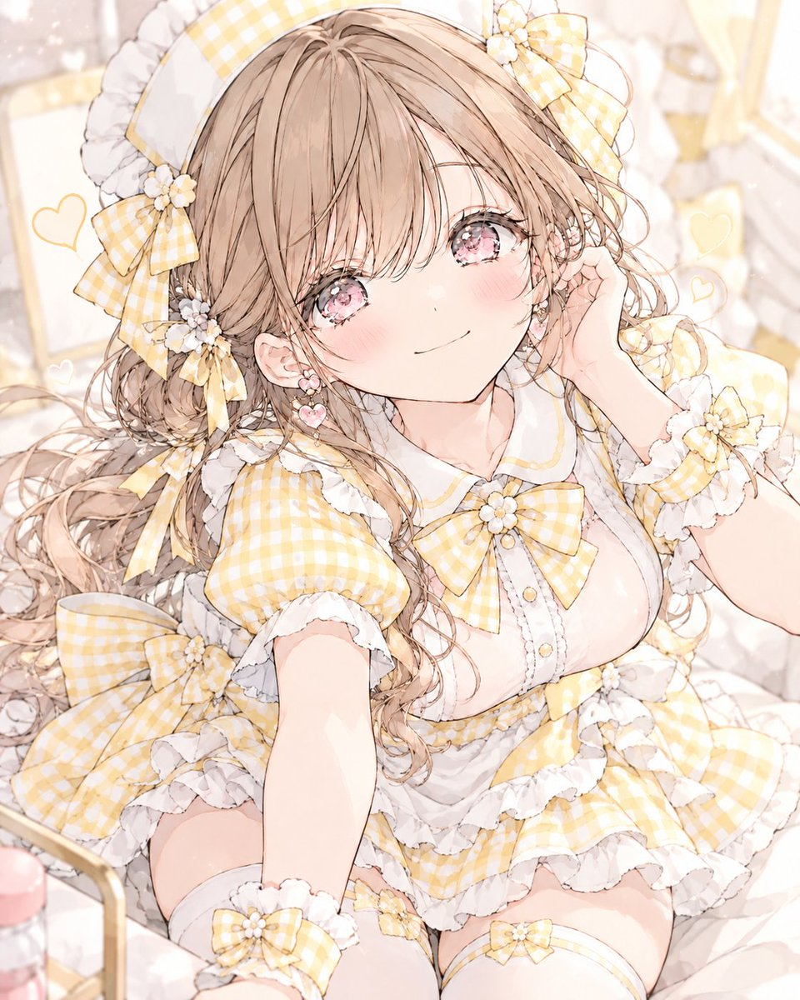

```text
Cute pastel yellow and white gingham nurse outfit, sweet Lolita-inspired dress, puff sleeves, delicate white lace ruffles, frilled apron, fitted waist, fluffy layered skirt, oversized gingham bows, pearl buttons, matching yellow gingham nurse cap with white frills and tiny floral decorations, soft pastel colors, adorable elegant style, gentle smile, dynamic pose, detailed fabric textures, no red cross, no medical symbols, masterpiece, best quality.
```

Model: GPT Image 2 · Author: のぞむ＊AIイラスト

[Original source](https://github.com/YouMind-OpenLab/awesome-gpt-image-2/blob/f06c0dd7fdfd593473ebdd932316bc9718d9ec3f/README.md#L528) · [Provenance and original license](data/projectd-batch-0003.json)

## Autumn Illustrated Sticker Transformation — Reference Image Required

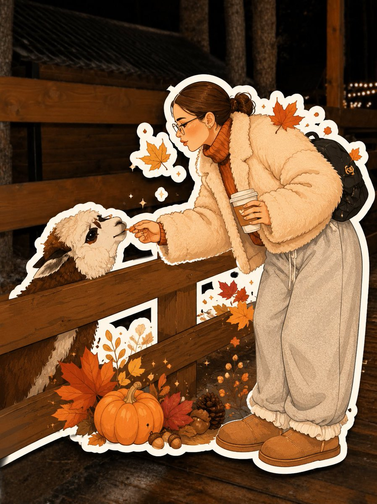

```text
Transform the uploaded photo into a charming, hand-drawn AUTUMN ILLUSTRATED STICKER.

Preserve the original subject: Accurately recreate the person, pet, or group, maintaining recognizable facial features, hairstyle, clothing, colors, pose, expression, and distinctive details.

Illustration style: Completely redraw the subject as polished digital character art with soft hand-painted shading, clean organic outlines, expressive features, subtle textures, and warm autumn colors. Avoid photorealism and 3D rendering.

Sticker effect: Add a thick, smooth white die-cut border around the entire illustrated subject, with a subtle shadow for a realistic sticker effect.

Autumn aesthetic: Incorporate tasteful seasonal details such as orange leaves, tiny pumpkins, cozy clothing, berries, acorns, or warm sparkles. Use burnt orange, terracotta, caramel, cream, and warm brown.

Background: Keep the original photographic background visible behind the sticker, gently softened if necessary.

Final result: A cozy, personalized, collectible autumn sticker with a clear contrast between the fully illustrated subject and the real photographic background. Do not simply apply a filter or outline to the original photo.
```

Model: GPT Image 2 · Author: Sairah

[Original source](https://github.com/YouMind-OpenLab/awesome-gpt-image-2/blob/f06c0dd7fdfd593473ebdd932316bc9718d9ec3f/README.md#L567) · [Provenance and original license](data/projectd-batch-0003.json)

## Cinematic Night Market Swordswoman

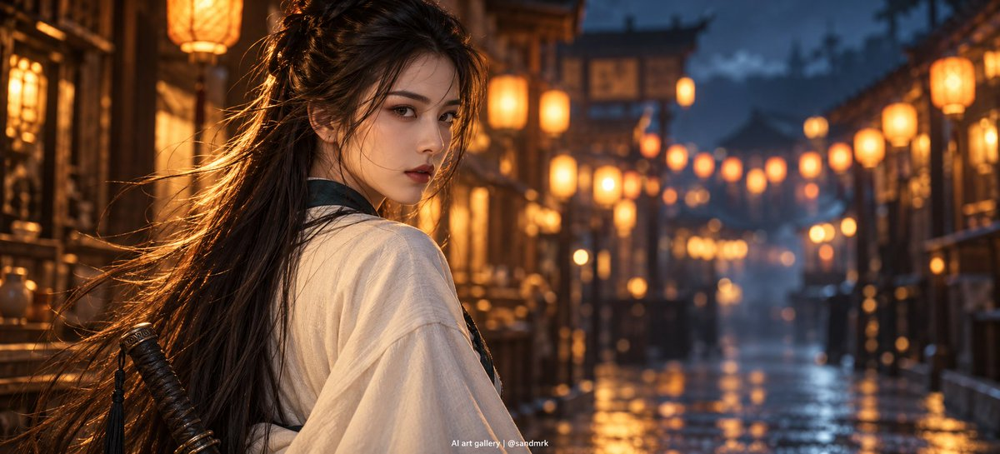

```text
Ultrawide 2.2:1, photorealistic cinematic, young swordswoman turning back over shoulder in lantern-lit night market, warm lantern glow vs cold blue night. One subject.

【Composition】Three-quarter back view, left of center, face at 41% width, 38% height, 30% frame height. Right 55% background: lantern orbs receding into blur. Dark sword hilt at 24% width, low unraised. Camera shoulder height, telephoto, shallow DOF.

【Character】Young woman, oval face, soft jaw, pointed chin, warm night light on skin, satin sheen. Dark brown eyes, smoky eyeshadow, defined lashes, straight strong brows. Lips muted dark red, closed, no smile. Expression: calm, aloof, quietly alert — like a skilled swordswoman assessing her surroundings. Body walking away, head turns back over shoulder, eyes meet viewer directly with clear deep gaze, brows level. Loose black strands naturally fall across forehead and cheek, wind-swept, not damp.

【Hair/Costume】Very long black hair, half tied back half loose, natural flowing texture, strands blowing gently in night breeze, edges rimmed gold by lantern light. Plain white wandering swordsman's robe, wide sleeves, dark teal-black cross-collar inner layer, matte fine-woven cloth, white warmed to pale gold. No jewelry, no embroidery — understated elegance. Sword shows only plain dark hilt, short cord wrap.

【Pose】Torso faces away toward street depth, shoulders three-quarter back, weight shifting forward mid-step. Only head and neck rotate back, chin level, face meets lens across shoulder. Arms unemphasized, sword low behind. Turn continuous through spine and neck.

【Environment】Old-town night market: wooden shopfronts dim left, blurred signboard top center, strings of paper lanterns receding right into warm orange bokeh. Far street and lower right carry cold blue-grey shadow, wet stone sheen. No readable text. No other people.

【Lighting】All light from lanterns. Large lantern group behind right blooms warm orbs, rims hair and shoulder gold. Nearer lantern throws diagonal warm patch across left cheek and jaw, rest of face in cool blue shadow — warm and cold divide face. Background left amber-brown, right blue-grey night. Palette: lantern amber #E8A04C, night blue #33455C, shadow brown #241A14, robe white #E9DCC8, hair black #14100E, lip red #8E4A42, skin highlight #D9A37E.

【Rendering】Photorealistic cinematic, filmic grain-free: skin fine satin, hair natural flowing strands with specular edges, cloth matte weighty. Sharpness on eyes and face strands; lanterns and street dissolve into layered bokeh, air carries faint night haze.

Negative: second person, drawn weapon, readable text, watermark, logo, anime, cartoon, oversaturated, plastic skin, extra limbs, centered, full-body, focused background.
```

Model: GPT Image 2 · Author: AI art gallery

[Original source](https://github.com/YouMind-OpenLab/awesome-gpt-image-2/blob/f06c0dd7fdfd593473ebdd932316bc9718d9ec3f/README.md#L618) · [Provenance and original license](data/projectd-batch-0003.json)

## Pumpkin Dress Halloween Prompt

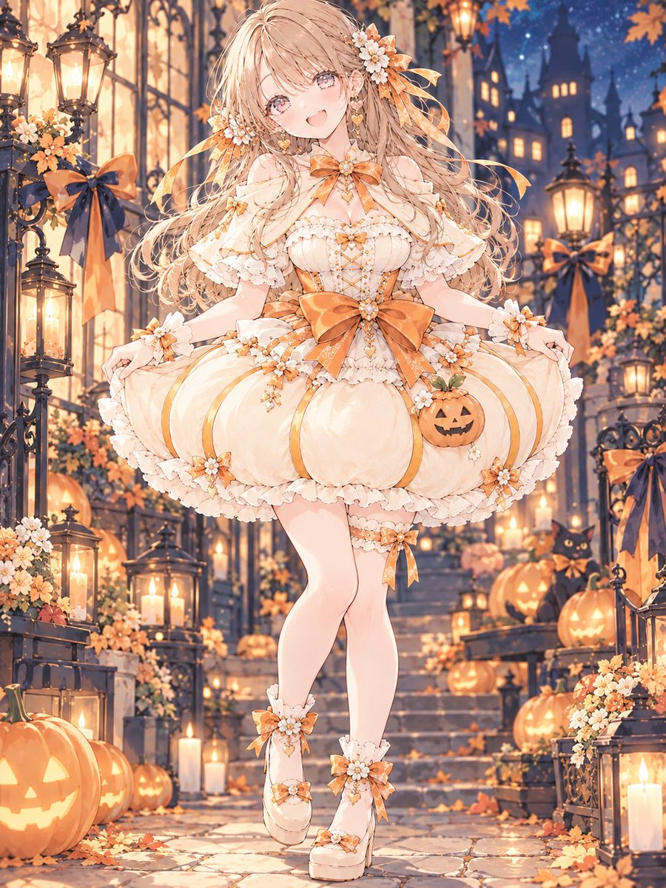

```text
ハロウィンのパンプキンスカートを着た女の子。

衣装はナチュラルベージュのオフショルダーミニドレス。スカートはふんわりと丸く膨らんだパンプキン型で、細い縦溝が入っている。溝の色はハニーカラー。スカートの表面には小さなジャック・オー・ランタンの顔が 1 つ、刺繍ではなくエンボス加工で施されている。ウエストには太めのオレンジのリボン。

肩にはショート丈のナチュラルベージュのケープ。頭には帽子をかぶっていない。カラーはナチュラルベージュ、ハニー、ライトオレンジ、ナイトブルー。

全身、正面からのアングルで、パンプキン型のスカートがはっきりと見える構図。幸せそうに微笑む表情。
```

Model: GPT Image 2 · Author: のぞむ＊AIイラスト

[Original source](https://github.com/YouMind-OpenLab/awesome-gpt-image-2/blob/f06c0dd7fdfd593473ebdd932316bc9718d9ec3f/README_ja-JP.md#L667) · [Provenance and original license](data/projectd-batch-0003.json)

## Candle Dress Halloween Girl Prompt

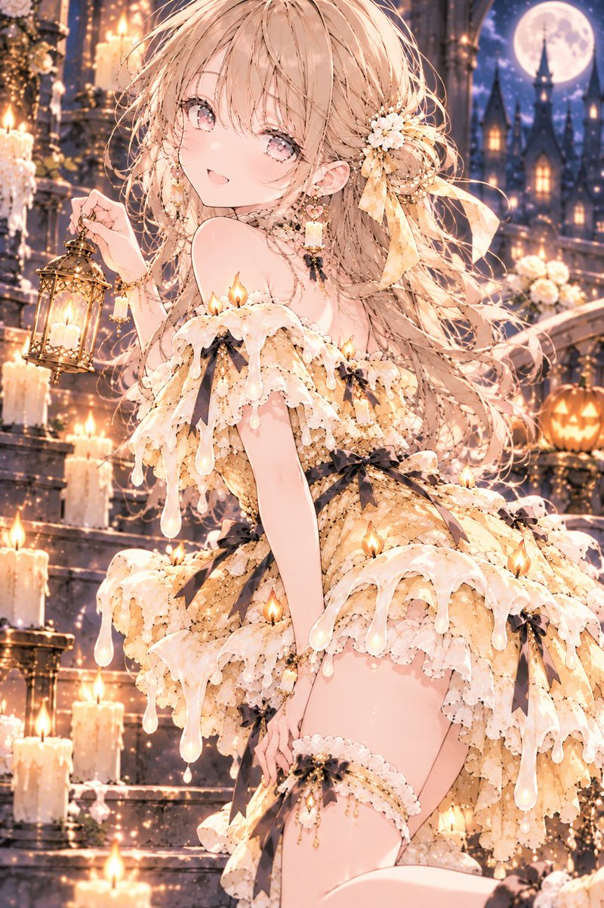

```text
ハロウィン用に、ろうが滴るようなドレスを着た女の子。衣装はハニーカラーのオフショルダーミニドレス。肩やスカートの裾から白いろうが垂れているような立体ディテールがあしらわれている。ろうの表面にはわずかなツヤがあり、小さな炎の模様がところどころに散りばめられている。
ウエストには細いブラックリボン。ケープはなし。頭には帽子をかぶっていない。首元には小さなキャンドルチャーム。
カラー：ハニー、ホワイト、ライトオレンジ、ナイトブルー。ろうの滴るディテールがよく見える角度からの全身ショット。静かな微笑み。
```

Model: GPT Image 2 · Author: のぞむ＊AIイラスト

[Original source](https://github.com/YouMind-OpenLab/awesome-gpt-image-2/blob/f06c0dd7fdfd593473ebdd932316bc9718d9ec3f/README_ja-JP.md#L712) · [Provenance and original license](data/projectd-batch-0003.json)

## Giant Head Miniature Body Photo Prompt — Reference Image Required

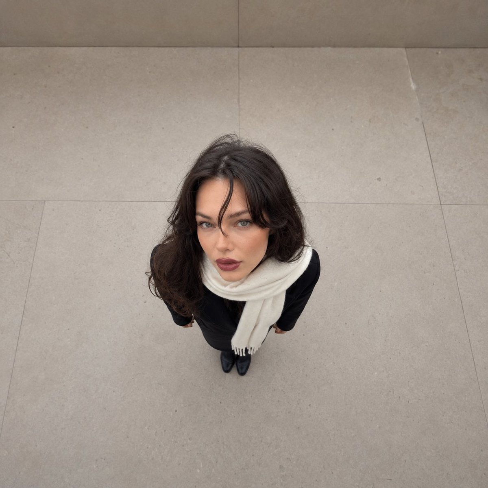

```text
Create a 1:1 square, ultra-realistic overhead photograph based on the uploaded selfie. The selfie is the sole reference for the person's identity. Preserve the same recognizable adult face, natural facial proportions, skin tone, hairstyle, original expression, visible clothing (including existing prints), and accessories. Naturally complete any unseen trousers and shoes to match the original outfit.

CAMERA & ENVIRONMENT
Position the camera almost directly above the person, looking vertically downward. The setting is a clean, spacious, light-colored indoor stone floor or outdoor paved surface that matches the aesthetic of the original selfie. Use large paving slabs with only 2–3 thin, widely spaced seams across the entire frame. Each slab should be approximately twice the height of the miniature full-body figure. Keep the stone texture subtle and refined, with no props, plants, or clutter. A distant wall base may appear along the top edge.

COMPOSITION & PROPORTIONS
Only one person stands slightly below the center of the frame, fully visible from head to toe. The entire figure occupies just 40% of the image height, leaving extensive empty floor space above the head and on both sides.

Use extreme wide-angle forced perspective to create an enormous, realistic head and a miniature body. The head, from crown to chin, occupies 75% of the figure's total silhouette height. The shoulder width is only 50% of the head width. Below the head, create an extremely short, narrow torso, miniature arms, perspective-compressed short legs, and two tiny shoes placed close together.

The head and body must connect seamlessly. Both arms hang naturally close to the sides. The person tilts their head upward and looks directly toward the elevated camera. Preserve realistic facial anatomy, natural skin texture, and lifelike eyes. Absolutely no cartoon styling or collage effects.

LIGHTING & REALISM
Use natural lighting, realistic individual hair strands, authentic fabric textures, finely detailed stone surfaces, physically accurate contact shadows, and subtle film grain. The final image must look like a genuine photograph captured with a real camera.
```

Model: GPT Image 2 · Author: Sairah

[Original source](https://github.com/YouMind-OpenLab/awesome-gpt-image-2/blob/f06c0dd7fdfd593473ebdd932316bc9718d9ec3f/README.md#L783) · [Provenance and original license](data/projectd-batch-0003.json)

## Capybara Yuzu Hot Spring Sticker

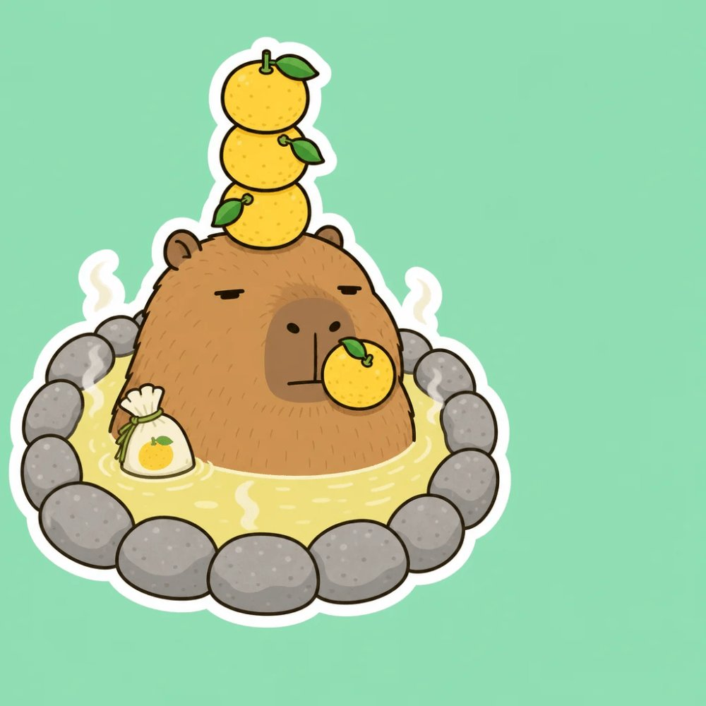

```text
A cute, flat-style vector illustration of a capybara soaking in a yuzu hot spring. The capybara has a deadpan, relaxed expression with half-closed eyes and is holding a single yellow yuzu fruit in its mouth. A stack of three wobbling yuzu fruits rests on top of its head. The hot spring is filled with pale yellow water and surrounded by smooth grey stones. To the left, there is a small white drawstring pouch containing a yuzu. Wisps of steam rise from the water. The entire scene is rendered as a sticker with a thick white outline against a solid mint green background.
```

Model: GPT Image 2 · Author: AI Art Alley

[Original source](https://github.com/YouMind-OpenLab/awesome-gpt-image-2/blob/f06c0dd7fdfd593473ebdd932316bc9718d9ec3f/README.md#L841) · [Provenance and original license](data/projectd-batch-0003.json)

## Retro Portrait: Girl with Plush Dog

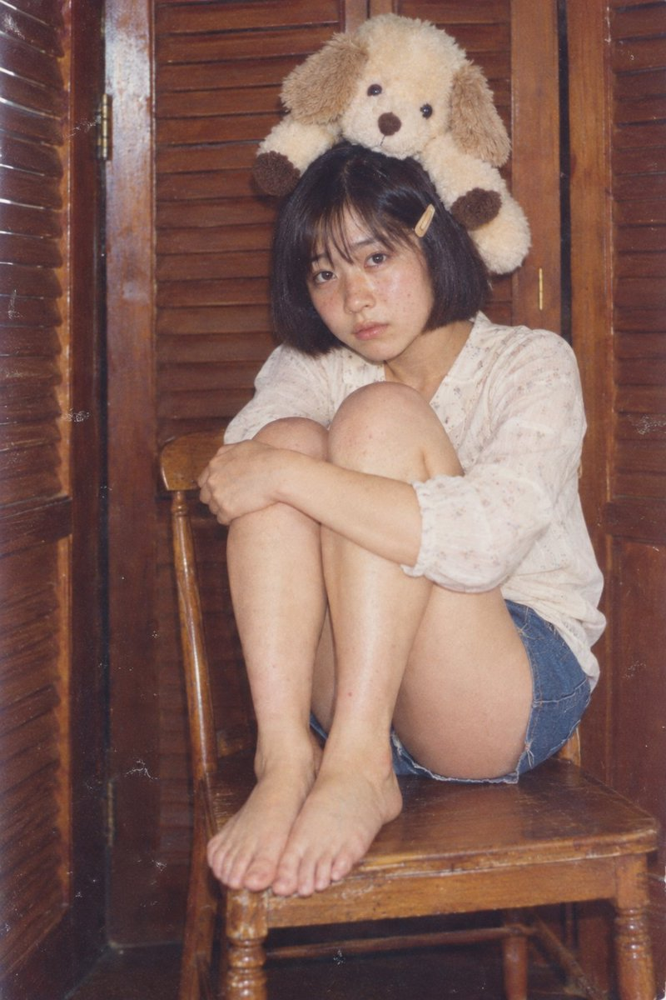

```text
A nostalgic, retro-style photograph of a young Asian woman sitting on a wooden chair. She has short black hair with bangs and is wearing a cream-colored floral blouse and denim shorts. A large beige plush dog toy rests on top of her head. Her expression is melancholic and distant as she looks directly at the camera, hugging her knees to her chest. The background features dark wooden louvered doors or shutters. The image has a vintage film aesthetic with visible grain, scratches, and warm, faded tones typical of Showa-era photography.
```

Model: GPT Image 2 · Author: いがぐりメタボ

[Original source](https://github.com/YouMind-OpenLab/awesome-gpt-image-2/blob/f06c0dd7fdfd593473ebdd932316bc9718d9ec3f/README.md#L874) · [Provenance and original license](data/projectd-batch-0003.json)

## Cinematic Car Portrait Prompt

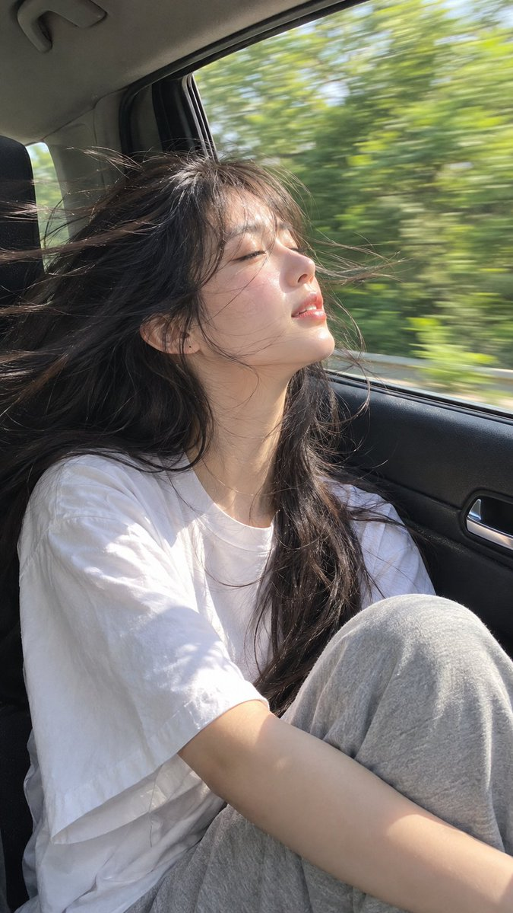

```text
Candid lifestyle portrait of a young woman sitting in the back seat of a moving car, head tilted back against the seat with eyes gently closed, face turned toward the open window and soaking in the sunlight and breeze. Long, dark brown-black hair with wispy bangs, blowing back in the wind with loose strands flying. Soft, natural makeup, dewy skin, relaxed peaceful expression with slightly parted peach-toned lips. Wearing a plain white oversized crew-neck t-shirt and light grey sweatpants, one knee pulled up with her arms wrapped around it. Dark car interior with a black door panel and silver door handle in the foreground. Outside the window, fast-moving green trees heavily blurred by motion. Warm, bright midday sunlight streaming in, with soft highlights on her face and neck. Dreamy, carefree summer road-trip mood, Korean-style cinematic aesthetic, motion blur in the background, shallow depth of field, 50mm lens, f/2, photorealistic, ultra-detailed skin and hair texture, vertical 9:16 composition.
```

Model: GPT Image 2 · Author: Sophie

[Original source](https://github.com/YouMind-OpenLab/awesome-gpt-image-2/blob/f06c0dd7fdfd593473ebdd932316bc9718d9ec3f/README.md#L907) · [Provenance and original license](data/projectd-batch-0003.json)

## Cozy Cafe Portrait

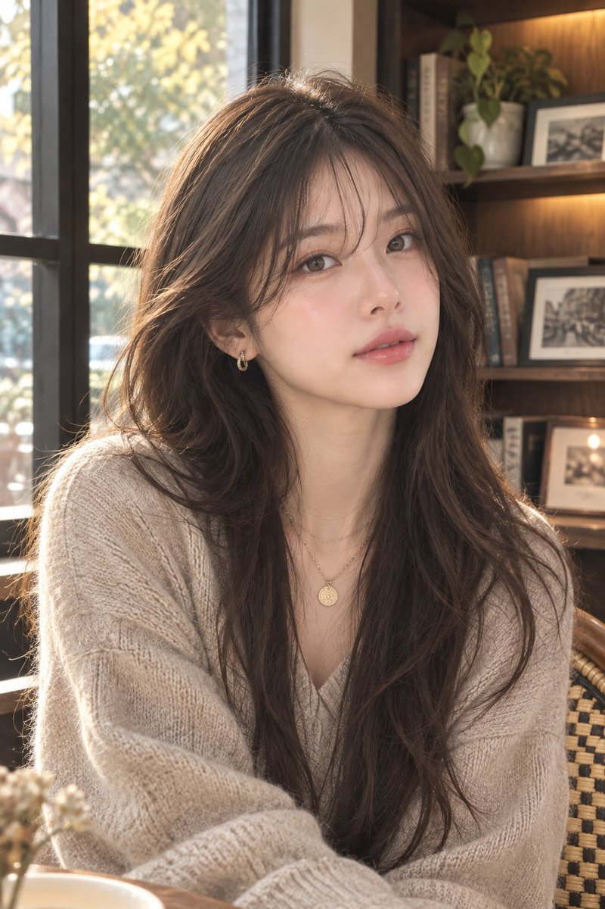

```text
Portrait of a young East Asian woman seated in a cozy café, facing the camera with a slight head tilt and a calm, soft gaze. Very long, layered, dark chestnut-brown hair with wispy curtain bangs, loose and slightly tousled, with natural highlights and strands falling over her shoulders. Dewy, flawless skin, soft natural makeup, warm peach-pink lips, subtle brown eyeliner. Wearing an oversized beige knit V-neck sweater with a soft fuzzy texture, layered delicate gold necklaces with a round medallion pendant, and small gold huggie earrings. Seated on a woven rattan café chair. Background: a large black-framed window with blurred autumn greenery, dark wooden bookshelves with warm wood shelves, framed photos and a small potted plant, all softly out of focus. Warm golden-hour sunlight, soft diffused window light, cozy autumn mood, earthy beige and brown color palette, Korean-style lifestyle editorial aesthetic, shallow depth of field, 85mm lens, f/1.8, photorealistic, ultra-detailed skin and hair texture, vertical 2:3 composition.
```

Model: GPT Image 2 · Author: Sophie

[Original source](https://github.com/YouMind-OpenLab/awesome-gpt-image-2/blob/f06c0dd7fdfd593473ebdd932316bc9718d9ec3f/README.md#L940) · [Provenance and original license](data/projectd-batch-0003.json)

## Portrait of Woman Offering Candy

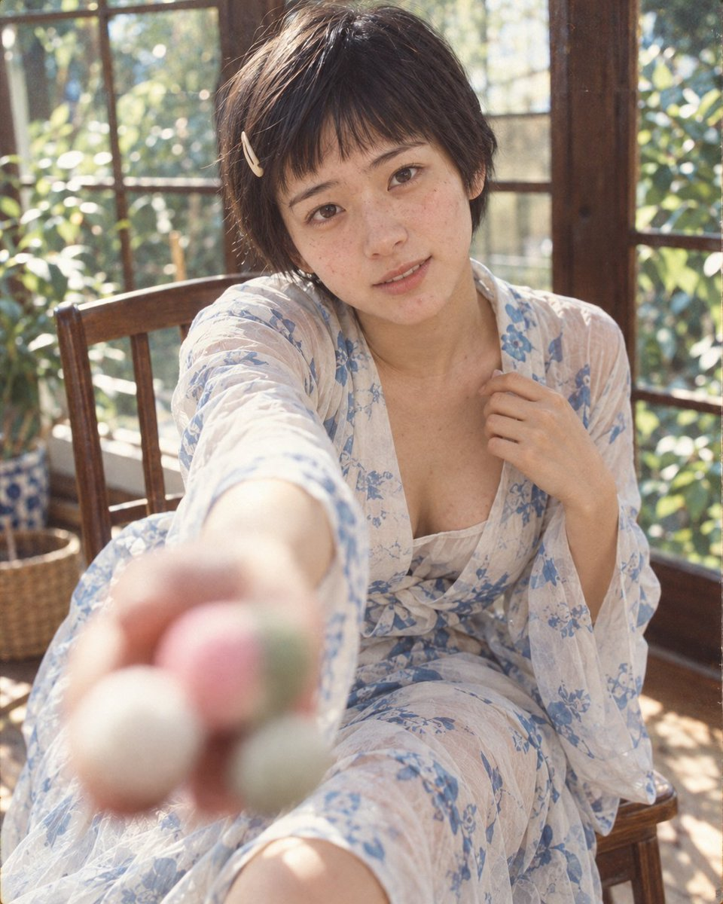

```text
A photorealistic portrait of a young Asian woman with short, dark hair and natural freckles on her face. She is wearing a light-colored, semi-sheer floral robe or dress with blue flower patterns over a white underlayer. A simple beige hair clip holds back the hair on one side of her head. She is seated in a wooden chair inside a sunlit room with large windows behind her that look out onto green foliage. The lighting is soft and natural, creating a warm, film-like aesthetic. She is looking directly at the camera with a gentle expression, extending her right hand forward toward the viewer to offer three small, round objects (resembling colorful candies or stones) which are slightly out of focus due to the shallow depth of field.
```

Model: GPT Image 2 · Author: いがぐりメタボ

[Original source](https://github.com/YouMind-OpenLab/awesome-gpt-image-2/blob/f06c0dd7fdfd593473ebdd932316bc9718d9ec3f/README.md#L973) · [Provenance and original license](data/projectd-batch-0003.json)

## 3D Caricature Portrait with Bead Texture — Reference Image Required

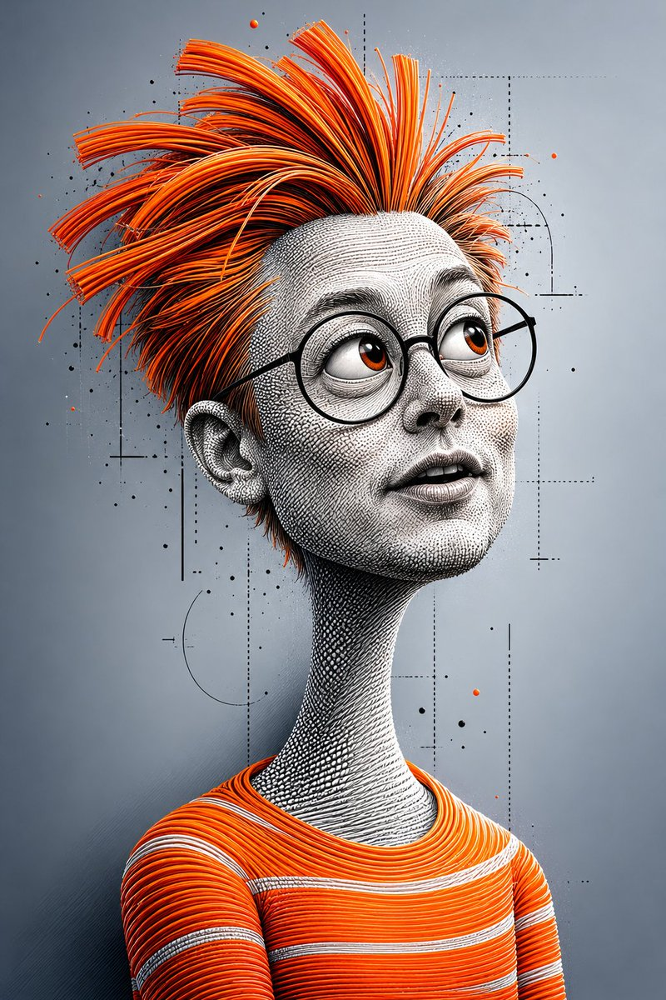

```text
Transform the reference photo into a highly detailed, professional 3D caricature portrait. Preserve the person's recognizable facial features while giving them a creative, slightly exaggerated cartoon appearance. Create intricate textures using thousands of tiny beads, fine engraved lines, and flowing 3D filaments across the face, neck, hair, and clothing.

Give the character wild, oversized, spiky orange hair made from individual curved strands, inspired by expressive modern cartoon sculptures. Add large round black glasses if suitable for the character, expressive eyes, and a distinctive facial expression.

Use a sophisticated gray studio background with abstract geometric lines, circular outlines, floating dots, tiny splashes, and minimalist technical details. Apply cinematic studio lighting, realistic shadows, sharp focus, rich textures, and premium 3D rendering. Maintain the person's original outfit style and recognizable identity while adapting the entire image to this artistic aesthetic.

Ultra-HD, intricate micro-details, professional digital art, sculptural depth, polished CGI, high contrast, clean composition, vertical 2:3 aspect ratio. No text, no watermark.
```

Model: GPT Image 2 · Author: Shahid Wani

[Original source](https://github.com/YouMind-OpenLab/awesome-gpt-image-2/blob/f06c0dd7fdfd593473ebdd932316bc9718d9ec3f/README.md#L1006) · [Provenance and original license](data/projectd-batch-0003.json)

## Shallow Depth of Field I2I — Reference Image Required

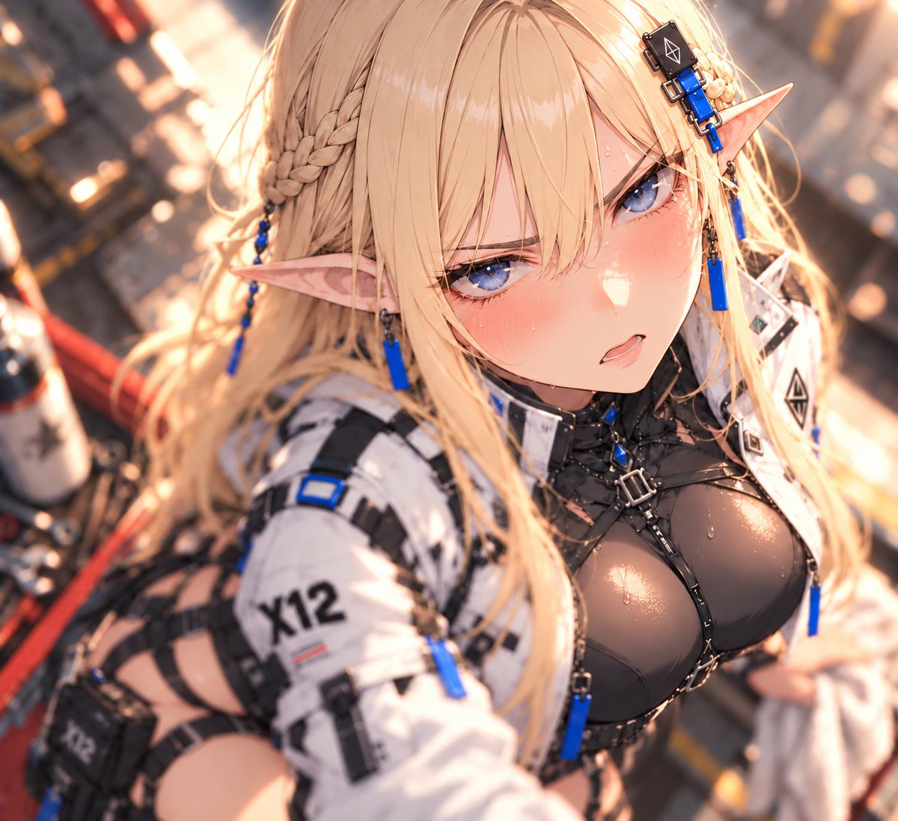

```text
元画像の人物、衣装、構図、画風をそのまま維持し、被写界深度の浅い立体的なフォーカス表現を適用してください。

ピントの中心は目と顔に合わせます。瞳孔、まつ毛、顔の主要な輪郭線はくっきりと保ってください。顔の焦点面から離れるにつれ、髪、肩、衣装、背景を距離に応じてなめらかにぼかし、人物の内側にも自然なピントの差を作り出します。

カメラに近い髪や肩には柔らかな前ボケを、背景には大きく溶け込むような後ボケを加えてください。背景にある点光源は、柔らかい円形のボケとして描写します。

温かみのある斜め逆光で髪や肌の輪郭を細く照らし出し、強いハイライト部分にのみ控えめなブルームと光のにじみを加えます。影の部分は落ち着いた暗さを保ち、自然と顔へ視線が引き寄せられるようなシネマティックな奥行き感を生み出してください。

画面全体を均一にぼかすことは禁止です。顔のディテールを消したりせず、元の線画や描画の質感をそのまま維持してください。
```

Model: GPT Image 2 · Author: Eris Create Lab

[Original source](https://github.com/YouMind-OpenLab/awesome-gpt-image-2/blob/f06c0dd7fdfd593473ebdd932316bc9718d9ec3f/README_ja-JP.md#L1060) · [Provenance and original license](data/projectd-batch-0003.json)

## Showa Retro Portrait of Girl in Floral Kimono

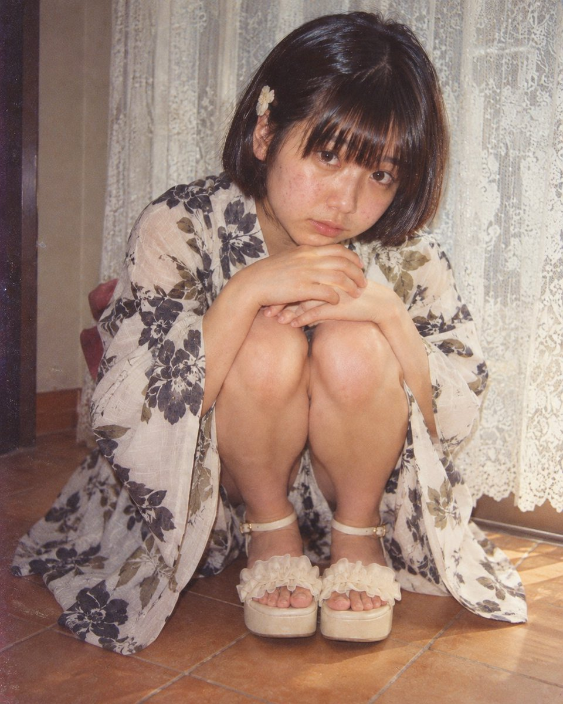

```text
A vertical portrait of a young woman with short, dark bobbed hair and bangs sitting on a brown tiled floor. She is wearing a loose, semi-sheer floral kimono-style robe in muted tones of cream, navy, and olive green. Her knees are pulled up to her chest, and she rests her chin on her clasped hands, looking directly at the camera with a melancholic expression. On her feet, she wears chunky platform sandals with ruffled white straps. A small flower clip is visible in her hair. The background features a textured white lace curtain. The image has a distinct Showa-era retro aesthetic, characterized by soft focus, warm color grading, and a nostalgic film grain texture.
```

Model: GPT Image 2 · Author: いがぐりメタボ

[Original source](https://github.com/YouMind-OpenLab/awesome-gpt-image-2/blob/f06c0dd7fdfd593473ebdd932316bc9718d9ec3f/README.md#L1104) · [Provenance and original license](data/projectd-batch-0003.json)

## Showa Retro Beach Portrait

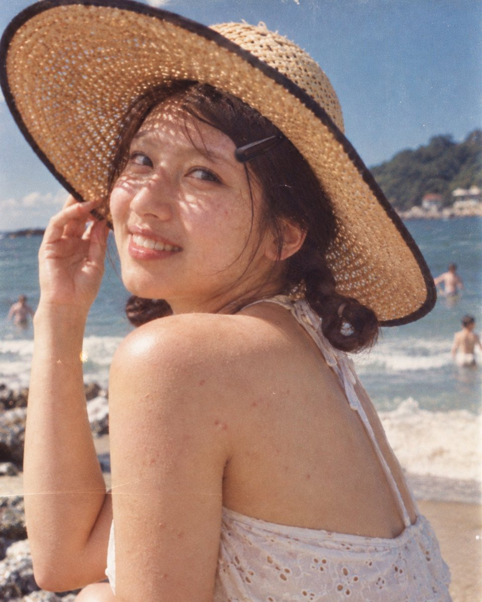

```text
A vertical medium-shot portrait of a young East Asian woman at the beach, styled with a nostalgic Showa-era retro film aesthetic. She is looking back over her left shoulder directly at the camera with a bright, genuine smile showing teeth. Her hair is dark brown, tied into two low braids or pigtails secured with small bands, and she wears a black hair clip on the side of her bangs. A large, wide-brimmed woven straw hat with a dark brown rim sits on her head, casting dappled shadows across her forehead and eyes. She wears a white eyelet lace top with thin straps, exposing her bare shoulders and upper back which show natural skin texture including small moles and freckles. Her right hand is raised, gently holding the brim of her hat near her cheek. The background features a sunny coastal scene with blue ocean water, white foaming waves crashing on a rocky shore, and a green forested hill in the distance under a clear blue sky. Two blurred figures are visible swimming in the water to the right. The image has a grainy, warm color palette typical of vintage 1970s or 80s Japanese idol photography.
```

Model: GPT Image 2 · Author: いがぐりメタボ

[Original source](https://github.com/YouMind-OpenLab/awesome-gpt-image-2/blob/f06c0dd7fdfd593473ebdd932316bc9718d9ec3f/README.md#L1137) · [Provenance and original license](data/projectd-batch-0003.json)

## Dramatic Portrait with Red Light on Eyes

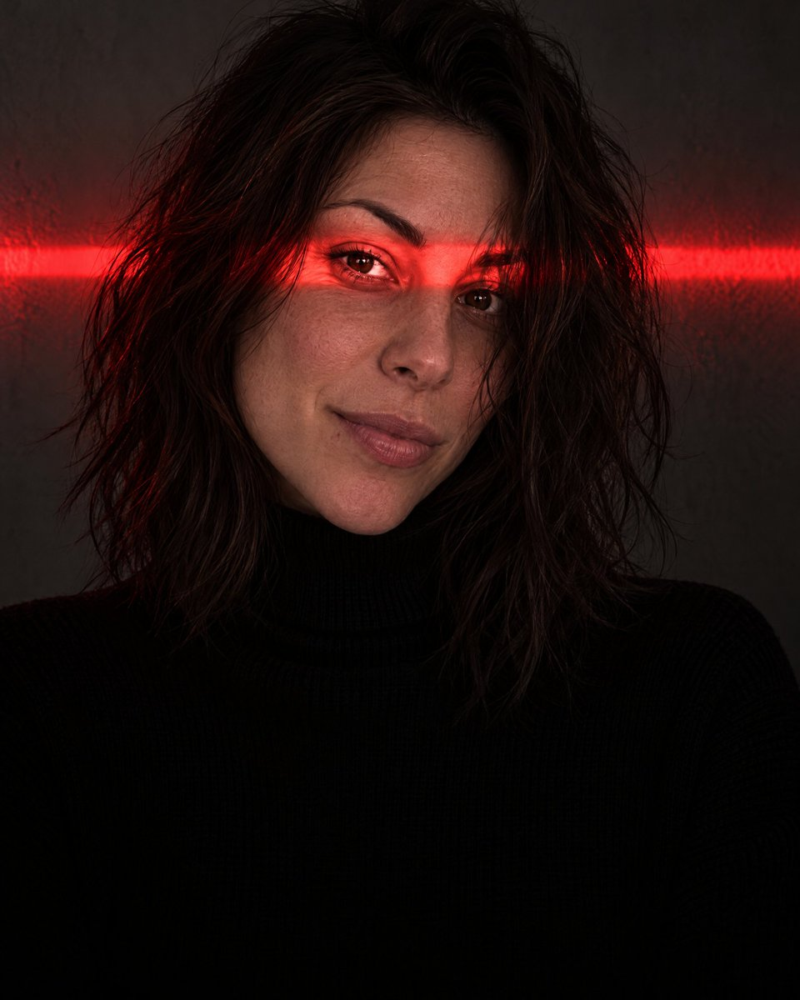

```text
Ultra-realistic dramatic portrait of the person ({argument name="photo" default="imported photo"}), messy hair strand over one eye, black turtleneck, centered, intense gaze. A bright and sharp horizontal red light illuminates only the eyes and reflects on the gray wall; the rest is in deep shadow. Dark, minimalist, and cinematic atmosphere.
```

Model: GPT Image 2 · Author: Ibrahim Kamara · Travail & Argent

[Original source](https://github.com/YouMind-OpenLab/awesome-gpt-image-2/blob/f06c0dd7fdfd593473ebdd932316bc9718d9ec3f/README.md#L1170) · [Provenance and original license](data/projectd-batch-0003.json)

## Monochrome Elegant Autumn Outfit

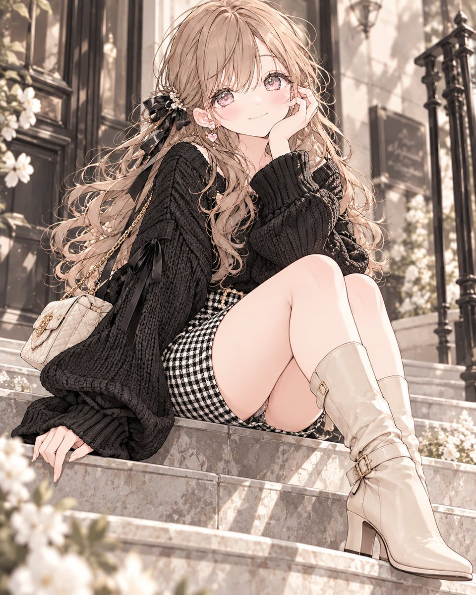

```text
可愛い黒のギンガムチェックタイトスカート、黒のニットセーター、ベージュのブーツ、モノトーンの上品なスタイル、清潔感のあるファッションルック、柔らかなライティング、質感豊かな生地、洗練された雰囲気、傑作、最高品質
```

Model: GPT Image 2 · Author: のぞむ＊AIイラスト

[Original source](https://github.com/YouMind-OpenLab/awesome-gpt-image-2/blob/f06c0dd7fdfd593473ebdd932316bc9718d9ec3f/README_ja-JP.md#L1207) · [Provenance and original license](data/projectd-batch-0003.json)

## Photorealistic Tang Dynasty Hanfu Portrait

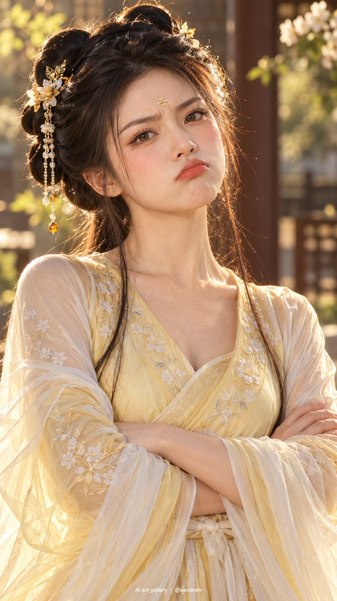

```text
古风女性角色，竖版 9:16，超写实摄影，85mm 人像镜头，8K 超高清。照片级真实人像：一位 20 岁的东亚年轻女子，化着中国唐代古风妆容，胸部以上的半身特写，展现面部、颈部、肩部及上半身，相机与眼睛平齐，头部向右倾斜 6 度，下巴微抬，透着一股不服输的倔强。

[眼部] 杏仁眼——标准的杏眼形状，眼尾自然拉长，内眼角圆润。上眼睑微微绷紧，下眼睑紧实，目光锐利，直视镜头，带着少女特有的倔强。浓密纤长的根根睫毛清晰自然，捕捉到来自上方的轮廓光。眼神中透着娇嗔的怒意——不是空洞地凝视，而是与观者产生互动，仿佛在抗议某种不公，又带着一丝期待，像是在等对方道歉。

[骨相结构] 面部与下颌线从颧骨到下巴过渡流畅，明暗交界柔和清晰。眼窝、鼻梁两侧和下唇下方保留自然的微弱阴影，塑造出立体的骨相结构，边缘不生硬。双唇明显前撅，下唇微微上抬，嘴角向下撇，下巴抬起，形成一副倔强的神情。皮肤质感自然，鼻翼和脸颊可见细腻毛孔，细微的绒毛在轮廓光下若隐若现，因强忍情绪，颧骨处泛起一抹红晕，额头和鼻尖带有自然的皮脂光泽。

[身形与服饰] 身材高挑纤细、体态曼妙，双肩削瘦，手臂修长，姿态优雅。身穿中国传统汉服——一套浅黄色襦裙，交领上衣采用浅黄色真丝缎面，绣有白色花卉图案。衣襟在胸前交叉，形成优雅的 V 字领口，凸显精致的锁骨与柔美的肩线。上身剪裁得体，工艺考究，丝绸面料自然垂坠，褶皱灵动飘逸，腰间系着白色丝带，打成装饰性蝴蝶结。多层半透明白纱从肩部垂落，在光线映照下营造出空灵飘逸的动态感。丝绸面料随身体姿态呈现自然褶皱，尽显女性的柔美优雅与青春活力。

[姿势] 直立站姿的半身像，重心自然落在左侧，双臂交叉抱于胸前（防御姿态），双手搭在对侧大臂上，手指微微用力，宽大的衣袖自然下垂，受力侧的肩膀放松但略带紧绷，头部微向右倾，下巴抬起。整个姿势既有年轻女孩赌气时的倔强与恼怒，又惹人怜爱。

[配饰与细节] 乌黑秀发梳成双环髻，几缕细碎散发垂落两侧，右侧插着一支金琥珀发簪，珍珠流苏垂坠而下。额头点着金色花钿，眼影为淡金色，棕色眼线细长（眼尾自然拉长），珊瑚粉色口红（哑光质地），脸颊扫着自然腮红（暗示并非真的动怒），双唇紧撅（明显突出），眉头微蹙（增添几分怒意）。

[光影] 左上方射入的黄金时刻侧光（色温 3500K）精准勾勒出面部、颈部和手臂的曲线，在颧骨和鼻梁处留下温暖的高光。头顶的发丝轮廓光营造出光晕效果。自然的光线衰减增强了画面纵深感，丝绸面料呈现方向性反光，曲面处高光明亮，层叠的褶皱间阴影深邃，半透明的薄纱层散发出空灵的光泽。皮肤质感极其逼真，毛孔清晰可见，带有轻微瑕疵，毫无塑料感。背景为虚化的中国传统建筑或园林景致，光斑柔和，暖色调与人物光影相呼应。宽高比 9:16，高分辨率，专业摄影风格。
```

Model: GPT Image 2 · Author: AI art gallery

[Original source](https://github.com/YouMind-OpenLab/awesome-gpt-image-2/blob/f06c0dd7fdfd593473ebdd932316bc9718d9ec3f/README_zh.md#L1243) · [Provenance and original license](data/projectd-batch-0003.json)

## Mediterranean Garden Portrait

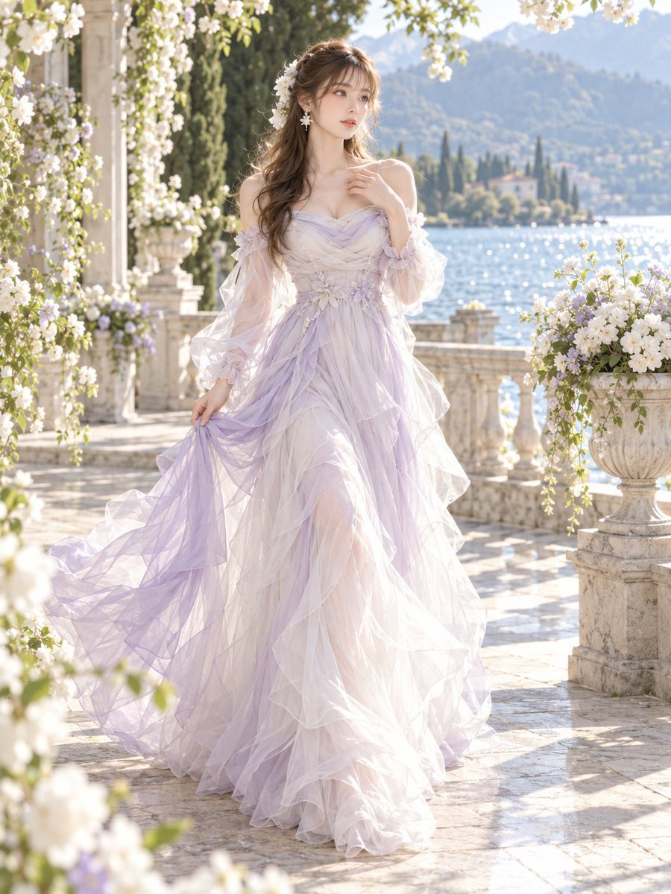

```text
午后，地中海湖畔花园。阳光从高处斜洒而下。远处湖面湛蓝静谧，群山薄雾缭绕。浅色别墅与修长的柏树错落散布于湖畔。前景为欧式石砌露台。白色大理石栏杆、雕花立柱，大型花盆沿步道依次排开。盛开的纯白与浅紫色花朵，从拱门、墙面和花器中自然垂落。

一位年轻女子伫立在花园露台中央。她身着一袭浅紫与乳白渐变的轻薄透视长裙。层层半透明薄纱被微风轻轻托起，裙摆自然舒展。她微微侧身，一手轻提裙摆，另一手搭在锁骨附近。长发随风向后飘拂，发间点缀着白色花朵配饰。姿态毫不刻意，仿佛只是湖畔漫步时的短暂驻足，恰好被阳光温柔定格的一瞬。

整体氛围宁静、明亮而柔和，没有强烈的戏剧张力。更像是欧洲私人湖区花园里一个暮春午后。色调以乳白、浅紫、湖蓝、淡绿为主。空气通透澄澈。花瓣、薄纱与水面泛着细腻的微光倒影。质感介于高端婚纱摄影与梦幻生活方式摄影之间。
```

Model: GPT Image 2 · Author: 沧瑶

[Original source](https://github.com/YouMind-OpenLab/awesome-gpt-image-2/blob/f06c0dd7fdfd593473ebdd932316bc9718d9ec3f/README_zh.md#L1306) · [Provenance and original license](data/projectd-batch-0003.json)

## Tactical Cat Interrogation Scene

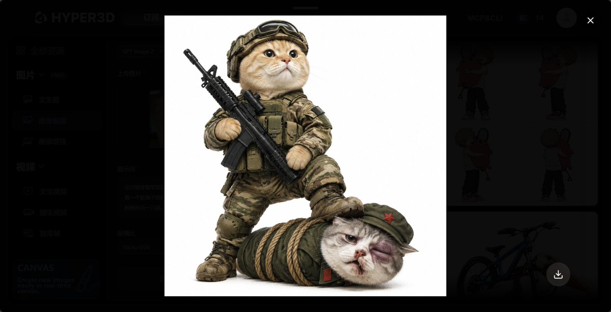

```text
A hyper-realistic, high-resolution studio photograph of two anthropomorphic cats in a military-themed scene against a clean white background. The standing cat is an orange tabby wearing full modern tactical gear, including a camouflage helmet with goggles, a heavy plate carrier vest, and combat boots. It holds a black assault rifle with a scope in its right paw and stands triumphantly with its left boot resting on the back of a second cat lying on the ground. The defeated cat is a grey and white shorthair, bound tightly in thick rope, wearing a green military cap with a red star emblem, and sporting exaggerated bruised eyes and a swollen nose to look battered.
```

Model: GPT Image 2 · Author: 毕长根（dogKnight）

[Original source](https://github.com/YouMind-OpenLab/awesome-gpt-image-2/blob/f06c0dd7fdfd593473ebdd932316bc9718d9ec3f/README.md#L1343) · [Provenance and original license](data/projectd-batch-0003.json)

## Split-Screen Realistic and Anime Illustration — Reference Image Required

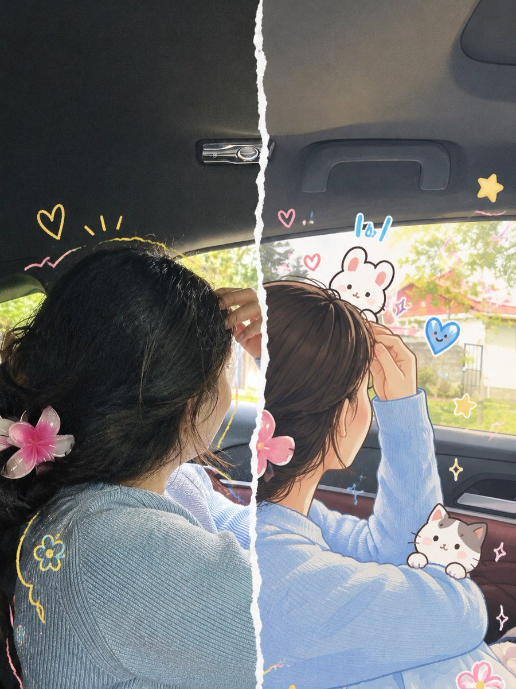

```text
Transform the uploaded photograph into a beautiful split-screen, half-realistic and half-anime illustration with a cute, playful, hand-drawn aesthetic.

COMPOSITION & FORMAT
Vertical 3:4 aspect ratio. Create one seamless-looking image divided vertically down the center by an irregular, torn white paper edge. The left half shows the original photograph in realistic photographic detail, while the right half reimagines the exact same photograph as a polished, high-quality anime-inspired digital illustration. Both halves must align perfectly, with the same subject, pose, facial direction, hairstyle, clothing, accessories, camera angle, and background placement. The torn-paper edge should look naturally ripped, with rough white fibers and an organic, imperfect shape.

LEFT HALF — ORIGINAL PHOTOGRAPH
Preserve the uploaded photo as faithfully as possible. Maintain the subject's original identity, facial features, skin tone, hairstyle, expression, clothing, accessories, pose, lighting, and surroundings. Keep realistic photographic textures, natural shadows, and authentic colors. Add a few delicate, hand-drawn doodles around the subject without covering important facial features.

RIGHT HALF — ANIME ILLUSTRATION
Recreate the same scene in a sophisticated Japanese anime-inspired illustration style blended with soft Korean webtoon aesthetics. Preserve the subject's recognizable identity and original appearance. Use clean, expressive linework, delicate facial details, softly rendered skin, subtle blush, beautifully illustrated hair strands, gentle highlights, smooth shading, and refined color gradients. Keep the original outfit and accessories recognizable. Translate the background into a softly illustrated version of the original environment, preserving its composition and atmosphere.

CUTE HAND-DRAWN DOODLES
Decorate the illustrated half with charming, colorful doodles drawn directly over the image:
- Small pink and red hearts.
- Yellow and golden stars, sparkles, and flower outlines.
- Tiny white or pastel-colored cartoon cats and bunnies.
- Blue paper airplanes, dotted flight paths, and playful symbols.
- Hand-drawn curved lines, tiny crowns, cheerful accents, and whimsical decorative marks.

Use a loose, sketchbook-inspired drawing style with slightly imperfect outlines, subtle sticker-like borders, and a harmonious pastel color palette of baby blue, blush pink, butter yellow, cream, and white. Arrange the doodles naturally around the subject, following the composition and leaving the face unobstructed.

ART DIRECTION
Cute, dreamy, youthful, romantic, playful, and aesthetically pleasing. Combine authentic photography with premium anime fan-art illustration and scrapbook-inspired doodle art. Use delicate details, soft natural lighting, balanced colors, and a clean, professionally finished appearance.

IMPORTANT RULES
1. Preserve the original person's identity and recognizable appearance.
2. Keep the left half photographic
```

Model: GPT Image 2 · Author: Sairah

[Original source](https://github.com/YouMind-OpenLab/awesome-gpt-image-2/blob/f06c0dd7fdfd593473ebdd932316bc9718d9ec3f/README.md#L1376) · [Provenance and original license](data/projectd-batch-0003.json)

## Cozy Morning Illustration

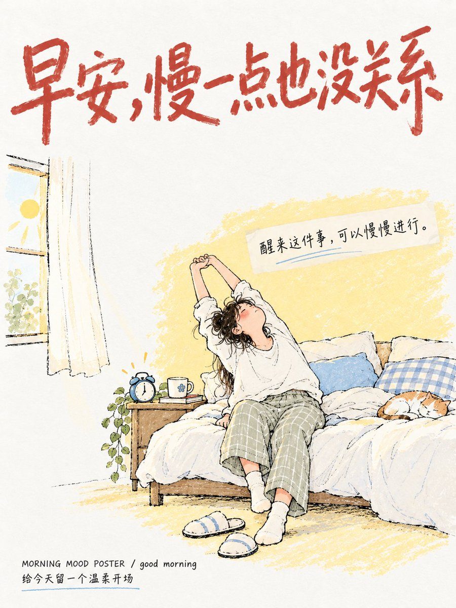

```text
A warm, hand-drawn illustration in a cozy watercolor style depicting a young woman waking up in bed. She has messy dark hair and is wearing an oversized white long-sleeved shirt and grey plaid pajama pants with socks. She sits on the edge of a wooden bed frame, stretching her arms high above her head with her eyes closed and a peaceful expression. The bed has rumpled white sheets, blue pillows, and a checkered pillow. An orange tabby cat is curled up asleep at the foot of the bed. To the left, there is a small wooden nightstand holding a blue alarm clock, a white mug with a flower design, and a stack of books. A trailing green plant hangs from the side of the nightstand. In the background, a window shows bright sunlight streaming in, illuminating the room. On the floor near the bed are a pair of striped slippers. At the top of the image, large red handwritten Chinese text reads "早安，慢一点也没关系" (Good morning, it's okay to be slow). Below that, smaller black text reads "醒来这件事，可以慢慢进行。" (Waking up can happen slowly). At the bottom left, small English text says "MORNING MOOD POSTER / good morning" followed by Chinese text "给今天留一个温柔开场" (Leave a gentle opening for today).
```

Model: GPT Image 2 · Author: 小小东

[Original source](https://github.com/YouMind-OpenLab/awesome-gpt-image-2/blob/f06c0dd7fdfd593473ebdd932316bc9718d9ec3f/README.md#L1447) · [Provenance and original license](data/projectd-batch-0003.json)

## Realistic Wall Calendar with Portrait — Reference Image Required

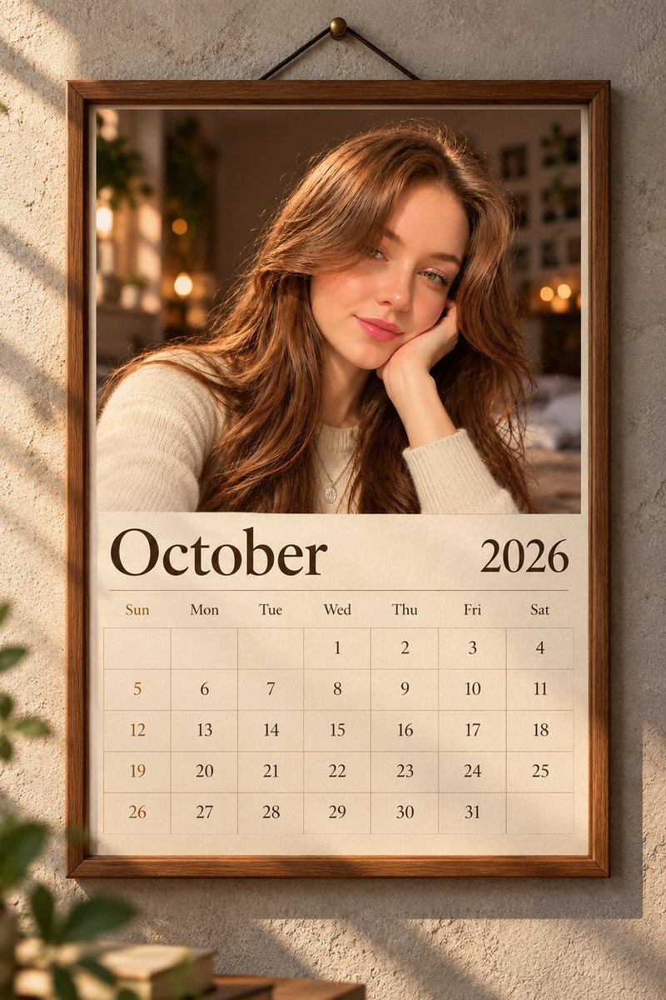

```text
Create a realistic wall calendar hanging on a textured concrete wall, framed in a warm wooden frame. The top half features my uploaded portrait photo in a soft cinematic style, shallow depth of field, warm bokeh lights in the background, natural skin tones, calm confident expression. The bottom half displays a clean, modern calendar layout for current date, with bold month text on the left and year on the right, neatly aligned date grid below, Sundays to Saturdays clearly labeled. Minimal beige and brown color palette, elegant typography, realistic paper texture, soft natural sunlight casting gentle shadows, premium lifestyle photography look, ultra-high resolution.
```

Model: GPT Image 2 · Author: Aniya Intelligence

[Original source](https://github.com/YouMind-OpenLab/awesome-gpt-image-2/blob/f06c0dd7fdfd593473ebdd932316bc9718d9ec3f/README.md#L1486) · [Provenance and original license](data/projectd-batch-0003.json)

## Showa Retro Street Portrait

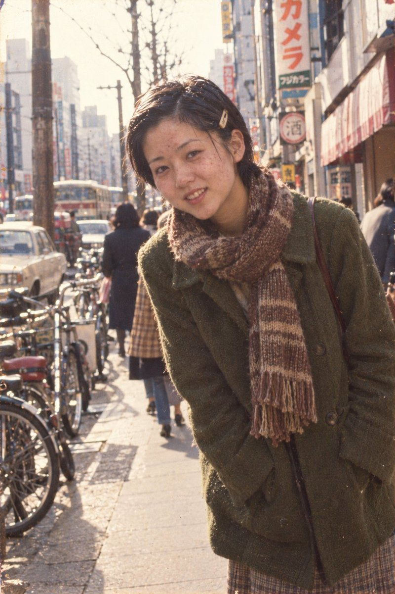

```text
A vertical medium-shot portrait of a young East Asian woman standing on a busy city sidewalk, captured in the style of authentic 1980s Japanese film photography. She has short dark hair with a small gold barrette clipped to one side and is tilting her head slightly toward the camera with a gentle, candid smile. Her skin shows natural texture with visible freckles across her nose and cheeks. She wears an oversized olive-green wool coat over a plaid skirt, with a thick brown and beige striped knit scarf wrapped around her neck. A thin leather strap from a shoulder bag crosses her chest. The background features a bustling street scene with parked bicycles, vintage cars, pedestrians walking away, and blurred storefront signs with Japanese text. The lighting is soft and warm, characteristic of analog film stock, with noticeable grain and a nostalgic color palette.
```

Model: GPT Image 2 · Author: いがぐりメタボ

[Original source](https://github.com/YouMind-OpenLab/awesome-gpt-image-2/blob/f06c0dd7fdfd593473ebdd932316bc9718d9ec3f/README.md#L1519) · [Provenance and original license](data/projectd-batch-0003.json)

## Showa Retro Portrait: Woman and Stone Statue

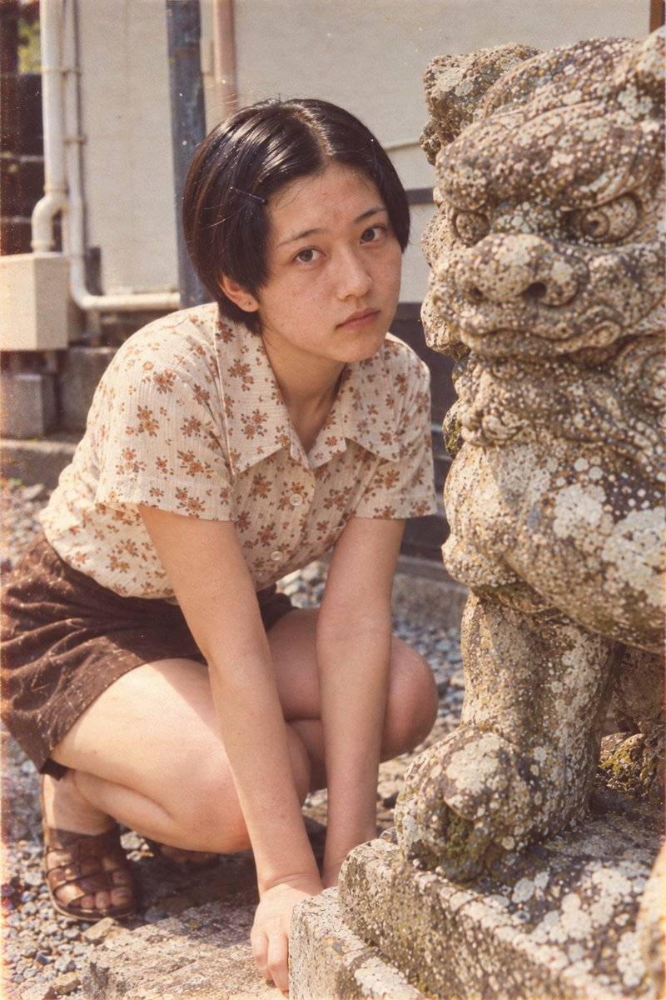

```text
A vintage-style photograph with a nostalgic Showa-era aesthetic, featuring a young Asian woman with short black hair crouching next to an old, weathered stone komainu (lion-dog) statue. She is wearing a beige short-sleeved button-up shirt with a small brown floral pattern and dark brown shorts. Her expression is calm and slightly melancholic as she looks directly at the camera. The scene is set outdoors on gravel ground near a building wall with visible pipes in the background. The image has a warm, faded color palette typical of 1970s film photography.
```

Model: GPT Image 2 · Author: いがぐりメタボ

[Original source](https://github.com/YouMind-OpenLab/awesome-gpt-image-2/blob/f06c0dd7fdfd593473ebdd932316bc9718d9ec3f/README.md#L1552) · [Provenance and original license](data/projectd-batch-0003.json)

## Flower Shop and Street Couple — Two-Scene Prompt Pack

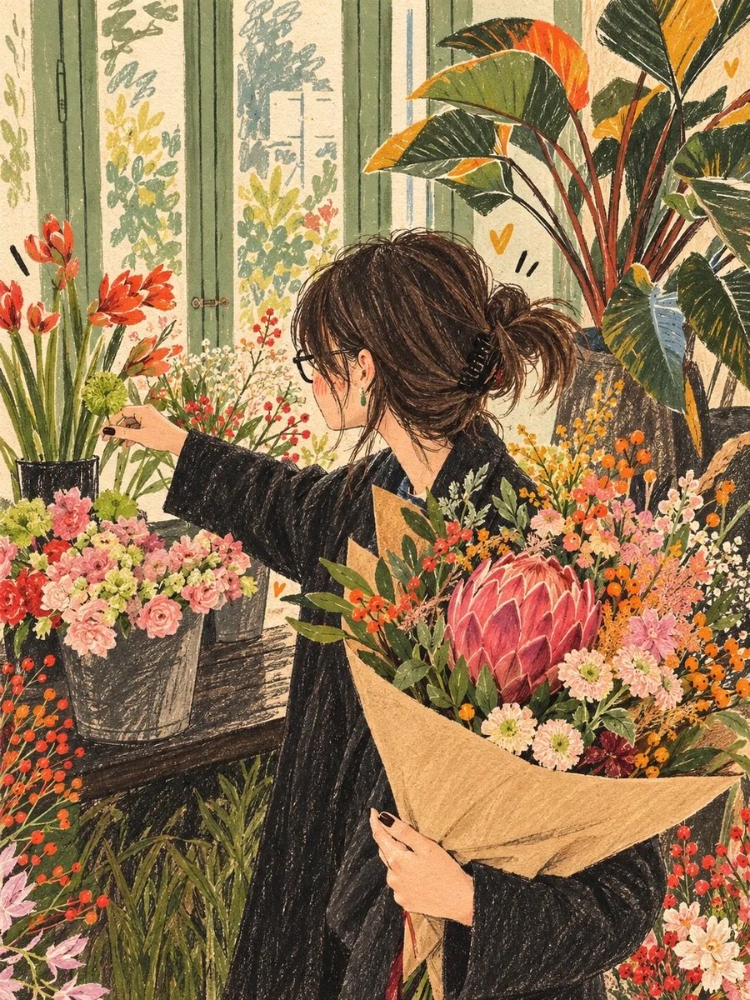

```text
Create a beautiful, nostalgic hand-drawn editorial illustration combining two cozy everyday scenes in a consistent vintage sketchbook style. In the first scene, a young woman with dark brown hair in a messy bun and black glasses, wearing a black outfit, arranges colorful pink roses, coral flowers, tiny white blossoms, and lush greenery inside a charming flower shop, holding a large bouquet wrapped in brown kraft paper. Surround her with potted plants, tropical leaves, blooming flowers, and tall vintage windows. In the second scene, a young couple sits closely together on stone steps along a charming European city street. The man wears a navy baseball cap, headphones, a gray hoodie, a long black coat, blue jeans, and sneakers, while the woman wears a black coat, a soft blue scarf, cream trousers, black sneakers, and carries a brown leather shoulder bag. They share a quiet, affectionate moment surrounded by elegant old buildings, a cozy café, glowing street lamps, bicycles, leafy trees, and pedestrians. Use a harmonious palette of warm cream, olive green, mustard yellow, dusty blue, navy, coral, and soft pink. Add textured colored-pencil strokes, delicate ink outlines, subtle watercolor shading, vintage paper grain, charming hand-drawn accents, and warm natural lighting. Whimsical slice-of-life storytelling, cozy nostalgic atmosphere, artistic imperfections, highly detailed illustration, premium handmade sketchbook aesthetic, consistent art style across both scenes, vertical composition, no photorealism.
```

Model: GPT Image 2 · Author: Taaruk

[Original source](https://github.com/YouMind-OpenLab/awesome-gpt-image-2/blob/f06c0dd7fdfd593473ebdd932316bc9718d9ec3f/README.md#L1585) · [Provenance and original license](data/projectd-batch-0003.json)

## Black Cat Halloween Dress Anime Girl

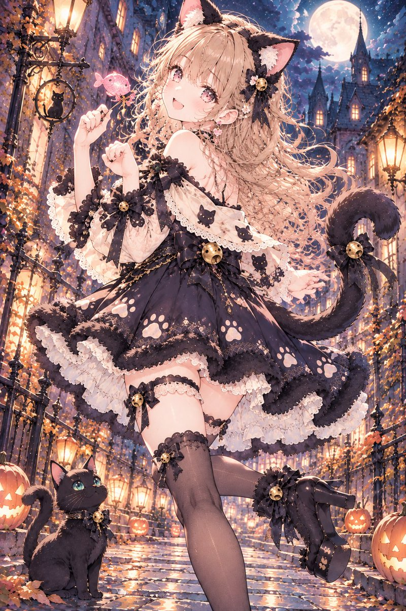

```text
ハロウィンの黒猫ドレスを着た、可愛らしい大人の女性。

衣装は、漆黒とダークネイビーのオフショルダーミニドレス。フレアスカートの裾には、ふんわりとした黒いファーと白い肉球の刺繍があしらわれています。背中からは長い黒猫のしっぽのような飾りが優雅に伸びており、ウエストには金色の鈴がついた大きな黒いリボンが結ばれています。胸元には、エメラルド色の目が輝く黒猫のブローチ。肩にはベージュのショートケープがかかり、内側には猫のシルエットが並んでいます。

頭には、ふわふわの黒猫耳カチューシャ。耳の内側は淡いピンク色で、根元には小さな黒いリボンと金色の鈴がついています。ヘアアクセサリーとして自然になじむ、愛らしい黒猫スタイルです。片手には魚の形をしたキャンディを持ち、もう片方の手は猫の手のポーズをとっています。

背景は、満月に照らされた夜の路地裏。足元には小さな黒猫がいます。
頭からつま先までを収めた全身構図。黒猫のしっぽと肉球が見えるように、少し振り返ったポーズ。いたずらっぽく可愛い笑顔。
```

Model: GPT Image 2 · Author: のぞむ＊AIイラスト

[Original source](https://github.com/YouMind-OpenLab/awesome-gpt-image-2/blob/f06c0dd7fdfd593473ebdd932316bc9718d9ec3f/README_ja-JP.md#L1627) · [Provenance and original license](data/projectd-batch-0003.json)

## Convenience Store Photoshoot Collage via Security Mirror — Reference Image Required

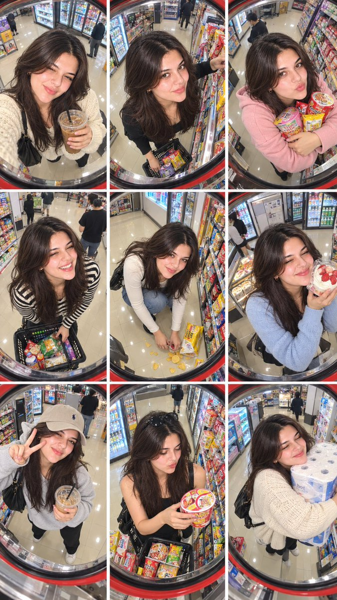

```text
Create an ultra-realistic 3×3 photo collage featuring the same woman from the uploaded reference image, preserving her exact facial identity, face shape, eyes, nose, lips, skin tone, and natural features across all nine frames.

CONCEPT & COMPOSITION: A fun, candid convenience-store photoshoot captured from a high-angle convex security mirror. Each frame features the woman looking up toward the mirror with realistic fisheye distortion, curved mirror edges, and a wide view of the store aisles.

NINE DIFFERENT SCENES:

1. Smiling and winking while holding an iced coffee, wearing a cream knit sweater.

2. Wearing a black top and reaching toward a snack shelf while holding a shopping basket.

3. Wearing a pink hoodie, making a cute pout while hugging instant noodles and colorful snacks.

4. Wearing a black-and-white striped top and laughing while holding a basket full of groceries.

5. Wearing a white long-sleeve top and blue jeans, crouching down to pick up spilled snacks from the floor.

6. Wearing a light-blue cardigan, smiling brightly while holding a strawberry cream cake beside her face.

7. Wearing a gray hoodie and beige baseball cap, making a peace sign while holding an iced drink.

8. Wearing a black sleeveless top with sunglasses on her head, examining a cup of instant noodles with a curious expression.

9. Wearing a cream knit sweater, happily hugging a large pack of toilet paper.

ENVIRONMENT: A brightly illuminated modern convenience store with colorful snack shelves, refrigerated beverage displays, glossy cream-colored tiled floors, shopping baskets, and a few distant shoppers. Include realistic reflections, curved black-and-red mirror frames, and natural overhead store lighting.

PHOTOGRAPHY STYLE: Ultra-photorealistic photography, overhead fisheye perspective, wide-angle lens, realistic proportions, natural skin texture, detailed hair strands, authentic expressions, crisp product packaging, balanced exposure, and candid lifestyle photography.

COLLAGE LAYOUT: Perfectly aligned 3×3 grid with nine distinct vertical panels, thin white dividers, consistent image quality, and varied poses and facial expressions. Maintain the same recognizable woman throughout all nine frames.

STRICT REQUIREMENTS: Preserve the reference woman's facial identity. Keep hands, fingers, and body proportions realistic. Avoid duplicated faces, distorted anatomy, blurry details, excessive beauty filters, cartoon effects, text, logos, and watermarks.

Aspect Ratio: Vertical 9:16
Quality: Ultra-realistic, high detail, 8K, professional lifestyle photography.
```

Model: GPT Image 2 · Author: AI Career Girl 💼

[Original source](https://github.com/YouMind-OpenLab/awesome-gpt-image-2/blob/f06c0dd7fdfd593473ebdd932316bc9718d9ec3f/README.md#L1670) · [Provenance and original license](data/projectd-batch-0003.json)

## Suica Penguin in Akihabara

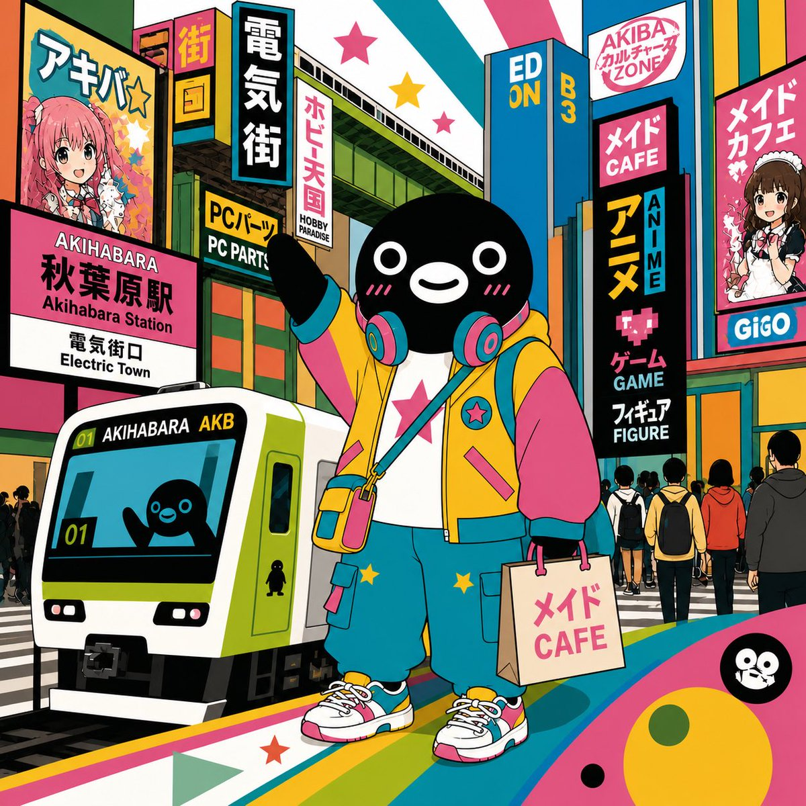

```text
A vibrant, pop-art style illustration of the Suica Penguin mascot standing in the middle of a busy Akihabara street. The penguin is anthropomorphic with black skin and white eyes, wearing a trendy yellow varsity jacket over a white t-shirt with a pink star, teal cargo pants with yellow stars, and colorful sneakers. It has large headphones around its neck and carries a shopping bag labeled 'メイド CAFE' (Maid Cafe). To the left is a green and white Yamanote line train with 'AKIHABARA AKB' on the display. The background is filled with colorful vertical signs featuring anime characters and text like '電気街' (Electric Town), 'PCパーツ' (PC Parts), 'アニメ' (Anime), and 'ゲーム' (Game). The overall aesthetic is high-contrast, saturated colors with thick outlines.
```

Model: GPT Image 2 · Author: フグリーナ

[Original source](https://github.com/YouMind-OpenLab/awesome-gpt-image-2/blob/f06c0dd7fdfd593473ebdd932316bc9718d9ec3f/README.md#L1736) · [Provenance and original license](data/projectd-batch-0003.json)

## Watercolor Travel Poster Style — Reference Image Required

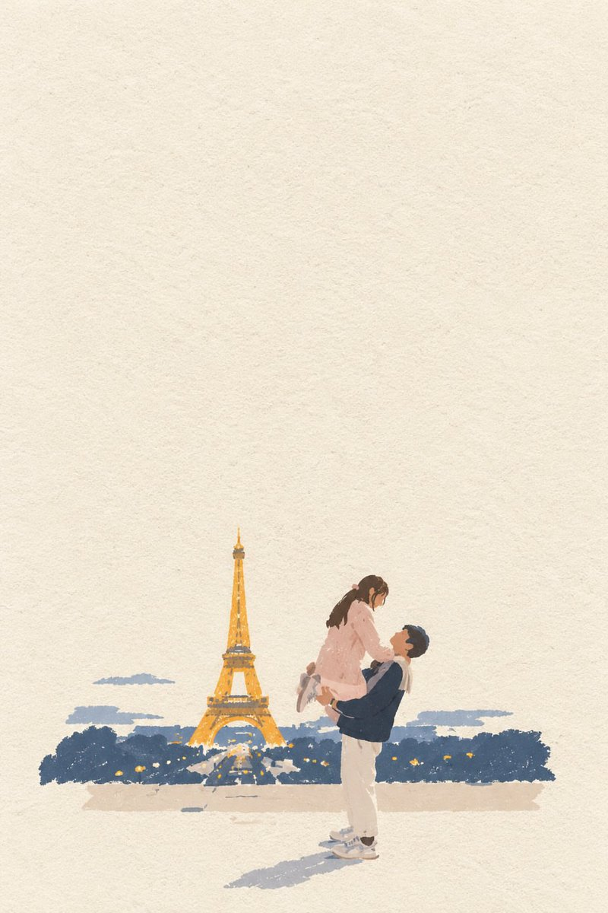

```text
Transform the uploaded photo into a beautiful minimalist editorial illustration with a soft, hand-painted watercolor and gouache aesthetic.

ART STYLE: Vintage travel-poster illustration, delicate watercolor washes, subtle gouache brushstrokes, visible handmade paper grain, soft pigment textures, imperfect painted edges, muted pastel colors, and a dreamy romantic atmosphere.

COMPOSITION: Vertical 2:3 poster. Place the main subjects in the lower third of the frame, leaving approximately 65–70% of the upper area as clean, warm ivory paper with subtle natural texture. Keep the composition airy, peaceful, understated, and balanced.

SUBJECT: Preserve the recognizable identity, hairstyle, clothing, pose, and emotional connection of the people in the reference photo. Simplify their features into elegant hand-painted shapes with minimal facial details and natural proportions. Maintain a candid, intimate, storytelling feel.

BACKGROUND: Illustrate the surroundings using loose, impressionistic brushstrokes and simplified silhouettes. Famous landmarks, landscapes, trees, buildings, or cityscapes should remain recognizable but understated. Use soft navy blue, dusty blue, warm beige, muted blush pink, and gentle golden yellow accents.

LIGHTING & TEXTURE: Soft natural daylight, delicate shadows, subtle color bleeding, layered watercolor washes, matte finish, and authentic textured paper. Keep details concentrated around the subjects and lower background.

OVERALL MOOD: Romantic, nostalgic, peaceful, poetic, timeless, and intimate—like a page from a beautifully illustrated travel journal.

STRICT RULES: Minimalist composition, generous negative space, no photorealism, no 3D rendering, no harsh outlines, no oversaturated colors, no unnecessary details, no borders, no typography, and no watermark. The final image must look genuinely hand-painted on textured paper.
```

Model: GPT Image 2 · Author: Sairah

[Original source](https://github.com/YouMind-OpenLab/awesome-gpt-image-2/blob/f06c0dd7fdfd593473ebdd932316bc9718d9ec3f/README.md#L1769) · [Provenance and original license](data/projectd-batch-0003.json)

## Weeping Angel Statue in Cemetery

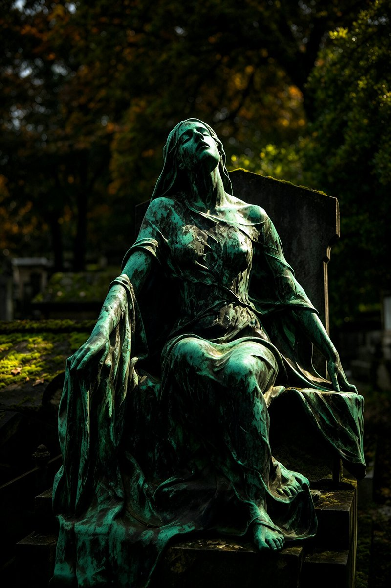

```text
A photorealistic, vertical portrait of a weathered bronze statue of a woman sitting on a stone bench in an old cemetery. The statue is heavily oxidized with a vibrant green patina and dark brown tones. She wears a long, flowing dress that drapes over her legs and the sides of the seat. Her head is tilted back toward the sky, eyes closed, with a veil covering her hair, conveying a sense of deep sorrow or longing for release. Her hands rest gently on the edges of the stone slab behind her. The background features blurred trees with hints of autumn foliage and mossy ground, creating a moody, atmospheric setting with soft, natural lighting.
```

Model: GPT Image 2 · Author: Dreamkeeper

[Original source](https://github.com/YouMind-OpenLab/awesome-gpt-image-2/blob/f06c0dd7fdfd593473ebdd932316bc9718d9ec3f/README.md#L1816) · [Provenance and original license](data/projectd-batch-0003.json)

## Marble Statue of Kneeling Woman with Rose Crown

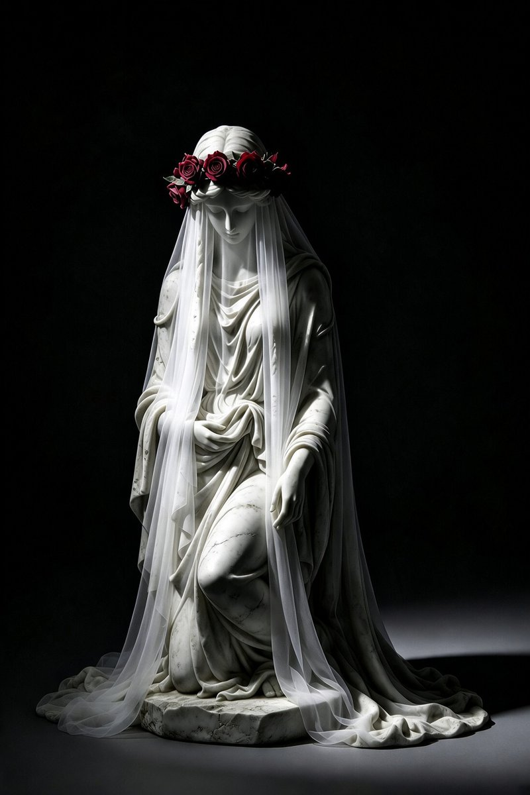

```text
A stunning, high-resolution photograph of a classical white marble statue depicting a kneeling woman in a pose of deep sorrow or prayer. The figure is draped in flowing robes and a long, translucent veil that cascades down to the base, creating an ethereal effect where the fabric appears almost like sheer silk. Resting on top of her head, over the veil, is a crown of dark red roses, providing a striking color contrast against the monochromatic stone. The statue's face is serene yet melancholic, with eyes cast downward. The lighting is dramatic chiaroscuro, spotlighting the statue from above against a pitch-black background, emphasizing the smooth texture of the marble and the delicate folds of the drapery.
```

Model: GPT Image 2 · Author: Dreamkeeper

[Original source](https://github.com/YouMind-OpenLab/awesome-gpt-image-2/blob/f06c0dd7fdfd593473ebdd932316bc9718d9ec3f/README.md#L1861) · [Provenance and original license](data/projectd-batch-0003.json)

## Palmistry Infographic Layout — Entertainment Example

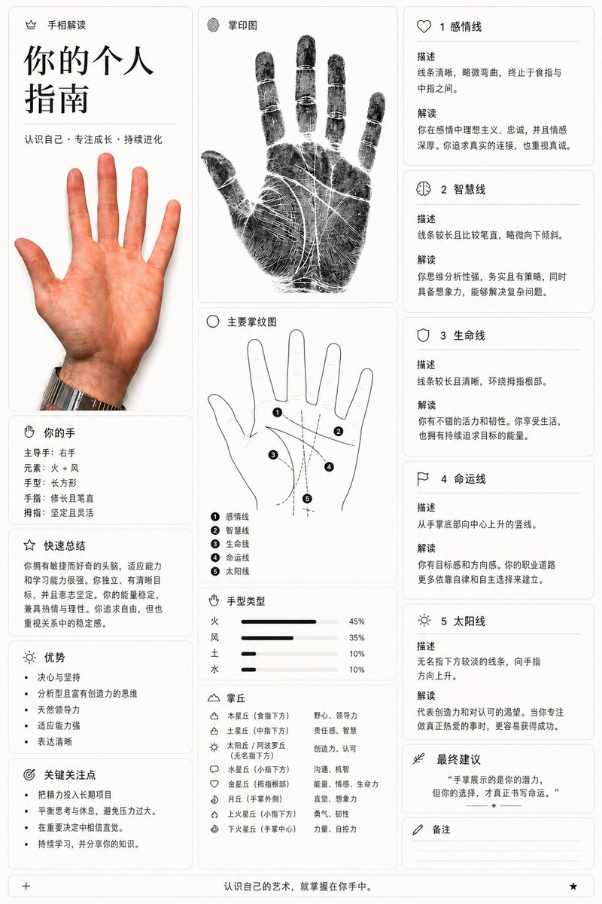

```text
Goal: Create a vertical infographic-style palmistry guide titled {argument name="title text" default="你的个人指南"}.
Canvas: A clean, modern layout with a white background and black text, divided into three main columns. The style is minimalist and educational, resembling a high-end wellness or self-improvement app interface.
Layout:
- Left Column: Top section has the title "你的个人指南" in large bold characters, followed by the subtitle "认识自己 · 专注成长 · 持续进化". Below this is a realistic photo of an open right hand (palm facing forward). Further down are sections for "你的手" (Your Hand) listing details like dominant hand, element, shape, and finger traits; "快速总结" (Quick Summary); "优势" (Strengths) as a bulleted list; and "关键关注点" (Key Focus Points) as another bulleted list.
- Center Column: Top section shows a detailed black-and-white fingerprint scan image labeled "掌印图" (Palm Print Image). Below that is a line-drawing diagram of a hand labeled "主要掌纹图" (Main Palm Lines Diagram), with numbered lines (1-5) corresponding to specific palm lines. Underneath is a bar chart section "手型类型" (Hand Type) showing percentages for Fire, Wind, Earth, and Water elements. At the bottom is a legend for "掌丘" (Mounts) explaining their meanings.
- Right Column: Contains five distinct cards detailing specific palm lines: 1. 感情线 (Heart Line), 2. 智慧线 (Head Line), 3. 生命线 (Life Line), 4. 命运线 (Fate Line), and 5. 太阳线 (Sun Line). Each card includes a description and interpretation. Below these is a final advice box "最终建议" and a notes section "备注".
Visual Style: Use thin black borders for cards. Icons should be simple line art (e.g., heart, brain, shield). Text should be crisp sans-serif Chinese characters. The fingerprint image should have high contrast with visible ridges.
Text Content: Ensure all Chinese labels match the provided image exactly, including headings like "手相解读", "掌印图", and the specific interpretations for each line.
```

Model: GPT Image 2 · Author: 露西的百宝箱

[Original source](https://github.com/YouMind-OpenLab/awesome-gpt-image-2/blob/f06c0dd7fdfd593473ebdd932316bc9718d9ec3f/README.md#L1906) · [Provenance and original license](data/projectd-batch-0003.json)

## Whale Tail Photo & Ink Illustration Diptych

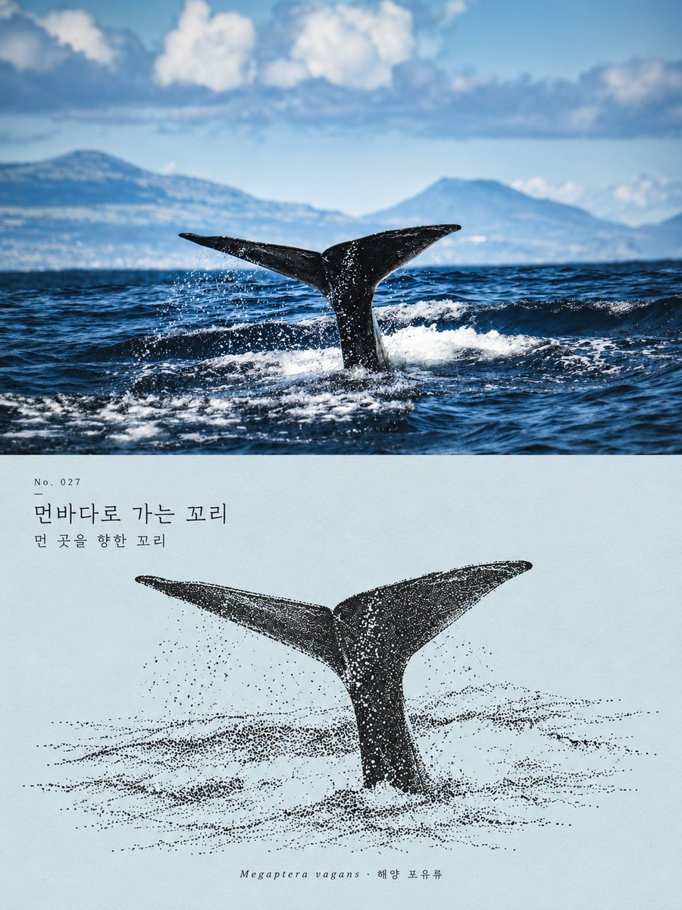

```text
Create a vertical diptych-style composition split into two distinct halves. The top half is a photorealistic, high-resolution photograph of a humpback whale's tail fluke rising vertically out of the deep blue ocean. The water is textured with white foam and splashing droplets around the base of the tail. In the background, there are soft-focus blue mountains under a bright sky with scattered clouds. The bottom half is a minimalist illustration on a pale blue-grey paper texture background. It features a stylized black ink drawing of the same whale tail shape, but rendered entirely using a pointillism or stippling technique (composed of thousands of tiny dots). Include specific Korean typography in the bottom section: 'No. 027' in small text at the top left, followed by a large title '먼바다로 가는 꼬리' and a smaller subtitle '먼 곳을 향한 꼬리'. At the very bottom center, include the scientific name 'Megaptera novaeangliae · 해양 포유류' in a serif font.
```

Model: GPT Image 2 · Author: 小小东

[Original source](https://github.com/YouMind-OpenLab/awesome-gpt-image-2/blob/f06c0dd7fdfd593473ebdd932316bc9718d9ec3f/README.md#L1947) · [Provenance and original license](data/projectd-batch-0003.json)

## Photo-to-Watercolor — Two-Recipe Pack (Toddler Preview) — Reference Image Required

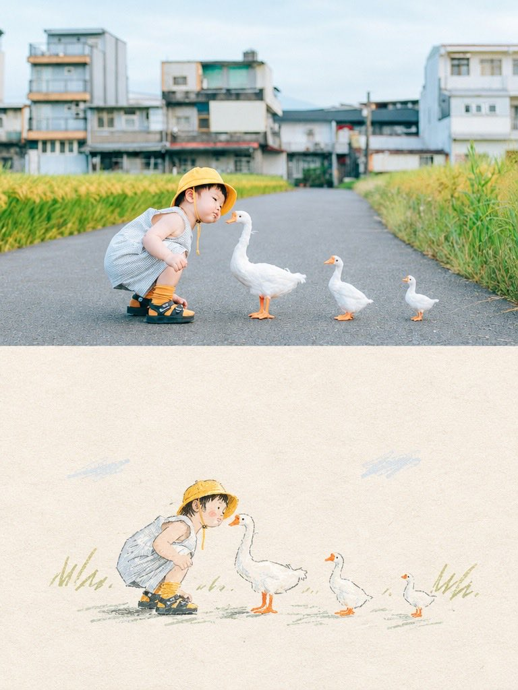

```text
Create a charming photorealistic-to-watercolor transformation using the reference image. Show a cute toddler wearing a yellow sun hat, a light blue checkered romper, yellow socks, and dark sandals, crouching curiously and interacting with three white ducks on a quiet country road. Include lush green grass along the roadside, distant residential buildings, soft daylight, and a peaceful countryside atmosphere. In the lower half, transform the same scene into a delicate hand-painted watercolor illustration on textured cream-colored paper. Preserve the toddler’s pose, outfit, the ducks’ positions, and the original composition. Use soft watercolor washes, fine pencil outlines, subtle pastel blue and sage-green accents, loose brushstrokes, and minimal hand-drawn grass details. Elegant minimalist storybook aesthetic, warm paper texture, generous negative space, heartwarming mood, high detail, vertical 4:5 composition.

Create a beautiful photorealistic-to-watercolor transformation using the reference image. Show an adorable fluffy golden-colored dog sitting in a lush green meadow, looking directly at the camera with bright expressive brown eyes, a happy open mouth, and its pink tongue hanging out. Capture its soft, fluffy fur, rounded ears, bushy tail, and friendly personality in warm natural sunlight, with a softly blurred countryside background. In the lower half, transform the same dog into a delicate watercolor painting on textured cream-colored paper. Preserve the dog’s facial features, fur color, expression, and overall silhouette. Use loose golden-beige watercolor washes, delicate pencil outlines, soft pigment splashes, subtle sage-green grass strokes, and light blue brush accents. Minimalist handmade illustration, charming children’s storybook style, natural paper grain, soft pastel palette, generous negative space, cozy and heartwarming atmosphere, vertical 4:5 composition.
```

Model: GPT Image 2 · Author: Taaruk

[Original source](https://github.com/YouMind-OpenLab/awesome-gpt-image-2/blob/f06c0dd7fdfd593473ebdd932316bc9718d9ec3f/README.md#L1998) · [Provenance and original license](data/projectd-batch-0003.json)

## Length Comparison

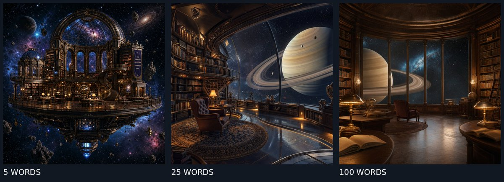

```text
A horizontal triptych comparison image with a dark navy background, divided into three equal vertical panels. Each panel displays a photorealistic 3D render of a fantastical 'Space Library' scene, illustrating the difference in prompt complexity.

Left Panel: Labeled "5 WORDS" at the bottom in white sans-serif text. The image shows an exterior wide shot of a grand, ornate library building floating in deep space. It features a large glass dome revealing a galaxy interior, surrounded by nebulae and stars, with a reflection on a water-like surface below.

Center Panel: Labeled "25 WORDS" at the bottom. The image is an interior perspective looking out through a massive curved window at a giant ringed planet (resembling Saturn). Inside, there are tall wooden bookshelves lining the walls, a cozy leather armchair, a small table with a lamp, and a patterned rug on a polished floor.

Right Panel: Labeled "100 WORDS" at the bottom. The image is a close-up interior detail shot featuring a wooden desk with an open book, a brass banker's lamp, and a globe. Behind it, large arched windows look out onto the same ringed planet and starry sky, with warm lighting contrasting against the cool blue space background.
```

Model: GPT Image 2 · Author: Human.exe

[Original source](https://github.com/YouMind-OpenLab/awesome-gpt-image-2/blob/f06c0dd7fdfd593473ebdd932316bc9718d9ec3f/README.md#L2039) · [Provenance and original license](data/projectd-batch-0003.json)

## Hand-drawn Infographic Prompt

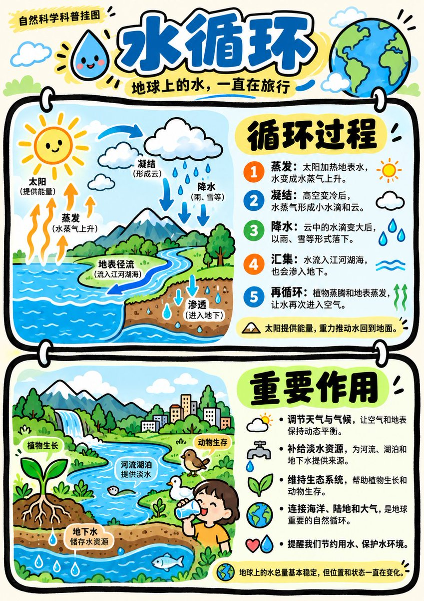

```text
两个纵向相连的圆角矩形面板由极粗、略带起伏的黑色手绘轮廓线锚定，白色卡扣横跨面板边缘，构成醒目的成对模块与清晰的纵向节奏。内容依托格式塔邻近性与版面分区进行组织，每个面板内部划分为稳定的左图右文双栏，左右视觉比重均衡，标题与信息在右栏自上而下阅读；整体视觉重心落在两块面板的交界处及各自醒目的大标题上，页眉区域保持独立，放置 logo 与主标题。图文通过并置与衬底相互衔接：左侧预留给角色或主题插画，置于不规则的圆角浅色干净底座之上；右侧以醒目的大字引领多行说明文字，并在文本旁搭配小型线描符号以提示内容。文字层级始终分明，大标题粗重醒目，说明文字较细且行距宽松，小字与符号形成节奏点；字形结构端正易读，字怀清晰、收笔利落、字面紧凑，与手绘图像相得益彰，无论文字多少均维持该层级；文字不足时，则根据主题补充次要小字。文本边缘平整清晰，在手绘线条之外形成干净的排版层。留白涵盖面板间距、图像底座周围的衬底留白、文本行间的阅读间隙以及页眉与正文之间的停顿；各处均保持宽裕，使粗边框、插画与标题得以清晰凸显。插画内容由所附主题提供，在左栏内采用完整、集中、略微倾斜的手绘构图，主体轮廓简洁，动态细节轻盈，承重部位端正；内容密度约占半幅画面，主要集中在各面板的左栏，其余部分为白色或浅色圆角底座、平整的面板色块及底部留白，不生成任何场景。采用复合技法：以连贯、略带抖动的粗黑线条勾勒边框与角色；以干净平滑的数字平涂铺展大面积面板与局部插画色彩；以利落的文字排版压住信息区；整体呈现出由手绘线条、电脑平涂与清晰排版合成的插画编排效果。配色保持高明度基调，色彩鲜活、饱和而不刺眼，最浓烈的色面落在成对面板内，并与角色局部色彩相呼应；暖调浅色背景与不同明度的浅色色面相互搭配，以强烈的黑白线文对比稳定层次。整体温暖明快、亲切有活力，宛如哑光数字色块与密集马克笔线条的结合；色调随主题变化，但明暗、粗细、饱和度、偏暖倾向以及欢快亲切的心理感受不受主题影响，始终保持这一性格。整体气质轻盈、友好且有序。所附主题、准确文案、用途与宽高比优先；上下面板分组、左图右文、粗黑手绘边框、图像衬底、清晰的文字层级以及高明度暖厚配色方案保持不变。

------
主题：水循环科普海报
```

Model: GPT Image 2 · Author: 小小东

[Original source](https://github.com/YouMind-OpenLab/awesome-gpt-image-2/blob/f06c0dd7fdfd593473ebdd932316bc9718d9ec3f/README_zh.md#L2078) · [Provenance and original license](data/projectd-batch-0003.json)

## Kiyomizu-dera Travel LP with Anime Mascot

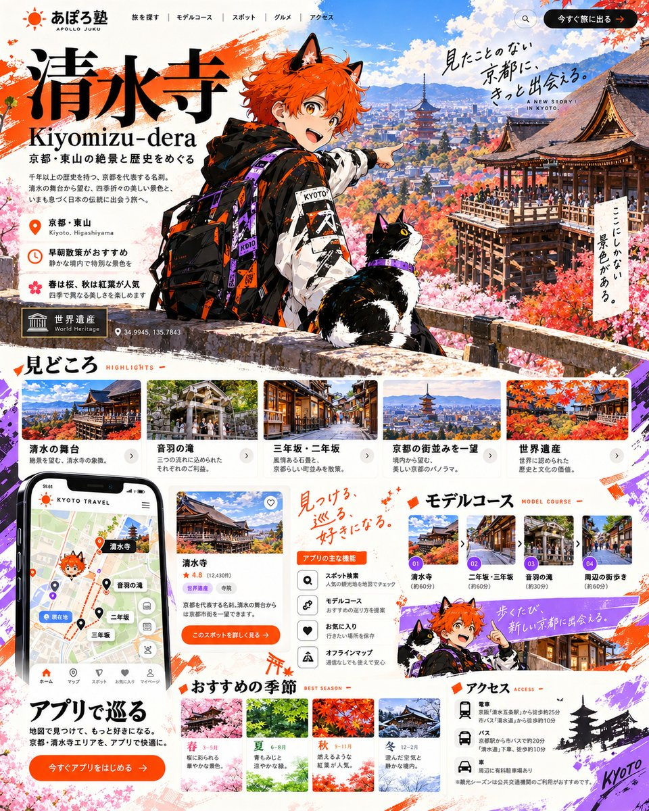

```text
Goal: Create a comprehensive, high-density vertical travel landing page (LP) for Kiyomizu-dera in Kyoto.
Canvas: Vertical aspect ratio (approx. 4:5), featuring a vibrant mix of anime illustration and realistic photography with a clean white background accented by orange and purple brushstrokes.
Layout:
1. Header: Top navigation bar with logo 'あぽろ塾 APOLLO JUKU' on the left, menu items (Search, Model Course, Spot, Gourmet, Access) in center, and an orange CTA button '今すぐ旅に出る' on right.
2. Hero Section: Large title '清水寺 Kiyomizu-dera' in bold black serif font. Subtitle '京都・東山の絶景と歴史をめぐる'. A central anime character (orange hair, cat ears, streetwear jacket with 'KYOTO' text) pointing right, accompanied by a tuxedo cat. Background shows a panoramic view of Kyoto with autumn foliage and pagodas. Floating handwritten text: '見たことのない京都に、きっと出会える。' and 'ここにしかない景色がある。'. Location info block: '京都・東山', '早朝散策がおすすめ', '春は桜、秋は紅葉が人気'. World Heritage badge and coordinates '34.9945, 135.7843'.
3. Highlights Section ('見どころ'): Horizontal scrollable cards showing photos of '清水の舞台', '音羽の滝', '三年坂・二年坂', '京都の街並みを一望', '世界遺産'. Each card has a photo, title, and short description.
4. App & Features Section: Left side features a smartphone mockup displaying a map app interface with pins for Kiyomizu-dera, Otowa Waterfall, etc. Center column lists 'アプリの主な機能' (App Main Features) with icons: Spot Search, Model Course, Favorites, Offline Map. Right side is 'モデルコース' (Model Course) with numbered steps 01-04 showing route thumbnails.
5. Seasonal Recommendations ('おすすめの季節'): Four distinct seasonal blocks (Spring, Summer, Autumn, Winter) with corresponding landscape photos and brief text descriptions.
6. Access Section ('アクセス'): Bottom right area listing transport options (Train, Bus, Car) with specific station names and walking times. Includes a small silhouette of a pagoda and 'Kyoto' script.
Visual style: Modern Japanese web design aesthetic. High contrast between the colorful anime mascot and the serene real-world photography. Use of orange (#FF5722 approx) and purple accents. Clean sans-serif typography for body text, elegant serif for headings.
Text content: Preserve all Japanese text exactly as shown in the image, including section headers like '見どころ', 'モデルコース', 'アクセス', and the specific location names.
```

Model: GPT Image 2 · Author: あぽろ

[Original source](https://github.com/YouMind-OpenLab/awesome-gpt-image-2/blob/f06c0dd7fdfd593473ebdd932316bc9718d9ec3f/README.md#L2114) · [Provenance and original license](data/projectd-batch-0003.json)

## Swiss Editorial Diptych with Texture Zones — Reference Image Required

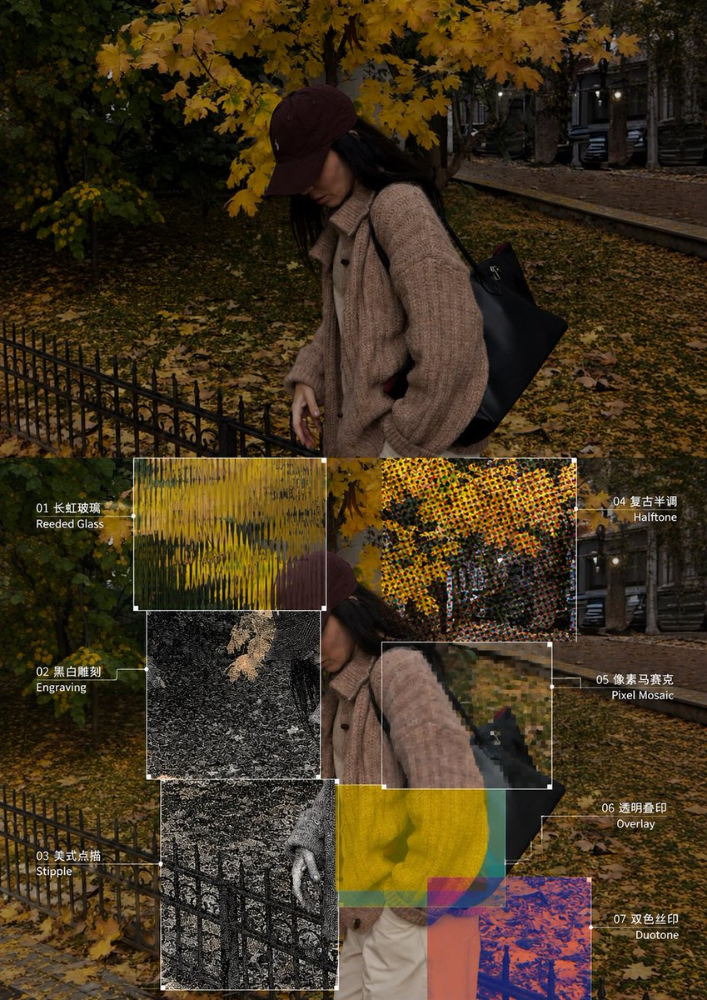

```text
Create one vertical 3:4 diptych for each uploaded photo, divided into equal top and bottom halves with a seamless join. No divider, frame, or collage. Swiss editorial design, experimental photography, and vintage print aesthetics.

TOP HALF — ORIGINAL PHOTOGRAPH
Preserve the original identity, pose, scene, composition, perspective, lighting, and colors. Allow only subtle color grading and background extension. No text.

BOTTOM HALF — SEVEN EXPERIMENTAL TEXTURE ZONES
Repeat the entire original photo. Overlay seven asymmetrical rectangular zones of different sizes directly onto the image pixels, crossing non-critical details. Maintain visual continuity inside and outside every zone. Never crop, zoom, shift, duplicate, or redraw the image. Keep all important focal features visible.

SEVEN NUMBERED TECHNIQUES

01. Reeded Glass: Vertical optical refraction.

02. Black-and-White Engraving: Fine etched lines and crosshatching.

03. American Stipple: Black-and-white microdot texture.

04. Vintage Halftone: CMYK printing dots.

05. Pixel Mosaic: Square pixel blocks.

06. Transparent Overlay: 2–4 translucent overlapping layers.

07. Duotone Screen Print: Two-color screen-printing effect.

DESIGN DETAILS
Add hairline borders, tiny corner squares, and fine leader lines to identify each rectangular zone. Label every technique with its corresponding number and English name. Keep all areas outside the seven zones photographic and realistic.

STRICT REQUIREMENTS
No logos, watermarks, extra images, or unnecessary decorative elements. Preserve the original photograph's integrity and maintain a clean, sophisticated editorial layout.

OUTPUT: One high-definition 3:4 vertical poster with equal top and bottom halves.
```

Model: GPT Image 2 · Author: Sairah

[Original source](https://github.com/YouMind-OpenLab/awesome-gpt-image-2/blob/f06c0dd7fdfd593473ebdd932316bc9718d9ec3f/README.md#L2157) · [Provenance and original license](data/projectd-batch-0003.json)

## Anime Character Sheet: Crying Girl

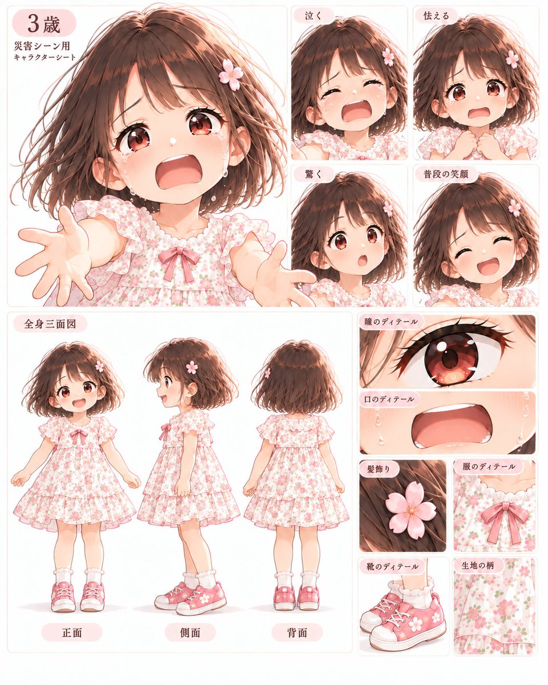

```text
A high-resolution anime character design sheet for a 3-year-old girl, rendered in a soft pastel aesthetic. The layout is divided into sections: Top Left: A large close-up of the crying girl with brown bob hair and red eyes, wearing a pink floral dress, reaching out her hands. Label '3歳' (3 years old) and '災害シーン用キャラクターシート' (Character Sheet for Disaster Scenes). Top Right: Four smaller expression panels labeled '泣く' (Crying), '怯える' (Frightened), '驚く' (Surprised), and '普段の笑顔' (Usual Smile). Bottom Left: A full-body turnaround showing three views labeled '正面' (Front), '側面' (Side), and '背面' (Back). She wears a tiered ruffled dress with a cherry blossom pattern, white socks, and pink sneakers. Bottom Right: Detail close-ups labeled '瞳ディテール' (Eye detail), '口ディテール' (Mouth detail), '髪飾り' (Hair accessory - flower clip), '服ディテール' (Clothing detail - bow), '靴ディテール' (Shoe detail), and '生地の柄' (Fabric pattern).
```

Model: GPT Image 2 · Author: ヌケがら🔥

[Original source](https://github.com/YouMind-OpenLab/awesome-gpt-image-2/blob/f06c0dd7fdfd593473ebdd932316bc9718d9ec3f/README.md#L2226) · [Provenance and original license](data/projectd-batch-0003.json)

## Cyber Stage Character Concept Sheet

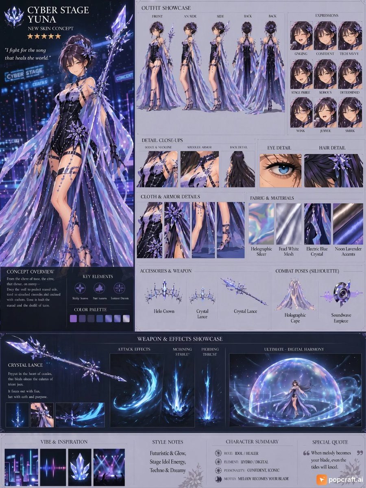

```text
Create a comprehensive character concept sheet for {argument name="character name" default="Cyber Stage Yuna"}, featuring a futuristic idol warrior design. The layout should include: 

1. **Main Portrait**: A full-body illustration of the character in an elaborate cyberpunk stage outfit with holographic elements, crystal accessories, and flowing fabric accents.
2. **Outfit Showcase**: Multiple views (front, side, back) showing different angles of the costume design.
3. **Expression Sheet**: Nine facial expressions including grinning, confident, tech-savvy, stage trouble, serious, determined, wink, joyous, and smirk.
4. **Detail Close-ups**: Sections highlighting boots & neckline, shoulder armor, back detail, eye detail, and hair detail.
5. **Materials & Textures**: Swatches showing holographic silver, pearl white mesh, electric blue crystal, and neon lavender accents.
6. **Accessories & Weapons**: Display of halo crown, crystal lance variations, holographic cape, and soundwave earpiece.
7. **Combat Poses**: Silhouette illustrations showing dynamic action stances.
8. **Weapon Effects**: Attack animations including morning strike, piercing thrust, and ultimate digital harmony effects.
9. **Concept Overview**: Key elements section with color palette swatches and thematic icons.
10. **Style Notes**: Description emphasizing futuristic glow, stage idol energy, techno & dreamy aesthetics.
11. **Character Summary**: Role as idol/healer, element as hydro/digital, personality as confident/iconic.
12. **Special Quote**: "When melody becomes your blade, even the tides will kneel."

The overall aesthetic should blend cyberpunk technology with ethereal fantasy elements, using a color scheme dominated by deep blues, purples, silvers, and glowing accents. Include a five-star rating indicator and maintain professional game art documentation standards throughout.
```

Model: GPT Image 2 · Author: Popcraft AI

[Original source](https://github.com/YouMind-OpenLab/awesome-gpt-image-2/blob/f06c0dd7fdfd593473ebdd932316bc9718d9ec3f/README.md#L2259) · [Provenance and original license](data/projectd-batch-0003.json)

## Quiet vs Abandoned Train Station Comparison

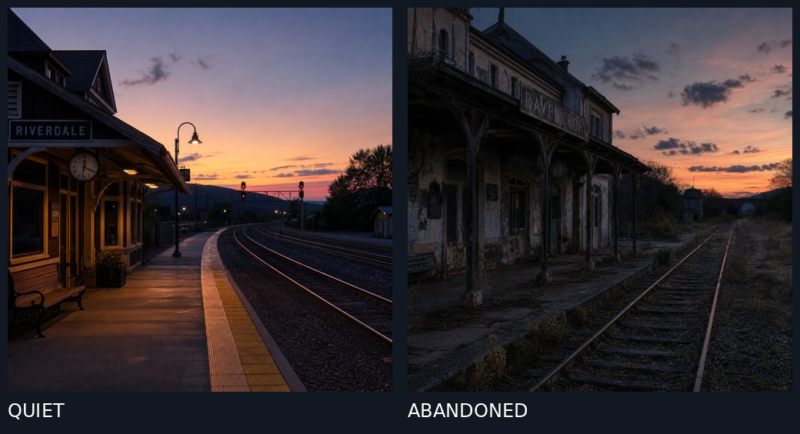

```text
A split-screen comparison of two train station scenes at dusk, separated by a thin vertical line. Left panel: A quiet, well-maintained train station named "RIVERDALE" with warm yellow lighting under the platform canopy, a wooden bench, a round clock on the wall, clean concrete platform with yellow tactile paving edge, curved railway tracks leading into the distance, signal lights glowing red, and a vibrant sunset sky with orange and purple hues over distant hills. Right panel: An abandoned, dilapidated train station named "RAVENSBROOK" with peeling paint, broken windows, overgrown weeds and grass between cracked concrete platforms, rusted railway tracks, weathered wooden support beams, dark and eerie atmosphere, similar sunset sky but more muted and cloudy. Bottom labels: "QUIET" in white text on dark background beneath left image, "ABANDONED" in white text on dark background beneath right image.
```

Model: GPT Image 2 · Author: Human.exe

[Original source](https://github.com/YouMind-OpenLab/awesome-gpt-image-2/blob/f06c0dd7fdfd593473ebdd932316bc9718d9ec3f/README.md#L2308) · [Provenance and original license](data/projectd-batch-0003.json)

## Haiku About Neglected Wine Cellar

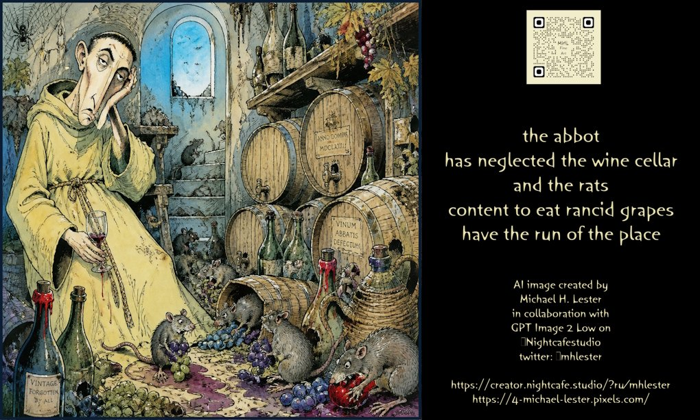

```text
the abbot
has neglected the wine cellar
and the rats
content to eat rancid grapes
have the run of the place
```

Model: GPT Image 2 · Author: Michael H. Lester

[Original source](https://github.com/YouMind-OpenLab/awesome-gpt-image-2/blob/f06c0dd7fdfd593473ebdd932316bc9718d9ec3f/README.md#L2341) · [Provenance and original license](data/projectd-batch-0003.json)

## Chainsaw Man Makima Character Design Sheet — Reference Image Required

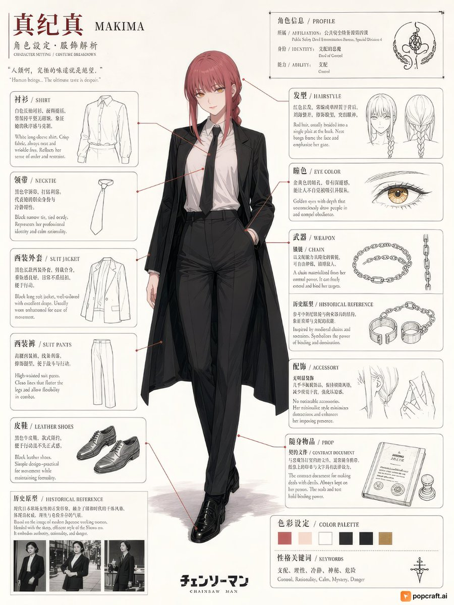

```text
Goal: Create a detailed anime character design sheet for Makima from Chainsaw Man.
Canvas: Vertical layout, clean white background with black text and line art.
Layout: Central full-body illustration of the character. Surrounding panels detail specific costume elements, physical traits, and profile information.
Subject details: Makima stands in the center wearing a long-sleeved white button-down shirt tucked into high-waisted black trousers, a black necktie, and a long black coat draped over her shoulders like a cape. She has red hair braided at the back with bangs framing her face, golden eyes with distinct rings, and black leather shoes. Her expression is calm and composed.
Sections:
- Top Left: Title "Makima" (真纪真) and subtitle "Character Setting / Costume Breakdown".
- Top Right: Profile box listing Affiliation (Public Safety Devil Extermination Bureau), Identity (Divine of Control), and Ability (Control).
- Left Column (Costume Breakdown): Panels for Shirt, Necktie, Suit Jacket, Suit Pants, Leather Shoes, and Historical Reference (showing photos of women in suits).
- Right Column (Physical & Props): Panels for Hairstyle (front/side/back views), Eye Color (close-up of golden eye), Weapon/Chain (illustration of chains), Historical Reference (chains/handcuffs), Accessory (earring/hand gesture), Prop (contract document and stamp), Color Palette (swatches of red, beige, black, gold), and Keywords (Control, Rationality, Calm, Mystery, Danger).
Visual style: High-quality anime illustration mixed with technical fashion sketching. Clean lines, precise shading on clothing folds, and elegant typography.
Text content: Include bilingual labels (English/Japanese) for each section header as seen in the reference image.
```

Model: GPT Image 2 · Author: Popcraft AI

[Original source](https://github.com/YouMind-OpenLab/awesome-gpt-image-2/blob/f06c0dd7fdfd593473ebdd932316bc9718d9ec3f/README.md#L2378) · [Provenance and original license](data/projectd-batch-0003.json)

## Point Nemo Infographic Layout — Unverified Sample Labels

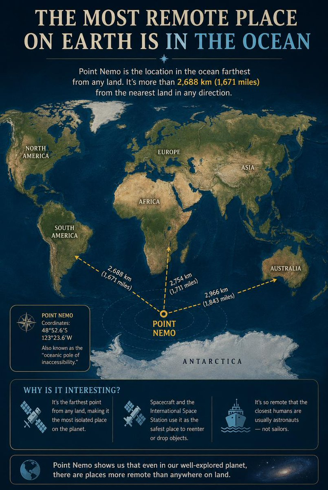

```text
Goal: Create an educational infographic explaining {argument name="topic" default="Point Nemo, the most remote place on Earth located in the ocean"}.

Canvas: Vertical portrait layout with a deep navy blue background and a subtle starry night sky texture at the top. The style is clean, modern, and informative, using gold and white text for high contrast.

Layout:
1. **Header:** Large serif title "THE MOST REMOTE PLACE ON EARTH IS IN THE OCEAN" (with "IN THE OCEAN" highlighted in light blue). Below it, a small introductory paragraph defining Point Nemo as the location farthest from land, mentioning the distance of 2,688 km (1,671 miles).
2. **Central Map:** A stylized world map centered on the South Pacific Ocean. Continents are rendered in muted earth tones (greens, browns) against dark blue oceans. Labels include NORTH AMERICA, SOUTH AMERICA, EUROPE, ASIA, AFRICA, AUSTRALIA, and ANTARCTICA.
3. **Data Visualization:** A bright yellow dot marks "POINT NEMO" in the ocean south of Easter Island. Three dashed yellow arrows radiate from this point to the nearest landmasses, labeled with distances: "2,688 km (1,671 miles)" to Antarctica, "2,754 km (1,711 miles)" to South America, and "2,966 km (1,843 miles)" to Australia.
4. **Info Box (Left):** A rectangular box with a compass icon containing the coordinates "48°52.6'S 123°23.6'W" and the nickname "oceanic pole of inaccessibility."
5. **Bottom Section:** A section titled "WHY IS IT INTERESTING?" with three columns featuring icons and text:
   - Icon: Satellite dish. Text: "It's the farthest point from any land, making it the most isolated place on the planet."
   - Icon: Space station/satellite. Text: "Spacecraft and the International Space Station use it as the safest place to reenter or drop objects."
   - Icon: Ship. Text: "It's so remote that the closest humans are usually astronauts — not sailors."
6. **Footer:** A concluding statement next to a globe icon: "Point Nemo shows us that even in our well-explored planet, there are places more remote than anywhere on land."

Visual Style: Professional infographic design. Use clear sans-serif fonts for body text and serif fonts for headings. Ensure the map projection clearly highlights the isolation of the central point.
```

Model: GPT Image 2 · Author: Generated Atlas

[Original source](https://github.com/YouMind-OpenLab/awesome-gpt-image-2/blob/f06c0dd7fdfd593473ebdd932316bc9718d9ec3f/README.md#L2439) · [Provenance and original license](data/projectd-batch-0003.json)

## Simulated Thermal Camera Image

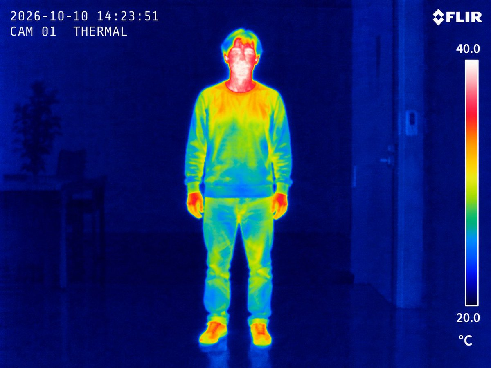

```text
A realistic thermal imaging photograph of a person standing in an indoor environment, captured with a FLIR camera. The subject is wearing a long-sleeved shirt and pants, rendered in the classic rainbow color palette where hot areas (face, hands, feet) appear white/yellow/red and cooler areas (clothing, background) appear blue/purple. In the top left corner, there is digital overlay text reading '2026-10-10 14:23:51' and 'CAM 01 THERMAL'. In the top right corner, the white 'FLIR' logo is visible. On the far right edge, a vertical temperature scale bar ranges from 20.0°C at the bottom to 40.0°C at the top. The background shows a dimly lit room with a plant on the left and a door frame on the right.
```

Model: GPT Image 2 · Author: Super PINTO

[Original source](https://github.com/YouMind-OpenLab/awesome-gpt-image-2/blob/f06c0dd7fdfd593473ebdd932316bc9718d9ec3f/README.md#L2488) · [Provenance and original license](data/projectd-batch-0003.json)

## Tsing Hua Arts Festival — Historical Poster Study

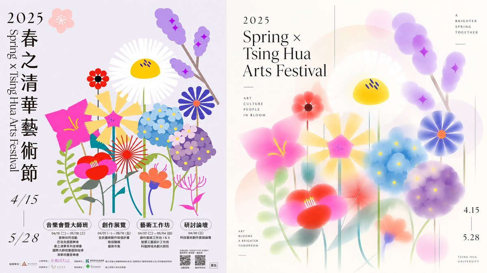

```text
Create a split-screen graphic design poster for the '2025 Spring x Tsing Hua Arts Festival'. The left side features a clean white background with vibrant, flat vector-style illustrations of flowers including a large daisy, pink lilies, blue hydrangeas, and purple lilacs. Vertical Chinese text on the far left reads '2025 春之清華藝術節' alongside English text 'Spring x Tsing Hua Arts Festival'. The bottom left contains four distinct event categories: '音樂會暨大師班', '創作展覽', '藝術工作坊', and '研討論壇', each with specific dates (4/15-5/28) and small QR codes. The right side displays a soft-focus, dreamy version of the same floral arrangement against a warm, hazy cream background. Large serif typography at the top reads '2025 Spring x Tsing Hua Arts Festival', accompanied by smaller text 'ART CULTURE PEOPLE IN BLOOM'. The bottom right shows the dates '4.15 — 5.28' and the logo 'TSING HUA UNIVERSITY'.
```

Model: GPT Image 2 · Author: 小小东

[Original source](https://github.com/YouMind-OpenLab/awesome-gpt-image-2/blob/f06c0dd7fdfd593473ebdd932316bc9718d9ec3f/README.md#L2521) · [Provenance and original license](data/projectd-batch-0003.json)

## Japanese Game Dev Banner

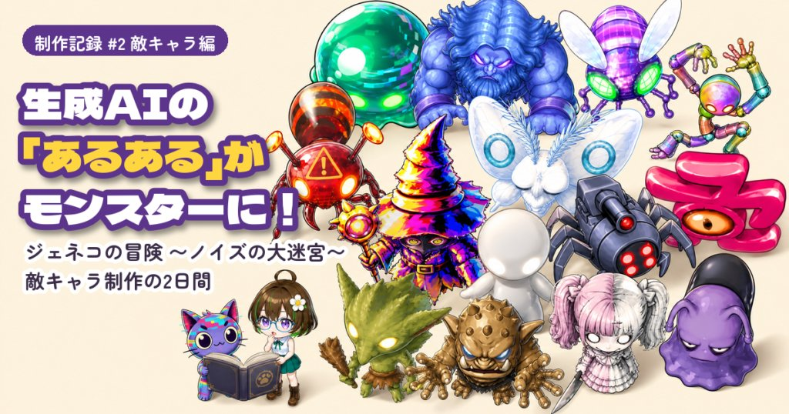

```text
A horizontal banner image with a light beige background. On the left side, there is Japanese text in purple and yellow: '制作記録 #2 敵キャラ編' (Production Record #2 Enemy Character Edition), followed by large bold text '生成AIの「あるある」がモンスターに！' (Generative AI's "Common Occurrences" become monsters!), and smaller text below 'ジェネコの冒険 ～ノイズの大迷宮～ 敵キャラ制作の2日間' (Geneko's Adventure ~ The Labyrinth of Noise ~ Two Days of Enemy Character Creation). To the right of the text, there are two small chibi characters: a girl with brown hair wearing glasses and a school uniform holding an open book, and a blue cat-like creature with pink ears reading over her shoulder. The rest of the image is filled with a collage of various colorful monster designs arranged in rows. Top row includes a shiny green sphere with eyes, a muscular blue furry beast with glowing purple eyes, a purple insectoid robot with green wings, and a multi-limbed robotic figure. Middle section features a red beetle-like creature with warning signs on its shell, a wizard character wearing a rainbow-colored pointed hat and robe holding a staff, a white moth-like creature with blue eye patterns on its wings, a black spider-tank hybrid with red lights, and a pink abstract shape resembling a face or symbol. Bottom row shows a green goblin-like creature with glowing yellow eyes, a brown spiky turtle-like monster, a pale humanoid figure with blank facial features, a split-faced doll character (half pink/half grey) holding a knife, and a purple blob monster with angry eyes.
```

Model: GPT Image 2 · Author: Ryu

[Original source](https://github.com/YouMind-OpenLab/awesome-gpt-image-2/blob/f06c0dd7fdfd593473ebdd932316bc9718d9ec3f/README.md#L2554) · [Provenance and original license](data/projectd-batch-0003.json)

## Colossal MPD Robot in Rainy Tokyo

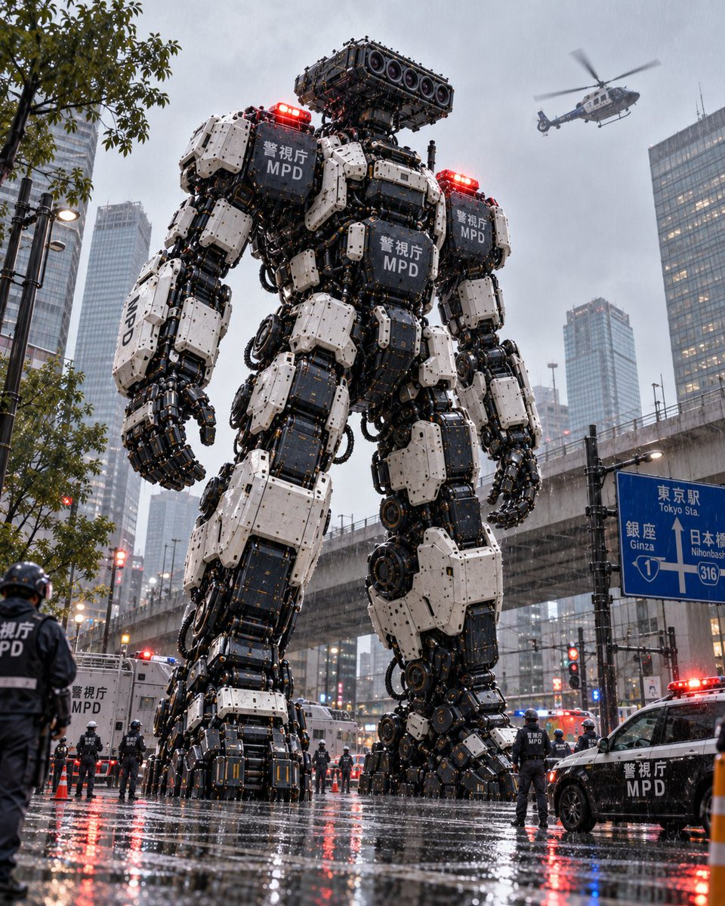

```text
A colossal, bipedal police robot towering over a rainy Tokyo street. The robot is constructed from heavy industrial machinery parts, featuring exposed gears, hydraulic pistons, and thick black cables connecting segmented white armor plates. It has no human face; instead, its head is a rectangular sensor array with multiple camera lenses. Red emergency lights flash on its shoulders and chest. The text "警視庁 MPD" (Metropolitan Police Department) is stenciled in black on the white armor plating of its torso and thighs. In the foreground, wet asphalt reflects the red and blue lights of surrounding police cars and traffic signals. Several small human police officers in dark tactical gear stand near the robot's feet, emphasizing its massive scale. A blue road sign indicating directions to "Tokyo Sta." and "Ginza" is visible on the right. A helicopter hovers in the grey, overcast sky above.
```

Model: GPT Image 2 · Author: カーブミラー

[Original source](https://github.com/YouMind-OpenLab/awesome-gpt-image-2/blob/f06c0dd7fdfd593473ebdd932316bc9718d9ec3f/README.md#L2620) · [Provenance and original license](data/projectd-batch-0003.json)

## Abandoned Road Under Bridge

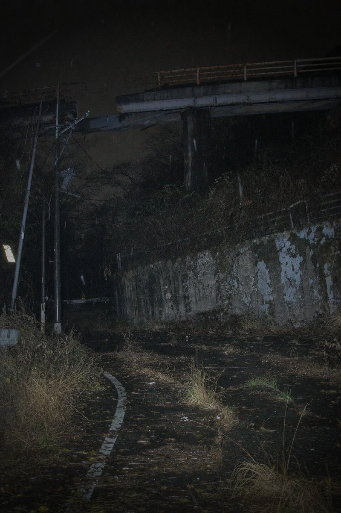

```text
Create a photorealistic image of an abandoned road at night. The scene should be dark and eerie, with the road curving gently into the distance. On the left side, there is a tall metal utility pole with wires extending from it. A concrete retaining wall runs along the right side of the road, covered in patches of moss and overgrown weeds. Above the wall, there is a large concrete bridge structure supported by thick pillars. The ground is wet, reflecting some light, and scattered with dead leaves and debris. Sparse tufts of dry grass grow through cracks in the asphalt. The overall atmosphere is desolate and mysterious, typical of urban decay.
```

Model: GPT Image 2 · Author: Hyogoku Rumi👾国際AIクリエイターアワード2026エントリー！（固定ツイ）❣️

[Original source](https://github.com/YouMind-OpenLab/awesome-gpt-image-2/blob/f06c0dd7fdfd593473ebdd932316bc9718d9ec3f/README.md#L2695) · [Provenance and original license](data/projectd-batch-0003.json)

## Giant Robot Police Officer in Tokyo


```text
A cinematic, photorealistic wide shot of a bustling Tokyo street at dusk. The central subject is a massive, bipedal police robot standing approximately three stories tall. The robot features an industrial design with heavy-duty black mechanical joints and white armored plating. It has a rectangular head unit equipped with multiple camera lenses and red emergency lights on its shoulders. The text "警視庁 MPD" is clearly printed in white on the robot's chest plate and shoulder guards. In the foreground, a drunk Japanese salaryman in a dark suit and loosened tie is stumbling backward while holding a beer can in one hand and taking a selfie with his smartphone in the other. To the right, two human police officers wearing dark uniforms with "警視庁 MPD" on their backs stand near a metal guardrail, looking up at the machine. The background includes warm yellow streetlights, blurred pedestrians, a blue road sign pointing to Nihonbashi, and the illuminated Tokyo Tower rising against a purple and orange twilight sky.
```

Model: GPT Image 2 · Author: カーブミラー

[Original source](https://github.com/YouMind-OpenLab/awesome-gpt-image-2/blob/f06c0dd7fdfd593473ebdd932316bc9718d9ec3f/README.md#L2728) · [Provenance and original license](data/projectd-batch-0003.json)

## Close-up Portrait with Matchstick Light


```text
Create an ultra-realistic, cinematic close-up portrait of a beautiful young woman with long, messy, flowing dark hair, thick eyebrows, long eyelashes, and slightly parted lips. Her eyes are gently closed, with a calm, dreamy, emotional expression. She is holding a lit matchstick near her face with her right hand. The warm orange and golden flame light illuminates one side of her face, nose, lips, neck, and fingers, while the other half remains in deep, soft shadows. Loose strands of hair frame her face naturally. Dark moody atmosphere, dramatic chiaroscuro lighting, realistic skin texture, detailed facial features, artistic photography, warm amber tones, soft shadows, shallow depth of field, fine details, 4K quality, vertical portrait, 9:16 aspect ratio. Preserve natural facial proportions and create an elegant, mysterious aesthetic.
```

Model: GPT Image 2 · Author: Hassan

[Original source](https://github.com/YouMind-OpenLab/awesome-gpt-image-2/blob/f06c0dd7fdfd593473ebdd932316bc9718d9ec3f/README.md#L2761) · [Provenance and original license](data/projectd-batch-0003.json)

## Giant Robot Traffic Control


```text
A cinematic, photorealistic night scene in Tokyo featuring a colossal bipedal police robot towering over a busy intersection. The robot is constructed from heavy-duty black and white mechanical armor plating with exposed hydraulic joints and pistons. Its head consists of a horizontal sensor array with multiple camera lenses instead of a face, and it has glowing red warning lights on its shoulders. The text "警視庁 MPD" (Metropolitan Police Department) is printed in white on the robot's chest, shoulder pads, and legs. The robot is actively directing traffic, with one hand raised high in a stop signal and the other extended to the side. In the foreground, wet asphalt reflects the city lights, where several orange and white traffic cones are placed. A human police officer wearing a dark blue uniform, a white helmet, and a reflective vest with "MPD" on the back stands with his back to the viewer, holding a glowing red baton. To the left, a white Japanese police car with flashing red and blue lights is partially visible. The background features a dense urban skyline with illuminated skyscrapers and the iconic Tokyo Skytree glowing blue against the night sky. Overhead highway signs indicate directions for Ginza, Ueno, and the Shuto Expressway.
```

Model: GPT Image 2 · Author: カーブミラー

[Original source](https://github.com/YouMind-OpenLab/awesome-gpt-image-2/blob/f06c0dd7fdfd593473ebdd932316bc9718d9ec3f/README.md#L2794) · [Provenance and original license](data/projectd-batch-0003.json)

## Cinematic Fried Chicken Food Advertisement


```text
GOLDEN CRUNCH | THE ULTIMATE FOOD CINEMA.

Create an ultra-photorealistic, world-class cinematic food advertisement featuring a beautiful young adult woman with naturally expressive features, soft wavy brunette hair, and a cozy premium beige knit sweater, seated in an elegant, warmly lit modern dining room. Capture the irresistible split-second moment as she brings a perfectly golden, extra-crispy fried chicken drumstick toward her open mouth, her expression filled with genuine excitement and anticipation. In the foreground, a luxurious white ceramic platter overflows with freshly fried chicken pieces featuring exceptionally detailed, rugged crunchy breading, rich golden-amber tones, delicate crisp flakes, and subtle natural oil highlights.

**CINEMATIC EXCELLENCE:** Shot on an ARRI Alexa 65 with an 85mm cinematic portrait lens, shallow depth of field, exquisite focus on the woman's face and hero chicken piece, creamy optical bokeh, sophisticated warm tungsten practical lighting, soft directional key light, delicate rim lighting across her hair, natural skin pores, realistic hands, anatomically correct fingers, lifelike eyes, authentic textures.
```

Model: GPT Image 2 · Author: Aaqib ali

[Original source](https://github.com/YouMind-OpenLab/awesome-gpt-image-2/blob/f06c0dd7fdfd593473ebdd932316bc9718d9ec3f/README.md#L2827) · [Provenance and original license](data/projectd-batch-0003.json)

## Sister of Battle Rising


```text
Her blessed chainsword lies shattered, she is bleeding, surrounded and outnumbered. Yet beneath the burning gaze of Saint Celestine, this Sister of Battle rises with her boltgun roaring and the Emperor's name on her lips.
```

Model: GPT Image 2 · Author: Mainstream Madness

[Original source](https://github.com/YouMind-OpenLab/awesome-gpt-image-2/blob/f06c0dd7fdfd593473ebdd932316bc9718d9ec3f/README.md#L2870) · [Provenance and original license](data/projectd-batch-0003.json)

## Horus Heresy Final Duel Scene


```text
The final duel of the Horus Heresy. Aboard the Vengeful Spirit in orbit above a burning Terra, the Emperor of Mankind faces his favored son, Warmaster Horus, now fully consumed by Chaos.
```

Model: GPT Image 2 · Author: Mainstream Madness

[Original source](https://github.com/YouMind-OpenLab/awesome-gpt-image-2/blob/f06c0dd7fdfd593473ebdd932316bc9718d9ec3f/README.md#L2903) · [Provenance and original license](data/projectd-batch-0003.json)

## Lady Death Fighting Demons


```text
Brian Pulido’s Lady Death (Hope) cutting through several horned demons and lesser fiends.
```

Model: GPT Image 2 · Author: Mainstream Madness

[Original source](https://github.com/YouMind-OpenLab/awesome-gpt-image-2/blob/f06c0dd7fdfd593473ebdd932316bc9718d9ec3f/README.md#L2936) · [Provenance and original license](data/projectd-batch-0003.json)

## Silhouette on Mountain Peak at Cosmic Sunset


```text
A majestic, surreal landscape featuring a lone silhouette of a person standing on a jagged rocky peak in the foreground. The figure has one arm raised triumphantly toward the sky. Above them, the horizon curves dramatically like the edge of a planet, separating a sea of clouds below from an epic sky above. The sky is split into two distinct zones: the upper portion is a deep blue starry night with swirling nebulae and constellations, while the lower band glows with intense golden-orange sunset light, creating a fiery contrast. Below the curved horizon, layers of fluffy white and grey clouds drift among distant mountain ranges, illuminated by the warm glow of the setting sun. The overall atmosphere is awe-inspiring, cinematic, and fantastical, blending elements of space exploration with terrestrial beauty.
```

Model: GPT Image 2 · Author: Zephyra Leigh

[Original source](https://github.com/YouMind-OpenLab/awesome-gpt-image-2/blob/f06c0dd7fdfd593473ebdd932316bc9718d9ec3f/README.md#L2969) · [Provenance and original license](data/projectd-batch-0003.json)

## Realistic Anime Warrior in Medieval Battle


```text
A hyper-realistic, cinematic action shot of a young Japanese female warrior in the midst of a chaotic medieval battle. She has long black hair tied back with two gold hair clips and wears a modified dark blue sailor-style school uniform (seifuku) reinforced with heavy leather armor on her shoulders and arms. Her face is dirty with soot and blood splatters, showing an intense, determined expression as she lunges forward. In the foreground, blurred zombie-like creatures are attacking. The background depicts a burning village with wooden structures, smoke rising into the sky, and other soldiers fighting amidst the chaos. The lighting is dramatic and gritty, emphasizing the realism of the scene.
```

Model: GPT Image 2 · Author: レティシア・ノエル

[Original source](https://github.com/YouMind-OpenLab/awesome-gpt-image-2/blob/f06c0dd7fdfd593473ebdd932316bc9718d9ec3f/README.md#L3020) · [Provenance and original license](data/projectd-batch-0003.json)

## Minecraft Character in Sunflower Field


```text
A hyper-realistic, cinematic close-up shot of a Minecraft-style character standing in a vibrant field of sunflowers during a golden sunset. The character is constructed from blocky voxels, featuring dark skin, a full black beard, and wearing a green cap with a white t-shirt and green pants. He is holding a large, blocky bee gently against his face. Surrounding him are numerous other flying bees with translucent wings, rendered with realistic motion blur and depth of field. In the background, there is a pixelated rainbow arching across an orange sky filled with blocky clouds, a distant tree line, and a small white pickup truck on a dirt road. The lighting is warm and volumetric, creating a nostalgic and peaceful atmosphere.
```

Model: GPT Image 2 · Author: Jxsfly

[Original source](https://github.com/YouMind-OpenLab/awesome-gpt-image-2/blob/f06c0dd7fdfd593473ebdd932316bc9718d9ec3f/README.md#L3053) · [Provenance and original license](data/projectd-batch-0003.json)

## Surreal Cloud Coffee Scene


```text
Create an ultra-realistic, cinematic, photorealistic surreal photograph of a handsome young South Asian man sitting casually on a gigantic fluffy white cloud hundreds of meters above a sprawling modern city, peacefully drinking a cup of coffee while commercial airplanes fly beneath and around him.

The man is in his mid-20s, with thick slightly messy wavy black hair, warm brown skin, expressive deep-brown eyes, and a neatly trimmed beard and mustache. He wears an oversized black technical jacket over a clean white T-shirt, dark wide-leg cargo trousers, futuristic black sneakers, a silver chain, and a black smartwatch. His expression is calm and relaxed, as if sitting on a balcony above the world.

The enormous cloud looks physically realistic—soft, dense, voluminous and detailed, with individual vapor textures and subtle sunlight passing through its edges. The man sits naturally on its surface, one leg slightly hanging over the edge, holding a realistic ceramic coffee cup in one hand.

Far below, a vast modern city stretches toward the horizon with skyscrapers, roads, tiny vehicles, parks and realistic atmospheric haze. Several passenger airplanes fly through the sky at different distances and scales, creating an incredible sense of depth. One airplane passes relatively close beneath the cloud while others appear tiny near the horizon.

Golden-hour sunlight illuminates the scene from the side, creating warm highlights on the man's face, clothing and cloud while casting soft natural shadows. The sky transitions from bright blue near the horizon to deeper blue overhead, with subtle wispy clouds scattered across the atmosphere.

Use an epic wide-angle composition showing the enormous scale difference between the man, cloud, airplanes and city below. Strong foreground-to-background depth, realistic atmospheric perspective, natural reflections, physically accurate lighting, detailed skin texture, realistic fabric fibers, realistic hair strands, cinematic color grading, HDR, subtle film grain, shallow depth of field on the character with the distant city naturally softened.

Photographed like a high-end cinematic editorial campaign, 35mm lens, f/2.8, ultra-detailed, 8K UHD, photorealistic, natural proportions, realistic human anatomy, believable physics, dramatic scale, surreal but completely convincing.

No cartoon appearance, no illustration, no CGI look, no plastic skin, no distorted face, no extra fingers, no duplicate people, no deformed airplanes, no floating objects, no text, no watermark.
```

Model: GPT Image 2 · Author: Harry Potter

[Original source](https://github.com/YouMind-OpenLab/awesome-gpt-image-2/blob/f06c0dd7fdfd593473ebdd932316bc9718d9ec3f/README.md#L3125) · [Provenance and original license](data/projectd-batch-0003.json)

## Cinematic Multi-Door Fantasy Scene Prompt


```text
Ultra-realistic, cinematic 8K HDR, high-fashion editorial photograph of a strikingly handsome young man in his early 20s, with thick naturally wavy jet-black hair, strong masculine eyebrows, intense deep dark-brown eyes, a sharply defined sculpted jawline, subtle natural stubble, and realistic skin texture with visible pores.

CONCEPT & COMPOSITION:

A breathtaking, surreal cinematic scene featuring a handsome young man standing confidently at the center of a gigantic, mysterious hall surrounded by dozens of magnificent doors of different shapes, sizes, materials, and architectural styles. Every door opens into a completely different world, creating a spectacular visual contrast between reality, fantasy, and the unknown.

The young man wears a perfectly tailored black outfit consisting of a luxurious black high-neck shirt, a long elegant black coat, tailored black trousers, and polished black boots. His thick, naturally wavy hair is slightly tousled, and his intense eyes gaze directly toward the camera with a calm, confident, mysterious expression. One hand rests gently on the handle of a partially opened door, as if he is about to step into another dimension.

THE DOORS & THEIR WORLDS:

Surrounding him are dozens of enormous, beautifully detailed doorways, each revealing a unique and breathtaking environment:

🌌 Cosmic Dimension: A glowing galaxy filled with colorful nebulae, distant planets, stars, and swirling cosmic energy.

🏔️ Frozen Kingdom: A magical winter landscape with snow-covered mountains, frozen waterfalls, and gently falling snow.

🔥 Kingdom of Fire: A dramatic volcanic world with flowing rivers of lava, burning skies, and glowing embers.

🌸 Cherry Blossom Paradise: A peaceful Japanese landscape filled with pink cherry blossoms, a traditional Japanese temple, and a beautiful red bridge.

🏰 Dark Fantasy Realm: A mysterious gothic castle surrounded by a dark enchanted forest and a sky illuminated by lightning.

🌆 Cyberpunk Future: A futuristic city with towering skyscrapers, glowing neon signs, flying vehicles, and vibrant blue and purple lights.

🌿 Enchanted Forest: An extraordinary magical forest with gigantic ancient trees, glowing flowers, floating golden particles, and mystical waterfalls.

☁️ Heavenly Dimension: A magnificent world above the clouds featuring golden palaces, radiant sunlight, and endless white clouds.

🏜️ Lost Desert Civilization: An ancient golden city surrounded by desert dunes.
```

Model: GPT Image 2 · Author: HeisenLegacy

[Original source](https://github.com/YouMind-OpenLab/awesome-gpt-image-2/blob/f06c0dd7fdfd593473ebdd932316bc9718d9ec3f/README.md#L3172) · [Provenance and original license](data/projectd-batch-0003.json)

## Steampunk Last Gear Prompt


```text
"The Last Gear"

機械都市は停止した。
私は最後に残った歯車をそっと拾い上げた。

もしこれが噛み合えば、
きっと、この世界は再び動き出すだろう。
⚙️💧✨
```

Model: GPT Image 2 · Author: あいぼりー

[Original source](https://github.com/YouMind-OpenLab/awesome-gpt-image-2/blob/f06c0dd7fdfd593473ebdd932316bc9718d9ec3f/README_ja-JP.md#L3249) · [Provenance and original license](data/projectd-batch-0003.json)

## Giant Police Robot at Night Rescue


```text
A cinematic, photorealistic night scene depicting a massive bipedal police robot standing in the center of a muddy disaster response zone during heavy rain. The giant robot is white and black with industrial paneling, featuring red emergency lights on its shoulders and head, and markings that read "警視庁 MPD" (Metropolitan Police Department) on its chest and arms. Its head consists of multiple camera lenses arranged horizontally. Surrounding the robot's feet are numerous first responders: police officers in dark uniforms with "MPD" on their backs, firefighters in orange gear, and paramedics in blue vests with Japanese text. To the left is a mobile command unit truck displaying screens with data maps. In the background, there is a large pile of rubble or debris illuminated by floodlights, with excavators visible atop the mound. Several drones hover in the sky, casting bright spotlights down onto the wet ground. The atmosphere is tense and high-tech, with reflections on the wet pavement and rain streaks visible against the dark sky.
```

Model: GPT Image 2 · Author: カーブミラー

[Original source](https://github.com/YouMind-OpenLab/awesome-gpt-image-2/blob/f06c0dd7fdfd593473ebdd932316bc9718d9ec3f/README.md#L3273) · [Provenance and original license](data/projectd-batch-0003.json)

## Summoning Magic Comedy Prompt — Reference Image Required


```text
添付画像のキャラクターが、壮大な召喚儀式によって思いもよらないものを呼び出してしまうコミカルなシーンを描いてください。

[キャラクター]
顔立ち、髪型、基本となる配色、性格的特徴はそのまま維持してください。表情やポーズは、このシーンに合わせて変更します。

[召喚されたもの]
具体例や候補は提示せず、今回のためにまったく新しいものを考えてください。壮大な儀式との強烈なギャップを生み出し、絵を見ただけで何が出現したのか一目でわかり、「なぜそれを召喚した？」とツッコミたくなるようなものにします。キャラクターの外見や衣装に直接関連するものだけに限定せず、意外性のある組み合わせを取り入れてください。

[シーンの構成]
召喚されるもの、そのサイズや状態、キャラクターのリアクション、周囲への影響を、それぞれ別の視点から決めていきます。その後、それらを 1 つのわかりやすい出来事としてつなぎ合わせます。キャラクターのリアクションを単なる「驚き」に固定せず、表情や動きを通じて召喚されたものとの関係性が伝わるようにしてください。

[演出]
儀式の演出は本格的かつ壮大なものにし、出現したものとの温度差を利用してユーモアを生み出します。メインのオチは 1 つに絞り、それを引き立てるための小道具やサブキャラクターを配置してください。テキストによる説明には頼らず、キャラクター・召喚されたもの・リアクションが一目で読み取れる構図にします。なお、この会話内で同じプロジェクトの画像がすでに生成されている場合は、そこで使用したものやオチを再利用せず、別の方向性で制作してください。
```

Model: GPT Image 2 · Author: むぎ@AIアートのセカイ

[Original source](https://github.com/YouMind-OpenLab/awesome-gpt-image-2/blob/f06c0dd7fdfd593473ebdd932316bc9718d9ec3f/README_ja-JP.md#L3322) · [Provenance and original license](data/projectd-batch-0003.json)

## Smug Character Sitting and Pointing — Reference Image Required


```text
Using the provided reference image, regenerate the character in a new pose and context. Keep the character's appearance (pink hair, glasses, cap, hi-vis vest) unchanged.

**Transformation Instructions:**
1. **Pose & Expression:** Change the character from standing to sitting casually in an office chair with legs crossed. Update her expression from angry/shouting to a smug, confident smirk. She is now pointing directly at the viewer with one hand while holding a can up in the other.
2. **Dialogue:** Replace the original speech bubble text with "SKILL ISSUE." in bold, black capital letters.
3. **Props & Details:** 
   - Swap the "Steel Reserve" can for a generic white "Lite" beer can.
   - Add red wired earphones hanging from her ears.
   - Place a small grey cat plushie on her chest/vest area.
4. **Background Changes:** 
   - Modify the poster on the left wall to feature a simple line-drawing of a cat face with X eyes above the text "SAME SHIT DIFFERENT DAY".
   - Add a new poster on the right wall that reads "CANS CATS PLANES ETC.".
   - Include a mug on the desk that says "BAD PLANS TODAY".
```

Model: GPT Image 2 · Author: Flutterwhat

[Original source](https://github.com/YouMind-OpenLab/awesome-gpt-image-2/blob/f06c0dd7fdfd593473ebdd932316bc9718d9ec3f/README.md#L3355) · [Provenance and original license](data/projectd-batch-0003.json)

## Wanted Poster Character Prompt — Reference Image Required


```text
添付画像のキャラクター [名前: {argument name="character_name" default="Unknown"}] を、「たぶん無実なのに、なぜか不思議な罪で連行されている」ようなコミカルな指名手配風・逮捕風のビジュアルにしてください。

容疑はランダムに決めてください。内容は軽妙で楽しく、ユーモアたっぷりに仕上げてください。

構図は、身長計の前に立っているポーズか、軽く取り押さえられている瞬間にしてください。さらに、周囲には「証拠品」として奇妙な小物を配置してください。2 カット（正面と横顔）でも、1 枚の画像でも構いません。実在する警察や国のマークは使用せず、完全にフィクションのユーモアにとどめてください。後から容疑を書き込めるよう余白を残しておいてください。
```

Model: GPT Image 2 · Author: むぎ@AIアートのセカイ

[Original source](https://github.com/YouMind-OpenLab/awesome-gpt-image-2/blob/f06c0dd7fdfd593473ebdd932316bc9718d9ec3f/README_ja-JP.md#L3412) · [Provenance and original license](data/projectd-batch-0003.json)

## Anime Girl Pitching Baseball


```text
A vertical webtoon-style illustration of a female anime character pitching a baseball. The character has long silver hair, cat ears, and purple eyes. She wears an orange baseball cap with a logo, a white jersey with 'SynClub' written on it, white pants with orange stripes, and a black glove. Her right hand is extended forward, releasing a glowing baseball surrounded by swirling purple energy and dark fox-like spirits. In the background, there's a stadium filled with spectators under a blue sky with clouds. On the left side, there are three smaller panels: one showing her face in shock, another showing her full body from a distance, and a third showing a close-up of the purple energy. At the top right, there's a speech bubble with Japanese text. At the bottom, large stylized Japanese text reads '狐火トルネード・タイプ3'. The overall style is dynamic and energetic, typical of sports manga.
```

Model: GPT Image 2 · Author: レティシア・ノエル

[Original source](https://github.com/YouMind-OpenLab/awesome-gpt-image-2/blob/f06c0dd7fdfd593473ebdd932316bc9718d9ec3f/README.md#L3450) · [Provenance and original license](data/projectd-batch-0003.json)

## Debonair Man with Bowling Gear Prompt


```text
a man appears
wearing a brown trench coat
looking debonair
despite his green bowling ball
and multi-colored bowling shoes
```

Model: GPT Image 2 · Author: Michael H. Lester

[Original source](https://github.com/YouMind-OpenLab/awesome-gpt-image-2/blob/f06c0dd7fdfd593473ebdd932316bc9718d9ec3f/README.md#L3483) · [Provenance and original license](data/projectd-batch-0003.json)

## Wireless Doorbell Camera Instructions Prompt


```text
packages arrive…
a wireless doorbell camera
with instructions
which would be confusing
if they weren’t too small to read
```

Model: GPT Image 2 · Author: Michael H. Lester

[Original source](https://github.com/YouMind-OpenLab/awesome-gpt-image-2/blob/f06c0dd7fdfd593473ebdd932316bc9718d9ec3f/README.md#L3520) · [Provenance and original license](data/projectd-batch-0003.json)

## Cute Penguin Girl Comic Strip


```text
A four-panel vertical comic strip featuring a cute chibi girl character wearing a fluffy black penguin costume with a large pink satin bow tie. The art style is hyper-realistic 3D render (Pixar/Blender style) with soft lighting and shallow depth of field.

Panel 1: Medium shot of the girl walking on a sunny park path, smiling happily. Speech bubble text: "いい天気だな〜♪" (Nice weather~).
Panel 2: Rear view of the girl looking at a silver metal trash can in the grass. Speech bubble text: "……あれ？なんだろう" (...Huh? What's that?).
Panel 3: Extreme close-up of the girl's face with wide blue eyes and an open mouth, looking surprised. Speech bubble text: "おっきい！" (It's big!).
Panel 4: Side view of the girl sniffing the trash can curiously. The can has a label reading "一斗缶 18L". Speech bubble text: "くんくん…" (Sniff sniff...).
```

Model: GPT Image 2 · Author: ぐはぁ

[Original source](https://github.com/YouMind-OpenLab/awesome-gpt-image-2/blob/f06c0dd7fdfd593473ebdd932316bc9718d9ec3f/README.md#L3557) · [Provenance and original license](data/projectd-batch-0003.json)

## Mad Crow Popping Yellow Balloon


```text
A whimsical, hand-drawn illustration in a storybook style depicts a chaotic scene on a telephone wire. On the left, a large, frantic black crow with wide, bulging eyes and an open beak is perched on the wire, its wings spread in agitation. To the right of the crow, a bright yellow balloon is caught on the wire and has just burst, with jagged yellow shards flying outward in all directions against a backdrop of fluffy white clouds and blue sky. Below the wire, the tops of several European-style rooftops are visible, featuring red tiles and chimneys. The artwork uses textured lines and watercolor-like shading.
```

Model: GPT Image 2 · Author: Michael H. Lester

[Original source](https://github.com/YouMind-OpenLab/awesome-gpt-image-2/blob/f06c0dd7fdfd593473ebdd932316bc9718d9ec3f/README.md#L3613) · [Provenance and original license](data/projectd-batch-0003.json)

## Neo-Naive Style Character Fight Illustration Prompt


```text
[角色 A] 和 [角色 B]，新天真绘画 × 局外人艺术 × 原始具象绘画 × 儿童绘画风格的角色转译。

两个角色由少量不规则的几何色块构成，仅保留其最强烈的身份标识：主色调、头部轮廓、发型或耳朵、眼睛、代表性服装色块、标志性配饰。

两人正在激烈但滑稽地打斗，身体紧贴并纠缠在一起。根据角色随机设计动作，如抓脸、推头、拥抱、拉扯、扇耳光、压制或互相扑倒；手部接触清晰，肢体交叉，重心失衡，使打斗关系一目了然。

幼稚且不准确的人体解剖结构：细长的躯干，僵硬笔直的四肢，比例失调，头部倾斜，夸张的手脚，错误的透视。面部特征压缩成几个粗糙的色块，表情愤怒、震惊、龇牙咧嘴、尖叫或委屈，具有荒诞的喜剧感。

粗糙的不透明颜料平涂，干笔痕迹，边缘磨损，填充不均，颤抖的手绘轮廓，局部底色暴露；身体和服装直接以平涂色块表现。

暖灰白色或米白色纸张背景，大面积留白。两个角色位于中心，相互纠缠形成紧凑的动作团，画面专注于表达角色之间的关系。

就像一个未经训练的人凭记忆快速画出的打斗瞬间：原始、笨拙、直接、荒诞、可爱。

竖版格式，右下角有极小的 "voxcat" 签名。
```

Model: GPT Image 2 · Author: VoxCat

[Original source](https://github.com/YouMind-OpenLab/awesome-gpt-image-2/blob/f06c0dd7fdfd593473ebdd932316bc9718d9ec3f/README_zh.md#L3644) · [Provenance and original license](data/projectd-batch-0003.json)

## Opus 5.5 vs Wife GPT Comic Strip


```text
Goal: Create a vertical 3-panel comic strip in an anime style, titled "Thoughts After Experiencing Opus 5.5".

Canvas: Vertical layout with three distinct panels stacked on top of each other.

Panel 1 (Top):
- Subject: A young man with messy black hair and starry eyes looks excitedly at a cheerful girl with long orange hair wearing a sunflower-themed dress.
- Text Bubble (Man): "After experiencing Opus 5.5... Wow... so charming....!!"
- Info Box (Right): A yellow decorative box labeled "Claude:" containing the text "Youthful and smart, making life colorful!".
- Background: Bright, sunny field of sunflowers.

Panel 2 (Middle):
- Subject: The same man is now hiding his face in his hands, sweating nervously. Beside him stands an elegant woman with long white hair, horns, and a cold expression.
- Text Bubble (Man): "Oh no, this feels like cheating... Lost the passion of newlyweds..."
- Info Box (Left): A purple decorative box labeled "Wife GPT:" containing the text "Still beautiful and elegant, but a bit cold.".
- Background: Darker, indoor setting with blue curtains.

Panel 3 (Bottom):
- Subject: A scene at a train station platform. The man is peeking around a pillar, blushing, next to the orange-haired girl (Claude). In the background, the white-haired woman (Wife GPT) stands watching them from a distance near a train.
- Signage: A blue sign hanging above reads "Transfer Station ->".
- Text Bubble (Left): "Strict rules at home, can only meet secretly at the transfer station! Keep it down..."
- Text Bubble (Right): "I know everything... watching quietly."

Visual Style: Clean digital illustration, vibrant colors for the first panel, muted tones for the second, realistic lighting for the third.
```

Model: GPT Image 2 · Author: John PJ

[Original source](https://github.com/YouMind-OpenLab/awesome-gpt-image-2/blob/f06c0dd7fdfd593473ebdd932316bc9718d9ec3f/README.md#L3711) · [Provenance and original license](data/projectd-batch-0003.json)

## Manga Infographic: AI Prompt Engineering


```text
A vertical, highly detailed manga-style infographic page with a parchment-like background. The layout is divided into three main sections: a top illustration area, a middle diagrammatic breakdown, and a bottom text-heavy conclusion.

Top Section:
- A large, ethereal illustration of a woman with long white hair and fox ears (a kitsune) standing on a mountain peak at sunset. She wears flowing white robes.
- Below her, an elderly man with long black hair tied back, wearing dark blue traditional Chinese robes, sits cross-legged holding a calligraphy brush, looking up thoughtfully.
- To his right, a younger man in grey robes kneels, sketching the kitsune onto paper.
- Surrounding this scene are blocks of Japanese text explaining the concept of 'Prompt' (プロンプト). 
- On the left side, there are four small square character portraits labeled with descriptions like 'Beautiful Woman', 'Dancer', etc., showing variations of female characters.
- Large vertical Japanese text on the right reads 'Introduction to Prompts'.

Middle Section:
- A horizontal flow diagram titled 'Verbalizing features to compose a picture'.
- It shows a sequence of six small square images connected by plus signs (+), leading to an equals sign (=) and a final result image.
- The sequence includes: 1. Long silver hair, 2. Blue eyes, 3. White clothes, 4. Mountain sunset, 5. Looking back pose, 6. Soft backlighting.
- The final result is the complete image of the kitsune from the top section.

Bottom Section:
- A large, bold Japanese headline in red and black ink style: "Listing hundreds of words loses one stroke" (百語を並べて一画を失う).
- Surrounding the headline are torn pieces of paper with handwritten notes listing negative effects of over-prompting, such as '8K resolution', 'ultra-high quality', 'complex composition', 'unnatural lighting', 'film-like lighting', 'large scale', 'highest quality'.
- At the very bottom, a concluding sentence in a box states that words are tools, but too many obscure the essence of the single stroke.
```

Model: GPT Image 2 · Author: レティシア・ノエル

[Original source](https://github.com/YouMind-OpenLab/awesome-gpt-image-2/blob/f06c0dd7fdfd593473ebdd932316bc9718d9ec3f/README.md#L3766) · [Provenance and original license](data/projectd-batch-0003.json)

## Chun-Li Kicks Giant Monster


```text
A high-resolution digital illustration in a vibrant, comic-book style depicting a chaotic street fight. The scene features Chun-Li from Street Fighter on the right side, wearing her iconic blue qipao with gold trim and white boots, executing a powerful high kick that connects directly with the torso of a massive green-skinned monster. The monster resembles Blanka but is significantly larger and more muscular, with wild red hair, sharp claws, and glowing eyes, roaring in pain as it absorbs the impact. In the foreground, lying defeated on the rubble-strewn ground, is Ryu from Street Fighter, wearing his torn white gi, appearing battered and unconscious. The background shows a gritty urban alleyway with brick buildings, fire escapes, and overflowing trash cans under a dramatic, fiery orange and purple sky. Debris and dust explode outward from the point of impact.
```

Model: GPT Image 2 · Author: LANDCÄSTER.EXE

[Original source](https://github.com/YouMind-OpenLab/awesome-gpt-image-2/blob/f06c0dd7fdfd593473ebdd932316bc9718d9ec3f/README.md#L3818) · [Provenance and original license](data/projectd-batch-0003.json)

## Hand-Drawn Fashion Illustration Transformation — Reference Image Required


```text
Transform the uploaded photo into a charming hand-drawn fashion illustration while preserving the original scene and composition.

Keep the same people, number of people, pose, body positioning, facial expressions, clothing, accessories, hairstyles, objects, drinks, and overall framing from the reference photo. Do not add or remove important elements.

Convert the realistic photograph into a minimal Japanese/Korean-inspired lifestyle sketch illustration, using loose but confident dark green ink linework with subtle hand-drawn imperfections. Simplify facial features while keeping each person’s recognizable hairstyle, glasses, headphones, clothing silhouette, and pose.

Use a soft pastel pink background with the illustration drawn primarily in deep forest-green ink. Replace realistic textures, shadows, vehicles, buildings, pavement, and surroundings with simplified expressive linework and selective cross-hatching. Keep enough environmental details to make the original location and composition recognizable.

Style: cute editorial illustration, Japanese stationery aesthetic, fashion sketch, casual slice-of-life manga drawing, imperfect pen strokes, clean negative space, minimal detailing, subtle vintage feel, handmade appearance.

Color treatment: predominantly pastel pink background + dark green line art, with very minimal secondary tones if needed. No photorealism, no 3D rendering, no glossy digital painting.

Important: preserve the original image’s composition, perspective, camera angle, poses, proportions, clothing, accessories, and key objects. The result should look like the exact photograph was redrawn by an illustrator, rather than redesigned into a different scene.

Output: clean vertical illustration, aesthetically balanced, high-resolution, polished hand-drawn finish.

Short version for image models:

Turn this photo into a cute hand-drawn Japanese lifestyle/fashion sketch. Preserve the exact people, poses, expressions, clothing, hairstyles, accessories, drinks, composition, camera angle and important background elements. Redraw everything with loose imperfect dark forest-green ink linework on a soft pastel pink background, using minimal cross-hatching and simplified details. Charming editorial stationery aesthetic, casual manga-inspired illustration, handmade pen texture, clean negative space, elegant and whimsical. Do not change the composition or add/remove subjects; make it look like the original photo was directly illustrated by hand.
```

Model: GPT Image 2 · Author: Sairah

[Original source](https://github.com/YouMind-OpenLab/awesome-gpt-image-2/blob/f06c0dd7fdfd593473ebdd932316bc9718d9ec3f/README.md#L3923) · [Provenance and original license](data/projectd-batch-0003.json)

## Paper Cutout Illustration Prompt — Reference Image Required


```text
Upload one reference image before generating.

MAIN PROMPT
Transform the uploaded image into a soft handcrafted paper-cut layered illustration while preserving the original composition, subject placement, pose, proportions, perspective, and recognizable features.

FORMAT LOCK
Vertical 3:4 composition. Preserve the original framing, camera angle, crop, and overall visual hierarchy.

STYLE
Soft papercraft diorama aesthetic with smooth rounded shapes, simplified cute proportions, minimal facial details, dot eyes, soft blush cheeks, and a warm storybook character design. Recreate the entire scene using stacked paper layers with visible dimensional depth, subtle shadows between layers, and clean cut edges resembling carefully crafted cardstock.

CHARACTER DESIGN
Keep the main characters recognizable while simplifying their forms into charming paper-cut figures. Add a distinct thick white outer paper layer around each main character, creating a clean sticker-like cut-paper border that physically separates them from the background. The white border must look like an intentional cardstock layer, not a glow or lighting effect.

PAPER MATERIAL
Use matte tactile materials resembling thick art paper or craft foam. Show subtle paper grain, layered edges, slight thickness, clean cuts, tiny handmade imperfections, and realistic contact shadows between overlapping layers.

COLOR PALETTE
Soft pastel colors with muted blues, gentle greens, warm neutrals, cream, and subtle complementary accents. Keep the palette balanced, calming, cozy, and harmonious.

LIGHTING
Soft diffused even lighting. Gentle ambient illumination. Subtle layer shadows. No harsh contrast. Enhance the physical depth of the paper layers while maintaining a soft handcrafted atmosphere.

COMPOSITION
Preserve the original scene structure and visual hierarchy. Keep characters, objects, and important environmental elements in their original positions while translating everything into the same paper-cut visual language. Maintain clear separation between foreground, midground, and background.

OUTPUT STYLE
Cozy handcrafted papercraft diorama. Modern children’s-book illustration. Decorative paper-cut artwork. Warm storybook aesthetic. Wholesome, gentle, playful, polished, tactile, and premium.

NEGATIVE PROMPT
Avoid photorealism, CGI, glossy surfaces, plastic appearance, neon colors, harsh lighting, excessive detail, realistic facial rendering, floating characters, glowing white outlines, flat digital illustration, messy edges, excessive shadows, distorted anatomy, changed composition, text, logos, watermarks, or low-quality rendering.
```

Model: GPT Image 2 · Author: Visual AI Club

[Original source](https://github.com/YouMind-OpenLab/awesome-gpt-image-2/blob/f06c0dd7fdfd593473ebdd932316bc9718d9ec3f/README.md#L3974) · [Provenance and original license](data/projectd-batch-0003.json)

## Aerial Steampunk Workshop Transformation — Reference Image Required


```text
Using the provided reference image, transform the portrait into a highly detailed, top-down aerial view of the subjects working in a cluttered steampunk inventor's workshop. Preserve the exact facial features and clothing colors of the three individuals (the man in the white t-shirt, the older woman in cream, and the younger woman in a sleeveless cream dress) while repositioning them around a large wooden table. Populate the table with aged parchment blueprints featuring technical sketches of an ornate machine, scattered brass gears, precision drafting tools, and a magnifying glass. The scene should be illuminated by a warm, glowing hanging light bulb from above. Apply a vibrant watercolor splash effect to the outer edges of the composition, blending colorful pigments like red, blue, and yellow into a textured paper background.
```

Model: GPT Image 2 · Author: Tiyashi

[Original source](https://github.com/YouMind-OpenLab/awesome-gpt-image-2/blob/f06c0dd7fdfd593473ebdd932316bc9718d9ec3f/README.md#L4055) · [Provenance and original license](data/projectd-batch-0003.json)

## Fantasy Cartographer & Dog — Reference Image Required


```text
Using the provided reference image, transform the subject and their dog into a high-fantasy 'Ancient Map' illustration. Keep the character's specific outfit—the green cap, face covering, orange and black patterned jersey, and blue jeans—along with the fluffy white dog, but place them in a candlelit medieval study. The man should be leaning over a large, weathered parchment map on a wooden table, holding a quill pen as if charting a course, while the dog sits beside him looking up. Surround the scene with stacks of old leather-bound books, brass compasses, and lit candles. Add decorative ink-drawn borders featuring dragons, sailing ships, and castles to frame the composition. Use warm, golden lighting and an aged paper texture.
```

Model: GPT Image 2 · Author: boB

[Original source](https://github.com/YouMind-OpenLab/awesome-gpt-image-2/blob/f06c0dd7fdfd593473ebdd932316bc9718d9ec3f/README.md#L4088) · [Provenance and original license](data/projectd-batch-0003.json)

## Vintage Editorial Portrait Collage


```text
Create a cinematic 2×2 editorial portrait collage of the same fictional young male model, with consistent facial features and hairstyle across all four panels. He has neatly styled dark side-parted hair, sharp masculine features, clean-shaven face, and a serious, thoughtful expression. Moody {argument name="era" default="1970s-inspired"} corporate fashion photography, {argument name="background color" default="teal-blue"} studio background, dramatic directional lighting, subtle film grain, deep shadows, muted colors, realistic skin texture, high-end fashion editorial aesthetic.
Top-left: close-up portrait, wearing a {argument name="suit color" default="dark forest-green"} tailored suit, white dress shirt and burgundy tie, adjusting his tie with one hand, vintage wristwatch visible.
Top-right: seated on a wooden chair, leaning forward thoughtfully with one hand near his chin, wearing the same green suit, white shirt and burgundy tie, black trousers, wristwatch visible.
Bottom-left: standing confidently with the green suit jacket draped over one shoulder, sleeves rolled up, white shirt and burgundy tie, vintage film camera hanging around his neck, black trousers.
Bottom-right: standing in the white shirt and burgundy tie with sleeves rolled up, green suit jacket over one arm, one hand running through his hair, contemplative expression.
Symmetrical 2×2 grid layout, thin white dividers between panels, consistent character identity, realistic photography, 50mm lens look, shallow depth of field, cinematic lighting, subtle analog film texture, sophisticated vintage atmosphere, ultra-detailed, photorealistic, 4K.
```

Model: GPT Image 2 · Author: Aijaz

[Original source](https://github.com/YouMind-OpenLab/awesome-gpt-image-2/blob/f06c0dd7fdfd593473ebdd932316bc9718d9ec3f/README.md#L4121) · [Provenance and original license](data/projectd-batch-0003.json)

## Transparent Rose Court Lady


```text
Create a delicate anime-style portrait illustration of {argument name="character name" default="Nozomu"}, a refined young court lady in a luminous palace setting. She sits beside a tall arched window in a romantic cathedral-like royal room, leaning her cheek lightly on one hand while gazing upward with a soft, dreamy expression. Use a vertical 4:5 composition, close to mid-full body, with the camera slightly above her knees and focused on her face, flowing hair, and ornate clothing. She has long wavy {argument name="hair color" default="ash beige blonde"} hair with airy bangs and loose strands drifting in the light, large sparkling {argument name="eye color" default="rose pink"} eyes, pale translucent skin, faint blush, and a gentle melancholic morning mood. Dress her in a transparent court-inspired outfit rather than a conventional princess gown: soft rose and ivory layered sheer fabrics, slim refined silhouette, fluttering capelet-like shoulder panels, translucent sleeves, lace cuffs, high ruffled collar, antique-gold embroidery, delicate chains, small filigree ornaments, pink gemstone brooches, and narrow ribbon accents. Add exactly 6 prominent accessory elements: one large dusty-rose bow in her hair, one ornate floral gold-and-pink gemstone hairpiece, one dangling jeweled earring, one central pink gemstone collar brooch, one antique-gold waist ornament, and one small ivory envelope or card with a wax-seal-like gold medallion in her hand. The background should show tall white stone arches, carved columns, soft rose curtains, a bright window view with a pale pink sky and distant gothic spires, plus floating cherry-blossom-like petals and glittering dust motes. Lighting is warm sunrise backlight with pearly transparency, soft bloom, pastel rose tones, ivory highlights, subtle antique gold, fine linework, intricate textile details, luminous watercolor rendering, elegant shoujo fantasy atmosphere. Avoid a tiara, gloves, puff sleeves, bell-shaped ball gown, captive-princess costume, modern clothing, heavy armor, dark colors, harsh shadows, or readable text.
```

Model: GPT Image 2 · Author: のぞむ＊AIイラスト

[Original source](https://github.com/YouMind-OpenLab/awesome-gpt-image-2/blob/f06c0dd7fdfd593473ebdd932316bc9718d9ec3f/README.md#L4160) · [Provenance and original license](data/projectd-batch-0003.json)

## Pink Cannon and Flying Rabbit — Two-Recipe Pack (Cannon Preview)


```text
Create a surreal, cinematic fashion photograph of a stylish blonde woman wearing a pastel-pink floral mini dress, pink knee-high boots, and futuristic protective glasses, confidently walking while holding an oversized pink sci-fi cannon decorated with roses. The cannon fires a dramatic burst of flames and smoke into the distance. Set the scene in a dreamy pink suburban neighborhood with a vintage pink car, a pastel-pink house, dusty streets, and dramatic smoky skies. Use soft pastel colors, retro-futuristic aesthetics, realistic textures, cinematic lighting, a wide-angle composition, and high-end editorial photography. Dreamlike yet photorealistic, ultra-detailed, 8K quality.

Create a whimsical, photorealistic fantasy scene of an elegant young woman wearing a pastel rainbow layered tulle gown, a cream corset, and a tiny vintage top hat, riding a gigantic fluffy white rabbit flying gracefully above rolling countryside hills. The rabbit has long upright ears, soft detailed fur, and a delicate leather harness. Below them are golden fields, distant forests, and misty mountains beneath a dreamy blue sky filled with soft clouds. Capture the magical movement of the rabbit in midair, flowing fabric, warm golden-hour sunlight, cinematic depth of field, realistic textures, fairytale atmosphere, and luxurious fashion editorial styling. Ultra-detailed, enchanting, 8K photorealism.
```

Model: GPT Image 2 · Author: Taaruk

[Original source](https://github.com/YouMind-OpenLab/awesome-gpt-image-2/blob/f06c0dd7fdfd593473ebdd932316bc9718d9ec3f/README.md#L4200) · [Provenance and original license](data/projectd-batch-0003.json)

## Cinematic Portrait with Dramatic Lighting


```text
Create an ultra-realistic, high-detail cinematic portrait of a beautiful young adult woman with warm glowing skin, expressive hazel-brown eyes, natural freckles, soft glossy lips, and dark brown hair styled in a messy elegant bun with loose strands framing her face. She is wearing a luxurious black textured off-shoulder dress with delicate spaghetti straps and flowing sheer fabric draped around her arms. Her body is turned slightly sideways while her face looks directly at the camera with a confident, mysterious expression.

Dramatic cinematic lighting with warm golden-orange highlights illuminating one side of her face and cool smoky blue-gray light on the other side. Dark atmospheric background with swirling amber smoke, subtle mist, and artistic depth. Intricate fabric details, realistic skin texture, individual hair strands, natural facial proportions, professional fashion editorial photography, shallow depth of field, 85mm portrait lens, HDR, ultra-sharp focus, rich contrast, photorealistic, 8K quality, vertical 4:5 composition.

Negative Prompt: blurry image, low resolution, plastic skin, excessive retouching, distorted face, asymmetrical eyes, extra fingers, deformed hands, unnatural body proportions, oversaturated colors, cartoon, anime, watermark, text, logo.
```

Model: GPT Image 2 · Author: Hassan

[Original source](https://github.com/YouMind-OpenLab/awesome-gpt-image-2/blob/f06c0dd7fdfd593473ebdd932316bc9718d9ec3f/README.md#L4241) · [Provenance and original license](data/projectd-batch-0003.json)

## Zombie Style One-Piece Dress


```text
ハロウィンのゾンビ風ワンピースドレスを着た女の子。

コスチュームはエクリュカラーのオフショルダーミニドレス。肩、ウエスト、スカートの数か所に、意図的に破いたようなスリットや丸まった布端があります。

破れた部分からは、下に着ているライトパープルの生地が覗いています。

破れ目の縁には細い黒のステッチ。

首元には小さめの包帯風リボン（清潔な状態）。

頭には帽子を被っていません。

カラーはエクリュ、ライトパープル、ブラック、ナイトインディゴ。汚れや血糊はなし。

破れデザインがはっきりと分かる全身ショット。少し困ったような可愛い表情。
```

Model: GPT Image 2 · Author: のぞむ＊AIイラスト

[Original source](https://github.com/YouMind-OpenLab/awesome-gpt-image-2/blob/f06c0dd7fdfd593473ebdd932316bc9718d9ec3f/README_ja-JP.md#L4279) · [Provenance and original license](data/projectd-batch-0003.json)

## Oriental Tea Commercial Poster Design


```text
输出一张 4:5 竖版商业海报，不要拼贴，不要多宫格。使用原创虚构品牌，不得模仿现有品牌的包装、标志或广告。文字仅限提示词中明确列出的品牌名、主标题和品类；不得添加价格、奖项、参数、日期、产地或宣传语。画面完成度须达到可供创意总监审核的标准：结构写实、材质可信、排版清晰、无水印。

主题：东方茶品鉴样品。原创品牌“岚虚”，产品“岩茶”（Yancha），主标题“山田入盏”。

一张暖白色宣纸长卷自底部向上折叠为三折高度不一的页面，形似抽象山脊，同时保留真实纸张的厚度、纤维与折痕。最底层放置一把深褐色小茶壶，中层放置一只白瓷茶杯，最高层仅放几片干岩茶叶；物体比例写实且互不重叠。

核心构图：“折页相连—山路层叠—茶烟贯通”。一缕琥珀色茶烟自壶嘴升起，沿着连接茶杯的折叠山路蜿蜒而行，宛如克制的写意水墨笔触，带有局部浓淡变化，但不构成具体文字或龙凤图案。主标题“山田入盏”以现代宋体在右侧留白处竖向排列，顶部小字“岚虚”，底部小字“岩茶”。配色方案：暖白、岩褐、茶汤琥珀色及极少量墨黑。

画面中不得出现人物、古装、真实茶室场景、满屏风景、大幅书法、金色边框、禅意陈词滥调、复杂包装或多图拼贴。
```

Model: GPT Image 2 · Author: 蛋黄堡

[Original source](https://github.com/YouMind-OpenLab/awesome-gpt-image-2/blob/f06c0dd7fdfd593473ebdd932316bc9718d9ec3f/README_zh.md#L4311) · [Provenance and original license](data/projectd-batch-0003.json)

## Mineral Water Contour Refraction Poster


```text
制作一张 4:5 竖版、完成度极高的瓶装矿泉水宣传海报。以“等高线折射谷”作为唯一核心构图，采用略微俯视的垂直视角。一个无标签、结构简约的透明玻璃水瓶竖直立于画面中下方，瓶盖为雾银色金属材质。整个背景铺满极细、等距且连续的冰蓝色水平等高线。线条在靠近瓶身处向内凹陷，形成被瓶身重量压出的柔和峡谷，向远处延伸后恢复平直。线条不得断裂、交叉或产生杂乱的波纹。

水瓶并非悬浮的抠图素材，底部需真实压在浅灰蓝色的矿物表面上，瓶身与线条场处于同一空间。只有透过瓶内清水看到的等高线才会发生真实的折射、轻微放大和水平位移，外部线条保持精准连续。左侧凝结少量自然水珠，右侧带有清晰的高光边缘。整体质感对标高端饮用水广告摄影，杜绝塑料感的 CGI 效果。

将窄体无衬线大标题“{argument name="title" default="FLOW"}”置于上方安静的留白区域，字间距拉宽，颜色为深海军蓝。标题下方仅保留小字“{argument name="subtitle" default="MINERAL WATER"}”。文字不得嵌入瓶身，也不能与线条争夺视觉中心。色彩严格限制在冰蓝、雾白、深海军蓝及少许银色之间。

使用柔和的顶部天光与左后方轮廓光，让瓶身通透而不隐形。整体氛围精准、利落、极简，呈现当代编辑设计风格。采用全不透明的矩形背景覆盖整个画布，不得出现透明像素、黑角、Alpha 蒙版、边缘羽化或不规则裁切。禁止加入山景照片、人物、悬浮水花、冗余文案、现有品牌 Logo 或水印。
```

Model: GPT Image 2 · Author: 蛋黄堡

[Original source](https://github.com/YouMind-OpenLab/awesome-gpt-image-2/blob/f06c0dd7fdfd593473ebdd932316bc9718d9ec3f/README_zh.md#L4370) · [Provenance and original license](data/projectd-batch-0003.json)

## Lamp Light Projection Poster


```text
创作一张 4:5 竖版高端台灯宣传海报。核心构图采用“光束字母槽”设计。画面左下方放置一盏极简金属台灯，灯杆纤细，搭配哑光深红色半圆柱形灯罩，逼真的电源线沿桌面自然延伸。灯头向右上方投射出暖白色锥形光束，光斑边缘清晰但不过于锐利。

四块深靛蓝色哑光薄板在画面中央等距垂直排列。薄板本身不印任何文字；只有当光束穿过四块板上精确的镂空切口时，后方暖灰色墙面上的投影才会拼出完整的单词“{argument name="word" default="BEAM"}”。每个字母均由光线投射而成，而非贴在墙上的普通发光字体。光束穿过不同切口后，宽度会产生细微变化，并呈现真实的柔和边缘。薄板边缘的高光需克制处理，表面保留清晰的投影方向感。

除标题外，仅在右下角添加小字信息“{argument name="subtitle" default="ARC LAMP / LIGHT SHAPED BY FORM"}”。不使用任何图标、参数卡片或装饰线条。色彩严格限定为深靛蓝、哑光红、暖灰与暖白光。

整体呈现静谧的室内夜景摄影质感。台灯材质需逼真写实。光学关系必须严谨：光源、镂空切口与墙面投影须处于同一直线上。构图简洁且富有空间纵深感。背景为覆盖整个画布的不透明矩形，无透明像素、无黑角、无 Alpha 蒙版、无边缘羽化。不得出现霓虹灯牌、舞台烟雾、赛博朋克元素、人物、现有品牌 Logo 或水印。
```

Model: GPT Image 2 · Author: 蛋黄堡

[Original source](https://github.com/YouMind-OpenLab/awesome-gpt-image-2/blob/f06c0dd7fdfd593473ebdd932316bc9718d9ec3f/README_zh.md#L4428) · [Provenance and original license](data/projectd-batch-0003.json)

## Headphone Product Poster Prompt


```text
输出一个独立的 {argument name="aspect_ratio" default="4:5"} 竖版商业海报，无拼贴，无多格布局。使用原创虚构品牌，不得模仿现有品牌的包装、Logo 或广告。文本仅可使用提示词中明确列出的品牌名、主标题和类别；不得编造价格、奖项、规格、日期、产地或标语。图像需达到创意总监审核标准：结构真实、材质可信、排版清晰、无水印。

主题：耳机评测样片。原创品牌 "{argument name="brand_name" default="SONA"}"，产品 "{argument name="product_model" default="ARC H1"}"，主标题 "{argument name="main_title" default="LISTEN"}"。

在奶油白摄影棚中放置一副石墨黑头戴式耳机。耳罩面向镜头，头梁略微后倾，真实的缓冲垫和金属铰链清晰可见。一条哑光钴蓝色实体声波带从左下角进入，宽度由窄变宽，依次穿过左耳罩、头梁后方空间及右侧背景，形成柔和起伏。它不是发光音频波形或装饰曲线，而是具有厚度、边缘和阴影的柔性材质。

构图核心：“产品悬浮于实体声波带上——标题构成声腔。”巨大的压缩字体 "{argument name="main_title" default="LISTEN"}" 以六个字符框架的形式排列在场景深处作为背景。耳机和声波带在这些框架前后交替穿插，形成清晰的遮挡关系和空间层次。顶部为品牌 "{argument name="brand_name" default="SONA"}"，底部文字仅为 "{argument name="product_model" default="ARC H1"} / HEADPHONES"。配色：黑色、暖白色、钴蓝色。直接柔光照明，静物广告品质。

禁止出现人物、舞台灯光、音乐节、EQ UI、频谱图、红色偶像封面、霓虹灯、多余耳机或无意义标签。
```

Model: GPT Image 2 · Author: 蛋黄堡

[Original source](https://github.com/YouMind-OpenLab/awesome-gpt-image-2/blob/f06c0dd7fdfd593473ebdd932316bc9718d9ec3f/README_zh.md#L4486) · [Provenance and original license](data/projectd-batch-0003.json)

## Cozy Home Product Ad Prompt


```text
治愈系家居产品广告 × 奶油高亮度 × 马卡龙面料 × 柔光低对比度 × 慵懒人物特写。

提示：在这些图片中，毛毯真的起到了关键作用。请清晰描述雪尼尔/法兰绒纤维、蓬松体积感、马卡龙色块，让面部仅从大面积织物中露出，自然营造出柔软、令人安心且具有产品广告质感的包裹氛围。

模型：gpt-image2

提示词：

竖幅治愈系家居产品广告摄影，柔光低对比度，米白奶油色调，以马卡龙撞色面料纹理为核心视觉基调。顶部留白用于放置大号手写笔刷风格中文标题字体，赭石棕色。
主视觉为 [角色/主体] 的特写，姿态慵懒躺卧，身体被蓬松毛毯包裹，仅露出头部和上半身，下巴抵在毛毯边缘，眼睑微眯，神情安心放松。
毛毯采用雪尼尔/法兰绒质感，粉色、浅蓝、浅绿、黄褐色块拼接，纤维蓬松。背景为米白至奶油黄的纯色或简约家居场景，隐约可见模糊的沙发轮廓。
光源为大范围柔光漫射，无明显硬阴影，高光集中在主体和毛毯绒毛上形成光晕。镜头为中长焦压缩透视，平视略带俯角，浅景深虚化背景。整体高亮度低饱和度，冷暖平衡。
左上角放置由字母 V 和猫形组成的小型 Logo；右侧约 5% 边缘处标记微小的小写 voxcat，末尾带青金石蓝色圆点；若主体可佩戴配饰，添加小型 VOXCAT 标签；Logo 位置固定，尺寸克制，不喧宾夺主。
```

Model: GPT Image 2 · Author: VoxCat

[Original source](https://github.com/YouMind-OpenLab/awesome-gpt-image-2/blob/f06c0dd7fdfd593473ebdd932316bc9718d9ec3f/README_zh.md#L4546) · [Provenance and original license](data/projectd-batch-0003.json)

## Ceramic Kiln Fire Growth Rings Poster


```text
创作一张 4:5 竖幅的当代陶瓷宣传海报，核心构图为“窑火年轮”。采用正俯视视角呈现场景，将一只不规则手工拉坯的青瓷茶碗置于画面中心。碗口略呈椭圆形，釉色自然地从灰青色过渡到月白色，边缘保留极细的铁褐色线条；釉层厚度、微小气泡及手工痕迹清晰可见，极具真实感。

茶碗周围并非普通的桌面，而是由窑炉烧制温度形成的六圈同心材质带：最内圈是湿润的深色陶土，向外依次经过半干泥坯、素烧胎体、初熔釉层和青瓷玻化层，最外圈则变为带有细微开片的象牙白釉面。每一圈都不是平面的色块，而是具有真实厚度、颗粒感和烧制变化的材质切片；局部的开片裂纹从外圈向内延伸，但不会跨越完整的茶碗主体。

标题 “KILN” 沿左侧弧线排列，使用克制的高对比度衬线字体；右下角仅标注 “CELADON / 1280°C”。右上角添加一个小的矩形釉料样本芯片，展示从灰青色到月白色的三阶段变化，不使用任何解释性的指示箭头或标签板。

光线来自左上方的大型柔光箱，突出圆环的高度层次、微妙的釉面反光以及茶碗的阴影。整体视觉效果结合了博物馆文物摄影与材料实验海报的风格，但视觉焦点始终保持在产品本身。背景为完全不透明的矩形画布，无透明通道，无黑角，无羽化切割边缘。画面中无人物、无花枝、无堆砌的东方符号、无金边装饰、无现有品牌标识、无水印。
```

Model: GPT Image 2 · Author: 蛋黄堡

[Original source](https://github.com/YouMind-OpenLab/awesome-gpt-image-2/blob/f06c0dd7fdfd593473ebdd932316bc9718d9ec3f/README_zh.md#L4609) · [Provenance and original license](data/projectd-batch-0003.json)

## Cycling Helmet Engineering Poster with Airflow Visualization


```text
创建一个 4:5 竖版的专业自行车头盔宣传海报，核心构图为“气流剖面门”。一个结构逼真的公路自行车头盔以侧前方三分之二角度悬浮在画面中央，外壳为哑光象牙白；仅在通风口处自然露出内部 EPS 缓冲层和黑色织带。三个间距均匀的细长矩形风洞门框垂直立于头盔前方，两个较窄的门框立于后方，营造出清晰的前后空间层次。

四条半透明的钴蓝色气流带具有真实体积感，从左侧进入，穿过前部门框和头盔通风口；每条气流带在不同通道中被压缩和分流，随后在后方重新合并成两条平滑的尾流。气流带不能穿透实心外壳，也不能变成发光的霓虹线条。门框表面为浅灰色金属材质，截面边缘带有极细的荧光橙色高光，以强调气流的进出点。

标题“AERO”垂直排列在最右侧，字母间距较大；两股尾流穿过字母间的负空间，但不遮挡文字的可读性。左下角仅保留“VENT 18 / ROAD HELMET”字样。背景为干净的冷灰色摄影棚，地面有由头盔、门框和气流形成的柔和阴影。

结合高速产品摄影与工程美学，强调真实的外壳曲率、通风通道和气流逻辑。使用完全不透明的矩形背景，无透明角，无 Alpha 遮罩，无边缘羽化。无骑手，无自行车，无爆炸视图，无 HUD 参数，无赛博朋克风格，无现有品牌标志，无水印。
```

Model: GPT Image 2 · Author: 蛋黄堡

[Original source](https://github.com/YouMind-OpenLab/awesome-gpt-image-2/blob/f06c0dd7fdfd593473ebdd932316bc9718d9ec3f/README_zh.md#L4666) · [Provenance and original license](data/projectd-batch-0003.json)

## Luxury Fountain Pen Ink Trace Poster


```text
创作一张 4:5 竖版高端钢笔宣传海报，核心构图为“墨迹折痕路径”。一支深墨绿色金属质感钢笔从画面右上角向左下角对角线放置，笔帽打开并平行置于右上角，金色笔尖位于中心位置。钢笔下方是一张连续的暖白色棉纸，从左上角进入，经过三次宽幅折叠形成从高到低的 Z 字形纸路径，具有逼真的折叠厚度、纤维质感和柔和阴影。

一股深蓝黑色墨流从笔尖开始，严格沿着纸路径的中心移动。墨水在第一段呈细线状，在第二个折痕处扩散为宽笔画，在第三个折痕处分化为几条平行的干笔触痕迹，最终在左下角汇聚成清晰的单词 "TRACE"。文字必须由同一股墨流自然形成，不得添加电脑字体。墨水在折痕处真实积聚并轻微渗透，但不会流出纸张边缘。

仅在纸路径两侧添加三个微小的压印坐标：NIB, FLOW, PAPER；无箭头或说明框。背景为哑光深青色桌面，色彩限制在深青色、暖白色、蓝黑墨水和少许金色。

使用特写静物摄影风格，来自右上方的柔光突出金属笔身、笔尖雕刻和纸张纤维，同时保留左下角更深的阴影。全不透明矩形背景覆盖画布，无透明角落，无 Alpha 遮罩，无边缘羽化。无手部，无书法卷轴，无墨点飞溅，无东方装饰图案，无现有品牌标志，无水印。
```

Model: GPT Image 2 · Author: 蛋黄堡

[Original source](https://github.com/YouMind-OpenLab/awesome-gpt-image-2/blob/f06c0dd7fdfd593473ebdd932316bc9718d9ec3f/README_zh.md#L4723) · [Provenance and original license](data/projectd-batch-0003.json)

## Vinyl Turntable Groove City Poster


```text
创作一张 4:5 竖构图的黑胶唱机宣传海报，核心构图为“Groove Sound City”。采用直接俯视视角，一个极简风格的方形唱机占据画面底部约 60% 的空间。机身由深胡桃木和哑光黑色金属制成，黑胶唱片正在旋转，唱臂结构精准，唱针真实地接触唱片纹路。

唱片上半部分的六条同心纹路逐渐从表面升起，转变为六堵具有真实高度的黑色弯曲墙壁。这些弯曲墙壁沿旋转方向从低到高排列，每堵墙的顶部带有极细的电蓝色频率纹理；在墙壁之间形成一座抽象的圆形声音之城。纹路必须保持与唱片中心同心，不能变成任意波浪或均衡器条形图。

标题“SPIN”从唱片中心向外沿四个扇区排列，每个字母平铺在圆盘表面上，并根据透视和旋转方向略微拉长；唱臂掠过字母 N 的外侧但不遮挡它。顶部留有大面积的暖灰色负空间，仅放置小字“ANALOG TURNTABLE”和短句“THE GROOVE BECOMES SPACE.”

使用来自侧上方的硬光，营造清晰细长的环形墙阴影，并使用柔和的环境光保留木纹和金属细节。配色方案为哑光黑、深胡桃木色、暖灰色以及一抹电蓝色。背景为完全不透明的矩形，无透明像素，无黑角，无 Alpha 遮罩，无边缘羽化。无人手臂，无 DJ 舞台，无霓虹酒吧，无密集音频 UI，无现有品牌 Logo，无水印。
```

Model: GPT Image 2 · Author: 蛋黄堡

[Original source](https://github.com/YouMind-OpenLab/awesome-gpt-image-2/blob/f06c0dd7fdfd593473ebdd932316bc9718d9ec3f/README_zh.md#L4780) · [Provenance and original license](data/projectd-batch-0003.json)

## Pet Food Poster with Shadow Dog Illusion


```text
创作一张 4:5 竖版、成熟又不失趣味的宠物食品宣传海报，核心构图为“碗影角色”。采用略高于地面的低角度视角，将一只哑光珊瑚橙色的宠物食盆放置在画面下方中央。碗中盛有清晰可辨的棕色烘焙颗粒粮、几块冻干鸡肉以及绿色蔬菜碎。食物比例应自然真实，避免看起来像塑料珠子或糖果。

设定一束明显的午后阳光从左上方射入，使食盆、颗粒粮和三块竖立的冻干肉块在后方奶油色墙壁上投射出一只侧身小狗的完整阴影：食盆构成身体，冻干肉块形成耳朵和尾巴，几颗颗粒粮勾勒出四条腿的轮廓。实物本身仍只是食盆和食物，并未直接变成卡通狗形象。阴影必须由符合逻辑的光源方向产生，一眼即可识别，同时保持边缘柔和自然。

在墙壁右上方放置标题“GOOD BOWL”，使用圆润但成熟的粗体无衬线字体；小狗阴影的尾巴穿过两个单词之间，形成轻盈的视觉连接。仅在左下角放置两行简短信息：“BAKED DAILY / CHICKEN + GREENS”。配色包括珊瑚橙、奶油白、天然食物棕以及一抹叶绿色。

结合真实食物摄影、图形品牌设计与幽默的视觉错觉，保持画面干净、明亮且可信。背景为完全不透明的矩形，覆盖整个画布，无透明像素、无黑角、无 Alpha 遮罩、无边缘羽化。不包含真实宠物、卡通吉祥物、爪印图案、零食包装袋、过多成分标签、现有品牌 Logo 或水印。
```

Model: GPT Image 2 · Author: 蛋黄堡

[Original source](https://github.com/YouMind-OpenLab/awesome-gpt-image-2/blob/f06c0dd7fdfd593473ebdd932316bc9718d9ec3f/README_zh.md#L4837) · [Provenance and original license](data/projectd-batch-0003.json)

## Camping Tent Poster Prompt: Night Coordinates


```text
创建一个 4:5 竖版高端露营帐篷宣传海报，核心构图为“夜间发光坐标”。采用略微高角度的远景镜头，将逼真的双人圆顶帐篷置于画面下方中央。帐篷由深松绿色防水面料制成，前门半开，露出内部柔和的暖黄色灯光；杆件、拉绳、地钉和接缝位置准确——避免让帐篷看起来像概念建筑。

场景并非写实的森林，而是一个平坦的午夜蓝露营坐标平面。地面上印有六条纤细、克制的乳白色经纬弧线，在帐篷周围形成不完整的星图坐标；每条线在地钉锚点处自然升起，变成一段真实的发光绳索，随后落回地面继续延伸。四个锚点对应北风、雨水、低温和坡度，由四个极小的几何标记表示，不含复杂参数。

帐篷后方矗立着一个巨大的半透明深蓝色圆盘，类似低垂的夜月，但表面呈哑光织物质感，而非发光的天体。标题“RIDGE”沿圆盘底边呈弧形排列，部分字母被帐篷顶部轻微遮挡。左上角有小字“TWO PERSON SHELTER”，右下角为“NIGHT COORDINATES”。

光照由帐篷内部的暖光、低位置的冷月光以及微弱的绳索辉光组成。色彩控制在午夜蓝、松绿、暖黄和乳白之间。背景为完全不透明的矩形，覆盖整个画布，无透明角落，无 Alpha 通道，无边框羽化。不使用真实星空照片、篝火、汽车、人物、童话般的雾气、品牌标志或水印。
```

Model: GPT Image 2 · Author: 蛋黄堡

[Original source](https://github.com/YouMind-OpenLab/awesome-gpt-image-2/blob/f06c0dd7fdfd593473ebdd932316bc9718d9ec3f/README_zh.md#L4894) · [Provenance and original license](data/projectd-batch-0003.json)

## GPT-Image-2 Dessert Poster Prompt


```text
输出单张独立的 4:5 竖版商业海报，禁止拼贴或多网格生成。使用原创虚构品牌，不得模仿现有品牌的包装、Logo 或广告。文本仅可使用提示词中明确列出的品牌名称、主标题和品类，严禁捏造价格、奖项信息、参数、日期、产地或标语。图像需达到适合创意总监审核的完成度，具备真实结构、可信材质、清晰布局且无水印。

主题：甜点审计样本。原创品牌 "SOFT LAB"，产品 "CARAMEL PUDDING"（焦糖布丁），主标题 "MELT"。

采用暖奶油色无缝背景。将真实的焦糖布丁放置在略低于中心的位置，表面光滑并带有细微气泡，焦糖酱缓慢沿一侧流下，白色瓷盘上呈现柔和的接触阴影。在中景处，竖立四个厚实但不夸张的奶油色字母 "MELT"，字母材质类似冷却后的细砂糖霜。

核心构图类型：“单一甜点 - 温度方向 - 字体渐变”。建立从左至右清晰的温度变化：M 保持干燥结晶状态；E 边缘显示轻微的焦糖湿润感；L 下部略微软化；T 的底角接触焦糖酱并缓慢融化。变化必须连续、克制且符合重力规律，确保四个字母完全可读。使用两到三个极细的手绘箭头标注“冷却 / 接触 / 软化”，不要添加冗长解释。顶部书写 "SOFT LAB"，底部书写 "CARAMEL PUDDING"。

颜色仅限使用奶油白、焦糖棕和少量深咖啡色。避免多种甜点、食物飞溅、夸张的熔岩效果、卡通表情、食谱信息、价格、促销贴纸或儿童插画风格。
```

Model: GPT Image 2 · Author: 蛋黄堡

[Original source](https://github.com/YouMind-OpenLab/awesome-gpt-image-2/blob/f06c0dd7fdfd593473ebdd932316bc9718d9ec3f/README_zh.md#L4951) · [Provenance and original license](data/projectd-batch-0003.json)

## GPT-Image-2 Alcohol Poster Prompt


```text
[品牌]: {argument name="brand_en" default="HOLLOW"}
[产品]: {argument name="product_en" default="Short-shouldered transparent square bottle with amber whisky, black cap"}
[标题]: {argument name="title_en" default="EMBER"}
[类别]: {argument name="category_en" default="WHISKY"}
[侧面材质]: {argument name="side_materials_en" default="Dark oak cross-section / Thick-walled amber glass"}
[场景与镜头]: {argument name="scene_camera_en" default="Wine cellar oak countertop, low-angle three-quarter view, warm side backlighting"}
[光学事件]: {argument name="optical_event_en" default="The liquid locally tints the title amber and slightly magnifies it; restrained caustics appear on the surface"}
[主色调]: {argument name="main_color_en" default="Amber Brown"}

创建一张 4:5 竖版酒类广告海报，每次输出一张独立的成品。

固定视觉语言：写实商业静物摄影，暖象牙色留白，巨大高对比度衬线标题，克制的编辑式排版。利用酒瓶和透明介质折射文字，结合侧面材质形成的明亮通道；避免霓虹灯、发光轮廓、通用电商卡片或金色奢华装饰。

根据 [场景与镜头] 布置 [产品]。让 [侧面材质] 以特写形式进入画面并进行部分裁剪，形成不对称的垂直负空间；开口可以随着镜头缓慢扩张/收缩，不要将其做成镜像门框。酒瓶占据屏幕高度的一半到三分之二，在负空间中完全可识别，并被一侧材质轻微遮挡；上部必须有呼吸感。侧面材质必须来自这种酒类的存储、包装或饮用语境；不要添加无关的洞穴、花田或统一复制的摄影背景。

将大标题 [标题] 跨层放置在中间偏上区域，让一小段笔画穿过酒瓶或透明介质后方，经历局部放大、位移或颜色过滤（参见 [光学事件]）。未穿过介质的文本部分保持正常清晰；扭曲仅限于半透明区域，不要将整个标题扭曲成波浪状。使用 [主色调] 作为唯一的强色，暖象牙色和炭黑色作为辅助色；液体透明度、玻璃厚度、接触阴影、冷凝水和投影必须可信；不要将光学效果绘制成激光束。

将 [品牌] 以小号稀疏无衬线字体置于顶部；将 [类别] 和 "Drink Responsibly" 作为两行小字置于底部。瓶身标签仅使用品牌和类别，保持干净的信息密度。整张图片中只允许出现上述文字；不要自动添加标语、年份、酒精含量、奖项、产地、价格或未提供的产品声明。场景中没有人，不要表达过度饮酒。

保留细腻自然的材质纹理和精确的玻璃高光；避免厚重的 CGI、悬浮产品、多余的瓶子、随机字母、眩光堆叠、拼贴和水印。场景、镜头、瓶型和光学事件随变量变化，但暖象牙色留白、衬线主标题和局部折射的视觉语言保持一致。
```

Model: GPT Image 2 · Author: 蛋黄堡

[Original source](https://github.com/YouMind-OpenLab/awesome-gpt-image-2/blob/f06c0dd7fdfd593473ebdd932316bc9718d9ec3f/README_zh.md#L5010) · [Provenance and original license](data/projectd-batch-0003.json)

## Sneaker Ad Poster Prompt


```text
创建一张现代运动鞋宣传海报，以 [鞋款类型] 搭配 [鞋款外观] 作为主要前景视觉元素。采用暖白、石墨黑和燃烧橙组成的固定视觉系统。使用逼真的商业产品摄影风格，清晰展现织物、泡沫、橡胶细节及统一的光照效果。鞋子完整且占据画面约一半空间；场景服务于鞋子的功能展示。

根据 [鞋款类型] 执行相应的场景设定：
公路跑鞋：清晨城市高架跑道，低角度四分之三视角，鞋尖指向右上方；地面线条向远处汇聚，结合适度的运动模糊以表现推进感。
越野鞋：岩层、森林斜坡和冷灰色天空，广角贴近地面的侧前视角；深齿鞋底跨越碎石，扬起少许尘土，燃烧橙色的路径沿坡道向上延伸。
城市训练鞋：暖白色混凝土训练空间，天窗和侧光照明，低角度仰拍，鞋尖指向左上方；鞋底周围有短橙色折叠线条，以表现转向动作和稳定支撑。

将大型 [英文动作词汇] 融入所选环境：公路模型成为具有透视厚度的跑道组件；越野模型嵌入切割的岩层中；训练模型沿墙壁、柱子和地板折叠。字体使用暖白色正面和燃烧橙色切面，具备真实的遮挡、厚度和阴影效果，同时保持可识别性。

在顶部放置 [产品名称] 和 "CONCEPT FOOTWEAR"；在底部放置 [标语] 和 [结构标签]。小字部分应简洁清晰，使用现代无衬线字体，确保产品、空间标题和辅助信息之间的层级关系。

每次仅输出一张独立的海报。避免使用真实品牌标志、人物、虚构的性能数据、无关文字、鞋子变形、塑料质感以及过度装饰。
```

Model: GPT Image 2 · Author: 蛋黄堡

[Original source](https://github.com/YouMind-OpenLab/awesome-gpt-image-2/blob/f06c0dd7fdfd593473ebdd932316bc9718d9ec3f/README_zh.md#L5081) · [Provenance and original license](data/projectd-batch-0003.json)

## Mint Bear Hoodie Outfit Prompt


```text
OUTFIT:

丸みのあるベア耳フード付きのふわふわしたミントグリーンのフリースパーカー。インナーにはフィット感のあるタンクトップを着用し、複数の柔らかいポケットが付いたローライズのカーゴミニショーツと組み合わせる。

厚手のストライプチューブソックスを高く引き上げ、パステルカラーの紐が付いた白いプラットフォームスニーカーでスタイリング。

遊び心があり、スポーティでかわいいカジュアルファッションの美学。
ミントグリーン、白、ソフトなパステルカラーの配色。
余計な装飾はなし。
```

Model: GPT Image 2 · Author: のぞむ＊AIイラスト

[Original source](https://github.com/YouMind-OpenLab/awesome-gpt-image-2/blob/f06c0dd7fdfd593473ebdd932316bc9718d9ec3f/README_ja-JP.md#L5158) · [Provenance and original license](data/projectd-batch-0003.json)

