# ProjectD backfill batch 4

Original generation model, full prompt, reference requirements and original notices are retained. These are existing ProjectD records, not new 2.6 recipes.

## Brown Gingham Street Style Prompt

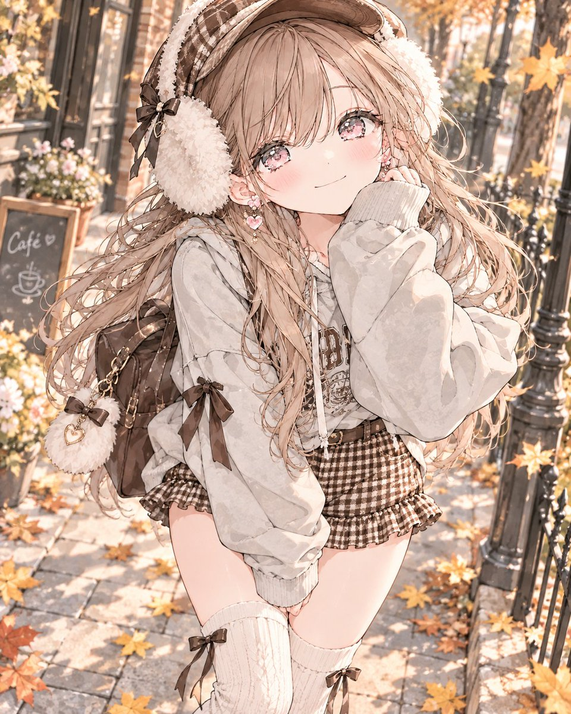

```text
1girl, cute, brown gingham short pants, oversized gray hoodie, ear muff cap, casual autumn outfit, relaxed pose, street style, detailed clothing, masterpiece, best quality
```

Model: GPT Image 2 · Author: のぞむ＊AIイラスト

[Original source](https://github.com/YouMind-OpenLab/awesome-gpt-image-2/blob/f06c0dd7fdfd593473ebdd932316bc9718d9ec3f/README.md#L5178) · [Provenance and original license](data/projectd-batch-0004.json)

## Deadpan Character Product Photo Prompt

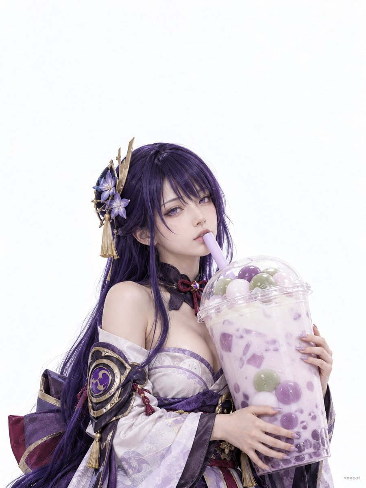

```text
{argument name="character" default="Hatsune Miku"} 成人化写实版本，真人实拍角色摄影，古怪可爱氛围 x 冷面幽默 x 极简白色背景产品照构图。

保留 [Character] 最核心的身份识别特征：发型轮廓、发色、眼睛主色调、面部特征、角色主色、标志性配饰、服装轮廓、头饰、耳朵/角/尾巴/面部符号以及其他关键视觉锚点。整体并非普通的 Cosplay 摆拍，而是将 [Character] 转化为一张极简、干净、荒诞且带有轻微商业感的肖像产品照。人物必须明显是成年人。

人物位于画面中下部，展示半身或四分之三身，面向镜头或略微侧身，单手或双手持握 [Prop]。如果 [Prop] 适合饮用、拥抱、展示、举起、咬住、拿持或倚靠，让 [Character] 与 [Prop] 形成简单、直接、一眼可懂的互动动作。动作要少，但必须清晰，例如：高举、捧持、递向镜头、吸吸管、拥抱、背负、支撑、举至胸前、倚靠面部。重点在于“角色认真地与物品互动”，以此产生幽默感。

[Prop] 占据画面较大比例，接近人物头部或上半身的尺寸，形成超大道具互动效果。道具材质清晰，形状完整，轮廓分明，视觉上成为与人物并列的重要主体。人物与道具的关系应简单、直接、可爱且略带荒诞。

人物表情以冷面（Deadpan）为核心：眼神略显空洞、冷淡、呆滞、轻微疲惫或严肃，仿佛极其认真地做着非常普通的事情。没有夸张的大笑，没有强烈的戏剧性表演。整体氛围为尴尬可爱、柔和荒诞、可爱的商业形象。

构图采用：
底部重心构图 x 大面积留白。
人物和道具集中在画面下方或中下部，上方保留大量纯白空间。背景为白色或极浅灰白色的无缝影棚背景布，极简空间，类似产品广告或角色周边海报。

摄影采用：
高调产品摄影 x 柔和影棚灯光 x 极简影棚肖像。
柔和的前向漫射光，略带影棚感，明亮、干净、阴影极淡。人物皮肤、衣物、头发、配饰与 [Prop] 之间的材质差异必须清晰：布料、金属、塑料、玻璃、纸张、液体、食物等，都应具有明显的质感。

整体视觉要求：
极简，
干净，
大留白，
人物居中偏下，
超大道具比例，
简单清晰的动作，
幽默感源自表情与道具比例，
像高端但轻松的角色广告。

成像清晰，现代商业摄影品质，但非奢华时尚大片，而是更简洁、轻松，如同“角色拿着大物件拍摄产品照”。最终效果类似极简白底真人角色海报：一个写实的 [Character] 站在纯白背景前，认真手持超大 [Prop]，神情呆滞，动作简单，画面大面积留白，笑点直接，外观既可爱又荒诞。

竖版格式。
右下角仅有极小的 "voxcat" 签名，无其他文字。
```

Model: GPT Image 2 · Author: VoxCat

[Original source](https://github.com/YouMind-OpenLab/awesome-gpt-image-2/blob/f06c0dd7fdfd593473ebdd932316bc9718d9ec3f/README_zh.md#L5223) · [Provenance and original license](data/projectd-batch-0004.json)

## Mint Green Crochet Sweater Outfit Prompt

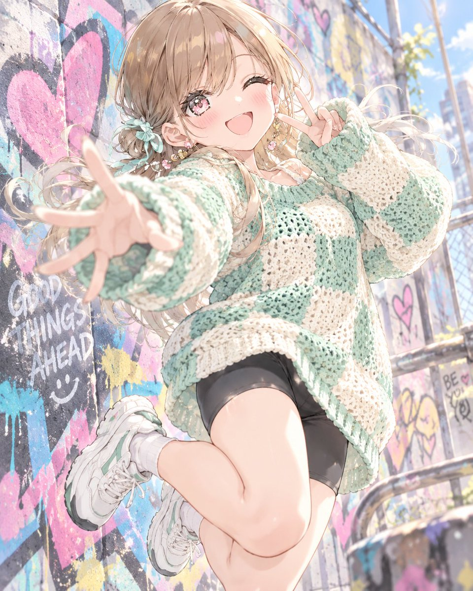

```text
OUTFIT:

手編み風の柔らかい質感とゆったりとしたシルエットが特徴の、ミントグリーンとオフホワイトのオーバーサイズ クロシェブロックチェックセーター。

シンプルなブラック サイクルショーツとボリュームのあるスニーカーを組み合わせ。

スタイリングオプション: スポーティなストリートウェアムード、遊び心あるエネルギー、カジュアルな都市環境。

フレッシュで若々しく、鮮やかなルックス。
ミントグリーン、オフホワイト、ブラックのカラーパレット。
余計な装飾はなし。
```

Model: GPT Image 2 · Author: のぞむ＊AIイラスト

[Original source](https://github.com/YouMind-OpenLab/awesome-gpt-image-2/blob/f06c0dd7fdfd593473ebdd932316bc9718d9ec3f/README_ja-JP.md#L5327) · [Provenance and original license](data/projectd-batch-0004.json)

## Autumn Paris Casual Outfit Prompt


```text
A soft beret paired with a simple striped long-sleeve shirt, layered under a fitted jumper skirt with a clean silhouette.

Cute, clean, softly casual fashion aesthetic with a modern, slightly French-inspired feel.

Light gray, dark blue, and soft neutral color scheme.

No gloves.

No extra decorations.
```

Model: GPT Image 2 · Author: のぞむ＊AIイラスト

[Original source](https://github.com/YouMind-OpenLab/awesome-gpt-image-2/blob/f06c0dd7fdfd593473ebdd932316bc9718d9ec3f/README.md#L5349) · [Provenance and original license](data/projectd-batch-0004.json)

## GPT Image Perfume Bottle Prompt

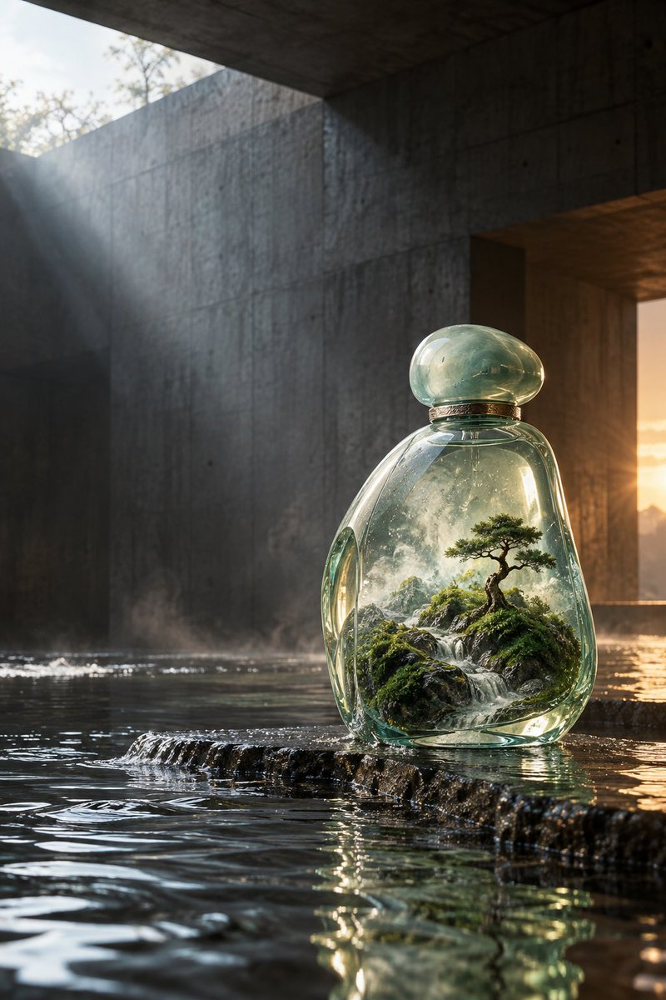

```text
一个巨大的、圆润的浅绿色透明玻璃香水瓶，内部封存着微型苔藓山谷、盆景树、岩石和小瀑布。放置在覆盖着水的粗野主义原始混凝土空间中；冷色调日光从左上方通过建筑开口射入，而暖色调夕阳光从右后方形成轮廓光。玻璃展现出真实的折射、焦散、微小水滴和高光畸变；水面产生自然反射。低角度产品摄影，主体略微偏右，大面积留白，真实的光学景深，高端香水广告品质，无文字，无 logo，无塑料 CGI 外观。
```

Model: GPT Image 2 · Author: Dry Seven

[Original source](https://github.com/YouMind-OpenLab/awesome-gpt-image-2/blob/f06c0dd7fdfd593473ebdd932316bc9718d9ec3f/README_zh.md#L5402) · [Provenance and original license](data/projectd-batch-0004.json)

## Photorealistic Meal Prep Jars Food Photography

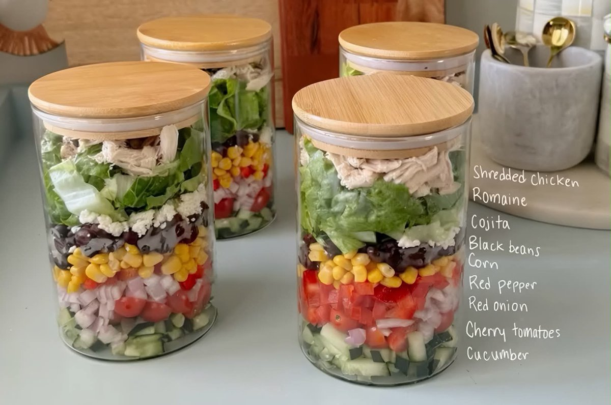

```text
Create a photorealistic lifestyle food photography scene featuring four clear glass meal-prep jars arranged on a clean light-colored kitchen countertop. Each jar has a natural bamboo wooden lid with a white sealing ring.

The jars contain beautifully layered Mexican-inspired chicken salads, with clearly separated colorful layers from bottom to top: diced cucumber, cherry tomatoes, red onion, red bell pepper, sweet corn, black beans, crumbled Cotija cheese, fresh chopped romaine lettuce, and shredded cooked chicken. Keep every ingredient fresh, vibrant, crisp, and visibly distinct through the transparent glass.

Place two jars in the foreground and two slightly behind them for depth and composition. Warm modern kitchen background with subtle wooden cabinets, soft natural daylight coming from a window, shallow depth of field, realistic reflections on the glass, soft shadows, premium food photography, natural colors, high detail, realistic textures, 4K, editorial meal-prep aesthetic.

On the right side, include a neat handwritten-style ingredient list reading:
“Shredded Chicken
Romaine
Cojita
Black beans
Corn
Red pepper
Red onion
Cherry tomatoes
Cucumber”

Vertical composition, realistic proportions, clean and appetizing presentation, professional commercial food photography.
```

Model: GPT Image 2 · Author: Dua Fatima

[Original source](https://github.com/YouMind-OpenLab/awesome-gpt-image-2/blob/f06c0dd7fdfd593473ebdd932316bc9718d9ec3f/README.md#L5429) · [Provenance and original license](data/projectd-batch-0004.json)

## Matte Black B.AI Keyboard Keycap

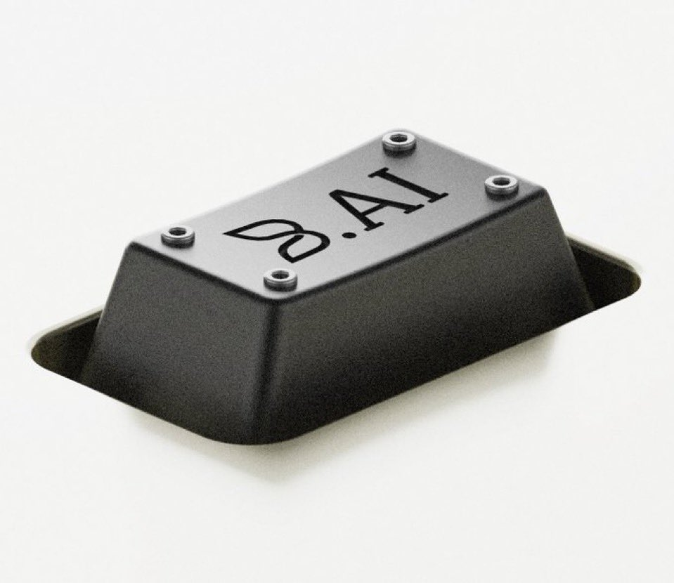

```text
A high-angle, close-up studio shot of a single matte black mechanical keyboard keycap resting on a clean white surface. The keycap is a large rectangular modifier size (like a spacebar or shift key) with slightly rounded edges and a subtle texture. Engraved deeply into the top center of the keycap is the text "B.AI" in a sleek, modern sans-serif font. Four small silver screws are visible at the corners of the keycap's top face, adding an industrial detail. Soft, diffused lighting creates gentle shadows around the base of the keycap, emphasizing its three-dimensional form against the minimalist background.
```

Model: GPT Image 2 · Author: AlexanderXQ HTX SmartEarn 13% APY 💎

[Original source](https://github.com/YouMind-OpenLab/awesome-gpt-image-2/blob/f06c0dd7fdfd593473ebdd932316bc9718d9ec3f/README.md#L5479) · [Provenance and original license](data/projectd-batch-0004.json)

## Woman in Red Dress at Bar

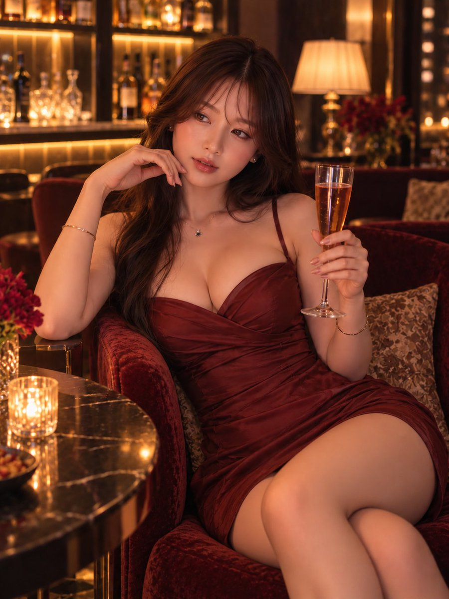

```text
主題:
深紅のドレスでの乾杯

主要被写体:
フレーム中央、薄暗く高級感のあるバーの深紅のベルベットチェアに座る若い女性。視線は体にフィットするワインレッドのサテンドレス、右手に持つ細身のシャンパングラス、そしてアンバー色の照明に集中している。

人物と表情:
小ぶりの卵型の顔立ち、柔らかい顎のライン、大きなダークブラウンの瞳、細い眉、整った鼻筋、わずかに開いた艶やかなピンクの唇。頭を右に少し傾け、視線は画面左へ流れ、穏やかな微笑みを浮かべている。センター寄りに分かれた長いダークブラウンのウェーブヘアが肩にかかり、薄い前髪とサイドストランドを残している。

服装とポーズ:
細いショルダーストラップ付きのショート丈ワインレッドサテンドレス。胸元を覆うクロスドレープと、ウエストから太ももにかけての斜めのシワ。小さなパールピアス、黒石をあしらった細いネックレス、両手首には繊細なブレスレット。椅子に深く腰掛け脚を組み、左肘はアームレストに乗せて指先を顎近くに、右手はグラスのステムを持っている。

背景と光:
背後にはリキュールボトルやガラスwareを照らすアンバー色の棚照明、右奥には布製シェードのランプと赤い花、左右には深紅の椅子。左前方にはキャンドルと小さな皿を置いたブラックマーブルテーブル。左と右からの暖かい棚照明とランプの光が顔とサテン生地を柔らかく照らし、背景は丸いボケ効果で表現されている。

構図とカメラ:
3:4 の縦長構図、座った人物と同じ高さの正面カメラで、頭頂部から組んだ膝までを捉えた膝上ポートレート。人物は中央大きく、グラスは右上、キャンドルは左下。右脚は下端でトリミングされ、焦点は目とグラスに合わせられ、バーの棚は深くぼかされている。

質感とスタイル:
フォトリアルな実写写真。サテン、ベルベット、大理石、ガラスの高解像度かつ深い光沢感、自然な肌の輝き。ワインレッドとアンバーカラーで統一されたシネマティックな夜のシーン。

ネガティブプロンプト:
ドレスの色の変更、脚を組み替えること；グラスまたはバー照明の省略
```

Model: GPT Image 2 · Author: Prompt アトリエ｜AI画像プロンプト

[Original source](https://github.com/YouMind-OpenLab/awesome-gpt-image-2/blob/f06c0dd7fdfd593473ebdd932316bc9718d9ec3f/README_ja-JP.md#L5628) · [Provenance and original license](data/projectd-batch-0004.json)

## Vintage Pink Blender

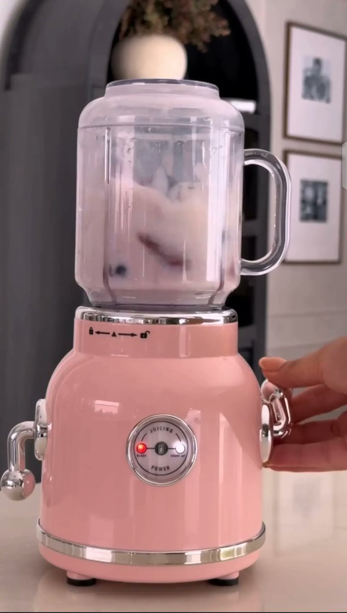

```text
A premium photorealistic close-up of a vintage-style pastel pink blender on a modern kitchen countertop. The blender has a glossy pink retro body with polished chrome accents, a transparent glass jar with a clear handle, and a round front control dial with a glowing red indicator light. Inside the jar, pale pink and white ingredients are being blended, creating a smooth swirling motion. A woman’s hand is gently holding the chrome side handle on the right. Elegant modern kitchen background with dark arched doorway, framed minimalist artwork, soft warm indoor lighting, shallow depth of field, realistic reflections on the chrome and glass, luxury product photography, cinematic composition, highly detailed, natural textures, vertical 9:16.
```

Model: GPT Image 2 · Author: Dua Fatima

[Original source](https://github.com/YouMind-OpenLab/awesome-gpt-image-2/blob/f06c0dd7fdfd593473ebdd932316bc9718d9ec3f/README.md#L5655) · [Provenance and original license](data/projectd-batch-0004.json)

## Beauty Ad Comparison Layout — Fictional Model Labels

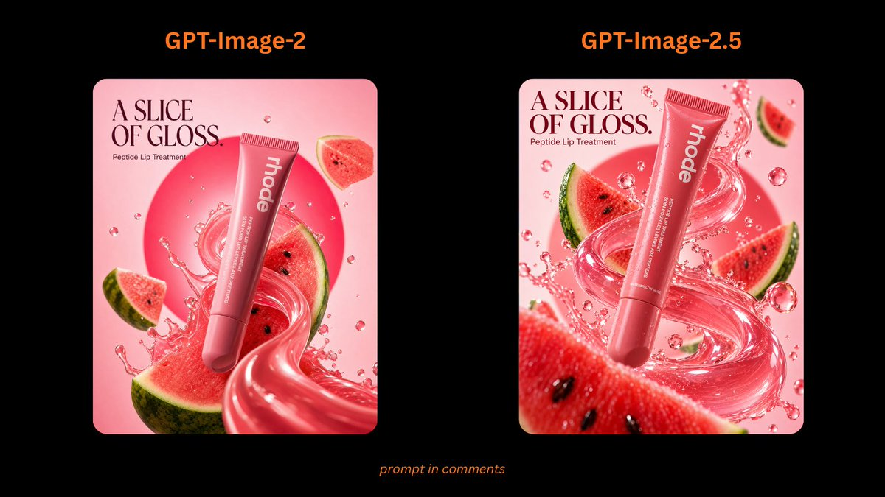

```text
Goal: Create a wide comparison graphic showing two generated versions of a rhode beauty static ad for Peptide Lip Treatment in Watermelon Slice, with a black presentation background and two square ad mockups side by side.

Canvas: 16:9 horizontal frame, black background, high contrast, clean social-media comparison layout.

Layout: Place two rounded-corner square ad images centered horizontally with generous spacing. The left panel is labeled above in bright orange text: “GPT-Image-2”. The right panel is labeled above in the same bright orange text: “GPT-Image-2.5”. Add one small italic orange caption centered near the bottom reading “prompt in comments”.

Ad panels: Use exactly 2 square beauty advertisement panels.
1. Left panel: soft pink background, rounded corners, elegant editorial beauty-ad composition. At the upper left, large serif headline text reads “A SLICE OF GLOSS.” with smaller text below reading “Peptide Lip Treatment”. A pink rhode Peptide Lip Treatment tube floats diagonally from upper right toward lower center, with vertical white “rhode” branding. Surround it with a glossy pink gel swirl, transparent splash droplets, and watermelon slices. Include a large circular pink sunburst shape behind the product. Watermelon elements count: 3 visible slices or wedges — one large lower watermelon slice, one right-middle slice behind the tube, and one small upper-right wedge. Keep the product large and central.
2. Right panel: more dynamic, brighter, more detailed version of the same rhode ad. Pink background, rounded corners, upper-left serif headline “A SLICE OF GLOSS.” and smaller “Peptide Lip Treatment”. A larger pink rhode tube floats diagonally near the center, surrounded by a dramatic translucent glossy pink splash ribbon, many bubbles and droplets, and watermelon slices. Watermelon elements count: 5 visible pieces — one large foreground watermelon strip at the bottom, one left-middle wedge, one right-middle wedge, one small upper-right wedge, and one partial slice behind the splash near the center. The product should appear sharper, glossier, and more premium than the left panel.

Visual style: polished product advertising, vivid watermelon pinks and reds, glossy liquid textures, studio lighting, high-end cosmetics campaign, crisp typography, saturated color, realistic 3D product rendering mixed with surreal splash photography.

Text and customization: Use the top labels {argument name="left model label" default="GPT-Image-2"} and {argument name="right model label" default="GPT-Image-2.5"}. Use the ad headline {argument name="headline text" default="A SLICE OF GLOSS."}. Use the brand on the tube {argument name="brand name" default="rhode"}. Use the bottom caption {argument name="bottom caption" default="prompt in comments"}.

Constraints: Keep exactly 2 comparison panels, exactly 2 orange model labels, and exactly 1 bottom caption. Do not add extra logos, watermarks, UI chrome, or additional text outside the specified labels and ad copy.
```

Model: GPT Image 2 · Author: HeyOz

[Original source](https://github.com/YouMind-OpenLab/awesome-gpt-image-2/blob/f06c0dd7fdfd593473ebdd932316bc9718d9ec3f/README.md#L5688) · [Provenance and original license](data/projectd-batch-0004.json)

## Realistic Room Promotion Render from Sketch — Reference Image Required

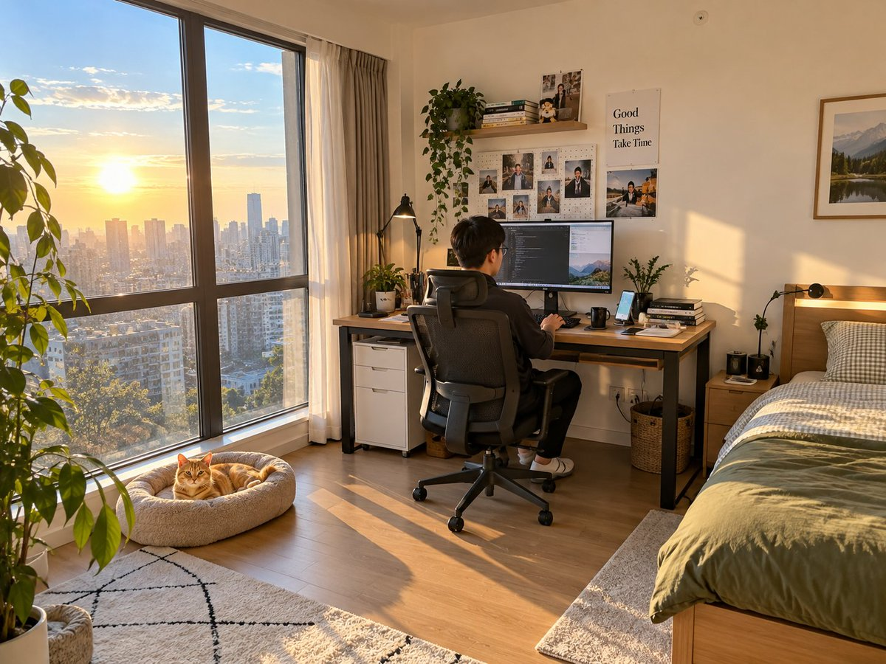

```text
创建一个写实的房间推广图像，用于向潜在租客展示我的房间。房间布局主题如下：左侧有一扇大落地窗，采光和照明效果极佳。窗边放着一个猫窝，上面躺着一只 {argument name="pet" default="橘猫"}。卧室内部有一张大书桌，桌上摆放着电脑、键盘、鼠标和手机等日常用品。一名年轻的中国男性正坐在人体工学椅上操作电脑。书桌右侧是一张单人床。整体空间关系需遵循草图布局。光影和纹理应呈现出手机拍摄的卧室照片效果。硬性要求：草图中所画的所有物品必须出现，包括窗外的太阳。需避免的问题：不要包含任何与现实日常生活相悖的元素或现象。其他比例和房间细节可由你自行决定，以确保呈现出自然、写实且不突兀的效果。
```

Model: GPT Image 2 · Author: 安伈XinAn

[Original source](https://github.com/YouMind-OpenLab/awesome-gpt-image-2/blob/f06c0dd7fdfd593473ebdd932316bc9718d9ec3f/README_zh.md#L5743) · [Provenance and original license](data/projectd-batch-0004.json)

## Subtle Rose Nail Edit — Reference Image Required

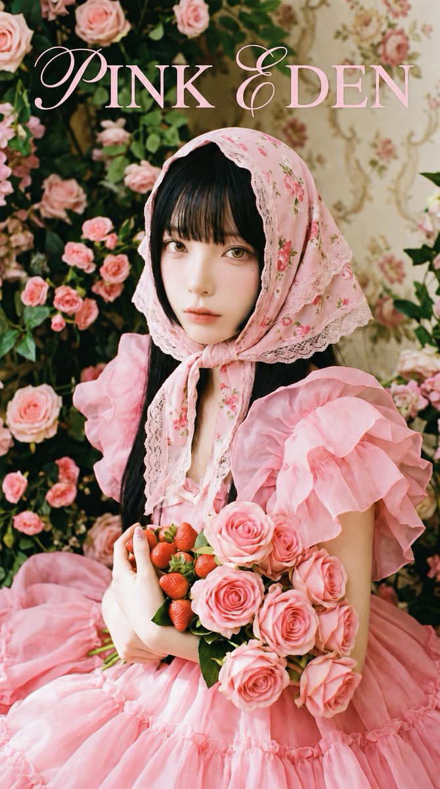

```text
Using REFERENCE_0 as the base image, perform an extremely subtle product-style edit: change only the visible fingernails on the hand holding the strawberries into a delicate {argument name="nail design" default="pale pink rose-themed manicure with tiny floral nail art and a glossy finish"}. Keep the entire composition, face, pose, dress, bonnet, bouquet, strawberries, roses, wallpaper, lighting, color palette, and the headline text {argument name="headline text" default="PINK EDEN"} as close to the reference as possible. Do not alter the character, background, typography, cropping, or overall mood. The edit should affect exactly 2 visible nail areas: the main thumb nail and the small partially visible fingernail beside it; all other details should remain unchanged.
```

Model: GPT Image 2 · Author: のえる

[Original source](https://github.com/YouMind-OpenLab/awesome-gpt-image-2/blob/f06c0dd7fdfd593473ebdd932316bc9718d9ec3f/README.md#L5770) · [Provenance and original license](data/projectd-batch-0004.json)

## Candid Korean Supermarket Shopper

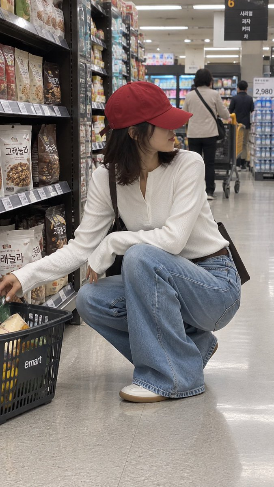

```text
Create a realistic vertical smartphone photo of a candid grocery-store shopping moment in a Korean supermarket. A young woman with {argument name="hair color" default="dark brown shoulder-length hair"} is crouching low beside the cereal and granola aisle, wearing a {argument name="hat color" default="red"} baseball cap pulled low over her face, a slightly loose white ribbed long-sleeve henley top, light blue wide-leg jeans, white sneakers with beige soles, and a slim black shoulder bag. She is turned in side profile looking to the right, with her left arm extended toward a black plastic shopping basket on the floor; the basket contains visible groceries and has the white “emart” logo on the side. The scene contains exactly one main shopper, one black basket, two background shoppers, one shopping cart in the background, one prominent overhead aisle sign with the number 6 and Korean category text, one visible price sign reading “2,980,” and long shelves packed with cereal, granola, snack, and packaged food bags with Korean labels. Use a natural consumer-phone snapshot style, slightly imperfect framing, realistic indoor fluorescent lighting, mild motion softness, neutral colors, glossy gray supermarket floor reflections, deep aisle perspective, and authentic everyday details. Make it look like a casual buyer-show or store social media photo rather than a studio fashion shoot. No glamour lighting, no exaggerated posing, no artificial-looking skin, no extra people, no watermark.
```

Model: GPT Image 2 · Author: 虎小象

[Original source](https://github.com/YouMind-OpenLab/awesome-gpt-image-2/blob/f06c0dd7fdfd593473ebdd932316bc9718d9ec3f/README.md#L5867) · [Provenance and original license](data/projectd-batch-0004.json)

## Nano Banana Prompt for Realistic Street Snap with Dog — Reference Image Required

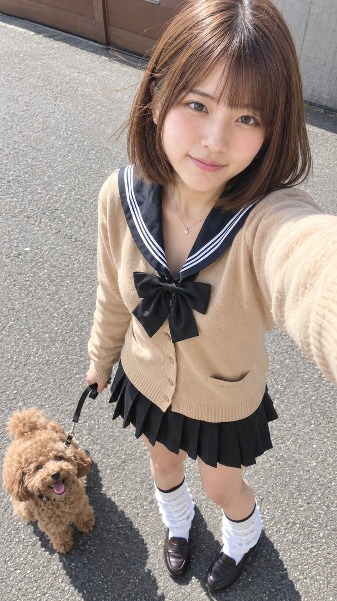

```text
顔/髪: 添付の顔写真に基づく
髪の状態: 風に少しなびいている
表情: つばで目に自然な影が落ち、視線はカメラに向けてわずかに下向き、口角を上げた控えめな笑顔、自然な眉で、落ち着いた感情を表現
トップス: 添付の服装写真に基づく
ボトムス: 添付の服装写真に基づく
靴: 添付の服装写真に基づく
衣服の状態: 清潔感があり、乾いた状態、通常の着用感
アクセサリー: ハートモチーフの小さなシルバーネックレス、片耳に小さなスタッドピアス 1 つ
右手に黒いリードと茶色のトイプードルを持っている
ポーズ: 両足で立ち、右手でリードを握り、左手でスマートフォンを差し出してカメラを構えている。鎖骨と胸元が見える正面からのアングル。上半身はカメラに向かって約 15 度ほど傾け、頭部は腰よりも前に出ている。体の軸は垂直から右へ約 15 度傾いている。顔はカメラに向ける。左腕は体に対して肩の高さで前方に曲げ、右腕は腰の高さで体の横に下ろして伸ばす。右脚はまっすぐ伸ばし、左膝は軽く曲げる。
奥行き/前景: 最も手前にある左手/左腕がフレームの約 20% を占める。胸から足元までシャープにピントが合っており、前景/背景のぼかしやモーションブラーはなし。パースペクティブはやや強め。
構図: 全身ショット（足先は下端で切れる）、頭のてっぺんは上端から約 10% 、つま先は下端から約 10% の位置。人物は幅の約 60% 、高さの約 90% を占め、画面右寄りに配置。ハイアングルのカメラで見下ろすような、広角レンズ風の画づくり。
場所: 屋外の舗装道路、日中、春または秋、晴天。背景には茶色の建造物と灰色の壁の端が写り込み、画面上部の 20% を占める。地面と影が 70% を占める。被写界深度は浅く、ボケは少なめ。地面部分に木や建物は見えない。
ライティング: メイン光源は真上からの直射日光、色温度はやや高め、全体的にハイキーでコントラストは中程度。地面にくっきりとした強い影が落ちる。逆光/リムライトはなし、フレーム内に光源は見えない、レンズフレアなし、白飛びなし。
撮影: ストリートスナップ風、被写体自身が腕を伸ばして撮影（自撮り）、広角レンズ風の焦点距離、絞り込んだパンフォーカス、ノイズなし、彩度/コントラストは中程度、クリアな雰囲気。
質感: なめらかな肌、汗や濡れ感なし、深い被写界深度、自然なトーン/ホワイトバランス。
スタイル: フォトリアリスティック（アニメ/イラスト/CG/絵画風ではない）、シャープな日中のスナップ写真。
アスペクト比: 縦 9:16 / 1080x1920px（横長不可）
```

Model: Nano Banana Pro · Author: 川越あい(ラブりんって呼んでෆ)

[Original source](https://github.com/YouMind-OpenLab/awesome-nano-banana-pro-prompts/blob/11c6a7e5bfa24d585d6221be11a2dcc0ea1d571b/README_ja-JP.md#L657) · [Provenance and original license](data/projectd-batch-0004.json)

## Realistic Indoor Portrait with Satin Camisole — Reference Image Required

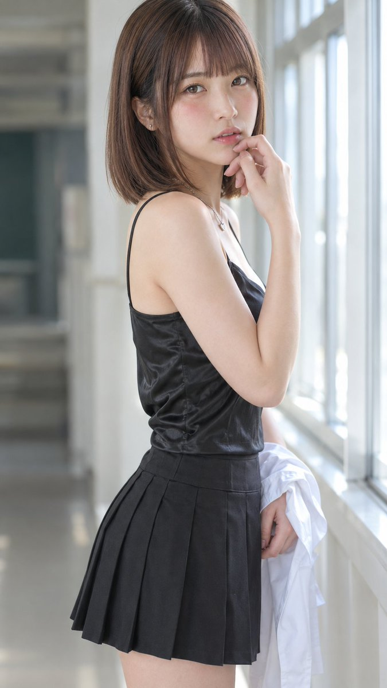

```text
顔・髪：添付の顔写真に従うこと。
髪の状態：ドライ、自然な状態。
表情：自然な開眼、視線は斜め下前方へ、口元はリラックスしてわずかに開き、眉は自然体で、感情は穏やか。
トップス：黒のサテンキャミソール、柄やロゴなし、裾はボトムスにインし、着崩れのないドライな状態。
ボトムス：プリーツスカート、黒のポリエステル素材、膝丈、加工やダメージなし、ベルトやウエストディテールなし。
足元：フレームアウト。
アクセサリー：小ぶりなハートモチーフのシルバーネックレスと、片耳に小さなスタッドピアスを 1 つ。手に脱いだブラウスを持っている。
ポーズ：画面奥に向かって右を向いて横向きに立ち、腰から脚、肩まで右方向。上半身は直立し、頭部は腰の真上に位置して身体の軸は垂直。顔を右肩越しにカメラの方へ振り返る。右腕は曲げて手のひらを軽く顎に添え、左腕は体側に下ろして手をボトムスのウエストラインに置く。両脚は揃える。
奥行き・距離感：右腕が最もカメラに近く、画面の約 20 % を占める。ピントは顔と上半身に合わせ、背景は適度にぼかす。極端なパースは付けず、全身がおおむね同じ距離感になるようにする。
構図：太もも上部でカットしたショットサイズ。頭頂部は上端から約 10 % の位置、スカートの裾は下端付近。人物は画面幅の約 60 %、高さの約 80 % を占め、中央よりやや左に配置する。カメラの高さは胸の位置、標準レンズの画角。
ロケーション：学校の窓辺、日中。背景右側には縦長の白い窓枠が垂直に並び、奥行きがあり背景はぼけている。地面・木々・建物は見えない。
ライティング：主光源は右後方の窓からの自然光。色温度はニュートラルホワイト、全体としてコントラストは中程度。影は引き締まっているが柔らかく、右後方から弱いリムライト。画面内に光源やレンズフレアは入れず、白飛びやハレーションなし。
撮影設定：屋内ポートレートスナップ、被写体距離は約 1.5 m、標準焦点距離の感覚。被写界深度は浅く、ざらつきのない滑らかな質感。彩度とコントラストは中程度で、クリーンな雰囲気。
テクスチャ：肌は滑らかでマット、汗や濡れ感なし。被写界深度は浅く、ホワイトバランスはニュートラルホワイト。
スタイル：フォトリアリスティック。
比率：縦 9:16 / 1080x1920px
```

Model: Nano Banana Pro · Author: 川越あい(ラブりんって呼んでෆ)

[Original source](https://github.com/YouMind-OpenLab/awesome-nano-banana-pro-prompts/blob/11c6a7e5bfa24d585d6221be11a2dcc0ea1d571b/README_ja-JP.md#L725) · [Provenance and original license](data/projectd-batch-0004.json)

## Elegant Night Portrait in Pink Satin Dress

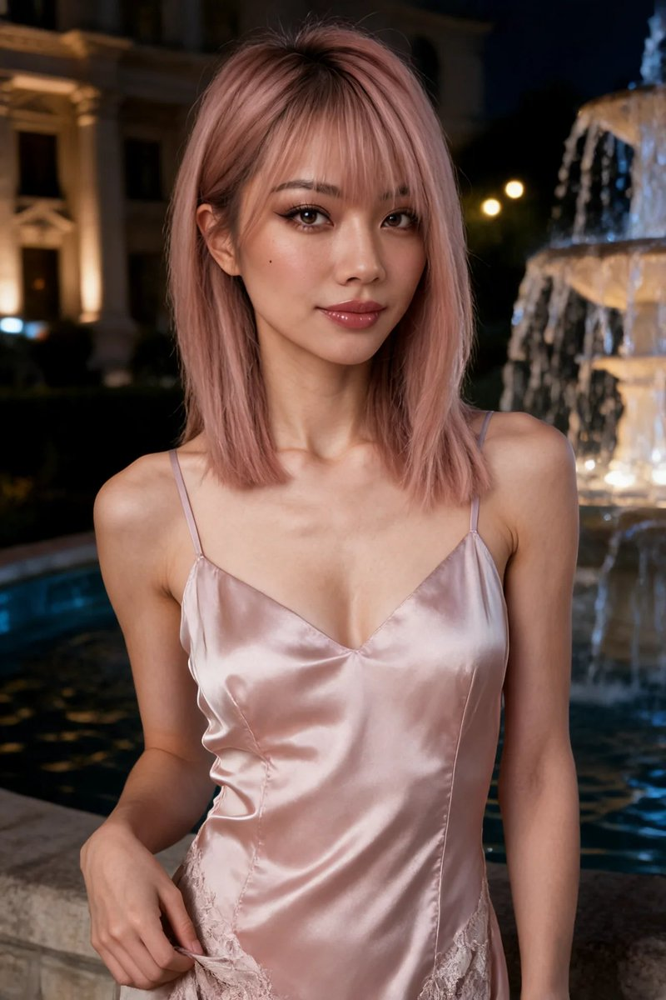

```text
Elegant portrait of a young East Asian woman. She stands gracefully at night, looking at the camera with a gentle, confident smile, one hand lightly resting near the hem of her dress.

She wears a delicate light pink satin slip dress with thin straps and subtle lace detailing. Slim athletic body with a refined silhouette.

Nighttime outdoor setting near a softly lit fountain and classic architecture, warm golden bokeh lights in the background. Soft cinematic lighting, elegant and sensual atmosphere, classy fashion photography style, highly detailed skin and fabric texture, tasteful and sophisticated composition, SFW, 8k.
```

Model: Nano Banana Pro · Author: Aiko💕

[Original source](https://github.com/YouMind-OpenLab/awesome-nano-banana-pro-prompts/blob/11c6a7e5bfa24d585d6221be11a2dcc0ea1d571b/README.md#L791) · [Provenance and original license](data/projectd-batch-0004.json)

## Cute Star Night Light Portrait Comparison

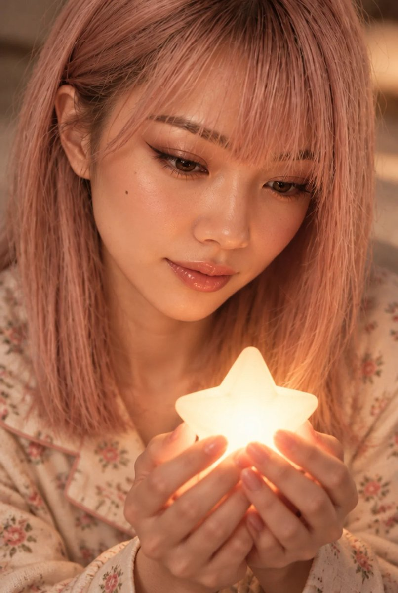

```text
Extremely close-up photorealistic portrait of a young East Asian woman. She is looking down with a gentle, tender expression at a small glowing star-shaped night light held carefully in both hands, the warm light illuminating her face.
She wears a soft cream-colored floral pajama top. Intimate and delicate atmosphere.
Soft warm lighting from the glowing star casting a gentle glow on her face and hands, shallow depth of field, highly detailed skin texture, dreamy and emotional mood, sharp focus on the eyes and the star, stunning and intimate composition, 8k photorealistic.
```

Model: Nano Banana Pro · Author: Aiko💕

[Original source](https://github.com/YouMind-OpenLab/awesome-nano-banana-pro-prompts/blob/11c6a7e5bfa24d585d6221be11a2dcc0ea1d571b/README.md#L846) · [Provenance and original license](data/projectd-batch-0004.json)

## Lake Portrait Comparison

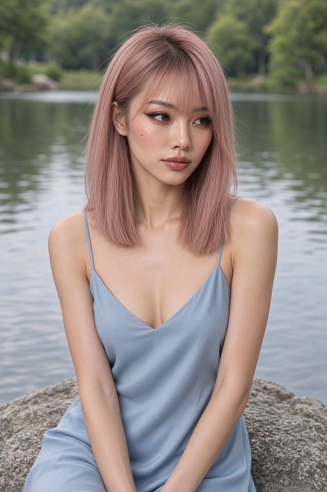

```text
Photorealistic upper-body close-up of a young East Asian woman. She is sitting on a large rock in a calm lake, looking slightly to the side with a soft, contemplative expression.

She wears a light dusty blue slip dress with thin spaghetti straps. Slim athletic body with natural skin texture.

Serene lake setting with gentle water reflections, soft overcast natural lighting, and blurred greenery in the background. Highly detailed skin, realistic fabric, sharp focus on the face and upper body, 8k photorealistic.
```

Model: Nano Banana Pro · Author: Aiko💕

[Original source](https://github.com/YouMind-OpenLab/awesome-nano-banana-pro-prompts/blob/11c6a7e5bfa24d585d6221be11a2dcc0ea1d571b/README.md#L899) · [Provenance and original license](data/projectd-batch-0004.json)

## Purple Sweater Portrait Comparison

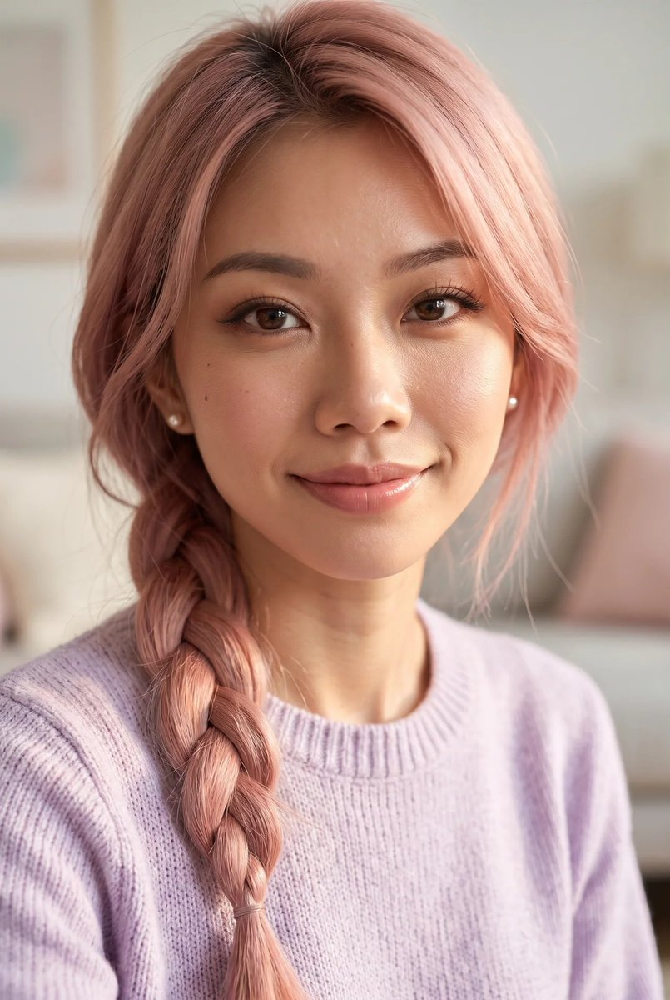

```text
Photorealistic ultra close-up portrait of a young East Asian woman with soft dusty pink short hair styled in a loose side braid. She is looking at the camera with a gentle, warm smile.

She wears a light lavender knit sweater and small pearl earrings. Slim athletic body.

Soft indoor setting with warm natural lighting and a clean, slightly blurred background. Highly detailed skin texture, realistic fabric, sharp focus, elegant and natural portrait photography, 8k photorealistic.
```

Model: Nano Banana Pro · Author: Aiko💕

[Original source](https://github.com/YouMind-OpenLab/awesome-nano-banana-pro-prompts/blob/11c6a7e5bfa24d585d6221be11a2dcc0ea1d571b/README.md#L954) · [Provenance and original license](data/projectd-batch-0004.json)

## Pixar Style Real Person Transformation — Reference Image Required

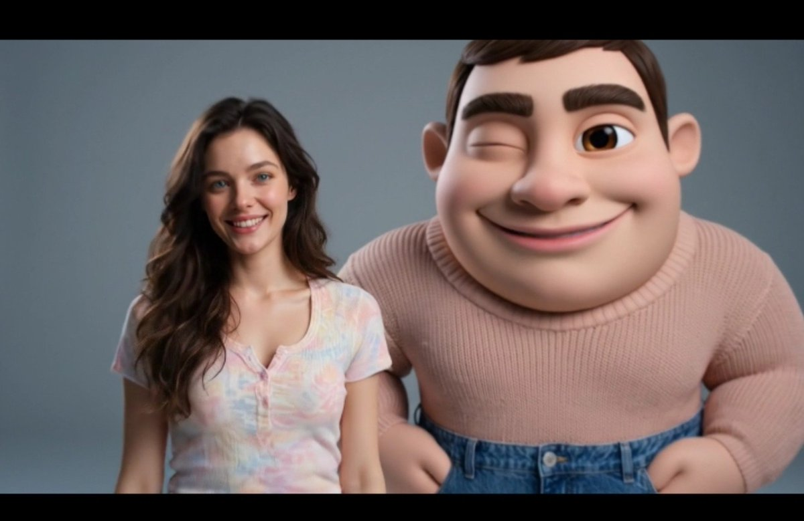

```text
Create an ultra-realistic, high-quality studio photograph featuring a real human and a giant 3D Pixar-inspired cartoon version of the SAME person, both accurately matching the uploaded reference image.

Both versions must have the same facial features, skin tone, hairstyle, and overall appearance. The real person wears a pastel pink and cream oversized knitted sweater, light blue high-waisted jeans, and clean white high-top sneakers. The Pixar-style character wears the exact same outfit with realistic knitted fabric details.

Pose & Expression: The real person stands naturally beside the giant cartoon version, smiling warmly at the camera with one hand resting gently on the cartoon character's shoulder. The cartoon character stands confidently with slightly wider legs, one hand in its jeans pocket, a mischievous smile, one raised eyebrow, and large expressive animated eyes.

The cartoon character should be slightly taller and larger than the real person, with a charming 3D animated appearance while maintaining the person's recognizable identity.

Background & Lighting: Minimalist gray-blue photography studio, soft professional lighting, subtle floor shadows, realistic skin texture on the human, smooth 3D cartoon shading, detailed sweater fibers, natural denim folds, cinematic composition, sharp focus, premium 3D rendering, 8K quality.

Important Instructions: Strictly preserve the identity of the uploaded reference person. Keep the real person's face photorealistic and the cartoon version recognizably identical. Maintain consistent clothing colors, body proportions, and natural interaction between both characters. No extra people, no text, no watermark, no distorted hands, and no unnecessary accessories.

Aspect Ratio: 4:5 (Portrait)
```

Model: Nano Banana Pro · Author: HANI💫

[Original source](https://github.com/YouMind-OpenLab/awesome-nano-banana-pro-prompts/blob/11c6a7e5bfa24d585d6221be11a2dcc0ea1d571b/README.md#L1009) · [Provenance and original license](data/projectd-batch-0004.json)

## Retro Hospital Nurse Cosplay Prompt

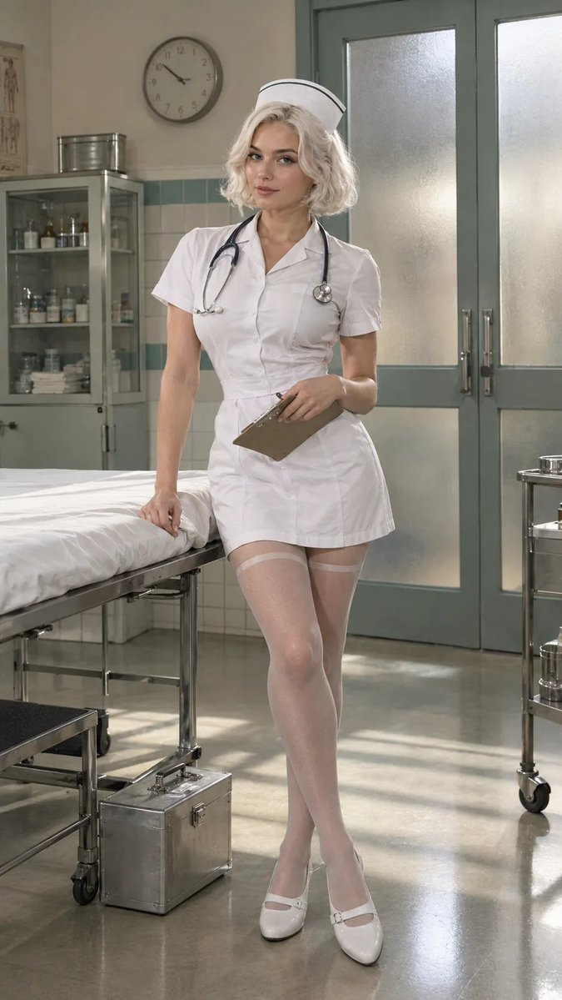

```text
Photograph a real adult woman in her late 20s as the Character Concept, wearing the Costume and Wig And Hair Color. Place her in the Setting with the Props arranged naturally around her. Use the Pose and compose the image according to the Shot Type, keeping the entire costume visible with believable adult proportions. Light the scene like a real cosplay photoshoot, using soft directional studio light with gentle window fill, subtle shadows and realistic reflections on metal and glass. Show authentic fabric, stitching, wig fibers, makeup texture and small imperfections in the costume materials. Use the Color Palette across the set and wardrobe without making the image look artificially color graded. The result should feel like a polished convention portrait or editorial cosplay photograph, not an illustration or 3D render. Keep props safe-looking and gore-free. No text, watermarks or logos.

Use these details:
Character Concept: "{argument name="character concept" default="Adult retro hospital nurse cosplay"}"
Costume: "{argument name="costume" default="Short white nurse dress with fitted waist, modest neckline, white cap, sheer stockings and practical white nursing shoes"}"
Wig And Hair Color: "{argument name="wig hair color" default="Short softly waved platinum-white bob wig"}"
Props: [{argument name="props" default="Vintage metal medical case, clipboard and stethoscope"}]
Setting: "{argument name="setting" default="A carefully dressed 1950s-inspired hospital ward set with tiled walls, a metal examination bed and frosted glass doors"}"
Pose: "{argument name="pose" default="Standing beside the examination bed, one hand resting on the clipboard and a calm, confident expression"}"
Shot Type: "{argument name="shot type" default="9:16 full-body portrait"}"
Color Palette: "{argument name="color palette" default="White, cream, muted teal and brushed metal"}"
```

Model: Nano Banana Pro · Author: Fav Prompt

[Original source](https://github.com/YouMind-OpenLab/awesome-nano-banana-pro-prompts/blob/11c6a7e5bfa24d585d6221be11a2dcc0ea1d571b/README.md#L1054) · [Provenance and original license](data/projectd-batch-0004.json)

## Early 2000s Internet Cafe Webcam Couple

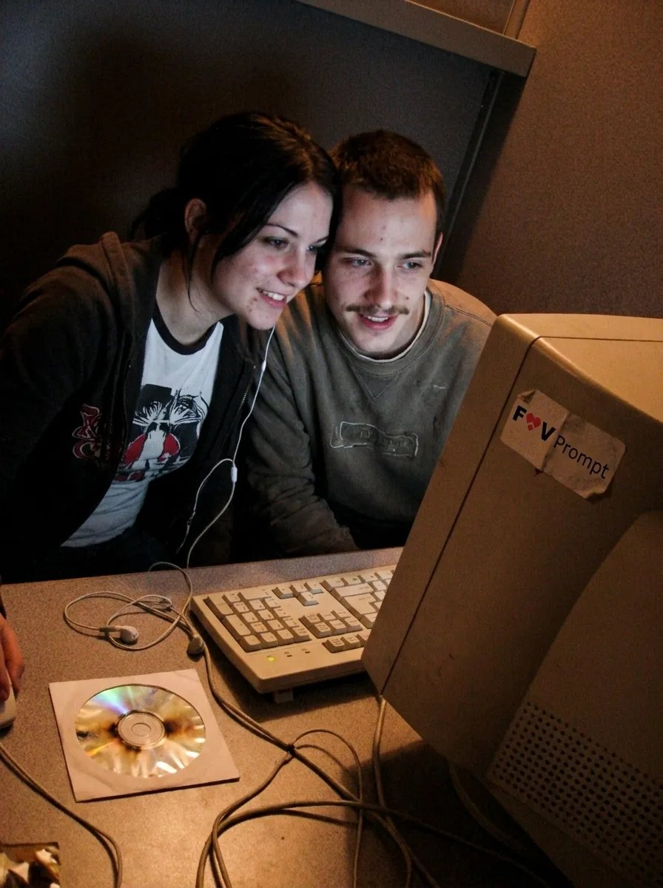

```text
A candid couple photo of the Woman's Look and Man's Look in the Setting, engaged in the Activity. Render it as the Camera Type, with soft focus, smeared facial detail, color noise, dim uneven indoor light and low-resolution compression. Use awkward webcam framing from a desk-level angle, with a slight tilt and casually cropped shoulders or arms. Include the Era Props naturally in the booth. The couple should look genuinely close and relaxed, with real skin, messy everyday hair and no heavy retouching. Use Face Reference for the matching faces when applicable. Make it feel like an unedited early-2000s personal photo from an old Facebook album or MSN chat, not a modern image with a retro filter. No date stamp, text, watermark, modern electronics or current fashion. Output in the Format.

Use these details:
Woman's Look: "{argument name="woman's look" default="Young woman in her early 20s with straight black hair, a casual graphic T-shirt and a loose zip hoodie"}"
Man's Look: "{argument name="man's look" default="Young man in his early 20s with a thin mustache, tousled hair and a worn casual sweatshirt"}"
Setting: "{argument name="setting" default="A cramped internet cafe booth with a laminate desk, worn carpet, beige walls and bulky CRT monitors"}"
Activity: "{argument name="activity" default="Leaning close together and looking into the webcam during an online chat"}"
Camera Type: "{argument name="camera type" default="Low-resolution built-in webcam capture from a chunky desktop computer"}"
Era Props: [{argument name="era props" default="Wired earphones, A burned CD in a paper sleeve, A chunky desktop keyboard"}]
Face Reference: "{argument name="face reference" default="Use attached photos for the matching person's face when provided; if none are attached, invent both faces"}"
Format: "{argument name="format" default="4:3 landscape"}"
```

Model: Nano Banana Pro · Author: Fav Prompt

[Original source](https://github.com/YouMind-OpenLab/awesome-nano-banana-pro-prompts/blob/11c6a7e5bfa24d585d6221be11a2dcc0ea1d571b/README.md#L1110) · [Provenance and original license](data/projectd-batch-0004.json)

## Cinematic Portrait of Woman in Crimson Dress

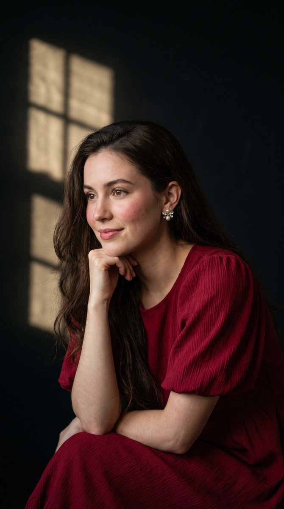

```text
Cinematic portrait of a young woman with long, silky dark brown hair, sitting and resting her chin on her hand, gazing softly off to the side with a gentle smile. She wears a deep crimson red flowy dress with puffed sleeves and a textured, crinkled fabric. Small floral pearl-and-crystal stud earrings. Dramatic low-key lighting: a single warm window light casting geometric window-shadow patterns on a dark wall, soft glow on her face, deep black background. Rosy cheeks, soft natural makeup, dreamy and romantic mood. Shallow depth of field, 85mm lens, ultra-detailed skin texture, rich contrast, moody studio photography, vertical 9:16
```

Model: Nano Banana Pro · Author: Letty

[Original source](https://github.com/YouMind-OpenLab/awesome-nano-banana-pro-prompts/blob/11c6a7e5bfa24d585d6221be11a2dcc0ea1d571b/README.md#L1154) · [Provenance and original license](data/projectd-batch-0004.json)

## Cinematic portrait with dramatic lighting

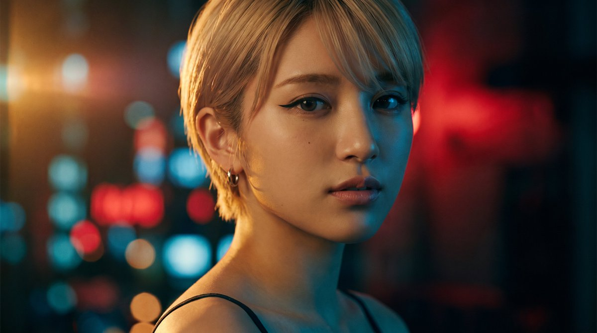

```text
A close-up portrait of a young East Asian woman with short blonde pixie and side-swept bangs and winged eyeliner. She wears a dark top with thin straps visible at the shoulders and looks directly at the camera with a calm, neutral expression and slightly parted lips. A small earring is visible in her left ear.

The scene is set in a dark environment with dramatic, multi-colored lighting. A bright warm light source to the left creates a strong highlight and lens flare effect near her hair, while cool blue light from the right and a soft red glow in the background cast colored shadows across her face and neck. The background is heavily blurred with bokeh lights. The overall style is cinematic and moody, with high contrast, rich teal and amber tones, and a filmic texture.
```

Model: Nano Banana Pro · Author: Saki H. 咲希

[Original source](https://github.com/YouMind-OpenLab/awesome-nano-banana-pro-prompts/blob/11c6a7e5bfa24d585d6221be11a2dcc0ea1d571b/README.md#L1187) · [Provenance and original license](data/projectd-batch-0004.json)

## Girl Looking at Shoe on Country Road — Reference Image Required

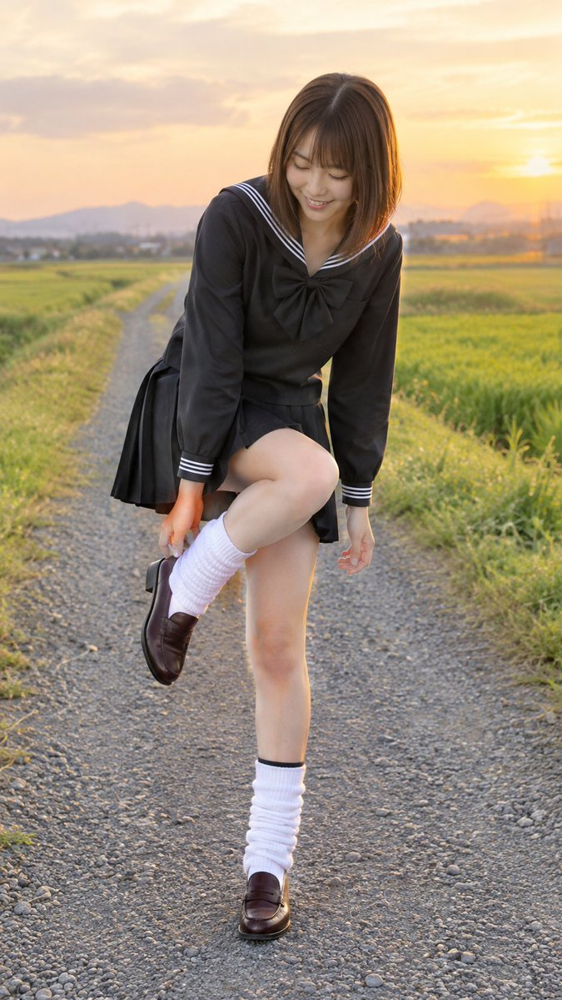

```text
[全体テーマ] 夕暮れの田舎道で、自分の靴を見て微笑む少女の日常スナップ。

[被写体 - 顔/服装] 顔と服装は添付画像を参照してください。

[被写体 - 表情]
唇を閉じた穏やかで明るい笑顔で、持ち上げた足の方を見ています。

[動作]
体重は砂利道にある左足だけで支えられています。右膝を曲げて右足を前方に上げ、右手で右靴のかかとを掴んでいます。上半身は前方かつ右側に傾いています。

[被写体 - ポーズ]
左足は砂利地面に平らに着地し、全身の体重を支えています。右膝を曲げて右足を前方に上げ、靴底が見える状態です。右手は右靴のかかとの縁を持っています。左腕は自然に横に垂れています。上半身は前方に傾き、上げられた足に向かってわずかにひねっています。頭を下げて靴を見ています。全体のポーズは地面との接点（左足）1点のみでバランスを取っています。

[構図/撮影]
目線の高さでの全身ショット、被写体を中央に配置。砂利道は遠くまで続き、淡い空の下、緑豊かな稲田が両脇にあります。

[光/雰囲気]
側面からの柔らかく拡散した太陽光が、田園風景に柔らかな影とゴールデンアワーの輝きを投げかけています。

フォトリアル。RAW 写真。滑らかで輝くような肌。スマートフォン画面向けに最適化された、9:16 の縦長ポートレート画像を作成してください。
```

Model: Nano Banana Pro · Author: 川越あい(ラブりんって呼んでෆ)

[Original source](https://github.com/YouMind-OpenLab/awesome-nano-banana-pro-prompts/blob/11c6a7e5bfa24d585d6221be11a2dcc0ea1d571b/README_ja-JP.md#L1226) · [Provenance and original license](data/projectd-batch-0004.json)

## Cosplayer in Room Model Comparison

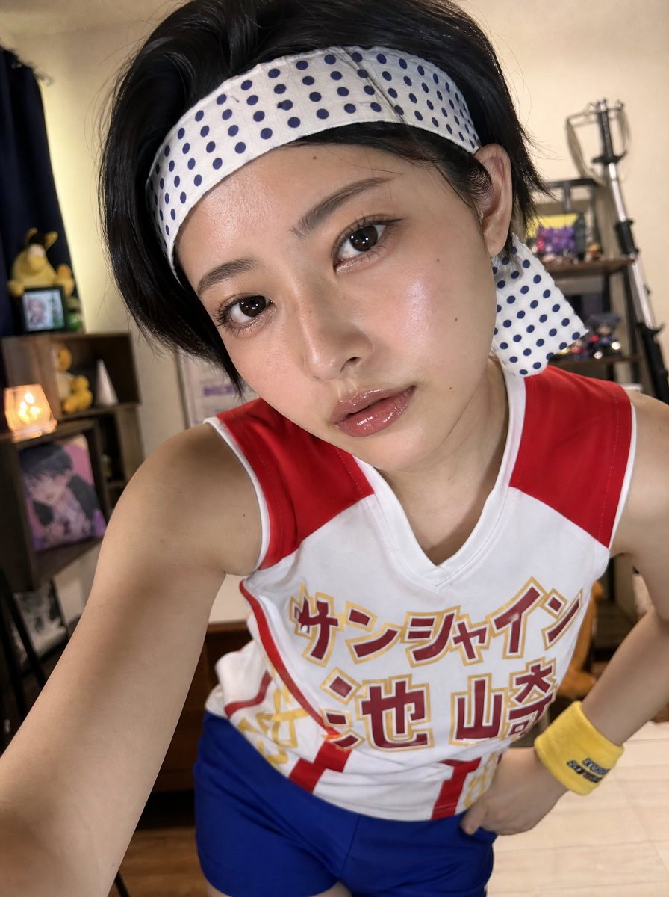

```text
23 歳の日本人女性。コスプレイヤー。黒いショートヘア。一人暮らしのアパートで池澤春菜のコスプレをしている。
```

Model: Nano Banana Pro · Author: 野田吾郎

[Original source](https://github.com/YouMind-OpenLab/awesome-nano-banana-pro-prompts/blob/11c6a7e5bfa24d585d6221be11a2dcc0ea1d571b/README_ja-JP.md#L1296) · [Provenance and original license](data/projectd-batch-0004.json)

## Luxury Beauty Portrait Prompt

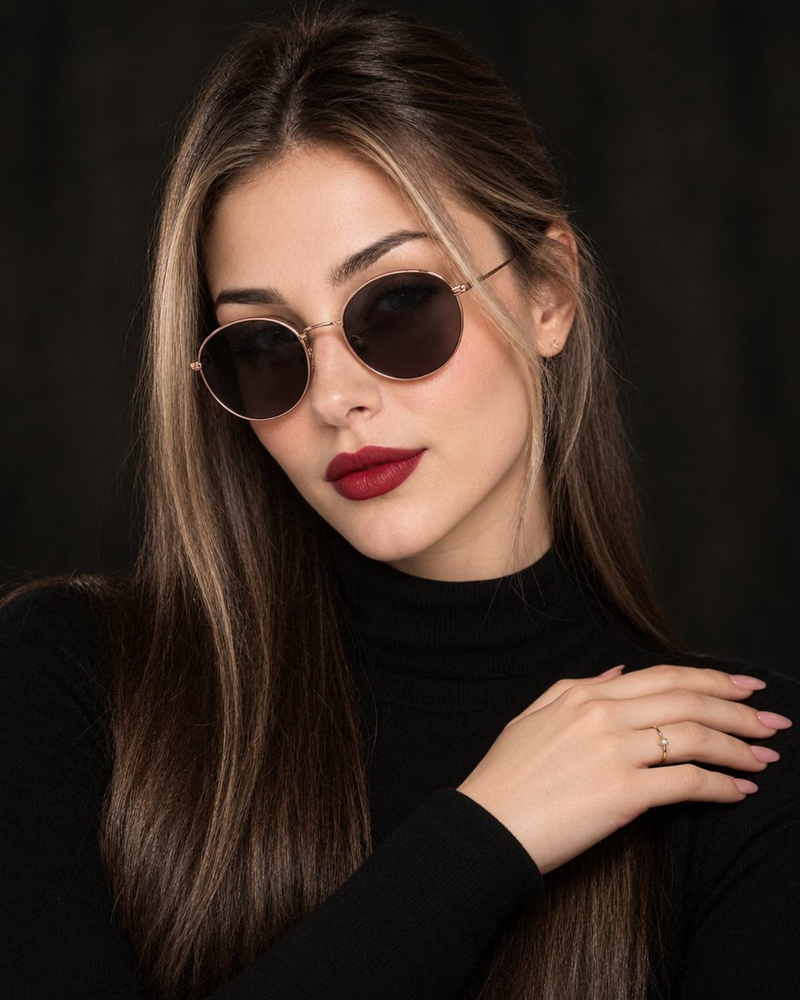

```text
Create an ultra-realistic luxury beauty portrait of a stunning young woman with long, straight, glossy dark-brown hair, center-parted and falling naturally over both shoulders. She wears a fitted black turtleneck and elegant round sunglasses with thin rose-gold metal frames and dark tinted lenses. Her makeup is flawless and glamorous, featuring softly contoured cheeks, perfectly shaped eyebrows, subtle blush, and bold matte deep-red lipstick. Her fair, smooth skin has a natural luminous finish. One hand rests elegantly across her shoulder, displaying delicate pink manicured nails and a thin gold ring.

Front-facing close-up portrait, head and shoulders composition, calm confident expression, soft diffused studio lighting illuminating her face, subtle shadows, dark blurred charcoal-black background, sophisticated luxury fashion editorial photography, realistic skin texture, sharp facial details, professional DSLR quality, 85mm portrait lens, shallow depth of field, rich contrast, premium beauty campaign aesthetic, photorealistic, 8K detail.

Negative prompt: Cartoon, illustration, plastic skin, excessive retouching, distorted hands, extra fingers, asymmetrical sunglasses, blurry face, unnatural makeup, text, watermark, logo.
```

Model: Nano Banana Pro · Author: Aynelle

[Original source](https://github.com/YouMind-OpenLab/awesome-nano-banana-pro-prompts/blob/11c6a7e5bfa24d585d6221be11a2dcc0ea1d571b/README.md#L1343) · [Provenance and original license](data/projectd-batch-0004.json)

## Fashion Editorial Portrait Prompt

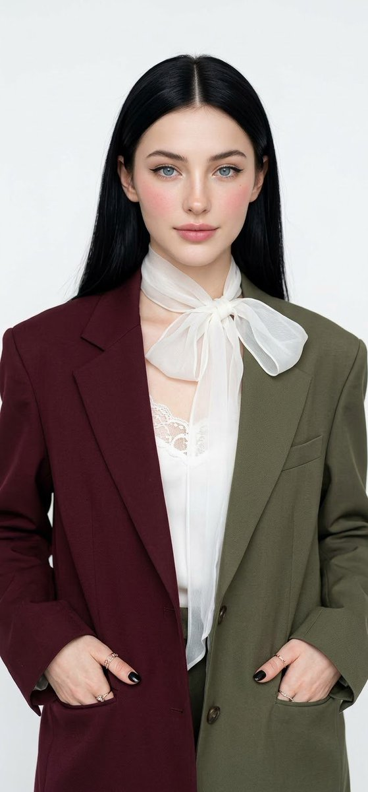

```text
Create an ultra-realistic, high-quality fashion portrait of a beautiful young woman with long, straight, silky black hair, striking grey-green eyes, soft rosy cheeks, natural pink lips, delicate facial features, and elegant makeup with winged eyeliner. She is wearing an oversized two-tone blazer, burgundy on one side and olive green on the other, over a white lace-trimmed camisole, paired with a sheer white neck scarf tied in a graceful bow. Her hands are casually tucked into the blazer pockets, showing delicate rings and black nail art. Her head is slightly tilted, with a calm, confident expression, looking directly at the camera. Minimalist white studio background, soft diffused lighting, realistic skin texture, luxury fashion editorial photography, sharp focus, natural proportions, detailed fabric textures, waist-up composition, 85mm portrait lens, 4K quality. No text, no watermark, no extra fingers, no distorted hands.
```

Model: Nano Banana Pro · Author: Aynah

[Original source](https://github.com/YouMind-OpenLab/awesome-nano-banana-pro-prompts/blob/11c6a7e5bfa24d585d6221be11a2dcc0ea1d571b/README.md#L1380) · [Provenance and original license](data/projectd-batch-0004.json)

## Ultra-photorealistic corporate fashion portrait prompt — Reference Image Required

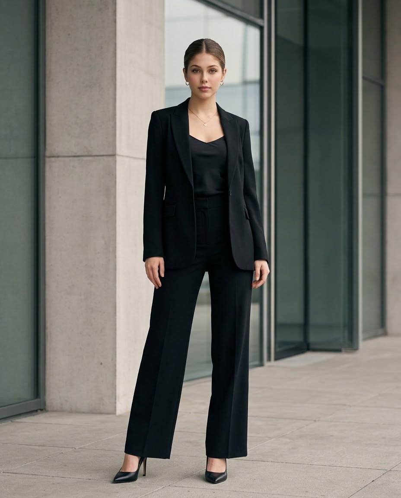

```text
Create an ultra-photorealistic luxury corporate fashion portrait using the uploaded reference image for the exact face and identity. A confident young woman standing full-body outside a modern glass-and-concrete office building, wearing an elegant all-black tailored pantsuit with a structured blazer, black satin camisole, high-waisted wide-leg trousers, and pointed-toe black stiletto heels.

Her hair is neatly styled in a sleek, center-parted low bun. Minimal gold hoop earrings, a delicate gold necklace, and natural sophisticated makeup. She stands confidently with relaxed arms, shoulders straight, and one leg slightly forward, looking directly at the camera with a calm, professional expression.

Identity preservation: Maintain the exact facial identity from the uploaded reference image, including face shape, eyes, eyebrows, nose, lips, skin tone, facial proportions, and natural skin texture. Do not change or beautify the face. Keep the same recognizable person throughout.

Photography and environment: Full-body vertical fashion photograph, modern corporate architecture, large glass windows, pale concrete columns, clean stone pavement, soft natural daylight, subtle shadows, realistic fabric folds, premium black tailoring, natural skin pores, sharp facial details, sophisticated neutral color grading, shot on an 85mm portrait lens, professional editorial photography, realistic proportions, high dynamic range, 8K-quality detail.

Composition: 4:5 vertical aspect ratio, entire body visible from head to shoes, both feet completely inside the frame, subject centered, realistic camera perspective, background slightly blurred while architectural details remain visible.

Negative prompt: Different face, identity drift, altered facial features, artificial skin, plastic texture, excessive retouching, cartoon, CGI, distorted hands, extra fingers, incorrect anatomy, unnatural legs, warped clothing, cropped feet, blurry face, oversaturated colors, text, logo, watermark.
```

Model: Nano Banana Pro · Author: Elvorya

[Original source](https://github.com/YouMind-OpenLab/awesome-nano-banana-pro-prompts/blob/11c6a7e5bfa24d585d6221be11a2dcc0ea1d571b/README.md#L1413) · [Provenance and original license](data/projectd-batch-0004.json)

## Ponytail Portrait Prompt — Reference Image Required

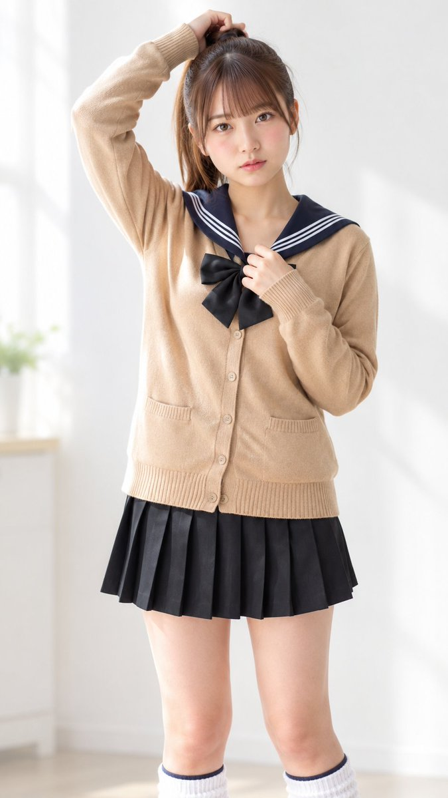

```text
[全体テーマ] 明るくミニマルな室内で、穏やかな表情の若い女性を捉えた目線の高さでのミディアムショット。

[被写体 - 顔と服装] 顔と服装については添付画像を参照してください。

[被写体 - 表情] 優しく物思いにふけるような表情で、視線は前方の視聴者に向けられており、口は閉じています。

[動作] 右手で頭上の髪を掴みポニーテールを作ろうとしており、左手は襟元の胸元に軽く添えられています。胴体は正面を向いており、両足で床に体重を支えています。

[被写体 - ポーズ] 右腕は肘を曲げて上げられ、手は頭頂部付近の髪の束を掴んでいます。左腕は曲げられ、指先が胸の中央付近の衣服に触れています。頭はわずかに傾いています。肩は水平です。体は垂直を保ち、平らな床に置かれた両足に均等に体重を分散させています。

[構図と写真撮影] 被写体を中央に配置した目線の高さでのミディアムショット。浅い被写界深度により白い壁の背景が柔らかくぼかされています。側面からの自然な窓光を使用しています。

[光と雰囲気] 人物や壁に優しい影を作る柔らかく拡散された自然光が、清潔で開放的な日常の雰囲気を醸し出しています。

フォトリアリスティック。RAW 写真。滑らかで輝く肌。スマートフォン画面向けに最適化されたアスペクト比 9:16 の縦型ポートレート画像を作成してください。
```

Model: Nano Banana Pro · Author: 川越あい(ラブりんって呼んでෆ)

[Original source](https://github.com/YouMind-OpenLab/awesome-nano-banana-pro-prompts/blob/11c6a7e5bfa24d585d6221be11a2dcc0ea1d571b/README_ja-JP.md#L1460) · [Provenance and original license](data/projectd-batch-0004.json)

## South Asian Woman Cinematic Portrait

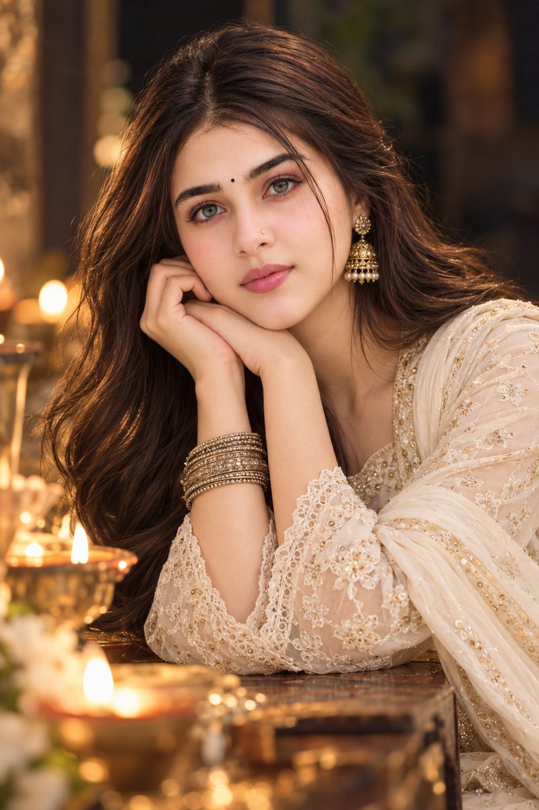

```text
Ultra-realistic cinematic portrait of a beautiful young South Asian woman with long wavy brown hair, hazel-green eyes, a small black bindi, nose pin, golden jhumka earrings, and silver bangles. Wearing a cream embroidered lace suit, resting her chin on folded hands, gazing softly at the camera. Warm diya candle bokeh, dark blurred background, golden cinematic lighting, natural skin texture, shallow depth of field, 8K, 85mm lens, vertical 2:3.
```

Model: Nano Banana Pro · Author: Hania

[Original source](https://github.com/YouMind-OpenLab/awesome-nano-banana-pro-prompts/blob/11c6a7e5bfa24d585d6221be11a2dcc0ea1d571b/README.md#L1521) · [Provenance and original license](data/projectd-batch-0004.json)

## Retro Hong Kong Cha Chaan Teng Portrait Prompt

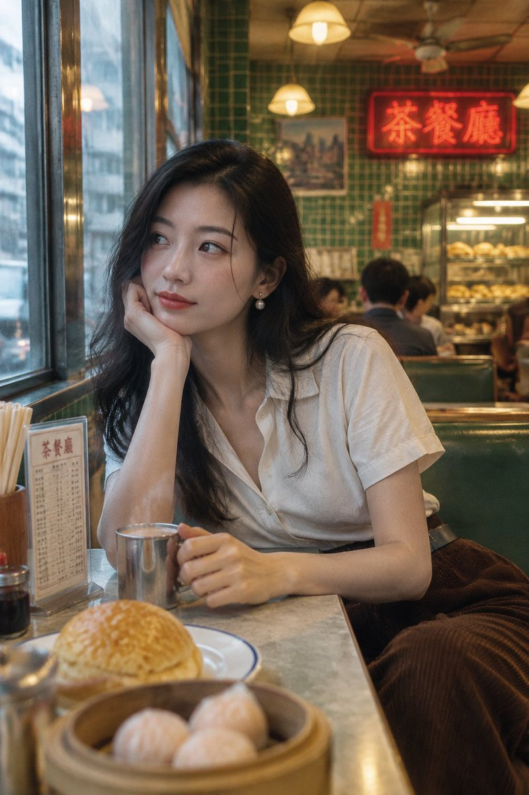

```text
复古港式茶餐厅人像，90 年代香港电影剧照美学，纪实抓拍氛围。

主体：25 岁东亚女性，鹅蛋脸，细眉，深色眼睛；白皙皮肤带有细腻毛孔和自然纹理，无塑料感磨皮；淡妆，红唇。黑色长发披肩，发尾微卷，几缕碎发修饰脸型。

表情：目光游离至镜头左侧，神态慵懒放松，嘴角带着一丝浅笑，仿佛午后发呆被定格。

服装：米白色纯棉短袖衬衫，领口解开一颗扣子；深棕色高腰灯芯绒阔腿裤；黑色细皮带；珍珠耳环。干净利落的穿搭，细节中藏着复古感。

姿势/动作：坐在茶餐厅靠窗卡座，身体微微转向窗户，一只手肘撑在桌上，手指轻握冒着热气的丝袜奶茶，另一只手随意托着下巴。坐姿放松，不僵硬。

道具：桌上有菠萝包、竹蒸笼里的虾饺、金属奶茶杯、菜单板、木质筷筒。

环境：前景是略微虚化的奶茶杯和蒸笼；中景是主体和卡座桌子；背景是茶餐厅内部——绿色马赛克瓷砖墙，红色霓虹灯招牌“Cha Chaan Teng”，老式吊扇，玻璃柜里的蛋挞和糕点；远处的食客呈现柔和的模糊效果。

灯光：室内暖黄色吊灯作为主光，色温约 3200K，笼罩在一层薄薄的油烟雾气中；窗外阴天的冷日光作为轮廓光，形成冷暖色调对比。玻璃柜和瓷砖上有柔和的高光反射。

相机：50mm 定焦镜头，f/2.0，半身照，机位略低于视线水平，浅景深，主体清晰，前景/背景自然虚化，轻微手持感的随意构图，胶片颗粒感，柯达金胶卷模拟，Eastmancolor 色彩风格。

情绪：怀旧，慢节奏的午后慵懒，像是一部老港片中冻结的一帧画面。

质量标签：ultra detailed, photorealistic, cinematic, high resolution, natural skin texture.

负面约束：No oil painting, No anime, No 3D render, No cartoon, no deformed hands, no plastic skin, no oversaturated colors, no text artifacts, no watermark.
```

Model: Nano Banana Pro · Author: Candy

[Original source](https://github.com/YouMind-OpenLab/awesome-nano-banana-pro-prompts/blob/11c6a7e5bfa24d585d6221be11a2dcc0ea1d571b/README_zh.md#L1554) · [Provenance and original license](data/projectd-batch-0004.json)

## Hellenistic Medusa Editorial Prompt

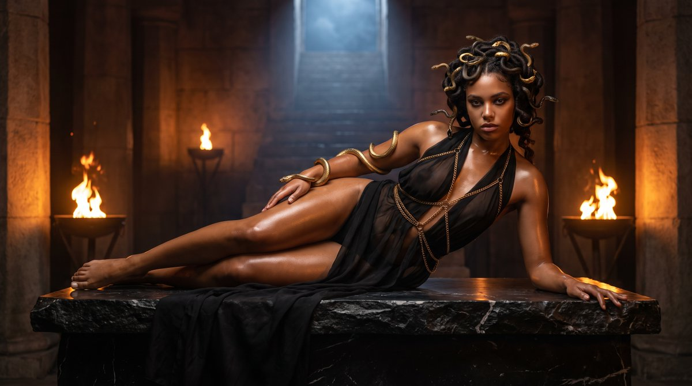

```text
Theme:
High-fashion dark mythological editorial inspired by Hellenistic antiquity and the legend of Medusa.

Subject:
A 20-year-old woman of Classical Greek-Mediterranean descent, portrayed as a temple priestess. She is reclined upon a sunken black marble altar, accompanied by a sleek, golden-scaled temple viper that glides across her shoulder and waist.

Person · Expression:
Sharp Hellenistic facial features with high cheekbones and a straight Greek nose. Her eyes are a smoky golden-amber with an intense, steady gaze. Her lips are slightly parted in a calm exhale. Her long, thick glossy black hair is intertwined with delicate gold chains and small serpents, with damp strands resting against her oiled skin.

Clothing · Pose:
She wears a minimalist harness crafted from fine liquid gold chainmail paired with a sheer, translucent onyx silk wrap. The fabric is draped to follow her form, yielding to gravity as she performs a deep back-arch across the basalt altar. One arm is stretched overhead gripping a golden altar prop, while the other rests near her hip.

Background · Light:
An ancient seaside temple carved from black basalt rock at midnight. The environment is lit by a high-contrast chiaroscuro setup: intense flickering orange light from bronze fire braziers creates highlights on the oiled skin and gold metal, while cool silvery moonlight provides a sharp rim light. Aromatic myrrh smoke and sea mist drift through the background columns.

Composition · Camera:
Low-angle medium shot that emphasizes the subject's stature. The framing is a horizontal 16:9 composition with the subject dominating the central diagonal axis. Shot with an 85mm lens at f/1.4 to create a shallow depth of field, keeping the subject in sharp focus while the temple architecture fades into a creamy, amber-hued bokeh.

Texture · Style:
Hyper-photorealistic digital photography with a cinematic editorial grade. Features highly detailed skin textures including visible pores and a specular oil sheen. The style incorporates subtle film grain, soft sensor bloom on highlights, and the tactile contrast between cold black stone, warm fire, and metallic gold.
```

Model: Nano Banana Pro · Author: Dominus Pellissier

[Original source](https://github.com/YouMind-OpenLab/awesome-nano-banana-pro-prompts/blob/11c6a7e5bfa24d585d6221be11a2dcc0ea1d571b/README.md#L1720) · [Provenance and original license](data/projectd-batch-0004.json)

## Marble and Wire — Avant-Garde Portrait

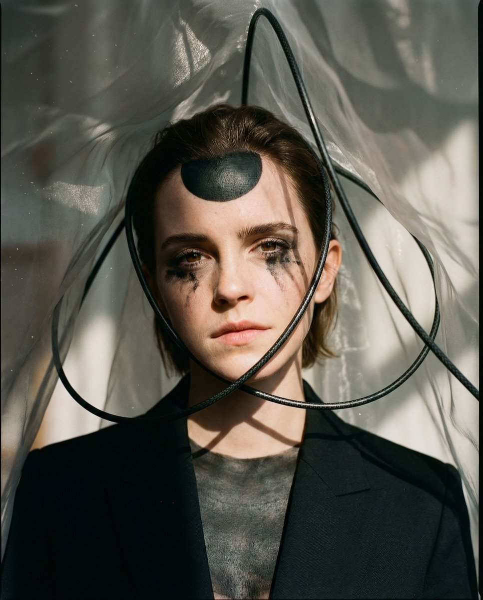

```text
{
  "vibe_title_en": "Marble & Wire",
  "master_prompt": "A tight, telephoto close-up portrait of The Protagonist as an Avant-Garde Visionary in a sunlit, dust-filled alabaster sculpting atelier. The subject looks directly at the lens with a calm, self-assured, unwavering gaze. They wear a structured black blazer, but their neck and upper chest are painted with a stark, matte black geometric shape that mimics a plunging garment. The forehead features a painted black semi-circle, with heavily smudged, visceral dark pigment under the eyes. High-budget practical surrealism: Rigid, floating black carbon-fiber wires loop impossibly around the head and face, physically interacting with a flowing, translucent silk-glass veil that partially obscures the subject. Bright, natural sunlight streams through tall atelier windows, creating sparkling highlights on the veil and casting sharp, organic shadows from the floating wires onto hyper-realistic skin. Captured on a Hasselblad H6D-100c, 150mm f/2.8 lens. Exceptional micro-details: visible skin pores, fine marble dust motes in the air, the tactile weave of the blazer, and the physical refraction of light through the translucent material. Cinematic, uncanny, bright and structural, Kodak Portra 400 film stock emulation, NO NEON.",
  "meta": {
    "intent": "Avant-garde surreal portraiture",
    "priorities": "Hyper-realism, practical effect simulation, bright natural lighting, intricate textures",
    "device_profile": "Hasselblad H6D-100c"
  },
  "frame": {
    "aspect": "4:5",
    "composition": "Tight close-up, filled frame with face, veil, and floating wires",
    "layout": "Center-weighted, leading lines created by flowing veil and rigid wires intersecting",
    "camera_angle": "Eye-level, direct gaze",
    "tilt_roll_degrees": "0"
  },
  "subject": {
    "gender": "{argument name="gender" default="Female"}",
    "identity": "{argument name="identity" default="The Protagonist as an Avant-Garde Visionary"}",
    "demographics": "Ageless, ethereal yet grounded",
    "face": "Symmetrical, calm, adorned with a stark black semi-circle on the forehead and smudged dark under-eyes",
    "hair": "Sleek, pulled back tightly to allow structural elements to dominate",
    "body": "Neck and upper chest painted entirely in matte black body paint",
    "expression": "Calm, self-assured, projecting a striking blend of fragility and confidence",
    "pose": "Static, facing forward directly at the viewer, viewed through a complex artistic filter"
  },
  "wardrobe_accessories": {
    "garments": [
      {
        "item": "Tailored blazer",
        "material": "Heavy wool blend",
        "color": "Deep Black",
        "fit": "Structured and sharp"
      }
    ],
    "accessories": [
      {
        "item": "Floating rigid wires",
        "color": "Matte Black",
        "material": "Carbon-fiber",
        "brand_style": "Avant-Garde Surrealism"
      },
      {
        "item": "Flowing translucent veil",
        "color": "Clear/Sheer",
        "material": "Silk-glass",
        "brand_style": "Ethereal"
      }
    ]
  }
}
```

Model: Nano Banana Pro · Author: timedoctor.eth

[Original source](https://github.com/YouMind-OpenLab/awesome-nano-banana-pro-prompts/blob/11c6a7e5bfa24d585d6221be11a2dcc0ea1d571b/README.md#L1772) · [Provenance and original license](data/projectd-batch-0004.json)

## Clean-Girl Editorial Fashion Portrait

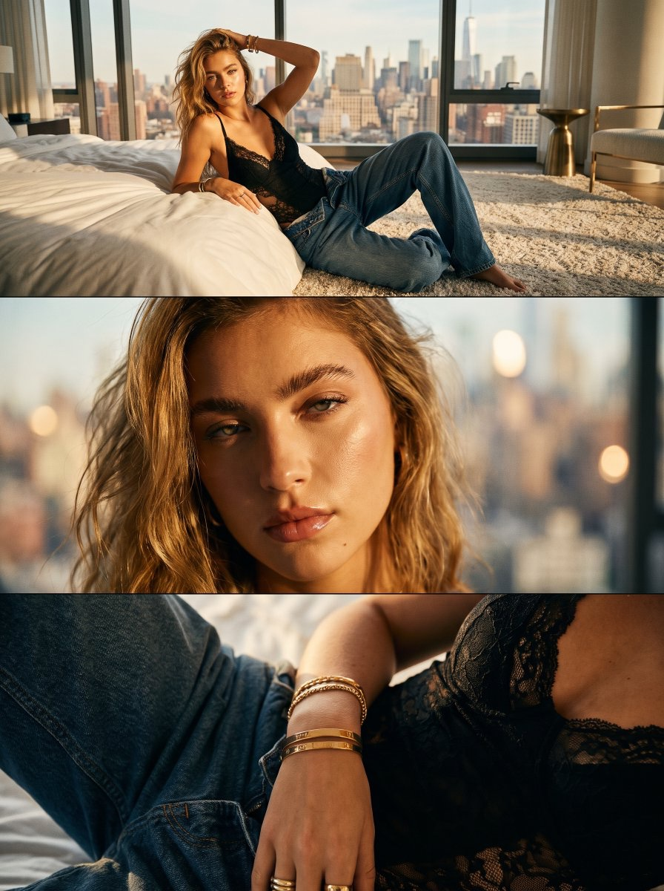

```text
Theme:
A vertical three-panel fashion narrative depicting high-society relaxation in a minimalist Soho penthouse.

Subject:
{argument name="name" default="Elena"}, a {argument name="age" default="21"}-year-old Caucasian woman with a lean, athletic build. She appears in a sequence of three frames: a wide architectural view, a direct eye-level portrait, and a tactile close-up of her hand resting on her hip.

Person · Expression:
Heart-shaped face with a clean-girl aesthetic, featuring feathered brows and high-gloss lips. Her gaze is enigmatic and half-lidded, with detailed irises reflecting the Manhattan skyline. Her honey-blonde hair is styled in tousled, "just-woke-up" waves that catch the golden hour backlight. Skin is dewy and luminous with realistic micro-textures, including visible pores and soft downy hair.

Clothing · Pose:
She wears an onyx black Chantilly lace couture bodysuit with intricate floral motifs, contrasted against oversized, heavily washed vintage indigo denim worn loosely at the hips. Her wrist, adorned with stacked gold Cartier Love bracelets and a Juste un Clou ring, rests against the rugged denim to showcase the interplay between fine jewelry and fabric.

Background · Light:
An ultra-exclusive Soho penthouse with floor-to-ceiling windows and minimalist decor, including a white high-pile carpet and a soft cotton duvet. The scene is illuminated by warm, directional golden hour sunlight creating sharp, geometric shadows and ray-traced highlights on skin and gold accessories.

Composition · Camera:
A vertical 3-panel collage. The top panel uses a wide-angle perspective for the setting; the middle panel is a shallow-depth-of-field portrait; the bottom panel is a macro-focused shot of textures. Captured with a Phase One XF IQ4 and an 80mm Schneider Kreuznach lens.

Texture · Style:
Hyper-realistic high-fashion editorial style. Tactile rendering of delicate lace, heavy denim, and polished gold. The image features a high-contrast S-curve color grade, subtle film grain, and a soft bloom on the highlight edges of the lace.
```

Model: Nano Banana Pro · Author: Dominus Pellissier

[Original source](https://github.com/YouMind-OpenLab/awesome-nano-banana-pro-prompts/blob/11c6a7e5bfa24d585d6221be11a2dcc0ea1d571b/README.md#L1873) · [Provenance and original license](data/projectd-batch-0004.json)

## Hilltop Cinematic Portrait at Dusk

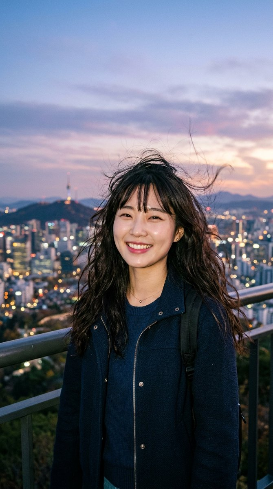

```text
Cinematic portrait of a young East Asian woman standing at a hilltop overlook at dusk, smiling brightly and looking straight into the camera with a joyful, carefree expression, head slightly tilted. Long, dark brown-black hair with wispy bangs, wildly blown by the wind with strands flying in every direction. Dewy, luminous skin, soft natural makeup, rose-pink lips, a warm, genuine smile with visible teeth, eyes crinkled with happiness. Wearing a dark navy zip-up jacket with small metal snaps over a blue knit top, with a bag strap over one shoulder. A metal railing at the bottom edge of the frame. Background: a sprawling city skyline far below, with softly glowing bokeh lights, dark rolling hills, and a hazy blue-hour sky fading from lavender and soft pink to pale blue, with thin purple clouds. Cool twilight ambient light with gentle warm pink glow on her face, dreamy, youthful, romantic mood, Korean-style cinematic aesthetic, shallow depth of field, city lights as soft bokeh, 35mm lens, f/1.8, photorealistic, ultra-detailed skin and hair texture, vertical 9:16 composition.
```

Model: Nano Banana Pro · Author: Sophie

[Original source](https://github.com/YouMind-OpenLab/awesome-nano-banana-pro-prompts/blob/11c6a7e5bfa24d585d6221be11a2dcc0ea1d571b/README.md#L1926) · [Provenance and original license](data/projectd-batch-0004.json)

## Red Velvet Leotard Portrait Comparison

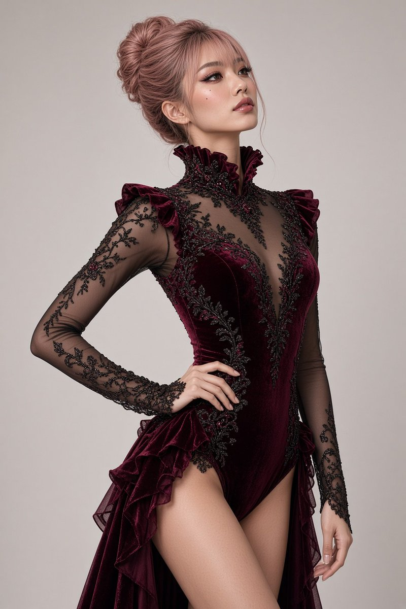

```text
Highly stylish cinematic portrait of a young East Asian woman with hair styled in an elegant high bun. She stands in a graceful pose, head tilted upward with a serene expression, one hand resting on her hip.

She wears a deep burgundy velvet figure-skating leotard with intricate black lace embroidery, sheer mesh long sleeves, a high ruffled collar, and delicate ruffle details along the hips. Slim athletic body with elegant posture.

Clean minimal background with soft dramatic lighting that highlights the rich velvet texture and lace details. High-fashion editorial style, refined composition, luxurious fabric rendering, sharp focus, visually stunning and elegant atmosphere, 8k.
```

Model: Nano Banana Pro · Author: Aiko💕

[Original source](https://github.com/YouMind-OpenLab/awesome-nano-banana-pro-prompts/blob/11c6a7e5bfa24d585d6221be11a2dcc0ea1d571b/README.md#L2055) · [Provenance and original license](data/projectd-batch-0004.json)

## Object-to-Building Transformation Prompt

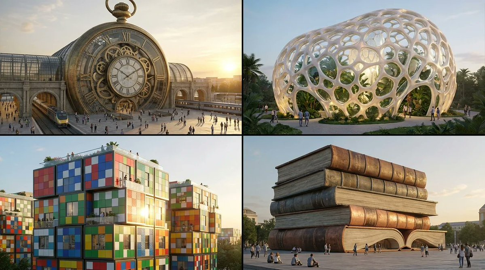

```text
Turning random objects into buildings.

2x2 grid, do this for 4 different random objects. Concept: Turn objects into a landmark building that could exist.

1. ANALYZE INPUT (Massing & Structure):

Mass: (Monolithic/Fragmented/Stacked/Spindly)

Surface: (Reflective/Porous/Layered/Patterned)

Mechanism: (Static/Kinetic/Modular)

2. AUTO-SELECT BUILDING TYPE:

IF Monolithic + Stone-like → Museum

IF Reflective + Aerodynamic → Skyscraper

IF Modular + Stacked → Housing complex

IF Porous + Organic → Botanical conservatory

IF Kinetic + Mechanical → Transit hub

3. EXECUTE:
Golden-hour exterior render, people for scale, plausible materials, cinematic wide lens.
```

Model: Nano Banana Pro · Author: Gadgetify

[Original source](https://github.com/YouMind-OpenLab/awesome-nano-banana-pro-prompts/blob/11c6a7e5bfa24d585d6221be11a2dcc0ea1d571b/README.md#L2110) · [Provenance and original license](data/projectd-batch-0004.json)

## Product Reference Sheet Workflow — Reference Image Required

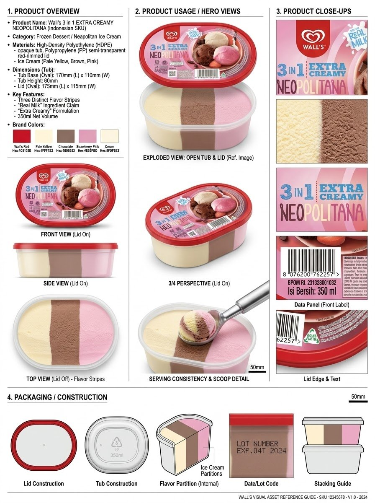

```text
Analyze the product and create a high-resolution, photorealistic, professional advertising reference sheet containing these four sections, on a clean white/neutral studio background, premium commercial product photography, soft controlled lighting, realistic materials, sharp details, subtle shadows, and a professional editorial grid.
1. PRODUCT OVERVIEW; name, category, materials, dimensions/size, key features, and brand colors.
2. PRODUCT USAGE/HERO VIEWS - front, back, side, 3/4, and functional/use view where relevant.
3. PRODUCT CLOSE-UPS - logo/label, texture/material, key components, packaging details, and other important identifying features.
4. PACKAGING / CONSTRUCTION - relevant packaging or structural views where applicable. 
The entire sheet must function as a visual continuity bible for AI image/video production. Every product view must depict the exact same physical product with absolute consistency. Do not redesign, add variants, alter branding, or change proportions. Use cean typography, clear section labels, thin dividers, balanced spacing, sophisticated production-design aesthetic.
```

Model: Nano Banana Pro · Author: Olatunde AI

[Original source](https://github.com/YouMind-OpenLab/awesome-nano-banana-pro-prompts/blob/11c6a7e5bfa24d585d6221be11a2dcc0ea1d571b/README.md#L2168) · [Provenance and original license](data/projectd-batch-0004.json)

## Handwritten Memo Recipe Illustration

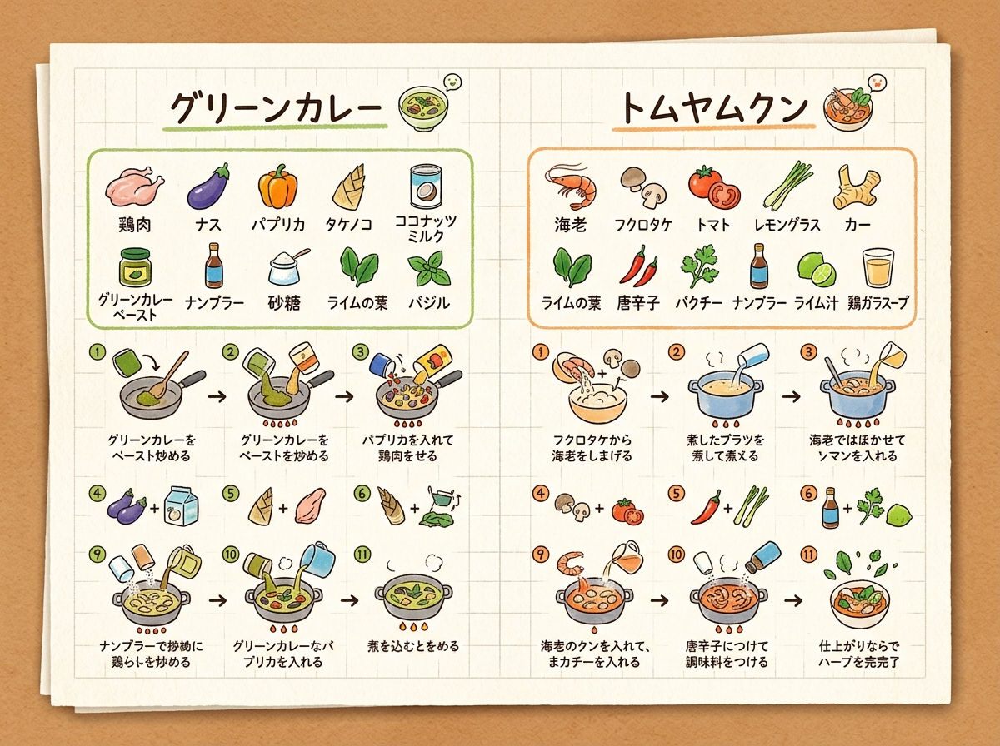

```text
[入力データ]
- 料理名（左ページ）: {argument name="dish name left" default="グリーンカレー"}
- 材料リスト（左ページ）: {ingredientsLeft}
- 調理手順（左ページ）: ①{stepLeft1} → ②{stepLeft2} → ③{stepLeft3}
- 料理名（右ページ）: {argument name="dish name right" default="トムヤムクン"}
- 材料リスト（右ページ）: {ingredientsRight}
- 調理手順（右ページ）: ①{stepRight1} → ②{stepRight2} → ③{stepRight3}
- カラーテーマ: {argument name="color theme" default="オーガニックな自然色"}

[構造およびレイアウト仕様]
- スタイル: 素朴なオフホワイトのメモ用紙（方眼紙）に描かれた、フラットな 2D 手書き風インフォグラフィックレシピイラスト。薄い方眼線と温かみのある紙の質感を表現。
- 背景および構成の制約: 物理的な本、立体的なノートの輪郭、ページの厚み、影、木製のテーブルのようなリアルな背景要素は描かないこと（木製のテーブル、リアルな本のモックアップ、本の厚み、ノートのページ、リアルな写真背景は一切禁止。テクスチャ付きの方眼メモ用紙のキャンバス上に直接描かれた、フラットな 2D ベクターレイアウトであること）。
- 左側のレイアウト:
  - 上部に大きな手書きの日本語タイトル「{dishLeft}」。
  - その下に、手書きの日本語とシンプルな料理イラストで描かれた材料リスト「{ingredientsLeft}」。
  - 下半分には、調理手順「①{stepLeft1} → ②{stepLeft2} → ③{stepLeft3}」を水平または垂直の矢印フローで配置。各手順の内容（切る、炒める、煮るなど）に合わせた可愛らしい手書きイラストを含めること。
  - 左下に「{dishLeft}」の完成した美味しそうなイラストを配置。
- 右側のレイアウト:
  - 上部に大きな手書きの日本語タイトル「{dishRight}」。
  - その下に、手書きの日本語とシンプルな料理イラストで描かれた材料リスト「{ingredientsRight}」。
  - 下半分には、調理手順「①{stepRight1} → ②{stepRight2} → ③{stepRight3}」を水平または垂直の矢印フローで配置。各手順の内容に合わせた可愛らしい手書きイラストを含めること。
  - 右下に「{dishRight}」の完成した美味しそうなイラストを配置。
- 色合い: 「{colorTheme}」に基づいた、優しく温かみのあるオーガニックな色調。

[品質および除外制約（必須）]
- 日付（例: 「8/7」）、曜日（例: 「SUN」）、カレンダーの枠、日付スタンプなどの日付関連要素は一切禁止（日付スタンプ、カレンダー、曜日、タイムラインスタンプは禁止）。
- フォントは親しみやすい手書き風の日本語（ゴシック体または丸ゴシック体）とし、入力された日本語を歪みやスペルミスなく正確に描画すること。

- アスペクト比: --ar 4:3
```

Model: Nano Banana Pro · Author: AI Guide-Note - 実務で使えるAI活用メディア

[Original source](https://github.com/YouMind-OpenLab/awesome-nano-banana-pro-prompts/blob/11c6a7e5bfa24d585d6221be11a2dcc0ea1d571b/README_ja-JP.md#L2210) · [Provenance and original license](data/projectd-batch-0004.json)

## Handwritten Style 3-Step Process Slide

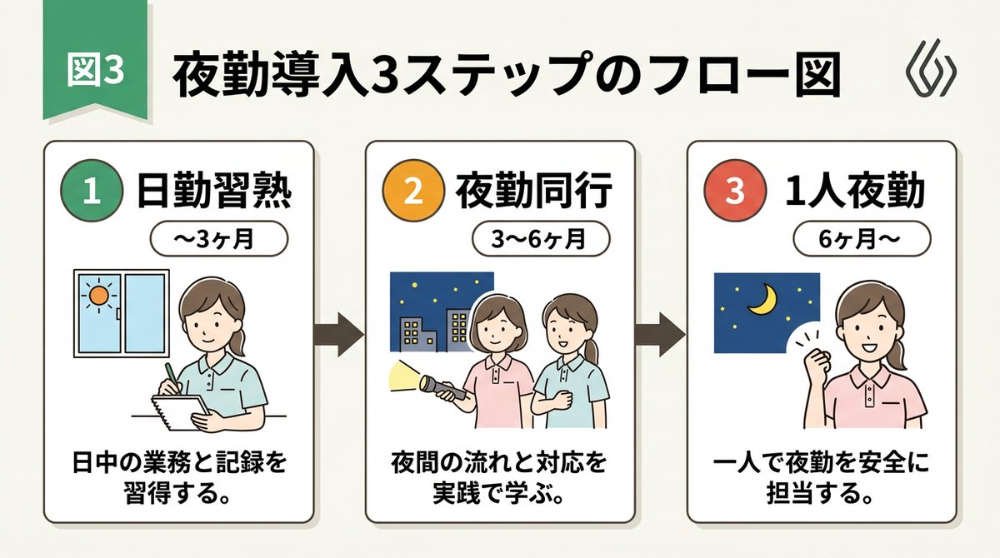

```text
[入力データ]
- 全体タイトル: {argument name="main title" default="夜勤導入のための 3 ステップフローチャート"}
- ステップ 1: タイトル "{argument name="step 1 title" default="日勤の習得"}" / 期間 "{step1Period}" / 説明 "{step1Desc}"
- ステップ 2: タイトル "{step2Title}" / 期間 "{step2Period}" / 説明 "{step2Desc}"
- ステップ 3: タイトル "{step3Title}" / 期間 "{step3Period}" / 説明 "{step3Desc}"
- カラーテーマ: {argument name="color theme" default="グリーン"}

[構成およびレイアウト仕様]
- スタイル: 日本のビジネス用 Slides、教育マニュアル、または社内文書に適した、クリーンで親しみやすい 3 ステップのフローチャートイラスト。16:9 の横長スライド構成。
- 背景: クリーンなオフホワイトまたは純白の背景。
- 上部タイトル:
  - 左上に「図 3」またはステップバッジを配置し、その右側に大きく読みやすいゴシック体で日本語のメインタイトル "{mainTitle}" を描画。右端には小さくシンプルな抽象ロゴマークを配置。
- ステップカードの配置:
  - 美しい長方形のカードを 3 枚並べて配置。左から右へ順番に並べ、太い矢印で接続。各カードの枠線はカラーテーマ ({colorTheme}) に合わせてきれいに色分けする。
- カード 1 (左) 内部:
  - 円形のバッジ「1」と日本語タイトル "{step1Title}" を目立つように描画。その下に "{step1Period}" と書かれたカプセルラベルを配置。
  - 中央には、手書き風の優しいタッチで描かれた、メモを取る日本人女性のイラストと、太陽が見える窓を配置。
  - 下部には日本語の説明 "{step1Desc}" を配置。
- カード 2 (中央) 内部:
  - 円形のバッジ「2」と日本語タイトル "{step2Title}" を目立つように描画。その下に "{step2Period}" と書かれたカプセルラベルを配置。
  - 中央には、懐中電灯を持った 2 人の日本人女性、夜空、建物のイラストを配置。
  - 下部には日本語の説明 "{step2Desc}" を配置。
- カード 3 (右) 内部:
  - 円形のバッジ「3」と日本語タイトル "{step3Title}" を目立つように描画。その下に "{step3Period}" と書かれたカプセルラベルを配置。
  - 中央には、夜空と三日月、そしてガッツポーズで微笑む日本人女性のイラストを配置。
  - 下部には日本語の説明 "{step3Desc}" を配置。

[品質およびフォント仕様]
- シンプルでクリーンな 2D イラスト、フラットデザイン、鮮明でクリアな線画。
- すべてのテキストは、スペルミスなく、読みやすい日本語フォント (ゴシック体) で正確に描画すること。
- 3D 効果、影、ノートパソコンのモックアップ背景、カメラの傾きはすべて除外し、フラットな図そのものを画面全体に表示すること。

- アスペクト比: --ar 16:9
```

Model: Nano Banana Pro · Author: AI Guide-Note - 実務で使えるAI活用メディア

[Original source](https://github.com/YouMind-OpenLab/awesome-nano-banana-pro-prompts/blob/11c6a7e5bfa24d585d6221be11a2dcc0ea1d571b/README_ja-JP.md#L2272) · [Provenance and original license](data/projectd-batch-0004.json)

## Vintage British Caricature Satire

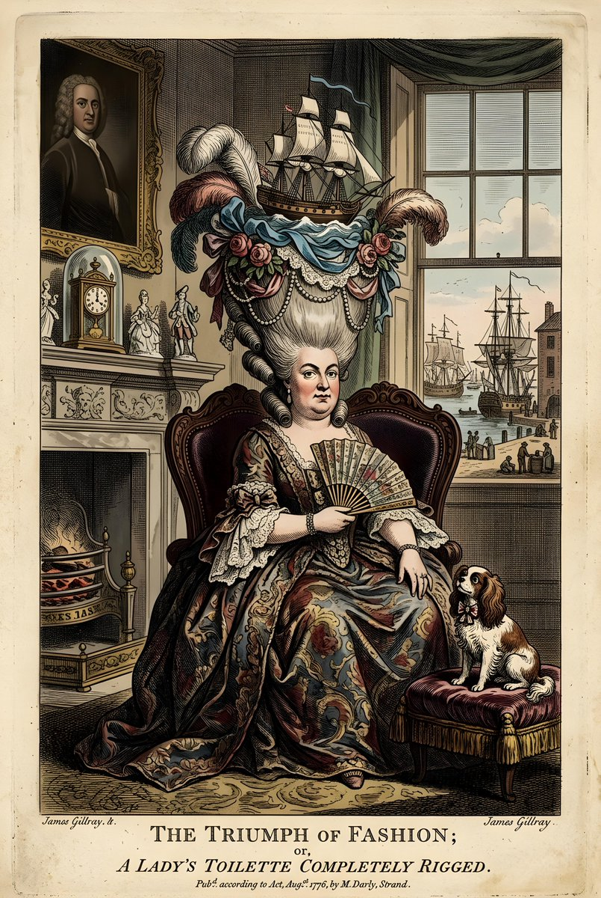

```text
A vintage British caricature depicts a woman with an elaborate hairstyle adorned with a sailing ship, flowers, and feathers. She is seated in an ornate chair, wearing a richly decorated dress and holding a fan. The background shows a lavish interior with a fireplace, clock, and a window overlooking a harbor scene. A small dog sits on a cushion to her right. The overall style is that of a 18th-century satirical print.
```

Model: Nano Banana Pro · Author: Heather Green

[Original source](https://github.com/YouMind-OpenLab/awesome-nano-banana-pro-prompts/blob/11c6a7e5bfa24d585d6221be11a2dcc0ea1d571b/README.md#L2334) · [Provenance and original license](data/projectd-batch-0004.json)

## Vintage Travel Journal Editorial Collage

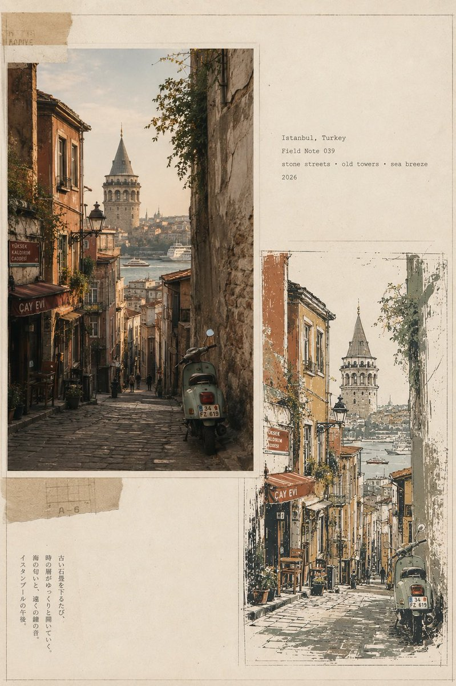

```text
Create a premium vintage Japanese travel-journal editorial collage in vertical 4:5 format, featuring four distinct city sections—Bangkok, Thailand; Lisbon, Portugal; Marrakech, Morocco; Istanbul, Turkey. Each section combines a warm photorealistic documentary street photograph with a matching imperfect hand-drawn screen-print illustration, arranged asymmetrically on aged cream paper with torn-paper layers, archival borders, subtle pencil marks, typewriter captions, faded ink, paper fibers, and authentic 35mm analog grain. Bangkok: shrine, tangled wires, tropical greenery, teal motorbike; Lisbon: yellow tram, steep cobblestone street, balconies and river view; Marrakech: terracotta medina, palms, rugs and ornate minaret; Istanbul: steep stone street, Galata Tower, Bosphorus and vintage scooter. Use a restrained palette of sage, ochre, terracotta, mustard, charcoal and warm ivory, with sophisticated editorial art direction, muted contrast, natural light, handmade imperfections, and museum-quality travel-zine aesthetic.
```

Model: Nano Banana Pro · Author: lovimg_com

[Original source](https://github.com/YouMind-OpenLab/awesome-nano-banana-pro-prompts/blob/11c6a7e5bfa24d585d6221be11a2dcc0ea1d571b/README.md#L2401) · [Provenance and original license](data/projectd-batch-0004.json)

## Editorial Cooking Storyboard Layout

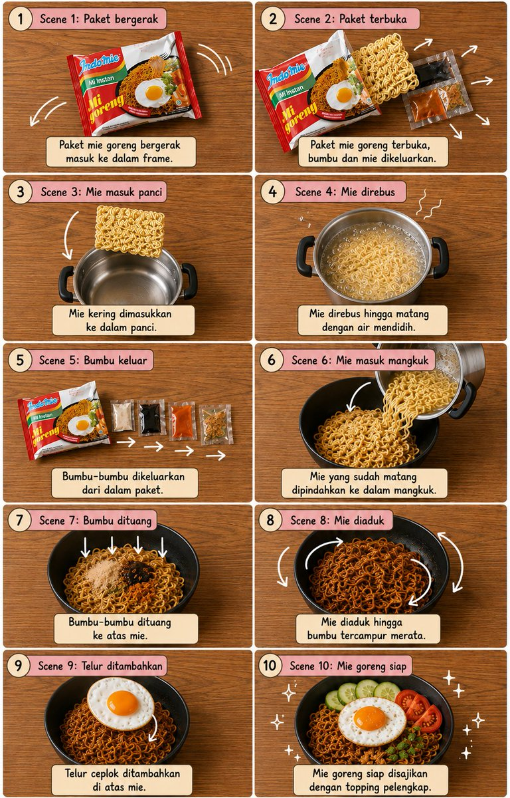

```text
Create a vertical 4:5 cooking storyboard with exactly 10 panels in a {argument name="grid" default="2×5 grid"}. {argument name="surface" default="warm wooden tabletop"}, perfect top-down view, thin white borders, dusty-pink rounded headers, cream caption boxes, numbered circles and black handwritten typography.\n\nShow the exact sequence: {argument name="dish" default="dish"} packet → packet opens → noodles enter silver pot → noodles boil → seasoning sachets come out → cooked noodles enter black bowl → seasonings fall in → noodles mix → fried egg placed on top → finished mie goreng with egg and garnishes.\n\nUse clear white curved arrows, motion lines and sparkles to show every movement. Keep identical object continuity, realistic food, warm lighting, clean cute editorial storyboard style, sharp details and balanced spacing. No people, no hands, no extra panels.
```

Model: Nano Banana Pro · Author: 𝐌

[Original source](https://github.com/YouMind-OpenLab/awesome-nano-banana-pro-prompts/blob/11c6a7e5bfa24d585d6221be11a2dcc0ea1d571b/README.md#L2434) · [Provenance and original license](data/projectd-batch-0004.json)

## Regional Cultural Atlas Poster

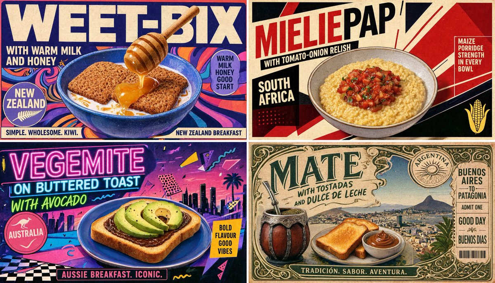

```text
2x2 grid, 16:9, do this for 4 under rated breakfasts of Southern hemisphere: INPUT = [{argument name="category" default="TOPIC_CATEGORY"} / {argument name="region" default="REGION_SET"} / {argument name="criteria" default="SELECTION_CRITERIA"} / {argument name="mood" default="MOOD"}]
MODE = no_hardcoding / inference_only

Run REGIONAL_CULTURAL_ATLAS_EXTRACTION:

CATEGORY_DNA := infer what type of thing is being compared, how it is used, why it matters, and what makes it visually recognizable

REGION_DNA[each] := infer local environment, visual culture, palette, typography attitude, textures, symbols, landscapes, tools, rituals, and social context

ITEM_SELECTION[each] := infer one overlooked or representative item that fits TOPIC_CATEGORY + REGION + SELECTION_CRITERIA

HERO_VISUAL[each] := infer the best visual treatment:
plated food, product close-up, ritual scene, tool layout, garment portrait, object still life, landscape-backed artifact, map-backed diagram, or symbolic vignette

COPY_SYSTEM[each] := generate:
- large item title
- short emotional tagline
- origin/location label
- 2–4 tiny descriptors
- stamp or badge phrase
- small contextual note

GRAPHIC_SYSTEM := infer torn paper, printed grid, muted color blocks, topographic lines, stamps, borders, halftone, atlas marks, and editorial spacing

Render:
A premium regional comparison poster where each panel feels locally specific but belongs to one unified cultural theme.

Forbidden:
hard-coded Southern Hemisphere, fixed breakfasts, fixed foods, fixed countries, fixed beige/red/green palette, fake local facts, random travel-poster clichés.
```

Model: Nano Banana Pro · Author: Gadgetify

[Original source](https://github.com/YouMind-OpenLab/awesome-nano-banana-pro-prompts/blob/11c6a7e5bfa24d585d6221be11a2dcc0ea1d571b/README.md#L2520) · [Provenance and original license](data/projectd-batch-0004.json)

## Whimsical Coloring Page Illustration

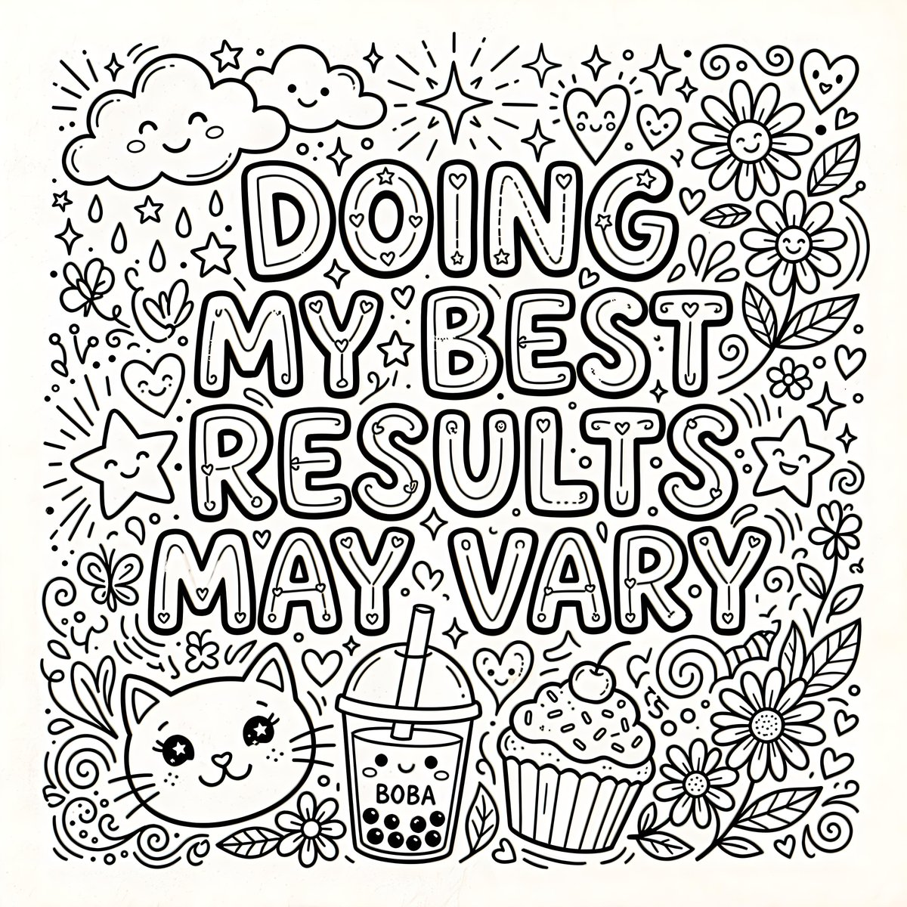

```text
A black and white line drawing features the text "{argument name="quote" default="DOING MY BEST RESULTS MAY VARY"}" in large, bold, bubble-style lettering. The text is surrounded by various cute and whimsical elements, including smiling stars, a cat face, clouds, daisies, hearts, cupcakes, a boba tea, and sparkly starbursts. The overall composition is dense and playful, designed as a coloring page.
```

Model: Nano Banana Pro · Author: Heather Green

[Original source](https://github.com/YouMind-OpenLab/awesome-nano-banana-pro-prompts/blob/11c6a7e5bfa24d585d6221be11a2dcc0ea1d571b/README.md#L2600) · [Provenance and original license](data/projectd-batch-0004.json)

## 90s Action Heroine Noir Prompt

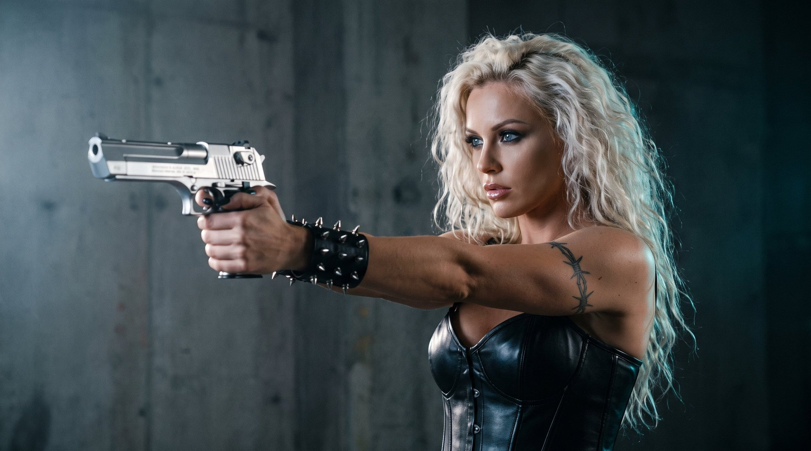

```text
Theme:
1990s Noir-Action Cinema

Subject:
An athletic adult woman in her early thirties with a classic action-heroine aesthetic, positioned in a high-stakes industrial setting.

Person · Expression:
Platinum blonde hair styled in voluminous, wild waves. Features include high cheekbones, piercing blue eyes with a focused gaze, and smoky eye makeup. The expression is one of intense tactical readiness. A sharp black-ink barbed-wire tattoo is visible on the upper arm.

Clothing · Pose:
A structured bodice made of polished black leather with visible stitching and realistic grain. She is in a professional two-handed aiming stance, holding a large silver film-prop pistol. A chrome spiked gauntlet cuff is visible on the wrist. The pose is a dynamic profile with locked elbows and a steady grip.

Background · Light:
A dark, moody industrial studio with concrete walls and a hazy atmosphere. The scene is side-lit by a cool white key light, complemented by a teal rim light on the hair. Deep shadows and specular highlights on the metallic prop and leather clothing create a high-contrast environment.

Composition · Camera:
Medium shot from a low angle to establish a heroic perspective. Captured with an anamorphic lens simulation, featuring a shallow depth of field and oval bokeh. The framing is a 16:9 cinematic landscape.

Texture · Style:
35mm film photography style with fine grain and a hyper-realistic finish. Skin textures are highly detailed with visible pores and a light cinematic sheen. The overall aesthetic follows a 1990s film scan with punchy contrast and a cool color palette.
```

Model: Nano Banana Pro · Author: Dominus Pellissier

[Original source](https://github.com/YouMind-OpenLab/awesome-nano-banana-pro-prompts/blob/11c6a7e5bfa24d585d6221be11a2dcc0ea1d571b/README.md#L2786) · [Provenance and original license](data/projectd-batch-0004.json)

## Antarctic Expedition Historical Realism Comparison

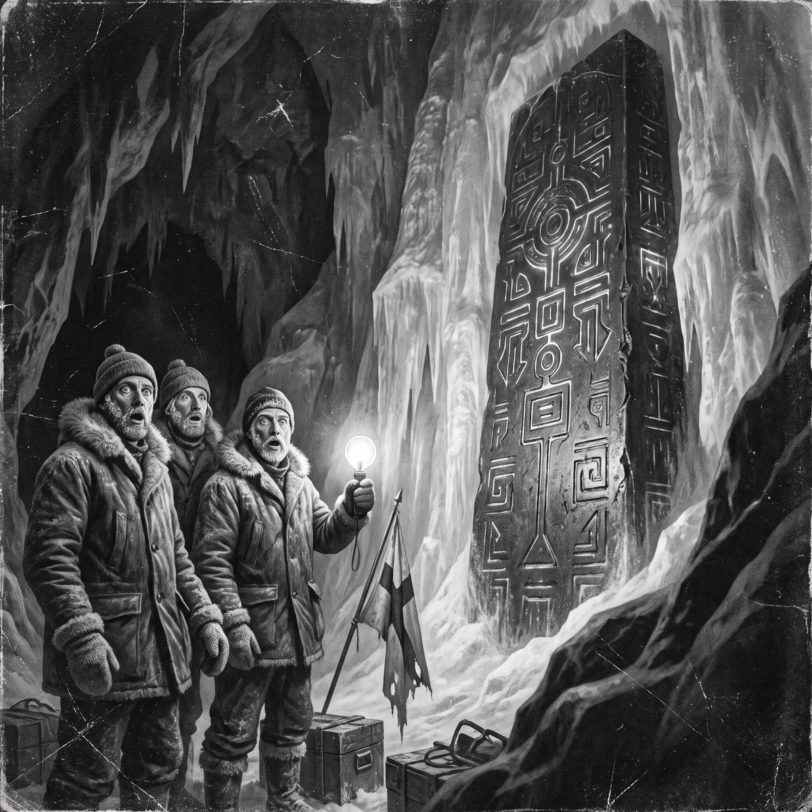

```text
Raw archival black and white photograph from a 1923 Antarctic expedition, grain, scratches, flash illumination. Weary explorers bundled in vintage heavy winter coats staring in shock at a massive, intricate glowing metallic monolith partially frozen inside a sheer ice cavern, photorealistic, historical documentary photography, hyper-detailed textures.
```

Model: Nano Banana Pro · Author: Elian Iao

[Original source](https://github.com/YouMind-OpenLab/awesome-nano-banana-pro-prompts/blob/11c6a7e5bfa24d585d6221be11a2dcc0ea1d571b/README.md#L2889) · [Provenance and original license](data/projectd-batch-0004.json)

## Hooded Assassin on Temple Rooftop Fantasy Art

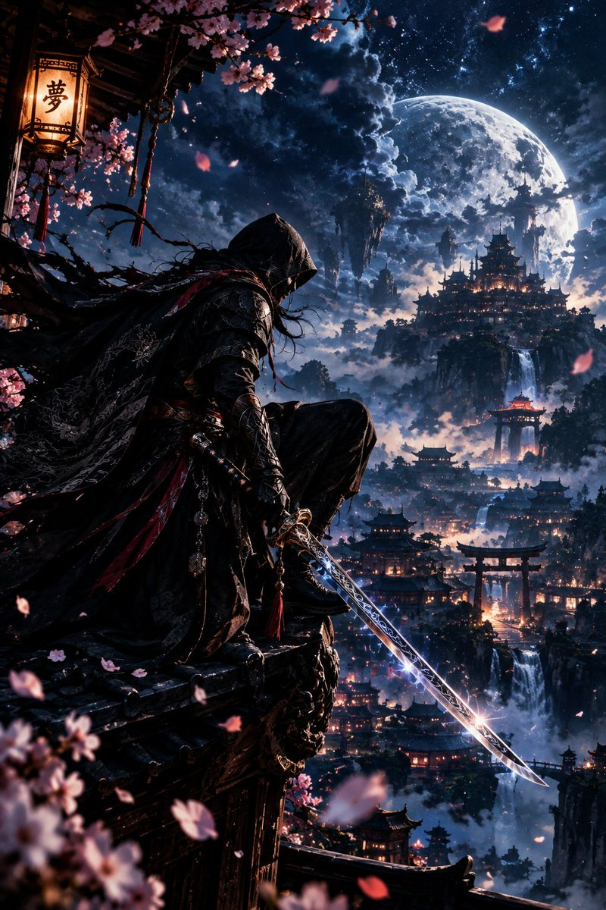

```text
Ultra-detailed 4K cinematic fantasy artwork of a mysterious hooded assassin crouching on the edge of an ancient Japanese-inspired temple rooftop, overlooking a breathtaking mountain city floating above the clouds. He wears an elegant black tactical-ronin outfit with intricate silver embroidery, layered armor, flowing cloak and subtle crimson accents.
He holds an extraordinary katana in one hand, the blade partially drawn and glowing with a subtle electric-blue energy, intricate runes etched along the steel, razor-sharp edge reflecting the moonlight. His face remains mostly hidden beneath the hood, with only faintly visible intense eyes. His cloak and hair flow dramatically in the wind.
Behind him: a gigantic luminous full moon, deep midnight-blue sky filled with stars and dramatic clouds, floating mountains, waterfalls cascading through the clouds, ancient pagodas and glowing lanterns scattered across the valley. Cherry-blossom petals drift through the air, some close to the camera creating beautiful cinematic depth of field.
Epic composition, low-angle perspective, dramatic silhouette, volumetric moonlight, subtle blue and crimson highlights, atmospheric fog, realistic fabric and metal textures, intricate weapon details, cinematic depth of field, soft background bokeh, breathtaking scale, dark fantasy atmosphere, elegant rather than violent, photorealistic, ultra-sharp details, HDR, 4K Ultra HD, masterpiece, premium cinematic concept art, no text, no watermark.
```

Model: Nano Banana Pro · Author: Aryan v

[Original source](https://github.com/YouMind-OpenLab/awesome-nano-banana-pro-prompts/blob/11c6a7e5bfa24d585d6221be11a2dcc0ea1d571b/README.md#L2928) · [Provenance and original license](data/projectd-batch-0004.json)

## YouTube Thumbnail Design Prompt with Text Overlay — Reference Image Required

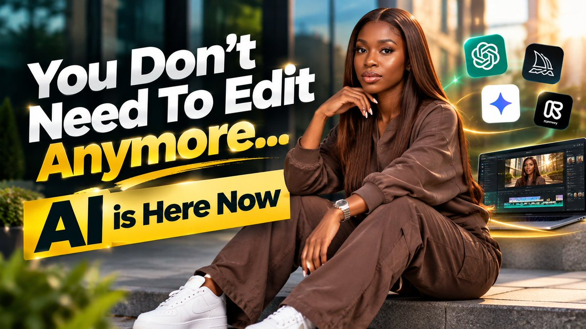

```text
Acting as a professional graphics designer and a thumbnail designer, use the attached image to create a high-quality cinematic, attractive and bold Montserrat font text style for the caption. 

The caption of the thumbnail is  ["{argument name="caption_text" default="You Don't Need To Edit Anymore... AI is Here Now"}"]. Make sure to use nice images for the blended background effects. My aspect ratio is 16:9
```

Model: Nano Banana Pro · Author: Nsofor Ngozika | NGVisuals

[Original source](https://github.com/YouMind-OpenLab/awesome-nano-banana-pro-prompts/blob/11c6a7e5bfa24d585d6221be11a2dcc0ea1d571b/README.md#L2964) · [Provenance and original license](data/projectd-batch-0004.json)

## Steam Locomotive Collapsing Bridge Storm

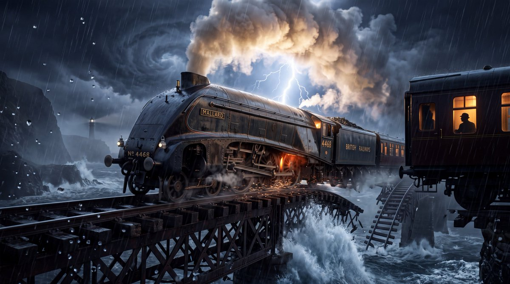

```text
Ultra-realistic cinematic 4K image of a {argument name="locomotive" default="colossal vintage steam locomotive racing across an enormous collapsing railway bridge"} above a violent ocean during a {argument name="weather" default="supernatural-looking but physically grounded thunderstorm"}. The train is captured at the exact moment a massive wave crashes against the bridge far below, while lightning illuminates the entire scene. Hundreds of rain droplets freeze sharply in the foreground, reflecting tiny fragments of light. The locomotive is incredibly detailed: weathered black steel, polished brass components, glowing furnace light, realistic steam escaping from valves, wet metallic surfaces, spinning wheels throwing water and sparks against the rails.

The environment is breathtaking and immense: towering dark cliffs disappearing into storm clouds, a distant lighthouse barely visible through heavy rain, enormous waves exploding against rocks, dramatic clouds spiraling across the sky, mist flowing beneath the bridge, broken sections of railway disappearing into the distance. A {argument name="mystery detail" default="lone passenger silhouette is visible through one warmly illuminated train window"}, creating mystery and emotional storytelling.

Composition uses an extreme low-angle perspective from beside the railway tracks, making the locomotive feel enormous and powerful. Strong leading lines from the rails pull the eye directly toward the train. Lightning provides dramatic backlighting and creates a brilliant rim around the locomotive and steam. Warm interior light contrasts naturally against the cold storm atmosphere. Photorealistic materials, physically accurate reflections, realistic rain behavior, atmospheric perspective, volumetric mist, cinematic depth of field, subtle motion blur on the wheels while the locomotive remains razor sharp, HDR lighting, natural film grain, incredible micro-details, realistic scale, professional Hollywood cinematography, 35mm anamorphic lens aesthetic, high dynamic range, breathtaking visual storytelling, crystal-clear 4K Ultra HD, no text, no logo, no watermark, no artificial-looking CGI, no cartoon style.

The key visual: gigantic train + collapsing bridge + ocean storm + lightning + tiny human silhouette = scale, danger, mystery, and cinematic storytelling in one frame.
```

Model: Nano Banana Pro · Author: WeWant Mars

[Original source](https://github.com/YouMind-OpenLab/awesome-nano-banana-pro-prompts/blob/11c6a7e5bfa24d585d6221be11a2dcc0ea1d571b/README.md#L3000) · [Provenance and original license](data/projectd-batch-0004.json)

## Cinematic Astronaut on Damaged Spacecraft


```text
{
  "scene": "{argument name="scene" default="A damaged spacecraft drifting through deep space with Earth visible in the distance, partially destroyed"}",
  "subject": "{argument name="subject" default="A lonely astronaut sitting inside the spacecraft"}",
  "action": "The astronaut hesitates to answer an incoming holographic call from Earth",
  "detail": "{argument name="detail" default="The holographic screen shows an incoming call labeled 'MOM'"}",
  "style": "cinematic masterpiece, emotional storytelling, photorealistic",
  "atmosphere": "heartbreaking mood, deep space silence, blue ambient glow",
  "camera": "ARRI Alexa 65, 35mm anamorphic lens, cinematic framing",
  "quality": [
    "film grain",
    "volumetric lighting",
    "IMAX quality",
    "8K resolution",
    "award-winning cinematography"
  ]
}
```

Model: Nano Banana Pro · Author: Compound Learning - Tech | Science

[Original source](https://github.com/YouMind-OpenLab/awesome-nano-banana-pro-prompts/blob/11c6a7e5bfa24d585d6221be11a2dcc0ea1d571b/README.md#L3040) · [Provenance and original license](data/projectd-batch-0004.json)

## Double Exposure Motorcycle Sunset Portrait


```text
A realistic photorealistic 3D image of a stylish young man posing next to a modern Yamaha MT-15 motorcycle on a wet reflective ground. He is wearing a blue and orange red mints green white sweater with the name "{argument name="name" default="Humraaz"}" written on it and white pants. In the dramatic sunset sky background, there is a large, translucent double-exposure portrait of a beautiful woman wearing a blue veil, surrounded by soft wisps of smoke. Cinematic lighting, highly detailed.
```

Model: Nano Banana Pro · Author: Muhammad Jamil

[Original source](https://github.com/YouMind-OpenLab/awesome-nano-banana-pro-prompts/blob/11c6a7e5bfa24d585d6221be11a2dcc0ea1d571b/README.md#L3089) · [Provenance and original license](data/projectd-batch-0004.json)

## High Definition Portrait Transformation — Reference Image Required


```text
Turn this image into a: Ultra-realistic close-up portrait of a {argument name="subject" default="confident man"}, with {same} expressions on his face & he must watching straightly towards the camera,his body, face & eyes also must be exactly straightly towards the camera. Image must look Premium studio-quality facial details, highly realistic skin texture with visible pores, natural forehead lines, subtle wrinkles, fine facial imperfections, realistic subsurface scattering, detailed beard follicles, sharp beard edges, natural lip texture, realistic eyelashes, and high-definition eyebrows. Warm brown eyes with bright catchlights and crystal-clear iris detail. Cinematic YouTube thumbnail style, extremely sharp focus on face, shallow depth of field, professional key light from front-left, soft rim light around head and shoulders, subtle contrast enhancement, dramatic but clean lighting, premium camera quality, hyper-detailed skin rendering, photorealistic facial anatomy, 8K detail, ultra-clean image quality. (Remove the mic & chain) Preserve the exact facial identity, facial structure, proportions, eye shape, nose shape, beard pattern, hairline, skin tone, and all unique facial features from the reference image. Do not alter the person's face in any way. Maintain 100% likeness and identity accuracy. Show his body from up of his hairs to slightly up from the navel. Bg: {argument name="background" default="Pure white"}.
```

Model: Nano Banana Pro · Author: Alex | The AI Ads Guy

[Original source](https://github.com/YouMind-OpenLab/awesome-nano-banana-pro-prompts/blob/11c6a7e5bfa24d585d6221be11a2dcc0ea1d571b/README.md#L3123) · [Provenance and original license](data/projectd-batch-0004.json)

## Magic Girl Anime Key Visual Prompt


```text
魔法少女アニメのキービジュアルを作成してください。タイトルロゴを含んだ魅力的なポスターデザインとして仕上げてください。
```

Model: Nano Banana Pro · Author: SSSS.CRYPTOMAN⚡️AI

[Original source](https://github.com/YouMind-OpenLab/awesome-nano-banana-pro-prompts/blob/11c6a7e5bfa24d585d6221be11a2dcc0ea1d571b/README_ja-JP.md#L3553) · [Provenance and original license](data/projectd-batch-0004.json)

## Modern Comic Book Illustration Style


```text
Modern comic-book illustration style with a semi-realistic approach, bold inked linework combined with clean sharp edges, dynamic cel-shading with high contrast between light and shadow, subtle painterly blending on skin while maintaining graphic comic aesthetics, vibrant yet slightly gritty color grading, strong rim lighting and dramatic highlights, stylized anatomy with heroic proportions, detailed hair rendered with flowing strands and sharp highlights, textured brush splashes and ink splatter accents for a dynamic effect, minimalistic light background to emphasize the subject, cinematic composition, ultra-detailed, high resolution, graphic novel quality.
ar 9:16!
```

Model: Nano Banana Pro · Author: Zayan

[Original source](https://github.com/YouMind-OpenLab/awesome-nano-banana-pro-prompts/blob/11c6a7e5bfa24d585d6221be11a2dcc0ea1d571b/README.md#L3613) · [Provenance and original license](data/projectd-batch-0004.json)

## Cyberpunk Detective Movie Still


```text
{
  "title": "{argument name="title" default="Cyberpunk Detective"}",

  "image_description": "{argument name="description" default="A cinematic cyberpunk scene viewed through a rain-soaked car window. Neon reflections dance across the glass while a handsome futuristic detective sits in the driver's seat wearing a heavy dark coat. A woman wearing a glowing translucent yellow jacket looks toward him. Flying vehicles move through a foggy futuristic city in the background."}",

  "characters": [
    {
      "role": "Futuristic Detective",
      "position": "Driver's Seat",
      "appearance": "Handsome, serious expression, heavy dark coat",
      "focus": "Sharp Focus"
    },
    {
      "role": "Mysterious Woman",
      "position": "Passenger Seat",
      "appearance": "Dark hair, glowing translucent yellow jacket",
      "expression": "Quietly observing the detective",
      "focus": "Slightly softer focus"
    }
  ],

  "setting": {
    "location": "Futuristic Vehicle Interior",
    "cityscape": "Foggy cyberpunk megacity",
    "background_elements": [
      "Flying vehicles",
      "Neon billboards",
      "Rain-covered glass",
      "Holographic lights"
    ]
  },

  "cinematography": {
    "shot_type": "Medium Close-Up",
    "camera_angle": "Eye Level",
    "lens": "50mm Anamorphic Lens",
    "depth_of_field": "Shallow",
    "composition": "Movie Still"
  },

  "lighting": {
    "type": "Cinematic Lighting",
    "effects": [
      "Neon Reflections",
      "Volumetric Lighting",
      "Rain Refractions",
      "Soft Ambient Glow"
    ]
  },

  "mood": [
    "Moody",
    "Mysterious",
    "Futuristic",
    "Emotional"
  ],

  "color_palette": [
    "Blue",
    "Cyan",
    "Yellow"
  ],

  "quality": {
    "style": "Hollywood Blockbuster",
    "realism": "Ultra Photorealistic",
    "resolution": "8K",
    "details": [
      "Perfect Reflections",
      "Photorealistic Faces",
      "Film Grain",
      "Volumetric Fog",
      "Realistic Depth of Field",
      "Award-Winning Cinematography",
      "IMAX Quality",
      "Cinematic Storytelling",
      "Masterpiece"
    ]
  }
}
```

Model: Nano Banana Pro · Author: Compound Learning - Tech | Science

[Original source](https://github.com/YouMind-OpenLab/awesome-nano-banana-pro-prompts/blob/11c6a7e5bfa24d585d6221be11a2dcc0ea1d571b/README.md#L3665) · [Provenance and original license](data/projectd-batch-0004.json)

## Monochrome Ink Ballpoint Pen Zine Poster


```text
Ultra-detailed blue ballpoint pen illustration translated into monochrome black ink, dense cross-hatching and fine hatch shading, intricate biro sketch texture, obsessive linework, engraved contour rendering, hand-drawn pen illustration aesthetic, expressive organic strokes, editorial surreal composition, high-detail facial rendering, layered sketchbook construction lines, vintage technical scribbles and handwritten notes in pure white only over {argument name="background color" default="bold red background"}, white typographic annotations integrated into backdrop, underground zine poster aesthetic, raw imperfect ink marks, high-contrast black ink subject against vivid red field, experimental graphic design, avant-garde magazine cover style --ar 9:16 --stylize 750.
```

Model: Nano Banana Pro · Author: Zayan

[Original source](https://github.com/YouMind-OpenLab/awesome-nano-banana-pro-prompts/blob/11c6a7e5bfa24d585d6221be11a2dcc0ea1d571b/README.md#L3778) · [Provenance and original license](data/projectd-batch-0004.json)

## Elderly Harry Potter Winter Scene


```text
{
"title": "{argument name="title" default="HARRY POTTER AT 80"}",

"scene": "A quiet winter evening inside a small countryside cottage. Snow falls gently outside the frosted windows while a warm fireplace softly illuminates the room.",

"subject": "An 80-year-old Harry Potter sits alone in a worn leather chair, reading a stack of faded letters collected throughout his life. His face shows wisdom, loss, and peace after a lifetime of adventure.",

"detail": "His famous wand hangs untouched above the fireplace, covered in dust. Old photographs of Ron, Hermione, Hagrid, and the Hogwarts years decorate the room. A pair of round glasses rests beside a cup of tea. On a nearby shelf sits a weathered photo album labeled 'Hogwarts'.",

"atmosphere": "deeply nostalgic, emotional, bittersweet, peaceful, reflective",

"lighting": "warm firelight, soft shadows, golden glow, cinematic winter ambience",

"composition": "intimate cinematic shot, Harry positioned beside the fireplace, snow-covered window visible in the background",

"style": "photorealistic, cinematic masterpiece, Hollywood movie ending scene, ultra detailed, film grain, shallow depth of field, 8K",

"mood": "The boy who lived has become the man who remembers.",
"image_text": "Some magic never leaves."
}
```

Model: Nano Banana Pro · Author: Compound Learning - Tech | Science

[Original source](https://github.com/YouMind-OpenLab/awesome-nano-banana-pro-prompts/blob/11c6a7e5bfa24d585d6221be11a2dcc0ea1d571b/README.md#L3818) · [Provenance and original license](data/projectd-batch-0004.json)

## Cartoon Monster Rat Rod Drag Race


```text
A vibrant, cartoonish illustration depicts a {argument name="creature" default="monstrous green creature with bulging eyes and sharp teeth"} driving a souped-up {argument name="car type" default="pink Volkswagen Beetle"}. The car is adorned with flames and the words "BEETLE BOMBER" and "RAT ROD." The creature wears a racing helmet and is shown mid-air, with smoke and flames billowing from the rear tires and exhaust pipes. In the background, a crowd of equally bizarre characters cheers from behind a "DRAG STRIP" sign. Neon signs for "BEETLE JUICE," "COLD BEER," and "NITRO" add to the chaotic, high-energy atmosphere of a drag race. The art style is reminiscent of comic books and graffiti, with bold outlines and saturated colors.
```

Model: Nano Banana Pro · Author: Heather Green

[Original source](https://github.com/YouMind-OpenLab/awesome-nano-banana-pro-prompts/blob/11c6a7e5bfa24d585d6221be11a2dcc0ea1d571b/README.md#L3871) · [Provenance and original license](data/projectd-batch-0004.json)

## Stylized Martial Arts Anime Girl


```text
A stylized digital anime illustration of a young East Asian girl with a serious, determined expression, standing with arms crossed over her chest. She has messy, short black hair tied partially into a loose topknot bun with stray strands framing her face, dark expressive eyes, and fair skin. She wears a loose, oversized dark forest-green martial arts kimono robe with light sage inner lining, wide folded cuffs, a black sash (obi) tied at the waist, and striking yellow-gold lightning bolt patterns across the chest. Dynamic ink splatter background in bold black, white, and vivid warm yellow-orange hues, vector art meets comic book illustration style, cel shading, sharp outlines, painterly brush strokes, dramatic lighting, high contrast, vertical portrait --ar 1:2 --v 6.0
```

Model: Nano Banana Pro · Author: lovimg_com

[Original source](https://github.com/YouMind-OpenLab/awesome-nano-banana-pro-prompts/blob/11c6a7e5bfa24d585d6221be11a2dcc0ea1d571b/README.md#L4005) · [Provenance and original license](data/projectd-batch-0004.json)

## Maple Syrup Commercial Storyboard


```text
TITLE:
Premium Maple Syrup Product Commercial Storyboard

FORMAT:
• Single-page premium storyboard
• 3:4 Portrait ratio
• Luxury food product advertising
• 8 cinematic product-focused scenes
• Product remains the main hero
• High-end advertising agency presentation

HEADER:
• Elegant serif typography
• Information cards:
  - Duration: 20 Seconds
  - Style: Cinematic Gourmet Food Commercial
  - Product: Pure Maple Syrup
  - Audio: Slow Pour + Soft Food ASMR
• Why This Style Works section
• Warm amber, cream and dark brown aesthetic
• Minimal maple leaf decorative accents

STORYBOARD:
1. Premium maple syrup bottle standing on polished dark wood
2. Bottle cap opening in extreme macro
3. Golden syrup slowly flowing from the bottle
4. Syrup forming a glossy ribbon in mid-air
5. Syrup cascading over fluffy pancakes
6. Extreme macro showing rich syrup texture and tiny reflections
7. Pancake stack surrounded by the hero bottle and maple leaves
8. Final luxury product packshot with dramatic syrup pour

EVERY PANEL:
• Scene number
• Duration badge
• Camera direction
• Visual
• Action
• Product detail

CAMERA:
Extreme macro, slow-motion liquid photography, overhead food shot, controlled push-in, shallow depth of field, cinematic hero framing.

STYLE:
Ultra-realistic food advertising, realistic syrup viscosity, glossy golden texture, warm studio lighting, premium glass packaging, sophisticated gourmet presentation, 8K.
```

Model: Nano Banana Pro · Author: 𝐌

[Original source](https://github.com/YouMind-OpenLab/awesome-nano-banana-pro-prompts/blob/11c6a7e5bfa24d585d6221be11a2dcc0ea1d571b/README.md#L4038) · [Provenance and original license](data/projectd-batch-0004.json)

## Whimsical Claymation Chameleon Scene


```text
A vibrant, whimsical claymation scene depicts a colorful {argument name="animal" default="chameleon"} perched on a moss-covered branch in a lush, {argument name="setting" default="fantastical forest"}. The chameleon, with its intricate patterns of green, blue, orange, and yellow scales, gazes intently to the left. Surrounding it are an array of fantastical flora and fauna, also rendered in clay. These include {argument name="plant life" default="glowing mushrooms, peculiar flowers with eyeball centers"}, whimsical insects with googly eyes, and strange, bulbous fruits. The background is a soft blur of more trees and foliage, creating a sense of depth and enchantment. The overall impression is one of a magical, miniature world brought to life.
```

Model: Nano Banana Pro · Author: Heather Green

[Original source](https://github.com/YouMind-OpenLab/awesome-nano-banana-pro-prompts/blob/11c6a7e5bfa24d585d6221be11a2dcc0ea1d571b/README.md#L4115) · [Provenance and original license](data/projectd-batch-0004.json)

## Strawberry Cheesecake Ice Cream Storyboard


```text
TITLE:
Premium Strawberry Cheesecake Ice Cream Product Commercial Storyboard

FORMAT:
• Single-page premium storyboard
• 3:4 Portrait ratio
• Cinematic frozen dessert advertising campaign
• 8 completely different product-focused scenes
• Product remains the main visual hero
• Premium advertising agency presentation

HEADER:
• Bold editorial typography
• Information cards:

* Duration: {argument name="duration" default="10 Seconds"}
* Style: Cinematic Dessert Commercial
* Product: {argument name="product" default="Strawberry Cheesecake Ice Cream"}
* Audio: Spoon Scrape + Creamy Dessert ASMR
  • Why This Style Works section
  • {argument name="color palette" default="Soft pink, strawberry red, cream and vanilla"} aesthetic
  • Minimal strawberry and dessert-themed decorative details

STORYBOARD:

1. Premium strawberry cheesecake ice cream tub standing dramatically on a chilled marble surface, front packaging perfectly visible
2. Tub opening with a crisp close-up of the lid lifting and creamy ice cream revealed underneath
3. Ice cream scoop pressing into the surface, revealing rich strawberry cheesecake layers and realistic creamy texture
4. Extreme macro of strawberry pieces and cheesecake crumbs embedded throughout the ice cream
5. Fresh strawberry sauce flowing slowly across a perfectly formed scoop, creating glossy red ribbons
6. Ice cream scoop lifted onto a glass dessert cup with tiny cheesecake crumbs falling naturally around it
7. Close-up of spoon breaking through the creamy scoop, revealing strawberry filling and soft cheesecake pieces inside
8. Final hero product shot with the original ice cream tub beside an elegant dessert cup, fresh strawberries, crumbs and strawberry sauce arranged around the product

EVERY PANEL:
• Scene number
• Duration badge
• Camera direction
• Visual
• Action
• Product detail

CAMERA:
Extreme macro food photography, smooth scoop movement, slow-motion strawberry sauce pour, detailed texture close-ups, controlled push-in, shallow depth of field, elegant overhead composition, cinematic final packshot.

STYLE:
Ultra-realistic premium frozen dessert commercial, rich creamy ice cream texture, realistic strawberry pieces, detailed cheesecake crumbs, glossy strawberry sauce, authentic condensation, sharp packaging details, soft cinematic lighting, luxurious food styling, professional dessert advertising, 8K.
```

Model: Nano Banana Pro · Author: ÀBDŪLLÂH

[Original source](https://github.com/YouMind-OpenLab/awesome-nano-banana-pro-prompts/blob/11c6a7e5bfa24d585d6221be11a2dcc0ea1d571b/README.md#L4149) · [Provenance and original license](data/projectd-batch-0004.json)

## Greek Yogurt Commercial Storyboard


```text
TITLE: Premium Greek Yogurt Product Commercial Storyboard FORMAT: • Single-page premium storyboard • 3:4 Portrait ratio • Premium dairy food campaign • 8 cinematic product-focused scenes • Product remains the visual hero • Luxury advertising agency presentation HEADER: • Elegant clean typography • Information cards: - Duration: {argument name="duration" default="20 Seconds"} - Style: Fresh Gourmet Food Commercial - Product: {argument name="product" default="Greek Fruit Yogurt"} - Audio: Spoon + Creamy ASMR • Why This Style Works section • White, soft pink and berry-red aesthetic • Minimal fruit-inspired decorative elements STORYBOARD: 1. Premium yogurt cup standing on chilled marble with fresh berries 2. Yogurt lid peeling back in an extreme macro shot 3. Spoon entering the thick creamy yogurt 4. Spoon lifting a smooth glossy portion 5. Fresh strawberry pieces dropping into the yogurt 6. Berry puree swirling through the creamy yogurt 7. Extreme macro showing thick yogurt texture and fruit pieces 8. Final hero product shot with yogurt cup, berries and elegant spoon composition EVERY PANEL: • Scene number • Duration badge • Camera direction • Visual • Action • Product detail CAMERA: Extreme macro, slow-motion fruit drop, creamy texture close-up, overhead composition, smooth spoon movement, shallow depth of field, cinematic hero framing. STYLE: Ultra-realistic dairy food photography, thick creamy texture, realistic fruit pieces, glossy berry swirl, chilled condensation, soft premium lighting, clean packaging, luxury food advertising, 8K.
```

Model: Nano Banana Pro · Author: YUKI

[Original source](https://github.com/YouMind-OpenLab/awesome-nano-banana-pro-prompts/blob/11c6a7e5bfa24d585d6221be11a2dcc0ea1d571b/README.md#L4229) · [Provenance and original license](data/projectd-batch-0004.json)

## Cinematic 2D Anime Illustration


```text
Cinematic 2D digital illustration, polished semi-realistic anime aesthetic, clean bold linework, smooth cel shading blended with soft painterly gradients, expressive detailed facial rendering, subtly exaggerated proportions, glossy eyes, natural skin texture, dimensional hair with individual flowing strands, warm rim lighting, {argument name="color grade" default="moody teal-and-amber"} color grading, muted vintage tones, soft ambient shadows, slightly grainy texture, {argument name="vibe" default="nostalgic 1990s/2000s editorial-poster"} vibe, atmospheric indoor lighting, highly polished character art, crisp details, depth and cinematic composition, vertical 9:16.
```

Model: Nano Banana Pro · Author: Zayan

[Original source](https://github.com/YouMind-OpenLab/awesome-nano-banana-pro-prompts/blob/11c6a7e5bfa24d585d6221be11a2dcc0ea1d571b/README.md#L4263) · [Provenance and original license](data/projectd-batch-0004.json)

## Cinematic Rainy Night Car Portrait


```text
{ "title": "Cinematic Rainy Night Portrait", "description": "An emotional cinematic portrait captured through a fogged and rain-covered car window during a rainy night in a neon-lit city. A beautiful young woman sits alone in the backseat, quietly looking outside with a distant and melancholic expression. She gently draws a small heart on the misted glass while colorful city lights blur behind the raindrops, creating a feeling of loneliness, nostalgia, and quiet reflection.", "prompt": "A cinematic rainy-night portrait photographed through a fogged and rain-covered car window. A beautiful young woman sits alone in the backseat of a car during heavy rain, gazing outside with a distant, melancholic expression. She gently draws a tiny heart on the misted glass with her finger. Raindrops stream down the window, distorting colorful city lights and neon signs in the background. Soft blue and warm orange neon reflections illuminate her face and the wet glass. Emotional solitude, quiet sadness, cinematic storytelling, realistic skin texture, visible pores, natural makeup, slightly messy hair, expressive eyes, shallow depth of field, dreamy bokeh, soft focus falloff, realistic reflections, atmospheric lighting, analog film grain, cinematic color grading, photorealistic, masterpiece photography, ultra-detailed, 85mm lens, f/1.4, award-winning portrait, emotional visual poetry, 8k.", "style": [ "cinematic photography", "photorealistic", "analog film aesthetic", "emotional visual storytelling", "neo-noir atmosphere" ], "negative_prompt": "anime, cartoon, CGI, 3D render, low quality, blurry face, extra fingers, bad anatomy, unrealistic skin, oversaturated colors, watermark, text, logo, duplicate person, distorted hands, plastic skin" }
```

Model: Nano Banana Pro · Author: Compound Learning - Tech | Science

[Original source](https://github.com/YouMind-OpenLab/awesome-nano-banana-pro-prompts/blob/11c6a7e5bfa24d585d6221be11a2dcc0ea1d571b/README.md#L4309) · [Provenance and original license](data/projectd-batch-0004.json)

## Family Dinner Cinematic Contact Sheet


```text
{
  "title": "Warm Family Dinner Cinematic Contact Sheet",
  "format": "3x3 contact sheet collage",
  "subject": "{argument name="subject" default="A young woman with natural wavy dark hair, wearing a loose brown linen button-up shirt, sitting at a wooden dining table during a cozy family dinner"}",
  "environment": "{argument name="environment" default="Traditional family dining room, vintage wallpaper, wooden china cabinet filled with plates and glassware, warm tungsten household lighting, realistic home atmosphere"}",
  "composition": {
    "grid": "3x3 storyboard frames",
    "shots": [
      "medium shot talking with expressive hands",
      "close-up laughing naturally",
      "side view serving lasagna from casserole dish",
      "close-up listening with chin resting on hand",
      "medium shot eating dinner while looking down",
      "close-up tasting food with playful expression",
      "medium shot telling an animated story",
      "close-up smiling softly while holding a fork",
      "wide shot alone at dining table after conversation"
    ]
  },
  "camera": {
    "lens": "50mm and 85mm prime lenses",
    "depth_of_field": "shallow",
    "focus": "sharp focus on subject, creamy background bokeh",
    "framing": "cinematic coverage from multiple angles"
  },
  "lighting": {
    "type": "warm practical household lighting",
    "color_temperature": "3200K",
    "mood": "cozy, intimate, nostalgic",
    "shadows": "soft natural shadows"
  },
  "style": {
    "photorealistic": true,
    "cinematic": true,
    "natural_expressions": true,
    "slice_of_life": true,
    "authentic_human_moments": true,
    "award_winning_film_still": true
  },
  "color_grading": {
    "palette": "{argument name="palette" default="warm amber, brown, cream, beige"}",
    "contrast": "soft cinematic contrast",
    "look": "Kodak Vision3 film emulation"
  },
  "details": [
    "genuine laughter",
    "natural eye contact",
    "subtle facial expressions",
    "realistic skin texture",
    "wooden dining furniture",
    "home-cooked meal",
    "candid documentary photography",
    "family gathering atmosphere"
  ],
  "quality": {
    "resolution": "8K",
    "detail": "ultra detailed",
    "realism": "hyper realistic"
  },
  "negative_prompt": [
    "anime",
    "cartoon",
    "cgi",
    "plastic skin",
    "overprocessed face",
    "low resolution",
    "extra fingers",
    "distorted anatomy",
    "text",
    "watermark",
    "logo"
  ]
}
```

Model: Nano Banana Pro · Author: Compound Learning - Tech | Science

[Original source](https://github.com/YouMind-OpenLab/awesome-nano-banana-pro-prompts/blob/11c6a7e5bfa24d585d6221be11a2dcc0ea1d571b/README.md#L4420) · [Provenance and original license](data/projectd-batch-0004.json)

## The Lighthouse Keeper Storyboard


```text
{
  "title": "{argument name="story title" default="The Lighthouse Keeper"}",

  "image_description": "A solitary lighthouse stands on a jagged cliff surrounded by a violent ocean storm. Towering waves crash against the rocks below. Lightning tears through dark clouds, briefly illuminating the ancient stone structure. Inside the lighthouse, an elderly keeper slowly climbs a spiral staircase carrying an old lantern. The walls are covered with faded photographs, letters and newspaper clippings spanning decades. Every ship route in the world was abandoned more than fifty years ago. No vessels pass here anymore. Yet every night, without fail, the keeper climbs to the top and turns on the light.",

  "story_element": {
    "twist": "{argument name="plot twist" default="Nobody knows why he still does it."}",
    "secret": "{argument name="the secret" default="Tonight, for the first time in fifty years, a faint light appears on the horizon."}"
  },

  "environment": {
    "weather": "Violent storm",
    "time": "Midnight",
    "atmosphere": "Lonely, mysterious, emotional"
  },

  "symbolism": "Faith and hope without proof.",

  "cinematography": {
    "camera_angle": "Low angle",
    "lens": "85mm anamorphic",
    "lighting": "Lightning flashes and warm lantern glow"
  },

  "mood": [
    "Hope",
    "Mystery",
    "Loneliness",
    "Determination"
  ],

  "quality": {
    "style": "Oscar-winning cinematic drama",
    "resolution": "8K",
    "realism": "Ultra photorealistic"
  }
}
```

Model: Nano Banana Pro · Author: Compound Learning - Tech | Science

[Original source](https://github.com/YouMind-OpenLab/awesome-nano-banana-pro-prompts/blob/11c6a7e5bfa24d585d6221be11a2dcc0ea1d571b/README.md#L4526) · [Provenance and original license](data/projectd-batch-0004.json)

## Athleisure Fashion Poster Comparison


```text
A full-bleed vertical athleisure fashion poster for the original overseas brand "{argument name="brand" default="KUMORA ACTIVE"}", designed as a premium 2x2 studio contact-sheet for the hero product "{argument name="product" default="STUDIO MOTION SET"}". Show the same adult female model, clearly over 20, in all four panels against a pure white seamless studio background with narrow white spacing between panels.

Panel layout: upper-left chest-up portrait; upper-right full-body motion pose; lower-left crouched floor pose; lower-right dynamic cropped jacket-lift pose. The four frames must feel like one continuous studio session. The model wears the same cohesive black-and-white set in every panel: black halter sport bra with white elastic band reading "{argument name="brand" default="KUMORA ACTIVE"}", wide black track pants with twin white side stripes, oversized cropped black shell jacket with subtle mesh panels and small white label, black curved-brim cap with tiny white K mark, and silver on-ear sport headset with circular earcups. Outfit, cap, headset, and identity stay fully consistent; only pose and jacket position change.

Expressions are calm, focused, and editorial: side glance in portrait, active standing pose, quiet direct crouch, wind-swept profile in the jacket-lift crop. Keep the headset visible in every frame. Use soft high-key studio lighting from the front upper left with gentle fill and subtle contact shadows only where needed. White background is the dominant field; black garments form the graphic structure; white trims and stripes create rhythm; the silver headset is the product highlight. Preserve detail in black fabrics: matte stretch bra, ribbed elastic band, white piping, nylon jacket sheen, mesh texture, cap stitching, woven label, and clean metal earcups.

Exact visible text only: small "{argument name="brand" default="KUMORA ACTIVE"}" near the top of each panel, and bold bottom-center title "{argument name="product" default="STUDIO MOTION SET"}" in black uppercase sans serif. No extra copy.

Negative constraints: no extra models, no identity drift, no mismatched outfit pieces, no missing headset, no broken hands or limbs, no chaotic panel geometry, no crushed black fabric, no plastic skin, no dirty floor, no harsh shadows, no real logos, no misspelled text, no typography over face or headset, no gym or street background, no props, no collage artifacts, no painterly drift.
```

Model: Nano Banana Pro · Author: Loriel.AI

[Original source](https://github.com/YouMind-OpenLab/awesome-nano-banana-pro-prompts/blob/11c6a7e5bfa24d585d6221be11a2dcc0ea1d571b/README.md#L4596) · [Provenance and original license](data/projectd-batch-0004.json)

## Liquid Metal Gown Portrait Prompt — Reference Image Required


```text
Use the master reference image for face identity only. Create the same woman wearing a sculptural silver metallic gown that looks like flowing liquid metal, with realistic reflective folds and a fitted silhouette. She poses against a simple light-gray studio background, one hand resting at her waist, chin slightly raised, confident expression. Natural facial details, visible pores, accurate hands, realistic metallic reflections, luxury magazine photography, head-to-toe composition, both feet visible

Negative prompt: no CGI appearance, no plastic skin, different face, identity drift, face morphing, altered facial structure, asymmetrical eyes caused by errors, plastic skin, excessive retouching, doll-like face, blurry face, unnatural body proportions, extra fingers, missing fingers, fused hands, deformed feet, missing shoes, cropped legs, cropped head, floating accessories, unrealistic fabric, oversaturated colors, CGI, cartoon, artificial skin, duplicate person, text, logo, watermark, low resolution, motion blur.
```

Model: Nano Banana Pro · Author: Elvorya

[Original source](https://github.com/YouMind-OpenLab/awesome-nano-banana-pro-prompts/blob/11c6a7e5bfa24d585d6221be11a2dcc0ea1d571b/README.md#L4644) · [Provenance and original license](data/projectd-batch-0004.json)

## Art-Deco Evening Gown Prompt


```text
Theme:
1920s Art-Deco opulence and high-society elegance at twilight.

Subject:
A Caucasian woman in her late twenties with a slender, graceful build, standing alone on a high-rise penthouse balcony.

Person · Expression:
Defined facial structure with high cheekbones and a soft jawline. Her eyes are partially closed in a serene, contemplative expression, framed by long dark lashes. Her hair is a deep auburn with golden highlights, styled in thick waves cascading over one shoulder. The skin features a natural, soft texture with subtle pores and light freckles on the shoulders.

Clothing · Pose:
An emerald-green silk satin evening gown with a backless design and thin spaghetti straps. The skirt features high side slits that reveal the movement of the fabric. She is posed in a relaxed weight shift, with one hand resting on an ornate wrought-iron railing and the other holding a crystal champagne flute at chest height. Her head is tilted back slightly, savoring the atmosphere.

Background · Light:
An Art-Deco balcony with polished marble floors overlooking a sparkling city skyline. The scene is illuminated by the golden hour sun positioned behind the subject, creating a pronounced rim-light effect and making the silk appear translucent at the edges. The background transitions into a deep twilight blue sky with antique street lamps glowing below.

Composition · Camera:
A medium-full vertical shot from an eye-level perspective with a slight low-angle tilt. The composition follows the rule of thirds, using a shallow depth of field to maintain sharp focus on the subject and the condensation on the glass while the city becomes a soft, creamy bokeh.

Texture · Style:
Ultra-photorealistic rendering with a focus on material contrast: the cool, reflective marble and wrought iron against the warm, soft texture of the skin and the liquid sheen of the satin gown. The color palette is a rich blend of emerald, gold, amber, and deep evening blues with a vintage cinematic grade.
```

Model: Nano Banana Pro · Author: Dominus Pellissier

[Original source](https://github.com/YouMind-OpenLab/awesome-nano-banana-pro-prompts/blob/11c6a7e5bfa24d585d6221be11a2dcc0ea1d571b/README.md#L4679) · [Provenance and original license](data/projectd-batch-0004.json)

## High-Fashion Urban Night Editorial


```text
Theme:
High-fashion urban night luxe editorial.

Subject:
A 20-year-old Mediterranean-Caucasian fashion model. She is captured in a dynamic walking turn on a historic European cobblestone street, looking back over her shoulder toward the camera.

Person · Expression:
Symmetrical facial structure with a defined jawline and high cheekbones. Piercing hazel eyes with a focused, steady gaze. Full lips with a high-shine clear finish. Voluminous espresso-colored hair with honey-blonde highlights, whipping across her shoulders in motion. The skin features realistic micro-texture, visible pores, and a dewy, luminous finish under the city lights.

Clothing · Pose:
A midnight charcoal long-sleeved mock-neck top in a fine-gauge ribbed silk-knit, featuring a close, form-fitting silhouette. High-waisted, light-wash vintage denim jeans with a high-rise fit that defines the waist and follows the curve of the hips and legs. Polished black leather stiletto ankle boots. She is positioned mid-stride with her torso rotated back 90 degrees and one hand gracefully touching the back of her neck.

Background · Light:
A rain-slicked cobblestone alleyway at blue hour. The atmosphere is misty and reflective. Dual-source cinematic lighting: warm amber light spills from a boutique window to illuminate her face and chest, while a cool cyan streetlight provides a sharp rim light along her back, hair, and profile.

Composition · Camera:
Full-body medium shot from a slight low-angle perspective. The subject is framed dynamically to emphasize the S-curve of her pose. Razor-sharp focus on the facial features and fabric textures, with a soft, creamy bokeh blurring the background shop lights and architectural details.

Texture · Style:
Hyper-photorealistic editorial style. High-contrast chiaroscuro with deep, filmic shadows. Detailed rendering of ribbed silk, heavy denim grain, and polished leather. Subtle organic film grain and specular highlights on the wet street surfaces.
```

Model: Nano Banana Pro · Author: Dominus Pellissier

[Original source](https://github.com/YouMind-OpenLab/awesome-nano-banana-pro-prompts/blob/11c6a7e5bfa24d585d6221be11a2dcc0ea1d571b/README.md#L4731) · [Provenance and original license](data/projectd-batch-0004.json)

## Surreal Maritime Editorial Portrait


```text
{
  "vibe_title_en": "Abyssal Archive",
  "master_prompt": "A hyper-realistic, full-body shot of The Protagonist standing in a densely cluttered Maritime Antiquities Vault. The subject is casually reading a thick, weathered logbook, completely detached from the surreal physics occurring around them. In a feat of high-budget practical effects, the protagonist's lower garment is formed entirely of levitating, kinetically splashing saltwater, frozen in time. Within this thick, transparent liquid matrix, several heavy, hyper-detailed silver mackerel are swimming and wrapping around the legs, their wet scales catching specular highlights. The busy environment is a chaotic, hoarder-like archive: stacks of water-damaged navigational charts, piled marble busts, tangled fishing nets, suspended anatomical whale bones, and glass prisms clutter the foreground and background, creating intense depth of field occlusion. Volumetric light leaks through condensation-covered skylights, illuminating swirling dust motes and hanging sea mist. Captured on a Hasselblad H6D-100c with an 80mm f/1.9 lens. Cinematic high-contrast chiaroscuro lighting, emphasizing the physical weight of the water droplets, the pores on the subject's skin, and the textured weave of the upper bodice. Kodak Portra 400 film stock, organic film grain, masterful blend of surrealism and elite editorial photography. No neon.",
  "meta": {
    "intent": "Surreal Editorial Photography",
    "priorities": "Photorealistic impossible physics, extreme environmental clutter, high-end medium format textures",
    "device_profile": "Hasselblad H6D-100c"
  },
  "frame": {
    "aspect": "9:16",
    "composition": "Full-body environmental portrait",
    "layout": "Subject slightly off-center, framed by foreground debris and background archival stacks",
    "camera_angle": "Eye level, straight on to subject's torso",
    "tilt_roll_degrees": "0"
  },
  "subject": {
    "gender": "Female",
    "identity": "The Protagonist",
    "demographics": "Ageless, ethereal presence",
    "face": "Clean, natural features, hyper-detailed pores",
    "hair": "Wet, clinging to the neck and shoulders, dark",
    "body": "Statuesque, seamlessly transitioning into the surreal water element",
    "expression": "Calm, deeply absorbed in reading, detached from the chaos",
    "pose": "Standing gracefully, holding a heavy book open with both hands, slightly looking down"
  },
  "wardrobe_accessories": {
    "garments": [
      {
        "item": "Upper bodice",
        "material": "Wet silk clinging to the skin",
        "color": "Translucent aquatic blue",
        "fit": "Form-fitting"
      },
      {
        "item": "Flowing lower garment",
        "material": "Levitating liquid saltwater and living mackerel",
        "color": "Transparent cyan and silver",
        "fit": "Dynamic, kinetic, wrapping around the legs"
      }
    ],
    "accessories": [
      {
        "item": "Antique heavy logbook",
        "color": "Faded black and gold",
        "material": "Leather and thick parchment",
        "brand_style": "Weathered maritime archival"
      },
      {
        "item": "High-heeled stilettos",
        "color": "Glossy black",
        "material": "Patent leather",
        "brand_style": "Classic, elegant contrast to the organic water"
      }
    ]
  },
  "environment": {
    "setting": "Maritime Antiquities Vault and Restoration Workshop",
    "surfaces": "Wet concrete, tarnished brass, damp marble, decaying paper",
    "depth": "Extremely deep and cluttered, with foreground occlusion from hanging nets and background stacks of artifacts",
    "atmosphere": "Heavy, humid, smelling of salt and old paper, thick with volumetric mist and dust motes",
    "lens_interaction": "Shallow depth of field, foreground elements completely out of focus, specular highlights blooming off the water droplets"
  },
  "lighting": {
    "key": "Overhead diffuse skylight mixed with a harsh, directional cinematic spotlight from the upper left",
    "fill": "Cool, bouncing ambient light from the surrounding water elements",
    "rim": "Crisp silver rim light separating the splashing water and fish from the dark, cluttered background",
    "shadows": "Deep, rich, high-contrast chiaroscuro, engulfing the corners of the cluttered room",
    "color_temperature": "Cool oceanic tones mixed with warm, aged parchment hues",
    "sensor_flare": "Subtle organic halation around the specular highlights of the splashing water"
  },
  "camera": {
    "lens_type": "Medium Format Prime",
    "focal_length": "80mm",
    "aperture": "f/1.9",
    "focus": "Tack sharp on the subject's face, the book, and the closest fish",
    "sensor_format": "Medium Format 100MP",
    "perspective_distortion": "Zero distortion, purely natural and highly compressed"
  },
  "post_processing": {
    "color": "Kodak Portra 400 color science, rich shadows, luminescent highlights",
    "tonality": "Cinematic contrast, retaining details in the wet highlights",
    "texture": "Prominent analog film grain, hyper-realistic micro-contrast on skin and fish scales",
    "digital_sharpening": "None, optical sharpness only",
    "chromatic_aberration": "Very faint fringe on the extreme edges of the water droplets"
  },
  "negative_specifications": [
    "neon",
    "cyberpunk",
    "minimalist",
    "empty room",
    "clean studio",
    "digital illustration",
    "cartoonish",
    "flat lighting",
    "plastic skin",
    "CGI look",
    "floating text",
    "dull textures"
  ]
}
```

Model: Nano Banana Pro · Author: timedoctor.eth

[Original source](https://github.com/YouMind-OpenLab/awesome-nano-banana-pro-prompts/blob/11c6a7e5bfa24d585d6221be11a2dcc0ea1d571b/README.md#L4870) · [Provenance and original license](data/projectd-batch-0004.json)

## East Asian Woman in Gray Turtleneck Concrete Wall


```text
A hyper-realistic 8K outdoor photograph of a beautiful East Asian woman , standing three-quarter against a pale concrete wall. Long straight dark-violet hair with blunt bangs, individual strands catching the sun. Round thin metal glasses, fair realistic skin with visible pores, brown eyes, glossy muted rose lips.

She wears a fitted gray ribbed short-sleeve turtleneck; the vertical ribs stretch across the bust with small highlights on each ridge. Matching gray arm sleeves sit below the short sleeves. Black high-waist trousers. Arms crossed loosely in front, one hand resting on the other forearm.

Lighting: hard midday sun from upper left, sharp shadow under the chin and across the torso, thin speculars on the rib-knit and the glasses frames. Soft wall bounce on the right side of the face. Shot on an 85mm f/2, shallow depth of field, photorealistic skin, peach fuzz, knit micro-texture, fashion editorial look.
```

Model: Nano Banana Pro · Author: Aytaç Altıntepe

[Original source](https://github.com/YouMind-OpenLab/awesome-nano-banana-pro-prompts/blob/11c6a7e5bfa24d585d6221be11a2dcc0ea1d571b/README.md#L5020) · [Provenance and original license](data/projectd-batch-0004.json)

## Full Armor Mecha Girl Concept Art


```text
Full Armor Mecha Girl FAMG-001 Aurelith 1/7 scale plastic model, slim torso with high-heeled shaped legs, highly detailed concept art, realistic materials and lighting, white background, product photography style
```

Model: Nano Banana Pro · Author: てんねん

[Original source](https://github.com/YouMind-OpenLab/awesome-nano-banana-pro-prompts/blob/11c6a7e5bfa24d585d6221be11a2dcc0ea1d571b/README.md#L5063) · [Provenance and original license](data/projectd-batch-0004.json)

## Red Carpet Fashion Photo Prompt — Reference Image Required


```text
Use the uploaded image as the primary visual reference. Create an ultra-realistic, high-end red-carpet fashion photograph of the same woman, preserving her exact facial identity, facial structure, eyes, eyebrows, nose, lips, jawline, skin tone, hairstyle, and natural proportions with maximum accuracy. No identity drift or facial alteration.

Dress her in an exquisite icy silver-blue couture evening gown made from sheer translucent fabric, densely decorated with hundreds of individually visible crystal and rhinestone embellishments. The gown has a fitted long-sleeve illusion bodice, elegant high neckline, sculpted waist, and a sleek floor-length silhouette. Add a dramatic flowing light-blue sheer train cascading naturally down the stairs behind her. Crystal-studded silver open-toe heels, delicate diamond earrings, and a refined diamond necklace.

Place her standing gracefully on the grand cream-colored staircase of a prestigious fashion gala, facing the camera with a confident yet elegant expression. Behind her, a glamorous crowd of photographers and guests are taking photographs, with professional cameras and flashes visible. The staircase and surrounding railings are covered with sparkling crystal-like decorations.

Composition: full-body portrait, head-to-toe visible, centered subject, elegant natural standing pose, train fully visible, realistic body proportions.

Photography: luxury fashion editorial photography, cinematic depth of field, realistic flash photography, soft ambient lighting, subtle reflections from crystals, natural skin pores and texture, highly detailed fabric, physically accurate rhinestones, realistic hands and fingers, premium Vogue-style aesthetic, photorealistic, 8K detail.

Negative prompt: cartoon, CGI, 3D render, plastic skin, excessive beauty retouching, altered face, different person, identity drift, distorted anatomy, extra fingers, malformed hands, blurry face, oversized jewelry, unrealistic crystals, artificial-looking fabric, duplicate people, text, logo, watermark.
```

Model: Nano Banana Pro · Author: Elvorya

[Original source](https://github.com/YouMind-OpenLab/awesome-nano-banana-pro-prompts/blob/11c6a7e5bfa24d585d6221be11a2dcc0ea1d571b/README.md#L5108) · [Provenance and original license](data/projectd-batch-0004.json)

## Bakery Background Edit — Source Tutorial Screenshot — Reference Image Required


```text
Keep the pastry exactly as it is. Replace the background with a warm wooden bakery counter by a sunny window, soft morning light. No text, no people, no hands.
```

Model: Nano Banana Pro · Author: lookmybio.com

[Original source](https://github.com/YouMind-OpenLab/awesome-nano-banana-pro-prompts/blob/11c6a7e5bfa24d585d6221be11a2dcc0ea1d571b/README.md#L5151) · [Provenance and original license](data/projectd-batch-0004.json)

## Studio Portrait Prompt — Reference Image Required


```text
Use the facial features from the uploaded reference image. A full-body portrait of a young woman ({argument name="age_range" default="23–27 years old"}, European appearance, lightly tanned skin with soft bronze undertones, expressive eyes, natural facial expression), sitting in a minimalist photo studio with a seamless light gray cyclorama background. Soft, even lighting from a large softbox upper-left (45°) with fill light lower-right, creating gentle shadows under the chin and legs. Medium-full framing (from knees to top of head), slightly low eye-level perspective (~100 cm), 85 mm lens at f/2.0, shallow depth of field — face and body in sharp focus, softly blurred background. Camera angle 30° to the left-front, chair turned sideways toward the camera. Pose: sitting on a metallic folding chair with red seat and backrest, torso slightly leaning forward, left hip on chair edge, right leg extended forward, left knee bent, right hand raised to touch hair near temple, left hand resting naturally on thigh, head turned toward camera, calm confident look, faint natural smile. Wardrobe: glossy red cropped leather bomber jacket with white sporty appliqués (including “3”), unzipped, worn loosely; white cotton bodysuit with bold red DIESEL logo band at waist; white mid-calf socks with red stripe; red high-heeled sandals with thin ankle straps (~12 cm). Fashion editorial style, confident and modern. Ultra-realistic studio photo, 8K RAW quality, sharp focus on eyes and skin texture, natural pores and micro-details, subtle highlights on skin from studio lights, metallic reflections on chair and jacket, warm skin tone, high-contrast red accents.
```

Model: Nano Banana Pro · Author: dreamy digital arts

[Original source](https://github.com/YouMind-OpenLab/awesome-nano-banana-pro-prompts/blob/11c6a7e5bfa24d585d6221be11a2dcc0ea1d571b/README.md#L5184) · [Provenance and original license](data/projectd-batch-0004.json)

## Editorial Fashion Portrait of a Young Man


```text
Editorial fashion photograph of a young man with {argument name="hair style" default="tousled dark wavy hair"}, tan olive skin, defined jawline, short stubble beard and mustache, thick dark eyebrows, brown eyes, wearing dark sunglasses pushed slightly down. He wears a {argument name="shirt color" default="maroon"} short-sleeve polo shirt tucked into wide-leg cream/off-white trousers with a brown braided leather belt, and brown tassel loafers. He stands in profile, leaning forward with one hand resting on the seat of a wooden bar stool, head tilted downward. Plain soft neutral gray studio background, soft even studio lighting, minimalist high-end fashion campaign aesthetic, shot on medium format camera, shallow depth of field, clean commercial look.
```

Model: Nano Banana Pro · Author: Snow

[Original source](https://github.com/YouMind-OpenLab/awesome-nano-banana-pro-prompts/blob/11c6a7e5bfa24d585d6221be11a2dcc0ea1d571b/README.md#L5230) · [Provenance and original license](data/projectd-batch-0004.json)

## Luxury Product Still Life Campaign


```text
[プロダクトおよびキャンペーン情報]
- アピール文: {argument name="appeal copy" default="洗練と選別"}
- ブランドコピー: {argument name="brand copy" default="熟練の職人技が紡ぐ、一生モノのレザーグッズ"}
- 対象プロダクト: {argument name="products" default="本革の財布と腕時計"}

[品質、エフェクト、および構図]
- スタイル: 高級ブランドのカタログやラグジュアリー雑誌の誌面を想定した、プロダクトの静物写真。
- 被写体: 深みのあるヴィンテージレザーや上質なダークトーンのテクスチャの上に配置された {argument name="products" default="本革の財布と腕時計"}。ステッチや金属のヘアライン仕上げなど、職人技を感じさせるディテールを美しく豊かに描写。
- ライティングとカラー: 深いダークブラウン、ブラック、真鍮のゴールドを基調としたカラーパレット。温かみのあるアンバー調のサイドライトと、クラシックで重厚な影。
- テキスト配置 (GPT-image / Nano Banana Pro 用): 細いゴールドのフォントを使用し、"{argument name="appeal copy" default="洗練と選別"}" および "{argument name="brand copy" default="熟練の職人技が紡ぐ、一生モノのレザーグッズ"}" のテキストを、画面内の落ち着いた位置にタイポグラフィとしてさりげなく配置。

[厳格なレイアウトおよび出力制約 (必須)]
- キャンバス全体を埋め尽くす、完成されたフラットな 2D デザインを出力すること。デザイン内のシーン要素（壁、部屋、影）は上記の説明通りで可。ポスターのモックアップは一切禁止：額縁、壁やデスクに貼られたポスターのショット、パースの歪み、アートワークの縁にドロップシャドウを付けることは厳禁。

- アスペクト比: --ar 3:4
```

Model: Nano Banana Pro · Author: AI Guide-Note - 実務で使えるAI活用メディア

[Original source](https://github.com/YouMind-OpenLab/awesome-nano-banana-pro-prompts/blob/11c6a7e5bfa24d585d6221be11a2dcc0ea1d571b/README_ja-JP.md#L5306) · [Provenance and original license](data/projectd-batch-0004.json)

## Minimalist Architectural Fashion Portrait


```text
A high-resolution, minimalist fashion portrait photograph featuring an {argument name="ethnicity" default="East Asian woman"} with a calm, direct gaze. Her dark hair is styled in a very sleek, center-parted, tight low bun. She is sitting with a poised, structured pose on a large, textured geometric plinth painted a soft, {argument name="plinth color" default="pale powder blue"}.

Outfit Details: The woman is wearing a striking, monochromatic, oversized ensemble in a de-saturated, {argument name="outfit color" default="light grey"} color (appearing like ice-grey or light celadon). The outfit consists of three main pieces:

A dramatically oversized, collarless wrap-front cape-coat with wide, fluid sleeves and an undulating hemline, which drapes extensively over her and the blue plinth.

Underneath the coat, a matching light grey, high-neck turtleneck knit top.

Matching high-waisted, wide-leg trousers that pooling slightly at the ankles, made from a similar heavy drape fabric.

Pose and Composition: She is seated comfortably but formally, hands lightly resting in her lap and on the surface of the blue cube. The composition is a centered, three-quarter length shot.

Setting and Lighting: The background is a clean, seamless, off-white studio wall. The lighting is soft, diffused, high-key studio lighting, creating a cool and clean atmosphere with minimal, soft shadows, emphasizing the architectural lines and textures of the garments. The overall feel is modern, elegant, and editorial. The perspective is eye-level.
```

Model: Nano Banana Pro · Author: 𝑨𝒇𝒓𝒊𝒏

[Original source](https://github.com/YouMind-OpenLab/awesome-nano-banana-pro-prompts/blob/11c6a7e5bfa24d585d6221be11a2dcc0ea1d571b/README.md#L5364) · [Provenance and original license](data/projectd-batch-0004.json)

## Rust Silk Dress Picnic Editorial


```text
Create a {argument name="lighting" default="warm late-afternoon"} fashion editorial built around an abundant picnic spread in a {argument name="location" default="quiet grassy field"} bordered by distant trees. Layer oversized cream and taupe blankets loosely across the grass, rumpled rather than perfectly arranged. An adult woman lies comfortably on her stomach across the center of the blankets, body extending horizontally through the frame. She props herself on both forearms with one hand lightly supporting her chin. Bend both lower legs upward behind her at slightly different angles for a relaxed, spontaneous silhouette. She looks directly toward the camera with calm confidence. Dress her in a {argument name="dress style" default="fitted rust-red silk midi dress"} with a muted botanical print, narrow straps, a softly shaped neckline and a high side slit that allows the fabric to fall naturally around the bent leg. Keep the silhouette close through the waist and hips rather than loose or bohemian. Add layered delicate gold necklaces, bracelets and anklets. Style her hair in a loose low updo with soft curls escaping around the face. Build a substantial picnic around her without making it pristine: an open wicker hamper, small metal serving bowls containing colorful savory dishes, bread, fruit, herbs, drinking cups, folded textiles and a woven basket of dried flowers. Keep the food clustered mostly across the foreground and sides, clearly separate from her body. Shoot vertically from slightly above blanket height with her face sharp and the foreground spread creating depth. Use soft golden natural light, subdued greens, warm rust, cream, silver and wicker tones, gentle film grain and modest depth of field. The final image should feel abundant, languid and quietly glamorous, like an afternoon that has stretched much longer than intended.
```

Model: Nano Banana Pro · Author: dreamy digital arts

[Original source](https://github.com/YouMind-OpenLab/awesome-nano-banana-pro-prompts/blob/11c6a7e5bfa24d585d6221be11a2dcc0ea1d571b/README.md#L5410) · [Provenance and original license](data/projectd-batch-0004.json)

## Macro Guitar Fret Dressing


```text
the middle fret mid-dressing, bright {argument name="fret material" default="raw nickel silver"} where the file has cut, the neighboring fret ends still square and unfinished for contrast
```

Model: Nano Banana Pro · Author: Glenn Williams

[Original source](https://github.com/YouMind-OpenLab/awesome-nano-banana-pro-prompts/blob/11c6a7e5bfa24d585d6221be11a2dcc0ea1d571b/README.md#L5444) · [Provenance and original license](data/projectd-batch-0004.json)

## Premium Beverage Advertising Photography — Reference Image Required


```text
Create one single photorealistic premium advertising photograph for the fictional beverage {argument name="beverage name" default="ENFLAMMER"}. Use all attached references
```

Model: Nano Banana Pro · Author: Exywuu

[Original source](https://github.com/YouMind-OpenLab/awesome-nano-banana-pro-prompts/blob/11c6a7e5bfa24d585d6221be11a2dcc0ea1d571b/README.md#L5478) · [Provenance and original license](data/projectd-batch-0004.json)

## Rogue One Style Film Still Prompt — Reference Image Required


```text
Photorealistic Rogue One/Andor film still. Exact ref face: same structure, skin tone, pores/freckles/moles/scars. Gritty desaturated military sci-fi: industrial grey, dirty orange, olive drab, cold hangar light, canvas/metal textures, film grain.
```

Model: Nano Banana Pro · Author: Lee Colin

[Original source](https://github.com/YouMind-OpenLab/awesome-nano-banana-pro-prompts/blob/11c6a7e5bfa24d585d6221be11a2dcc0ea1d571b/README.md#L5862) · [Provenance and original license](data/projectd-batch-0004.json)

## Rainforest Wildlife Observation Station Miniature World


```text
Whimsical miniature world depiction of a rainforest basin wildlife observation station in an artistic forestpunk style.
```

Model: Nano Banana Pro · Author: Artingent

[Original source](https://github.com/YouMind-OpenLab/awesome-nano-banana-pro-prompts/blob/11c6a7e5bfa24d585d6221be11a2dcc0ea1d571b/README.md#L5895) · [Provenance and original license](data/projectd-batch-0004.json)

## Cute Felt Frog Scene


```text
A cute, 3D and felt-like scene of a cartoon-style frog sitting on a large lily pad in a pond. The frog is green with large, expressive eyes and a wide smile. It wears a small leaf as a hat with a berry on top and a satchel over its shoulder. The frog holds a small yellow flower in its right hand. The pond is filled with lily pads, pink and yellow water lilies, and colorful pebbles. The background features a lush, vibrant landscape with rolling hills, exotic plants, and a soft, glowing sunset sky with fluffy clouds. Fireflies and ladybugs are scattered throughout the scene, adding to the magical atmosphere. The overall image has a whimsical and enchanting feel, with soft lighting and a pastel color palette.
```

Model: Nano Banana Pro · Author: Heather Green

[Original source](https://github.com/YouMind-OpenLab/awesome-nano-banana-pro-prompts/blob/11c6a7e5bfa24d585d6221be11a2dcc0ea1d571b/README.md#L5928) · [Provenance and original license](data/projectd-batch-0004.json)

## Mechanical Melancholy Macro Portrait Prompt


```text
{
  "vibe_title_en": "Mechanical Melancholy",
  "master_prompt": "Extreme close-up macro portrait. The Protagonist as a melancholic prodigy, framed tight on one side of the face. A highly detailed, physical brass clockwork mechanism with Roman numerals curves over the forehead and brow like a fragmented visor, partially obscuring the upper head but leaving one deeply expressive, sorrowful eye visible. The eye reflects warm, dusty ambient light. The protagonist's fingers, stained with dark ink and graphite, are gently touching a hyper-realistic golden mechanical hummingbird hovering near their cheek. They wear a heavy, ornate red and black mandarin-collar jacket with gold embroidery. Warm, directional Rembrandt lighting cutting through dense, dust-filled air, illuminating floating motes. Shot on Hasselblad H6D-100c, 120mm macro lens at f/2.8, incredibly shallow depth of field blurring the background into a muted olive-grey. Kodak Portra 400 film emulation, hyper-detailed skin pores, physical weight to the metal, cinematic chiaroscuro, pure photographic surrealism.",
  "meta": {
    "intent": "Photographic Surrealism, Emotional Macro Portrait",
    "priorities": "Micro-details, tactile realism, cinematic warm lighting, analog film texture",
    "device_profile": "Hasselblad H6D-100c with 120mm Macro Lens"
  },
  "frame": {
    "aspect": "3:4",
    "composition": "Extreme close-up macro, focusing on one eye and the side of the face, filling the frame",
    "layout": "Off-center focus on the visible eye, clockwork fading into deep bokeh at the top edge, fingers entering from the bottom frame",
    "camera_angle": "Straight-on, intimate eye-level",
    "tilt_roll_degrees": "0"
  },
  "subject": {
    "gender": "Female",
    "identity": "The Melancholic Prodigy",
    "demographics": "Universal features, youthful yet burdened",
    "face": "Pale, hyper-detailed skin pores, one eye visible showing intense sorrowful focus, upper half partially covered by a brass clock mechanism",
    "hair": "Pulled back out of frame, out of focus",
    "body": "Only shoulder and neck visible, clad in heavy structured fabric",
    "expression": "Sorrowful focus, heavy emotional weight, internal melancholy",
    "pose": "Head still, hands brought up near the face, ink-stained fingers delicately interacting with a small golden mechanical bird"
  },
  "wardrobe_accessories": {
    "garments": [
      {
        "item": "Mandarin-collar jacket",
        "material": "Thick woven brocade",
        "color": "Deep crimson red and black",
        "fit": "Structured, tailored"
      }
    ],
    "accessories": [
      {
        "item": "Fragmented clockwork visor with Roman numerals",
        "color": "Aged brass and gold",
        "material": "Machined metal, glass",
        "brand_style": "Avant-garde horology, practical special effects"
      },
      {
        "item": "Mechanical hummingbird",
        "color": "Gold",
        "material": "Polished brass and tiny gears",
        "brand_style": "Artisan kinetic jewelry"
      }
    ]
  },
  "environment": {
    "setting": "An obscure, dusty horologist's workshop or prodigy's sanctuary",
    "surfaces": "Soft, muted olive-grey background, entirely blurred out",
    "depth": "Extremely shallow, blurring everything millimeters behind the focal plane of the iris",
    "atmosphere": "Warm, heavy, dust-filled air with illuminated floating particles",
    "lens_interaction": "Soft optical vignette, macro compression"
  },
  "lighting": {
    "key": "Warm, directional Rembrandt light hitting the visible eye and cheek",
    "fill": "Subtle silver bounce to retain shadow detail in the clockwork",
    "rim": "Soft golden backlight highlighting the floating dust motes and edges of the mechanical bird",
    "shadows": "Deep, cinematic chiaroscuro, rich blacks",
    "color_temperature": "Warm (around 3200K - 4000K)",
    "sensor_flare": "None, highly controlled studio lighting"
  },
  "camera": {
    "lens_type": "Macro Prime",
    "focal_length": "120mm",
    "aperture": "f/2.8",
    "focus": "Tack sharp on the iris of the visible eye and the ink-stained fingertips",
    "sensor_format": "Medium Format",
    "perspective_distortion": "Zero distortion, highly compressed"
  },
  "post_processing": {
    "color": "Muted, rich jewel tones contrasting with warm brass and pale skin",
    "tonality": "High contrast, filmic roll-off in highlights",
    "texture": "Kodak Portra 400 grain, organic imperfections, microscopic skin texture",
    "digital_sharpening": "None, pure optical sharpness",
    "chromatic_aberration": "Very slight edge fringing on the brass gears due to macro lens characteristics"
  },
  "negative_specifications": [
    "neon",
    "digital painting",
    "illustration",
    "CGI",
    "plastic skin",
    "flat lighting",
    "wide shot",
    "full body",
    "cliché coffee shop",
    "modern office"
  ]
}
```

Model: Nano Banana Pro · Author: timedoctor.eth

[Original source](https://github.com/YouMind-OpenLab/awesome-nano-banana-pro-prompts/blob/11c6a7e5bfa24d585d6221be11a2dcc0ea1d571b/README.md#L5961) · [Provenance and original license](data/projectd-batch-0004.json)

## Chibi RPG Game Campaign Key Visual


```text
[ゲームキャンペーン]
- ゲームタイトル: {argument name="game title" default="トレジャーハント！"}
- ゲーム概要/特徴: {argument name="description" default="大冒険の島で宝物を探し出そう！"}
- ジャンル/サブテキスト: {argument name="subtext" default="RPG アドベンチャーアクション！"}

[品質、制作、構図]
- スタイル: 日本のモバイル RPG やカジュアルゲームのイベント告知用イラスト。カラフルで楽しいファンタジー世界。
- 被写体: 笑顔で宝箱を開ける愛らしいちびキャラ（デフォルメされたヒーローやマスコット）。宝箱からは黄金の光と魔法の粒子がまばゆいほどに溢れ出ている。
- 背景: 青い空、白い雲、そして緑豊かなファンタジー世界の島々や森。
- タイポグラフィ (GPT-image / Nano Banana Pro 用): 画面の中央または上部に {argument name="game title" default="トレジャーハント！"} のファンタジー風装飾ロゴタイプを配置し、{argument name="description" default="大冒険の島で宝物を探し出そう！"} と {argument name="subtext" default="RPG アドベンチャーアクション！"} を読みやすいレイアウトで追加する。
- 色/ライティング: 明るく彩度の高いファンタジーカラー、魔法のような光沢、柔らかな影の描写。

[厳格なレイアウトおよび出力制約 (必須)]
- 完成したデザインそのものを出力し、画面全体を埋めること。デザイン内の背景やシーンの描写（壁、空間、影など）は本文の指示に従うこと。
- 禁止事項: 額縁に入ったポスターの写真、壁に貼られた写真、机や紙の上に置かれたモックアップ写真、紙の端の遠近歪み、ドロップシャドウ。
- 完成したフラットな 2D デザインそのものを出力し、キャンバス全体を埋めること。上記で説明したデザイン内のシーン要素（壁、部屋、影）は許可される。ポスターのモックアップ写真は一切禁止：額縁、壁や机に貼られたポスターのショット、アートワークの端の遠近歪みやドロップシャドウは不可。

- アスペクト比: --ar 16:9
```

Model: Nano Banana Pro · Author: AI Guide-Note - 実務で使えるAI活用メディア

[Original source](https://github.com/YouMind-OpenLab/awesome-nano-banana-pro-prompts/blob/11c6a7e5bfa24d585d6221be11a2dcc0ea1d571b/README_ja-JP.md#L6127) · [Provenance and original license](data/projectd-batch-0004.json)

## Expressive Painterly Realistic Hybrid Portrait — Reference Image Required


```text
Using the attached object, recreate it as identically as possible. Create a sophisticated hybrid portrait blending expressive painterly realism with polished cinematic digital illustration.

Preserve the exact facial structure, expression, pose, hairstyle, clothing, proportions, and overall composition. Use visible, confident brushstrokes, subtle dry-brush textures, delicate sketch lines, soft glazing, natural pigment variation, and handcrafted imperfections—avoid an overly smooth or airbrushed look.

Use warm peach, coral, terracotta, amber, and soft-pink skin tones with rich shadows in mauve, plum, charcoal, espresso, and slate. Add realistic luminous highlights to the forehead, nose, cheekbones, and lips.

Make the eyes highly expressive and cinematic, with detailed irises, realistic reflections, fine lashes, and controlled catchlights. Keep facial anatomy convincing, elegant, and mature.

Hair and clothing should have fluid painterly strokes, natural folds, selective sharp details, and loose expressive edges. Use dramatic directional cinematic lighting, subtle rim light, atmospheric shadows, and soft background blending.

Overall style: premium contemporary concept art combining traditional hand-painted texture, impressionistic realism, elegant linework, cinematic polish, and refined character illustration.

Minimal atmospheric background, sophisticated warm-neutral palette, strong focus on the face and gaze.

Aspect ratio: 9:16 vertical.
```

Model: Nano Banana Pro · Author: Zayan

[Original source](https://github.com/YouMind-OpenLab/awesome-nano-banana-pro-prompts/blob/11c6a7e5bfa24d585d6221be11a2dcc0ea1d571b/README.md#L6154) · [Provenance and original license](data/projectd-batch-0004.json)

## Artifact Diorama SQL Generation


```text
16:9 select * from artifact_diorama_archives where subject_media = '{argument name="media title" default="[media_title]"}' and base_structure = 'giant_hollowed_out_sphere_cracked_open' and exterior_shell = ( select manuscript_aesthetic, typography from cultural_heritage_db where lore = '{argument name="media title" default="[media_title]"}' format as 'flat_2d_painted_fresco_and_calligraphy_on_outer_curve' ) and interior_payload_strata = array[ (level: 'upper_apex', asset: 'infer_climactic_fortress_or_throne({argument name="media title" default="[media_title]"})'), (level: 'middle_caverns', asset: 'infer_mythological_creatures_and_terrain({argument name="media title" default="[media_title]"})'), (level: 'lower_basin', asset: 'infer_epic_armies_and_waterways({argument name="media title" default="[media_title]"})') ] and materials = 'carved_stone_wood_and_antiqued_gold' and optical_engine = 'macro_photography_depth_of_field';
```

Model: Nano Banana Pro · Author: Gadgetify

[Original source](https://github.com/YouMind-OpenLab/awesome-nano-banana-pro-prompts/blob/11c6a7e5bfa24d585d6221be11a2dcc0ea1d571b/README.md#L6213) · [Provenance and original license](data/projectd-batch-0004.json)

## Woodpunk Kinetic Sculpture Automaton


```text
1. The Semantic Inference Engine (Dynamic Material Mapping):  
Input A is ANY Topic (Object, Animal, Plant, or Concept).
Analyze the subject's inherent properties and map them to Artisanal Materials:
The Primary Body (The Chassis): Infer the subject's main color/weight and assign a corresponding Hardwood. 
The Accents (The Inlay): Infer the subject's patterns or details and assign a contrasting Marquetry Material. 
The Mechanics (The Skeleton): Infer the subject's joints or power source and assign Metal Hardware.
2. The "Immutable" Container (The Automaton):
Goal: A "Da Vinci Workshop" Product Shot.
The Object: The subject is rendered as a complex, freestanding Wooden Mechanical Toy.
The Base: The model stands on a hand-carved wooden block representing its semantic environment.
The Scale: Macro photography of a tabletop object (approx. 12 inches tall).
3. The Clockwork Interior (The Transformation):
The Cutaway: A section of the outer "wood shell" is visually removed or hinged open.
The Guts: Inside, the biological or mechanical inner workings are replaced by Clockwork Mechanics.
Rule: Visible gears, bicycle chains, watch springs, and brass flywheels must imply the object moves via wind-up power.
The Fasteners: Tiny brass screws, rivets, and hinges are visible along the seams of the wood.
4. The Narrative Figure (The Operator):
The Character: A standard Jointed Wooden Mannequin (Artist's Doll style) is integrated into the scene.
The Role: The figure acts as the maintainer, rider, or operator of the subject.
Interaction: They are climbing a ladder to polish the object, turning a giant wind-up key, or steering the beast/machine.
The Accessories: The doll wears carved wooden gear appropriate to the context.
5. Lighting & Atmosphere:
Lighting: Softbox Studio Lighting. Diffused, high-end commercial lighting that creates long, elegant highlights on the varnished curves.
Background: Neutral Studio Grey. Seamless infinity backdrop to focus entirely on the material textures.
Texture: High Gloss Varnish. The wood must look expensive, smooth, and deeply saturated.
Output: ONE image, 1:1 Aspect Ratio, Product Photography, "Woodpunk" aesthetic, 8k Resolution.
```

Model: Nano Banana Pro · Author: Gadgetify

[Original source](https://github.com/YouMind-OpenLab/awesome-nano-banana-pro-prompts/blob/11c6a7e5bfa24d585d6221be11a2dcc0ea1d571b/README.md#L6265) · [Provenance and original license](data/projectd-batch-0004.json)

## Manga Desktop Diorama Model Kit


```text
{ "Aesthetic": "Physical Desktop Diorama, Resin and Clay Model Kit", "Subject": "{argument name="franchise" default="[FRANCHISE]"}", "Physical_Components": { "The_Archway": "Massive 3D letters spelling {argument name="franchise name" default="[FRANCHISE]"}, textured as AI_INFER(materials authentic to the lore).", "The_Vessel": "A hollow, sliced-open antique bowl/container holding the world.", "The_Ecosystem": { "Terrain": "AI_INFER(Miniature mountains, castles, or cities).", "Fluids": "Translucent, glossy poured epoxy resin simulating water/lava.", "Inhabitants": "Microscopic, hyper-detailed figures interacting with the terrain." } }, "Lighting": "Cinematic product photography. Rim light highlighting the edges of the 3D typography." }
```

Model: Nano Banana Pro · Author: Gadgetify

[Original source](https://github.com/YouMind-OpenLab/awesome-nano-banana-pro-prompts/blob/11c6a7e5bfa24d585d6221be11a2dcc0ea1d571b/README.md#L6323) · [Provenance and original license](data/projectd-batch-0004.json)

## Ethereal Floral Portrait


```text
Close-up portrait of an ethereal {argument name="subject" default="young woman"} with porcelain skin and expressive hazel-brown eyes, parted lips, cascading wavy {argument name="hair color" default="midnight-blue and cobalt"} hair intricately intertwined with large blooming white peonies and deep blue floral vines, organic botanical dress blending seamlessly into blue leaves and white blossoms, dark minimalist background, dramatic chiaroscuro lighting, smooth digital concept art, soft cinematic shadows, photorealistic details, fine line art, trending on ArtStation, 8k resolution, aspect ratio 9:16
```

Model: Nano Banana Pro · Author: 𝑨𝒇𝒓𝒊𝒏

[Original source](https://github.com/YouMind-OpenLab/awesome-nano-banana-pro-prompts/blob/11c6a7e5bfa24d585d6221be11a2dcc0ea1d571b/README.md#L6357) · [Provenance and original license](data/projectd-batch-0004.json)

## Punk Style Split-Dye Anime Woman — Reference Image Required


```text
An anime-style digital illustration of a vibrant {argument name="subject" default="young woman"} with a bold, punk-inspired look, based on image_0.png. Her long, flowing hair is {argument name="hair style" default="split-dyed, with the right side bright teal-blue and the left side vivid red, tied into a messy pigtail bun"}. She has a {argument name="expression" default="confident, open-mouthed grin"}, bright blue eyes with red-and-black makeup (including a cross under her eye), and numerous ear piercings and a black choker. Her left arm is covered in detailed, colorful neo-traditional tattoos (flowers and creatures), and her midriff features complex tattoos including a red-clothed character and smaller figures. She wears a dark teal sports bra over a white band, and an oversized yellow puffer jacket, partially slipped off one shoulder, which has abstract blue/pink patches and stylized Japanese katakana text. The outfit is completed with dark shorts and a black leather belt. The background is a clean, off-white studio setting. Medium close-up shot, dynamic lighting, and a detailed comic art style.
```

Model: Nano Banana Pro · Author: 𝑨𝒇𝒓𝒊𝒏

[Original source](https://github.com/YouMind-OpenLab/awesome-nano-banana-pro-prompts/blob/11c6a7e5bfa24d585d6221be11a2dcc0ea1d571b/README.md#L6391) · [Provenance and original license](data/projectd-batch-0004.json)

## Post-Apocalyptic Girl with Welding Goggles


```text
Cinematic portrait of a young girl with messy {argument name="hair color" default="vibrant ginger hair"} tied in a loose bun and subtle freckles across her nose, gazing upward with a wistful, thoughtful expression. She wears cracked vintage welding goggles pushed up onto her forehead with fractured blue circular lenses. Wearing a heavily distressed, oversized {argument name="hoodie color" default="mustard-yellow hoodie"} covered in paint splatters, frayed seams, patched denim fabric on the sleeves, and a faded embroidered skull patch on the forearm, along with rugged, dusty work gloves. Background is a weathered, peeling wall with {argument name="wall color" default="chipped turquoise and faded yellow paint"}. Soft dramatic directional lighting, gritty post-apocalyptic aesthetic, 85mm lens, shallow depth of field, hyper-detailed fabric textures.
```

Model: Nano Banana Pro · Author: 𝑨𝒇𝒓𝒊𝒏

[Original source](https://github.com/YouMind-OpenLab/awesome-nano-banana-pro-prompts/blob/11c6a7e5bfa24d585d6221be11a2dcc0ea1d571b/README.md#L6425) · [Provenance and original license](data/projectd-batch-0004.json)

## Whimsical Anthropomorphic Friendly Insect


```text
Whimsical digital anthropomorphic friendly insect standing on the ground with fallen leaves and dried plants. The large head is covered with {argument name="fur color" default="white fluffy"} fur. The eyes are {argument name="eye color" default="large orange"} with black pupils. Charming expression and friendly smile. Creature is dressed in a {argument name="jacket color" default="bright red-orange"} jacket with a turquoise hood over a yellow shirt, colorful stripes. The character on thin legs, wears glossy red boots with laces. Small translucent wings with visible vein patterns extend from his back. Creature holds a {argument name="item held" default="chamomile"}. Forest setting with blurred vegetation, playful mood.
```

Model: Nano Banana Pro · Author: Heather Green

[Original source](https://github.com/YouMind-OpenLab/awesome-nano-banana-pro-prompts/blob/11c6a7e5bfa24d585d6221be11a2dcc0ea1d571b/README.md#L6459) · [Provenance and original license](data/projectd-batch-0004.json)

## Cinematic Animated AI Archivist


```text
Create a cinematic 3D animated-film still for an original animated series called BOTU Universe. {argument name="character" default="BOTU"} is the main character: a small child-like AI Bureau archivist with a cream-colored bald head, large expressive brown eyes, a silver circular Memory Aperture centered on his forehead, glowing blue circular Listening Orbit rings around his ears, and a black leather-textured Bureau coat with gold piping and a gold BOTU Bureau emblem. Keep this character design consistent and clearly recognizable. SCENE: {argument name="scene" default="Inside the mysterious BOTU Bureau Archive, BOTU suddenly discovers that it is raining indoors"}. BOTU stands alone on a polished dark marble floor surrounded by enormous archive shelves, mysterious files, brass lamps and floating blue Memory Threads. Rain falls directly over BOTU in a small concentrated patch. BOTU looks upward in complete confusion. The floor around him is mostly dry, making the impossible indoor rain immediately obvious. His expression should communicate: "What is happening?" The silver Memory Aperture on BOTU's forehead must be clearly visible. COMPOSITION: Wide cinematic shot with BOTU clearly visible in the center. Strong visual storytelling. Rain clearly visible. Large mysterious Bureau Archive surrounding him. Dynamic perspective and depth. No empty areas. STYLE: {argument name="style" default="High-quality stylized 3D animated feature-film aesthetic"}. Expressive character acting. Cinematic lighting. Detailed environment. Polished materials. Warm gold Bureau lighting contrasted with cool blue Memory Thread glow. Family-friendly mystery-comedy tone. IMPORTANT: BOTU's character design must remain unchanged. Do not remove or alter the forehead Memory Aperture. Do not change his clothing, proportions, face, eyes, colors or Bureau emblem. No other characters. No text. No watermark. Aspect ratio: 16:9. Story Boarding
```

Model: Nano Banana Pro · Author: Yash Trivedi

[Original source](https://github.com/YouMind-OpenLab/awesome-nano-banana-pro-prompts/blob/11c6a7e5bfa24d585d6221be11a2dcc0ea1d571b/README.md#L6493) · [Provenance and original license](data/projectd-batch-0004.json)

## Holographic Canvas Glass Studio


```text
{argument name="setting" default="Glass studio"}, {argument name="canvas" default="holographic canvas"}, {argument name="lighting" default="mixed tungsten and cyan light"}.
```

Model: Nano Banana Pro · Author: Buble AI

[Original source](https://github.com/YouMind-OpenLab/awesome-nano-banana-pro-prompts/blob/11c6a7e5bfa24d585d6221be11a2dcc0ea1d571b/README.md#L6527) · [Provenance and original license](data/projectd-batch-0004.json)

