# ProjectD backfill batch 5

Original generation model, full prompt, reference requirements and original notices are retained. These are existing ProjectD records, not new 2.6 recipes.

## Fun Educational Children's Science Fair Poster

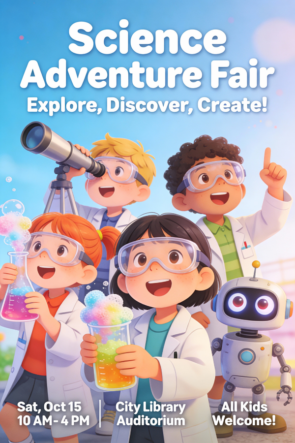

```text
A fun and educational poster for a children’s science fair. The design is a colorful cartoon illustration featuring kids dressed as scientists, looking at bubbling beakers, telescopes, and robots. The typography is playful and kid-friendly. The poster should make science look exciting and accessible, encouraging kids to participate. –ar 2:3
```

Model: Seedream 4.5 · Author: Jared Liu

[Original source](https://github.com/YouMind-OpenLab/awesome-seedream-4.5/blob/fd21eb654b096b37ec221240bbfc0299fd714773/README.md#L103) · [Provenance and original license](data/projectd-batch-0005.json)

## Trendy Fashion Sale Poster

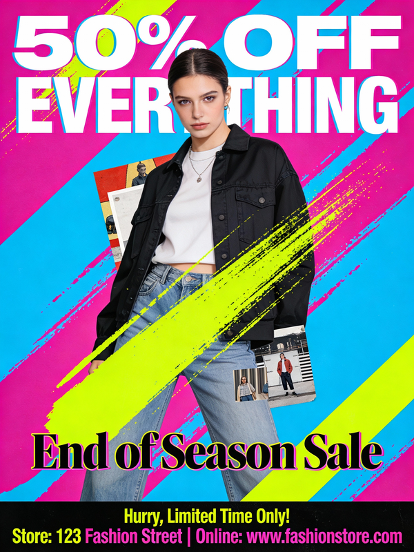

```text
A trendy and eye-catching poster for a fashion store’s end-of-season sale. The design uses bold, vibrant colors and modern, edgy typography. The main visual is a stylish model wearing clothes from the store, but the image is creatively treated with paint strokes or collage elements. The text “50% OFF EVERYTHING” is the most prominent element. The poster should create a sense of urgency and excitement. –ar 3:4
```

Model: Seedream 4.5 · Author: Jared Liu

[Original source](https://github.com/YouMind-OpenLab/awesome-seedream-4.5/blob/fd21eb654b096b37ec221240bbfc0299fd714773/README.md#L136) · [Provenance and original license](data/projectd-batch-0005.json)

## Aspirational Swiss Alps Travel Poster

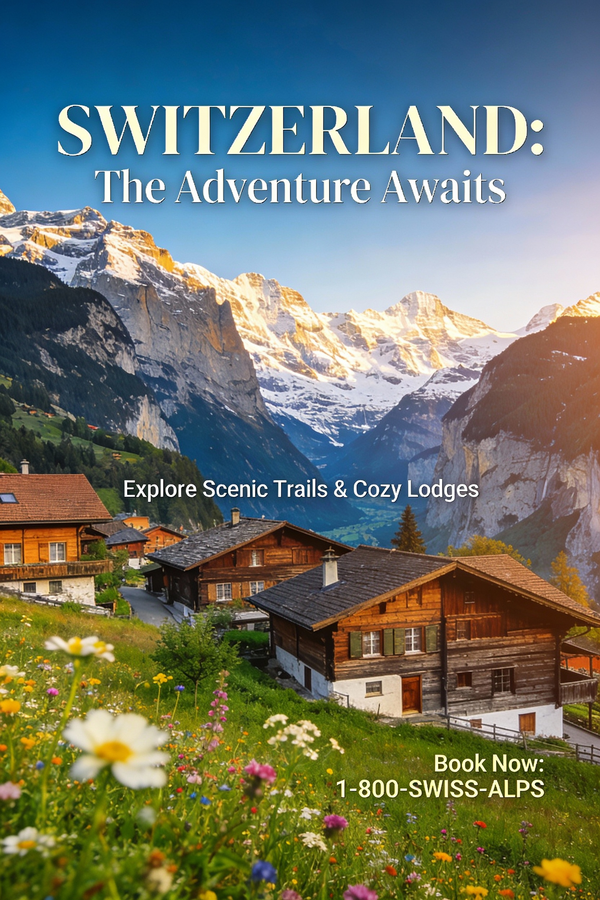

```text
An aspirational and beautiful travel poster for visiting the Swiss Alps. The image is a breathtaking, hyper-realistic photograph of a picturesque alpine village with snow-capped mountains in the background. The text “SWITZERLAND: The Adventure Awaits” is in an elegant, classic font. The poster should evoke a strong sense of wanderlust and make the viewer want to book a trip immediately. –ar 2:3
```

Model: Seedream 4.5 · Author: Jared Liu

[Original source](https://github.com/YouMind-OpenLab/awesome-seedream-4.5/blob/fd21eb654b096b37ec221240bbfc0299fd714773/README.md#L169) · [Provenance and original license](data/projectd-batch-0005.json)

## Effective 'Lost Cat' Flyer

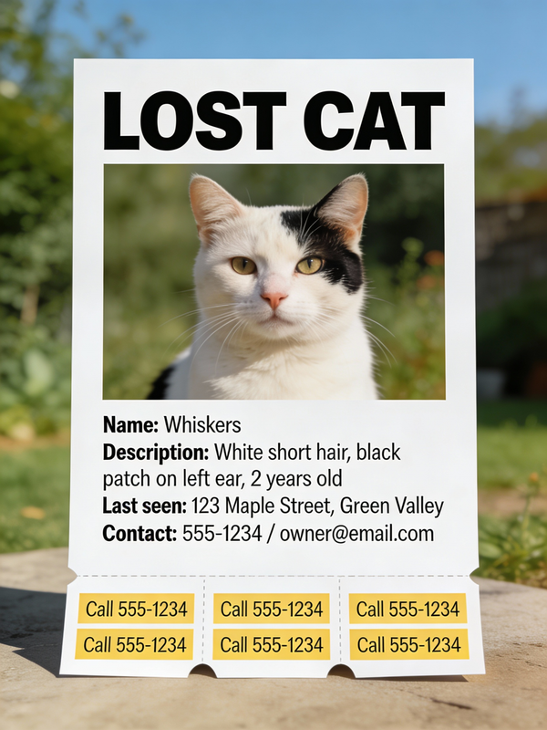

```text
An effective and clear “Lost Cat” flyer. The design is simple and functional. It features a large, clear, color photograph of the cat at the top. The headline “LOST CAT” is in a very large, bold, and easy-to-read font. Below the photo are the cat’s name, description, last seen location, and the owner’s contact information with tear-off tabs at the bottom. This demonstrates the ability to create practical, real-world designs. –ar 3:4
```

Model: Seedream 4.5 · Author: Jared Liu

[Original source](https://github.com/YouMind-OpenLab/awesome-seedream-4.5/blob/fd21eb654b096b37ec221240bbfc0299fd714773/README.md#L202) · [Provenance and original license](data/projectd-batch-0005.json)

## Climate Seminar Poster — Unverified Sample Data

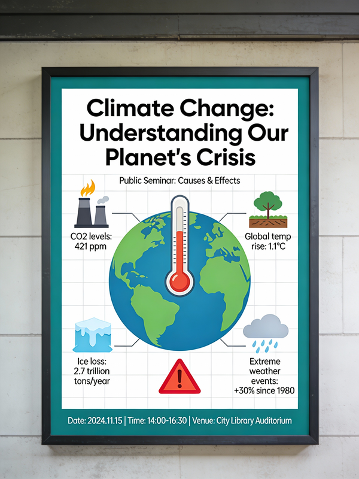

```text
An informative and engaging poster for a public seminar on climate change. The poster is designed as a mini-infographic, with a large, central graphic showing the earth with a thermometer, and smaller icons and data points around it explaining the causes and effects. The design is clean, organized, and aims to educate the viewer quickly and effectively. –ar 3:4
```

Model: Seedream 4.5 · Author: Jared Liu

[Original source](https://github.com/YouMind-OpenLab/awesome-seedream-4.5/blob/fd21eb654b096b37ec221240bbfc0299fd714773/README.md#L235) · [Provenance and original license](data/projectd-batch-0005.json)

## Sleek Minimalist Wireless Headphone Ad


```text
A sleek and minimalist poster advertisement for a new high-tech wireless headphone. The poster features a stunning, high-resolution 3D render of the headphone, seemingly floating in a zero-gravity environment. The background is a simple, clean gradient. The only text is the brand name and the product slogan: “Unleash Your Sound.” The design is modern, sophisticated, and focuses entirely on the product’s beauty. –ar 2:3
```

Model: Seedream 4.5 · Author: Jared Liu

[Original source](https://github.com/YouMind-OpenLab/awesome-seedream-4.5/blob/fd21eb654b096b37ec221240bbfc0299fd714773/README.md#L268) · [Provenance and original license](data/projectd-batch-0005.json)

## Energetic 5K Charity Run Poster


```text
An energetic and motivational poster for a 5K charity run for a good cause. The design features a dynamic photograph of a diverse group of people running, with smiles on their faces. The background has abstract, colorful shapes and lines that suggest movement and energy. The event details are clear and easy to read. The poster should be inspiring and encourage people to sign up. –ar 3:4
```

Model: Seedream 4.5 · Author: Jared Liu

[Original source](https://github.com/YouMind-OpenLab/awesome-seedream-4.5/blob/fd21eb654b096b37ec221240bbfc0299fd714773/README.md#L301) · [Provenance and original license](data/projectd-batch-0005.json)

## Dramatic Minimalist Hamlet Poster

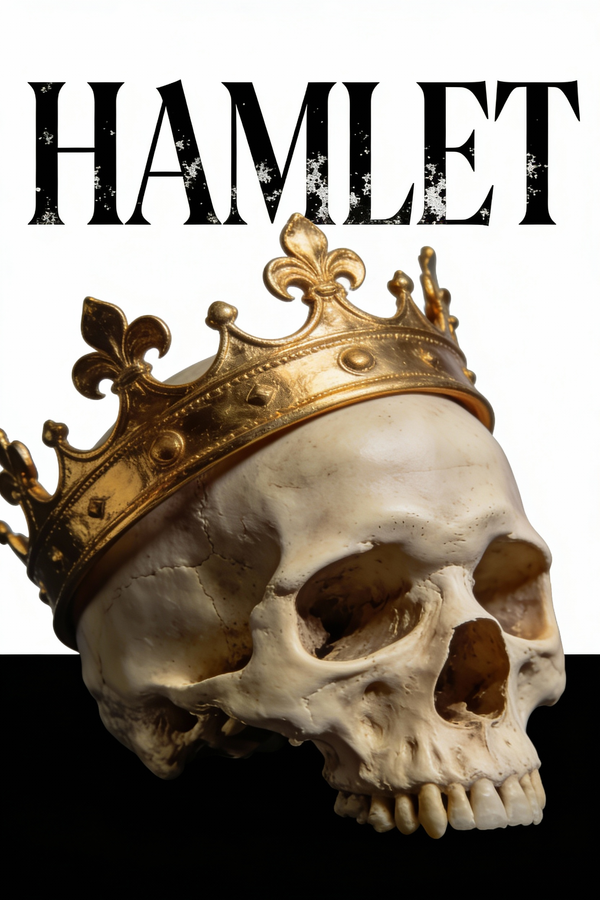

```text
A dramatic and minimalist poster for a production of Shakespeare’s “Hamlet”. The design features a single, powerful image: a human skull with a golden crown resting on it, against a stark black background. The title “HAMLET” is in a classic, sharp serif font, with the letters slightly decaying. The design is symbolic, modern, and full of gravitas. –ar 2:3
```

Model: Seedream 4.5 · Author: Jared Liu

[Original source](https://github.com/YouMind-OpenLab/awesome-seedream-4.5/blob/fd21eb654b096b37ec221240bbfc0299fd714773/README.md#L334) · [Provenance and original license](data/projectd-batch-0005.json)

## Charming Rustic Farmers Market Poster

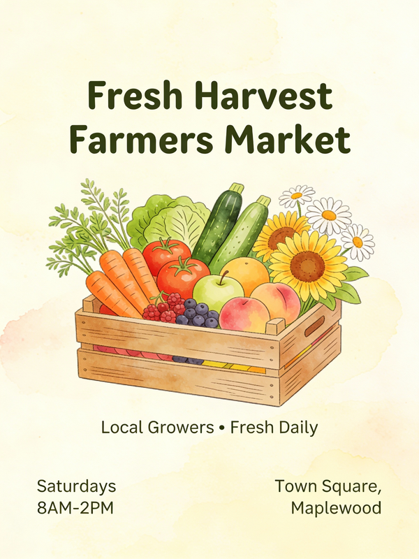

```text
A charming and rustic poster for a local farmers market. The design is an illustration in a friendly, hand-drawn style, featuring a bounty of fresh vegetables, fruits, and flowers in a wooden crate. The typography is a friendly, rounded sans-serif. The poster should feel wholesome, local, and community-oriented. –ar 3:4
```

Model: Seedream 4.5 · Author: Jared Liu

[Original source](https://github.com/YouMind-OpenLab/awesome-seedream-4.5/blob/fd21eb654b096b37ec221240bbfc0299fd714773/README.md#L367) · [Provenance and original license](data/projectd-batch-0005.json)

## Quirky Independent Short Film Festival Poster

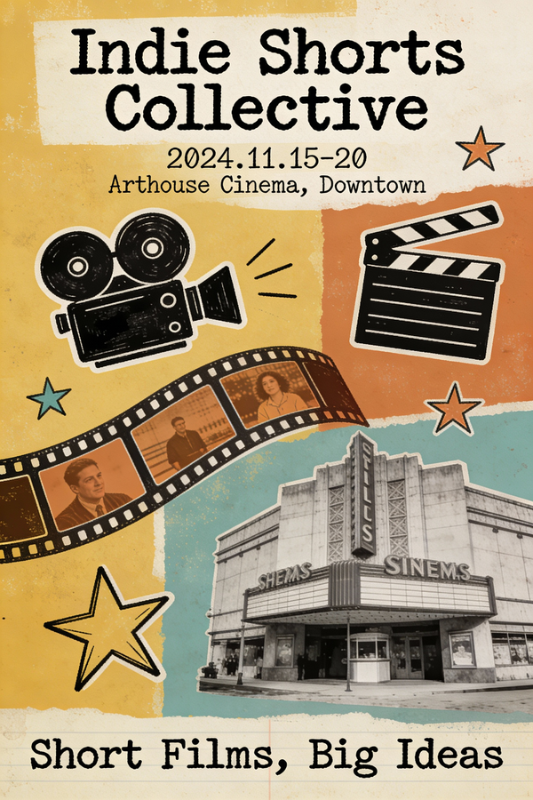

```text
A quirky and independent-style poster for a short film festival. The design is a collage of hand-drawn doodles, film strips, and vintage photographs. The typography is a mix of different typewriter and handwritten fonts, giving it a DIY, zine-like feel. The color palette is limited and has a retro vibe. The poster should look creative, unconventional, and appeal to an arthouse audience. –ar 2:3
```

Model: Seedream 4.5 · Author: Jared Liu

[Original source](https://github.com/YouMind-OpenLab/awesome-seedream-4.5/blob/fd21eb654b096b37ec221240bbfc0299fd714773/README.md#L400) · [Provenance and original license](data/projectd-batch-0005.json)

## Serene Yoga & Meditation Workshop Poster


```text
A serene and calming poster for a weekend yoga and meditation workshop. The main visual is a beautiful, soft-focus photograph of a person in a peaceful yoga pose on a beach at sunrise. The color palette is soft pastels (pinks, oranges, light blues). The typography is a gentle, flowing script. The poster should evoke feelings of peace, wellness, and self-care. –ar 3:4
```

Model: Seedream 4.5 · Author: Jared Liu

[Original source](https://github.com/YouMind-OpenLab/awesome-seedream-4.5/blob/fd21eb654b096b37ec221240bbfc0299fd714773/README.md#L433) · [Provenance and original license](data/projectd-batch-0005.json)

## Italian Restaurant Grand Opening Flyer

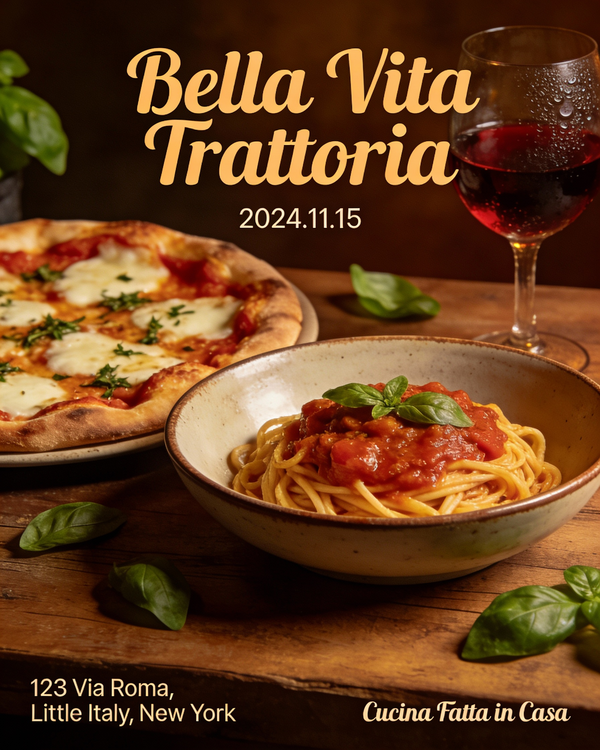

```text
A delicious and inviting flyer for the grand opening of a new Italian restaurant. The main visual is a beautiful, rustic flat-lay photograph of a table laden with Italian food: a pizza, a bowl of pasta, a glass of red wine, and some fresh basil. The restaurant’s name is in a warm, handwritten script font. The date and address of the opening are clearly visible. The overall feel is warm, authentic, and appetizing. –ar 4:5
```

Model: Seedream 4.5 · Author: Jared Liu

[Original source](https://github.com/YouMind-OpenLab/awesome-seedream-4.5/blob/fd21eb654b096b37ec221240bbfc0299fd714773/README.md#L466) · [Provenance and original license](data/projectd-batch-0005.json)

## Plastic Pollution PSA Poster

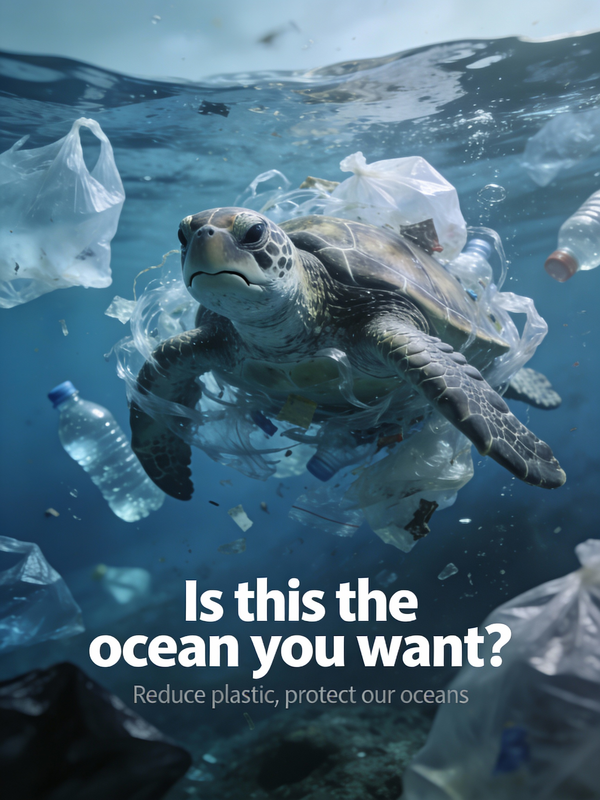

```text
A powerful and thought-provoking poster for a public service announcement about plastic pollution in the oceans. The image is a surreal and sad depiction of a sea turtle swimming through a sea of plastic bags and bottles, instead of water. The tagline “Is this the ocean you want?” is at the bottom. The visual should be realistic and impactful, designed to evoke an emotional response and raise awareness. –ar 3:4
```

Model: Seedream 4.5 · Author: Jared Liu

[Original source](https://github.com/YouMind-OpenLab/awesome-seedream-4.5/blob/fd21eb654b096b37ec221240bbfc0299fd714773/README.md#L499) · [Provenance and original license](data/projectd-batch-0005.json)

## Crime Novel Book Cover "The Shadow Detective"

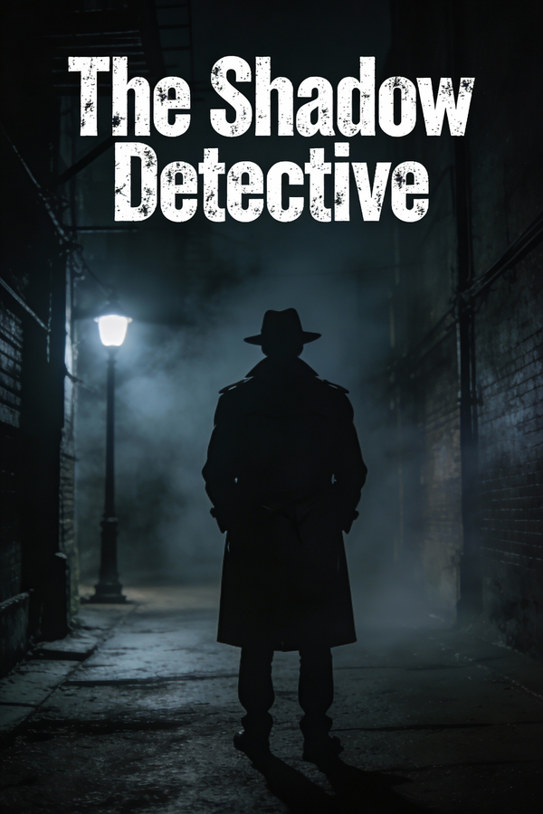

```text
A thrilling and mysterious book cover for a crime novel titled “The Shadow Detective”. The cover features a silhouette of a detective in a fedora and trench coat, standing in a dark, foggy alleyway. The only light source is a single, distant streetlamp. The title is in a gritty, textured font that looks like it was stamped on. The mood is noir and full of suspense, demonstrating strong atmospheric control. –ar 2:3
```

Model: Seedream 4.5 · Author: Jared Liu

[Original source](https://github.com/YouMind-OpenLab/awesome-seedream-4.5/blob/fd21eb654b096b37ec221240bbfc0299fd714773/README.md#L532) · [Provenance and original license](data/projectd-batch-0005.json)

## Japanese Ukiyo-e Museum Poster

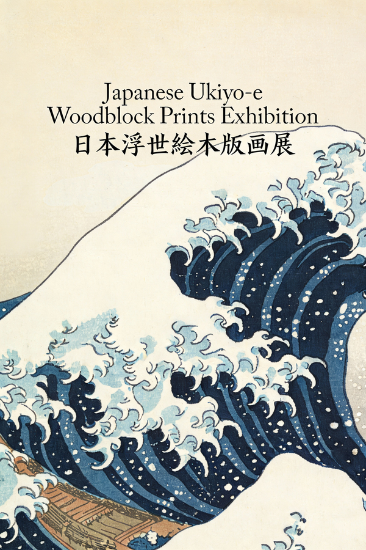

```text
An elegant and artistic poster for a museum exhibition of Japanese Ukiyo-e woodblock prints. The design features a beautiful, high-resolution detail from a famous print, like Hokusai’s “The Great Wave,” but creatively cropped. The typography is a mix of an elegant English serif font and Japanese calligraphy. The layout is minimalist and respectful of the artwork, using a lot of negative space. This showcases knowledge of art history and sophisticated graphic design skills. –ar 2:3
```

Model: Seedream 4.5 · Author: Jared Liu

[Original source](https://github.com/YouMind-OpenLab/awesome-seedream-4.5/blob/fd21eb654b096b37ec221240bbfc0299fd714773/README.md#L565) · [Provenance and original license](data/projectd-batch-0005.json)

## Software Developer Recruitment Flyer


```text
A bold and direct recruitment flyer for a startup looking for software developers. The headline “BUILD THE FUTURE” is in a large, strong, sans-serif font. The main visual is an abstract, stylized illustration of code turning into a growing city skyline. The company logo and a QR code to the application page are prominently displayed at the bottom. The color palette is energetic and tech-oriented (e.g., electric blue and dark gray). –ar 3:4
```

Model: Seedream 4.5 · Author: Jared Liu

[Original source](https://github.com/YouMind-OpenLab/awesome-seedream-4.5/blob/fd21eb654b096b37ec221240bbfc0299fd714773/README.md#L598) · [Provenance and original license](data/projectd-batch-0005.json)

## Psychedelic Music Festival Poster "Ethereal Bloom"

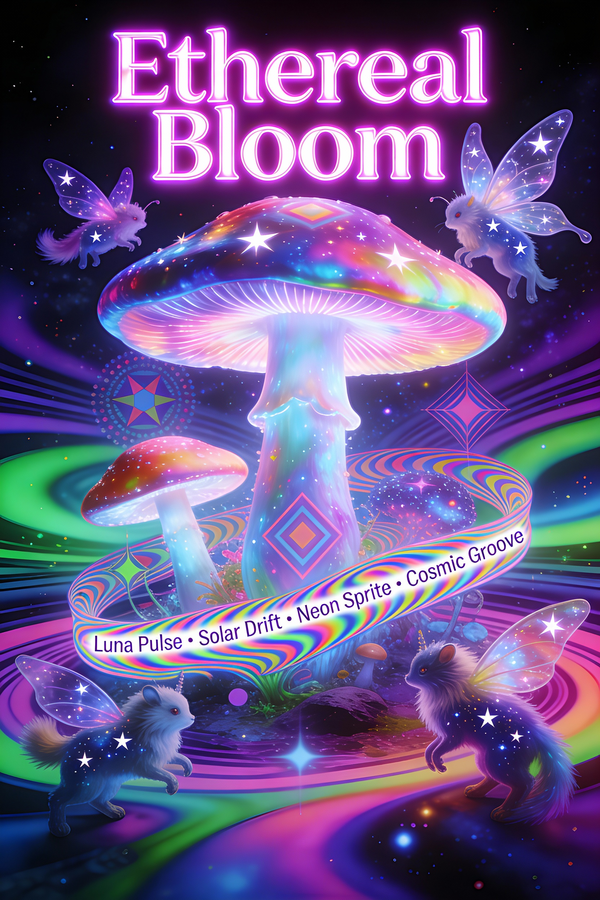

```text
A vibrant, psychedelic poster for a summer music festival called “Ethereal Bloom”. The design is a surreal explosion of color, featuring giant, glowing mushrooms, whimsical fantasy creatures, and abstract geometric patterns all intertwined. The festival lineup is integrated into the artwork in a wavy, distorted font. The overall mood is magical, energetic, and otherworldly, showcasing the ability to create complex, imaginative, and genre-specific visuals. –ar 2:3
```

Model: Seedream 4.5 · Author: Jared Liu

[Original source](https://github.com/YouMind-OpenLab/awesome-seedream-4.5/blob/fd21eb654b096b37ec221240bbfc0299fd714773/README.md#L631) · [Provenance and original license](data/projectd-batch-0005.json)

## Cinematic Sci-Fi Movie Poster "CHRONOS"

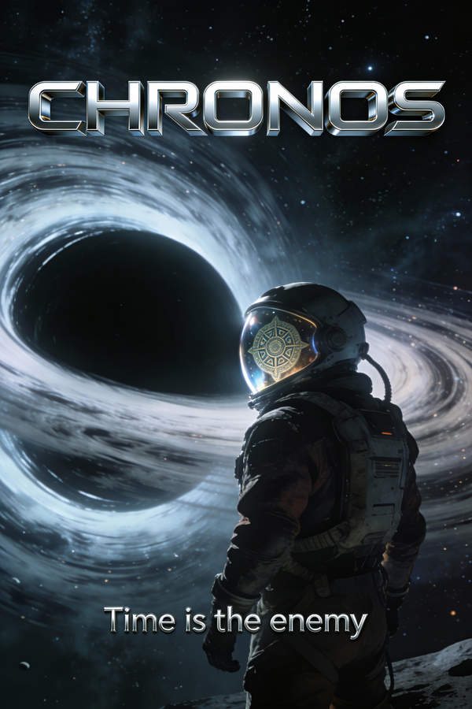

```text
A cinematic, epic movie poster for a fictional sci-fi blockbuster titled “CHRONOS”. The poster features the main hero, a rugged astronaut, looking out at a massive, swirling black hole in space. The reflection of a mysterious alien artifact is visible in his helmet visor. The typography is bold, metallic, and modern. The tagline “Time is the enemy” is positioned at the bottom. This requires advanced cinematic lighting, composition, and the ability to blend multiple complex elements seamlessly. –ar 2:3
```

Model: Seedream 4.5 · Author: Jared Liu

[Original source](https://github.com/YouMind-OpenLab/awesome-seedream-4.5/blob/fd21eb654b096b37ec221240bbfc0299fd714773/README.md#L664) · [Provenance and original license](data/projectd-batch-0005.json)

## Illustrated Homemade Pasta Recipe Card

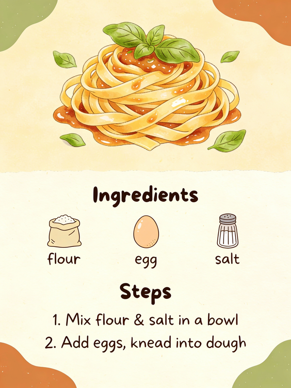

```text
A beautifully illustrated recipe card for making homemade pasta. The top half is a charming illustration of the finished dish (e.g., fettuccine with basil). The bottom half lists the ingredients and steps, with small icons for each ingredient (flour, egg, salt). The style is warm and rustic, like a page from a handwritten family cookbook. –ar 3:4
```

Model: Seedream 4.5 · Author: Jared Liu

[Original source](https://github.com/YouMind-OpenLab/awesome-seedream-4.5/blob/fd21eb654b096b37ec221240bbfc0299fd714773/README.md#L1258) · [Provenance and original license](data/projectd-batch-0005.json)

## Desk Posture Comparison — Illustrative Layout


```text
A visual safety guide for a workplace, illustrating the correct posture for sitting at a desk to avoid back pain. The infographic should show two figures: one in an incorrect, slouched posture with red X-marks, and one in a correct, ergonomic posture with green check-marks. The style should be simple, clear, and universally understandable, suitable for corporate training materials. –ar 3:4
```

Model: Seedream 4.5 · Author: Jared Liu

[Original source](https://github.com/YouMind-OpenLab/awesome-seedream-4.5/blob/fd21eb654b096b37ec221240bbfc0299fd714773/README.md#L1291) · [Provenance and original license](data/projectd-batch-0005.json)

## Isometric National Park Map

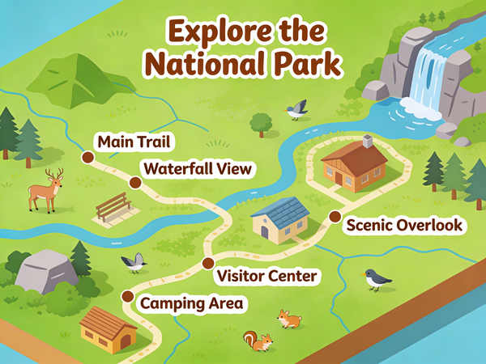

```text
A stylized, isometric illustrated map of a national park. The map should highlight key trails, landmarks (like waterfalls and viewpoints), visitor centers, and camping areas. The style should be friendly and inviting, with small illustrations of animals that live in the park. This is for a park brochure or website, requiring a mix of geographic accuracy and artistic illustration. –ar 4:3
```

Model: Seedream 4.5 · Author: Jared Liu

[Original source](https://github.com/YouMind-OpenLab/awesome-seedream-4.5/blob/fd21eb654b096b37ec221240bbfc0299fd714773/README.md#L1357) · [Provenance and original license](data/projectd-batch-0005.json)

## Plant Cell Cross-Section — Unverified Sample Labels

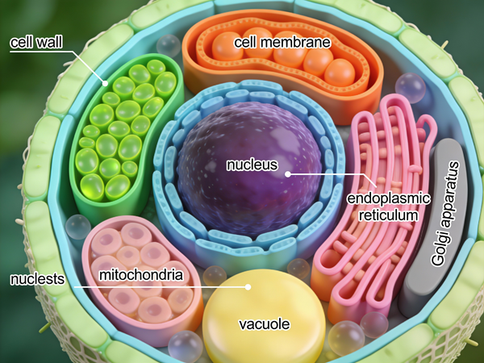

```text
A detailed, scientific illustration of a plant cell, in the style of a modern biology textbook. The illustration should be a 3D cross-section, clearly showing and labeling the cell wall, cell membrane, nucleus, chloroplasts, and other organelles. The colors should be clear and distinct for each organelle. This requires accurate, knowledge-based rendering for scientific education. –ar 4:3
```

Model: Seedream 4.5 · Author: Jared Liu

[Original source](https://github.com/YouMind-OpenLab/awesome-seedream-4.5/blob/fd21eb654b096b37ec221240bbfc0299fd714773/README.md#L1423) · [Provenance and original license](data/projectd-batch-0005.json)

## Pour-Over Coffee Guide

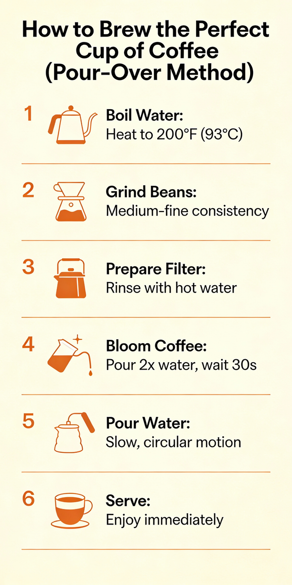

```text
A simple, step-by-step visual guide on “How to Brew the Perfect Cup of Coffee using a Pour-Over Method.” The infographic should have 6–8 steps, each with a clean icon and a short, clear instruction (e.g., “1. Boil Water,” “2. Grind Beans”). The style should be minimalist and icon-based, with a warm color palette. This is for a lifestyle blog or cafe, requiring clear, sequential visual instruction. –ar 1:2
```

Model: Seedream 4.5 · Author: Jared Liu

[Original source](https://github.com/YouMind-OpenLab/awesome-seedream-4.5/blob/fd21eb654b096b37ec221240bbfc0299fd714773/README.md#L1555) · [Provenance and original license](data/projectd-batch-0005.json)

## Heart Anatomy Chalkboard — Unverified Sample Labels

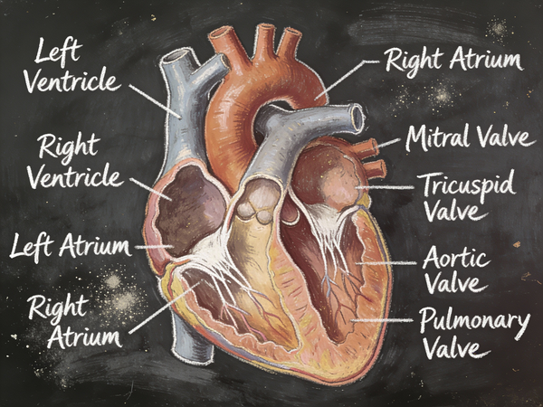

```text
A detailed, vintage-style chalkboard illustration explaining the anatomy of the human heart. The drawing should be done in a realistic, scientific style with white and colored chalk. All the different parts of the heart (ventricles, atriums, valves) should be clearly labeled with elegant, cursive handwriting. The texture of the chalkboard and the chalk dust should be visible, showcasing a rich, knowledge-based rendering capability. –ar 4:3
```

Model: Seedream 4.5 · Author: Jared Liu

[Original source](https://github.com/YouMind-OpenLab/awesome-seedream-4.5/blob/fd21eb654b096b37ec221240bbfc0299fd714773/README.md#L1621) · [Provenance and original license](data/projectd-batch-0005.json)

## Serene Bath for Self-Care

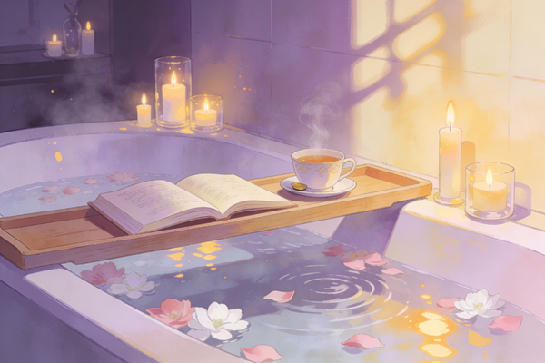

```text
A serene and calming image for a post about self-care and mental health. The scene is a beautifully drawn bath with flower petals floating on the water. A book and a cup of tea are on a wooden tray resting on the tub. The room is lit by candles, creating a warm and relaxing ambiance. The image should be a visual invitation to relax and unwind, demonstrating advanced lighting and atmospheric rendering. –ar 3:2
```

Model: Seedream 4.5 · Author: Jared Liu

[Original source](https://github.com/YouMind-OpenLab/awesome-seedream-4.5/blob/fd21eb654b096b37ec221240bbfc0299fd714773/README.md#L1753) · [Provenance and original license](data/projectd-batch-0005.json)

## Artist's Messy Studio

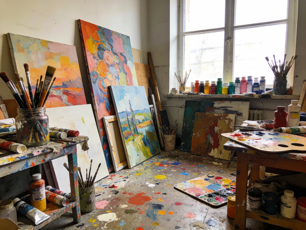

```text
A photo of an artist’s messy but inspiring studio. Canvases are leaning against the wall, some finished, some in progress. Jars of paintbrushes, tubes of paint, and palettes are scattered around. The floor is splattered with paint. The lighting is natural, coming from a large, north-facing window. The image should celebrate the creative process, showcasing the ability to render complex, chaotic scenes with a high degree of realism and coherence. –ar 4:3
```

Model: Seedream 4.5 · Author: Jared Liu

[Original source](https://github.com/YouMind-OpenLab/awesome-seedream-4.5/blob/fd21eb654b096b37ec221240bbfc0299fd714773/README.md#L1786) · [Provenance and original license](data/projectd-batch-0005.json)

## Cozy Christmas Hot Chocolate


```text
A cozy and festive photo for a Christmas-themed Instagram post. The scene is a close-up of someone holding a large mug of hot chocolate with whipped cream and a candy cane. In the background, a Christmas tree with twinkling lights is softly blurred. The person is wearing a chunky, knitted sweater. The image should evoke feelings of warmth, comfort, and holiday cheer, showcasing strong control over depth of field and mood. –ar 4:5
```

Model: Seedream 4.5 · Author: Jared Liu

[Original source](https://github.com/YouMind-OpenLab/awesome-seedream-4.5/blob/fd21eb654b096b37ec221240bbfc0299fd714773/README.md#L1819) · [Provenance and original license](data/projectd-batch-0005.json)

## Sprout Through Dry Earth


```text
A powerful and thought-provoking image of a single, green sprout growing through a crack in dry, barren earth. The image is a close-up, with the focus on the delicate sprout. The lighting is dramatic, with a single beam of light illuminating the sprout. The image should symbolize hope, resilience, and the importance of environmental conservation, showcasing the ability to convey complex concepts visually. –ar 3:2
```

Model: Seedream 4.5 · Author: Jared Liu

[Original source](https://github.com/YouMind-OpenLab/awesome-seedream-4.5/blob/fd21eb654b096b37ec221240bbfc0299fd714773/README.md#L1885) · [Provenance and original license](data/projectd-batch-0005.json)

## Vintage Vinyl Records Collection

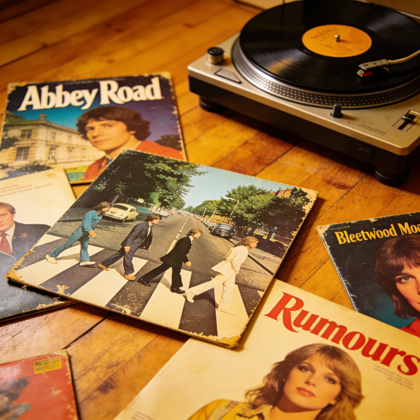

```text
A photo of a collection of vintage vinyl records scattered on a wooden floor, with a record player in the corner. The focus is on the cover art of a few iconic albums. The lighting is warm and nostalgic, with a slight vignette effect. The image should evoke a love for music and the tangible experience of listening to records, demonstrating knowledge of cultural artifacts. –ar 1:1
```

Model: Seedream 4.5 · Author: Jared Liu

[Original source](https://github.com/YouMind-OpenLab/awesome-seedream-4.5/blob/fd21eb654b096b37ec221240bbfc0299fd714773/README.md#L1951) · [Provenance and original license](data/projectd-batch-0005.json)

## Light-Filled Reading Nook

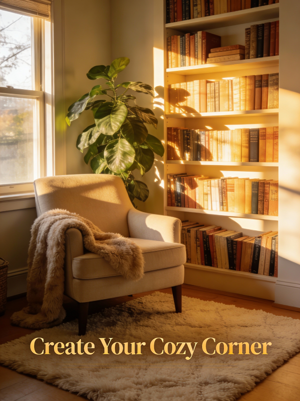

```text
A photo of a beautifully decorated, light-filled reading nook in a home. The nook has a comfortable armchair, a well-stocked bookshelf, a soft rug, and a large plant. The afternoon sun streams through a window, creating a warm and inviting space. The image should inspire people to create their own cozy corners, showcasing realistic interior lighting and a strong sense of place. –ar 3:4
```

Model: Seedream 4.5 · Author: Jared Liu

[Original source](https://github.com/YouMind-OpenLab/awesome-seedream-4.5/blob/fd21eb654b096b37ec221240bbfc0299fd714773/README.md#L1984) · [Provenance and original license](data/projectd-batch-0005.json)

## Minimalist Chic Outfit Flat-Lay

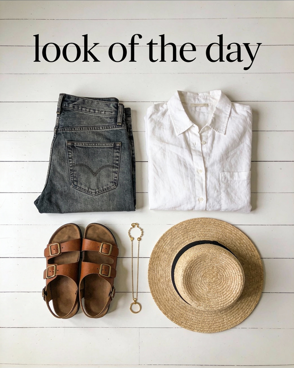

```text
A minimalist and chic flat-lay of a curated outfit for a “look of the day” post. The outfit consists of a pair of vintage jeans, a white linen shirt, a pair of leather sandals, a straw hat, and delicate gold jewelry. The items are neatly arranged on a clean, white wooden floor. The lighting is natural and soft. The image should be clean, stylish, and aspirational, demonstrating precise object placement and texture rendering. –ar 4:5
```

Model: Seedream 4.5 · Author: Jared Liu

[Original source](https://github.com/YouMind-OpenLab/awesome-seedream-4.5/blob/fd21eb654b096b37ec221240bbfc0299fd714773/README.md#L2017) · [Provenance and original license](data/projectd-batch-0005.json)

## Tent View of Mountain Landscape

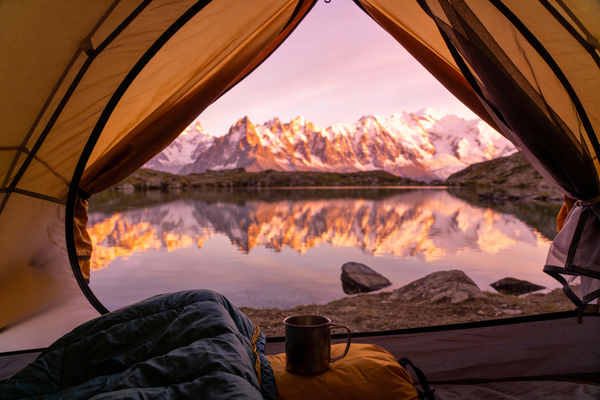

```text
A breathtaking photo from the perspective of someone sitting inside a tent, looking out at a stunning mountain landscape at dawn. The tent opening frames the view of a crystal-clear alpine lake and snow-capped peaks catching the first rays of sun. The interior of the tent is cozy, with a sleeping bag and a metal camping mug. This requires complex spatial understanding and the ability to blend interior and exterior scenes seamlessly. –ar 3:2
```

Model: Seedream 4.5 · Author: Jared Liu

[Original source](https://github.com/YouMind-OpenLab/awesome-seedream-4.5/blob/fd21eb654b096b37ec221240bbfc0299fd714773/README.md#L2083) · [Provenance and original license](data/projectd-batch-0005.json)

## Overhead Calligraphy Crafting Shot


```text
A beautifully styled overhead shot of a crafting table where someone is practicing calligraphy. The scene includes a bottle of black ink, a dip pen, a sheet of high-quality paper with elegant lettering, and a few dried flowers for decoration. The lighting is soft and focused on the calligraphy. The image should be serene and inspiring, perfect for a creative hobbyist’s Instagram feed, showcasing fine detail and object placement. –ar 1:1
```

Model: Seedream 4.5 · Author: Jared Liu

[Original source](https://github.com/YouMind-OpenLab/awesome-seedream-4.5/blob/fd21eb654b096b37ec221240bbfc0299fd714773/README.md#L2149) · [Provenance and original license](data/projectd-batch-0005.json)

## Dynamic Female Athlete Workout Shot

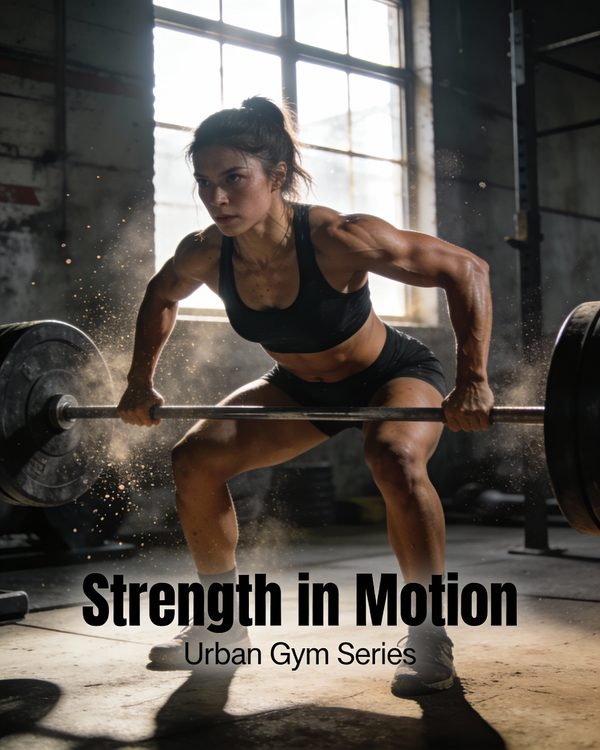

```text
A dynamic and powerful shot of a female athlete mid-workout in a gritty, urban gym. She is lifting a heavy barbell, and her muscles are defined and tense. The lighting is dramatic and high-contrast, with light streaming through a large window, highlighting the dust particles in the air. The image should convey strength, determination, and raw energy, demonstrating accurate anatomical rendering and atmospheric lighting. –ar 4:5
```

Model: Seedream 4.5 · Author: Jared Liu

[Original source](https://github.com/YouMind-OpenLab/awesome-seedream-4.5/blob/fd21eb654b096b37ec221240bbfc0299fd714773/README.md#L2182) · [Provenance and original license](data/projectd-batch-0005.json)

## Appetizing Pancakes Shot

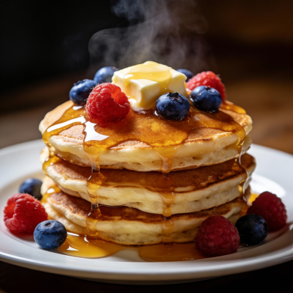

```text
An extremely appetizing, close-up shot of a stack of fluffy pancakes for a food blogger’s social media. The pancakes are drizzled with maple syrup, topped with a pat of melting butter, and garnished with fresh blueberries and raspberries. Steam should be gently rising from the stack. The lighting should be warm and inviting, making the dish look irresistible. The focus is sharp on the texture of the pancakes and the glistening syrup, showcasing hyper-realistic food rendering. –ar 1:1
```

Model: Seedream 4.5 · Author: Jared Liu

[Original source](https://github.com/YouMind-OpenLab/awesome-seedream-4.5/blob/fd21eb654b096b37ec221240bbfc0299fd714773/README.md#L2215) · [Provenance and original license](data/projectd-batch-0005.json)

## Paris Fashion Influencer Street Style

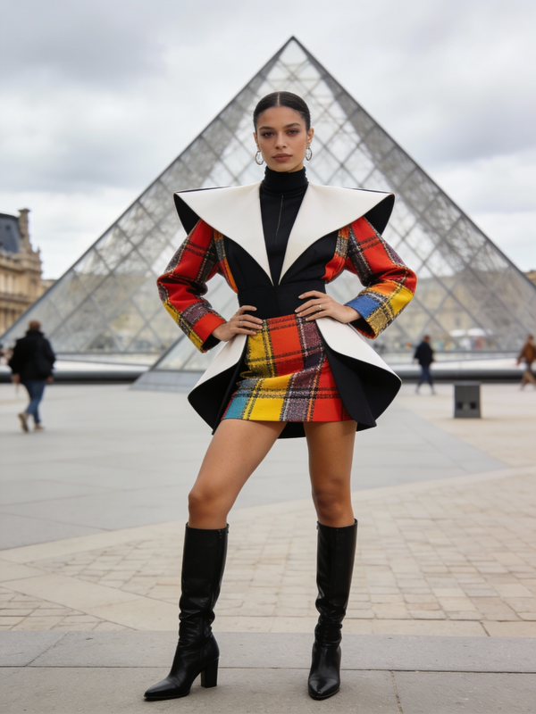

```text
A street style photo of a fashion influencer in Paris during Fashion Week. She is wearing an avant-garde outfit and posing confidently in front of the Louvre Pyramid. The background is slightly blurred to keep the focus on her, but the iconic location is still recognizable. The lighting should be overcast but bright, typical of Paris, which creates soft shadows and brings out the colors and textures of her outfit. This requires high consistency in subject details and accurate environmental context. –ar 3:4
```

Model: Seedream 4.5 · Author: Jared Liu

[Original source](https://github.com/YouMind-OpenLab/awesome-seedream-4.5/blob/fd21eb654b096b37ec221240bbfc0299fd714773/README.md#L2248) · [Provenance and original license](data/projectd-batch-0005.json)

## Golden Retriever Puppy in Autumn Leaves


```text
A heartwarming, candid photo of a golden retriever puppy playing in a field of autumn leaves. The puppy is mid-jump, with leaves flying around it, and has a joyful expression on its face. The afternoon sun should create a beautiful golden backlight, making the scene warm and magical. The focus should be perfectly on the puppy’s eyes, capturing its playful spirit. This demonstrates the ability to render dynamic action and emotion in animals. –ar 3:2
```

Model: Seedream 4.5 · Author: Jared Liu

[Original source](https://github.com/YouMind-OpenLab/awesome-seedream-4.5/blob/fd21eb654b096b37ec221240bbfc0299fd714773/README.md#L2281) · [Provenance and original license](data/projectd-batch-0005.json)

## Cinematic Solo Travel Shot

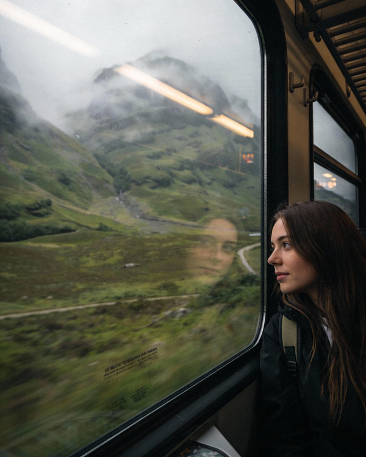

```text
A candid, cinematic shot of a young woman on a solo travel adventure, sitting by the window of a moving train. She looks thoughtfully at the passing landscape of rolling green hills and misty mountains. The reflection of the train’s interior is subtly visible on the window. The color grading should be moody and atmospheric, with a slight film grain to evoke a sense of wanderlust and introspection. This demonstrates advanced lighting, reflection, and mood control for a travel blogger’s post. –ar 4:5
```

Model: Seedream 4.5 · Author: Jared Liu

[Original source](https://github.com/YouMind-OpenLab/awesome-seedream-4.5/blob/fd21eb654b096b37ec221240bbfc0299fd714773/README.md#L2314) · [Provenance and original license](data/projectd-batch-0005.json)

## Three-Panel Film Art Grid — Reference Image Required

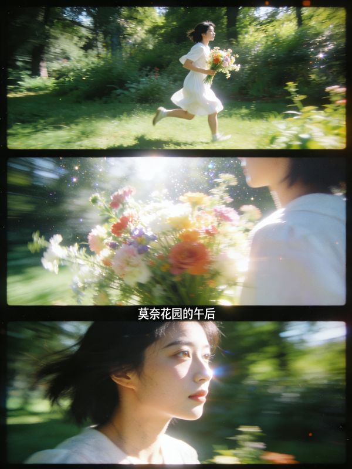

```text
将图片编辑成三格等分的网格电影质感艺术肖像。场景是绿色的午后。阳光明媚。图中人物与参考图一致，身穿 {argument name="clothing" default="白色连衣裙"}。第一个镜头是中景，从侧面拍摄，人物在过曝的绿色莫奈花园中向 {argument name="direction" default="右"} 奔跑，手中拿着一束 {argument name="item" default="华丽的花束"}。第二个镜头是特写，拍摄花束，过曝，动态模糊。第三个镜头是人物大特写，人物奔跑的侧影，面向右侧，过曝，动态模糊，背景是绿色花园，给人物眼神光，让人物的表情带有一丝忧郁和希望。肖像摄影，图像生成风格具有强烈、直射的闪光效果：高光模式，前景曝光，超现实主义，光影氛围，细腻的微光光影，梦幻电影胶片质感，动态模糊，慢快门效果，正负片，撕拉片，极简主义，极致构图，晕影，漏光。字幕位于底部中央，三格网格合成一张图片。比例 3:4。
```

Model: Seedream 4.5 · Author: Leah

[Original source](https://github.com/YouMind-OpenLab/awesome-seedream-4.5/blob/fd21eb654b096b37ec221240bbfc0299fd714773/README_zh.md#L2351) · [Provenance and original license](data/projectd-batch-0005.json)

## Hello Kitty Office Chaos

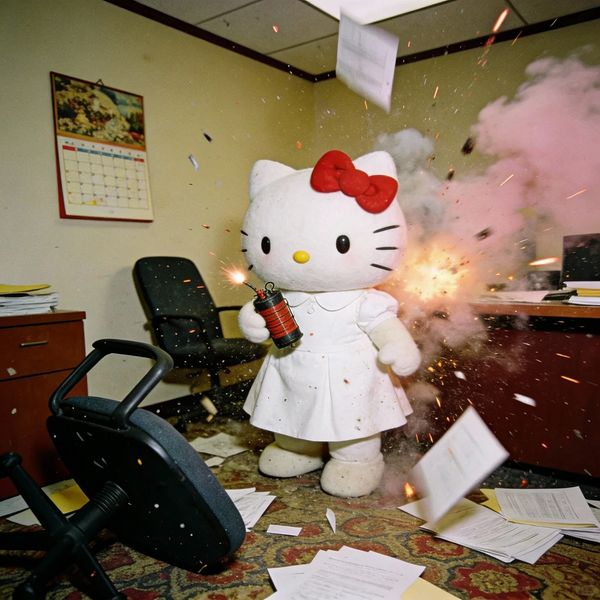

```text
h0674kz，Hello Kitty 炸毁办公室，复古电影风格，细腻颗粒感
```

Model: Seedream 4.5 · Author: Leah

[Original source](https://github.com/YouMind-OpenLab/awesome-seedream-4.5/blob/fd21eb654b096b37ec221240bbfc0299fd714773/README_zh.md#L2385) · [Provenance and original license](data/projectd-batch-0005.json)

## Crystal Fountain with Stars

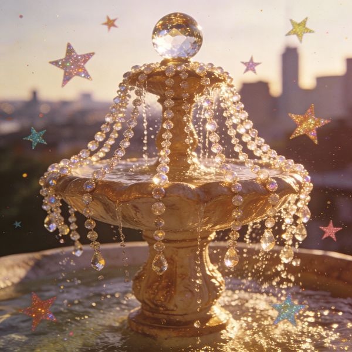

```text
h0674kz, colorful star stickers, a fountain decorated with bright crystal bead chains, retro film style, fine graininess
```

Model: Seedream 4.5 · Author: Leah

[Original source](https://github.com/YouMind-OpenLab/awesome-seedream-4.5/blob/fd21eb654b096b37ec221240bbfc0299fd714773/README_zh.md#L2418) · [Provenance and original license](data/projectd-batch-0005.json)

## Kyoto Geisha Moment

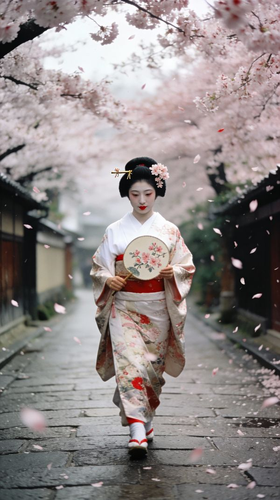

```text
艺伎（传统和服细节，白色妆容）走在祇园的石板路上，两旁吉野樱花盛开，粉色花瓣动态飘落，柔和的散射光（阴天光线质量），日式电影美学（是枝裕和风格），50mm 浅景深虚化背景，胶片色调（富士 Fujifilm Pro 400H 模拟），宁静的禅意氛围，适合手机壁纸的竖构图
```

Model: Seedream 4.5 · Author: Leah

[Original source](https://github.com/YouMind-OpenLab/awesome-seedream-4.5/blob/fd21eb654b096b37ec221240bbfc0299fd714773/README_zh.md#L2451) · [Provenance and original license](data/projectd-batch-0005.json)

## Intense Workout Monochrome

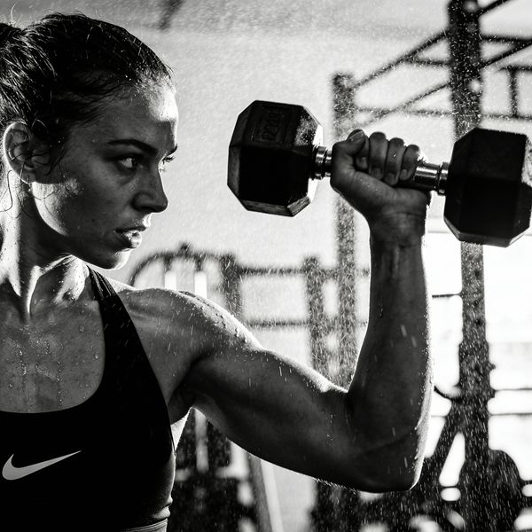

```text
特写镜头，一名 {argument name="subject" default="运动型女性"} 在力量训练时举起哑铃，肌肉线条清晰，汗珠在皮肤上反射光芒，戏剧性的侧光从左侧 90 度角强烈照射，背景设备模糊，黑白高对比度色调增强力量感，体育摄影高速快门 1/1000 秒凝固瞬间，Nike 广告级别视觉效果，1:1 方形构图，边缘锐化增强质感
```

Model: Seedream 4.5 · Author: Leah

[Original source](https://github.com/YouMind-OpenLab/awesome-seedream-4.5/blob/fd21eb654b096b37ec221240bbfc0299fd714773/README_zh.md#L2551) · [Provenance and original license](data/projectd-batch-0005.json)

## Astronaut at a Space-Station Hatch

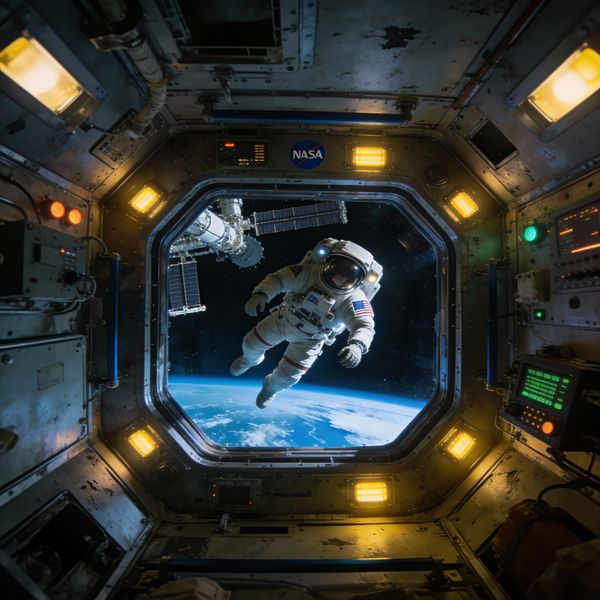

```text
国际空间站内部真实物理环境，宇航员（身着 NASA 宇航服，细节清晰）处于失重漂浮状态，透过舷窗可见地球的蓝色大气层，内部设备指示灯提供环境照明，金属舱壁磨损纹理逼真，科学仪器细节准确，NASA 官方摄影风格，16mm 广角镜头捕捉狭窄空间，真实物理光照模拟
```

Model: Seedream 4.5 · Author: Leah

[Original source](https://github.com/YouMind-OpenLab/awesome-seedream-4.5/blob/fd21eb654b096b37ec221240bbfc0299fd714773/README_zh.md#L2585) · [Provenance and original license](data/projectd-batch-0005.json)

## Minimalist High-Fashion Portrait

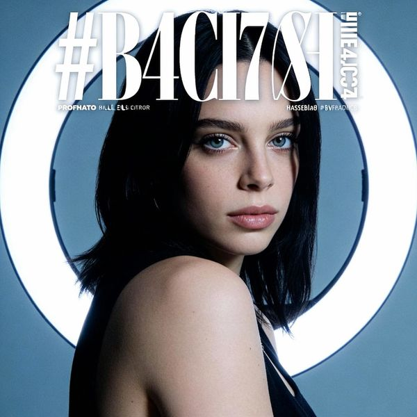

```text
一位 {argument name="subject" default="年轻女性"} 的极简半身肖像，纯色背景（{argument name="background color" default="#B4C7E7 雾霾蓝"}），目光锐利地直视镜头，Profoto 环形灯正面平光照明以消除阴影，皮肤纹理清晰柔和，高对比度同时保留细节，时尚杂志封面构图，中画幅相机哈苏质感，冷色调后期处理，Billie Eilish 专辑封面美学，1:1 正方形构图
```

Model: Seedream 4.5 · Author: Leah

[Original source](https://github.com/YouMind-OpenLab/awesome-seedream-4.5/blob/fd21eb654b096b37ec221240bbfc0299fd714773/README_zh.md#L2753) · [Provenance and original license](data/projectd-batch-0005.json)

## Amalfi Coast Lifestyle

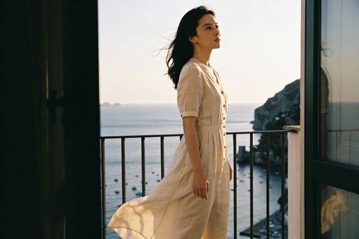

```text
一位优雅的 {argument name="age" default="30 岁"} {argument name="gender" default="女性"}，身着 {argument name="clothing" default="米白色法式亚麻连衣裙"}，裙摆随风飘扬，置身于 {argument name="location" default="意大利阿马尔菲一座别墅的露台"}。柔和的黄金时段光线（魔幻时刻），模糊的地中海蓝色海景背景，徕卡 M10 胶片色彩模拟，暖色调电影胶片质感（柯达 Portra 400），浅景深 35 毫米人文摄影，高级灰色调，自然放松的氛围。
```

Model: Seedream 4.5 · Author: Leah

[Original source](https://github.com/YouMind-OpenLab/awesome-seedream-4.5/blob/fd21eb654b096b37ec221240bbfc0299fd714773/README_zh.md#L2889) · [Provenance and original license](data/projectd-batch-0005.json)

## Y2K Digital Camera Selfie

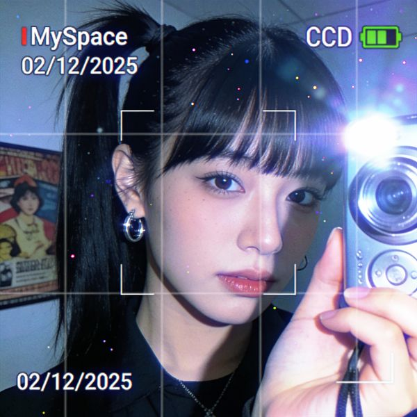

```text
千禧年数码相机风格自拍，刻意营造低分辨率感（模拟 2000 年代 200 万像素画质），覆盖酷炫的蓝紫色滤镜，直射前置闪光灯造成的过曝高光和硬阴影，CCD 传感器特有的色彩偏移和噪点，日期水印“{argument name="date" default="02/12/2025"}”，网格线装饰，MySpace 时代社交媒体质感，1:1 正方形构图
```

Model: Seedream 4.5 · Author: Leah

[Original source](https://github.com/YouMind-OpenLab/awesome-seedream-4.5/blob/fd21eb654b096b37ec221240bbfc0299fd714773/README_zh.md#L2923) · [Provenance and original license](data/projectd-batch-0005.json)

## Judy and Nick Felt Christmas Poster

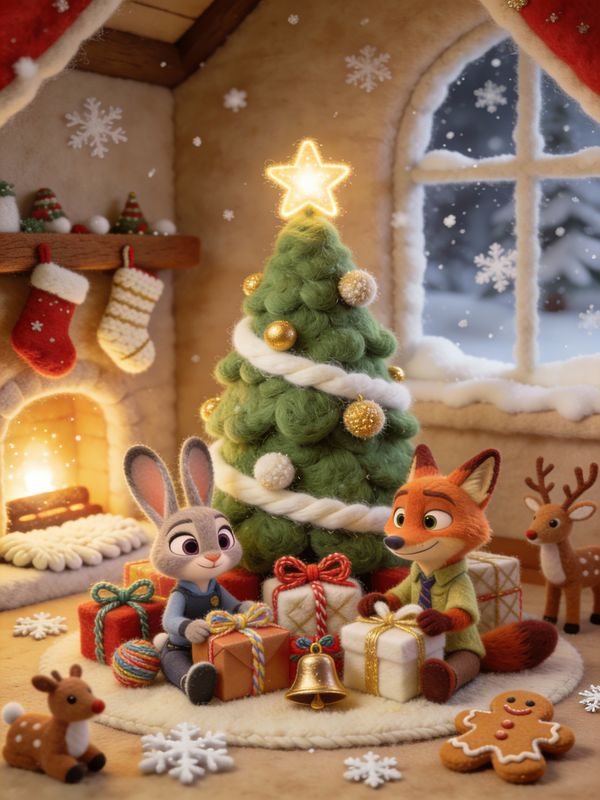

```text
毛毡质感圣诞主题海报，整体采用温暖治愈的羊毛毡手工质感。画面中央是一棵毛茸茸的 3D 绿色毛毡圣诞树。迪士尼角色朱迪和尼克坐在地毯上包装礼盒，礼盒用乳白色毛绒丝带和金色绒球包裹，树顶装饰着一颗发光的毛毡星星。树下堆满了用羊毛毡布料包裹的礼盒，搭配彩色毛线蝴蝶结和毛毡铃铛。周围散落着毛毡雪花、毛毡驯鹿玩偶和毛毡姜饼人。背景是温暖的小屋场景，采用浅棕色毛毡质感，有发光的毛毡壁炉、毛绒地毯和挂着毛毡袜子的壁炉架。窗外飘着柔软的毛毡雪花。整体色调以暖棕色、圣诞红、乳白色和浅金色为主。高饱和度暖色系，超高清细节，柔和温暖的灯光，生动治愈的氛围，层次丰富，充满厚重的 3D 手工质感。
```

Model: Seedream 4.5 · Author: 平平淡淡

[Original source](https://github.com/YouMind-OpenLab/awesome-seedream-4.5/blob/fd21eb654b096b37ec221240bbfc0299fd714773/README_zh.md#L2991) · [Provenance and original license](data/projectd-batch-0005.json)

## World-Weary Office Bunny Selfie

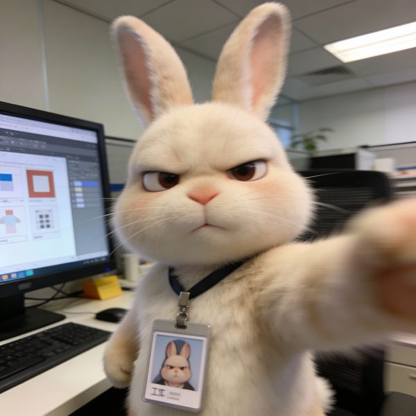

```text
An anthropomorphic little rabbit, presented in the visual style of a daily snapshot, the photo has no clear subject or composition sense, and has slight motion blur. The protagonist occupies the center of the frame, a selfie headshot, with a world-weary expression on its face, wearing a badge with its own headshot around its neck. The background is an office scene, with a graphic design page on the computer screen next to it, creating a mundane yet unique atmosphere.
```

Model: Seedream 4.5 · Author: ZAOO 枣知道

[Original source](https://github.com/YouMind-OpenLab/awesome-seedream-4.5/blob/fd21eb654b096b37ec221240bbfc0299fd714773/README_zh.md#L3024) · [Provenance and original license](data/projectd-batch-0005.json)

## Trendy Little Fox IP Character Design


```text
IP 角色设计：Q 版，一只毛茸茸的红橙色小狐狸，戴着耳机，陶醉的表情，穿着白色潮流 T 恤，阔腿裤，斜挎包，营造出轻松舒适的氛围，细节描绘，底部居中显示小号无衬线文字 “{argument name="brand text" default="YUAN×DESIGN"}” “{argument name="slogan" default="Original Works, Enriching Life"}”，高质量输出。
```

Model: Seedream 4.5 · Author: 铅笔妖妖

[Original source](https://github.com/YouMind-OpenLab/awesome-seedream-4.5/blob/fd21eb654b096b37ec221240bbfc0299fd714773/README_zh.md#L3057) · [Provenance and original license](data/projectd-batch-0005.json)

## Endless Vitality Cursive Poster

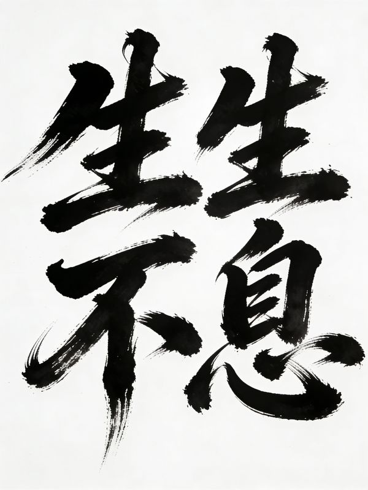

```text
书法字体海报“{argument name="poster text" default="Life Goes On"}”，狂野不羁的草书字体，视觉张力十足，超粗笔触流畅优雅，笔画巧妙延伸变形，飞白效果，笔触流畅飘逸，背景干净，大师级海报作品，电影海报，
```

Model: Seedream 4.5 · Author: 元祖儿

[Original source](https://github.com/YouMind-OpenLab/awesome-seedream-4.5/blob/fd21eb654b096b37ec221240bbfc0299fd714773/README_zh.md#L3091) · [Provenance and original license](data/projectd-batch-0005.json)

## Judy and Nick Irregular Fridge Magnet Design

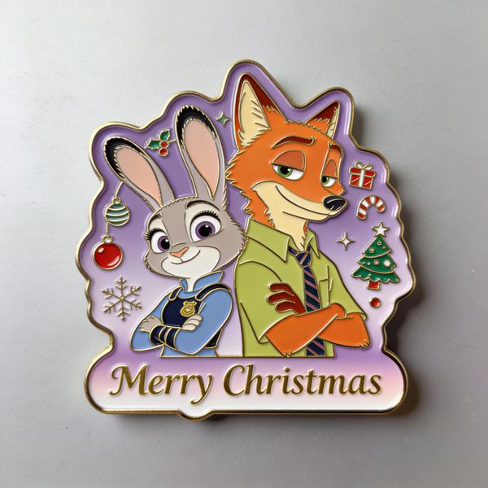

```text
现代简约设计风格，疯狂动物城主题珐琅冰箱贴设计，不规则形状磁铁，朱迪·霍普斯和尼克·王尔德的特写，周围环绕圣诞元素图案，底部有英文“{argument name="bottom text" default="Merry Christmas"}”字体，国际化设计，高级质感，淡紫色渐变色。纯纹理背景。
```

Model: Seedream 4.5 · Author: 喵了个咪

[Original source](https://github.com/YouMind-OpenLab/awesome-seedream-4.5/blob/fd21eb654b096b37ec221240bbfc0299fd714773/README_zh.md#L3125) · [Provenance and original license](data/projectd-batch-0005.json)

## 3D Glass Wallet and Coins Icon

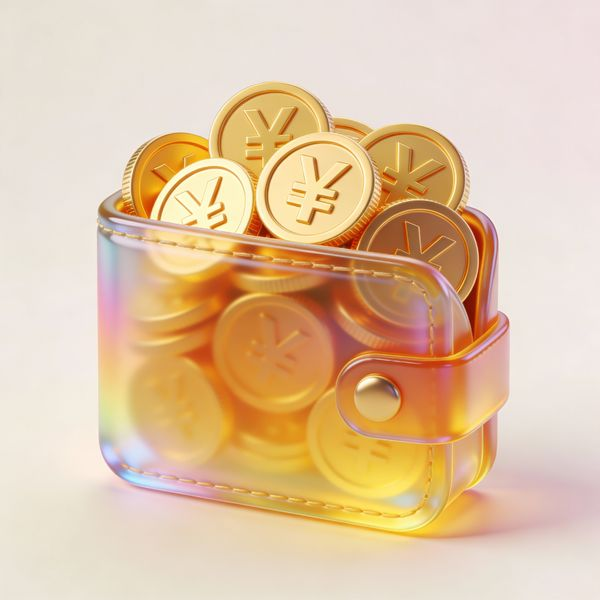

```text
UI 图标，一个装满金币的钱包，一堆金币，金币上是 {argument name="currency type" default="RMB"} 符号，3D 效果，玻璃质感，柔和的金色渐变，半透明材质光晕效果，浅色背景对比色流，3D 渲染风格，画面充满呼吸感。
```

Model: Seedream 4.5 · Author: Jackie Chan

[Original source](https://github.com/YouMind-OpenLab/awesome-seedream-4.5/blob/fd21eb654b096b37ec221240bbfc0299fd714773/README_zh.md#L3159) · [Provenance and original license](data/projectd-batch-0005.json)

## Nick and Judy Chibi Hand-Drawn Illustration

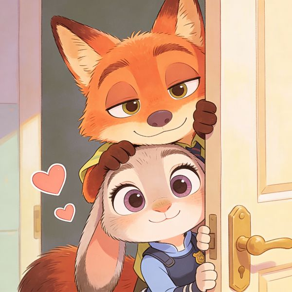

```text
这是一幅迪士尼动画电影《疯狂动物城》中经典角色搭档——狐狸尼克和兔子朱迪的 Q 版手绘插画。画面中，尼克趴在朱迪身上，他们俩一同从一扇门后探出头来。朱迪旁边还有两个爱心元素。整体画风可爱俏皮，充分展现了这对搭档的默契与萌感，充满温馨的氛围。
```

Model: Seedream 4.5 · Author: 清溪

[Original source](https://github.com/YouMind-OpenLab/awesome-seedream-4.5/blob/fd21eb654b096b37ec221240bbfc0299fd714773/README_zh.md#L3193) · [Provenance and original license](data/projectd-batch-0005.json)

## Three-Person Merged Top-Down Selfie — Reference Image Required

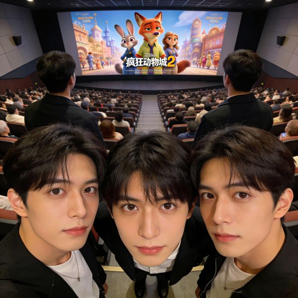

```text
不要换脸，人物的脸部绝对不能改变！请将图 1、图 2、图 3 中的三个人物融合成一张三人高角度自拍。构图紧凑，三人距离非常近，头部略微向上倾斜，眼睛直视镜头，营造出强烈的视觉冲击力。图 1 中的人物稍微靠前居中，脸部相似度必须保持；身体略微前倾，拍摄角度为高角度俯拍，夸大头部比例，符合典型的日韩视觉自拍风格。简洁干净，进一步突出人物主体。视觉风格偏向日系视觉系，整体画面高清，用 iPhone 前置摄像头拍摄，最终呈现出精致、时尚的合影效果。要求人物与场景无缝融合，视觉过渡自然，整体光线明亮均匀。背景是一个坐满了观众的超大电影院，两个人背对屏幕，屏幕上显示着“{argument name="movie poster name" default="Zootopia 2"}”的精美电影海报，海报铺满整个屏幕。
```

Model: Seedream 4.5 · Author: 七夕

[Original source](https://github.com/YouMind-OpenLab/awesome-seedream-4.5/blob/fd21eb654b096b37ec221240bbfc0299fd714773/README_zh.md#L3226) · [Provenance and original license](data/projectd-batch-0005.json)

## Tomato and Egg Stir-Fry Hand-Drawn Knowledge Card

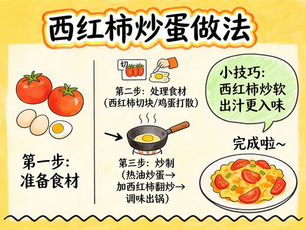

```text
为 {argument name="dish name" default="番茄炒蛋"} 的食谱创建一个知识卡片，卡片风格为手绘/涂鸦笔记风格。字体：使用手写体或类似手写体的字体，或直接手写。元素：大量使用火柴人、小图标、箭头、对话气泡、分隔线以及其他手绘元素来辅助表达。颜色：丰富活泼的色彩，多使用荧光笔、彩色铅笔效果。排版：自由随性，不拘一格，充满个性和趣味。
```

Model: Seedream 4.5 · Author: Shilly

[Original source](https://github.com/YouMind-OpenLab/awesome-seedream-4.5/blob/fd21eb654b096b37ec221240bbfc0299fd714773/README_zh.md#L3260) · [Provenance and original license](data/projectd-batch-0005.json)

## Wild Cursive Movie Title Typography

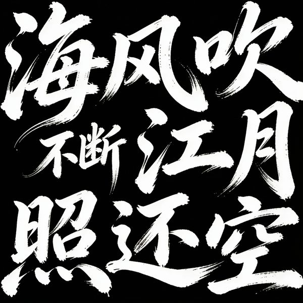

```text
黑色背景，白色文字，书法连笔，别致、优雅、动感的字体设计，“海风吹不尽，江月照还空”，狂野不羁的草书字体，长笔画，视觉张力十足，充满动感，笔触流畅优雅，笔画巧妙延伸变形，飞白效果，字体大小变化，错位排版。笔触流畅自由，背景干净，杰作，电影主题字体，视觉冲击力强。
```

Model: Seedream 4.5 · Author: 一棵永远成长的苹果树

[Original source](https://github.com/YouMind-OpenLab/awesome-seedream-4.5/blob/fd21eb654b096b37ec221240bbfc0299fd714773/README_zh.md#L3294) · [Provenance and original license](data/projectd-batch-0005.json)

## Mechanical Design Sketch Notes

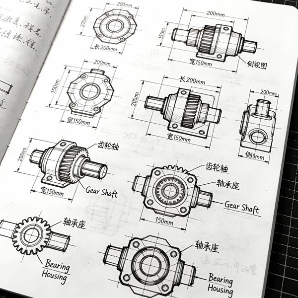

```text
黑线素描，{argument name="subject name" default="机械设计"} 笔记，密集笔记式布局，附带正交投影、尺寸标注、名称注释以及中英文标签说明。
```

Model: Seedream 4.5 · Author: 米饭和水

[Original source](https://github.com/YouMind-OpenLab/awesome-seedream-4.5/blob/fd21eb654b096b37ec221240bbfc0299fd714773/README_zh.md#L3327) · [Provenance and original license](data/projectd-batch-0005.json)

## Golden Curve Wealth Logic Poster


```text
深蓝色典雅背景，一道稳步上升的金色图表曲线划过画面，曲线顶端有一个发光的硬币图标。主标题“{argument name="main title" default="[财富逻辑]"}”采用精致的金色衬线字体。副标题“{argument name="subtitle" default="[普通人也能看懂的经济学]"}”为白色细字体，直接排列在主标题下方，显得专业且可信。
```

Model: Seedream 4.5 · Author: MASHU

[Original source](https://github.com/YouMind-OpenLab/awesome-seedream-4.5/blob/fd21eb654b096b37ec221240bbfc0299fd714773/README_zh.md#L3361) · [Provenance and original license](data/projectd-batch-0005.json)

## Ma Wencheng Artistic Signature Design


```text
大师级艺术签名字体设计：{argument name="name" default="马文成"}：字体优雅、大胆、流畅而又大气，模仿名人草书签名，钢笔效果，粗细变化，字与字之间笔画相连，带有装饰性线条。签名艺术感强，干净的白色背景，无水印，大量留白，适合签名。
```

Model: Seedream 4.5 · Author: 百里马

[Original source](https://github.com/YouMind-OpenLab/awesome-seedream-4.5/blob/fd21eb654b096b37ec221240bbfc0299fd714773/README_zh.md#L3428) · [Provenance and original license](data/projectd-batch-0005.json)

## C4D-Style Finance App UI (Variant)

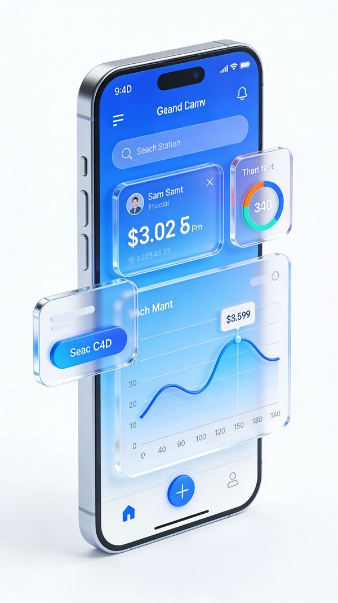

```text
金融财富管理 App 移动 UI 设计，C4D 风格高级 UI，3D 数据图表，蓝色渐变界面，浮动卡片设计，玻璃拟态按钮，动态余额数字显示，市场趋势曲线，纯白背景，杰作，高细节。
```

Model: Seedream 4.5 · Author: 口袋

[Original source](https://github.com/YouMind-OpenLab/awesome-seedream-4.5/blob/fd21eb654b096b37ec221240bbfc0299fd714773/README_zh.md#L3462) · [Provenance and original license](data/projectd-batch-0005.json)

## Nick and Judy Pink Beach Instagram-Style Selfie

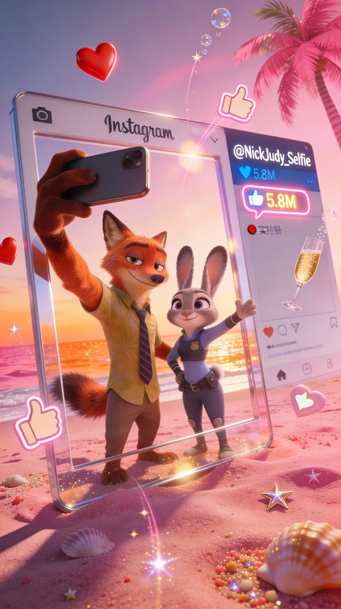

```text
疯狂动物城的尼克·王尔德和朱迪·霍普斯在粉色沙滩上自拍，尼克将一部巨型手机以 45 度角举起，他们的手臂伸出 Instagram 边框，打破了第四面墙，手机漂浮在画面中央，带有透视畸变。右侧的巨型屏幕 UI 超清晰：用户名“{argument name="username" default="@NickJudy_Selfie"}”带有蓝色验证标记，点赞数“{argument name="like count" default="5.8M"}”粗体并闪烁，实时录制红点跳动，评论气泡带有霓虹描边。边框是 2 厘米厚的玻璃材质，反射着粉色沙滩。周围环绕着漂浮的 3D 爱心❤️、点赞👍、粉色椰子树🌴、香槟气泡✨ 图标，拖尾光效叠加着温暖的粉色光晕，梦幻般的镜头光斑。背景是芭比粉色沙滩：细小的珊瑚沙粒清晰可见，渐变的粉橙色海水波光粼粼，柔和的日落体积光，贝壳和星沙闪烁。左侧真实世界的阴影锐利，饱和度逼真，右侧数字界面有柔和滤镜和晕影，高对比度粉金色调。Instagram 网红度假风格，8K 电影级真实感，光线追踪，纤维级毛发细节，次表面散射，景深聚焦于手机，虚幻引擎 5 渲染，打破维度构图，度假氛围，充满互联网美学。
```

Model: Seedream 4.5 · Author: 孤墨舟

[Original source](https://github.com/YouMind-OpenLab/awesome-seedream-4.5/blob/fd21eb654b096b37ec221240bbfc0299fd714773/README_zh.md#L3528) · [Provenance and original license](data/projectd-batch-0005.json)

## Zootopia Judy Enamel Fridge Magnet


```text
Modern minimalist design style, Zootopia themed enamel fridge magnet design, circular magnet, close-up of Judy Hopps, surrounded by Christmas element patterns, with "{argument name="bottom text" default="Merry Christmas"}" English font at the bottom, international design style, light purple gradient color. Pure texture background.
```

Model: Seedream 4.5 · Author: 匿名用户

[Original source](https://github.com/YouMind-OpenLab/awesome-seedream-4.5/blob/fd21eb654b096b37ec221240bbfc0299fd714773/README_zh.md#L3562) · [Provenance and original license](data/projectd-batch-0005.json)

## GEO Tech Product Promo Poster


```text
技术产品宣传海报，左文右图布局，精致的深蓝到浅蓝渐变背景，右侧 GEO 文字底部向上蔓延的柔和橙色光晕，自然光照效果，产品级视觉设计，深蓝色渐变主色调，纯白文字搭配橙色光效，专业精致且亲和，丰富的视觉质感和精细细节。左上方是白色简洁小字 "{argument name="date" default="[2025.10]"}"，主标题是超大白色粗体现代字体 "{argument name="main title" default="When AI Answers"}"，下一行小字是 "{argument name="subtitle" default="GEO decides who it mentions"}"，右侧是 3D 逼真的 "{argument name="3D text" default="GEO"}" 文字，表面有糖果色磨砂质感并点缀橙色高光，用于微信公众号封面。
```

Model: Seedream 4.5 · Author: 创意字嘟嘟

[Original source](https://github.com/YouMind-OpenLab/awesome-seedream-4.5/blob/fd21eb654b096b37ec221240bbfc0299fd714773/README_zh.md#L3596) · [Provenance and original license](data/projectd-batch-0005.json)

## Nick and Judy Xiaohongshu-Style Fourth-Wall-Breaking Selfie


```text
疯狂动物城 (Zootopia) 角色，尼克·王尔德 (Nick Wilde) 和朱迪·霍普斯 (Judy Hopps)。尼克 (Nick) 拥有橘红色的皮毛，身穿经典的绿色棕榈叶印花短袖衬衫、蓝红条纹领带和卡其裤，带着帅气的坏笑。朱迪 (Judy) 拥有灰色的皮毛和紫色的眼睛，耳朵高高竖起，身穿深蓝色 ZPD 警官背心，佩戴银色警徽和全套装备腰带，看起来甜美可爱。两人并排坐在一个巨大的、漂浮的“小红书”App 界面框的底部边缘。构图打破第四面墙，他们的腿悬挂在框架平面之外。尼克 (Nick) 亲密地将一只手臂搭在朱迪 (Judy) 的肩膀上，另一只手将智能手机远远伸到前方，以 45 度角（鱼眼视角）自拍。朱迪 (Judy) 紧紧依偎着尼克 (Nick)，抬头对着镜头甜美微笑，展现出甜蜜的情侣时刻。图像的核心是一个巨大的小红书风格社交媒体框架。UI 界面复制了经典布局：左下角是滚动文本标题，右侧是“❤”、“⭐”、“评论气泡”和“转发箭头”的垂直浮动图标。顶部显示用户名“{argument name="username" default="Nick & Judy"}”以及热门话题标签（例如 {argument name="hashtags" default="#Zootopia #CoupleDaily"}）。3D 皮克斯 (Pixar) 动画风格，虚幻引擎 5 (Unreal Engine 5) 渲染，8K 超高清画质。皮毛呈现纤维级细节，光线追踪技术，柔和的自拍补光灯照亮他们的脸庞，背景是模糊的彩色疯狂动物城 (Zootopia) 街景，带有梦幻般的散景效果。色彩明亮鲜艳，高饱和度，强调社交媒体互联网美学和糖果色调，视觉效果引人注目。
```

Model: Seedream 4.5 · Author: 名剑风流

[Original source](https://github.com/YouMind-OpenLab/awesome-seedream-4.5/blob/fd21eb654b096b37ec221240bbfc0299fd714773/README_zh.md#L3630) · [Provenance and original license](data/projectd-batch-0005.json)

## Line Art of Traditional Chinese Seasoning Herbs


```text
九种烹饪中常用的中式调味香草，采用线条画、凹版印刷线条艺术风格。外轮廓使用 {argument name="thick line width" default="0.8mm"} 粗线条，表面纹理使用 {argument name="thin line width" default="0.2mm"} 细线条描绘，保留铜版雕刻痕迹，置于纯白色背景上。
```

Model: Seedream 4.5 · Author: nene

[Original source](https://github.com/YouMind-OpenLab/awesome-seedream-4.5/blob/fd21eb654b096b37ec221240bbfc0299fd714773/README_zh.md#L3664) · [Provenance and original license](data/projectd-batch-0005.json)

## Topographic Map of Hangzhou


```text
一张杭州地形图，中心有一个红色的定位标记。地图显示了植被区和城市区域，整体呈现出秋天的感觉，湖水呈蓝色，背景为柔和的米色。风格写实，强调精致的光影效果和丰富的细节。
```

Model: Seedream 4.5 · Author: nene

[Original source](https://github.com/YouMind-OpenLab/awesome-seedream-4.5/blob/fd21eb654b096b37ec221240bbfc0299fd714773/README_zh.md#L3698) · [Provenance and original license](data/projectd-batch-0005.json)

## Band Illustration in a Hybrid Style of Moebius and Kim Jung Gi


```text
采用莫比乌斯（Moebius）和金政基（Kim Jung Gi）的混合插画风格，以白色简约背景，叠加彩色铅笔和水彩，营造出鲜艳的色彩、错综复杂的细节以及流畅而富有张力的线条。整体效果应传达出未来感和强烈的动感，呈现一个造型奇特、动作夸张的乐队。
```

Model: Seedream 4.5 · Author: nene

[Original source](https://github.com/YouMind-OpenLab/awesome-seedream-4.5/blob/fd21eb654b096b37ec221240bbfc0299fd714773/README_zh.md#L3731) · [Provenance and original license](data/projectd-batch-0005.json)

## Novelists Infographic — Unverified Sample Labels


```text
制作一张名为“当代中国小说家图鉴”的图文信息海报，采用扁平插画 + 信息图风格。整体版面分为 6 个部分，每个部分介绍一位有代表性的当代中国小说家。

每个部分包括：
- 风格化、非写实、简化的插画肖像，但插画肖像需基于真实照片，以保持相似度
- 作者姓名（中文）
- 代表作品（1-2 部）
- 风格标签（例如：现实主义、先锋文学、青春文学、历史叙事、魔幻现实主义、科幻）
- 一句话的简短介绍（非常简短）

整体设计采用浅色背景 + 分区色块，版面整洁有序。

六位小说家分别是：
- 贾平凹
- 余华
- 王安忆
- 刘慈欣
- 苏童
- 韩少功

主标题为“当代中国小说家图鉴”，风格简洁现代，适合文学科普海报。
```

Model: Seedream 4.5 · Author: nene

[Original source](https://github.com/YouMind-OpenLab/awesome-seedream-4.5/blob/fd21eb654b096b37ec221240bbfc0299fd714773/README_zh.md#L3764) · [Provenance and original license](data/projectd-batch-0005.json)

## Chinese Food Map — Illustrative Layout


```text
制作一张名为“中国美食地图”的海报。整体设计以中国地图为基础，每个省份都用独立的彩色块背景标识。在每个省份上方，标明一道代表性菜肴的名称，并配上具有强烈真实感的三维图标（例如火锅、烤鸭、点心），确保食物图标具有逼真的质感。主标题为“中国美食地图”，字体整洁，结合了扁平插画风格与三维元素，色彩柔和。
```

Model: Seedream 4.5 · Author: nene

[Original source](https://github.com/YouMind-OpenLab/awesome-seedream-4.5/blob/fd21eb654b096b37ec221240bbfc0299fd714773/README_zh.md#L3816) · [Provenance and original license](data/projectd-batch-0005.json)

## Chibi Proposal Scene — Couple Photo Required


```text
将照片里的两个人转换成Q版 3D人物，场景换成求婚，背景换成淡雅五彩花瓣做的拱门，背景换成浪漫颜色，地上散落着玫瑰花瓣。除了人物采用Q版 3D人物风格，其他环境采用真实写实风格。

```

Model: Not disclosed · Author: @balconychy (prompt); @jamez-bondos (image)

[Original source](https://github.com/jamez-bondos/awesome-gpt4o-images/blob/3ed4dbb0f1ae6f7385c81e1fcea48d9eefd2e596/cases/1/case.yml) · [Provenance and original license](data/projectd-batch-0005.json)

## Minimalist 3D Toilet — Style JSON


```text
使用以下 JSON 配置文件生成一个马桶：
{
  "art_style_profile": {
    "style_name": "Minimalist 3D Illustration",
    "visual_elements": {
      "shape_language": "Rounded edges, smooth and soft forms with simplified geometry",
      "colors": {
        "primary_palette": ["Soft beige, light gray, warm orange"],
        "accent_colors": ["Warm orange for focal elements"],
        "shading": "Soft gradients with smooth transitions, avoiding harsh shadows or highlights"
      },
      "lighting": {
        "type": "Soft, diffused lighting",
        "source_direction": "Above and slightly to the right",
        "shadow_style": "Subtle and diffused, no sharp or high-contrast shadows"
      },
      "materials": {
        "surface_texture": "Matte, smooth surfaces with subtle shading",
        "reflectivity": "Low to none, avoiding glossiness"
      },
      "composition": {
        "object_presentation": "Single, central object displayed in isolation with ample negative space",
        "perspective": "Slightly angled, giving a three-dimensional feel without extreme depth",
        "background": "Solid, muted color that complements the object without distraction"
      },
      "typography": {
        "font_style": "Minimalistic, sans-serif",
        "text_placement": "Bottom-left corner with small, subtle text",
        "color": "Gray, low-contrast against the background"
      },
      "rendering_style": {
        "technique": "3D render with simplified, low-poly aesthetics",
        "detail_level": "Medium detail, focusing on form and color over texture or intricacy"
      }
    },
    "purpose": "To create clean, aesthetically pleasing visuals that emphasize simplicity, approachability, and modernity."
  }
}

```

Model: Not disclosed · Author: @0xdlk (prompt); @jamez-bondos (image)

[Original source](https://github.com/jamez-bondos/awesome-gpt4o-images/blob/3ed4dbb0f1ae6f7385c81e1fcea48d9eefd2e596/cases/25/case.yml) · [Provenance and original license](data/projectd-batch-0005.json)

## Milk & Moss Body Wash — API Models · CC BY 4.0


```text
A tall matte-sage pump bottle of Milk & Moss creamy body wash stands on a wet slate ledge, rich white lather foaming softly at its base and clinging in glossy bubbles. A fresh eucalyptus branch drapes behind it. Fresh cool bathroom light from above-left, sage-green, creamy-white and slate palette, misty blurred background. Straight eye-level shot, 85mm lens, clean spa-fresh bath mood, crisp lather and bubble detail, airy top negative space.
```

Model: GPT Image 2 · Author: API Models (apimodels.app)

[Original source](https://github.com/apimodels/gpt-image-2-prompts/blob/980d100f3bd0f2cde4cf38835daeb742bf1cac65/prompts.json#L603) · [Provenance and original license](data/projectd-batch-0005.json)

## Honeyfern Body Scrub — API Models · CC BY 4.0


```text
An open squat amber-glass jar of Honeyfern sugar body scrub reveals a glistening golden-brown sugar-and-oil blend, a wooden spoon lifting a heaped scoop above it. Loose sugar crystals and a honey drizzle pool on the wooden board. Warm golden light from the right, honey-amber, sugar-gold and warm-wood palette, cozy blurred wood background. Overhead 40-degree tilt, 100mm macro lens, indulgent exfoliating body mood, sparkling sugar-crystal texture.
```

Model: GPT Image 2 · Author: API Models (apimodels.app)

[Original source](https://github.com/apimodels/gpt-image-2-prompts/blob/980d100f3bd0f2cde4cf38835daeb742bf1cac65/prompts.json#L618) · [Provenance and original license](data/projectd-batch-0005.json)

## Cocoon Whipped Body Butter — API Models · CC BY 4.0


```text
A round frosted-white tub of Cocoon whipped shea body butter sits open on a fluffy cream towel, the cloud-like whipped butter peaked into a soft swirl inside, a smooth dollop resting on the lid. A single cocoa pod and shea nuts lie beside it. Soft warm lighting, cream, ivory and cocoa-brown palette, cozy blurred beige background. Overhead 45-degree tilt, 90mm lens, plush comforting body-care mood, airy whipped texture detail.
```

Model: GPT Image 2 · Author: API Models (apimodels.app)

[Original source](https://github.com/apimodels/gpt-image-2-prompts/blob/980d100f3bd0f2cde4cf38835daeb742bf1cac65/prompts.json#L633) · [Provenance and original license](data/projectd-batch-0005.json)

## Saltwren Bar Soap Trio — API Models · CC BY 4.0


```text
Three artisanal cold-process soap bars of Saltwren—charcoal-grey, oat-cream and lavender-purple—stack in a staggered pyramid on a raw linen cloth, their rough-cut edges and speckled botanicals visible. Dried lavender and a sprig of rosemary rest beside them. Soft natural window light from the left, muted grey, cream and lavender palette, softly blurred rustic background. Slight three-quarter angle, 85mm lens, handmade artisanal bath mood, textured soap surface detail.
```

Model: GPT Image 2 · Author: API Models (apimodels.app)

[Original source](https://github.com/apimodels/gpt-image-2-prompts/blob/980d100f3bd0f2cde4cf38835daeb742bf1cac65/prompts.json#L648) · [Provenance and original license](data/projectd-batch-0005.json)

## Palma Dulce Hand Cream — API Models · CC BY 4.0


```text
A small squeezable coral-and-cream tube of Palma Dulce coconut hand cream lies at a gentle diagonal on a pale wooden tray, a pearl of soft white cream squeezed onto the wood beside it. A slice of fresh coconut and a tropical monstera leaf frame the corner. Bright cheerful light, coral, coconut-white and tropical-green palette, sunny blurred background. Overhead 35-degree tilt, 90mm macro lens, fresh tropical body-care mood, creamy dollop detail.
```

Model: GPT Image 2 · Author: API Models (apimodels.app)

[Original source](https://github.com/apimodels/gpt-image-2-prompts/blob/980d100f3bd0f2cde4cf38835daeb742bf1cac65/prompts.json#L663) · [Provenance and original license](data/projectd-batch-0005.json)

## Bloomhouse Bath Bomb Set — API Models · CC BY 4.0


```text
Four pastel bath bombs of Bloomhouse—mint, peach, lilac and butter-yellow—arranged in a loose cluster on a white marble surface, one mid-dissolve in a shallow glass bowl of water releasing a swirl of colored foam. Dried flower petals scatter around. Bright soft lighting, multi-pastel and white marble palette, clean bright background. Overhead flat-lay at 30 degrees, 60mm lens, playful fizzy spa mood, swirling colored-foam detail, cheerful and airy.
```

Model: GPT Image 2 · Author: API Models (apimodels.app)

[Original source](https://github.com/apimodels/gpt-image-2-prompts/blob/980d100f3bd0f2cde4cf38835daeb742bf1cac65/prompts.json#L678) · [Provenance and original license](data/projectd-batch-0005.json)

## Verobath Massage Oil — API Models · CC BY 4.0


```text
A slim frosted-glass bottle of Verobath relaxing massage oil with a bamboo pump cap stands on a folded grey spa towel, golden oil glowing within and a warm droplet trailing down the glass. Smooth grey pebbles and a white orchid rest beside it. Soft warm spa lighting from the right, golden-amber, warm-grey and soft-white palette, serene blurred background. Slight low angle at 20 degrees, 100mm lens, tranquil relaxing spa mood, gentle glow through the bottle.
```

Model: GPT Image 2 · Author: API Models (apimodels.app)

[Original source](https://github.com/apimodels/gpt-image-2-prompts/blob/980d100f3bd0f2cde4cf38835daeb742bf1cac65/prompts.json#L693) · [Provenance and original license](data/projectd-batch-0005.json)

## Lather Lab Shower Gel — API Models · CC BY 4.0


```text
A vibrant translucent-blue bottle of Lather Lab energizing shower gel stands on a wet acrylic surface, ribbons of glossy blue gel swirling visibly inside and a bright droplet of gel on the surface. A splash of clear water arcs behind it. Bright energetic lighting, electric-blue, aqua and white palette, clean gradient blue background. Straight eye-level shot, 90mm lens, fresh invigorating shower mood, glossy gel and water-splash detail, dynamic and clean.
```

Model: GPT Image 2 · Author: API Models (apimodels.app)

[Original source](https://github.com/apimodels/gpt-image-2-prompts/blob/980d100f3bd0f2cde4cf38835daeb742bf1cac65/prompts.json#L708) · [Provenance and original license](data/projectd-batch-0005.json)

## Almondine Nail Lacquer Trio — API Models · CC BY 4.0


```text
Three glossy glass bottles of Almondine nail lacquer—dusty-rose, warm-taupe and pearl-white—stand in a staggered row on a white marble tile, a single brushstroke of each shade painted beside them. A folded silk ribbon curls in the corner. Soft flattering light, nude-rose, taupe and pearl palette, clean bright marble background. Slight low three-quarter angle, 90mm lens, elegant minimalist nail mood, glossy bottle reflections, refined and clean.
```

Model: GPT Image 2 · Author: API Models (apimodels.app)

[Original source](https://github.com/apimodels/gpt-image-2-prompts/blob/980d100f3bd0f2cde4cf38835daeb742bf1cac65/prompts.json#L723) · [Provenance and original license](data/projectd-batch-0005.json)

## Gloss Theory Top Coat — API Models · CC BY 4.0


```text
A single tall clear-glass bottle of Gloss Theory high-shine top coat stands centered on a black mirrored surface, its brushstroke of glossy clear lacquer swiped beside it reflecting a sharp highlight. A perfect droplet of clear coat beads on the mirror. Dramatic spotlight from above, clear-glass, black and silver palette, dark reflective background. Straight eye-level shot, 100mm macro lens, glossy high-shine nail mood, mirror reflection below, deep negative space.
```

Model: GPT Image 2 · Author: API Models (apimodels.app)

[Original source](https://github.com/apimodels/gpt-image-2-prompts/blob/980d100f3bd0f2cde4cf38835daeb742bf1cac65/prompts.json#L738) · [Provenance and original license](data/projectd-batch-0005.json)

## Vernis Gel Polish Set — API Models · CC BY 4.0


```text
A curated set of six Vernis gel polish bottles in jewel tones—ruby, emerald, sapphire, plum, gold and rose—arranged in a fanned arc on a soft blush suede tray, each cap catching a small highlight. Nail swatch sticks in matching colors fan out beside them. Soft even studio lighting, jewel-multi and blush palette, seamless soft-pink background. Overhead flat-lay at 30 degrees, 60mm lens, luxe curated nail-set mood, orderly vibrant arrangement.
```

Model: GPT Image 2 · Author: API Models (apimodels.app)

[Original source](https://github.com/apimodels/gpt-image-2-prompts/blob/980d100f3bd0f2cde4cf38835daeb742bf1cac65/prompts.json#L753) · [Provenance and original license](data/projectd-batch-0005.json)

## Fern & File Cuticle Oil — API Models · CC BY 4.0


```text
A slim clear roller-ball bottle of Fern & File nourishing cuticle oil stands on a pale marble ledge, golden oil visible inside with tiny botanical flecks suspended, a droplet glinting at the roller tip. A fresh fern frond curls in the foreground. Soft natural light from the left, golden-oil, botanical-green and cream palette, softly blurred neutral background. Close eye-level macro, 105mm lens, gentle botanical nailcare mood, suspended botanical detail.
```

Model: GPT Image 2 · Author: API Models (apimodels.app)

[Original source](https://github.com/apimodels/gpt-image-2-prompts/blob/980d100f3bd0f2cde4cf38835daeb742bf1cac65/prompts.json#L768) · [Provenance and original license](data/projectd-batch-0005.json)

## Nailhaus Press-On Kit — API Models · CC BY 4.0


```text
An open pale-lilac gift box of Nailhaus press-on nails displays a set of glossy almond-shaped nails in soft nude-pink with tiny gold accents, neatly seated in a foam insert, a small buffing file and glue tube tucked beside them. Soft feminine lighting, lilac, nude-pink and gold palette, clean blurred pastel background. Overhead flat-lay at 25 degrees, 60mm lens, chic at-home manicure mood, glossy nail-surface highlights, tidy symmetrical layout.
```

Model: GPT Image 2 · Author: API Models (apimodels.app)

[Original source](https://github.com/apimodels/gpt-image-2-prompts/blob/980d100f3bd0f2cde4cf38835daeb742bf1cac65/prompts.json#L783) · [Provenance and original license](data/projectd-batch-0005.json)

## Polish Poet Matte Duo — API Models · CC BY 4.0


```text
Two frosted-glass bottles of Polish Poet matte nail polish—muted olive and dusty terracotta—stand side by side on a raw concrete slab, a soft velvety brushstroke of each shade painted beside them showing a flat matte finish. A dried autumn leaf rests nearby. Moody soft light from the right, olive, terracotta and concrete-grey palette, dark textured background. Slight three-quarter angle, 90mm lens, moody artisanal nail mood, velvety matte swatch detail.
```

Model: GPT Image 2 · Author: API Models (apimodels.app)

[Original source](https://github.com/apimodels/gpt-image-2-prompts/blob/980d100f3bd0f2cde4cf38835daeb742bf1cac65/prompts.json#L798) · [Provenance and original license](data/projectd-batch-0005.json)

## Tintbox Nail Strengthener — API Models · CC BY 4.0


```text
A clear-glass bottle of Tintbox keratin nail strengthener with a pale-mint cap stands on a white acrylic riser, its clear strengthening lacquer swiped beside it with a faint pearly sheen. A tiny sprig of green succulent sits at the base. Fresh clean lighting, clear-glass, mint-green and white palette, bright seamless background. Straight eye-level shot, 100mm lens, clean clinical nailcare mood, subtle glossy highlight on the bottle, minimalist airy framing.
```

Model: GPT Image 2 · Author: API Models (apimodels.app)

[Original source](https://github.com/apimodels/gpt-image-2-prompts/blob/980d100f3bd0f2cde4cf38835daeb742bf1cac65/prompts.json#L813) · [Provenance and original license](data/projectd-batch-0005.json)

## Opaline Nails Chrome Powder — API Models · CC BY 4.0


```text
A tiny clear pot of Opaline chrome nail powder sits open on a black glass surface, its iridescent silver-pink mirror powder catching prismatic light, a soft eyeshadow-style applicator dipped beside it. A few loose shimmer flecks scatter and glint on the glass. Focused directional light with rainbow flares, iridescent-silver, pink and black palette, dark reflective background. Extreme close-up macro, 105mm lens, futuristic chrome nail-art mood, sparkling reflective powder detail.
```

Model: GPT Image 2 · Author: API Models (apimodels.app)

[Original source](https://github.com/apimodels/gpt-image-2-prompts/blob/980d100f3bd0f2cde4cf38835daeb742bf1cac65/prompts.json#L828) · [Provenance and original license](data/projectd-batch-0005.json)

## Chip Not Base Coat — API Models · CC BY 4.0


```text
A tall slim clear bottle of Chip Not long-wear base coat with a soft coral cap stands centered on a pale peach surface, its glossy clear brushstroke swiped beside it. A single fresh peach and a curled ribbon frame the lower corner. Bright soft cheerful lighting, coral, peach and clear-glass palette, warm blurred background. Straight eye-level shot slightly above, 90mm lens, fresh everyday nailcare mood, glossy swatch and bottle highlights, airy top space.
```

Model: GPT Image 2 · Author: API Models (apimodels.app)

[Original source](https://github.com/apimodels/gpt-image-2-prompts/blob/980d100f3bd0f2cde4cf38835daeb742bf1cac65/prompts.json#L843) · [Provenance and original license](data/projectd-batch-0005.json)

## Ironwood Beard Oil — API Models · CC BY 4.0


```text
A dark amber-glass dropper bottle of Ironwood cedar beard oil stands on a slab of rough grey stone, a single droplet falling from the dropper caught in sharp focus. Cedar wood shavings and a vintage brass comb rest beside it. Moody directional light from the left, deep-amber, charcoal and warm-wood palette, dark rugged background. Low 15-degree angle, 90mm lens, rugged masculine grooming mood, glistening suspended oil droplet, strong shadow contrast.
```

Model: GPT Image 2 · Author: API Models (apimodels.app)

[Original source](https://github.com/apimodels/gpt-image-2-prompts/blob/980d100f3bd0f2cde4cf38835daeb742bf1cac65/prompts.json#L858) · [Provenance and original license](data/projectd-batch-0005.json)

## Steele & Oak Pomade Tin — API Models · CC BY 4.0


```text
A round brushed-steel tin of Steele & Oak matte pomade sits open on a dark walnut surface, the firm clay-like pomade textured inside, its lid resting beside it. A vintage folding straight razor and a comb lie diagonally nearby. Cool directional light from above-right, steel-grey, walnut-brown and charcoal palette, dark moody background. Overhead 40-degree tilt, 85mm lens, classic barbershop grooming mood, matte textured pomade detail, strong tonal contrast.
```

Model: GPT Image 2 · Author: API Models (apimodels.app)

[Original source](https://github.com/apimodels/gpt-image-2-prompts/blob/980d100f3bd0f2cde4cf38835daeb742bf1cac65/prompts.json#L873) · [Provenance and original license](data/projectd-batch-0005.json)

## North Grove Face Moisturizer — API Models · CC BY 4.0


```text
A minimalist matte-navy jar of North Grove men's daily face moisturizer with a brushed-silver lid stands on a slate-grey concrete ledge, a smooth swatch of cream on a clean glass plate beside it. A single smooth grey pebble rests nearby. Clean cool lighting from above-left, navy, slate-grey and silver palette, muted minimalist background. Straight eye-level shot, 90mm lens, clean modern masculine skincare mood, subtle rim highlight, generous negative space.
```

Model: GPT Image 2 · Author: API Models (apimodels.app)

[Original source](https://github.com/apimodels/gpt-image-2-prompts/blob/980d100f3bd0f2cde4cf38835daeb742bf1cac65/prompts.json#L888) · [Provenance and original license](data/projectd-batch-0005.json)

## Slate Beard Balm Stack — API Models · CC BY 4.0


```text
A short matte-black tin of Slate beard balm stands open on a weathered wooden crate, the amber balm inside catching warm light, its screw lid leaning against the base. Coarse sea salt and a sprig of dried thyme scatter beside it. Warm rustic side light from the right, black, amber and weathered-wood palette, dark textured barn-wood background. Slight three-quarter angle, 85mm lens, rugged handcrafted grooming mood, warm balm sheen, deep shadows.
```

Model: GPT Image 2 · Author: API Models (apimodels.app)

[Original source](https://github.com/apimodels/gpt-image-2-prompts/blob/980d100f3bd0f2cde4cf38835daeb742bf1cac65/prompts.json#L903) · [Provenance and original license](data/projectd-batch-0005.json)

## Forge Aftershave Splash — API Models · CC BY 4.0


```text
A heavy clear-glass bottle of Forge cooling aftershave with a chunky wooden cap stands on a wet dark stone, a splash of clear liquid arcing dynamically beside it and beads of water on the glass. A shaving brush stands blurred in the background. Cool crisp lighting from above, clear-glass, steel-blue and dark-wood palette, moody dark background. Straight eye-level shot, 90mm lens, invigorating fresh grooming mood, frozen splash detail, sharp bottle focus.
```

Model: GPT Image 2 · Author: API Models (apimodels.app)

[Original source](https://github.com/apimodels/gpt-image-2-prompts/blob/980d100f3bd0f2cde4cf38835daeb742bf1cac65/prompts.json#L918) · [Provenance and original license](data/projectd-batch-0005.json)

## Ridgeline Hair Clay — API Models · CC BY 4.0


```text
A squat matte-olive tub of Ridgeline texturizing hair clay sits open on a raw concrete cube, the fibrous matte clay textured inside with a fingerful lifted onto the rim. A wide-tooth comb leans against it. Cool directional light from the right, olive-green, concrete-grey and charcoal palette, minimalist dark background. Overhead 35-degree tilt, 90mm lens, urban modern grooming mood, matte fibrous clay texture, clean shadow definition.
```

Model: GPT Image 2 · Author: API Models (apimodels.app)

[Original source](https://github.com/apimodels/gpt-image-2-prompts/blob/980d100f3bd0f2cde4cf38835daeb742bf1cac65/prompts.json#L933) · [Provenance and original license](data/projectd-batch-0005.json)

## Gentry Co Shave Cream — API Models · CC BY 4.0


```text
A round ceramic bowl of Gentry Co luxury shave cream in slate-blue glaze sits open on a marble counter, a rich swirl of white cream inside topped with soft foam, a badger-style shave brush resting beside it. A chrome safety razor lies nearby. Clean bright lighting from above-left, slate-blue, white-foam and chrome palette, crisp light-grey background. Overhead 40-degree tilt, 85mm lens, refined classic grooming mood, whipped foam texture, sharp brush detail.
```

Model: GPT Image 2 · Author: API Models (apimodels.app)

[Original source](https://github.com/apimodels/gpt-image-2-prompts/blob/980d100f3bd0f2cde4cf38835daeb742bf1cac65/prompts.json#L948) · [Provenance and original license](data/projectd-batch-0005.json)

## Barbary Cologne Bottle — API Models · CC BY 4.0


```text
An angular smoked-glass bottle of Barbary woody-spice cologne with a matte-black cap stands on a slab of dark leather, a curl of tobacco leaf and a cinnamon stick resting beside it. Warm dramatic side light from the right casts a long moody shadow. Deep-brown, black and warm-amber palette, dark rich background. Low 15-degree hero angle, 90mm lens, bold sophisticated masculine fragrance mood, warm rim highlight along the bottle edge, deep shadow tones.
```

Model: GPT Image 2 · Author: API Models (apimodels.app)

[Original source](https://github.com/apimodels/gpt-image-2-prompts/blob/980d100f3bd0f2cde4cf38835daeb742bf1cac65/prompts.json#L963) · [Provenance and original license](data/projectd-batch-0005.json)

## Clifftop Deodorant Stick — API Models · CC BY 4.0


```text
A sleek cylindrical matte-teal deodorant stick of Clifftop natural deodorant stands twisted-up on a wet grey slate, the pale solid stick exposed and a few water droplets on the surface. A sprig of fresh eucalyptus and a smooth stone rest beside it. Fresh cool light from above-left, teal, slate-grey and mint palette, clean cool background. Straight eye-level shot, 90mm lens, fresh clean everyday grooming mood, crisp water-droplet detail, minimalist framing.
```

Model: GPT Image 2 · Author: API Models (apimodels.app)

[Original source](https://github.com/apimodels/gpt-image-2-prompts/blob/980d100f3bd0f2cde4cf38835daeb742bf1cac65/prompts.json#L978) · [Provenance and original license](data/projectd-batch-0005.json)

## Vitalis Collagen Powder — API Models · CC BY 4.0


```text
A tall matte-white jar of Vitalis marine collagen powder with a rose-gold lid stands on a clean marble surface, a small scoop of fine ivory powder resting beside it with a light dusting on the marble. A glass of water with a swirl of dissolved powder sits behind. Bright fresh lighting, ivory, rose-gold and white palette, clean seamless background. Straight eye-level shot, 85mm lens, clean premium wellness mood, soft powder texture, airy negative space.
```

Model: GPT Image 2 · Author: API Models (apimodels.app)

[Original source](https://github.com/apimodels/gpt-image-2-prompts/blob/980d100f3bd0f2cde4cf38835daeb742bf1cac65/prompts.json#L993) · [Provenance and original license](data/projectd-batch-0005.json)

## Rooted Daily Vitamins — API Models · CC BY 4.0


```text
A clear-glass jar of Rooted daily multivitamin gummies in cheerful red, orange and yellow shapes stands on a warm wooden table, a few gummies spilling out beside it and fresh orange slices nearby. Bright cheerful morning light from the left, vibrant citrus-multi, clear-glass and warm-wood palette, sunny blurred kitchen background. Slight three-quarter angle, 85mm lens, joyful healthy-lifestyle mood, glossy gummy texture, warm inviting glow.
```

Model: GPT Image 2 · Author: API Models (apimodels.app)

[Original source](https://github.com/apimodels/gpt-image-2-prompts/blob/980d100f3bd0f2cde4cf38835daeb742bf1cac65/prompts.json#L1008) · [Provenance and original license](data/projectd-batch-0005.json)

