# ProjectD backfill batch 7

Original generation model, full prompt, reference requirements and original notices are retained. These are existing ProjectD records, not new 2.6 recipes.

## Design illustration · Summit Climb Challenge — API Models · CC BY 4.0

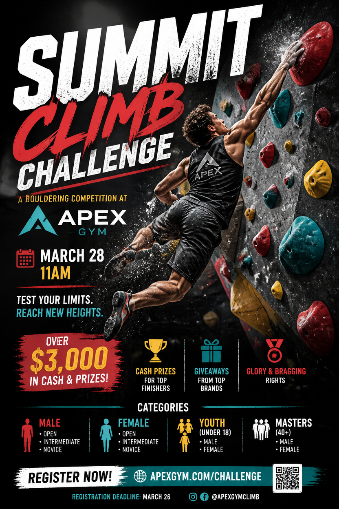

```text
Bold bouldering competition poster for the 'SUMMIT CLIMB CHALLENGE', an indoor climbing comp at Apex Gym, March 28, 11AM. Hero: a powerful climber mid-dyno lunge on a colorful overhanging climbing wall studded with vivid holds, chalk dust bursting in the air, viewed from a dramatic low angle. Composition: climber reaching upward-right, colorful holds scattered, chunky dynamic athletic title at the top, categories and prize info below. Palette: chalk white, bright climbing-hold red, yellow, teal, deep grey wall. Gritty energetic feel, chalk-dust texture, bold color pops. Registration and category info at the base. Mood: powerful, focused, gritty, adventurous.
```

Model: GPT Image 2 · Author: API Models (apimodels.app)

[Original source](https://github.com/apimodels/gpt-image-2-prompts/blob/980d100f3bd0f2cde4cf38835daeb742bf1cac65/prompts.json#L9100) · [Provenance and original license](data/projectd-batch-0007.json)

## Design illustration · Ice Blades Championship — API Models · CC BY 4.0

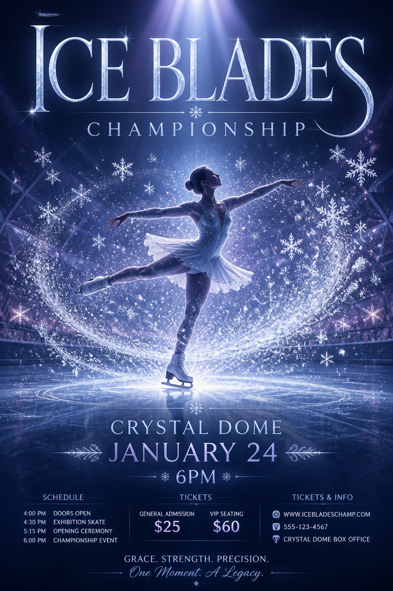

```text
Sleek figure-skating championship poster for the 'ICE BLADES CHAMPIONSHIP', Crystal Dome, January 24, 6PM. Hero: a graceful skater mid-spin silhouette on glowing ice, a spray of ice crystals fanning outward and freezing into sparkling snowflakes under a spotlight. Composition: skater centered in a dynamic spin, radiating ice sparkle, elegant thin sculpted title with a frost-etched texture at the top, event details below. Palette: icy white, glacial blue, silver sparkle, soft violet, spotlight glow. Cold crystalline shimmer, elegant motion, luminous frost detail. Ticket and schedule info at the base. Mood: graceful, cold, elegant, dazzling.
```

Model: GPT Image 2 · Author: API Models (apimodels.app)

[Original source](https://github.com/apimodels/gpt-image-2-prompts/blob/980d100f3bd0f2cde4cf38835daeb742bf1cac65/prompts.json#L9116) · [Provenance and original license](data/projectd-batch-0007.json)

## Design illustration · Wave Riders Surf Open — API Models · CC BY 4.0

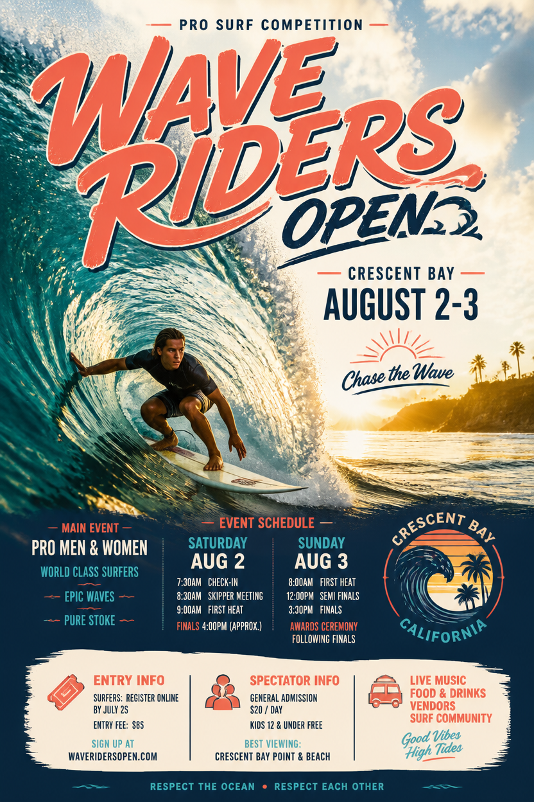

```text
Energetic surf competition poster for the 'WAVE RIDERS OPEN', a pro surf contest at Crescent Bay, August 2-3. Hero: a surfer carving inside a massive glassy barrel wave, spray flying off the crest, warm morning sun glinting through the curling water. Composition: surfer lower-left inside a huge curling wave sweeping across the frame, dynamic energy, bold retro-surf script title at the top, heats and schedule below. Palette: ocean turquoise, foam white, sunrise gold, deep sea blue, coral accents. Bright dynamic water spray, sun sparkle, vintage-surf warmth. Entry and spectator info at the base. Mood: exhilarating, sunny, powerful, coastal.
```

Model: GPT Image 2 · Author: API Models (apimodels.app)

[Original source](https://github.com/apimodels/gpt-image-2-prompts/blob/980d100f3bd0f2cde4cf38835daeb742bf1cac65/prompts.json#L9132) · [Provenance and original license](data/projectd-batch-0007.json)

## Design illustration · Golden Boot Football Cup — API Models · CC BY 4.0


```text
Bold football tournament poster for the 'GOLDEN BOOT CUP', a regional football final at National Stadium, July 11, 7PM kickoff. Hero: a football rocketing off a boot with an explosive burst of golden light and grass particles flying, floodlit stadium and cheering crowd blurred behind. Composition: dramatic low-angle ball strike centered, dynamic light burst, bold beveled gold title arched at the top, teams and kickoff time below. Palette: pitch green, floodlight white, gold, deep night blue, warning red. High-contrast stadium floodlight drama, energetic glow, glossy finish. Ticket and match info at the base. Mood: intense, triumphant, electric, competitive.
```

Model: GPT Image 2 · Author: API Models (apimodels.app)

[Original source](https://github.com/apimodels/gpt-image-2-prompts/blob/980d100f3bd0f2cde4cf38835daeb742bf1cac65/prompts.json#L9148) · [Provenance and original license](data/projectd-batch-0007.json)

## Design illustration · Zen Flow Yoga Retreat — API Models · CC BY 4.0


```text
Calm wellness event poster for 'ZEN FLOW YOGA RETREAT', a sunrise yoga and meditation weekend at Lotus Grove, April 5-6. Hero: a serene silhouette in a balanced yoga pose on a cliff overlooking a misty valley at sunrise, soft lotus and ripple motifs radiating gently. Composition: figure centered on a low rock, vast tranquil sky, elegant light airy sans title with wide spacing at the top, gentle details below. Palette: soft blush pink, warm peach, sage green, dawn lavender, cream. Soft gradient glow, minimal serene layout, gentle light rays. Registration and schedule info at the base. Mood: peaceful, grounding, uplifting, meditative.
```

Model: GPT Image 2 · Author: API Models (apimodels.app)

[Original source](https://github.com/apimodels/gpt-image-2-prompts/blob/980d100f3bd0f2cde4cf38835daeb742bf1cac65/prompts.json#L9164) · [Provenance and original license](data/projectd-batch-0007.json)

## Design illustration · GreenShift Climate Forum — API Models · CC BY 4.0

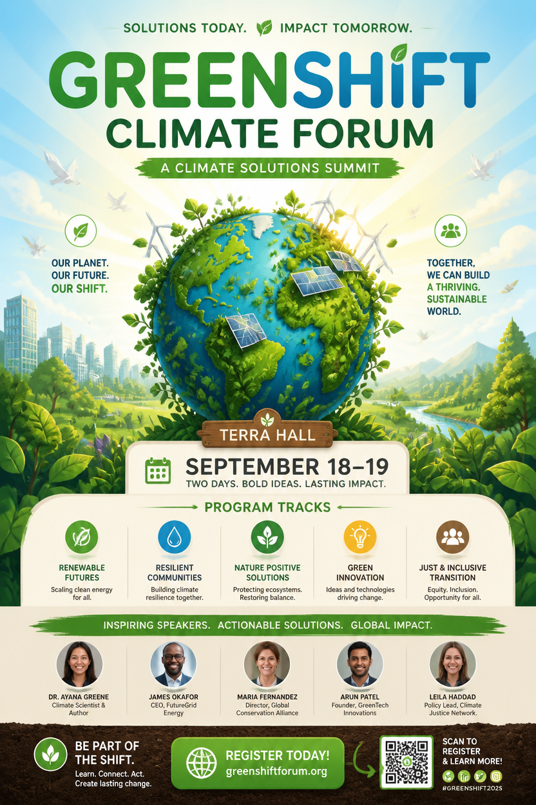

```text
Optimistic sustainability conference poster for 'GREENSHIFT CLIMATE FORUM', a climate-solutions summit at Terra Hall, September 18-19. Hero: a stylized globe growing lush green leaves, solar panels, and wind turbines sprouting from its surface, clean energy rays radiating outward. Composition: living globe centered, hopeful upward growth, clean friendly rounded sans title at the top, program tracks and dates below. Palette: fresh leaf green, sky blue, warm solar yellow, earthy brown, white. Clean optimistic illustration, soft gradients, hopeful natural light. Registration and speaker info at the base. Mood: hopeful, clean, purposeful, forward-thinking.
```

Model: GPT Image 2 · Author: API Models (apimodels.app)

[Original source](https://github.com/apimodels/gpt-image-2-prompts/blob/980d100f3bd0f2cde4cf38835daeb742bf1cac65/prompts.json#L9196) · [Provenance and original license](data/projectd-batch-0007.json)

## Design illustration · Founders Ignite Startup — API Models · CC BY 4.0

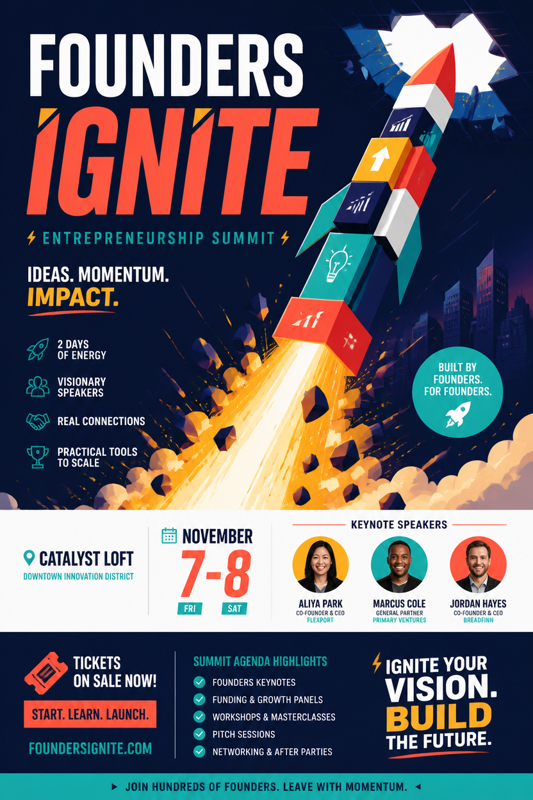

```text
Energetic startup conference poster for 'FOUNDERS IGNITE', an entrepreneurship summit at Catalyst Loft, November 7-8. Hero: a bold rising rocket made of stacked geometric building blocks launching upward with a trail of golden sparks, breaking through a ceiling grid. Composition: dynamic upward rocket diagonal from bottom to top, bold confident modern sans title at the top, keynote speakers and dates in a clean strip below. Palette: energetic coral-orange, deep indigo, bright yellow spark, white, teal accent. Bold flat-geometric illustration, dynamic upward energy, crisp modern polish. Ticket and agenda info at the base. Mood: ambitious, energetic, inspiring, momentum.
```

Model: GPT Image 2 · Author: API Models (apimodels.app)

[Original source](https://github.com/apimodels/gpt-image-2-prompts/blob/980d100f3bd0f2cde4cf38835daeb742bf1cac65/prompts.json#L9212) · [Provenance and original license](data/projectd-batch-0007.json)

## Design illustration · HealthTech Horizon — API Models · CC BY 4.0


```text
Clean medical-tech conference poster for 'HEALTHTECH HORIZON', a digital-health and biotech summit at Meridian Medical Center, October 9-10. Hero: a glowing abstract heartbeat line transforming into a rising sun over a clean horizon, subtle DNA helix and molecular nodes woven into soft light rays. Composition: heartbeat-to-sunrise line sweeping across the center, calm trustworthy modern sans title above, tracks and speakers in an organized grid below. Palette: medical teal, soft sky blue, warm sunrise coral, clean white, mint. Clean trustworthy aesthetic, soft glow, precise minimal layout. Registration and venue at the base. Mood: hopeful, trustworthy, innovative, clean.
```

Model: GPT Image 2 · Author: API Models (apimodels.app)

[Original source](https://github.com/apimodels/gpt-image-2-prompts/blob/980d100f3bd0f2cde4cf38835daeb742bf1cac65/prompts.json#L9260) · [Provenance and original license](data/projectd-batch-0007.json)

## Design illustration · NextGen Gaming Expo — API Models · CC BY 4.0


```text
Bold gaming conference poster for 'NEXTGEN GAMING EXPO', an interactive games and esports summit at Arcade Arena, August 28-30. Hero: a dynamic explosion of neon game controllers, pixel bursts, glowing UI elements, and a fictional heroic character silhouette leaping through a digital portal. Composition: energetic action burst from center, bold angular gaming display font title with a chromatic glow at the top, speaker and tournament info in a HUD-style panel below. Palette: neon purple, electric cyan, hot pink, deep black, acid green. Vibrant game-art glow, pixel-and-3D mix, high-energy digital polish. Ticket and lineup info at the base. Mood: energetic, immersive, playful, hype.
```

Model: GPT Image 2 · Author: API Models (apimodels.app)

[Original source](https://github.com/apimodels/gpt-image-2-prompts/blob/980d100f3bd0f2cde4cf38835daeb742bf1cac65/prompts.json#L9292) · [Provenance and original license](data/projectd-batch-0007.json)

## Design illustration · Skyline Property Forum — API Models · CC BY 4.0


```text
Polished real-estate and architecture conference poster for 'SKYLINE PROPERTY FORUM', an urban-development summit at Grand Pavilion, May 22-23. Hero: a sleek modern city skyline of glass towers rendered as elegant geometric line-art rising against a warm gradient sky, blueprint grid subtly overlaid. Composition: architectural skyline along the lower half, clean confident geometric serif title above with generous spacing, program and speakers in a refined grid below. Palette: warm dusk gold, slate blue, architectural white, bronze accent, deep navy. Refined architectural line-work, blueprint precision, upscale professional polish. Registration and venue at the base. Mood: professional, aspirational, refined, visionary.
```

Model: GPT Image 2 · Author: API Models (apimodels.app)

[Original source](https://github.com/apimodels/gpt-image-2-prompts/blob/980d100f3bd0f2cde4cf38835daeb742bf1cac65/prompts.json#L9308) · [Provenance and original license](data/projectd-batch-0007.json)

## Design illustration · The Midnight Circus — API Models · CC BY 4.0

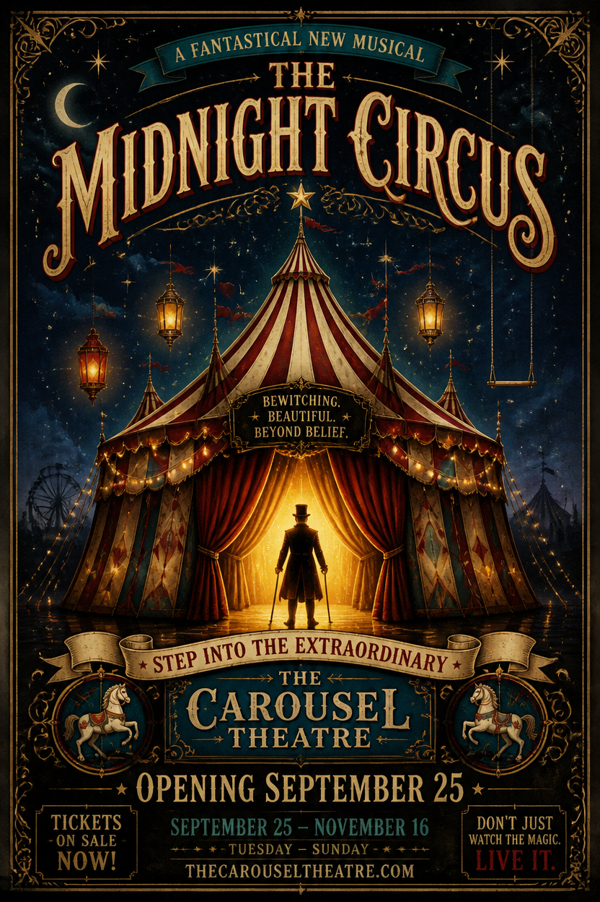

```text
Whimsical-dark musical theater poster for 'THE MIDNIGHT CIRCUS', a fantastical new musical at The Carousel Theatre, opening September 25. Hero: an ornate vintage circus tent glowing from within under a starry indigo sky, a mysterious ringmaster silhouette in the entrance, floating lanterns and a lone trapeze. Composition: tent centered and glowing, stars above, ornate vintage circus-poster title in decorative theatrical lettering arched at the top, curling banner details below. Palette: deep indigo night, warm gold glow, crimson stripes, antique cream, teal accents. Ornate victorian circus-poster style, warm inner glow, magical detail. Ticket and run info at the base. Mood: enchanting, mysterious, theatrical, nostalgic-dark.
```

Model: GPT Image 2 · Author: API Models (apimodels.app)

[Original source](https://github.com/apimodels/gpt-image-2-prompts/blob/980d100f3bd0f2cde4cf38835daeb742bf1cac65/prompts.json#L9340) · [Provenance and original license](data/projectd-batch-0007.json)

## Design illustration · A Winter's Tale — API Models · CC BY 4.0

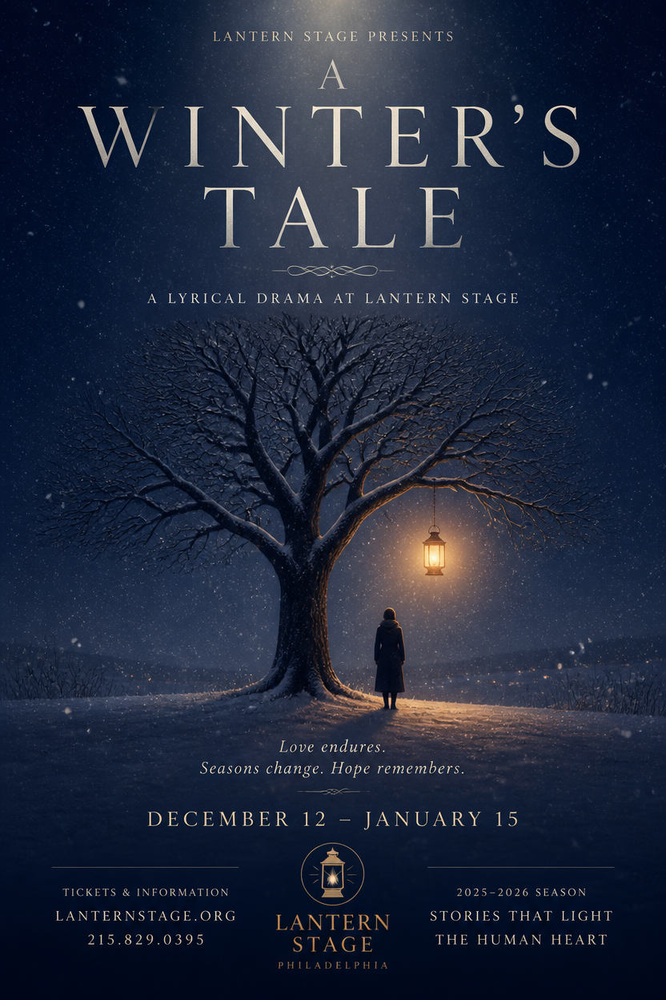

```text
Poetic theater poster for 'A WINTER'S TALE', a lyrical drama at Lantern Stage, running December 12 to January 15. Hero: a bare silhouetted tree with a single glowing lantern hanging from a branch, gentle snow falling through a soft spotlight, a lone figure standing beneath. Composition: tree centered on a deep twilight field, snow drifting, elegant refined serif title with graceful spacing at the top, run dates in delicate type below. Palette: deep twilight blue, soft lantern amber, snow white, muted silver, warm glow. Poetic minimal atmosphere, soft snowfall, gentle warm-cold contrast. Ticket and season info at the base. Mood: poetic, tender, wistful, quietly beautiful.
```

Model: GPT Image 2 · Author: API Models (apimodels.app)

[Original source](https://github.com/apimodels/gpt-image-2-prompts/blob/980d100f3bd0f2cde4cf38835daeb742bf1cac65/prompts.json#L9356) · [Provenance and original license](data/projectd-batch-0007.json)

## Design illustration · Rebel Voices Play — API Models · CC BY 4.0


```text
Bold contemporary theater poster for 'REBEL VOICES', a provocative new political drama at The Underground Stage, previews from March 6. Hero: a single raised fist clutching a torn red banner against a stark distressed wall covered in layered protest-poster fragments and paint drips. Composition: fist and banner rising from the lower center, gritty textured wall filling the frame, bold condensed activist stencil title stamped across, cast and dates in a raw strip below. Palette: raw concrete grey, revolutionary red, black stencil, aged paper cream, one bold yellow. Gritty street-poster collage, torn edges, urgent stencil energy. Ticket and run info at the base. Mood: defiant, urgent, raw, powerful.
```

Model: GPT Image 2 · Author: API Models (apimodels.app)

[Original source](https://github.com/apimodels/gpt-image-2-prompts/blob/980d100f3bd0f2cde4cf38835daeb742bf1cac65/prompts.json#L9372) · [Provenance and original license](data/projectd-batch-0007.json)

## Design illustration · Moving Day Checklist — API Models · CC BY 4.0

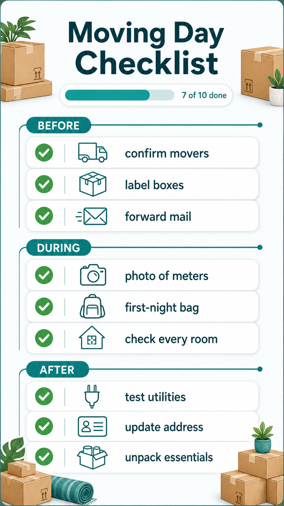

```text
A checklist infographic, 9:16, titled 'Moving Day Checklist'. A tall list of 10 rounded checkbox rows grouped in three sections: Before (confirm movers, label boxes, forward mail), During (photo of meters, first-night bag, check every room), After (test utilities, update address, unpack essentials). Each item has a green check circle and a small line icon. A progress bar at top shows '7 of 10 done'. Fresh teal-and-white palette, cardboard-box motifs in corners, rounded cards, friendly organized modern planner aesthetic, clean sans-serif.
```

Model: GPT Image 2 · Author: API Models (apimodels.app)

[Original source](https://github.com/apimodels/gpt-image-2-prompts/blob/980d100f3bd0f2cde4cf38835daeb742bf1cac65/prompts.json#L11348) · [Provenance and original license](data/projectd-batch-0007.json)

## Design illustration · Travel Packing Checklist — API Models · CC BY 4.0

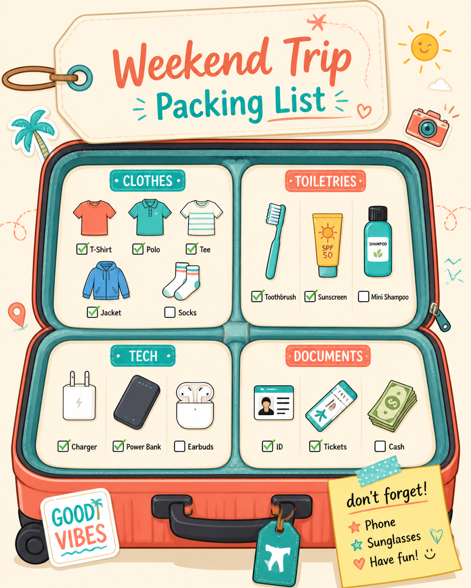

```text
A checklist infographic, 4:5, titled 'Weekend Trip Packing List'. An open-suitcase layout divided into four labeled compartments: Clothes (3 tops, 1 jacket, socks), Toiletries (toothbrush, sunscreen, mini shampoo), Tech (charger, power bank, earbuds), Documents (ID, tickets, cash). Each item is a small flat icon with a checkbox, some ticked green. A luggage-tag header and a 'don't forget!' sticky note in the corner. Sunny coral, turquoise, and cream palette, rounded icons, playful travel-doodle aesthetic, cheerful clean modern layout.
```

Model: GPT Image 2 · Author: API Models (apimodels.app)

[Original source](https://github.com/apimodels/gpt-image-2-prompts/blob/980d100f3bd0f2cde4cf38835daeb742bf1cac65/prompts.json#L11363) · [Provenance and original license](data/projectd-batch-0007.json)

## Design illustration · Morning Productivity Tips — API Models · CC BY 4.0

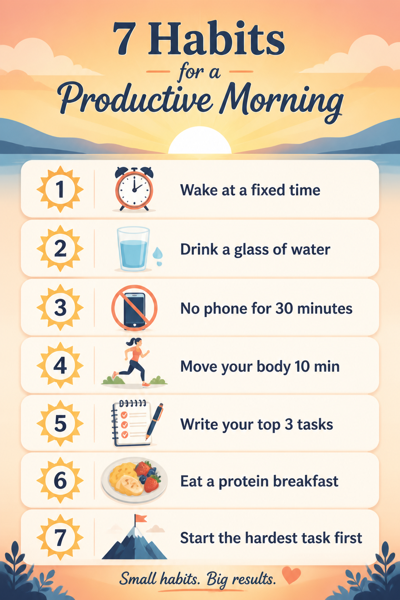

```text
A tips infographic, 2:3, titled '7 Habits for a Productive Morning'. Seven numbered tip cards stacked vertically, each with a flat icon and a short line: 1 Wake at a fixed time, 2 Drink a glass of water, 3 No phone for 30 minutes, 4 Move your body 10 min, 5 Write your top 3 tasks, 6 Eat a protein breakfast, 7 Start the hardest task first. Numbered sun-shaped badges, a rising-sun gradient header. Warm sunrise palette of peach, gold, and soft blue, rounded cards, uplifting friendly self-improvement aesthetic.
```

Model: GPT Image 2 · Author: API Models (apimodels.app)

[Original source](https://github.com/apimodels/gpt-image-2-prompts/blob/980d100f3bd0f2cde4cf38835daeb742bf1cac65/prompts.json#L11378) · [Provenance and original license](data/projectd-batch-0007.json)

## Design illustration · New Puppy Checklist — API Models · CC BY 4.0

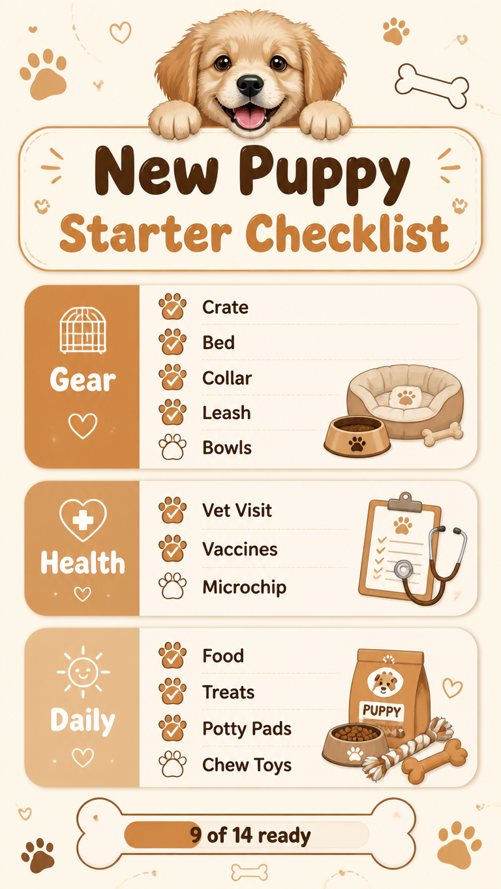

```text
A pet checklist infographic, 9:16, titled 'New Puppy Starter Checklist'. A vertical list grouped into Gear (crate, bed, collar, leash, bowls), Health (vet visit, vaccines, microchip), Daily (food, treats, potty pads, chew toys). Each item has a paw-print checkbox, some ticked. A cute puppy illustration peeks at the top and a bone-shaped progress bar shows '9 of 14 ready'. Warm cream and soft caramel palette, playful paw and bone doodles, rounded cards, adorable friendly pet-care aesthetic, bubbly rounded headings.
```

Model: GPT Image 2 · Author: API Models (apimodels.app)

[Original source](https://github.com/apimodels/gpt-image-2-prompts/blob/980d100f3bd0f2cde4cf38835daeb742bf1cac65/prompts.json#L11408) · [Provenance and original license](data/projectd-batch-0007.json)

## Design illustration · Wedding Planning Checklist — API Models · CC BY 4.0


```text
A wedding checklist infographic, 2:3, titled 'Wedding Countdown Checklist'. A timeline of four milestones down the page: 12 months (set budget, book venue), 6 months (choose caterer, send save-the-dates), 3 months (finalize invites, cake tasting), 1 month (confirm headcount, final fitting). Each milestone is a rounded card with checkbox items and a small elegant icon. A ribbon-and-ring motif header. Soft blush pink, sage green, and gold palette, delicate floral line art, thin elegant serif headings, refined romantic modern-wedding aesthetic.
```

Model: GPT Image 2 · Author: API Models (apimodels.app)

[Original source](https://github.com/apimodels/gpt-image-2-prompts/blob/980d100f3bd0f2cde4cf38835daeb742bf1cac65/prompts.json#L11423) · [Provenance and original license](data/projectd-batch-0007.json)

## Design illustration · Job Interview Tips — API Models · CC BY 4.0

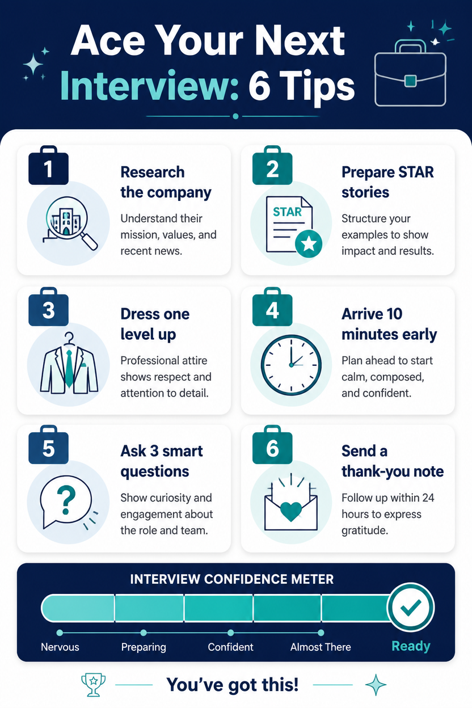

```text
A career tips infographic, 2:3, titled 'Ace Your Next Interview: 6 Tips'. Six numbered tip cards with flat icons: 1 Research the company, 2 Prepare STAR stories, 3 Dress one level up, 4 Arrive 10 minutes early, 5 Ask 3 smart questions, 6 Send a thank-you note. Each card has a briefcase-toned badge and one supporting line. A confidence meter at the bottom fills to 'Ready'. Professional navy, teal, and white palette, rounded cards, clean line icons, motivating polished career-guide aesthetic, crisp modern sans-serif.
```

Model: GPT Image 2 · Author: API Models (apimodels.app)

[Original source](https://github.com/apimodels/gpt-image-2-prompts/blob/980d100f3bd0f2cde4cf38835daeb742bf1cac65/prompts.json#L11453) · [Provenance and original license](data/projectd-batch-0007.json)

## Design illustration · Sustainable Living Tips — API Models · CC BY 4.0

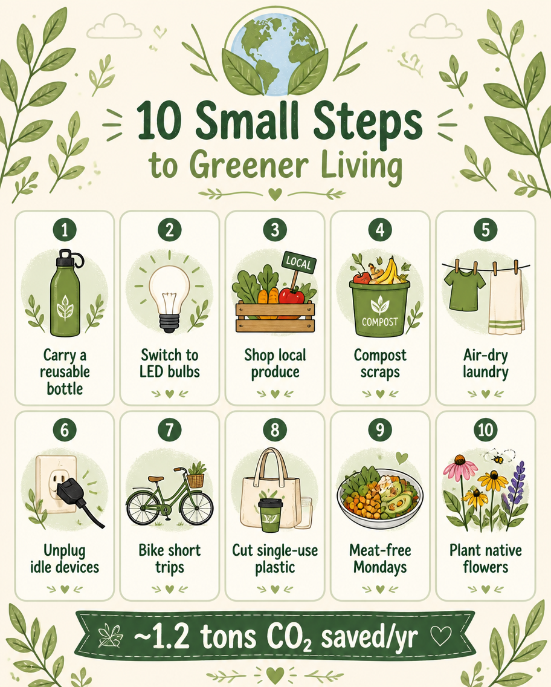

```text
An eco tips infographic, 4:5, titled '10 Small Steps to Greener Living'. Ten rounded tip tiles in a 2x5 grid, each with a leaf-toned icon and short text: carry a reusable bottle, switch to LED bulbs, shop local produce, compost scraps, air-dry laundry, unplug idle devices, bike short trips, cut single-use plastic, meat-free Mondays, plant native flowers. A globe-and-leaf header emblem and a footer '~1.2 tons CO2 saved/yr'. Fresh green and cream palette, hand-drawn botanical doodles, rounded tiles, wholesome friendly sustainability aesthetic.
```

Model: GPT Image 2 · Author: API Models (apimodels.app)

[Original source](https://github.com/apimodels/gpt-image-2-prompts/blob/980d100f3bd0f2cde4cf38835daeb742bf1cac65/prompts.json#L11468) · [Provenance and original license](data/projectd-batch-0007.json)

## Design illustration · Newborn Essentials Checklist — API Models · CC BY 4.0

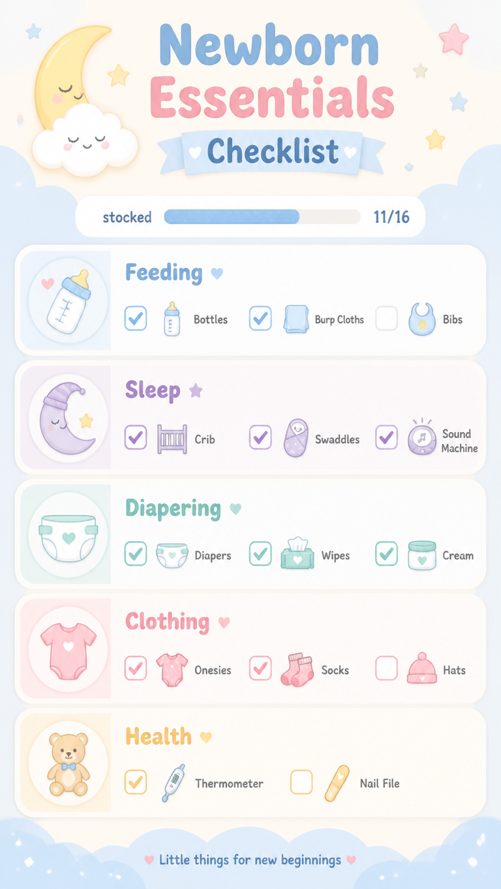

```text
A baby checklist infographic, 9:16, titled 'Newborn Essentials Checklist'. A soft vertical list grouped by category: Feeding (bottles, burp cloths, bibs), Sleep (crib, swaddles, sound machine), Diapering (diapers, wipes, cream), Clothing (onesies, socks, hats), Health (thermometer, nail file). Each item has a rounded checkbox with a pastel icon, several ticked. A cute crescent-moon and cloud header and a progress bar 'stocked 11/16'. Gentle pastel palette of powder blue, soft pink, and cream, rounded cards, tender nursery aesthetic, soft bubbly headings.
```

Model: GPT Image 2 · Author: API Models (apimodels.app)

[Original source](https://github.com/apimodels/gpt-image-2-prompts/blob/980d100f3bd0f2cde4cf38835daeb742bf1cac65/prompts.json#L11483) · [Provenance and original license](data/projectd-batch-0007.json)

## Design illustration · Cats Vs Dogs Versus — API Models · CC BY 4.0

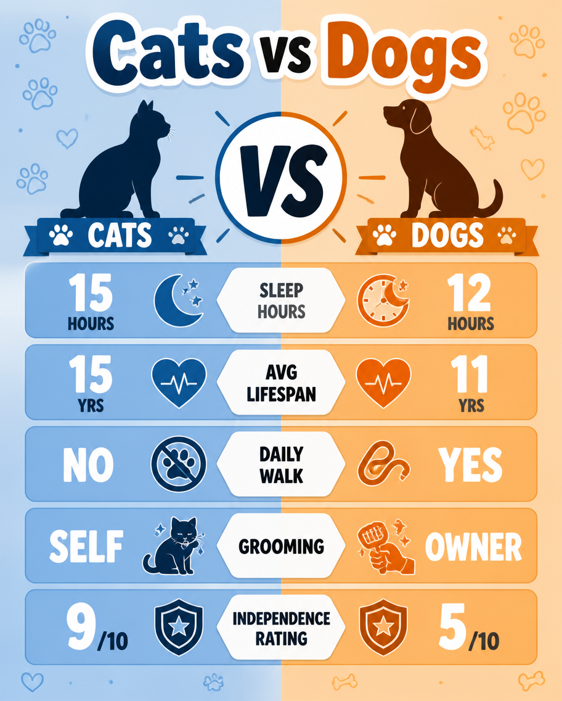

```text
A versus infographic, 4:5, titled 'Cats vs Dogs'. A split-screen layout: left half cool blue for Cats, right half warm orange for Dogs, divided by a bold central 'VS' badge. Each side lists matched stats with icons: sleep hours (15 vs 12), avg lifespan (15 vs 11 yrs), daily walk (no vs yes), grooming (self vs owner), independence rating (9 vs 5 /10). Small facing cat and dog silhouettes at top. Clean flat design, playful pet-paw doodles, bold rounded headings, symmetrical balanced comparison layout.
```

Model: GPT Image 2 · Author: API Models (apimodels.app)

[Original source](https://github.com/apimodels/gpt-image-2-prompts/blob/980d100f3bd0f2cde4cf38835daeb742bf1cac65/prompts.json#L11498) · [Provenance and original license](data/projectd-batch-0007.json)

## Design illustration · Coffee Vs Tea Versus — API Models · CC BY 4.0

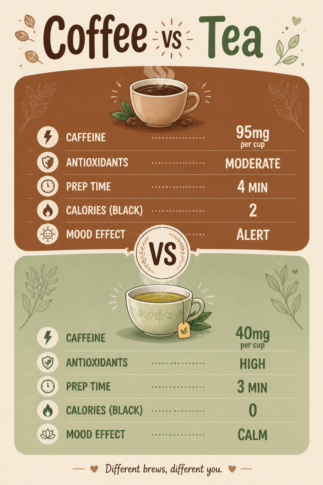

```text
A versus infographic, 2:3, titled 'Coffee vs Tea'. Vertical split: top warm coffee-brown for Coffee, bottom soft sage-green for Tea, meeting at a central 'VS' seal. Matched rows compare caffeine (95mg vs 40mg per cup), antioxidants (moderate vs high), prep time (4 vs 3 min), calories black (2 vs 0), mood effect (alert vs calm). A steaming cup icon crowns each section. Cozy flat illustration style, warm cream background, hand-drawn steam swirls, rounded typography, balanced symmetrical head-to-head layout.
```

Model: GPT Image 2 · Author: API Models (apimodels.app)

[Original source](https://github.com/apimodels/gpt-image-2-prompts/blob/980d100f3bd0f2cde4cf38835daeb742bf1cac65/prompts.json#L11513) · [Provenance and original license](data/projectd-batch-0007.json)

## Design illustration · Mobile OS Versus — API Models · CC BY 4.0

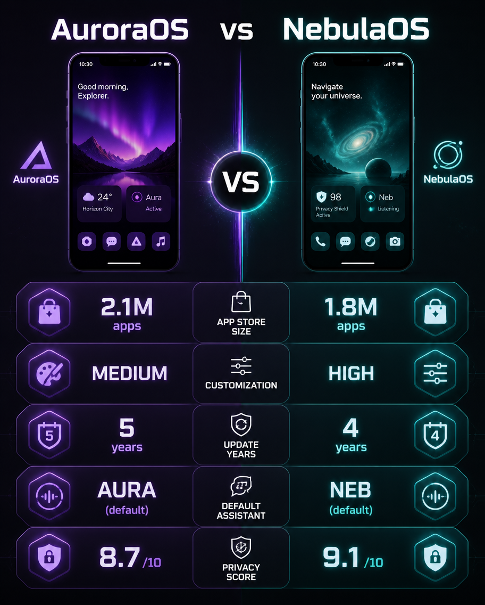

```text
A tech versus infographic, 4:5, titled 'AuroraOS vs NebulaOS'. A sleek split-screen for two invented mobile operating systems: left purple AuroraOS, right teal NebulaOS, split by a glowing 'VS' node. Matched spec rows: app store size (2.1M vs 1.8M apps), customization (medium vs high), update years (5 vs 4), default assistant (Aura vs Neb), privacy score (8.7 vs 9.1 /10). Small phone mockups top each side. Dark charcoal background, neon accent gradients, glowing rounded icons, futuristic clean tech aesthetic, bold white type.
```

Model: GPT Image 2 · Author: API Models (apimodels.app)

[Original source](https://github.com/apimodels/gpt-image-2-prompts/blob/980d100f3bd0f2cde4cf38835daeb742bf1cac65/prompts.json#L11528) · [Provenance and original license](data/projectd-batch-0007.json)

## Design illustration · Remote Vs Office Work — API Models · CC BY 4.0

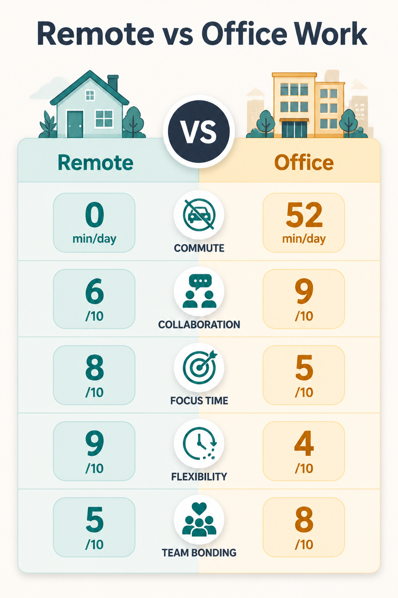

```text
A workplace versus infographic, 2:3, titled 'Remote vs Office Work'. Split layout: left soft teal 'Remote', right warm amber 'Office', divided by a central 'VS' circle. Matched rows with flat icons: commute (0 vs 52 min/day), collaboration (rated 6 vs 9), focus time (8 vs 5), flexibility (9 vs 4), team bonding (5 vs 8). A small house icon vs an office-building icon at top. Clean modern flat design, off-white background, rounded stat chips, subtle drop shadows, balanced professional comparison aesthetic, crisp sans-serif.
```

Model: GPT Image 2 · Author: API Models (apimodels.app)

[Original source](https://github.com/apimodels/gpt-image-2-prompts/blob/980d100f3bd0f2cde4cf38835daeb742bf1cac65/prompts.json#L11543) · [Provenance and original license](data/projectd-batch-0007.json)

## Design illustration · Gas Vs Electric Cars — API Models · CC BY 4.0

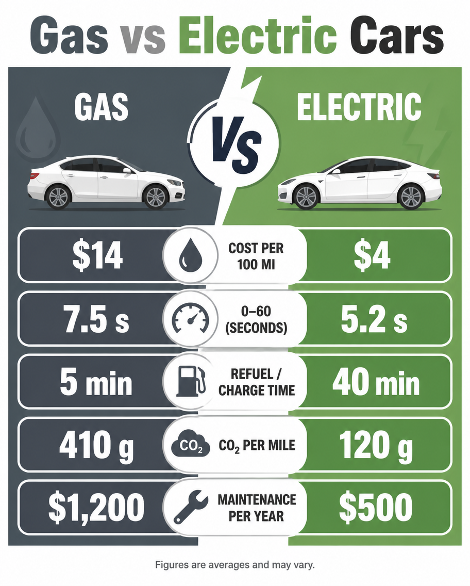

```text
An auto versus infographic, 4:5, titled 'Gas vs Electric Cars'. A split screen: left slate-grey 'Gas', right green 'Electric', joined by a bold 'VS' emblem. Matched rows with icons: cost per 100 mi ($14 vs $4), 0-60 (7.5 vs 5.2 s), refuel/charge time (5 min vs 40 min), CO2 per mile (410g vs 120g), maintenance/yr ($1,200 vs $500). Small side-view car silhouettes top each half. Clean flat design, white background, fuel-drop and lightning-bolt motifs, rounded stat bars, balanced modern comparison aesthetic.
```

Model: GPT Image 2 · Author: API Models (apimodels.app)

[Original source](https://github.com/apimodels/gpt-image-2-prompts/blob/980d100f3bd0f2cde4cf38835daeb742bf1cac65/prompts.json#L11558) · [Provenance and original license](data/projectd-batch-0007.json)

## Design illustration · Cardio Vs Strength Training — API Models · CC BY 4.0

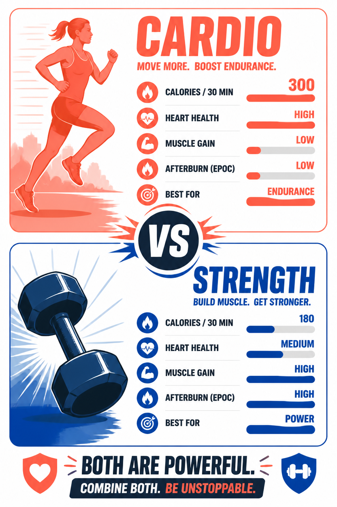

```text
A fitness versus infographic, 2:3, titled 'Cardio vs Strength'. Vertical split: top coral 'Cardio', bottom deep-blue 'Strength', meeting at a central 'VS' badge. Matched stats with icons: calories/30min (300 vs 180), heart health (high vs medium), muscle gain (low vs high), afterburn (low vs high), best for (endurance vs power). Running-figure vs dumbbell icons crown each section. Energetic flat design, white background, bold motivational headings, rounded progress bars, dynamic balanced fitness-comparison aesthetic, strong sans-serif.
```

Model: GPT Image 2 · Author: API Models (apimodels.app)

[Original source](https://github.com/apimodels/gpt-image-2-prompts/blob/980d100f3bd0f2cde4cf38835daeb742bf1cac65/prompts.json#L11573) · [Provenance and original license](data/projectd-batch-0007.json)

## Design illustration · Renting Vs Buying A Home — API Models · CC BY 4.0

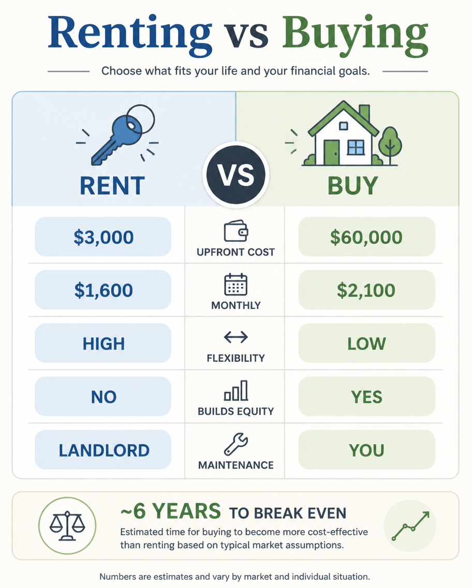

```text
A finance versus infographic, 4:5, titled 'Renting vs Buying'. A split screen: left blue 'Rent', right green 'Buy', divided by a central 'VS' seal. Matched rows: upfront cost ($3,000 vs $60,000), monthly ($1,600 vs $2,100), flexibility (high vs low), builds equity (no vs yes), maintenance (landlord vs you). A tiny key vs house icon top each half, plus a break-even note '~6 years to break even'. Clean flat design, off-white background, rounded stat chips, calm trustworthy finance-comparison aesthetic, crisp modern type.
```

Model: GPT Image 2 · Author: API Models (apimodels.app)

[Original source](https://github.com/apimodels/gpt-image-2-prompts/blob/980d100f3bd0f2cde4cf38835daeb742bf1cac65/prompts.json#L11588) · [Provenance and original license](data/projectd-batch-0007.json)

## Design illustration · Solar Vs Wind Energy — API Models · CC BY 4.0

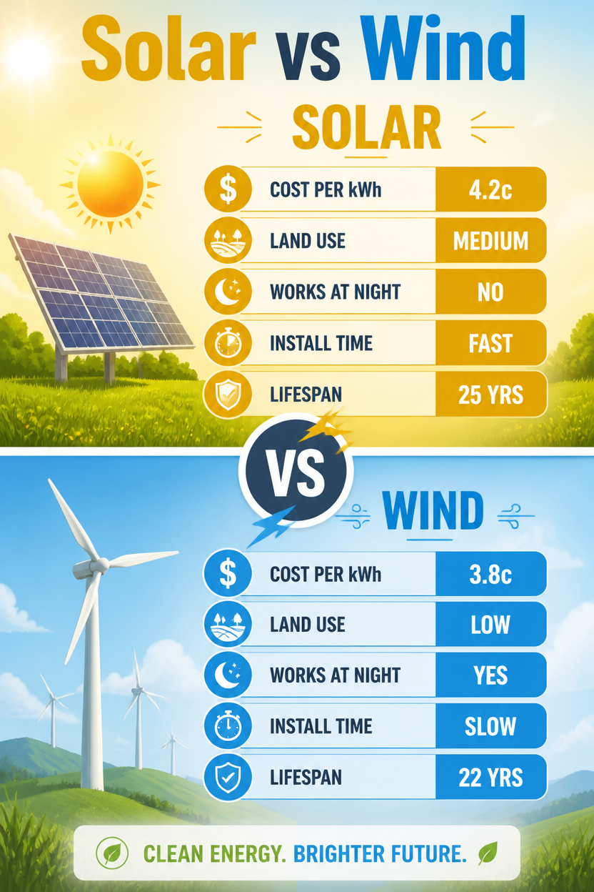

```text
An energy versus infographic, 2:3, titled 'Solar vs Wind'. Vertical split: top gold 'Solar', bottom sky-blue 'Wind', joined by a central 'VS' emblem. Matched rows with icons: cost per kWh (4.2c vs 3.8c), land use (medium vs low), works at night (no vs yes), install time (fast vs slow), lifespan (25 vs 22 yrs). Sun-panel vs turbine icons top each half. Clean flat design, soft gradient sky background, rounded stat bars, hopeful bright renewable-energy aesthetic, balanced symmetrical layout, bold clean headings.
```

Model: GPT Image 2 · Author: API Models (apimodels.app)

[Original source](https://github.com/apimodels/gpt-image-2-prompts/blob/980d100f3bd0f2cde4cf38835daeb742bf1cac65/prompts.json#L11603) · [Provenance and original license](data/projectd-batch-0007.json)

## Design illustration · Introvert Vs Extrovert — API Models · CC BY 4.0

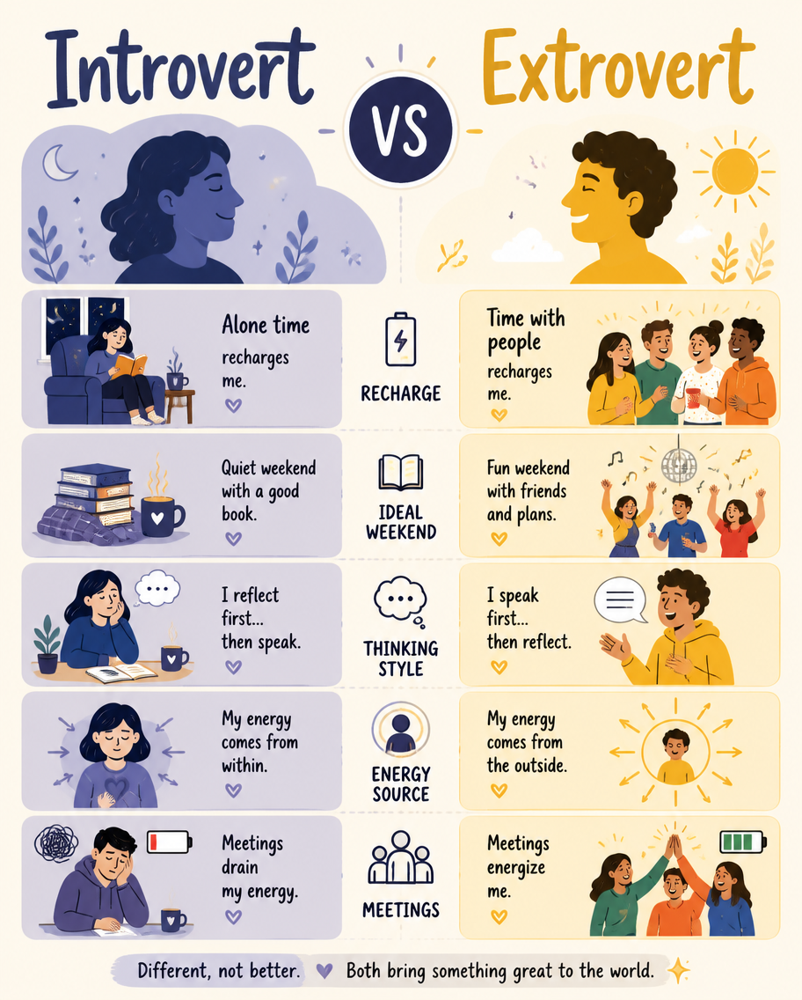

```text
A personality versus infographic, 4:5, titled 'Introvert vs Extrovert'. Split screen: left calm indigo 'Introvert', right sunny yellow 'Extrovert', divided by a central 'VS' circle. Matched traits with playful icons: recharge (alone vs with people), ideal weekend (book vs party), thinking (reflect first vs speak first), energy source (inward vs outward), meetings (drain vs energize). Two friendly abstract head silhouettes top each half. Soft flat illustration style, cream background, hand-drawn doodles, rounded cards, warm approachable psychology-infographic aesthetic.
```

Model: GPT Image 2 · Author: API Models (apimodels.app)

[Original source](https://github.com/apimodels/gpt-image-2-prompts/blob/980d100f3bd0f2cde4cf38835daeb742bf1cac65/prompts.json#L11618) · [Provenance and original license](data/projectd-batch-0007.json)

## Design illustration · Freelance Vs Full-Time — API Models · CC BY 4.0

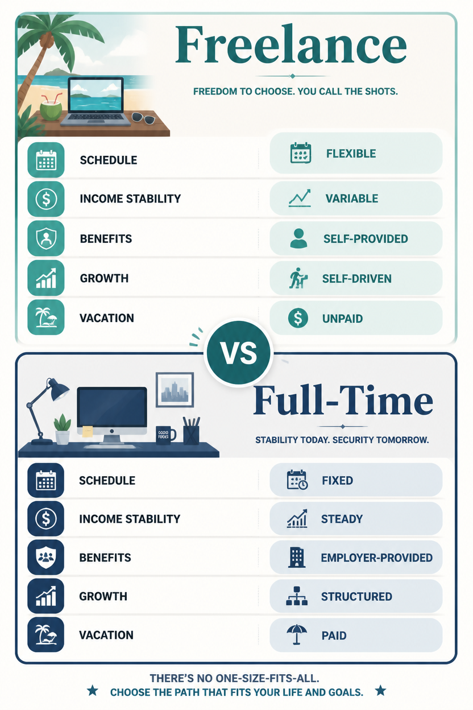

```text
A career versus infographic, 2:3, titled 'Freelance vs Full-Time'. Vertical split: top teal 'Freelance', bottom navy 'Full-Time', meeting at a central 'VS' badge. Matched rows with icons: schedule (flexible vs fixed), income stability (variable vs steady), benefits (self vs employer), growth (self-driven vs structured), vacation (unpaid vs paid). Laptop-on-beach vs office-desk icons top each section. Clean modern flat design, off-white background, rounded stat chips, subtle shadows, balanced professional career-comparison aesthetic, crisp confident type.
```

Model: GPT Image 2 · Author: API Models (apimodels.app)

[Original source](https://github.com/apimodels/gpt-image-2-prompts/blob/980d100f3bd0f2cde4cf38835daeb742bf1cac65/prompts.json#L11633) · [Provenance and original license](data/projectd-batch-0007.json)

## Design illustration · SaaS Metrics Dashboard — API Models · CC BY 4.0

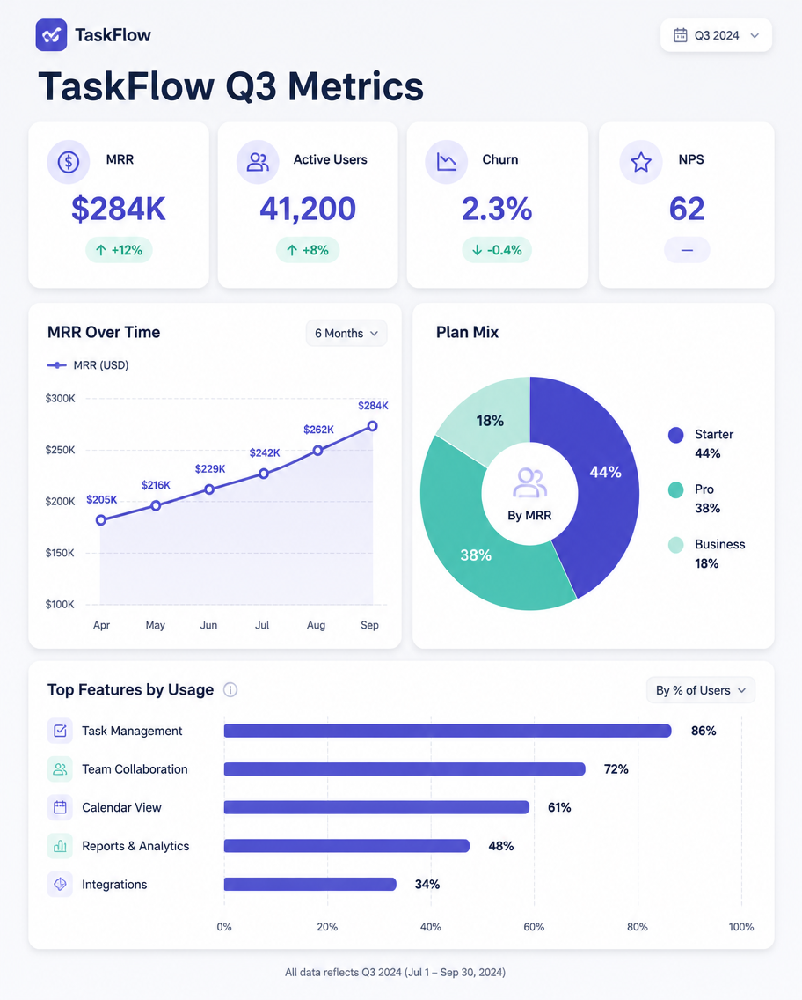

```text
A dashboard-style infographic, 4:5, titled 'TaskFlow Q3 Metrics'. A clean report slide with a top KPI row of four cards: MRR $284K (+12%), Active Users 41,200 (+8%), Churn 2.3% (-0.4%), NPS 62. Below, a two-column layout: left a line chart of revenue climbing over 6 months, right a donut of plan mix (Starter 44%, Pro 38%, Business 18%). A small horizontal bar of top features by usage. Light dashboard-grey background, indigo and mint accents, rounded card widgets, subtle shadows, modern analytics-UI aesthetic, tidy sans-serif.
```

Model: GPT Image 2 · Author: API Models (apimodels.app)

[Original source](https://github.com/apimodels/gpt-image-2-prompts/blob/980d100f3bd0f2cde4cf38835daeb742bf1cac65/prompts.json#L11648) · [Provenance and original license](data/projectd-batch-0007.json)

## Design illustration · E-commerce Sales Dashboard — API Models · CC BY 4.0

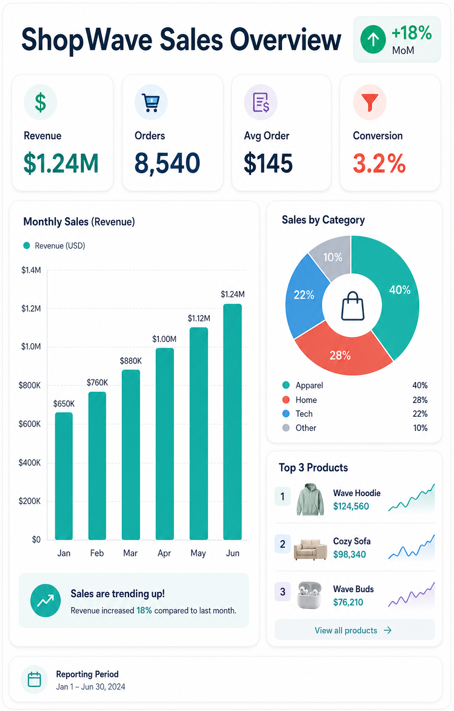

```text
A dashboard infographic, 4:5, titled 'ShopWave Sales Overview'. A report slide with four top stat tiles: Revenue $1.24M, Orders 8,540, Avg Order $145, Conversion 3.2%. A central bar chart shows monthly sales rising Jan-Jun, a side donut splits categories (Apparel 40%, Home 28%, Tech 22%, Other 10%), and a small ranked list of top 3 products with mini sparklines. A green up-arrow trend badge '+18% MoM'. Clean white-and-slate dashboard palette, teal and coral accents, rounded widgets, soft shadows, sleek e-commerce analytics aesthetic.
```

Model: GPT Image 2 · Author: API Models (apimodels.app)

[Original source](https://github.com/apimodels/gpt-image-2-prompts/blob/980d100f3bd0f2cde4cf38835daeb742bf1cac65/prompts.json#L11663) · [Provenance and original license](data/projectd-batch-0007.json)

## Design illustration · Social Media Analytics Slide — API Models · CC BY 4.0

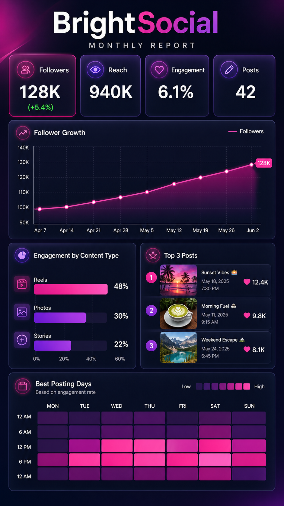

```text
A dashboard infographic, 9:16, titled 'BrightSocial Monthly Report'. A vertical report with a KPI strip: Followers 128K (+5.4%), Reach 940K, Engagement 6.1%, Posts 42. Below, a line chart of follower growth, a horizontal bar of engagement by content type (Reels 48%, Photos 30%, Stories 22%), and a top-3 posts card with tiny thumbnails and like counts. A calendar heatmap shows best posting days. Vibrant magenta-and-purple gradient accents, dark card backgrounds, rounded widgets, glowing highlights, trendy social-analytics dashboard aesthetic.
```

Model: GPT Image 2 · Author: API Models (apimodels.app)

[Original source](https://github.com/apimodels/gpt-image-2-prompts/blob/980d100f3bd0f2cde4cf38835daeb742bf1cac65/prompts.json#L11678) · [Provenance and original license](data/projectd-batch-0007.json)

## Design illustration · Fitness App Weekly Report — API Models · CC BY 4.0

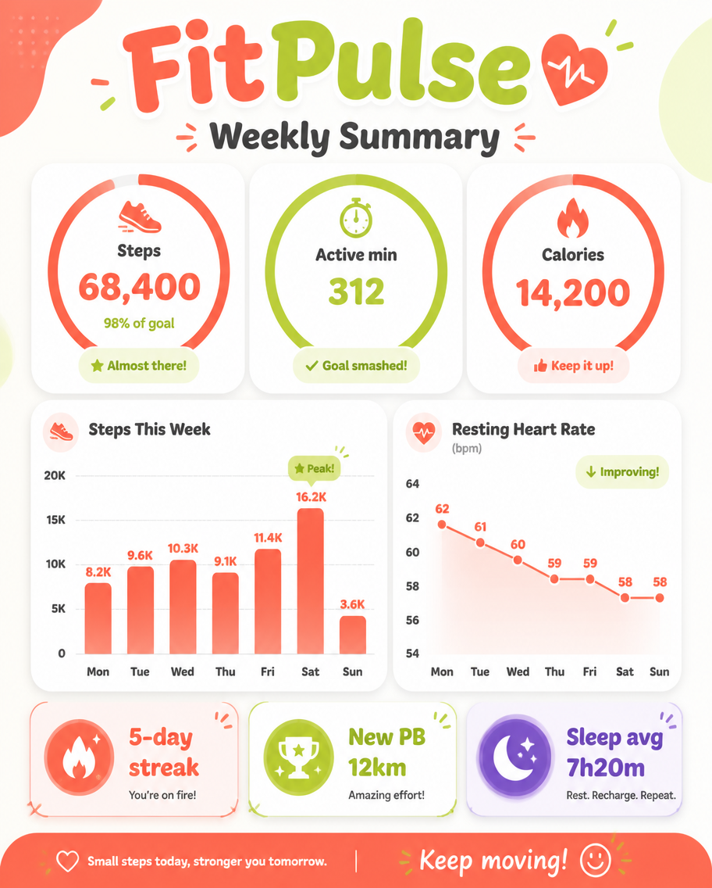

```text
A dashboard infographic, 4:5, titled 'FitPulse Weekly Summary'. A friendly report slide: a top ring-chart trio shows Steps 68,400 (98% of goal), Active min 312, Calories 14,200. A weekly bar chart plots steps Mon-Sun peaking Saturday, a small line shows resting heart rate trending down 62-58 bpm, and three badge chips: '5-day streak', 'New PB 12km', 'Sleep avg 7h20m'. Energetic coral, lime, and white palette, rounded progress rings, soft shadows, motivating clean fitness-app dashboard aesthetic, bubbly headings.
```

Model: GPT Image 2 · Author: API Models (apimodels.app)

[Original source](https://github.com/apimodels/gpt-image-2-prompts/blob/980d100f3bd0f2cde4cf38835daeb742bf1cac65/prompts.json#L11693) · [Provenance and original license](data/projectd-batch-0007.json)

## Design illustration · Investment Portfolio Dashboard — API Models · CC BY 4.0

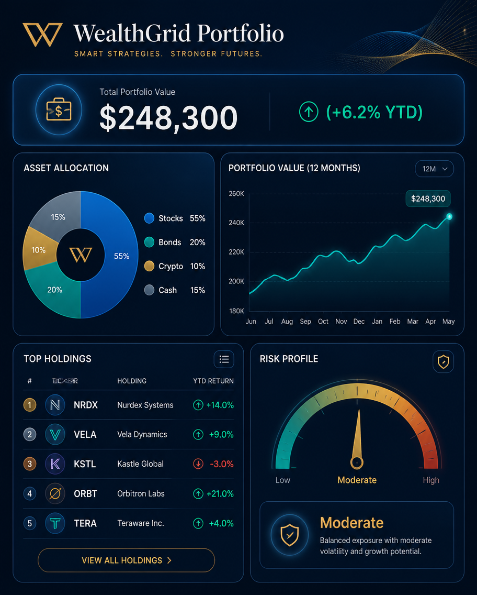

```text
A finance dashboard infographic, 4:5, titled 'WealthGrid Portfolio'. A report slide with a header value 'Total $248,300 (+6.2% YTD)'. A donut shows allocation (Stocks 55%, Bonds 20%, Crypto 10%, Cash 15%), a line chart tracks portfolio value over 12 months, and a ranked holdings list of five invented tickers (NRDX +14%, VELA +9%, KSTL -3%, ORBT +21%, TERA +4%) with green/red arrows. A risk gauge points to 'Moderate'. Deep navy-and-white palette, gold and teal accents, rounded widgets, subtle glow, premium clean fintech-dashboard aesthetic.
```

Model: GPT Image 2 · Author: API Models (apimodels.app)

[Original source](https://github.com/apimodels/gpt-image-2-prompts/blob/980d100f3bd0f2cde4cf38835daeb742bf1cac65/prompts.json#L11708) · [Provenance and original license](data/projectd-batch-0007.json)

## Design illustration · Marketing Campaign Report — API Models · CC BY 4.0

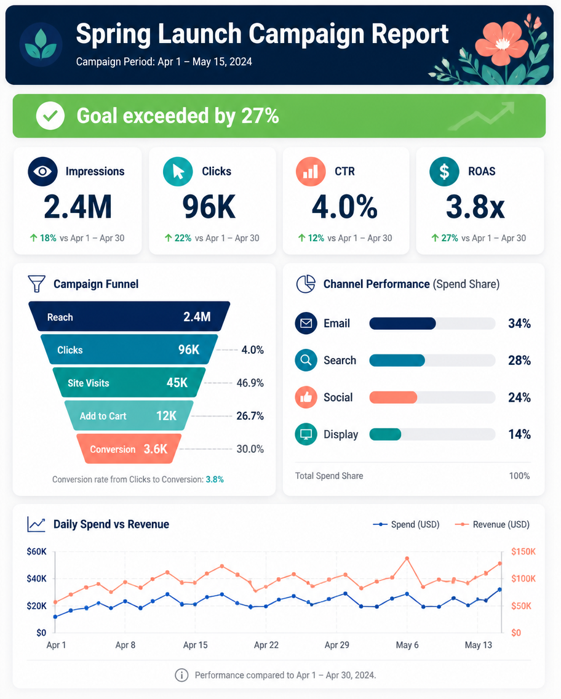

```text
A dashboard infographic, 4:5, titled 'Spring Launch Campaign Report'. A results slide with four KPI tiles: Impressions 2.4M, Clicks 96K, CTR 4.0%, ROAS 3.8x. A funnel chart narrows from Reach to Conversion, a channel-split bar compares Email 34%, Search 28%, Social 24%, Display 14%, and a small line shows daily spend vs revenue. A green highlight banner 'Goal exceeded by 27%'. Clean corporate palette of navy, teal, and coral, rounded widgets on a light grid, soft shadows, polished professional report-slide aesthetic, crisp sans-serif.
```

Model: GPT Image 2 · Author: API Models (apimodels.app)

[Original source](https://github.com/apimodels/gpt-image-2-prompts/blob/980d100f3bd0f2cde4cf38835daeb742bf1cac65/prompts.json#L11723) · [Provenance and original license](data/projectd-batch-0007.json)

## Design illustration · Website Traffic Analytics — API Models · CC BY 4.0


```text
A dashboard infographic, 9:16, titled 'PageVault Traffic Report'. A vertical analytics slide: top tiles show Sessions 312K, Users 214K, Bounce 38%, Avg Time 2m47s. An area chart plots daily sessions over 30 days, a horizontal bar ranks traffic sources (Organic 46%, Direct 24%, Social 18%, Referral 12%), and a small world-map dot cluster highlights top regions. A device-split mini donut (Mobile 61%, Desktop 33%, Tablet 6%). Cool blue-and-white palette, rounded card widgets, faint grid, clean modern web-analytics dashboard aesthetic.
```

Model: GPT Image 2 · Author: API Models (apimodels.app)

[Original source](https://github.com/apimodels/gpt-image-2-prompts/blob/980d100f3bd0f2cde4cf38835daeb742bf1cac65/prompts.json#L11738) · [Provenance and original license](data/projectd-batch-0007.json)

## Design illustration · Support KPI Dashboard — API Models · CC BY 4.0

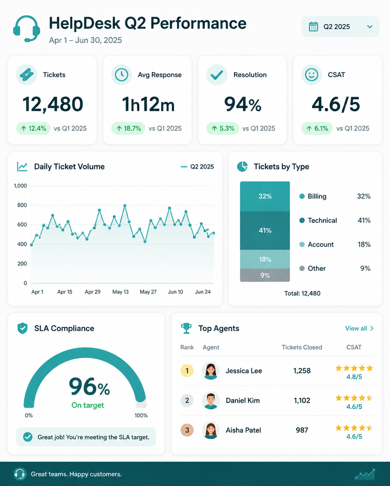

```text
A dashboard infographic, 4:5, titled 'HelpDesk Q2 Performance'. A report slide with four KPI cards: Tickets 12,480, Avg Response 1h12m, Resolution 94%, CSAT 4.6/5. A line chart tracks daily ticket volume, a stacked bar splits ticket type (Billing 32%, Technical 41%, Account 18%, Other 9%), and a gauge shows SLA compliance at 96%. A small agent-leaderboard card lists three top performers with star ratings. Calm teal-and-white palette, rounded widgets on a light grid, green trend badges, tidy professional support-dashboard aesthetic.
```

Model: GPT Image 2 · Author: API Models (apimodels.app)

[Original source](https://github.com/apimodels/gpt-image-2-prompts/blob/980d100f3bd0f2cde4cf38835daeb742bf1cac65/prompts.json#L11753) · [Provenance and original license](data/projectd-batch-0007.json)

## Design illustration · Project Status Report Slide — API Models · CC BY 4.0

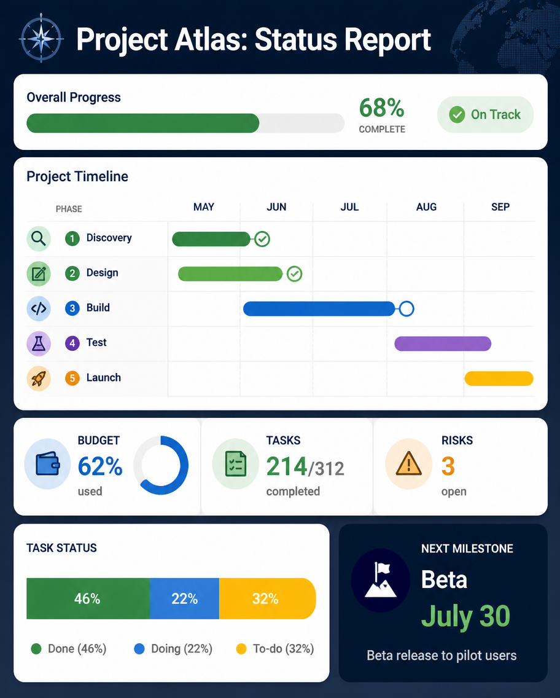

```text
A dashboard infographic, 4:5, titled 'Project Atlas: Status Report'. A management slide: a top progress bar shows 68% complete with an 'On Track' green pill. A mini Gantt chart lists five phases (Discovery done, Design done, Build in progress, Test upcoming, Launch upcoming) with colored timeline bars. Three stat tiles: Budget 62% used, Tasks 214/312, Risks 3 open. A small stacked bar of task status (Done, Doing, To-do) and a next-milestone callout 'Beta July 30'. Clean corporate palette of navy, green, amber, rounded widgets, polished PM-report aesthetic.
```

Model: GPT Image 2 · Author: API Models (apimodels.app)

[Original source](https://github.com/apimodels/gpt-image-2-prompts/blob/980d100f3bd0f2cde4cf38835daeb742bf1cac65/prompts.json#L11768) · [Provenance and original license](data/projectd-batch-0007.json)

## Design illustration · Recruitment Funnel Dashboard — API Models · CC BY 4.0

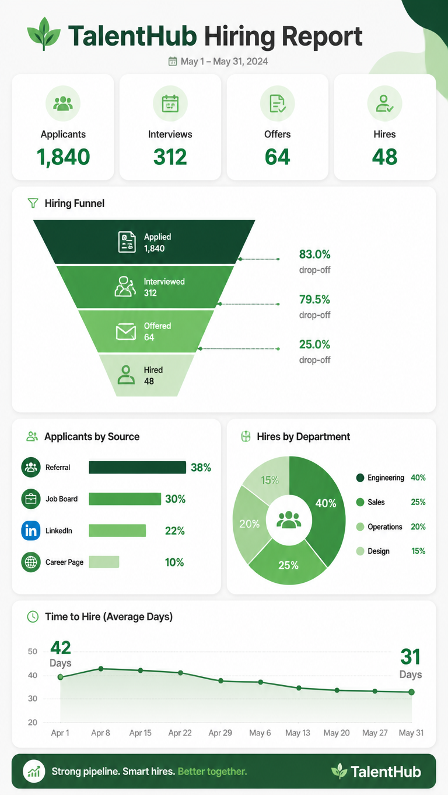

```text
An HR dashboard infographic, 9:16, titled 'TalentHub Hiring Report'. A vertical slide with top tiles: Applicants 1,840, Interviews 312, Offers 64, Hires 48. A hiring funnel narrows from Applied to Hired with percentage drop-offs labeled. A horizontal bar ranks sources (Referral 38%, Job Board 30%, LinkedIn-style network 22%, Career Page 10%), and a small line shows time-to-hire dropping from 42 to 31 days. A donut of hires by department (Eng 40%, Sales 25%, Ops 20%, Design 15%). Fresh green-and-white palette, rounded widgets, clean modern HR-analytics aesthetic.
```

Model: GPT Image 2 · Author: API Models (apimodels.app)

[Original source](https://github.com/apimodels/gpt-image-2-prompts/blob/980d100f3bd0f2cde4cf38835daeb742bf1cac65/prompts.json#L11783) · [Provenance and original license](data/projectd-batch-0007.json)

## Maison Cendre Eau de Parfum — API Models · CC BY 4.0

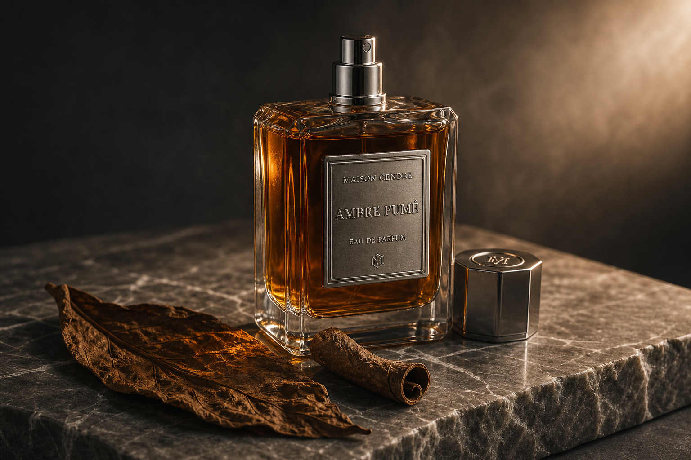

```text
A faceted rectangular clear-glass flacon of Maison Cendre 'Ambre Fumé' eau de parfum stands on a slab of grey veined marble, amber liquid glowing within and a heavy silver cap beside it. A single dried tobacco leaf and a curl of cinnamon bark rest in the foreground. Warm dramatic side light from the right casts a long elegant shadow. Amber, smoke-grey and silver palette, dark moody gradient background. Low 15-degree hero angle, 100mm lens, opulent perfume mood.
```

Model: GPT Image 2 · Author: API Models (apimodels.app)

[Original source](https://github.com/apimodels/gpt-image-2-prompts/blob/980d100f3bd0f2cde4cf38835daeb742bf1cac65/prompts.json#L303) · [Provenance and original license](data/projectd-batch-0007.json)

## Fleur de Nuit Floral Perfume — API Models · CC BY 4.0

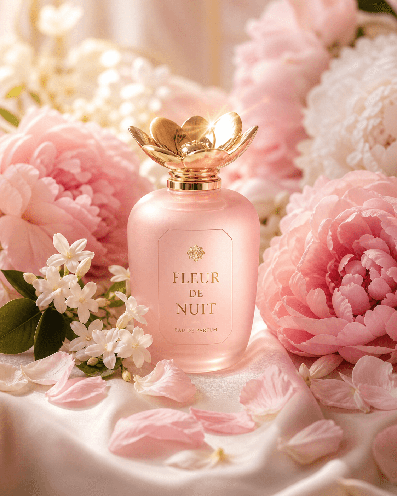

```text
A blush-pink frosted-glass perfume bottle of Fleur de Nuit with a gold blossom-shaped cap sits among fresh peonies and jasmine on a white silk-draped surface. Soft petals scatter loosely around the base. Delicate romantic backlight glows through the translucent bottle. Blush-pink, ivory and gold palette, dreamy soft-focus floral background. Eye-level straight shot slightly above, 105mm lens, luxurious romantic feminine mood, gentle bloom of light around the cap.
```

Model: GPT Image 2 · Author: API Models (apimodels.app)

[Original source](https://github.com/apimodels/gpt-image-2-prompts/blob/980d100f3bd0f2cde4cf38835daeb742bf1cac65/prompts.json#L318) · [Provenance and original license](data/projectd-batch-0007.json)

## Oud Atelier Niche Fragrance — API Models · CC BY 4.0

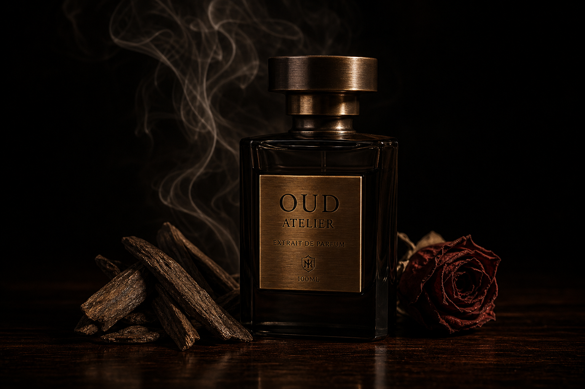

```text
A heavy smoked-glass bottle of Oud Atelier niche fragrance with a brushed-brass label plate stands on dark polished ebony wood, wisps of real incense smoke curling upward behind it. A cluster of oud wood chips and a dried rose sit beside the base. Dramatic low-key chiaroscuro lighting, deep espresso-brown, brass and charcoal palette, near-black background. Straight eye-level shot, 90mm lens, mysterious opulent niche-perfume mood, single warm rim highlight.
```

Model: GPT Image 2 · Author: API Models (apimodels.app)

[Original source](https://github.com/apimodels/gpt-image-2-prompts/blob/980d100f3bd0f2cde4cf38835daeb742bf1cac65/prompts.json#L333) · [Provenance and original license](data/projectd-batch-0007.json)

## Bergamia Citrus Cologne — API Models · CC BY 4.0

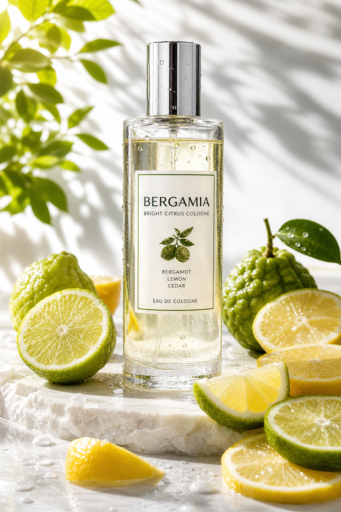

```text
A tall cylindrical clear-glass bottle of Bergamia bright citrus cologne stands on a sunlit white stone counter, fresh bergamot and lemon slices scattered around it with glistening juice droplets. Bright airy morning sunlight streams from the left, casting crisp leaf shadows. Zesty yellow, green and clear-glass palette, clean white gradient background. Slight three-quarter angle, 85mm lens, fresh energetic summer cologne mood, vibrant and clean.
```

Model: GPT Image 2 · Author: API Models (apimodels.app)

[Original source](https://github.com/apimodels/gpt-image-2-prompts/blob/980d100f3bd0f2cde4cf38835daeb742bf1cac65/prompts.json#L348) · [Provenance and original license](data/projectd-batch-0007.json)

## Vespera Solid Perfume Balm — API Models · CC BY 4.0

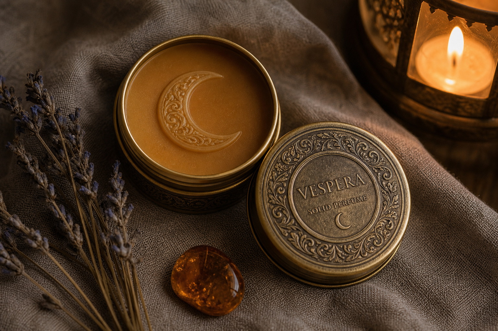

```text
A small round engraved-brass tin of Vespera solid perfume balm sits open on a linen cloth, the amber-toned wax balm inside embossed with a crescent-moon motif, its lid resting beside it. A sprig of dried lavender and a smooth amber gemstone lie nearby. Warm intimate candlelight from the right, antique-brass, amber and soft-taupe palette, cozy dark-linen background. Overhead 40-degree tilt, 100mm macro lens, artisanal boutique mood, warm glow on the brass.
```

Model: GPT Image 2 · Author: API Models (apimodels.app)

[Original source](https://github.com/apimodels/gpt-image-2-prompts/blob/980d100f3bd0f2cde4cf38835daeb742bf1cac65/prompts.json#L363) · [Provenance and original license](data/projectd-batch-0007.json)

## Santal Rare Wood Fragrance — API Models · CC BY 4.0

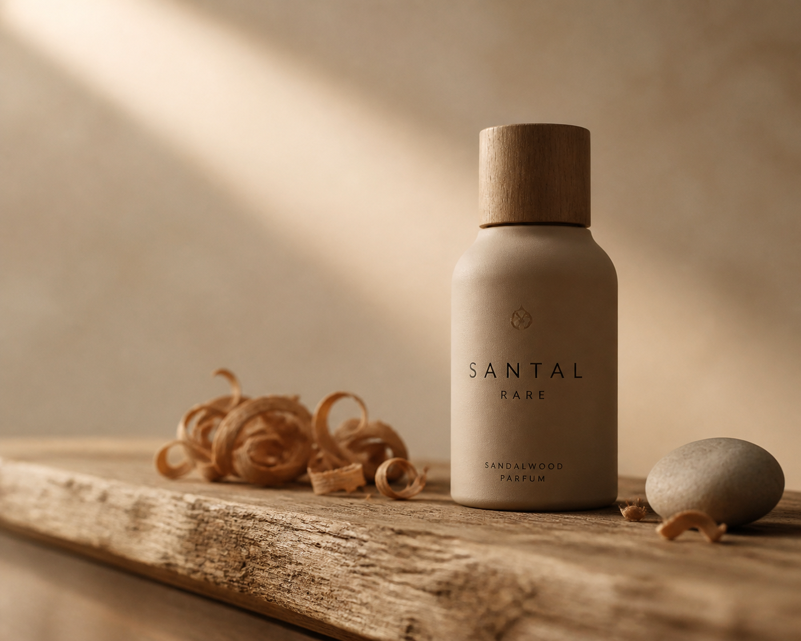

```text
A minimalist matte-sandstone bottle of Santal Rare sandalwood fragrance with a wooden cap stands on a raw oak plank, curls of sandalwood shavings and a single smooth stone arranged asymmetrically beside it. Soft warm directional light from the upper left, sandy beige, warm wood-brown and cream palette, softly blurred neutral background. Slight low angle at 20 degrees, 85mm lens, calm grounded unisex fragrance mood, generous minimalist negative space.
```

Model: GPT Image 2 · Author: API Models (apimodels.app)

[Original source](https://github.com/apimodels/gpt-image-2-prompts/blob/980d100f3bd0f2cde4cf38835daeb742bf1cac65/prompts.json#L378) · [Provenance and original license](data/projectd-batch-0007.json)

## Lune Blanche Travel Spray Set — API Models · CC BY 4.0

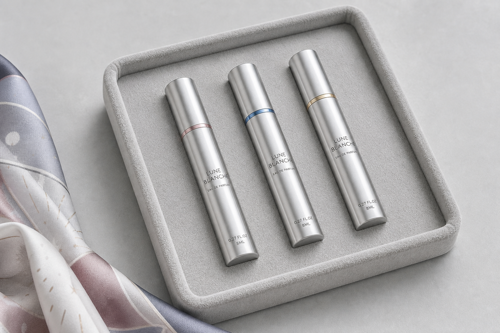

```text
Three slim brushed-silver travel perfume sprays of Lune Blanche stand in a neat row on a pale grey suede tray, each with a tiny colored band—rose, blue and gold. A folded silk scarf peeks in from the corner. Soft even studio lighting, cool silver, pastel-accent and dove-grey palette, seamless light-grey background. Overhead 35-degree angle, 70mm lens, sleek modern travel-luxury mood, subtle metallic highlights along the barrels.
```

Model: GPT Image 2 · Author: API Models (apimodels.app)

[Original source](https://github.com/apimodels/gpt-image-2-prompts/blob/980d100f3bd0f2cde4cf38835daeb742bf1cac65/prompts.json#L393) · [Provenance and original license](data/projectd-batch-0007.json)

## Amberose Rose Attar Oil — API Models · CC BY 4.0

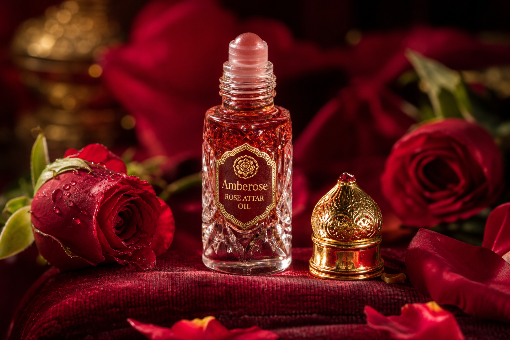

```text
A tiny ornate cut-crystal roll-on bottle of Amberose rose attar oil stands on a velvet cushion of deep burgundy, its rosy oil glowing and a delicate gold roller cap beside it. Fresh red rose buds and scattered petals surround it. Warm romantic spotlight, ruby-red, gold and deep-burgundy palette, rich dark-velvet background. Extreme close-up at eye level, 105mm macro lens, precious jewel-like perfume mood, sparkling crystal facets catching light.
```

Model: GPT Image 2 · Author: API Models (apimodels.app)

[Original source](https://github.com/apimodels/gpt-image-2-prompts/blob/980d100f3bd0f2cde4cf38835daeb742bf1cac65/prompts.json#L408) · [Provenance and original license](data/projectd-batch-0007.json)

## Ivoire Layering Discovery Kit — API Models · CC BY 4.0

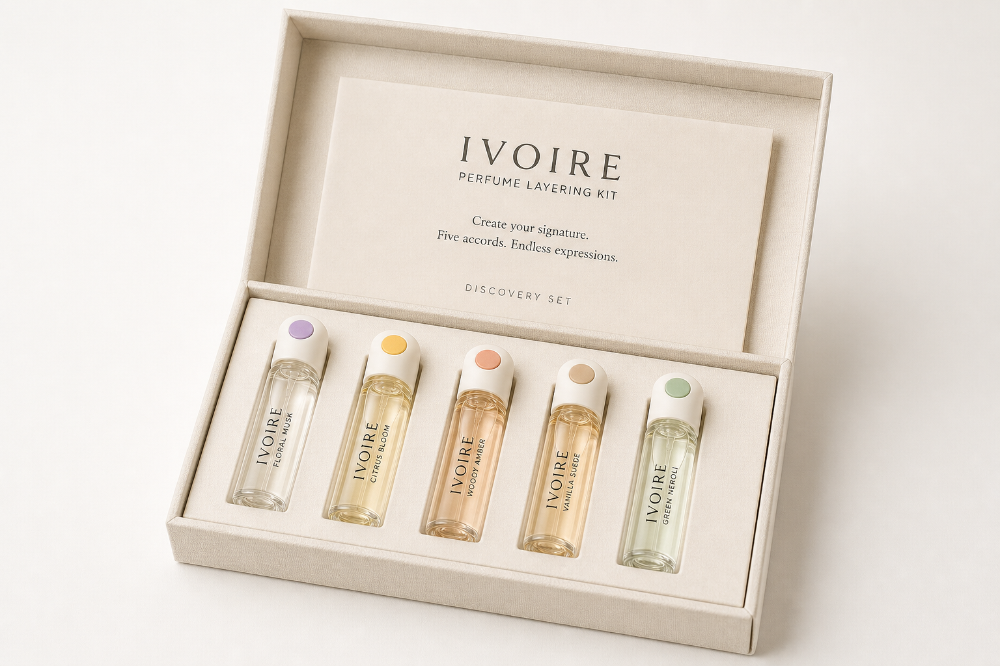

```text
Five tiny clear-glass sample vials of Ivoire perfume layering kit stand upright in a fitted ivory paperboard tray, each capped with a small pastel dot and holding faintly different tinted liquids. A folded card sits behind them. Soft flat museum lighting, ivory, cream and pastel-multi palette, clean off-white seamless background. Overhead flat-lay at 25 degrees, 60mm lens, refined minimalist discovery-set mood, orderly symmetrical arrangement, gentle vial reflections.
```

Model: GPT Image 2 · Author: API Models (apimodels.app)

[Original source](https://github.com/apimodels/gpt-image-2-prompts/blob/980d100f3bd0f2cde4cf38835daeb742bf1cac65/prompts.json#L423) · [Provenance and original license](data/projectd-batch-0007.json)

## Sillage Noir Men's Perfume — API Models · CC BY 4.0

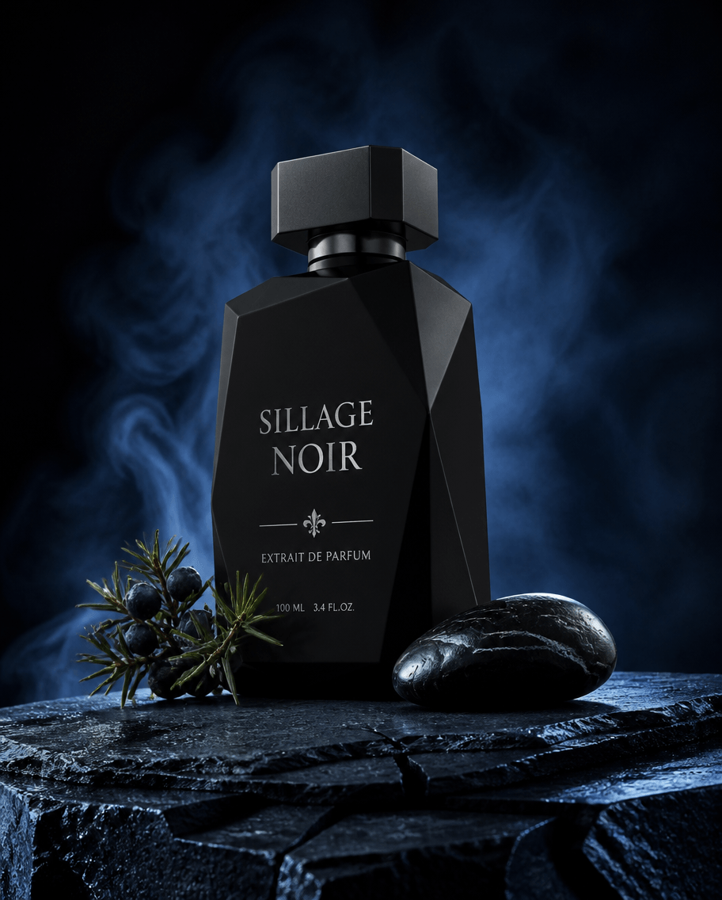

```text
A bold angular matte-black bottle of Sillage Noir men's fragrance with a gunmetal cap stands on a slab of cracked black slate, faint blue haze drifting behind it. A single sprig of dark juniper and a smooth obsidian stone rest at the base. Cool dramatic blue side lighting, black, steel-blue and charcoal palette, deep dark background. Low 15-degree power angle, 90mm lens, bold masculine sophisticated mood, sharp edge highlights along the bottle's facets.
```

Model: GPT Image 2 · Author: API Models (apimodels.app)

[Original source](https://github.com/apimodels/gpt-image-2-prompts/blob/980d100f3bd0f2cde4cf38835daeb742bf1cac65/prompts.json#L438) · [Provenance and original license](data/projectd-batch-0007.json)

## Silkroot Repair Shampoo — API Models · CC BY 4.0

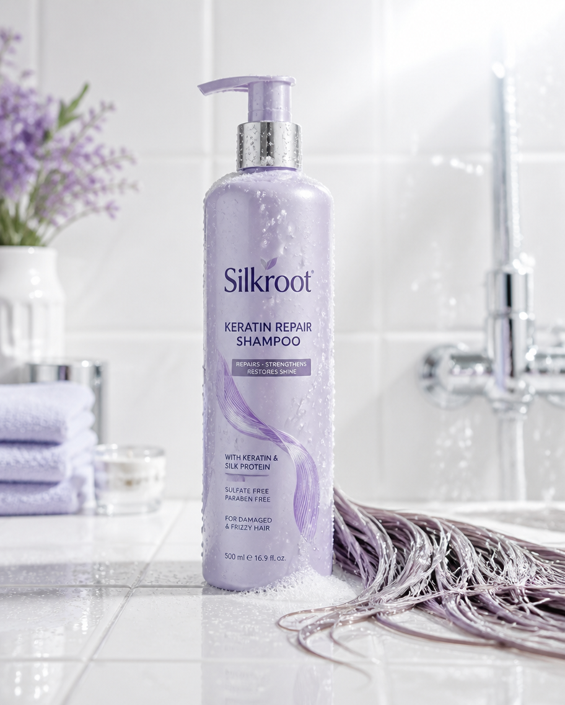

```text
A tall pearlized-lavender pump bottle of Silkroot keratin repair shampoo stands on a wet white tile in a bright bathroom, glossy suds and water droplets clinging to its surface. A soft cascade of silky hair strands drapes beside the base. Bright fresh lighting from the upper right, soft lilac, white and silver palette, clean misty-white background. Straight eye-level shot, 85mm lens, clean revitalizing haircare mood, crisp water-droplet detail, airy top space.
```

Model: GPT Image 2 · Author: API Models (apimodels.app)

[Original source](https://github.com/apimodels/gpt-image-2-prompts/blob/980d100f3bd0f2cde4cf38835daeb742bf1cac65/prompts.json#L453) · [Provenance and original license](data/projectd-batch-0007.json)

## Golden Oat Hair Mask — API Models · CC BY 4.0

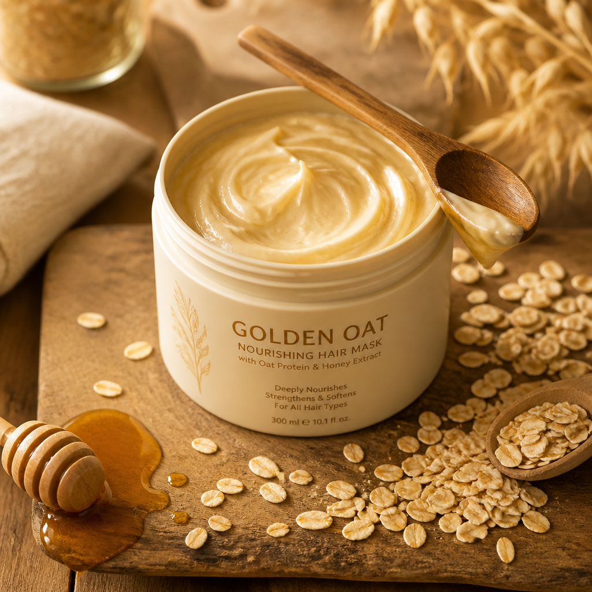

```text
A wide matte-cream tub of Golden Oat nourishing hair mask sits open on a rustic wooden board, a generous swirl of thick golden-cream mask visible inside and a wooden scoop resting across the rim. Scattered raw oats and a drizzle of honey pool beside it. Warm cozy morning light from the left, golden-oat, cream and honey palette, softly blurred kitchen-wood background. Overhead 40-degree tilt, 70mm lens, wholesome nourishing haircare mood.
```

Model: GPT Image 2 · Author: API Models (apimodels.app)

[Original source](https://github.com/apimodels/gpt-image-2-prompts/blob/980d100f3bd0f2cde4cf38835daeb742bf1cac65/prompts.json#L468) · [Provenance and original license](data/projectd-batch-0007.json)

## Curl Theory Defining Cream — API Models · CC BY 4.0

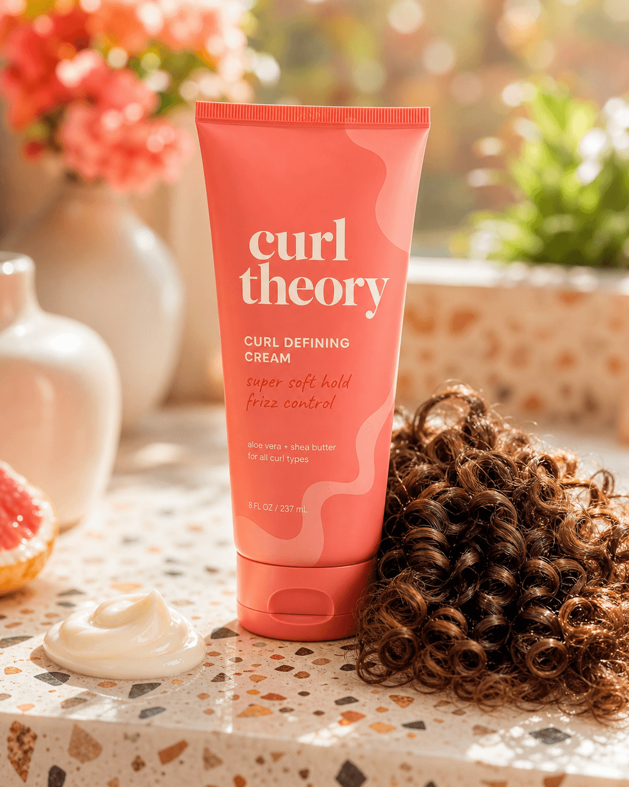

```text
A rounded coral-pink squeeze tube of Curl Theory curl-defining cream stands upright on a terrazzo surface, a soft cluster of springy defined coils resting beside it and a dab of glossy cream on the tile. Bright cheerful lighting, coral, cream and warm-terrazzo palette, blurred sunny background with soft warm bokeh. Slight three-quarter low angle, 85mm lens, joyful textured-hair beauty mood, crisp focus on the tube, playful and vibrant.
```

Model: GPT Image 2 · Author: API Models (apimodels.app)

[Original source](https://github.com/apimodels/gpt-image-2-prompts/blob/980d100f3bd0f2cde4cf38835daeb742bf1cac65/prompts.json#L483) · [Provenance and original license](data/projectd-batch-0007.json)

## Copperine Hair Serum Drops — API Models · CC BY 4.0

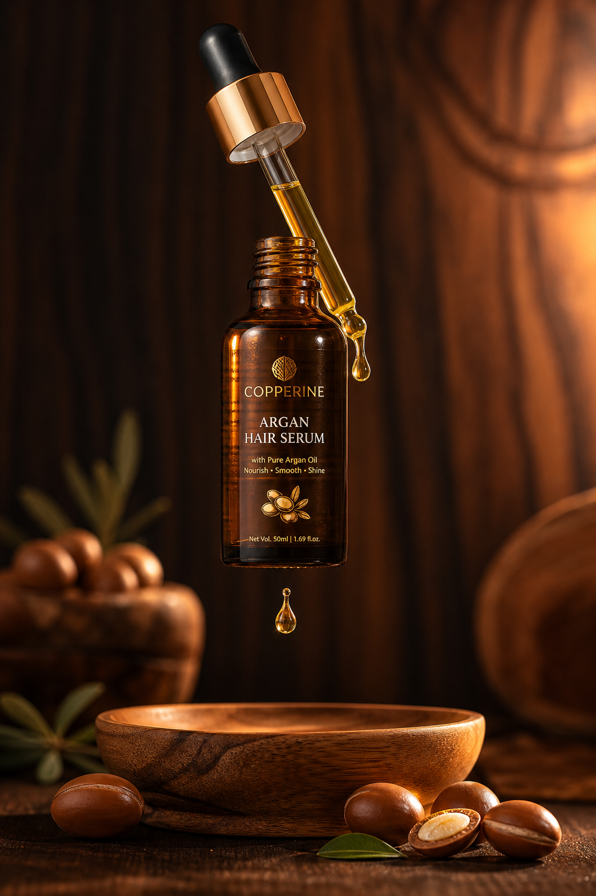

```text
A slim amber-glass dropper bottle of Copperine argan hair serum floats above a wooden dish, a single golden oil droplet falling from the dropper and caught mid-air in sharp focus. A few smooth argan nuts rest below. Warm directional light from the right, rich amber, copper and warm-brown palette, softly blurred dark-wood background. Straight eye-level macro, 105mm lens, luxurious glossy hair-oil mood, glistening suspended droplet detail.
```

Model: GPT Image 2 · Author: API Models (apimodels.app)

[Original source](https://github.com/apimodels/gpt-image-2-prompts/blob/980d100f3bd0f2cde4cf38835daeb742bf1cac65/prompts.json#L498) · [Provenance and original license](data/projectd-batch-0007.json)

## Rootrise Scalp Tonic — API Models · CC BY 4.0

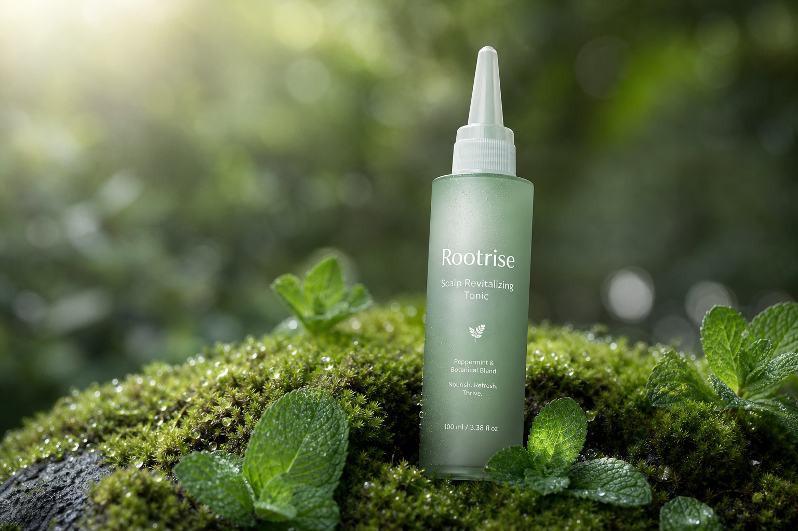

```text
A slim frosted-green glass bottle of Rootrise scalp revitalizing tonic with a slender applicator nozzle stands on a bed of fresh green moss, dewdrops clinging to the moss and a few peppermint leaves scattered nearby. Cool fresh morning light from above-left, botanical green, frosted-glass and white palette, softly blurred garden-green background. Slight low angle at 20 degrees, 100mm lens, clean botanical scalp-care mood, crisp dew detail.
```

Model: GPT Image 2 · Author: API Models (apimodels.app)

[Original source](https://github.com/apimodels/gpt-image-2-prompts/blob/980d100f3bd0f2cde4cf38835daeb742bf1cac65/prompts.json#L513) · [Provenance and original license](data/projectd-batch-0007.json)

## Manecraft Dry Shampoo — API Models · CC BY 4.0

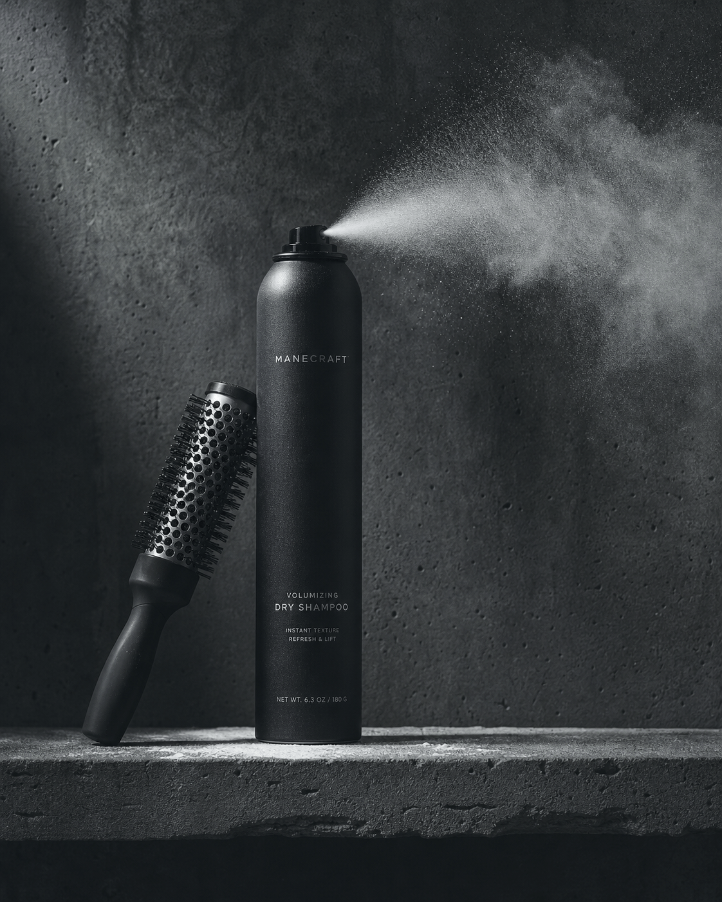

```text
A tall matte-charcoal aerosol can of Manecraft volumizing dry shampoo stands on a concrete shelf, a soft cloud of fine powder mist puffing from the top and drifting right. A round soft-bristle brush leans against the can. Cool moody lighting from the left, charcoal-grey, soft-white powder and steel palette, dark textured concrete background. Straight eye-level shot, 85mm lens, edgy modern haircare mood, delicate suspended powder cloud, deep shadow tones.
```

Model: GPT Image 2 · Author: API Models (apimodels.app)

[Original source](https://github.com/apimodels/gpt-image-2-prompts/blob/980d100f3bd0f2cde4cf38835daeb742bf1cac65/prompts.json#L528) · [Provenance and original license](data/projectd-batch-0007.json)

## Fibre Bloom Conditioner Bar — API Models · CC BY 4.0

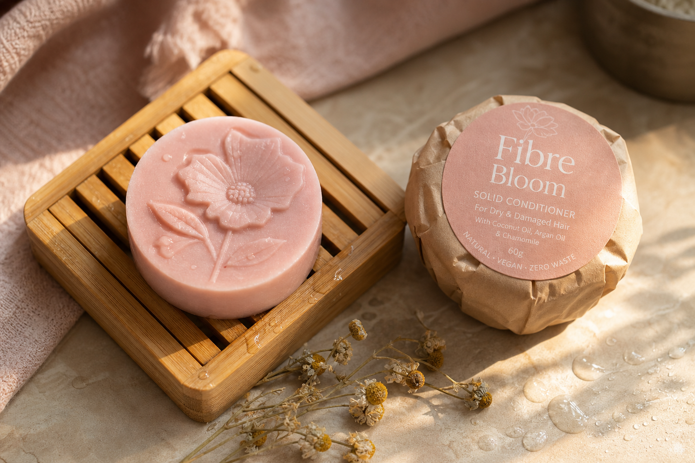

```text
A round pale-pink solid conditioner bar of Fibre Bloom, stamped with a flower relief, rests on a slatted bamboo soap dish beside its kraft-paper wrap. A few water droplets and a sprig of dried chamomile lie nearby. Warm soft daylight from the right, blush-pink, natural-kraft and bamboo palette, softly blurred neutral background. Overhead 45-degree tilt, 90mm lens, eco-friendly zero-waste haircare mood, gentle texture on the bar surface.
```

Model: GPT Image 2 · Author: API Models (apimodels.app)

[Original source](https://github.com/apimodels/gpt-image-2-prompts/blob/980d100f3bd0f2cde4cf38835daeb742bf1cac65/prompts.json#L543) · [Provenance and original license](data/projectd-batch-0007.json)

## Cascade Lab Heat Protectant — API Models · CC BY 4.0


```text
A sleek glossy-white spray bottle of Cascade Lab thermal heat protectant stands on a reflective white surface, a faint warm heat-shimmer effect glowing softly around it. A single sleek section of glass-smooth hair drapes at the base. Clean bright studio lighting with a subtle warm glow, white, soft-gold and clear palette, seamless bright background. Straight eye-level shot, 90mm lens, sleek scientific haircare mood, mirror reflection below the bottle, minimalist framing.
```

Model: GPT Image 2 · Author: API Models (apimodels.app)

[Original source](https://github.com/apimodels/gpt-image-2-prompts/blob/980d100f3bd0f2cde4cf38835daeb742bf1cac65/prompts.json#L558) · [Provenance and original license](data/projectd-batch-0007.json)

## Veil Haircare Gloss Treatment — API Models · CC BY 4.0


```text
A rounded clear-glass jar of Veil glossing hair treatment sits on a pale champagne satin cloth, its glass-like glossy gel reflecting soft light, a smooth ribbon of gel trailing onto the satin. A single strand of shimmering hair loops elegantly nearby. Soft luxe lighting, champagne, glossy-clear and pearl palette, dreamy blurred satin background. Overhead 35-degree tilt, 100mm lens, glossy salon-luxury haircare mood, silky highlight sheen across the gel.
```

Model: GPT Image 2 · Author: API Models (apimodels.app)

[Original source](https://github.com/apimodels/gpt-image-2-prompts/blob/980d100f3bd0f2cde4cf38835daeb742bf1cac65/prompts.json#L573) · [Provenance and original license](data/projectd-batch-0007.json)

## Soleil Bath Salt Jar — API Models · CC BY 4.0


```text
A wide clear-glass apothecary jar of Soleil Himalayan bath salts, filled with pink and white crystal grains, stands on a warm marble ledge with a small brass scoop tucked inside. Dried orange slices and a cinnamon stick rest beside it. Warm spa candlelight from the right, rosy-pink, warm-white and brass palette, softly blurred warm-neutral background. Slight three-quarter angle, 85mm lens, tranquil indulgent spa mood, sparkling salt-crystal texture.
```

Model: GPT Image 2 · Author: API Models (apimodels.app)

[Original source](https://github.com/apimodels/gpt-image-2-prompts/blob/980d100f3bd0f2cde4cf38835daeb742bf1cac65/prompts.json#L588) · [Provenance and original license](data/projectd-batch-0007.json)

## Habitat Smart Thermostat — API Models · CC BY 4.0


```text
Minimalist product shot of a circular smart thermostat named 'Habitat Climate' with a brushed silver ring and a crisp digital display reading a cozy 22 degrees, wall-mounted on a smooth warm-grey plaster wall. Soft directional daylight casting a gentle shadow, calm neutral palette, subtle blue accent glow around the dial. Modern smart-home ad mood, straight-on eye-level angle with slight tilt, shallow depth of field, 1:1 framing. Tagline beside: 'Comfort, on autopilot.'
```

Model: GPT Image 2 · Author: API Models (apimodels.app)

[Original source](https://github.com/apimodels/gpt-image-2-prompts/blob/980d100f3bd0f2cde4cf38835daeb742bf1cac65/prompts.json#L2493) · [Provenance and original license](data/projectd-batch-0007.json)

## Nestly Video Doorbell — API Models · CC BY 4.0


```text
Clean architectural product shot of a slim video doorbell named 'Nestly Watch' in matte graphite mounted beside a modern wooden front door, its camera lens and a soft blue status ring subtly glowing. Warm late-afternoon sunlight raking across the door frame, crisp shadows, inviting suburban-home palette. Trustworthy smart-home ad mood, three-quarter close angle, shallow depth of field, 4:5 vertical. Tagline top: 'See who's there, from anywhere.'
```

Model: GPT Image 2 · Author: API Models (apimodels.app)

[Original source](https://github.com/apimodels/gpt-image-2-prompts/blob/980d100f3bd0f2cde4cf38835daeb742bf1cac65/prompts.json#L2508) · [Provenance and original license](data/projectd-batch-0007.json)

## Vireo Smart Deadbolt — API Models · CC BY 4.0


```text
Premium product shot of a sleek smart deadbolt named 'Vireo Lock' in satin brass with a subtle backlit touch keypad glowing, installed on a deep forest-green painted door. Warm focused key light glinting off the metal, soft shadow, luxurious yet secure feel. High-end smart-home ad mood, tight three-quarter angle, shallow depth of field, 1:1 framing, dark elegant palette. Tagline lower: 'Your key is you.'
```

Model: GPT Image 2 · Author: API Models (apimodels.app)

[Original source](https://github.com/apimodels/gpt-image-2-prompts/blob/980d100f3bd0f2cde4cf38835daeb742bf1cac65/prompts.json#L2523) · [Provenance and original license](data/projectd-batch-0007.json)

## Casapod Robot Vacuum — API Models · CC BY 4.0


```text
Lifestyle product shot of a low-profile round robot vacuum named 'Casapod Glide' in pearl white with a subtle top laser turret, gliding across a light herringbone wood floor leaving a clean path through soft scattered crumbs. Bright airy home interior, morning sunlight from a large window, soft shadows, fresh clean palette. Effortless smart-home ad mood, low near-floor angle, shallow depth of field, 16:9 wide. Tagline upper right: 'Cleans while you live.'
```

Model: GPT Image 2 · Author: API Models (apimodels.app)

[Original source](https://github.com/apimodels/gpt-image-2-prompts/blob/980d100f3bd0f2cde4cf38835daeb742bf1cac65/prompts.json#L2538) · [Provenance and original license](data/projectd-batch-0007.json)

## Lumen Smart Bulb Set — API Models · CC BY 4.0


```text
Vibrant product shot of a set of three smart LED bulbs named 'Lumen Glow' arranged in a row, each glowing a different rich color: warm amber, deep magenta and cool cyan, casting colorful light pools on a dark reflective surface. Dramatic dark backdrop, glossy reflections, playful and premium. Colorful smart-home ad mood, top-down slight angle, shallow depth of field, 1:1 centered composition. Tagline below: 'Every mood, one tap away.'
```

Model: GPT Image 2 · Author: API Models (apimodels.app)

[Original source](https://github.com/apimodels/gpt-image-2-prompts/blob/980d100f3bd0f2cde4cf38835daeb742bf1cac65/prompts.json#L2553) · [Provenance and original license](data/projectd-batch-0007.json)

## Aura Indoor Security Camera — API Models · CC BY 4.0


```text
Crisp product shot of a compact swiveling indoor security camera named 'Aura Eye' in soft white with a dark glossy lens and a tiny green privacy LED, standing on a minimalist white desk beside a small plant. Clean bright daylight, soft shadow, reassuring modern-home palette. Friendly smart-home ad mood, eye-level three-quarter angle, shallow depth of field, 4:5 vertical, generous space. Tagline top: 'Peace of mind, always watching.'
```

Model: GPT Image 2 · Author: API Models (apimodels.app)

[Original source](https://github.com/apimodels/gpt-image-2-prompts/blob/980d100f3bd0f2cde4cf38835daeb742bf1cac65/prompts.json#L2568) · [Provenance and original license](data/projectd-batch-0007.json)

## Habitat Smart Display Hub — API Models · CC BY 4.0


```text
Warm kitchen product shot of a smart display hub named 'Habitat Hub' with a fabric-wrapped base and a bright screen showing a clean weather and calendar dashboard. Placed on a marble countertop beside a bowl of lemons and a copper kettle, soft morning window light, cozy inviting palette. Practical smart-home ad mood, eye-level slight angle, shallow depth of field, 16:9 wide. Tagline lower right: 'Your home, at a glance.'
```

Model: GPT Image 2 · Author: API Models (apimodels.app)

[Original source](https://github.com/apimodels/gpt-image-2-prompts/blob/980d100f3bd0f2cde4cf38835daeb742bf1cac65/prompts.json#L2583) · [Provenance and original license](data/projectd-batch-0007.json)

## Homeglow Smart Plug — API Models · CC BY 4.0


```text
Simple clean product shot of a compact smart plug named 'Homeglow Switch' in matte white plugged into a wall socket, a small blue status LED glowing, a lamp cord running from it. Set against a soft warm-grey wall with a subtle shadow, minimalist and reassuring. Everyday smart-home ad mood, close eye-level angle, shallow depth of field, 1:1 framing, lots of negative space. Tagline beside: 'Smarten up any outlet.'
```

Model: GPT Image 2 · Author: API Models (apimodels.app)

[Original source](https://github.com/apimodels/gpt-image-2-prompts/blob/980d100f3bd0f2cde4cf38835daeb742bf1cac65/prompts.json#L2598) · [Provenance and original license](data/projectd-batch-0007.json)

## Aura Air Quality Monitor — API Models · CC BY 4.0


```text
Modern product shot of a small cube air-quality monitor named 'Aura Sense' with a soft-touch white shell and a glowing ring that shifts from green to amber, displaying a crisp air-index number. Placed on a light wood desk beside a leafy plant, fresh bright daylight, clean airy palette, faint visualized clean-air swirl. Wellness smart-home ad mood, close 30-degree angle, shallow depth of field, 4:5 vertical. Tagline top: 'Breathe what's clean.'
```

Model: GPT Image 2 · Author: API Models (apimodels.app)

[Original source](https://github.com/apimodels/gpt-image-2-prompts/blob/980d100f3bd0f2cde4cf38835daeb742bf1cac65/prompts.json#L2613) · [Provenance and original license](data/projectd-batch-0007.json)

## Verdant Smart Garden Controller — API Models · CC BY 4.0


```text
Outdoor product shot of a weatherproof smart sprinkler controller named 'Verdant Flow' in olive green and cream mounted on a garden fence post, a fine mist of water arcing from sprinklers over a lush lawn in the blurred background. Golden late-day sun, warm backlight, glistening water droplets, vibrant green palette. Fresh smart-home ad mood, three-quarter close angle, shallow depth of field, 16:9 wide. Tagline lower left: 'Water smarter, grow greener.'
```

Model: GPT Image 2 · Author: API Models (apimodels.app)

[Original source](https://github.com/apimodels/gpt-image-2-prompts/blob/980d100f3bd0f2cde4cf38835daeb742bf1cac65/prompts.json#L2628) · [Provenance and original license](data/projectd-batch-0007.json)

## Brio Espresso Machine — API Models · CC BY 4.0


```text
Rich product shot of a compact stainless-steel espresso machine named 'Brio Crema' pulling a glossy shot of espresso into a clear glass, thick golden crema forming, steam curling from the group head. Set on a dark slate counter against a moody warm-lit café backdrop, dramatic side lighting, deep browns and copper tones, gleaming metal reflections. Indulgent appliance-ad mood, close three-quarter angle, shallow depth of field, 4:5 vertical. Tagline top: 'Barista magic, at home.'
```

Model: GPT Image 2 · Author: API Models (apimodels.app)

[Original source](https://github.com/apimodels/gpt-image-2-prompts/blob/980d100f3bd0f2cde4cf38835daeb742bf1cac65/prompts.json#L2643) · [Provenance and original license](data/projectd-batch-0007.json)

## Fresca Air Fryer — API Models · CC BY 4.0


```text
Bright appetizing product shot of a rounded air fryer named 'Fresca Crisp' in cream and rose-gold, its drawer pulled open to reveal golden crispy fries with a light steam wisp. Set on a clean white kitchen counter with fresh vegetables softly blurred behind, cheerful high-key daylight, crisp shadows, fresh pastel palette. Wholesome appliance-ad mood, slight high 30-degree angle, shallow depth of field, 1:1 framing. Tagline lower: 'Crispy, guilt-free, fast.'
```

Model: GPT Image 2 · Author: API Models (apimodels.app)

[Original source](https://github.com/apimodels/gpt-image-2-prompts/blob/980d100f3bd0f2cde4cf38835daeb742bf1cac65/prompts.json#L2658) · [Provenance and original license](data/projectd-batch-0007.json)

## Aria Stand Mixer — API Models · CC BY 4.0


```text
Elegant product shot of a retro-modern stand mixer named 'Aria Whip' in soft sage green with chrome accents, whisking fluffy meringue in a glossy steel bowl, a few flour particles floating in the light. Set on a marble counter in a bright farmhouse kitchen, warm window light, soft shadows, wholesome pastel palette. Charming appliance-ad mood, three-quarter eye-level angle, shallow depth of field, 4:5 vertical. Tagline top: 'Bake like you mean it.'
```

Model: GPT Image 2 · Author: API Models (apimodels.app)

[Original source](https://github.com/apimodels/gpt-image-2-prompts/blob/980d100f3bd0f2cde4cf38835daeb742bf1cac65/prompts.json#L2673) · [Provenance and original license](data/projectd-batch-0007.json)

## Frost Cordless Stick Vacuum — API Models · CC BY 4.0


```text
Dynamic product shot of a sleek cordless stick vacuum named 'Frost Sweep' in matte navy and copper, floating upright with its transparent dust cyclone glowing subtly, a swirl of captured dust visible inside. Set against a clean light-grey studio gradient with a bright rim light along the wand. Premium appliance-ad mood, full-length three-quarter angle, shallow depth of field, 4:5 vertical, floating shadow. Tagline lower: 'Effortless power, cord-free.'
```

Model: GPT Image 2 · Author: API Models (apimodels.app)

[Original source](https://github.com/apimodels/gpt-image-2-prompts/blob/980d100f3bd0f2cde4cf38835daeb742bf1cac65/prompts.json#L2688) · [Provenance and original license](data/projectd-batch-0007.json)

## Verdant Countertop Blender — API Models · CC BY 4.0


```text
Fresh product shot of a powerful countertop blender named 'Verdant Blend' with a brushed-metal base and a tall glass jar mid-blend, swirling a vivid green smoothie with visible spinach leaves and berries. Set on a bright kitchen island with scattered fresh fruit, crisp daylight, splashes frozen in motion, vibrant healthy palette. Energetic appliance-ad mood, eye-level slight angle, shallow depth of field, 1:1 framing. Tagline top: 'Blend your best self.'
```

Model: GPT Image 2 · Author: API Models (apimodels.app)

[Original source](https://github.com/apimodels/gpt-image-2-prompts/blob/980d100f3bd0f2cde4cf38835daeb742bf1cac65/prompts.json#L2703) · [Provenance and original license](data/projectd-batch-0007.json)

## Copperkettle Electric Kettle — API Models · CC BY 4.0


```text
Cozy product shot of a gooseneck electric kettle named 'Copperkettle Pour' in matte black with a copper handle and a glowing amber temperature ring, steam gently rising from the spout. Set on a wooden tea tray with a ceramic cup and loose tea leaves, warm morning light, soft shadows, hygge palette. Warm appliance-ad mood, close three-quarter angle, shallow depth of field, 4:5 vertical. Tagline lower: 'Precision in every pour.'
```

Model: GPT Image 2 · Author: API Models (apimodels.app)

[Original source](https://github.com/apimodels/gpt-image-2-prompts/blob/980d100f3bd0f2cde4cf38835daeb742bf1cac65/prompts.json#L2718) · [Provenance and original license](data/projectd-batch-0007.json)

## Aria Two-Slice Toaster — API Models · CC BY 4.0


```text
Playful product shot of a rounded two-slice toaster named 'Aria Toast' in pastel butter-yellow with chrome trim, two golden slices of toast popping up mid-air with a light crumb spray. Set on a bright cheerful kitchen counter against a mint tile backsplash, high-key morning light, crisp shadows, retro-pastel palette. Fun appliance-ad mood, eye-level slight low angle, shallow depth of field, 1:1 framing. Tagline top: 'Mornings just got sunnier.'
```

Model: GPT Image 2 · Author: API Models (apimodels.app)

[Original source](https://github.com/apimodels/gpt-image-2-prompts/blob/980d100f3bd0f2cde4cf38835daeb742bf1cac65/prompts.json#L2733) · [Provenance and original license](data/projectd-batch-0007.json)

## Fresca Air Purifier — API Models · CC BY 4.0


```text
Clean product shot of a tall cylindrical air purifier named 'Fresca Pure' in soft white with a woven grille and a glowing blue air-quality ring at the top, a subtle visualized swirl of clean air rising around it. Placed in a bright minimalist living room beside a large monstera plant, soft daylight, fresh airy palette. Calming appliance-ad mood, low eye-level angle, shallow depth of field, 4:5 vertical. Tagline lower: 'Cleaner air, clearer days.'
```

Model: GPT Image 2 · Author: API Models (apimodels.app)

[Original source](https://github.com/apimodels/gpt-image-2-prompts/blob/980d100f3bd0f2cde4cf38835daeb742bf1cac65/prompts.json#L2748) · [Provenance and original license](data/projectd-batch-0007.json)

## Frost French-Door Fridge — API Models · CC BY 4.0


```text
Premium product shot of a modern French-door refrigerator named 'Frost Vault' in fingerprint-resistant matte slate, both doors open to reveal neatly stocked shelves glowing under crisp interior lighting with fresh produce and glass bottles. Set in a sleek dark modern kitchen, soft ambient light, cool clean palette, subtle reflections on the metal. Aspirational appliance-ad mood, straight-on slightly elevated angle, shallow depth of field, 16:9 wide. Tagline lower right: 'Freshness, beautifully organized.'
```

Model: GPT Image 2 · Author: API Models (apimodels.app)

[Original source](https://github.com/apimodels/gpt-image-2-prompts/blob/980d100f3bd0f2cde4cf38835daeb742bf1cac65/prompts.json#L2763) · [Provenance and original license](data/projectd-batch-0007.json)

## Brio Countertop Dishwasher — API Models · CC BY 4.0


```text
Practical product shot of a compact countertop dishwasher named 'Brio Rinse' in cream white with a rounded glass door revealing sparkling clean dishes inside, a soft blue cycle light glowing. Set on a bright small-apartment kitchen counter, fresh daylight, water-droplet detail on the glass, clean modern palette. Friendly appliance-ad mood, eye-level three-quarter angle, shallow depth of field, 4:5 vertical. Tagline top: 'Sparkling dishes, tiny footprint.'
```

Model: GPT Image 2 · Author: API Models (apimodels.app)

[Original source](https://github.com/apimodels/gpt-image-2-prompts/blob/980d100f3bd0f2cde4cf38835daeb742bf1cac65/prompts.json#L2778) · [Provenance and original license](data/projectd-batch-0007.json)

## Sneaker Drop Announcement — API Models · CC BY 4.0


```text
A bold product-launch post, 1:1. A single chunky white-and-electric-lime sneaker floats center against a split background of concrete grey and vivid lime. Big condensed type declares "NEW DROP" above and "FRIDAY 10AM" below, with the invented brand "VOLTA" small in the corner. Dynamic diagonal speed lines radiate behind the shoe. Hype, streetwear energy, high-contrast bold palette, crisp studio product lighting, subtle floating shadow.
```

Model: GPT Image 2 · Author: API Models (apimodels.app)

[Original source](https://github.com/apimodels/gpt-image-2-prompts/blob/980d100f3bd0f2cde4cf38835daeb742bf1cac65/prompts.json#L4998) · [Provenance and original license](data/projectd-batch-0007.json)

## Glow Serum Launch Teaser — API Models · CC BY 4.0


```text
A skincare product-launch post, 4:5. A single dewy serum bottle labeled "Halo Glow" stands centered on a soft peach gradient backdrop, surrounded by floating water droplets and a slice of fresh orange. Elegant text above reads "Introducing your morning glow" with "NEW" in a small rounded badge. Fresh, radiant, clean-beauty mood, bright airy peach-and-white palette, glossy dewy highlights, crisp product photography, gentle glow around the bottle.
```

Model: GPT Image 2 · Author: API Models (apimodels.app)

[Original source](https://github.com/apimodels/gpt-image-2-prompts/blob/980d100f3bd0f2cde4cf38835daeb742bf1cac65/prompts.json#L5013) · [Provenance and original license](data/projectd-batch-0007.json)

## Wireless Earbuds Reveal — API Models · CC BY 4.0


```text
A tech product-launch post, 1:1. A pair of matte-white wireless earbuds in an open pebble-shaped case levitates on a cool graphite-to-navy gradient, glowing rim light around the edges. Sleek text reads "Meet Aura Buds. Sound, reimagined." with a small "PRE-ORDER NOW" pill button. Faint sound-wave rings ripple outward. Futuristic, premium, minimalist tech mood, cool blue-grey palette, crisp reflections, dramatic studio lighting.
```

Model: GPT Image 2 · Author: API Models (apimodels.app)

[Original source](https://github.com/apimodels/gpt-image-2-prompts/blob/980d100f3bd0f2cde4cf38835daeb742bf1cac65/prompts.json#L5028) · [Provenance and original license](data/projectd-batch-0007.json)

## Signature Coffee Blend Launch — API Models · CC BY 4.0


```text
A coffee product-launch post, 4:5. A kraft coffee bag labeled "Cinder & Oak — House Blend" stands upright surrounded by roasted beans spilling across a dark slate surface, a steaming cup beside it. Warm text above reads "Now roasting: our new House Blend" with a small "LIMITED BATCH" stamp. Cozy, artisanal, inviting mood, warm brown-and-cream palette, moody directional light, rich texture, appetizing product styling.
```

Model: GPT Image 2 · Author: API Models (apimodels.app)

[Original source](https://github.com/apimodels/gpt-image-2-prompts/blob/980d100f3bd0f2cde4cf38835daeb742bf1cac65/prompts.json#L5043) · [Provenance and original license](data/projectd-batch-0007.json)

## Habit App Launch Screen — API Models · CC BY 4.0


```text
An app-launch announcement, 9:16 story format. A floating smartphone mockup displays a clean habit-tracker interface with soft cards and a progress ring, app named "Sprout". Rounded 3D shapes and a leaf icon float in a mint-and-cream gradient background. Bold text reads "Build better habits, one day at a time" with an "AVAILABLE NOW" rounded button. Friendly, fresh, approachable tech mood, mint-green pastel palette, soft drop shadows, playful modern UI styling.
```

Model: GPT Image 2 · Author: API Models (apimodels.app)

[Original source](https://github.com/apimodels/gpt-image-2-prompts/blob/980d100f3bd0f2cde4cf38835daeb742bf1cac65/prompts.json#L5058) · [Provenance and original license](data/projectd-batch-0007.json)

## Book Release Cover Reveal — API Models · CC BY 4.0


```text
A book-launch announcement post, 4:5. A hardcover novel titled "The Weight of Light" by invented author "M. Halloran" rests on a stack of two closed books beside a mug and dried flowers on a linen bedspread. Overlay text reads "Out now, everywhere books are sold" in an elegant serif. Cozy reading-nook mood, warm afternoon light, muted cream, sage and dusty-blue palette, soft lifestyle photography with a shallow, dreamy focus.
```

Model: GPT Image 2 · Author: API Models (apimodels.app)

[Original source](https://github.com/apimodels/gpt-image-2-prompts/blob/980d100f3bd0f2cde4cf38835daeb742bf1cac65/prompts.json#L5073) · [Provenance and original license](data/projectd-batch-0007.json)

## Autumn Collection Fashion Drop — API Models · CC BY 4.0


```text
A fashion product-launch post, 4:5. A neatly folded knitwear flatlay in caramel, cream and rust tones on a warm oat backdrop, with a leather belt and gold hoop earrings arranged alongside. Elegant text overlays "THE AUTUMN EDIT" at the top and "Shop the collection" below, brand "Maren & Co" in small type. Sophisticated, seasonal, editorial mood, cozy autumn palette of caramel, cream and rust, soft warm light, refined styling.
```

Model: GPT Image 2 · Author: API Models (apimodels.app)

[Original source](https://github.com/apimodels/gpt-image-2-prompts/blob/980d100f3bd0f2cde4cf38835daeb742bf1cac65/prompts.json#L5088) · [Provenance and original license](data/projectd-batch-0007.json)

## Candle Scent Launch Trio — API Models · CC BY 4.0


```text
A candle product-launch post, 1:1. Three matte-glass candles in olive, terracotta and cream stand in a row on a wooden ledge, each labeled with a new scent — "Fig & Cedar", "Amber Dusk", "Sea Salt" — brand "Ashcroft Home". Dried grasses and one lit flame accent the scene. Top text reads "Introducing three new scents". Warm, cozy, inviting home mood, earthy olive-terracotta-cream palette, soft golden light, tactile styling.
```

Model: GPT Image 2 · Author: API Models (apimodels.app)

[Original source](https://github.com/apimodels/gpt-image-2-prompts/blob/980d100f3bd0f2cde4cf38835daeb742bf1cac65/prompts.json#L5103) · [Provenance and original license](data/projectd-batch-0007.json)

## Matcha Limited Edition Reveal — API Models · CC BY 4.0


```text
A beverage product-launch post, 4:5. A tall glass of layered iced matcha latte sits center on a soft sage backdrop, condensation on the glass, a bamboo whisk and a ceramic bowl of bright green matcha powder beside it. Overlay text reads "Limited edition: Ceremonial Matcha" with a small "WHILE IT LASTS" tag, brand "Kumo Tea". Fresh, vibrant, wellness cafe mood, calming green-and-cream palette, bright natural light, appetizing crisp styling.
```

Model: GPT Image 2 · Author: API Models (apimodels.app)

[Original source](https://github.com/apimodels/gpt-image-2-prompts/blob/980d100f3bd0f2cde4cf38835daeb742bf1cac65/prompts.json#L5118) · [Provenance and original license](data/projectd-batch-0007.json)

## Insulated Bottle Launch — API Models · CC BY 4.0


```text
A product-launch post, 1:1. A sleek insulated water bottle in a soft dusty-blue finish stands center on a clean gradient of sky-blue to white, a few playful water splashes frozen mid-air around it. Bold text reads "Stay cold for 24 hours" above and "NEW COLORS" below, brand "Driftwell". Small color-swatch dots line the base. Fresh, active, clean product mood, cool blue-and-white palette, crisp studio lighting, glossy reflections.
```

Model: GPT Image 2 · Author: API Models (apimodels.app)

[Original source](https://github.com/apimodels/gpt-image-2-prompts/blob/980d100f3bd0f2cde4cf38835daeb742bf1cac65/prompts.json#L5133) · [Provenance and original license](data/projectd-batch-0007.json)

## Five Morning Habits Cover — API Models · CC BY 4.0


```text
A carousel cover graphic, 4:5. Warm cream background with a large hand-drawn sun rising over a thin horizon line. Bold friendly headline reads "5 Morning Habits That Changed My Life" with the number "5" oversized in soft terracotta. A small "SWIPE →" prompt and page-dots sit at the bottom. Simple line-art icons of a mug, book and stretch pose dot the corners. Warm, inviting, self-improvement mood, cozy cream-and-terracotta palette, clean flat design.
```

Model: GPT Image 2 · Author: API Models (apimodels.app)

[Original source](https://github.com/apimodels/gpt-image-2-prompts/blob/980d100f3bd0f2cde4cf38835daeb742bf1cac65/prompts.json#L5148) · [Provenance and original license](data/projectd-batch-0007.json)

## Skincare Routine Steps Cover — API Models · CC BY 4.0


```text
A skincare-tips carousel cover, 4:5. Soft blush-pink background with a gentle glossy sheen. Elegant headline reads "Your Perfect Night Routine in 4 Steps" with delicate line icons of a bottle, drop, cream jar and moon arranged in a row. A thin "SWIPE TO SEE →" prompt sits below with page-dots. Fresh, clean-beauty, calming mood, soft pink-and-cream palette, minimal airy layout, thin modern serif typography.
```

Model: GPT Image 2 · Author: API Models (apimodels.app)

[Original source](https://github.com/apimodels/gpt-image-2-prompts/blob/980d100f3bd0f2cde4cf38835daeb742bf1cac65/prompts.json#L5178) · [Provenance and original license](data/projectd-batch-0007.json)

## Productivity Hacks Cover — API Models · CC BY 4.0


```text
A productivity-tips carousel cover, 1:1. Clean off-white background with a bold navy header block across the top reading "6 Focus Hacks for Deep Work". A large minimalist line illustration of a laptop, coffee and a checklist sits centered. A yellow highlighter swipe underlines "Deep Work". Page-dots and a small "→" cue at the bottom right. Sharp, professional, motivating mood, navy-white-and-yellow palette, grid-aligned clean layout, confident sans-serif type.
```

Model: GPT Image 2 · Author: API Models (apimodels.app)

[Original source](https://github.com/apimodels/gpt-image-2-prompts/blob/980d100f3bd0f2cde4cf38835daeb742bf1cac65/prompts.json#L5193) · [Provenance and original license](data/projectd-batch-0007.json)

## Easy Weeknight Recipe Cover — API Models · CC BY 4.0


```text
A recipe carousel cover, 4:5. Overhead of a rustic bowl of creamy tomato pasta on a wooden table, fresh basil and a fork beside it. A translucent warm-white band across the middle holds the headline "15-Minute Creamy Tomato Pasta" in a friendly bold serif, with a small "RECIPE INSIDE →" tag and page-dots. Appetizing, homey, warm mood, rich red-and-cream food palette, soft natural light, cozy food-blog styling.
```

Model: GPT Image 2 · Author: API Models (apimodels.app)

[Original source](https://github.com/apimodels/gpt-image-2-prompts/blob/980d100f3bd0f2cde4cf38835daeb742bf1cac65/prompts.json#L5208) · [Provenance and original license](data/projectd-batch-0007.json)

## Carry-On Packing Tips Cover — API Models · CC BY 4.0


```text
A travel-tips carousel cover, 1:1. Flatlay of a neatly packed open carry-on suitcase with rolled clothes, a passport, sunglasses and a small camera on a warm sand background. A clean overlay band reads "Pack a Week in One Carry-On" with a small airplane line icon, plus "SWIPE FOR TIPS →" and page-dots. Fresh, wanderlust, practical mood, warm sand-and-teal palette, bright even light, tidy organized flat-lay styling.
```

Model: GPT Image 2 · Author: API Models (apimodels.app)

[Original source](https://github.com/apimodels/gpt-image-2-prompts/blob/980d100f3bd0f2cde4cf38835daeb742bf1cac65/prompts.json#L5223) · [Provenance and original license](data/projectd-batch-0007.json)

## Small Space Organization Cover — API Models · CC BY 4.0


```text
A home-tips carousel cover, 4:5. A bright, tidy corner of a small apartment with floating shelves, woven baskets and a trailing plant, styled minimally. A soft cream banner reads "10 Small-Space Storage Ideas" in a clean rounded font, with a small basket line icon, "SWIPE →" and page-dots. Fresh, calm, inspiring home mood, airy white-and-natural-wood palette, soft daylight, clean scandi-style photography with plenty of light.
```

Model: GPT Image 2 · Author: API Models (apimodels.app)

[Original source](https://github.com/apimodels/gpt-image-2-prompts/blob/980d100f3bd0f2cde4cf38835daeb742bf1cac65/prompts.json#L5238) · [Provenance and original license](data/projectd-batch-0007.json)

## Creator Growth Tips Cover — API Models · CC BY 4.0


```text
A marketing-tips carousel cover, 1:1. Bold gradient background from coral to hot-pink with subtle grain. Big punchy headline reads "Grow Your First 1,000 Followers" with "1,000" oversized in glossy white. A small line-art rocket and upward chart accent the corners, "SAVE + SWIPE →" prompt and page-dots at the bottom. Energetic, confident, creator-economy mood, vibrant coral-pink palette, modern bold sans-serif, punchy high-contrast layout.
```

Model: GPT Image 2 · Author: API Models (apimodels.app)

[Original source](https://github.com/apimodels/gpt-image-2-prompts/blob/980d100f3bd0f2cde4cf38835daeb742bf1cac65/prompts.json#L5253) · [Provenance and original license](data/projectd-batch-0007.json)

## Self-Care Sunday Cover — API Models · CC BY 4.0


```text
A wellness carousel cover, 1:1. Soft lavender-to-blush gradient background with a few drifting cloud shapes. Gentle rounded headline reads "Your Cozy Self-Care Sunday Reset" with small hand-drawn icons of a candle, teacup and bath. A "SWIPE FOR IDEAS →" prompt and page-dots at the bottom. Calm, nurturing, soothing mood, dreamy lavender-and-blush pastel palette, soft airy layout, delicate friendly typography with plenty of white space.
```

Model: GPT Image 2 · Author: API Models (apimodels.app)

[Original source](https://github.com/apimodels/gpt-image-2-prompts/blob/980d100f3bd0f2cde4cf38835daeb742bf1cac65/prompts.json#L5283) · [Provenance and original license](data/projectd-batch-0007.json)

## Design illustration · Bali On Twenty Dollars — API Models · CC BY 4.0


```text
A sun-kissed backpacker in a floral shirt grins wide beside a scooter loaded with fruit, emerald rice terraces and palm trees behind him under a bright blue sky. Warm tropical color grade. Massive text 'BALI ON $20/DAY' in white with an orange outline arcs across the top, a green arrow pointing at a fanned stack of small bills. A coconut and a beach flag frame the corners. Vibrant, wanderlust, high-contrast budget-travel energy.
```

Model: GPT Image 2 · Author: API Models (apimodels.app)

[Original source](https://github.com/apimodels/gpt-image-2-prompts/blob/980d100f3bd0f2cde4cf38835daeb742bf1cac65/prompts.json#L7368) · [Provenance and original license](data/projectd-batch-0007.json)

