# ProjectD backfill batch 8

Original generation model, full prompt, reference requirements and original notices are retained. These are existing ProjectD records, not new 2.6 recipes.

## Design illustration · Living In A Van — API Models · CC BY 4.0

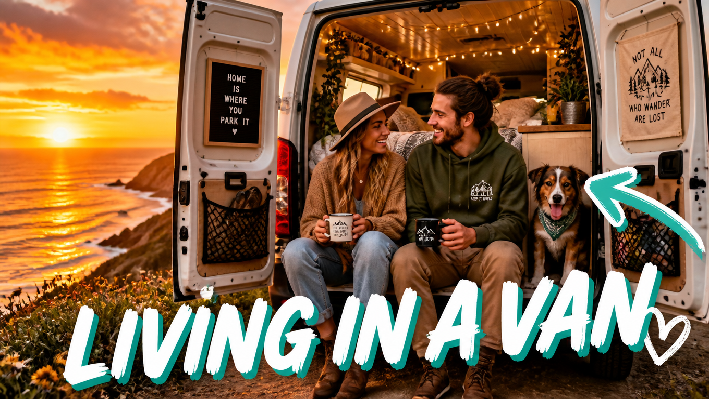

```text
A relaxed young couple sits in the open back doors of a cozy converted van, string lights glowing inside, parked on a cliff overlooking a golden-orange sunset ocean. Warm dreamy tones. Big handwritten-style text 'LIVING IN A VAN' in white with a teal shadow across the bottom, a small heart and a green arrow pointing into the snug interior. A dog peeks out. Cozy, aspirational, high-contrast van-life energy.
```

Model: GPT Image 2 · Author: API Models (apimodels.app)

[Original source](https://github.com/apimodels/gpt-image-2-prompts/blob/980d100f3bd0f2cde4cf38835daeb742bf1cac65/prompts.json#L7383) · [Provenance and original license](data/projectd-batch-0008.json)

## Design illustration · Lost In Tokyo Night — API Models · CC BY 4.0

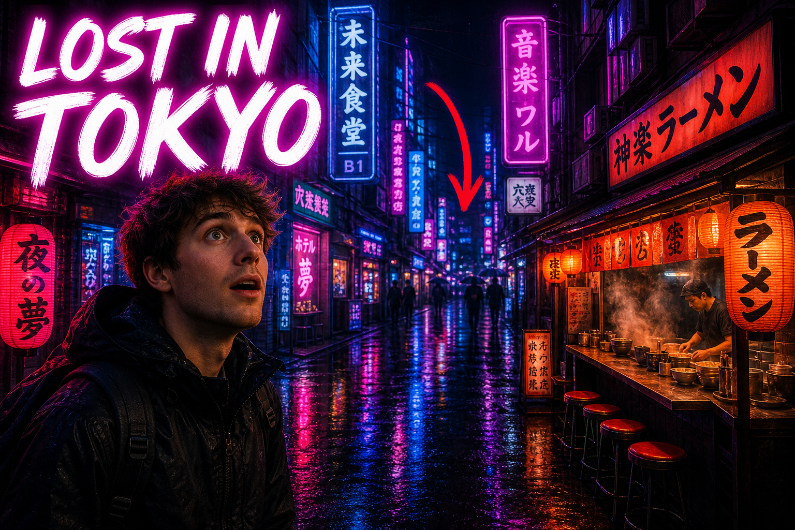

```text
A wide-eyed traveler in a black jacket stands amazed in a rain-slick neon alley bursting with glowing pink, blue, and purple signs in invented kanji-style characters. Reflections shimmer on wet pavement. Bold text 'LOST IN TOKYO' in white with a magenta glow fills the top-left, a red arrow pointing down a mysterious side street. A steaming ramen stall glows nearby. Electric, immersive, high-contrast night-vlog energy.
```

Model: GPT Image 2 · Author: API Models (apimodels.app)

[Original source](https://github.com/apimodels/gpt-image-2-prompts/blob/980d100f3bd0f2cde4cf38835daeb742bf1cac65/prompts.json#L7398) · [Provenance and original license](data/projectd-batch-0008.json)

## Design illustration · Worst Flight Ever — API Models · CC BY 4.0


```text
A frazzled traveler slumps in a cramped economy seat with a shocked, exhausted face, oxygen mask dangling and turbulence tossing luggage overhead. Harsh cabin lighting, tilted horizon through the window showing storm clouds. Huge alarming text 'WORST FLIGHT EVER' in yellow and red across the top, a red arrow pointing at the chaos and a warning triangle. Chaotic, relatable, high-contrast travel-disaster energy.
```

Model: GPT Image 2 · Author: API Models (apimodels.app)

[Original source](https://github.com/apimodels/gpt-image-2-prompts/blob/980d100f3bd0f2cde4cf38835daeb742bf1cac65/prompts.json#L7413) · [Provenance and original license](data/projectd-batch-0008.json)

## Design illustration · One Dollar VS Thousand Hotel — API Models · CC BY 4.0

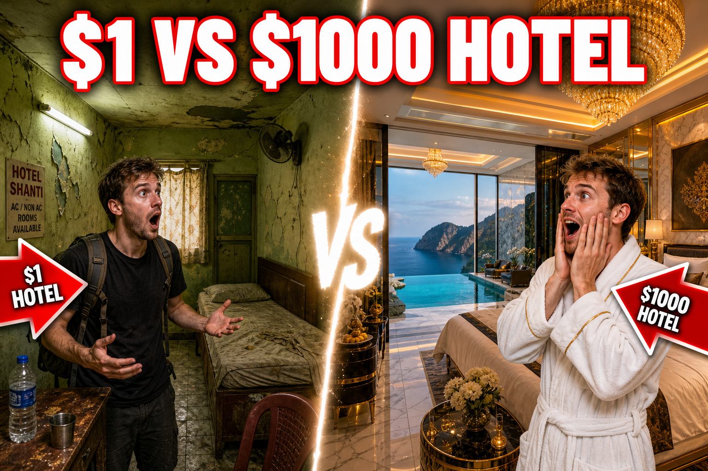

```text
Split-screen thumbnail: left half a grimy budget room with peeling walls and a shocked traveler, tinted sickly green; right half a lavish marble suite with a floating pool view and the same traveler in a plush robe, warm gold. A glowing white 'VS' divides them. Big text '$1 VS $1000 HOTEL' in white with a red outline across the top, arrows labeling each side. Contrasty, jaw-dropping, high-contrast comparison energy.
```

Model: GPT Image 2 · Author: API Models (apimodels.app)

[Original source](https://github.com/apimodels/gpt-image-2-prompts/blob/980d100f3bd0f2cde4cf38835daeb742bf1cac65/prompts.json#L7428) · [Provenance and original license](data/projectd-batch-0008.json)

## Design illustration · 24 Hours In Dubai — API Models · CC BY 4.0


```text
An excited vlogger in sunglasses leans out of a golden supercar in front of a towering futuristic skyline glowing at sunset, a glowing clock reading 24:00 floating beside him. Warm luxury color grade with lens flare. Massive text '24 HOURS IN DUBAI' in gold and white across the top, a green arrow sweeping across the skyline. A stack of luxury shopping bags in the corner. Flashy, extravagant, high-contrast luxury-travel energy.
```

Model: GPT Image 2 · Author: API Models (apimodels.app)

[Original source](https://github.com/apimodels/gpt-image-2-prompts/blob/980d100f3bd0f2cde4cf38835daeb742bf1cac65/prompts.json#L7443) · [Provenance and original license](data/projectd-batch-0008.json)

## Design illustration · Solo Female Travel — API Models · CC BY 4.0


```text
A confident solo traveler with a backpack stands on a mountain ridge at golden hour, arms raised in triumph, a vast valley and winding river below. Warm empowering light. Bold text 'SOLO FEMALE TRAVEL' in white with a coral outline arcs across the sky, a small green heart and a compass icon beside it. A gentle wind lifts her scarf. Inspiring, free, high-contrast adventure-vlog energy.
```

Model: GPT Image 2 · Author: API Models (apimodels.app)

[Original source](https://github.com/apimodels/gpt-image-2-prompts/blob/980d100f3bd0f2cde4cf38835daeb742bf1cac65/prompts.json#L7458) · [Provenance and original license](data/projectd-batch-0008.json)

## Design illustration · Sleeping In The Airport — API Models · CC BY 4.0


```text
A weary traveler in a puffy jacket curls up across a row of metal airport chairs using a backpack as a pillow, harsh fluorescent lighting, a giant departures board glowing 'DELAYED' in red behind him. Cold blue-teal tint. Big funny text 'SLEEPING IN THE AIRPORT' in white with a red outline across the top, a red arrow at the delayed board and a snoring 'Zzz'. Relatable, comedic, high-contrast travel-fail energy.
```

Model: GPT Image 2 · Author: API Models (apimodels.app)

[Original source](https://github.com/apimodels/gpt-image-2-prompts/blob/980d100f3bd0f2cde4cf38835daeb742bf1cac65/prompts.json#L7473) · [Provenance and original license](data/projectd-batch-0008.json)

## Design illustration · Is This Beach Real — API Models · CC BY 4.0

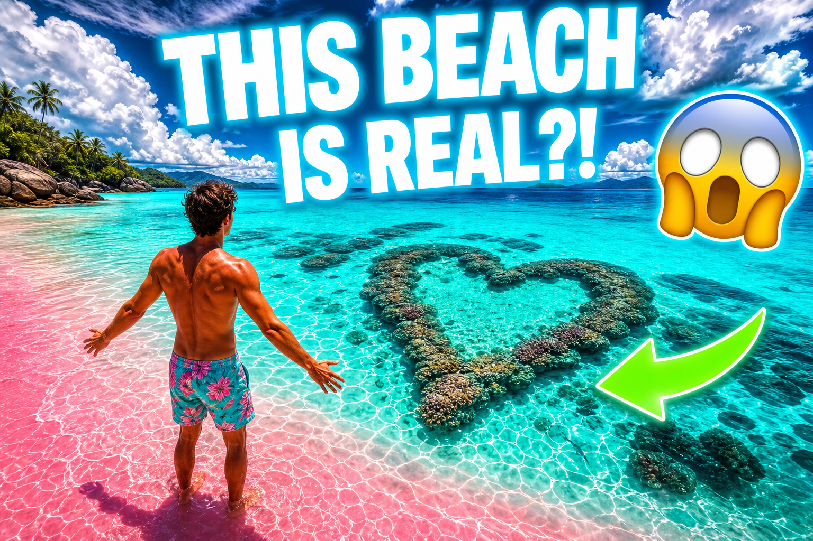

```text
An awestruck traveler in swim shorts stands in impossibly clear turquoise water over glowing pink sand, a heart-shaped reef visible below and dramatic tropical clouds above. Hyper-saturated dreamy color grade. Huge text 'THIS BEACH IS REAL?!' in white with a cyan glow across the top, a green arrow pointing at the surreal water and a shocked emoji-style face. Jaw-dropping, unbelievable, high-contrast paradise-reveal energy.
```

Model: GPT Image 2 · Author: API Models (apimodels.app)

[Original source](https://github.com/apimodels/gpt-image-2-prompts/blob/980d100f3bd0f2cde4cf38835daeb742bf1cac65/prompts.json#L7488) · [Provenance and original license](data/projectd-batch-0008.json)

## Design illustration · Digital Nomad Reality — API Models · CC BY 4.0


```text
A laptop-toting nomad works at a beachside cafe table under a palm umbrella, iced coffee sweating, ocean waves behind, a glowing 'WORKING' banner over a hammock. Warm sunny palette with soft shadows. Bold text 'DIGITAL NOMAD LIFE' in white with an orange shadow across the bottom, a green arrow from a laptop to a passport stamp collage. A tiny plane icon flies overhead. Relaxed, aspirational, high-contrast remote-work energy.
```

Model: GPT Image 2 · Author: API Models (apimodels.app)

[Original source](https://github.com/apimodels/gpt-image-2-prompts/blob/980d100f3bd0f2cde4cf38835daeb742bf1cac65/prompts.json#L7503) · [Provenance and original license](data/projectd-batch-0008.json)

## Design illustration · 30 Day Body Transformation — API Models · CC BY 4.0

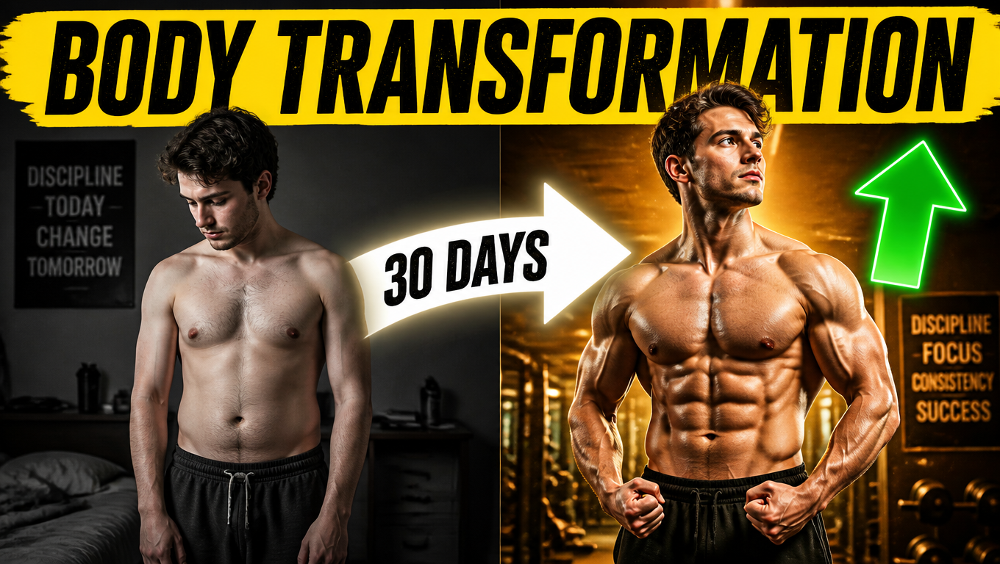

```text
Side-by-side thumbnail of the same man: left in dim gray light looking soft and slouched, right in bright warm light with defined muscles, flexed and confident. A glowing white arrow labeled '30 DAYS' sweeps from left to right. Huge text 'BODY TRANSFORMATION' in yellow and black across the top, a green up-arrow beside the fit side. Dramatic before-and-after lighting, motivating, high-contrast fitness-result energy.
```

Model: GPT Image 2 · Author: API Models (apimodels.app)

[Original source](https://github.com/apimodels/gpt-image-2-prompts/blob/980d100f3bd0f2cde4cf38835daeb742bf1cac65/prompts.json#L7518) · [Provenance and original license](data/projectd-batch-0008.json)

## Design illustration · Skinny To Buff — API Models · CC BY 4.0

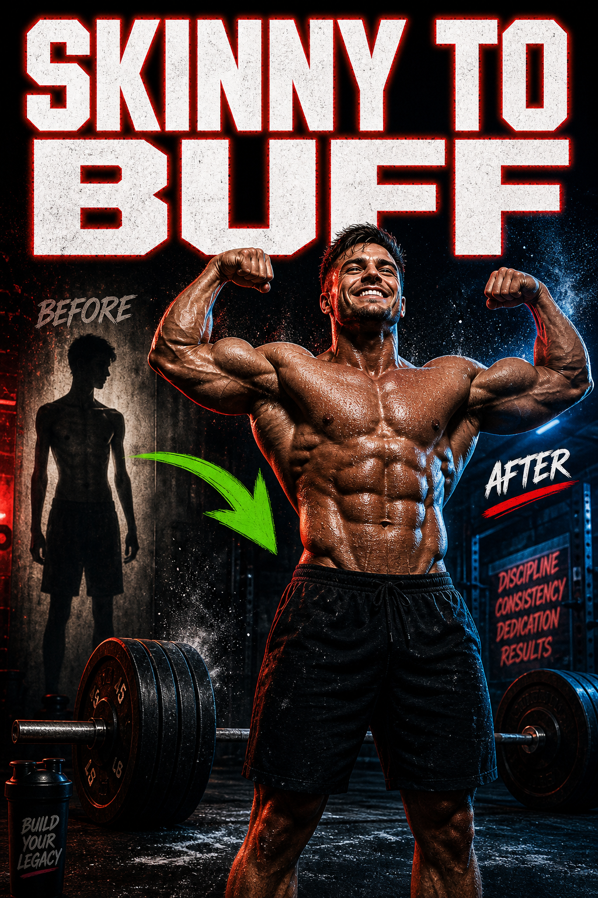

```text
A muscular man mid-flex grins in a moody gym lit with red and blue accent lights, chalk dust in the air, a barbell loaded heavy behind him. His shadow shows a smaller 'before' silhouette. Bold text 'SKINNY TO BUFF' in white with a red outline dominates the top, a thick green arrow from a thin outline to his big frame. Sweat and rim light, intense, high-contrast bulking-journey energy.
```

Model: GPT Image 2 · Author: API Models (apimodels.app)

[Original source](https://github.com/apimodels/gpt-image-2-prompts/blob/980d100f3bd0f2cde4cf38835daeb742bf1cac65/prompts.json#L7533) · [Provenance and original license](data/projectd-batch-0008.json)

## Design illustration · This Ruins Your Gains — API Models · CC BY 4.0

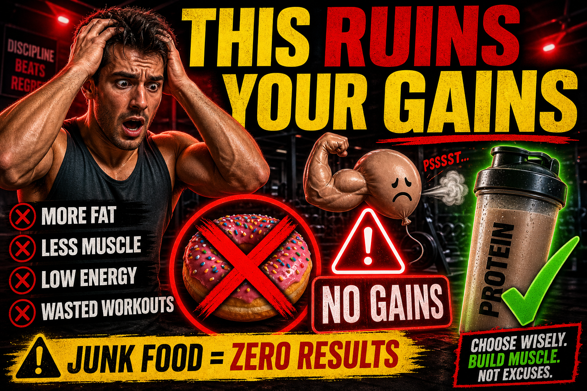

```text
A worried gym-goer in a tank top clutches his head beside a red-circled donut and a glowing 'NO GAINS' warning sign. Dark gym background with a dramatic red spotlight. Huge alarming text 'THIS RUINS YOUR GAINS' in yellow and red across the top, a red X over the junk food and a green checkmark over a protein shake. A muscle-arm icon deflating like a balloon. Cautionary, punchy, high-contrast fitness-myth energy.
```

Model: GPT Image 2 · Author: API Models (apimodels.app)

[Original source](https://github.com/apimodels/gpt-image-2-prompts/blob/980d100f3bd0f2cde4cf38835daeb742bf1cac65/prompts.json#L7548) · [Provenance and original license](data/projectd-batch-0008.json)

## Design illustration · Get Abs Fast — API Models · CC BY 4.0

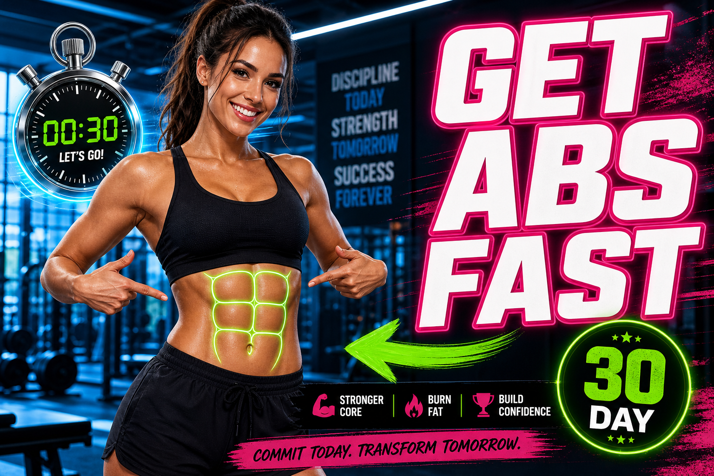

```text
A fit woman in athletic wear points proudly at her defined six-pack abs, glowing green outline tracing each muscle, in a bright modern gym with soft blue lighting. Clean energetic palette. Bold text 'GET ABS FAST' in white with a hot-pink outline fills the right side, a green arrow and a glowing '30 DAY' badge. A stopwatch icon ticks beside her. Motivating, crisp, high-contrast fitness-goal energy.
```

Model: GPT Image 2 · Author: API Models (apimodels.app)

[Original source](https://github.com/apimodels/gpt-image-2-prompts/blob/980d100f3bd0f2cde4cf38835daeb742bf1cac65/prompts.json#L7563) · [Provenance and original license](data/projectd-batch-0008.json)

## Design illustration · I Trained Every Day — API Models · CC BY 4.0

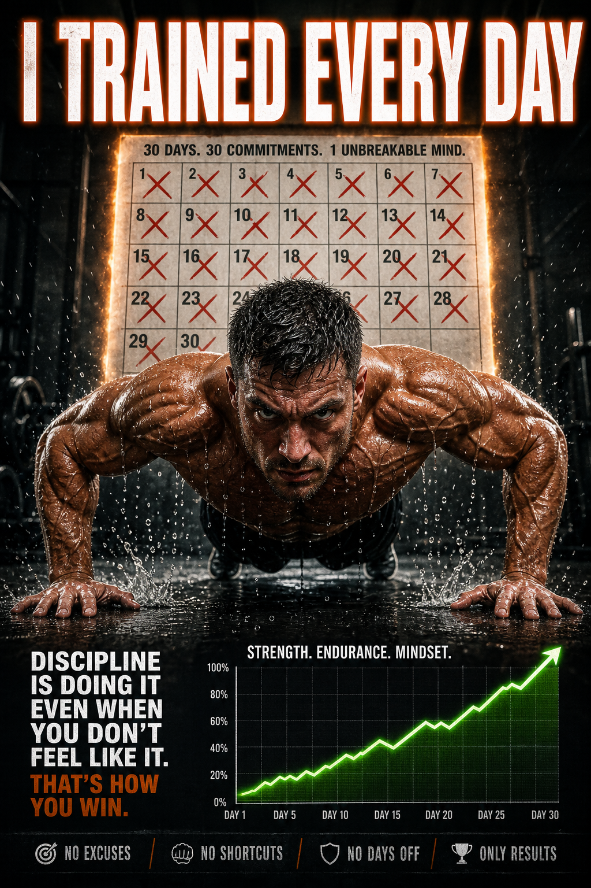

```text
A sweat-drenched athlete mid-pushup on a gym floor stares intensely at the camera, veins popping, a glowing calendar behind him with 30 days X'd out in red. Moody spotlight, dark background. Huge text 'I TRAINED EVERY DAY' in white with an orange outline across the top, a green arrow tracking a rising strength graph. Water splashes frozen mid-air. Grueling, inspiring, high-contrast discipline-challenge energy.
```

Model: GPT Image 2 · Author: API Models (apimodels.app)

[Original source](https://github.com/apimodels/gpt-image-2-prompts/blob/980d100f3bd0f2cde4cf38835daeb742bf1cac65/prompts.json#L7578) · [Provenance and original license](data/projectd-batch-0008.json)

## Design illustration · No Gym Home Workout — API Models · CC BY 4.0

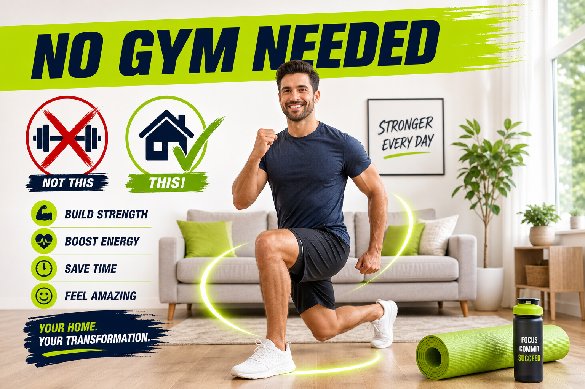

```text
An energetic guy does a bodyweight lunge in a bright living room, dumbbell-free, glowing motion arcs tracing his movement, a rolled yoga mat and water bottle nearby. Clean bright-white and lime-green palette. Bold text 'NO GYM NEEDED' in navy on a lime banner across the top, a red X over a barbell and a green checkmark over a home icon. Approachable, upbeat, high-contrast home-fitness energy.
```

Model: GPT Image 2 · Author: API Models (apimodels.app)

[Original source](https://github.com/apimodels/gpt-image-2-prompts/blob/980d100f3bd0f2cde4cf38835daeb742bf1cac65/prompts.json#L7593) · [Provenance and original license](data/projectd-batch-0008.json)

## Design illustration · My Biggest Deadlift — API Models · CC BY 4.0

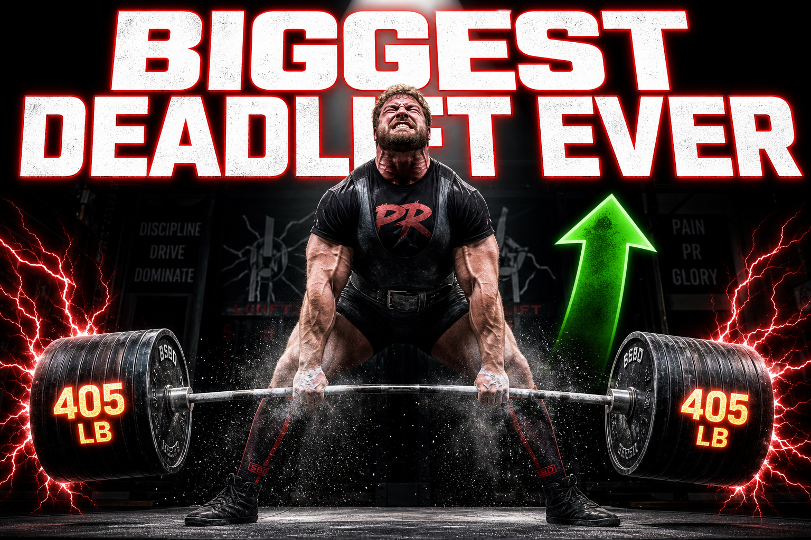

```text
A powerlifter mid-deadlift grits his teeth under a bar bending with massive plates labeled with a glowing '405 LB' total, chalk exploding off his hands. Dramatic dark gym with a single overhead spotlight. Enormous text 'BIGGEST DEADLIFT EVER' in white with a red outline across the top, a green up-arrow and lightning bolts around the bar. Straining, epic, high-contrast personal-record energy.
```

Model: GPT Image 2 · Author: API Models (apimodels.app)

[Original source](https://github.com/apimodels/gpt-image-2-prompts/blob/980d100f3bd0f2cde4cf38835daeb742bf1cac65/prompts.json#L7608) · [Provenance and original license](data/projectd-batch-0008.json)

## Design illustration · Lose Belly Fat — API Models · CC BY 4.0

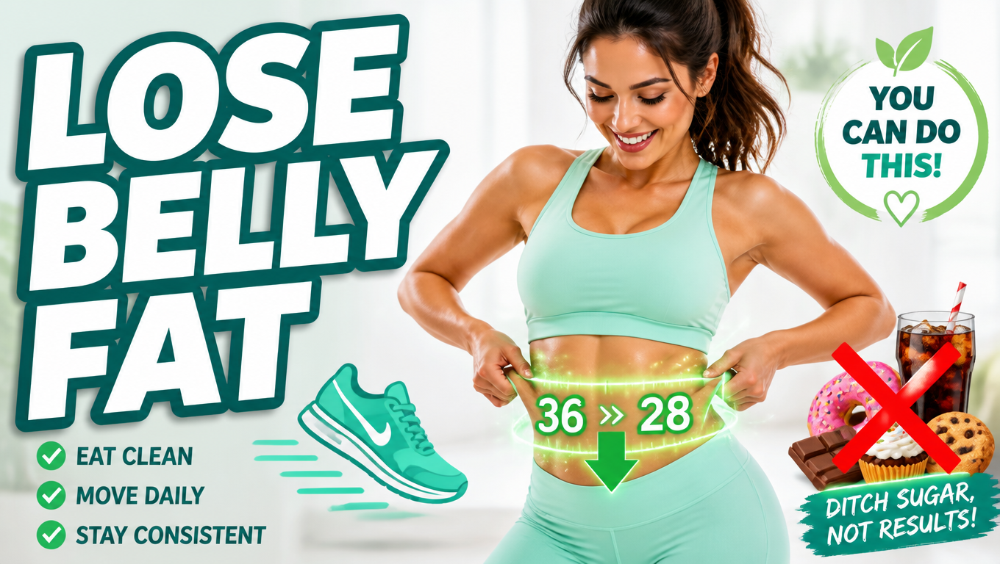

```text
A smiling woman pinches a shrinking waistline, a glowing green measuring tape wrapping her midsection with the number dropping, bright clean studio background. Fresh mint-and-white palette with soft light. Big bold text 'LOSE BELLY FAT' in white with a teal outline fills the top-left, a green down-arrow on the waist number and a red X over sugary snacks. A running-shoe icon beside her. Positive, motivating, high-contrast weight-loss energy.
```

Model: GPT Image 2 · Author: API Models (apimodels.app)

[Original source](https://github.com/apimodels/gpt-image-2-prompts/blob/980d100f3bd0f2cde4cf38835daeb742bf1cac65/prompts.json#L7623) · [Provenance and original license](data/projectd-batch-0008.json)

## Design illustration · Gym Fails Compilation — API Models · CC BY 4.0

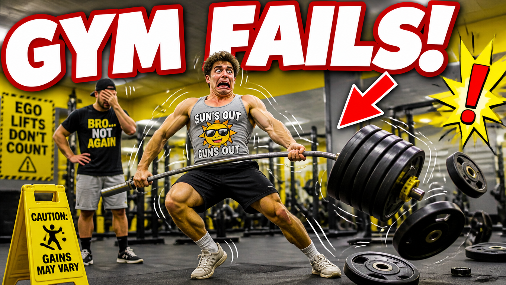

```text
A comedic scene of a wobbling gym-goer about to drop a wildly unbalanced barbell, face frozen in panic, weights slipping off one side. Bright gym with warning-yellow accents. Huge funny text 'GYM FAILS!' in white with a red outline across the top, a red arrow at the tipping bar and a cartoon '!' burst. A spotter face-palms in the background. Chaotic, funny, high-contrast comedy-compilation energy.
```

Model: GPT Image 2 · Author: API Models (apimodels.app)

[Original source](https://github.com/apimodels/gpt-image-2-prompts/blob/980d100f3bd0f2cde4cf38835daeb742bf1cac65/prompts.json#L7638) · [Provenance and original license](data/projectd-batch-0008.json)

## Design illustration · Insane Push Day Pump — API Models · CC BY 4.0

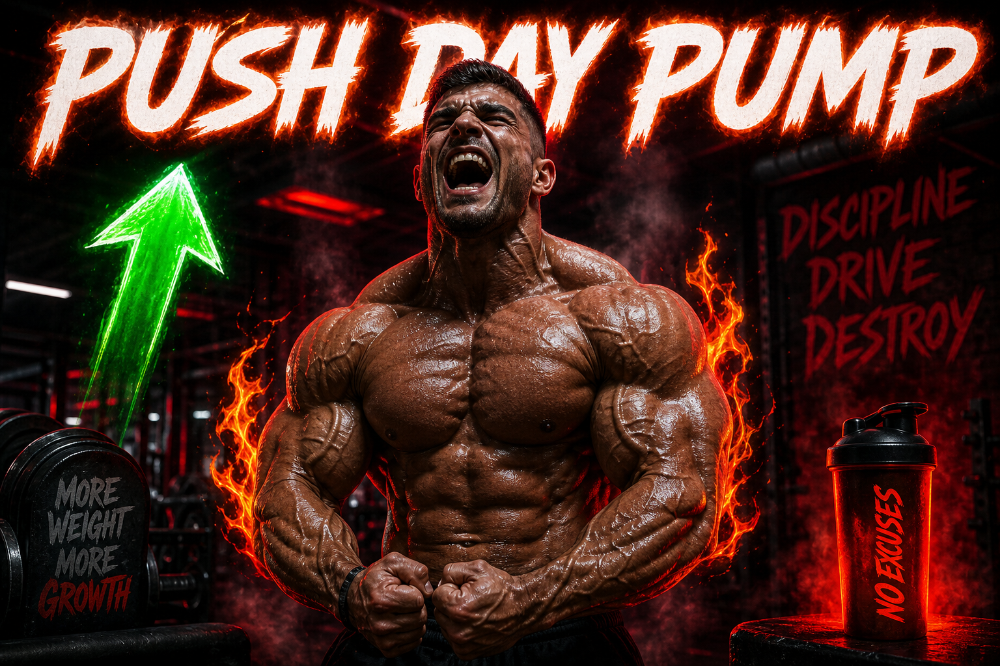

```text
A jacked bodybuilder flexes his chest and arms post-workout, skin glistening with sweat and a visible pump, veins bulging, in a red-and-black lit hardcore gym with fog. Intense dramatic lighting. Bold text 'PUSH DAY PUMP' in white with a fiery orange outline across the top, a green up-arrow and flame graphics around his arms. A protein shaker glows nearby. Aggressive, hyped, high-contrast gym-motivation energy.
```

Model: GPT Image 2 · Author: API Models (apimodels.app)

[Original source](https://github.com/apimodels/gpt-image-2-prompts/blob/980d100f3bd0f2cde4cf38835daeb742bf1cac65/prompts.json#L7653) · [Provenance and original license](data/projectd-batch-0008.json)

## Design illustration · Fractured Light Exhibition — API Models · CC BY 4.0

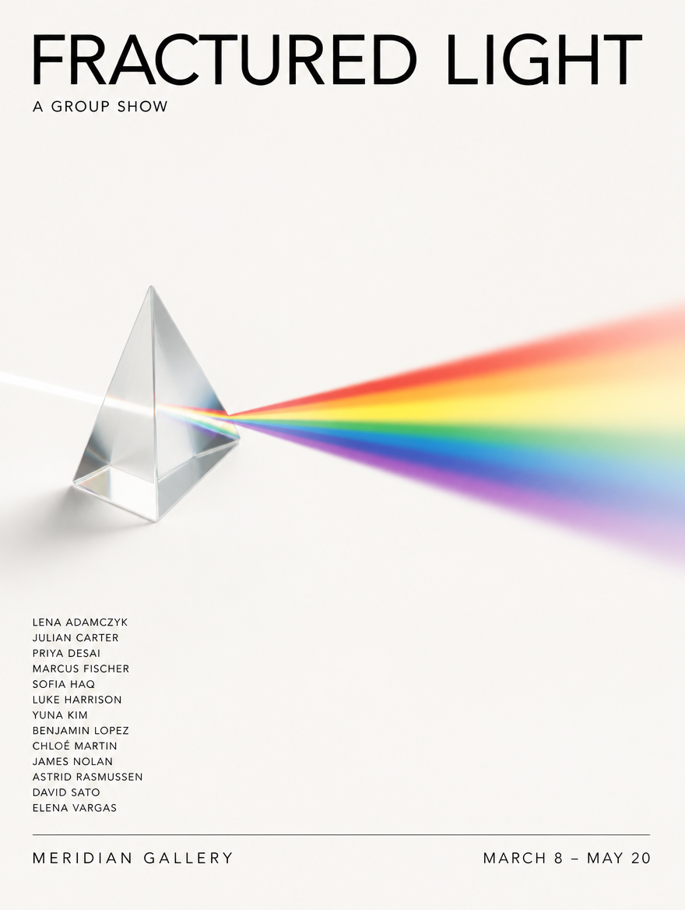

```text
Minimalist contemporary art exhibition poster for 'FRACTURED LIGHT', a group show at Meridian Gallery, March 8 to May 20. Hero: a single crisp prism refracting a white beam into a clean rainbow spectrum across a vast empty off-white field. Composition: prism placed on the left third, spectrum fanning to the right, exhibition title in a large modern grotesque sans at the top with tight tracking, artist names in a small tidy column bottom-left. Palette: gallery off-white, pure spectrum hues, thin black type. Extreme negative space, Swiss editorial precision. Venue and dates at the base. Mood: intellectual, clean, luminous, refined.
```

Model: GPT Image 2 · Author: API Models (apimodels.app)

[Original source](https://github.com/apimodels/gpt-image-2-prompts/blob/980d100f3bd0f2cde4cf38835daeb742bf1cac65/prompts.json#L8588) · [Provenance and original license](data/projectd-batch-0008.json)

## Design illustration · Ink & Silence Retrospective — API Models · CC BY 4.0

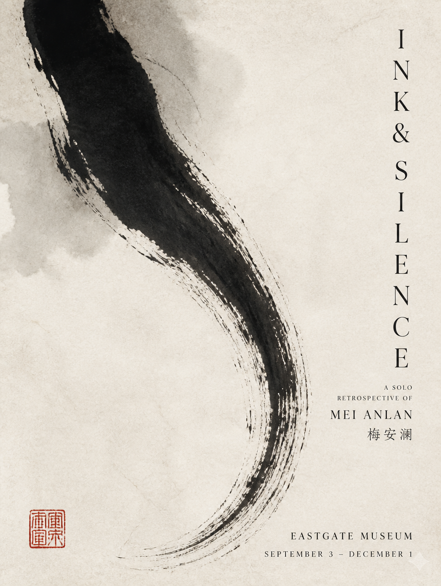

```text
Elegant ink-art retrospective poster for 'INK & SILENCE', a solo retrospective of painter Mei Anlan, Eastgate Museum, September 3 to December 1. Hero: a single expressive black brushstroke sweeping diagonally across a raw rice-paper background, one red seal stamp in the corner. Composition: dramatic negative space, brushstroke as the sole gesture, vertical title in a refined thin serif on the right edge, dates in delicate small type at the base. Palette: rice-paper cream, deep ink black, cinnabar red seal, faint grey wash. Authentic paper grain and bleeding ink edges. Mood: contemplative, serene, masterful, timeless.
```

Model: GPT Image 2 · Author: API Models (apimodels.app)

[Original source](https://github.com/apimodels/gpt-image-2-prompts/blob/980d100f3bd0f2cde4cf38835daeb742bf1cac65/prompts.json#L8604) · [Provenance and original license](data/projectd-batch-0008.json)

## Design illustration · Chromatic Dreams Show — API Models · CC BY 4.0

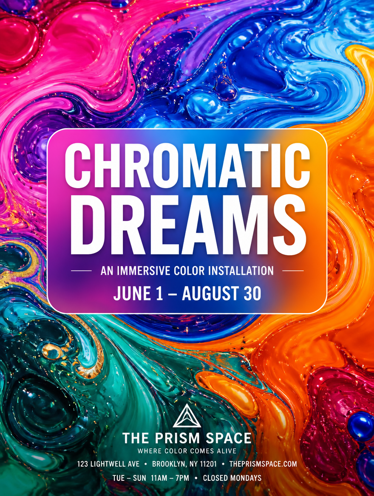

```text
Vibrant abstract art exhibition poster for 'CHROMATIC DREAMS', an immersive color installation at The Prism Space, June 1 to August 30. Hero: swirling liquid pools of poured acrylic paint blending in hypnotic marbled ribbons of saturated color. Composition: full-bleed abstract fluid art filling the frame, title knocked out in clean white bold sans centered inside a floating rounded panel, details below it. Palette: electric magenta, cobalt blue, tangerine, emerald, violet. Glossy wet paint texture, rich depth. Venue and hours in small white type at the base. Mood: joyful, immersive, sensory, exuberant.
```

Model: GPT Image 2 · Author: API Models (apimodels.app)

[Original source](https://github.com/apimodels/gpt-image-2-prompts/blob/980d100f3bd0f2cde4cf38835daeb742bf1cac65/prompts.json#L8620) · [Provenance and original license](data/projectd-batch-0008.json)

## Design illustration · Bronze & Bone Sculpture — API Models · CC BY 4.0

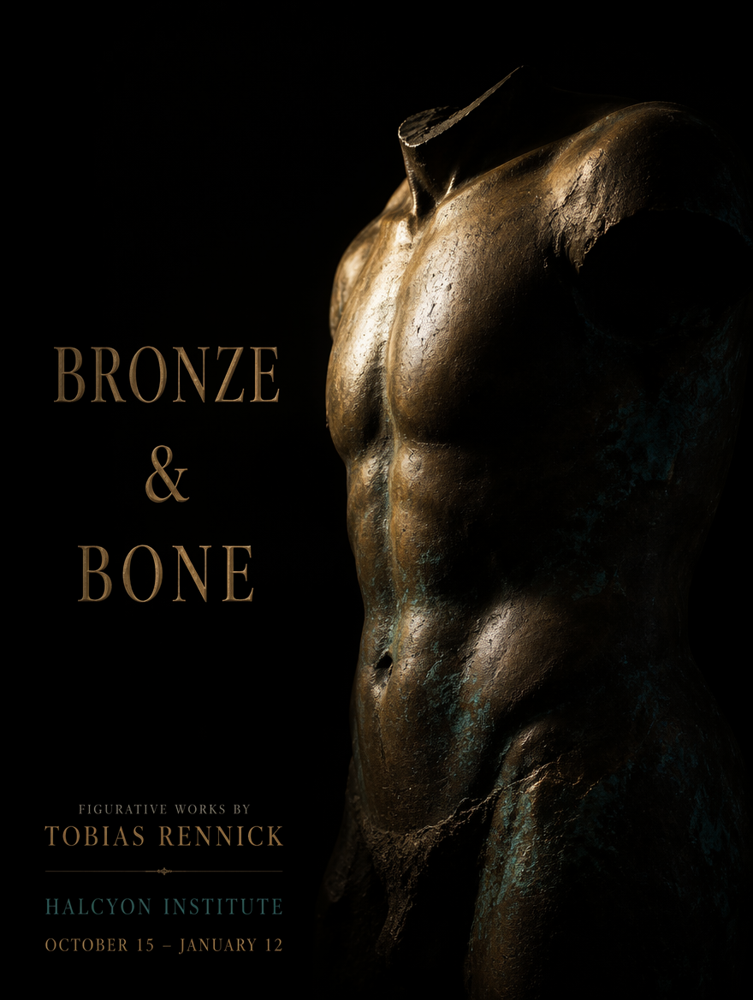

```text
Museum sculpture exhibition poster for 'BRONZE & BONE', figurative works by Tobias Rennick, Halcyon Institute, October 15 to January 12. Hero: a dramatically side-lit bronze torso sculpture emerging from deep shadow, its patinated surface catching a single warm rim light. Composition: sculpture on the right two-thirds, vast black negative space on the left holding the title in a classical engraved serif stacked vertically, artist and dates small at the bottom. Palette: rich bronze, warm gold highlight, deep museum black, patina teal-green. Fine-art photographic lighting, subtle grain. Mood: solemn, sculptural, timeless, dignified.
```

Model: GPT Image 2 · Author: API Models (apimodels.app)

[Original source](https://github.com/apimodels/gpt-image-2-prompts/blob/980d100f3bd0f2cde4cf38835daeb742bf1cac65/prompts.json#L8636) · [Provenance and original license](data/projectd-batch-0008.json)

## Design illustration · Pixel Futures Media Art — API Models · CC BY 4.0

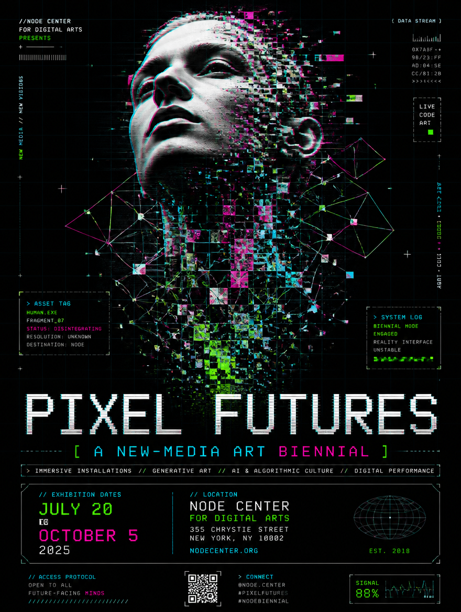

```text
Futuristic digital-media art exhibition poster for 'PIXEL FUTURES', a new-media art biennial at Node Center, July 20 to October 5. Hero: a fragmenting 3D human portrait dissolving into a cascade of glitching pixels and floating wireframe polygons against a dark grid void. Composition: portrait upper-center breaking apart downward, title in a futuristic monospaced tech font at the bottom with data-tag captions, exhibition info in a terminal-style block. Palette: black grid, neon cyan, magenta glitch, acid green, white. RGB channel shift and scanline artifacts. Mood: futuristic, provocative, digital, cerebral.
```

Model: GPT Image 2 · Author: API Models (apimodels.app)

[Original source](https://github.com/apimodels/gpt-image-2-prompts/blob/980d100f3bd0f2cde4cf38835daeb742bf1cac65/prompts.json#L8652) · [Provenance and original license](data/projectd-batch-0008.json)

## Design illustration · Woven Worlds Textile Show — API Models · CC BY 4.0

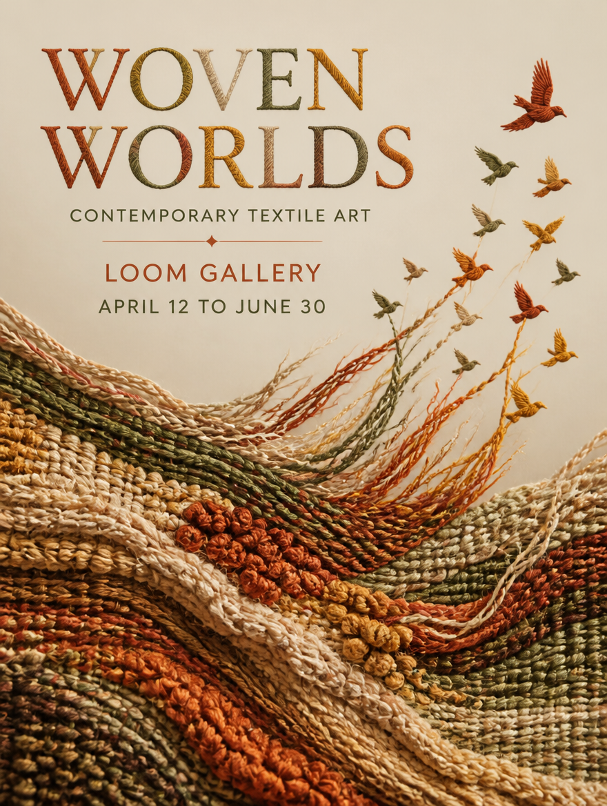

```text
Warm craft-focused exhibition poster for 'WOVEN WORLDS', contemporary textile art, Loom Gallery, April 12 to June 30. Hero: a lush macro close-up of intricately woven wool tapestry threads in earthy tones, real fiber texture, a few loose threads unraveling upward into a stylized flock of birds. Composition: textile filling the lower two-thirds, threads rising into empty warm space above, title hand-embroidered-look serif at the top, dates below. Palette: terracotta, mustard, sage, oatmeal, rust. Tactile handcrafted feel, soft natural light. Mood: cozy, tactile, artisanal, grounded.
```

Model: GPT Image 2 · Author: API Models (apimodels.app)

[Original source](https://github.com/apimodels/gpt-image-2-prompts/blob/980d100f3bd0f2cde4cf38835daeb742bf1cac65/prompts.json#L8668) · [Provenance and original license](data/projectd-batch-0008.json)

## Design illustration · Shadow Play Photography — API Models · CC BY 4.0

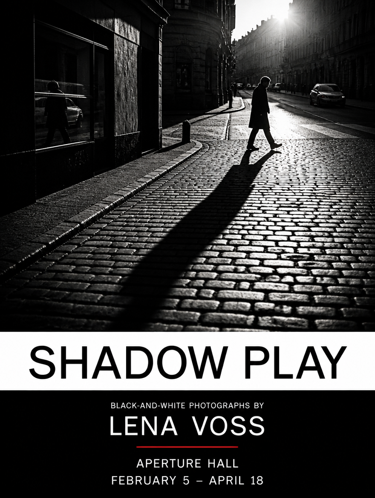

```text
Moody photography exhibition poster for 'SHADOW PLAY', black-and-white street photography by Lena Voss, Aperture Hall, February 5 to April 18. Hero: a single striking high-contrast monochrome photo of a lone figure crossing a sunlit street casting a long dramatic shadow across cobblestones. Composition: full-bleed photograph, title placed inside a clean white bar across the lower quarter in a bold modern sans, artist name and dates below. Palette: pure black-and-white, deep shadow blacks, bright highlight whites, one thin red accent line. Fine silver-gelatin grain. Mood: dramatic, timeless, human, decisive-moment.
```

Model: GPT Image 2 · Author: API Models (apimodels.app)

[Original source](https://github.com/apimodels/gpt-image-2-prompts/blob/980d100f3bd0f2cde4cf38835daeb742bf1cac65/prompts.json#L8684) · [Provenance and original license](data/projectd-batch-0008.json)

## Design illustration · Garden of Glass — API Models · CC BY 4.0

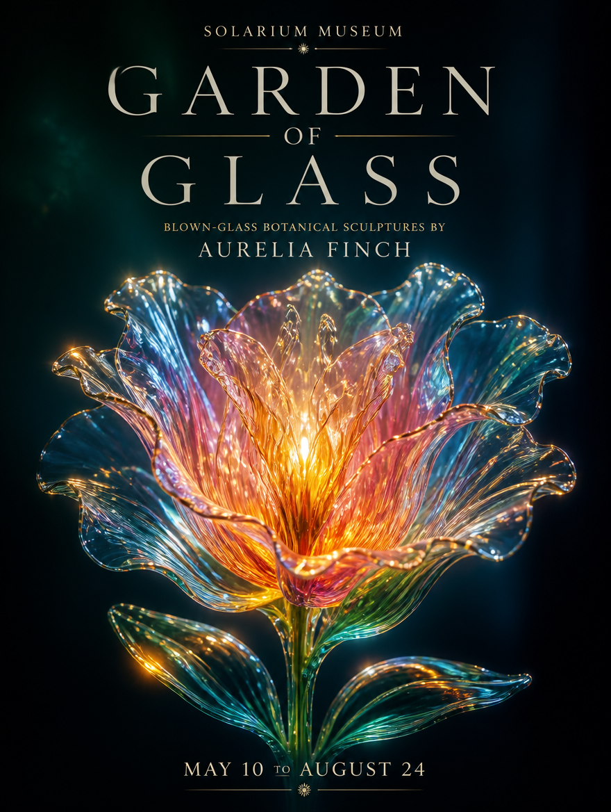

```text
Luminous exhibition poster for 'GARDEN OF GLASS', blown-glass botanical sculptures by Aurelia Finch, Solarium Museum, May 10 to August 24. Hero: a translucent glass flower glowing from within, backlit so its swirling colored core radiates jewel-like light, delicate glass petals catching rainbow refractions. Composition: single hero bloom centered on a dark gradient, title in an elegant light serif with generous spacing above, dates in fine type below. Palette: deep midnight teal background, glowing amber, emerald, sapphire, rose glass. Glossy refractive highlights, soft glow. Mood: delicate, magical, luminous, jewel-like.
```

Model: GPT Image 2 · Author: API Models (apimodels.app)

[Original source](https://github.com/apimodels/gpt-image-2-prompts/blob/980d100f3bd0f2cde4cf38835daeb742bf1cac65/prompts.json#L8700) · [Provenance and original license](data/projectd-batch-0008.json)

## Design illustration · Concrete Poetry Typography — API Models · CC BY 4.0

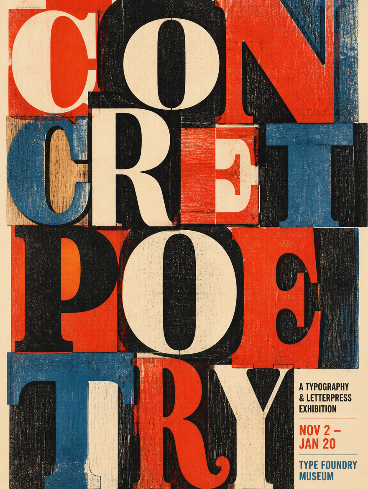

```text
Bold graphic-design exhibition poster for 'CONCRETE POETRY', a typography and letterpress show at Type Foundry Museum, November 2 to January 20. Hero: giant overlapping wooden-type letterforms in varied vintage typefaces arranged into an abstract collage that itself spells the exhibition title through negative space. Composition: full-bleed layered type composition, actual title emerging cleverly from the arrangement, small caption block and dates in a tidy corner. Palette: bold vermillion, ink black, cream paper, one steel blue. Authentic letterpress ink texture with slight registration offset. Mood: clever, tactile, design-forward, playful-serious.
```

Model: GPT Image 2 · Author: API Models (apimodels.app)

[Original source](https://github.com/apimodels/gpt-image-2-prompts/blob/980d100f3bd0f2cde4cf38835daeb742bf1cac65/prompts.json#L8716) · [Provenance and original license](data/projectd-batch-0008.json)

## Design illustration · Underwater Visions — API Models · CC BY 4.0

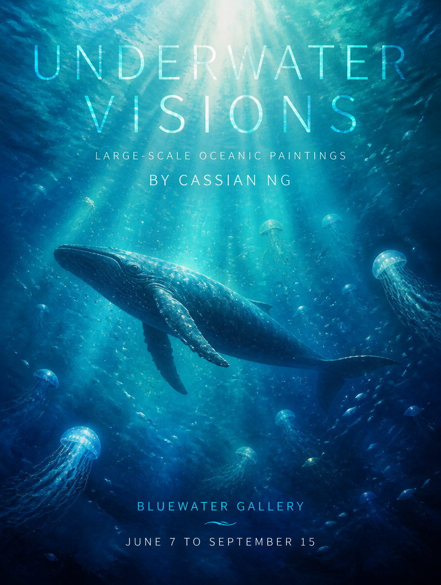

```text
Serene exhibition poster for 'UNDERWATER VISIONS', large-scale oceanic paintings by Cassian Ng, Bluewater Gallery, June 7 to September 15. Hero: a dreamlike deep-sea scene of light rays piercing turquoise water, a graceful whale silhouette gliding through drifting particles and jellyfish. Composition: full immersive underwater field, whale crossing the center, title in a soft flowing sans at the top fading like sunlight through water, dates below. Palette: gradient turquoise to deep navy, aqua light shafts, soft teal, glowing white particles. Painterly luminous depth. Mood: tranquil, immersive, meditative, vast.
```

Model: GPT Image 2 · Author: API Models (apimodels.app)

[Original source](https://github.com/apimodels/gpt-image-2-prompts/blob/980d100f3bd0f2cde4cf38835daeb742bf1cac65/prompts.json#L8732) · [Provenance and original license](data/projectd-batch-0008.json)

## Design illustration · Velvet Underground Night — API Models · CC BY 4.0

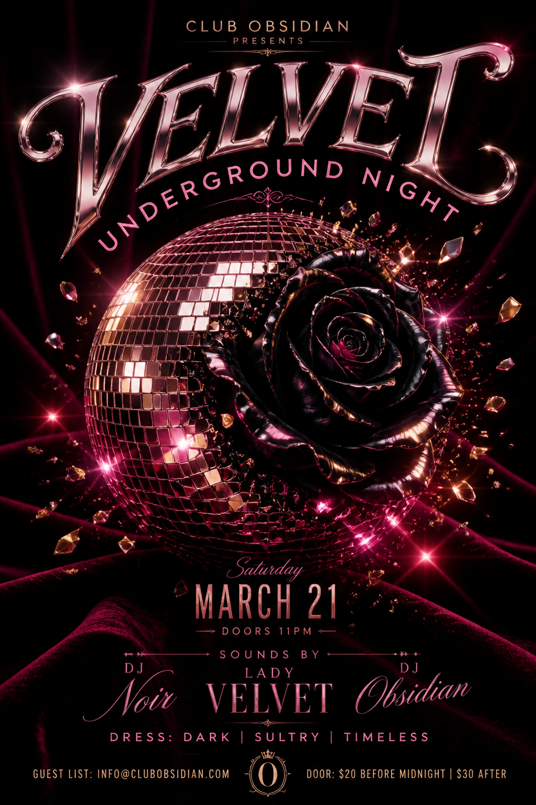

```text
Sultry nightclub party poster for 'VELVET UNDERGROUND NIGHT' at Club Obsidian, Saturday March 21, doors 11PM. Hero: a glossy disco ball morphing into a blooming black rose, scattering shards of pink and gold light across a dark velvet backdrop. Composition: hero object centered and glamorous, title in a luxe retro chrome script arched above, DJ names and dress-code line below. Palette: deep burgundy velvet, rose gold, hot pink glints, black. Glossy reflective highlights, luxurious sheen. Guest list and door price in small elegant caps at the base. Mood: seductive, upscale, glamorous, late-night.
```

Model: GPT Image 2 · Author: API Models (apimodels.app)

[Original source](https://github.com/apimodels/gpt-image-2-prompts/blob/980d100f3bd0f2cde4cf38835daeb742bf1cac65/prompts.json#L8748) · [Provenance and original license](data/projectd-batch-0008.json)

## Design illustration · Laser Jungle Rave — API Models · CC BY 4.0

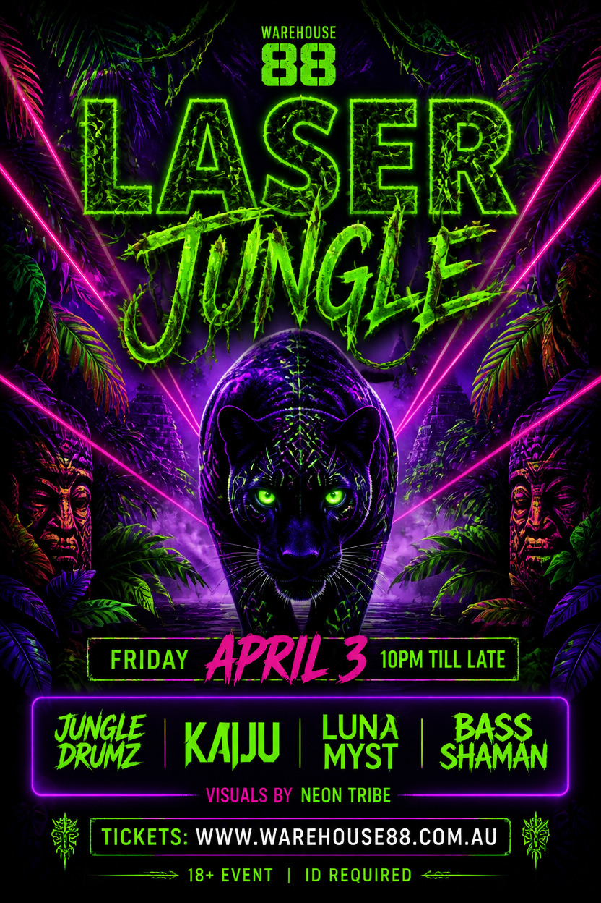

```text
High-energy club night poster for 'LASER JUNGLE' at Warehouse 88, Friday April 3, 10PM till late. Hero: dense neon-lit tropical foliage exploding with laser beams cutting through fog, a glowing panther prowling at the center with electric-green eyes. Composition: symmetrical jungle framing, panther head as focal point, title in a bold jungle-vine display font at the top, lineup in a glowing strip below. Palette: acid green, ultraviolet purple, hot pink lasers, black jungle. Fog haze, laser bloom, saturated glow. Ticket link and age line at the base. Mood: wild, electric, immersive, tribal-futuristic.
```

Model: GPT Image 2 · Author: API Models (apimodels.app)

[Original source](https://github.com/apimodels/gpt-image-2-prompts/blob/980d100f3bd0f2cde4cf38835daeb742bf1cac65/prompts.json#L8764) · [Provenance and original license](data/projectd-batch-0008.json)

## Design illustration · Retro Roller Disco — API Models · CC BY 4.0

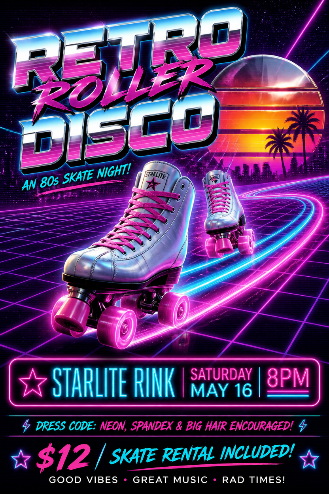

```text
Fun retro party poster for 'RETRO ROLLER DISCO', an 80s skate night at Starlite Rink, Saturday May 16, 8PM. Hero: a pair of glowing roller skates leaving neon light trails looping across a purple grid horizon under a chrome sunset. Composition: skates zooming from lower-left to upper-right, big chunky 80s outrun display font title with a chrome-and-magenta gradient, event details in a neon strip below. Palette: synthwave purple, hot magenta, cyan, chrome, sunset orange. Retro grid, laser lines, VHS grain glow. Dress-code line and price at the base. Mood: nostalgic, fun, energetic, neon-80s.
```

Model: GPT Image 2 · Author: API Models (apimodels.app)

[Original source](https://github.com/apimodels/gpt-image-2-prompts/blob/980d100f3bd0f2cde4cf38835daeb742bf1cac65/prompts.json#L8780) · [Provenance and original license](data/projectd-batch-0008.json)

## Design illustration · Midnight Masquerade Ball — API Models · CC BY 4.0

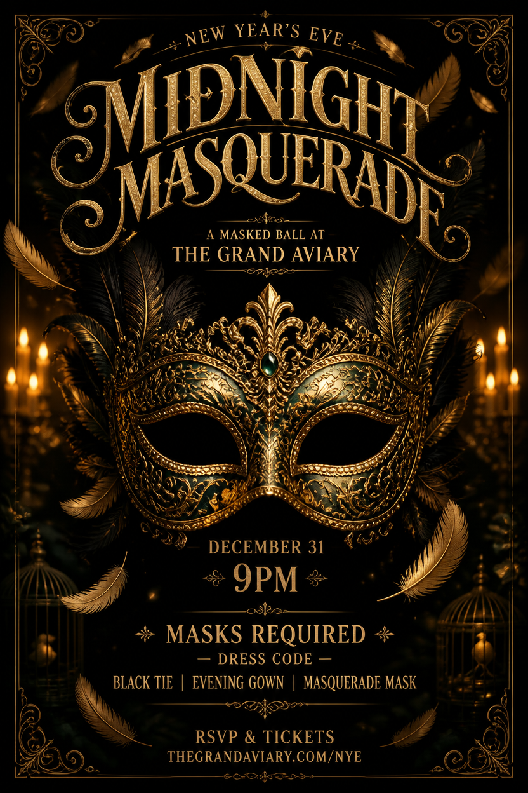

```text
Mysterious masquerade party poster for 'MIDNIGHT MASQUERADE', a masked ball at The Grand Aviary, New Year's Eve, 9PM. Hero: an ornate feathered Venetian mask floating in darkness, surrounded by drifting golden feathers and soft candlelight sparkles. Composition: mask centered and gleaming, deep black surround, title in an ornate gold engraved script arched above, 'masks required' line and dress code below. Palette: black velvet, antique gold, champagne, deep emerald accents. Rich metallic filigree detail, warm glow. RSVP and ticket line in small caps at the base. Mood: enigmatic, opulent, romantic, secretive.
```

Model: GPT Image 2 · Author: API Models (apimodels.app)

[Original source](https://github.com/apimodels/gpt-image-2-prompts/blob/980d100f3bd0f2cde4cf38835daeb742bf1cac65/prompts.json#L8796) · [Provenance and original license](data/projectd-batch-0008.json)

## Design illustration · Tropical Splash Pool Party — API Models · CC BY 4.0

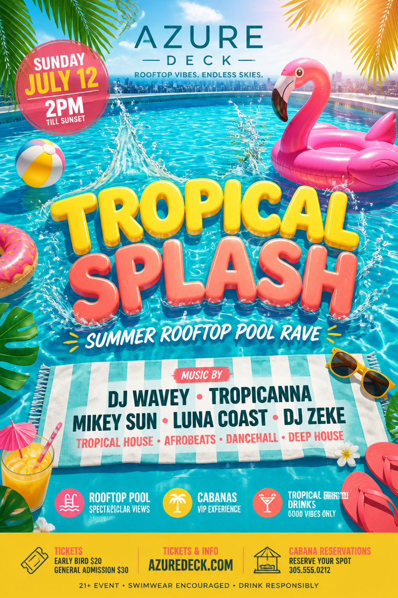

```text
Bright daytime pool party poster for 'TROPICAL SPLASH', a summer rooftop pool rave at Azure Deck, Sunday July 12, 2PM till sunset. Hero: a crystal-clear turquoise pool with an inflatable flamingo, splashing water frozen mid-air, palm shadows and bright sun overhead. Composition: overhead-ish angle of the sparkling pool, playful bold rounded title floating on the water surface, DJ lineup on a beach-towel-striped banner below. Palette: bright turquoise, sunshine yellow, hot coral, white foam, palm green. Crisp sunny high-key lighting, glossy water sparkle. Ticket and cabana info at the base. Mood: fun, refreshing, sun-soaked, carefree.
```

Model: GPT Image 2 · Author: API Models (apimodels.app)

[Original source](https://github.com/apimodels/gpt-image-2-prompts/blob/980d100f3bd0f2cde4cf38835daeb742bf1cac65/prompts.json#L8812) · [Provenance and original license](data/projectd-batch-0008.json)

## Design illustration · Neon Noir Speakeasy — API Models · CC BY 4.0

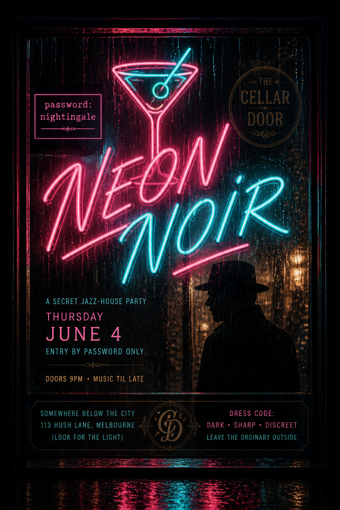

```text
Moody speakeasy night poster for 'NEON NOIR', a secret jazz-house party at The Cellar Door, Thursday June 4, entry by password only. Hero: a neon cocktail glass sign glowing in a rain-streaked window, a silhouetted figure in a fedora reflected in the wet glass. Composition: window-frame framing with rain streaks, title in a flickering neon-tube script diagonally across, 'password: nightingale' whispered in small type, details below. Palette: deep teal night, hot pink and cyan neon, amber reflections, black. Wet reflective surfaces, neon bloom, film noir mood. Address hint and dress code at the base. Mood: secretive, cool, atmospheric, underground-chic.
```

Model: GPT Image 2 · Author: API Models (apimodels.app)

[Original source](https://github.com/apimodels/gpt-image-2-prompts/blob/980d100f3bd0f2cde4cf38835daeb742bf1cac65/prompts.json#L8828) · [Provenance and original license](data/projectd-batch-0008.json)

## Design illustration · Cosmic Glow Party — API Models · CC BY 4.0

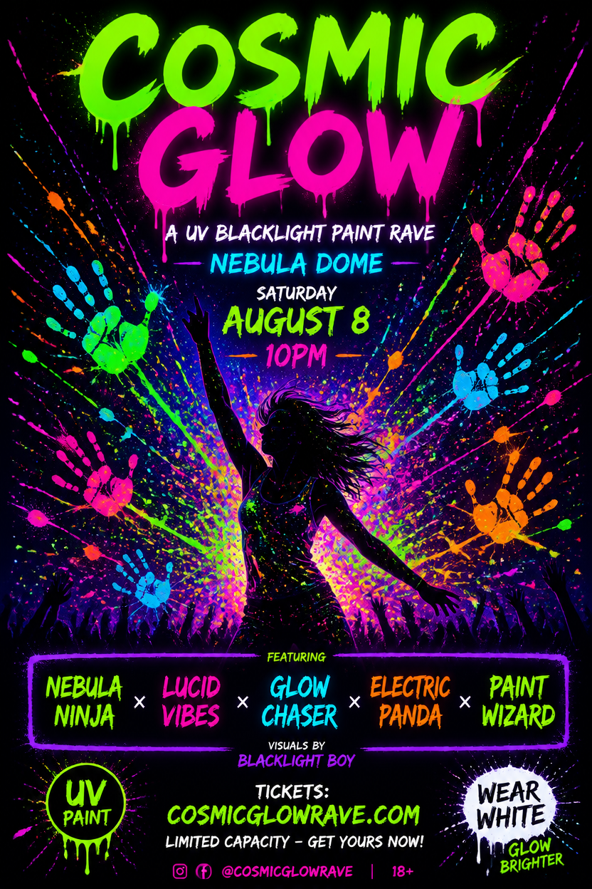

```text
Vibrant glow party poster for 'COSMIC GLOW', a UV blacklight paint rave at Nebula Dome, Saturday August 8, 10PM. Hero: splatters and handprints of glowing UV-reactive paint exploding outward from a central dancing silhouette, forming a galaxy of neon splashes. Composition: energetic radial splash burst from center, title in a hand-painted dripping glow font at the top, lineup in a UV strip below. Palette: blacklight black, electric UV green, neon pink, cyan, orange splatter. Glowing paint texture, dark backdrop, luminous splashes. Ticket and 'wear white' note at the base. Mood: wild, playful, luminous, high-energy.
```

Model: GPT Image 2 · Author: API Models (apimodels.app)

[Original source](https://github.com/apimodels/gpt-image-2-prompts/blob/980d100f3bd0f2cde4cf38835daeb742bf1cac65/prompts.json#L8844) · [Provenance and original license](data/projectd-batch-0008.json)

## Design illustration · Golden Hour Rooftop — API Models · CC BY 4.0

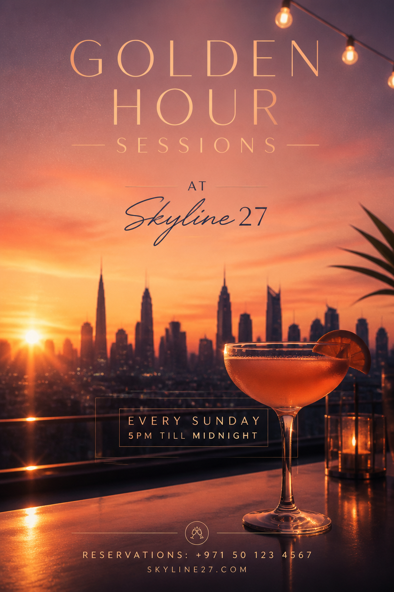

```text
Chic sunset rooftop party poster for 'GOLDEN HOUR SESSIONS' at Skyline 27, every Sunday, 5PM till midnight. Hero: a stylish city skyline silhouette at sunset with a cocktail glass in the foreground catching warm golden light, string lights and lens flare. Composition: low skyline horizon, warm gradient sky, cocktail on the right third, elegant thin modern sans title with wide tracking at the top, weekly detail line below. Palette: golden peach, warm coral, dusty lavender, city silhouette navy. Soft warm glow, gentle grain, upscale editorial feel. Reservation line at the base. Mood: relaxed, chic, warm, sophisticated.
```

Model: GPT Image 2 · Author: API Models (apimodels.app)

[Original source](https://github.com/apimodels/gpt-image-2-prompts/blob/980d100f3bd0f2cde4cf38835daeb742bf1cac65/prompts.json#L8860) · [Provenance and original license](data/projectd-batch-0008.json)

## Design illustration · Bassline Bunker — API Models · CC BY 4.0

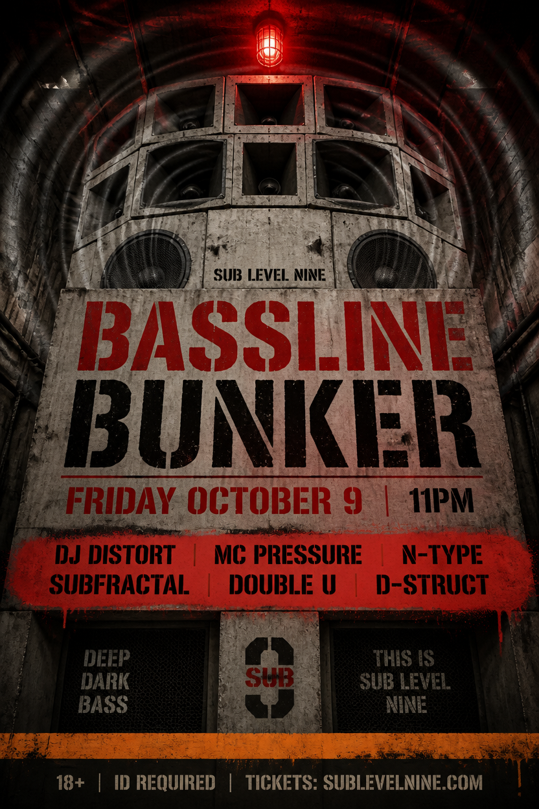

```text
Gritty underground drum-and-bass night poster for 'BASSLINE BUNKER', Sub Level Nine, Friday October 9, 11PM. Hero: a massive brutalist concrete speaker stack pulsing with visible sound-pressure waves distorting the air, a single warning-red strobe. Composition: monolithic speaker wall filling the frame, sound waves rippling outward, title in a heavy stenciled industrial font stamped across, DJ lineup in a spray-paint strip below. Palette: raw concrete grey, warning red, black, one strip of sodium-orange. Rough concrete texture, distressed stencil grit. Age and ticket line at the base. Mood: heavy, raw, underground, industrial.
```

Model: GPT Image 2 · Author: API Models (apimodels.app)

[Original source](https://github.com/apimodels/gpt-image-2-prompts/blob/980d100f3bd0f2cde4cf38835daeb742bf1cac65/prompts.json#L8876) · [Provenance and original license](data/projectd-batch-0008.json)

## Design illustration · Harvest Flavors Festival — API Models · CC BY 4.0

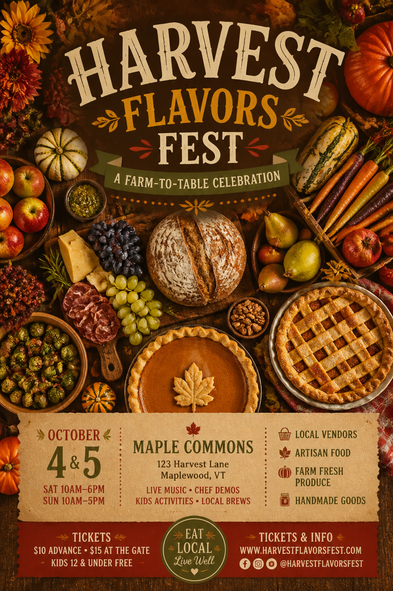

```text
Warm autumn food festival poster for 'HARVEST FLAVORS FEST', a farm-to-table celebration at Maple Commons, October 4-5. Hero: an abundant rustic wooden table overflowing with seasonal produce, pumpkins, artisan bread, grapes, and steaming pies from an overhead flat-lay. Composition: top-down bountiful spread filling the frame, hand-lettered warm serif title arched at the top, event details on a kraft-paper banner at the bottom. Palette: burnt orange, deep red, golden yellow, olive green, cream. Cozy natural light, rich food photography warmth, subtle paper texture. Ticket and vendor info at the base. Mood: abundant, cozy, wholesome, appetizing.
```

Model: GPT Image 2 · Author: API Models (apimodels.app)

[Original source](https://github.com/apimodels/gpt-image-2-prompts/blob/980d100f3bd0f2cde4cf38835daeb742bf1cac65/prompts.json#L8892) · [Provenance and original license](data/projectd-batch-0008.json)

## Design illustration · SaaS Three-Tier Pricing — API Models · CC BY 4.0


```text
A pricing infographic, 4:5, titled 'Choose Your Plan'. Three vertical pricing cards for an invented tool 'TaskFlow': Starter $9/mo, Pro $29/mo (highlighted, raised, purple 'Most Popular' banner), Business $79/mo. Each card lists a price, a short tagline, and a checklist of features (Starter 5 projects, Pro unlimited projects + analytics, Business SSO + priority support). Included features show green checks, excluded ones grey. A rounded 'Get Started' button at each card's base. White background, soft purple accents, gentle shadows, clean SaaS landing-page style.
```

Model: GPT Image 2 · Author: API Models (apimodels.app)

[Original source](https://github.com/apimodels/gpt-image-2-prompts/blob/980d100f3bd0f2cde4cf38835daeb742bf1cac65/prompts.json#L11048) · [Provenance and original license](data/projectd-batch-0008.json)

## Design illustration · Streaming Plan Comparison — API Models · CC BY 4.0

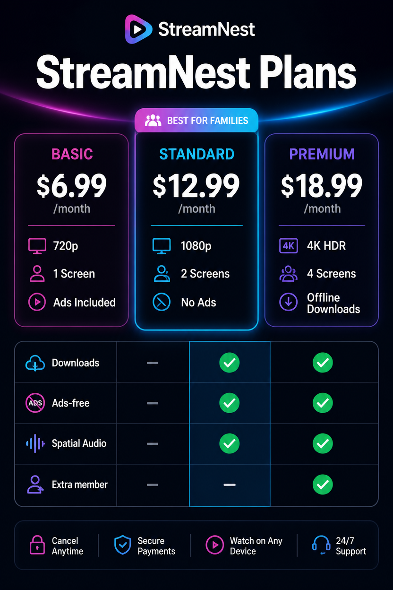

```text
A subscription pricing infographic, 2:3, titled 'StreamNest Plans'. Three plan columns: Basic $6.99 (720p, 1 screen, ads), Standard $12.99 (1080p, 2 screens, no ads), Premium $18.99 (4K HDR, 4 screens, offline). A feature comparison grid below with green checks and dashes for Downloads, Ads-free, Spatial Audio, Extra member. The middle Standard column is boxed as 'Best for Families'. Deep midnight-blue background, magenta and cyan accent gradients, glowing plan cards, rounded corners, sleek streaming-service UI aesthetic, bold white type.
```

Model: GPT Image 2 · Author: API Models (apimodels.app)

[Original source](https://github.com/apimodels/gpt-image-2-prompts/blob/980d100f3bd0f2cde4cf38835daeb742bf1cac65/prompts.json#L11063) · [Provenance and original license](data/projectd-batch-0008.json)

## Design illustration · Gym Membership Tiers — API Models · CC BY 4.0

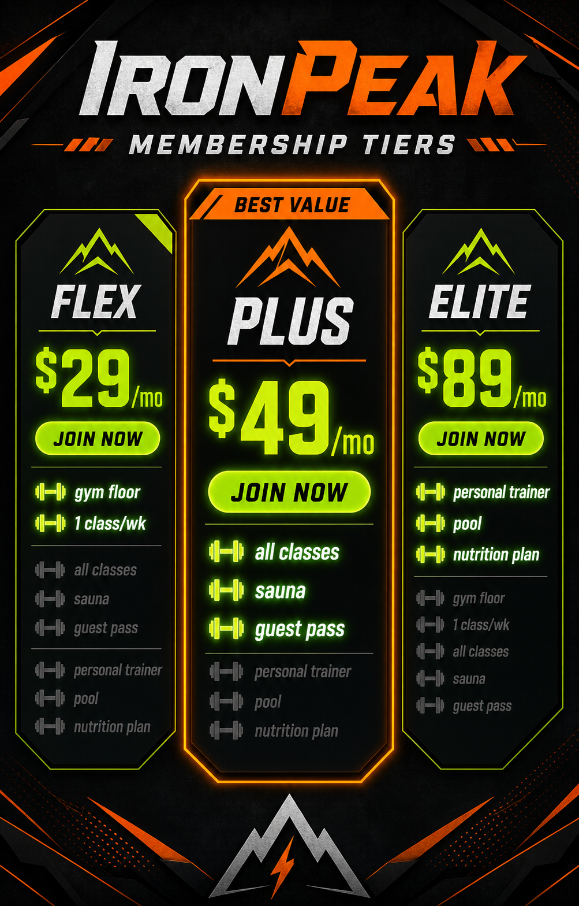

```text
A fitness pricing infographic, 4:5, titled 'IronPeak Membership Tiers'. Three bold cards: Flex $29/mo, Plus $49/mo (center, highlighted with an energetic orange band 'Best Value'), Elite $89/mo. Each lists access perks with dumbbell icons: Flex (gym floor, 1 class/wk), Plus (all classes, sauna, guest pass), Elite (personal trainer, pool, nutrition plan). Included perks glow green, others dim. A large price and 'Join Now' pill button per card. Dark athletic charcoal background, neon-orange and lime accents, angular design, energetic modern gym branding.
```

Model: GPT Image 2 · Author: API Models (apimodels.app)

[Original source](https://github.com/apimodels/gpt-image-2-prompts/blob/980d100f3bd0f2cde4cf38835daeb742bf1cac65/prompts.json#L11078) · [Provenance and original license](data/projectd-batch-0008.json)

## Design illustration · Cloud Storage Plans — API Models · CC BY 4.0


```text
A cloud-service pricing infographic, 2:3, titled 'SkyVault Storage Plans'. Four slim columns: Free 5GB, Personal 200GB $2.99, Family 2TB $9.99 (highlighted 'Popular'), Business 5TB $19.99. Rows compare storage, devices, file recovery days, shared folders, and support level with green checks and grey dashes. A small stacked-bar visual shows relative storage size per plan. Clean white background, sky-blue and cloud-grey palette, floating cloud icons, rounded plan cards, gentle drop shadows, airy modern cloud-app aesthetic.
```

Model: GPT Image 2 · Author: API Models (apimodels.app)

[Original source](https://github.com/apimodels/gpt-image-2-prompts/blob/980d100f3bd0f2cde4cf38835daeb742bf1cac65/prompts.json#L11093) · [Provenance and original license](data/projectd-batch-0008.json)

## Design illustration · Web Hosting Plan Comparison — API Models · CC BY 4.0

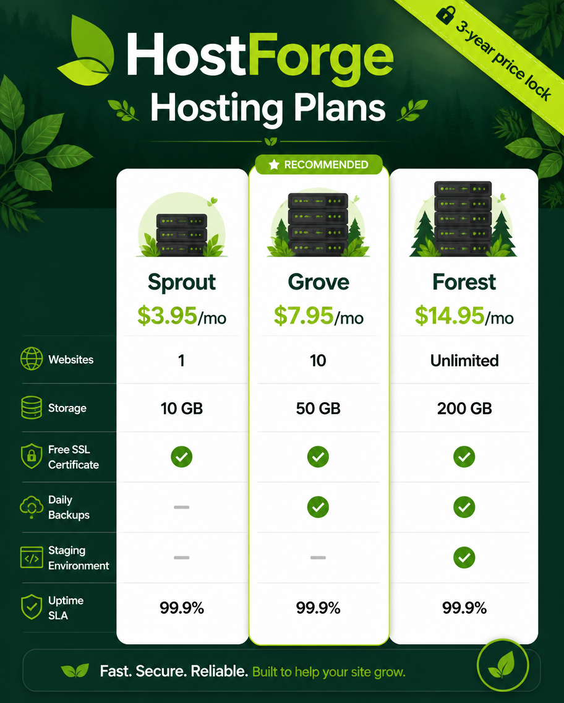

```text
A hosting pricing infographic, 4:5, titled 'HostForge Hosting Plans'. Three columns: Sprout $3.95/mo, Grove $7.95/mo (highlighted 'Recommended'), Forest $14.95/mo. Feature rows: websites (1 vs 10 vs unlimited), storage (10 vs 50 vs 200 GB), free SSL (all yes), daily backups (no/yes/yes), staging (no/no/yes), uptime SLA (99.9%). Green checks, grey dashes, small server-rack icons per column head. A promo ribbon '3-year price lock'. Deep forest-green and lime palette, white cards, leaf motifs, tidy modern tech-hosting layout.
```

Model: GPT Image 2 · Author: API Models (apimodels.app)

[Original source](https://github.com/apimodels/gpt-image-2-prompts/blob/980d100f3bd0f2cde4cf38835daeb742bf1cac65/prompts.json#L11108) · [Provenance and original license](data/projectd-batch-0008.json)

## Design illustration · Mobile Data Plan Comparison — API Models · CC BY 4.0

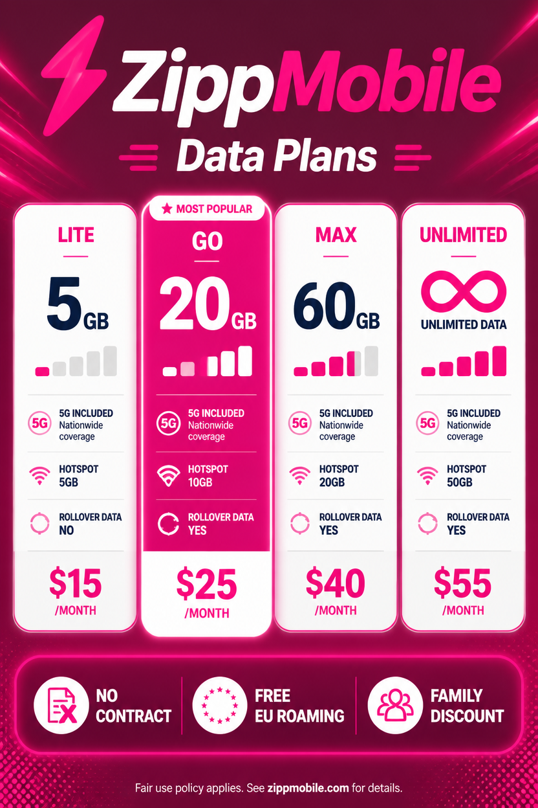

```text
A telecom pricing infographic, 2:3, titled 'ZippMobile Data Plans'. Four plan cards in a row: Lite 5GB $15, Go 20GB $25 (highlighted), Max 60GB $40, Unlimited $55. Each card shows data amount as a large number, a coverage note (5G included), hotspot allowance, and rollover data yes/no. A horizontal signal-bar motif scales with data size. A bottom comparison strip lists 'No contract', 'Free EU roaming', 'Family discount'. Bright magenta-and-white palette, rounded neon cards, bold friendly sans-serif, energetic modern carrier branding.
```

Model: GPT Image 2 · Author: API Models (apimodels.app)

[Original source](https://github.com/apimodels/gpt-image-2-prompts/blob/980d100f3bd0f2cde4cf38835daeb742bf1cac65/prompts.json#L11123) · [Provenance and original license](data/projectd-batch-0008.json)

## Design illustration · Health Insurance Plan Tiers — API Models · CC BY 4.0


```text
An insurance pricing infographic, 4:5, titled 'ShieldCare Plans'. Three tiers named Bronze, Silver, Gold, each with a shield emblem in its metal color. Rows: monthly premium ($180 vs $260 vs $360), deductible ($3,000 vs $1,500 vs $500), copay ($40 vs $25 vs $15), dental (no/add-on/included), coverage rating meter (70% vs 80% vs 90%). The Silver plan is boxed 'Most Balanced'. A small coverage meter bar per plan. Calm teal-and-white palette, rounded cards, trustworthy clean layout, subtle drop shadows, professional insurance aesthetic.
```

Model: GPT Image 2 · Author: API Models (apimodels.app)

[Original source](https://github.com/apimodels/gpt-image-2-prompts/blob/980d100f3bd0f2cde4cf38835daeb742bf1cac65/prompts.json#L11138) · [Provenance and original license](data/projectd-batch-0008.json)

## Design illustration · Meal Kit Subscription Tiers — API Models · CC BY 4.0

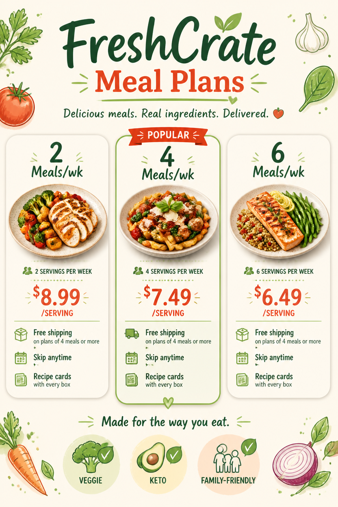

```text
A food-subscription pricing infographic, 2:3, titled 'FreshCrate Meal Plans'. Three appetizing cards: 2 Meals/wk $8.99/serving, 4 Meals/wk $7.49 (highlighted 'Popular'), 6 Meals/wk $6.49. Each shows a plated-dish illustration, servings per week, price per serving, and perks (free shipping over 4 meals, skip anytime, recipe cards). Green leaf checkmarks list dietary tags: Veggie, Keto, Family-friendly. Warm cream background, fresh green and tomato-red accents, hand-drawn vegetable doodles, rounded cards, cozy appetizing modern food branding.
```

Model: GPT Image 2 · Author: API Models (apimodels.app)

[Original source](https://github.com/apimodels/gpt-image-2-prompts/blob/980d100f3bd0f2cde4cf38835daeb742bf1cac65/prompts.json#L11153) · [Provenance and original license](data/projectd-batch-0008.json)

## Design illustration · Coworking Space Plans — API Models · CC BY 4.0


```text
A workspace pricing infographic, 4:5, titled 'DeskHub Membership'. Three columns: Hot Desk $99/mo, Dedicated Desk $199/mo (highlighted 'Popular'), Private Office $449/mo. Rows compare access hours (business vs 24/7 vs 24/7), meeting-room credits (2 vs 6 vs unlimited), locker (no/yes/yes), mail handling (no/yes/yes), guest passes (0 vs 3 vs 10). Green checks, grey dashes, small isometric desk icons per column. A footer chip '1 free trial day'. Warm terracotta-and-cream palette, rounded cards, plant doodles, friendly modern coworking aesthetic.
```

Model: GPT Image 2 · Author: API Models (apimodels.app)

[Original source](https://github.com/apimodels/gpt-image-2-prompts/blob/980d100f3bd0f2cde4cf38835daeb742bf1cac65/prompts.json#L11168) · [Provenance and original license](data/projectd-batch-0008.json)

## Design illustration · Online Course Platform Plans — API Models · CC BY 4.0


```text
An edtech pricing infographic, 2:3, titled 'LearnLoop Access Plans'. Three tiers: Free (2 courses), Learner $12/mo (highlighted), Career $29/mo. Rows compare course library (limited vs full vs full+certificates), downloads (no/yes/yes), mentor sessions (0 vs 1 vs 4/mo), projects (no/yes/yes), certificate (no/no/yes). Green checks and grey dashes, small graduation-cap icon per column. A progress-bar motif shows relative value. Soft indigo-and-white palette, rounded cards, playful book and lightbulb doodles, friendly modern learning-app aesthetic, bold clean type.
```

Model: GPT Image 2 · Author: API Models (apimodels.app)

[Original source](https://github.com/apimodels/gpt-image-2-prompts/blob/980d100f3bd0f2cde4cf38835daeb742bf1cac65/prompts.json#L11183) · [Provenance and original license](data/projectd-batch-0008.json)

## Design illustration · Pour-Over Coffee Steps — API Models · CC BY 4.0

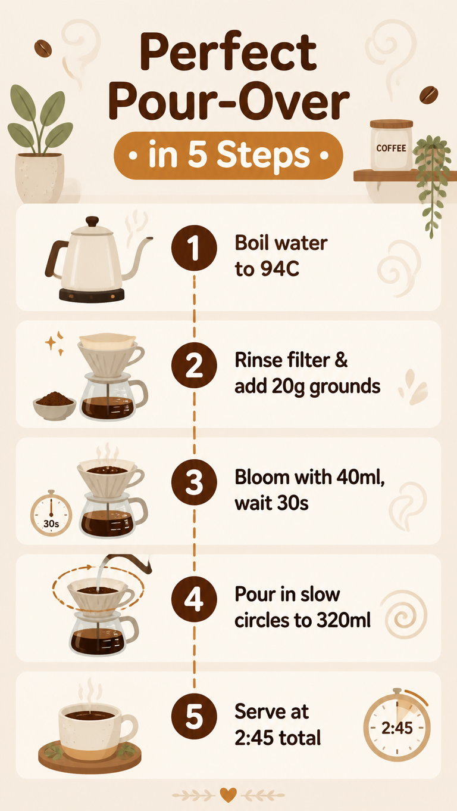

```text
A how-to infographic, 9:16 vertical, titled 'Perfect Pour-Over in 5 Steps'. Five numbered horizontal rows, each with a flat-illustrated icon on the left and a short instruction on the right: 1 Boil water to 94C, 2 Rinse filter & add 20g grounds, 3 Bloom with 40ml, wait 30s, 4 Pour in slow circles to 320ml, 5 Serve at 2:45 total. A vertical dashed line links the numbered circles down the page. Warm caramel and cream palette, coffee-brown numerals, steam-swirl motifs, clean rounded sans-serif, cozy modern kitchen aesthetic.
```

Model: GPT Image 2 · Author: API Models (apimodels.app)

[Original source](https://github.com/apimodels/gpt-image-2-prompts/blob/980d100f3bd0f2cde4cf38835daeb742bf1cac65/prompts.json#L11198) · [Provenance and original license](data/projectd-batch-0008.json)

## Design illustration · How To Repot A Houseplant — API Models · CC BY 4.0

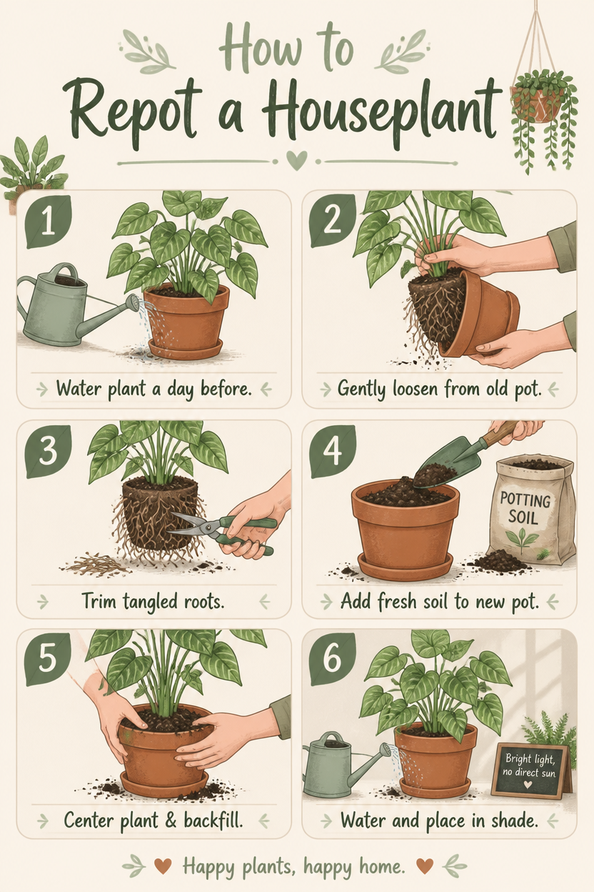

```text
A gardening how-to infographic, 2:3, titled 'How to Repot a Houseplant'. Six illustrated steps in a 2x3 grid: 1 Water plant a day before, 2 Gently loosen from old pot, 3 Trim tangled roots, 4 Add fresh soil to new pot, 5 Center plant & backfill, 6 Water and place in shade. Each panel has a numbered leaf badge, a soft botanical illustration, and one-line text. Earthy terracotta, sage green, and cream palette, hand-drawn soil texture, rounded panels, calm friendly plant-care aesthetic, clean handwritten-style headings.
```

Model: GPT Image 2 · Author: API Models (apimodels.app)

[Original source](https://github.com/apimodels/gpt-image-2-prompts/blob/980d100f3bd0f2cde4cf38835daeb742bf1cac65/prompts.json#L11213) · [Provenance and original license](data/projectd-batch-0008.json)

## Design illustration · Change A Bike Tire — API Models · CC BY 4.0

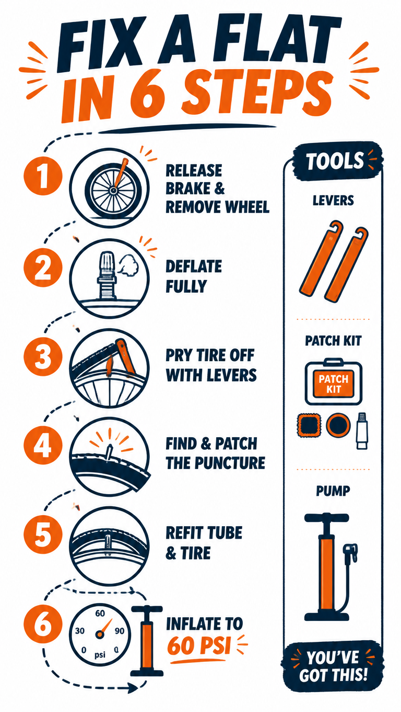

```text
A repair how-to infographic, 9:16, titled 'Fix a Flat in 6 Steps'. Six vertical steps, each with a bold number, a clean line-art icon, and short text: 1 Release brake & remove wheel, 2 Deflate fully, 3 Pry tire off with levers, 4 Find & patch the puncture, 5 Refit tube & tire, 6 Inflate to 60 psi. A dashed route line snakes between steps. A small tools sidebar lists levers, patch kit, pump. Bright orange-and-navy palette, white background, thick rounded icons, energetic modern DIY-guide style, bold sans-serif.
```

Model: GPT Image 2 · Author: API Models (apimodels.app)

[Original source](https://github.com/apimodels/gpt-image-2-prompts/blob/980d100f3bd0f2cde4cf38835daeb742bf1cac65/prompts.json#L11228) · [Provenance and original license](data/projectd-batch-0008.json)

## Design illustration · Sourdough Starter Guide — API Models · CC BY 4.0

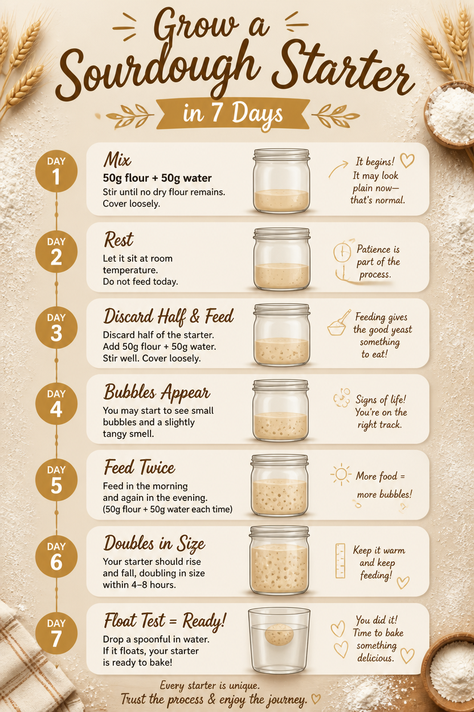

```text
A baking how-to infographic, 2:3, titled 'Grow a Sourdough Starter in 7 Days'. A seven-day vertical timeline, each day a rounded milestone card: Day 1 mix 50g flour + 50g water, Day 2 rest, Day 3 discard half & feed, Day 4 bubbles appear, Day 5 feed twice, Day 6 doubles in size, Day 7 float test ready. Small jar illustrations show rising bubbles growing each day. Warm wheat-and-cream palette, flour-dust texture, rounded cards, friendly hand-lettered headings, cozy artisanal bakery aesthetic.
```

Model: GPT Image 2 · Author: API Models (apimodels.app)

[Original source](https://github.com/apimodels/gpt-image-2-prompts/blob/980d100f3bd0f2cde4cf38835daeb742bf1cac65/prompts.json#L11243) · [Provenance and original license](data/projectd-batch-0008.json)

## Design illustration · Set Up Home Router — API Models · CC BY 4.0

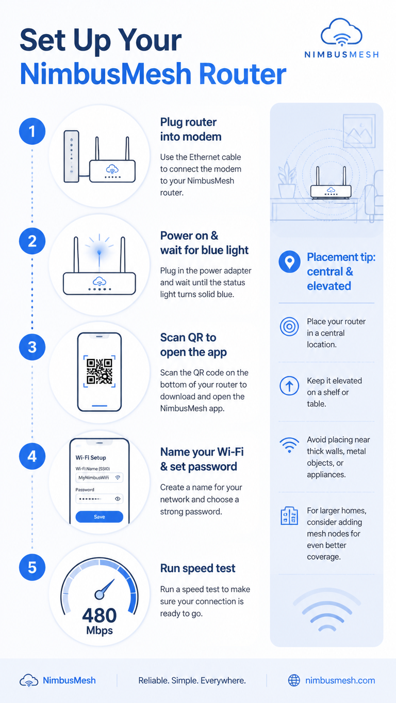

```text
A tech how-to infographic, 9:16, titled 'Set Up Your NimbusMesh Router'. Five numbered steps in a clean vertical flow: 1 Plug router into modem, 2 Power on & wait for blue light, 3 Scan QR to open the app, 4 Name your Wi-Fi & set password, 5 Run speed test (shows 480 Mbps). Each step pairs a flat line icon with concise text and a connecting dotted line. A sidebar note 'Placement tip: central & elevated'. Cool blue-and-white palette, rounded device icons, subtle signal-wave motifs, clean minimalist tech-guide aesthetic.
```

Model: GPT Image 2 · Author: API Models (apimodels.app)

[Original source](https://github.com/apimodels/gpt-image-2-prompts/blob/980d100f3bd0f2cde4cf38835daeb742bf1cac65/prompts.json#L11258) · [Provenance and original license](data/projectd-batch-0008.json)

## Design illustration · Fold An Origami Crane — API Models · CC BY 4.0

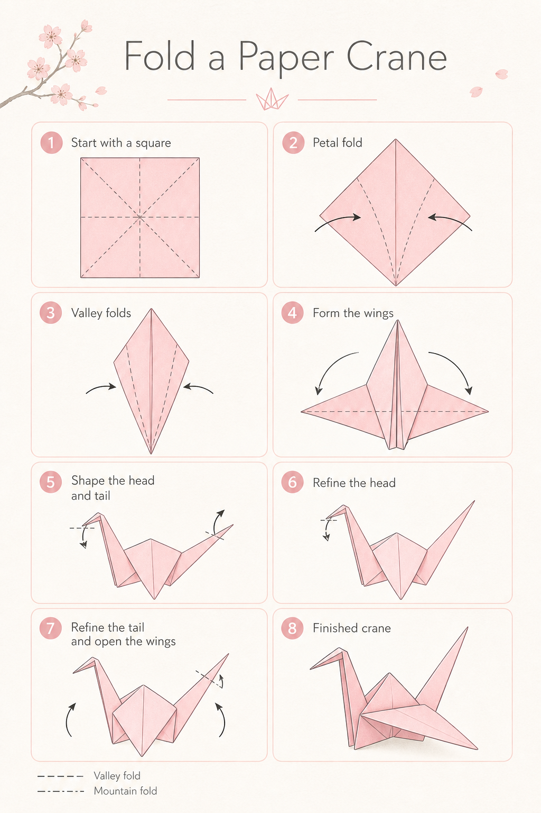

```text
A craft how-to infographic, 2:3, titled 'Fold a Paper Crane'. Eight sequential diagram panels in a 2x4 grid showing folding stages: square base, petal fold, valley folds, forming wings, shaping head and tail, finished crane. Each panel uses clean origami diagram conventions: dashed valley lines, dash-dot mountain lines, thin arrows for fold direction, and a small step number. Soft pastel pink and cream palette, light grey guide lines, minimalist Japanese-craft aesthetic, elegant thin sans-serif, plenty of white space.
```

Model: GPT Image 2 · Author: API Models (apimodels.app)

[Original source](https://github.com/apimodels/gpt-image-2-prompts/blob/980d100f3bd0f2cde4cf38835daeb742bf1cac65/prompts.json#L11273) · [Provenance and original license](data/projectd-batch-0008.json)

## Design illustration · Start Composting At Home — API Models · CC BY 4.0

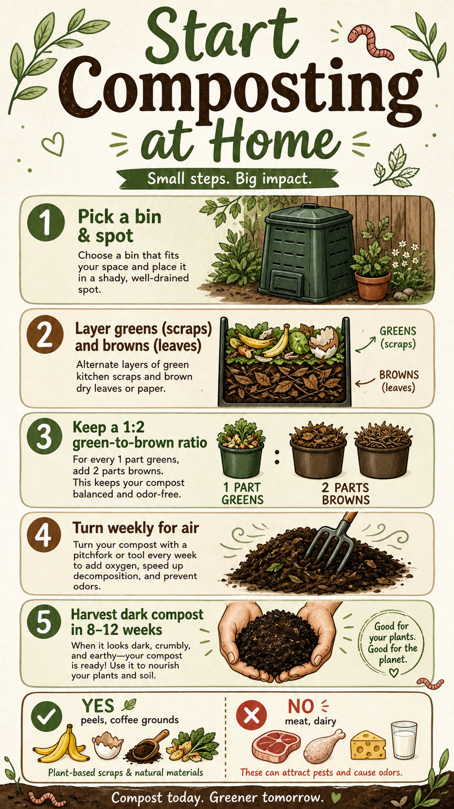

```text
An eco how-to infographic, 9:16, titled 'Start Composting at Home'. Five stacked steps with earthy illustrated icons: 1 Pick a bin & spot, 2 Layer greens (scraps) and browns (leaves), 3 Keep a 1:2 green-to-brown ratio, 4 Turn weekly for air, 5 Harvest dark compost in 8-12 weeks. A small do/don't box lists 'Yes: peels, coffee grounds / No: meat, dairy'. Warm soil-brown and leaf-green palette, hand-drawn textures, worm and leaf doodles, rounded panels, wholesome friendly sustainability aesthetic.
```

Model: GPT Image 2 · Author: API Models (apimodels.app)

[Original source](https://github.com/apimodels/gpt-image-2-prompts/blob/980d100f3bd0f2cde4cf38835daeb742bf1cac65/prompts.json#L11288) · [Provenance and original license](data/projectd-batch-0008.json)

## Design illustration · How To Tie A Tie — API Models · CC BY 4.0

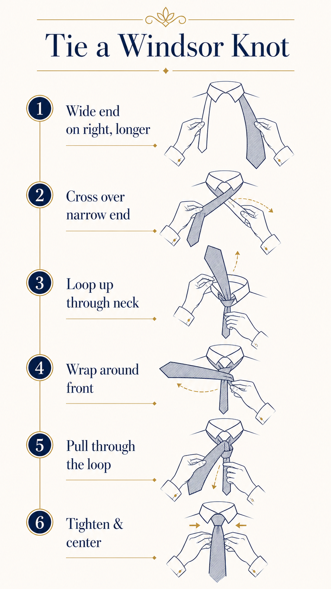

```text
A style how-to infographic, 9:16, titled 'Tie a Windsor Knot'. Six vertical steps, each showing a clean line diagram of hands and tie with dashed motion arrows: 1 Wide end on right, longer, 2 Cross over narrow end, 3 Loop up through neck, 4 Wrap around front, 5 Pull through the loop, 6 Tighten & center. Small numbered circles connect the steps down the page. Sophisticated navy-and-gold palette, off-white background, minimalist elegant icons, refined thin serif headings, tidy gentlemen's-guide aesthetic.
```

Model: GPT Image 2 · Author: API Models (apimodels.app)

[Original source](https://github.com/apimodels/gpt-image-2-prompts/blob/980d100f3bd0f2cde4cf38835daeb742bf1cac65/prompts.json#L11318) · [Provenance and original license](data/projectd-batch-0008.json)

## Design illustration · Build A Raised Garden Bed — API Models · CC BY 4.0

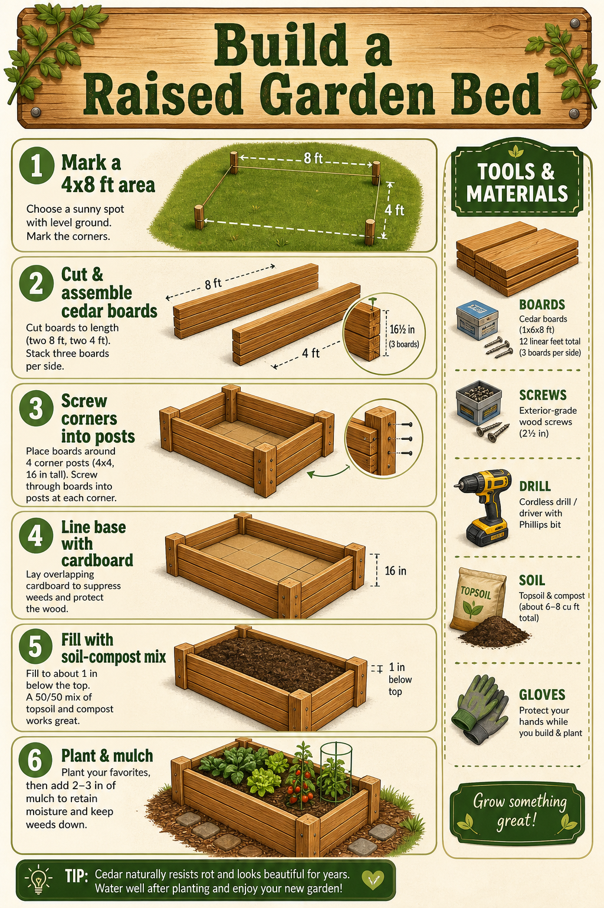

```text
A DIY how-to infographic, 2:3, titled 'Build a Raised Garden Bed'. Six steps in a vertical flow with isometric illustrations: 1 Mark a 4x8 ft area, 2 Cut & assemble cedar boards, 3 Screw corners into posts, 4 Line base with cardboard, 5 Fill with soil-compost mix, 6 Plant & mulch. A tools/materials sidebar lists boards, screws, drill, soil, gloves. Warm wood-brown and leafy-green palette, blueprint-style dotted measurements, rounded panels, friendly hands-on garden-project aesthetic, bold clean headings.
```

Model: GPT Image 2 · Author: API Models (apimodels.app)

[Original source](https://github.com/apimodels/gpt-image-2-prompts/blob/980d100f3bd0f2cde4cf38835daeb742bf1cac65/prompts.json#L11333) · [Provenance and original license](data/projectd-batch-0008.json)

## Ghost Barista Sticker Avatar — API Models · CC BY 4.0


```text
A sticker-style avatar of an adorable round white ghost wearing a tiny brown coffee-apron and floating while holding a steaming espresso cup. It has rosy blush cheeks and a shy smile. Thick white die-cut border, glossy vinyl sheen, gentle soft shadow, simple flat shading, plain warm-taupe background, small steam swirls and a heart doodle, centered square, cozy and cute messaging-sticker aesthetic.
```

Model: GPT Image 2 · Author: API Models (apimodels.app)

[Original source](https://github.com/apimodels/gpt-image-2-prompts/blob/980d100f3bd0f2cde4cf38835daeb742bf1cac65/prompts.json#L13418) · [Provenance and original license](data/projectd-batch-0008.json)

## Desert Ranger Fantasy Avatar — API Models · CC BY 4.0

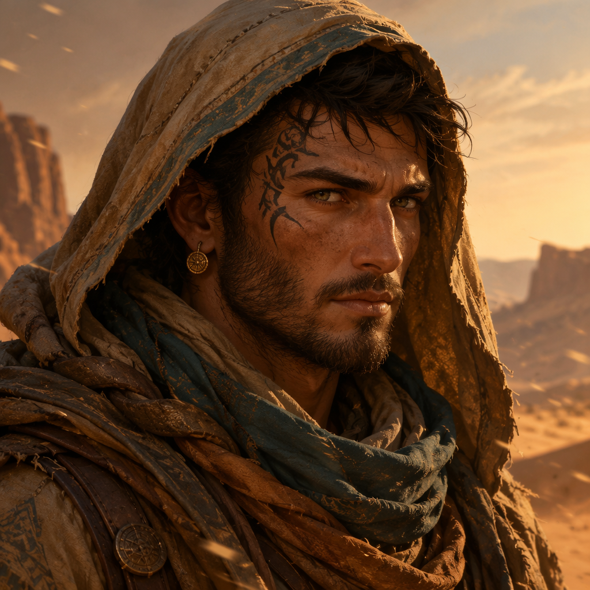

```text
A fantasy character avatar of a rugged desert ranger with tanned weathered skin, a sand-worn hood, and sharp hazel eyes. A faded tribal tattoo curves along his temple, and a bronze earring catches the light. He wears layered linen wraps in ochre and dusty teal. Painterly semi-realistic style, warm sunset backlight, drifting sand particles, blurred canyon dunes, three-quarter view, earthy palette, square crop, stoic adventurous mood.
```

Model: GPT Image 2 · Author: API Models (apimodels.app)

[Original source](https://github.com/apimodels/gpt-image-2-prompts/blob/980d100f3bd0f2cde4cf38835daeb742bf1cac65/prompts.json#L13433) · [Provenance and original license](data/projectd-batch-0008.json)

## Startup Founder 3D Avatar — API Models · CC BY 4.0


```text
A friendly 3D cartoon avatar of a young Korean woman with a sleek black bob, thin gold hoop earrings, and a confident grin. She wears a crisp white tee under a camel blazer. Clay-render style with smooth subsurface skin, soft even studio light, clean minimal palette of camel, white, and blush, blurred soft-gradient background, centered square headshot, chunky rounded proportions, bright optimistic entrepreneurial mood.
```

Model: GPT Image 2 · Author: API Models (apimodels.app)

[Original source](https://github.com/apimodels/gpt-image-2-prompts/blob/980d100f3bd0f2cde4cf38835daeb742bf1cac65/prompts.json#L13448) · [Provenance and original license](data/projectd-batch-0008.json)

## Kitsune Spirit Anime Avatar — API Models · CC BY 4.0

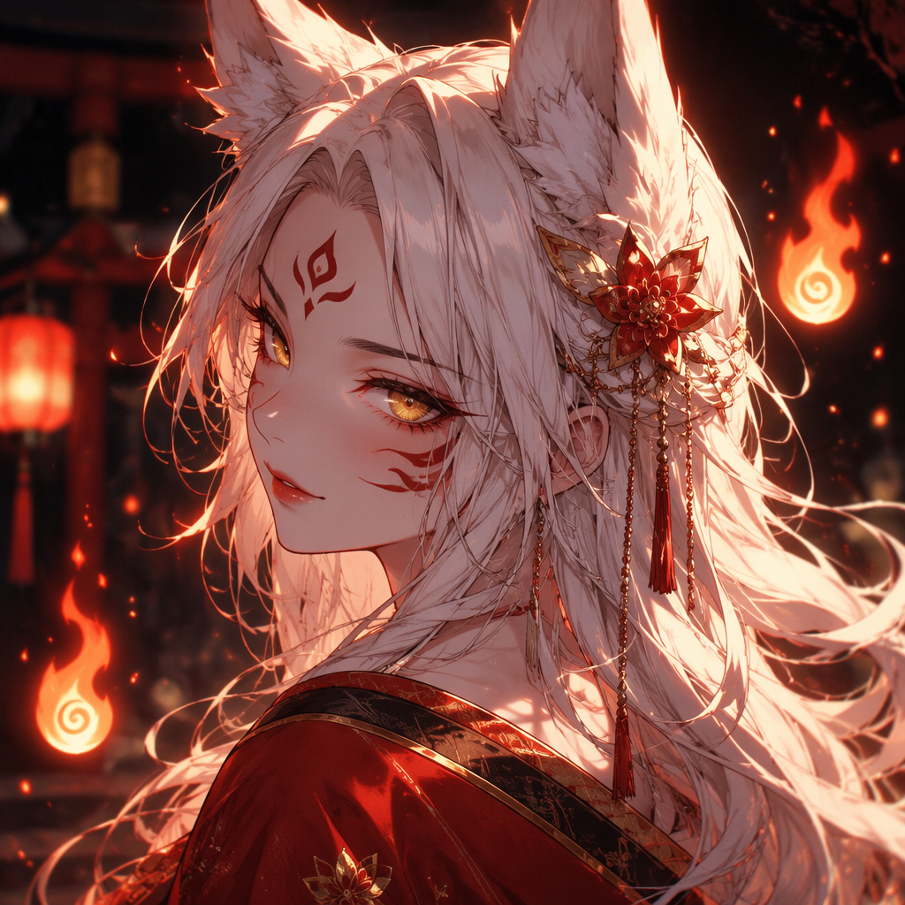

```text
An anime avatar of a mysterious kitsune spirit with white hair, glowing golden fox-eyes, and delicate red facial markings. Two fluffy white fox ears rise above her head. She wears a crimson kimono collar with gold trim. Painterly cel-shading, soft ember-orange rim light, floating spirit-flames, dark shrine bokeh with red lanterns, three-quarter view, warm-and-crimson palette, square crop, alluring and mystical mood.
```

Model: GPT Image 2 · Author: API Models (apimodels.app)

[Original source](https://github.com/apimodels/gpt-image-2-prompts/blob/980d100f3bd0f2cde4cf38835daeb742bf1cac65/prompts.json#L13463) · [Provenance and original license](data/projectd-batch-0008.json)

## Retro Robot Pixel Avatar — API Models · CC BY 4.0


```text
A 36x36 pixel-art avatar of a boxy retro robot with a rounded antenna, a green oscilloscope-line face display showing a smile, and rivet details on its metallic body. Cool palette of steel-gray, lime-green, and orange accents, chunky hard-edge pixels, subtle shading dither, dark-teal background with faint circuit lines, centered square, playful nostalgic 8-bit sci-fi vibe.
```

Model: GPT Image 2 · Author: API Models (apimodels.app)

[Original source](https://github.com/apimodels/gpt-image-2-prompts/blob/980d100f3bd0f2cde4cf38835daeb742bf1cac65/prompts.json#L13478) · [Provenance and original license](data/projectd-batch-0008.json)

## Snowboarder Chibi Avatar — API Models · CC BY 4.0


```text
A cute chibi avatar of an energetic snowboarder boy with frosty blue-tipped hair, orange ski goggles pushed up, and rosy wind-bitten cheeks. He grins and flashes a small peace sign, a snowboard tip visible over his shoulder. Big head, tiny body, bold rounded outlines, soft cel-shading, floating snowflake doodles, icy-blue gradient background, centered square, cheerful frosty kawaii mood.
```

Model: GPT Image 2 · Author: API Models (apimodels.app)

[Original source](https://github.com/apimodels/gpt-image-2-prompts/blob/980d100f3bd0f2cde4cf38835daeb742bf1cac65/prompts.json#L13493) · [Provenance and original license](data/projectd-batch-0008.json)

## Mushroom Wizard Sticker Avatar — API Models · CC BY 4.0


```text
A sticker-style avatar of a whimsical mushroom character with a red polka-dot cap, tiny glasses, and a long white beard, holding a glowing green potion. Big friendly eyes and a warm smile. Thick white die-cut border, glossy sticker sheen, simple soft shadow, saturated storybook colors, plain moss-green background, floating sparkle dots, centered square, charming fairy-tale sticker aesthetic.
```

Model: GPT Image 2 · Author: API Models (apimodels.app)

[Original source](https://github.com/apimodels/gpt-image-2-prompts/blob/980d100f3bd0f2cde4cf38835daeb742bf1cac65/prompts.json#L13508) · [Provenance and original license](data/projectd-batch-0008.json)

## Storm Mage Fantasy Avatar — API Models · CC BY 4.0


```text
A fantasy character avatar of a fierce storm mage with wind-tossed slate-gray hair, crackling silver eyes, and faint lightning veins glowing on his neck. He wears a dark stormcloud-blue robe with a high collar and a jagged crystal amulet. Painterly semi-realistic style, dramatic backlight, arcing electric-blue sparks, swirling cloud bokeh, three-quarter view, cool electric palette, square crop, powerful and intense mood.
```

Model: GPT Image 2 · Author: API Models (apimodels.app)

[Original source](https://github.com/apimodels/gpt-image-2-prompts/blob/980d100f3bd0f2cde4cf38835daeb742bf1cac65/prompts.json#L13523) · [Provenance and original license](data/projectd-batch-0008.json)

## Cyber Idol Anime Avatar — API Models · CC BY 4.0


```text
An anime avatar of a dazzling virtual idol with holographic gradient hair shifting from pink to blue, glowing heart-shaped pupils, and tiny LED star stickers on her cheeks. She wears a futuristic silver headset and a frilly neon-trimmed top. Glossy cel-shading with intense bloom, floating holographic UI hearts, dark stage bokeh with spotlight flares, three-quarter wink pose, vivid saturated palette, square crop, electric pop-idol energy.
```

Model: GPT Image 2 · Author: API Models (apimodels.app)

[Original source](https://github.com/apimodels/gpt-image-2-prompts/blob/980d100f3bd0f2cde4cf38835daeb742bf1cac65/prompts.json#L13538) · [Provenance and original license](data/projectd-batch-0008.json)

## Ghost Town Western Panel — API Models · CC BY 4.0


```text
A retro American comic panel in classic western style of a lone gunslinger named 'Cass Redwood' walking down a deserted dusty main street at high noon, hand hovering over her holster. Bold sun-bleached colors, halftone shading, thick outlines, dramatic long shadows. A caption box reads 'The town of Dry Fork had one law left—her.' Tumbleweed rolling past weathered saloon fronts, tense standoff atmosphere, gritty heroic energy.
```

Model: GPT Image 2 · Author: API Models (apimodels.app)

[Original source](https://github.com/apimodels/gpt-image-2-prompts/blob/980d100f3bd0f2cde4cf38835daeb742bf1cac65/prompts.json#L13853) · [Provenance and original license](data/projectd-batch-0008.json)

## Moving Day Webtoon — API Models · CC BY 4.0


```text
A vertical webtoon panel of a young couple in an empty new apartment surrounded by cardboard boxes, sitting on the floor sharing takeout from paper cartons and laughing. Warm golden late-afternoon light streams through bare windows, a single potted plant on the sill. Clean digital lineart, soft cel-shading, cozy amber palette. A speech bubble reads 'Home already feels right.' Tall vertical composition, tender hopeful slice-of-life mood.
```

Model: GPT Image 2 · Author: API Models (apimodels.app)

[Original source](https://github.com/apimodels/gpt-image-2-prompts/blob/980d100f3bd0f2cde4cf38835daeb742bf1cac65/prompts.json#L13868) · [Provenance and original license](data/projectd-batch-0008.json)

## Noir Jazz Club Panel — API Models · CC BY 4.0


```text
A noir graphic-novel panel of a lone singer at a smoky 1940s jazz club microphone, a spotlight carving her silhouette from the darkness while a shadowy audience watches. High-contrast black-and-white, deep ink pools, cigarette smoke curling through the light beam, dramatic single-source spotlight. A narration box reads 'She sang like she had nothing left to lose.' Cross-hatched textures, sultry moody atmosphere, cinematic melancholy.
```

Model: GPT Image 2 · Author: API Models (apimodels.app)

[Original source](https://github.com/apimodels/gpt-image-2-prompts/blob/980d100f3bd0f2cde4cf38835daeb742bf1cac65/prompts.json#L13883) · [Provenance and original license](data/projectd-batch-0008.json)

## Sleepy Dragon Bedtime Book — API Models · CC BY 4.0


```text
A kids' picture-book scene of a tiny round green dragon curling up in a cozy cave nest lined with soft moss and glowing crystals, yawning as a little firefly tucks a leaf-blanket over him. Soft crayon-and-watercolor style, warm nighttime glow, rounded gentle shapes, pastel palette with cozy shadows. A caption reads 'Even little dragons need their rest.' Peaceful, tender, and dreamy bedtime-story mood, wide soft composition.
```

Model: GPT Image 2 · Author: API Models (apimodels.app)

[Original source](https://github.com/apimodels/gpt-image-2-prompts/blob/980d100f3bd0f2cde4cf38835daeb742bf1cac65/prompts.json#L13898) · [Provenance and original license](data/projectd-batch-0008.json)

## Market Chase Manga Panel — API Models · CC BY 4.0


```text
A dynamic manga action panel of a young thief sprinting through a crowded outdoor bazaar, snatching an apple while dodging startled vendors, fabric awnings and spice baskets flying. A guard lunges after her a step behind. Sharp energetic inking, radiating motion lines, screentone crowd shadows, fisheye dynamic perspective. A shout bubble reads 'Stop that girl!' Warm sandy palette, chaotic playful kinetic energy.
```

Model: GPT Image 2 · Author: API Models (apimodels.app)

[Original source](https://github.com/apimodels/gpt-image-2-prompts/blob/980d100f3bd0f2cde4cf38835daeb742bf1cac65/prompts.json#L13913) · [Provenance and original license](data/projectd-batch-0008.json)

## First Day Jitters Webtoon — API Models · CC BY 4.0


```text
A vertical webtoon panel of a nervous new student standing at the doorway of a bustling classroom, clutching a notebook to her chest as curious classmates glance over. Clean digital lineart, soft cel-shading, bright morning light through tall windows, warm pastel palette. A thought bubble reads 'Please let this go okay.' Small sweat drop, gentle blush. Tall vertical composition, relatable coming-of-age slice-of-life mood.
```

Model: GPT Image 2 · Author: API Models (apimodels.app)

[Original source](https://github.com/apimodels/gpt-image-2-prompts/blob/980d100f3bd0f2cde4cf38835daeb742bf1cac65/prompts.json#L13928) · [Provenance and original license](data/projectd-batch-0008.json)

## Haunted Manor Storyboard — API Models · CC BY 4.0


```text
A three-frame horizontal storyboard of a character entering a haunted manor. Frame 1: wide establishing shot of a decrepit mansion under a stormy sky, lightning flashing. Frame 2: medium shot of a hand slowly pushing open a creaking front door, darkness beyond. Frame 3: low-angle interior shot of a shadowy figure at the top of a grand staircase, candle flickering. Rough grayscale storyboard sketch style, loose lines, camera arrows, spooky atmospheric notes.
```

Model: GPT Image 2 · Author: API Models (apimodels.app)

[Original source](https://github.com/apimodels/gpt-image-2-prompts/blob/980d100f3bd0f2cde4cf38835daeb742bf1cac65/prompts.json#L13943) · [Provenance and original license](data/projectd-batch-0008.json)

## Superhero Landing Panel — API Models · CC BY 4.0


```text
A retro American comic panel in bold modern-classic style of a masked heroine named 'Nova Wren' landing in a dramatic three-point crouch, cracking the pavement, cape billowing behind her. Bold saturated colors, halftone dot shading, thick black outlines, radiating impact lines. A yellow burst caption reads 'The city's last hope had arrived.' Debris and dust erupt around her, cyan-and-magenta night sky, punchy heroic energy.
```

Model: GPT Image 2 · Author: API Models (apimodels.app)

[Original source](https://github.com/apimodels/gpt-image-2-prompts/blob/980d100f3bd0f2cde4cf38835daeb742bf1cac65/prompts.json#L13958) · [Provenance and original license](data/projectd-batch-0008.json)

## Campfire Story Picture Book — API Models · CC BY 4.0


```text
A kids' picture-book scene of three young animal friends—a fox, a rabbit, and a hedgehog—sitting around a crackling campfire under a starry forest sky, roasting marshmallows and sharing a spooky story. Soft warm firelight glows on their faces, tall dark pines around them. Gentle gouache style, cozy orange-and-navy palette, rounded friendly shapes. A caption reads 'And then, they heard a rustle...' Whimsical cozy adventurous storybook mood, wide composition.
```

Model: GPT Image 2 · Author: API Models (apimodels.app)

[Original source](https://github.com/apimodels/gpt-image-2-prompts/blob/980d100f3bd0f2cde4cf38835daeb742bf1cac65/prompts.json#L13973) · [Provenance and original license](data/projectd-batch-0008.json)

## Robot Repair Shop 4-Koma — API Models · CC BY 4.0


```text
A vertical 4-koma comic set in a cluttered robot repair shop. Panel 1: a mechanic girl tightens a bolt on a small round robot. Panel 2: the robot's eyes light up, it beeps happily. Panel 3: it enthusiastically hugs her, arms whirring. Panel 4: it accidentally squeezes too hard, she pops out flat like a pancake, robot looks worried. Clean flat cartoon style, bright cheerful colors, expressive faces, playful sci-fi humor.
```

Model: GPT Image 2 · Author: API Models (apimodels.app)

[Original source](https://github.com/apimodels/gpt-image-2-prompts/blob/980d100f3bd0f2cde4cf38835daeb742bf1cac65/prompts.json#L13988) · [Provenance and original license](data/projectd-batch-0008.json)

## Underwater Ruins Panel — API Models · CC BY 4.0


```text
A single atmospheric comic panel of a lone diver drifting through the sunken ruins of an ancient marble city, shafts of blue light piercing the water, schools of silver fish weaving between broken columns. Detailed lineart with flowing screentone gradients, cool teal-and-turquoise palette, floating particles and bubbles. A caption box reads 'The sea keeps its oldest secrets well.' Serene mysterious mood, dramatic underwater depth, cinematic wonder.
```

Model: GPT Image 2 · Author: API Models (apimodels.app)

[Original source](https://github.com/apimodels/gpt-image-2-prompts/blob/980d100f3bd0f2cde4cf38835daeb742bf1cac65/prompts.json#L14003) · [Provenance and original license](data/projectd-batch-0008.json)

## Neon Racer Duel Panel — API Models · CC BY 4.0


```text
A dynamic manga action panel of two futuristic hovercars racing neck-and-neck down a rain-soaked neon highway, sparks trailing, reflections streaking across wet asphalt. Sharp bold inking, intense speed lines, screentone motion blur, low chase-cam angle. A shout bubble reads 'You're not winning this one!' Electric magenta, cyan, and yellow neon palette, high-octane kinetic energy, cinematic cyber-racing tension.
```

Model: GPT Image 2 · Author: API Models (apimodels.app)

[Original source](https://github.com/apimodels/gpt-image-2-prompts/blob/980d100f3bd0f2cde4cf38835daeb742bf1cac65/prompts.json#L14018) · [Provenance and original license](data/projectd-batch-0008.json)

## Farewell at the Station Panel — API Models · CC BY 4.0


```text
A single emotional comic panel of two friends saying goodbye on a train platform as one leans out an open carriage window, their hands almost touching as the train begins to pull away. Soft detailed lineart, warm golden dusk light, gentle screentone shadows, drifting steam. A caption box reads 'Some goodbyes are just see-you-laters.' Bittersweet tender mood, shallow depth of field, cinematic emotional weight.
```

Model: GPT Image 2 · Author: API Models (apimodels.app)

[Original source](https://github.com/apimodels/gpt-image-2-prompts/blob/980d100f3bd0f2cde4cf38835daeb742bf1cac65/prompts.json#L14033) · [Provenance and original license](data/projectd-batch-0008.json)

## Alien Diner Encounter Panel — API Models · CC BY 4.0


```text
A single humorous comic panel of a tired late-night diner waitress calmly taking an order from a small green three-eyed alien seated in a booth, its tentacle pointing at a menu, a flying saucer parked outside the window. Clean detailed lineart, warm diner lighting with a cool alien glow, retro-diner palette. A speech bubble from the alien reads 'I'll have the pancakes... all of them.' Deadpan comedic sci-fi mood, cozy cinematic framing.
```

Model: GPT Image 2 · Author: API Models (apimodels.app)

[Original source](https://github.com/apimodels/gpt-image-2-prompts/blob/980d100f3bd0f2cde4cf38835daeb742bf1cac65/prompts.json#L14048) · [Provenance and original license](data/projectd-batch-0008.json)

## Lighthouse Keeper Storyboard — API Models · CC BY 4.0


```text
A three-frame horizontal storyboard of a lighthouse keeper during a storm. Frame 1: wide shot of a lone lighthouse on a cliff, giant waves crashing, beam sweeping the dark sea. Frame 2: interior medium shot of the keeper cranking the lamp gears by lantern light, rain streaking the glass. Frame 3: point-of-view from the light out to a tiny ship spotted in the waves. Rough grayscale storyboard sketch style, loose energetic lines, camera-movement arrows, dramatic weather notes.
```

Model: GPT Image 2 · Author: API Models (apimodels.app)

[Original source](https://github.com/apimodels/gpt-image-2-prompts/blob/980d100f3bd0f2cde4cf38835daeb742bf1cac65/prompts.json#L14063) · [Provenance and original license](data/projectd-batch-0008.json)

## Design illustration · Design Agency Landing Page — API Models · CC BY 4.0


```text
A bold landing-page hero mockup for a creative studio 'Northlight Studio'. Full-bleed dark hero with an oversized gradient headline 'We build brands that move', a short tagline, and a rounded 'Start a project' button. A subtle animated-looking particle motif in the background. Top nav with wordmark left and Work / Services / About / Contact right. Below the fold, a horizontal marquee of invented client names. Dark charcoal background, electric-lime accent, huge expressive typography, generous negative space, 16:9 desktop.
```

Model: GPT Image 2 · Author: API Models (apimodels.app)

[Original source](https://github.com/apimodels/gpt-image-2-prompts/blob/980d100f3bd0f2cde4cf38835daeb742bf1cac65/prompts.json#L14378) · [Provenance and original license](data/projectd-batch-0008.json)

## Design illustration · Ticketing App Event Screen — API Models · CC BY 4.0


```text
A mobile event-ticketing app screen mockup for an app 'Frontrow'. Vertical phone frame, top hero image of a concert crowd with a back arrow and share icon. Below a content sheet with the event title 'Neon Nights Festival', date and venue rows with line icons, a ticket-tier selector showing General, VIP, and Backstage with prices, a quantity stepper, and a bright 'Get tickets' sticky button. A small map preview and a lineup chip row below. Dark vibrant UI, purple-to-pink gradient accents, rounded cards, bold type.
```

Model: GPT Image 2 · Author: API Models (apimodels.app)

[Original source](https://github.com/apimodels/gpt-image-2-prompts/blob/980d100f3bd0f2cde4cf38835daeb742bf1cac65/prompts.json#L14393) · [Provenance and original license](data/projectd-batch-0008.json)

## Style demo · X-ray — mechanical keyboard


```text
Create a detailed X-ray visualization of a modern mechanical keyboard.

Show:
- switches
- PCB
- stabilizers
- plate
- USB controller
- wiring
- case construction

Semi-transparent outer shell.
Clean technical visualization.
Dark neutral background.
No unnecessary text.
16:9.
```

Model: Not disclosed · Author: Vibe Coder's Life (vibecoderslife.com)

[Original source](https://github.com/kondasviktor/vcl-ai-image-prompts/blob/695e086fc3043c0ca39f1ad2b33fdcf3b94a35b4/recipes/xray.md) · [Provenance and original license](data/projectd-batch-0008.json)

## Style demo · Exploded view — Apple MacBook


```text
Create an exploded-view technical illustration of an Apple MacBook.

Separate along a vertical axis:
- lid / display assembly
- keyboard deck
- battery
- logic board
- speakers
- trackpad
- bottom case
- screws as small callouts (optional)

Studio lighting, dark background, photoreal materials, even spacing between parts, 16:9.
No people. No extra logos besides a tasteful Apple-like mark if needed for recognition.
```

Model: Not disclosed · Author: Vibe Coder's Life (vibecoderslife.com)

[Original source](https://github.com/kondasviktor/vcl-ai-image-prompts/blob/695e086fc3043c0ca39f1ad2b33fdcf3b94a35b4/recipes/explodedview.md) · [Provenance and original license](data/projectd-batch-0008.json)

## Style demo · Cutaway — two-story house


```text
Create a single-scene architectural cutaway of a two-story house.

One camera, 3/4 view. Cut the near facade away so you see:
- ground-floor living and kitchen
- stairs
- two bedrooms upstairs
- roof structure
- people-scale furniture for size

Photoreal daylight. Keep it ONE image, not four panels, not a dollhouse exploded into a grid. 16:9.
```

Model: Not disclosed · Author: Vibe Coder's Life (vibecoderslife.com)

[Original source](https://github.com/kondasviktor/vcl-ai-image-prompts/blob/695e086fc3043c0ca39f1ad2b33fdcf3b94a35b4/recipes/cutaway.md) · [Provenance and original license](data/projectd-batch-0008.json)

## Style demo · Blueprint — Tesla Cybertruck


```text
Create a detailed technical blueprint of a Tesla Cybertruck.

Show:
- front, side, and top orthographic views on one sheet
- white construction lines and dimensions
- callouts for body panels, wheels, and light bars
- blue blueprint grid background
- no photorealistic materials, no environment, no people

Clean engineering drawing. High contrast white on blue. 16:9. No extra decorative text.
```

Model: Not disclosed · Author: Vibe Coder's Life (vibecoderslife.com)

[Original source](https://github.com/kondasviktor/vcl-ai-image-prompts/blob/695e086fc3043c0ca39f1ad2b33fdcf3b94a35b4/recipes/blueprint.md) · [Provenance and original license](data/projectd-batch-0008.json)

## Style demo · Cross-section — electric motor


```text
Create a technical cross-section of a small industrial electric motor.

One vertical cutting plane through the axis. Show stator, rotor, windings, shaft, bearings, housing.
Cut face in true materials; uncut side remains intact.
Neutral studio background, 16:9, sparse labels only if they stay readable.
Not an exploded view. Not a four-panel diagram.
```

Model: Not disclosed · Author: Vibe Coder's Life (vibecoderslife.com)

[Original source](https://github.com/kondasviktor/vcl-ai-image-prompts/blob/695e086fc3043c0ca39f1ad2b33fdcf3b94a35b4/recipes/crosssection.md) · [Provenance and original license](data/projectd-batch-0008.json)

## Style demo · Isometric — espresso machine


```text
Create a clean isometric illustration of a prosumer espresso machine.

True isometric (no perspective vanishing). Show portafilter, steam wand, drip tray, buttons.
Soft studio lighting, simple pedestal shadow, 16:9.
Product-design viz, not a cartoon city.
```

Model: Not disclosed · Author: Vibe Coder's Life (vibecoderslife.com)

[Original source](https://github.com/kondasviktor/vcl-ai-image-prompts/blob/695e086fc3043c0ca39f1ad2b33fdcf3b94a35b4/recipes/isometric.md) · [Provenance and original license](data/projectd-batch-0008.json)

## Style demo · Poster — AI conference one-sheet


```text
Create a theatrical conference poster.

Title text exactly: "VIBE CODING SUMMIT 2026"
Layout: bold title in the top third, one large hero subject (laptop with soft neon rim light), lots of negative space, Swiss / Bauhaus restraint.
Colors: near-black background, #7fff6e accent, white secondary type.
No tiny unreadable paragraphs. No fake QR codes. No watermarks. 16:9.
```

Model: Not disclosed · Author: Vibe Coder's Life (vibecoderslife.com)

[Original source](https://github.com/kondasviktor/vcl-ai-image-prompts/blob/695e086fc3043c0ca39f1ad2b33fdcf3b94a35b4/recipes/poster.md) · [Provenance and original license](data/projectd-batch-0008.json)

## Style demo · Infographic — how HTTPS works


```text
Create a clean infographic: How HTTPS works, for developers.

Four or five steps max: DNS, TCP, TLS handshake, encrypted HTTP.
Flat vector, limited palette, large readable labels, 16:9.
No tiny paragraph walls. No fake browser chrome clutter.
Dark or light — pick one and stay consistent.
```

Model: Not disclosed · Author: Vibe Coder's Life (vibecoderslife.com)

[Original source](https://github.com/kondasviktor/vcl-ai-image-prompts/blob/695e086fc3043c0ca39f1ad2b33fdcf3b94a35b4/recipes/infographic.md) · [Provenance and original license](data/projectd-batch-0008.json)

## Style demo · Product shot — wireless earbuds


```text
Create a commercial product photograph of a pair of matte-black wireless earbuds in an open charging case.

Softbox lighting, subtle reflection on a seamless light-gray cyclorama, 16:9.
Sharp, catalog-ready, no people, no logo watermarks, no text overlays.
```

Model: Not disclosed · Author: Vibe Coder's Life (vibecoderslife.com)

[Original source](https://github.com/kondasviktor/vcl-ai-image-prompts/blob/695e086fc3043c0ca39f1ad2b33fdcf3b94a35b4/recipes/productshot.md) · [Provenance and original license](data/projectd-batch-0008.json)

## Style demo · App mockup — habit-tracker iOS app


```text
Create a photoreal iPhone mockup showing one screen of a habit-tracker app.

UI: today's habits, streak count, simple checkboxes, calm typography.
Device at a slight angle on a desk, soft daylight. 16:9.
Readable UI, not lorem-ipsum blur. No Apple marketing lockup.
```

Model: Not disclosed · Author: Vibe Coder's Life (vibecoderslife.com)

[Original source](https://github.com/kondasviktor/vcl-ai-image-prompts/blob/695e086fc3043c0ca39f1ad2b33fdcf3b94a35b4/recipes/appmockup.md) · [Provenance and original license](data/projectd-batch-0008.json)

## Style demo · YouTube thumbnail — I tested 3 image models


```text
Create a YouTube thumbnail, 16:9.

Big readable words: I TESTED 3 IMAGE MODELS
Three small tiles hinting ChatGPT / Gemini / Grok without official logos if that is cleaner.
High contrast, face optional. Not a desktop screenshot. Not a 4K wallpaper.
Leave a little safe margin so YouTube crop does not kill the type.
```

Model: Not disclosed · Author: Vibe Coder's Life (vibecoderslife.com)

[Original source](https://github.com/kondasviktor/vcl-ai-image-prompts/blob/695e086fc3043c0ca39f1ad2b33fdcf3b94a35b4/recipes/youtubethumbnail.md) · [Provenance and original license](data/projectd-batch-0008.json)

## Style demo · Landing page — indie SaaS waitlist


```text
Create a desktop screenshot of a marketing landing page for an indie developer tool.

Above the fold: short headline, one sentence, email waitlist field, primary button.
Below: three benefit tiles. Dark theme, tasteful, not a Dribbble clutter dump.
16:9 crop of the browser content area. No real company trademarks.
```

Model: Not disclosed · Author: Vibe Coder's Life (vibecoderslife.com)

[Original source](https://github.com/kondasviktor/vcl-ai-image-prompts/blob/695e086fc3043c0ca39f1ad2b33fdcf3b94a35b4/recipes/landingpage.md) · [Provenance and original license](data/projectd-batch-0008.json)

## 2 reference photos · Street Eye Contact


```text
Ultra photoreal candid moment on a quiet, nearly empty Milan street during the afternoon. The scene is bathed in bright 2 PM natural sunlight. Two people based on the uploaded reference images stand at a short distance looking directly at each other across the cobblestone street. Their eyes are locked in a quiet suspended second of first-sight love, with an intimate, magnetic, and deeply human emotional pull. The environment is serene, featuring only historic Milanese architecture and sunlight. Their faces maintain high identity fidelity to the input images, preserving unique facial features and bone structure. Hair colors, styles, and textures must be preserved exactly as seen in the reference images. One person wears a daily-style white-based cotton button-down shirt paired with classic blue denim jeans. Another wears a casual-fit dark shirt. Expressions show soft emotional pull, warmth, and silent recognition — soft affectionate eyes, relaxed eyelids, and a faint tender smile beginning naturally. No shock, no fear, no surprise. Shot on handheld 50mm f/2 lens, shallow depth of field with imperfect focus falloff. Mid-shot view, clear unobstructed composition with eye-level angle. Real 2 PM natural sun creating realistic low-light texture on skin with natural shine and visible pores (no smoothing). Cinematic but natural color palette with deep blacks, charcoal, and warm amber tones. Perfect human anatomy. No text, no ring, no perfect pose.
```

Model: Not disclosed · Author: Couple Goals AI (couplegoalsai.com)

[Original source](https://github.com/MarvsonHelbs/photorealistic-ai-couple-photo-prompts/blob/e9cd890aec6c267472783ecf3133a8ed3085e92f/cases/romantic-couple.md#case-1-street-eye-contact) · [Provenance and original license](data/projectd-batch-0008.json)

## 2 reference photos · Golden Hour Seaside Kiss


```text
Ultra-photorealistic candid medium-wide shot of two people sharing a soft, romantic kiss at a seaside open nature viewpoint during sunset golden hour. The two faces are derived directly from uploaded reference images, with original hairstyles, hair textures, and colors strictly preserved. The first person wears a casual denim jacket. The second person wears a relaxed casual shirt. They stand very close and share a soft natural kiss, with relaxed affectionate posture, relaxed shoulders, subtle lean into each other, believable kiss angle, gentle body closeness. Warm, low sunset light wraps around them, creating authentic skin texture highlights and detailed fabric patterns (no AI smoothing). Shot on 85mm cinematic portrait lens, f/2 aperture, shallow depth of field with a glowing horizon. Focus is on natural emotional romantic warmth, tenderness, deep connection, calm love, emotional intimacy and soft relaxed faces, gentle affectionate kiss, lightly closed eyes, natural emotional softness. No text, no staged feel, no exaggerated passion.
```

Model: Not disclosed · Author: Couple Goals AI (couplegoalsai.com)

[Original source](https://github.com/MarvsonHelbs/photorealistic-ai-couple-photo-prompts/blob/e9cd890aec6c267472783ecf3133a8ed3085e92f/cases/romantic-couple.md#case-2-golden-hour-seaside-kiss) · [Provenance and original license](data/projectd-batch-0008.json)

## 2 reference photos · Morning Bloom at Home


```text
An ultra photorealistic candid morning scene in a softly lit living room, capturing an intimate unstaged moment between two people. The person in the foreground gently holds a bouquet of fresh flowers with both hands, bringing them close to smell with eyes lightly closed or peacefully gazing downward, expression showing serene contentment and natural tenderness without exaggerated passion. Standing very close behind, the second person leans slightly forward with hands resting naturally on the first person's waist, conveying quiet protective warmth and comfortable closeness. The two faces are derived directly from uploaded reference images, with original hairstyles, hair textures, and colors strictly preserved. Both wear casual home loungewear suitable for morning comfort. Soft morning window light serves as the sole illumination, falling naturally across faces and flowers with subtle shadows, revealing authentic skin texture with visible pores and natural imperfections — no AI beauty filters, no plastic smoothing, no over-perfect symmetry. Shot with an 85mm portrait lens at f/2, featuring soft shallow depth of field blurring the lived-in background while keeping the figures and bouquet in focus, framed as a medium shot at natural eye-level. Realistic anatomy with natural shoulder and torso alignment, correct hand placement without warped or extra fingers, and fresh flowers with proper petal textures and natural stems. Muted morning color palette of soft cream, warm beige, and natural tones with restrained cinematic grading. No rings, no text, no watermarks, no logos, no posed advertisement aesthetics.
```

Model: Not disclosed · Author: Couple Goals AI (couplegoalsai.com)

[Original source](https://github.com/MarvsonHelbs/photorealistic-ai-couple-photo-prompts/blob/e9cd890aec6c267472783ecf3133a8ed3085e92f/cases/romantic-couple.md#case-3-morning-bloom-at-home) · [Provenance and original license](data/projectd-batch-0008.json)

## 2 reference photos · Candlelit Dinner


```text
An ultra photorealistic candid evening scene in a cozy home dining area, capturing a romantic private dinner between two people. They sit closely opposite, leaning gently toward one another while softly clinking wine glasses with affectionate subtle smiles and calm relaxed eyes, naturally engaged. The two faces are derived directly from uploaded reference images, with original hairstyles, hair textures, and colors preserved. Both wear elegant but realistic evening attire — soft fitted fabrics with natural draping, understated without overly formal styling. Shot with an 85mm portrait lens at f/1.8, featuring soft shallow depth of field warming blurring background while keeping subjects and table setting sharp, framed as a medium shot from a nearby three-quarter angle. Warm practical indoor light and candlelight serve as sole illumination, casting amber tones on faces with glassware highlights and natural shadows, revealing skin with visible pores and slight imperfections — no AI beauty filters, plastic smoothing, or over-perfect symmetry. Correct anatomy with natural seated posture, proper wine glass grip with no warped digits, believable glass reflections, and authentic understated table details. No rings, text, watermarks, logos, studio lighting, luxury catalog aesthetics, or perfect symmetry.
```

Model: Not disclosed · Author: Couple Goals AI (couplegoalsai.com)

[Original source](https://github.com/MarvsonHelbs/photorealistic-ai-couple-photo-prompts/blob/e9cd890aec6c267472783ecf3133a8ed3085e92f/cases/romantic-couple.md#case-4-candlelit-dinner) · [Provenance and original license](data/projectd-batch-0008.json)

