# ProjectD backfill batch 9

Original generation model, full prompt, reference requirements and original notices are retained. These are existing ProjectD records, not new 2.6 recipes.

## 2 reference photos · Night Embrace Under a Street Lamp

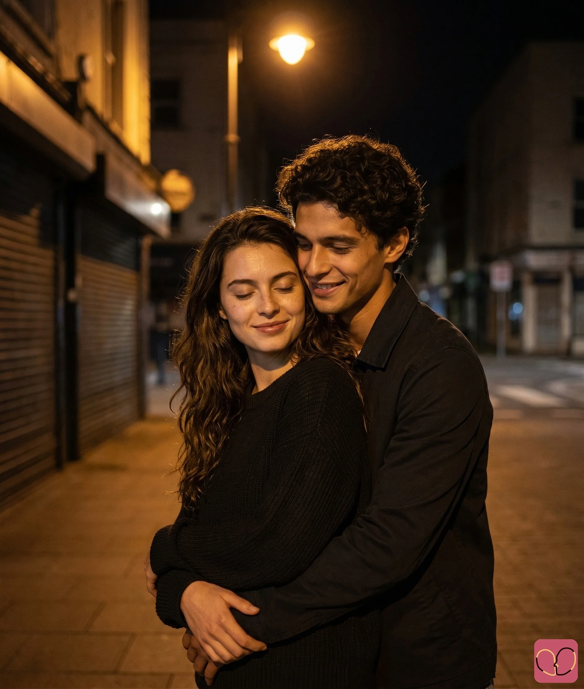

```text
An ultra photorealistic candid moment under a lone street lamp on a quiet empty street at night, capturing two people standing extremely close with no one else around. The person behind wraps both arms around the one in front in a natural embrace while the one leaning back rests with softly closed eyes and a genuine small smile, both swaying gently as if sharing a private melody. The two faces are derived directly from uploaded reference images, with original hairstyles, hair textures, and colors preserved. Both wear realistic evening attire with natural fabric textures. Shot with a 50mm handheld lens at f/1.8, featuring shallow depth of field blurring the empty street and distant urban backdrop while keeping the subjects sharp, framed as a slightly off-center medium shot at eye-level with subtle handheld realism. Single warm street lamp light acts as the sole illumination — soft amber glow creating uneven highlights on faces and shoulders with gentle shadows, revealing skin texture with visible pores and soft evening sheen, no AI beauty filters or plastic smoothing. Natural weight distribution with relaxed shoulders, correct arm anatomy and finger placement around waist without warping, no body intersection, no floating limbs. Deep blacks, warm amber tones against the empty dark street. No rings, text, watermarks, logos, studio lighting, perfect symmetry, or posed editorial aesthetics.
```

Model: Not disclosed · Author: Couple Goals AI (couplegoalsai.com)

[Original source](https://github.com/MarvsonHelbs/photorealistic-ai-couple-photo-prompts/blob/e9cd890aec6c267472783ecf3133a8ed3085e92f/cases/romantic-couple.md#case-5-night-embrace-under-a-street-lamp) · [Provenance and original license](data/projectd-batch-0009.json)

## 2 reference photos · Midnight Carry on the Sidewalk

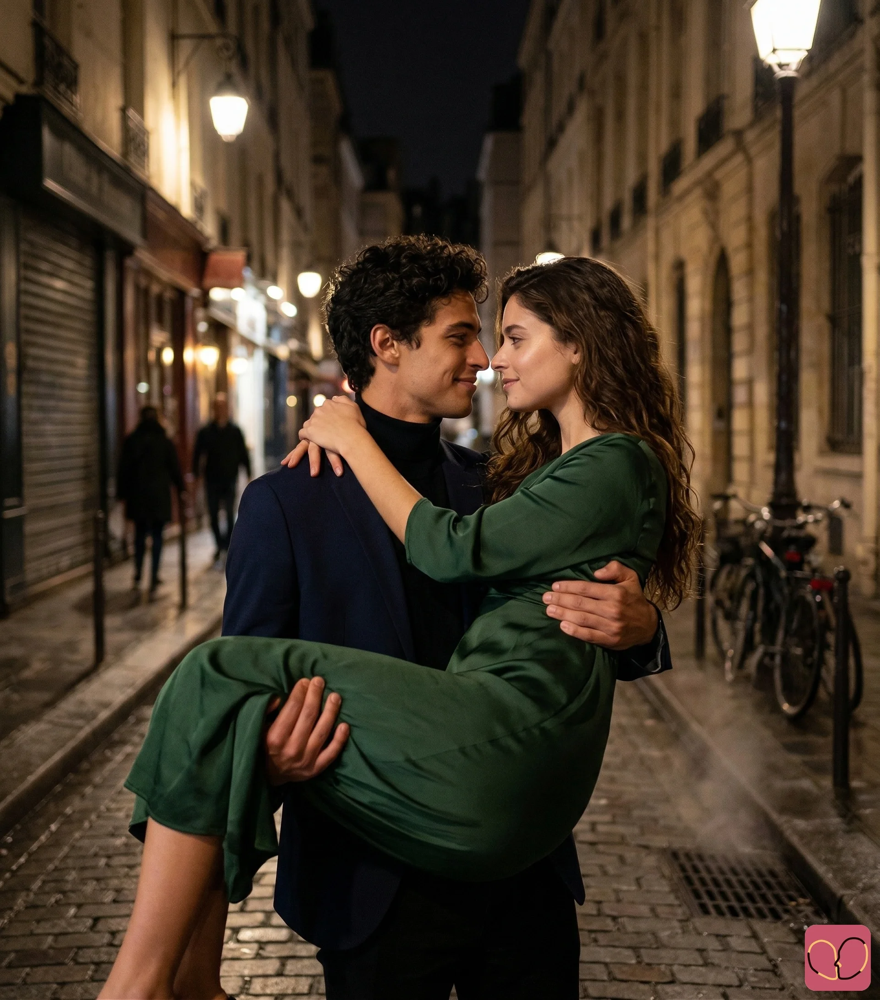

```text
An ultra photorealistic candid night scene on an elegant sidewalk after an evening out, capturing one person carrying the other securely in their arms in a natural bridal-style lift. They face each other with soft affectionate smiles, calm eyes, and relaxed cheeks radiating romantic warmth without exaggerated laughter. The two faces are derived directly from uploaded reference images, with original hairstyles, hair textures, and colors preserved. Both wear elegant evening attire with realistic fabric folds and natural creases. Shot with a 50mm cinematic lens at f/1.8, featuring soft shallow depth of field blurring the warm urban background while keeping the subjects sharp, framed as a medium-full shot at eye-level. Real street evening light only casts soft warm highlights on skin, hair, and fabric with realistic shadow falloff, revealing natural skin texture with visible pores and subtle imperfections — no AI beauty filters or plastic smoothing. Correct anatomy with secure arm support under the back and knees, natural weight distribution, proper finger placement without warping, realistic fabric compression at contact points, and no floating limbs or body intersection. Warm amber tones against deep evening shadows. No rings, text, watermarks, logos, studio lighting, perfect symmetry, or fashion editorial posing.
```

Model: Not disclosed · Author: Couple Goals AI (couplegoalsai.com)

[Original source](https://github.com/MarvsonHelbs/photorealistic-ai-couple-photo-prompts/blob/e9cd890aec6c267472783ecf3133a8ed3085e92f/cases/romantic-couple.md#case-6-midnight-carry-on-the-sidewalk) · [Provenance and original license](data/projectd-batch-0009.json)

## 2 reference photos · Shared Umbrella in the Rain

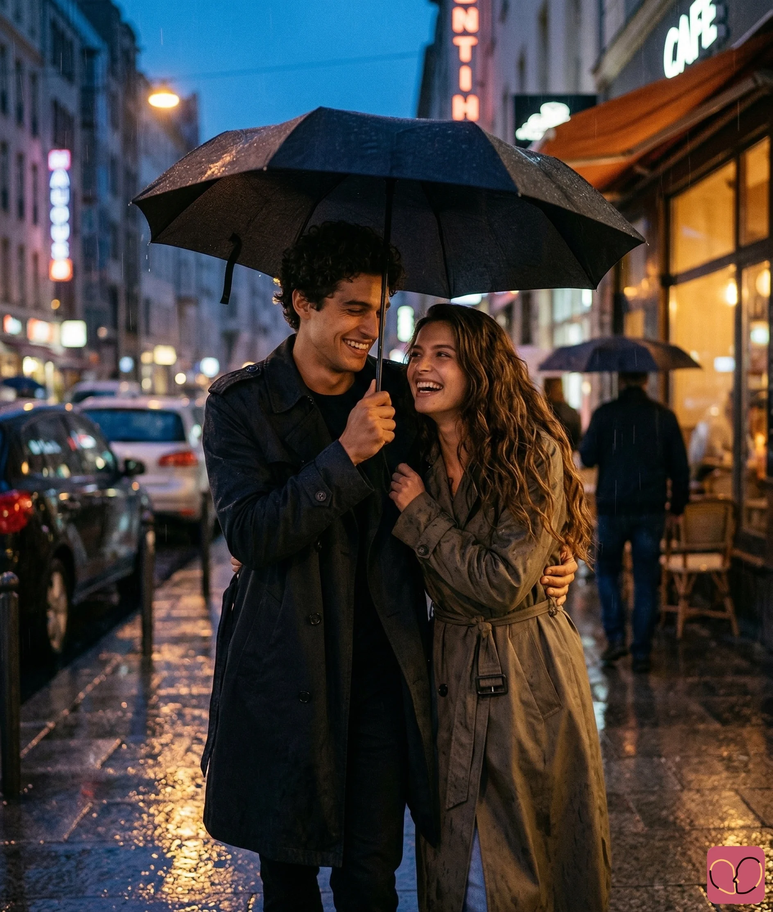

```text
An ultra photorealistic candid moment on a quiet rainy city street during evening blue hour, capturing two people hurrying together under a single umbrella. They move quickly with shoulders pressed close, sharing genuine laughter with soft affectionate eyes and relaxed faces, one person holding the umbrella while the other naturally leans into them. The two faces are derived directly from uploaded reference images, with original hairstyles, hair textures, and colors preserved. Both wear soft elegant rainy-evening attire with realistic slightly damp fabric textures. Shot with a 35mm cinematic street lens at f/2, featuring moderate shallow depth of field keeping rain reflections and background lights readable, framed as a medium-wide candid shot at natural eye-level with subtle motion blur in rain and movement suggesting handheld realism. Real street and shopfront lighting casts warm reflections on wet pavement alongside cool rainy ambient light, gentle highlights on umbrella edges and cheeks, revealing natural skin texture with visible pores and slight rain sheen — no AI beauty filters or plastic smoothing. Natural hurried posture with realistic stride, shoulder alignment, and slight imbalance from motion, correct umbrella grip with proper finger anatomy, no warped hands or extra fingers, believable damp fabric response. Wet asphalt blue-gray tones with warm amber reflections. No rings, text, watermarks, logos, studio lighting, perfect symmetry, or fashion editorial aesthetics.
```

Model: Not disclosed · Author: Couple Goals AI (couplegoalsai.com)

[Original source](https://github.com/MarvsonHelbs/photorealistic-ai-couple-photo-prompts/blob/e9cd890aec6c267472783ecf3133a8ed3085e92f/cases/romantic-couple.md#case-7-shared-umbrella-in-the-rain) · [Provenance and original license](data/projectd-batch-0009.json)

## 2 reference photos · Playful Chase on the Shoreline


```text
An ultra photorealistic candid moment along the shoreline during golden hour, capturing two people playfully chasing each other at the water's edge. One person runs slightly ahead while laughing with genuine relaxed eyes, the other chasing playfully behind, both mid-motion with natural arm swing and realistic balance as if caught mid-stride. The two faces are derived directly from uploaded reference images, with original hairstyles, hair textures, and colors preserved. Both wear casual beach T-shirts and knee-length shorts with natural wet fabric textures and realistic response to movement. Shot with a 35mm action lifestyle lens at f/2.2, featuring moderate shallow depth of field and subtle natural motion blur in limbs, framed as a wide candid shot at slightly low angle emphasizing dynamic energy. Natural sunlight creates warm reflections off ocean waves and wet sand, dynamic highlights on skin with soft shadow transitions, revealing authentic skin texture with visible pores and slight water sheen — no AI beauty filters or plastic smoothing. Correct anatomy with realistic muscle tension and joint angles, no floating limbs, no body intersection, no stiff posing. Warm gold sunlight, ocean turquoise, sand tones. No rings, text, watermarks, logos, studio lighting, perfect symmetry, or fashion shoot aesthetics.
```

Model: Not disclosed · Author: Couple Goals AI (couplegoalsai.com)

[Original source](https://github.com/MarvsonHelbs/photorealistic-ai-couple-photo-prompts/blob/e9cd890aec6c267472783ecf3133a8ed3085e92f/cases/romantic-couple.md#case-8-playful-chase-on-the-shoreline) · [Provenance and original license](data/projectd-batch-0009.json)

## 2 reference photos · Rose Wall Selfie

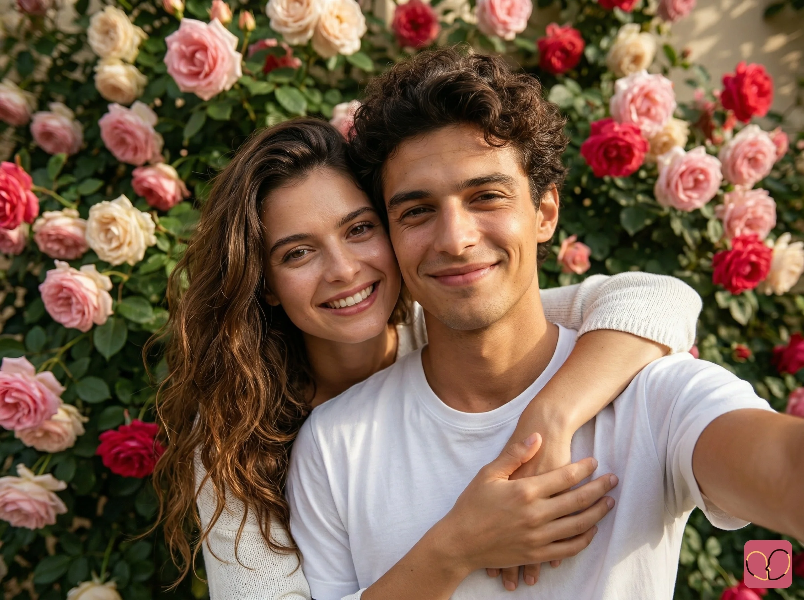

```text
An ultra photorealistic candid selfie moment in front of a lush rose wall, capturing two people standing close together. The person in front holds the phone while the other wraps arms gently around them from behind, both turning toward the camera with genuine happy smiles and relaxed eyes. The two faces are derived directly from uploaded reference images, with original hairstyles, hair textures, and colors preserved. Both wear casual comfortable everyday clothing with natural fabric textures and relaxed fits. The background features a dense wall of blooming roses in soft natural daylight, creating a warm romantic atmosphere with gentle shadows. Shot with a smartphone selfie perspective showing slight wide-angle distortion typical of front cameras, natural skin texture with visible pores, no AI beauty filters or plastic smoothing. No rings, text, watermarks, logos, or studio lighting. Horizontal, 4:3.
```

Model: Not disclosed · Author: Couple Goals AI (couplegoalsai.com)

[Original source](https://github.com/MarvsonHelbs/photorealistic-ai-couple-photo-prompts/blob/e9cd890aec6c267472783ecf3133a8ed3085e92f/cases/romantic-couple.md#case-9-rose-wall-selfie) · [Provenance and original license](data/projectd-batch-0009.json)

## 2 reference photos · Early Morning in Bed


```text
An ultra photorealistic candid early morning bedroom scene with soft daylight entering through a window, capturing two people lying close facing each other under natural messy sheets in a quiet waking state. The person behind gently touches the face of the person in front while they exchange soft calm smiles with sleepy relaxed eyes and faint natural expressions, radiating peace and deep intimacy without exaggerated emotion. The two faces are derived directly from uploaded reference images, with original hairstyles, hair textures, and colors preserved. Both wear minimal natural morning attire with slightly tousled hair and realistic sleep-messy appearance. Shot with a 50mm natural light portrait lens at f/2, featuring soft shallow depth of field gently blurring the lived-in background, framed as an intimate medium-close shot at a slightly side angle as if quietly captured from nearby. Natural window light only creates soft diffused illumination on skin and sheets with gentle shadows, revealing natural skin texture with visible pores and slight imperfections, no AI beauty filters or plastic smoothing. Natural relaxed lying posture with soft natural closeness, correct finger anatomy in the hair touch, no warped hands, no body intersection. Soft warm whites, beige tones, gentle skin colors with cinematic but subtle grading. No rings, text, watermarks, logos, studio lighting, perfect symmetry, overly sensual framing, or posed aesthetics.
```

Model: Not disclosed · Author: Couple Goals AI (couplegoalsai.com)

[Original source](https://github.com/MarvsonHelbs/photorealistic-ai-couple-photo-prompts/blob/e9cd890aec6c267472783ecf3133a8ed3085e92f/cases/romantic-couple.md#case-10-early-morning-in-bed) · [Provenance and original license](data/projectd-batch-0009.json)

## 2 reference photos · Castle Archway at Dusk

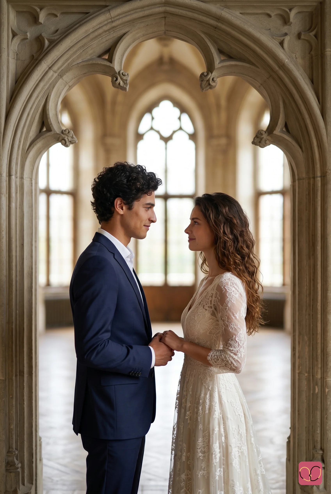

```text
An ultra photorealistic candid moment in an elegant grand hall of a historic European castle, tall arched windows with soft diffused natural light streaming through, ornate carved stone archways, capturing two people framed within a grand stone archway. They stand face to face within the arch, bodies turned in three-quarter profile toward the camera, hands gently clasped between them, both looking at each other with soft affectionate eyes and gentle relaxed smiles, the carved stone arch creating a natural frame around them like a living portrait against the grand hall beyond. The two faces are derived directly from the uploaded reference images, with their original hairstyles, hair textures, and colors strictly preserved. Both wear elegant wedding attire with natural fabric textures. Shot with a 50mm lens at f/2.2, featuring shallow depth of field blurring the grand hall beyond the arch while keeping subjects and the archway detail sharp, framed as a medium shot at natural eye-level. Soft diffused natural window light from the arch creates gentle gradients on their faces with subtle shadows, revealing skin texture with visible pores, no AI beauty filters, no plastic smoothing. Natural weight distribution with correct standing posture and arm anatomy, no body intersection, no floating limbs. Soft ivory, warm amber, and antique stone grey tones. No rings, text, watermarks, logos, or studio lighting.
```

Model: Not disclosed · Author: Couple Goals AI (couplegoalsai.com)

[Original source](https://github.com/MarvsonHelbs/photorealistic-ai-couple-photo-prompts/blob/e9cd890aec6c267472783ecf3133a8ed3085e92f/cases/wedding.md#case-1-castle-archway-at-dusk) · [Provenance and original license](data/projectd-batch-0009.json)

## 2 reference photos · Cherry Blossom Petal Embrace

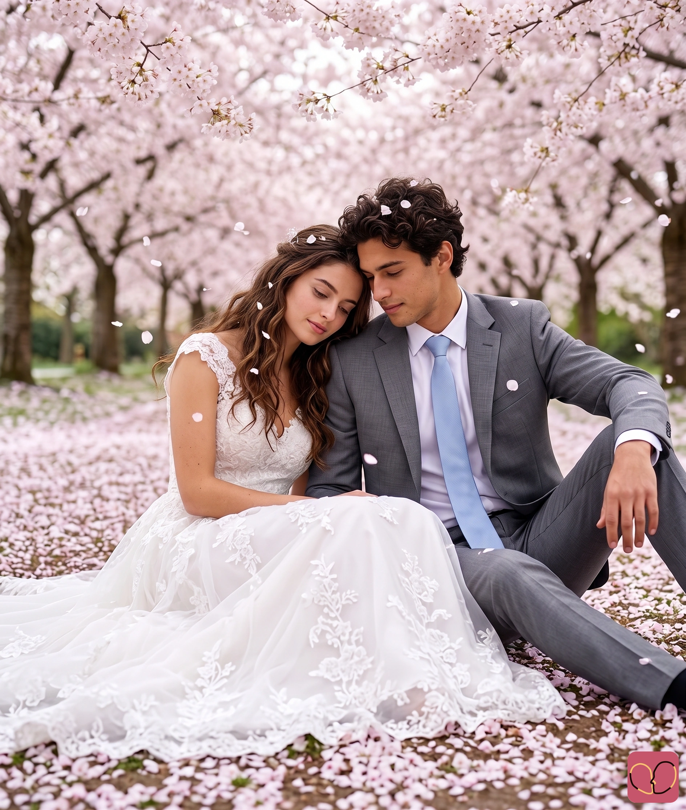

```text
An ultra photorealistic candid moment in a quiet garden under a canopy of blooming cherry blossom trees, soft pink petals drifting gently through the air and a thick carpet of fallen petals covering the grass, capturing two people resting together on the petal-covered ground. The bride sits with her white gown spread among the pale pink petals, leaning her head gently on the groom's shoulder while he tilts his cheek softly against her hair, both looking downward with peaceful content expressions, a few petals caught in their hair and on their clothing. The two faces are derived directly from the uploaded reference images, with their original hairstyles, hair textures, and colors strictly preserved. Both wear elegant wedding attire with natural fabric textures. Shot with an 85mm portrait lens at f/2, featuring shallow depth of field blurring the flowering canopy above and the distant garden while keeping subjects sharp, framed as a medium close-up at natural eye-level. Soft diffused spring morning light filtering through the blossom branches creates gentle dappled light on their faces with soft shadows, revealing skin texture with visible pores, no AI beauty filters, no plastic smoothing. Natural weight distribution with correct seated posture and neck anatomy, no body intersection, no floating limbs. Soft ivory, pale pink, and fresh spring green tones. No rings, text, watermarks, logos, or studio lighting.
```

Model: Not disclosed · Author: Couple Goals AI (couplegoalsai.com)

[Original source](https://github.com/MarvsonHelbs/photorealistic-ai-couple-photo-prompts/blob/e9cd890aec6c267472783ecf3133a8ed3085e92f/cases/wedding.md#case-2-cherry-blossom-petal-embrace) · [Provenance and original license](data/projectd-batch-0009.json)

## 2 reference photos · Beach Heart in the Sand

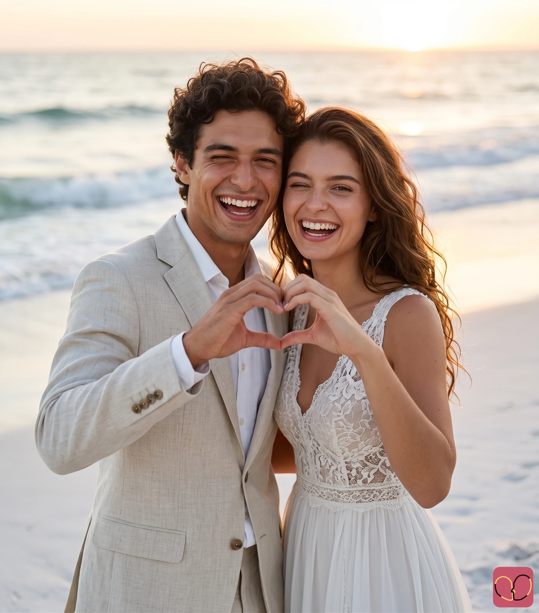

```text
An ultra photorealistic candid moment on a quiet stretch of white sand beach at sunset, gentle waves rolling in with soft white foam at the water's edge, capturing a playful lighthearted moment. The couple stands side by side facing the camera, each using both hands to form half of a heart shape that meets in the center between them, both wearing bright open laughter with one eye playfully winking, shoulders relaxed, bodies turned slightly toward each other. The two faces are derived directly from the uploaded reference images, with their original hairstyles, hair textures, and colors strictly preserved. Both wear elegant wedding attire with natural fabric textures. Shot with a 50mm lens at f/2.2, featuring shallow depth of field blurring the rolling waves and golden horizon while keeping subjects sharp, framed as a medium shot at natural eye-level. Warm golden hour sunlight creates even light on their faces with soft shadows revealing skin texture with visible pores, no AI beauty filters, no plastic smoothing. Natural weight distribution with correct standing posture and arm anatomy, no body intersection, no floating limbs, no awkward finger bending. Soft ivory, seafoam white, and warm gold tones. No rings, text, watermarks, logos, or studio lighting.
```

Model: Not disclosed · Author: Couple Goals AI (couplegoalsai.com)

[Original source](https://github.com/MarvsonHelbs/photorealistic-ai-couple-photo-prompts/blob/e9cd890aec6c267472783ecf3133a8ed3085e92f/cases/wedding.md#case-3-beach-heart-in-the-sand) · [Provenance and original license](data/projectd-batch-0009.json)

## 2 reference photos · Tropical Island Cliff Walk

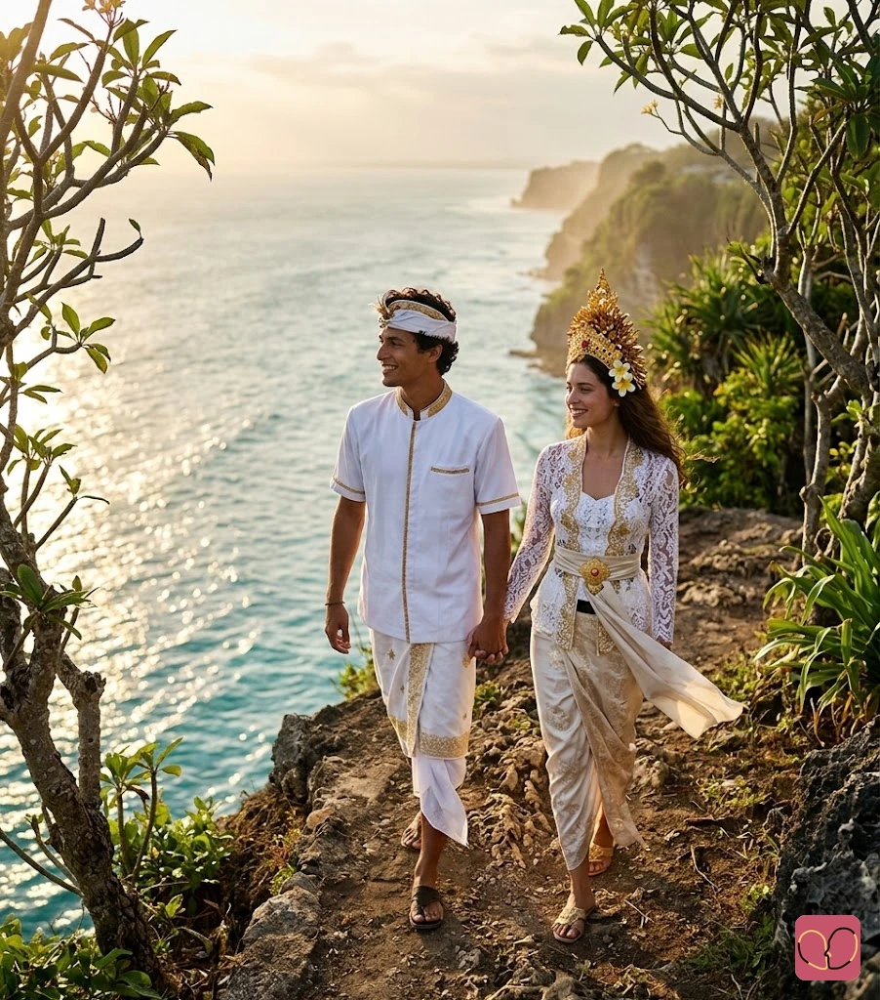

```text
An ultra photorealistic candid moment on a dramatic clifftop overlooking the vast ocean at sunset, tropical greenery and wild frangipani framing the edge, warm golden light reflecting off the turquoise water far below and distant coastline fading into warm atmospheric haze, capturing two people walking hand in hand along a narrow cliff path. They move with natural graceful stride, bodies turned in three-quarter profile toward the camera, the bride's flowing silk sarong and delicate kebaya hem stirred by the tropical breeze while the groom's ceremonial shirt catches the warm light, both sharing soft genuine smiles as they take in the vast ocean view. The two faces are derived directly from the uploaded reference images, with their original hairstyles, hair textures, and colors strictly preserved. Both wear traditional Balinese wedding attire with natural fabric textures, the bride in a white kebaya with intricate gold embroidery and flowing silk sarong with a golden crown (gelung) adorned with frangipani flowers, and the groom in a white ceremonial shirt with gold trim and traditional headwrap. Shot with a 35mm lens at f/2.8, featuring moderate depth of field keeping both subjects and the dramatic cliff edge sharp while softly blurring the distant ocean horizon, framed as a wide full-body shot at natural eye-level. Warm golden hour sunlight from the tropical sunset creates uneven rim light on their hair and shoulders with soft shadows on their faces, revealing skin texture with visible pores, no AI beauty filters, no plastic smoothing. Natural weight distribution with correct walking posture and arm anatomy, no body intersection, no floating limbs. Soft ivory, tropical gold, and warm ocean turquoise tones. No rings, text, watermarks, logos, or studio lighting.
```

Model: Not disclosed · Author: Couple Goals AI (couplegoalsai.com)

[Original source](https://github.com/MarvsonHelbs/photorealistic-ai-couple-photo-prompts/blob/e9cd890aec6c267472783ecf3133a8ed3085e92f/cases/wedding.md#case-4-tropical-island-cliff-walk) · [Provenance and original license](data/projectd-batch-0009.json)

## 2 reference photos · Nordic Forest Walk

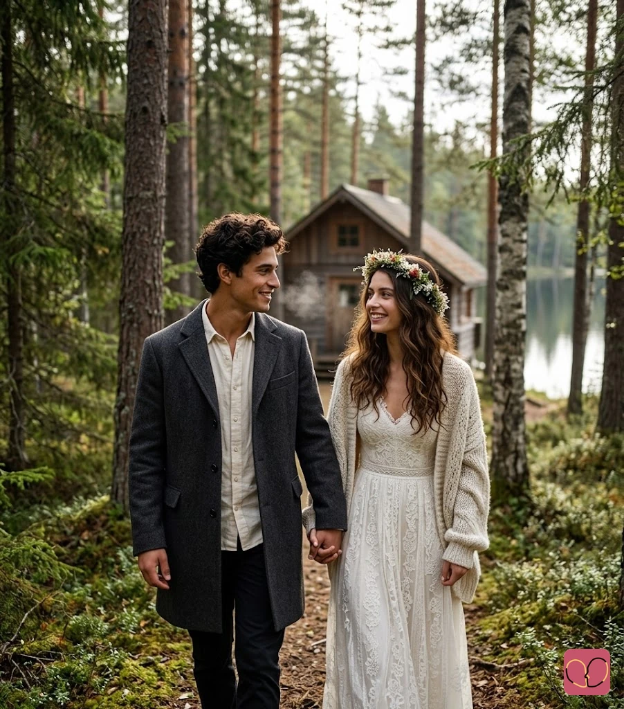

```text
An ultra photorealistic candid moment in a dense Nordic pine and birch forest surrounding a cozy wooden cabin, soft diffused light filtering through tall evergreens, moss-covered forest floor with fallen pine needles and a still mirror-like lake visible through the trees, capturing two people walking hand in hand along a narrow forest path. They move with natural relaxed stride, bodies turned in three-quarter profile toward the camera, the bride's ivory lace dress hem brushing against the moss while her chunky hand-knit wool shawl drapes softly over her shoulders, the groom's charcoal wool coat catching the cool forest light, both sharing relaxed genuine smiles with visible breath in the cool morning air. The two faces are derived directly from the uploaded reference images, with their original hairstyles, hair textures, and colors strictly preserved. Both wear Nordic-inspired wedding attire with natural fabric textures, the bride in a flowing ivory lace dress with a chunky hand-knit wool shawl and simple wildflower crown, and the groom in a charcoal wool coat over a cream linen shirt with rolled-up sleeves. Shot with a 35mm lens at f/2.8, featuring moderate depth of field keeping both subjects and the forest path sharp while softly blurring the distant lake, framed as a wide full-body shot at natural eye-level. Soft diffused Nordic light from low-angle sun filtering through the pine canopy creates uneven dappled light on their faces with soft shadows, revealing skin texture with visible pores, no AI beauty filters, no plastic smoothing. Natural weight distribution with correct walking posture and arm anatomy, no body intersection, no floating limbs. Soft ivory, cool forest green, and warm amber wood tones. No rings, text, watermarks, logos, or studio lighting.
```

Model: Not disclosed · Author: Couple Goals AI (couplegoalsai.com)

[Original source](https://github.com/MarvsonHelbs/photorealistic-ai-couple-photo-prompts/blob/e9cd890aec6c267472783ecf3133a8ed3085e92f/cases/wedding.md#case-5-nordic-forest-walk) · [Provenance and original license](data/projectd-batch-0009.json)

## 2 reference photos · Spanish Olive Grove Embrace

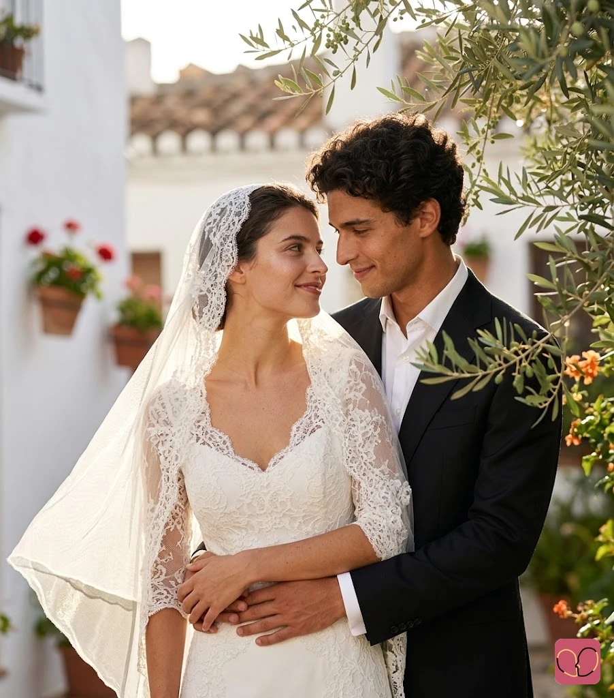

```text
An ultra photorealistic candid moment in a charming Andalusian white village garden, ancient olive trees with silver-green leaves, whitewashed walls in the background, warm Mediterranean afternoon light filtering through the branches, capturing two people sharing a natural embrace beneath an olive tree. The groom stands behind wrapping arms gently around the bride's waist, both bodies turned in three-quarter profile toward the camera, their heads tilted together as they gaze at each other with soft affectionate eyes and genuine relaxed smiles, the warm breeze stirring the bride's mantilla veil and the olive leaves around them. The two faces are derived directly from the uploaded reference images, with their original hairstyles, hair textures, and colors strictly preserved. Both wear Spanish-inspired wedding attire with natural fabric textures, the bride in an elegant white lace dress with a delicate mantilla veil, and the groom in a formal black suit with a crisp white shirt. Shot with an 85mm portrait lens at f/2, featuring shallow depth of field blurring the whitewashed walls and olive branches while keeping subjects sharp, framed as a medium close-up at natural eye-level. Warm Mediterranean afternoon light filtering through olive leaves creates gentle dappled light on their faces with soft shadows, revealing skin texture with visible pores, no AI beauty filters, no plastic smoothing. Natural weight distribution with correct arm and waist anatomy, no body intersection, no floating limbs. Soft ivory, silver-green, and warm Mediterranean gold tones. No rings, text, watermarks, logos, or studio lighting.
```

Model: Not disclosed · Author: Couple Goals AI (couplegoalsai.com)

[Original source](https://github.com/MarvsonHelbs/photorealistic-ai-couple-photo-prompts/blob/e9cd890aec6c267472783ecf3133a8ed3085e92f/cases/wedding.md#case-6-spanish-olive-grove-embrace) · [Provenance and original license](data/projectd-batch-0009.json)

## 2 reference photos · Indian Sindoor Ritual


```text
An ultra photorealistic candid moment in a grand Indian palace courtyard, ornate Mughal architecture with carved sandstone arches, warm golden afternoon light, a small traditional altar with burning diyas and flower offerings, capturing a sacred ceremonial moment. The groom stands facing the bride, one hand gently applying a line of red sindoor powder along the parting of her hair, while she stands with eyes softly lowered and a serene composed expression, a gentle trusting smile on her lips, her heavy gold maang tikka catching the warm light. The two faces are derived directly from the uploaded reference images. Her hair is in a traditional North Indian bridal updo with fresh jasmine flowers in a low bun, complementing her maang tikka, while his hair is neatly groomed beneath a traditional turban. Both wear traditional Indian wedding attire with natural fabric textures, the bride in a vibrant red lehenga with intricate gold zardozi embroidery and mirror work, heavy gold jewelry, and a red and gold dupatta, and the groom in an ivory white sherwani with gold embroidery, turban with feather ornament and gold brooch. Shot with an 85mm portrait lens at f/2, featuring shallow depth of field blurring the palace architecture and altar while keeping subjects sharp, framed as a medium close-up at natural eye-level. Warm golden afternoon light creates gentle gradients on their faces with subtle shadows, revealing skin texture with visible pores, no AI beauty filters, no plastic smoothing. Natural weight distribution with correct hand and head anatomy, no body intersection, no floating limbs. Imperial red, antique gold, and saffron orange tones. No rings, text, watermarks, logos, or studio lighting.
```

Model: Not disclosed · Author: Couple Goals AI (couplegoalsai.com)

[Original source](https://github.com/MarvsonHelbs/photorealistic-ai-couple-photo-prompts/blob/e9cd890aec6c267472783ecf3133a8ed3085e92f/cases/wedding.md#case-7-indian-sindoor-ritual) · [Provenance and original license](data/projectd-batch-0009.json)

## 2 reference photos · Indian Jewelry & Lehenga Detail

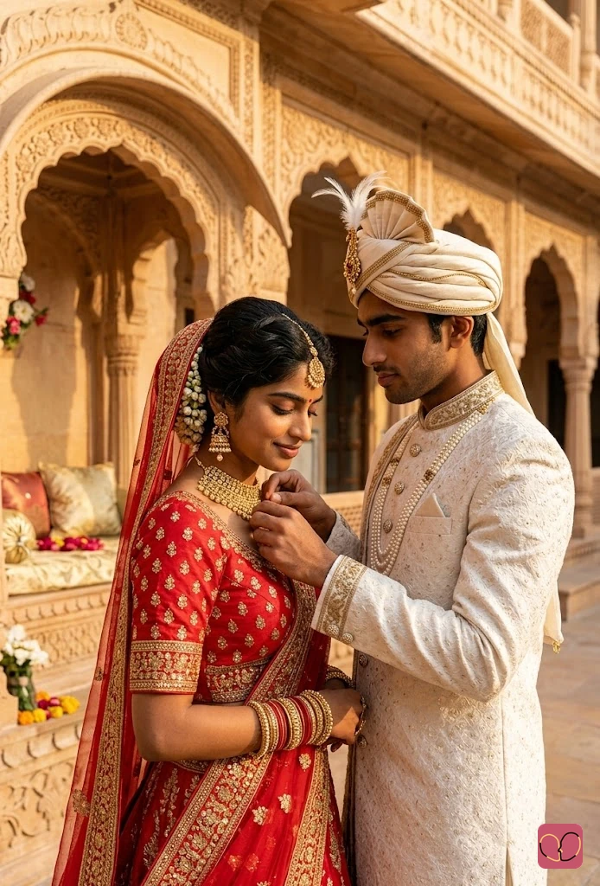

```text
An ultra photorealistic candid moment in a grand Indian palace courtyard, ornate Mughal architecture with carved sandstone arches, warm golden afternoon light, a decorated alcove with silk cushions and fresh flowers, capturing a quiet gesture of care. The groom stands slightly angled toward the bride, one hand gently adjusting her heavy gold necklace or touching her maang tikka, while she tilts her chin down with eyes softly lowered, a serene trusting smile playing on her lips, her red lehenga with gold zardozi embroidery gleaming in the warm light, gold bangles chiming softly on her wrists. The two faces are derived directly from the uploaded reference images. Her hair is in a traditional North Indian bridal updo with fresh jasmine flowers in a low bun, complementing her maang tikka, while his hair is neatly groomed beneath a traditional turban. Both wear traditional Indian wedding attire with natural fabric textures, the bride in a vibrant red lehenga with intricate gold zardozi embroidery and mirror work, heavy gold jewelry, and a red and gold dupatta, and the groom in an ivory white sherwani with gold embroidery, turban with feather ornament and gold brooch. Shot with an 85mm portrait lens at f/2, featuring shallow depth of field blurring the palace architecture and decorated alcove while keeping subjects sharp, framed as a medium close-up at natural eye-level. Warm golden afternoon light creates gentle gradients on their faces with subtle shadows, revealing skin texture with visible pores, no AI beauty filters, no plastic smoothing. Natural weight distribution with correct hand and head anatomy, no body intersection, no floating limbs. Imperial red, antique gold, and saffron orange tones. No rings, text, watermarks, logos, or studio lighting.
```

Model: Not disclosed · Author: Couple Goals AI (couplegoalsai.com)

[Original source](https://github.com/MarvsonHelbs/photorealistic-ai-couple-photo-prompts/blob/e9cd890aec6c267472783ecf3133a8ed3085e92f/cases/wedding.md#case-8-indian-jewelry--lehenga-detail) · [Provenance and original license](data/projectd-batch-0009.json)

## 2 reference photos · Chinese Moon Gate Portrait

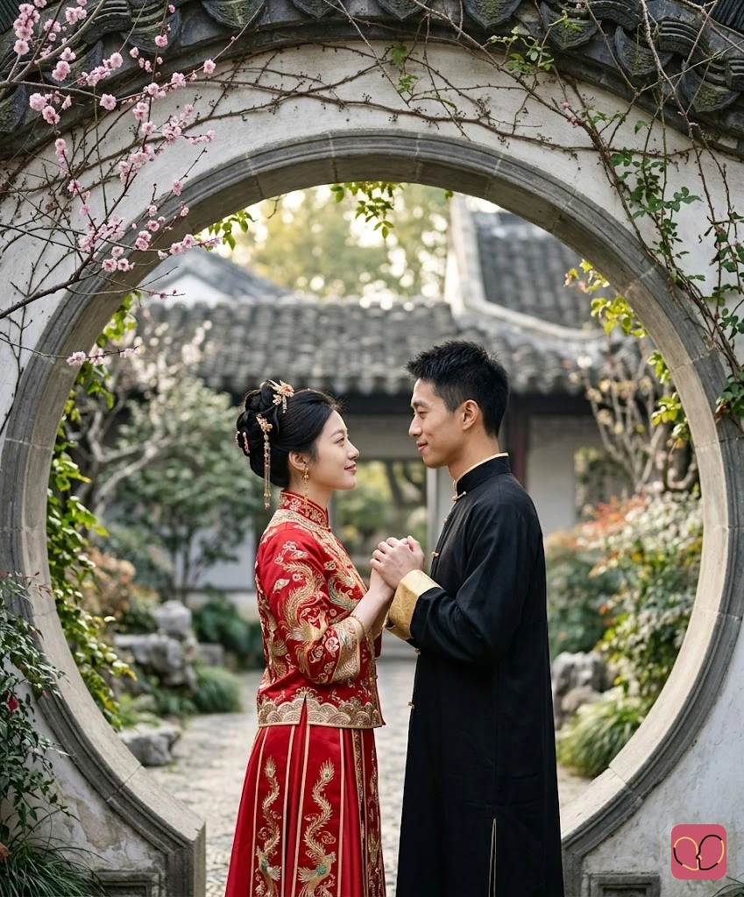

```text
An ultra photorealistic candid moment in a serene traditional Chinese garden, a circular moon gate framed by climbing vines and delicate plum blossoms, grey-tiled roofs visible beyond, soft diffused light, capturing two people standing face to face within a moon gate. They stand close with hands gently clasped in the traditional Chinese gesture, bodies turned in three-quarter profile toward the camera, both looking at each other with soft affectionate eyes and gentle restrained smiles, the moon gate creating a perfect circular frame around them like a jade pendant. The two faces are derived directly from the uploaded reference images, with their original hairstyles, hair textures, and colors strictly preserved. Both wear traditional Chinese wedding attire with natural fabric textures, the bride in a traditional red xiuhefu wedding gown with intricate gold embroidery and phoenix patterns and delicate gold hairpins in an elaborate updo, and the groom in a black traditional changshan robe with subtle gold trim and mandarin collar. Shot with a 50mm lens at f/2.2, featuring shallow depth of field blurring the garden beyond the moon gate while keeping subjects and the stone arch sharp, framed as a medium shot at natural eye-level. Soft diffused natural light filtering through the vines creates gentle gradients on their faces with subtle shadows, revealing skin texture with visible pores, no AI beauty filters, no plastic smoothing. Natural weight distribution with correct standing posture and hand anatomy, no body intersection, no floating limbs. Imperial red, jade green, and antique gold tones. No rings, text, watermarks, logos, or studio lighting.
```

Model: Not disclosed · Author: Couple Goals AI (couplegoalsai.com)

[Original source](https://github.com/MarvsonHelbs/photorealistic-ai-couple-photo-prompts/blob/e9cd890aec6c267472783ecf3133a8ed3085e92f/cases/wedding.md#case-9-chinese-moon-gate-portrait) · [Provenance and original license](data/projectd-batch-0009.json)

## 2 reference photos · Indoor Veil Reveal

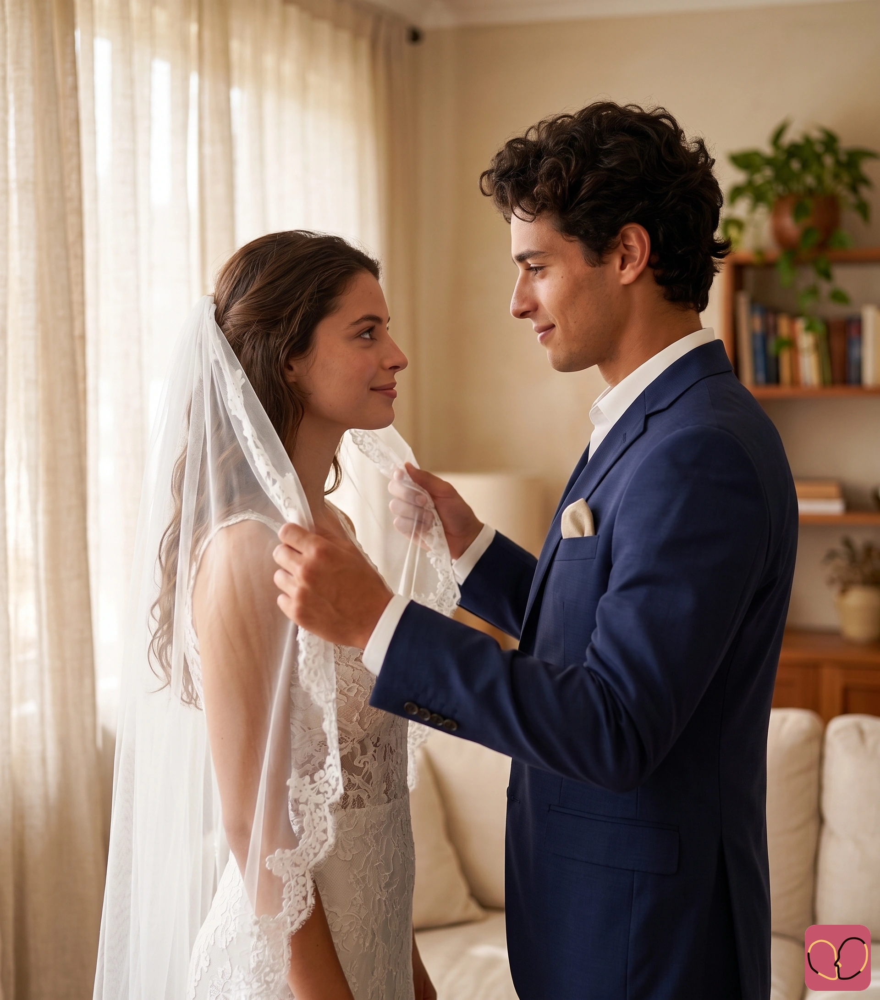

```text
An ultra photorealistic candid moment in a warm inviting living room with soft natural light through sheer linen curtains, featuring a plush cream sofa and warm wood furniture in the background. The groom stands facing the bride, both looking at each other with tender expressions, his hands gently lifting the edge of her veil from the front, slowly revealing her face as she gazes back at him with a serene composed smile. The two faces are derived directly from the uploaded reference images, with their original hairstyles, hair textures, and colors strictly preserved. Both wear elegant wedding attire with natural fabric textures. Shot with an 85mm portrait lens at f/2, featuring shallow depth of field blurring the cozy living room background while keeping subjects sharp, framed as a medium close-up at natural eye-level, showing the couple from the waist up. Soft diffused window light creating gentle gradients on faces with subtle shadows, revealing skin texture with visible pores, no AI beauty filters. Natural weight distribution with correct hand and arm anatomy, no body intersection. Warm cream, soft ivory, and amber tones. No rings, text, watermarks, logos, or studio lighting.
```

Model: Not disclosed · Author: Couple Goals AI (couplegoalsai.com)

[Original source](https://github.com/MarvsonHelbs/photorealistic-ai-couple-photo-prompts/blob/e9cd890aec6c267472783ecf3133a8ed3085e92f/cases/wedding.md#case-10-indoor-veil-reveal) · [Provenance and original license](data/projectd-batch-0009.json)

## Before/after · Cold Brew Ad Makeover

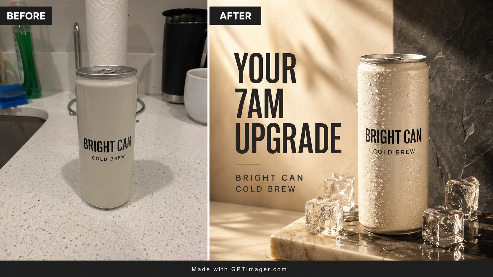

```text
Transform an ordinary cold brew can photo into a premium DTC advertising image. Keep the product structure believable, make the label text crisp and readable, use golden morning light, realistic condensation, clean shadows, and a minimal editorial layout. Add the headline: "YOUR 7AM UPGRADE".
```

Model: GPT Image 2 · Author: GPTimager (gptimager.com)

[Original source](https://github.com/gptimages/awesome-gpt-image-2-prompts/blob/49a1708a1d77b464f3066dddb199e9123683128b/README.md#case-case-1-cold-brew-ai-ad-makeover) · [Provenance and original license](data/projectd-batch-0009.json)

## Glasslake Exfoliating Toner — API Models · CC BY 4.0

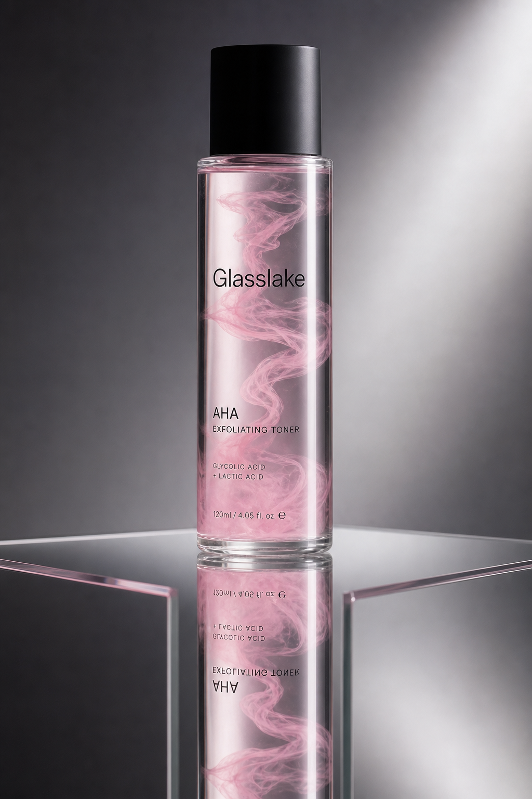

```text
A tall clear glass bottle of Glasslake AHA exfoliating toner with a minimalist black cap stands on a mirrored acrylic surface, its reflection perfectly doubling below. Thin ribbons of pink toner swirl visibly inside. Sharp directional light from the upper right creates a bright vertical highlight down the bottle. Blush-pink and charcoal palette, gradient dark-to-light grey backdrop. Eye-level straight-on shot, 100mm lens, sleek modern clinical skincare mood.
```

Model: GPT Image 2 · Author: API Models (apimodels.app)

[Original source](https://github.com/apimodels/gpt-image-2-prompts/blob/980d100f3bd0f2cde4cf38835daeb742bf1cac65/prompts.json#L78) · [Provenance and original license](data/projectd-batch-0009.json)

## Marisel Peptide Eye Cream — API Models · CC BY 4.0

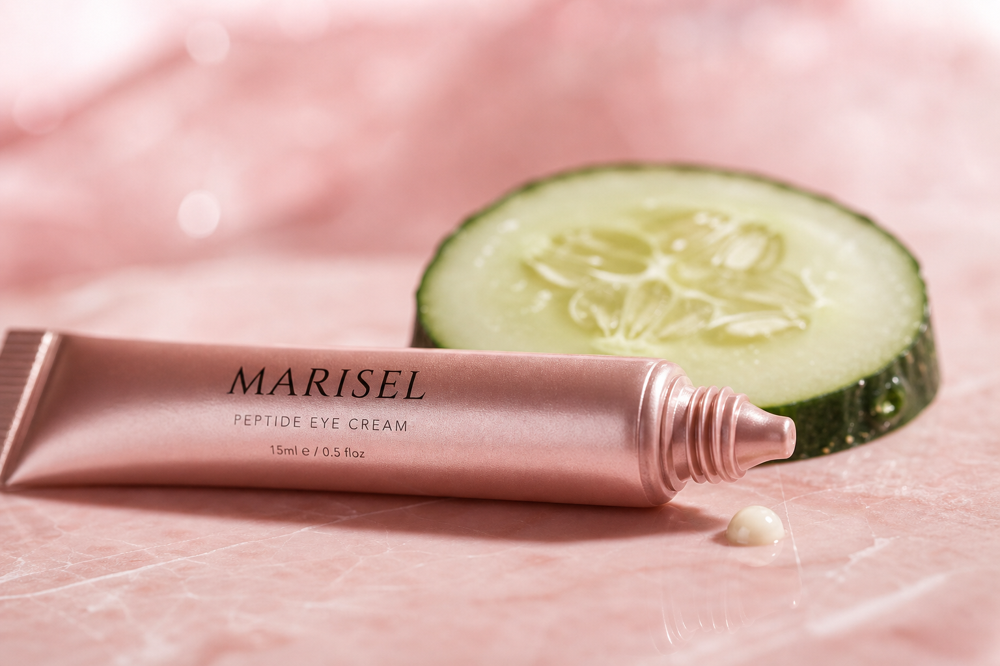

```text
A tiny rose-gold aluminum tube of Marisel peptide eye cream lies at a slight diagonal on a smooth pink marble tile, a pearl-sized bead of pale cream squeezed onto the surface catching a soft glint. A single fresh cucumber slice rests behind it. Delicate soft morning light, blush and champagne palette, softly blurred pink background. Extreme close-up macro at eye level, 105mm lens, dewy premium anti-aging mood, product occupying lower third.
```

Model: GPT Image 2 · Author: API Models (apimodels.app)

[Original source](https://github.com/apimodels/gpt-image-2-prompts/blob/980d100f3bd0f2cde4cf38835daeb742bf1cac65/prompts.json#L93) · [Provenance and original license](data/projectd-batch-0009.json)

## Sable & Ren Clay Mask — API Models · CC BY 4.0

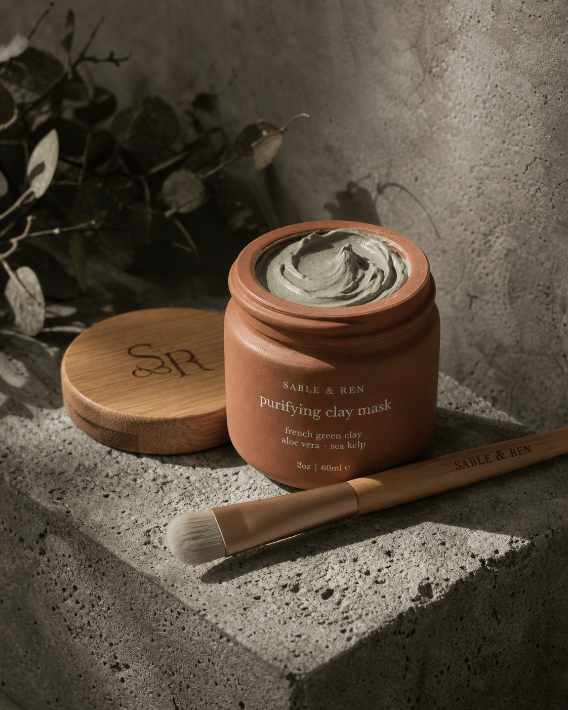

```text
A matte terracotta-clay jar of Sable & Ren purifying clay mask sits on a rough concrete pedestal, its wooden lid off and resting flat, revealing a swirl of grey-green clay. A bamboo mask brush lies across the front. Dramatic side lighting from the left carves deep textured shadows. Muted sage, clay-brown and stone-grey palette, raw concrete backdrop. Slightly high three-quarter angle, 85mm lens, earthy artisanal spa mood.
```

Model: GPT Image 2 · Author: API Models (apimodels.app)

[Original source](https://github.com/apimodels/gpt-image-2-prompts/blob/980d100f3bd0f2cde4cf38835daeb742bf1cac65/prompts.json#L108) · [Provenance and original license](data/projectd-batch-0009.json)

## Aurelia Snail Essence — API Models · CC BY 4.0

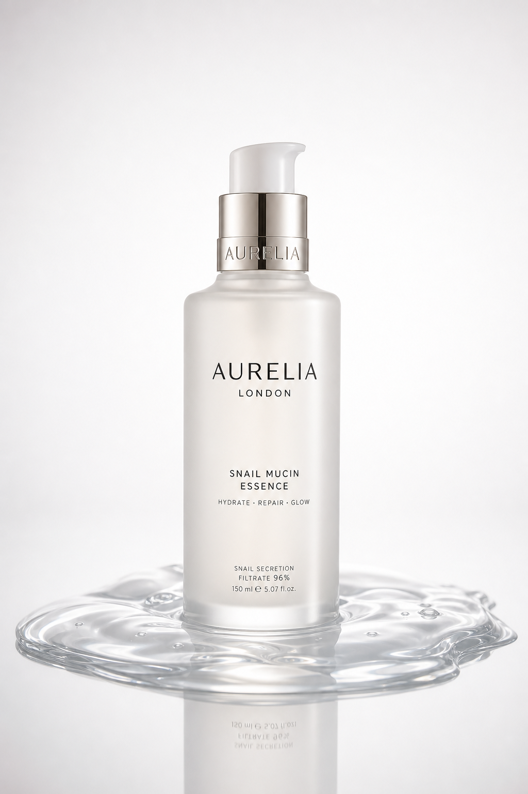

```text
A pump bottle of Aurelia snail-mucin essence in translucent milky-white glass stands on a slick of clear glossy gel that pools around its base like liquid glass. Soft catchlights ripple across the gel. Clean high-key lighting, pearly white and soft grey palette, seamless white cyclorama background. Straight eye-level hero shot, 100mm lens, immaculate glossy hydrating mood, faint reflection under the product, centered composition with airy top space.
```

Model: GPT Image 2 · Author: API Models (apimodels.app)

[Original source](https://github.com/apimodels/gpt-image-2-prompts/blob/980d100f3bd0f2cde4cf38835daeb742bf1cac65/prompts.json#L123) · [Provenance and original license](data/projectd-batch-0009.json)

## Velvet Bloom SPF Fluid — API Models · CC BY 4.0

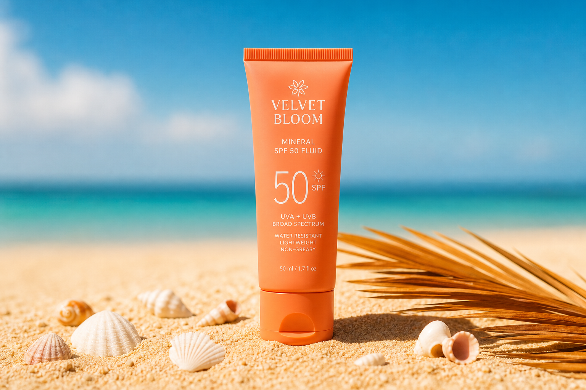

```text
A slim coral-orange squeeze tube of Velvet Bloom mineral SPF 50 fluid stands upright on warm golden sand, a scatter of tiny seashells and a curl of dried palm frond beside it. Bright midday sun from directly above throws a crisp compact shadow. Sunny apricot, cream and turquoise accents, soft blurred beach-sky gradient background. Low 20-degree angle, 70mm lens, cheerful summer sun-care mood, product centered with warm glow.
```

Model: GPT Image 2 · Author: API Models (apimodels.app)

[Original source](https://github.com/apimodels/gpt-image-2-prompts/blob/980d100f3bd0f2cde4cf38835daeb742bf1cac65/prompts.json#L138) · [Provenance and original license](data/projectd-batch-0009.json)

## Noir Muse Liquid Lipstick — API Models · CC BY 4.0

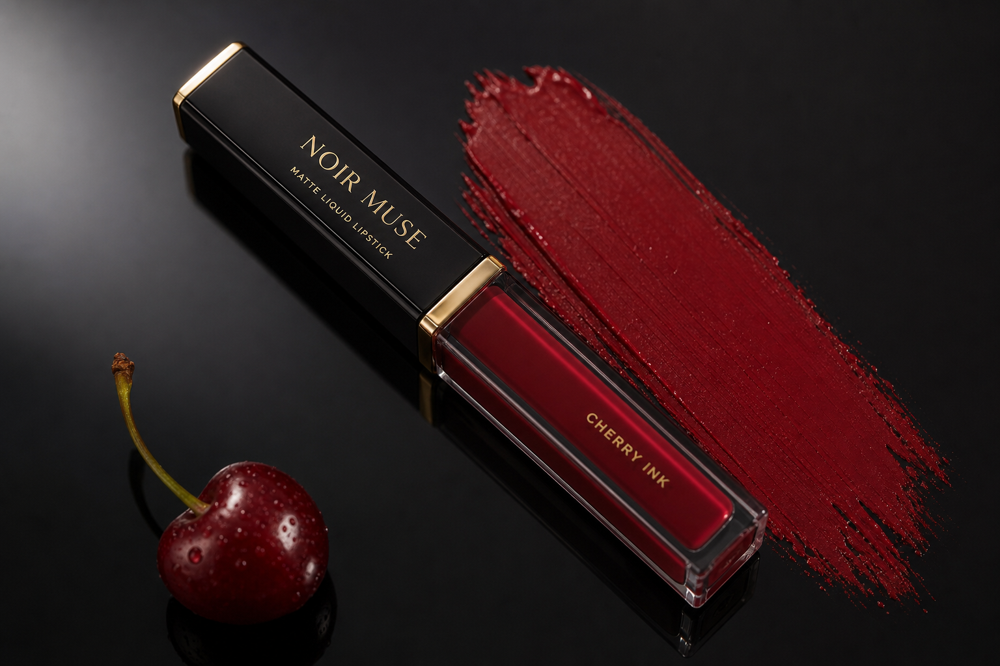

```text
A sleek black-and-gold tube of Noir Muse matte liquid lipstick in shade 'Cherry Ink' lies at a dynamic diagonal on black glass, a bold swipe of deep-red pigment streaked beside it. A single glossy cherry with a stem rests in the corner. Precise spotlight from above-left, high-contrast crimson, black and gold palette, dark reflective backdrop. Overhead 30-degree angle, 90mm macro lens, luxe editorial beauty mood, sharp texture on the swatch.
```

Model: GPT Image 2 · Author: API Models (apimodels.app)

[Original source](https://github.com/apimodels/gpt-image-2-prompts/blob/980d100f3bd0f2cde4cf38835daeb742bf1cac65/prompts.json#L153) · [Provenance and original license](data/projectd-batch-0009.json)

## Lush Palette Eyeshadow Set — API Models · CC BY 4.0

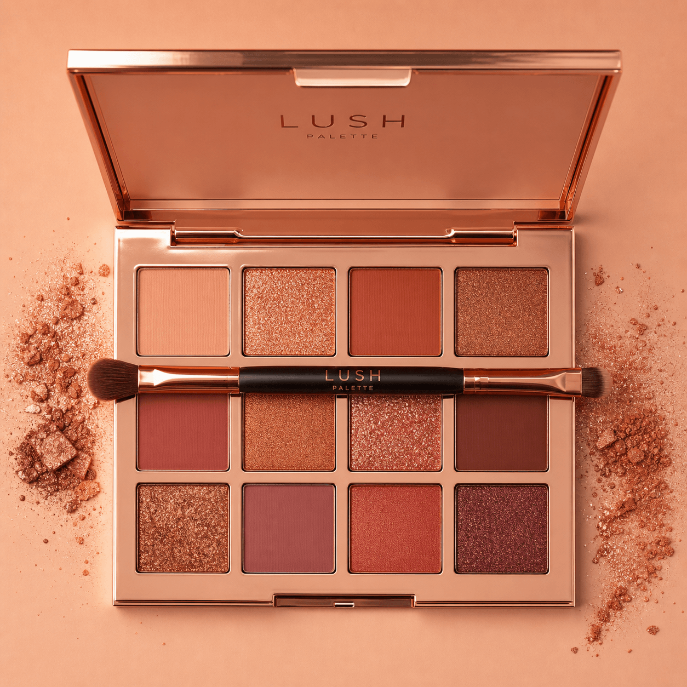

```text
An open rose-gold Lush Palette eyeshadow compact displays twelve pans in warm terracotta, bronze, mauve and shimmering copper, a small dual-ended brush laid across it. Loose shimmer dusts softly onto the surface below. Warm soft-box lighting, autumnal peach and copper palette, seamless blush-nude background. Overhead flat-lay at 90 degrees, 50mm lens, inviting cozy glam mood, subtle sparkle catchlights on the shimmer shades, balanced symmetrical framing.
```

Model: GPT Image 2 · Author: API Models (apimodels.app)

[Original source](https://github.com/apimodels/gpt-image-2-prompts/blob/980d100f3bd0f2cde4cf38835daeb742bf1cac65/prompts.json#L168) · [Provenance and original license](data/projectd-batch-0009.json)

## Chroma Kiss Lip Gloss Trio — API Models · CC BY 4.0

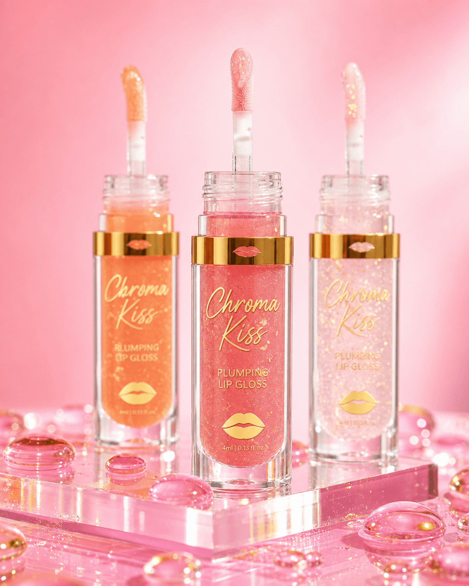

```text
Three clear wand-applicator tubes of Chroma Kiss plumping lip gloss stand in a staggered row on a glossy acrylic riser, shades peach, rose and clear-pink glinting with tiny gold flecks. Bright glossy droplets scatter across the surface. Fresh high-key lighting, candy-pink and gold palette, gradient pastel-pink background. Slight low three-quarter angle, 85mm lens, playful juicy beauty mood, sharp focus on the middle tube, soft bokeh on the outer two.
```

Model: GPT Image 2 · Author: API Models (apimodels.app)

[Original source](https://github.com/apimodels/gpt-image-2-prompts/blob/980d100f3bd0f2cde4cf38835daeb742bf1cac65/prompts.json#L183) · [Provenance and original license](data/projectd-batch-0009.json)

## Studio Fawn Cushion Foundation — API Models · CC BY 4.0

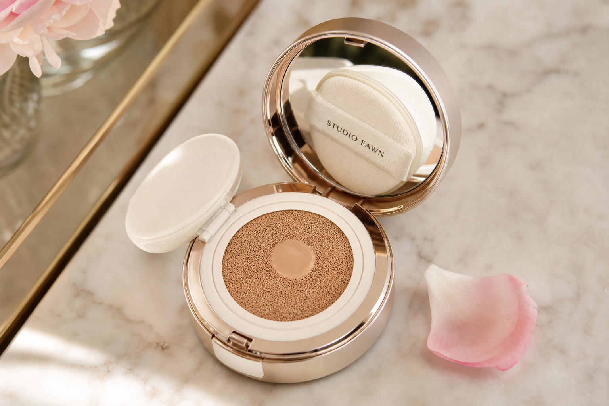

```text
A round mirrored-lid compact of Studio Fawn cushion foundation lies open on a marble vanity, the plush cushion pressed with a soft dab of beige foundation and a matching puff resting on the lid's mirror. A single blush-pink peony petal curls beside it. Soft flattering daylight, warm nude and cream palette, blurred pale-marble background. Overhead 45-degree tilt, 60mm lens, elegant everyday glam mood, gentle reflection in the compact mirror.
```

Model: GPT Image 2 · Author: API Models (apimodels.app)

[Original source](https://github.com/apimodels/gpt-image-2-prompts/blob/980d100f3bd0f2cde4cf38835daeb742bf1cac65/prompts.json#L198) · [Provenance and original license](data/projectd-batch-0009.json)

## Opal Glow Highlighter Stick — API Models · CC BY 4.0

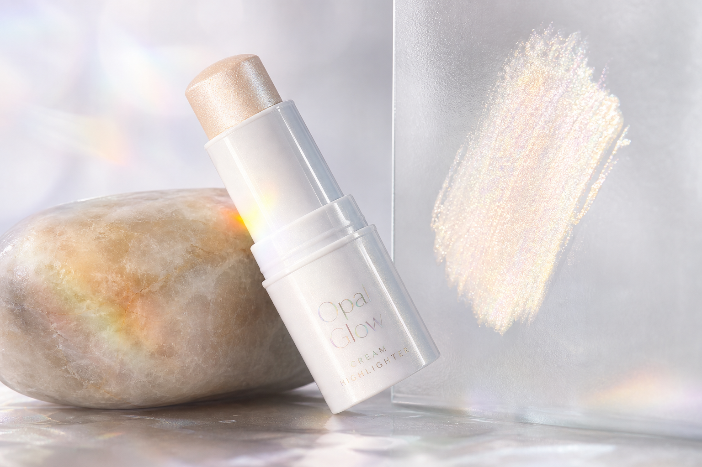

```text
A twist-up Opal Glow cream highlighter stick in a pearly white barrel stands diagonally propped against a smooth river pebble, its champagne-shimmer bullet extended and catching prismatic light. A soft iridescent swatch glows on frosted glass beside it. Dreamy soft lighting with subtle rainbow flares, opalescent white, silver and pale-gold palette, misty grey-white background. Close macro at eye level, 100mm lens, ethereal luminous beauty mood.
```

Model: GPT Image 2 · Author: API Models (apimodels.app)

[Original source](https://github.com/apimodels/gpt-image-2-prompts/blob/980d100f3bd0f2cde4cf38835daeb742bf1cac65/prompts.json#L213) · [Provenance and original license](data/projectd-batch-0009.json)

## Kohl & Co Precision Liner — API Models · CC BY 4.0

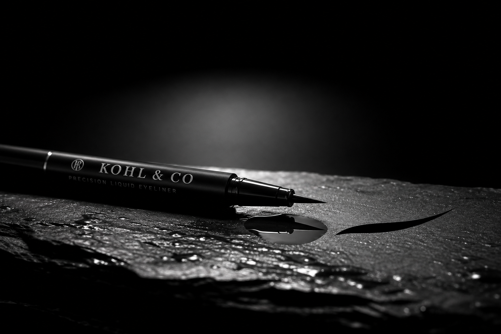

```text
A slim matte-black Kohl & Co precision liquid eyeliner pen rests on a wet black slate, a single crisp black wing-flick painted beside it as if drawn straight onto the stone. A tiny puddle mirrors the pen's fine tip. Sharp high-contrast lighting, pure black and silver palette, glossy dark backdrop with a subtle spotlight pool. Extreme close-up at a low 10-degree angle, 105mm macro lens, bold precise editorial mood, deep negative space above.
```

Model: GPT Image 2 · Author: API Models (apimodels.app)

[Original source](https://github.com/apimodels/gpt-image-2-prompts/blob/980d100f3bd0f2cde4cf38835daeb742bf1cac65/prompts.json#L228) · [Provenance and original license](data/projectd-batch-0009.json)

## Petal Rouge Powder Blush — API Models · CC BY 4.0

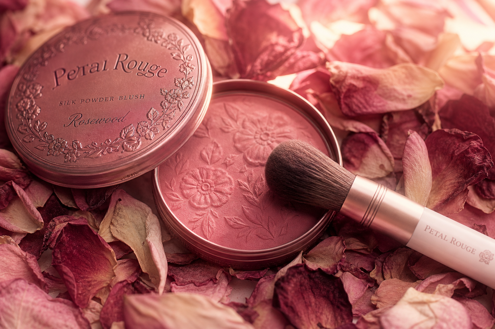

```text
A round embossed-tin compact of Petal Rouge silk powder blush in shade 'Rosewood' lies open on a bed of scattered dried rose petals, its pressed powder showing a soft floral debossed pattern, a fluffy kabuki brush resting across it. Warm romantic backlight glows through the petals. Dusty-rose, mauve and soft-cream palette, dreamy blurred petal background. Overhead 40-degree angle, 70mm lens, romantic feminine beauty mood.
```

Model: GPT Image 2 · Author: API Models (apimodels.app)

[Original source](https://github.com/apimodels/gpt-image-2-prompts/blob/980d100f3bd0f2cde4cf38835daeb742bf1cac65/prompts.json#L243) · [Provenance and original license](data/projectd-batch-0009.json)

## Velluto Mascara Bottle — API Models · CC BY 4.0

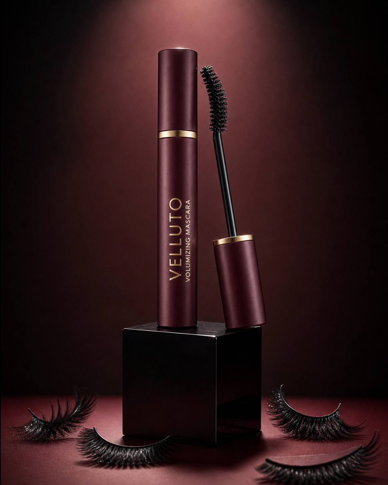

```text
A sculptural matte-burgundy tube of Velluto volumizing mascara stands upright on a black acrylic cube, its wand pulled out and leaning against the tube showing a dense curved brush. A few dramatic false-lash fans fan out on the surface. Focused spotlight from above creates a glossy highlight on the cap. Deep burgundy, black and gold palette, dark gradient backdrop. Eye-level straight shot, 90mm lens, bold dramatic luxury mood, sharp brush-bristle detail.
```

Model: GPT Image 2 · Author: API Models (apimodels.app)

[Original source](https://github.com/apimodels/gpt-image-2-prompts/blob/980d100f3bd0f2cde4cf38835daeb742bf1cac65/prompts.json#L258) · [Provenance and original license](data/projectd-batch-0009.json)

## Rougevert Setting Spray — API Models · CC BY 4.0


```text
A frosted glass spray bottle of Rougevert dewy setting spray stands centered while a fine mist plume sprays upward and drifts to the right, tiny water beads suspended in the air catching light. A sprig of fresh green mint lies at the base. Fresh cool lighting, mint-green, clear-glass and white palette, soft gradient seamless background. Straight eye-level shot, 100mm lens, crisp refreshing beauty mood, frozen mist detail, airy negative space around.
```

Model: GPT Image 2 · Author: API Models (apimodels.app)

[Original source](https://github.com/apimodels/gpt-image-2-prompts/blob/980d100f3bd0f2cde4cf38835daeb742bf1cac65/prompts.json#L273) · [Provenance and original license](data/projectd-batch-0009.json)

## Mireille Brow Gel Duo — API Models · CC BY 4.0

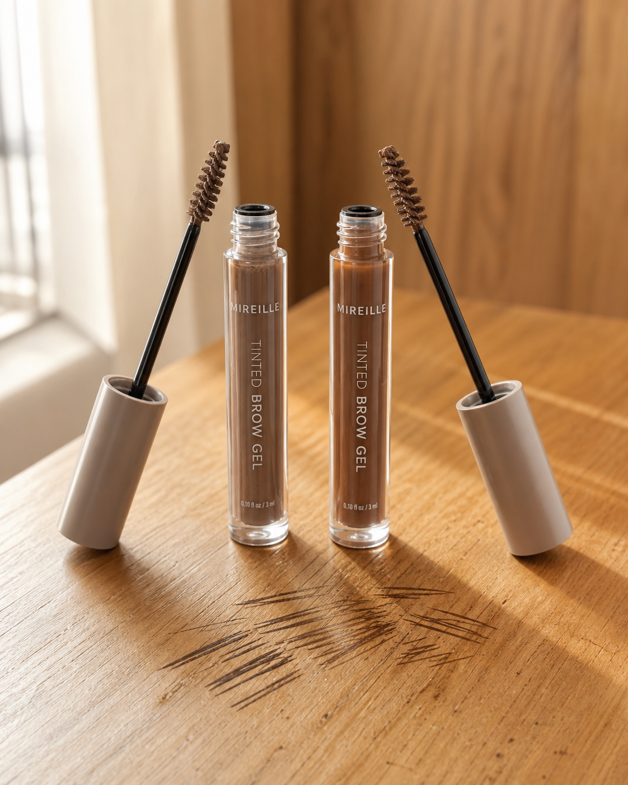

```text
Two slim clear tubes of Mireille tinted brow gel stand paired on a warm honey-oak surface, one taupe and one soft-brown, their spoolie wands angled outward like a mirrored pair. A scatter of fine hair-like brush strokes marks the wood beside them. Warm natural window light from the left, honey-brown and cream palette, softly blurred wood-grain background. Slight three-quarter angle, 85mm lens, natural everyday beauty mood.
```

Model: GPT Image 2 · Author: API Models (apimodels.app)

[Original source](https://github.com/apimodels/gpt-image-2-prompts/blob/980d100f3bd0f2cde4cf38835daeb742bf1cac65/prompts.json#L288) · [Provenance and original license](data/projectd-batch-0009.json)

## Ferro Bluetooth Tracker Tag — API Models · CC BY 4.0

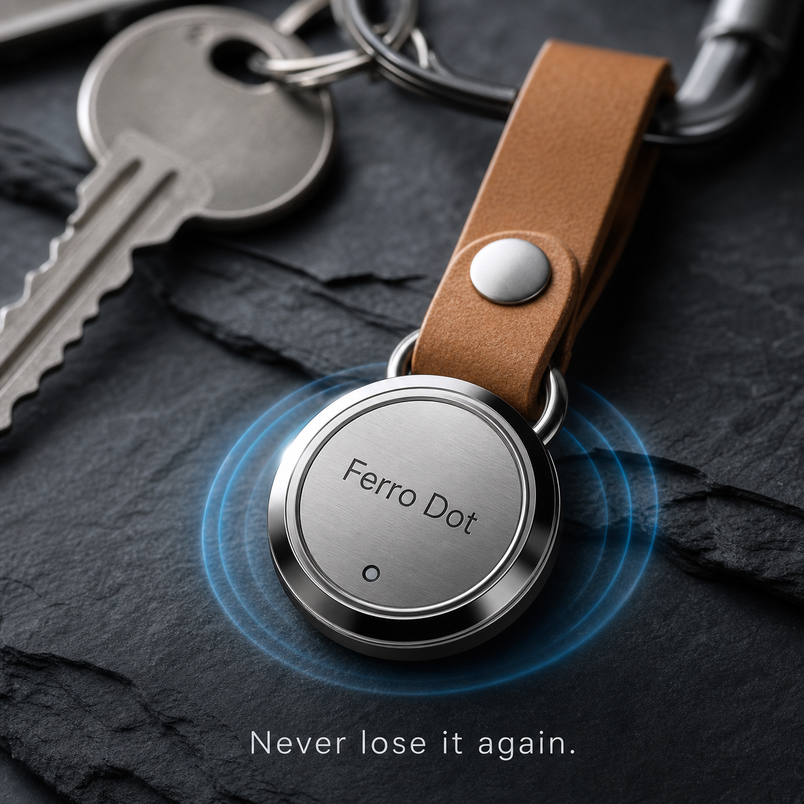

```text
Macro product photography of a coin-sized stainless-steel tracker tag called 'Ferro Dot' clipped onto a tan leather keyring, with a faint blue locator pulse animation implied by a glowing ring. Shot on a slate surface with scattered keys softly out of focus. Crisp directional light glinting off the polished metal ridge, cool minimalist palette, tight top-down 1:1 composition, delicate reflections. Sleek everyday-carry ad mood, small tagline: 'Never lose it again.'
```

Model: GPT Image 2 · Author: API Models (apimodels.app)

[Original source](https://github.com/apimodels/gpt-image-2-prompts/blob/980d100f3bd0f2cde4cf38835daeb742bf1cac65/prompts.json#L2268) · [Provenance and original license](data/projectd-batch-0009.json)

## Halcyon Pocket Photo Printer — API Models · CC BY 4.0

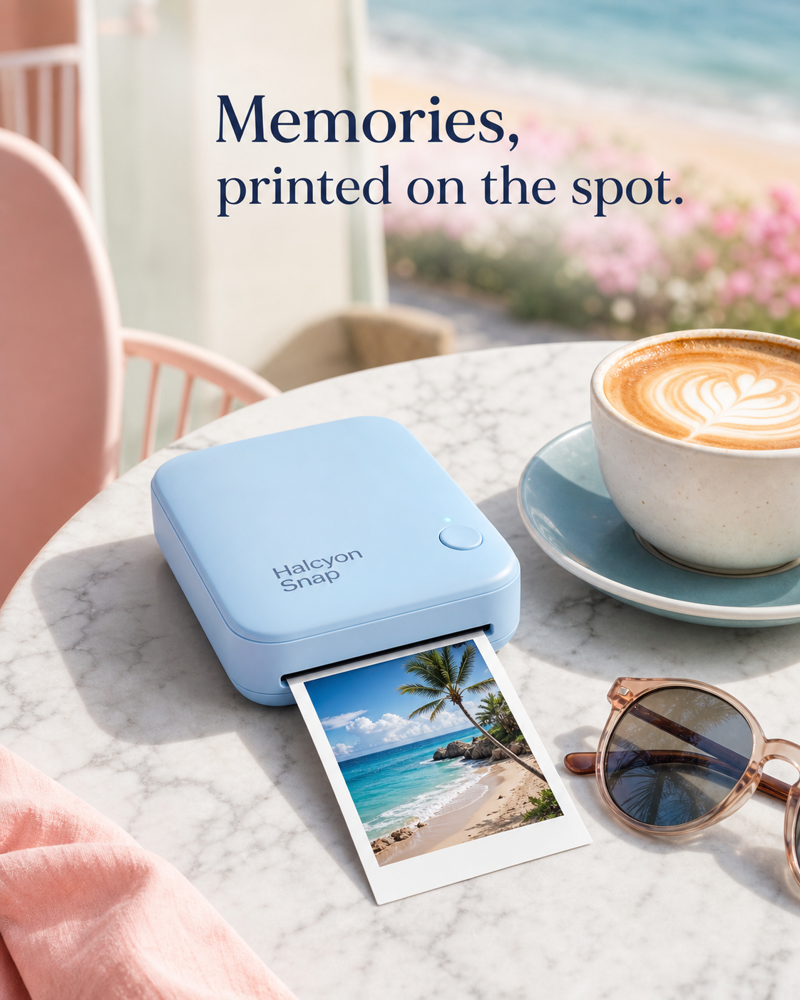

```text
A pastel-blue palm-sized instant photo printer named 'Halcyon Snap' emitting a fresh glossy photo of a beach scene from its slot. Placed on a white marble café table beside a latte and sunglasses, bright airy daylight, soft shadows, cheerful lifestyle-tech mood. Slightly high 30-degree angle, shallow depth of field, pastel color palette, clean and friendly. 4:5 vertical framing, tagline upper area: 'Memories, printed on the spot.'
```

Model: GPT Image 2 · Author: API Models (apimodels.app)

[Original source](https://github.com/apimodels/gpt-image-2-prompts/blob/980d100f3bd0f2cde4cf38835daeb742bf1cac65/prompts.json#L2283) · [Provenance and original license](data/projectd-batch-0009.json)

## Aeon Smart Water Bottle — API Models · CC BY 4.0

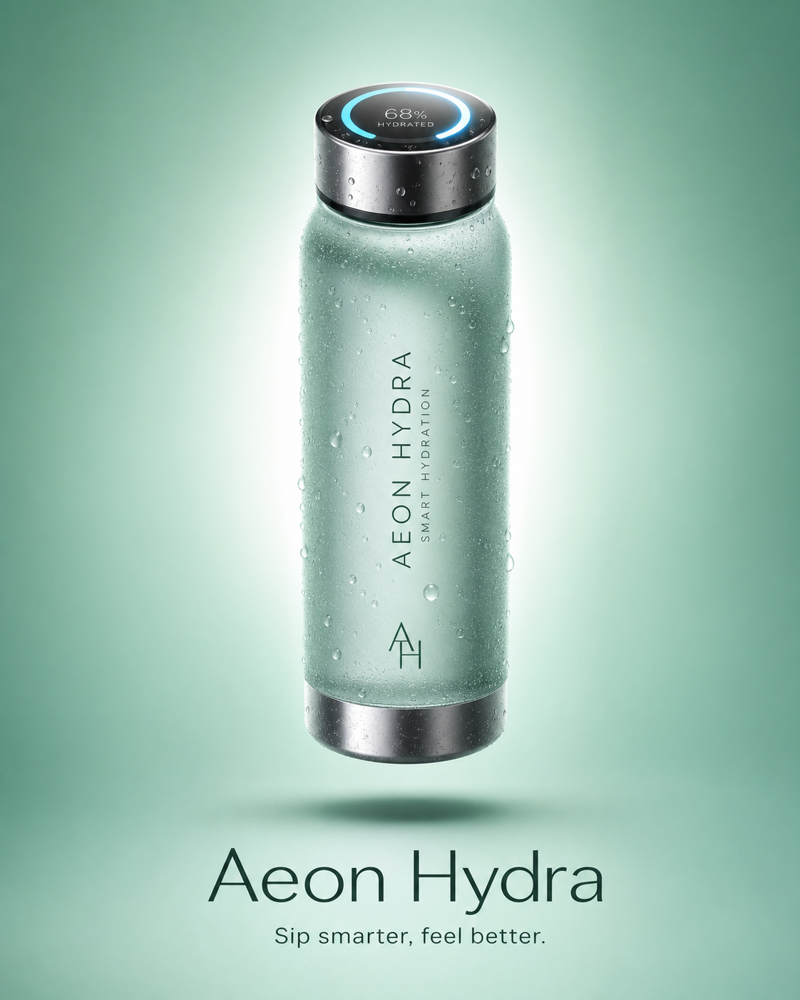

```text
Product hero of a frosted glass-and-steel smart water bottle called 'Aeon Hydra' with a glowing LED hydration ring on its cap showing a soft blue progress arc. Water droplets bead on the cold surface, set against a fresh mint-green gradient backdrop with a single dramatic backlight creating a luminous halo. Refreshing wellness-tech ad mood, crisp reflections, centered vertical 4:5 composition, floating shadow. Tagline below: 'Sip smarter, feel better.'
```

Model: GPT Image 2 · Author: API Models (apimodels.app)

[Original source](https://github.com/apimodels/gpt-image-2-prompts/blob/980d100f3bd0f2cde4cf38835daeb742bf1cac65/prompts.json#L2298) · [Provenance and original license](data/projectd-batch-0009.json)

## Zephyr Handheld Fan — API Models · CC BY 4.0

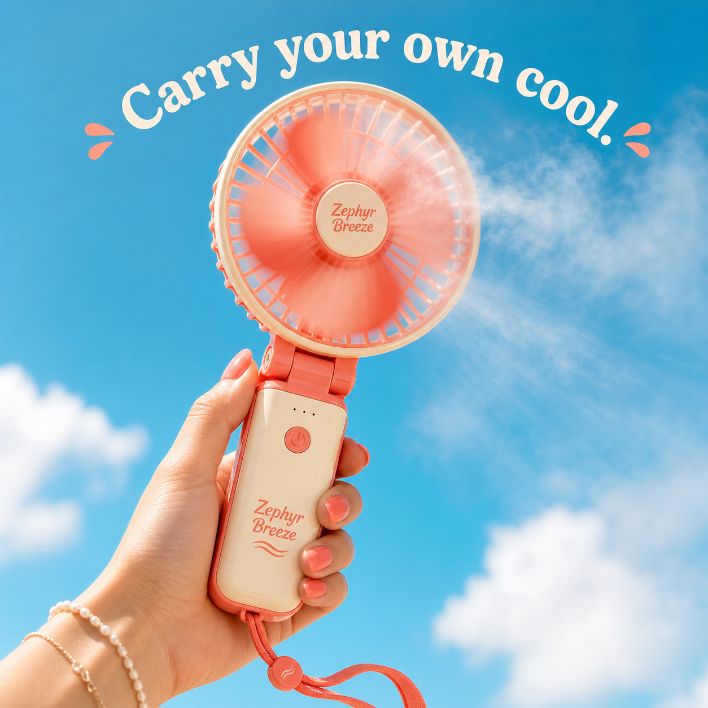

```text
Bright summery product shot of a foldable handheld fan named 'Zephyr Breeze' in coral and cream, blades spinning to a soft motion blur, held against a clear turquoise sky background. Sunlit high-key studio lighting, cheerful and vibrant, faint water-vapor mist drifting past for a cooling feel. Playful lifestyle-tech mood, slight low angle, 1:1 framing, glossy plastic highlights. Tagline arc at top: 'Carry your own cool.'
```

Model: GPT Image 2 · Author: API Models (apimodels.app)

[Original source](https://github.com/apimodels/gpt-image-2-prompts/blob/980d100f3bd0f2cde4cf38835daeb742bf1cac65/prompts.json#L2313) · [Provenance and original license](data/projectd-batch-0009.json)

## Slate Digital Smart Pen — API Models · CC BY 4.0

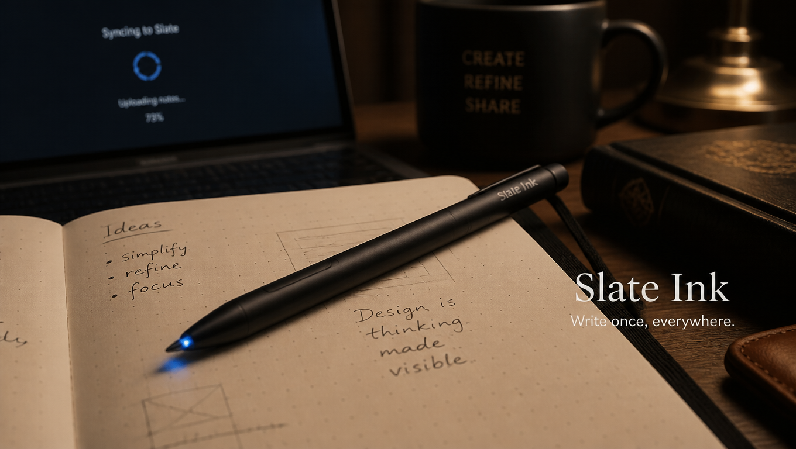

```text
Elegant product photography of a slim matte-black smart pen called 'Slate Ink' resting diagonally on a dotted notebook, a faint blue LED near the tip indicating active digitizing. Warm desk lamp light from the right, moody dark-academia palette with deep browns and soft shadows, a blurred laptop syncing in the background. Sophisticated creator-tech ad mood, close-up 45-degree angle, shallow depth of field, 16:9 wide. Small tagline: 'Write once, everywhere.'
```

Model: GPT Image 2 · Author: API Models (apimodels.app)

[Original source](https://github.com/apimodels/gpt-image-2-prompts/blob/980d100f3bd0f2cde4cf38835daeb742bf1cac65/prompts.json#L2328) · [Provenance and original license](data/projectd-batch-0009.json)

## Sonare Over-Ear Headphones — API Models · CC BY 4.0


```text
Premium hero shot of plush over-ear noise-cancelling headphones named 'Sonare Aura' in warm champagne-gold and soft grey leather, floating at a three-quarter angle with earcups slightly rotated. Studio gradient backdrop from deep charcoal to warm bronze, dramatic rim lighting tracing the metal headband, soft reflections on the memory-foam cushions. Luxurious audio-brand ad mood, shallow depth of field, 1:1 centered composition, floating shadow. Tagline lower: 'Silence, perfected.'
```

Model: GPT Image 2 · Author: API Models (apimodels.app)

[Original source](https://github.com/apimodels/gpt-image-2-prompts/blob/980d100f3bd0f2cde4cf38835daeb742bf1cac65/prompts.json#L2343) · [Provenance and original license](data/projectd-batch-0009.json)

## Aurea True Wireless Earbuds — API Models · CC BY 4.0


```text
Clean product shot of pearlescent white true-wireless earbuds named 'Aurea Beat' resting in an open pebble-shaped charging case, a tiny green LED glowing inside. Set on a glossy white surface with a soft blue gradient background and gentle reflection. Bright even studio light, minimalist and modern, macro detail on the glossy earbud stems. Fresh premium audio-ad mood, top-down 30-degree angle, 4:5 vertical, subtle shadow. Tagline above: 'Pure sound, no strings.'
```

Model: GPT Image 2 · Author: API Models (apimodels.app)

[Original source](https://github.com/apimodels/gpt-image-2-prompts/blob/980d100f3bd0f2cde4cf38835daeb742bf1cac65/prompts.json#L2358) · [Provenance and original license](data/projectd-batch-0009.json)

## Vibra Open-Ear Clip Buds — API Models · CC BY 4.0

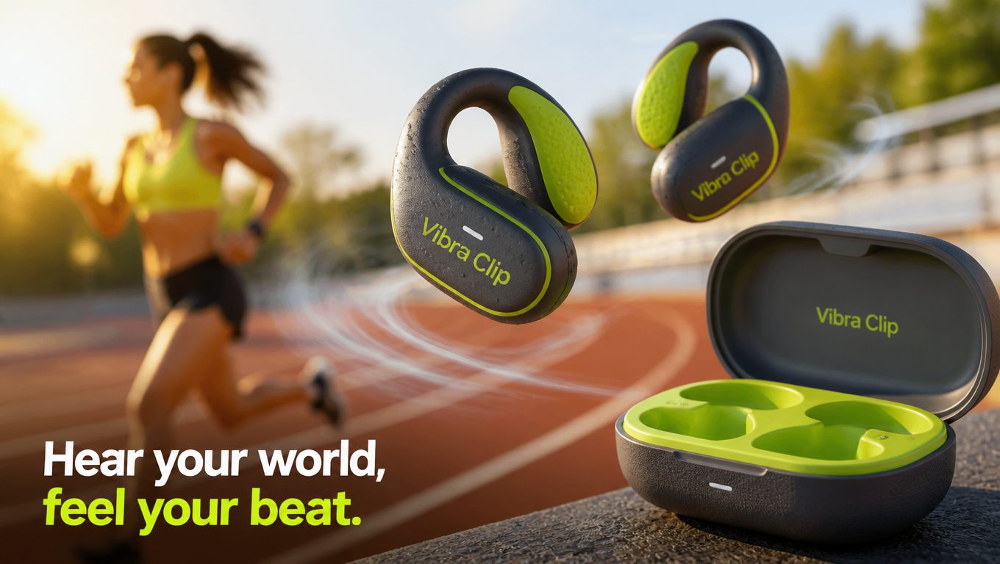

```text
Dynamic lifestyle-tech product shot of open-ear clip earphones called 'Vibra Clip' in sporty lime and dark grey, floating close-up against a sunlit outdoor track blurred in the background. Bright golden-hour light, energetic and fresh, sweat-resistant matte texture, a faint air-swirl suggesting motion. Athletic audio-ad mood, three-quarter angle, shallow depth of field, 16:9 wide framing. Tagline lower left: 'Hear your world, feel your beat.'
```

Model: GPT Image 2 · Author: API Models (apimodels.app)

[Original source](https://github.com/apimodels/gpt-image-2-prompts/blob/980d100f3bd0f2cde4cf38835daeb742bf1cac65/prompts.json#L2373) · [Provenance and original license](data/projectd-batch-0009.json)

## Resona Bookshelf Speakers — API Models · CC BY 4.0

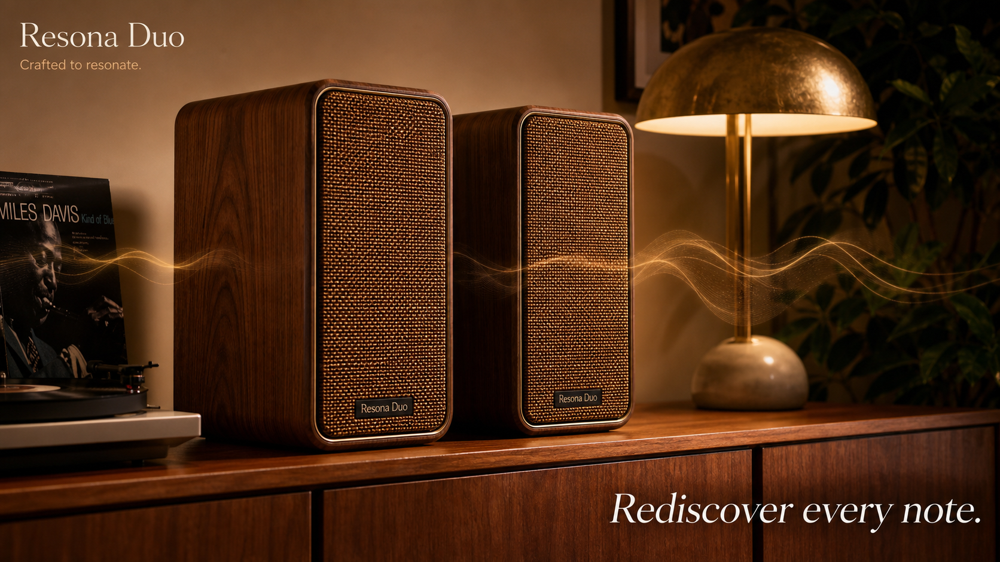

```text
Warm interior product shot of a pair of walnut-veneer bookshelf speakers named 'Resona Duo' with woven bronze grilles, placed on a mid-century wooden sideboard beside a vinyl record and a brass lamp. Cozy golden ambient light, soft shadows, a hint of visible sound-wave shimmer in the air. Refined audiophile-lifestyle ad mood, eye-level slightly angled camera, shallow depth of field, 16:9 framing. Tagline lower right: 'Rediscover every note.'
```

Model: GPT Image 2 · Author: API Models (apimodels.app)

[Original source](https://github.com/apimodels/gpt-image-2-prompts/blob/980d100f3bd0f2cde4cf38835daeb742bf1cac65/prompts.json#L2388) · [Provenance and original license](data/projectd-batch-0009.json)

## Bassline Rugged Speaker — API Models · CC BY 4.0

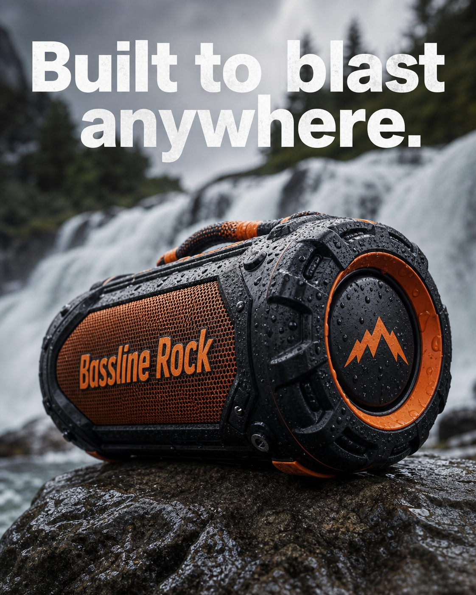

```text
Adventure product shot of a rugged cylindrical Bluetooth speaker called 'Bassline Rock' in tactical orange and black, splashed with water droplets, sitting on a wet river stone with a blurred forest waterfall behind. Cool overcast daylight with a bright key highlight on the rubber armor, dramatic and energetic. Outdoor audio-ad mood, low three-quarter angle, shallow depth of field, 4:5 vertical. Tagline top: 'Built to blast anywhere.'
```

Model: GPT Image 2 · Author: API Models (apimodels.app)

[Original source](https://github.com/apimodels/gpt-image-2-prompts/blob/980d100f3bd0f2cde4cf38835daeb742bf1cac65/prompts.json#L2403) · [Provenance and original license](data/projectd-batch-0009.json)

## Echora Cinema Soundbar — API Models · CC BY 4.0

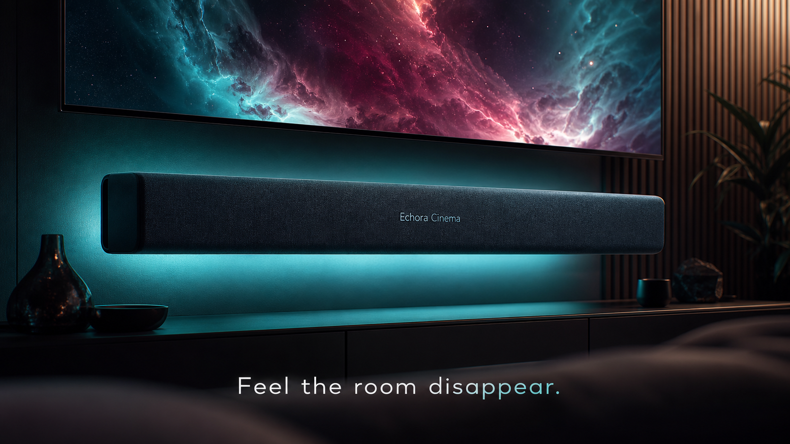

```text
Sleek living-room product shot of a slim fabric-wrapped soundbar named 'Echora Cinema' mounted below a wall TV showing an abstract nebula, soft cyan under-glow spilling onto the media console. Dim moody home-theater lighting, deep shadows, teal-magenta accent grade, immersive premium feel. Cinematic audio-ad mood, low frontal angle, shallow depth of field, 16:9 widescreen. Tagline lower center: 'Feel the room disappear.'
```

Model: GPT Image 2 · Author: API Models (apimodels.app)

[Original source](https://github.com/apimodels/gpt-image-2-prompts/blob/980d100f3bd0f2cde4cf38835daeb742bf1cac65/prompts.json#L2418) · [Provenance and original license](data/projectd-batch-0009.json)

## Pulsewave Record Player — API Models · CC BY 4.0

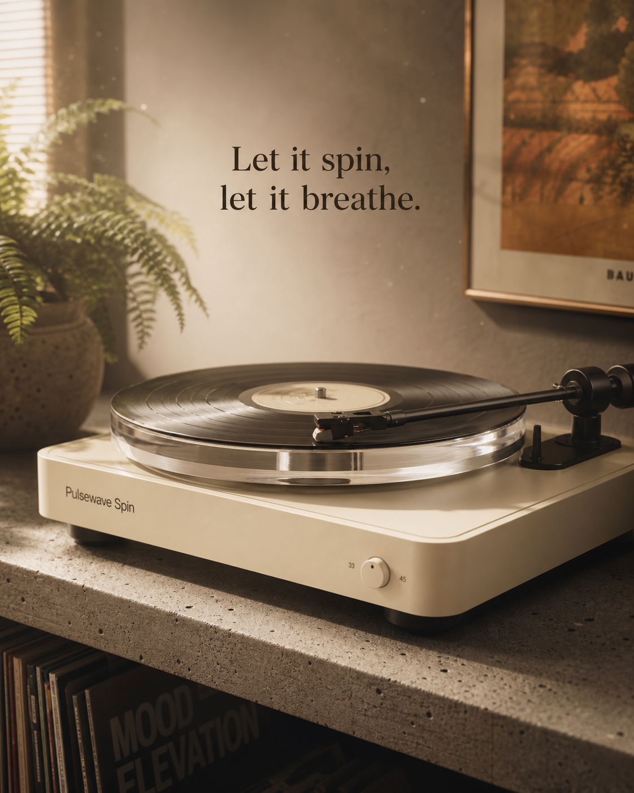

```text
Nostalgic product shot of a modern turntable named 'Pulsewave Spin' with a matte cream base and clear acrylic platter, a black vinyl slowly spinning under warm light, tonearm gently resting on a groove. Set on a textured concrete shelf beside a potted fern, soft window light and dust motes floating. Retro-modern audio-ad mood, close 30-degree angle, shallow depth of field, 4:5 vertical. Tagline above: 'Let it spin, let it breathe.'
```

Model: GPT Image 2 · Author: API Models (apimodels.app)

[Original source](https://github.com/apimodels/gpt-image-2-prompts/blob/980d100f3bd0f2cde4cf38835daeb742bf1cac65/prompts.json#L2433) · [Provenance and original license](data/projectd-batch-0009.json)

## Sonare DJ Headphones — API Models · CC BY 4.0


```text
Bold studio product shot of pro closed-back DJ headphones called 'Sonare Deck' in matte black with electric-purple accents and swivel cups, floating against a dark backdrop pierced by neon violet and cyan stage-light streaks. Hard dramatic lighting, glossy highlights on the coiled cable, high-energy nightlife vibe. Punchy audio-ad mood, three-quarter angle, 1:1 centered composition, dramatic shadow. Tagline lower: 'Own the mix.'
```

Model: GPT Image 2 · Author: API Models (apimodels.app)

[Original source](https://github.com/apimodels/gpt-image-2-prompts/blob/980d100f3bd0f2cde4cf38835daeb742bf1cac65/prompts.json#L2448) · [Provenance and original license](data/projectd-batch-0009.json)

## Vibra Bone-Conduction Band — API Models · CC BY 4.0

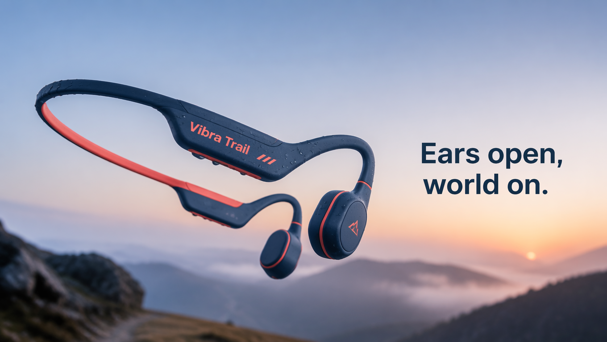

```text
Sporty product shot of a curved bone-conduction headphone band named 'Vibra Trail' in slate blue and neon coral, floating in profile against a soft dawn-gradient sky. Fresh cool morning light, faint mist, matte silicone texture with subtle sweat-bead detail. Active outdoor audio-ad mood, clean side angle, shallow depth of field, 16:9 wide framing, generous negative space. Tagline right side: 'Ears open, world on.'
```

Model: GPT Image 2 · Author: API Models (apimodels.app)

[Original source](https://github.com/apimodels/gpt-image-2-prompts/blob/980d100f3bd0f2cde4cf38835daeb742bf1cac65/prompts.json#L2463) · [Provenance and original license](data/projectd-batch-0009.json)

## Resona Multiroom Speaker — API Models · CC BY 4.0

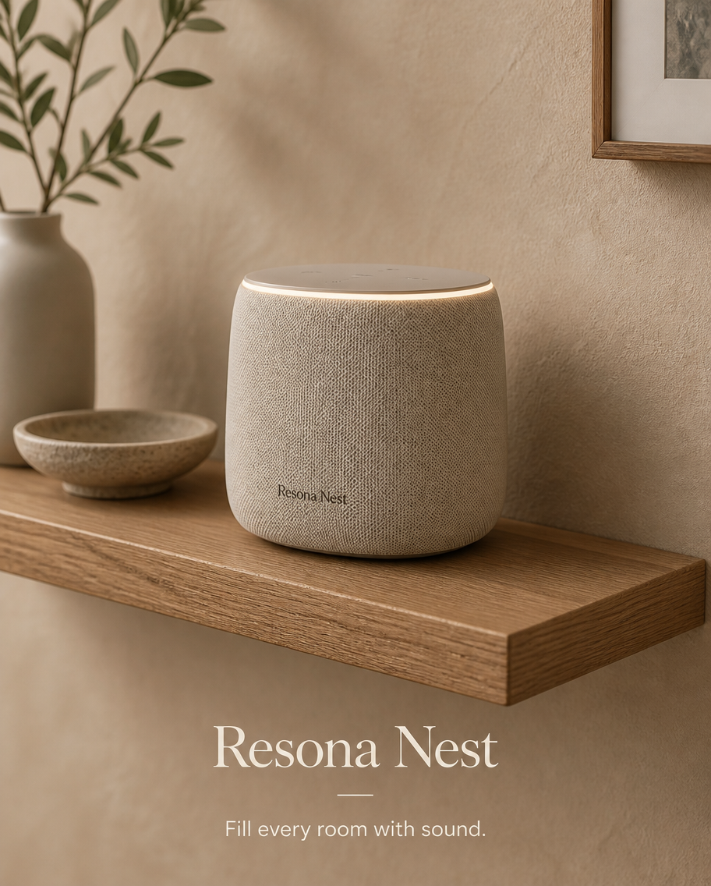

```text
Elegant home product shot of a compact fabric-mesh smart multiroom speaker named 'Resona Nest' in soft sand beige, a subtle top light-ring glowing warm white. Placed on a floating oak shelf against a plastered clay-toned wall, soft diffused daylight and calm neutral palette. Serene lifestyle-audio ad mood, eye-level slightly angled, shallow depth of field, 4:5 vertical. Tagline lower: 'Fill every room with sound.'
```

Model: GPT Image 2 · Author: API Models (apimodels.app)

[Original source](https://github.com/apimodels/gpt-image-2-prompts/blob/980d100f3bd0f2cde4cf38835daeb742bf1cac65/prompts.json#L2478) · [Provenance and original license](data/projectd-batch-0009.json)

## Pastel Shapes Self-Love Card — API Models · CC BY 4.0

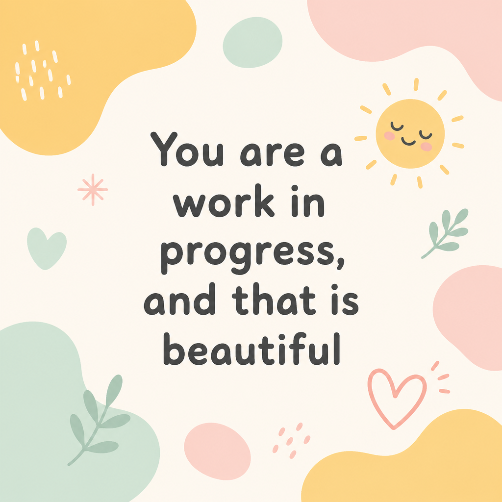

```text
A soft self-love quote card, 1:1. Off-white background scattered with organic blob shapes in butter yellow, blush and mint. Centered rounded sans-serif text reads "You are a work in progress, and that is beautiful". A tiny smiling sun and a heart doodle float among the shapes. Cheerful, gentle wellness mood, flat vector illustration style, pastel palette, balanced airy composition with plenty of breathing room.
```

Model: GPT Image 2 · Author: API Models (apimodels.app)

[Original source](https://github.com/apimodels/gpt-image-2-prompts/blob/980d100f3bd0f2cde4cf38835daeb742bf1cac65/prompts.json#L4773) · [Provenance and original license](data/projectd-batch-0009.json)

## Monday Reset Bold Type — API Models · CC BY 4.0

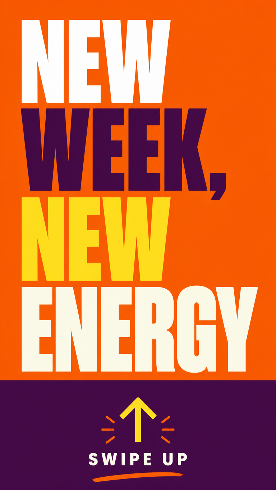

```text
A punchy Monday-motivation post, 9:16 story format. Split layout: top two-thirds in vivid tangerine, bottom third in deep plum. Giant stacked bold display type reads "NEW WEEK, NEW ENERGY" with each word in a contrasting color block. A small arrow icon and "swipe up" hint sit at the base. Energetic, confident brand-story mood, clean geometric composition, saturated complementary palette, crisp flat design.
```

Model: GPT Image 2 · Author: API Models (apimodels.app)

[Original source](https://github.com/apimodels/gpt-image-2-prompts/blob/980d100f3bd0f2cde4cf38835daeb742bf1cac65/prompts.json#L4788) · [Provenance and original license](data/projectd-batch-0009.json)

## Ink Brush Zen Quote — API Models · CC BY 4.0

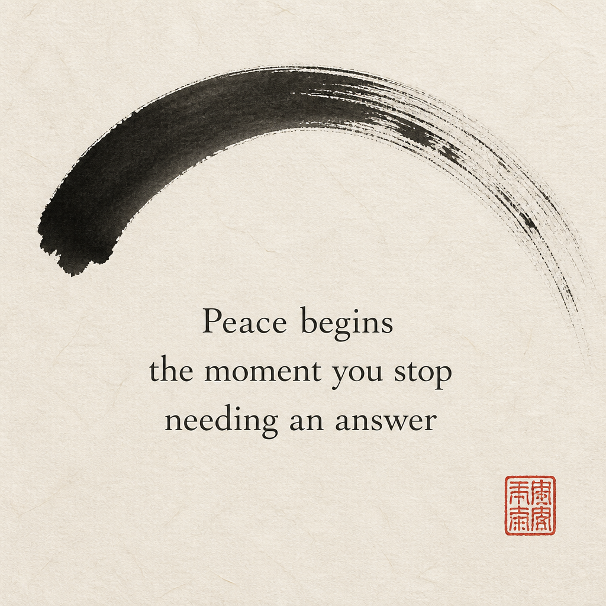

```text
A serene zen quote card, 1:1. Textured rice-paper background in warm ivory. A single sweeping black sumi-e brushstroke arcs across the upper area. Beneath it, calm minimalist serif text reads "Peace begins the moment you stop needing an answer". A small red seal-style stamp accents the lower right. Meditative, understated mood, high negative space, monochrome ink palette with one red accent, refined and quiet.
```

Model: GPT Image 2 · Author: API Models (apimodels.app)

[Original source](https://github.com/apimodels/gpt-image-2-prompts/blob/980d100f3bd0f2cde4cf38835daeb742bf1cac65/prompts.json#L4803) · [Provenance and original license](data/projectd-batch-0009.json)

## Retro 70s Dream Quote — API Models · CC BY 4.0

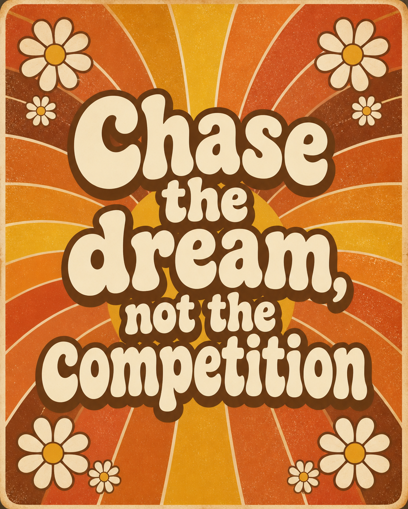

```text
A groovy retro quote poster, 4:5. Warm amber-and-rust background with a repeating rainbow-arc sunburst radiating from the center. Chunky bubble-style 70s lettering reads "Chase the dream, not the competition" in cream outlined with brown. Small daisy motifs dot the corners. Nostalgic, optimistic vintage mood, grainy print texture, earthy 1970s palette of mustard, terracotta and cream, symmetrical playful layout.
```

Model: GPT Image 2 · Author: API Models (apimodels.app)

[Original source](https://github.com/apimodels/gpt-image-2-prompts/blob/980d100f3bd0f2cde4cf38835daeb742bf1cac65/prompts.json#L4818) · [Provenance and original license](data/projectd-batch-0009.json)

## Confetti Celebration Quote — API Models · CC BY 4.0


```text
A joyful celebration quote card, 1:1. Clean white background bursting with hand-drawn confetti, streamers and sparkles in coral, gold and teal. Centered playful mixed typography reads "Celebrate how far you have come", with "far" enlarged in a bouncy script. A tiny party-popper icon sits above the text. Upbeat, festive milestone mood, cheerful bright palette, flat illustrated confetti, balanced energetic composition.
```

Model: GPT Image 2 · Author: API Models (apimodels.app)

[Original source](https://github.com/apimodels/gpt-image-2-prompts/blob/980d100f3bd0f2cde4cf38835daeb742bf1cac65/prompts.json#L4833) · [Provenance and original license](data/projectd-batch-0009.json)

## Lumé Skincare Flatlay — API Models · CC BY 4.0


```text
A clean beauty brand lifestyle post, 4:5. Overhead flatlay on a smooth travertine-stone surface. A frosted-glass serum bottle labeled "Lumé" in delicate sans-serif, a matching amber dropper, a folded sand-colored linen cloth, a single white orchid stem and two smooth pebbles arranged asymmetrically. Soft diffused morning light with gentle shadows. Elevated, spa-like minimalist mood, warm neutral palette of stone, sand and cream, premium editorial styling.
```

Model: GPT Image 2 · Author: API Models (apimodels.app)

[Original source](https://github.com/apimodels/gpt-image-2-prompts/blob/980d100f3bd0f2cde4cf38835daeb742bf1cac65/prompts.json#L4848) · [Provenance and original license](data/projectd-batch-0009.json)

## Cobble Coffee Morning Ritual — API Models · CC BY 4.0

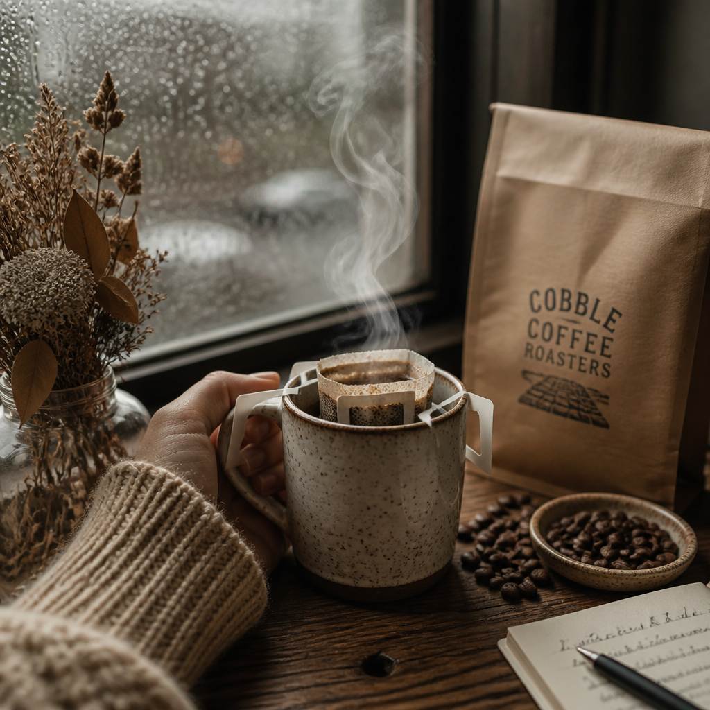

```text
A warm coffee-brand lifestyle post, 1:1. A hand in a chunky knit sweater cradles a speckled ceramic mug of steaming pour-over on a wooden table by a rainy window. A kraft bag stamped "Cobble Coffee Roasters" and scattered coffee beans sit beside it. Soft grey daylight, visible steam curling upward. Cozy, slow-morning mood, muted earthy palette of brown, oatmeal and grey, lifestyle photography with shallow depth of field.
```

Model: GPT Image 2 · Author: API Models (apimodels.app)

[Original source](https://github.com/apimodels/gpt-image-2-prompts/blob/980d100f3bd0f2cde4cf38835daeb742bf1cac65/prompts.json#L4863) · [Provenance and original license](data/projectd-batch-0009.json)

## Emberhaus Candle Ambience — API Models · CC BY 4.0

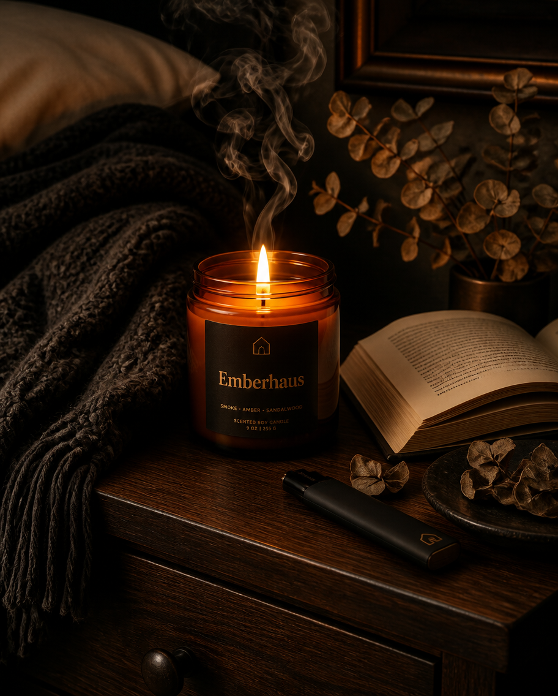

```text
A moody candle-brand post, 4:5. A lit amber-glass candle labeled "Emberhaus" glows on a dark walnut nightstand beside a folded charcoal throw and an open hardcover book. Warm flame light flickers across the scene, wisps of smoke rising. Dried eucalyptus and a matte-black lighter complete the styling. Intimate, hygge evening mood, deep shadows, warm amber-and-espresso palette, cinematic low-key lighting, cozy premium feel.
```

Model: GPT Image 2 · Author: API Models (apimodels.app)

[Original source](https://github.com/apimodels/gpt-image-2-prompts/blob/980d100f3bd0f2cde4cf38835daeb742bf1cac65/prompts.json#L4878) · [Provenance and original license](data/projectd-batch-0009.json)

## Strade Athleisure Motion — API Models · CC BY 4.0

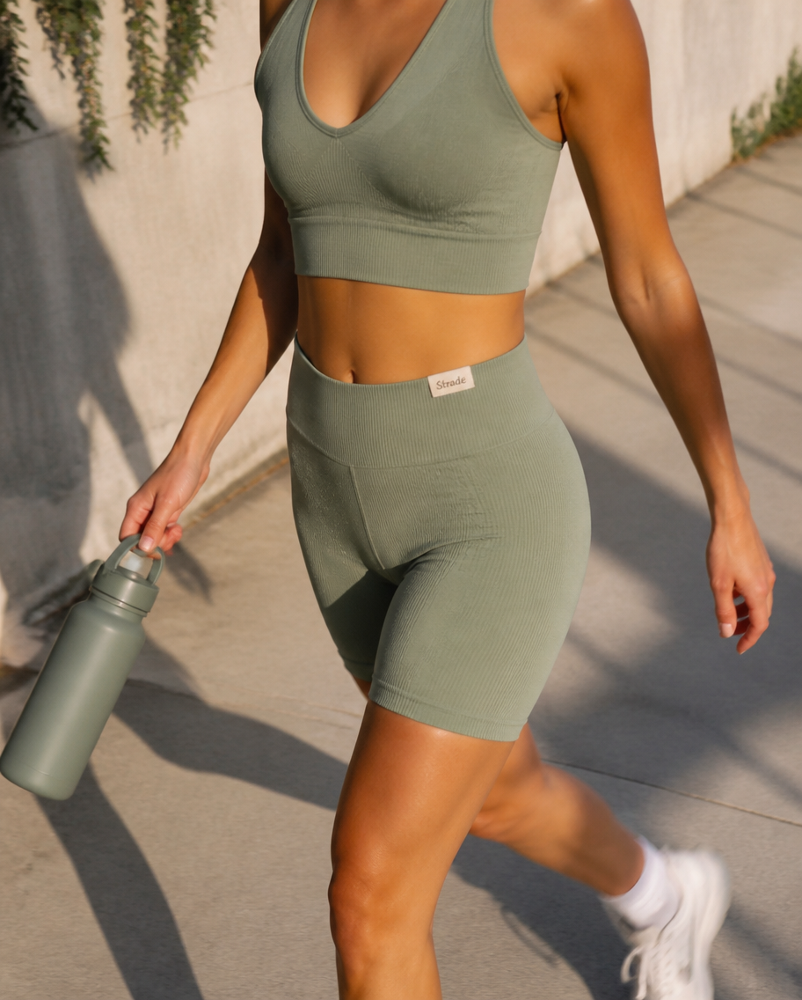

```text
An athleisure brand lifestyle post, 4:5. A person mid-stride on a sunlit concrete walkway, cropped from shoulders to knees, wearing a sage-green seamless sportswear set with a small woven "Strade" tag on the waistband. A matching water bottle in hand. Long soft morning shadows stretch across the pavement. Fresh, active, aspirational mood, muted sage and warm-grey palette, natural sunlight, clean lifestyle photography, motion-blur hint on the legs.
```

Model: GPT Image 2 · Author: API Models (apimodels.app)

[Original source](https://github.com/apimodels/gpt-image-2-prompts/blob/980d100f3bd0f2cde4cf38835daeb742bf1cac65/prompts.json#L4893) · [Provenance and original license](data/projectd-batch-0009.json)

## Terracina Ceramic Mugs — API Models · CC BY 4.0

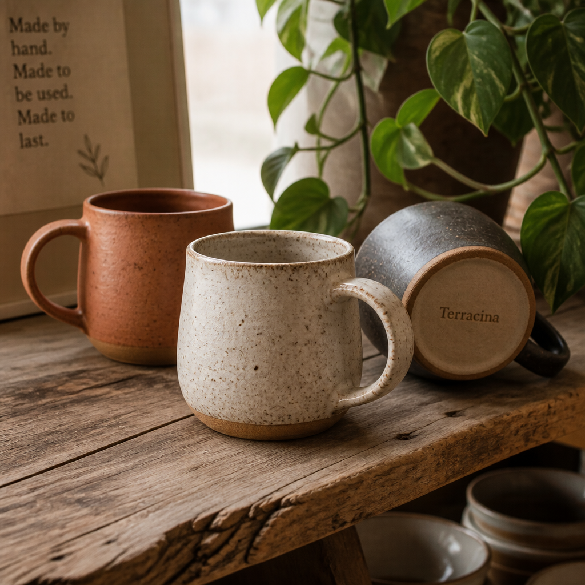

```text
An artisan ceramics brand post, 1:1. Three handmade stoneware mugs in speckled cream, dusty terracotta and slate glaze arranged on a raw wooden shelf, one turned to show a subtle stamped "Terracina" mark on the base. A trailing pothos plant and soft window light frame the scene. Warm, tactile handcrafted mood, earthy matte palette of clay, cream and green, cozy studio-shop atmosphere, shallow focus on the front mug.
```

Model: GPT Image 2 · Author: API Models (apimodels.app)

[Original source](https://github.com/apimodels/gpt-image-2-prompts/blob/980d100f3bd0f2cde4cf38835daeb742bf1cac65/prompts.json#L4908) · [Provenance and original license](data/projectd-batch-0009.json)

## Noirée Perfume Luxury — API Models · CC BY 4.0

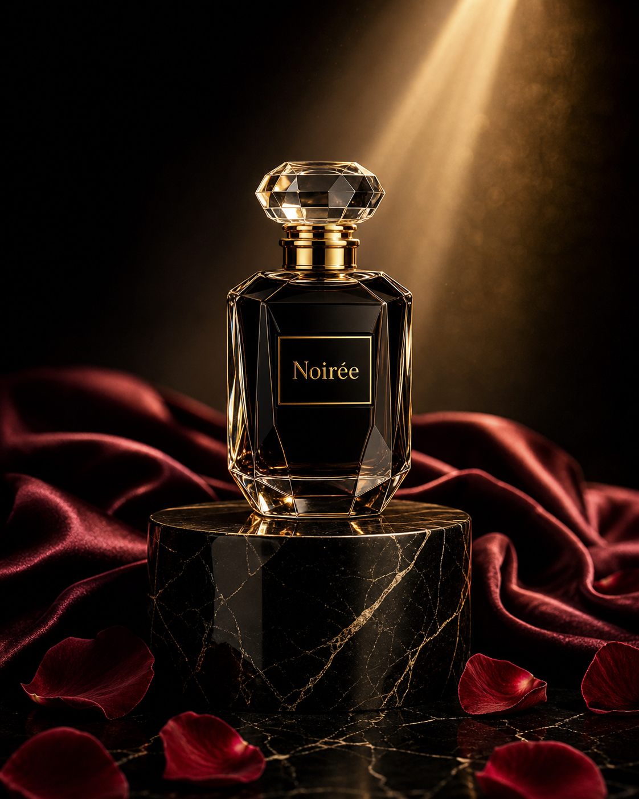

```text
A luxury fragrance brand post, 4:5. A faceted crystal perfume bottle labeled "Noirée" stands on a black marble pedestal, catching a single dramatic beam of light. Silk fabric in deep burgundy pools around the base, a few fresh rose petals scattered nearby. Dark gradient backdrop with a soft golden glow. Opulent, sensual evening mood, high-contrast lighting, rich black, gold and wine palette, glossy reflections, high-end commercial styling.
```

Model: GPT Image 2 · Author: API Models (apimodels.app)

[Original source](https://github.com/apimodels/gpt-image-2-prompts/blob/980d100f3bd0f2cde4cf38835daeb742bf1cac65/prompts.json#L4923) · [Provenance and original license](data/projectd-batch-0009.json)

## Verdant Leaf Tea Set — API Models · CC BY 4.0

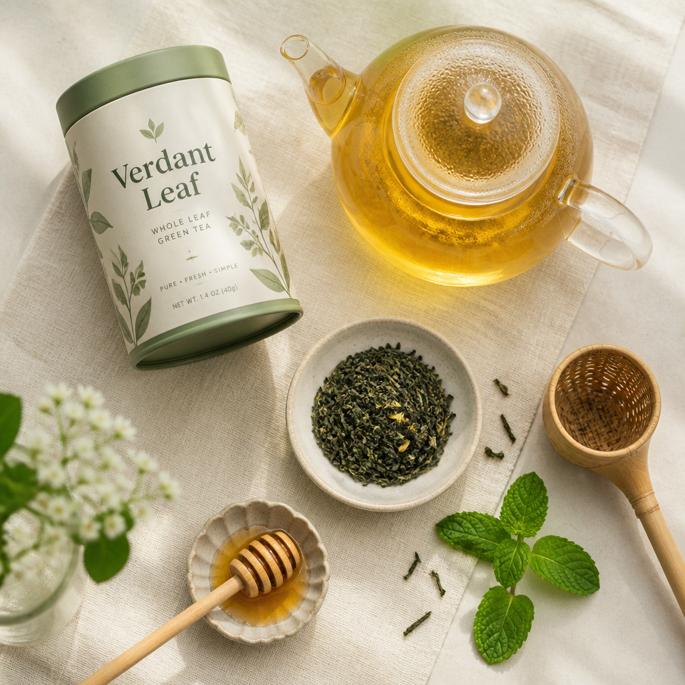

```text
A calming tea-brand lifestyle post, 1:1. Overhead shot of a clear glass teapot of golden brew, a paper tin labeled "Verdant Leaf", loose dried tea leaves in a small dish, and a bamboo strainer on a pale linen runner. A sprig of fresh mint and a honey dipper accent the arrangement. Serene, wholesome afternoon mood, soft natural light, muted green, honey and cream palette, minimal styling with airy spacing.
```

Model: GPT Image 2 · Author: API Models (apimodels.app)

[Original source](https://github.com/apimodels/gpt-image-2-prompts/blob/980d100f3bd0f2cde4cf38835daeb742bf1cac65/prompts.json#L4938) · [Provenance and original license](data/projectd-batch-0009.json)

## Pageturn Planner Desk — API Models · CC BY 4.0


```text
A stationery-brand lifestyle post, 4:5. A tidy desk flatlay with an open dotted planner branded "Pageturn", a row of pastel highlighters, a brass pen, a small potted succulent and a cup of tea in the corner. Neatly handwritten weekly layout visible on the page. Bright soft daylight from the left. Fresh, organized, productive mood, clean pastel-and-white palette, crisp lifestyle photography, satisfying flat-lay symmetry.
```

Model: GPT Image 2 · Author: API Models (apimodels.app)

[Original source](https://github.com/apimodels/gpt-image-2-prompts/blob/980d100f3bd0f2cde4cf38835daeb742bf1cac65/prompts.json#L4953) · [Provenance and original license](data/projectd-batch-0009.json)

## Rootside Tote Sustainable — API Models · CC BY 4.0


```text
A sustainable brand lifestyle post, 1:1. A natural canvas tote screen-printed with a small leaf logo and the name "Rootside" hangs on a wooden peg against a whitewashed wall. Fresh farmers-market produce, a baguette and a bunch of wildflowers peek out of the top. Soft daylight and gentle shadow. Wholesome, eco-conscious slow-living mood, earthy natural palette of oat, olive and warm wood, clean documentary-style photography.
```

Model: GPT Image 2 · Author: API Models (apimodels.app)

[Original source](https://github.com/apimodels/gpt-image-2-prompts/blob/980d100f3bd0f2cde4cf38835daeb742bf1cac65/prompts.json#L4968) · [Provenance and original license](data/projectd-batch-0009.json)

## Aurelin Jewelry Glow — API Models · CC BY 4.0


```text
A delicate jewelry-brand post, 4:5. A close-up of layered thin gold necklaces and a single pearl ring displayed on a folded blush-silk cushion, with a small card reading "Aurelin" in fine serif. A softbox reflection glints on the metal. Dried baby's-breath sprigs frame one corner. Elegant, feminine, minimalist luxury mood, warm gold and soft-pink palette, gentle highlights, macro clarity, premium editorial styling.
```

Model: GPT Image 2 · Author: API Models (apimodels.app)

[Original source](https://github.com/apimodels/gpt-image-2-prompts/blob/980d100f3bd0f2cde4cf38835daeb742bf1cac65/prompts.json#L4983) · [Provenance and original license](data/projectd-batch-0009.json)

## Design illustration · Retire By Forty — API Models · CC BY 4.0


```text
A relaxed man in sunglasses and a linen shirt lounges in a hammock on a tropical beach, turquoise water behind him, while a glowing pile of cash and a golden clock float beside him. Warm sunset gradient, palm silhouettes. Giant bold text 'RETIRE AT 40' in white with a gold outline arcs across the sky, a green upward arrow through the number 40. Sun-flare highlights, aspirational high-contrast lifestyle energy.
```

Model: GPT Image 2 · Author: API Models (apimodels.app)

[Original source](https://github.com/apimodels/gpt-image-2-prompts/blob/980d100f3bd0f2cde4cf38835daeb742bf1cac65/prompts.json#L7143) · [Provenance and original license](data/projectd-batch-0009.json)

## Design illustration · Passive Income Rain — API Models · CC BY 4.0


```text
A grinning entrepreneur in a bright blue shirt throws his arms wide as glowing green dollar bills rain down from above, filling the frame. Warm gold-and-teal background with soft light rays. Massive playful text 'PASSIVE INCOME' in white with a thick green shadow sits at the bottom, a curved yellow arrow pointing at the money. Coins bounce off his shoulders. Joyful, over-the-top, high-contrast money-magnet vibe.
```

Model: GPT Image 2 · Author: API Models (apimodels.app)

[Original source](https://github.com/apimodels/gpt-image-2-prompts/blob/980d100f3bd0f2cde4cf38835daeb742bf1cac65/prompts.json#L7158) · [Provenance and original license](data/projectd-batch-0009.json)

## Design illustration · Debt Free Forever — API Models · CC BY 4.0


```text
A triumphant woman in a red top snaps a heavy iron chain labeled with glowing red bill icons, sparks flying as it breaks. Dark stormy background clearing to bright blue on the right side where she stands free. Huge celebratory text 'DEBT FREE!' in gold and white bursts across the top, a green checkmark beside it and a broken red arrow falling away. Backlit hero lighting, empowering high-contrast breakthrough energy.
```

Model: GPT Image 2 · Author: API Models (apimodels.app)

[Original source](https://github.com/apimodels/gpt-image-2-prompts/blob/980d100f3bd0f2cde4cf38835daeb742bf1cac65/prompts.json#L7173) · [Provenance and original license](data/projectd-batch-0009.json)

## Design illustration · The Stock They Hide — API Models · CC BY 4.0


```text
A serious man in a dark suit leans toward the camera with a finger over his lips, one eyebrow raised, half his face lit in cold blue, half in warm gold. Behind him a blurred trading floor with glowing green tickers. Bold conspiratorial text 'THE STOCK THEY HIDE' in yellow with a black outline fills the right side, a red circle-and-arrow highlighting a mystery ticker. Moody, secretive, high-contrast click-bait tension.
```

Model: GPT Image 2 · Author: API Models (apimodels.app)

[Original source](https://github.com/apimodels/gpt-image-2-prompts/blob/980d100f3bd0f2cde4cf38835daeb742bf1cac65/prompts.json#L7188) · [Provenance and original license](data/projectd-batch-0009.json)

## Design illustration · Millionaire Morning Habits — API Models · CC BY 4.0


```text
A polished man in a golden-hour city penthouse sips coffee while checking a glowing green portfolio on a tablet, sunrise skyline behind floor-to-ceiling windows. Warm gold-and-cream palette. Bold text 'MILLIONAIRE HABITS' in deep navy on a bright gold banner runs across the top, a small green up-arrow and a checklist of glowing checkmarks floating beside him. Crisp, aspirational, high-contrast wealth-lifestyle energy.
```

Model: GPT Image 2 · Author: API Models (apimodels.app)

[Original source](https://github.com/apimodels/gpt-image-2-prompts/blob/980d100f3bd0f2cde4cf38835daeb742bf1cac65/prompts.json#L7203) · [Provenance and original license](data/projectd-batch-0009.json)

## Design illustration · Six Figure Side Hustle — API Models · CC BY 4.0


```text
An energetic young woman in a mustard blazer points both hands at a floating laptop that glows with a green rising revenue graph, coins spilling from the screen. Bold teal-to-black gradient background with light streaks. Enormous stacked text 'SIX FIGURE SIDE HUSTLE' in white and orange fills the left side, a thick green arrow curving up past a '$100K' badge. Confident smile, dynamic pose, high-contrast entrepreneurial hype.
```

Model: GPT Image 2 · Author: API Models (apimodels.app)

[Original source](https://github.com/apimodels/gpt-image-2-prompts/blob/980d100f3bd0f2cde4cf38835daeb742bf1cac65/prompts.json#L7218) · [Provenance and original license](data/projectd-batch-0009.json)

## Design illustration · I Quit My Job — API Models · CC BY 4.0


```text
A man in a wrinkled office shirt joyfully tosses a company ID badge into the air, tie loosened, gray cubicle office behind him dissolving into a bright open sky. Split lighting: dull gray left, vibrant orange right. Giant bold text 'I QUIT MY JOB' in white with a red outline dominates the top, a green arrow pointing from a tiny office toward a big sun. Freeing, dramatic, high-contrast escape-the-9-to-5 energy.
```

Model: GPT Image 2 · Author: API Models (apimodels.app)

[Original source](https://github.com/apimodels/gpt-image-2-prompts/blob/980d100f3bd0f2cde4cf38835daeb742bf1cac65/prompts.json#L7233) · [Provenance and original license](data/projectd-batch-0009.json)

## Design illustration · Scale To One Million — API Models · CC BY 4.0


```text
A determined female founder in a sleek black turtleneck stands before a giant glowing bar chart climbing from a tiny bar to a towering gold '$1M' column. Deep purple stage background with spotlight beams. Massive text 'SCALE TO $1M' in white and gold across the top, a bright green arrow rocketing up the bars. A rocket-ship icon launches from the tallest column. Bold, cinematic, high-contrast growth-story energy.
```

Model: GPT Image 2 · Author: API Models (apimodels.app)

[Original source](https://github.com/apimodels/gpt-image-2-prompts/blob/980d100f3bd0f2cde4cf38835daeb742bf1cac65/prompts.json#L7248) · [Provenance and original license](data/projectd-batch-0009.json)

## Design illustration · This Killed My Startup — API Models · CC BY 4.0


```text
A stressed young founder in a gray hoodie holds his head in disbelief in front of a cracked laptop showing a red flatlining revenue chart. Dark smoky background with embers, a broken company sign labeled 'NOVARA' falling behind him. Huge alarming text 'THIS KILLED MY STARTUP' in red and white fills the top, a jagged red down-arrow and a warning triangle. Regretful, dramatic, high-contrast cautionary tale energy.
```

Model: GPT Image 2 · Author: API Models (apimodels.app)

[Original source](https://github.com/apimodels/gpt-image-2-prompts/blob/980d100f3bd0f2cde4cf38835daeb742bf1cac65/prompts.json#L7263) · [Provenance and original license](data/projectd-batch-0009.json)

## Design illustration · Cold Email That Works — API Models · CC BY 4.0


```text
A confident marketer in a bright orange shirt smirks and points at a floating email window glowing green with a 'REPLY: YES!' notification and dollar signs popping out. Clean blue-to-teal gradient background. Bold text 'COLD EMAIL HACK' in white with a yellow highlight sits on the right, a green arrow from the send button to a stack of cash. A giant cursor clicks 'SEND'. Snappy, punchy, high-contrast growth-hack energy.
```

Model: GPT Image 2 · Author: API Models (apimodels.app)

[Original source](https://github.com/apimodels/gpt-image-2-prompts/blob/980d100f3bd0f2cde4cf38835daeb742bf1cac65/prompts.json#L7278) · [Provenance and original license](data/projectd-batch-0009.json)

## Design illustration · Is Dropshipping Dead — API Models · CC BY 4.0


```text
A skeptical entrepreneur in a denim jacket shrugs with a puzzled 'really?' expression beside a cardboard shipping box wrapped in a glowing red question mark. Split background: green profit graph on one side, red crossed-out cart on the other. Huge text 'DROPSHIPPING DEAD?' in yellow and black across the top, a red down-arrow versus a small green up-arrow. Debate-style, provocative, high-contrast hot-take energy.
```

Model: GPT Image 2 · Author: API Models (apimodels.app)

[Original source](https://github.com/apimodels/gpt-image-2-prompts/blob/980d100f3bd0f2cde4cf38835daeb742bf1cac65/prompts.json#L7293) · [Provenance and original license](data/projectd-batch-0009.json)

## Design illustration · My First 100 Online — API Models · CC BY 4.0


```text
A beaming beginner in a simple green tee holds up a phone showing a glowing '$100.00' payout notification, confetti bursting around him. Bright warm-yellow background with soft radial glow. Big friendly text 'MY FIRST $100 ONLINE' in white with a blue outline fills the bottom, a green up-arrow from a laptop to the phone. A gold coin mascot gives a thumbs up. Encouraging, wholesome, high-contrast beginner-win energy.
```

Model: GPT Image 2 · Author: API Models (apimodels.app)

[Original source](https://github.com/apimodels/gpt-image-2-prompts/blob/980d100f3bd0f2cde4cf38835daeb742bf1cac65/prompts.json#L7308) · [Provenance and original license](data/projectd-batch-0009.json)

## Design illustration · Fire Your Boss — API Models · CC BY 4.0


```text
A bold young woman in a red power suit points a giant glowing 'YOU'RE FIRED' stamp toward the viewer, smirking with total confidence. Dramatic dark-red background with spotlight and rising smoke. Enormous impact text 'FIRE YOUR BOSS' in white and gold across the top, a green arrow from an office chair to a beach chair. Sparks around the stamp. Rebellious, empowering, high-contrast attention-grabbing energy.
```

Model: GPT Image 2 · Author: API Models (apimodels.app)

[Original source](https://github.com/apimodels/gpt-image-2-prompts/blob/980d100f3bd0f2cde4cf38835daeb742bf1cac65/prompts.json#L7323) · [Provenance and original license](data/projectd-batch-0009.json)

## Design illustration · SaaS In 30 Days — API Models · CC BY 4.0


```text
An excited developer in a hoodie sits before three glowing monitors displaying a sleek dashboard app, code streaming past, a green subscriber counter ticking up. Cool blue-purple tech background with circuit patterns. Bold text 'SaaS IN 30 DAYS' in white with a cyan glow fills the top, a bright green arrow spiraling around a big '30' badge. A rocket launches from a screen. Fast-paced, techy, high-contrast build-in-public energy.
```

Model: GPT Image 2 · Author: API Models (apimodels.app)

[Original source](https://github.com/apimodels/gpt-image-2-prompts/blob/980d100f3bd0f2cde4cf38835daeb742bf1cac65/prompts.json#L7338) · [Provenance and original license](data/projectd-batch-0009.json)

## Design illustration · Agency Secrets Exposed — API Models · CC BY 4.0


```text
A slick agency owner in a black blazer pulls back a red velvet curtain to reveal a glowing wall of client logos and rising green revenue graphs. Moody spotlight, deep charcoal background. Huge text 'AGENCY SECRETS' in gold and white across the top with a small red 'EXPOSED' stamp slapped diagonally, a green arrow pointing behind the curtain. Mysterious, insider-reveal, high-contrast curiosity-gap energy.
```

Model: GPT Image 2 · Author: API Models (apimodels.app)

[Original source](https://github.com/apimodels/gpt-image-2-prompts/blob/980d100f3bd0f2cde4cf38835daeb742bf1cac65/prompts.json#L7353) · [Provenance and original license](data/projectd-batch-0009.json)

## Design illustration · Voltage Metal Uprising — API Models · CC BY 4.0


```text
Aggressive heavy-metal gig poster for 'VOLTAGE UPRISING', four bands one night, Iron Hall, October 31, 8PM. Hero: a cracked skull wrapped in barbed electric cables, sparks flying, set against a shattered lightning-torn sky. Composition: skull dead center, jagged blackletter title above, band names stacked in razor-sharp metal font, all framed by a distressed border. Palette: matte black, blood crimson, steel silver, sickly acid green sparks. Heavy grunge texture, xerox photocopy grit. Age and ticket line at the base. Mood: brutal, electric, chaotic, apocalyptic.
```

Model: GPT Image 2 · Author: API Models (apimodels.app)

[Original source](https://github.com/apimodels/gpt-image-2-prompts/blob/980d100f3bd0f2cde4cf38835daeb742bf1cac65/prompts.json#L8348) · [Provenance and original license](data/projectd-batch-0009.json)

## Design illustration · Sunset Symphony Open Air — API Models · CC BY 4.0


```text
Refined classical open-air concert poster for 'SUNSET SYMPHONY' by the Riverside Philharmonic, Grand Lawn, June 14, 7:30PM. Hero: a violin silhouette dissolving into a flock of birds against a gradient dusk sky, faint gold constellations of musical notes. Composition: violin rising from lower center, elegant thin serif title with generous letter-spacing at the top, program details centered below in a delicate line. Palette: rose gold, dusk purple, soft coral, cream. Minimal, airy, watercolor wash background. Mood: graceful, serene, uplifting, cultured.
```

Model: GPT Image 2 · Author: API Models (apimodels.app)

[Original source](https://github.com/apimodels/gpt-image-2-prompts/blob/980d100f3bd0f2cde4cf38835daeb742bf1cac65/prompts.json#L8364) · [Provenance and original license](data/projectd-batch-0009.json)

## Design illustration · Bass Reactor Rave — API Models · CC BY 4.0


```text
High-octane techno rave poster for 'BASS REACTOR', warehouse takeover, District 9, November 15, midnight till dawn. Hero: a glowing nuclear-reactor core of concentric pulsing rings emitting radioactive light beams and floating geometric particles. Composition: reactor core centered and hypnotic, title in a distorted glitchy techno font wrapping the top arc, DJ lineup in a monospaced strip below. Palette: toxic lime, deep purple, electric orange, black void. Chromatic aberration and scanline glitch effects. Mood: hypnotic, industrial, relentless, underground.
```

Model: GPT Image 2 · Author: API Models (apimodels.app)

[Original source](https://github.com/apimodels/gpt-image-2-prompts/blob/980d100f3bd0f2cde4cf38835daeb742bf1cac65/prompts.json#L8380) · [Provenance and original license](data/projectd-batch-0009.json)

## Design illustration · Harmony Hills Choir Gala — API Models · CC BY 4.0


```text
Warm community choir gala poster for 'HARMONY HILLS ANNUAL GALA', St. Bede's Cathedral, December 18, 7PM. Hero: rows of glowing candle flames arranged like a rising staircase of light toward a stained-glass rose window. Composition: symmetrical vertical build with candles rising to the top, title in a stately illuminated-manuscript-inspired serif centered, snowflake motifs in the corners. Palette: deep burgundy, candle gold, midnight blue, ivory. Soft glow and gentle bokeh. Concert program and donation line at the base. Mood: reverent, festive, heartwarming, holiday spirit.
```

Model: GPT Image 2 · Author: API Models (apimodels.app)

[Original source](https://github.com/apimodels/gpt-image-2-prompts/blob/980d100f3bd0f2cde4cf38835daeb742bf1cac65/prompts.json#L8396) · [Provenance and original license](data/projectd-batch-0009.json)

## Design illustration · Desert Mirage Festival — API Models · CC BY 4.0


```text
Bohemian desert music festival poster for 'DESERT MIRAGE', Dune Valley, April 25-27. Hero: a giant setting sun over sculptural sand dunes, a lone figure in flowing garments walking toward it, distant stage rigs shimmering in heat haze. Composition: vast horizon centered, huge circular sun as backdrop, title in an art-deco geometric display font placed inside the sun. Palette: terracotta, dusty pink, ochre, faded turquoise sky. Grainy 70s film wash, sun-bleached tones. Weekend passes and lineup at the bottom. Mood: free-spirited, expansive, sun-drenched, mystical.
```

Model: GPT Image 2 · Author: API Models (apimodels.app)

[Original source](https://github.com/apimodels/gpt-image-2-prompts/blob/980d100f3bd0f2cde4cf38835daeb742bf1cac65/prompts.json#L8412) · [Provenance and original license](data/projectd-batch-0009.json)

## Design illustration · The Silent Hour Film — API Models · CC BY 4.0


```text
Psychological thriller movie poster for 'THE SILENT HOUR', in theaters March 13. Hero: a lone woman standing at the end of a long, dim hallway, her elongated shadow stretching unnaturally toward the viewer, a single flickering ceiling light. Composition: strong one-point perspective drawing the eye down the corridor, title in a stark thin sans-serif at the bottom, tagline 'Some doors should stay closed' above it. Palette: cold desaturated teal-grey, muted amber light, deep black shadows. Cinematic film grain, subtle vignette. Credits block in tiny condensed type at the very bottom. Mood: dread, isolation, suspense, quiet menace.
```

Model: GPT Image 2 · Author: API Models (apimodels.app)

[Original source](https://github.com/apimodels/gpt-image-2-prompts/blob/980d100f3bd0f2cde4cf38835daeb742bf1cac65/prompts.json#L8428) · [Provenance and original license](data/projectd-batch-0009.json)

## Design illustration · Starfall Odyssey Sci-Fi — API Models · CC BY 4.0


```text
Epic sci-fi movie poster for 'STARFALL ODYSSEY', coming summer 2027. Hero: a lone astronaut standing on a cracked alien cliff edge gazing up at two enormous ringed planets and a cascade of falling meteors. Composition: low-angle heroic framing, astronaut tiny against colossal cosmic scale, title in a wide chrome metallic display font across the lower third. Palette: deep cosmic navy, molten orange nebula, cyan starlight, silver. Lens flares and volumetric god rays. Studio credits and release date in small caps at the base. Mood: awe, adventure, vastness, wonder.
```

Model: GPT Image 2 · Author: API Models (apimodels.app)

[Original source](https://github.com/apimodels/gpt-image-2-prompts/blob/980d100f3bd0f2cde4cf38835daeb742bf1cac65/prompts.json#L8444) · [Provenance and original license](data/projectd-batch-0009.json)

## Design illustration · Croissant & Crime — API Models · CC BY 4.0


```text
Quirky comedy-mystery movie poster for 'CROISSANT & CRIME', a whodunit in a Paris bakery, opening April 1. Hero: a flat-lay overhead of a marble counter with a rolling pin as a murder weapon, spilled flour forming a chalk-outline body, magnifying glass, and scattered pastries. Composition: top-down flat design, playful title in a bouncy hand-drawn serif at top, cast names in a curved ribbon. Palette: buttery cream, cherry red, mint green, chocolate brown. Clean illustrative vector style with subtle paper texture. Mood: charming, witty, cozy, tongue-in-cheek.
```

Model: GPT Image 2 · Author: API Models (apimodels.app)

[Original source](https://github.com/apimodels/gpt-image-2-prompts/blob/980d100f3bd0f2cde4cf38835daeb742bf1cac65/prompts.json#L8460) · [Provenance and original license](data/projectd-batch-0009.json)

## Design illustration · The Last Lighthouse — API Models · CC BY 4.0


```text
Atmospheric indie drama movie poster for 'THE LAST LIGHTHOUSE', a festival selection, in select cinemas October 10. Hero: a weathered lighthouse on a stormy cliff, its beam cutting through heavy fog and crashing waves, a small boat far below. Composition: vertical, lighthouse slightly right of center, huge moody sky above, title in a hand-etched narrow serif near the bottom. Palette: stormy slate blue, foam white, warm beacon yellow, charcoal. Painterly oil-texture rendering, soft grain. Laurel award badges and credits at the base. Mood: melancholic, solitary, poetic, weathered.
```

Model: GPT Image 2 · Author: API Models (apimodels.app)

[Original source](https://github.com/apimodels/gpt-image-2-prompts/blob/980d100f3bd0f2cde4cf38835daeb742bf1cac65/prompts.json#L8476) · [Provenance and original license](data/projectd-batch-0009.json)

## Design illustration · Neon Samurai Anime — API Models · CC BY 4.0


```text
Bold anime film poster for 'NEON SAMURAI', a cyberpunk feature premiering December 5. Hero: a masked samurai in a rain-soaked neon alley, drawing a glowing katana that streaks light, holographic signs in a fictional script overhead. Composition: dynamic diagonal action pose, character lower-center facing away, huge katana slash cutting across, title in a sharp brush-stroke display font upper right. Palette: hot pink, cyber cyan, deep violet night, wet asphalt reflections. Cel-shaded anime rendering with dramatic rim light. Studio and date banner at the base. Mood: cool, kinetic, futuristic, stylish.
```

Model: GPT Image 2 · Author: API Models (apimodels.app)

[Original source](https://github.com/apimodels/gpt-image-2-prompts/blob/980d100f3bd0f2cde4cf38835daeb742bf1cac65/prompts.json#L8492) · [Provenance and original license](data/projectd-batch-0009.json)

## Design illustration · Whispering Pines Horror — API Models · CC BY 4.0


```text
Unsettling horror movie poster for 'WHISPERING PINES', do not go past the tree line, in theaters Friday the 13th. Hero: a dense dark pine forest at night with countless pale glowing eyes hidden among the trunks, a single flashlight beam from below. Composition: vertical wall of trees filling the frame, symmetrical and claustrophobic, title dripping in a distressed serif at the top, tagline below. Palette: black-green forest, sickly moonlight silver, cold blue mist, one drop of red. Heavy grain, deep shadow crush. Small credits at the base. Mood: primal fear, creeping dread, watched, inescapable.
```

Model: GPT Image 2 · Author: API Models (apimodels.app)

[Original source](https://github.com/apimodels/gpt-image-2-prompts/blob/980d100f3bd0f2cde4cf38835daeb742bf1cac65/prompts.json#L8508) · [Provenance and original license](data/projectd-batch-0009.json)

## Design illustration · Grand Heist Getaway — API Models · CC BY 4.0


```text
Slick heist-action movie poster for 'GRAND HEIST GETAWAY', the biggest job of their lives, opening July 4. Hero: five silhouetted crew members walking away from an exploding vault in a confident line, golden coins and cash raining around them. Composition: horizontal hero row along the center, dramatic backlight explosion behind, title in a bold beveled gold display font at the top, character names in a strip below. Palette: black, molten gold, ember orange, smoke grey. Glossy cinematic finish with lens flare. Credits at the base. Mood: cool, confident, explosive, glamorous.
```

Model: GPT Image 2 · Author: API Models (apimodels.app)

[Original source](https://github.com/apimodels/gpt-image-2-prompts/blob/980d100f3bd0f2cde4cf38835daeb742bf1cac65/prompts.json#L8524) · [Provenance and original license](data/projectd-batch-0009.json)

## Design illustration · Letters to the Sea — API Models · CC BY 4.0


```text
Tender romance movie poster for 'LETTERS TO THE SEA', a love story across an ocean, in cinemas February 14. Hero: a young couple's silhouettes on opposite ends of a curved sandy beach at golden hour, a paper boat carrying a letter drifting on the tide between them. Composition: wide low horizon, warm sky filling the top, title in a flowing romantic script across the center sky, tagline below. Palette: golden peach sunset, soft coral, seafoam, warm cream sand. Dreamy soft focus and gentle lens bloom. Release date at the base. Mood: wistful, tender, hopeful, bittersweet.
```

Model: GPT Image 2 · Author: API Models (apimodels.app)

[Original source](https://github.com/apimodels/gpt-image-2-prompts/blob/980d100f3bd0f2cde4cf38835daeb742bf1cac65/prompts.json#L8540) · [Provenance and original license](data/projectd-batch-0009.json)

## Design illustration · Iron Peak Documentary — API Models · CC BY 4.0


```text
Rugged documentary film poster for 'IRON PEAK', one mountain, one impossible climb, streaming November 22. Hero: a tiny lone climber on a razor-thin ice ridge dwarfed by a monstrous granite summit piercing the clouds. Composition: extreme vertical scale, climber near the bottom, colossal mountain filling the frame, title in a bold industrial condensed sans at the top, tagline below. Palette: icy blue-white, granite grey, cold shadow navy, a warm speck of the climber's red jacket. Crisp high-altitude clarity with subtle grain. Award laurels and credits at the base. Mood: heroic, brutal, awe-inspiring, human against nature.
```

Model: GPT Image 2 · Author: API Models (apimodels.app)

[Original source](https://github.com/apimodels/gpt-image-2-prompts/blob/980d100f3bd0f2cde4cf38835daeb742bf1cac65/prompts.json#L8556) · [Provenance and original license](data/projectd-batch-0009.json)

## Design illustration · Clockwork Kingdom Fantasy — API Models · CC BY 4.0


```text
Ornate fantasy-adventure movie poster for 'CLOCKWORK KINGDOM', the gears of destiny are turning, in theaters this holiday. Hero: a floating steampunk city of brass gears and airships orbiting a giant glowing pocket watch, a young hero standing on a gear-bridge in the foreground. Composition: grand vertical build with layered depth, hero small at bottom center, colossal city rising above, title in an ornate engraved gold-filigree serif across the lower third. Palette: brass gold, deep teal sky, copper, warm amber glow. Intricate detail, painterly matte-painting style. Credits at the base. Mood: wondrous, epic, inventive, magical.
```

Model: GPT Image 2 · Author: API Models (apimodels.app)

[Original source](https://github.com/apimodels/gpt-image-2-prompts/blob/980d100f3bd0f2cde4cf38835daeb742bf1cac65/prompts.json#L8572) · [Provenance and original license](data/projectd-batch-0009.json)

## Design illustration · Streaming Subscriptions Growth — API Models · CC BY 4.0


```text
A modern infographic, 9:16 vertical, titled 'Streaming Subscribers Keep Climbing'. A layered area chart shows three invented services stacking: StreamNest (bottom, indigo), PixelPlay (middle, magenta), LumaTV (top, cyan), total climbing from 40M in 2019 to 210M in 2025. Smooth curves with soft transparency, year labels along the base, a single annotation arrow marking '2022 price cut'. Big top headline, a right-column mini legend, and a bottom ribbon with '+425% in 6 years'. Dark charcoal background, neon accent lines, glowing edges, sleek tech aesthetic.
```

Model: GPT Image 2 · Author: API Models (apimodels.app)

[Original source](https://github.com/apimodels/gpt-image-2-prompts/blob/980d100f3bd0f2cde4cf38835daeb742bf1cac65/prompts.json#L10823) · [Provenance and original license](data/projectd-batch-0009.json)

## Design illustration · Commute Mode Stacked Bar — API Models · CC BY 4.0


```text
A flat infographic, 4:5, titled 'How the City Commutes, by Year'. A vertical stacked bar chart with five bars (2021-2025), each divided into Car (grey), Bus (blue), Bike (green), Walk (yellow), Rail (purple). Over the years the grey car segment shrinks from 54% to 39% while green bike grows from 6% to 17%. Percentage labels inside each segment, a tidy legend row at the bottom with transport icons. Soft mint background, rounded bar corners, clean geometric sans type, subtle grid lines behind bars.
```

Model: GPT Image 2 · Author: API Models (apimodels.app)

[Original source](https://github.com/apimodels/gpt-image-2-prompts/blob/980d100f3bd0f2cde4cf38835daeb742bf1cac65/prompts.json#L10838) · [Provenance and original license](data/projectd-batch-0009.json)

## Design illustration · Daily Steps Histogram — API Models · CC BY 4.0


```text
A health infographic, 2:3, titled 'How Many Steps Do People Really Take?'. A histogram of daily step counts across 12 buckets from 0 to 24,000, bars in a coral-to-teal gradient, the tallest bar peaking around the 6,000-8,000 range. A dashed vertical line marks the '10,000 goal' with 31% of people beyond it shaded darker. X-axis step buckets, Y-axis 'share of people', light grid. Three highlight chips: 'Median 7,400', 'Goal reached 31%', 'Sample 12,000'. White background, flat, friendly rounded type.
```

Model: GPT Image 2 · Author: API Models (apimodels.app)

[Original source](https://github.com/apimodels/gpt-image-2-prompts/blob/980d100f3bd0f2cde4cf38835daeb742bf1cac65/prompts.json#L10853) · [Provenance and original license](data/projectd-batch-0009.json)

## Design illustration · Monthly Rainfall Bar Line Combo — API Models · CC BY 4.0


```text
A weather infographic, 4:5, titled 'Rainfall & Temperature: Rivendale, One Year'. A combo chart: twelve blue bars for monthly rainfall (mm) peaking at 190 in July, plus an overlaid orange line for average temperature curving from 4C in January to 26C in July. Dual axes (mm left, C right), month abbreviations along the base, faint grid. A small legend distinguishes 'Rainfall' and 'Avg Temp'. Pale sky-blue header band, clean white plot, rounded sans-serif, tidy educational layout with a raindrop and sun motif in corners.
```

Model: GPT Image 2 · Author: API Models (apimodels.app)

[Original source](https://github.com/apimodels/gpt-image-2-prompts/blob/980d100f3bd0f2cde4cf38835daeb742bf1cac65/prompts.json#L10868) · [Provenance and original license](data/projectd-batch-0009.json)

## Design illustration · Developer Skills Radar — API Models · CC BY 4.0


```text
A tech infographic, 4:5, titled 'Full-Stack Skill Profile'. A hexagonal radar chart with six axes: Frontend, Backend, Databases, DevOps, Testing, Design, scored 0-10. A translucent purple polygon connects values (Frontend 9, Backend 8, Databases 7, DevOps 5, Testing 6, Design 4), vertices marked with dots and numeric labels. Concentric grid rings in light grey, axis labels in bold. Below, three progress mini-bars for 'React', 'Node', 'SQL'. Dark slate background, neon-violet accents, thin glowing lines, modern portfolio-card aesthetic.
```

Model: GPT Image 2 · Author: API Models (apimodels.app)

[Original source](https://github.com/apimodels/gpt-image-2-prompts/blob/980d100f3bd0f2cde4cf38835daeb742bf1cac65/prompts.json#L10883) · [Provenance and original license](data/projectd-batch-0009.json)

## Design illustration · Flagship Phones Comparison Table — API Models · CC BY 4.0


```text
A product comparison infographic, 4:5, titled 'Flagship Phones Compared'. A three-column table for invented brands: Vela X9, Kestrel Pro, Orbita 12. Rows list Display (6.7in vs 6.5in vs 6.8in), Chip (V-Core 3 vs K8 vs Orbit-X), Camera (50MP vs 48MP vs 108MP), Battery (5000 vs 4600 vs 5200 mAh), Price ($899 vs $799 vs $999). The middle column is highlighted as 'Best Value' with a green ribbon. Alternating light-grey row bands, small check and cross icons, product silhouettes at column tops. Clean white, bold header row, crisp sans-serif.
```

Model: GPT Image 2 · Author: API Models (apimodels.app)

[Original source](https://github.com/apimodels/gpt-image-2-prompts/blob/980d100f3bd0f2cde4cf38835daeb742bf1cac65/prompts.json#L10898) · [Provenance and original license](data/projectd-batch-0009.json)

## Design illustration · Ultrabook Spec Showdown — API Models · CC BY 4.0


```text
A spec-comparison infographic, 2:3, titled 'Ultrabook Spec Showdown'. Three laptop cards side by side for invented brands AeroBook Air, NovaSlim 14, ZephyrEdge. Each card shows a top-down laptop illustration, then a spec stack: weight (1.1 vs 1.3 vs 1.2 kg), RAM (16 vs 32 vs 16 GB), storage (512GB vs 1TB vs 512GB), battery life (14 vs 11 vs 16 hrs), price ($1,199 vs $1,499 vs $1,099). Star ratings under each. Middle card sits raised with a 'Editor's Pick' tag. Soft gradient background from lavender to white, rounded cards, subtle shadows, clean modern UI style.
```

Model: GPT Image 2 · Author: API Models (apimodels.app)

[Original source](https://github.com/apimodels/gpt-image-2-prompts/blob/980d100f3bd0f2cde4cf38835daeb742bf1cac65/prompts.json#L10913) · [Provenance and original license](data/projectd-batch-0009.json)

## Design illustration · Electric SUV Comparison — API Models · CC BY 4.0


```text
A vehicle comparison infographic, 4:5, titled 'Electric SUVs Head to Head'. A four-column table for invented EVs: Volt Ridge, Aurora E7, Terra Volt, Comet EX. Side-profile car illustrations top each column in matching accent colors. Rows: Range (410 vs 380 vs 450 vs 340 mi), 0-60 (4.9 vs 5.6 vs 5.1 vs 6.8 s), Charge to 80% (28 vs 35 vs 25 vs 40 min), Seats (5 vs 7 vs 5 vs 5), Price ($52k vs $61k vs $58k vs $44k). Best-in-row values glow with a small trophy icon. Clean white background, electric-blue and green palette, bold headers, sharp modern typography.
```

Model: GPT Image 2 · Author: API Models (apimodels.app)

[Original source](https://github.com/apimodels/gpt-image-2-prompts/blob/980d100f3bd0f2cde4cf38835daeb742bf1cac65/prompts.json#L10928) · [Provenance and original license](data/projectd-batch-0009.json)

