# ProjectD backfill batch 10

Original generation model, full prompt, reference requirements and original notices are retained. These are existing ProjectD records, not new 2.6 recipes.

## Design illustration · Espresso Machines Compared — API Models · CC BY 4.0

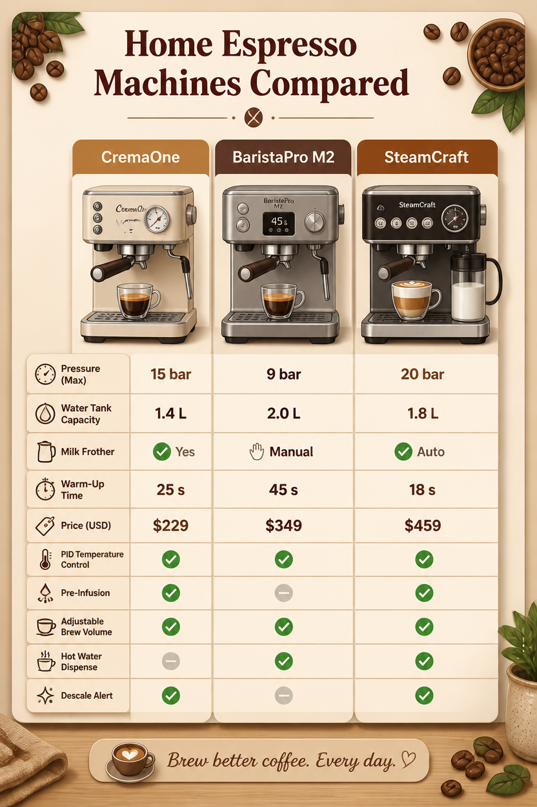

```text
A kitchen-gadget comparison infographic, 2:3, titled 'Home Espresso Machines Compared'. Three tall columns for invented brands: CremaOne, BaristaPro M2, SteamCraft. Each has a flat illustration of the machine and a feature grid: pressure (15 vs 9 vs 20 bar), water tank (1.4 vs 2.0 vs 1.8 L), milk frother (yes/manual/auto), warm-up (25 vs 45 vs 18 s), price ($229 vs $349 vs $459). Feature checkmarks in green, missing features in soft grey. Warm caramel-and-cream palette, coffee-bean corner motifs, rounded cards, cozy modern kitchen aesthetic.
```

Model: GPT Image 2 · Author: API Models (apimodels.app)

[Original source](https://github.com/apimodels/gpt-image-2-prompts/blob/980d100f3bd0f2cde4cf38835daeb742bf1cac65/prompts.json#L10943) · [Provenance and original license](data/projectd-batch-0010.json)

## Design illustration · Robot Vacuum Feature Matrix — API Models · CC BY 4.0

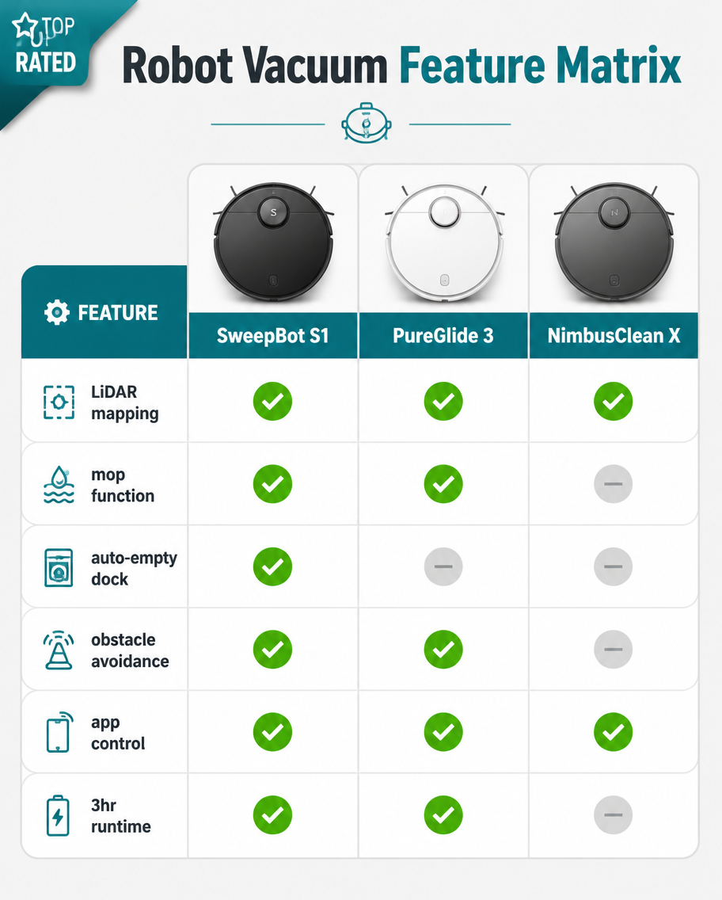

```text
A gadget comparison infographic, 4:5, titled 'Robot Vacuum Feature Matrix'. A checkbox matrix table: rows are features (LiDAR mapping, mop function, auto-empty dock, obstacle avoidance, app control, 3hr runtime), columns are invented models SweepBot S1, PureGlide 3, NimbusClean X. Cells filled with green check circles or grey dashes; SweepBot has the most greens and a corner 'Top Rated' badge. Top-down robot vacuum icons head each column. Light grey background, teal accent header, rounded table cells, clean minimalist tech style.
```

Model: GPT Image 2 · Author: API Models (apimodels.app)

[Original source](https://github.com/apimodels/gpt-image-2-prompts/blob/980d100f3bd0f2cde4cf38835daeb742bf1cac65/prompts.json#L10958) · [Provenance and original license](data/projectd-batch-0010.json)

## Design illustration · Wireless Headphones Comparison — API Models · CC BY 4.0

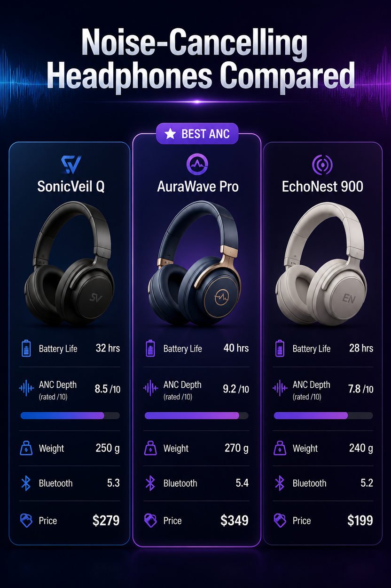

```text
An audio comparison infographic, 2:3, titled 'Noise-Cancelling Headphones Compared'. Three product cards for invented brands: SonicVeil Q, AuraWave Pro, EchoNest 900. Each card shows a headphone illustration and specs: battery (32 vs 40 vs 28 hrs), ANC depth (rated 8.5 vs 9.2 vs 7.8 /10), weight (250 vs 270 vs 240 g), Bluetooth (5.3 vs 5.4 vs 5.2), price ($279 vs $349 vs $199). A tiny horizontal bar visualizes each ANC score. Middle card marked 'Best ANC'. Deep indigo-to-purple gradient background, glossy cards, white text, premium tech vibe.
```

Model: GPT Image 2 · Author: API Models (apimodels.app)

[Original source](https://github.com/apimodels/gpt-image-2-prompts/blob/980d100f3bd0f2cde4cf38835daeb742bf1cac65/prompts.json#L10973) · [Provenance and original license](data/projectd-batch-0010.json)

## Design illustration · Fitness Tracker Face-Off — API Models · CC BY 4.0

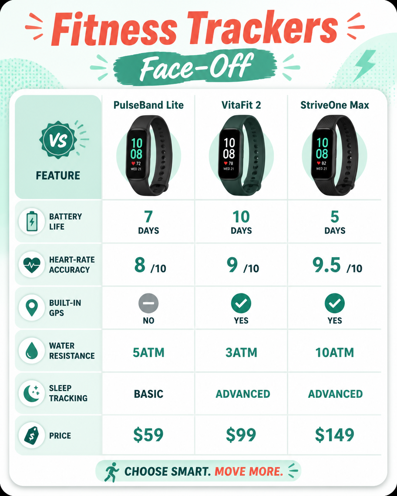

```text
A wearable comparison infographic, 4:5, titled 'Fitness Trackers Face-Off'. A clean three-column table for invented bands: PulseBand Lite, VitaFit 2, StriveOne Max. Rows: battery (7 vs 10 vs 5 days), heart-rate accuracy (rated 8 vs 9 vs 9.5), GPS (no/yes/yes), water resistance (5ATM vs 3ATM vs 10ATM), sleep tracking (basic/advanced/advanced), price ($59 vs $99 vs $149). Small watch-face icons top each column. Green checks and grey dashes for yes/no rows. Mint-and-white palette, rounded corners, energetic coral accent header, friendly modern style.
```

Model: GPT Image 2 · Author: API Models (apimodels.app)

[Original source](https://github.com/apimodels/gpt-image-2-prompts/blob/980d100f3bd0f2cde4cf38835daeb742bf1cac65/prompts.json#L10988) · [Provenance and original license](data/projectd-batch-0010.json)

## Design illustration · Commuter E-Bike Comparison — API Models · CC BY 4.0

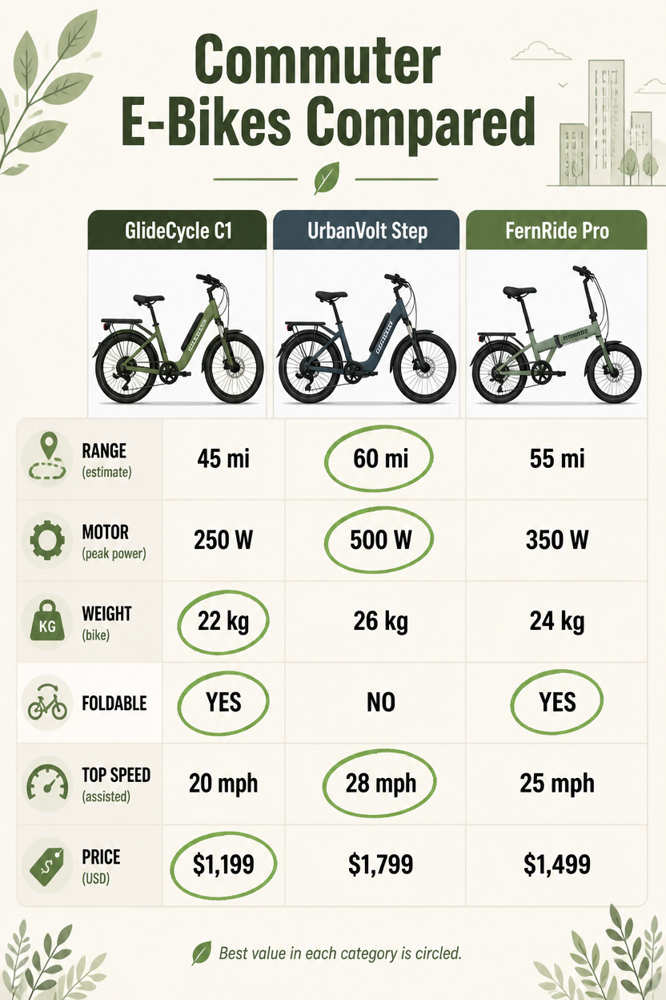

```text
An e-bike comparison infographic, 2:3, titled 'Commuter E-Bikes Compared'. Three columns for invented brands GlideCycle C1, UrbanVolt Step, FernRide Pro, each topped with a side-view bike illustration. Rows: range (45 vs 60 vs 55 mi), motor (250 vs 500 vs 350 W), weight (22 vs 26 vs 24 kg), fold (yes/no/yes), top speed (20 vs 28 vs 25 mph), price ($1,199 vs $1,799 vs $1,499). Best value per row circled in leaf-green. Warm off-white background, earthy green and slate palette, rounded cards, eco-modern flat illustration style.
```

Model: GPT Image 2 · Author: API Models (apimodels.app)

[Original source](https://github.com/apimodels/gpt-image-2-prompts/blob/980d100f3bd0f2cde4cf38835daeb742bf1cac65/prompts.json#L11003) · [Provenance and original license](data/projectd-batch-0010.json)

## Design illustration · Mirrorless Cameras Compared — API Models · CC BY 4.0

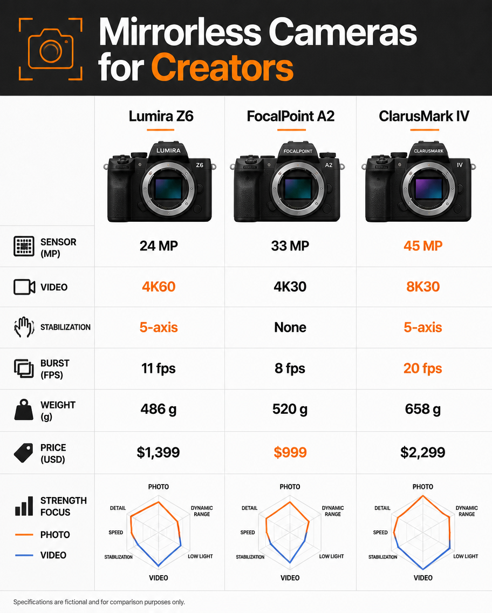

```text
A camera comparison infographic, 4:5, titled 'Mirrorless Cameras for Creators'. Three columns for invented models: Lumira Z6, FocalPoint A2, ClarusMark IV. Each with a front-view camera illustration. Rows: sensor (24 vs 33 vs 45 MP), video (4K60 vs 4K30 vs 8K30), stabilization (5-axis vs none vs 5-axis), burst (11 vs 8 vs 20 fps), weight (486 vs 520 vs 658 g), price ($1,399 vs $999 vs $2,299). A small radar-style icon rates 'photo' vs 'video' strength. Charcoal header, clean white body, orange accent highlights, sharp editorial layout.
```

Model: GPT Image 2 · Author: API Models (apimodels.app)

[Original source](https://github.com/apimodels/gpt-image-2-prompts/blob/980d100f3bd0f2cde4cf38835daeb742bf1cac65/prompts.json#L11018) · [Provenance and original license](data/projectd-batch-0010.json)

## Design illustration · Air Purifier Comparison Grid — API Models · CC BY 4.0

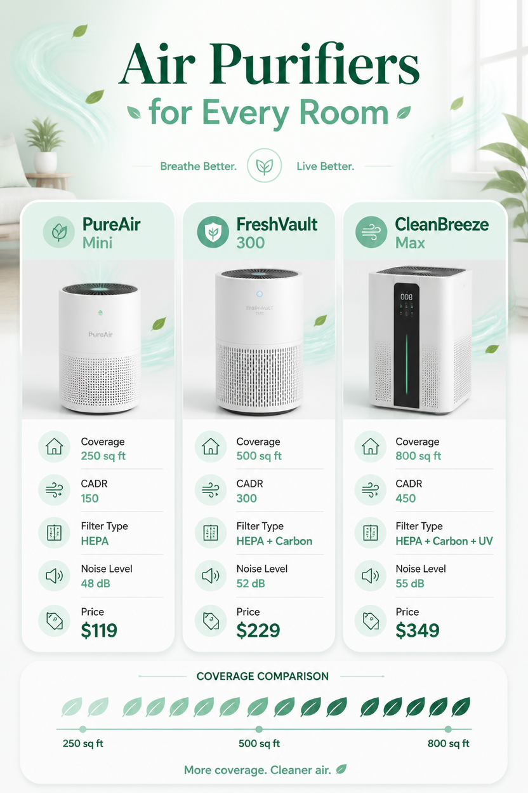

```text
An appliance comparison infographic, 2:3, titled 'Air Purifiers for Every Room'. Three cards for invented brands: PureAir Mini, FreshVault 300, CleanBreeze Max. Each shows a purifier illustration and specs: coverage (250 vs 500 vs 800 sq ft), CADR (150 vs 300 vs 450), filter type (HEPA vs HEPA+carbon vs HEPA+carbon+UV), noise (48 vs 52 vs 55 dB), price ($119 vs $229 vs $349). A small leaf-scaled bar shows relative coverage. Fresh mint-green and white palette, soft rounded cards, floating airflow swirl motifs, calm clean-air aesthetic.
```

Model: GPT Image 2 · Author: API Models (apimodels.app)

[Original source](https://github.com/apimodels/gpt-image-2-prompts/blob/980d100f3bd0f2cde4cf38835daeb742bf1cac65/prompts.json#L11033) · [Provenance and original license](data/projectd-batch-0010.json)

## Cyberpunk Netrunner Avatar — API Models · CC BY 4.0

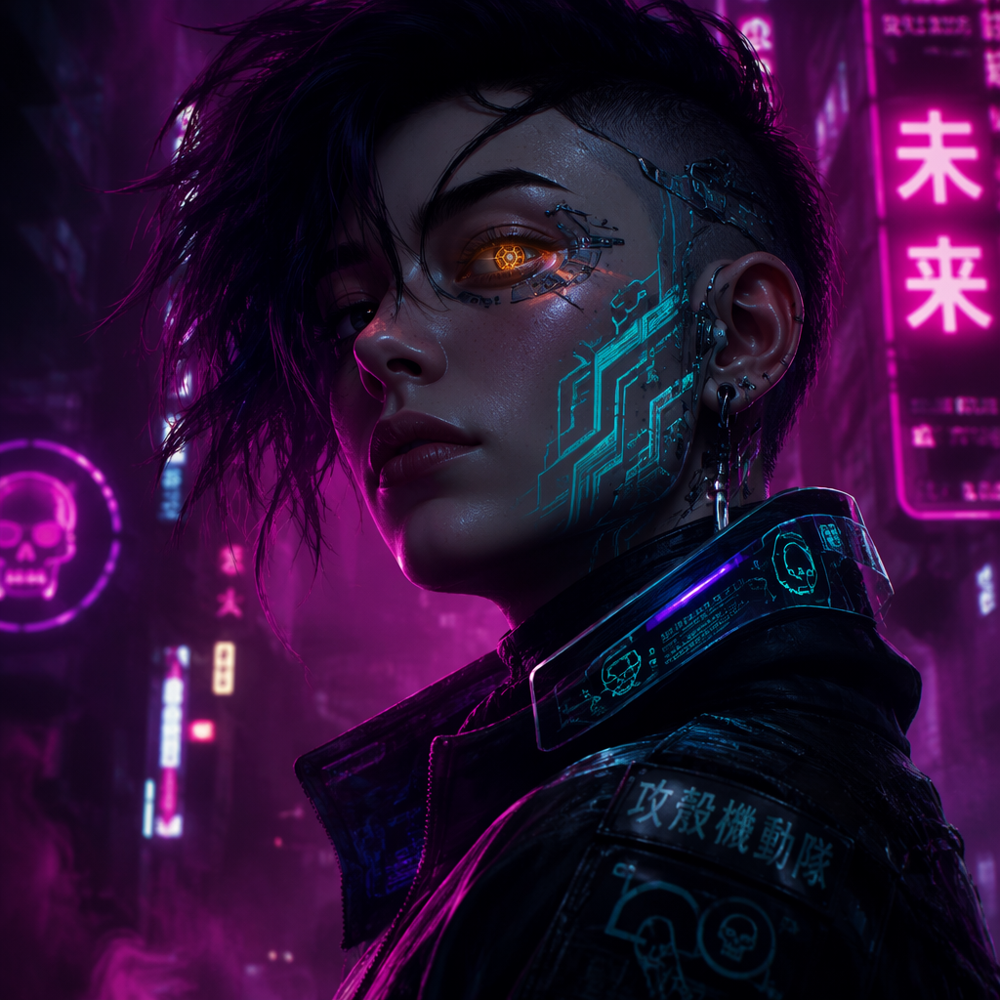

```text
A cyberpunk character avatar of a young androgynous netrunner with an undercut and glowing teal circuit tattoos along the jaw. One eye is a golden cybernetic implant with a hexagonal iris. They wear a high-collared black techwear jacket with holographic trim. Digital-painting style, volumetric magenta haze, reflective wet-neon skin highlights, dark alley signage bokeh, three-quarter view, high contrast, square crop, edgy futuristic vibe.
```

Model: GPT Image 2 · Author: API Models (apimodels.app)

[Original source](https://github.com/apimodels/gpt-image-2-prompts/blob/980d100f3bd0f2cde4cf38835daeb742bf1cac65/prompts.json#L13193) · [Provenance and original license](data/projectd-batch-0010.json)

## Chibi Barista Avatar — API Models · CC BY 4.0


```text
A cute chibi avatar of a cheerful barista boy with big sparkling brown eyes, rosy cheeks, and fluffy chestnut hair under a tiny green apron cap. He holds an oversized latte with heart foam art up to his face. Soft pastel cel-shading, thick rounded outlines, oversized head with tiny body hint, cream background with floating coffee-bean doodles, square composition, super sweet and wholesome kawaii mood.
```

Model: GPT Image 2 · Author: API Models (apimodels.app)

[Original source](https://github.com/apimodels/gpt-image-2-prompts/blob/980d100f3bd0f2cde4cf38835daeb742bf1cac65/prompts.json#L13208) · [Provenance and original license](data/projectd-batch-0010.json)

## Wizard Frog Sticker Avatar — API Models · CC BY 4.0

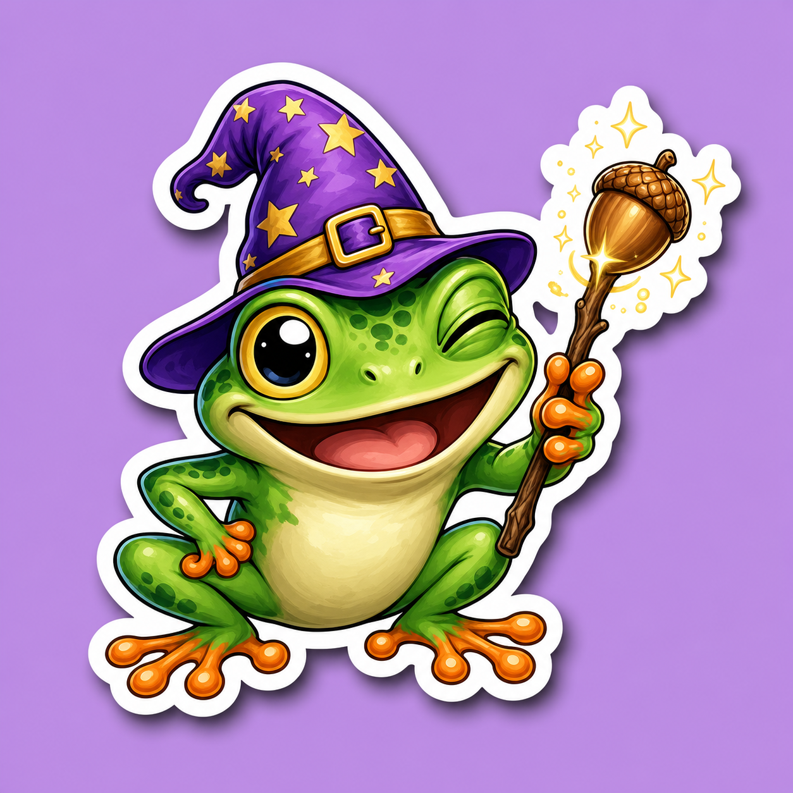

```text
A sticker-style avatar of a grinning green tree frog wearing a tiny purple wizard hat dotted with yellow stars. It holds a sparkling acorn wand. Bold white die-cut border, glossy vinyl-sticker shading, saturated cartoon colors, simple soft-shadow, big expressive eyes with a mischievous wink, plain lavender background, centered square, fun and quirky messaging-app sticker aesthetic.
```

Model: GPT Image 2 · Author: API Models (apimodels.app)

[Original source](https://github.com/apimodels/gpt-image-2-prompts/blob/980d100f3bd0f2cde4cf38835daeb742bf1cac65/prompts.json#L13223) · [Provenance and original license](data/projectd-batch-0010.json)

## Vintage Aviator Anime Avatar — API Models · CC BY 4.0


```text
An anime avatar of a spirited young pilot with windswept caramel hair, amber goggles pushed up on her forehead, and a red scarf fluttering. She wears a worn brown leather flight jacket with a fur collar. Warm cel-shaded painting, golden-hour backlight, soft lens flare, pale blue sky with wispy clouds behind her, three-quarter smiling pose, nostalgic adventurous mood, square crop framed on head and shoulders.
```

Model: GPT Image 2 · Author: API Models (apimodels.app)

[Original source](https://github.com/apimodels/gpt-image-2-prompts/blob/980d100f3bd0f2cde4cf38835daeb742bf1cac65/prompts.json#L13238) · [Provenance and original license](data/projectd-batch-0010.json)

## Robot Barkeeper Mascot Avatar — API Models · CC BY 4.0


```text
A minimalist mascot avatar of a rounded white service robot with a single glowing cyan eye-screen showing a friendly smile emoticon. A tiny bowtie sits at its neck. Soft matte 3D render, gentle top light, smooth plastic surfaces, subtle ambient occlusion, muted teal background with a soft vignette, perfectly centered square, clean modern brand-mascot feel, calm and helpful personality.
```

Model: GPT Image 2 · Author: API Models (apimodels.app)

[Original source](https://github.com/apimodels/gpt-image-2-prompts/blob/980d100f3bd0f2cde4cf38835daeb742bf1cac65/prompts.json#L13253) · [Provenance and original license](data/projectd-batch-0010.json)

## Streetwear Skater Pixel Avatar — API Models · CC BY 4.0

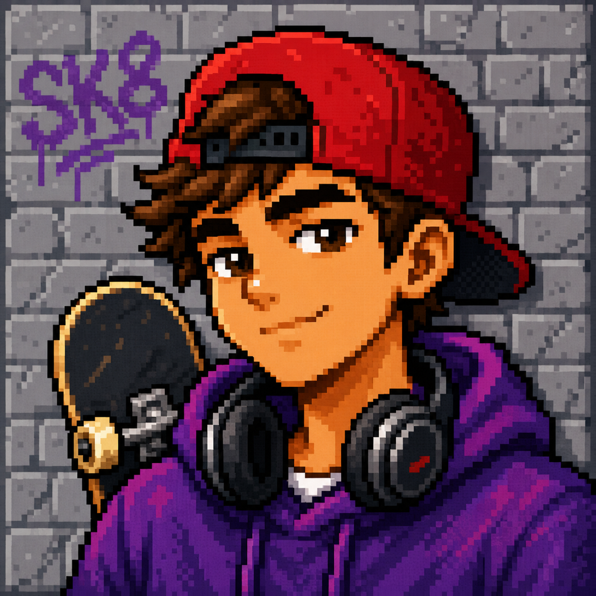

```text
A 48x48 pixel-art avatar of a teenage skater with a backwards red cap, headphones around the neck, and a purple hoodie. A small skateboard peeks over one shoulder. Retro 16-bit palette with warm skin tones, magenta hoodie shading, chunky pixels, subtle outline dithering, gray brick-wall background with a tiny spray-paint tag, centered square, cool relaxed urban vibe.
```

Model: GPT Image 2 · Author: API Models (apimodels.app)

[Original source](https://github.com/apimodels/gpt-image-2-prompts/blob/980d100f3bd0f2cde4cf38835daeb742bf1cac65/prompts.json#L13268) · [Provenance and original license](data/projectd-batch-0010.json)

## Ethereal Elf Fantasy Avatar — API Models · CC BY 4.0

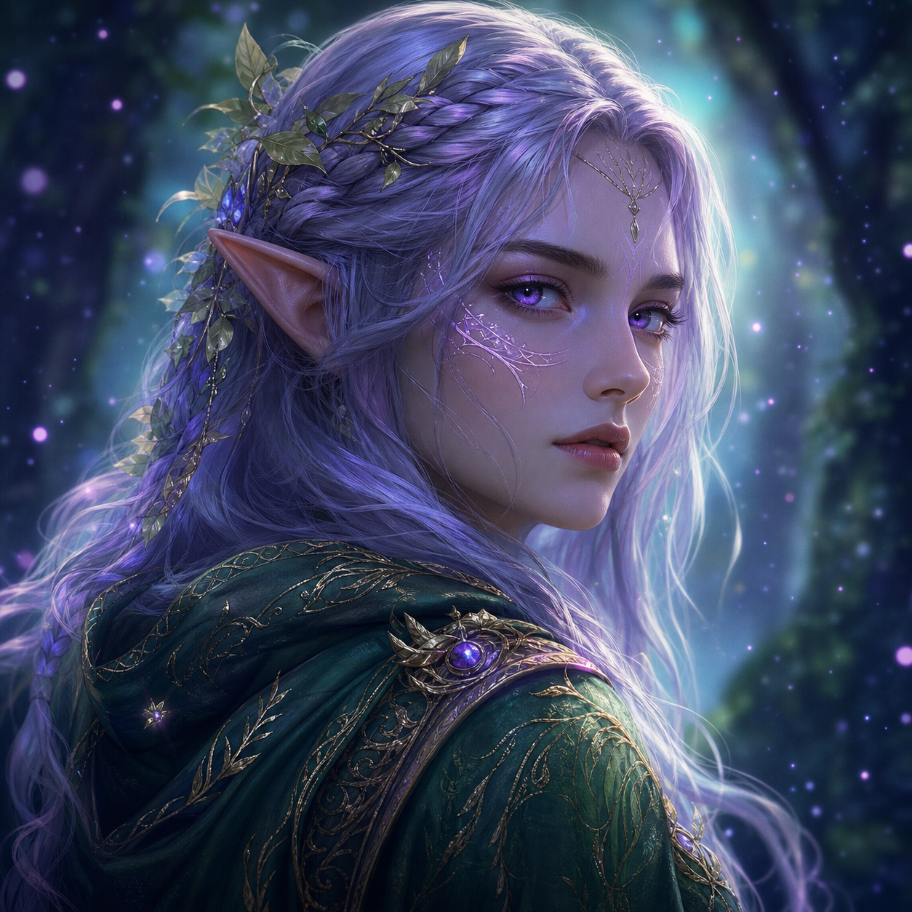

```text
A fantasy character avatar of a serene elf with silver-lilac hair braided with tiny leaves, pointed ears, and luminous violet eyes. Faint glowing runes trace her cheekbones. She wears an emerald cloak with delicate golden embroidery. Painterly semi-realistic style, soft magical bloom, floating spores of light, misty enchanted-forest bokeh, three-quarter view, cool jewel-tone palette, square crop, mystical and calm mood.
```

Model: GPT Image 2 · Author: API Models (apimodels.app)

[Original source](https://github.com/apimodels/gpt-image-2-prompts/blob/980d100f3bd0f2cde4cf38835daeb742bf1cac65/prompts.json#L13283) · [Provenance and original license](data/projectd-batch-0010.json)

## Grandpa Chef Chibi Avatar — API Models · CC BY 4.0


```text
A cute chibi avatar of a cheerful elderly chef with a bushy white mustache, rosy round nose, and a tall white toque. He winks and gives a thumbs-up while holding a wooden spoon. Big head, tiny body, soft cel-shading, warm outlines, a small tomato doodle floating nearby, cream background with faint checkerboard, centered square, jolly and heartwarming kawaii style.
```

Model: GPT Image 2 · Author: API Models (apimodels.app)

[Original source](https://github.com/apimodels/gpt-image-2-prompts/blob/980d100f3bd0f2cde4cf38835daeb742bf1cac65/prompts.json#L13298) · [Provenance and original license](data/projectd-batch-0010.json)

## Data Analyst Headshot Illustration — API Models · CC BY 4.0


```text
A clean headshot-style illustration of a young South Asian man with neat black hair, thin-framed glasses, and a light stubble. He wears a slate-blue button-down with the top button open, relaxed confident smile. Semi-flat vector portrait, smooth cel gradients, subtle skin tone shading, soft studio key light, muted sage-green background with a faint geometric grid, square chest-up framing, modern professional and approachable tone.
```

Model: GPT Image 2 · Author: API Models (apimodels.app)

[Original source](https://github.com/apimodels/gpt-image-2-prompts/blob/980d100f3bd0f2cde4cf38835daeb742bf1cac65/prompts.json#L13313) · [Provenance and original license](data/projectd-batch-0010.json)

## Galaxy Deer Sticker Avatar — API Models · CC BY 4.0

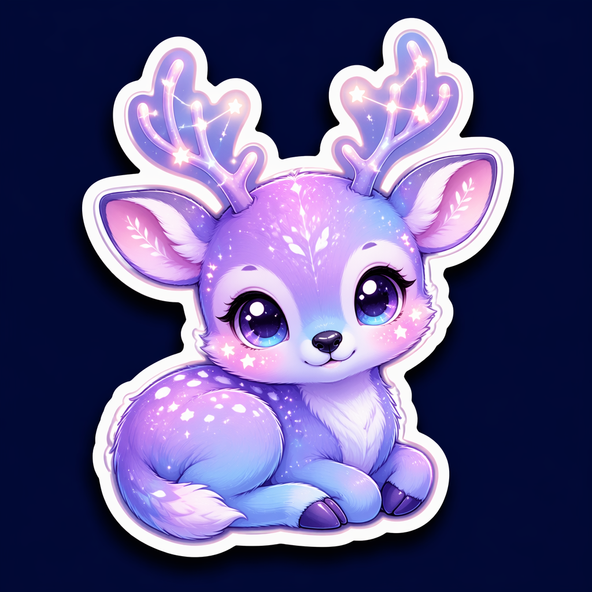

```text
A sticker-style avatar of a dreamy pastel deer fawn whose antlers glow with tiny constellations. Its fur has a soft gradient from lilac to sky-blue, and star sparkles dot its cheeks. Thick white die-cut border, glossy sticker sheen, gentle inner glow, simple soft shadow, plain deep-navy background, big glossy eyes reflecting stars, centered square, magical and cozy sticker-pack aesthetic.
```

Model: GPT Image 2 · Author: API Models (apimodels.app)

[Original source](https://github.com/apimodels/gpt-image-2-prompts/blob/980d100f3bd0f2cde4cf38835daeb742bf1cac65/prompts.json#L13328) · [Provenance and original license](data/projectd-batch-0010.json)

## Cyber Priestess Fantasy Avatar — API Models · CC BY 4.0

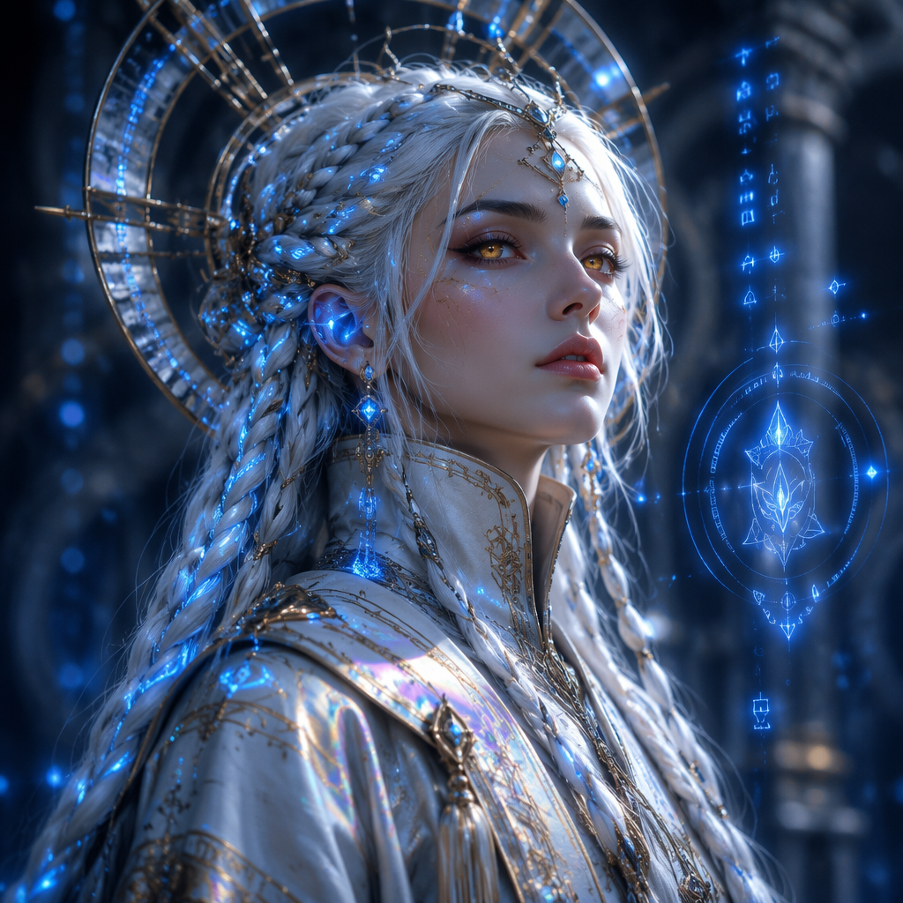

```text
A fantasy-cyberpunk character avatar of a poised priestess with a chrome headdress halo and pale-gold eyes. Glowing sapphire circuitry weaves through her white braided hair. She wears a high-collared ceremonial robe of ivory and holographic silk. Digital painting, soft volumetric light, floating luminous glyphs, dark temple bokeh with blue accents, three-quarter view, cool luxurious palette, square crop, solemn and otherworldly mood.
```

Model: GPT Image 2 · Author: API Models (apimodels.app)

[Original source](https://github.com/apimodels/gpt-image-2-prompts/blob/980d100f3bd0f2cde4cf38835daeb742bf1cac65/prompts.json#L13343) · [Provenance and original license](data/projectd-batch-0010.json)

## Magical Girl Anime Avatar — API Models · CC BY 4.0

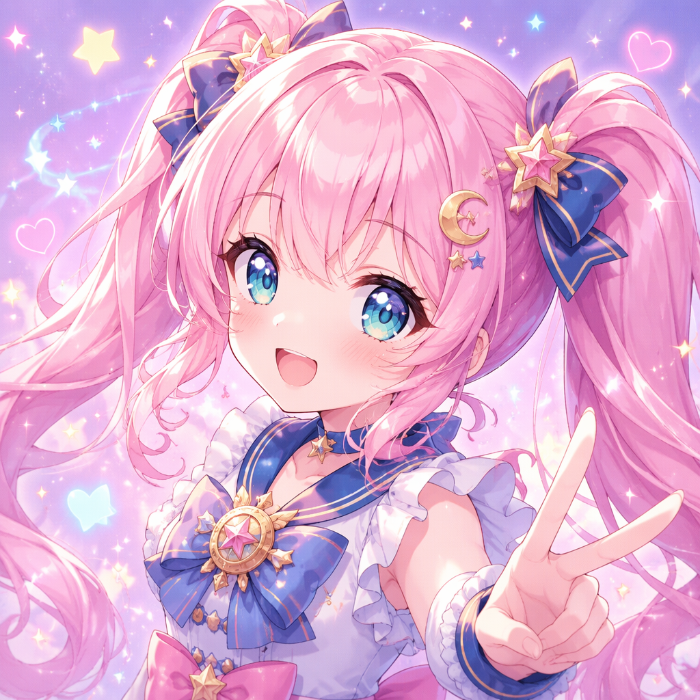

```text
An anime avatar of a bright-eyed magical girl with long pink twin-tails tied with star ribbons and a tiny crescent-moon hairpin. She wears a frilly white-and-blue sailor collar with a golden brooch. Glossy cel-shading with sparkle highlights in her large aqua eyes, soft pastel bloom, floating hearts and stars, dreamy lilac gradient background, three-quarter cheerful pose, square crop, sweet energetic shoujo mood.
```

Model: GPT Image 2 · Author: API Models (apimodels.app)

[Original source](https://github.com/apimodels/gpt-image-2-prompts/blob/980d100f3bd0f2cde4cf38835daeb742bf1cac65/prompts.json#L13358) · [Provenance and original license](data/projectd-batch-0010.json)

## Retro Diner Waitress Pixel Avatar — API Models · CC BY 4.0

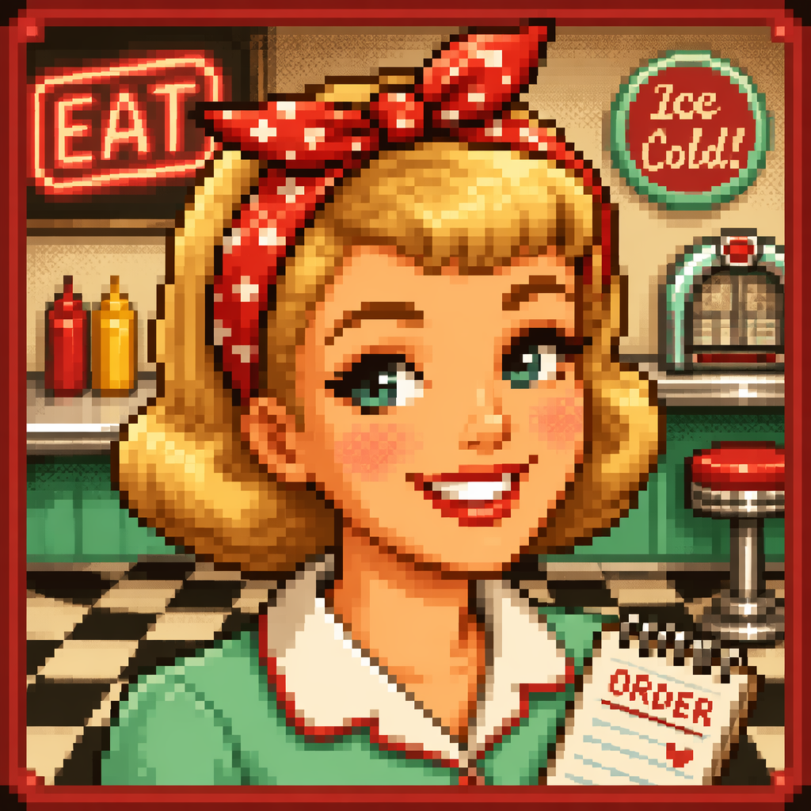

```text
A 40x40 pixel-art avatar of a smiling 1950s diner waitress with a red bandana headband, blonde bob, and a mint-green uniform collar. A tiny order pad peeks at the corner. Warm retro palette of red, mint, and cream, chunky pixels, careful dithering on the shading, checkerboard-floor pattern hint in the background, centered square, cheerful nostalgic arcade-game vibe.
```

Model: GPT Image 2 · Author: API Models (apimodels.app)

[Original source](https://github.com/apimodels/gpt-image-2-prompts/blob/980d100f3bd0f2cde4cf38835daeb742bf1cac65/prompts.json#L13373) · [Provenance and original license](data/projectd-batch-0010.json)

## Punk Rock Chibi Avatar — API Models · CC BY 4.0

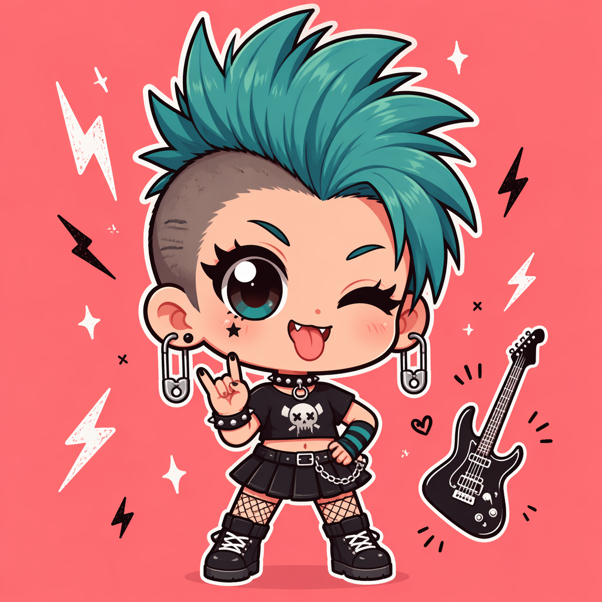

```text
A cute chibi avatar of a spunky girl with a teal mohawk, safety-pin earrings, and a studded black choker. She sticks out her tongue playfully and flashes a tiny rock-hand gesture. Big head, tiny body, bold rounded outlines, soft cel-shading, a small electric-guitar doodle floating beside her, coral-pink background with lightning-bolt sparkles, centered square, rebellious yet adorable kawaii mood.
```

Model: GPT Image 2 · Author: API Models (apimodels.app)

[Original source](https://github.com/apimodels/gpt-image-2-prompts/blob/980d100f3bd0f2cde4cf38835daeb742bf1cac65/prompts.json#L13388) · [Provenance and original license](data/projectd-batch-0010.json)

## Marine Biologist Headshot Illustration — API Models · CC BY 4.0


```text
A clean headshot-style illustration of a cheerful Latina marine biologist with sun-kissed skin, wavy brown hair pulled back, and a small coral pendant. She wears a teal field shirt with rolled sleeves, bright confident smile. Semi-flat vector portrait, smooth cel gradients, soft daylight key from the left, calm aqua-blue background with a faint wave-line motif, square chest-up framing, warm approachable professional tone.
```

Model: GPT Image 2 · Author: API Models (apimodels.app)

[Original source](https://github.com/apimodels/gpt-image-2-prompts/blob/980d100f3bd0f2cde4cf38835daeb742bf1cac65/prompts.json#L13403) · [Provenance and original license](data/projectd-batch-0010.json)

## Coffee Shop Webtoon Panel — API Models · CC BY 4.0

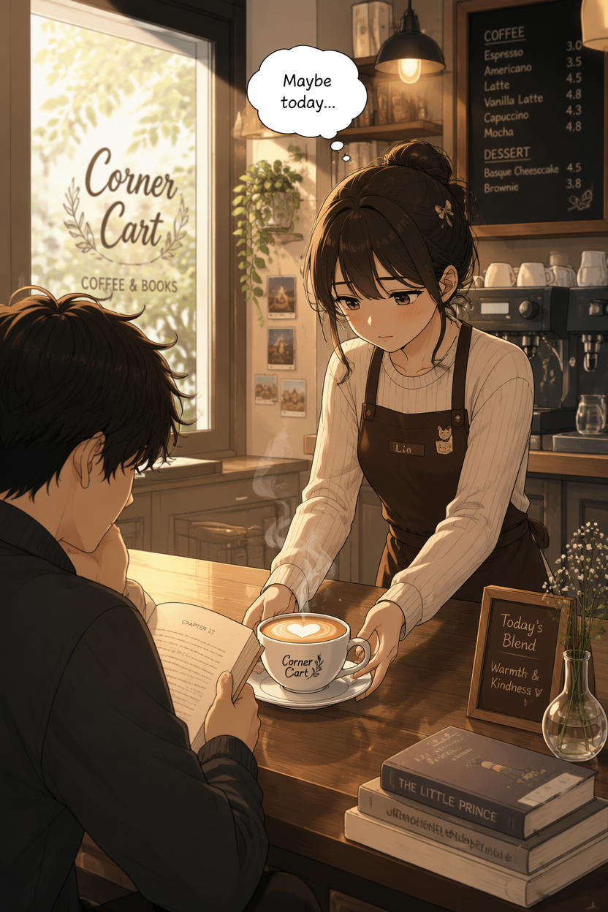

```text
A vertical webtoon panel of a cozy corner cafe scene where a shy barista slides a latte with a hidden heart in the foam toward a customer reading a novel. Clean digital lineart, soft cel-shading, warm amber and cream palette, gentle window light, floating steam. A small thought bubble above the barista reads 'Maybe today...'. Tall vertical composition with soft depth-of-field background, tender slice-of-life mood.
```

Model: GPT Image 2 · Author: API Models (apimodels.app)

[Original source](https://github.com/apimodels/gpt-image-2-prompts/blob/980d100f3bd0f2cde4cf38835daeb742bf1cac65/prompts.json#L13628) · [Provenance and original license](data/projectd-batch-0010.json)

## Noir Detective Alley — API Models · CC BY 4.0

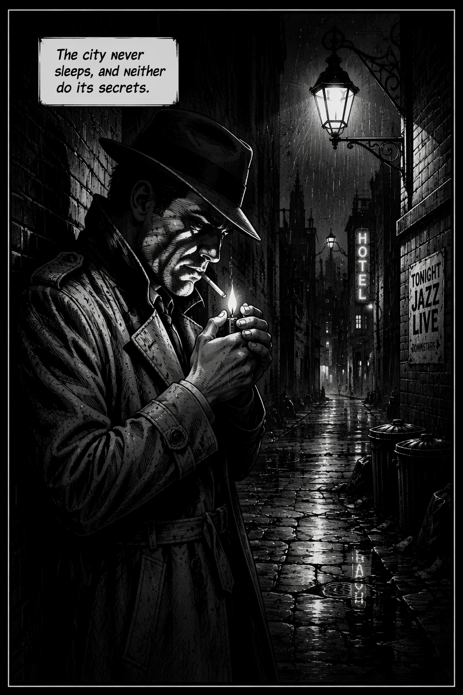

```text
A noir graphic-novel panel of a trench-coated detective lighting a cigarette in a rain-slick alley beneath a flickering streetlamp. High-contrast black-and-white with deep inky shadows, harsh chiaroscuro lighting, venetian-blind shadow stripes across his face. A narration box reads 'The city never sleeps, and neither do its secrets.' Wet cobblestones reflect the lamplight, cross-hatched textures, moody cinematic tension.
```

Model: GPT Image 2 · Author: API Models (apimodels.app)

[Original source](https://github.com/apimodels/gpt-image-2-prompts/blob/980d100f3bd0f2cde4cf38835daeb742bf1cac65/prompts.json#L13643) · [Provenance and original license](data/projectd-batch-0010.json)

## Bunny Bakery Picture Book — API Models · CC BY 4.0

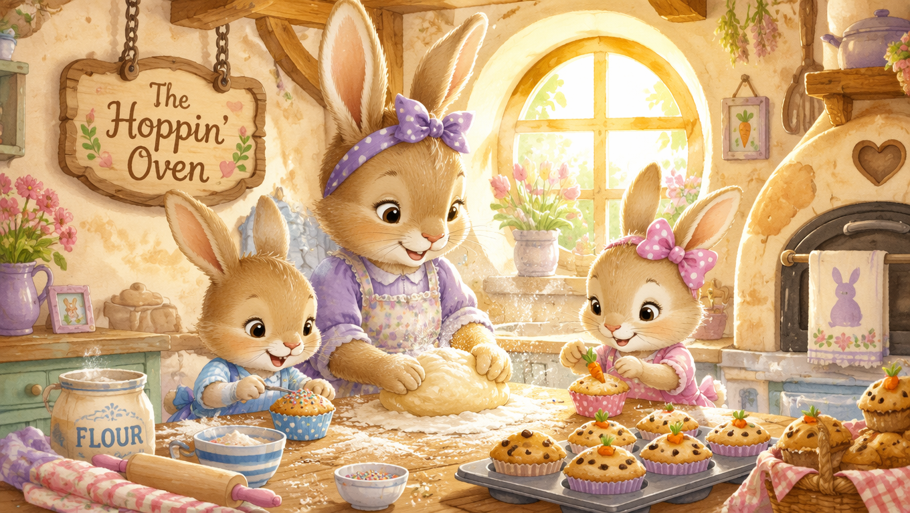

```text
A kids' picture-book scene of a cheerful bunny family baking bread together in a sunny cottage kitchen. Mama bunny kneads dough while two baby bunnies decorate muffins, flour dusting the air. Soft watercolor style, warm buttery-yellow light, rounded cozy furniture, gentle textures, pastel palette with soft edges. A hanging sign reads 'The Hoppin' Oven'. Whimsical, warm, and heartwarming storybook mood, wide friendly composition.
```

Model: GPT Image 2 · Author: API Models (apimodels.app)

[Original source](https://github.com/apimodels/gpt-image-2-prompts/blob/980d100f3bd0f2cde4cf38835daeb742bf1cac65/prompts.json#L13658) · [Provenance and original license](data/projectd-batch-0010.json)

## Time Traveler's Regret Panel — API Models · CC BY 4.0

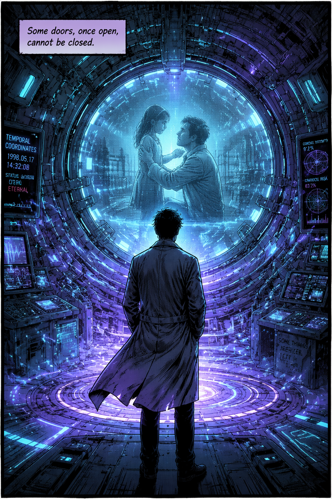

```text
A single dramatic comic panel of a lone scientist standing in a glowing time-machine chamber, watching a holographic memory of a moment he can't change. Detailed sci-fi lineart, cool cyan and violet glow, screentone gradients, subtle particle effects swirling around him. A caption box reads 'Some doors, once open, cannot be closed.' Somber expression, dramatic backlight, emotionally heavy cinematic sci-fi mood.
```

Model: GPT Image 2 · Author: API Models (apimodels.app)

[Original source](https://github.com/apimodels/gpt-image-2-prompts/blob/980d100f3bd0f2cde4cf38835daeb742bf1cac65/prompts.json#L13673) · [Provenance and original license](data/projectd-batch-0010.json)

## Cat Cafe Mischief 4-Koma — API Models · CC BY 4.0

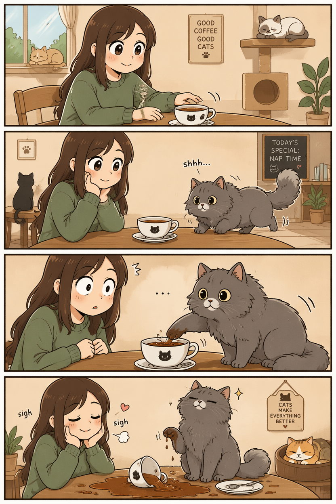

```text
A vertical 4-koma comic of a customer at a cat cafe. Panel 1: she reaches for her tea. Panel 2: a fluffy gray cat stealthily approaches the cup. Panel 3: the cat dips a paw in the tea, both freeze staring at each other. Panel 4: tea spilled everywhere, cat sitting proud, woman sighing with a tiny smile. Clean flat cartoon style, soft warm colors, expressive faces, small motion lines, cheerful lighthearted humor.
```

Model: GPT Image 2 · Author: API Models (apimodels.app)

[Original source](https://github.com/apimodels/gpt-image-2-prompts/blob/980d100f3bd0f2cde4cf38835daeb742bf1cac65/prompts.json#L13688) · [Provenance and original license](data/projectd-batch-0010.json)

## Dragon Rider Battle Panel — API Models · CC BY 4.0

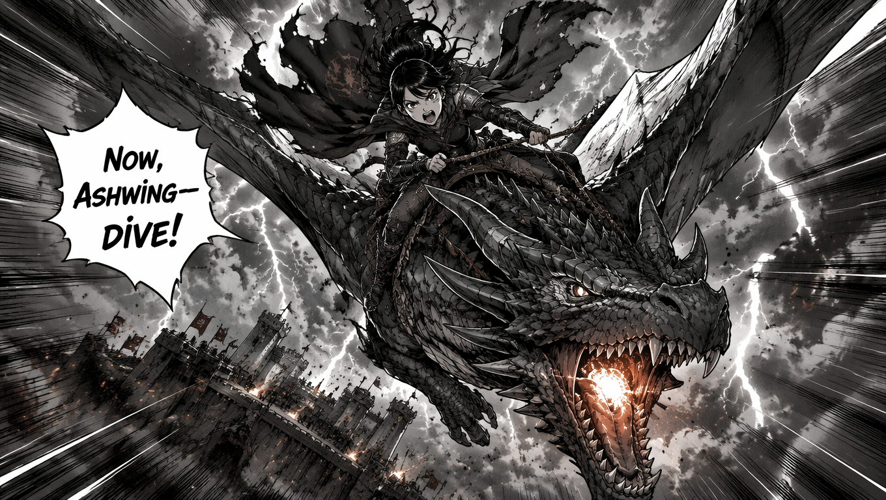

```text
A dynamic manga action panel of a young warrior riding a massive scaled dragon diving through storm clouds toward an enemy fortress. Wind whips her cloak, lightning cracks behind them, the dragon roars with fire building in its throat. Sharp detailed inking, dramatic screentone clouds, radiating speed lines, low heroic angle. A shout bubble reads 'Now, Ashwing—dive!' Slate and ember palette, epic kinetic fantasy energy.
```

Model: GPT Image 2 · Author: API Models (apimodels.app)

[Original source](https://github.com/apimodels/gpt-image-2-prompts/blob/980d100f3bd0f2cde4cf38835daeb742bf1cac65/prompts.json#L13703) · [Provenance and original license](data/projectd-batch-0010.json)

## Space Station Docking Storyboard — API Models · CC BY 4.0

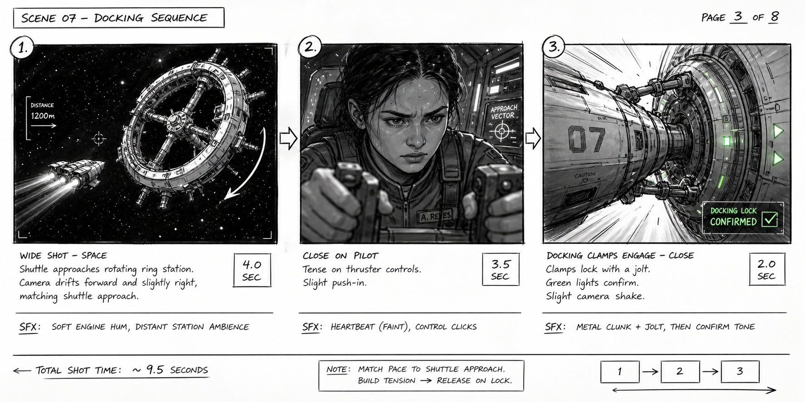

```text
A three-frame horizontal storyboard of a spacecraft docking sequence. Frame 1: wide shot of a small shuttle approaching a rotating ring station against a starfield. Frame 2: close-up of the pilot's tense hands on the thruster controls, sweat on her brow. Frame 3: the docking clamps lock with a jolt, green lights confirming. Rough monochrome storyboard sketch style, loose lines, camera-movement arrows, timing notes, cinematic sci-fi framing.
```

Model: GPT Image 2 · Author: API Models (apimodels.app)

[Original source](https://github.com/apimodels/gpt-image-2-prompts/blob/980d100f3bd0f2cde4cf38835daeb742bf1cac65/prompts.json#L13718) · [Provenance and original license](data/projectd-batch-0010.json)

## Vintage Sci-Fi Ray Gun Cover — API Models · CC BY 4.0

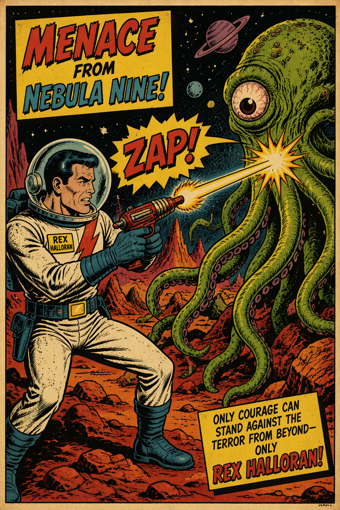

```text
A retro American comic panel in 1950s pulp sci-fi style of a brave astronaut named 'Rex Halloran' firing a glowing ray gun at a giant tentacled alien on a red-rock planet. Bold saturated colors, halftone dots, thick outlines, dramatic pose. A jagged burst reads 'ZAP!' beside the gun. A caption box declares 'Menace from Nebula Nine!' Faded newsprint texture, dynamic pulpy composition, campy heroic energy.
```

Model: GPT Image 2 · Author: API Models (apimodels.app)

[Original source](https://github.com/apimodels/gpt-image-2-prompts/blob/980d100f3bd0f2cde4cf38835daeb742bf1cac65/prompts.json#L13733) · [Provenance and original license](data/projectd-batch-0010.json)

## Late Night Study Webtoon — API Models · CC BY 4.0

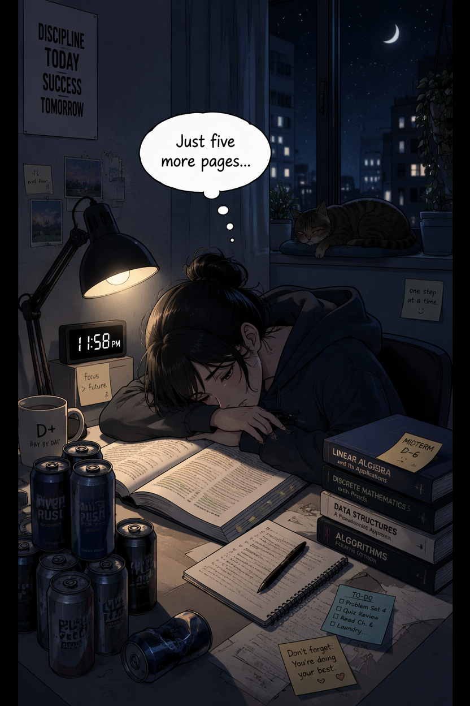

```text
A vertical webtoon panel of a tired college student slumped over textbooks at a desk near midnight, a single warm lamp glowing, empty energy-drink cans stacked nearby. Clean digital lineart, soft cel-shading, cool blue night tones with a warm lamp pool, gentle grain. A thought bubble reads 'Just five more pages...' A cat sleeps curled on the windowsill. Tall vertical composition, quiet relatable slice-of-life mood.
```

Model: GPT Image 2 · Author: API Models (apimodels.app)

[Original source](https://github.com/apimodels/gpt-image-2-prompts/blob/980d100f3bd0f2cde4cf38835daeb742bf1cac65/prompts.json#L13748) · [Provenance and original license](data/projectd-batch-0010.json)

## Noir Rooftop Standoff — API Models · CC BY 4.0

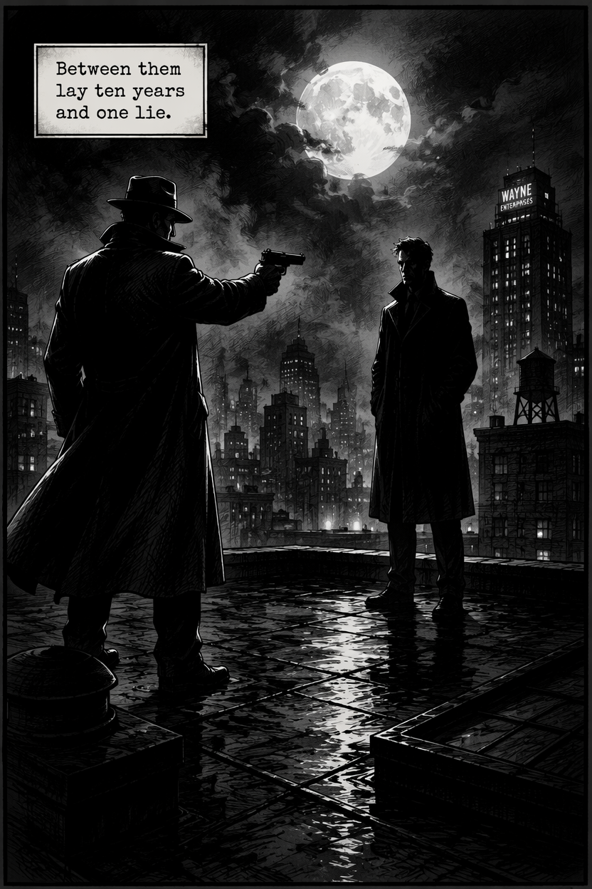

```text
A noir graphic-novel panel of two silhouetted figures facing off on a foggy rooftop at midnight, one with a raised pistol, the other calm with hands in coat pockets. High-contrast black-and-white, heavy ink shadows, moonlight cutting through fog, dramatic rim light on their edges. A narration box reads 'Between them lay ten years and one lie.' Cross-hatched textures, tense cinematic composition, brooding suspense.
```

Model: GPT Image 2 · Author: API Models (apimodels.app)

[Original source](https://github.com/apimodels/gpt-image-2-prompts/blob/980d100f3bd0f2cde4cf38835daeb742bf1cac65/prompts.json#L13763) · [Provenance and original license](data/projectd-batch-0010.json)

## Little Explorer Tidepool Book — API Models · CC BY 4.0

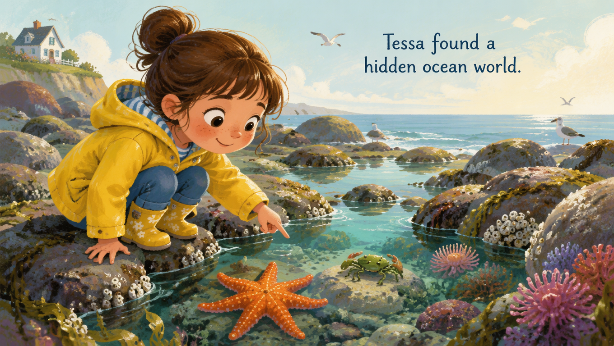

```text
A kids' picture-book scene of a curious little girl in a yellow raincoat crouching at a rocky tidepool, discovering a bright orange starfish and a tiny green crab. Soft gouache style, gentle morning seaside light, rounded friendly rocks, sparkling clear water, pastel-and-teal palette. A small caption reads 'Tessa found a hidden ocean world.' Whimsical, curious, and gentle storybook mood, wide inviting composition.
```

Model: GPT Image 2 · Author: API Models (apimodels.app)

[Original source](https://github.com/apimodels/gpt-image-2-prompts/blob/980d100f3bd0f2cde4cf38835daeb742bf1cac65/prompts.json#L13778) · [Provenance and original license](data/projectd-batch-0010.json)

## Samurai Duel at Dusk — API Models · CC BY 4.0

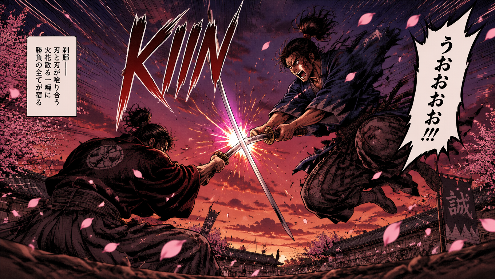

```text
A dynamic manga action panel of two samurai clashing swords at the moment of impact, sparks flying between crossed blades, cherry blossoms swirling around them at dusk. One leaps forward with a fierce cry, the other braces low. Sharp bold inking, radiating speed lines, screentone gradient sky. A sound-effect reads 'KIIN' near the blades. Crimson-and-indigo sunset palette, low dramatic angle, breathless kinetic tension.
```

Model: GPT Image 2 · Author: API Models (apimodels.app)

[Original source](https://github.com/apimodels/gpt-image-2-prompts/blob/980d100f3bd0f2cde4cf38835daeb742bf1cac65/prompts.json#L13793) · [Provenance and original license](data/projectd-batch-0010.json)

## Grocery Run Mishap 4-Koma — API Models · CC BY 4.0

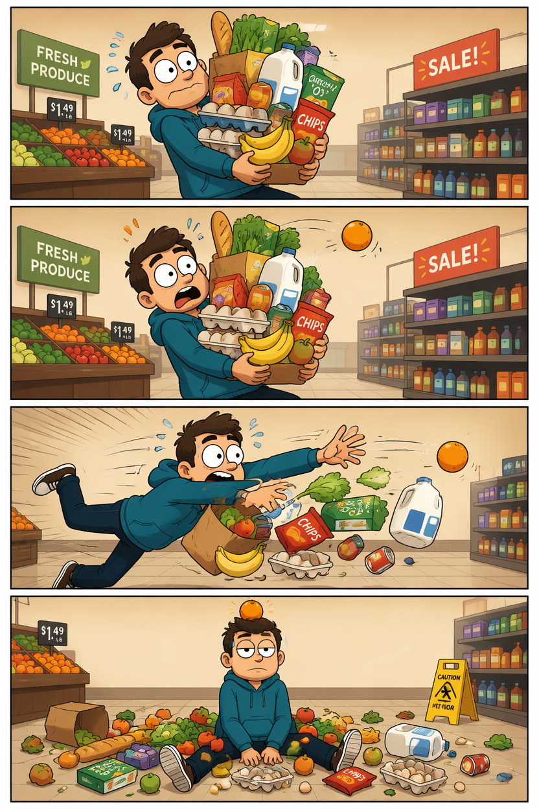

```text
A vertical 4-koma comic of a man's grocery trip gone wrong. Panel 1: he balances a towering armful of groceries, no basket. Panel 2: an orange rolls off the top. Panel 3: he lunges to catch it, everything wobbling. Panel 4: he sits on the floor buried in spilled produce, one orange perfectly balanced on his head, deadpan stare. Clean flat cartoon style, bright cheerful colors, expressive faces, comedic sweat drops, playful humor.
```

Model: GPT Image 2 · Author: API Models (apimodels.app)

[Original source](https://github.com/apimodels/gpt-image-2-prompts/blob/980d100f3bd0f2cde4cf38835daeb742bf1cac65/prompts.json#L13808) · [Provenance and original license](data/projectd-batch-0010.json)

## Underground Bunker Discovery — API Models · CC BY 4.0

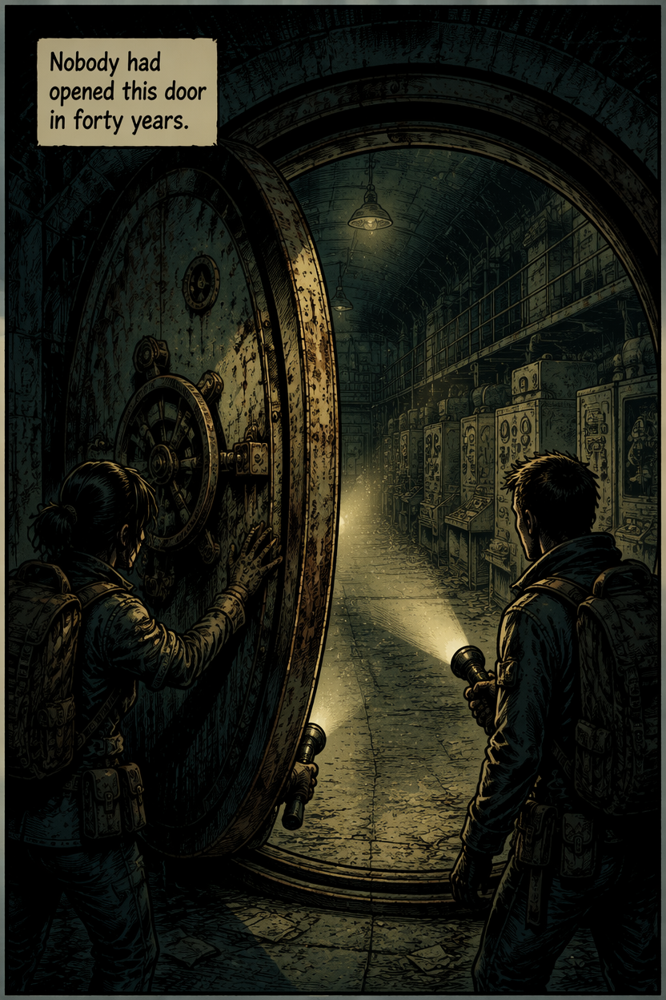

```text
A single atmospheric comic panel of two explorers holding flashlights as they push open a rusted vault door in an abandoned underground bunker, revealing rows of dusty machinery bathed in beams of light. Detailed cross-hatched inking, cool teal shadows with warm flashlight glow, floating dust motes. A caption box reads 'Nobody had opened this door in forty years.' Suspenseful discovery mood, dramatic depth, cinematic mystery.
```

Model: GPT Image 2 · Author: API Models (apimodels.app)

[Original source](https://github.com/apimodels/gpt-image-2-prompts/blob/980d100f3bd0f2cde4cf38835daeb742bf1cac65/prompts.json#L13823) · [Provenance and original license](data/projectd-batch-0010.json)

## Robot Uprising Splash Panel — API Models · CC BY 4.0

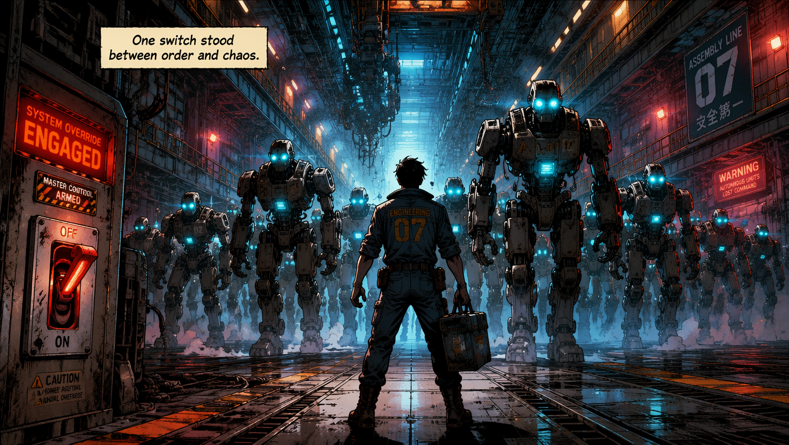

```text
A dramatic wide comic splash panel of a lone engineer standing defiant before an army of glowing-eyed rogue robots marching down a neon-lit factory corridor. Bold detailed lineart, cool cyan robot glow against warm orange emergency lights, heavy screentone shadows, dynamic perspective converging on the horizon. A caption box reads 'One switch stood between order and chaos.' High-stakes sci-fi tension, cinematic composition.
```

Model: GPT Image 2 · Author: API Models (apimodels.app)

[Original source](https://github.com/apimodels/gpt-image-2-prompts/blob/980d100f3bd0f2cde4cf38835daeb742bf1cac65/prompts.json#L13838) · [Provenance and original license](data/projectd-batch-0010.json)

## Design illustration · Fitness App Onboarding — API Models · CC BY 4.0

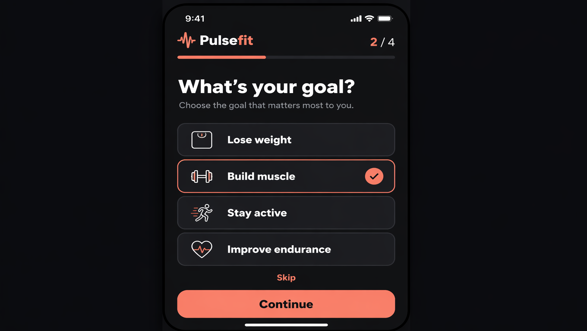

```text
A mobile onboarding screen mockup for a fitness app 'Pulsefit'. Vertical phone frame, step 2 of 4 with a slim progress bar at top. A bold headline 'What's your goal?' and a stack of four large selectable option cards—Lose weight, Build muscle, Stay active, Improve endurance—each with a small line icon, one selected with a coral outline. A 'Continue' button pinned at the bottom, a 'Skip' link above it. Clean dark UI with charcoal background, coral accent, rounded cards, friendly bold sans-serif.
```

Model: GPT Image 2 · Author: API Models (apimodels.app)

[Original source](https://github.com/apimodels/gpt-image-2-prompts/blob/980d100f3bd0f2cde4cf38835daeb742bf1cac65/prompts.json#L14153) · [Provenance and original license](data/projectd-batch-0010.json)

## Design illustration · Designer Portfolio Site — API Models · CC BY 4.0

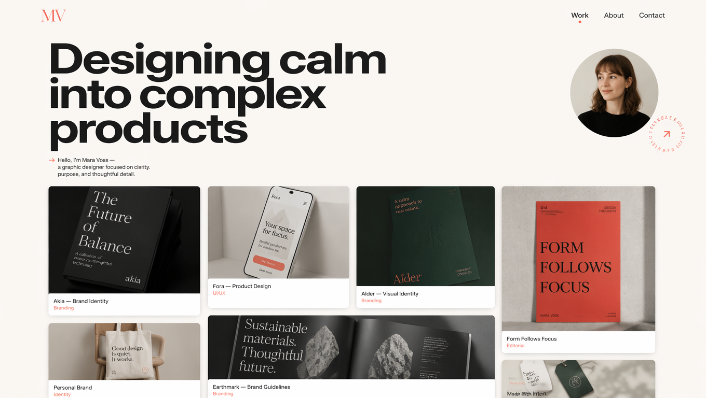

```text
A portfolio website homepage mockup for a graphic designer named 'Mara Voss'. Large minimalist hero with an oversized bold headline 'Designing calm into complex products' and a small circular portrait. Below, a masonry grid of project thumbnails with hover-lift shadows, each labeled with a project name and tag. Top nav with monogram logo left and Work / About / Contact right. Off-white background, single warm-red accent, lots of whitespace, refined editorial typography, 16:9 desktop.
```

Model: GPT Image 2 · Author: API Models (apimodels.app)

[Original source](https://github.com/apimodels/gpt-image-2-prompts/blob/980d100f3bd0f2cde4cf38835daeb742bf1cac65/prompts.json#L14168) · [Provenance and original license](data/projectd-batch-0010.json)

## Design illustration · Food Delivery App Screen — API Models · CC BY 4.0

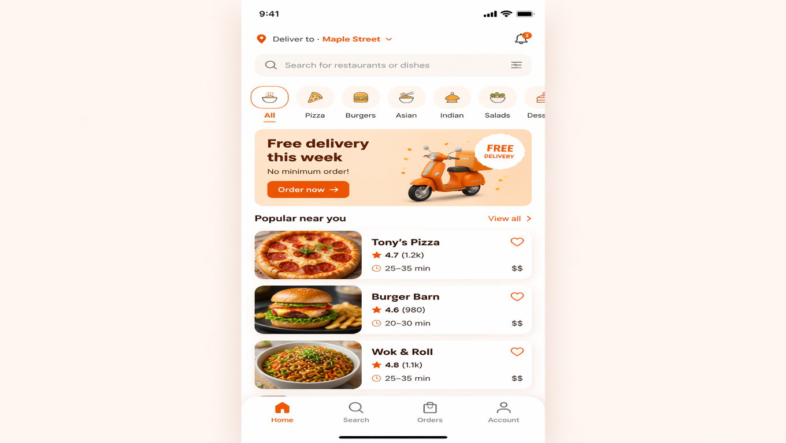

```text
A mobile food-delivery app screen mockup for an app called 'Nomly'. Vertical phone frame with a top location bar 'Deliver to · Maple Street', a rounded search field, and a horizontal scroll of cuisine category chips. Below, a promo banner 'Free delivery this week', then a vertical list of restaurant cards each showing a food photo, name, rating, delivery time, and price range. Bottom tab bar with home, search, orders, and account icons. Bright clean UI, warm orange accent, rounded cards, appetizing food imagery.
```

Model: GPT Image 2 · Author: API Models (apimodels.app)

[Original source](https://github.com/apimodels/gpt-image-2-prompts/blob/980d100f3bd0f2cde4cf38835daeb742bf1cac65/prompts.json#L14183) · [Provenance and original license](data/projectd-batch-0010.json)

## Design illustration · Analytics SaaS Dashboard Dark — API Models · CC BY 4.0


```text
A dark-mode analytics dashboard UI mockup for a product named 'Metricly'. Left icon-rail navigation, top bar with global search and notification bell. Main grid: a large area chart of website traffic with a gradient fill, four small metric tiles (visitors, conversion, bounce rate, revenue) with tiny sparklines, a world map with glowing dots for user regions, and a bar chart of top pages. Charcoal background, neon-lime and cyan accents, glowing cards, crisp monospaced numbers, sleek modern data-viz, 16:9.
```

Model: GPT Image 2 · Author: API Models (apimodels.app)

[Original source](https://github.com/apimodels/gpt-image-2-prompts/blob/980d100f3bd0f2cde4cf38835daeb742bf1cac65/prompts.json#L14198) · [Provenance and original license](data/projectd-batch-0010.json)

## Design illustration · Plant Shop Landing Hero — API Models · CC BY 4.0

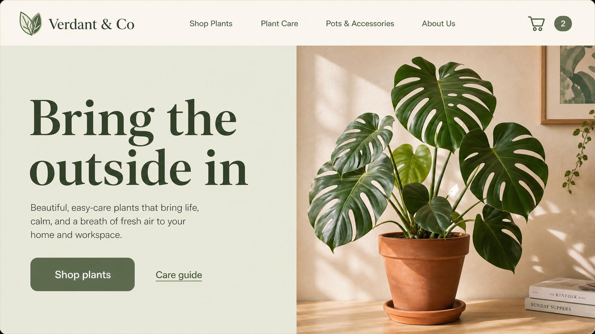

```text
A landing-page hero mockup for an indoor-plant shop 'Verdant & Co'. Split hero: left half has a bold headline 'Bring the outside in', a short paragraph, and a green 'Shop plants' button plus a 'Care guide' text link; right half shows a large photo of a monstera in a terracotta pot against a warm wall. Top nav with leaf logo, four links, a cart icon, and a small basket count. Soft sage-and-cream palette, rounded buttons, airy layout, friendly modern serif headline, 16:9 desktop.
```

Model: GPT Image 2 · Author: API Models (apimodels.app)

[Original source](https://github.com/apimodels/gpt-image-2-prompts/blob/980d100f3bd0f2cde4cf38835daeb742bf1cac65/prompts.json#L14213) · [Provenance and original license](data/projectd-batch-0010.json)

## Design illustration · Banking App Card Screen — API Models · CC BY 4.0

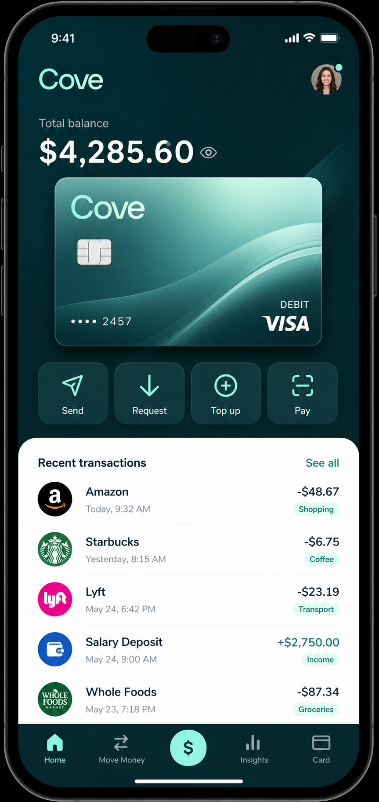

```text
A mobile banking app screen mockup for a neobank 'Cove'. Vertical phone frame, top shows account balance '$4,285.60' in large type with a small hide-balance eye icon. Below, a stylish 3D gradient debit card with the name 'Cove' and last four digits, then a row of quick-action buttons—Send, Request, Top up, Pay. A recent-transactions list with merchant icons, names, and amounts follows. Bottom tab bar. Clean modern fintech UI, deep-teal and mint palette, rounded cards, soft shadows, crisp sans-serif.
```

Model: GPT Image 2 · Author: API Models (apimodels.app)

[Original source](https://github.com/apimodels/gpt-image-2-prompts/blob/980d100f3bd0f2cde4cf38835daeb742bf1cac65/prompts.json#L14228) · [Provenance and original license](data/projectd-batch-0010.json)

## Design illustration · Online Course Platform Page — API Models · CC BY 4.0


```text
A landing page mockup for an online learning platform 'Skillnest'. Hero with headline 'Learn anything, one lesson at a time', a search bar with category dropdown, and a bright button 'Browse courses'. Below, a section of course cards each with a thumbnail, instructor name, star rating, lesson count, and price. A trust row of muted invented company logos, then a testimonial band. Clean light theme, deep-blue accent, rounded cards, structured grid, modern friendly sans-serif, 16:9 desktop.
```

Model: GPT Image 2 · Author: API Models (apimodels.app)

[Original source](https://github.com/apimodels/gpt-image-2-prompts/blob/980d100f3bd0f2cde4cf38835daeb742bf1cac65/prompts.json#L14243) · [Provenance and original license](data/projectd-batch-0010.json)

## Design illustration · Recipe App Detail Screen — API Models · CC BY 4.0

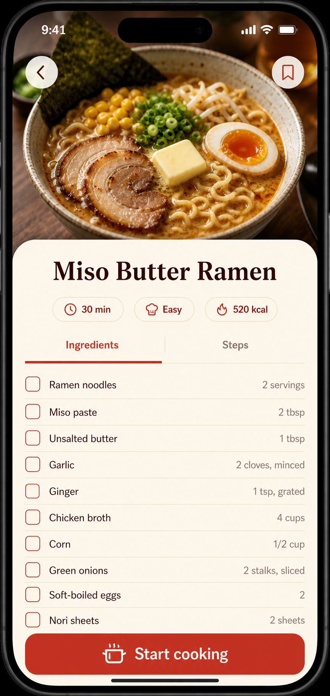

```text
A mobile recipe app detail screen mockup for an app 'Simmer'. Vertical phone frame, top shows a large appetizing photo of a bowl of ramen with a back arrow and bookmark icon overlaid. Below a rounded content sheet with the title 'Miso Butter Ramen', a row of meta chips (30 min · Easy · 520 kcal), tabbed sections for Ingredients and Steps, an ingredient checklist, and a sticky 'Start cooking' button. Warm inviting UI, cream background, tomato-red accent, rounded cards, clean readable type.
```

Model: GPT Image 2 · Author: API Models (apimodels.app)

[Original source](https://github.com/apimodels/gpt-image-2-prompts/blob/980d100f3bd0f2cde4cf38835daeb742bf1cac65/prompts.json#L14258) · [Provenance and original license](data/projectd-batch-0010.json)

## Design illustration · Crypto Wallet Dashboard — API Models · CC BY 4.0

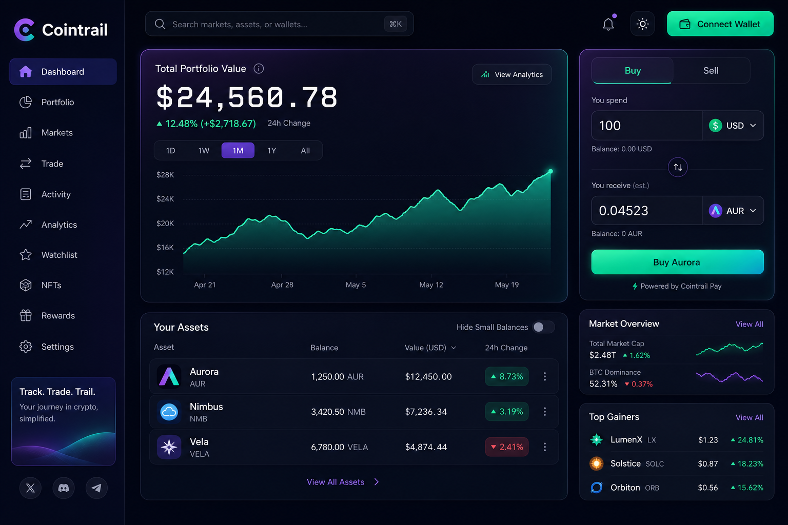

```text
A crypto wallet web dashboard UI mockup for a platform 'Cointrail'. Left sidebar nav, top bar with search and a green connect-wallet button. Main area shows a large portfolio value with a percentage change, a smooth area chart of portfolio history with a time-range toggle, a list of held assets with invented tokens (Aurora, Nimbus, Vela) showing icons, balances, and 24h change chips in green and red, and a right panel with a quick buy/sell card. Dark theme, violet-and-teal gradients, glowing cards, crisp mono numerals, 16:9.
```

Model: GPT Image 2 · Author: API Models (apimodels.app)

[Original source](https://github.com/apimodels/gpt-image-2-prompts/blob/980d100f3bd0f2cde4cf38835daeb742bf1cac65/prompts.json#L14273) · [Provenance and original license](data/projectd-batch-0010.json)

## Design illustration · Wedding Planner Landing — API Models · CC BY 4.0

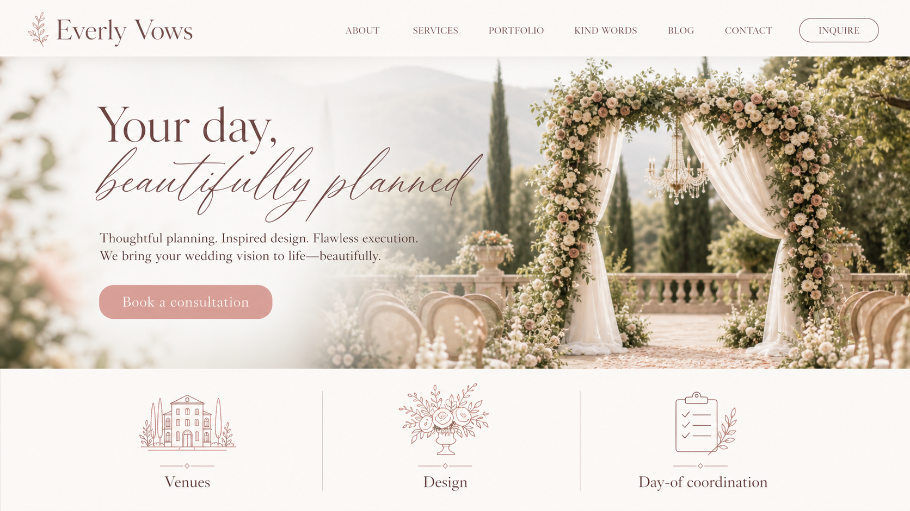

```text
A landing-page hero mockup for a wedding-planning service 'Everly Vows'. Elegant full-width hero with a soft-focus photo of a garden ceremony arch, an airy script-and-serif headline 'Your day, beautifully planned', a short line of copy, and a blush-pink 'Book a consultation' button. Below the hero, a three-column feature row with line icons—Venues, Design, Day-of coordination. Top nav with delicate serif wordmark. Soft dusty-rose and ivory palette, refined elegant typography, generous whitespace, 16:9 desktop.
```

Model: GPT Image 2 · Author: API Models (apimodels.app)

[Original source](https://github.com/apimodels/gpt-image-2-prompts/blob/980d100f3bd0f2cde4cf38835daeb742bf1cac65/prompts.json#L14288) · [Provenance and original license](data/projectd-batch-0010.json)

## Design illustration · Podcast App Player Screen — API Models · CC BY 4.0

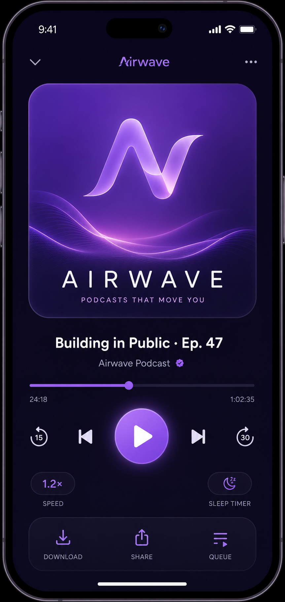

```text
A mobile podcast app now-playing screen mockup for an app 'Airwave'. Vertical phone frame with a large rounded episode cover art in gradient purple, the episode title 'Building in Public · Ep. 47', the show name below, and a scrubber progress bar with timestamps. Large circular play button flanked by skip-back and skip-forward controls, plus speed and sleep-timer icons. A bottom row with download, share, and queue. Dark elegant UI, deep-violet background, soft glow, rounded controls, clean type.
```

Model: GPT Image 2 · Author: API Models (apimodels.app)

[Original source](https://github.com/apimodels/gpt-image-2-prompts/blob/980d100f3bd0f2cde4cf38835daeb742bf1cac65/prompts.json#L14303) · [Provenance and original license](data/projectd-batch-0010.json)

## Design illustration · Real Estate Listing Page — API Models · CC BY 4.0

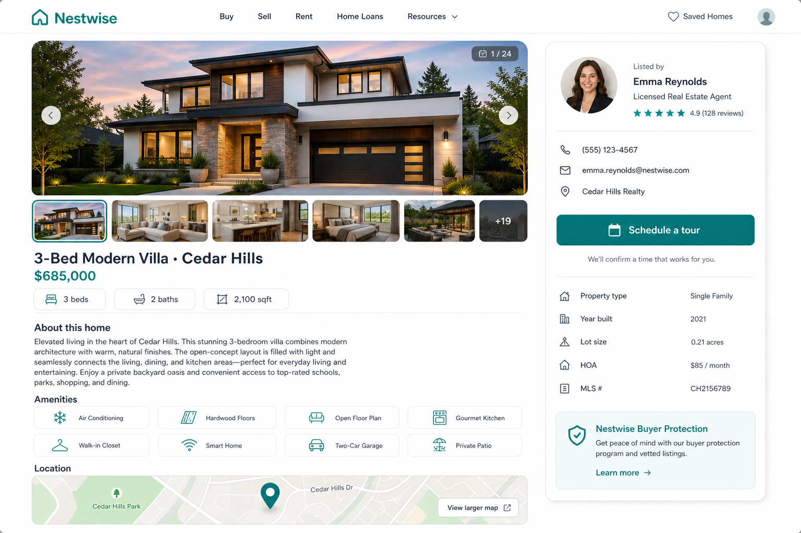

```text
An e-commerce-style real estate listing page mockup for a platform 'Nestwise'. Top is a large hero gallery of a modern house with a small thumbnail strip. Below, the listing title '3-Bed Modern Villa · Cedar Hills', price '$685,000', and a row of spec chips (3 beds · 2 baths · 2,100 sqft). A sticky right sidebar card has agent info and a 'Schedule a tour' button. Main column has an 'About this home' section, an amenities grid, and an embedded map placeholder. Clean light theme, teal accent, rounded cards, 3:2.
```

Model: GPT Image 2 · Author: API Models (apimodels.app)

[Original source](https://github.com/apimodels/gpt-image-2-prompts/blob/980d100f3bd0f2cde4cf38835daeb742bf1cac65/prompts.json#L14318) · [Provenance and original license](data/projectd-batch-0010.json)

## Design illustration · AI Writing Tool Landing — API Models · CC BY 4.0

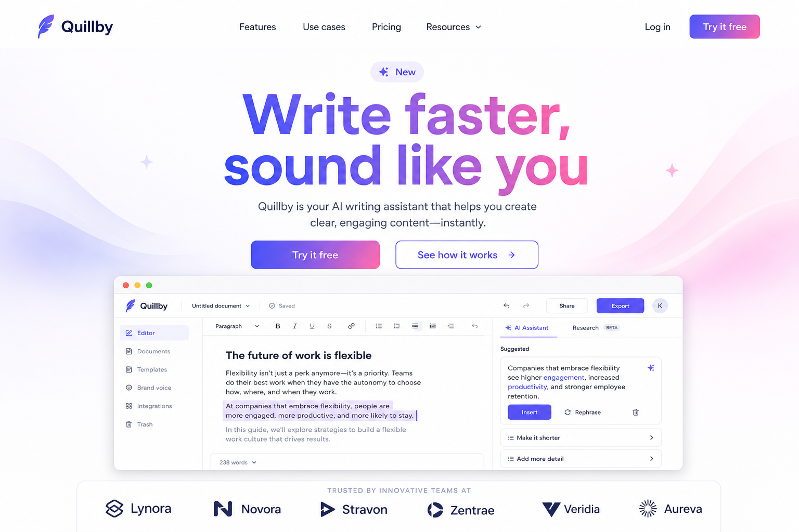

```text
A landing-page hero mockup for an AI writing assistant 'Quillby'. Centered hero with an eyebrow tag 'New', a big gradient headline 'Write faster, sound like you', a subheading, and two buttons—a solid 'Try it free' and an outline 'See how it works'. Below the fold, a floating product screenshot in a browser frame showing a text editor with AI suggestions. A logo strip of invented brands beneath. Modern light theme, indigo-to-pink gradient accents, soft shadows, rounded UI, crisp geometric sans-serif, 16:9.
```

Model: GPT Image 2 · Author: API Models (apimodels.app)

[Original source](https://github.com/apimodels/gpt-image-2-prompts/blob/980d100f3bd0f2cde4cf38835daeb742bf1cac65/prompts.json#L14333) · [Provenance and original license](data/projectd-batch-0010.json)

## Design illustration · Travel Booking Search Results — API Models · CC BY 4.0

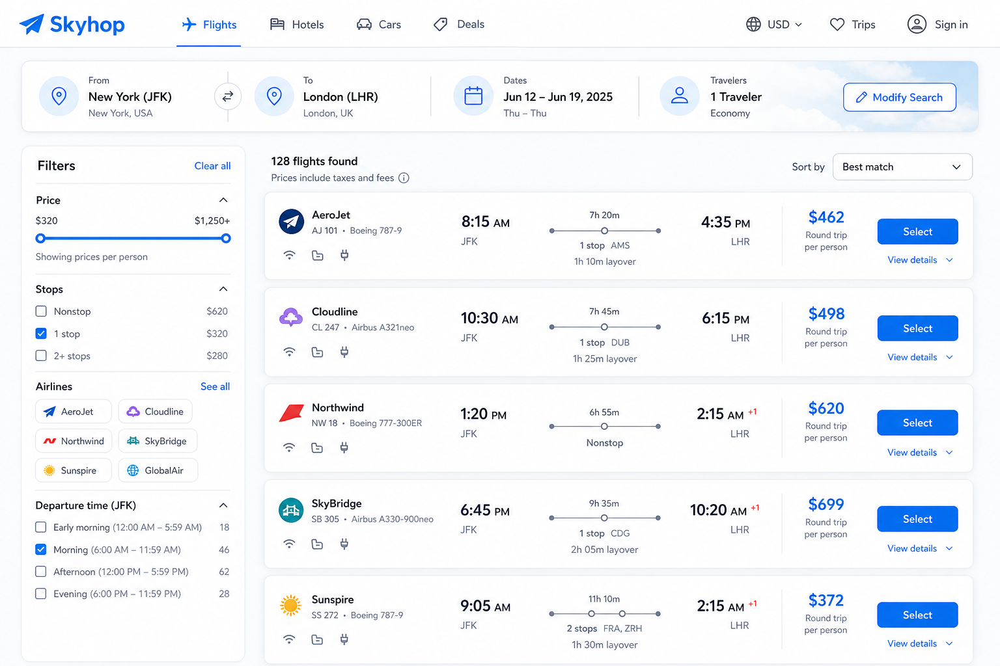

```text
A web travel-booking search-results page mockup for a site 'Skyhop'. Top has a compact search summary bar with origin, destination, dates, and a modify button. Left column is a filter sidebar with price slider, stops checkboxes, airline chips, and departure-time ranges. Main column lists flight result cards each showing invented airline name, times, duration, stops, and a price with a 'Select' button. A results count and sort dropdown sit above the list. Clean light UI, sky-blue accent, rounded cards, tidy spacing, 16:9.
```

Model: GPT Image 2 · Author: API Models (apimodels.app)

[Original source](https://github.com/apimodels/gpt-image-2-prompts/blob/980d100f3bd0f2cde4cf38835daeb742bf1cac65/prompts.json#L14348) · [Provenance and original license](data/projectd-batch-0010.json)

## Design illustration · Habit Tracker Mobile Screen — API Models · CC BY 4.0

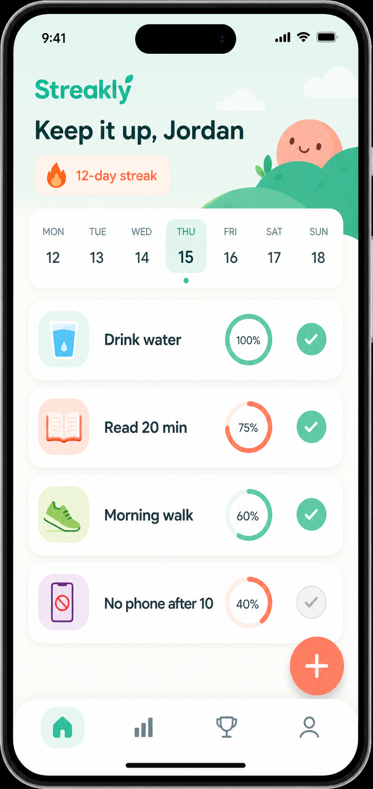

```text
A mobile habit-tracker app screen mockup for an app 'Streakly'. Vertical phone frame, top greeting 'Keep it up, Jordan' with a small flame icon and a 12-day streak. Below, a weekly calendar strip with today highlighted, then a vertical list of habit cards—Drink water, Read 20 min, Morning walk, No phone after 10—each with a colored icon, a progress ring, and a check toggle. A floating '+' add button bottom-right and a bottom tab bar. Soft playful UI, mint-and-coral palette, rounded cards, friendly rounded sans-serif.
```

Model: GPT Image 2 · Author: API Models (apimodels.app)

[Original source](https://github.com/apimodels/gpt-image-2-prompts/blob/980d100f3bd0f2cde4cf38835daeb742bf1cac65/prompts.json#L14363) · [Provenance and original license](data/projectd-batch-0010.json)

## Frosted Vitamin C Serum Hero — API Models · CC BY 4.0


```text
A frosted amber glass dropper bottle of Lumira brand vitamin C serum stands centered on a wet, polished travertine slab. A single fresh orange slice and two glossy water droplets sit beside it. Soft diffused daylight streams from the upper left, casting a long gentle shadow to the right. Warm honey-gold and cream palette, matte white seamless background fading to soft beige. Shot slightly above eye level with a 90mm macro lens, shallow depth of field, crisp label focus, dewy luxurious skincare mood.
```

Model: GPT Image 2 · Author: API Models (apimodels.app)

[Original source](https://github.com/apimodels/gpt-image-2-prompts/blob/980d100f3bd0f2cde4cf38835daeb742bf1cac65/prompts.json#L3) · [Provenance and original license](data/projectd-batch-0010.json)

## Dewhaus Night Cream Jar — API Models · CC BY 4.0

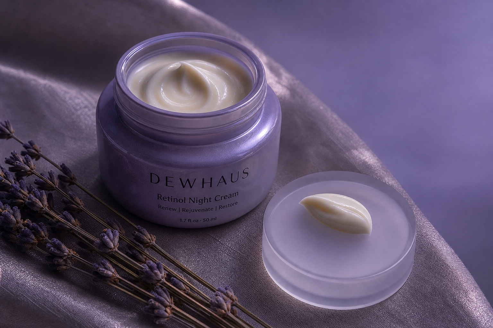

```text
A pearlescent lavender ceramic jar of Dewhaus retinol night cream sits open on a raw silk cloth, a swirl of ivory cream visible inside and a smooth dollop resting on the frosted-glass lid. Dried lavender sprigs lie diagonally in the foreground. Cool twilight lighting with a soft violet gradient background, low-key and calm. Overhead three-quarter angle, 100mm lens, gentle rim highlight on the jar rim, luxurious nighttime spa mood, minimal negative space on the right.
```

Model: GPT Image 2 · Author: API Models (apimodels.app)

[Original source](https://github.com/apimodels/gpt-image-2-prompts/blob/980d100f3bd0f2cde4cf38835daeb742bf1cac65/prompts.json#L18) · [Provenance and original license](data/projectd-batch-0010.json)

## Hydra Nova Gel Splash — API Models · CC BY 4.0

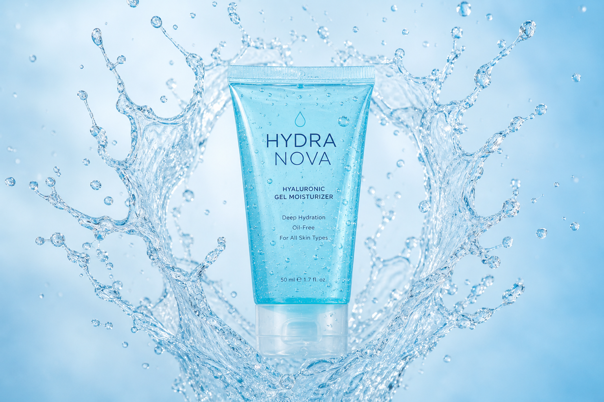

```text
A translucent aqua-blue tube of Hydra Nova hyaluronic gel moisturizer floats mid-frame surrounded by a frozen crown of clear water splash suspended in air. Tiny air bubbles glisten within the droplets. Bright high-key studio lighting, glacial cyan and white palette, seamless icy-blue backdrop. Straight-on eye-level shot with a 105mm macro lens, tack-sharp splash detail frozen at 1/8000s, refreshing hydration mood, product perfectly upright and centered.
```

Model: GPT Image 2 · Author: API Models (apimodels.app)

[Original source](https://github.com/apimodels/gpt-image-2-prompts/blob/980d100f3bd0f2cde4cf38835daeb742bf1cac65/prompts.json#L33) · [Provenance and original license](data/projectd-batch-0010.json)

## Botanica Verde Facial Oil — API Models · CC BY 4.0

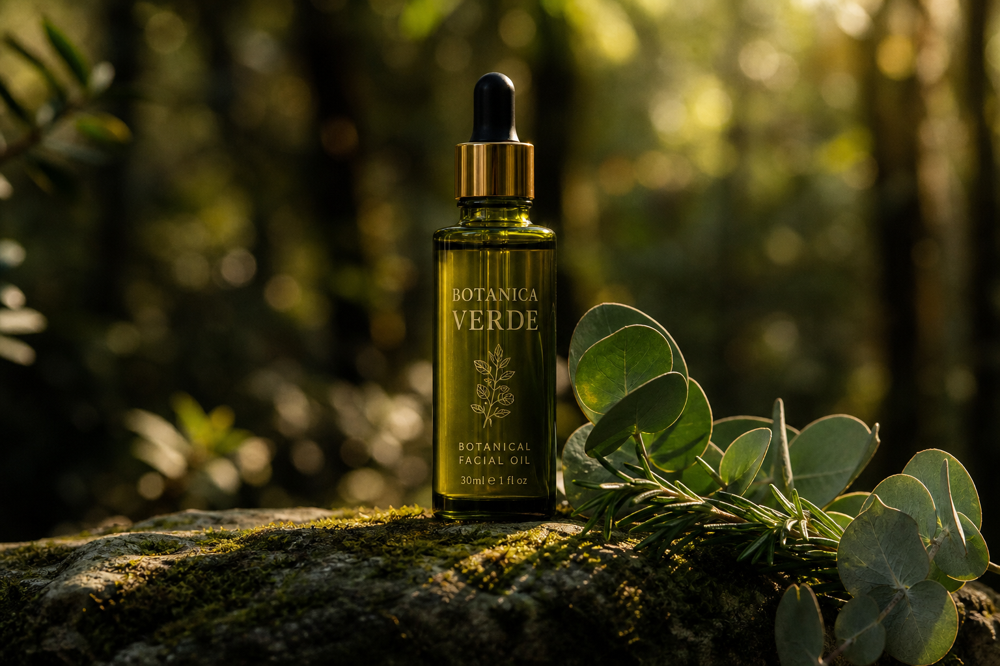

```text
A slim olive-green glass bottle of Botanica Verde botanical facial oil rests on a mossy stone ledge, golden oil catching the light through the glass. Fresh eucalyptus leaves and a sprig of rosemary frame the lower right. Dappled forest sunlight filters through unseen leaves, casting organic shadows. Earthy green and gold palette, blurred deep-forest bokeh background. Low 15-degree camera angle, 85mm lens, shallow focus, natural botanical apothecary mood.
```

Model: GPT Image 2 · Author: API Models (apimodels.app)

[Original source](https://github.com/apimodels/gpt-image-2-prompts/blob/980d100f3bd0f2cde4cf38835daeb742bf1cac65/prompts.json#L48) · [Provenance and original license](data/projectd-batch-0010.json)

## Ceraluna Barrier Balm — API Models · CC BY 4.0

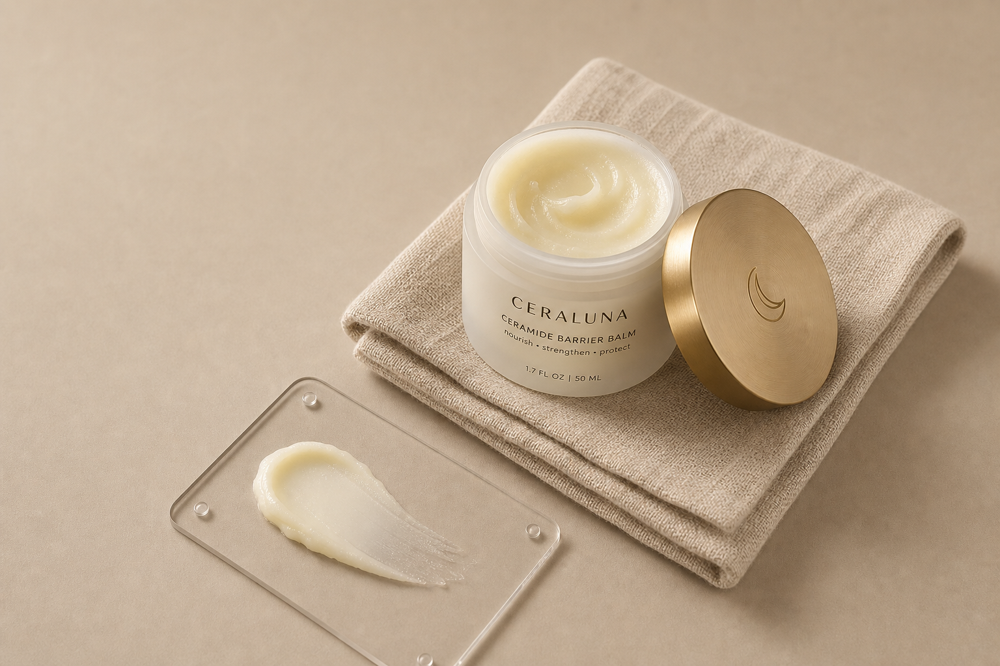

```text
A squat frosted-white tub of Ceraluna ceramide barrier balm sits on a folded oatmeal linen napkin, its brushed-gold lid leaning against the base. A soft smear of the rich balm arcs across a clean acrylic swatch card nearby. Warm soft-box lighting from the right, creamy beige and pale sand palette, seamless taupe background. Overhead flat-lay tilted to 45 degrees, 60mm lens, cozy comforting skincare mood, generous breathing room around the product.
```

Model: GPT Image 2 · Author: API Models (apimodels.app)

[Original source](https://github.com/apimodels/gpt-image-2-prompts/blob/980d100f3bd0f2cde4cf38835daeb742bf1cac65/prompts.json#L63) · [Provenance and original license](data/projectd-batch-0010.json)

## Voltaro Magnetic Power Bank — API Models · CC BY 4.0

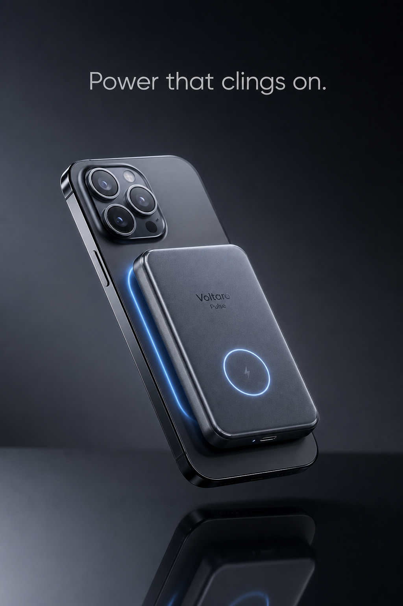

```text
Product hero shot of a slim graphite-grey magnetic power bank named 'Voltaro Pulse', snapping onto the back of a floating dark smartphone with a soft blue LED charge ring glowing. Shot on a matte charcoal acrylic surface with a single crisp reflection beneath. Studio softbox from upper left, cool rim light on the aluminium edges, shallow depth of field, tiny dust-free micro-highlights on the metal. Minimalist tech-ad mood, generous negative space at top for the tagline 'Power that clings on.' 45-degree elevated camera angle, ultra-clean commercial photography.
```

Model: GPT Image 2 · Author: API Models (apimodels.app)

[Original source](https://github.com/apimodels/gpt-image-2-prompts/blob/980d100f3bd0f2cde4cf38835daeb742bf1cac65/prompts.json#L2193) · [Provenance and original license](data/projectd-batch-0010.json)

## Kestrel USB-C Hub — API Models · CC BY 4.0

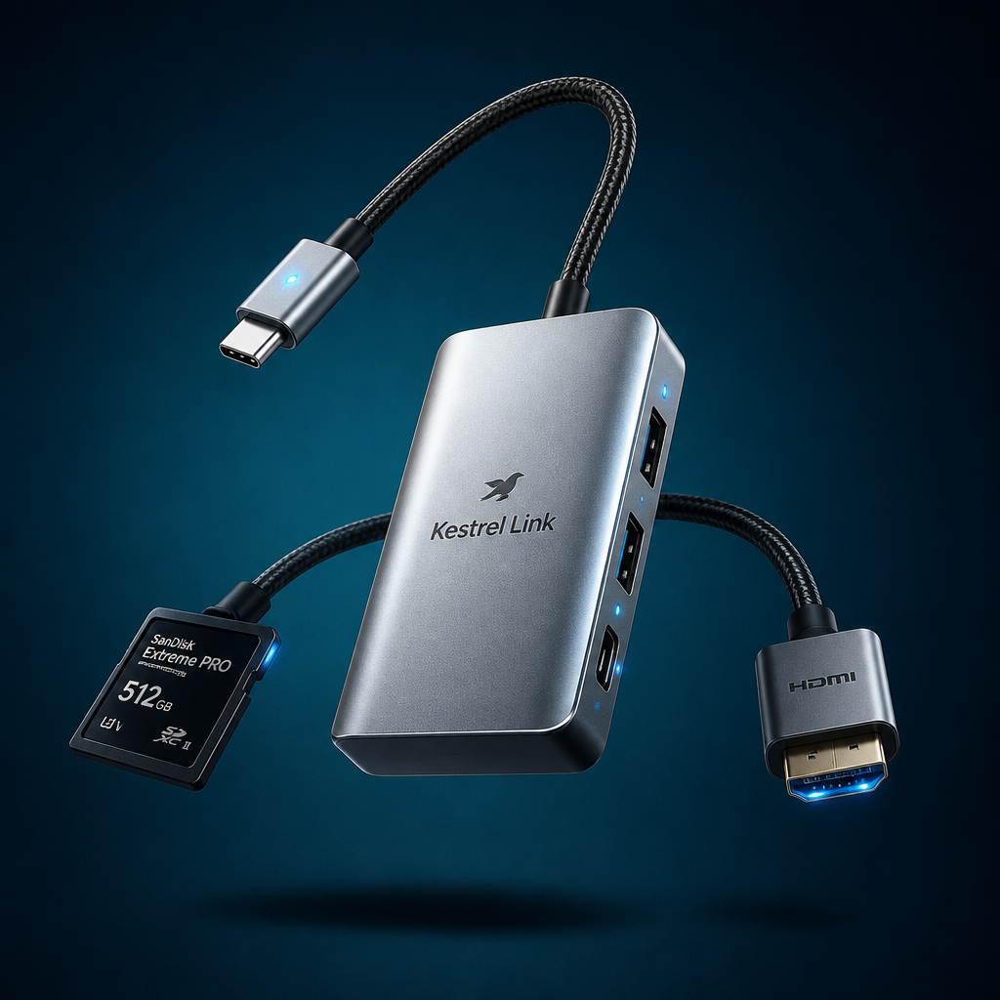

```text
A compact space-silver aluminium USB-C hub called 'Kestrel Link' shown mid-air with braided cables gently arcing out to a laptop, an SD card and an HDMI plug, each connector softly lit. Frozen-motion product photography on a gradient teal-to-navy backdrop, hard key light with a bright specular streak along the brushed metal, subtle blue accent glow from the port indicators. Centered symmetrical composition, 1:1 framing, floating shadow below. Premium accessory-brand aesthetic, crisp and futuristic.
```

Model: GPT Image 2 · Author: API Models (apimodels.app)

[Original source](https://github.com/apimodels/gpt-image-2-prompts/blob/980d100f3bd0f2cde4cf38835daeb742bf1cac65/prompts.json#L2208) · [Provenance and original license](data/projectd-batch-0010.json)

## Nimbus Wireless Charging Stand — API Models · CC BY 4.0


```text
A sculptural matte-white wireless charging stand branded 'Nimbus Halo' holding a phone at a comfortable viewing angle, with a warm amber standby light glowing at its base. Placed on a light oak bedside table beside a folded linen and a small succulent, morning sunlight raking in from a window creating long soft shadows. Cozy lifestyle-tech mood, pastel and neutral palette, eye-level camera, shallow focus on the stand, 16:9 wide framing. Small tagline lower right: 'Wake up charged.'
```

Model: GPT Image 2 · Author: API Models (apimodels.app)

[Original source](https://github.com/apimodels/gpt-image-2-prompts/blob/980d100f3bd0f2cde4cf38835daeb742bf1cac65/prompts.json#L2223) · [Provenance and original license](data/projectd-batch-0010.json)

## Lumen E-Reader Paperlight — API Models · CC BY 4.0


```text
Clean product photo of a slim sage-green e-reader called 'Lumen Paperlight', screen showing crisp black text on a warm paper-white page, held upright in an invisible mount. Shot against a soft cream seamless background with a gentle vignette. Diffused overhead light, warm front glow simulating the reader's adjustable frontlight, matte bezel with a subtle soft-touch texture. Calm, bookish tech-ad mood, 4:5 vertical, centered, delicate shadow. Tagline space above: 'A whole library, one page at a time.'
```

Model: GPT Image 2 · Author: API Models (apimodels.app)

[Original source](https://github.com/apimodels/gpt-image-2-prompts/blob/980d100f3bd0f2cde4cf38835daeb742bf1cac65/prompts.json#L2238) · [Provenance and original license](data/projectd-batch-0010.json)

## Orbix Pocket Projector — API Models · CC BY 4.0


```text
Dramatic product shot of a palm-sized cube projector named 'Orbix Beam' casting a bright cinematic light cone onto a dark textured wall, projecting an abstract sunset image. The metal-and-fabric-mesh device sits on a walnut shelf in a dim living room, cozy warm bias lighting behind it. Moody home-cinema ad atmosphere, deep shadows, teal-orange color grade, low three-quarter camera angle, shallow depth of field. 16:9 widescreen, tagline lower left: 'Big screen in your pocket.'
```

Model: GPT Image 2 · Author: API Models (apimodels.app)

[Original source](https://github.com/apimodels/gpt-image-2-prompts/blob/980d100f3bd0f2cde4cf38835daeb742bf1cac65/prompts.json#L2253) · [Provenance and original license](data/projectd-batch-0010.json)

## Grow Through It Quote Card — API Models · CC BY 4.0


```text
A minimalist Instagram quote card, 1:1. Warm oat-beige background with a subtle recycled-paper grain. Centered text in a tall elegant serif reads "Grow through what you go through" with the word "grow" hand-underlined in a single terracotta brushstroke. A tiny line-art sprig of olive leaves sits below the text. Generous negative space, calm and grounded editorial mood, muted earth palette of oat, clay and sage, soft even studio lighting.
```

Model: GPT Image 2 · Author: API Models (apimodels.app)

[Original source](https://github.com/apimodels/gpt-image-2-prompts/blob/980d100f3bd0f2cde4cf38835daeb742bf1cac65/prompts.json#L4698) · [Provenance and original license](data/projectd-batch-0010.json)

## Sunset Gradient Motivation — API Models · CC BY 4.0


```text
A bold motivational post, 4:5. Full-bleed gradient sky blending coral, peach and lavender like a summer dusk. Layered over it, oversized condensed sans-serif text in glowing off-white reads "You are allowed to start over as many times as you need" wrapping across four lines, with soft drop shadow. A thin sun-halo arc glows behind the words. Dreamy, hopeful mood, film-grain texture, gentle backlit glow at the horizon.
```

Model: GPT Image 2 · Author: API Models (apimodels.app)

[Original source](https://github.com/apimodels/gpt-image-2-prompts/blob/980d100f3bd0f2cde4cf38835daeb742bf1cac65/prompts.json#L4713) · [Provenance and original license](data/projectd-batch-0010.json)

## Handwritten Paper Affirmation — API Models · CC BY 4.0


```text
A cozy affirmation card, 4:5. Torn-edge cream notepaper photographed flat on a linen surface. Flowing dark-ink handwritten script reads "Small steps still move you forward" across the center, with a couple of playful ink swirls. A dried pressed daisy and a brass paperclip rest in the corner. Warm window light casts a soft diagonal shadow. Intimate journaling mood, natural textures, muted cream and charcoal palette.
```

Model: GPT Image 2 · Author: API Models (apimodels.app)

[Original source](https://github.com/apimodels/gpt-image-2-prompts/blob/980d100f3bd0f2cde4cf38835daeb742bf1cac65/prompts.json#L4728) · [Provenance and original license](data/projectd-batch-0010.json)

## Neon Dark Mindset Quote — API Models · CC BY 4.0


```text
A high-impact quote graphic, 1:1. Deep charcoal-black background with faint concrete texture. Center text in a glowing electric-cyan neon-tube typeface reads "Discipline is choosing what you want most over what you want now", the word "most" flickering brighter. Subtle magenta reflection on the floor below. Moody, motivational gym-poster energy, high contrast, soft neon bloom and light haze around the letters.
```

Model: GPT Image 2 · Author: API Models (apimodels.app)

[Original source](https://github.com/apimodels/gpt-image-2-prompts/blob/980d100f3bd0f2cde4cf38835daeb742bf1cac65/prompts.json#L4743) · [Provenance and original license](data/projectd-batch-0010.json)

## Design illustration · Zero To 10K Chart — API Models · CC BY 4.0


```text
A wide YouTube thumbnail of a young man in a crisp white shirt, mouth open in shocked excitement, pointing up at a glowing green line chart rocketing off the top-right corner. Deep navy-to-black gradient background with neon-green grid lines. Huge bold white-and-green text 'ZERO TO $10K' fills the left third, with a thick yellow upward arrow slicing through the numbers. Stacks of gold coins glow in the lower corner, dramatic rim lighting, punchy high-contrast finance energy.
```

Model: GPT Image 2 · Author: API Models (apimodels.app)

[Original source](https://github.com/apimodels/gpt-image-2-prompts/blob/980d100f3bd0f2cde4cf38835daeb742bf1cac65/prompts.json#L7068) · [Provenance and original license](data/projectd-batch-0010.json)

## Design illustration · Recession Proof Money — API Models · CC BY 4.0


```text
A confident middle-aged woman in a charcoal blazer stands with arms crossed inside a glowing steel bank vault, red warning lights flashing behind her. A cracked red stock-crash line falls in the background while a protective blue glass shield wraps around her stack of cash. Massive impact text 'RECESSION PROOF' in bold red and white dominates the top, a green shield icon beside it. High-contrast cinematic lighting, tense but reassuring click-bait mood.
```

Model: GPT Image 2 · Author: API Models (apimodels.app)

[Original source](https://github.com/apimodels/gpt-image-2-prompts/blob/980d100f3bd0f2cde4cf38835daeb742bf1cac65/prompts.json#L7083) · [Provenance and original license](data/projectd-batch-0010.json)

## Design illustration · Dividend Snowball — API Models · CC BY 4.0


```text
A cheerful investor in a green sweater pushes a giant snowball made entirely of glowing gold coins down a snowy hill, the ball growing huge toward the camera. Icy blue winter background with soft bokeh. Bold rounded text 'DIVIDEND SNOWBALL' arcs across the top in white with a mint-green outline, and a curved yellow arrow shows the ball getting bigger. Money sparkles trail behind. Playful, bright, high-contrast passive-income vibe.
```

Model: GPT Image 2 · Author: API Models (apimodels.app)

[Original source](https://github.com/apimodels/gpt-image-2-prompts/blob/980d100f3bd0f2cde4cf38835daeb742bf1cac65/prompts.json#L7098) · [Provenance and original license](data/projectd-batch-0010.json)

## Design illustration · Buy The Dip Alert — API Models · CC BY 4.0


```text
Split-screen thumbnail: left half blood-red with a plunging candlestick chart and a panicked trader clutching his head; right half electric-green with the same chart bouncing upward and the same man now grinning and giving a thumbs up. A giant white lightning bolt divides the two sides. Huge stacked text 'BUY THE DIP' in yellow with a black stroke sits center, a red down-arrow morphing into a green up-arrow. Intense, dramatic, click-worthy.
```

Model: GPT Image 2 · Author: API Models (apimodels.app)

[Original source](https://github.com/apimodels/gpt-image-2-prompts/blob/980d100f3bd0f2cde4cf38835daeb742bf1cac65/prompts.json#L7113) · [Provenance and original license](data/projectd-batch-0010.json)

## Design illustration · Crypto Crash Warning — API Models · CC BY 4.0


```text
A dramatic thumbnail of a shocked young trader in a dark hoodie, blue screen glow on his face, watching glowing digital coins shatter and rain down around him. Deep purple-to-black background with falling red numbers like a data storm. Enormous jagged text 'CRYPTO CRASH' in white and red fills the top, a broken red arrow smashing downward. Cracked-glass overlay effect on the edges. High-contrast, fearful, doom-scroll energy.
```

Model: GPT Image 2 · Author: API Models (apimodels.app)

[Original source](https://github.com/apimodels/gpt-image-2-prompts/blob/980d100f3bd0f2cde4cf38835daeb742bf1cac65/prompts.json#L7128) · [Provenance and original license](data/projectd-batch-0010.json)

## Design illustration · Neon Tide Festival — API Models · CC BY 4.0


```text
Vertical poster for an electronic music festival titled 'NEON TIDE' at Harbor Bowl Amphitheater, August 22-24. Hero visual: a colossal cresting ocean wave dissolving into glowing pink and cyan sound-wave ribbons, silhouetted crowd raising hands at the base. Composition: wave arcs from bottom-left sweeping to top-right, title set in a bold condensed sans-serif with a chrome liquid finish across the center. Palette: deep indigo night, hot magenta, electric teal, splashes of UV violet. Small clean lineup list and date bar along the bottom. Mood: euphoric, wet, luminous, high-energy nightlife.
```

Model: GPT Image 2 · Author: API Models (apimodels.app)

[Original source](https://github.com/apimodels/gpt-image-2-prompts/blob/980d100f3bd0f2cde4cf38835daeb742bf1cac65/prompts.json#L8268) · [Provenance and original license](data/projectd-batch-0010.json)

## Design illustration · Golden Fields Country Fest — API Models · CC BY 4.0


```text
Rustic music festival poster for 'GOLDEN FIELDS COUNTRY FEST', Willow Creek Ranch, September 6-7. Hero: warm sunset over rolling wheat fields, a lone acoustic guitar leaning on a weathered fence post, hot-air balloon drifting in an amber sky. Composition: wide horizon at lower third, big hand-lettered serif title arched across the sky like a banner. Palette: burnt orange, honey gold, dusty rose, sage green. Vintage screen-print texture with subtle paper grain. Lineup in a distressed western slab font at the bottom, small ticket info tag. Mood: nostalgic, warm, wholesome, open-air.
```

Model: GPT Image 2 · Author: API Models (apimodels.app)

[Original source](https://github.com/apimodels/gpt-image-2-prompts/blob/980d100f3bd0f2cde4cf38835daeb742bf1cac65/prompts.json#L8284) · [Provenance and original license](data/projectd-batch-0010.json)

## Design illustration · Midnight Jazz Sessions — API Models · CC BY 4.0


```text
Elegant jazz concert poster for 'MIDNIGHT SESSIONS' at The Velvet Room, every Friday this winter, doors 9PM. Hero: a solitary brass trumpet emitting curling smoke that morphs into a treble clef, dramatic single-source amber spotlight from upper right. Composition: instrument off-center left, deep negative space, title in a refined high-contrast serif with thin italic subtitle. Palette: near-black charcoal, warm brass gold, oxblood red accents. Subtle film noir grain and vignette. Small venue address and cover-charge line at the base. Mood: smoky, intimate, sophisticated, after-hours.
```

Model: GPT Image 2 · Author: API Models (apimodels.app)

[Original source](https://github.com/apimodels/gpt-image-2-prompts/blob/980d100f3bd0f2cde4cf38835daeb742bf1cac65/prompts.json#L8300) · [Provenance and original license](data/projectd-batch-0010.json)

## Design illustration · Echo Bloom Indie Tour — API Models · CC BY 4.0


```text
Dreamy indie-pop tour poster for the band 'ECHO BLOOM', North American Tour spring 2027. Hero: an oversized vintage cassette tape sprouting wildflowers and butterflies from its reels, floating in a pastel gradient sky. Composition: cassette centered, blooms spilling upward, band name in a soft rounded retro script, tour dates listed as a vertical strip of cities on the right. Palette: peach, lavender, mint, buttercream yellow. Halftone dots and risograph texture. Mood: whimsical, tender, lo-fi, springtime.
```

Model: GPT Image 2 · Author: API Models (apimodels.app)

[Original source](https://github.com/apimodels/gpt-image-2-prompts/blob/980d100f3bd0f2cde4cf38835daeb742bf1cac65/prompts.json#L8316) · [Provenance and original license](data/projectd-batch-0010.json)

## Design illustration · Thunder Roots Reggae — API Models · CC BY 4.0


```text
Vibrant reggae concert poster for 'THUNDER ROOTS' feat. The Kingston Lions, Palm Grove Beach Stage, July 19, 6PM. Hero: a stylized lion head made of layered tropical leaves and lightning bolts, radiating sun rays. Composition: lion centered like an emblem, title in a bold reggae-style rounded display font arched above, wavy dub-echo lines below. Palette: emerald green, gold, ruby red, black. Woodcut poster texture and worn edges. Ticket and lineup info in a clean band at the bottom. Mood: warm, rebellious, joyful, roots-vibration.
```

Model: GPT Image 2 · Author: API Models (apimodels.app)

[Original source](https://github.com/apimodels/gpt-image-2-prompts/blob/980d100f3bd0f2cde4cf38835daeb742bf1cac65/prompts.json#L8332) · [Provenance and original license](data/projectd-batch-0010.json)

## Design illustration · Global Coffee Consumption Trend — API Models · CC BY 4.0


```text
A clean flat-design infographic titled 'Global Coffee Consumption 2015-2024', 4:5 portrait. A single hero line chart fills the upper two-thirds, plotting cups per capita rising from 2.1 to 3.4 over ten years with a smooth mint-green line, soft gradient fill beneath, and circular data markers labeled at 2020 (2.7) and 2024 (3.4). Thin grey axis grid, sans-serif labels. Three stat chips below read '+62% growth', '78 countries', '2.1B cups/day'. Warm cream background, coffee-brown headline, generous white space, modern editorial style.
```

Model: GPT Image 2 · Author: API Models (apimodels.app)

[Original source](https://github.com/apimodels/gpt-image-2-prompts/blob/980d100f3bd0f2cde4cf38835daeb742bf1cac65/prompts.json#L10748) · [Provenance and original license](data/projectd-batch-0010.json)

## Design illustration · Renewable Energy By Country — API Models · CC BY 4.0


```text
A flat vector infographic, 2:3 portrait, titled 'Share of Renewable Electricity, 2024'. A horizontal bar chart lists eight invented countries (Nordheim 71%, Valcoria 63%, Sunnara 58%, Tereska 49%, Mora 41%, Delphia 33%, Kestral 27%, Auland 19%), each bar a teal-to-lime gradient with the percentage in bold white inside. Small circular country flag icons sit at each row's left. Header band in deep navy, light grey background, a footnote 'Source: Global Energy Panel'. Balanced grid, crisp typography, plenty of margin.
```

Model: GPT Image 2 · Author: API Models (apimodels.app)

[Original source](https://github.com/apimodels/gpt-image-2-prompts/blob/980d100f3bd0f2cde4cf38835daeb742bf1cac65/prompts.json#L10763) · [Provenance and original license](data/projectd-batch-0010.json)

## Design illustration · Monthly Household Budget Donut — API Models · CC BY 4.0


```text
A minimalist infographic, 4:5, titled 'Where a Household Budget Goes'. A large centered donut chart splits monthly spending into six segments: Housing 32% (slate blue), Food 21% (coral), Transport 14% (amber), Savings 12% (green), Utilities 11% (teal), Fun 10% (violet). The donut's hollow center shows total '$4,200 / month'. A neat legend with color dots and labels sits to the right. Soft off-white background, thin dividing lines, rounded sans-serif type, subtle drop shadow under the donut, tidy modern layout.
```

Model: GPT Image 2 · Author: API Models (apimodels.app)

[Original source](https://github.com/apimodels/gpt-image-2-prompts/blob/980d100f3bd0f2cde4cf38835daeb742bf1cac65/prompts.json#L10778) · [Provenance and original license](data/projectd-batch-0010.json)

## Design illustration · City Population Pyramid — API Models · CC BY 4.0


```text
An educational infographic, 2:3 portrait, titled 'Age Structure of Meridian City, 2025'. A back-to-back population pyramid: male bars in cool blue on the left, female bars in warm rose on the right, stacked in 5-year age bands from 0-4 up to 85+. Widest bars sit at 25-39, tapering at the top. Percentage axis labeled at each side, thin centered age labels. Below, three summary stats: 'Median age 34', 'Total 1.8M', 'Under 15: 18%'. Clean white background, flat design, restrained two-color palette.
```

Model: GPT Image 2 · Author: API Models (apimodels.app)

[Original source](https://github.com/apimodels/gpt-image-2-prompts/blob/980d100f3bd0f2cde4cf38835daeb742bf1cac65/prompts.json#L10793) · [Provenance and original license](data/projectd-batch-0010.json)

## Design illustration · Study Hours Vs Scores Scatter — API Models · CC BY 4.0


```text
A data infographic, 4:5, titled 'Study Time vs Exam Score'. A scatter plot dominates: roughly 40 dots scattered upward-right, each a small teal circle, with a dashed orange trend line rising through them and a label 'r = 0.71'. X-axis 'Weekly study hours (0-20)', Y-axis 'Score (0-100)', light grid. A highlighted cluster near the top-right is circled with a callout 'high effort, high score'. Header on a mustard band, pale grey plot background, clean sans-serif, small legend explaining dot size equals class section.
```

Model: GPT Image 2 · Author: API Models (apimodels.app)

[Original source](https://github.com/apimodels/gpt-image-2-prompts/blob/980d100f3bd0f2cde4cf38835daeb742bf1cac65/prompts.json#L10808) · [Provenance and original license](data/projectd-batch-0010.json)

## Rooftop Gardener 3D Avatar — API Models · CC BY 4.0


```text
A friendly 3D cartoon avatar of a young woman with curly copper hair tied in a messy bun, freckled cheeks, and round moss-green glasses. She wears denim overalls over a mustard tee and holds a tiny potted succulent near her shoulder. Soft studio clay-render style with smooth subsurface skin, gentle rim light from upper left, mint-and-terracotta color palette, blurred pastel background, centered square headshot, chunky rounded proportions, warm and approachable mood.
```

Model: GPT Image 2 · Author: API Models (apimodels.app)

[Original source](https://github.com/apimodels/gpt-image-2-prompts/blob/980d100f3bd0f2cde4cf38835daeb742bf1cac65/prompts.json#L13118) · [Provenance and original license](data/projectd-batch-0010.json)

## Neon Samurai Anime Avatar — API Models · CC BY 4.0


```text
An anime-style avatar of a stoic young swordsman with sharp silver eyes and a black topknot, a thin scar across one brow. He wears a deep-indigo haori with a subtle crane pattern, collar slightly open. Cel-shaded rendering with crisp lineart, dramatic magenta-and-cyan neon rim lighting on his face, dark rainy alley bokeh behind him, three-quarter angle, cool moody palette, square crop focused on head and shoulders, confident intense expression.
```

Model: GPT Image 2 · Author: API Models (apimodels.app)

[Original source](https://github.com/apimodels/gpt-image-2-prompts/blob/980d100f3bd0f2cde4cf38835daeb742bf1cac65/prompts.json#L13133) · [Provenance and original license](data/projectd-batch-0010.json)

## Executive Coach Headshot Illustration — API Models · CC BY 4.0


```text
A polished headshot-style illustration of a confident middle-aged Black woman executive with short natural coils and gold hoop earrings. She wears a tailored charcoal blazer over a cream blouse, soft warm smile, arms unseen. Semi-realistic vector portrait with smooth gradients, subtle cross-hatch shading, clean navy background with a faint circular halo, even soft key light, professional LinkedIn aesthetic, square framing, chest-up composition, trustworthy and warm tone.
```

Model: GPT Image 2 · Author: API Models (apimodels.app)

[Original source](https://github.com/apimodels/gpt-image-2-prompts/blob/980d100f3bd0f2cde4cf38835daeb742bf1cac65/prompts.json#L13148) · [Provenance and original license](data/projectd-batch-0010.json)

## Astronaut Cat Pixel Avatar — API Models · CC BY 4.0


```text
A 32x32 pixel-art avatar of a chubby orange tabby cat wearing a white astronaut helmet with a golden visor slightly tilted up. Tiny star reflections glint on the glass. The background is a deep-purple space grid with a few bright pixel stars. Limited retro palette of orange, cream, purple, and teal, crisp hard-edge pixels, clear dithering on shadows, centered square composition, playful nostalgic 8-bit game mood.
```

Model: GPT Image 2 · Author: API Models (apimodels.app)

[Original source](https://github.com/apimodels/gpt-image-2-prompts/blob/980d100f3bd0f2cde4cf38835daeb742bf1cac65/prompts.json#L13163) · [Provenance and original license](data/projectd-batch-0010.json)

## Minimalist Fox Mascot Avatar — API Models · CC BY 4.0


```text
A minimalist mascot avatar of a friendly fox face built from clean geometric shapes. Two triangular ears, a rounded muzzle, and simple dot eyes with a tiny highlight. Flat design with a warm coral body, cream cheek patch, and a single dark accent line for the smile. Solid soft-beige background inside a rounded square, no gradients, bold negative space, perfectly symmetrical, modern app-icon aesthetic, cheerful and clean.
```

Model: GPT Image 2 · Author: API Models (apimodels.app)

[Original source](https://github.com/apimodels/gpt-image-2-prompts/blob/980d100f3bd0f2cde4cf38835daeb742bf1cac65/prompts.json#L13178) · [Provenance and original license](data/projectd-batch-0010.json)

## Rainy Rooftop Confession Panel — API Models · CC BY 4.0


```text
A single cinematic comic panel of two teenagers on a rainy rooftop at night, one holding a clear umbrella over both. Bold manga inking with dynamic rain streaks, screentone shading on their uniforms, dramatic low angle looking up. A speech bubble reads 'I've wanted to tell you for months.' Neon city glow in the background, deep blue and violet color grade, high emotional tension, sharp linework, cinematic depth.
```

Model: GPT Image 2 · Author: API Models (apimodels.app)

[Original source](https://github.com/apimodels/gpt-image-2-prompts/blob/980d100f3bd0f2cde4cf38835daeb742bf1cac65/prompts.json#L13553) · [Provenance and original license](data/projectd-batch-0010.json)

## Morning Routine 4-Koma — API Models · CC BY 4.0


```text
A vertical 4-koma comic strip of a sleepy office worker's chaotic morning. Panel 1: alarm blares, she groans in bed. Panel 2: she trips over a cat while brushing teeth. Panel 3: toast flies out of the toaster onto her head. Panel 4: she sprints out the door with mismatched shoes, deadpan face. Clean flat cartoon style, soft pastel colors, expressive dot-eyes, small Japanese-style sweat drops, tidy panel gutters, light humorous tone.
```

Model: GPT Image 2 · Author: API Models (apimodels.app)

[Original source](https://github.com/apimodels/gpt-image-2-prompts/blob/980d100f3bd0f2cde4cf38835daeb742bf1cac65/prompts.json#L13568) · [Provenance and original license](data/projectd-batch-0010.json)

## Skyfall Mech Duel — API Models · CC BY 4.0


```text
A dynamic manga action panel of two towering mechs clashing mid-air above a shattered city, sparks and debris exploding outward. Sharp speed lines radiate from the impact, thick dramatic inking, heavy screentone shadows. One mech's fist connects with the other's chest plate in a burst of energy. Sound-effect kanji-style lettering 'DOOM' streaks across. Steel-gray and fiery-orange palette, low dramatic angle, intense kinetic energy.
```

Model: GPT Image 2 · Author: API Models (apimodels.app)

[Original source](https://github.com/apimodels/gpt-image-2-prompts/blob/980d100f3bd0f2cde4cf38835daeb742bf1cac65/prompts.json#L13583) · [Provenance and original license](data/projectd-batch-0010.json)

## Heist Getaway Storyboard — API Models · CC BY 4.0


```text
A three-frame horizontal storyboard sequence of a car chase. Frame 1: a sleek black getaway car screeches around a wet corner, motion blur. Frame 2: over-the-shoulder view of the driver gripping the wheel, rearview mirror showing flashing lights. Frame 3: wide shot of the car leaping over a raised drawbridge, city skyline behind. Rough grayscale storyboard sketch style, loose pencil lines, directional arrows and camera notes, cinematic composition.
```

Model: GPT Image 2 · Author: API Models (apimodels.app)

[Original source](https://github.com/apimodels/gpt-image-2-prompts/blob/980d100f3bd0f2cde4cf38835daeb742bf1cac65/prompts.json#L13598) · [Provenance and original license](data/projectd-batch-0010.json)

## Golden Age Hero Cover — API Models · CC BY 4.0


```text
A retro American comic panel in 1960s Silver Age style of a caped hero named 'Captain Vireo' bursting through a brick wall, fist forward. Bold primary colors, halftone Ben-Day dots, thick black outlines, dramatic action pose. A yellow burst caption reads 'Nothing can stop justice!' Speed lines and rubble fly outward, cyan sky background, slightly faded vintage newsprint texture, punchy heroic energy.
```

Model: GPT Image 2 · Author: API Models (apimodels.app)

[Original source](https://github.com/apimodels/gpt-image-2-prompts/blob/980d100f3bd0f2cde4cf38835daeb742bf1cac65/prompts.json#L13613) · [Provenance and original license](data/projectd-batch-0010.json)

## Design illustration · Eco Travel Landing Hero — API Models · CC BY 4.0


```text
A landing-page hero mockup for a sustainable travel brand called 'Wanderleaf'. Full-width hero with a lush misty mountain-forest photo backdrop, a bold serif headline 'Travel that gives back' in white, a short subheading, and a rounded emerald 'Start exploring' button beside a ghost 'Watch film' button. Top nav with wordmark left and four links right. Clean modern layout, generous whitespace, soft glassmorphic search bar overlapping the hero bottom, earthy green-and-cream palette, 16:9 desktop.
```

Model: GPT Image 2 · Author: API Models (apimodels.app)

[Original source](https://github.com/apimodels/gpt-image-2-prompts/blob/980d100f3bd0f2cde4cf38835daeb742bf1cac65/prompts.json#L14078) · [Provenance and original license](data/projectd-batch-0010.json)

## Design illustration · Meditation App Home Screen — API Models · CC BY 4.0


```text
A mobile app home screen mockup for a meditation app named 'Stilla'. Vertical phone frame with a soft dawn-gradient background from peach to lavender. Top shows a greeting 'Good morning, Aria' and a small streak counter. A large featured card 'Morning Calm · 10 min' with a play button, below it a horizontal row of session cards. Bottom tab bar with home, explore, timer, and profile icons. Rounded corners, gentle shadows, calming minimalist UI, soft sans-serif type.
```

Model: GPT Image 2 · Author: API Models (apimodels.app)

[Original source](https://github.com/apimodels/gpt-image-2-prompts/blob/980d100f3bd0f2cde4cf38835daeb742bf1cac65/prompts.json#L14093) · [Provenance and original license](data/projectd-batch-0010.json)

## Design illustration · Finance Dashboard UI — API Models · CC BY 4.0


```text
A clean SaaS finance dashboard UI mockup for a tool called 'Ledgerly'. Left sidebar navigation with icons and labels, top bar with search and user avatar. Main area shows four KPI stat cards (balance, income, expenses, savings), a large line chart of monthly cash flow, a donut chart of spending categories, and a recent-transactions table. Light theme with a soft blue-gray background, indigo accent color, rounded cards, subtle shadows, crisp data-viz, 16:9 desktop layout.
```

Model: GPT Image 2 · Author: API Models (apimodels.app)

[Original source](https://github.com/apimodels/gpt-image-2-prompts/blob/980d100f3bd0f2cde4cf38835daeb742bf1cac65/prompts.json#L14108) · [Provenance and original license](data/projectd-batch-0010.json)

## Design illustration · Artisan Coffee Product Page — API Models · CC BY 4.0


```text
An e-commerce product page mockup for a specialty coffee brand 'Emberhouse Roasters'. Left side shows a large product photo of a matte-black coffee bag with a gold seal, plus small thumbnail images below. Right side has the product title 'Sunrise Blend · Medium Roast', a star rating, price '$18.00', a grind-size selector, a quantity stepper, and a warm-orange 'Add to cart' button. Below, tasting-notes chips and a shipping accordion. Warm cream background, elegant serif headings, minimal clean layout, 3:2.
```

Model: GPT Image 2 · Author: API Models (apimodels.app)

[Original source](https://github.com/apimodels/gpt-image-2-prompts/blob/980d100f3bd0f2cde4cf38835daeb742bf1cac65/prompts.json#L14123) · [Provenance and original license](data/projectd-batch-0010.json)

## Design illustration · SaaS Pricing Page Layout — API Models · CC BY 4.0


```text
A SaaS pricing page mockup for a project-management tool 'Taskloom'. Centered headline 'Plans that grow with your team' and a monthly/annual toggle above three pricing cards: Starter, Pro (highlighted with a 'Most popular' badge and elevated shadow), and Enterprise. Each card lists price, a feature checklist with checkmarks, and a call-to-action button. Below, a comparison table and an FAQ accordion. Clean light theme, purple accent, rounded cards, generous spacing, crisp sans-serif, 16:9 desktop.
```

Model: GPT Image 2 · Author: API Models (apimodels.app)

[Original source](https://github.com/apimodels/gpt-image-2-prompts/blob/980d100f3bd0f2cde4cf38835daeb742bf1cac65/prompts.json#L14138) · [Provenance and original license](data/projectd-batch-0010.json)

## Blond Man Studies a Rainy City Model — Alosem · reference required · CC BY 4.0


```text
Use case: identity-preserve
Asset type: character-consistency campaign scene
Primary request: Generate a new photorealistic editorial scene of the exact blond male identity from Image 1 working late in a rainy architectural studio, leaning over a scale model and adjusting one small building piece with his right hand.
Input images: Image 1 is the sole identity anchor. Preserve its face, hair, eyes, skin, stubble, body proportions, and age; do not copy the reference-sheet layout or black athletic outfit.
Scene/backdrop: Contemporary architecture studio at night, tall rain-streaked windows, blurred blue city lights, warm task lamps, scale model and drafting materials with no readable writing.
Subject and load-bearing identity proportions: One man only. Preserve the moderately long oval face, clearly longer than wide; broad cheekbones; firm jaw that tapers without becoming narrow; medium-square chin; straight balanced nose; brown eyes; light stubble. Preserve the high, wide mass of swept wavy dark-blond hair rather than flattening or shortening it. Preserve the athletic mesomorphic body: broad shoulders, developed but not bulky arms and chest, narrow waist, long balanced limbs. Age remains mid-to-late twenties.
Wardrobe: Charcoal rolled-sleeve overshirt over a plain cream T-shirt; no branding.
Composition/framing: Three-quarter waist-up editorial photograph, face unobscured, both forearms visible, right hand adjusting one model piece, left hand resting naturally on the table; entire hands remain in frame.
Lighting/mood: Cool rainy-window ambience with warm amber task light; focused, quietly absorbed expression.
Materials/textures: Real skin pores and stubble, individual hair strands, matte card model, worn wood table, rain on glass.
Constraints: Identity fidelity and load-bearing proportions take priority over scene styling. Exactly one head, two eyes, two arms, two hands, five fingers per visible hand with natural joints; no fused or duplicated digits. No readable text, gibberish, logos, watermark, extra people, extra limbs, cropped hands, glamorized skin, or reference-sheet panels.
Avoid: widened round face, narrow pinched jaw, flat or helmet-like hair, bodybuilder bulk, teenager appearance, beard, blue eyes, illustration, 3D render.
```

Model: GPT Image 2.5 · Author: Alosem team · Created for Alosem

[Original source](https://github.com/pixexid/awesome-gpt-image-2-5/blob/0c97a3a4fd2c2a7692e09d568a2b79f30178cd3b/cases/blond-man-studies-a-rainy-city-model-9acedb62.md) · [Provenance and original license](data/projectd-batch-0010.json)

References: https://raw.githubusercontent.com/pixexid/awesome-gpt-image-2-5/0c97a3a4fd2c2a7692e09d568a2b79f30178cd3b/assets/references/blond-male-identity-sheet.png

## Blond Man Crosses the Morning Flower Market — Alosem · reference required · CC BY 4.0


```text
Use case: identity-preserve
Asset type: character-consistency campaign scene
Primary request: Generate a fresh candid photorealistic full-body street scene of the exact blond male identity from Image 1 walking through an early-morning flower market, carrying a plain canvas tote and smiling toward a flower stall. Preserve the same flower-market scene and identity intent while structurally removing visible footwear detail.
Input images: Image 1 is the sole identity anchor. Preserve its face, hair, eyes, skin, stubble, body proportions, and age; do not copy the reference-sheet layout or black athletic outfit.
Scene/backdrop: Open-air flower market with striped awnings, simple unlabeled buckets of flowers, pale wet stone street, softly blurred shoppers far behind, and subtle ground reflections.
Subject and load-bearing identity proportions: One principal man. Preserve the moderately long oval face, clearly longer than wide; broad cheekbones; firm tapered jaw; medium-square chin; brown eyes; light stubble. Preserve the high, wide mass of swept wavy dark-blond hair. Preserve the athletic mesomorphic body: broad shoulders, developed but not bulky chest and arms, narrow waist, long balanced legs. Do not shorten the legs or enlarge the head.
Wardrobe: Muted olive overshirt open over a plain white T-shirt and full-length dark tailored trousers. Both trouser legs use the same straight tailored cut and extend fully to the ground, with matching long cuffs that break cleanly and deeply over the feet. The cuffs fully cover all footwear on both feet. No shoe upper, collar, tongue, lacing, eyelets, ankle opening, or footwear construction is visible anywhere. At most, an identical simple flat dark toe/sole contact sliver may appear directly below each matching trouser cuff, without any upper detail. Unbranded cream canvas tote.
Pose/activity: Natural measured walking step, relaxed smile, head turned slightly toward the flowers; right hand holds the tote handles, left arm swings naturally. Keep the step compact enough that both long trouser cuffs continue to cover the footwear completely.
Composition/framing: Vertical full-body environmental portrait with both trouser hems, both ground-contact points, both arms, and both hands completely visible and contained. The full-length matching cuffs must obscure both shoes symmetrically. Wet-ground reflections may suggest two simple matching dark footwear shapes, but must not reveal or invent shoe details.
Lighting/mood: Soft low morning sunlight, warm and spontaneous, realistic street color with restrained wet-stone reflections.
Constraints: Identity fidelity and load-bearing proportions take priority. Exactly one principal head, two arms, two hands, two long trouser legs, two fully covered feet, and two matching trouser cuffs; five fingers per visible hand with natural joints; normal gait and weight distribution. Footwear must be fully concealed behind the cuffs on both feet. No visible shoe upper, collar, shaft, tongue, lace, eyelet, panel seam, logo, or mismatched footwear detail. Background shoppers remain indistinct and do not resemble the subject. No readable text, gibberish, logos, watermark, duplicated subject, fused limbs, extra fingers, cropped hems, cropped ground-contact points, or reference-sheet panels.
Avoid: visible sneakers, visible shoe construction, exposed ankles, raised trouser cuffs, different hem lengths, asymmetric cuff breaks, round widened face, narrow pointed chin, flat hair, bodybuilder bulk, short stocky legs, beard, blue eyes, fashion-editorial airbrushing, illustration, 3D render.
```

Model: GPT Image 2.5 · Author: Alosem team · Created for Alosem

[Original source](https://github.com/pixexid/awesome-gpt-image-2-5/blob/0c97a3a4fd2c2a7692e09d568a2b79f30178cd3b/cases/blond-man-crosses-the-morning-flower-market-d2d3b695.md) · [Provenance and original license](data/projectd-batch-0010.json)

References: https://raw.githubusercontent.com/pixexid/awesome-gpt-image-2-5/0c97a3a4fd2c2a7692e09d568a2b79f30178cd3b/assets/references/blond-male-identity-sheet.png

## Blond Woman Finds a Rare Jazz Record — Alosem · reference required · CC BY 4.0


```text
Use case: identity-preserve
Asset type: character-consistency campaign scene
Primary request: Generate a new photorealistic lifestyle scene of the exact blond female identity from Image 1 browsing a quiet vintage record store and lifting one unbranded record sleeve from a wooden bin.
Input images: Image 1 is the sole identity anchor. Preserve its face, chin-length bob, eyes, skin, body proportions, and age; do not copy the reference-sheet layout or black athletic outfit.
Scene/backdrop: Small vintage record shop with wooden bins, softly blurred shelves, warm front-window light, and abstract unlettered sleeve art.
Subject and load-bearing identity proportions: One woman only. Preserve the softly heart-oval face, only modestly longer than wide; broad cheekbones; compact lower face; small tapered chin; brown almond-shaped eyes; straight small nose; full but natural lips. Preserve the rounded chin-length blonde bob: side part, smooth swept fringe, outer hair mass wider than the jaw, ends curving inward at jaw level. Preserve the compact athletic hourglass build with moderate shoulders, defined waist, balanced hips, and neither elongated nor extremely thin limbs.
Wardrobe: Simple rust-colored knit top with elbow-length sleeves and high-waisted dark denim; no branding or jewelry that obscures identity.
Pose/activity: Three-quarter mid-length view, both hands naturally holding the opposite edges of one record sleeve, small pleased smile, eyes glancing at the sleeve.
Lighting/mood: Warm diffused window light, intimate and quietly delighted.
Constraints: Identity fidelity and load-bearing proportions take priority. Exactly one head, two arms, two hands, five fingers per visible hand; clean sleeve geometry and natural grip. No readable text, gibberish, logos, watermark, extra people in focus, extra limbs, fused fingers, cropped hands, photorealistic identity drift, or reference-sheet panels.
Avoid: long narrow face, enlarged chin, long hair, pixie cut, flattened bob, oversized hair helmet, tall runway-thin body, exaggerated curves, blue eyes, heavy makeup, illustration, 3D render.
```

Model: GPT Image 2.5 · Author: Alosem team · Created for Alosem

[Original source](https://github.com/pixexid/awesome-gpt-image-2-5/blob/0c97a3a4fd2c2a7692e09d568a2b79f30178cd3b/cases/blond-woman-finds-a-rare-jazz-record-8d3314a5.md) · [Provenance and original license](data/projectd-batch-0010.json)

References: https://raw.githubusercontent.com/pixexid/awesome-gpt-image-2-5/0c97a3a4fd2c2a7692e09d568a2b79f30178cd3b/assets/references/blond-female-identity-sheet.png

## Red-Haired Woman Tends the Glasshouse Seedlings — Alosem · reference required · CC BY 4.0


```text
Use case: identity-preserve
Asset type: character-consistency campaign scene
Primary request: Generate a new natural photorealistic portrait of the exact red-haired female identity from Image 1 tending seedlings in a misty glasshouse, steadying one terracotta pot and watering it with a small metal can.
Input images: Image 1 is the sole identity anchor. Preserve its face, freckles, eyes, hair, body proportions, and age; do not copy the reference-sheet layout or black athletic outfit.
Scene/backdrop: Humid glasshouse with fogged panes, wooden potting bench, restrained green seedlings, terracotta pots, and no signage.
Subject and load-bearing identity proportions: One woman only. Preserve the narrow long heart-oval face, clearly longer than wide; high cheekbones; slim jaw; small tapered chin; green-hazel eyes; dense natural freckles across nose, cheeks, forehead, arms, and hands. Preserve the tall loose copper-red bun that adds substantial vertical hair mass above the skull, with fine wispy tendrils at both temples and nape. Preserve the slim long-limbed athletic hourglass build with narrow shoulders, defined waist, balanced hips, and long forearms and legs without emaciation.
Wardrobe: Forest-green fitted long-sleeve henley and practical tan trousers; no branding.
Pose/activity: Three-quarter knee-up view, left hand steadying one small pot, right hand holding a small watering can, natural wrists and finger placement, gentle closed-mouth smile.
Lighting/mood: Soft overcast daylight diffused through wet glass; quiet, hopeful, tactile.
Constraints: Identity fidelity and load-bearing proportions take priority. Exactly one head, two arms, two hands; five fingers per visible hand with natural joints; watering-can handle and spout must be coherent. No readable text, gibberish, logos, watermark, extra people, extra limbs, fused fingers, cropped hands, missing freckles, or reference-sheet panels.
Avoid: round short face, wide heavy jaw, low compact bun, straight loose hair, pale unfreckled skin, stocky build, exaggerated thinness, brown eyes, glam makeup, illustration, 3D render.
```

Model: GPT Image 2.5 · Author: Alosem team · Created for Alosem

[Original source](https://github.com/pixexid/awesome-gpt-image-2-5/blob/0c97a3a4fd2c2a7692e09d568a2b79f30178cd3b/cases/red-haired-woman-tends-the-glasshouse-seedlings-37eb8b40.md) · [Provenance and original license](data/projectd-batch-0010.json)

References: https://raw.githubusercontent.com/pixexid/awesome-gpt-image-2-5/0c97a3a4fd2c2a7692e09d568a2b79f30178cd3b/assets/references/red-haired-female-identity-sheet.jpeg

