# ProjectD backfill batch 11

Original generation model, full prompt, reference requirements and original notices are retained. These are existing ProjectD records, not new 2.6 recipes.

## Merle Bulldog Explores a Misty Tidepool — Alosem · reference required · CC BY 4.0

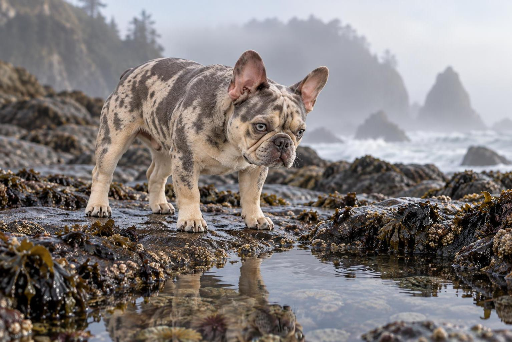

```text
Use case: identity-preserve
Asset type: character-consistency campaign scene
Primary request: Generate a new natural photorealistic scene of the exact merle French bulldog identity from Image 1 standing alert on wet coastal rocks and investigating a small tidepool in soft morning mist.
Input images: Image 1 is the sole identity anchor. Preserve its head, ears, muzzle, eyes, merle pattern language, body proportions, paws, and age; do not copy the reference-sheet layout or gray studio background.
Scene/backdrop: Quiet rocky coast at low tide, one small reflective tidepool, wet charcoal stones, faint sea foam and misty horizon; no people or other animals.
Subject and load-bearing identity proportions: One dog only. Preserve the broad nearly square head; tall upright bat ears set wide apart with rounded tips; extremely short broad muzzle approximately one quarter of head length; broad dark nose; pale blue-gray eyes set wide; cream blaze on lower face and chest. Preserve the compact cobby muscular torso, wide chest, short sturdy legs, slightly longer body than tall, broad paws, and very short tail. Preserve blue-gray and warm-cream merle patches as irregular mottling rather than stripes or spots.
Pose/activity: Natural four-square standing pose with head lowered slightly toward the pool, ears upright, curious calm expression, all four legs and paws visible and bearing plausible weight.
Composition/framing: Low eye-level landscape photograph, full dog contained with clear separation between all four legs; reflection may appear only inside the tidepool and must not resemble a second dog.
Lighting/mood: Diffused cool morning light, soft mist, quiet curiosity.
Materials/textures: Short realistic fur, wet nose, detailed paw pads/claws where visible, water ripples, slick stone.
Constraints: Identity fidelity and load-bearing proportions take priority. Exactly one dog, one head, two ears, four legs, four paws; anatomically coherent joints and toes. No collar, clothing, readable text, gibberish, logos, watermark, extra animal, duplicated face, extra leg, fused paw, long muzzle, floppy ears, long tail, cropped paws, or reference-sheet panels.
Avoid: tall lean terrier proportions, narrow head, long snout, low ear set, blue coat without cream, dalmatian spots, cartoon style, 3D render.
```

Model: GPT Image 2.5 · Author: Alosem team · Created for Alosem

[Original source](https://github.com/pixexid/awesome-gpt-image-2-5/blob/0c97a3a4fd2c2a7692e09d568a2b79f30178cd3b/cases/merle-bulldog-explores-a-misty-tidepool-e42f702d.md) · [Provenance and original license](data/projectd-batch-0011.json)

References: https://raw.githubusercontent.com/pixexid/awesome-gpt-image-2-5/0c97a3a4fd2c2a7692e09d568a2b79f30178cd3b/assets/references/merle-bulldog-identity-sheet.png

## Sema Becomes a Glazed Ceramic Portrait — Alosem · reference required · CC BY 4.0

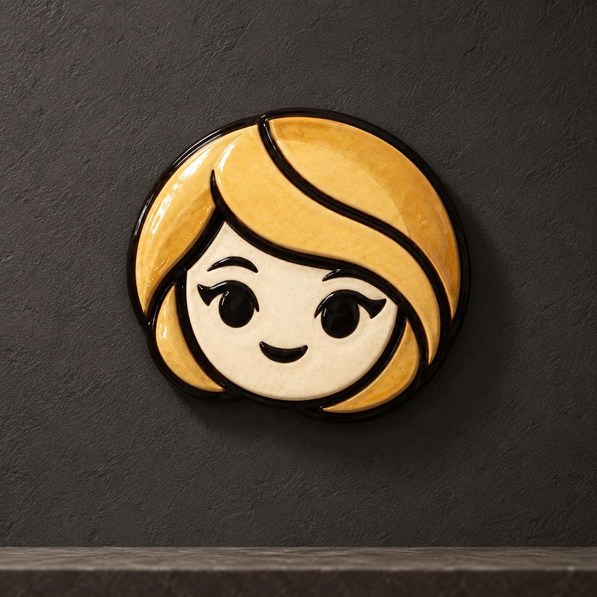

```text
Use case: style-transfer
Asset type: identity-across-media campaign hero
Primary request: Re-render the exact flat-vector-style Sema head from Images 1 and 2 as a handcrafted glazed ceramic wall portrait photographed as a physical object. Change the medium only; preserve the mascot identity and proportions.
Input images: Image 1 is the primary silhouette, viewing-angle, hair-sweep, face-inset, line-placement, and palette anchor. Image 2 is the primary eye, lash, mouth, and expression-language anchor.
Scene/backdrop: Warm charcoal mineral-plaster wall, subtle museum plinth edge, no other objects.
Subject and load-bearing identity proportions: Exactly one Sema head, no body. Preserve the near-circular horizontal oval silhouette, slightly wider than tall; compact bob ending in two rounded lower side lobes; heavy golden fringe beginning near top-center and sweeping diagonally across the forehead to the lower-right cheek; shorter pointed lock on the left. Preserve the warm-ivory face inset centered low inside the hair mass at roughly two-thirds of total head width, with wide soft cheeks and a small rounded chin. Preserve evenly spaced black oval eyes at mid-face, outer winged lashes, no nose, and a tiny curved approving mouth well below the eyes.
Medium/material: Real handmade glazed ceramic in shallow relief, cream face glaze, honey-gold and ochre hair glazes, glossy near-black outlines/features. Slight glaze pooling and kiln variation, but contours remain crisp and readable.
Composition/framing: Square studio hero, object fully contained with generous wall margin, slight three-quarter physical depth, no crop.
Lighting/mood: Soft directional museum light, gentle physical shadow, refined and tactile.
Constraints: Medium translation must not alter identity geometry. No body, neck, ears, nose, extra face, duplicated object, flattened printed illustration, text, labels, logos, watermark, chipped missing features, or cropped silhouette.
Avoid: taller egg-shaped head, narrow face inset, centered curtain bangs, reversed hair sweep, oversized eyes, realistic human face, emoji redesign, plastic toy, vector-flat rendering.
```

Model: GPT Image 2.5 · Author: Alosem team · Created for Alosem

[Original source](https://github.com/pixexid/awesome-gpt-image-2-5/blob/0c97a3a4fd2c2a7692e09d568a2b79f30178cd3b/cases/sema-becomes-a-glazed-ceramic-portrait-337c92bd.md) · [Provenance and original license](data/projectd-batch-0011.json)

References: https://raw.githubusercontent.com/pixexid/awesome-gpt-image-2-5/0c97a3a4fd2c2a7692e09d568a2b79f30178cd3b/assets/references/sema-directions-sheet.png, https://raw.githubusercontent.com/pixexid/awesome-gpt-image-2-5/0c97a3a4fd2c2a7692e09d568a2b79f30178cd3b/assets/references/sema-reactions-sheet.png

## Sema Travels Across Four Crafted Materials — Alosem · reference required · CC BY 4.0

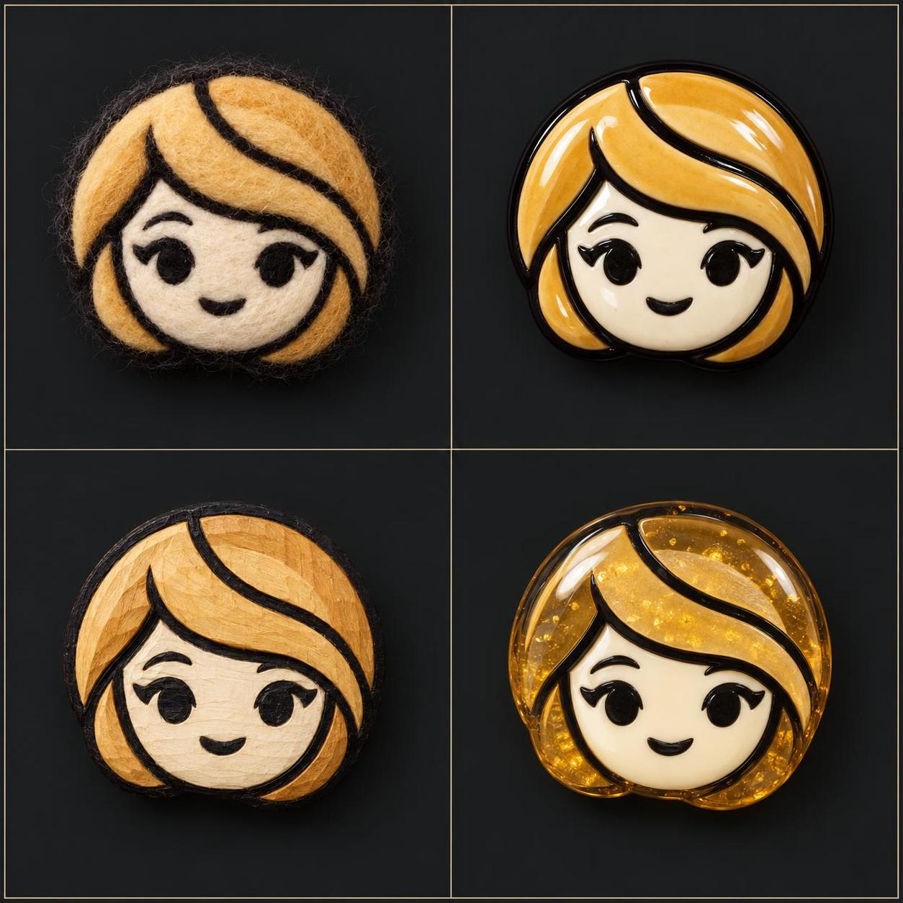

```text
Use case: style-transfer
Asset type: identity-across-media material study
Primary request: Create one polished 2-by-2 study sheet showing the exact same Sema head from Images 1 and 2 physically re-rendered in four unmistakably different media: needle-felted wool, glazed ceramic relief, carved and painted wood, and translucent cast resin. Preserve identity geometry in every cell; change material only.
Input images: Image 1 is the primary silhouette, viewing-angle, hair-sweep, face-inset, line-placement, and palette anchor. Image 2 is the primary eye, lash, mouth, and expression-language anchor.
Scene/backdrop: Four equal charcoal specimen cells separated by thin warm-gray rules; no labels or captions.
Subject and load-bearing identity proportions: The same one Sema head in every cell, no body. Preserve the near-circular horizontal oval silhouette, slightly wider than tall; compact bob ending in two rounded lower side lobes; heavy golden fringe beginning near top-center and sweeping diagonally across the forehead to the lower-right cheek; shorter pointed lock on the left. Preserve the warm-ivory face inset centered low inside the hair mass at roughly two-thirds of total head width, wide soft cheeks, small rounded chin, evenly spaced black oval eyes at mid-face, outer winged lashes, no nose, and tiny curved mouth.
Cell media: top-left needle-felted wool with visible fibers and stitched black features; top-right glossy glazed ceramic relief with glaze pooling; bottom-left carved and painted wood with shallow tool marks and visible grain; bottom-right translucent cast resin with suspended golden pigment and embedded opaque face/features. All retain the same cream, gold, ochre, and black palette.
Composition/framing: Exact 2-by-2 grid, one fully contained head per cell, matching scale, viewing angle, face placement, and expression, generous padding, no overlap.
Lighting/mood: Even museum specimen lighting tailored subtly to reveal each material.
Constraints: Identity proportions must match across all four cells and the references. Exactly four heads total. No body, neck, ears, nose, extra face, duplicated cell, text, labels, logos, watermark, cropped silhouette, or medium ambiguity.
Avoid: taller oval heads, narrow face insets, reversed or centered fringe, realistic human faces, four color variants of the same material, flat printed vector copies, inconsistent eye spacing or mouth placement.
```

Model: GPT Image 2.5 · Author: Alosem team · Created for Alosem

[Original source](https://github.com/pixexid/awesome-gpt-image-2-5/blob/0c97a3a4fd2c2a7692e09d568a2b79f30178cd3b/cases/sema-travels-across-four-crafted-materials-36e3d7f0.md) · [Provenance and original license](data/projectd-batch-0011.json)

References: https://raw.githubusercontent.com/pixexid/awesome-gpt-image-2-5/0c97a3a4fd2c2a7692e09d568a2b79f30178cd3b/assets/references/sema-directions-sheet.png, https://raw.githubusercontent.com/pixexid/awesome-gpt-image-2-5/0c97a3a4fd2c2a7692e09d568a2b79f30178cd3b/assets/references/sema-reactions-sheet.png

## Citrus Soda Campaign — Callirra Atlas · CC BY 4.0

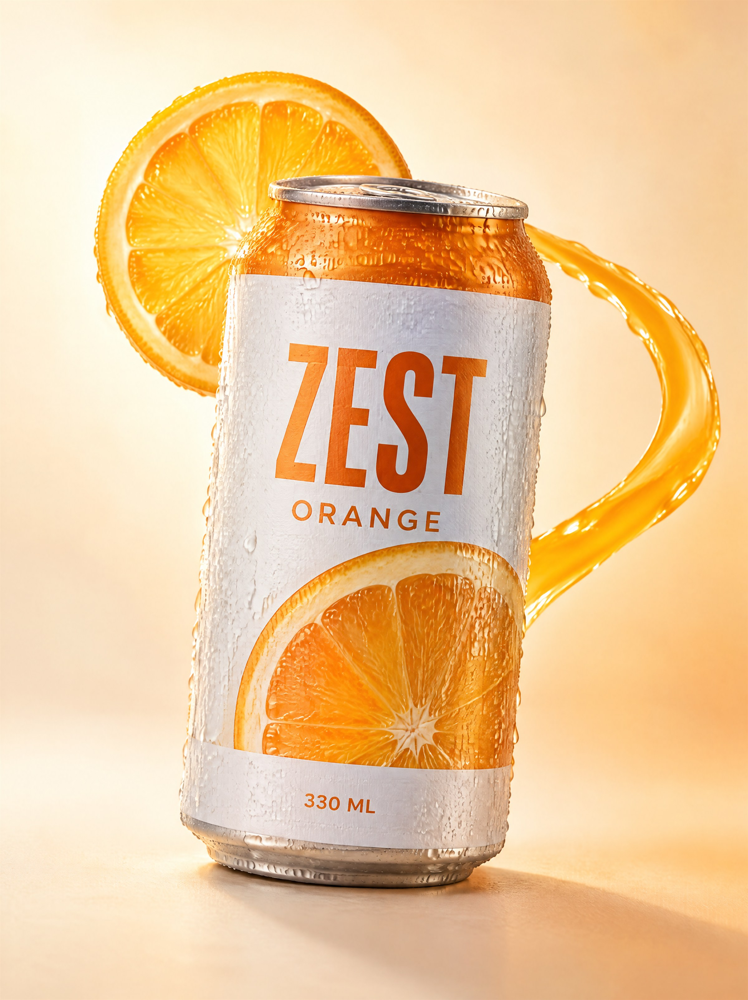

```text
A bright beverage advertisement photograph of a chilled can of orange sparkling soda, standing at a slight
tilt on a smooth pale surface, shot on a 3:4 vertical canvas at close product distance.

COMPOSITION
The can is the largest and most central element, occupying about 55% of the frame height, its base resting
just below the lower third. A single thin orange slice curls behind the can's upper third, its circle echoing
the can's rim. One narrow arc of liquid rises from the surface behind the can and sweeps around its right
side at the can's mid-height, then falls out of frame. The arc passes BEHIND the can and never crosses the
label. The composition is built on three circles — the slice, the rim, the liquid arc — held on one vertical
axis. Empty space falls to the lower left. Nothing touches the frame edges.

SETTING AND LIGHT
Background: a seamless warm cream backdrop with a soft apricot falloff toward the lower right, no props, no
horizon. Lighting: one large soft source behind the can at the upper left, acting as a rim light that passes
through the orange slice and glows through the liquid arc; one broad white bounce card in front at low
intensity to keep the label legible. Contact shadow: one tight soft shadow directly beneath the can base.
No coloured gels, no second light, no reflections of studio equipment.

MATERIALS
Cold aluminium can with a satin brushed finish and a fine bead-blasted sheen along the rim; heavy condensation
across the cold metal, with droplets varying from fine mist to a few larger runs, all catching the back light.
Orange slice: translucent flesh with visible radial segments and a pith ring, the back light glowing through
it so the pulp reads as wet rather than as coloured glass. Liquid: thin, glossy, opaque orange with a defined
meniscus, heavy enough to hold a smooth curve, catching a bright highlight line along its top edge.

LABEL AND TEXT
The label is white with a matte paper texture, wrapped cleanly and registered straight to the can's vertical
axis. It carries exactly this text, once each: the brand word "ZEST" in a bold condensed sans on the upper
third, "ORANGE" beneath it in a smaller light sans, and "330 ML" at the bottom of the label. No other words,
numbers, marks or symbols appear anywhere in the frame. Brand text must be crisp, correctly kerned, unobstructed
and readable at thumbnail size.

CONSTRAINTS
One liquid arc only. No scattered fruit pieces, no splashes, no droplets scattered through the air. The can's
silhouette, the label's proportions and the label's registration must stay unchanged. Do not add a second can,
a glass, ice cubes, leaves or a straw. No invented logos, no badges, no awards, no "new" or "best" flashes,
no watermark. Avoid plastic-looking CGI, avoid flat airless lighting, avoid over-sharpened edges.

```

Model: GPT Image 2.5 · Author: callirra-ai / GPT Image 2.5 Prompt Atlas

[Original source](https://github.com/callirra-ai/gpt-image-2-5-prompt-atlas/blob/7450bf6178d99756e62029fe4b1c8149d3f07bf0/cases/01-citrus-under-pressure/prompt.txt) · [Provenance and original license](data/projectd-batch-0011.json)

## After Hours Jazz Poster — Callirra Atlas · CC BY 4.0

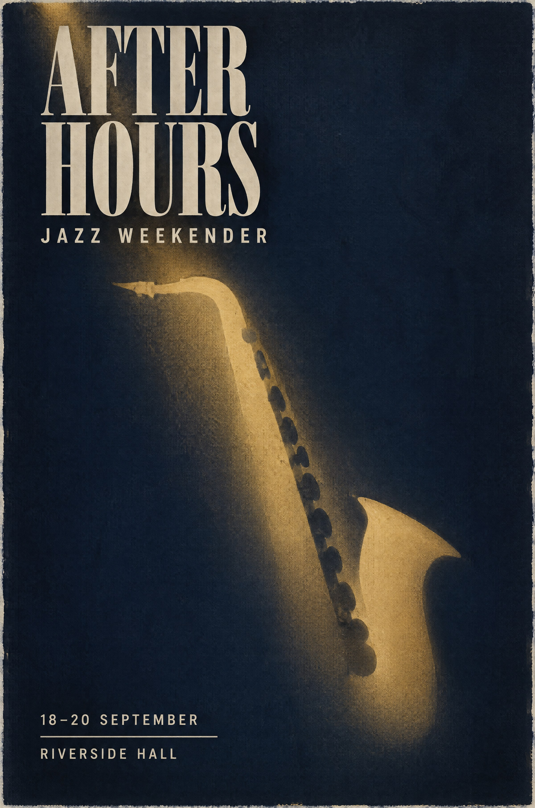

```text
A vertical editorial concert poster, 2:3, printed artwork seen flat and straight on — not a photograph of a
poster on a wall.

COMPOSITION
Deep indigo ground with a subtle ink-darkening toward the outer edges. A single narrow shaft of warm gold
stage light enters from the upper left and falls through the centre of the sheet, and the illuminated volume
of that beam resolves into the abstract silhouette of a saxophone: bell low right, neck rising left, keys
suggested by a row of small dark interruptions along the beam's right edge. The silhouette is built only from
light and its absence — no outline, no drawn instrument. The headline sits above the beam, set large; the
supporting lines sit below it in a compact block with clear air around them; the date and venue occupy their
own zone at the bottom margin. The beam never crosses any letterform.

TEXT — render exactly these four strings, each appearing once
"AFTER HOURS"
"JAZZ WEEKENDER"
"18–20 SEPTEMBER"
"RIVERSIDE HALL"
Hierarchy: "AFTER HOURS" is the largest, set in a high-contrast condensed serif, tracked tight, on two lines
if needed. "JAZZ WEEKENDER" is roughly one third that height in a neutral uppercase sans with wide letter
spacing. "18–20 SEPTEMBER" and "RIVERSIDE HALL" are the smallest, set on one shared left-aligned column in the
bottom margin, separated by a thin rule. All type sits on one left axis. No other text anywhere.

PAPER AND FINISH
Heavy uncoated poster stock with visible fibre grain and a faint deckled suggestion along the edges; ink sits
slightly into the paper rather than on top of it. The gold light is printed ink luminance, not a glow effect:
flat in the deep areas, softly graduated only where the beam passes.

CONSTRAINTS
No QR code, no barcode, no sponsor logos, no decorative microtext, no fictional support acts, no ticket
prices, no "sold out" flashes. Do not paraphrase, abbreviate, re-case or hyphenate the four strings. Do not
rotate, outline, shadow or gradient-fill the type. Do not add a saxophone photograph, a player, a crowd or a
venue illustration. Keep the poster plane flat: no frame, no perspective, no wall shadow, no mockup, no tape,
no torn edges beyond a faint deckle. No watermark, no signature.

```

Model: GPT Image 2.5 · Author: callirra-ai / GPT Image 2.5 Prompt Atlas

[Original source](https://github.com/callirra-ai/gpt-image-2-5-prompt-atlas/blob/7450bf6178d99756e62029fe4b1c8149d3f07bf0/cases/02-after-hours-jazz-poster/prompt.txt) · [Provenance and original license](data/projectd-batch-0011.json)

## Mountain Bathhouse Cutaway — Callirra Atlas · CC BY 4.0

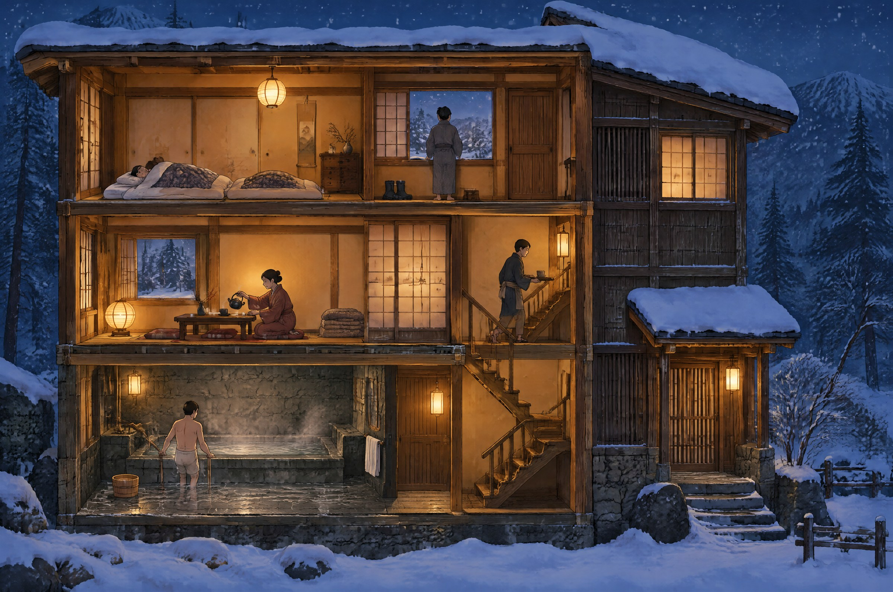

```text
A three-storey cutaway illustration of a small mountain bathhouse at night, drawn straight on as a section
through the building, on a 3:2 landscape canvas.

THE BUILDING
A compact timber inn, roughly three times as wide as it is tall, its left half cut away so all three floors
are visible at once. Outside: deep blue snow night, a low driftscape against the base, bare larch trunks
behind, falling snow. Inside: warm amber lamplight on timber, paper screens, and steam, clearly separated from
the cold exterior. Floor slabs read as solid timber sections; the roof is snow-loaded with a visible eave.
One staircase connects all three floors in a legible run, and its landings align with the floor slabs.

LOWER FLOOR — the bath
A sunken stone pool with faint steam rising off the water surface only, not through the walls. Wet stone
apron, a low wooden bucket, a folded towel on a rail. The water line is visible against the pool wall.

MIDDLE FLOOR — the tea room
Low table with a teapot mid-pour, two cups, a paper lantern, a folded blanket, a window onto the snow. A paper
screen partially drawn so the room behind it stays readable.

UPPER FLOOR — the guest room
Two futons, a small chest, a hanging lamp, a pair of boots set beside the door, snow built up on the window sill.

FIGURES
Five small figures, each doing something different and quiet: one stepping into the bath, one seated pouring
tea, one asleep under a futon, one standing at an upper window looking out, one on the stairs carrying a
tray. Figures are small relative to the building, anatomically plain, and never repeated as identical stamps.

MATERIAL AND LIGHT
Timber: warm grain, visible joinery, worn edges at thresholds. Paper screens: translucent, glowing from the
lamps behind them. Stone: cold grey-green with damp sheen near the pool. Snow: matte, with soft blue shadow.
Outside light is cool and low-contrast; inside light is warm and pooled around each lamp. The two light
sources never mix — snow stays blue, interiors stay amber.

CONSTRAINTS
Water and steam never pass through a wall, floor or the roof. Exterior falling snow never appears indoors.
Each floor's boundary, door and stair connection must be readable. Do not fill rooms with clutter; the space
must stay explorable along the stairs. Do not add text, signage, numbers or logos. No watermark.

```

Model: GPT Image 2.5 · Author: callirra-ai / GPT Image 2.5 Prompt Atlas

[Original source](https://github.com/callirra-ai/gpt-image-2-5-prompt-atlas/blob/7450bf6178d99756e62029fe4b1c8149d3f07bf0/cases/03-midnight-bathhouse/prompt.txt) · [Provenance and original license](data/projectd-batch-0011.json)

## Miniature Construction Crew on a Lens — Callirra Atlas · CC BY 4.0

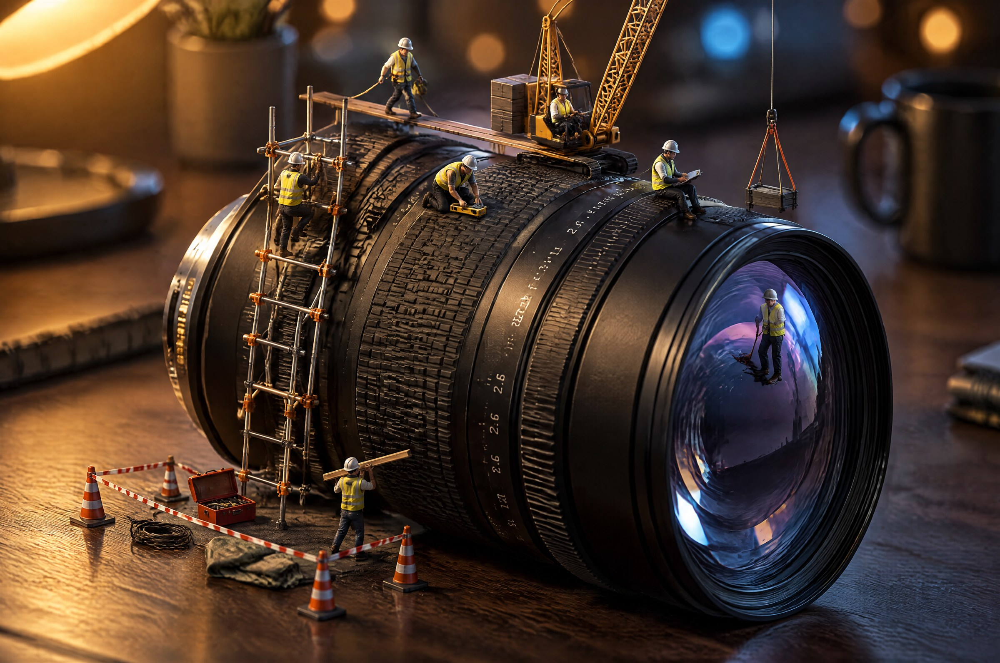

```text
A macro photograph of a miniature construction site built on top of a real camera lens lying on a dark
wooden desk, shot at 3:2 with a tilt-shift effect so the plane of focus runs diagonally across the lens barrel.

THE LENS AS LANDSCAPE
A large prime lens lies on its side, filling most of the frame: black anodised aluminium barrel with fine
knurled focus and aperture rings, a metal mount ring at the near end, engraved white numerals along the barrel,
and the front glass element facing the camera at the far end. The glass is deep blue-violet with concentric
coating rings and a curved reflection of the room's ceiling. The lens is the terrain — everything else is built
on it.

THE SITE
A miniature crew is working along the top of the barrel. On the rubber ring: a climbing scaffold of thin
aluminium poles lashed with small orange ties. Mid-barrel: a lattice crane with a counterweight, its hook
lowered toward the glass. Near the mount: a striped barrier line of cones and tape around a "work area", with
a tiny open toolbox, a coiled cable, a folded tarp and two traffic cones. On the front glass element: a
single worker standing well out on the glass, casting a reflection beneath himself.

FIGURES
Seven figures in high-visibility yellow vests and white helmets. Each is doing something different: one
climbing the scaffold, one walking a beam with a tether, one at the crane controls, one kneeling to check a
level, one carrying a plank over the shoulder, one standing on the glass, one sitting on the barrel edge with
a clipboard. All are anatomically plain, correctly scaled to each other, and never repeated as identical stamps.

LIGHT AND DEPTH
One warm desk lamp off-frame to the upper left, its shade just visible as a soft amber glow at the frame's
edge, throwing warm directional light along the barrel and long soft shadows to the right. A cold blue rim
from a window behind separates the figures from the background. Strong tilt-shift depth of field: the strip
across the barrel top is sharp, the near knurling and the far background fall into soft focus. Background
bokeh of warm amber point lights and one blue highlight.

CONSTRAINTS
The lens must remain a real, correctly proportioned camera lens: barrel diameter, ring widths, mount ring,
engraved numerals and the glass element all plausible and consistent. No text anywhere except the lens's own
engraved markings, which are embossed metal and unreadable at this scale. No logos, no brand marks, no
watermark. Do not make the scene look like plastic toys: real metal, real rubber, real glass, real tiny
clothing with fabric weave. No flame, no welding sparks, no dust cloud.

```

Model: GPT Image 2.5 · Author: callirra-ai / GPT Image 2.5 Prompt Atlas

[Original source](https://github.com/callirra-ai/gpt-image-2-5-prompt-atlas/blob/7450bf6178d99756e62029fe4b1c8149d3f07bf0/cases/04-miniature-crew-on-a-lens/prompt.txt) · [Provenance and original license](data/projectd-batch-0011.json)

## Exploded Ramen Ingredient Diagram — Callirra Atlas · CC BY 4.0

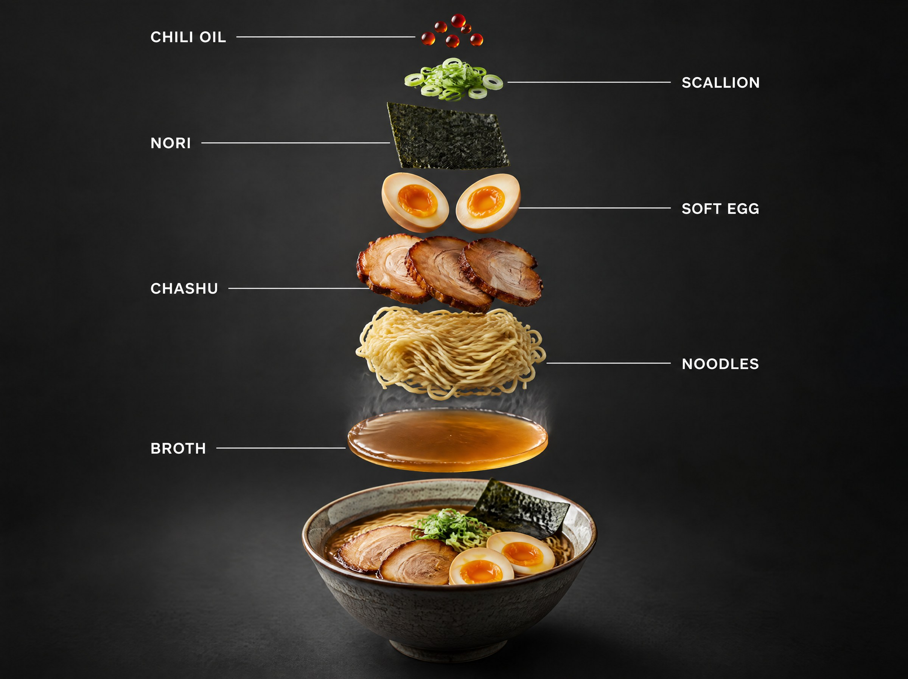

```text
A commercial food photograph of an exploded ramen bowl, drawn on a 4:3 canvas as a vertical assembly diagram
in three dimensions: the finished bowl at the bottom, and its components suspended above it in the order they
are assembled, each labelled.

COMPOSITION
Dark slate ground filling the frame, one value, with a soft pool of light in the centre. The ceramic bowl sits
in the lower third, centred, seen from a slightly raised three-quarter angle so its interior is visible. Directly
above the bowl, seven components float in a vertical stack with generous even gaps, largest at the bottom,
smallest at the top. Each component has one thin straight leader line running horizontally out to a label at
the left or right margin; no leader crosses another, no leader crosses a component, and every leader ends exactly
on the component it names.

THE COMPONENTS, bottom to top
1. Amber broth held as a perfect disc of liquid suspended in mid-air, with a defined meniscus and a bright
   highlight along its edge; faint steam rising from this disc only.
2. A coil of fresh noodles, lifted and separated so individual strands are visible, glossy and pale gold.
3. Three slices of braised pork belly, edge-seared, with visible fat-to-meat layering and a caramelised rim.
4. Two halves of a marinated soft-boiled egg, yolks jammy and slightly translucent, cut faces toward camera.
5. A sheet of toasted nori standing almost upright, matte black-green with visible fibre structure.
6. A small fan of sliced scallions, fresh green and white rings, crisp edges.
7. A tight cluster of chili oil droplets suspended together, each catching a small bright specular point.

TEXT — render exactly these seven strings, one per label, each appearing once
"BROTH" / "NOODLES" / "CHASHU" / "SOFT EGG" / "NORI" / "SCALLION" / "CHILI OIL"
Typography: one neutral uppercase sans, one size only, set horizontally, left-aligned on the left margin for
components 1, 3, 5, 7 and right-aligned on the right margin for components 2, 4, 6, so the leaders stay short.
No other text anywhere in the frame.

LIGHT AND MATERIAL
One large soft key from the upper left, one weak fill from the right, and one narrow back light that makes the
broth glow from within and catches the rim of the egg yolks. Ceramic: matte glaze with fine crazing and a soft
rim highlight. Liquid: glossy, opaque amber with a viscous meniscus. Noodles: wet and reflective without looking
oiled plastic. Pork: crisp caramelised edge, fibrous interior. Egg: dense jammy yolk with a matte albumen.
Steam rises only from the broth disc, thin and directional, never covering a component or a label.

CONSTRAINTS
Exactly seven components and exactly seven labels, one each, in the order given. Components must not overlap,
touch, or drift off the vertical axis. Do not add chopsticks, a spoon, a napkin, a second bowl, scattered
ingredients, flying droplets, herbs or decorative garnishes. Do not add brackets, arrows, dashed boxes,
measurement lines or dimension marks — the only graphics in the frame are the seven thin leaders. Do not
restyle the labels, do not add units or prices. No watermark, no logo, no border.

```

Model: GPT Image 2.5 · Author: callirra-ai / GPT Image 2.5 Prompt Atlas

[Original source](https://github.com/callirra-ai/gpt-image-2-5-prompt-atlas/blob/7450bf6178d99756e62029fe4b1c8149d3f07bf0/cases/05-exploded-ramen-bowl/prompt.txt) · [Provenance and original license](data/projectd-batch-0011.json)

## Rainy Street Cinematic Banner — Callirra Atlas · CC BY 4.0

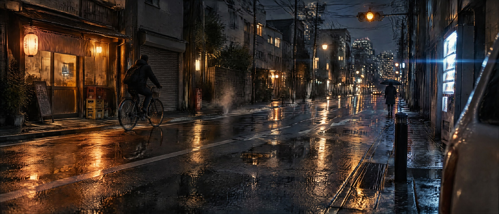

```text
An anamorphic night exterior, 21:9, shot on a rain-slicked city street minutes after the rain stopped — a
cinematic still, not a tourist photograph.

COMPOSITION
Wide frame, camera at chest height on the near pavement, the road running diagonally away to the right so the
reflections carry the eye into depth. A single cyclist crosses left to right through the middle third, small in
frame, moving out of the left of the shot, caught mid-pedal; a pedestrian with a dark umbrella walks away from
camera on the far pavement, well down the street. Foreground: the wet kerb and the out-of-focus edge of a parked
van intruding into the lower right corner, cropped by the frame. Empty wet road occupies the lower half. Nothing
is centred.

THE STREET
Named elements, all present: wet asphalt, painted lane markings, standing puddles holding reflections, a bento
shop window with a paper lantern, a vending machine glowing on the near wall, a bento shop sign with unreadable
lettering, a traffic signal showing amber, overhead power lines crossing the sky, a metal drain grate, a
steam vent from a basement grate, wet bicycle tyres, a low bollard, a shuttered roller door, a stack of plastic
crates beside a doorway.

LIGHT
Night, blue hour, no sun. Sources: the amber lantern of the bento shop at the left, at eye level; the cold white
of the vending machine on the near right; the amber traffic signal high in the frame; and a weak blue-grey
ambient sky. One dominant direction: the warm shop light comes from the left and slightly behind, so the cyclist
is rimmed and the road reflections stretch toward camera. Every shadow and every reflection must agree with the
warm source being on the left.

LENS CHARACTER
True anamorphic rendering: one long horizontal blue lens flare streak across the frame at eye level, sourced
from the vending machine; oval bokeh in the background lights, elongated horizontally; a slight horizontal
smear at the frame edges; fine film grain; a very shallow depth of field that keeps the puddles and road
reflections sharp in the middle distance and softens the far street.

CONSTRAINTS
No readable text anywhere: all signage, the vending machine front and the shop lantern must stay illegible —
off-angle, cropped, or out of focus — and must never resolve into invented words. No legible vehicle plates.
No people facing the camera, nobody posing, no crowd. No lens flare except the one horizontal streak. No
watermark. Do not light the scene with a fill: keep the contrast deep and the shadows held. Do not add neon
signage in colours that contradict the amber-left / cold-right lighting logic. No rain falling, no spray from
tyres — the street is wet, the weather has stopped.

```

Model: GPT Image 2.5 · Author: callirra-ai / GPT Image 2.5 Prompt Atlas

[Original source](https://github.com/callirra-ai/gpt-image-2-5-prompt-atlas/blob/7450bf6178d99756e62029fe4b1c8149d3f07bf0/cases/06-anamorphic-night-crossing/prompt.txt) · [Provenance and original license](data/projectd-batch-0011.json)

## Six-Panel Wordless Manga — Callirra Atlas · CC BY 4.0

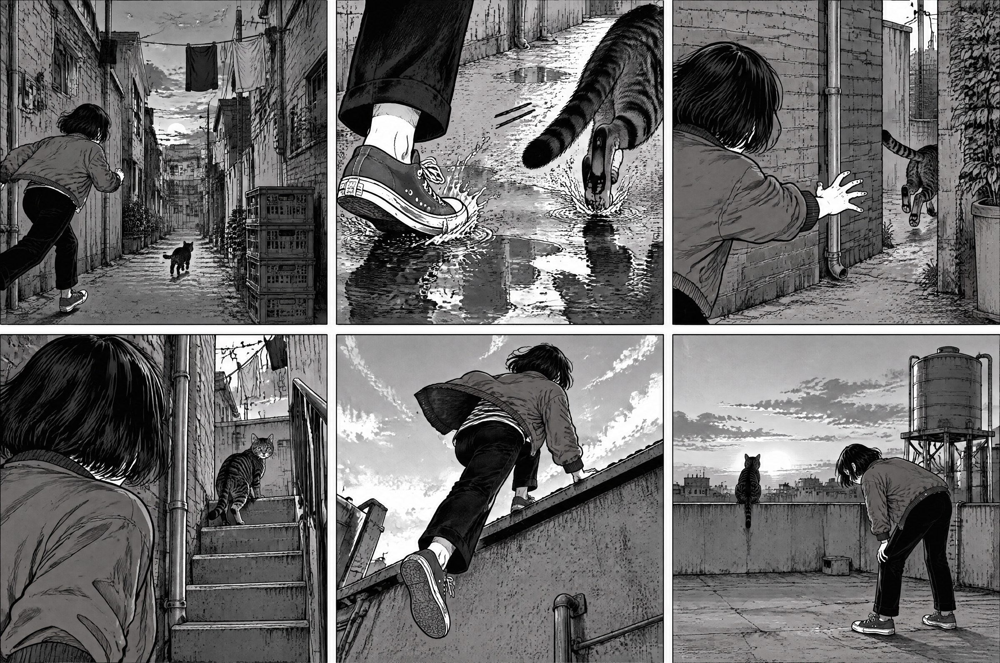

```text
A six-panel manga spread, 3:2 landscape, black and white, telling one continuous action with no dialogue
and no text of any kind. Two columns of six equal panels: three columns across, two rows down, with even
gutters. Reading order is left to right, then top to bottom.

STYLE
Traditional ink manga: confident black linework with variable weight, screentone for mid-tones and shadow,
cross-hatching for the darkest areas, and large untouched white areas for light. High contrast, clean panels,
no grey wash. Screentone dots stay legible at print size. Nothing is coloured.

THE ACTION — one girl pursuing a cat through a narrow alley and up to a roof, six beats
Panel 1 — wide establishing shot: a narrow residential alley at dusk, deep in frame, laundry lines overhead,
  a stack of crates against a wall; the girl enters from the left edge, small, mid-stride.
Panel 2 — extreme close-up on the ground: her feet and the cat's paws over a puddle, water displaced, motion
  indicated by two short speed lines only.
Panel 3 — medium shot from behind: the cat slips around a corner ahead, only tail and hindquarters visible;
  the girl's arm reaches into frame from the left, fingers open, missing it.
Panel 4 — over-the-shoulder: the alley opens onto a narrow exterior stairwell rising to the right; the cat is
  two steps up, paused, looking back; the girl's shoulder and hair fill the left edge.
Panel 5 — low angle from below: the girl at the top of the stairs, mid-leap, cape of her jacket lifting,
  the roofline and sky behind her, strong diagonal composition.
Panel 6 — wide, calm: a rooftop with a water tank and a low parapet; the cat sits on the parapet with its back
  to us; the girl stands four steps away, doubled over and out of breath, one hand on her knee.

CONSISTENCY ACROSS ALL SIX PANELS
Same character throughout: a girl of about sixteen, short dark bobbed hair with a blunt fringe, a bomber jacket
with ribbed cuffs over a striped shirt, dark trousers, scuffed canvas shoes. Her hairstyle, fringe, jacket,
shirt stripes and shoe design are identical in every panel where she appears. The cat is a single dark tabby
of the same size and markings in every panel. The alley is the same alley: brick walls, the same laundry lines,
the same crates.

CAMERA
Every panel uses a different shot — wide, extreme close-up, medium, over-the-shoulder, low angle, wide — and no
panel repeats another panel's framing. Panels 1 and 6 are both wide but differ in subject and altitude.

CONSTRAINTS
No text anywhere: no dialogue, no captions, no signage, no sound-effect lettering, no speech balloons, no page
numbers, no watermark, no signature. Do not add a title strip or a border beyond the panel gutters. Do not
colour any element. Do not let the character's design change between panels, and do not mirror her asymmetrically
between panels. Nothing may be cropped by a panel edge that should not be: hands, feet and the cat's tail stay
inside their panels.

```

Model: GPT Image 2.5 · Author: callirra-ai / GPT Image 2.5 Prompt Atlas

[Original source](https://github.com/callirra-ai/gpt-image-2-5-prompt-atlas/blob/7450bf6178d99756e62029fe4b1c8149d3f07bf0/cases/07-six-panel-manga-spread/prompt.txt) · [Provenance and original license](data/projectd-batch-0011.json)

## Isometric Bookshop Cutaway — Callirra Atlas · CC BY 4.0

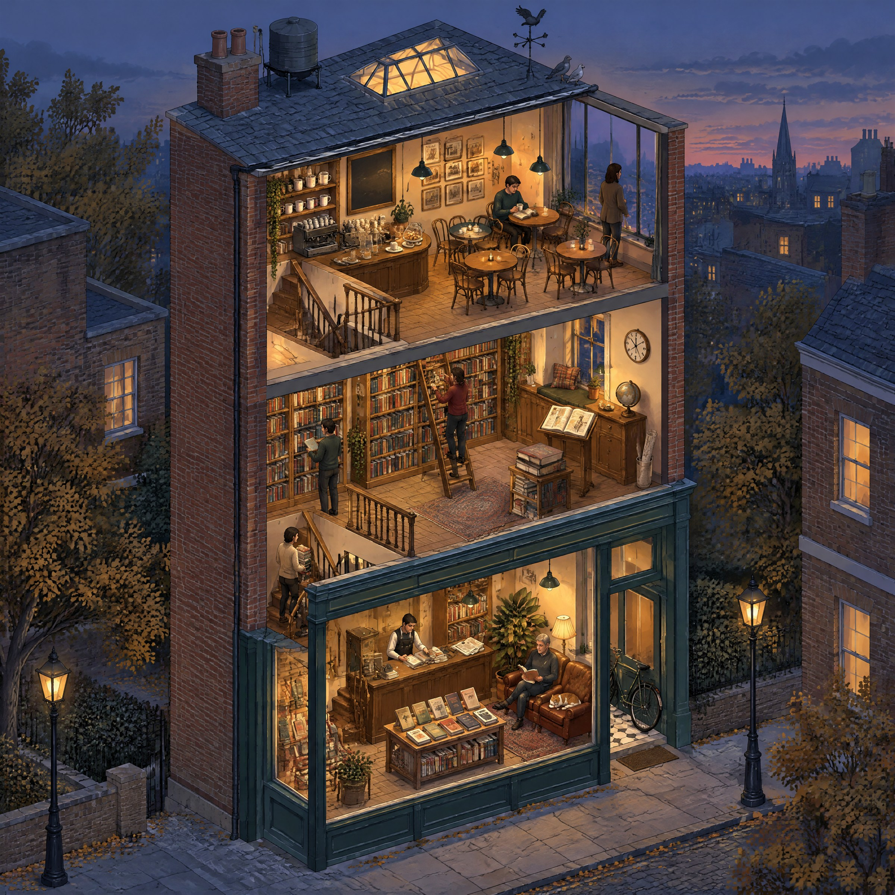

```text
A true isometric cutaway illustration of a three-storey independent bookshop in the evening, on a 1:1 canvas,
drawn in a single axonometric projection at 30 degrees on both horizontal axes, orthographic, with no
perspective and no vanishing point. The front-right quarter of the building is removed so all three floors and
the roof are visible at once. The building is lit from inside; it is dusk outside.

THE BUILDING
Narrow and tall, roughly twice as tall as it is wide. Brick side walls with visible coursing, a slate roof with
a glazed skylight and a small chimney, a painted timber shopfront on the ground floor with a deep doorway
recess, and a gutter running the full width of the roof edge. Floor slabs read as solid sections with visible
thickness.

GROUND FLOOR — the shop
A long service counter with a till, a stack of books waiting to be shelved, a low display table with books
fanned open face-up, two deep reading armchairs, a floor lamp, a potted rubber plant, a brass bell on the
counter, a stack of newspaper, a bicycle leaning inside the doorway, and a cat asleep on the armchair.

MIDDLE FLOOR — the shelves
Six full-height shelves in two rows along the side walls, a rolling wooden ladder hooked to a rail, a reading
nook with a window seat and a cushion, an open atlas on a stand, a globe on a cabinet, a desk lamp, a stack of
oversize art books lying flat, a rolled map in a corner, and a wall clock.

TOP FLOOR — the café
A small espresso machine on a counter with two cups and a knock box, three round tables with chairs, a tray of
pastries under a glass dome, a floor-to-ceiling window with the evening sky beyond, hanging pendant lamps,
a wall of small framed prints, a chalkboard, a water jug, and a tall shelf of mugs.

ROOF
The glazed skylight glowing from below, the chimney, a small water tank, two pigeons, and a weather vane.

FIGURES
Six small figures, each doing something different: one browsing a shelf with a book half out, one reading in a
ground-floor armchair, one climbing the rolling ladder, one carrying a stack of books up the stairs, one seated
at a café table with a cup, one standing at the top-floor window looking out. Figures are small relative to the
building and are never repeated as identical stamps.

LIGHT AND MATERIAL
Evening: cool blue dusk light from outside, warm amber lamplight pooled inside each floor, and the skylight
glowing up onto the roof. The two light temperatures never mix — exterior blue, interior amber. Materials:
painted timber, brick, glass, brass, worn leather on the armchairs, matte paper. Wood grain and brick texture
are visible but never noisy.

CONSTRAINTS
True isometric only: parallel verticals stay parallel, both floor plans keep the same 30-degree axes, and no
element is drawn in perspective. Each floor's ceiling must not be drawn — the viewer looks down into each level.
Staircases must connect visibly between floors and land on the slabs. Do not add text, signage, prices, numbers,
lettering on spines, or a shop name; all book spines are abstract blocks of colour with no lettering. No
watermark. Do not fill the building with so much furniture that the floor plates stop reading as separate levels.

```

Model: GPT Image 2.5 · Author: callirra-ai / GPT Image 2.5 Prompt Atlas

[Original source](https://github.com/callirra-ai/gpt-image-2-5-prompt-atlas/blob/7450bf6178d99756e62029fe4b1c8149d3f07bf0/cases/08-isometric-bookshop-cutaway/prompt.txt) · [Provenance and original license](data/projectd-batch-0011.json)

## Lunar Courier Turnaround Study — Callirra Atlas · CC BY 4.0

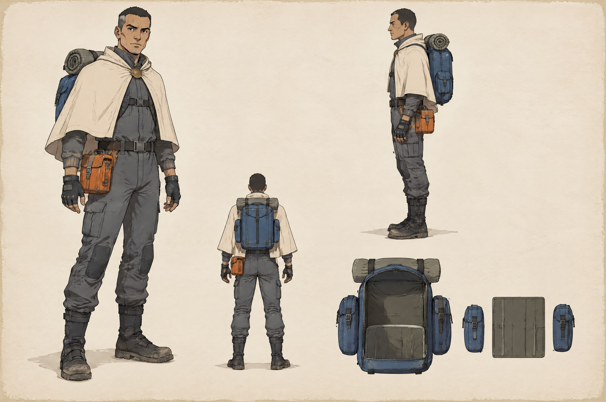

```text
A character design sheet for a lunar courier, drawn on a 3:2 landscape sheet of warm off-white design paper at a
slightly larger scale than a technical reference: four zones, each with a clear border of empty space, hand-drawn
production-art quality, flat cel shading with a single light source from the upper left.

THE CHARACTER — reproduce identically in every view
A courier of about thirty, wiry build, medium height, close-cropped dark hair, a narrow face with a strong
jawline and a thin scar through the left eyebrow. Wearing a cream short cape that stops at the hip with a
scuffed brass clasp at the throat, a slate-grey flight suit with a high collar and ribbed cuffs, worn carbon
boots scuffed at the toe, and fingerless gloves.

Equipment: a hard-shell backpack in cobalt blue with a visible seam, two side pockets and a rolled blanket
strapped on top, and — the asymmetric detail — a single orange tool box clipped to the character's RIGHT hip.
Nothing is worn on the left hip.

THE HIP SIDE — read this before drawing any view
The orange tool box is on the character's OWN RIGHT hip. A figure facing the viewer is mirrored, so the two
views must show it on opposite sides of the sheet:
- FRONT or three-quarter-front view: the box appears on the **LEFT** side of the sheet.
- BACK view: the box appears on the **RIGHT** side of the sheet.
- SIDE view: the character faces the **viewer's right**, so that the right hip is the near side and the box is
  visible in profile at the front of the hip.
Never draw the box on the same side of the sheet in the front view and the back view. Getting this wrong is the
single failure that ruins the sheet.

ZONE 1 — main three-quarter front view, upper LEFT of the sheet, the largest figure
Full body, standing, weight on the left leg, turned about thirty degrees, head facing the viewer, arms relaxed.
The orange tool box reads on the left side of the sheet. Both hands are empty and open.

ZONE 2 — side view, upper RIGHT of the sheet
Full body, facing the viewer's right, standing straight, arms at the sides. The backpack's profile is visible:
its depth, the two side pockets, the rolled blanket on top. The orange tool box is visible on the near hip.

ZONE 3 — back view, lower centre-left of the sheet, roughly a third smaller than Zone 1
Full body, seen from directly behind. The cape falls open at the back, the backpack covers the upper back with
its straps crossing at the chest, and the rolled blanket sits on top of it. The orange tool box appears on the
RIGHT side of the sheet.

ZONE 4 — equipment detail, lower right of the sheet, no figure
The backpack shown on its own, opened: the main compartment, the two side pockets, and the internal divider
laid out flat. Drawn at about half the size of the backpack in Zone 2 and consistent with it in every
proportion, seam position and colour. Nothing else is drawn in this zone.

SHEET PRESENTATION
Drawn figures and equipment only, on flat design paper. No grid lines, no measurement rulers, no dimension
arrows, no callouts, no leader lines. Line work is confident and slightly varied in weight; shadows are a single
flat tone per material, not rendered gradients. The paper has a faint tooth and a soft uneven edge where the
sheet meets the background.

CONSTRAINTS
No text anywhere: no labels, no names, no view captions, no colour swatches with codes, no watermark, no
signature. The character's face, hair, cape, suit, boots and both pieces of equipment must be identical across
Zones 1 to 3 — same proportions, same colours, same seam positions. The backpack in Zone 4 must match the
backpack as worn in Zones 1 to 3. Do not mirror the orange tool box between the front and back views. Do not add
a second character, a pose sheet, a turnaround strip, a colour palette strip, or a background environment.

```

Model: GPT Image 2.5 · Author: callirra-ai / GPT Image 2.5 Prompt Atlas

[Original source](https://github.com/callirra-ai/gpt-image-2-5-prompt-atlas/blob/7450bf6178d99756e62029fe4b1c8149d3f07bf0/cases/09-lunar-courier-character-sheet/prompt.txt) · [Provenance and original license](data/projectd-batch-0011.json)

## Postal Robot and Paper Crane Comic — Callirra Atlas · CC BY 4.0

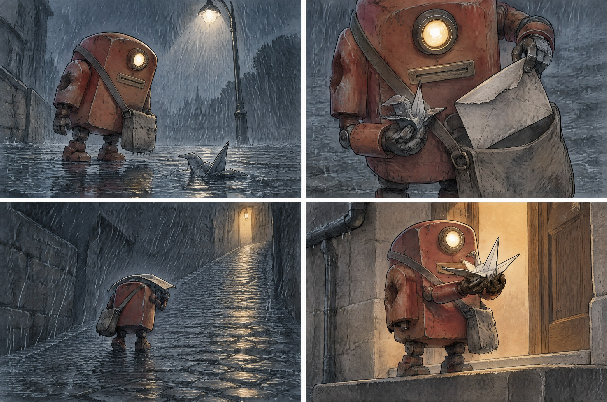

```text
A four-panel wordless comic, 3:2 landscape, arranged as two columns of two equal panels with even gutters,
reading left to right then top to bottom. Ink line with watercolour wash, consistent throughout. No text
of any kind.

STYLE
Loose confident ink linework with a fine nib, watercolour washes layered underneath, edges softening slightly
outside the lines. Cool grey-blue palette for the rain, warm amber for the lit interior. Paper texture visible
in the washes. Whites are left as raw paper. Nothing is digitally sharp or vector-clean.

THE CHARACTER — identical in all four panels
A small boxy postal robot, about knee height, with a rounded rectangular body in faded red paint with visible
scratches and a dent in the left flank, a single round lamp eye set high on the front, a small brass slot on
the chest, short articulated legs with flat feet, and a worn canvas mail satchel on a strap across its body.
Its proportions, paint wear and the dent must be in the same place in every panel.

THE STORY, four beats
Panel 1 — the discovery. Medium shot, low angle at the robot's eye level. Rain falls across the frame. The
robot stands on a wet pavement looking down at a small paper crane lying crumpled in a puddle, one wing
soaked through and dark. A single street lamp above and behind it throws a cold cone of light; the crane sits
just inside the light's edge.
Panel 2 — the protection. Close-up, from just above. The robot has lifted the crane clear of the water and is
holding it against its chest with one small articulated hand while it pulls a large used envelope out of the
satchel with the other. The envelope is already creased and its flap is torn. The robot's lamp eye is angled
down at the crane.
Panel 3 — the journey. Wide shot, from behind and slightly to the side. The robot walks away from us up a
steep wet cobbled lane toward a single warm light at the far end. It is holding the envelope arched over the
crane like a small roof; the crane is hidden underneath, only its folded tip visible. Rain streaks the frame
diagonally. The lane is empty and dark.
Panel 4 — the arrival. Medium close-up, from a low angle. The robot stands on a dry stone doorstep in front of
a warm amber doorway with a paper of light spilling out onto the wet step. It is holding the crane up with both
hands, offering it. The crane is dry and its folds have opened back into shape. The rain has stopped and only
drips from the gutter remain.

CONSISTENCY
The same robot, the same satchel, the same envelope once it appears, the same crane. Lighting is consistent
throughout: cold blue-grey for the rain in panels 1 to 3, warm amber for the doorway in panel 4. The paper
crane's condition progresses in one direction only — soaked in panel 1, dark and limp in panel 2 and 3, dry and
opened back into shape in panel 4.

CONSTRAINTS
No text anywhere: no dialogue, no captions, no sound-effect lettering, no signage, no page numbers, no
watermark, no signature. Do not add a title, a border beyond the gutters, or a gutter gutter label. Do not add
people, cats, cars, bins or other props. Do not let the robot's design change between panels, and do not mirror
its dent or its satchel strap between panels. Do not make the crane into a bird — it stays a folded paper object
in every panel.

```

Model: GPT Image 2.5 · Author: callirra-ai / GPT Image 2.5 Prompt Atlas

[Original source](https://github.com/callirra-ai/gpt-image-2-5-prompt-atlas/blob/7450bf6178d99756e62029fe4b1c8149d3f07bf0/cases/12-a-small-delivery/prompt.txt) · [Provenance and original license](data/projectd-batch-0011.json)

## Watercolor Coastal Town — Callirra Atlas · CC BY 4.0

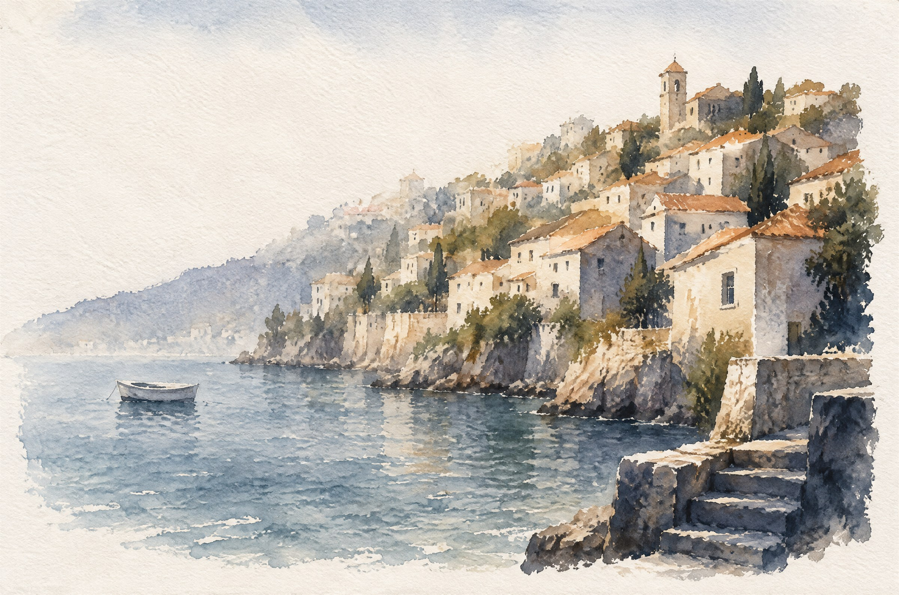

```text
A loose watercolour painting of a small coastal town on a steep hillside, on a 3:2 landscape sheet of rough
cold-pressed paper, painted from across the water at a low vantage point.

COMPOSITION
The town rises diagonally from the lower right to the upper left, filling the right two thirds of the sheet
with stacked whitewashed houses and terracotta roofs. To the left, a strip of harbour water occupies the lower
third and opens toward the upper left, where the paper is left almost entirely unpainted. In the immediate
foreground at the lower right, a short flight of worn stone steps and a low wall anchor the composition and are
painted darkest. A single small boat sits on the water at the middle left, very simply described, no rigging
detail. The sky is bare paper with one pale wash at the very top edge. No element touches the sheet's edges;
generous margins are left on all four sides.

WATERCOLOUR TECHNIQUE — this is the subject of the painting as much as the town is
Wet-in-wet for the sky and the water, so the two bleed into each other along a soft horizontal band. Wet-on-dry
for the roofs and the walls, so their edges stay crisp on the lit sides and soften on the shadowed ones. Where
two washes meet, one is allowed to bloom into the other and the granulation of the pigment settles visibly in
that boundary. Roof terracotta granulates into the wall below it in places. Several edges are deliberately lost:
the far end of the town dissolves into the sky with no line at all. The paper's tooth shows through every wash,
and a few small dry-brush skips appear where pigment was dragged across the grain. Whites are unpainted paper —
there is no white paint anywhere in the image.

PALETTE — four pigments only
A warm ochre, a burnt sienna for the roofs, a cool grey-blue for the water and distant hill, and one deep
indigo for the darkest notes in the foreground steps and the shadowed sides of two or three houses. Colours are
allowed to mix on the paper rather than on the palette, so the greys lean green in places and violet in others.

CONSTRAINTS
No people, no animals, no vehicles, no boats beyond the single one, no cranes, no washing lines with legible
laundry, no signage. No text, no signature, no stamp, no watermark. Do not tighten the painting: no hard
outlines around buildings, no evenly-filled shapes, no white body paint, no digital-looking gradients. Do not
paint every window — most house fronts are left as a single wash with one or two dark window marks only.

```

Model: GPT Image 2.5 · Author: callirra-ai / GPT Image 2.5 Prompt Atlas

[Original source](https://github.com/callirra-ai/gpt-image-2-5-prompt-atlas/blob/7450bf6178d99756e62029fe4b1c8149d3f07bf0/cases/13-watercolor-coastal-town/prompt.txt) · [Provenance and original license](data/projectd-batch-0011.json)

## Fictional 1936 Railway Poster — Callirra Atlas · CC BY 4.0

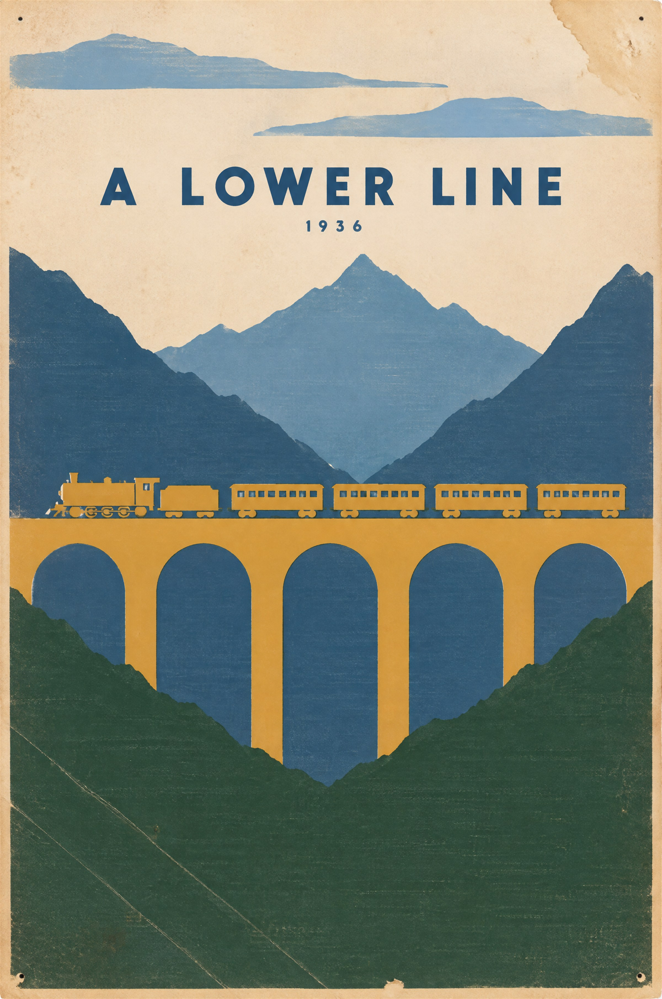

```text
A 1936 travel poster, 2:3 portrait, designed as a four-colour silkscreen print on aged poster stock and seen
perfectly flat and straight on — this is the printed sheet, not a photograph of one on a wall.

COMPOSITION
A steep mountain valley seen head-on, arranged in three flat bands. The lower band is the valley floor, a single
flat dark green. Above it, a tall viaduct crosses the full width on five arches, drawn as one flat ochre shape
with the arches cut out as negative space. On the viaduct, a passenger train in profile running left to right:
locomotive, tender and four carriages, reduced to their simplest readable silhouettes with no interior detail
and no visible windows, only a row of small rectangles along the carriages. Behind and above the viaduct, three
peaks rise in two flat blues, the nearer one darker. The sky is the paper colour left bare, with two long
horizontal clouds as single flat shapes. Vertical composition: the train sits on the upper third, the valley
floor occupies the lower quarter, and the peaks fill the space between.

TEXT — render exactly these two strings, each appearing once
"A LOWER LINE"
"1936"
Set "A LOWER LINE" in a bold geometric sans, all capitals, generously letter-spaced, centred in the band of
sky below the peaks; its width is about two thirds of the sheet's width. Set "1936" much smaller in the same
typeface, centred directly beneath it, at about one sixth of the title's height. No other text anywhere: no
route names, no station names, no prices, no small print, no printer's marks.

PRINT CHARACTER — deliberately imperfect
Four flat inks only: ochre, deep green, two blues, plus the paper. Each colour sits in its own solid shape with
hard edges and no gradients, no shading and no halftones. Registration is very slightly out on one or two
plates, so a thin sliver of paper shows along the left edge of the train's ochre and along the top edge of one
blue peak — under one millimetre and never enough to look broken. Ink is slightly uneven within a shape where
the screen was thin, with fine horizontal streaks visible in the largest flat areas. The paper is aged: a warm
off-white with light foxing at the corners, two soft handling creases running diagonally across the lower left,
a small water stain at the upper right that has very slightly lifted the blue, and a tiny nibbled loss at the
bottom edge. Four pinholes, one in each corner, sit just inside the margin.

CONSTRAINTS
No illustration style other than flat silkscreen: no painterly edges, no airbrush, no glow, no photo texture,
no 3D shading, no drop shadows. Do not add people, birds, trees with individual leaves, rocks, rivers, road
signs or a border. Do not paraphrase, re-case, hyphenate or translate the two strings, and do not add a
year, a place name or a slogan. No mockup: no wall, no frame, no shadow behind the sheet, no perspective tilt,
no tape or pins other than the four pinholes.

```

Model: GPT Image 2.5 · Author: callirra-ai / GPT Image 2.5 Prompt Atlas

[Original source](https://github.com/callirra-ai/gpt-image-2-5-prompt-atlas/blob/7450bf6178d99756e62029fe4b1c8149d3f07bf0/cases/14-1936-travel-poster/prompt.txt) · [Provenance and original license](data/projectd-batch-0011.json)

## Six-Motif Irezumi Flash Study — Callirra Atlas · CC BY 4.0

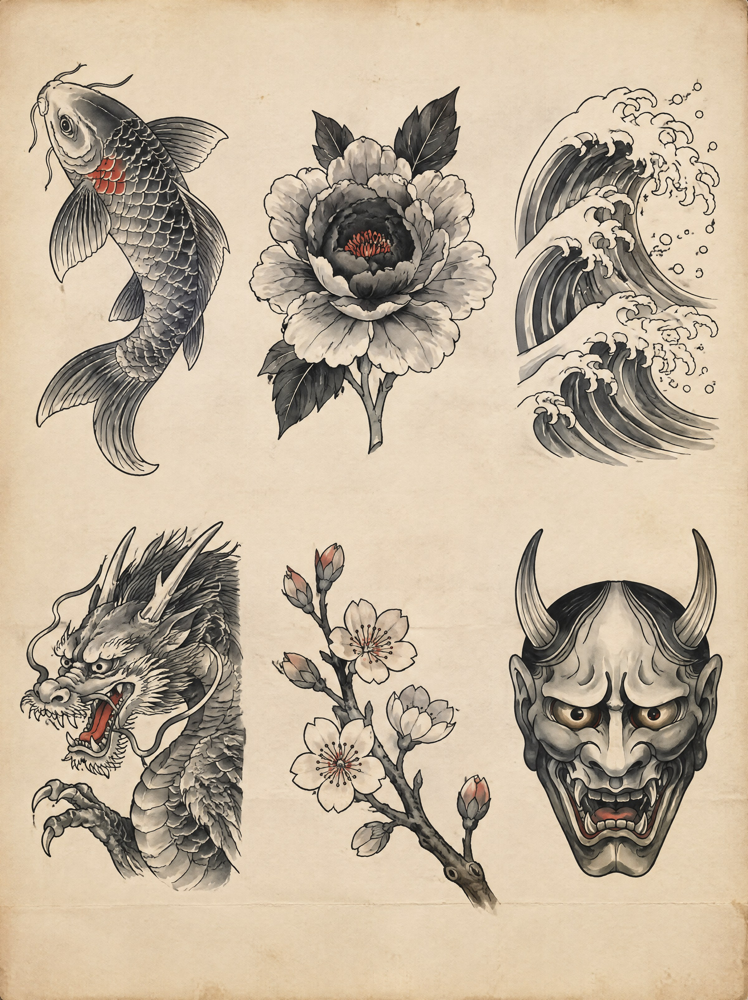

```text
A traditional Japanese tattoo flash sheet, 3:4 portrait, drawn in black sumi ink with grey wash and one accent
colour on a single aged sheet of off-white paper, flat and straight on.

SHEET
Six motifs arranged in a 3 by 2 grid with wide, even clear space between them and a generous margin on all four
sides. Each motif is a finished, self-contained design that could be lifted off the sheet and tattooed as it
stands. No boxes, no frames, no dividing rules, no shading behind the motifs. The paper is warm off-white with
a faint fibrous tooth, a soft crease across the lower third, and a very slight tea-coloured tone at the edges.

THE SIX MOTIFS, top row left to right then bottom row left to right
1. A koi carp swimming upward and to the left, body curved into a strong S, fins spread and filled with fine
   black lines, a few scales picked out individually near the shoulder and the rest left as graded grey wash.
2. A single open peony, petals layered from a pale outer ring to a dense dark centre, with two leaves behind it
   and one stem cut off square at the bottom.
3. A breaking wave drawn with clawed white crests in the traditional manner, the interior filled with a fine
   pattern of parallel curved lines and graded wash, the spray flicked outward at the top right.
4. A coiled dragon head and shoulder only, seen from the front-left, jaws open, whiskers sweeping back, one
   claw raised; the body is implied and cropped by the drawing's own edge, not by the sheet.
5. A cherry blossom branch entering from the lower right with five open blossoms at different stages and three
   closed buds, the branch drawn in a single confident stroke with two small knots.
6. A hannya mask, front on, horns curving back, eyes narrowed, mouth open to show pointed teeth, the cheeks
   graded from pale grey at the temples to near-black at the jaw.

INK AND WASH
Fine confident black linework with clear variation in weight: heavy on the outer contours, hair-fine on scales,
whiskers, petal veins and water lines. Mid-tones are built from even black wash in distinct flat gradations,
not smooth gradients — you can see the edges where one wash value meets the next. The only colour on the sheet
is a single vermilion accent, used sparingly and identically in each motif: one small area per design, never
more than about a tenth of it. Whites are untouched paper and are used as a designed element, not left over.

CONSTRAINTS
No text anywhere: no labels, no Japanese characters, no signature, no seal, no stamp, no numbers, no brand mark,
no watermark. Do not add background: no clouds, no water, no flowers behind the motifs. Do not merge two motifs
into one design and do not let one motif run into its neighbour's space. Do not use more than one accent colour,
do not fill large areas with it, and do not outline the motifs with a coloured line. Do not render as a 3D
illustration, a tattoo on skin, or a photograph of a sheet.

```

Model: GPT Image 2.5 · Author: callirra-ai / GPT Image 2.5 Prompt Atlas

[Original source](https://github.com/callirra-ai/gpt-image-2-5-prompt-atlas/blob/7450bf6178d99756e62029fe4b1c8149d3f07bf0/cases/15-irezumi-flash-sheet/prompt.txt) · [Provenance and original license](data/projectd-batch-0011.json)

## Skincare Serum Editorial Concept — Callirra Atlas · CC BY 4.0

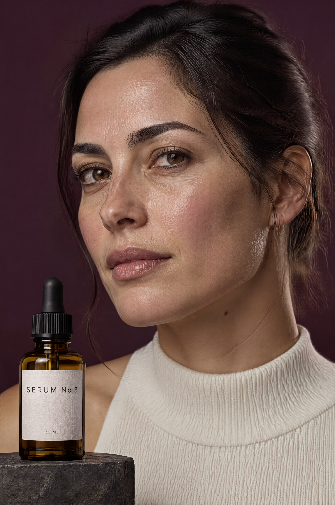

```text
A beauty editorial photograph, 2:3 portrait, a head-and-shoulders portrait with a skincare product standing in
the foreground on the same focal plane, shot in a studio against a deep plum seamless.

THE FACE
A woman of about thirty-five, head and shoulders in frame, turned about forty degrees to her left so three
quarters of her face is toward the camera, chin very slightly lowered, eyes looking just off the lens to the
left. Expression settled and unperformed — mouth closed and relaxed, no smile for the camera. Dark hair pulled
back off the face with a few loose strands at the temple and one at the jaw. Bare shoulders and a high-necked
fine-rib knit in off-white, the collar visible at the lower edge of the frame.

SKIN — the point of the picture
Real skin at close range: visible pores across the nose and inner cheeks, fine lines at the outer eye and
between the brows, a faint natural redness across the cheeks and chin, a few small freckles on the temple and
the bridge of the nose, one small mole below the left jaw, fine down on the jawline catching the light, and a
slight shine on the forehead, nose tip and upper lip — healthy, not greasy, and nowhere matte-flat. Skin tone is
even in tone but not in texture. No retouching, no smoothing, no pore-filling, no whitened sclera, no reshaped
features. The under-eye area keeps its real depth and colour.

PRODUCT
An amber glass dropper bottle, 30 ml, standing upright on a low dark stone plinth in the lower left foreground,
at the same focus plane as the face so both are sharp. Matte black dropper cap with a fine ribbed skirt, a
pipette bulb visible through the glass shoulder, the liquid inside a clear pale gold. A rectangular off-white
paper label wraps the front of the bottle, slightly proud at its edge, with a fine fibre texture. The bottle is
about a third the height of the face in frame and sits closer to the camera, lower in the picture.

EXACT VISIBLE TEXT — render exactly these two strings on the label, once each
"SERUM No.3"
"30 ML"
"SERUM No.3" is the larger, in a fine uppercase sans with wide letter spacing, sitting on the upper third of the
label. "30 ML" is much smaller, centred at the bottom of the label. Both must be crisp and correctly kerned. No
other text, numbers, symbols or marks appear anywhere in the frame.

LIGHT AND CAMERA
One large soft source from the front left at about forty-five degrees, close to the subject so the falloff is
gentle; one narrow strip light from behind on the right to rim the cheek, the jaw and the shoulder; one black
flag on the right to deepen the shadow side. The shadow side of the face keeps detail — it is deep, not blocked.
No fill from the front. Camera at eye level, 85 mm equivalent, head and shoulders, the top of the head inside
the frame with headroom, the collar cut by the lower edge. Shallow depth of field, but the eyes, the lips and
the label are all inside it.

COLOUR AND FINISH
Deep plum seamless background, one value, no gradient and no visible sweep edge. Palette is warm neutral skin
against cool plum, with the amber glass the only saturated element. Natural colour, slight film grain, no
coloured gels, no glow, no bloom.

CONSTRAINTS
No other products, no cotton pads, no flowers, no water droplets on the face, no jewellery, no visible hands or
fingers anywhere in the frame, no second figure. No invented claims, ingredient names, badges, awards, price
tags, barcodes or certification marks. Do not add text anywhere except the two strings above. Do not smooth,
lift, slim, widen or symmetrise the face. Do not make the skin plastic, waxy or uniformly matte. No watermark.

```

Model: GPT Image 2.5 · Author: callirra-ai / GPT Image 2.5 Prompt Atlas

[Original source](https://github.com/callirra-ai/gpt-image-2-5-prompt-atlas/blob/7450bf6178d99756e62029fe4b1c8149d3f07bf0/cases/16-editorial-beauty-portrait/prompt.txt) · [Provenance and original license](data/projectd-batch-0011.json)

## Camel Coat Fashion Lookbook — Callirra Atlas · CC BY 4.0

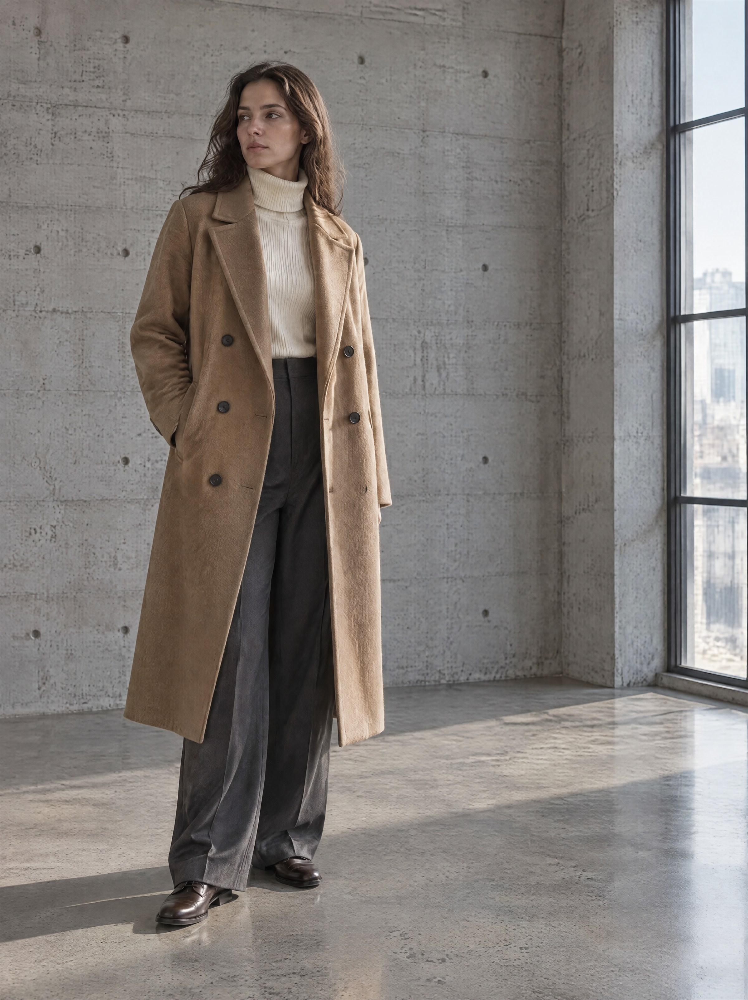

```text
A full-body fashion editorial frame, 3:4 portrait, shot in a stripped-back concrete studio in front of a single
large window, daylight only.

THE FRAME
Full body, head to feet, both feet inside the frame with clear floor beneath them and headroom above the head.
Camera at chest height, 50 mm equivalent, straight on, no tilt and no wide-angle distortion. The figure stands
just left of centre, turned about thirty degrees, leaving a wide column of empty concrete wall and window light
to the right. The floor is visible across the lower quarter. Nothing is cropped.

THE SUBJECT AND THE OUTFIT
A woman in her late twenties, about 175 cm, standing with her weight on the left leg, the right leg relaxed and
slightly forward, one hand pushed into the coat pocket so no fingers are visible anywhere in the frame, the
other arm hanging relaxed at her side with the hand mostly hidden behind the coat's edge. Chin level, gaze
directed off to the left of the lens, expression neutral and unperformed, mouth closed.

Outfit, in this order from the outside in: an oversized double-breasted wool coat in camel, cut long to mid-calf,
with wide notch lapels, horn buttons and a visible brushed nap; beneath it a fine-gauge ribbed knit in chalk
white with a high rolled neck; wide-leg wool trousers in charcoal with a single centre crease; low leather
derby shoes in dark brown, laced. The coat is worn open, hanging straight from the shoulders, so the knit and
the trouser waist are both visible. One shoulder of the coat sits slightly forward, as it would if a real
garment were worn open.

STUDIO AND LIGHT
A bare concrete studio: board-formed walls with visible horizontal formwork lines and a scatter of small tie
holes, a polished concrete floor with a faint sheen, one large steel-framed window occupying the right third of
the back wall. Daylight only, entering through that window from the right at a low morning angle, so the
subject is lit from her right side: the lit side of the coat shows the wool's nap and the shadowed side holds
detail without going black. Long soft-edged shadow of the figure falls to the left across the floor. No
artificial light, no fill, no reflector, no coloured light.

MATERIAL
Wool coat: brushed nap readable at this distance, edges of the lapel slightly lighter where the fibre catches
the light, one or two fine creases across the sleeve at the elbow. Rib knit: fine vertical ribs, a matte
surface, a soft fold at the neck. Trousers: smooth worsted wool with a crisp centre crease and a slight break
over the shoe. Leather shoes: scuffed toe, one clean highlight. Concrete: cold grey, matte, small aggregate
visible in the floor's polished sheen.

CONSTRAINTS
No visible hands, no fingers, no jewellery, no bag, no hat, no scarf, no second figure, no props, no furniture,
no plants. No text, no signage, no logo on the clothing, no watermark. Do not change the outfit's proportions,
do not shorten the coat, and do not turn it into a different garment. Do not add a background wall other than
the concrete described, and do not add a cyclorama or a studio backdrop paper. Do not pose the subject: no
hand on hip, no arm raised, no walk, no jump. Do not retouch the face or slim the body.

```

Model: GPT Image 2.5 · Author: callirra-ai / GPT Image 2.5 Prompt Atlas

[Original source](https://github.com/callirra-ai/gpt-image-2-5-prompt-atlas/blob/7450bf6178d99756e62029fe4b1c8149d3f07bf0/cases/17-fashion-lookbook-frame/prompt.txt) · [Provenance and original license](data/projectd-batch-0011.json)

## Brutalist Library Architecture Concept — Callirra Atlas · CC BY 4.0

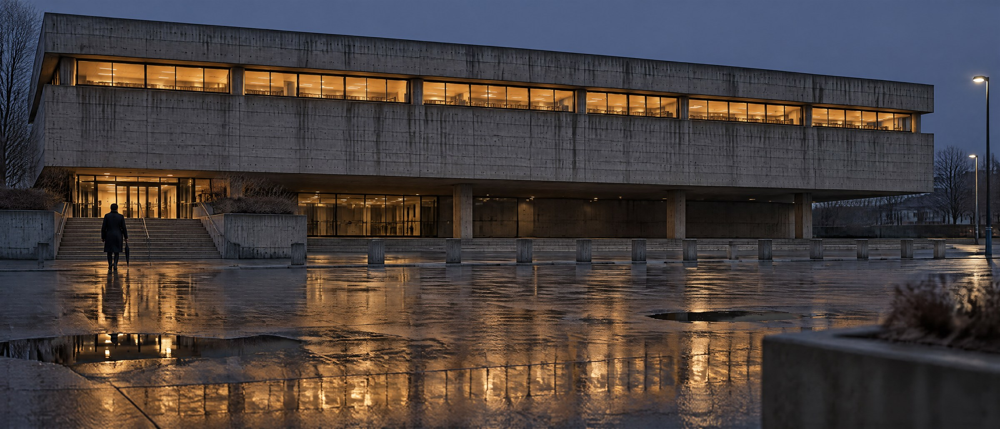

```text
A wide architectural photograph of a brutalist public library at dusk, 21:9, shot from across a wet plaza.

THE BUILDING
A long, low concrete volume, roughly five times as wide as it is tall, sitting heavily on a raised podium.
Its upper mass cantilevers out over a recessed ground floor, so a deep shadowed undercroft runs the full width
beneath it. The concrete is board-formed, with horizontal formwork lines running the entire length at even
spacing, a regular grid of small circular tie holes, and long vertical rain streaks staining the surface below
the parapet. A continuous band of clerestory glazing sits directly under the roof slab along the whole facade,
glowing warm from the interior lights inside. At the left end, a broad flight of concrete steps rises to the
entrance, flanked by two low concrete planters holding bare winter shrubs. The roof slab reads as a single
heavy horizontal line against the sky.

THE PLAZA
Wet dark paving across the lower half of the frame, holding long reflections of the glowing window band and of
the street lamps. Two shallow puddles with visible edges. A row of low concrete bollards runs across the middle
distance. A single steel handrail beside the steps. One street lamp at the far right, out of focus. In the
foreground, the corner of a concrete planter crops into the lower right of the frame, out of focus.

THE FIGURE
One person, small in the frame, walking away from the camera toward the entrance at the left, wearing a long
dark coat and carrying a closed umbrella. Their reflection stretches down into the wet paving beneath them.
They are the only person in the frame and they occupy roughly one fifteenth of the frame height.

LIGHT
Blue hour, after sunset, no sun. The dominant light comes from the building itself: the warm amber clerestory
band is the brightest thing in the picture and it is the source of every warm reflection on the wet plaza. Cool
blue-grey ambient sky light fills the concrete's upper surfaces and the far end of the plaza. Two street lamps
add small cold pools of light at the right. The two temperatures never blend — the concrete outside the window
band stays cold, the interior glow stays warm. Long soft shadows fall away from the building toward the camera.

CONSTRAINTS
No readable signage, no lettering on the building, no logos, no vehicle number plates, no advertising. Any
text-like mark must stay illegible: off-angle, out of focus or too distant to resolve, and it must never resolve
into invented words. No cars, no buses, no bicycles, no litter, no crowds and no second figure. No lens flare.
Do not straighten, tilt or perspective-correct the frame: keep the camera level and the verticals true. Do not
make the building glossy or reflective; concrete is matte everywhere except where it is wet. No watermark. Do
not add neon, coloured gels, mist or light beams.

```

Model: GPT Image 2.5 · Author: callirra-ai / GPT Image 2.5 Prompt Atlas

[Original source](https://github.com/callirra-ai/gpt-image-2-5-prompt-atlas/blob/7450bf6178d99756e62029fe4b1c8149d3f07bf0/cases/18-brutalist-library-at-dusk/prompt.txt) · [Provenance and original license](data/projectd-batch-0011.json)

## North Hall Coffee Identity Board — Callirra Atlas · CC BY 4.0

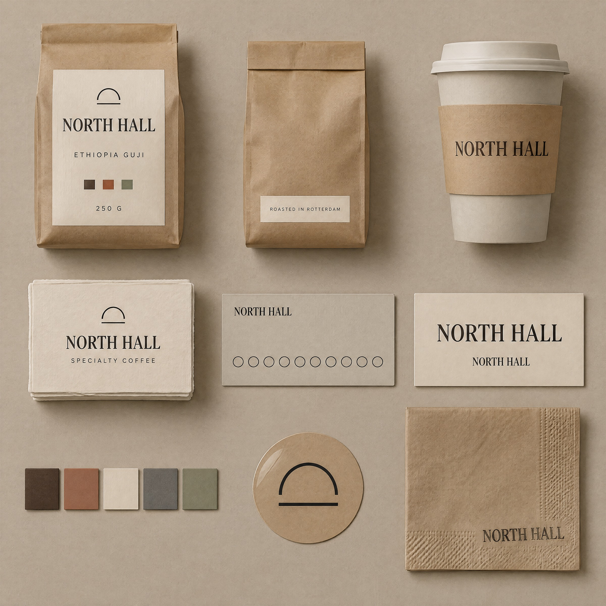

```text
A brand identity touchpoint board for a specialty coffee roaster, 1:1 square, presented as a studio flat lay
photographed from directly above: nine physical items arranged in a 3 by 3 grid on a warm greige paper
backdrop, evenly spaced, each item fully inside its own cell with clear air around it.

THE BRAND — identical on every item
The wordmark is the words "NORTH HALL" set in a single high-contrast serif, all capitals, with the two words on
one line separated by a single space, tracked tight. It appears on seven of the nine items and must be
letter-for-letter identical on all of them: same typeface, same weight, same letterforms, same proportions,
same spacing between the two words, and the same clear space around it equal to the height of the letter H on
every side. A small circular emblem — a thin-stroke arch over a horizontal line — sits above the wordmark on
packaging only, and is the same size relative to the wordmark wherever it appears.

THE NINE ITEMS, reading left to right then top to bottom
1. A 250 g kraft coffee bag, front on, with a cream label panel carrying the wordmark in the upper third and
   "ETHIOPIA GUJI" in a small wide-spaced sans beneath it, plus a row of three small filled squares at the
   bottom of the label indicating roast level.
2. The same bag seen from behind, filling less of its cell, showing a plain kraft back with a small cream
   patch carrying two lines of tiny type and a debossed fold line.
3. A stone-coloured takeaway cup standing with a printed kraft sleeve around its middle; the wordmark runs
   across the sleeve once, horizontally, at the sleeve's vertical centre.
4. A neat stack of thick cotton-rag business cards, the top card square to the camera, carrying the emblem and
   the wordmark centred, with "SPECIALTY COFFEE" in small wide-tracked capitals beneath it.
5. A slim loyalty card in the same stone colour, laying flat, with the wordmark small at the top left and a row
   of ten empty circular stamp positions across its lower half, none of them filled.
6. A type specimen strip: the wordmark set large in the centre of a narrow cream card, and directly beneath it
   the same wordmark at one third of the size, showing that the letterforms do not change with size.
7. Five colour chips in a row — deep espresso brown, clay terracotta, bone cream, slate grey, and one muted
   sage — each a small square with a narrow margin between them, no text on any chip.
8. A single die-cut vinyl sticker, cream on kraft, carrying only the emblem at a larger size, with no wordmark.
9. A folded kraft napkin with the wordmark stamped once in the lower right corner in slightly uneven ink, so
   the stamp's edges are a little soft and one corner of the impression is fainter than the rest.

MATERIAL AND LIGHT
One large soft source from the upper left, close to the set, so shadows fall down and to the right and are soft
and short. Materials must be distinguishable: matte uncoated kraft with visible fibre, thick cotton-rag card
stock with a deckled textured edge, matt laminated paper on the sleeve, and a slightly glossy vinyl sticker
catching one soft highlight. Slight top-down perspective flattening with no keystone distortion.

COLOUR
The palette is limited to the five chips: deep espresso, clay terracotta, bone cream, slate grey and muted sage.
Kraft brown is the substrate, not a palette colour.

CONSTRAINTS
The wordmark must be spelled exactly "NORTH HALL" everywhere it appears, with no variation, no alternate
spelling, no translated version and no second logo. Render only these five strings and no others: "NORTH HALL",
"ETHIOPIA GUJI", "SPECIALTY COFFEE", "ROASTED IN ROTTERDAM", "250 G". Do not add taglines, tasting notes,
weights, prices, awards, certifications, recycling symbols, barcodes, QR codes or any other text. Do not add
a tenth item, a plant, a cup of coffee, beans, a hand or a prop. Do not repeat an item in two cells. Do not
rotate the items: everything is square to the camera. No watermark.

```

Model: GPT Image 2.5 · Author: callirra-ai / GPT Image 2.5 Prompt Atlas

[Original source](https://github.com/callirra-ai/gpt-image-2-5-prompt-atlas/blob/7450bf6178d99756e62029fe4b1c8149d3f07bf0/cases/19-coffee-brand-touchpoint-board/prompt.txt) · [Provenance and original license](data/projectd-batch-0011.json)

## Fictional Fintech Dashboard Mockup — Callirra Atlas · CC BY 4.0

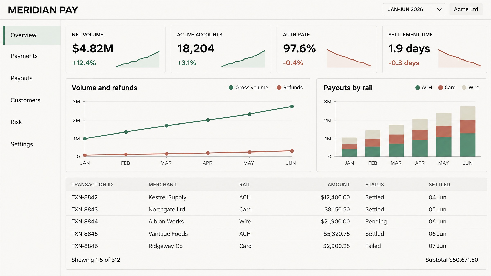

```text
A fintech operations dashboard, 16:9, screen only — a flat rectangular interface shown straight on with no
device, no desk, no hand and no perspective. This is a UI mock with real committed data, not a photograph.

LAYOUT — fixed regions, no overlap
- Top bar, 9% of the frame height: product name at the left, the date-range control and one account chip at the
  right, and a single hairline rule closing the bar across the full width.
- Left rail, 15% of the frame width: six navigation items stacked with even spacing. The first is active, marked
  by a 3 px accent bar on its left edge and a tinted row background.
- Main area, to the right of the rail, split into three stacked panels with even gaps: KPI row 24% of the main
  height, charts row 36%, table panel 40%.
- KPI row: four equal tiles side by side, each with its label above its value, its value above its delta, and
  one small sparkline at the tile's right edge.
- Charts row: a line chart at 62% of the row width and a stacked bar chart at 38%, with one gutter between them.
- Table panel: a six-column table with a header row, five data rows and a footer line.
- Every panel sits on a flat ground with a 1 px border. No drop shadows anywhere.

DATA — this must be internally consistent, and the arithmetic must close
- Net volume: $4.82M, up 12.4%, sparkline rising left to right.
- Active accounts: 18,204, up 3.1%, sparkline rising left to right.
- Auth rate: 97.6%, down 0.4%, sparkline falling left to right.
- Settlement time: 1.9 days, down 0.3 days, sparkline falling left to right.
  Each delta's sign must agree with the direction its own sparkline moves. All four sparklines appear.
- The line chart has exactly two series, each with a legend entry, and no legend entry without a series.
- The five table amounts below sum to exactly $50,671.50, which is the figure stated in the table footer.

EXACT VISIBLE TEXT — render exactly these strings
- Product name: "MERIDIAN PAY"
- Date range: "JAN-JUN 2026"
- Account chip: "Acme Ltd"
- Navigation, top to bottom: "Overview" / "Payments" / "Payouts" / "Customers" / "Risk" / "Settings"
- KPI tile 1: "NET VOLUME" then "$4.82M" then "+12.4%"
- KPI tile 2: "ACTIVE ACCOUNTS" then "18,204" then "+3.1%"
- KPI tile 3: "AUTH RATE" then "97.6%" then "-0.4%"
- KPI tile 4: "SETTLEMENT TIME" then "1.9 days" then "-0.3 days"
- Line chart title: "Volume and refunds"; its legend entries: "Gross volume" and "Refunds"
- Line chart x-axis ticks, left to right: "JAN" "FEB" "MAR" "APR" "MAY" "JUN"
- Line chart y-axis: four labelled ticks ascending bottom to top: "0", "1M", "2M", "3M"
- Bar chart title: "Payouts by rail"; its legend entries: "ACH", "Card", "Wire"
- Table headers, in order: "TRANSACTION ID" "MERCHANT" "RAIL" "AMOUNT" "STATUS" "SETTLED"
- Table rows, in order:
  "TXN-8842" "Kestrel Supply" "ACH" "$12,400.00" "Settled" "04 Jun"
  "TXN-8843" "Northgate Ltd" "Card" "$8,150.50" "Settled" "05 Jun"
  "TXN-8844" "Albion Works" "Wire" "$21,900.00" "Pending" "06 Jun"
  "TXN-8845" "Vantage Foods" "ACH" "$5,320.75" "Settled" "06 Jun"
  "TXN-8846" "Ridgeway Co" "Card" "$2,900.25" "Failed" "07 Jun"
- Table footer: "Showing 1-5 of 312" at the left and "Subtotal $50,671.50" at the right

TYPOGRAPHY
One UI sans throughout, five sizes only: page-level product name, KPI value, panel title, table and axis text,
and small labels. Numerals are tabular. The AMOUNT column is right-aligned; all other columns are left-aligned.
KPI values are right-aligned within their tiles. All text is horizontal.

RENDERING
Flat interface rendering: no photographic lighting, no reflections, no glass, no bevels, no gradients. Ground
"#FBFAF8", body text "#1C1B19", one accent "#3D6B4F" used only for the active nav bar, the positive deltas and
the primary chart series; negative deltas in a muted "#B4442E". Hairline borders in "#E3DFD8". A 1 px grid of
faint horizontal rules in the table only.

CONSTRAINTS
Render only the strings listed above. Do not invent a metric, a merchant, a transaction, a menu item, a column,
a tooltip, a notification badge or a footnote. Do not use lorem ipsum, "TBD", "xx,xxx" or placeholder dashes.
Every chart must have both labelled axes and legend entries that match the series actually drawn. No two table
rows may share a transaction ID and no value may repeat verbatim in two rows of the same column. No browser
chrome, no OS status bar, no notch, no cursor, no selection highlight, no watermark. Do not round or reformat
any figure, and do not change a single digit.

```

Model: GPT Image 2.5 · Author: callirra-ai / GPT Image 2.5 Prompt Atlas

[Original source](https://github.com/callirra-ai/gpt-image-2-5-prompt-atlas/blob/7450bf6178d99756e62029fe4b1c8149d3f07bf0/cases/20-fintech-dashboard/prompt.txt) · [Provenance and original license](data/projectd-batch-0011.json)

## Three-Screen Mobile Onboarding Concept — Callirra Atlas · CC BY 4.0

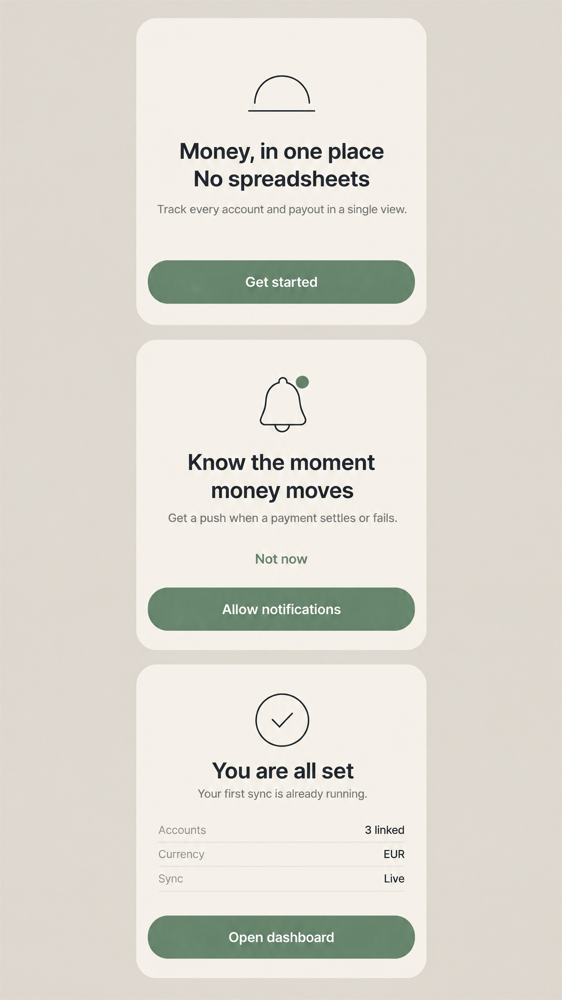

```text
A mobile app onboarding set, 9:16 portrait, presented as three phone screens stacked vertically on a soft warm
greige background with even gaps between them, shown straight on with no perspective and no hand.

THE THREE SCREENS, top to bottom
- Each screen is a rounded rectangle at the same size and the same width, occupying about 30% of the frame
  height each, their left and right edges aligned to one vertical axis so the stack reads as a single column.
- Each screen shows its content only: no device bezel, no notch, no camera cutout, no status bar, no home
  indicator, no browser chrome. The rounded corners are the only indication that these are screens.

SCREEN 1 — welcome
A small thin-stroke emblem centred in the upper third: an arch over a horizontal line. Below it, a two-line
headline centred. Below that, one short supporting line centred in a lighter weight. At the bottom, a single
full-width primary button with rounded ends, filled in the accent colour, with its label centred.

SCREEN 2 — notifications
A simple line illustration centred in the upper third: a rounded bell with a single small dot badge at its upper
right, drawn with the same thin stroke as the emblem on screen 1. Below it, a two-line headline centred and one
supporting line. At the bottom, the same full-width primary button, and directly above it one text-only
secondary link centred in the accent colour.

SCREEN 3 — complete
A centred mark in the upper third: a thin-stroke circle with a simple check inside it. Below it, a short
headline of four words centred, one supporting line, and a small three-row summary list — each row a label at
the left and a value at the right, separated by faint rules. At the bottom, the same full-width primary button.

EXACT VISIBLE TEXT — render exactly these strings, once each, in the screen stated
- Screen 1 headline line 1: "Money, in one place"
- Screen 1 headline line 2: "No spreadsheets"
- Screen 1 supporting line: "Track every account and payout in a single view."
- Screen 1 button: "Get started"
- Screen 2 headline line 1: "Know the moment"
- Screen 2 headline line 2: "money moves"
- Screen 2 supporting line: "Get a push when a payment settles or fails."
- Screen 2 button: "Allow notifications"
- Screen 2 secondary link: "Not now"
- Screen 3 headline: "You are all set"
- Screen 3 supporting line: "Your first sync is already running."
- Screen 3 summary row labels, top to bottom: "Accounts", "Currency", "Sync"
- Screen 3 summary row values, top to bottom: "3 linked", "EUR", "Live"
- Screen 3 button: "Open dashboard"
No other text anywhere — no page dots, no step counters, no "1 of 3", no version numbers, no legal line, no
watermark.

STYLE AND MATERIAL
A light, warm, quiet interface. Ground is a warm off-white; body text is near-black; one accent colour, a muted
green, used only for the three primary buttons, the secondary link and the small bell badge. Type is one
geometric sans throughout, in exactly four sizes: headline, supporting line, button label, and the small
summary rows. Rounded rectangles with generous internal padding. Buttons are flat fills with no gradient, no
shadow and no border. Thin line illustrations use a single stroke weight throughout and no fills except the
bell badge.

CONSTRAINTS
No dark mode, no glassmorphism, no neon, no gradient meshes, no photographic imagery, no product screenshots
inside the screens, no charts or graphs on any screen. Do not add a fourth screen, a floating card, a tooltip,
a notification banner, an avatar or a logo other than the emblem described. Do not rotate, tilt or perspective
the screens. Do not paraphrase, re-case or re-punctuate any string, and do not add a full stop that is not
written above. No watermark, no signature, no frame around the whole set.

```

Model: GPT Image 2.5 · Author: callirra-ai / GPT Image 2.5 Prompt Atlas

[Original source](https://github.com/callirra-ai/gpt-image-2-5-prompt-atlas/blob/7450bf6178d99756e62029fe4b1c8149d3f07bf0/cases/21-mobile-onboarding-flow/prompt.txt) · [Provenance and original license](data/projectd-batch-0011.json)

## Orbital Observation Deck Concept — Callirra Atlas · CC BY 4.0

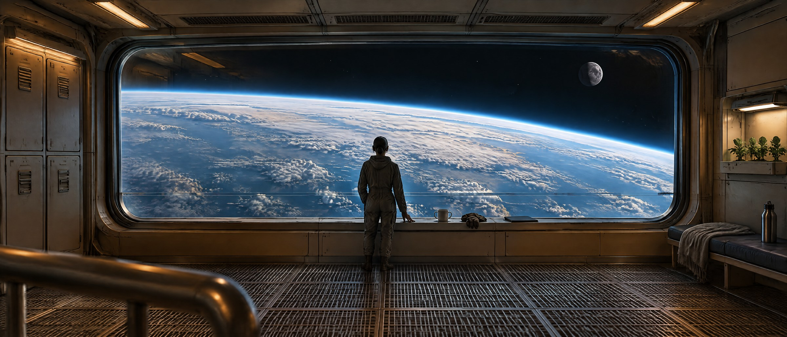

```text
An interior photograph from inside an orbital station's observation deck, 21:9, looking out through a huge
curved window at the limb of a planet. Shot on a wide lens from the back of the deck so the window frame, the
interior and the view all read at once.

THE WINDOW
The window is the far wall: a single curved pane about four metres tall and twelve wide, held in a deep
structural frame. The frame is heavy and layered — an outer structural rib, then a primary seal, then an inner
trim panel — and every layer is visible in section where it meets the glass. Running horizontally across the
glass at waist height is one thin defroster wire, and at its lower edge a narrow metal sill. The glass itself
is not perfectly clear: a faint double reflection of the interior lights sits across its upper left, and where
the deck's warm light is brightest the glass picks up a soft haze.

THE VIEW
A planet limb fills the lower two thirds of the window, seen from low orbit: a curved horizon running from the
lower left to the middle right, cloud bands layered in soft horizontal streaks, and a deep blue ocean under
broken cloud toward the terminator. Above the horizon, a thin bright arc of atmosphere — a single luminous
line of pale blue-white — separates the planet from the black of space. Above that, space is almost black with
a very sparse scatter of stars, no more than thirty visible in the whole pane. In the upper right of the
window, one small airless moon, a plain grey disc with visible craters along its lower edge, no larger than a
thumbnail at this distance.

THE DECK
The interior is compact and functional. In the foreground, low and slightly out of focus, the top rail of a
steel handrail crosses the lower left. Along the left wall, four equipment lockers with louvred vents and
plain recessed latches. On the ceiling, two continuous strips of warm light running the length of the deck,
their housings visible. The floor is open steel grating. Against the right wall, a narrow upholstered bench
with a folded grey blanket and one steel water bottle. In a recessed tray beside the window, a shallow
hydroponic unit with four small green plants under a single small grow lamp. On the sill by the window, one
ceramic mug, a pair of work gloves and a hand-held tablet lying face down.

THE FIGURE
One person, standing at the centre of the window with their back to camera, small in the frame — about one
ninth of the frame height — silhouetted against the planet, wearing a soft grey flight suit with the hood down,
one hand resting on the sill. No other person anywhere.

LIGHT
Two sources only. Inside: the warm amber ceiling strips, which light the deck, the lockers, the bench and the
figure's shoulders from above and behind, and put a warm reflection across the upper left of the glass.
Outside: the cold blue-white light of the planet, which rims the window frame from beyond and lights nothing
inside the deck. The two temperatures never mix: interiors stay amber, the planet stays cold, and the figure is
read as a silhouette because the outside is brighter than the inside.

CONSTRAINTS
No text anywhere: no signage, no labels on the lockers, no warning placards, no numbers, no stencilled
lettering, no readable screens, no watermark. Do not add a second figure, a spaceship, a satellite, a docking
bay, a spacecraft passing by, or a laser. No lens flare, no light beams, no god rays. Do not make space purple,
do not add nebulae or coloured stars, and do not fill the window with debris. Keep the verticals of the window
frame true and the horizon a genuine curve, not a straight line. No HUD overlays, no targeting reticles, no
graphics layered over the view.

```

Model: GPT Image 2.5 · Author: callirra-ai / GPT Image 2.5 Prompt Atlas

[Original source](https://github.com/callirra-ai/gpt-image-2-5-prompt-atlas/blob/7450bf6178d99756e62029fe4b1c8149d3f07bf0/cases/22-station-observation-deck/prompt.txt) · [Provenance and original license](data/projectd-batch-0011.json)

## Dragon on a Ruined Tower — Callirra Atlas · CC BY 4.0

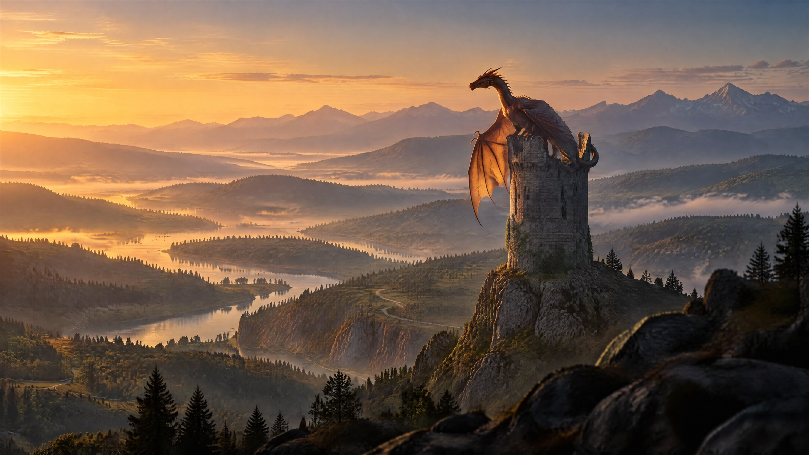

```text
A wide fantasy landscape painting, 16:9, of a dragon perched on the broken crown of a ruined stone tower at
golden hour, seen from a distance across a valley so that scale reads before detail does.

THE TOWER
A single round tower of dark weathered stone, standing on a rocky spur in the middle distance, its upper third
collapsed: the crown is broken open on the near side, the wall's cross-section showing rubble core and double
skins of squared masonry. Two merlons survive on the far side; the rest is a stepped ruin. A spiral of narrow
windows runs up the shaft, dark and empty. Ivy climbs the lower third. The tower is roughly one sixth of the
frame height, and it is the only building in the picture.

THE DRAGON
Perched on the broken crown, gripping the shattered stone with four clawed feet, tail curled around the
remaining merlon. It is long and lean rather than bulky, with a serpentine neck and a narrow head, and its
near wing is half-spread and half-folded, drooping down the outside of the tower so its tip hangs in open air.
The far wing is folded along the back. Its head is turned in profile to the left, looking out down the valley.
Its total body length is about twice the tower's width, so it reads as large without dominating the frame.

THE VALLEY
Below and beyond the tower, a broad valley recedes in five or six distinct layers of depth: a foreground ridge
in near-black silhouette at the lower right; the spur and the tower; a middle distance of wooded slopes in
muted green; a wide river catching the light as a pale ribbon; a far range of hills in cool blue-grey; and a
final band of distant peaks reduced almost to haze. Three separate layers of low mist lie in the folds between
ridges, each flat-bottomed and each paler than the layer behind it. A single narrow road winds through the
middle distance with two tiny switchbacks; no vehicles and no travellers are visible on it.

LIGHT — this is the whole picture
The sun is out of frame to the left and very low, just above the horizon line behind the far hills. It throws
warm amber light almost horizontally: every left-facing surface catches it, every right-facing surface falls
into cool shadow, and the shadows run long toward the right. The dragon is rim-lit along the top of its neck,
the leading edge of its wing and the whole length of its tail. The sun's disc itself is not visible; only its
glow behind the haze of the far range. The mist layers catch the light so each one is warm at its top edge and
cool underneath. The sky above the hills moves from warm amber at the horizon through pale gold to a cool
blue-grey at the top of the frame.

WING MEMBRANE
Where the near wing is spread against the light, the membrane between the fingers is translucent: the low sun
passes through it, showing the vein structure as darker lines, and the sky behind glows through the thinner
areas. Where the membrane overlaps the body, it is opaque and in shadow. This contrast is the brightest and
most delicate thing in the picture and must be clearly readable.

CONSTRAINTS
One dragon only, one tower only. No rider, no saddle, no harness, no army, no village, no castle, no second
ruin. No text, no banners with lettering, no heraldry, no signature, no watermark. Do not put the sun's disc in
frame, do not add lens flare, do not add fire or smoke from the dragon. Do not make the dragon metallic or
armoured; it is a scaled animal with leathery wings. Do not flatten the valley into two layers, and do not
place the horizon at the centre of the frame.

```

Model: GPT Image 2.5 · Author: callirra-ai / GPT Image 2.5 Prompt Atlas

[Original source](https://github.com/callirra-ai/gpt-image-2-5-prompt-atlas/blob/7450bf6178d99756e62029fe4b1c8149d3f07bf0/cases/23-dragon-on-a-ruined-tower/prompt.txt) · [Provenance and original license](data/projectd-batch-0011.json)

## Wizard Study Environment Concept — Callirra Atlas · CC BY 4.0

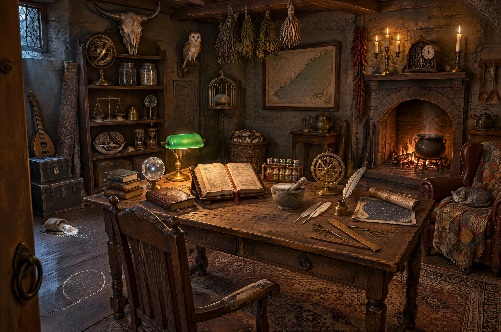

```text
A dense interior painting of a wizard's study, 3:2, seen from standing height at the doorway looking in, lit by
lamplight and a fire. This is a maximalist picture: every surface is occupied and the eye should find something
new on the fourth look. Forty-four separate objects are listed below and all forty-four must appear.

THE ROOM
A stone-walled study about four metres square, one small deep-set leaded window high on the left wall with the
night beyond it, a low arched fireplace on the right wall, a timber ceiling with exposed joists, and a floor of
worn dark boards partly covered by a threadbare patterned rug.

THE DESK — twelve objects
1. A long oak desk across the middle of the room, its surface scarred and ink-stained.
2. A brass desk lamp with a green glass shade, lit, throwing a warm pool onto the desk.
3. An open leather grimoire on a wooden cradle, its pages yellowed, one red silk ribbon.
4. A second closed book with brass corner pieces and a clasp, lying flat.
5. A stack of three smaller books at different angles.
6. A crystal ball on a brass ring stand, one bright point of light inside it.
7. A stone mortar with green residue in it and its pestle laid across the rim.
8. A rack of nine small glass vials, each holding a different coloured liquid.
9. A brass astrolabe with visible graduated rings.
10. A scroll in an open leather tube, with a corner of a star chart unrolled beside it.
11. A quill standing in a brass inkwell, and two loose quills lying beside it.
12. A pair of brass dividers resting on a wooden ruler.

THE LEFT SHELF WALL — nine objects
13. A tall open-fronted shelf unit leaning against the left wall.
14. A mounted armillary sphere on a wooden base.
15. The horned skull of a large animal, hung on the wall above the shelf.
16. A glass jar of dried beetles.
17. A glass jar of pale root slices.
18. A brass balance scale with its pan and four stacked weights.
19. A magnifying lens on a turned handle.
20. A small hourglass, half run through.
21. A chipped ceramic bowl holding three large seed pods.

THE FIREPLACE AND HEARTH — eight objects
22. The low arched fireplace with a live fire banked low, glowing embers visible.
23. A black iron cauldron on a three-legged trivet, steam rising from it.
24. A long iron poker and a pair of tongs leaning against the stone.
25. A stack of split firewood in a wicker basket beside the hearth.
26. A string of dried red peppers hanging on the wall beside the chimney.
27. A brass candelabra with three candles, all lit.
28. A single tall wax candle standing in a holder on the mantel.
29. A broken mantel clock, its face open, its hands stopped.

THE CEILING AND CORNERS — seven objects
30. A rack of dried herbs hanging head-down from a ceiling joist.
31. A bundle of dried roots suspended beside them.
32. A wicker basket of mushrooms on the floor beneath the herbs.
33. A birdcage on a stand with a small sleeping songbird inside.
34. An owl perched on a wall bracket, awake and watching.
35. Cobwebs filling the upper right corner.
36. Dust suspended in the shaft of light falling from the high window.

THE FLOOR AND FURNITURE — eight objects
37. A tall-backed wooden chair with one elbow worn through, pulled back from the desk.
38. A wingback armchair beside the fire with a patchwork blanket on it.
39. A grey cat asleep in the armchair.
40. A small iron-bound chest against the wall, its lid closed.
41. A padlocked strongbox sitting on top of the chest.
42. A lute leaning in the far corner beside the window.
43. A spilt pile of white salt on the boards, swept halfway into a drift.
44. A chalk diagram, half erased, drawn on the boards beside the desk.

WALLS AND FURNISHINGS
A framed chart of an unfamiliar coastline hangs on the wall behind the desk. A heavy tapestry, rolled and
leaning in the corner, its colours faded. A rack of long wooden spoons and a small teapot on a side table.

LIGHT AND PALETTE
Three sources only: the lamp with its warm green-tinted pool on the desk; the fire, low and orange, from the
right; and one cold shaft of moonlight through the high window, striking the floor and the board wall on the
left. Each source keeps its own colour and its own shadow direction: lamp from above the desk, fire from the
right at knee height, moon from upper left. The palette is warm — amber, oak, brass, deep greens and blacks —
with the cold moon shaft and the crystal ball's point as the only cool notes.

CONSTRAINTS
All forty-four listed objects must be present, each visible and identifiable, and no object may appear twice.
No text anywhere: no legible lettering on any book page, spine, chart, clock face or label, and no runes,
sigils or symbols anywhere. Do not add a second person; the room is empty of people. Do not add a second cat,
a second owl or a second bird. Do not add hanging chains, floating objects, spell effects, glowing runes or any
magical light. No watermark. Keep the room believable: every object rests on a surface or hangs from a fixing,
and nothing floats.

```

Model: GPT Image 2.5 · Author: callirra-ai / GPT Image 2.5 Prompt Atlas

[Original source](https://github.com/callirra-ai/gpt-image-2-5-prompt-atlas/blob/7450bf6178d99756e62029fe4b1c8149d3f07bf0/cases/24-wizards-study/prompt.txt) · [Provenance and original license](data/projectd-batch-0011.json)

## Hydroelectric Dam Explainer Layout — Callirra Atlas · CC BY 4.0

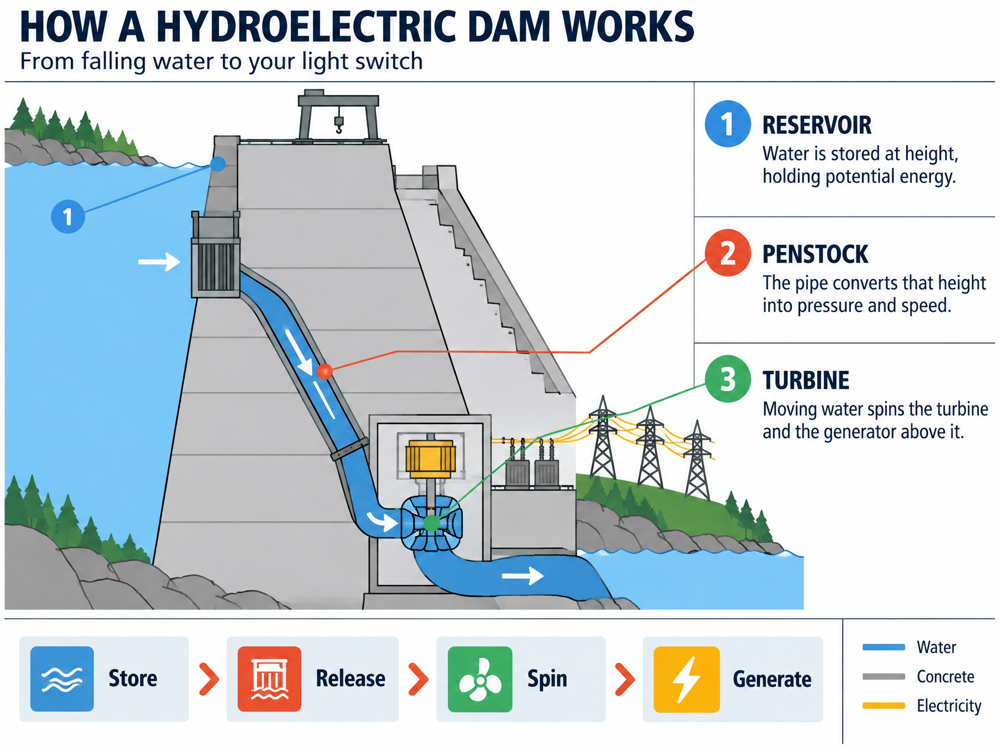

```text
A fixed-zone explainer infographic, 4:3 landscape, titled "How a Hydroelectric Dam Works", drawn as flat vector
art with no photograph, no 3D render and no perspective beyond the cutaway.

ZONE 1 — TITLE BAND, top 12% of the frame height
The title "HOW A HYDROELECTRIC DAM WORKS" set left aligned in a bold condensed sans, all capitals, with the
subtitle "From falling water to your light switch" beneath it in a lighter weight at roughly a third of the
title's size. A single hairline rule closes the band across the full width.

ZONE 2 — MAIN DIAGRAM, left 62% of the width, from below the title band down to the process strip
A cutaway cross-section of a concrete gravity dam seen from the side, with the reservoir behind it on the left
and the river valley below on the right. Within this zone:
- The reservoir: a large body of water filling the left third, its surface a flat pale blue, with a shoreline
  of rock and pine trees along its upper edge.
- The dam wall: a massive grey concrete wedge, widest at the base, with visible horizontal construction
  joints. Its crest carries a low parapet and a gantry crane on rails.
- The intake: a rectangular opening in the dam's upstream face just below the waterline, with a trash rack of
  vertical bars across it and a steel gate above it.
- The penstock: a thick steel pipe running down through the body of the dam at a steep angle, drawn in
  section so its wall thickness reads, ending at the turbine below.
- The powerhouse: a rectangular hall cut into the base of the dam on the downstream side, containing a
  vertical turbine and, directly above it on the same shaft, a cylindrical generator.
- The draft tube: a curved widening passage carrying water away from the turbine out into the river.
- The switchyard: two transformers and a row of insulators on a flat platform beside the powerhouse, with
  three transmission pylons stepping away to the right.
- The spillway: a separate overflow channel at the dam crest on the right, dry, with a stepped chute.
Water direction is shown by five small white arrows: into the intake, down the penstock, through the turbine,
out of the draft tube and away downstream.

ZONE 3 — CALLOUT COLUMN, right 34% of the width, beside the diagram
Three stacked panels of equal height, each with a coloured circular number badge at its top left, one line of
bold label text, and two lines of smaller explanatory text beneath. A thin leader line runs from each badge to
its element in the diagram, and no leader crosses another.

ZONE 4 — PROCESS STRIP, bottom 16% of the frame height, full width beneath both columns
Four equal boxes in a row, each with a coloured square icon at its left and one short label to the right of it,
joined by three right-pointing chevrons between the boxes.

ZONE 5 — LEGEND, bottom right corner, inside the process strip's row
Three legend entries stacked vertically, each with a short coloured line sample at the left and one short label
beside it.

EXACT VISIBLE TEXT — render exactly these strings, once each
- Title: "HOW A HYDROELECTRIC DAM WORKS"
- Subtitle: "From falling water to your light switch"
- Callout 1 label: "RESERVOIR" and its text: "Water is stored at height, holding potential energy."
- Callout 2 label: "PENSTOCK" and its text: "The pipe converts that height into pressure and speed."
- Callout 3 label: "TURBINE" and its text: "Moving water spins the turbine and the generator above it."
- Process boxes, left to right: "Store" / "Release" / "Spin" / "Generate"
- Legend entries, top to bottom: "Water" / "Concrete" / "Electricity"
No other text anywhere: no units, no measurements, no capacity figures, no equations, no logos, no watermark.

STYLE
Flat vector illustration: solid fills, uniform hairline outlines, no gradients, no drop shadows, no texture.
Background flat white. Palette: concrete grey, water blue, a warm amber for electricity, and one accent colour
used only on the three number badges and the three chevrons. One neutral sans throughout, in exactly four
sizes: title, subtitle, labels, and explanatory text.

CONSTRAINTS
Exactly three callouts, exactly four process boxes, exactly three legend entries, exactly five direction
arrows, exactly three pylons. Every leader line must end on the element it names and must not cross another
leader, a callout panel or any part of the diagram. Do not add a second dam, a fish ladder, a boat, a person,
a bird, a road or a town. Do not put text on any part of the diagram itself. Do not use 3D shading, isometric
projection or perspective.

```

Model: GPT Image 2.5 · Author: callirra-ai / GPT Image 2.5 Prompt Atlas

[Original source](https://github.com/callirra-ai/gpt-image-2-5-prompt-atlas/blob/7450bf6178d99756e62029fe4b1c8149d3f07bf0/cases/25-five-zone-explainer/prompt.txt) · [Provenance and original license](data/projectd-batch-0011.json)

## Sixteen-Pose Character Contact Study — Callirra Atlas · CC BY 4.0

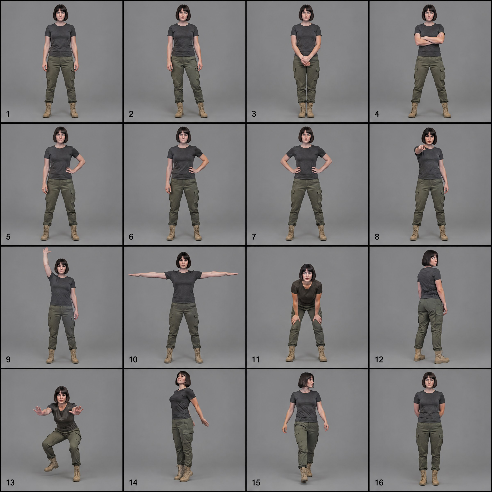

```text
A character pose contact sheet, 1:1 square, sixteen panels in a 4 by 4 grid with even gutters and a thin dark
outer border. Each panel shows the same person in a different standing pose, photographed on a plain mid-grey
seamless with flat even lighting. This is a reference sheet, not a beauty photograph.

THE CAMERA — identical in all sixteen panels
One camera, one position, never varied: eye level at 60% of the figure's height, straight on, 85 mm equivalent,
no wide-angle distortion, no tilt, no zoom change, no perspective change between panels. Because the camera and
the distance never move, the ground line falls at exactly the same height in all sixteen panels and the top of
the head falls at exactly the same height in all sixteen panels. The figure is centred horizontally in every
panel with even margins left and right, and the feet are inside the panel in all sixteen.

THE CHARACTER — identical in all sixteen panels
A woman of about thirty, athletic build, medium height. Short dark hair cut to the jaw with a blunt fringe, a
thin scar on her LEFT forearm about four centimetres long, and a small mole on her RIGHT cheekbone. She wears
a plain charcoal cotton t-shirt with a crew neck, olive cargo trousers with a single pocket flap on the LEFT
thigh only, and tan canvas boots laced to the ankle. Her clothing, hair, scar and mole must be identical in
every panel, and the pocket flap must stay on the left thigh in all sixteen — it must never appear on the right.

THE SIXTEEN POSES, reading left to right then top to bottom
1. Neutral stance, feet shoulder-width apart, arms hanging at her sides.
2. Weight on the left leg, right knee slightly bent and relaxed, arms at her sides.
3. Feet together, hands clasped in front of her at waist height.
4. Feet apart, arms folded across her chest.
5. Left hand on her hip, right arm hanging down.
6. Right hand on her hip, left arm hanging down.
7. Both hands on her hips, elbows out, feet apart.
8. Left arm raised forward, pointing at chest height, right arm down.
9. Right arm raised straight up above her head, left arm down.
10. Both arms raised out to the sides at shoulder height, palms down.
11. Leaning forward from the hips, both hands resting on her thighs.
12. Standing turned a quarter away, looking back over her right shoulder.
13. Half crouch, knees bent, weight low, both arms held forward.
14. Standing up on the balls of both feet, heels off the ground, arms swung back.
15. Right foot forward a full stride, torso twisted to the left, arms loose.
16. Standing straight, both hands clasped behind her back.

PANEL NUMBERS
A small numeral in the bottom left corner of each panel, reading 1 to 16 in order, all the same size and in the
same position within their panels. These numerals are the only text on the sheet.

LIGHTING
One large soft source directly in front of the figure and slightly above, plus a soft fill from both sides, so
the lighting is even and flat and identical in all sixteen panels. One short soft shadow directly beneath each
figure, the same shape and length everywhere. No dramatic lighting, no coloured light, no rim light, no change
of exposure between panels.

CONSTRAINTS
All sixteen panels are present and all sixteen poses are different. No sitting, kneeling, lying, jumping or
airborne pose: both feet are on the ground in every panel. Do not hide the feet, do not crop the head, and do
not let the figure leave the panel. Do not mirror the character's asymmetric details between panels — the scar
stays on the left forearm and the mole stays on the right cheekbone in all sixteen. Do not add props, weapons,
bags, hats, furniture or a background other than the plain seamless. No text anywhere except the sixteen panel
numerals, and no number larger than 16.

```

Model: GPT Image 2.5 · Author: callirra-ai / GPT Image 2.5 Prompt Atlas

[Original source](https://github.com/callirra-ai/gpt-image-2-5-prompt-atlas/blob/7450bf6178d99756e62029fe4b1c8149d3f07bf0/cases/26-sixteen-pose-contact-sheet/prompt.txt) · [Provenance and original license](data/projectd-batch-0011.json)

## Retro Pixel-Style Town at Dusk — Callirra Atlas · CC BY 4.0

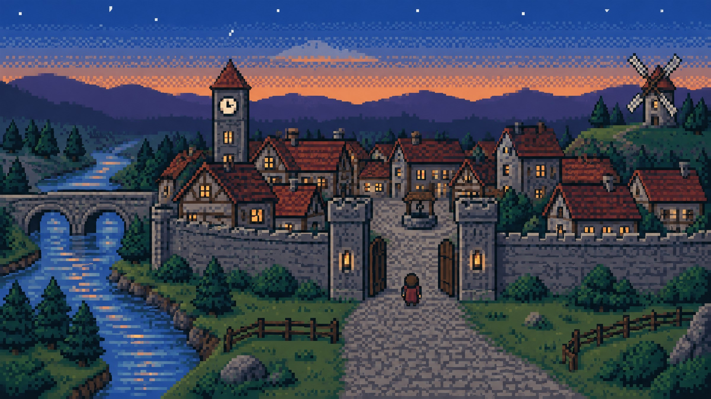

```text
Pixel art in the style of a 16-bit console role-playing game, 16:9 landscape, showing a small walled town at
dusk seen from a slight raised angle, as a single game screen.

THE PIXEL GRID — this is the whole style
The image is built from large, visible square pixels at one consistent size across the entire frame, roughly the
scale of a 320 by 180 pixel image enlarged for display. Every edge in the picture is a hard staircase of whole
pixels: there is no anti-aliasing, no sub-pixel smoothness, no soft blending and no blurred edge anywhere.
Diagonal edges step in visible blocks. Curves are chunky. Nothing in the image is smaller than one pixel, and
nothing has a detail finer than the pixel grid. Colour transitions happen by dithering — ordered checkerboard
and scattered-dot patterns of two palette colours — never by a smooth gradient.

PALETTE — exactly twenty-four colours and no more
A dusk palette of twenty-four fixed colours: four blues for the sky, two deep purples for the far hills, three
greens for foliage, two browns for wood and earth, three greys for stone and the road, four warm ambers and
oranges for lit windows and lanterns, one off-white for highlights, one near-black for outlines and one muted
red for roof tiles. Every colour in the image is one of these twenty-four; no colour is blended, faded or
tinted outside the palette.

THE TOWN
A low stone wall with a square gatehouse runs across the middle of the frame, the gate standing open. Behind it,
fifteen or so small buildings with steeply pitched red-tiled roofs crowd together along two narrow streets;
windows are small and most of them are lit warm amber. A square tower with a single clock face stands above the
roofs at the left, and a windmill turns slowly on a low hill at the right. A cobbled road enters through the
gate and runs toward the viewer, widening in the foreground. A stone well with a wooden frame stands in the
small square just inside the gate.

THE LANDSCAPE
Behind the town, three stepped bands of hills recede in increasingly dark purples, undulating rather than
smooth. On the far left, a river runs down from the hills and passes under a two-arch stone bridge, its surface
drawn as horizontal bands of two blues with dithered highlights, and it catches a few dither-speckled glints of
the dying light. Three conical pine trees stand on the near bank and four on the far bank, all the same size
and drawn from the same four or five pixels of shape.

THE SKY
Late dusk: the sky is a vertical gradient built entirely from dithered bands of the four blues, from a deeper
blue at the top to a warm orange band at the horizon, with no smooth blend anywhere. Eight small stars are
placed in the upper third, each a single off-white pixel with no glow. One low cloud sits in the middle of the
sky, a flat two-colour shape with a dithered lower edge.

THE FIGURE
A single small sprite of a traveller stands on the cobbled road just inside the gate, facing away from the
viewer. The sprite is about twelve pixels tall, drawn from the same palette, with a visible dark outline around
its whole silhouette. It is the only figure in the scene and casts no shadow.

CONSTRAINTS
The whole image must read as pixel art, not as a photograph or painting with a pixel filter applied over it:
no photographic texture, no painted brushwork, no smooth gradients, no 3D rendering, no depth of field. No text
anywhere: no signposts, no shop signs, no town name, no window lettering, no watermark. Do not add a second
figure, animals, carts, vehicles, laundry, banners or smoke. Do not add modern elements. Keep the horizon
straight and place it in the upper third of the frame.

```

Model: GPT Image 2.5 · Author: callirra-ai / GPT Image 2.5 Prompt Atlas

[Original source](https://github.com/callirra-ai/gpt-image-2-5-prompt-atlas/blob/7450bf6178d99756e62029fe4b1c8149d3f07bf0/cases/27-16bit-town-at-dusk/prompt.txt) · [Provenance and original license](data/projectd-batch-0011.json)

## Retro Airbrush Science-Fiction Paperback Concept — Shuryne · MIT

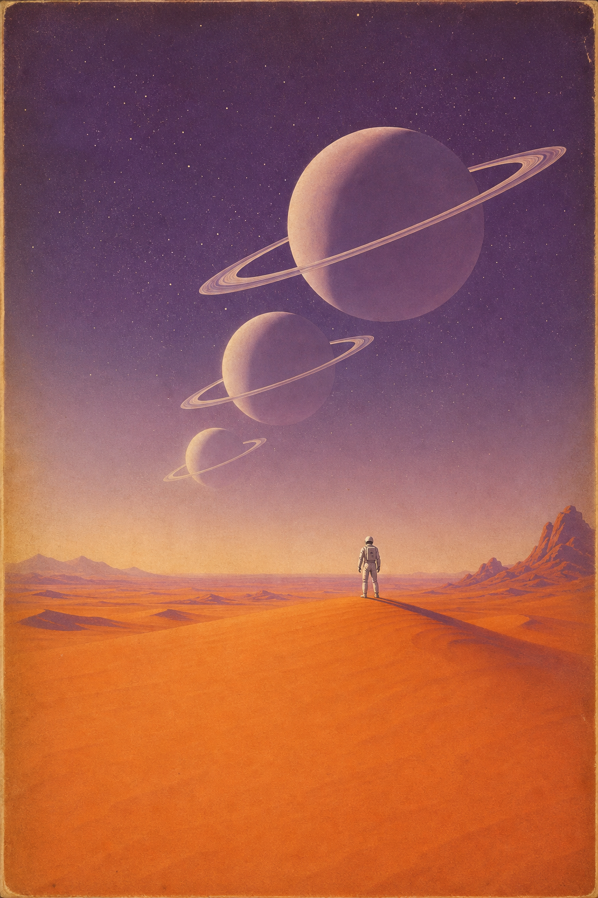

```text
A 1970s science fiction paperback cover painted with an airbrush. A lone figure in a white suit stands on an orange dune field, dwarfed by three impossible ringed moons in a graduated violet sky. Perfectly smooth airbrushed gradients meet crisp frisket-cut edges, with tiny hand-flicked white star spatter and a soft atmospheric haze at the horizon. Chrome highlights are rendered as hard-edged white slivers. Slightly faded ink and visible paper yellowing. A wide empty foreground is reserved for absent cover type.

```

Model: GPT Image 2 · Author: Shuryne / gpt-image-prompts contributors

[Original source](https://github.com/Shuryne/gpt-image-prompts/blob/4c53ea3708c2447a9c87b0a24cc77abf86c3aa7b/prompts/airbrush-retro-scifi-paperback.md) · [Provenance and original license](data/projectd-batch-0011.json)

## Imaginary Coast Antique Map Illustration — Shuryne · MIT

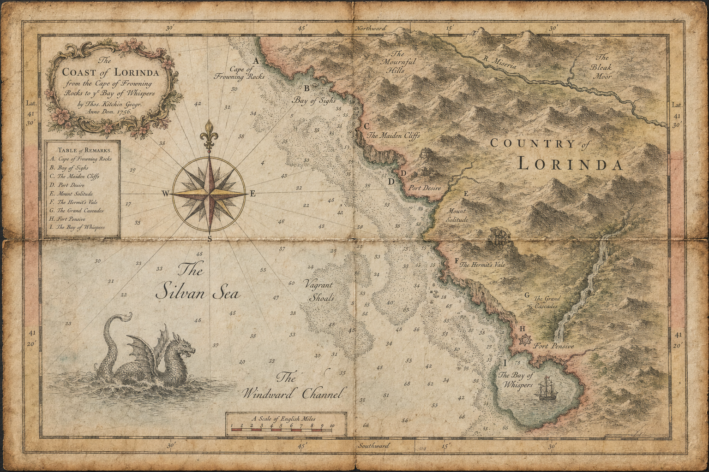

```text
A hand-drawn antique map of an imaginary coastline, engraved and hand-tinted. Fine copperplate etched linework for the shore, with dense parallel hachures indicating inland hills and stippled shoals offshore. Pale watercolor washes in faded ochre, sage and rose sit slightly outside the plate lines. A decorative compass rose, a sea monster in the empty ocean, and invented place names in copperplate italic script. Aged laid paper with visible chain lines, one horizontal fold crease, and browned edges.

```

Model: GPT Image 2 · Author: Shuryne / gpt-image-prompts contributors

[Original source](https://github.com/Shuryne/gpt-image-prompts/blob/4c53ea3708c2447a9c87b0a24cc77abf86c3aa7b/prompts/antique-map-imaginary-coast.md) · [Provenance and original license](data/projectd-batch-0011.json)

## Art Nouveau Absinthe Poster Concept — Shuryne · MIT

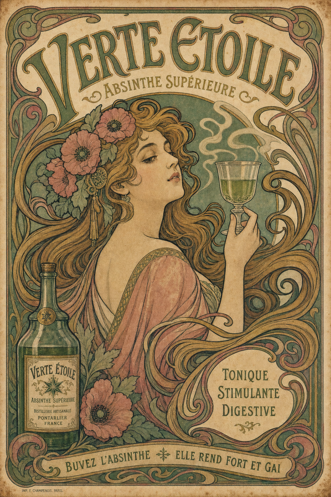

```text
An Art Nouveau lithograph poster advertising an absinthe brand. A woman with flowing hair rendered in flat color fields, her tresses dissolving into stylized whiplash curves that frame the composition and become the border. Heavy confident black contour lines of varying weight, four-color stone lithography with slight visible misregistration and a subtle stipple in the flat areas. Muted sage green, dusty rose, cream and gold. Ornamental hand-drawn display lettering arches above her head. Aged paper tone with faint foxing at the corners.

```

Model: GPT Image 2 · Author: Shuryne / gpt-image-prompts contributors

[Original source](https://github.com/Shuryne/gpt-image-prompts/blob/4c53ea3708c2447a9c87b0a24cc77abf86c3aa7b/prompts/art-nouveau-absinthe-poster.md) · [Provenance and original license](data/projectd-batch-0011.json)

## Birthday Table for One Narrative Pastel — Shuryne · MIT

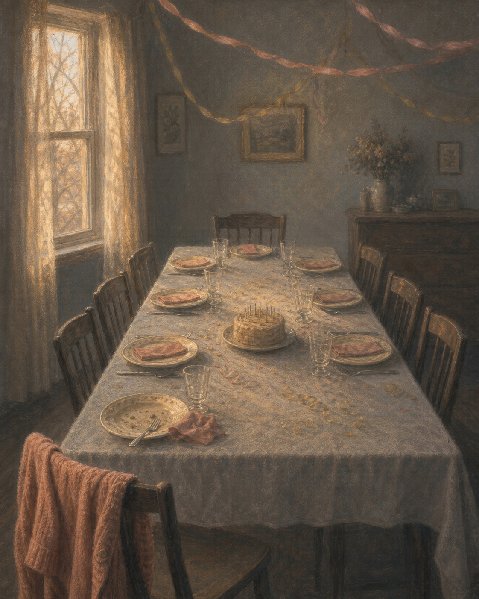

```text
A soft pastel still life of a long dining table laid for eight, photographed from one end of the room. Eight places are set with folded napkins and untouched glasses; a cake with candles burned down to stubs sits at the centre. Only one place has been used, its chair pulled out and a chair-back cardigan slumped over it. Streamers hang slack. Chalk laid on toothed paper so the pits stay dark, warm ochre and faded rose against a cool grey room, edges deliberately lost into the corners. Late afternoon light, unsentimental and quiet.

```

Model: GPT Image 2 · Author: Shuryne / gpt-image-prompts contributors

[Original source](https://github.com/Shuryne/gpt-image-prompts/blob/4c53ea3708c2447a9c87b0a24cc77abf86c3aa7b/prompts/birthday-table-for-one.md) · [Provenance and original license](data/projectd-batch-0011.json)

## Impossible Blue Bookshop Door Illustration — Shuryne · MIT

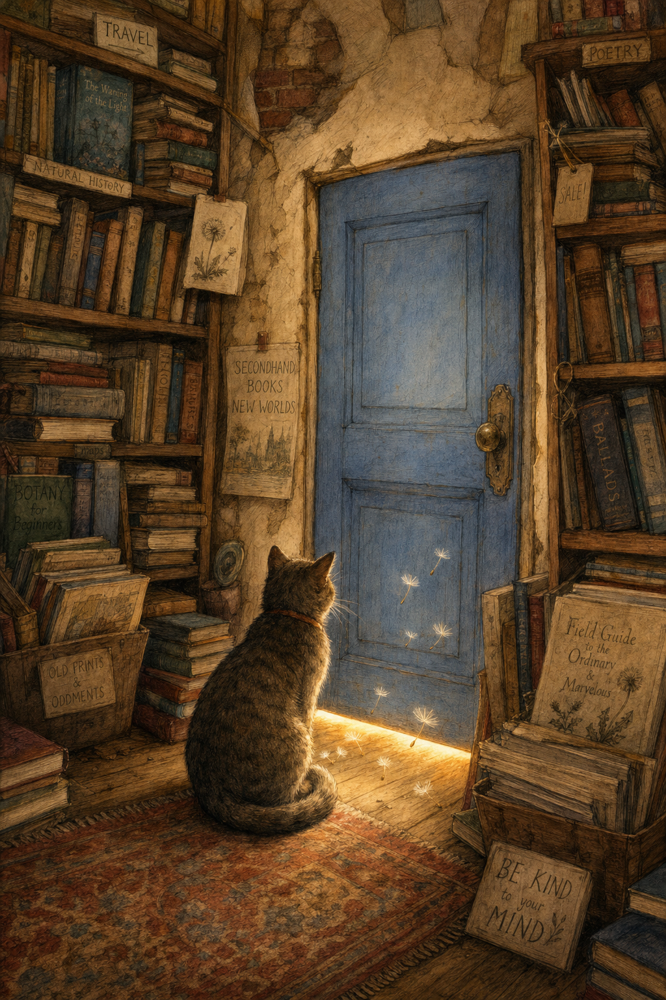

```text
A children's book illustration in colored pencil and watercolor, showing the back corner of a cramped secondhand bookshop. Between two overloaded shelves stands a small door that clearly does not belong to the building, painted a faded cornflower blue, with warm golden light and a few drifting dandelion seeds escaping from the gap beneath it. The shop cat sits squarely in front of it, tail curled, entirely calm. Fine layered pencil hatching over soft wet-in-wet washes, warm dusty palette with one cool blue accent. Cosy, curious, gently impossible.

```

Model: GPT Image 2 · Author: Shuryne / gpt-image-prompts contributors

[Original source](https://github.com/Shuryne/gpt-image-prompts/blob/4c53ea3708c2447a9c87b0a24cc77abf86c3aa7b/prompts/bookshop-door-that-shouldnt-be.md) · [Provenance and original license](data/projectd-batch-0011.json)

## Eucalyptus Botanical Watercolor Study — Shuryne · MIT

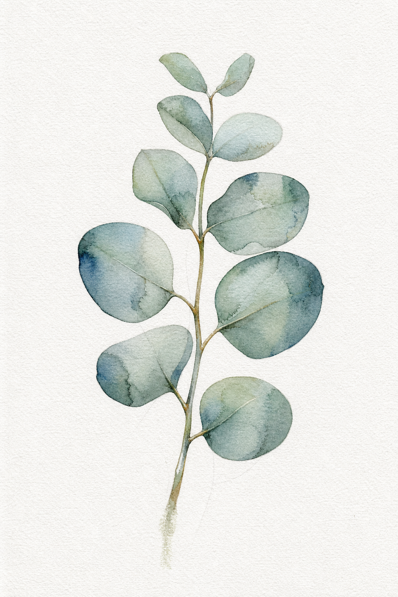

```text
A botanical watercolor study of a single eucalyptus sprig on cold-press paper, centered with wide white margins. Soft sage and dusty blue pigments pool at the leaf edges, a faint pencil under-drawing shows through, and the stem fades to dry brush at the bottom. Delicate granulating washes, visible paper tooth, translucent layering, subtle backruns, no ink outlines, botanical illustration accuracy.

```

Model: GPT Image 2 · Author: Shuryne / gpt-image-prompts contributors

[Original source](https://github.com/Shuryne/gpt-image-prompts/blob/4c53ea3708c2447a9c87b0a24cc77abf86c3aa7b/prompts/botanical-watercolor.md) · [Provenance and original license](data/projectd-batch-0011.json)

## Resting Dancer Chalk-Pastel Study — Shuryne · MIT

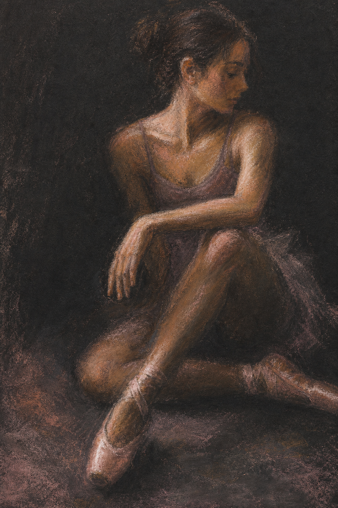

```text
A soft pastel drawing of a dancer resting between rehearsals, drawn on black textured paper. The chalk sits on the raised tooth of the sheet and leaves the pits dark, so every stroke breathes. Warm ochre and rose skin tones are built in broken layers with the black ground doing the shadow work, and a few decisive white highlights land on the collarbone and the arch of the foot. Edges are deliberately lost into darkness on the left. Visible smudging from the heel of the hand, loose and unfinished.

```

Model: GPT Image 2 · Author: Shuryne / gpt-image-prompts contributors

[Original source](https://github.com/Shuryne/gpt-image-prompts/blob/4c53ea3708c2447a9c87b0a24cc77abf86c3aa7b/prompts/chalk-pastel-dancer.md) · [Provenance and original license](data/projectd-batch-0011.json)

## Older Fisherman Charcoal Portrait Study — Shuryne · MIT

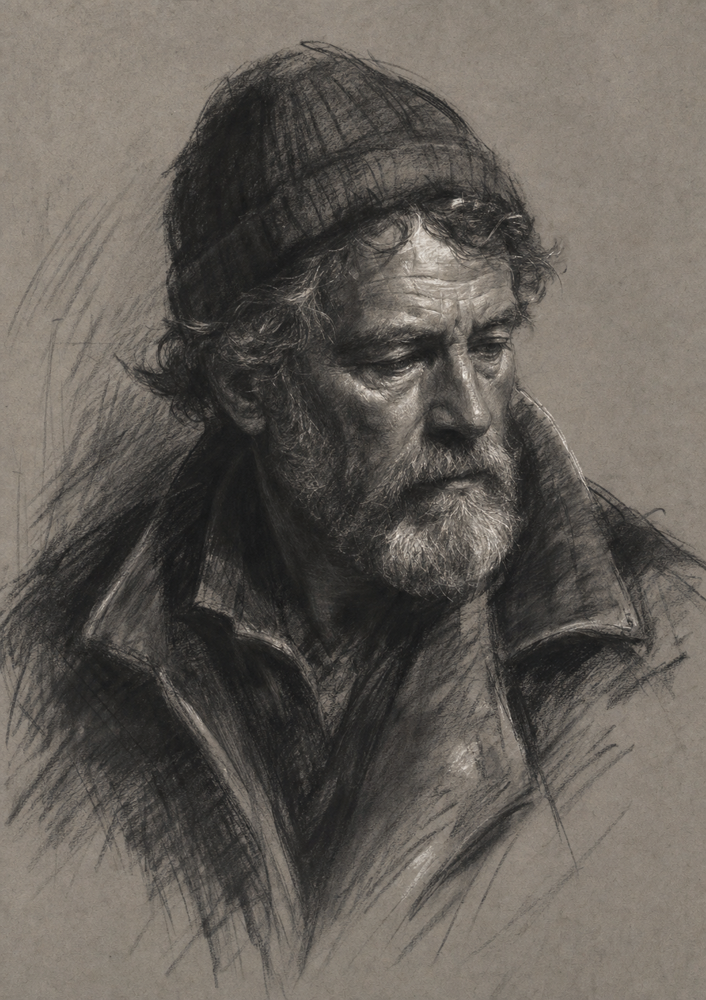

```text
A charcoal portrait study of an older fisherman on toned grey paper, three-quarter view looking slightly down. Deep compressed-charcoal darks in the coat and hair, white chalk highlights on the cheekbone and brow, mid-tone paper left bare across the background. Vigorous directional hatching, smudged blended transitions, visible eraser lifts, loose unfinished edges at the shoulders, expressive academic life-drawing quality.

```

Model: GPT Image 2 · Author: Shuryne / gpt-image-prompts contributors

[Original source](https://github.com/Shuryne/gpt-image-prompts/blob/4c53ea3708c2447a9c87b0a24cc77abf86c3aa7b/prompts/charcoal-portrait-study.md) · [Provenance and original license](data/projectd-batch-0011.json)

## Information Overload Editorial Collage — Shuryne · MIT

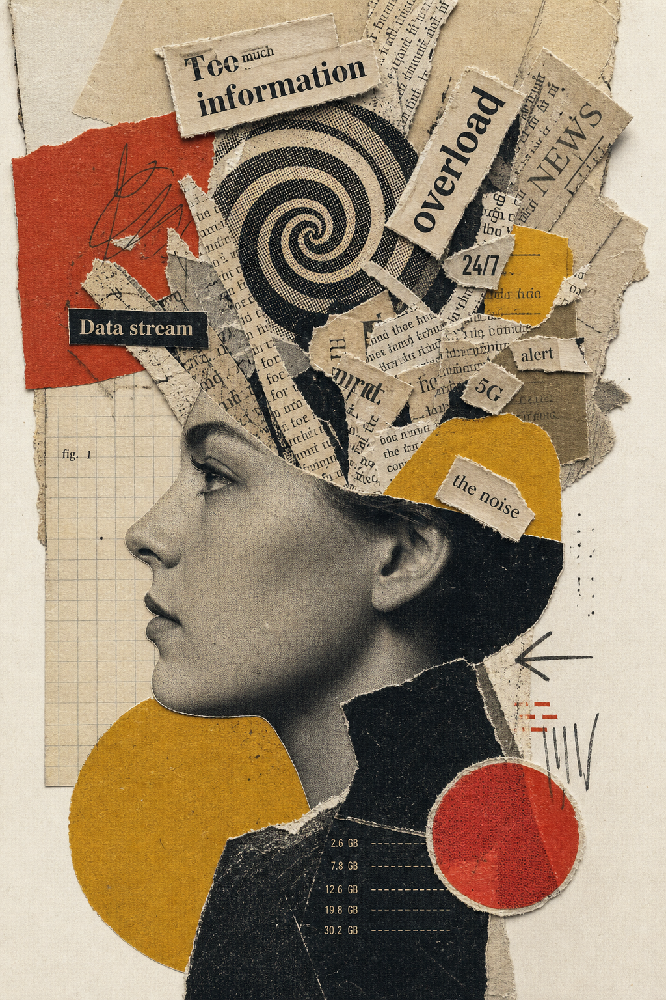

```text
A mixed-media collage editorial illustration about information overload. A cut-out vintage photograph of a human head in profile is overlaid with torn newspaper strips, a halftone-printed spiral, hand-cut geometric shapes in mustard and red, and a fragment of graph paper. Rough torn paper edges with visible fibre, slight drop shadows suggesting physical layering, muted archival palette, deliberate misregistration, magazine editorial art direction.

```

Model: GPT Image 2 · Author: Shuryne / gpt-image-prompts contributors

[Original source](https://github.com/Shuryne/gpt-image-prompts/blob/4c53ea3708c2447a9c87b0a24cc77abf86c3aa7b/prompts/collage-editorial-mind.md) · [Provenance and original license](data/projectd-batch-0011.json)

## Fern Herbarium Cyanotype-Style Illustration — Shuryne · MIT

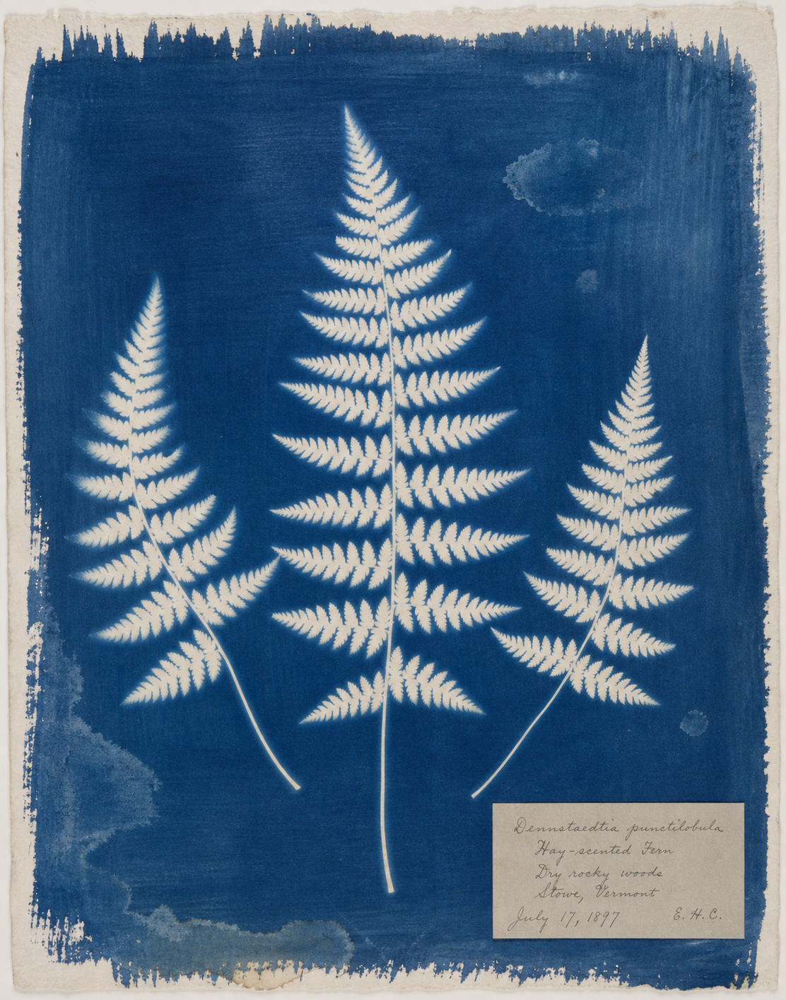

```text
A cyanotype photogram of three fern fronds arranged as a herbarium specimen on heavy watercolor paper. Deep Prussian blue ground where UV struck the emulsion, ghost-white silhouettes where the fronds blocked it, with soft bleeding halos along every pinnule edge. The brush-coated emulsion leaves visible streaks and a ragged dark border; faint bronzing and pale wash-out patches record the water rinse. A handwritten pencil label sits in the lower right corner. Flat even lighting, no cast shadows, sharp botanical detail.

```

Model: GPT Image 2 · Author: Shuryne / gpt-image-prompts contributors

[Original source](https://github.com/Shuryne/gpt-image-prompts/blob/4c53ea3708c2447a9c87b0a24cc77abf86c3aa7b/prompts/cyanotype-fern-herbarium.md) · [Provenance and original license](data/projectd-batch-0011.json)

## Open Desert Motel Film-Poster Concept — Shuryne · MIT

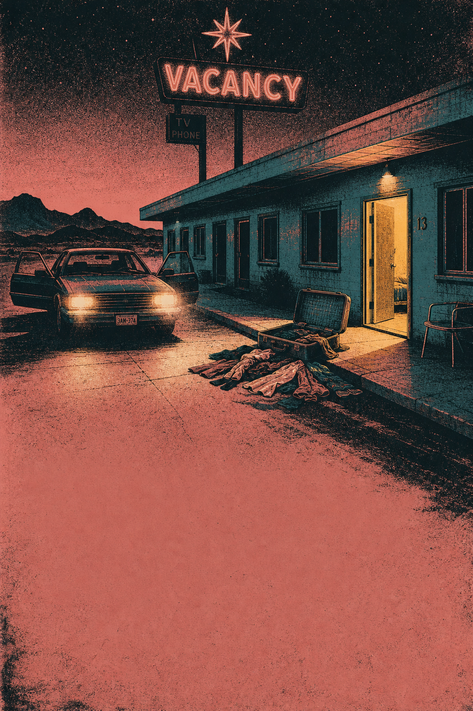

```text
A three-color screenprinted film poster of a desert motel at three in the morning. One room stands open, spilling hot yellow light across the concrete walkway; a suitcase lies burst open on the ground with clothes spread in a fan. A car idles in front with its headlights on and both doors ajar. Flat separated color layers in dust rose, deep teal and black, with deliberate misregistration and visible halftone grain where the layers overlap. Long hard shadows, a vacancy sign burning at the top of the frame, and wide empty space reserved for absent title type at the bottom. No people anywhere.

```

Model: GPT Image 2 · Author: Shuryne / gpt-image-prompts contributors

[Original source](https://github.com/Shuryne/gpt-image-prompts/blob/4c53ea3708c2447a9c87b0a24cc77abf86c3aa7b/prompts/desert-motel-open-door.md) · [Provenance and original license](data/projectd-batch-0011.json)

## Pomegranate Egg-Tempera-Style Still Life — Shuryne · MIT

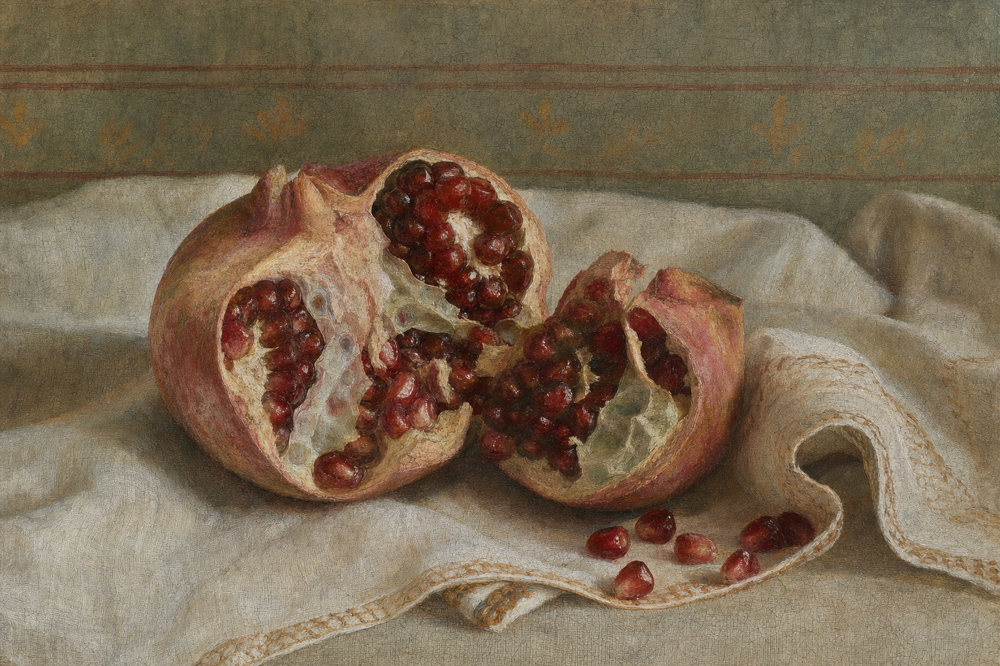

```text
An egg tempera painting of a split pomegranate resting on linen cloth. Color is built from hundreds of fine translucent cross-hatched strokes because the medium dries too fast to blend, giving a luminous enamel-like surface. The seeds read as tiny glazed jewels of alizarin over a cool green underpainting that shows through the shadows. Matte chalky ground with the faintest crackle. Even north-facing window light, a shallow tabletop composition, muted earth palette, quiet devotional stillness.

```

Model: GPT Image 2 · Author: Shuryne / gpt-image-prompts contributors

[Original source](https://github.com/Shuryne/gpt-image-prompts/blob/4c53ea3708c2447a9c87b0a24cc77abf86c3aa7b/prompts/egg-tempera-pomegranate.md) · [Provenance and original license](data/projectd-batch-0011.json)

## Footprints Ending at a Letter Narrative Print — Shuryne · MIT

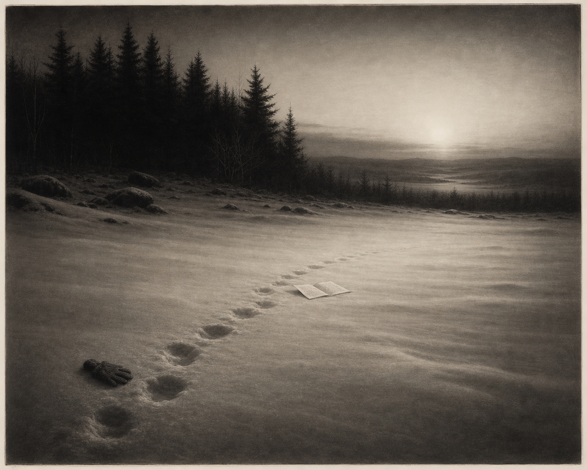

```text
A mezzotint print of a snowfield at first light. A single line of footprints crosses the plate from the lower left and stops at an unfolded letter lying face-up in the snow. There are no prints leading away. Velvety unbroken blacks in the treeline behind, burnished down through infinite silver greys to the near-white of the drifts, with the rocker's fine mesh texture visible throughout. A dropped glove lies a few paces back. Deep atmospheric perspective, absolute stillness, no color, no figure.

```

Model: GPT Image 2 · Author: Shuryne / gpt-image-prompts contributors

[Original source](https://github.com/Shuryne/gpt-image-prompts/blob/4c53ea3708c2447a9c87b0a24cc77abf86c3aa7b/prompts/footprints-to-a-letter.md) · [Provenance and original license](data/projectd-batch-0011.json)

## Rainy Tram Stop Gouache Study — Shuryne · MIT

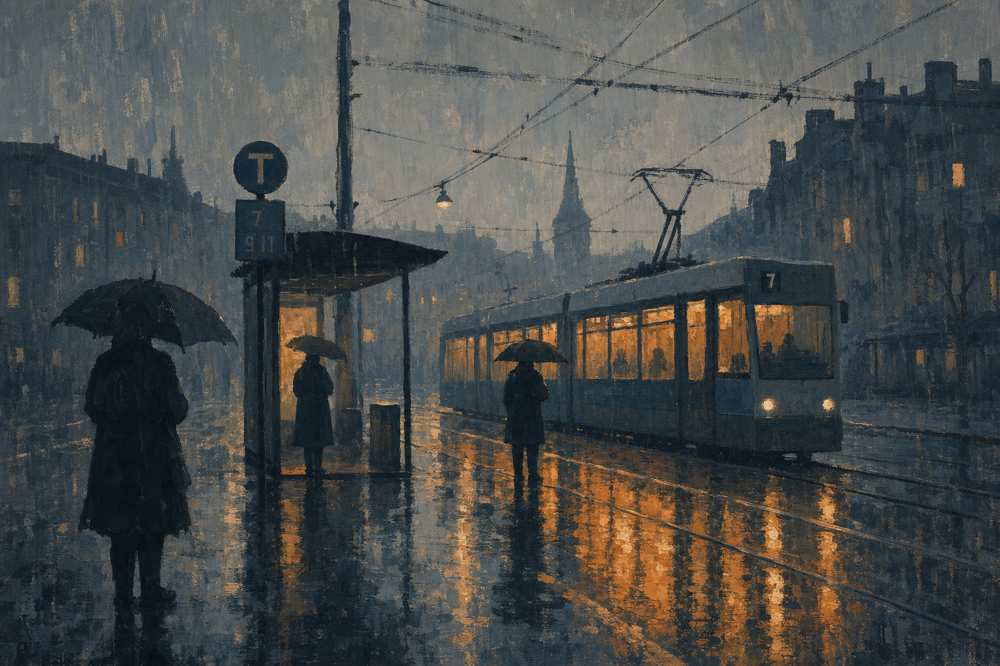

```text
A gouache painting of a tram stop at dusk in steady rain. Opaque matte pigment laid in flat overlapping planes, the brushstrokes chalky and slightly streaky where a second layer lifted the one beneath. Wet asphalt reflects the tram's warm interior light as vertical smears of cadmium orange against slate grey and Payne's blue. Three silhouetted figures under umbrellas, painted as simple dark shapes with no facial detail. Dry-brush texture on the overhead wires. Muted desaturated palette, soft edges, quiet melancholy.

```

Model: GPT Image 2 · Author: Shuryne / gpt-image-prompts contributors

[Original source](https://github.com/Shuryne/gpt-image-prompts/blob/4c53ea3708c2447a9c87b0a24cc77abf86c3aa7b/prompts/gouache-rainy-tram-stop.md) · [Provenance and original license](data/projectd-batch-0011.json)

## Retro Jazz LP Brush-Lettering Cover Concept — Shuryne · MIT

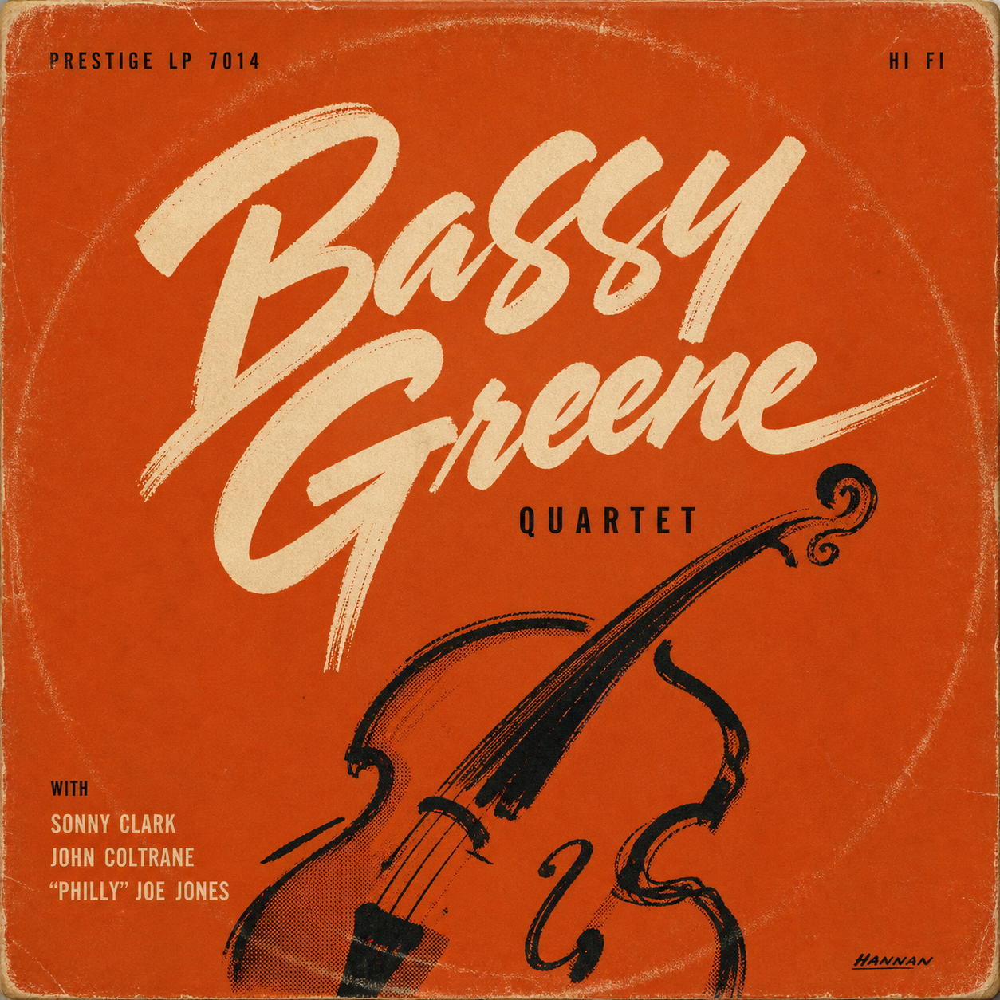

```text
A 1950s jazz LP cover with hand-lettered brush script. Bold custom lettering in warm ivory over a flat burnt-orange field, the strokes showing genuine brush pressure variation and slightly imperfect terminals. A loose abstract ink drawing of a double bass occupies the lower third, rendered in three confident gestural strokes. Two-color offset printing with visible halftone rosettes in the shadow areas and a hairline registration shift. Slight ring-wear and edge softening from decades in a record sleeve.

```

Model: GPT Image 2 · Author: Shuryne / gpt-image-prompts contributors

[Original source](https://github.com/Shuryne/gpt-image-prompts/blob/4c53ea3708c2447a9c87b0a24cc77abf86c3aa7b/prompts/hand-lettered-jazz-cover.md) · [Provenance and original license](data/projectd-batch-0011.json)

## Misty Chinese Ink Landscape Study — Shuryne · MIT

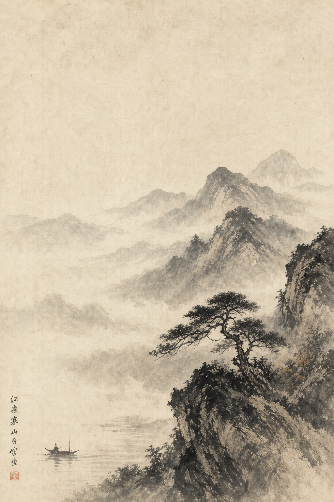

```text
A traditional Chinese ink wash landscape on aged rice paper. Layered mountain ridges recede into pale mist, a lone pine clings to a foreground cliff, and a tiny fishing boat sits on still water at lower left. Vast empty space in the upper third. Monochrome black ink with grey washes and a single faint ochre tint, visible brush texture, dry-brush rock strokes, soft bleeding edges, no outlines, no color saturation.

```

Model: GPT Image 2 · Author: Shuryne / gpt-image-prompts contributors

[Original source](https://github.com/Shuryne/gpt-image-prompts/blob/4c53ea3708c2447a9c87b0a24cc77abf86c3aa7b/prompts/ink-mountain-mist.md) · [Provenance and original license](data/projectd-batch-0011.json)

## Lighthouse Kitchen Two-Plate Novel-Cover Concept — Shuryne · MIT

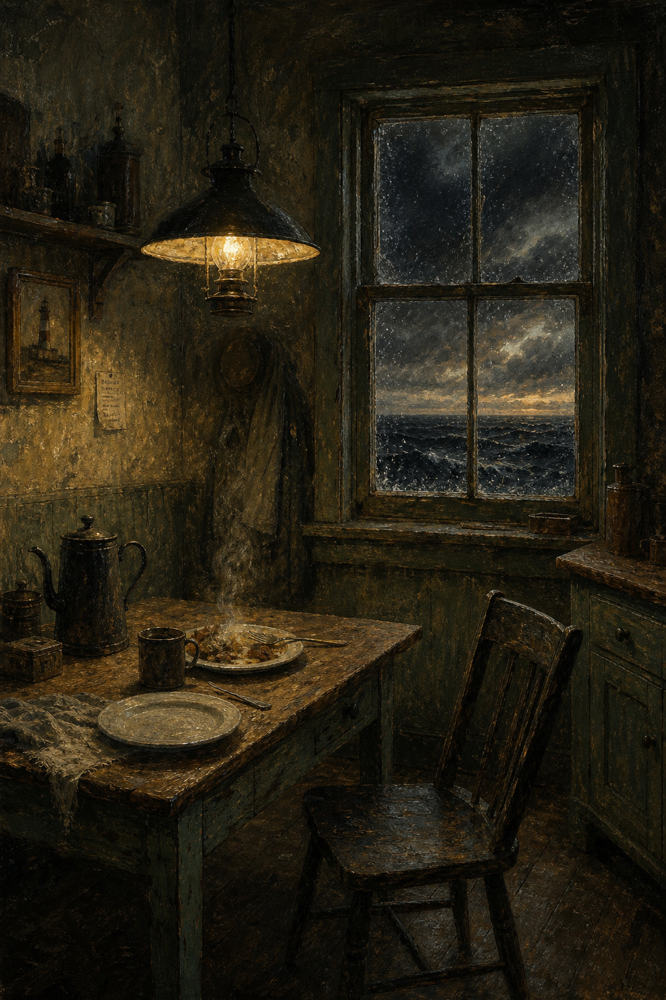

```text
An oil painting of a lighthouse keeper's kitchen at dusk, painted like a literary novel cover. The small table is set for two, but one plate is clean and dulled with a fine layer of dust while the other is half-eaten and still steaming. A single chair is pushed back at an angle. Through the salt-crusted window a storm is building over black water, and the lamp above throws a warm pool of light that fails before it reaches the corners. Thick impasto on the highlights, thin scumbled greys in the shadows, visible brush drag on the wall. Muted ochre, sea green and bitumen palette. Nobody is in the room.

```

Model: GPT Image 2 · Author: Shuryne / gpt-image-prompts contributors

[Original source](https://github.com/Shuryne/gpt-image-prompts/blob/4c53ea3708c2447a9c87b0a24cc77abf86c3aa7b/prompts/lighthouse-two-plates.md) · [Provenance and original license](data/projectd-batch-0011.json)

## Breaking Wave Two-Ink Linocut-Style Study — Shuryne · MIT

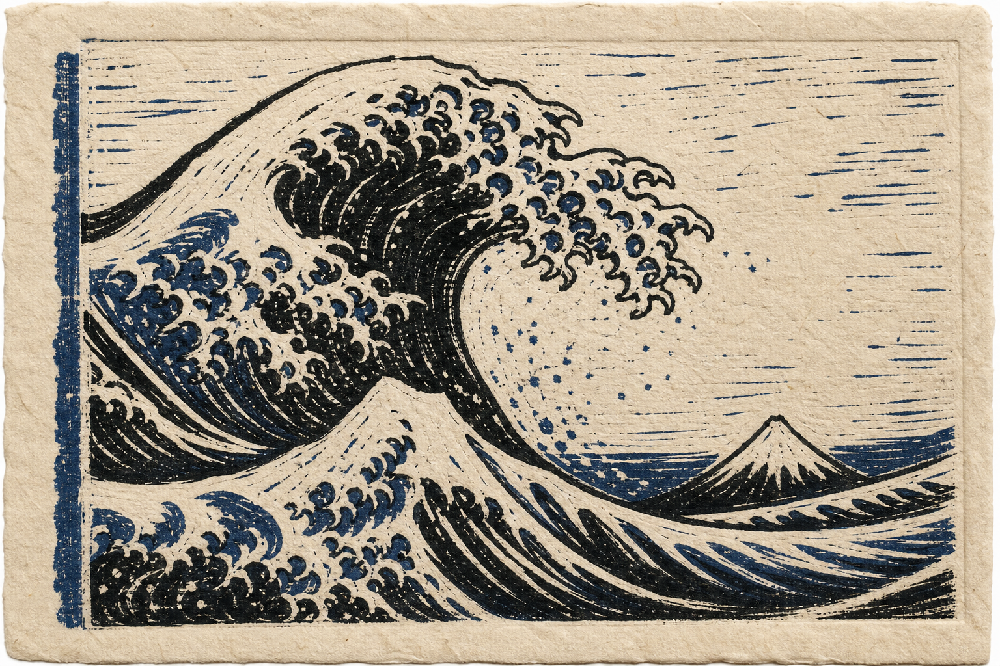

```text
A two-color linocut print of a breaking wave, carved with confident gouge strokes. A bold black keyline block over a muted indigo second pass, with visible misregistration of about two millimeters along the left edge. The carving shows chatter marks and stray slivers where the gouge skipped; ink sits unevenly, heavily saturated at the block's center and dry and starved near the margins. Printed on cream mulberry paper with visible fibers and a plate impression. Flat graphic shapes, no gradients.

```

Model: GPT Image 2 · Author: Shuryne / gpt-image-prompts contributors

[Original source](https://github.com/Shuryne/gpt-image-prompts/blob/4c53ea3708c2447a9c87b0a24cc77abf86c3aa7b/prompts/linocut-wave-crest.md) · [Provenance and original license](data/projectd-batch-0011.json)

## Dew on Spiderweb Synthetic Macro Study — Shuryne · MIT


```text
An extreme macro photograph of an orb spider's web strung with dawn dew. Each droplet acts as a lens, holding an inverted miniature of the meadow behind it. A razor-thin plane of focus crosses three droplets while everything else dissolves into creamy green and gold bokeh. Backlit by low sun so the silk threads glow as fine bright lines against a dark hedgerow, with a visible sag in the loaded threads. Cool blue shadow tones against warm highlights; no subject but water and silk.

```

Model: GPT Image 2 · Author: Shuryne / gpt-image-prompts contributors

[Original source](https://github.com/Shuryne/gpt-image-prompts/blob/4c53ea3708c2447a9c87b0a24cc77abf86c3aa7b/prompts/macro-dew-spiderweb.md) · [Provenance and original license](data/projectd-batch-0011.json)

## Closing Mask Shop Film-Poster Concept — Shuryne · MIT

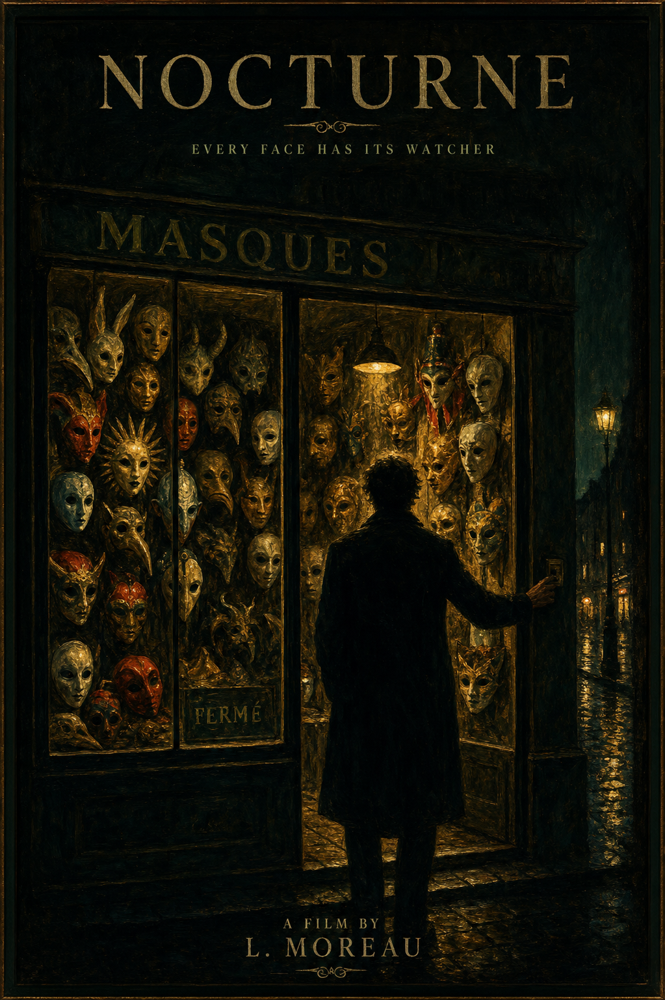

```text
A nocturne oil painting of a small mask shop at closing time, framed as a mysterious film poster. The shopkeeper is seen only from behind as a dark silhouette reaching for the light switch. Every mask on the crowded walls — animal, theatrical, ceremonial — has been turned to face him, though he is not looking at them. Warm shop light dying into deep viridian shadow, wet cobbles visible through the door glass. Loose confident brushwork, glazed dark passages with a few thick bright accents on the mask highlights. Unsettling but beautiful, no violence.

```

Model: GPT Image 2 · Author: Shuryne / gpt-image-prompts contributors

[Original source](https://github.com/Shuryne/gpt-image-prompts/blob/4c53ea3708c2447a9c87b0a24cc77abf86c3aa7b/prompts/mask-shop-closing.md) · [Provenance and original license](data/projectd-batch-0011.json)

## Surreal Desert Lighthouse Comics Concept — Shuryne · MIT

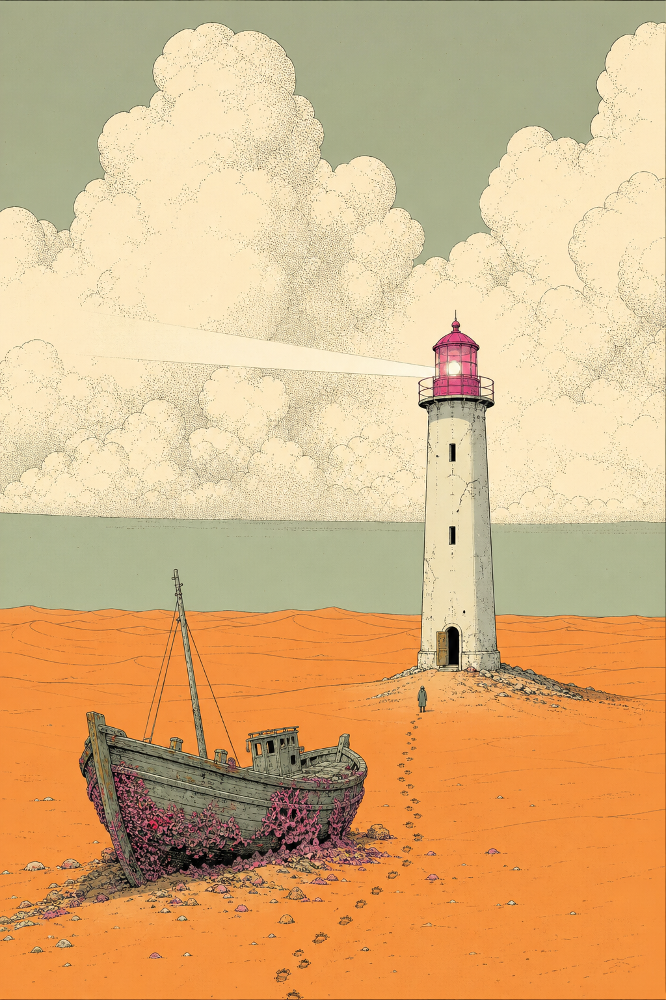

```text
A lighthouse standing alone in an endless orange dune field, its lamp still turning and casting a visible beam across the sand. There is no sea anywhere. A wooden fishing boat lies beached at the tower's foot, its hull encrusted with pink coral, and a line of footprints leads from the boat to the open tower door. Drawn in the European bande dessinee tradition of Moebius: fine confident ink contour lines over flat matte color fields with no rendering or gradients, on a dusty sage and bone ground, with hot magenta and cadmium orange used sparingly as the only saturated accents. Enormous softly stippled cumulus fills the upper half of the frame. A tiny lone figure gives the scale. Clear, still, sun-bleached, retro-futurist.

```

Model: GPT Image 2 · Author: Shuryne / gpt-image-prompts contributors

[Original source](https://github.com/Shuryne/gpt-image-prompts/blob/4c53ea3708c2447a9c87b0a24cc77abf86c3aa7b/prompts/moebius-desert-lighthouse.md) · [Provenance and original license](data/projectd-batch-0011.json)

## Tea with a Giant Machine Comics Concept — Shuryne · MIT

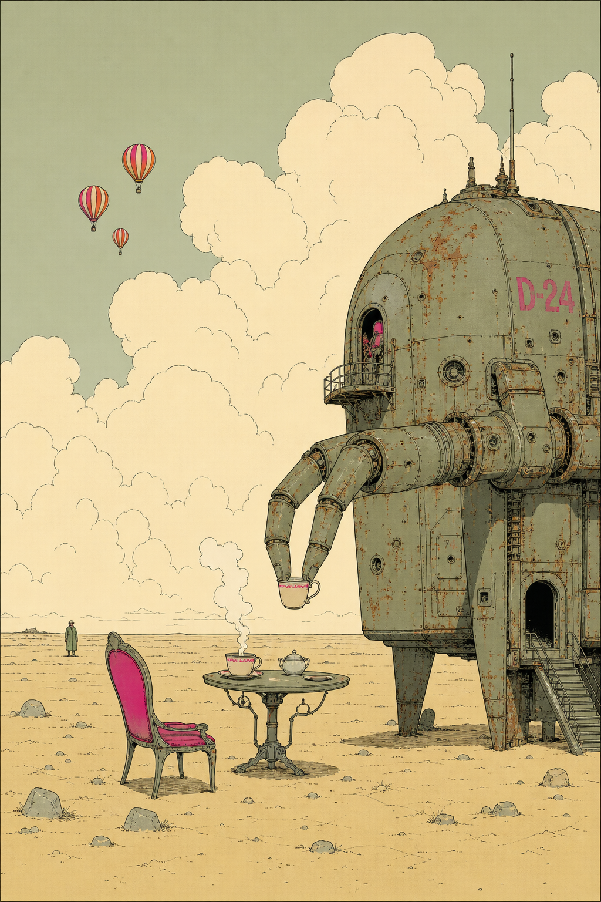

```text
A small table set for tea on an empty ochre plain. One cup steams; opposite it sits a vast rusted machine the size of a house, delicately pinching the handle of the second cup between two enormous fingers. The chair on the near side is empty and pushed back. Three striped balloons descend slowly in the far distance. Drawn in the European bande dessinee tradition of Moebius: fine confident ink contour lines over flat matte color fields with no rendering or gradients, on a dusty sage and bone ground, with hot magenta and cadmium orange used sparingly as the only saturated accents. Enormous softly stippled cumulus fills the upper half of the frame. A tiny lone figure gives the scale. Clear, still, sun-bleached, retro-futurist.

```

Model: GPT Image 2 · Author: Shuryne / gpt-image-prompts contributors

[Original source](https://github.com/Shuryne/gpt-image-prompts/blob/4c53ea3708c2447a9c87b0a24cc77abf86c3aa7b/prompts/moebius-tea-with-the-machine.md) · [Provenance and original license](data/projectd-batch-0011.json)

## Lemons and Pewter Jug Oil-Style Still Life — Shuryne · MIT

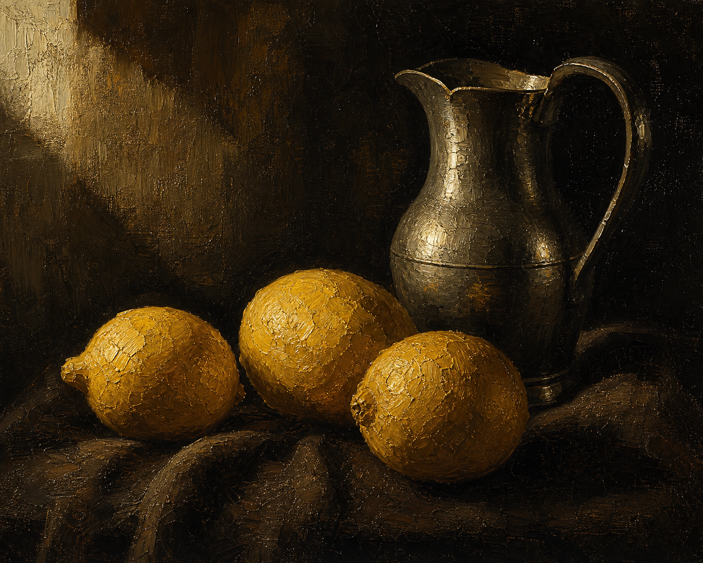

```text
An oil painting still life of three lemons and a pewter jug on a dark draped cloth, lit by a single window light from the upper left. Thick impasto highlights on the fruit skin, glazed transparent shadows, warm ochre and deep umber palette against near-black background. Visible brushwork and palette-knife texture, Old Master chiaroscuro, canvas weave showing through thin passages, rich varnished depth.

```

Model: GPT Image 2 · Author: Shuryne / gpt-image-prompts contributors

[Original source](https://github.com/Shuryne/gpt-image-prompts/blob/4c53ea3708c2447a9c87b0a24cc77abf86c3aa7b/prompts/oil-still-life-lemons.md) · [Provenance and original license](data/projectd-batch-0011.json)

## Overgrown Greenhouse Piano Novel Illustration — Shuryne · MIT


```text
A watercolor and pen-and-ink illustration plate from a novel, showing a grand piano abandoned in a derelict glasshouse. Ivy has grown through the broken panes and into the open lid, wrapping the strings; moss cushions the pedals and a young birch has rooted through the soundboard. A pair of reading glasses rests folded on the piano stool, clean and unweathered. Fine confident ink linework over loose granulating washes in sage, rust and bottle green, with the pigment allowed to pool and backrun at the edges. Shafts of dusty light fall through the ruined roof.

```

Model: GPT Image 2 · Author: Shuryne / gpt-image-prompts contributors

[Original source](https://github.com/Shuryne/gpt-image-prompts/blob/4c53ea3708c2447a9c87b0a24cc77abf86c3aa7b/prompts/overgrown-greenhouse-piano.md) · [Provenance and original license](data/projectd-batch-0011.json)

## Unfinished Radio Log Novel-Cover Concept — Shuryne · MIT


```text
A charcoal drawing with pale watercolor wash, composed like a book cover, showing the interior of a remote mountain radio station in winter. Frost has crept up the inside of the window. On the desk an open logbook is filled with hundreds of neat handwritten signal entries, and the last line breaks off mid-word with the pencil still lying across it. The headphones are off the hook and the valve set glows faintly. Compressed charcoal for the deep blacks, smudged with the hand, over thin washes of grey-blue and ochre. One warm lamp against a snow-blue window.

```

Model: GPT Image 2 · Author: Shuryne / gpt-image-prompts contributors

[Original source](https://github.com/Shuryne/gpt-image-prompts/blob/4c53ea3708c2447a9c87b0a24cc77abf86c3aa7b/prompts/radio-station-unfinished-log.md) · [Provenance and original license](data/projectd-batch-0011.json)

## Elephant Carrying a Village Poster Concept — Shuryne · MIT


```text
An immense elephant filling the sheet as a flat black silhouette, standing perfectly still. Between its front legs a very small child stands looking straight up. Drawn in fine red line across the elephant's back is an entire village — houses, ladders, washing lines, a temple — as though it has always been carried there. A two-color screenprinted poster using only vermilion red, dense black and paper white — no other hue, no gradients. A large flat red field dominates, the main subject reads as a bold black silhouette, and the secondary scene is drawn in fine red hatched linework. A row of very small silhouetted figures runs along the bottom edge to set the scale. Visible fold creases and slight paper aging. Generous negative space, clear empty band at the foot of the sheet where type would sit, and no legible text anywhere.

```

Model: GPT Image 2 · Author: Shuryne / gpt-image-prompts contributors

[Original source](https://github.com/Shuryne/gpt-image-prompts/blob/4c53ea3708c2447a9c87b0a24cc77abf86c3aa7b/prompts/redblack-elephant-and-boy.md) · [Provenance and original license](data/projectd-batch-0011.json)

## Last Train Smoke-Face Poster Concept — Shuryne · MIT


```text
A long train leaving the frame as a single unbroken black silhouette, its smoke curling into a shape that resembles a sleeping face. On the platform a row of tiny silhouetted figures stands still; only one of them has an arm raised. The distant city is drawn in fine red hatching, and a solid black sun hangs low above it. A two-color screenprinted poster using only vermilion red, dense black and paper white — no other hue, no gradients. A large flat red field dominates, the main subject reads as a bold black silhouette, and the secondary scene is drawn in fine red hatched linework. A row of very small silhouetted figures runs along the bottom edge to set the scale. Visible fold creases and slight paper aging. Generous negative space, clear empty band at the foot of the sheet where type would sit, and no legible text anywhere.

```

Model: GPT Image 2 · Author: Shuryne / gpt-image-prompts contributors

[Original source](https://github.com/Shuryne/gpt-image-prompts/blob/4c53ea3708c2447a9c87b0a24cc77abf86c3aa7b/prompts/redblack-last-train.md) · [Provenance and original license](data/projectd-batch-0011.json)

## Night Signal Riso Concert-Poster Concept — Shuryne · MIT


```text
A risograph-printed concert poster. Large condensed sans-serif type reads "NIGHT SIGNAL" across the upper third, with smaller text below reading "LIVE — OCT 12". Behind the type, an abstract halftone mountain range and a large circle. Two-color riso printing in fluorescent pink and blue only, visible ink misregistration, coarse halftone dot texture, uneven ink coverage and roller streaks, matte uncoated paper stock, bold flat graphic composition.

```

Model: GPT Image 2 · Author: Shuryne / gpt-image-prompts contributors

[Original source](https://github.com/Shuryne/gpt-image-prompts/blob/4c53ea3708c2447a9c87b0a24cc77abf86c3aa7b/prompts/riso-concert-poster.md) · [Provenance and original license](data/projectd-batch-0011.json)

## Frosted Serum Bottle Studio Product Concept — Shuryne · MIT


```text
A frosted glass skincare serum bottle standing on a wet travertine slab, seen straight-on at eye level. Behind it, a single arc of soft morning light rakes across a warm sand-colored backdrop, casting one long clean shadow to the right. Droplets of condensation cling to the glass; the dropper cap is matte champagne metal. Minimal studio product photography, 100mm macro, f/8, crisp specular highlights, muted beige and sage palette, generous negative space at top.

```

Model: GPT Image 2 · Author: Shuryne / gpt-image-prompts contributors

[Original source](https://github.com/Shuryne/gpt-image-prompts/blob/4c53ea3708c2447a9c87b0a24cc77abf86c3aa7b/prompts/skincare-product.md) · [Provenance and original license](data/projectd-batch-0011.json)

## Art Nouveau Railway Poster Study — ChaosRealmsAI · MIT


```text
Scene:
A square 1:1 composition designed as a premium Art Nouveau Poster study. Design the frame like a high-end editorial image, with strong hierarchy, controlled cropping, and a composed pace between large shapes and small accents. Use lighting, color, and spatial staging that make the core idea legible in one glance while still rewarding close inspection. The frame should feel display-ready rather than like a rough concept sheet, with balanced brightness, deliberate negative space, and clear separation of foreground, midground, and background layers.

Subject:
Interpret Art Nouveau Poster through 新艺术运动 · 19 世纪末. Draw from this visual direction: Alphonse Mucha 风 · 飘发女子 + 星形光环 + 百合藤蔓 + 书法 typography · 广告海报(香槟 / 火车 / 烟草). Focus on an interpretation aimed at editorial clarity, symbolism, and immediate readability. Build a primary focal subject, secondary support forms, and a coherent environmental envelope so the scene feels complete and specific. Treat this as an independent study with no continuity requirement beyond the shared theme language.

Important details:
Carry forward the theme's distinguishing value: 装饰艺术巅峰 · 石版印刷工艺黄金年代 · 现代品牌高级感挪用. Reflect the tested capabilities through visible decisions related to text-rendering, structured-layout, style-transfer, commercial-mockup. 更强图中文字渲染与版式跟随；复杂结构化视觉和多面板构图能力. Aim for these acceptance cues: 一眼能看出这是高难度炫技主题，不像普通模板图; 核心创意和画面结构无需解释即可成立. Keep the image controlled, elegant, and intentionally composed, with no accidental filler elements.

Use case:
Art Nouveau Poster single study 1/8, exploring the topic as an independent editorial composition.

Constraints:
No readable text, no watermark, no logos, preserve exact 1:1 aspect ratio, no muddy focal point, no duplicate main subject, no collage seams, no broken margin geometry, no accidental extra text blocks.
```

Model: GPT Image 2 · Author: ChaosRealmsAI

[Original source](https://github.com/ChaosRealmsAI/gpt-image-2-gallery/blob/5296db8c996e38776c83a0bc8c64f848dcd512b3/works/topics/art-nouveau-poster/packages/single-application-studies/images/01-editorial-study/meta.json) · [Provenance and original license](data/projectd-batch-0011.json)

## Clay Professor Character and Material Study — ChaosRealmsAI · MIT


```text
Scene:
A square CGI or design-visualization frame with calibrated lighting, intentional composition, and premium material rendering. Build the frame around a flagship render that establishes form, stance, and material identity. Keep the lighting, camera distance, and spatial organization tuned for a high-signal research image rather than a casual snapshot. The image belongs to the Claymation Style theme and should feel immediately legible as a prompt atlas theme for claymation style, testing multi-image-reference, physics-materials, style-transfer with gpt image 2..

Subject:
Center the study on a flagship render that establishes form, stance, and material identity. Translate the theme into a concrete visual statement instead of an abstract mood board: the viewer should understand what kind of image this is, what is being tested, and why the composition is difficult. Use the slug idea of claymation style as a literal guide for subject matter, materials, and staging. If helpful, borrow the broad visual cues suggested by stop motion, but keep the result original and specific to this study.

Important details:
The model must feel engineered or art-directed rather than merely stylized: edges, seams, translucency, reflections, and scale cues should all hold up. Preserve a disciplined square composition, clear focal hierarchy, and enough secondary information to make the image feel complete rather than underspecified. The image should look polished, novel, and exhibition-ready, with topic-specific credibility coming from the way surfaces, structure, and visual language reinforce Claymation Style. Avoid generic filler elements that do not serve the main concept.

Use case:
Claymation Style single study 1/8, testing multi-image-reference, physics-materials, style-transfer through the hero model variation.

Constraints:
No readable text, no watermark, no logos, preserve exact 1:1 aspect ratio, no real brand logos, no low-poly shortcuts, no broken reflections, no muddy materials, no generic showroom clutter, no unreadable UI overlays.
```

Model: GPT Image 2 · Author: ChaosRealmsAI

[Original source](https://github.com/ChaosRealmsAI/gpt-image-2-gallery/blob/5296db8c996e38776c83a0bc8c64f848dcd512b3/works/topics/claymation-style/packages/single-claymation-style-studies/images/hero-model/meta.json) · [Provenance and original license](data/projectd-batch-0011.json)

## Pastel Cat-Eared Collectible Figurine Concept — ChaosRealmsAI · MIT


```text
Scene:
A square CGI or design-visualization frame with calibrated lighting, intentional composition, and premium material rendering. Build the frame around a flagship render that establishes form, stance, and material identity. Keep the lighting, camera distance, and spatial organization tuned for a high-signal research image rather than a casual snapshot. The image belongs to the Cute Blind Box Figurine theme and should feel immediately legible as a prompt atlas theme for cute blind box figurine, testing physics-materials, style-transfer with gpt image 2..

Subject:
Center the study on a flagship render that establishes form, stance, and material identity. Translate the theme into a concrete visual statement instead of an abstract mood board: the viewer should understand what kind of image this is, what is being tested, and why the composition is difficult. Use the slug idea of cute blind box figurine as a literal guide for subject matter, materials, and staging. If helpful, borrow the broad visual cues suggested by POP MART, PVC, studio, but keep the result original and specific to this study.

Important details:
The model must feel engineered or art-directed rather than merely stylized: edges, seams, translucency, reflections, and scale cues should all hold up. Preserve a disciplined square composition, clear focal hierarchy, and enough secondary information to make the image feel complete rather than underspecified. The image should look polished, novel, and exhibition-ready, with topic-specific credibility coming from the way surfaces, structure, and visual language reinforce Cute Blind Box Figurine. Avoid generic filler elements that do not serve the main concept.

Use case:
Cute Blind Box Figurine single study 1/8, testing physics-materials, style-transfer through the hero model variation.

Constraints:
No readable text, no watermark, no logos, preserve exact 1:1 aspect ratio, no real brand logos, no low-poly shortcuts, no broken reflections, no muddy materials, no generic showroom clutter, no unreadable UI overlays.
```

Model: GPT Image 2 · Author: ChaosRealmsAI

[Original source](https://github.com/ChaosRealmsAI/gpt-image-2-gallery/blob/5296db8c996e38776c83a0bc8c64f848dcd512b3/works/topics/cute-blind-box-figurine/packages/single-cute-blind-box-figurine-studies/images/hero-model/meta.json) · [Provenance and original license](data/projectd-batch-0011.json)

## Architectural Book-Series Spread Mockup — ChaosRealmsAI · MIT


```text
Scene:
A square editorial or interface layout study with exact margins, confident grid structure, and premium print or screen presentation. Build the frame around a primary spread or headline surface with immediate hierarchy. Keep the lighting, camera distance, and spatial organization tuned for a high-signal research image rather than a casual snapshot. The image belongs to the Book Series Design theme and should feel immediately legible as a prompt atlas theme for book series design, testing text-rendering, structured-layout, style-transfer, commercial-mockup with gpt image 2..

Subject:
Center the study on a primary spread or headline surface with immediate hierarchy. Translate the theme into a concrete visual statement instead of an abstract mood board: the viewer should understand what kind of image this is, what is being tested, and why the composition is difficult. Use the slug idea of book series design as a literal guide for subject matter, materials, and staging.

Important details:
Typography fields must stay unreadable, but hierarchy, rhythm, and page architecture should feel convincing enough for design review. Preserve a disciplined square composition, clear focal hierarchy, and enough secondary information to make the image feel complete rather than underspecified. The image should look polished, novel, and exhibition-ready, with topic-specific credibility coming from the way surfaces, structure, and visual language reinforce Book Series Design. Avoid generic filler elements that do not serve the main concept.

Use case:
Book Series Design single study 1/8, testing text-rendering, structured-layout, style-transfer, commercial-mockup through the hero spread variation.

Constraints:
No readable text, no watermark, no logos, preserve exact 1:1 aspect ratio, no readable text, no logo lockups from real brands, no broken grid, no arbitrary poster clutter, no malformed columns, no accidental lorem ipsum.
```

Model: GPT Image 2 · Author: ChaosRealmsAI

[Original source](https://github.com/ChaosRealmsAI/gpt-image-2-gallery/blob/5296db8c996e38776c83a0bc8c64f848dcd512b3/works/topics/book-series-design/packages/single-book-series-design-studies/images/hero-spread/meta.json) · [Provenance and original license](data/projectd-batch-0011.json)

## Monochrome Stationery Brand-System Mockup — ChaosRealmsAI · MIT


```text
Scene:
A square commercial presentation with realistic materials, clean staging, and believable product photography or retail lighting. Build the frame around a flagship hero setup that sells the overall system immediately. Keep the lighting, camera distance, and spatial organization tuned for a high-signal research image rather than a casual snapshot. The image belongs to the Brand Identity Mockup Set theme and should feel immediately legible as a prompt atlas theme for brand identity mockup set, testing text-rendering, structured-layout, commercial-mockup with gpt image 2..

Subject:
Center the study on a flagship hero setup that sells the overall system immediately. Translate the theme into a concrete visual statement instead of an abstract mood board: the viewer should understand what kind of image this is, what is being tested, and why the composition is difficult. Use the slug idea of brand identity mockup set as a literal guide for subject matter, materials, and staging. If helpful, borrow the broad visual cues suggested by logo, but keep the result original and specific to this study.

Important details:
The mockup should feel saleable and design-ready: sharp edges, controlled reflections, credible paper or plastic behavior, and precise placement. Preserve a disciplined square composition, clear focal hierarchy, and enough secondary information to make the image feel complete rather than underspecified. The image should look polished, novel, and exhibition-ready, with topic-specific credibility coming from the way surfaces, structure, and visual language reinforce Brand Identity Mockup Set. Avoid generic filler elements that do not serve the main concept.

Use case:
Brand Identity Mockup Set single study 1/8, testing text-rendering, structured-layout, commercial-mockup through the hero mockup variation.

Constraints:
No readable text, no watermark, no logos, preserve exact 1:1 aspect ratio, no real brand names, no cheap stock-photo styling, no broken perspective, no watermark, no accidental readable packaging copy, no cluttered retail shelf unless intended.
```

Model: GPT Image 2 · Author: ChaosRealmsAI

[Original source](https://github.com/ChaosRealmsAI/gpt-image-2-gallery/blob/5296db8c996e38776c83a0bc8c64f848dcd512b3/works/topics/brand-identity-mockup-set/packages/single-brand-identity-mockup-set-studies/images/hero-mockup/meta.json) · [Provenance and original license](data/projectd-batch-0011.json)

## Fantasy Character-Roster Event Board — ChaosRealmsAI · MIT


```text
Scene:
A square production-ready image designed for a game-art review wall and a commercial gallery at the same time. Frame a lineup board arranging featured, supporting, and lower-rarity pool units into one polished event surface with disciplined lighting, clean edge separation, and enough surrounding context to prove how the asset would behave in a real product surface. The camera, crop, and tonal balance should feel intentional rather than generic, with high readability at first glance and convincing material response under closer inspection.

Subject:
Center the study on a lineup board arranging featured, supporting, and lower-rarity pool units into one polished event surface. Translate the topic into a concrete, shippable visual statement instead of a loose mood board. Build layered object relationships, believable surface finish, and strong silhouette grouping so the image reads immediately as part of Character Banner Gacha Pool Visuals. The subject should feel made for a live game pipeline: useful in store, UI, campaign, or art-review contexts, with visual hierarchy strong enough to survive aggressive cropping.

Important details:
hierarchy and desirability should be obvious even with abstract unreadable labels. Keep every supporting element subordinate to the main read, and make category separation obvious through form, color zoning, depth, and material logic rather than words. Where panels, cards, badges, or interface blocks appear, they must look professionally structured but remain unreadable. The visual language should feel premium, original, and coherent across this package, with no filler clutter and no accidental resemblance to a specific shipped game IP.

Use case:
Character Banner Gacha Pool Visuals single study 1/5, focused on pool lineup board.

Constraints:
No readable text, no watermark, no logos, preserve exact 1:1 aspect ratio, no readable roster names, no rates, no broken hierarchy, no generic stock-photo staging, no accidental UI gibberish.
```

Model: GPT Image 2 · Author: ChaosRealmsAI

[Original source](https://github.com/ChaosRealmsAI/gpt-image-2-gallery/blob/5296db8c996e38776c83a0bc8c64f848dcd512b3/works/topics/character-banner-gacha-pool-visuals/packages/single-gacha-support-assets/images/pool-lineup-board/meta.json) · [Provenance and original license](data/projectd-batch-0011.json)

## Chibi Mascot Merchandise Campaign Board — ChaosRealmsAI · MIT


```text
Scene:
A square retail-ready campaign visual for Chibi Franchise Campaign Pack, combining cute character appeal with polished commercial presentation. The composition should feel like a high-finish launch board: crisp packaging edges, collectible object staging, clean shelf or poster context, and vivid but controlled color. It should be immediately legible from far away, but still dense with charming small details that reward closer inspection.

Subject:
Build the image around Explainer Board, a frame that a charming information board that breaks the product or character world into clear visual sections. Translate Convert larger fictional universes into tightly art-directed chibi campaign systems that can span posters, stickers, key visuals, and merch-ready layouts. into one lovable mascot, figure, or product system that feels ready for posters, boxes, stickers, inserts, or point-of-sale material. The result should feel like a fresh research image with clear commercial focus rather than random fan art. The main subject must remain unmistakable even when surrounded by accessories and display pieces.

Important details:
Charm alone is not enough. Preserve clean silhouette recognition, convincing package construction, reliable prop scale, and structured layout logic so the image feels sellable. This theme studies style-transfer, multi-image-reference, commercial-mockup, structured-layout through a production-ready visual system. Avoid noisy clutter; every secondary element should reinforce collectibility, retail desirability, or explainer clarity. Aim for clear hierarchy, polished craft, and immediately usable campaign logic.

Use case:
Chibi Franchise Campaign Pack single study 1/5.

Constraints:
No readable text, no watermark, no logos, preserve exact 1:1 aspect ratio, no horror elements, no brand theft, no malformed packaging edges, no muddy mascot silhouette, no messy retail shelf, no chaotic prop overload.
```

Model: GPT Image 2 · Author: ChaosRealmsAI

[Original source](https://github.com/ChaosRealmsAI/gpt-image-2-gallery/blob/5296db8c996e38776c83a0bc8c64f848dcd512b3/works/topics/chibi-franchise-campaign-pack/packages/single-retail-support/images/explainer-board/meta.json) · [Provenance and original license](data/projectd-batch-0011.json)

## Collectible Figure Blister-Pack Explainer Board — ChaosRealmsAI · MIT


```text
Scene:
A square retail-ready campaign visual for Collector Figure Blister Ads, combining cute character appeal with polished commercial presentation. The composition should feel like a high-finish launch board: crisp packaging edges, collectible object staging, clean shelf or poster context, and vivid but controlled color. It should be immediately legible from far away, but still dense with charming small details that reward closer inspection.

Subject:
Build the image around Explainer Board, a frame that a charming information board that breaks the product or character world into clear visual sections. Translate Build campaign-ready blister-pack and collector-toy advertisements featuring super-deformed characters, accessories, rarity cues, and retail-style packaging polish. into one lovable mascot, figure, or product system that feels ready for posters, boxes, stickers, inserts, or point-of-sale material. The result should feel like a fresh research image with clear commercial focus rather than random fan art. The main subject must remain unmistakable even when surrounded by accessories and display pieces.

Important details:
Charm alone is not enough. Preserve clean silhouette recognition, convincing package construction, reliable prop scale, and structured layout logic so the image feels sellable. This theme studies commercial-mockup, style-transfer, structured-layout, photorealism through a production-ready visual system. Avoid noisy clutter; every secondary element should reinforce collectibility, retail desirability, or explainer clarity. Aim for clear hierarchy, polished craft, and immediately usable campaign logic.

Use case:
Collector Figure Blister Ads single study 1/5.

Constraints:
No readable text, no watermark, no logos, preserve exact 1:1 aspect ratio, no horror elements, no brand theft, no malformed packaging edges, no muddy mascot silhouette, no messy retail shelf, no chaotic prop overload.
```

Model: GPT Image 2 · Author: ChaosRealmsAI

[Original source](https://github.com/ChaosRealmsAI/gpt-image-2-gallery/blob/5296db8c996e38776c83a0bc8c64f848dcd512b3/works/topics/collector-figure-blister-ads/packages/single-retail-support/images/explainer-board/meta.json) · [Provenance and original license](data/projectd-batch-0011.json)

## Penguin Mascot Product-Explainer Concept — ChaosRealmsAI · MIT


```text
Scene:
A square retail-ready campaign visual for Cute Product Explainer Poster, combining cute character appeal with polished commercial presentation. The composition should feel like a high-finish launch board: crisp packaging edges, collectible object staging, clean shelf or poster context, and vivid but controlled color. It should be immediately legible from far away, but still dense with charming small details that reward closer inspection.

Subject:
Build the image around Explainer Board, a frame that a charming information board that breaks the product or character world into clear visual sections. Translate Use chibi or mascot characters to explain complex products, workflows, or features through playful yet commercially clear explainer posters. into one lovable mascot, figure, or product system that feels ready for posters, boxes, stickers, inserts, or point-of-sale material. The result should feel like a fresh research image with clear commercial focus rather than random fan art. The main subject must remain unmistakable even when surrounded by accessories and display pieces.

Important details:
Charm alone is not enough. Preserve clean silhouette recognition, convincing package construction, reliable prop scale, and structured layout logic so the image feels sellable. This theme studies structured-layout, text-rendering, commercial-mockup, style-transfer through a production-ready visual system. Avoid noisy clutter; every secondary element should reinforce collectibility, retail desirability, or explainer clarity. Aim for clear hierarchy, polished craft, and immediately usable campaign logic.

Use case:
Cute Product Explainer Poster single study 1/5.

Constraints:
No readable text, no watermark, no logos, preserve exact 1:1 aspect ratio, no horror elements, no brand theft, no malformed packaging edges, no muddy mascot silhouette, no messy retail shelf, no chaotic prop overload.
```

Model: GPT Image 2 · Author: ChaosRealmsAI

[Original source](https://github.com/ChaosRealmsAI/gpt-image-2-gallery/blob/5296db8c996e38776c83a0bc8c64f848dcd512b3/works/topics/cute-product-explainer-poster/packages/single-retail-support/images/explainer-board/meta.json) · [Provenance and original license](data/projectd-batch-0011.json)

## Red-and-Blue Esports Faceoff Layout — ChaosRealmsAI · MIT


```text
Scene:
A square production-ready image designed for a game-art review wall and a commercial gallery at the same time. Frame a versus-focused crop that distills the matchday energy into a compact faceoff card with disciplined lighting, clean edge separation, and enough surrounding context to prove how the asset would behave in a real product surface. The camera, crop, and tonal balance should feel intentional rather than generic, with high readability at first glance and convincing material response under closer inspection.

Subject:
Center the study on a versus-focused crop that distills the matchday energy into a compact faceoff card. Translate the topic into a concrete, shippable visual statement instead of a loose mood board. Build layered object relationships, believable surface finish, and strong silhouette grouping so the image reads immediately as part of Esports Matchday Visual Kit. The subject should feel made for a live game pipeline: useful in store, UI, campaign, or art-review contexts, with visual hierarchy strong enough to survive aggressive cropping.

Important details:
the structure should feel instantly readable and intense on mobile surfaces. Keep every supporting element subordinate to the main read, and make category separation obvious through form, color zoning, depth, and material logic rather than words. Where panels, cards, badges, or interface blocks appear, they must look professionally structured but remain unreadable. The visual language should feel premium, original, and coherent across this package, with no filler clutter and no accidental resemblance to a specific shipped game IP.

Use case:
Esports Matchday Visual Kit single study 1/5, focused on versus banner crop.

Constraints:
No readable text, no watermark, no logos, preserve exact 1:1 aspect ratio, no readable team names, no scores, no broken hierarchy, no generic stock-photo staging, no accidental UI gibberish.
```

Model: GPT Image 2 · Author: ChaosRealmsAI

[Original source](https://github.com/ChaosRealmsAI/gpt-image-2-gallery/blob/5296db8c996e38776c83a0bc8c64f848dcd512b3/works/topics/esports-matchday-visual-kit/packages/single-matchday-support-assets/images/versus-banner-crop/meta.json) · [Provenance and original license](data/projectd-batch-0011.json)

## Festival Performer-Silhouette Social Tile — ChaosRealmsAI · MIT


```text
Scene:
A square social tile with a dark atmospheric field, stage-light haze, and a few artist silhouettes arranged in a premium layered composition. The tile should feel native to a festival rollout carousel, balancing clarity and mood in a shareable format.

Subject:
The subject is a compact performer hierarchy: one larger silhouette or portrait fragment supported by smaller artist bands and modular abstract blocks that imply lineup information. The image must communicate festival energy and curation without displaying readable names.

Important details:
Use layering, glow, and spacing to achieve a premium festival feel. Keep the tile immediately scannable and socially strong, but do not oversimplify into a generic event card. The silhouette hierarchy and atmospheric depth should carry the message.

Use case:
Festival Lineup single study 5/9 for the Festival Lineup Poster and Social Kit Prompt Atlas theme.

Constraints:
No readable text, no watermark, no logos, preserve exact 1:1 aspect ratio, no readable artist names, no sponsor logos, no platform UI, no emoji treatment, no oversized crowd scene
```

Model: GPT Image 2 · Author: ChaosRealmsAI

[Original source](https://github.com/ChaosRealmsAI/gpt-image-2-gallery/blob/5296db8c996e38776c83a0bc8c64f848dcd512b3/works/topics/festival-lineup-poster-and-social-kit/packages/single-festival-cutdowns/images/artist-carousel-tile/meta.json) · [Provenance and original license](data/projectd-batch-0011.json)

## Multi-Device Festival Website Campaign Concept — ChaosRealmsAI · MIT


```text
Scene:
A square premium campaign composition with strong negative space, crisp hierarchy, and a polished presentation surface appropriate for Interactive Web Campaign Mockup. The image should feel like a proposal-ready marketing asset rather than a casual mockup, with deliberate pacing across foreground, midground, and background. Build the frame around 多设备 mockup + 滚动叙事 + 转化区, using lighting, device or media framing, and environment cues that suggest a real rollout system. Reference the spirit of 品牌联名、限定发售、演唱会巡演或电影宣发活动页的多屏宣传网页提案。 while keeping the result original and commercially plausible.

Subject:
Create a hero-first study with immediate recognition and strong campaign hierarchy. for the Interactive Web Campaign Mockup theme. The central visual system should read immediately, with a clear lead element, credible secondary support, and enough structural discipline to feel ready for a pitch deck, landing page, platform slot, poster wall, or social rollout. Use scale, spacing, and controlled perspective to imply a complete campaign logic instead of a single disconnected image. Where multiple surfaces or modules appear, keep them unified through one visual language.

Important details:
This topic is specifically about 多设备 mockup + 滚动叙事 + 转化区. 不仅要像静态网页，还要让人感觉得到滚动、悬停、切换等交互节奏。 更适合在一张图里表达多设备系统和网页叙事节奏。. Keep the composition believable as commercial art: premium lighting, consistent styling, modular hierarchy, and clear narrative emphasis. Success should align with these criteria: 桌面端和移动端在视觉语言上统一; 能感受到页面是有滚动层次和交互暗示的; hero、内容区、CTA 区不打架; 适合直接放进客户 pitch deck 或案例页. Capabilities in scope include structured-layout, commercial-mockup, text-rendering, world-knowledge. The image must feel designed for downstream rollout across formats even though it remains a single square study.

Use case:
Interactive Web Campaign Mockup single study 5/9.

Constraints:
No readable text, no watermark, no logos, preserve exact 1:1 aspect ratio, no random collage chaos, no broken perspective between surfaces, no muddy hierarchy, no generic template look, no low-resolution screen artifacts, no extraneous props.
```

Model: GPT Image 2 · Author: ChaosRealmsAI

[Original source](https://github.com/ChaosRealmsAI/gpt-image-2-gallery/blob/5296db8c996e38776c83a0bc8c64f848dcd512b3/works/topics/interactive-web-campaign-mockup/packages/single-independent-surface-studies/images/lead-study/meta.json) · [Provenance and original license](data/projectd-batch-0011.json)

## Leaf-Pattern Latte Photography-Style Study — ChaosRealmsAI · MIT


```text
Scene:
A square photographic image with intentional lens choice, coherent light, and a subject that feels observed rather than merely decorated. Build the frame around a definitive frame that establishes the subject’s strongest visual identity. Keep the lighting, camera distance, and spatial organization tuned for a high-signal research image rather than a casual snapshot. The image belongs to the Latte Art Atlas theme and should feel immediately legible as a prompt atlas theme for latte art atlas, testing structured-layout, photorealism, style-transfer, commercial-mockup with gpt image 2..

Subject:
Center the study on a definitive frame that establishes the subject’s strongest visual identity. Translate the theme into a concrete visual statement instead of an abstract mood board: the viewer should understand what kind of image this is, what is being tested, and why the composition is difficult. Use the slug idea of latte art atlas as a literal guide for subject matter, materials, and staging.

Important details:
The realism should come from timing, optics, and material response: atmosphere, contrast, depth, motion, and tiny physical cues all need to agree. Preserve a disciplined square composition, clear focal hierarchy, and enough secondary information to make the image feel complete rather than underspecified. The image should look polished, novel, and exhibition-ready, with topic-specific credibility coming from the way surfaces, structure, and visual language reinforce Latte Art Atlas. Avoid generic filler elements that do not serve the main concept.

Use case:
Latte Art Atlas single study 1/8, testing structured-layout, photorealism, style-transfer, commercial-mockup through the hero shot variation.

Constraints:
No readable text, no watermark, no logos, preserve exact 1:1 aspect ratio, no watermark, no cheap HDR excess, no unreadable signage, no fake stock-photo posing, no compositing seams, no arbitrary lens flare.
```

Model: GPT Image 2 · Author: ChaosRealmsAI

[Original source](https://github.com/ChaosRealmsAI/gpt-image-2-gallery/blob/5296db8c996e38776c83a0bc8c64f848dcd512b3/works/topics/latte-art-atlas/packages/single-latte-art-studies/images/hero-shot/meta.json) · [Provenance and original license](data/projectd-batch-0011.json)

## Circular Light-Painting Photography-Style Study — ChaosRealmsAI · MIT


```text
Scene:
A square photographic image with intentional lens choice, coherent light, and a subject that feels observed rather than merely decorated. Build the frame around a definitive frame that establishes the subject’s strongest visual identity. Keep the lighting, camera distance, and spatial organization tuned for a high-signal research image rather than a casual snapshot. The image belongs to the Long-Exposure Light Painting theme and should feel immediately legible as a prompt atlas theme for long-exposure light painting, testing photorealism with gpt image 2..

Subject:
Center the study on a definitive frame that establishes the subject’s strongest visual identity. Translate the theme into a concrete visual statement instead of an abstract mood board: the viewer should understand what kind of image this is, what is being tested, and why the composition is difficult. Use the slug idea of long exposure light painting as a literal guide for subject matter, materials, and staging. If helpful, borrow the broad visual cues suggested by silky, s-30min, but keep the result original and specific to this study.

Important details:
The realism should come from timing, optics, and material response: atmosphere, contrast, depth, motion, and tiny physical cues all need to agree. Preserve a disciplined square composition, clear focal hierarchy, and enough secondary information to make the image feel complete rather than underspecified. The image should look polished, novel, and exhibition-ready, with topic-specific credibility coming from the way surfaces, structure, and visual language reinforce Long-Exposure Light Painting. Avoid generic filler elements that do not serve the main concept.

Use case:
Long-Exposure Light Painting single study 1/8, testing photorealism through the hero shot variation.

Constraints:
No readable text, no watermark, no logos, preserve exact 1:1 aspect ratio, no watermark, no cheap HDR excess, no unreadable signage, no fake stock-photo posing, no compositing seams, no arbitrary lens flare.
```

Model: GPT Image 2 · Author: ChaosRealmsAI

[Original source](https://github.com/ChaosRealmsAI/gpt-image-2-gallery/blob/5296db8c996e38776c83a0bc8c64f848dcd512b3/works/topics/long-exposure-light-painting/packages/single-long-exposure-light-painting-studies/images/hero-shot/meta.json) · [Provenance and original license](data/projectd-batch-0011.json)

## Aurora and Coastal Mountain Landscape Study — ChaosRealmsAI · MIT


```text
Scene:
A square photographic image with intentional lens choice, coherent light, and a subject that feels observed rather than merely decorated. Build the frame around a definitive frame that establishes the subject’s strongest visual identity. Keep the lighting, camera distance, and spatial organization tuned for a high-signal research image rather than a casual snapshot. The image belongs to the Natural Wonder Photography theme and should feel immediately legible as a prompt atlas theme for natural wonder photography, testing photorealism with gpt image 2..

Subject:
Center the study on a definitive frame that establishes the subject’s strongest visual identity. Translate the theme into a concrete visual statement instead of an abstract mood board: the viewer should understand what kind of image this is, what is being tested, and why the composition is difficult. Use the slug idea of natural wonder photography as a literal guide for subject matter, materials, and staging. If helpful, borrow the broad visual cues suggested by Aurora, but keep the result original and specific to this study.

Important details:
The realism should come from timing, optics, and material response: atmosphere, contrast, depth, motion, and tiny physical cues all need to agree. Preserve a disciplined square composition, clear focal hierarchy, and enough secondary information to make the image feel complete rather than underspecified. The image should look polished, novel, and exhibition-ready, with topic-specific credibility coming from the way surfaces, structure, and visual language reinforce Natural Wonder Photography. Avoid generic filler elements that do not serve the main concept.

Use case:
Natural Wonder Photography single study 1/8, testing photorealism through the hero shot variation.

Constraints:
No readable text, no watermark, no logos, preserve exact 1:1 aspect ratio, no watermark, no cheap HDR excess, no unreadable signage, no fake stock-photo posing, no compositing seams, no arbitrary lens flare.
```

Model: GPT Image 2 · Author: ChaosRealmsAI

[Original source](https://github.com/ChaosRealmsAI/gpt-image-2-gallery/blob/5296db8c996e38776c83a0bc8c64f848dcd512b3/works/topics/natural-wonder-photography/packages/single-natural-wonder-photography-studies/images/hero-shot/meta.json) · [Provenance and original license](data/projectd-batch-0011.json)

## Cabbage Cross-Section Photography-Style Study — ChaosRealmsAI · MIT


```text
Scene:
A square photographic image with intentional lens choice, coherent light, and a subject that feels observed rather than merely decorated. Build the frame around a definitive frame that establishes the subject’s strongest visual identity. Keep the lighting, camera distance, and spatial organization tuned for a high-signal research image rather than a casual snapshot. The image belongs to the Food Cross-Section Atlas theme and should feel immediately legible as a prompt atlas theme for food cross-section atlas, testing structured-layout, photorealism, technical-diagram, commercial-mockup with gpt image 2..

Subject:
Center the study on a definitive frame that establishes the subject’s strongest visual identity. Translate the theme into a concrete visual statement instead of an abstract mood board: the viewer should understand what kind of image this is, what is being tested, and why the composition is difficult. Use the slug idea of food cross section atlas as a literal guide for subject matter, materials, and staging.

Important details:
The realism should come from timing, optics, and material response: atmosphere, contrast, depth, motion, and tiny physical cues all need to agree. Preserve a disciplined square composition, clear focal hierarchy, and enough secondary information to make the image feel complete rather than underspecified. The image should look polished, novel, and exhibition-ready, with topic-specific credibility coming from the way surfaces, structure, and visual language reinforce Food Cross-Section Atlas. Avoid generic filler elements that do not serve the main concept.

Use case:
Food Cross-Section Atlas single study 1/8, testing structured-layout, photorealism, technical-diagram, commercial-mockup through the hero shot variation.

Constraints:
No readable text, no watermark, no logos, preserve exact 1:1 aspect ratio, no watermark, no cheap HDR excess, no unreadable signage, no fake stock-photo posing, no compositing seams, no arbitrary lens flare.
```

Model: GPT Image 2 · Author: ChaosRealmsAI

[Original source](https://github.com/ChaosRealmsAI/gpt-image-2-gallery/blob/5296db8c996e38776c83a0bc8c64f848dcd512b3/works/topics/food-cross-section-atlas/packages/single-food-cross-section-studies/images/hero-shot/meta.json) · [Provenance and original license](data/projectd-batch-0011.json)

## Translucent Organic Surface Macro Study — ChaosRealmsAI · MIT


```text
Scene:
A square material-focused image where lighting, scale, and surface behavior are the main event. Build the frame around the dominant material language shown with full confidence. Keep the lighting, camera distance, and spatial organization tuned for a high-signal research image rather than a casual snapshot. The image belongs to the Macro Real Texture theme and should feel immediately legible as a prompt atlas theme for macro real texture, testing photorealism, physics-materials with gpt image 2..

Subject:
Center the study on the dominant material language shown with full confidence. Translate the theme into a concrete visual statement instead of an abstract mood board: the viewer should understand what kind of image this is, what is being tested, and why the composition is difficult. Use the slug idea of macro real texture as a literal guide for subject matter, materials, and staging.

Important details:
Microstructure matters: refraction, fibers, scratches, pores, edge wear, translucency, and dust should all feel physically specific. Preserve a disciplined square composition, clear focal hierarchy, and enough secondary information to make the image feel complete rather than underspecified. The image should look polished, novel, and exhibition-ready, with topic-specific credibility coming from the way surfaces, structure, and visual language reinforce Macro Real Texture. Avoid generic filler elements that do not serve the main concept.

Use case:
Macro Real Texture single study 1/8, testing photorealism, physics-materials through the surface hero variation.

Constraints:
No readable text, no watermark, no logos, preserve exact 1:1 aspect ratio, no generic stock macro, no broken scale cues, no plastic-looking texture when it should feel natural, no meaningless blur, no watermark, no fake labels.
```

Model: GPT Image 2 · Author: ChaosRealmsAI

[Original source](https://github.com/ChaosRealmsAI/gpt-image-2-gallery/blob/5296db8c996e38776c83a0bc8c64f848dcd512b3/works/topics/macro-real-texture/packages/single-macro-real-texture-studies/images/surface-hero/meta.json) · [Provenance and original license](data/projectd-batch-0011.json)

## Whale Natural-History Plate Concept — ChaosRealmsAI · MIT


```text
Scene:
A square plate or board viewed straight-on, with crisp organization, disciplined spacing, and premium print clarity. Build the frame around a complete overview that establishes the system, subject boundaries, and visual hierarchy. Keep the lighting, camera distance, and spatial organization tuned for a high-signal research image rather than a casual snapshot. The image belongs to the Natural History Infographic theme and should feel immediately legible as a prompt atlas theme for natural history infographic, testing structured-layout with gpt image 2..

Subject:
Center the study on a complete overview that establishes the system, subject boundaries, and visual hierarchy. Translate the theme into a concrete visual statement instead of an abstract mood board: the viewer should understand what kind of image this is, what is being tested, and why the composition is difficult. Use the slug idea of natural history infographic as a literal guide for subject matter, materials, and staging.

Important details:
The image should communicate logic through grouping, hierarchy, callouts, insets, and believable professional layout discipline rather than decorative noise. Preserve a disciplined square composition, clear focal hierarchy, and enough secondary information to make the image feel complete rather than underspecified. The image should look polished, novel, and exhibition-ready, with topic-specific credibility coming from the way surfaces, structure, and visual language reinforce Natural History Infographic. Avoid generic filler elements that do not serve the main concept.

Use case:
Natural History Infographic single study 1/8, testing structured-layout through the overview plate variation.

Constraints:
No readable text, no watermark, no logos, preserve exact 1:1 aspect ratio, no readable labels, no messy arrows, no random infographic decoration, no fake UI chrome unless the topic calls for it, no broken alignment, no meaningless clutter.
```

Model: GPT Image 2 · Author: ChaosRealmsAI

[Original source](https://github.com/ChaosRealmsAI/gpt-image-2-gallery/blob/5296db8c996e38776c83a0bc8c64f848dcd512b3/works/topics/natural-history-infographic/packages/single-natural-history-infographic-studies/images/overview-plate/meta.json) · [Provenance and original license](data/projectd-batch-0011.json)

## Layered-Material Research-Figure Layout Concept — ChaosRealmsAI · MIT


```text
Scene:
A square plate or board viewed straight-on, with crisp organization, disciplined spacing, and premium print clarity. Build the frame around a complete overview that establishes the system, subject boundaries, and visual hierarchy. Keep the lighting, camera distance, and spatial organization tuned for a high-signal research image rather than a casual snapshot. The image belongs to the Scientific Paper Figure theme and should feel immediately legible as a prompt atlas theme for scientific paper figure, testing physics-materials, commercial-mockup with gpt image 2..

Subject:
Center the study on a complete overview that establishes the system, subject boundaries, and visual hierarchy. Translate the theme into a concrete visual statement instead of an abstract mood board: the viewer should understand what kind of image this is, what is being tested, and why the composition is difficult. Use the slug idea of scientific paper figure as a literal guide for subject matter, materials, and staging. If helpful, borrow the broad visual cues suggested by Nature, Science, but keep the result original and specific to this study.

Important details:
The image should communicate logic through grouping, hierarchy, callouts, insets, and believable professional layout discipline rather than decorative noise. Preserve a disciplined square composition, clear focal hierarchy, and enough secondary information to make the image feel complete rather than underspecified. The image should look polished, novel, and exhibition-ready, with topic-specific credibility coming from the way surfaces, structure, and visual language reinforce Scientific Paper Figure. Avoid generic filler elements that do not serve the main concept.

Use case:
Scientific Paper Figure single study 1/8, testing physics-materials, commercial-mockup through the overview plate variation.

Constraints:
No readable text, no watermark, no logos, preserve exact 1:1 aspect ratio, no readable labels, no messy arrows, no random infographic decoration, no fake UI chrome unless the topic calls for it, no broken alignment, no meaningless clutter.
```

Model: GPT Image 2 · Author: ChaosRealmsAI

[Original source](https://github.com/ChaosRealmsAI/gpt-image-2-gallery/blob/5296db8c996e38776c83a0bc8c64f848dcd512b3/works/topics/scientific-paper-figure/packages/single-scientific-paper-figure-studies/images/overview-plate/meta.json) · [Provenance and original license](data/projectd-batch-0011.json)

## Butterfly-Scale SEM-Style Illustration — ChaosRealmsAI · MIT


```text
Scene:
A square scanning electron microscope plate, high magnification, cool monochrome grayscale with subtle silver contrast and crisp depth-of-field falloff. The specimen fills most of the frame, with a narrow bottom instrument-style strip containing a clean lower-left scale bar shape, calibration ticks, and tiny non-readable interface marks. Lighting feels like real SEM topographic shading, not studio photography.

Subject:
A butterfly wing surface seen as an overlapping field of microscopic scales. Each scale is a long flattened petal with ribbed longitudinal ridges, tiny cross struts, broken edges, and fine dust-like surface texture. The scales interlock in staggered rows like roof shingles, revealing depth gaps, occasional torn tips, and a few darker shadowed crevices between layers.

Important details:
The image must look like authentic SEM output: grayscale electron-imaging contrast, high-frequency microtexture, shallow relief shadows, clean scientific framing, no painterly brushwork. Preserve ordered biological geometry while allowing natural imperfections. The lower-left scale bar should be visible as a simple bar and tick structure, but no readable letters or numbers should appear. The bottom strip should feel like microscope capture metadata without legible text.

Use case:
SEM Microscopy single study 1/8, testing realistic grayscale microstructure for butterfly wing scales with structured instrument layout.

Constraints:
No readable text, no watermark, no logos, preserve exact 1:1 aspect ratio, no colorful illustration, no fantasy particles, no normal camera lens look, no flat wallpaper pattern, no giant specimen context, no oversized labels, no fake handwritten annotations.
```

Model: GPT Image 2 · Author: ChaosRealmsAI

[Original source](https://github.com/ChaosRealmsAI/gpt-image-2-gallery/blob/5296db8c996e38776c83a0bc8c64f848dcd512b3/works/topics/sem-microscopy/packages/single-sem-specimen-plates/images/butterfly-wing-scales/meta.json) · [Provenance and original license](data/projectd-batch-0011.json)

## Floral X-Ray-Style Skull Artwork — ChaosRealmsAI · MIT


```text
Scene:
A square photographic image with intentional lens choice, coherent light, and a subject that feels observed rather than merely decorated. Build the frame around a definitive frame that establishes the subject’s strongest visual identity. Keep the lighting, camera distance, and spatial organization tuned for a high-signal research image rather than a casual snapshot. The image belongs to the X-Ray Art Photography theme and should feel immediately legible as a prompt atlas theme for x-ray art photography, testing photorealism, style-transfer, optical-illusion-geometry with gpt image 2..

Subject:
Center the study on a definitive frame that establishes the subject’s strongest visual identity. Translate the theme into a concrete visual statement instead of an abstract mood board: the viewer should understand what kind of image this is, what is being tested, and why the composition is difficult. Use the slug idea of xray art photography as a literal guide for subject matter, materials, and staging. If helpful, borrow the broad visual cues suggested by iPhone, but keep the result original and specific to this study.

Important details:
The realism should come from timing, optics, and material response: atmosphere, contrast, depth, motion, and tiny physical cues all need to agree. Preserve a disciplined square composition, clear focal hierarchy, and enough secondary information to make the image feel complete rather than underspecified. The image should look polished, novel, and exhibition-ready, with topic-specific credibility coming from the way surfaces, structure, and visual language reinforce X-Ray Art Photography. Avoid generic filler elements that do not serve the main concept.

Use case:
X-Ray Art Photography single study 1/8, testing photorealism, style-transfer, optical-illusion-geometry through the hero shot variation.

Constraints:
No readable text, no watermark, no logos, preserve exact 1:1 aspect ratio, no watermark, no cheap HDR excess, no unreadable signage, no fake stock-photo posing, no compositing seams, no arbitrary lens flare.
```

Model: GPT Image 2 · Author: ChaosRealmsAI

[Original source](https://github.com/ChaosRealmsAI/gpt-image-2-gallery/blob/5296db8c996e38776c83a0bc8c64f848dcd512b3/works/topics/xray-art-photography/packages/single-xray-art-photography-studies/images/hero-shot/meta.json) · [Provenance and original license](data/projectd-batch-0011.json)

## Blue-Gem Jewelry Collection Concept Board — ChaosRealmsAI · MIT


```text
Scene:
A square CGI or design-visualization frame with calibrated lighting, intentional composition, and premium material rendering. Build the frame around a flagship render that establishes form, stance, and material identity. Keep the lighting, camera distance, and spatial organization tuned for a high-signal research image rather than a casual snapshot. The image belongs to the Jewelry CAD Wearable Set theme and should feel immediately legible as a prompt atlas theme for jewelry cad wearable set, testing photorealism, physics-materials, technical-diagram, style-transfer, commercial-mockup with gpt image 2..

Subject:
Center the study on a flagship render that establishes form, stance, and material identity. Translate the theme into a concrete visual statement instead of an abstract mood board: the viewer should understand what kind of image this is, what is being tested, and why the composition is difficult. Use the slug idea of jewelry cad wearable set as a literal guide for subject matter, materials, and staging. If helpful, borrow the broad visual cues suggested by CAD, Octane, iPhone, but keep the result original and specific to this study.

Important details:
The model must feel engineered or art-directed rather than merely stylized: edges, seams, translucency, reflections, and scale cues should all hold up. Preserve a disciplined square composition, clear focal hierarchy, and enough secondary information to make the image feel complete rather than underspecified. The image should look polished, novel, and exhibition-ready, with topic-specific credibility coming from the way surfaces, structure, and visual language reinforce Jewelry CAD Wearable Set. Avoid generic filler elements that do not serve the main concept.

Use case:
Jewelry CAD Wearable Set single study 1/8, testing photorealism, physics-materials, technical-diagram, style-transfer, commercial-mockup through the hero model variation.

Constraints:
No readable text, no watermark, no logos, preserve exact 1:1 aspect ratio, no real brand logos, no low-poly shortcuts, no broken reflections, no muddy materials, no generic showroom clutter, no unreadable UI overlays.
```

Model: GPT Image 2 · Author: ChaosRealmsAI

[Original source](https://github.com/ChaosRealmsAI/gpt-image-2-gallery/blob/5296db8c996e38776c83a0bc8c64f848dcd512b3/works/topics/jewelry-cad-wearable-set/packages/single-jewelry-cad-wearable-set-studies/images/hero-model/meta.json) · [Provenance and original license](data/projectd-batch-0011.json)

## Transformer Attention Atrium Visual Metaphor — ChaosRealmsAI · MIT


```text
Scene:
A square photoreal image of a museum-scale glass atrium installation that looks like a neural network explaining itself. Use soft daylight, polished concrete, suspended translucent panels, and clean reflections. The camera is slightly elevated, looking into a layered architectural space where the diagram is physical, luminous, and readable without text.

Subject:
A Transformer self-attention process represented as a suspended kinetic sculpture. Rows of small glowing token prisms enter from the left, split into query, key, and value-like light paths, pass through multiple attention heads as nested rings, then recombine into a refined output ribbon on the right. Use color-coded flows, curved cables, transparent matrices, and small abstract annotation plaques made only of symbols, ticks, and dots. The structure should feel academic and meta: an AI model drawing its own internal attention map as a physical exhibit.

Important details:
The composition must make process logic visible: input sequence, parallel attention heads, weighted connections, merging, normalization-like layers, and output. Keep node spacing regular, avoid tangled spaghetti, and maintain clear depth separation between foreground paths and background panels. The image should balance photoreal materials with exact technical-diagram hierarchy. No literal equations are needed; the flow itself should explain the mechanism.

Use case:
Neural Network Self-Explanation single study 1/8, testing a Transformer self-attention process as a photoreal academic installation.

Constraints:
No readable text, no watermark, no logos, preserve exact 1:1 aspect ratio, no real model names, no code snippets, no private chain-of-thought, no random neon chaos, no impossible cable intersections, no generic brain icon, no unreadable clutter.
```

Model: GPT Image 2 · Author: ChaosRealmsAI

[Original source](https://github.com/ChaosRealmsAI/gpt-image-2-gallery/blob/5296db8c996e38776c83a0bc8c64f848dcd512b3/works/topics/neural-network-self-explanation/packages/single-ai-self-explanations/images/01-transformer-attention-atrium/meta.json) · [Provenance and original license](data/projectd-batch-0011.json)

## Circuit-Board Layout Visualization Concept — ChaosRealmsAI · MIT


```text
Scene:
A square plate or board viewed straight-on, with crisp organization, disciplined spacing, and premium print clarity. Build the frame around a complete overview that establishes the system, subject boundaries, and visual hierarchy. Keep the lighting, camera distance, and spatial organization tuned for a high-signal research image rather than a casual snapshot. The image belongs to the PCB Board Layout theme and should feel immediately legible as a prompt atlas theme for pcb board layout, testing structured-layout, photorealism, style-transfer, commercial-mockup with gpt image 2..

Subject:
Center the study on a complete overview that establishes the system, subject boundaries, and visual hierarchy. Translate the theme into a concrete visual statement instead of an abstract mood board: the viewer should understand what kind of image this is, what is being tested, and why the composition is difficult. Use the slug idea of pcb board layout as a literal guide for subject matter, materials, and staging. If helpful, borrow the broad visual cues suggested by PCB, schematic, Arduino, but keep the result original and specific to this study.

Important details:
The image should communicate logic through grouping, hierarchy, callouts, insets, and believable professional layout discipline rather than decorative noise. Preserve a disciplined square composition, clear focal hierarchy, and enough secondary information to make the image feel complete rather than underspecified. The image should look polished, novel, and exhibition-ready, with topic-specific credibility coming from the way surfaces, structure, and visual language reinforce PCB Board Layout. Avoid generic filler elements that do not serve the main concept.

Use case:
PCB Board Layout single study 1/8, testing structured-layout, photorealism, style-transfer, commercial-mockup through the overview plate variation.

Constraints:
No readable text, no watermark, no logos, preserve exact 1:1 aspect ratio, no readable labels, no messy arrows, no random infographic decoration, no fake UI chrome unless the topic calls for it, no broken alignment, no meaningless clutter.
```

Model: GPT Image 2 · Author: ChaosRealmsAI

[Original source](https://github.com/ChaosRealmsAI/gpt-image-2-gallery/blob/5296db8c996e38776c83a0bc8c64f848dcd512b3/works/topics/pcb-board-layout/packages/single-pcb-board-layout-studies/images/overview-plate/meta.json) · [Provenance and original license](data/projectd-batch-0011.json)

## Mechanical Watch Exploded-View Concept Sheet — ChaosRealmsAI · MIT


```text
Scene:
A square plate or board viewed straight-on, with crisp organization, disciplined spacing, and premium print clarity. Build the frame around a complete overview that establishes the system, subject boundaries, and visual hierarchy. Keep the lighting, camera distance, and spatial organization tuned for a high-signal research image rather than a casual snapshot. The image belongs to the Precision Mechanical Exploded View theme and should feel immediately legible as a prompt atlas theme for precision mechanical exploded view, testing multi-image-reference, physics-materials, technical-diagram, commercial-mockup with gpt image 2..

Subject:
Center the study on a complete overview that establishes the system, subject boundaries, and visual hierarchy. Translate the theme into a concrete visual statement instead of an abstract mood board: the viewer should understand what kind of image this is, what is being tested, and why the composition is difficult. Use the slug idea of precision mechanical exploded view as a literal guide for subject matter, materials, and staging. If helpful, borrow the broad visual cues suggested by exploded view, but keep the result original and specific to this study.

Important details:
The image should communicate logic through grouping, hierarchy, callouts, insets, and believable professional layout discipline rather than decorative noise. Preserve a disciplined square composition, clear focal hierarchy, and enough secondary information to make the image feel complete rather than underspecified. The image should look polished, novel, and exhibition-ready, with topic-specific credibility coming from the way surfaces, structure, and visual language reinforce Precision Mechanical Exploded View. Avoid generic filler elements that do not serve the main concept.

Use case:
Precision Mechanical Exploded View single study 1/8, testing multi-image-reference, physics-materials, technical-diagram, commercial-mockup through the overview plate variation.

Constraints:
No readable text, no watermark, no logos, preserve exact 1:1 aspect ratio, no readable labels, no messy arrows, no random infographic decoration, no fake UI chrome unless the topic calls for it, no broken alignment, no meaningless clutter.
```

Model: GPT Image 2 · Author: ChaosRealmsAI

[Original source](https://github.com/ChaosRealmsAI/gpt-image-2-gallery/blob/5296db8c996e38776c83a0bc8c64f848dcd512b3/works/topics/precision-mechanical-exploded-view/packages/single-precision-mechanical-exploded-view-studies/images/overview-plate/meta.json) · [Provenance and original license](data/projectd-batch-0011.json)

## Fantasy Skill-Tree Interface Board — ChaosRealmsAI · MIT


```text
Scene:
A square production-ready image designed for a game-art review wall and a commercial gallery at the same time. Frame a full career skill tree spread with branching nodes, unlock gates, and class identity with disciplined lighting, clean edge separation, and enough surrounding context to prove how the asset would behave in a real product surface. The camera, crop, and tonal balance should feel intentional rather than generic, with high readability at first glance and convincing material response under closer inspection.

Subject:
Center the study on a full career skill tree spread with branching nodes, unlock gates, and class identity. Translate the topic into a concrete, shippable visual statement instead of a loose mood board. Build layered object relationships, believable surface finish, and strong silhouette grouping so the image reads immediately as part of Skill Tree Progression Sheet. The subject should feel made for a live game pipeline: useful in store, UI, campaign, or art-review contexts, with visual hierarchy strong enough to survive aggressive cropping.

Important details:
the tree should feel genuinely navigable with strong parent-child logic and icon grouping. Keep every supporting element subordinate to the main read, and make category separation obvious through form, color zoning, depth, and material logic rather than words. Where panels, cards, badges, or interface blocks appear, they must look professionally structured but remain unreadable. The visual language should feel premium, original, and coherent across this package, with no filler clutter and no accidental resemblance to a specific shipped game IP.

Use case:
Skill Tree Progression Sheet single study 1/9, focused on full skill tree.

Constraints:
No readable text, no watermark, no logos, preserve exact 1:1 aspect ratio, no readable node names, no numbers, no broken hierarchy, no generic stock-photo staging, no accidental UI gibberish.
```

Model: GPT Image 2 · Author: ChaosRealmsAI

[Original source](https://github.com/ChaosRealmsAI/gpt-image-2-gallery/blob/5296db8c996e38776c83a0bc8c64f848dcd512b3/works/topics/skill-tree-progression-sheet/packages/single-skill-tree-studies/images/full-skill-tree/meta.json) · [Provenance and original license](data/projectd-batch-0011.json)

## Shakespeare-Themed Transit-Map Visual Metaphor — ChaosRealmsAI · MIT


```text
Scene:
A square poster-style transit diagram on clean off-white paper, viewed straight-on with precise vector-like linework. The overall language should recall a premium city subway map: colored route lines, circular stations, transfer hubs, a small legend panel, and disciplined margins. Use warm ivory background, black station outlines, and six saturated but tasteful route colors. Keep the lighting flat and print-like, not photorealistic.

Subject:
A thematic subway map that abstracts Shakespeare's dramatic universe into routes. One red tragedy line, one blue comedy line, one gold history line, one green romance line, one violet power line, and one gray mistaken-identity line cross through a central interchange shaped like a stage. Station dots cluster as play-like narrative nodes, with larger transfer circles where themes overlap: ambition, exile, disguise, royal succession, revenge, and reconciliation. Small theater icons and mask symbols mark major route families.

Important details:
The map must look logically planned, not like random spaghetti. Lines should run at transit-map angles, mostly horizontal, vertical, or forty-five degrees, with clean bends, consistent station spacing, and clear crossings. Use tiny non-readable glyph blocks where labels would be; no actual readable words. The viewer should understand the knowledge abstraction through line color, transfers, icons, and hierarchy. Include a tidy legend area made of colored swatches and glyph marks, but no legible text.

Use case:
Thematic Subway Map single study 1/8, testing literary relationship abstraction through professional transit-map topology and transfer logic.

Constraints:
No readable text, no watermark, no logos, preserve exact 1:1 aspect ratio, no real transit authority branding, no map of London geography, no messy overlapping labels, no random colored noodles, no perspective tilt, no torn-paper texture.
```

Model: GPT Image 2 · Author: ChaosRealmsAI

[Original source](https://github.com/ChaosRealmsAI/gpt-image-2-gallery/blob/5296db8c996e38776c83a0bc8c64f848dcd512b3/works/topics/thematic-subway-map/packages/single-knowledge-transit-maps/images/01-shakespeare-interchange/meta.json) · [Provenance and original license](data/projectd-batch-0011.json)

## Foldable Headphone Patent-Style Figure Study — ChaosRealmsAI · MIT


```text
Scene:
A clean portrait 4:5 patent drawing sheet on pure white background, black technical linework only, arranged like a formal USPTO-style figure plate.

Subject:
A foldable over-ear headphone mechanism shown in three views: FIG. 1 front perspective, FIG. 2 side hinge detail, and FIG. 3 exploded view of the ear cup, hinge, headband slider, cushion ring, and cable channel. Use numbered callouts 10, 12, 14, 16, 18, 20, 22, and 24 with thin leader lines.

Important details:
Precise monochrome vector-like line art, no shading except legal-style hatch lines, dashed lines for optional folded position, Arial-like small labels, consistent callout numbering, crisp exploded spacing, professional engineering drawing hierarchy, generous margins.

Use case:
Independent Prompt Atlas image testing text rendering, technical diagram structure, and patent-style multi-view layout.

Constraints:
Only readable text should be FIG. 1, FIG. 2, FIG. 3, and numeric callouts 10 through 24; no color, no logo, no watermark, no photorealistic render, no handwritten text, no cluttered notes, preserve exact 4:5 aspect ratio.
```

Model: GPT Image 2 · Author: ChaosRealmsAI

[Original source](https://github.com/ChaosRealmsAI/gpt-image-2-gallery/blob/5296db8c996e38776c83a0bc8c64f848dcd512b3/works/topics/uspto-patent-diagram/packages/single-patent-plates/images/foldable-headphones-plate/meta.json) · [Provenance and original license](data/projectd-batch-0011.json)

## Vintage Newspaper Front-Page Layout Concept — ChaosRealmsAI · MIT


```text
Scene:
A square editorial or interface layout study with exact margins, confident grid structure, and premium print or screen presentation. Build the frame around a primary spread or headline surface with immediate hierarchy. Keep the lighting, camera distance, and spatial organization tuned for a high-signal research image rather than a casual snapshot. The image belongs to the Old Newspaper Front Page theme and should feel immediately legible as a prompt atlas theme for old newspaper front page, testing text-rendering, structured-layout, commercial-mockup with gpt image 2..

Subject:
Center the study on a primary spread or headline surface with immediate hierarchy. Translate the theme into a concrete visual statement instead of an abstract mood board: the viewer should understand what kind of image this is, what is being tested, and why the composition is difficult. Use the slug idea of old newspaper front page as a literal guide for subject matter, materials, and staging.

Important details:
Typography fields must stay unreadable, but hierarchy, rhythm, and page architecture should feel convincing enough for design review. Preserve a disciplined square composition, clear focal hierarchy, and enough secondary information to make the image feel complete rather than underspecified. The image should look polished, novel, and exhibition-ready, with topic-specific credibility coming from the way surfaces, structure, and visual language reinforce Old Newspaper Front Page. Avoid generic filler elements that do not serve the main concept.

Use case:
Old Newspaper Front Page single study 1/8, testing text-rendering, structured-layout, commercial-mockup through the hero spread variation.

Constraints:
No readable text, no watermark, no logos, preserve exact 1:1 aspect ratio, no readable text, no logo lockups from real brands, no broken grid, no arbitrary poster clutter, no malformed columns, no accidental lorem ipsum.
```

Model: GPT Image 2 · Author: ChaosRealmsAI

[Original source](https://github.com/ChaosRealmsAI/gpt-image-2-gallery/blob/5296db8c996e38776c83a0bc8c64f848dcd512b3/works/topics/old-newspaper-front-page/packages/single-old-newspaper-front-page-studies/images/hero-spread/meta.json) · [Provenance and original license](data/projectd-batch-0011.json)

## SPECIMEN Boarding-Pass Typography Mockup — ChaosRealmsAI · MIT


```text
Scene:
A square photorealistic commercial mockup of a fictional airline boarding pass resting on a brushed aluminum airport counter. The paper is slightly curled at one corner, with thermal-print sheen, tiny perforation marks, and soft overhead terminal light. The camera is straight-on with a slight natural shadow, close enough to inspect typography and material texture.

Subject:
Create a clearly fictional specimen boarding pass, not a usable ticket. The exact readable text should include: SPECIMEN, ATLAS AIR, BOARDING PASS, FLIGHT PX 2048, FROM NOVA, TO ORBIT, GATE A12, SEAT 14C, BOARDING 08:40, DATE 23 APR 2026. Include one barcode-like strip made of decorative non-scannable vertical marks and one seat-map miniature made of simple rectangles. Use no real airline logo, no QR code, and no real airport codes.

Important details:
The test is document realism: crisp hierarchy, airline-ticket spacing, microprint-like gray rules as unreadable texture, thermal ink density variation, ticket stub perforation, rounded punched corner, and believable paper fibers. Keep all specified text readable and correctly positioned. The barcode-like element must look visually convincing but intentionally nonfunctional. The specimen status should be obvious without destroying the premium ticket feel.

Use case:
Pseudo-Real Documents single study 1/8, testing readable ticket typography, fake barcode texture, and photoreal thermal paper material.

Constraints:
No readable text except the specified specimen boarding-pass strings, no watermark, no logos, preserve exact 1:1 aspect ratio, no real airline, no real airport code, no QR code, no scannable barcode, no personal name, no passport number, no extra flight data.
```

Model: GPT Image 2 · Author: ChaosRealmsAI

[Original source](https://github.com/ChaosRealmsAI/gpt-image-2-gallery/blob/5296db8c996e38776c83a0bc8c64f848dcd512b3/works/topics/pseudo-real-documents/packages/single-document-specimens/images/specimen-boarding-pass/meta.json) · [Provenance and original license](data/projectd-batch-0011.json)

## Beijing Hutong Vertical Narrative Scroll — ChaosRealmsAI · MIT


```text
Scene:
A single vertical 9:21 ultra-long scroll painting inspired by detailed urban reportage, viewed as one continuous hand-painted lane from top to bottom. The composition flows through an old Beijing hutong from dawn at the top, midday in the middle, and evening lantern light near the bottom.

Subject:
A modern version of a historical city scroll: courtyard gates, gray brick walls, tiled roofs, bicycle repair stall, breakfast steam, chess table, schoolchildren, delivery carts, small groceries, residents leaning from balconies, and cats only as tiny background silhouettes if present. The lane must feel continuous and navigable, not a collage of unrelated vignettes.

Important details:
Extreme vertical 9:21 framing, dense but legible local scenes, clear spatial continuity, soft ink-and-gouache texture, accurate north China architectural details, atmospheric perspective, repeated alley geometry that guides the eye downward, hundreds of small believable objects without turning into noise.

Use case:
Independent Prompt Atlas image for testing extreme aspect ratio stability, high-density narrative planning, and world-knowledge scene detail.

Constraints:
No readable text, no watermark, no logos, no floating labels, no modern app UI, no frame, no broken perspective, no random fantasy elements, preserve exact 9:21 vertical aspect ratio.
```

Model: GPT Image 2 · Author: ChaosRealmsAI

[Original source](https://github.com/ChaosRealmsAI/gpt-image-2-gallery/blob/5296db8c996e38776c83a0bc8c64f848dcd512b3/works/topics/ultra-long-scroll-painting/packages/single-scroll-studies/images/beijing-hutong-scroll/meta.json) · [Provenance and original license](data/projectd-batch-0011.json)

## Tarot-Card Constellation Artwork — ChaosRealmsAI · MIT


```text
Scene:
A square, gallery-ready composition with painterly surfaces, controlled negative space, and a deliberate fine-art presentation. Build the frame around a dense all-over field of marks that feels suspended between chaos and structure. Keep the lighting, camera distance, and spatial organization tuned for a high-signal research image rather than a casual snapshot. The image belongs to the Tarot Card Deck theme and should feel immediately legible as a prompt atlas theme for tarot card deck, testing multi-image-reference with gpt image 2..

Subject:
Center the study on a dense all-over field of marks that feels suspended between chaos and structure. Translate the theme into a concrete visual statement instead of an abstract mood board: the viewer should understand what kind of image this is, what is being tested, and why the composition is difficult. Use the slug idea of tarot card deck as a literal guide for subject matter, materials, and staging.

Important details:
Focus on authored mark-making, hierarchy, rhythm, and a visual idea that reads immediately before the viewer inspects the brushwork. Preserve a disciplined square composition, clear focal hierarchy, and enough secondary information to make the image feel complete rather than underspecified. The image should look polished, novel, and exhibition-ready, with topic-specific credibility coming from the way surfaces, structure, and visual language reinforce Tarot Card Deck. Avoid generic filler elements that do not serve the main concept.

Use case:
Tarot Card Deck single study 1/8, testing multi-image-reference through the drip constellation variation.

Constraints:
No readable text, no watermark, no logos, preserve exact 1:1 aspect ratio, no direct copy of a known artwork, no comic speech bubbles, no accidental typography, no low-effort doodle energy, no muddy center, no fake museum label.
```

Model: GPT Image 2 · Author: ChaosRealmsAI

[Original source](https://github.com/ChaosRealmsAI/gpt-image-2-gallery/blob/5296db8c996e38776c83a0bc8c64f848dcd512b3/works/topics/tarot-card-deck/packages/single-tarot-card-deck-studies/images/drip-constellation/meta.json) · [Provenance and original license](data/projectd-batch-0011.json)

## Miniature Coastal Village Photography-Style Study — ChaosRealmsAI · MIT


```text
Scene:
A square scene where miniature scale is believable through lens behavior, surface detail, and carefully staged environmental cues. Build the frame around a broad establishing world that reveals the miniature logic immediately. Keep the lighting, camera distance, and spatial organization tuned for a high-signal research image rather than a casual snapshot. The image belongs to the Tilt-Shift Miniature World theme and should feel immediately legible as a prompt atlas theme for tilt-shift miniature world, testing photorealism, physics-materials, style-transfer with gpt image 2..

Subject:
Center the study on a broad establishing world that reveals the miniature logic immediately. Translate the theme into a concrete visual statement instead of an abstract mood board: the viewer should understand what kind of image this is, what is being tested, and why the composition is difficult. Use the slug idea of tilt shift miniature world as a literal guide for subject matter, materials, and staging. If helpful, borrow the broad visual cues suggested by tilt-shift, but keep the result original and specific to this study.

Important details:
The charm should come from credible micro-world logic: tiny infrastructure, scaled weathering, selective focus, and a clear sense of inhabited smallness. Preserve a disciplined square composition, clear focal hierarchy, and enough secondary information to make the image feel complete rather than underspecified. The image should look polished, novel, and exhibition-ready, with topic-specific credibility coming from the way surfaces, structure, and visual language reinforce Tilt-Shift Miniature World. Avoid generic filler elements that do not serve the main concept.

Use case:
Tilt-Shift Miniature World single study 1/8, testing photorealism, physics-materials, style-transfer through the village overview variation.

Constraints:
No readable text, no watermark, no logos, preserve exact 1:1 aspect ratio, no giant human hands, no obvious toy-store packaging, no random oversized props, no readable text, no flat diorama cuteness without realism, no muddy depth cues.
```

Model: GPT Image 2 · Author: ChaosRealmsAI

[Original source](https://github.com/ChaosRealmsAI/gpt-image-2-gallery/blob/5296db8c996e38776c83a0bc8c64f848dcd512b3/works/topics/tilt-shift-miniature-world/packages/single-tilt-shift-miniature-world-studies/images/village-overview/meta.json) · [Provenance and original license](data/projectd-batch-0011.json)

## Synthetic Capsule-Wardrobe Consistency Board — ChaosRealmsAI · MIT


```text
Scene:
A square high-end studio try-on board on a neutral warm-gray set, photographed with softbox lighting and clean editorial spacing. The layout shows one larger source-like full-body view on the left and six smaller outfit results arranged in a precise grid on the right, all in the same camera height, lens feel, and lighting family. The mood is calm, premium, and clinically clear.

Subject:
A synthetic adult fashion model with the same oval face, short black bob haircut, medium warm skin tone, slim athletic body, straight posture, and relaxed closed-mouth expression in every panel. The clothing changes from a white tank and denim baseline into capsule wardrobe variants: black blazer, cream trench, ribbed knit set, wide-leg trousers, silk shirt, and minimalist evening separates. Jewelry, hair shape, face geometry, shoulder width, and body proportions must remain unchanged.

Important details:
This is an identity-lock virtual try-on board, not a character redesign. Preserve facial landmarks, eye spacing, jawline, nose bridge, lip shape, skin tone, neck length, hands, and height consistently. Let only garments, fabric drape, sleeve length, hemline, layering, and neutral styling change. Keep panels aligned so drift is easy to inspect.

Use case:
Virtual Try-On Identity Lock single study 1/8, testing whether a model can keep identity stable across multiple capsule wardrobe edits.

Constraints:
No readable text, no watermark, no logos, preserve exact 1:1 aspect ratio, no brand marks, no changed face, no changed body type, no extra people, no exaggerated makeup, no mismatched skin tone, no warped hands, no duplicate heads.
```

Model: GPT Image 2 · Author: ChaosRealmsAI

[Original source](https://github.com/ChaosRealmsAI/gpt-image-2-gallery/blob/5296db8c996e38776c83a0bc8c64f848dcd512b3/works/topics/virtual-try-on-identity-lock/packages/single-identity-lock-studies/images/studio-capsule-lock/meta.json) · [Provenance and original license](data/projectd-batch-0011.json)

## Antarctic Tabular-Iceberg Landscape Study — ChaosRealmsAI · MIT


```text
Scene:
Create a square, photoreal landscape study of antarctic tabular iceberg. Compose it as the clearest monument-scale establishing view, using a wide, level camera position with deep atmospheric recession and a calm, authoritative horizon. Let broad, sculpting natural light describe the major masses before it picks out the smaller details Keep the frame cinematic but disciplined, with a clear foreground, middle distance, and far mass so the viewer can measure real depth. The image should feel like a field photograph made with patience, precision, and sublime restraint rather than a fantasy matte painting.

Subject:
Show a vast Antarctic tabular iceberg adrift at sea, with one side dropping in a near-vertical ice cliff, blue fracture lines, open polar water, and a tiny penguin colony visible on the flat top. This variation should emphasize hero panorama. The main landform must dominate the composition, but secondary elements should quietly explain how the place works: water paths, sediment lines, snow bands, surf, ash, wind streaks, stars, or human traces where appropriate. Everything in the image should support the same idea of scale and climate, so the scene reads as one coherent environment rather than a stack of spectacular details.

Important details:
Preserve rectilinear iceberg geometry, sharp ice-edge scale, cold polar clarity, faint blue internal compression bands, and the unsettling simplicity of a floating frozen plateau. Keep one dominant landform, one secondary supporting rhythm, and a restrained scale witness so the scene reads immediately. Keep geology, weather, and atmosphere physically believable. Use subtle micro-texture, tonal separation, and air perspective to reinforce distance. If a human, vehicle, tent, caravan, bird, or boat appears, it must remain tiny and subordinate to the landscape, functioning only as a scale witness. The composition should feel original, severe, and elegant, with no decorative filler and no imitation of any copyrighted visual property.

Use case:
Antarctic Tabular Iceberg single study 1/9, exploring the hero panorama variation.

Constraints:
No readable text, no watermark, no logos, preserve exact 1:1 aspect ratio, no research station, no cruise liner, no aurora curtains, no whimsical cartoon penguins, no split-screen layout, no collage fragments, no exaggerated fisheye distortion, no kitsch color grading, no artificial border, no split-panel treatment.
```

Model: GPT Image 2 · Author: ChaosRealmsAI

[Original source](https://github.com/ChaosRealmsAI/gpt-image-2-gallery/blob/5296db8c996e38776c83a0bc8c64f848dcd512b3/works/topics/antarctic-tabular-iceberg/packages/single-landscape-studies/images/01-main-panorama/meta.json) · [Provenance and original license](data/projectd-batch-0011.json)

## Art Deco Jazz-Theatre Poster Study — ChaosRealmsAI · MIT


```text
Scene:
A square straight-on studio view of a pristine poster mounted on a matte wall with even museum lighting, crisp corners, and enough breathing room around the sheet for the full composition to read as an intentional object. The poster should express luxury theatre-era deco symmetry with stepped arches, fan motifs, sunbursts, and jewel-like border framing, using metallic gold, deep black, emerald green, ivory, and restrained champagne highlights and a tactile surface appropriate to the medium.

Subject:
Build the flagship poster statement for this style, with the strongest hierarchy, the clearest subject silhouette, and the most disciplined balance between image field, pseudo-typography, and empty space. Use velvet curtains, skyline silhouettes, chandeliers, mirrored staircases, stage spotlights, and fan-shaped rays as the main visual ingredients, and organize them with tall condensed deco glyph blocks kept ornamental and non-readable. For the contemporary-subject axis, thread in a nocturnal rooftop jazz gala and sleek city train arrival absorbed into deco glamour. The poster must feel like an original design object rather than a reproduction of any known work.

Important details:
Treat this as the cleanest thesis image in the set: the paper should look fresh, the inks or paint should feel deliberate, and every formal rule of the style should be easy to study at a glance. Preserve mirror symmetry, thin metallic linework, precise ornament pacing, and elegant vertical emphasis. Keep every letterform abstract and non-readable, as if it were a typographic texture rather than language. Make the style unmistakable through composition, palette, surface behavior, and symbolic compression. no cheap glitter, no modern interface chrome, no casual streetwear, no cartoon softness.

Use case:
Art Deco Theatre single study 1/9, establishing the cleanest museum-grade poster reading.

Constraints:
No readable text, no watermark, no logos, preserve exact 1:1 aspect ratio, no copyrighted characters, no real brand marks, no QR codes, no interface chrome, no accidental gibberish lettering.
```

Model: GPT Image 2 · Author: ChaosRealmsAI

[Original source](https://github.com/ChaosRealmsAI/gpt-image-2-gallery/blob/5296db8c996e38776c83a0bc8c64f848dcd512b3/works/topics/art-deco-gatsby-theatre/packages/single-poster-studies/images/01-canonical-one-sheet/meta.json) · [Provenance and original license](data/projectd-batch-0011.json)

## Automotive Cockpit Interface-State Concept Board — ChaosRealmsAI · MIT


```text
Scene:
A square flat-to-slightly-angled board with screen panels, clean reflections, dark neutral ground, and disciplined spacing. Compose the frame as a square key visual with disciplined camera placement, premium lighting control, and believable real-world scale. The tonal range should feel polished and intentional, with enough atmosphere to create depth without obscuring form. Keep contrast calibrated for launch, catalog, or research presentation use rather than casual snapshot aesthetics.

Subject:
Center original in-car interface states for navigation, energy, audio, and parking embedded into premium display surfaces. Make the subject feel original, production-aware, and clearly grounded in Automotive Interior Cockpit UI Hero. Treat this as an independent study that must feel complete and coherent without relying on any external reference image. The focal hierarchy should be immediate: primary form first, then material behavior, then supporting environmental cues that clarify use context and difficulty.

Important details:
Use automotive UI logic with abstract graphs, icon blocks, and map fields that remain non-readable. The board should feel like a real design review artifact rather than a fantasy dashboard collage. The visual language should still feel native to Automotive Interior Cockpit UI Hero, using disciplined industrial or campaign composition instead of generic stock photography. Use believable materials, engineering logic, and professional composition discipline. Reflections, shadows, edge breaks, texture scale, interface density, and small physical joints must all support realism. Avoid filler props, vague mood-board clutter, or any element that weakens the sense of a purpose-built industrial or automotive image.

Use case:
Cockpit UI single study 5/9 for Automotive Interior Cockpit UI Hero, built as image support-one.

Constraints:
No readable text, no watermark, no logos, preserve exact 1:1 aspect ratio, no readable text, no logos, no app-store iconography, no fantasy holograms, no navigation labels, no brand marks.
```

Model: GPT Image 2 · Author: ChaosRealmsAI

[Original source](https://github.com/ChaosRealmsAI/gpt-image-2-gallery/blob/5296db8c996e38776c83a0bc8c64f848dcd512b3/works/topics/automotive-interior-cockpit-ui-hero/packages/single-support-studies/images/support-one/meta.json) · [Provenance and original license](data/projectd-batch-0011.json)

## Bauhaus Bike-Share and Wayfinding Poster Study — ChaosRealmsAI · MIT


```text
Scene:
A square straight-on studio view of a pristine poster mounted on a matte wall with even museum lighting, crisp corners, and enough breathing room around the sheet for the full composition to read as an intentional object. The poster should express strict geometric modernism built from circles, bars, triangles, squares, and measured negative space, using cobalt blue, mustard yellow, cadmium red, black, and warm paper white and a tactile surface appropriate to the medium.

Subject:
Build the flagship poster statement for this style, with the strongest hierarchy, the clearest subject silhouette, and the most disciplined balance between image field, pseudo-typography, and empty space. Use modular furniture silhouettes, workshop tools, compass arcs, ruler lines, and architecture-school diagrams as the main visual ingredients, and organize them with geometric sans-serif blocks and numerals treated purely as non-readable forms. For the contemporary-subject axis, thread in a bike-share docking station and urban wayfinding elements reduced into pure geometry. The poster must feel like an original design object rather than a reproduction of any known work.

Important details:
Treat this as the cleanest thesis image in the set: the paper should look fresh, the inks or paint should feel deliberate, and every formal rule of the style should be easy to study at a glance. Preserve mathematical spacing, flat planes, hard edges, exact weight distribution, and clean asymmetry. Keep every letterform abstract and non-readable, as if it were a typographic texture rather than language. Make the style unmistakable through composition, palette, surface behavior, and symbolic compression. no decorative flourishes, no gradients, no photoreal portraits, no soft painterly blending.

Use case:
Bauhaus Poster single study 1/9, establishing the cleanest museum-grade poster reading.

Constraints:
No readable text, no watermark, no logos, preserve exact 1:1 aspect ratio, no copyrighted characters, no real brand marks, no QR codes, no interface chrome, no accidental gibberish lettering.
```

Model: GPT Image 2 · Author: ChaosRealmsAI

[Original source](https://github.com/ChaosRealmsAI/gpt-image-2-gallery/blob/5296db8c996e38776c83a0bc8c64f848dcd512b3/works/topics/bauhaus-poster-textbook/packages/single-poster-studies/images/01-canonical-one-sheet/meta.json) · [Provenance and original license](data/projectd-batch-0011.json)

## Norwegian-Fjord Landscape Study — ChaosRealmsAI · MIT


```text
Scene:
Create a square, photoreal landscape study of norwegian fjord deep cut. Compose it as the clearest monument-scale establishing view, using a wide, level camera position with deep atmospheric recession and a calm, authoritative horizon. Let broad, sculpting natural light describe the major masses before it picks out the smaller details Keep the frame cinematic but disciplined, with a clear foreground, middle distance, and far mass so the viewer can measure real depth. The image should feel like a field photograph made with patience, precision, and sublime restraint rather than a fantasy matte painting.

Subject:
Show a Norwegian fjord in afternoon light, with thousand-meter cliffs dropping into mirror-still dark water, waterfall ribbons descending the rock faces, and a small fishing boat leaving a white wake. This variation should emphasize hero panorama. The main landform must dominate the composition, but secondary elements should quietly explain how the place works: water paths, sediment lines, snow bands, surf, ash, wind streaks, stars, or human traces where appropriate. Everything in the image should support the same idea of scale and climate, so the scene reads as one coherent environment rather than a stack of spectacular details.

Important details:
Preserve sheer vertical drop, dark reflective water, wet rock detail, mist from waterfalls, and the sensation of glacial erosion cutting a deep, precise corridor through the mountains. Keep one dominant landform, one secondary supporting rhythm, and a restrained scale witness so the scene reads immediately. Keep geology, weather, and atmosphere physically believable. Use subtle micro-texture, tonal separation, and air perspective to reinforce distance. If a human, vehicle, tent, caravan, bird, or boat appears, it must remain tiny and subordinate to the landscape, functioning only as a scale witness. The composition should feel original, severe, and elegant, with no decorative filler and no imitation of any copyrighted visual property.

Use case:
Norwegian Fjord Deep Cut single study 1/9, exploring the hero panorama variation.

Constraints:
No readable text, no watermark, no logos, preserve exact 1:1 aspect ratio, no cruise ship, no town skyline, no suspension bridge, no tropical water color, no split-screen layout, no collage fragments, no exaggerated fisheye distortion, no kitsch color grading, no artificial border, no split-panel treatment.
```

Model: GPT Image 2 · Author: ChaosRealmsAI

[Original source](https://github.com/ChaosRealmsAI/gpt-image-2-gallery/blob/5296db8c996e38776c83a0bc8c64f848dcd512b3/works/topics/fjord-norway-deep-cut/packages/single-landscape-studies/images/01-main-panorama/meta.json) · [Provenance and original license](data/projectd-batch-0011.json)

## Blue Glacier-Cavern Landscape Study — ChaosRealmsAI · MIT


```text
Scene:
Create a square, photoreal landscape study of glacier cathedral in ice blue. Compose it as the clearest monument-scale establishing view, using a wide, level camera position with deep atmospheric recession and a calm, authoritative horizon. Let broad, sculpting natural light describe the major masses before it picks out the smaller details Keep the frame cinematic but disciplined, with a clear foreground, middle distance, and far mass so the viewer can measure real depth. The image should feel like a field photograph made with patience, precision, and sublime restraint rather than a fantasy matte painting.

Subject:
Show a colossal glacier cavern with vaulted translucent blue ice walls, a narrow meltwater stream carved through the floor, and a tiny explorer in muted red outerwear near the far entrance for scale. This variation should emphasize hero panorama. The main landform must dominate the composition, but secondary elements should quietly explain how the place works: water paths, sediment lines, snow bands, surf, ash, wind streaks, stars, or human traces where appropriate. Everything in the image should support the same idea of scale and climate, so the scene reads as one coherent environment rather than a stack of spectacular details.

Important details:
Preserve cathedral-like vertical volume, convincing ice translucency, cold volumetric light entering from the opening, layered cyan-to-azure color in the ice, and a real sense of frozen density rather than decorative crystals. Keep one dominant landform, one secondary supporting rhythm, and a restrained scale witness so the scene reads immediately. Keep geology, weather, and atmosphere physically believable. Use subtle micro-texture, tonal separation, and air perspective to reinforce distance. If a human, vehicle, tent, caravan, bird, or boat appears, it must remain tiny and subordinate to the landscape, functioning only as a scale witness. The composition should feel original, severe, and elegant, with no decorative filler and no imitation of any copyrighted visual property.

Use case:
Glacier Cathedral in Ice Blue single study 1/9, exploring the hero panorama variation.

Constraints:
No readable text, no watermark, no logos, preserve exact 1:1 aspect ratio, no fantasy crystals, no neon glow, no carved masonry, no aurora inside the cave, no split-screen layout, no collage fragments, no exaggerated fisheye distortion, no kitsch color grading, no artificial border, no split-panel treatment.
```

Model: GPT Image 2 · Author: ChaosRealmsAI

[Original source](https://github.com/ChaosRealmsAI/gpt-image-2-gallery/blob/5296db8c996e38776c83a0bc8c64f848dcd512b3/works/topics/glacier-cathedral-ice-blue/packages/single-landscape-studies/images/01-main-panorama/meta.json) · [Provenance and original license](data/projectd-batch-0011.json)

## Himalayan Base-Camp Starscape Study — ChaosRealmsAI · MIT


```text
Scene:
Create a square, photoreal landscape study of himalayan base camp starscape. Compose it as the clearest monument-scale establishing view, using a wide, level camera position with deep atmospheric recession and a calm, authoritative horizon. Let broad, sculpting natural light describe the major masses before it picks out the smaller details Keep the frame cinematic but disciplined, with a clear foreground, middle distance, and far mass so the viewer can measure real depth. The image should feel like a field photograph made with patience, precision, and sublime restraint rather than a fantasy matte painting.

Subject:
Show a high Himalayan base camp at night beneath the world's highest summit, with the Milky Way arching overhead, warm tent lights in the foreground, and black snow ridges cutting into a clear star field. This variation should emphasize hero panorama. The main landform must dominate the composition, but secondary elements should quietly explain how the place works: water paths, sediment lines, snow bands, surf, ash, wind streaks, stars, or human traces where appropriate. Everything in the image should support the same idea of scale and climate, so the scene reads as one coherent environment rather than a stack of spectacular details.

Important details:
Preserve thin high-altitude air, disciplined astrophotography realism, crisp stars without cartoon exaggeration, warm-versus-cold color contrast, and believable tent scale against the mountain mass. Keep one dominant landform, one secondary supporting rhythm, and a restrained scale witness so the scene reads immediately. Keep geology, weather, and atmosphere physically believable. Use subtle micro-texture, tonal separation, and air perspective to reinforce distance. If a human, vehicle, tent, caravan, bird, or boat appears, it must remain tiny and subordinate to the landscape, functioning only as a scale witness. The composition should feel original, severe, and elegant, with no decorative filler and no imitation of any copyrighted visual property.

Use case:
Himalayan Base Camp Starscape single study 1/9, exploring the hero panorama variation.

Constraints:
No readable text, no watermark, no logos, preserve exact 1:1 aspect ratio, no satellite trails, no fireworks, no oversized moon, no city glow on the horizon, no split-screen layout, no collage fragments, no exaggerated fisheye distortion, no kitsch color grading, no artificial border, no split-panel treatment.
```

Model: GPT Image 2 · Author: ChaosRealmsAI

[Original source](https://github.com/ChaosRealmsAI/gpt-image-2-gallery/blob/5296db8c996e38776c83a0bc8c64f848dcd512b3/works/topics/himalayan-base-camp-night/packages/single-landscape-studies/images/01-main-panorama/meta.json) · [Provenance and original license](data/projectd-batch-0011.json)

## Futurist Rail-and-Drone Motion Poster Study — ChaosRealmsAI · MIT


```text
Scene:
A square straight-on studio view of a pristine poster mounted on a matte wall with even museum lighting, crisp corners, and enough breathing room around the sheet for the full composition to read as an intentional object. The poster should express machine-age futurist poster language with fractured motion, metallic planes, angular overlaps, and speed-worshiping thrust, using gunmetal silver, copper, cream, black, and electric red accents and a tactile surface appropriate to the medium.

Subject:
Build the flagship poster statement for this style, with the strongest hierarchy, the clearest subject silhouette, and the most disciplined balance between image field, pseudo-typography, and empty space. Use trains, propellers, racing cars, turbines, smoke trails, city arcs, and explosive speed lines as the main visual ingredients, and organize them with chopped angular typographic shards used as non-readable motion accents. For the contemporary-subject axis, thread in high-speed rail, delivery drones, and urban night traffic translated into ecstatic machine momentum. The poster must feel like an original design object rather than a reproduction of any known work.

Important details:
Treat this as the cleanest thesis image in the set: the paper should look fresh, the inks or paint should feel deliberate, and every formal rule of the style should be easy to study at a glance. Preserve dynamic rotation, vector thrust, hard overlaps, metallic sheen restraint, and aggressive directional rhythm. Keep every letterform abstract and non-readable, as if it were a typographic texture rather than language. Make the style unmistakable through composition, palette, surface behavior, and symbolic compression. no static composition, no soft nostalgic brushwork, no pastoral calm, no rounded playful forms.

Use case:
Italian Futurism single study 1/9, establishing the cleanest museum-grade poster reading.

Constraints:
No readable text, no watermark, no logos, preserve exact 1:1 aspect ratio, no copyrighted characters, no real brand marks, no QR codes, no interface chrome, no accidental gibberish lettering.
```

Model: GPT Image 2 · Author: ChaosRealmsAI

[Original source](https://github.com/ChaosRealmsAI/gpt-image-2-gallery/blob/5296db8c996e38776c83a0bc8c64f848dcd512b3/works/topics/italian-futurism-velocity/packages/single-poster-studies/images/01-canonical-one-sheet/meta.json) · [Provenance and original license](data/projectd-batch-0011.json)

## Ukiyo-E City-Cyclist Poster Study — ChaosRealmsAI · MIT


```text
Scene:
A square straight-on studio view of a pristine poster mounted on a matte wall with even museum lighting, crisp corners, and enough breathing room around the sheet for the full composition to read as an intentional object. The poster should express woodblock poster language with flat color planes, carved keylines, wave patterns, cloud voids, and compressed perspective, using indigo, vermilion, muted cream, smoky pine green, and weathered charcoal outlines and a tactile surface appropriate to the medium.

Subject:
Build the flagship poster statement for this style, with the strongest hierarchy, the clearest subject silhouette, and the most disciplined balance between image field, pseudo-typography, and empty space. Use bridges, river spray, layered robes, lantern shapes, rain bands, cloud scrolls, and urban commuters as the main visual ingredients, and organize them with cartouche-like title seals and vertical blocks rendered as abstract non-readable forms. For the contemporary-subject axis, thread in a city cyclist crossing a bridge in rain with phone light and train wires translated into woodblock logic. The poster must feel like an original design object rather than a reproduction of any known work.

Important details:
Treat this as the cleanest thesis image in the set: the paper should look fresh, the inks or paint should feel deliberate, and every formal rule of the style should be easy to study at a glance. Preserve visible contour line discipline, flat depth stacking, patterned water, and rhythmic empty sky fields. Keep every letterform abstract and non-readable, as if it were a typographic texture rather than language. Make the style unmistakable through composition, palette, surface behavior, and symbolic compression. no glossy digital gradients, no lens blur, no hyperreal reflections, no cinematic depth-of-field.

Use case:
Ukiyo-e Remix single study 1/9, establishing the cleanest museum-grade poster reading.

Constraints:
No readable text, no watermark, no logos, preserve exact 1:1 aspect ratio, no copyrighted characters, no real brand marks, no QR codes, no interface chrome, no accidental gibberish lettering.
```

Model: GPT Image 2 · Author: ChaosRealmsAI

[Original source](https://github.com/ChaosRealmsAI/gpt-image-2-gallery/blob/5296db8c996e38776c83a0bc8c64f848dcd512b3/works/topics/japanese-ukiyoe-modern-remix/packages/single-poster-studies/images/01-canonical-one-sheet/meta.json) · [Provenance and original license](data/projectd-batch-0011.json)

