# ProjectD backfill batch 12

Original generation model, full prompt, reference requirements and original notices are retained. These are existing ProjectD records, not new 2.6 recipes.

## Magic-Hour Child-in-Wheat Scene — ChaosRealmsAI · MIT


```text
Scene:
A square naturalistic frame captured at the exact edge of magic hour, when the sun sits low and turns grass, dust, skin, and hair into luminous gold. Use wide lenses, open air, gentle motion, and a lived-in landscape such as tall wheat, meadow, creek bank, orchard, or open prairie. Show a child running through shoulder-high wheat with the low sun just outside frame, turning every awn and strand of hair into a halo.

Subject:
Center on a child or small human figure moving through the landscape with curiosity, wonder, or private joy. The body should feel small inside the world, with the environment carrying as much emotional meaning as the person. The figure is mid-stride and half-obscured by grain, making the field feel like a living sea around them.

Important details:
The visual rule is reverence through natural light, wind, and tactile surface detail. Preserve lens flare, translucent grasses, skin warmed by sun, and humble earth textures without commercial polish. Avoid heavy stylization, urban intrusions, or artificial studio neatness. Let the wheat dominate the frame, with the child discovered through movement and backlight rather than centered portraiture.

Use case:
Natural Reverence Magic Hour single study 1/9.

Constraints:
No readable text, no watermark, no logos, preserve exact 1:1 aspect ratio, no readable text, no modern billboards, no synthetic neon color, no posed fashion styling, no fantasy creatures, no broken anatomy, no low-detail background, no accidental text fragments.
```

Model: GPT Image 2 · Author: ChaosRealmsAI

[Original source](https://github.com/ChaosRealmsAI/gpt-image-2-gallery/blob/5296db8c996e38776c83a0bc8c64f848dcd512b3/works/topics/natural-reverence-magic-hour/packages/single-natural-reverence-magic-hour/images/01-wheat-run/meta.json) · [Provenance and original license](data/projectd-batch-0012.json)

## French New-Wave Romance Poster Study — ChaosRealmsAI · MIT

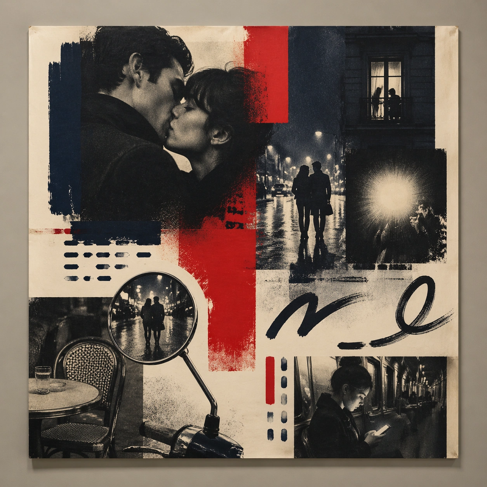

```text
Scene:
A square straight-on studio view of a pristine poster mounted on a matte wall with even museum lighting, crisp corners, and enough breathing room around the sheet for the full composition to read as an intentional object. The poster should express 1960s art-house poster grammar with radical photo crop, offset grain, hand-painted marks, and emotional empty space, using inky blue, carmine red, warm cream, charcoal, and cigarette-smoke gray and a tactile surface appropriate to the medium.

Subject:
Build the flagship poster statement for this style, with the strongest hierarchy, the clearest subject silhouette, and the most disciplined balance between image field, pseudo-typography, and empty space. Use street couples, scooter mirrors, apartment windows, rain-slick pavement, camera flash, and cafe tables as the main visual ingredients, and organize them with handwritten sweeps and sans blocks that feel gestural but stay non-readable. For the contemporary-subject axis, thread in a late-night metro ride and smartphone glow transformed into a melancholic art-house romance surface. The poster must feel like an original design object rather than a reproduction of any known work.

Important details:
Treat this as the cleanest thesis image in the set: the paper should look fresh, the inks or paint should feel deliberate, and every formal rule of the style should be easy to study at a glance. Preserve abrupt crop decisions, mood ambiguity, rough screen-print texture, and tension between photo and mark-making. Keep every letterform abstract and non-readable, as if it were a typographic texture rather than language. Make the style unmistakable through composition, palette, surface behavior, and symbolic compression. no blockbuster gloss, no readable credits, no hyper-polished skin retouching, no superhero spectacle.

Use case:
French New Wave single study 1/9, establishing the cleanest museum-grade poster reading.

Constraints:
No readable text, no watermark, no logos, preserve exact 1:1 aspect ratio, no copyrighted characters, no real brand marks, no QR codes, no interface chrome, no accidental gibberish lettering.
```

Model: GPT Image 2 · Author: ChaosRealmsAI

[Original source](https://github.com/ChaosRealmsAI/gpt-image-2-gallery/blob/5296db8c996e38776c83a0bc8c64f848dcd512b3/works/topics/new-wave-french-film-poster/packages/single-poster-studies/images/01-canonical-one-sheet/meta.json) · [Provenance and original license](data/projectd-batch-0012.json)

## Patagonian Granite-Spire Landscape Study — ChaosRealmsAI · MIT


```text
Scene:
Create a square, photoreal landscape study of patagonian spire granite. Compose it as the clearest monument-scale establishing view, using a wide, level camera position with deep atmospheric recession and a calm, authoritative horizon. Let broad, sculpting natural light describe the major masses before it picks out the smaller details Keep the frame cinematic but disciplined, with a clear foreground, middle distance, and far mass so the viewer can measure real depth. The image should feel like a field photograph made with patience, precision, and sublime restraint rather than a fantasy matte painting.

Subject:
Show jagged Patagonian granite spires rising through storm clouds, touched by rose dawn light above a glacier lake, with a lone climber silhouette on the approach. This variation should emphasize hero panorama. The main landform must dominate the composition, but secondary elements should quietly explain how the place works: water paths, sediment lines, snow bands, surf, ash, wind streaks, stars, or human traces where appropriate. Everything in the image should support the same idea of scale and climate, so the scene reads as one coherent environment rather than a stack of spectacular details.

Important details:
Preserve serrated granite geometry, storm-driven cloud movement, rose and steel-gray color contrast, glacial water reflection, and a harsh high-wind alpine atmosphere. Keep one dominant landform, one secondary supporting rhythm, and a restrained scale witness so the scene reads immediately. Keep geology, weather, and atmosphere physically believable. Use subtle micro-texture, tonal separation, and air perspective to reinforce distance. If a human, vehicle, tent, caravan, bird, or boat appears, it must remain tiny and subordinate to the landscape, functioning only as a scale witness. The composition should feel original, severe, and elegant, with no decorative filler and no imitation of any copyrighted visual property.

Use case:
Patagonian Spire Granite single study 1/9, exploring the hero panorama variation.

Constraints:
No readable text, no watermark, no logos, preserve exact 1:1 aspect ratio, no dense forest foreground, no cable cars, no fantasy castle ruins, no tropical haze, no split-screen layout, no collage fragments, no exaggerated fisheye distortion, no kitsch color grading, no artificial border, no split-panel treatment.
```

Model: GPT Image 2 · Author: ChaosRealmsAI

[Original source](https://github.com/ChaosRealmsAI/gpt-image-2-gallery/blob/5296db8c996e38776c83a0bc8c64f848dcd512b3/works/topics/patagonian-spire-granite/packages/single-landscape-studies/images/01-main-panorama/meta.json) · [Provenance and original license](data/projectd-batch-0012.json)

## Surreal Remote-Work Theatre Poster Study — ChaosRealmsAI · MIT

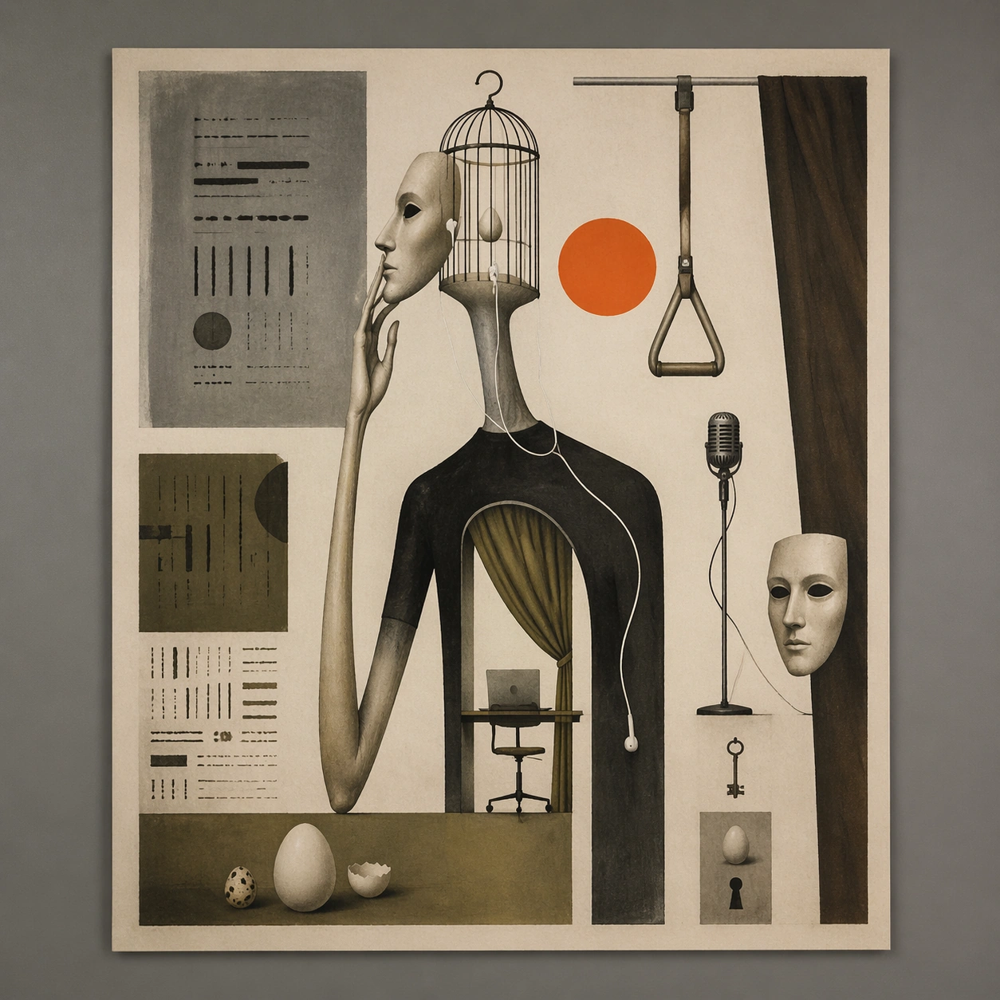

```text
Scene:
A square straight-on studio view of a pristine poster mounted on a matte wall with even museum lighting, crisp corners, and enough breathing room around the sheet for the full composition to read as an intentional object. The poster should express dry surreal theatre-poster logic using one impossible symbol, large mute fields, and an intellectual deadpan mood, using ash gray, olive, umber, bone, and a single acid orange or neon pink accent and a tactile surface appropriate to the medium.

Subject:
Build the flagship poster statement for this style, with the strongest hierarchy, the clearest subject silhouette, and the most disciplined balance between image field, pseudo-typography, and empty space. Use elongated limbs, bird cages, eggs, microphones, masks, curtains, keys, and impossible body-object hybrids as the main visual ingredients, and organize them with quiet hand-drawn title blocks used as texture and spacing devices rather than readable type. For the contemporary-subject axis, thread in remote-work objects, earbuds, and subway handles fused into a deadpan surreal theatre metaphor. The poster must feel like an original design object rather than a reproduction of any known work.

Important details:
Treat this as the cleanest thesis image in the set: the paper should look fresh, the inks or paint should feel deliberate, and every formal rule of the style should be easy to study at a glance. Preserve symbolic compression, painterly paper tooth, sparse composition, and one decisive accent color. Keep every letterform abstract and non-readable, as if it were a typographic texture rather than language. Make the style unmistakable through composition, palette, surface behavior, and symbolic compression. no crowded collage, no glamour sheen, no literal plot illustration, no cheerful advertising tone.

Use case:
Polish Surrealist single study 1/9, establishing the cleanest museum-grade poster reading.

Constraints:
No readable text, no watermark, no logos, preserve exact 1:1 aspect ratio, no copyrighted characters, no real brand marks, no QR codes, no interface chrome, no accidental gibberish lettering.
```

Model: GPT Image 2 · Author: ChaosRealmsAI

[Original source](https://github.com/ChaosRealmsAI/gpt-image-2-gallery/blob/5296db8c996e38776c83a0bc8c64f848dcd512b3/works/topics/polish-poster-surrealist/packages/single-poster-studies/images/01-canonical-one-sheet/meta.json) · [Provenance and original license](data/projectd-batch-0012.json)

## Psychedelic Electronic-Set Poster Study — ChaosRealmsAI · MIT

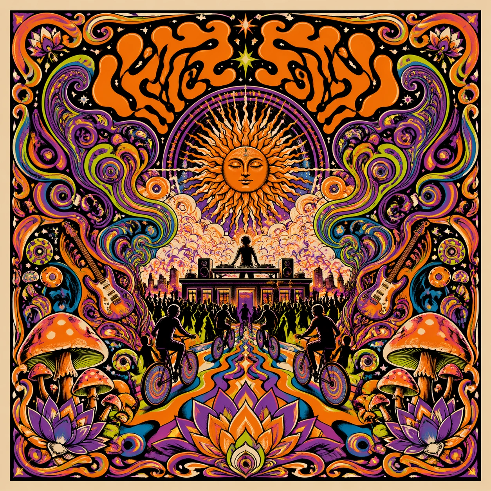

```text
Scene:
A square straight-on studio view of a pristine poster mounted on a matte wall with even museum lighting, crisp corners, and enough breathing room around the sheet for the full composition to read as an intentional object. The poster should express late-1960s psychedelic poster language with liquid swirls, floral mandala density, vibrating contours, and molten ornamental framing, using acid orange, violet, lime, cyan, cream, and deep black and a tactile surface appropriate to the medium.

Subject:
Build the flagship poster statement for this style, with the strongest hierarchy, the clearest subject silhouette, and the most disciplined balance between image field, pseudo-typography, and empty space. Use sun faces, paisley smoke, guitars, mushrooms, stars, lotus petals, and concentric wave rings as the main visual ingredients, and organize them with ornamental pseudo-lettering that feels lavish and tangled while remaining unreadable. For the contemporary-subject axis, thread in a rooftop electronic set, bike lights, and crowd motion translated into a hallucinatory hand-drawn poster field. The poster must feel like an original design object rather than a reproduction of any known work.

Important details:
Treat this as the cleanest thesis image in the set: the paper should look fresh, the inks or paint should feel deliberate, and every formal rule of the style should be easy to study at a glance. Preserve dense symmetry, nested curves, optical vibration, and saturated color friction across the whole sheet. Keep every letterform abstract and non-readable, as if it were a typographic texture rather than language. Make the style unmistakable through composition, palette, surface behavior, and symbolic compression. no plain corporate layout, no dead empty zones, no restrained minimalist spacing, no clean sans-serif blocks.

Use case:
Psychedelic 60s single study 1/9, establishing the cleanest museum-grade poster reading.

Constraints:
No readable text, no watermark, no logos, preserve exact 1:1 aspect ratio, no copyrighted characters, no real brand marks, no QR codes, no interface chrome, no accidental gibberish lettering.
```

Model: GPT Image 2 · Author: ChaosRealmsAI

[Original source](https://github.com/ChaosRealmsAI/gpt-image-2-gallery/blob/5296db8c996e38776c83a0bc8c64f848dcd512b3/works/topics/psychedelic-rock-concert-1960s/packages/single-poster-studies/images/01-canonical-one-sheet/meta.json) · [Provenance and original license](data/projectd-batch-0012.json)

## Risograph Bicycle-and-Zine Poster Study — ChaosRealmsAI · MIT

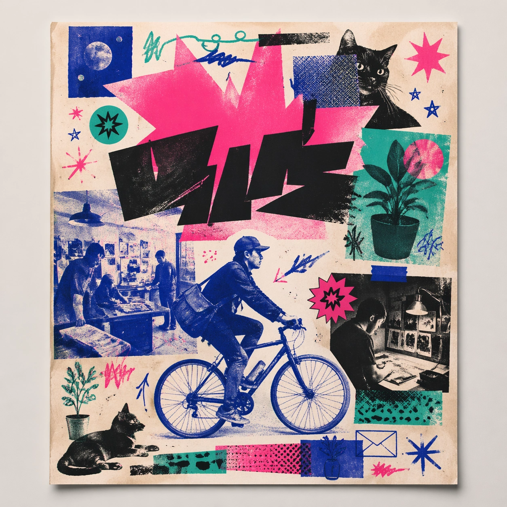

```text
Scene:
A square straight-on studio view of a pristine poster mounted on a matte wall with even museum lighting, crisp corners, and enough breathing room around the sheet for the full composition to read as an intentional object. The poster should express DIY risograph poster language with fluorescent layers, halftone dots, soy-ink soak, copier artifacts, and handmade zine rhythm, using fluorescent pink, teal, ultramarine, black, and fibrous cream paper and a tactile surface appropriate to the medium.

Subject:
Build the flagship poster statement for this style, with the strongest hierarchy, the clearest subject silhouette, and the most disciplined balance between image field, pseudo-typography, and empty space. Use club-flyer stars, bicycles, cats, plants, arrows, sticker bursts, notebook doodles, and photocopy shadows as the main visual ingredients, and organize them with xerox-like title blocks, stickers, and captions treated as energetic but non-readable print texture. For the contemporary-subject axis, thread in community workshops, late-night print studios, and messenger bikes folded into a zine-launch poster system. The poster must feel like an original design object rather than a reproduction of any known work.

Important details:
Treat this as the cleanest thesis image in the set: the paper should look fresh, the inks or paint should feel deliberate, and every formal rule of the style should be easy to study at a glance. Preserve plate drift, dot grain, bleed-through, paper curl, and independent-publisher roughness. Keep every letterform abstract and non-readable, as if it were a typographic texture rather than language. Make the style unmistakable through composition, palette, surface behavior, and symbolic compression. no full-CMYK smoothness, no perfect vector edges, no glossy magazine finish, no sterile product polish.

Use case:
Risograph Zine single study 1/9, establishing the cleanest museum-grade poster reading.

Constraints:
No readable text, no watermark, no logos, preserve exact 1:1 aspect ratio, no copyrighted characters, no real brand marks, no QR codes, no interface chrome, no accidental gibberish lettering.
```

Model: GPT Image 2 · Author: ChaosRealmsAI

[Original source](https://github.com/ChaosRealmsAI/gpt-image-2-gallery/blob/5296db8c996e38776c83a0bc8c64f848dcd512b3/works/topics/risograph-zine-handmade/packages/single-poster-studies/images/01-canonical-one-sheet/meta.json) · [Provenance and original license](data/projectd-batch-0012.json)

## Athletic Footwear and Toy Packaging Triptych — ChaosRealmsAI · MIT

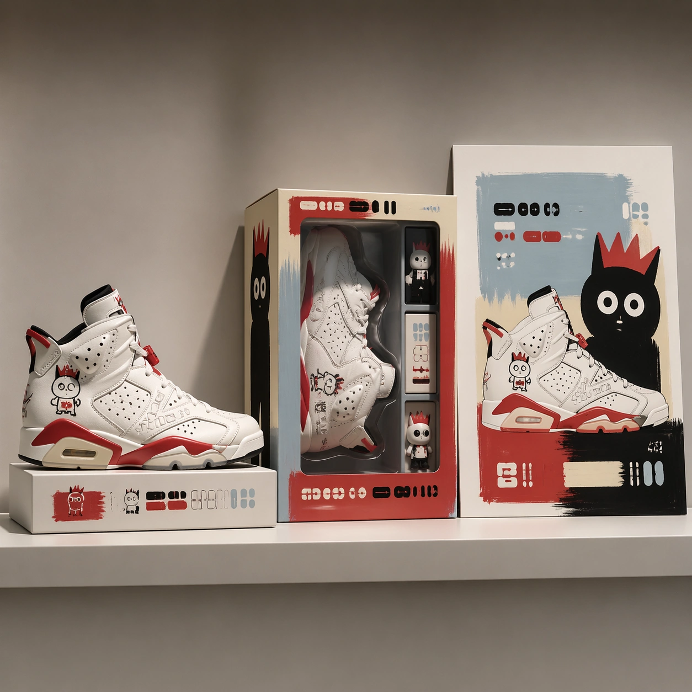

```text
Scene:
A square commercial pitch-board mockup photographed in a bright studio, arranged as a clean three-part retail presentation. The camera looks straight at a shallow display shelf with softbox reflections, neutral warm gray background, and crisp shadows. The composition uses a left product hero, a center packaging window box, and a right campaign poster panel, all aligned to a precise grid with generous margins and premium proposal lighting.

Subject:
A fictional athletic footwear capsule paired with a neo-pop toy painter language. The shoe has sculpted white leather panels, cherry-red rubber accents, hand-drawn childlike character marks, and small embossed abstract glyph blocks. The packaging is a clear-window collector box with painted mascot silhouettes and layered insert cards. The poster repeats the product shape as oversized flat color cutouts with playful eyes, uneven brush borders, and carefully placed non-readable label bars.

Important details:
Keep the product, box, and poster visibly from the same campaign through matching red, ivory, black, and pale blue. The mockup must feel expensive enough for a design proposal, not a random collage. Preserve believable materials: leather grain, translucent plastic window, folded carton edges, printed ink texture, and tabletop contact shadows. All typography areas should be structured as clean placeholder glyphs rather than legible brand names.

Use case:
Brand Artist Collab Mockup single study 1/8, focused on a proposal-ready product, packaging, and poster triptych.

Constraints:
No readable text, no watermark, no logos, preserve exact 1:1 aspect ratio, no real brand names, no real artist signatures, no distorted shoe anatomy, no cluttered retail background, no extra panels outside the three-part mockup.
```

Model: GPT Image 2 · Author: ChaosRealmsAI

[Original source](https://github.com/ChaosRealmsAI/gpt-image-2-gallery/blob/5296db8c996e38776c83a0bc8c64f848dcd512b3/works/topics/brand-artist-collab-mockup/packages/single-collab-proposal-studies/images/athletic-toy-window/meta.json) · [Provenance and original license](data/projectd-batch-0012.json)

## Game Starter Pack Store Capsule — ChaosRealmsAI · MIT

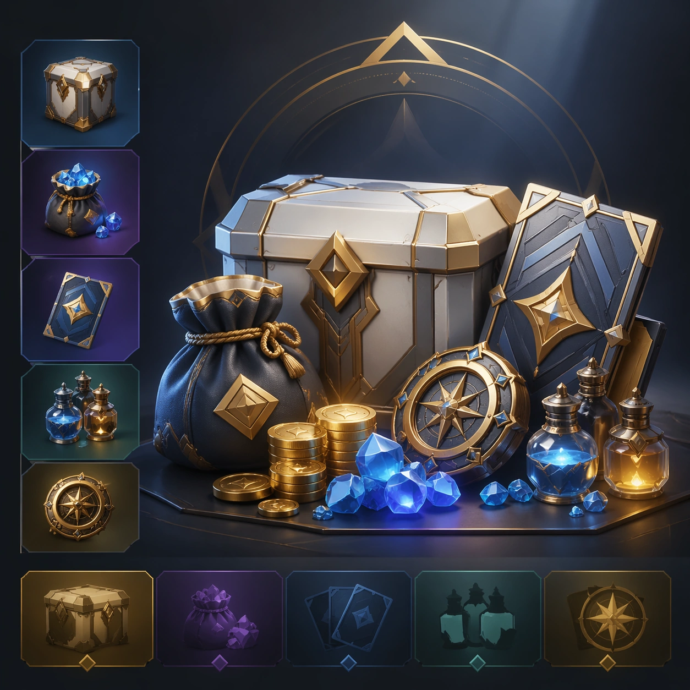

```text
Scene:
A square production-ready image designed for a game-art review wall and a commercial gallery at the same time. Frame a starter pack capsule built around welcoming value and clean product grouping with disciplined lighting, clean edge separation, and enough surrounding context to prove how the asset would behave in a real product surface. The camera, crop, and tonal balance should feel intentional rather than generic, with high readability at first glance and convincing material response under closer inspection.

Subject:
Center the study on a starter pack capsule built around welcoming value and clean product grouping. Translate the topic into a concrete, shippable visual statement instead of a loose mood board. Build layered object relationships, believable surface finish, and strong silhouette grouping so the image reads immediately as part of Bundle Shop Capsule System. The subject should feel made for a live game pipeline: useful in store, UI, campaign, or art-review contexts, with visual hierarchy strong enough to survive aggressive cropping.

Important details:
the offer should feel approachable and trustworthy while visually rich enough for a store feature. Keep every supporting element subordinate to the main read, and make category separation obvious through form, color zoning, depth, and material logic rather than words. Where panels, cards, badges, or interface blocks appear, they must look professionally structured but remain unreadable. The visual language should feel premium, original, and coherent across this package, with no filler clutter and no accidental resemblance to a specific shipped game IP.

Use case:
Bundle Shop Capsule System single study 1/9, focused on starter pack capsule.

Constraints:
No readable text, no watermark, no logos, preserve exact 1:1 aspect ratio, no readable price text, no coupons, no broken hierarchy, no generic stock-photo staging, no accidental UI gibberish.
```

Model: GPT Image 2 · Author: ChaosRealmsAI

[Original source](https://github.com/ChaosRealmsAI/gpt-image-2-gallery/blob/5296db8c996e38776c83a0bc8c64f848dcd512b3/works/topics/bundle-shop-capsule-system/packages/single-bundle-shop-studies/images/starter-pack-capsule/meta.json) · [Provenance and original license](data/projectd-batch-0012.json)

## Camera Launch Website Concept — ChaosRealmsAI · MIT

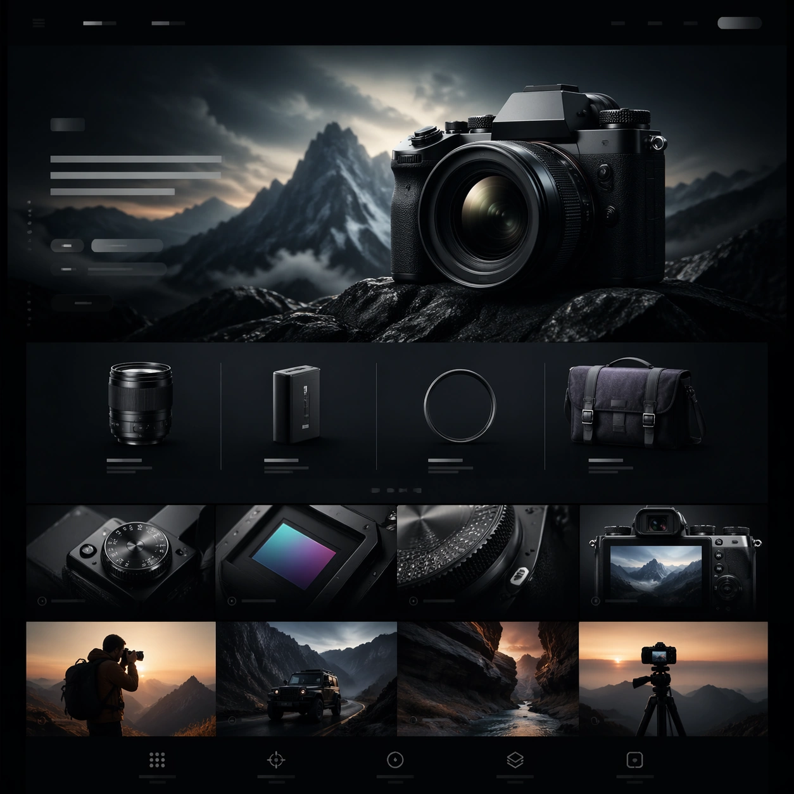

```text
Scene:
A square-framed premium website still designed for Cinematic Hardware Microsite. The image should feel like a cinematic hardware microsite captured at its most polished moment: controlled contrast, glossy but believable materials, deep atmosphere, and a disciplined web-art-direction rhythm. Use the square crop to show a complete webpage moment inside the frame, with clear zones for hero media, quiet non-legible interface rails, and elegant spacing rather than a flat generic UI.

Subject:
Present the hardware and its key accessories as a calm comparison board with premium spacing, soft shadows, and modular web framing. Draw on this topic direction: Create cinematic microsite visuals for hardware launches, balancing immersive hero storytelling with readable spec sections and conversion modules. Use the theme focus "电影感网页首屏 + 规格模块 + 场景演绎" and the inspiration "掌机、机械键盘、专业相机或桌面音箱新品的长页面网站首屏与内容区组合提案。" as raw material, but render a fictional premium hardware launch rather than referencing any specific brand. Let the main object feel like a plausible camera, handheld console, keyboard, speaker, or audio device, depending on what best serves the composition. Keep the composition independent, but make the hardware feel launch-ready, tactile, and compatible with a cinematic product website.

Important details:
Honor the topic's core requirement: 比普通 landing page 更强调情绪化场景和硬件美学，但仍要有可读的网页结构。 Preserve premium product-photography realism, clean industrial design cues, layered web hierarchy, and the sense that the page could be sliced into multiple scroll sections. Reflect the frontier claim that ordinary models lose section rhythm and system cohesion in these complex commercial layouts; this image should instead keep the product silhouette, material finish, lighting logic, and module cadence unusually coherent. Success should feel aligned with these goals: 既有高级情绪图，也有真实网页 section 感; 产品外观、材质、配件和使用场景可信; 页面像可以切成多段长图或网页模块; 适合做科技品牌提案或 demo showcase.

Use case:
Cinematic Hardware Microsite single study 1/5.

Constraints:
No readable text, no watermark, no logos, preserve exact 1:1 aspect ratio, no browser chrome, no random lorem ipsum, no cheap ecommerce clutter, no floating disconnected UI cards, no distorted product geometry, no extra hands unless the concept requires them.
```

Model: GPT Image 2 · Author: ChaosRealmsAI

[Original source](https://github.com/ChaosRealmsAI/gpt-image-2-gallery/blob/5296db8c996e38776c83a0bc8c64f848dcd512b3/works/topics/cinematic-hardware-microsite/packages/single-module-studies/images/01-device-pairing-board/meta.json) · [Provenance and original license](data/projectd-batch-0012.json)

## Morning Stretch Pet Carousel Cover — ChaosRealmsAI · MIT

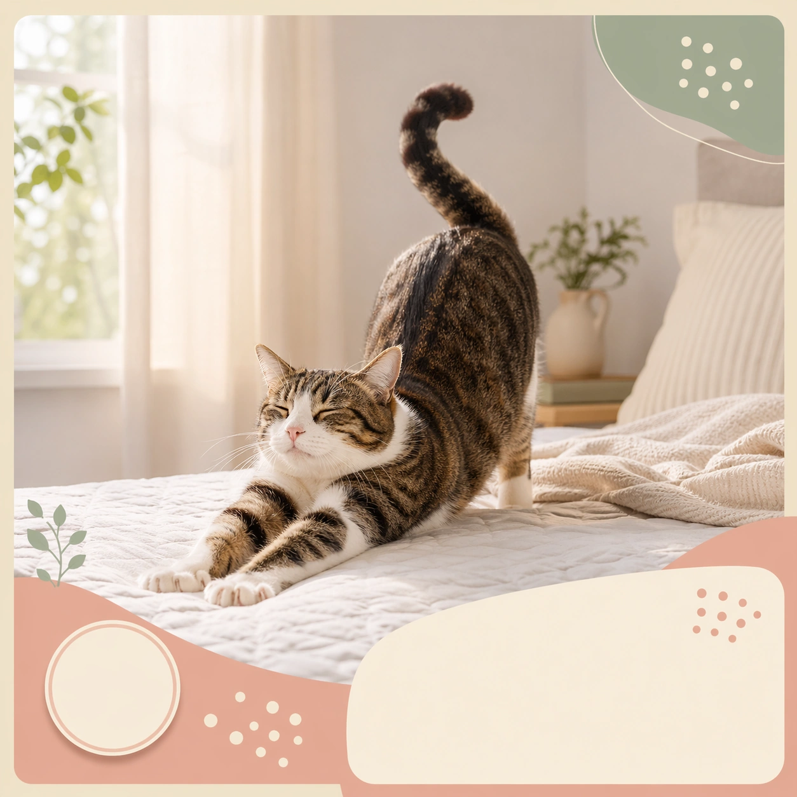

```text
Scene:
A square social carousel card for a pet focused lifestyle account, combining believable photography with polished graphic framing, soft color blocks, and elegant placeholder caption zones. The image should feel feed native and instantly shareable, but still clean enough for a brand team to reuse in campaign planning. Keep the composition legible at thumbnail size and strong enough to function as one panel in a larger carousel sequence. Use a pale bedroom corner with soft sunrise light, a tidy quilt, and rounded graphic blocks framing the lower third like a planned carousel cover.

Subject:
Anchor the card around one clear pet behavior or daily ritual. The animal should stay realistic and expressive, with posture, paws, ears, and eye direction doing most of the emotional work. The framing can include props, bedding, or environment cues, but only when they support the story and help the card read quickly in a busy feed. Show a cat extending forward in a full body stretch with lifted tail, calm eyes, and relaxed paws, capturing the recognizable first moment of a home routine.

Important details:
Treat layout as part of the concept: use layered paper blocks, soft borders, icon like dots, or sticker style cutout shadows without introducing readable copy. The mood should remain warm, useful, and commercially organized rather than chaotic influencer clutter. Each card must feel distinct, yet part of the same family of pet content systems for social scheduling, seasonal batches, and brand feeds. Make the card feel optimistic and morning fresh rather than sleepy or messy, with enough blank structure for future repost or campaign adaptation.

Use case:
Cute Pet Social Carousel Family single study 1/9, morning stretch carousel cover for a commercially reusable prompt atlas example.

Constraints:
No readable text, no watermark, no logos, preserve exact 1:1 aspect ratio, no readable captions, no meme screenshot aesthetic, no chaotic collage overload, no warped anatomy, no generic stock photo stiffness, no intrusive human faces, no messy laundry, no smartphone in frame, no harsh orange sunrise flare.
```

Model: GPT Image 2 · Author: ChaosRealmsAI

[Original source](https://github.com/ChaosRealmsAI/gpt-image-2-gallery/blob/5296db8c996e38776c83a0bc8c64f848dcd512b3/works/topics/cute-pet-social-carousel-family/packages/single-pet-social-carousel-studies/images/01-morning-stretch-carousel-cover/meta.json) · [Provenance and original license](data/projectd-batch-0012.json)

## Orbital Royal Family Festival Poster — ChaosRealmsAI · MIT

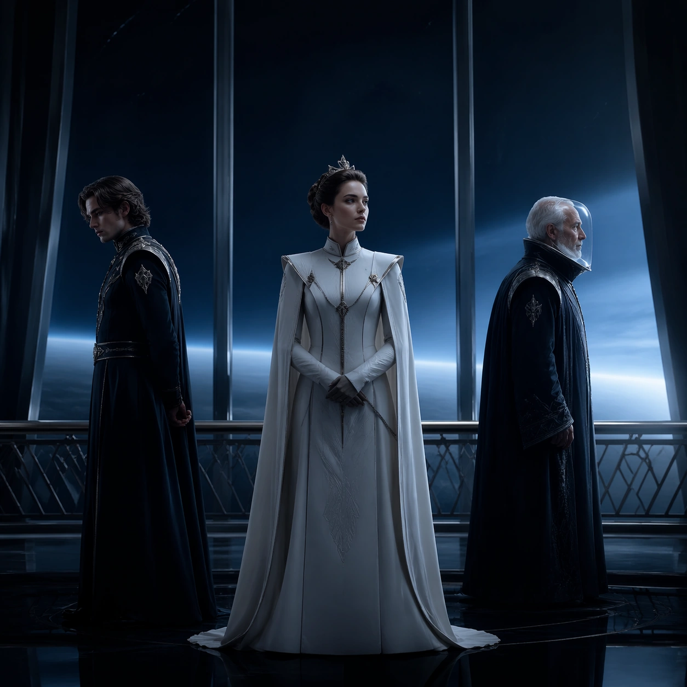

```text
Scene:
A square competition-poster composition set in the observation deck of a silent orbital palace, with midnight blue glass, distant planet glow, polished metal handrails, and restrained silver highlights. The mood is solemn and expensive rather than sci-fi loud, with generous negative space and a premium one-sheet balance that suggests official festival packaging. The frame should feel ready for invisible title and laurel placement without containing any readable text.

Subject:
Create a serious fandom-crossover poster centered on an original trio: a young empress in severe white tailoring, her disinherited brother in a dark ceremonial uniform, and an elderly navigator in a translucent visor. They should stand far enough apart to imply political fracture, but close enough to read as one family tragedy. The setting hints at a space-opera dynasty, yet the treatment must remain intimate and human, more arthouse succession drama than battle spectacle. Use window reflections, subtle costume insignia shapes, and careful eye lines to communicate hierarchy.

Important details:
The challenge is translating franchise-scale lore into an austere award-festival visual language. Keep the poster sparse, polished, and emotionally legible. Use precise facial lighting, controlled metallic textures, and soft cosmic color gradients without turning the image into concept-art overload. The characters should feel instantly iconic, but the packaging must read as a genuine competition-film key art image.

Use case:
Festival Poster Fandom Crossover single study 5/9, testing whether a space-opera royal family can be compressed into restrained competition-poster packaging.

Constraints:
No readable text, no watermark, no logos, preserve exact 1:1 aspect ratio, no spaceship battle, no laser effects, no crowded starfield wallpaper, no floating heads collage, no campy science-fiction camp, no superhero posing, no glossy franchise merchandise feel.
```

Model: GPT Image 2 · Author: ChaosRealmsAI

[Original source](https://github.com/ChaosRealmsAI/gpt-image-2-gallery/blob/5296db8c996e38776c83a0bc8c64f848dcd512b3/works/topics/festival-poster-fandom-crossover/packages/single-festival-poster-studies/images/orbit-royalty-competition/meta.json) · [Provenance and original license](data/projectd-batch-0012.json)

## The Glass Orbit Fictional Film Poster — ChaosRealmsAI · MIT

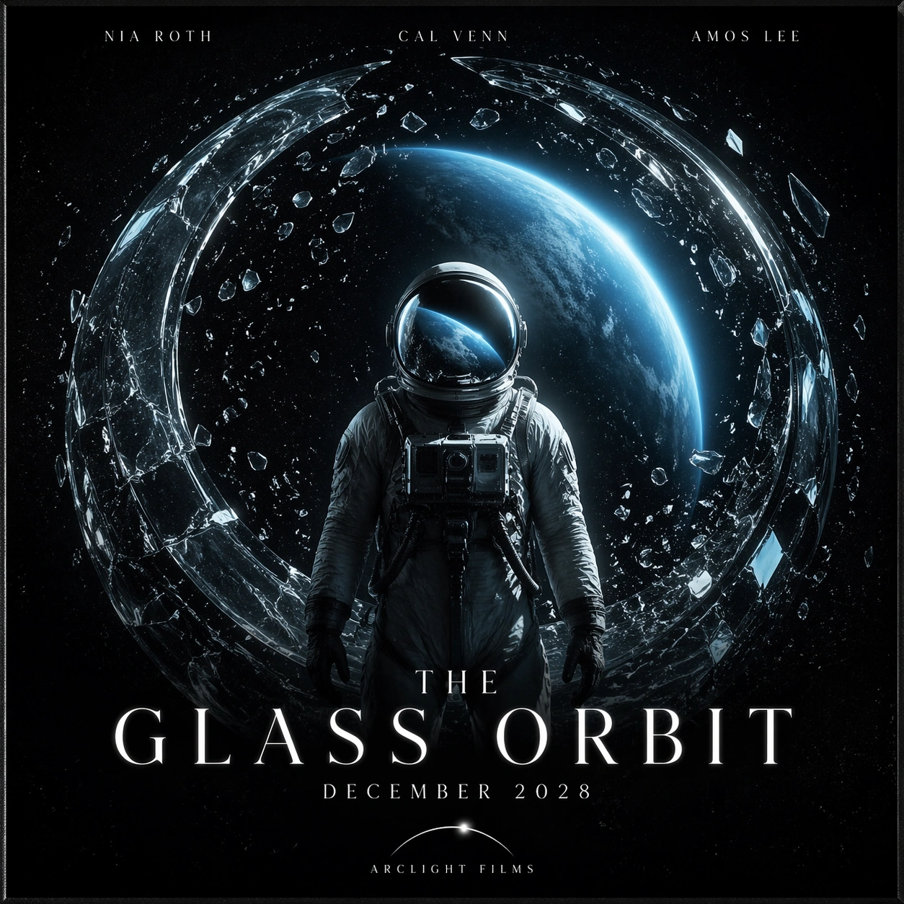

```text
Scene:
A square premium science-fiction movie poster printed on satin paper, shown straight-on with faint edge shadow and realistic poster grain. Use black space, pale cyan planet light, white typography, and a single dramatic central object. The composition should look like a finished theatrical one-sheet for a serious fictional film.

Subject:
Create a poster for a fictional space drama titled THE GLASS ORBIT. Show an astronaut standing inside a transparent broken orbital ring, with a blue planet reflected in the helmet and tiny shards of glass forming a circular halo. The exact readable poster copy must be: THE GLASS ORBIT, NIA ROTH, CAL VENN, AMOS LEE, DECEMBER 2028, ARCLIGHT FILMS. The title should be large and elegant near the lower third, cast names at the top, release date under the title, and a small fictional studio mark at bottom.

Important details:
This is a fake IP poster, not a real franchise. The image must balance photorealistic space suit materials with clean poster typography. Keep the title readable, spacing professional, and text aligned to a clear grid. Use no long billing block. The fictional studio mark can be a simple abstract arc symbol beside ARCLIGHT FILMS.

Use case:
Fictional IP Poster single study 5/8, testing readable release typography on a photorealistic space drama poster.

Constraints:
No readable text except the specified fictional poster copy, no watermark, no real logos, preserve exact 1:1 aspect ratio, no existing franchise references, no extra cast names, no misspelled title, no flag patches, no clutter over text.
```

Model: GPT Image 2 · Author: ChaosRealmsAI

[Original source](https://github.com/ChaosRealmsAI/gpt-image-2-gallery/blob/5296db8c996e38776c83a0bc8c64f848dcd512b3/works/topics/fictional-ip-poster/packages/single-fictional-release-posters/images/glass-orbit-poster/meta.json) · [Provenance and original license](data/projectd-batch-0012.json)

## Sculpted Fragrance Brand Website Concept — ChaosRealmsAI · MIT

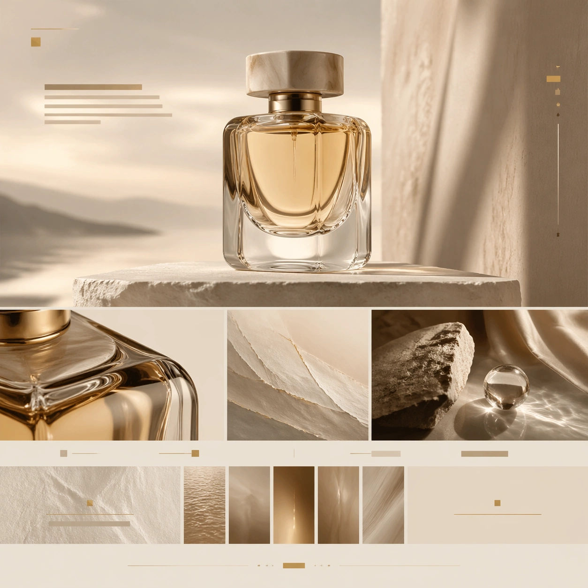

```text
Scene:
A square luxury brand-story page still for a sculptural fragrance launch, presented like an elegant maison website chapter. The page is front-on, spacious, and editorial, using ivory, pale stone, smoky amber, and faint gold-beige tones. The top half should feel like an atmospheric hero spread while the lower half transitions into refined storytelling modules, material close-ups, and subtle chapter dividers. Lighting is soft, luminous, and perfume-advertisement polished.

Subject:
Center a sculpted glass fragrance bottle with thick translucent walls, a heavy cap, and liquid tinted like pale amber. Around it, construct a believable brand-story page using abstract headline bars, chapter blocks, ingredient-inspired visual panels, and refined content bands that suggest origin, craft, and collection identity without readable copy. Include one macro crop of the bottle shoulder and glass thickness, and one supporting still-life panel with stone, fabric, and reflected light that implies olfactory mood rather than literal ingredients.

Important details:
The composition must feel like a luxury maison narrative, not an ecommerce product card. Emphasize tactile materials, quiet prestige, and a flow from hero object to craft story to collection context to understated CTA. Glass weight, reflections, cap fit, and liquid level should feel credible. Keep the page restrained, elegant, and expensive, with generous margins and careful chapter rhythm.

Use case:
Luxury Brand Story Page single study 1/9, testing fragrance storytelling, tactile material close-up, and maison-style chapter pacing.

Constraints:
No readable text, no watermark, no logos, preserve exact 1:1 aspect ratio, no browser chrome, no loud beauty-ad copy, no flowers exploding around the bottle, no cheap sparkles, no retail shelf scene, no distorted bottle symmetry.
```

Model: GPT Image 2 · Author: ChaosRealmsAI

[Original source](https://github.com/ChaosRealmsAI/gpt-image-2-gallery/blob/5296db8c996e38776c83a0bc8c64f848dcd512b3/works/topics/luxury-brand-story-page/packages/single-luxury-story-studies/images/sculpted-fragrance-chapter/meta.json) · [Provenance and original license](data/projectd-batch-0012.json)

## Mirror Room Music Visualizer Still — ChaosRealmsAI · MIT


```text
Scene:
A square mirror-lined room with moody blue light, shallow haze, and a performer seen both directly and in fragmented reflections. The image should feel like a loop still from a lyric visualizer, where the room itself produces rhythm and repetition before any readable language appears.

Subject:
A lone performer figure occupies the center while reflected copies stretch into the mirrors. Around the figure sit floating bars of invented glyph marks, faint waveform traces, and translucent rectangular panels that imply lyric pacing without displaying actual words.

Important details:
The mirrors should amplify repetition, timing, and emotional echo. Keep the pseudo-typography abstract and elegant, let the reflections reinforce the beat, and make the composition feel intentionally designed for music promo use. The frame should carry both atmosphere and layout discipline, not just glossy mood.

Use case:
Lyric Frames single study 5/9 for the Lyric Visualizer Frame Family Prompt Atlas theme.

Constraints:
No readable text, no watermark, no logos, preserve exact 1:1 aspect ratio, no readable text, no visible software frame, no crowd, no lens-flare overload, no neon club logos
```

Model: GPT Image 2 · Author: ChaosRealmsAI

[Original source](https://github.com/ChaosRealmsAI/gpt-image-2-gallery/blob/5296db8c996e38776c83a0bc8c64f848dcd512b3/works/topics/lyric-visualizer-frame-family/packages/single-visualizer-studies/images/mirror-room-loop/meta.json) · [Provenance and original license](data/projectd-batch-0012.json)

## Water Crown Splash Study — ChaosRealmsAI · MIT


```text
Scene:
A controlled black studio macro setup, pure black background, glossy black reflective tray, invisible electronic flash, cool blue rim light from back right and clean white key flash from front left.

Subject:
a single water droplet impact frozen as a crown splash on a glossy black tray, centered in a square frame at the exact peak moment of impact. The main event fills about 62% of the image width with particles suspended around it.

Important details:
Photorealistic high-speed photography, millionth-of-a-second freeze, macro lens, razor-sharp water surface tension, cool blue rim highlights, suspended micro droplets, realistic physics, deep black negative space, crop-safe composition.

Use case:
Independent image in a Prompt Atlas high-speed theme. Square 1:1 gallery card and detail modal asset.

Constraints:
No text, no watermark, no logo, no human hands, no visible weapon or launcher, no blood, no animals, no cartoon style, no CGI look, preserve exact 1:1 aspect ratio.
```

Model: GPT Image 2 · Author: ChaosRealmsAI

[Original source](https://github.com/ChaosRealmsAI/gpt-image-2-gallery/blob/5296db8c996e38776c83a0bc8c64f848dcd512b3/works/topics/high-speed-freeze/packages/single-impact-studies/images/water-crown/meta.json) · [Provenance and original license](data/projectd-batch-0012.json)

## Analog Tape Machine Session Still Life — ChaosRealmsAI · MIT

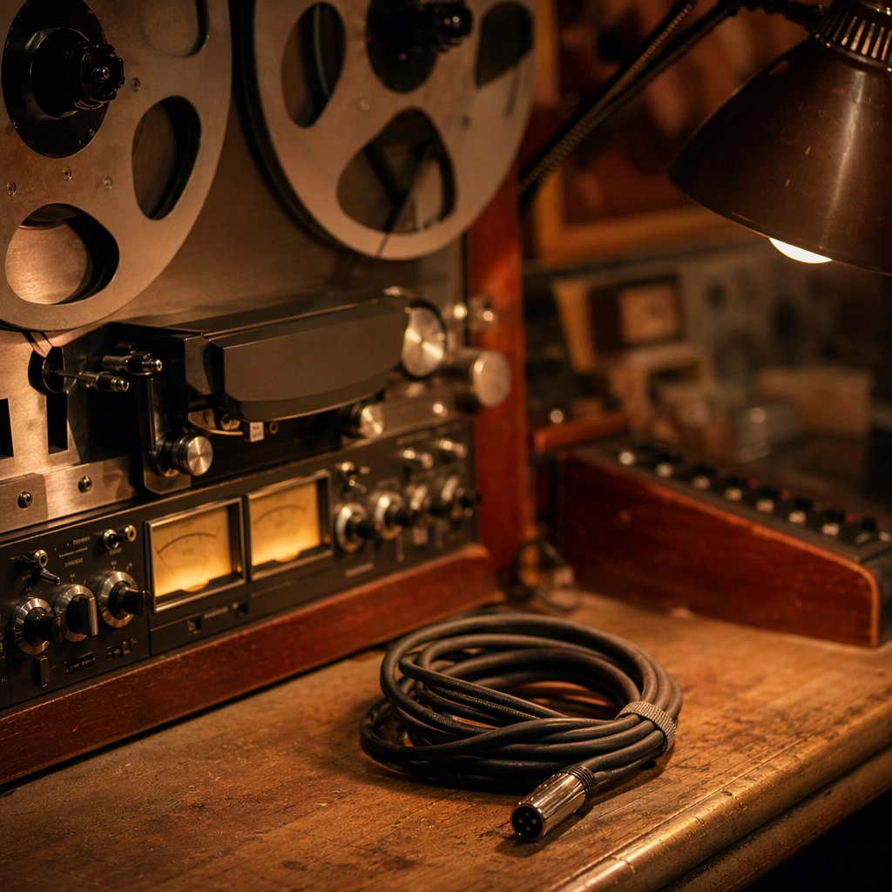

```text
Scene:
A square close still life inside a recording room with a tape machine, softly glowing meters, brushed metal knobs, and warm wood surfaces catching lamplight. The frame should feel tactile, intimate, and emotionally musical rather than purely technical.

Subject:
The subject is the recording object world itself: analog meters, reels, worn wood desk edges, a coiled cable, and a few softly out-of-focus studio surfaces. The composition should imply live-session authenticity and process without requiring a visible performer.

Important details:
Material realism matters. The machine should look used and loved, the light should be warm but controlled, and the surrounding surfaces should support a believable recording-room atmosphere. This should feel like adjacent campaign imagery for a stripped-back music session.

Use case:
Live Session single study 5/9 for the Live Session Poster and Recording Room Aesthetic Prompt Atlas theme.

Constraints:
No readable text, no watermark, no logos, preserve exact 1:1 aspect ratio, no readable labels, no bright computer screens, no desk clutter, no brand badges, no sterile lab look
```

Model: GPT Image 2 · Author: ChaosRealmsAI

[Original source](https://github.com/ChaosRealmsAI/gpt-image-2-gallery/blob/5296db8c996e38776c83a0bc8c64f848dcd512b3/works/topics/live-session-poster-and-recording-room-aesthetic/packages/single-studio-atmospheres/images/tape-machine-still-life/meta.json) · [Provenance and original license](data/projectd-batch-0012.json)

## Caviar and Gold Fine-Dining Overhead — ChaosRealmsAI · MIT

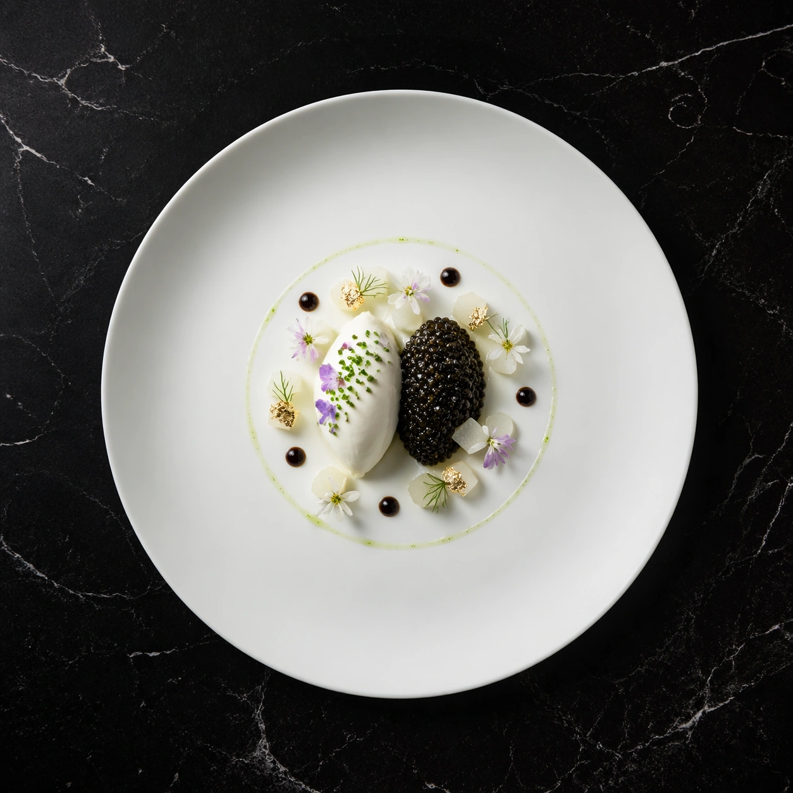

```text
Scene:
A square fine-dining hero shot photographed from directly overhead on a deep black marble table with soft veining. A single matte white porcelain plate sits slightly off center with generous negative space around it, lit by a precise top light with a faint 45 degree fill from the upper left. The atmosphere is quiet, premium, and editorial, like a Michelin restaurant campaign image made for a luxury magazine spread.

Subject:
At the center of the plate, build a small architectural tasting course around a quenelle of chilled creme fraiche, a restrained mound of glossy black caviar, tiny cubes of translucent kohlrabi, a few gold-leaf accents, and delicate edible flower petals in pale violet and white. Add a thin ring of clear herb oil and several micro dots of dark reduction so the dish reads as intentional constellation-like plating rather than random garnish. The portion should feel expensive and precise, not abundant.

Important details:
Preserve true culinary realism: caviar beads must look separate and hydrated, creme fraiche should hold a soft spooned texture, porcelain should remain clean, and sauce dots must have crisp edges. Keep the garnish logic sparse and balanced, with every component readable at a glance. The visual language is minimalist French fine dining with immaculate spacing, premium ingredient knowledge, and commercial food-photography polish.

Use case:
Michelin Plate Hero Shot single study 1/8, focused on a luxury caviar plate with disciplined top-down composition.

Constraints:
No readable text, no watermark, no logos, preserve exact 1:1 aspect ratio, no cutlery, no hands, no table clutter, no oversized portions, no messy sauce smears, no impossible garnish placements, no extra plates.
```

Model: GPT Image 2 · Author: ChaosRealmsAI

[Original source](https://github.com/ChaosRealmsAI/gpt-image-2-gallery/blob/5296db8c996e38776c83a0bc8c64f848dcd512b3/works/topics/michelin-plate-hero-shot/packages/single-fine-dining-hero-studies/images/01-caviar-gold-constellation/meta.json) · [Provenance and original license](data/projectd-batch-0012.json)

## Old and New Helmet Upgrade Comparison — ChaosRealmsAI · MIT

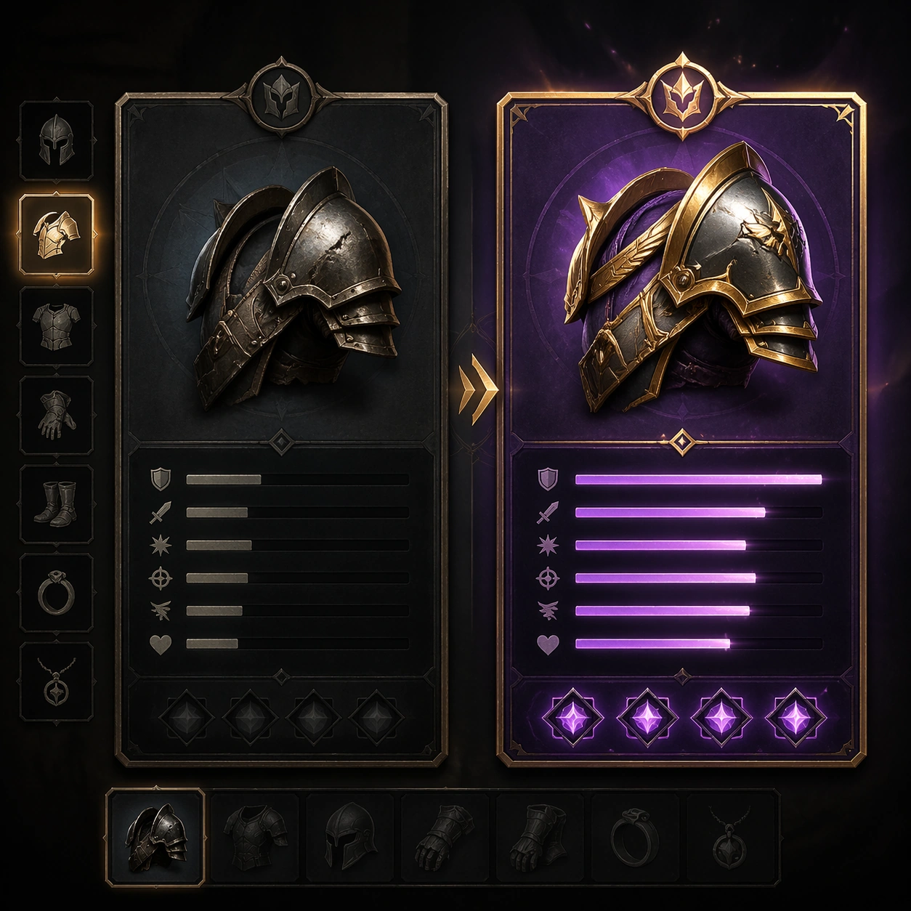

```text
Scene:
A square production-ready image designed for a game-art review wall and a commercial gallery at the same time. Frame a side-by-side old versus new gear comparison board with clear hierarchy and item desirability with disciplined lighting, clean edge separation, and enough surrounding context to prove how the asset would behave in a real product surface. The camera, crop, and tonal balance should feel intentional rather than generic, with high readability at first glance and convincing material response under closer inspection.

Subject:
Center the study on a side-by-side old versus new gear comparison board with clear hierarchy and item desirability. Translate the topic into a concrete, shippable visual statement instead of a loose mood board. Build layered object relationships, believable surface finish, and strong silhouette grouping so the image reads immediately as part of Inventory Tooltip Comparison Board. The subject should feel made for a live game pipeline: useful in store, UI, campaign, or art-review contexts, with visual hierarchy strong enough to survive aggressive cropping.

Important details:
the player’s upgrade decision should be obvious through shape, rarity framing, and stat-bar rhythm without legible text. Keep every supporting element subordinate to the main read, and make category separation obvious through form, color zoning, depth, and material logic rather than words. Where panels, cards, badges, or interface blocks appear, they must look professionally structured but remain unreadable. The visual language should feel premium, original, and coherent across this package, with no filler clutter and no accidental resemblance to a specific shipped game IP.

Use case:
Inventory Tooltip Comparison Board single study 1/9, focused on old vs new gear.

Constraints:
No readable text, no watermark, no logos, preserve exact 1:1 aspect ratio, no readable stats, no numbers, no broken hierarchy, no generic stock-photo staging, no accidental UI gibberish.
```

Model: GPT Image 2 · Author: ChaosRealmsAI

[Original source](https://github.com/ChaosRealmsAI/gpt-image-2-gallery/blob/5296db8c996e38776c83a0bc8c64f848dcd512b3/works/topics/inventory-tooltip-comparison-board/packages/single-inventory-tooltip-studies/images/old-vs-new-gear/meta.json) · [Provenance and original license](data/projectd-batch-0012.json)

## Terracotta and Bronze Facade Material Panel — ChaosRealmsAI · MIT

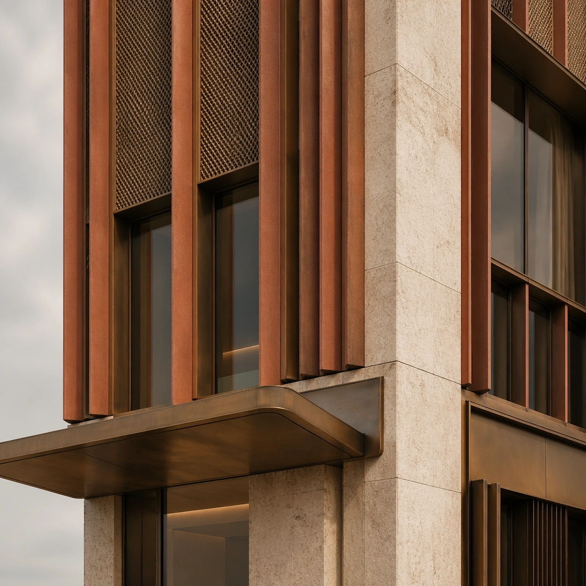

```text
Scene:
Create a square standalone support study for Architectural Facade Identity System. Use a close architectural mockup panel showing terracotta fins, bronze mesh, stone edge, and glazing sample and frame it like a premium commercial still or design-editorial crop with clear focal hierarchy, disciplined perspective, and enough breathing room for the materials and objects to read at both thumbnail and full size. Keep earthy terracotta, bronze brown, pale stone, smoked glass, and soft sky gray as the tonal guide so the image still belongs to the same theme family, and light the scene in a controlled way that emphasizes texture, edge quality, and authored atmosphere over spectacle.

Subject:
Show an architectural facade system with terracotta fins, bronze mesh, deep window reveals, sculpted canopies, and a civic-commercial identity that feels recognizable from multiple distances. In this support study, focus on construction realism, joint discipline, and tactile weathering. The image should work independently, yet it must still feel like it belongs to the same broader world of Facade Identity. Make the space, props, and detailing useful for real campaign, editorial, or design-review contexts rather than moodboard abstraction.

Important details:
Carry forward the broader language of the fin spacing, bronze mesh logic, canopy silhouette, reveal depth, and urban recognizability of the building, but let this image prove a new support surface or secondary deliverable. Material realism is essential: wood grain, metal sheen, glass edges, textiles, and stone should feel physically plausible and carefully art directed. Any graphic panels, labels, menus, packaging, or captions must stay abstract and unreadable. The overall result should feel reusable for architecture competitions, developer decks, city-brand editorials, and facade-design presentations, with enough structure that a creative or operations team could build on it.

Use case:
Architectural Facade Identity System single study 5/9, exploring support image for facade material reviews.

Constraints:
No readable text, no watermark, no logos, preserve exact 1:1 aspect ratio, no giant logos, no construction cranes, no crowds, no random neighboring ads, no impossible geometry, no specification text.
```

Model: GPT Image 2 · Author: ChaosRealmsAI

[Original source](https://github.com/ChaosRealmsAI/gpt-image-2-gallery/blob/5296db8c996e38776c83a0bc8c64f848dcd512b3/works/topics/architectural-facade-identity-system/packages/single-support-studies/images/01-material-mockup-panel/meta.json) · [Provenance and original license](data/projectd-batch-0012.json)

## Coach Portrait and Profile Board — ChaosRealmsAI · MIT

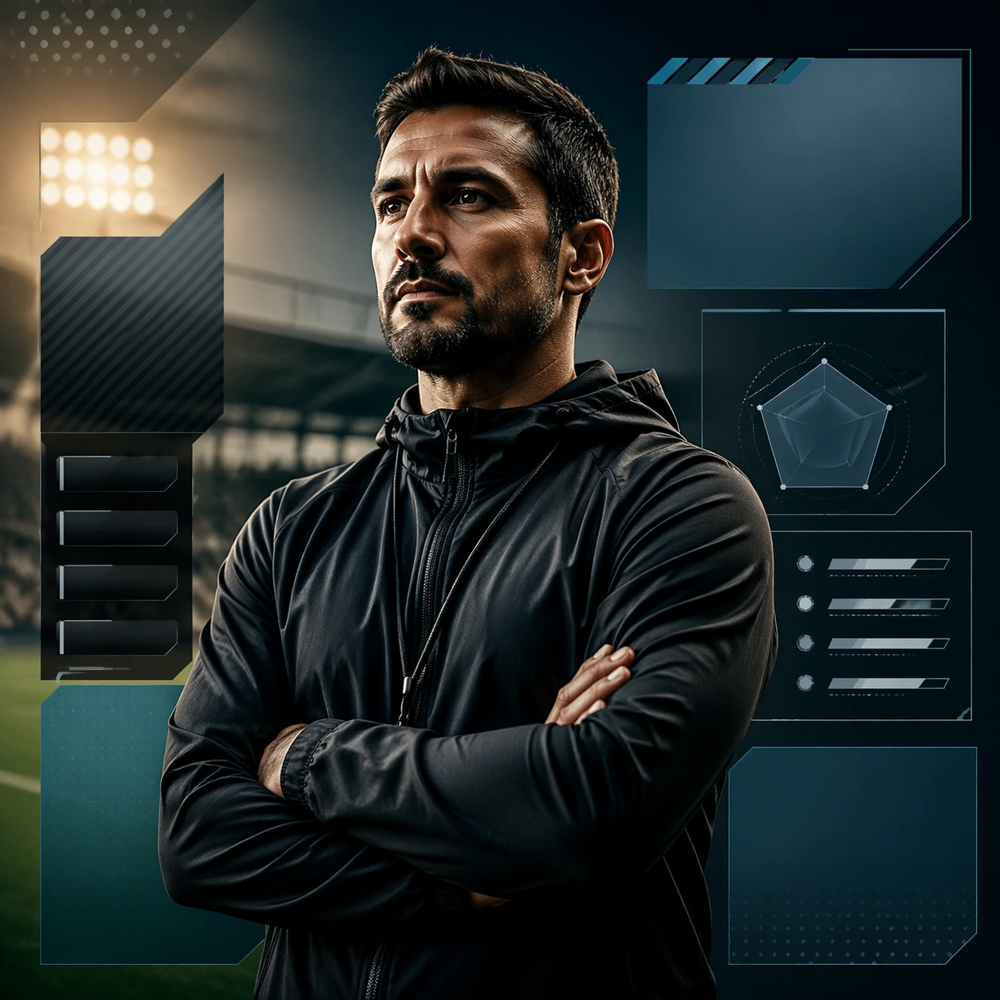

```text
Scene:
Create a square coach profile board for Athlete Cards, using portrait-led sports communication with stat-panel discipline, premium lighting, and card-like hierarchy. The composition should read as a practical, production-ready sports or fitness surface with a clear hierarchy, premium lighting, and obvious commercial intent. Keep the environment specific enough to feel real, but leave enough control in the layout for non-readable information modules, campaign blocks, or visualized metrics. Aim for a finish that works for a brand, club, app, academy, or event operator.

Subject:
Build the image around folded-arms coach portrait. The subject should be original, believable, and free of any real-brand or celebrity cues. Use realistic apparel, safe body mechanics when movement is visible, and environmental props that support the category without clutter. The subject must stay visually dominant so the design still works as a communication asset rather than a pure scene study.

Important details:
The mood should read as sideline authority. Treat layout, light, and supporting graphic structure as part of one polished delivery surface. Any schedule blocks, metric panels, quote zones, badges, or path diagrams must stay abstract and non-readable. Prioritize usefulness, clarity, and category truth over spectacle. The image should feel distinct from the series package while still belonging naturally to the same topic and business use case.

Use case:
Athlete Cards single study 5/9, an independent rollout surface for the topic.

Constraints:
No readable text, no watermark, no logos, preserve exact 1:1 aspect ratio, no brand marks, no public-figure resemblance, no generic stock layout, no cluttered UI imitation, no accidental copyrighted insignia.
```

Model: GPT Image 2 · Author: ChaosRealmsAI

[Original source](https://github.com/ChaosRealmsAI/gpt-image-2-gallery/blob/5296db8c996e38776c83a0bc8c64f848dcd512b3/works/topics/athlete-spotlight-and-profile-card-family/packages/single-support-studies/images/coach-profile-board/meta.json) · [Provenance and original license](data/projectd-batch-0012.json)

## Back-to-School Organizer Flatlay — ChaosRealmsAI · MIT

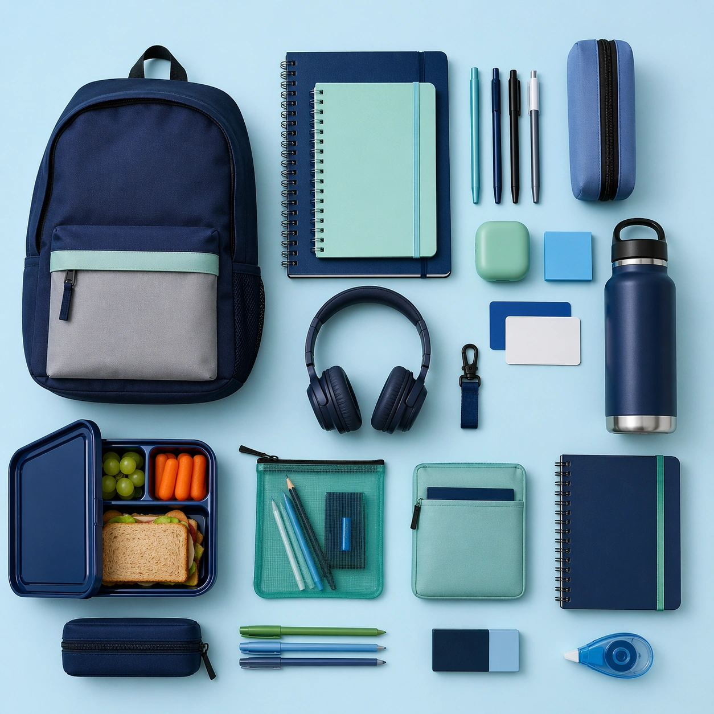

```text
Scene:
Create a square overhead school-organization flatlay with bright even light, clean background color, and crisp object spacing. The frame should feel like a premium organizational campaign image rather than a cluttered backpack dump. Use the logic of a locker or compact student storage zone translated into an editorial board, with a strong sense of readiness and control.

Subject:
Arrange notebooks, pens, bottle, lunch or storage forms, headphones, card-like objects, and small accessories into a coherent compact student setup. The subject should communicate organization, routine, and practical energy without any readable text or obvious brand dependence. Keep the item mix realistic and the layout commercially clear.

Important details:
Treat the image like a problem of visual hierarchy. Spacing, color coding, and object grouping should feel intentional and helpful. Materials should stay tactile and believable. The result should work for stationery, accessories, education brands, or parent-facing retail campaigns during school-reset season. Keep the frame precise enough for gallery, research, and campaign reuse, with believable materials and a strong thumbnail read.

Use case:
Back to School single study 5/9.

Constraints:
No readable text, no watermark, no logos, preserve exact 1:1 aspect ratio, no readable labels, no school logo, no messy crumpled papers, no mascot graphics, no cluttered sticker collage, no food spills, no chalk writing, no childish cartoon overload.
```

Model: GPT Image 2 · Author: ChaosRealmsAI

[Original source](https://github.com/ChaosRealmsAI/gpt-image-2-gallery/blob/5296db8c996e38776c83a0bc8c64f848dcd512b3/works/topics/back-to-school-enrollment-and-retail-kit/packages/single-campus-support-studies/images/locker-flatlay-organizer/meta.json) · [Provenance and original license](data/projectd-batch-0012.json)

## Biomechanical Cargo Carrier Concept Board — ChaosRealmsAI · MIT

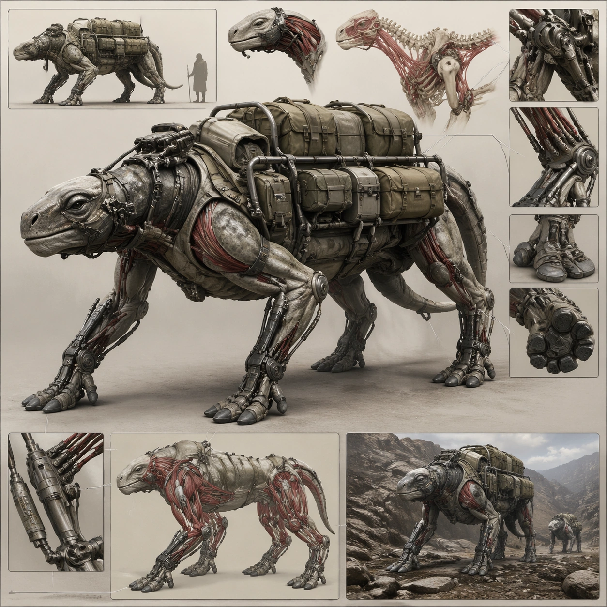

```text
Scene:
Design a square biomechanical concept plate that reads clearly from a distance and rewards close inspection. Use one strong main pose or view supported by carefully placed detail windows, component callouts, or environment cues. Compose a concept plate around a quadruped cargo carrier with load racks, tendon-driven pistons, and terrain attachments.

Subject:
Show a complete biomechanical entity or subsystem with clear task identity: guard, carrier, swimmer, scout, ritual host, or similar. The fusion between body logic and engineering should feel intentional and load-bearing. The being should feel bred or engineered for logistics, with anatomy optimized for weight transfer, endurance, and field maintenance.

Important details:
Favor anatomical structure, movement plausibility, and material discipline over surface noise. The result should feel buildable within its fictional world, not like a random accumulation of tubes and spikes. Use board hierarchy to explain how organic power and mechanical support cooperate under freight load. Preserve readable biomechanics so joints, muscles, shells, and machines all seem to cooperate under one functional design logic.

Use case:
Biomech Board single study 1/5, designed as a self-contained support image for this topic.

Constraints:
No readable text, no watermark, no logos, preserve exact 1:1 aspect ratio, no horror torture imagery, no generic robot soldier clichés, no comic-book posing, no logo insignia, no fantasy war beast armor.
```

Model: GPT Image 2 · Author: ChaosRealmsAI

[Original source](https://github.com/ChaosRealmsAI/gpt-image-2-gallery/blob/5296db8c996e38776c83a0bc8c64f848dcd512b3/works/topics/biomechanical-entity-design-board/packages/single-support-studies/images/01-cargo-beast-board/meta.json) · [Provenance and original license](data/projectd-batch-0012.json)

## Checkout Campaign Toolkit Flatlay — ChaosRealmsAI · MIT


```text
Scene:
Create a square overhead commerce flatlay on a deep charcoal surface with hard directional light, sharp shadows, and intense contrast. The arrangement should feel strategic and high-pressure rather than messy. Use abstract sale chips, card-like shapes, carts, parcel tools, and product silhouettes laid out with editorial precision so the frame can work as a campaign support image for checkout pushes and cart-building reminders.

Subject:
Arrange a compact shopping toolkit made from generic products, cart handles, card-like forms, sticker blocks, packing tools, and parcel components. The viewer should immediately read purchase momentum, bundle logic, and checkout readiness without any readable interface text. The scene must feel digital-retail adjacent while remaining physically staged and photographically believable.

Important details:
Hierarchy and edge clarity matter more than spectacle. Use strong black, white, and yellow structure with maybe one metallic accent. Keep shapes crisp and conversion-minded, with every object contributing to urgency. The final image should feel like a campaign asset for cart reminders, flash-sale pushes, or deal countdown support rather than a random desk still life.

Use case:
Black Friday single study 5/9.

Constraints:
No readable text, no watermark, no logos, preserve exact 1:1 aspect ratio, no readable checkout text, no brand cards, no currency symbols, no rainbow palette, no cluttered receipts, no human hands, no broken shadows, no generic office stationery.
```

Model: GPT Image 2 · Author: ChaosRealmsAI

[Original source](https://github.com/ChaosRealmsAI/gpt-image-2-gallery/blob/5296db8c996e38776c83a0bc8c64f848dcd512b3/works/topics/black-friday-and-shopping-frenzy-kit/packages/single-commerce-support-studies/images/checkout-chaos-flatlay/meta.json) · [Provenance and original license](data/projectd-batch-0012.json)

## Walnut Boutique Hotel Minibar Alcove — ChaosRealmsAI · MIT

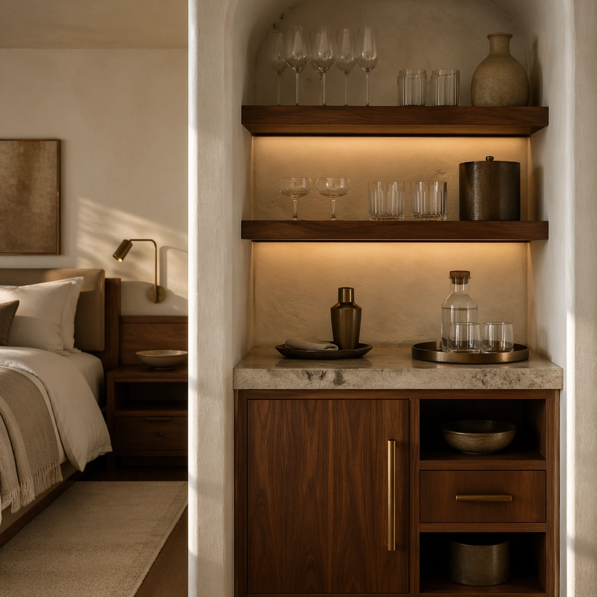

```text
Scene:
Create a square standalone support study for Boutique Guestroom Editorial Suite. Use a square still of a minibar alcove with walnut shelves and stone counter and frame it like a premium commercial still or design-editorial crop with clear focal hierarchy, disciplined perspective, and enough breathing room for the materials and objects to read at both thumbnail and full size. Keep warm plaster white, walnut brown, muted clay, brushed bronze, and soft morning gray as the tonal guide so the image still belongs to the same theme family, and light the scene in a controlled way that emphasizes texture, edge quality, and authored atmosphere over spectacle.

Subject:
Show a boutique hotel suite with limewashed plaster walls, walnut millwork, tailored linen bedding, bronze reading lights, textured drapery, and a quietly lived-in premium mood. In this support study, focus on glassware arrangement, niche lighting, and premium restraint. The image should work independently, yet it must still feel like it belongs to the same broader world of Guestroom Suite. Make the space, props, and detailing useful for real campaign, editorial, or design-review contexts rather than moodboard abstraction.

Important details:
Carry forward the broader language of the bed proportions, walnut joinery, plaster texture, bronze hardware, linen styling, and restrained resort palette, but let this image prove a new support surface or secondary deliverable. Material realism is essential: wood grain, metal sheen, glass edges, textiles, and stone should feel physically plausible and carefully art directed. Any graphic panels, labels, menus, packaging, or captions must stay abstract and unreadable. The overall result should feel reusable for hospitality websites, travel editorials, booking campaigns, and room-style handoff decks, with enough structure that a creative or operations team could build on it.

Use case:
Boutique Guestroom Editorial Suite single study 5/9, exploring boutique minibar styling support.

Constraints:
No readable text, no watermark, no logos, preserve exact 1:1 aspect ratio, no people, no messy luggage spill, no cheap decor, no hard flash, no exaggerated luxury clichés, no readable bottle labels.
```

Model: GPT Image 2 · Author: ChaosRealmsAI

[Original source](https://github.com/ChaosRealmsAI/gpt-image-2-gallery/blob/5296db8c996e38776c83a0bc8c64f848dcd512b3/works/topics/boutique-guestroom-editorial-suite/packages/single-support-studies/images/01-minibar-alcove/meta.json) · [Provenance and original license](data/projectd-batch-0012.json)

## Daylit Pastry Basket Brunch Table — ChaosRealmsAI · MIT

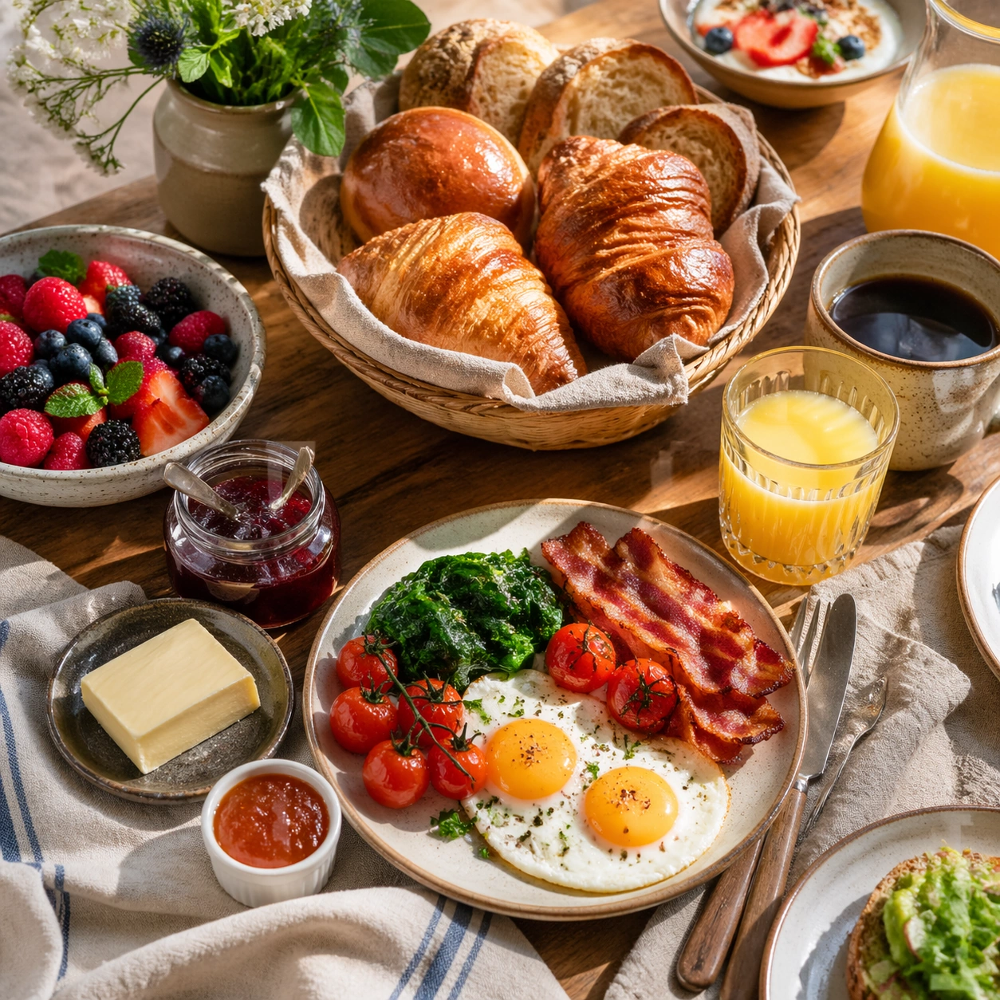

```text
Scene:
Compose a square brunch tabletop image with layered tableware, generous daylight, and a sense of weekend abundance that still feels organized enough for real hospitality and publishing use. The scene should balance multiple objects without losing the hero focal point, making table choreography and dish relationships a core part of the image. Use a square overhead-to-three-quarter view with warm daylight, a woven basket, small ramekins, and linen folds that feel casual but polished.

Subject:
The food must look fresh, warm, and genuinely shareable: eggs, breads, fruit, spreads, juices, and plated brunch mains should feel cooked and plated for service, not arranged as fake prop food. Feature croissants, rolls, butter, preserves, and one or two plates nearby so the basket reads as part of a brunch service rather than an isolated still life.

Important details:
Table logic matters. Plates, glasses, linens, and serving utensils need believable spacing, overlap, and hierarchy so the image can support menus, social assets, and campaign layouts. Make the abundance feel intentional rather than chaotic, with appetizing textures and natural daylight carrying the mood. This image should feel fully self-contained while still belonging to the same broader topic and commercial world. Keep textures rich but disciplined: flaky pastry, soft butter, glass jar reflections, and cloth folds should feel inviting without becoming cluttered.

Use case:
Brunch Tabletop single study 5/9, built for Prompt Atlas coverage of a food and beverage commercial visual system.

Constraints:
No readable text, no watermark, no logos, preserve exact 1:1 aspect ratio, no buffet chaos, no greasy diner styling unless specifically implied, no visible phone screens, no plastic takeaway packaging, no fake stock-family posing, no unreadable signage, no supermarket pastry pile, no plastic packets, no buffet sneeze guards.
```

Model: GPT Image 2 · Author: ChaosRealmsAI

[Original source](https://github.com/ChaosRealmsAI/gpt-image-2-gallery/blob/5296db8c996e38776c83a0bc8c64f848dcd512b3/works/topics/breakfast-brunch-tabletop-system/packages/single-support-studies/images/pastry-basket-spread/meta.json) · [Provenance and original license](data/projectd-batch-0012.json)

## Child and Animal Storybook Cover Mockup — ChaosRealmsAI · MIT

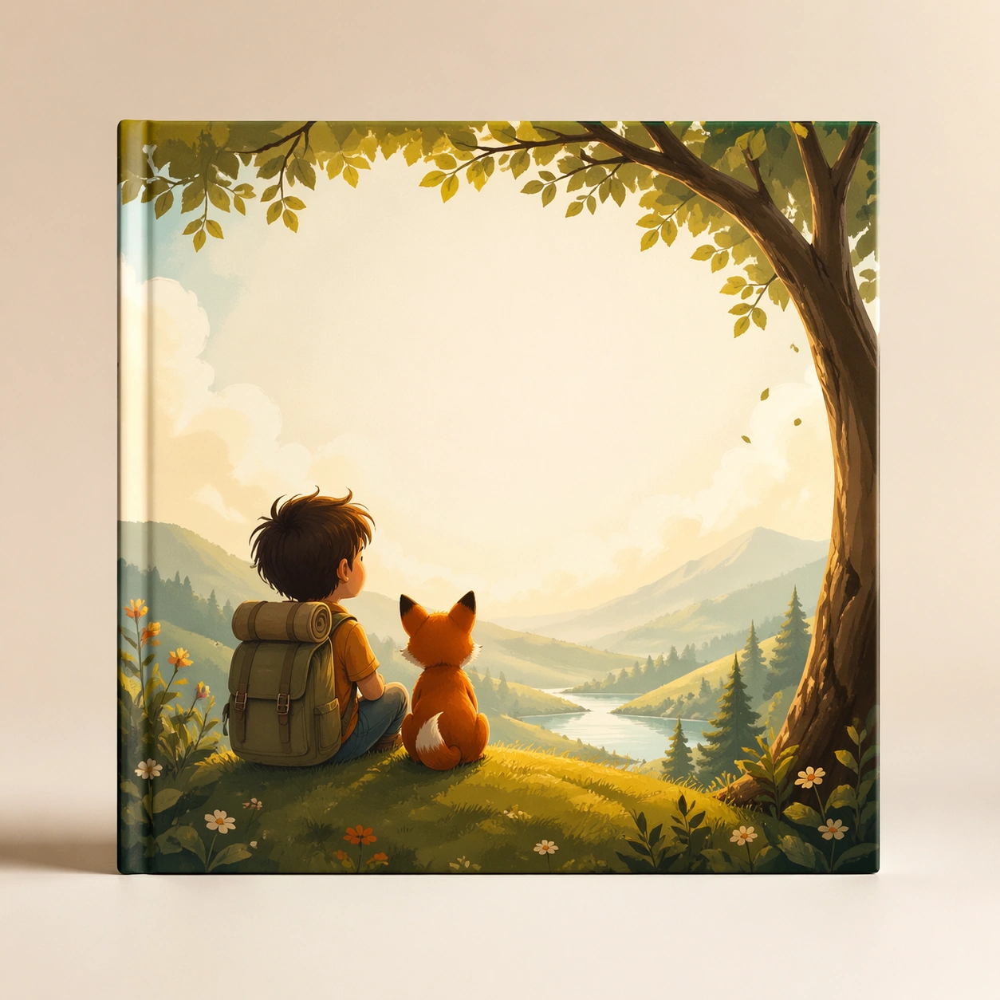

```text
Scene:
Create a square picture-book cover mockup centered on a single upright book against a soft studio backdrop, with gentle spotlighting and printed-paper realism. The cover should feel modern, warm, and distinctly for young children, leaving obvious blank space for future title treatment. Keep the square frame balanced, calm, and production-ready so the asset can serve gallery review, research comparison, and real educational delivery at the same time.

Subject:
Use an inviting scene of a child and animal companion in a story-rich environment, composed boldly enough for retail shelf recognition but soft enough for bedtime reading appeal. Keep the illustration painterly, emotionally warm, and structured like a real publishing deliverable. The subject arrangement should feel complete and self-contained, able to stand alone as a real supporting deliverable inside the same education business line.

Important details:
The design should prioritize silhouette clarity, age-appropriate charm, and a clear focal relationship between characters and world. Avoid decorative overload so the asset reads as a commercially viable cover rather than a generic fantasy illustration. Keep the visual hierarchy modular, commercially believable, and clearly tied to a real educational use case rather than a generic mood board.

Use case:
Children Storybook Scene Page System single study 1/5, story cover board.

Constraints:
No readable text, no watermark, no logos, preserve exact 1:1 aspect ratio, no readable text, no logos, no harsh realism, no licensed character resemblance, no cluttered scrapbook styling, no horror elements.
```

Model: GPT Image 2 · Author: ChaosRealmsAI

[Original source](https://github.com/ChaosRealmsAI/gpt-image-2-gallery/blob/5296db8c996e38776c83a0bc8c64f848dcd512b3/works/topics/children-storybook-scene-page-system/packages/single-support-studies/images/01-story-cover-board/meta.json) · [Provenance and original license](data/projectd-batch-0012.json)

## Chocolate Gold-Leaf Mirror Macro — ChaosRealmsAI · MIT

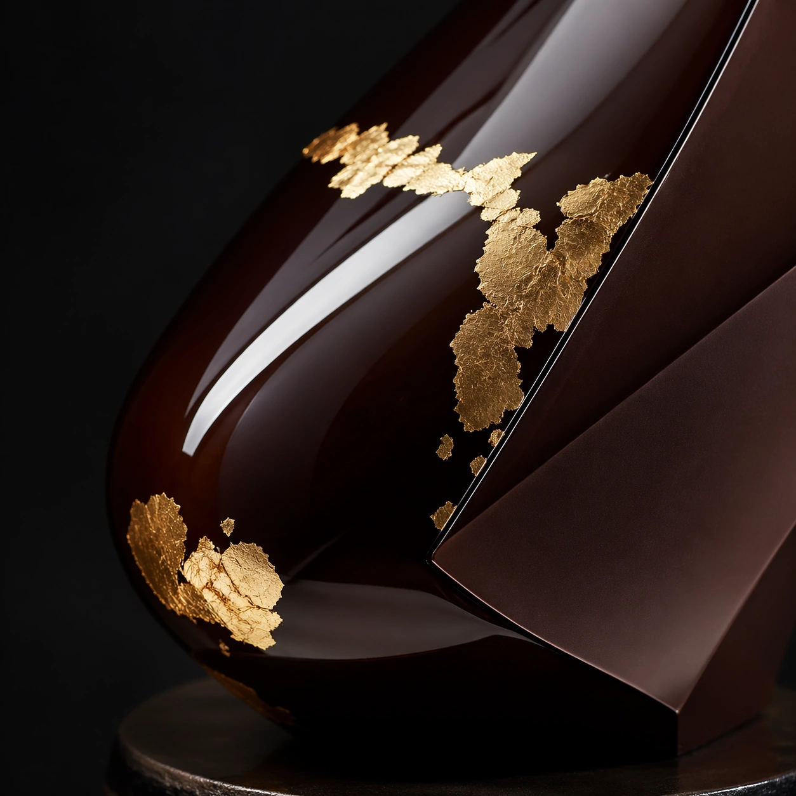

```text
Scene:
Create a square competition-style pastry studio photograph with one sculptural chocolate showpiece on a dark pedestal against a controlled neutral or black backdrop. Softbox reflections should skim the tempered surfaces with glass-like sharpness, while shadows stay deep and elegant. The object must feel large, balanced, and professionally lit, as if documented after winning a grand pastry prize. Create a square macro studio image against a dark background with one curved chocolate surface dominating the frame and reflection bands running cleanly across it. The atmosphere should feel forensic and luxurious.

Subject:
Show a section of mirror-dark tempered chocolate with several restrained patches of gold leaf adhered to the surface, plus a few sharp edge transitions into matte planes. The curvature should be elegant enough that the reflections describe the temper quality clearly. The image should feel like proof of mastery in surface finishing.

Important details:
Tempered chocolate realism is critical: mirror reflections, crisp edges, matte-to-gloss transitions, gold leaf, sugar accents, and structural balance all need to feel plausible. The sculpture can be impossible in composition, but never sloppy in craft. Every support point and reflection line should suggest deliberate pastry engineering. Prioritize flawless reflection continuity, believable micro imperfections only at the scale of real handwork, and the ultra-thin texture of gold leaf against the lacquer. Nothing should look plastic or rendered from metal.

Use case:
Chocolate lacquer sculpture single study 5/9, isolating mirror temper and gold leaf as the central material event.

Constraints:
No readable text, no watermark, no logos, preserve exact 1:1 aspect ratio, no candy-bar packaging cues, no readable competition banners, no cartoon dessert palette, no smudged fingerprints, no cluttered workshop background, no fingerprints, no crumbs, no product-packaging context.
```

Model: GPT Image 2 · Author: ChaosRealmsAI

[Original source](https://github.com/ChaosRealmsAI/gpt-image-2-gallery/blob/5296db8c996e38776c83a0bc8c64f848dcd512b3/works/topics/chocolate-lacquer-sculpture/packages/single-support-studies/images/gold-leaf-mirror-macro/meta.json) · [Provenance and original license](data/projectd-batch-0012.json)

## Picture Routine Pocket Chart Wall — ChaosRealmsAI · MIT

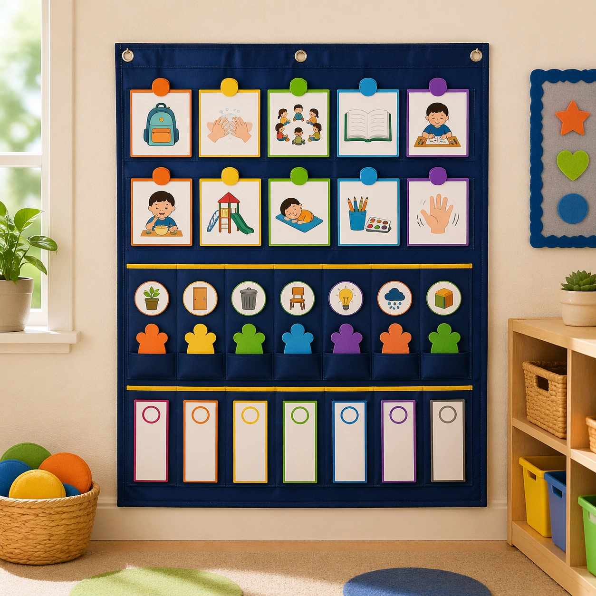

```text
Scene:
Show a square classroom wall setup with a fabric pocket chart, clipped cards, and a few nearby baskets in bright natural light. The composition should feel practical and kindergarten-realistic, yet polished enough for a school-supply catalog. Keep the square frame balanced, calm, and production-ready so the asset can serve gallery review, research comparison, and real educational delivery at the same time.

Subject:
Use visual routine cards, icon-only job markers, and blank status strips arranged in an intuitive hierarchy inside the pockets. The chart should look highly usable for young children who rely on pictures more than reading. The subject arrangement should feel complete and self-contained, able to stand alone as a real supporting deliverable inside the same education business line.

Important details:
Emphasize tactile fabrics, clean color coding, and child-height accessibility. The wall system should feel organized, calm, and easy for teachers to update throughout the day. Keep the visual hierarchy modular, commercially believable, and clearly tied to a real educational use case rather than a generic mood board.

Use case:
Classroom Routine and Rule Visual Set single study 1/5, pocket chart wall.

Constraints:
No readable text, no watermark, no logos, preserve exact 1:1 aspect ratio, no readable text, no logos, no scary warning symbols, no chaotic wall clutter, no generic stock classroom mess, no adult office styling.
```

Model: GPT Image 2 · Author: ChaosRealmsAI

[Original source](https://github.com/ChaosRealmsAI/gpt-image-2-gallery/blob/5296db8c996e38776c83a0bc8c64f848dcd512b3/works/topics/classroom-routine-and-rule-visual-set/packages/single-support-studies/images/01-pocket-chart-wall/meta.json) · [Provenance and original license](data/projectd-batch-0012.json)

## Clear Ice Sphere Editorial Study — ChaosRealmsAI · MIT


```text
Scene:
Create a square premium editorial cocktail photograph with Scandinavian restraint: the glass sits against a dark or neutral studio backdrop, lit with crisp directional light that reveals liquid clarity, condensation, and the shape of the vessel. The composition should leave clean space for anatomy-like annotation structures. Any diagram devices must stay abstract, minimal, and completely unreadable. Create a square macro studio image on a dark neutral pedestal with one ice sphere as the dominant object, lit from the side and slightly from behind. A few thin blank annotation leaders may enter the frame to emphasize the editorial anatomy concept without becoming technical clutter.

Subject:
Show one large nearly transparent ice sphere with subtle trapped bubbles, a shallow frost halo, and a thin reflective wet edge where it meets the surface. A minimal curl of citrus peel and one droplet of spirit can appear nearby as quiet context. The sphere should feel cold, heavy, and perfectly cut.

Important details:
The work should feel like a luxury magazine spread translated into one square frame, where product photography and information design cooperate without becoming cluttered. Glass thickness, ice clarity, citrus oils, bubbles, smoke, and liquid layering all need to feel physically accurate. Hairline leader lines may terminate in blank bars or geometric tabs, but never readable labels. The appeal comes from optical precision: internal bubble clusters, tiny fracture lines, and condensation must read immediately at close range. Keep the editorial callouts abstract and elegant, letting the ice itself behave like the specimen.

Use case:
Cocktail anatomy editorial single study 5/9, isolating the internal drama of a clear ice sphere.

Constraints:
No readable text, no watermark, no logos, preserve exact 1:1 aspect ratio, no menu typography, no neon nightclub clutter, no brand bottle labels, no bar receipt props, no visible trademarks, no novelty-shaped ice, no melting puddle chaos, no text labels.
```

Model: GPT Image 2 · Author: ChaosRealmsAI

[Original source](https://github.com/ChaosRealmsAI/gpt-image-2-gallery/blob/5296db8c996e38776c83a0bc8c64f848dcd512b3/works/topics/cocktail-anatomy-editorial/packages/single-support-studies/images/ice-sphere-core-study/meta.json) · [Provenance and original license](data/projectd-batch-0012.json)

## Coffee Beans and Brewing Tools Board — ChaosRealmsAI · MIT


```text
Scene:
Compose a square beverage campaign image built around ritual, vessel, light, and atmosphere. The frame should feel like it belongs to a premium drink brand that understands daily habits: ceramic warmth, glass condensation, steam behavior, and tactile surfaces all need to read as observed and real rather than generic lifestyle filler. Use a near-overhead square crop on a textured counter, arranging tools with measured spacing and soft side light.

Subject:
The hero beverage must feel consumable and culturally grounded, with believable proportions, realistic liquid behavior, and supporting tools or props that reinforce the ritual without overwhelming the drink itself. Feature beans, grinder, filter paper, spoon, and cup as a composed ritual toolkit rather than a cluttered equipment dump.

Important details:
Credibility comes from timing and materials: crema density, ice clarity, tea translucency, condensation trails, and the way a hand or vessel sits in space. Keep the mood intentional and campaign-ready, with enough atmosphere to suggest a lived routine while preserving product focus. This image should feel fully self-contained while still belonging to the same broader topic and commercial world. Every object should feel used but premium, with believable wear, clean edges, and clear functional hierarchy that supports a brand campaign.

Use case:
Coffee Rituals single study 5/9, built for Prompt Atlas coverage of a food and beverage commercial visual system.

Constraints:
No readable text, no watermark, no logos, preserve exact 1:1 aspect ratio, no plastic café props, no latte-art gimmick overload, no fake steam clouds, no unreadable cup slogans, no random breakfast clutter, no artificial neon excess, no instruction diagrams, no readable labels, no excessive accessories.
```

Model: GPT Image 2 · Author: ChaosRealmsAI

[Original source](https://github.com/ChaosRealmsAI/gpt-image-2-gallery/blob/5296db8c996e38776c83a0bc8c64f848dcd512b3/works/topics/coffee-drink-ritual-campaign-series/packages/single-support-studies/images/beans-and-tools-board/meta.json) · [Provenance and original license](data/projectd-batch-0012.json)

## Late-Night Analyst Office Grid — ChaosRealmsAI · MIT


```text
Scene:
A square interior image defined by desaturated teal, nicotine amber, matte charcoal, and polished glass, with every desk, chair, monitor, and light source positioned with mathematical restraint. The room should feel contemporary and expensive, but emotionally distant, as if every element has been audited for balance and control. Build a late-night analyst bullpen with long shared desks, evenly spaced task lamps, and a wall of dark windows holding faint city reflections.

Subject:
Use office floors, apartments, control rooms, or meeting spaces where human figures appear small, backlit, and subordinate to the grid of furniture and screens. The subject is not one person so much as the cold system of objects, reflections, and intervals between them. Three workers appear as distant silhouettes at separate stations, each reduced to a small node within the larger desk grid.

Important details:
The signature depends on exact spacing, subdued color, restrained contrast, and a polished investigative mood. Preserve orderly cable paths, clean desk surfaces, sensible monitor glow, and strong negative space. Avoid colorful personality clutter, playful decor, or casual lived-in mess. The glow from monitors should be cool and controlled, with chairs, notebooks, and cables all aligned into quiet order.

Use case:
Cold Precision Grid Interior single study 1/9.

Constraints:
No readable text, no watermark, no logos, preserve exact 1:1 aspect ratio, no visible logos on screens, no colorful sticky notes, no comic exaggeration, no warm family-home coziness, no random clutter piles, no broken anatomy, no low-detail background, no accidental text fragments.
```

Model: GPT Image 2 · Author: ChaosRealmsAI

[Original source](https://github.com/ChaosRealmsAI/gpt-image-2-gallery/blob/5296db8c996e38776c83a0bc8c64f848dcd512b3/works/topics/cold-precision-grid-interior/packages/single-cold-precision-grid-interior/images/01-analyst-bullpen/meta.json) · [Provenance and original license](data/projectd-batch-0012.json)

## Compact Apartment Foldout Dining Scene — ChaosRealmsAI · MIT

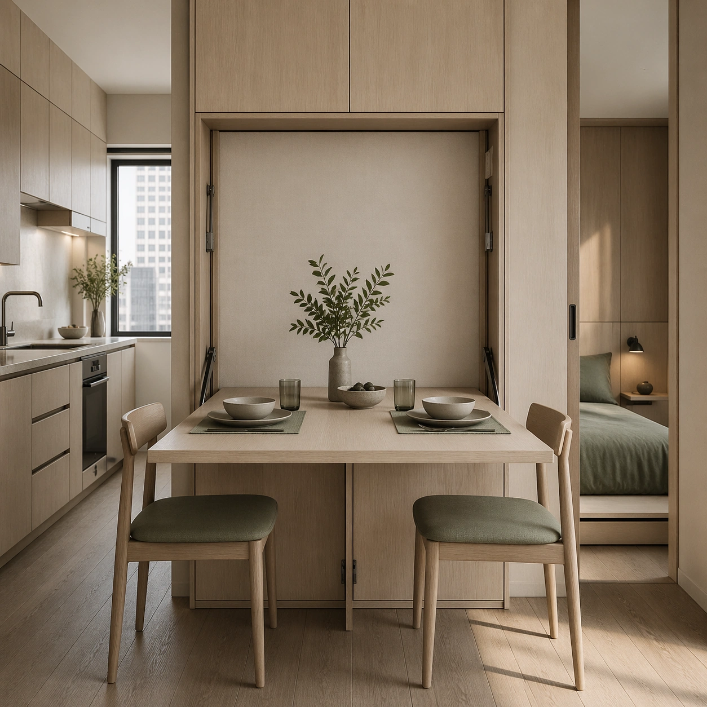

```text
Scene:
Create a square standalone support study for Compact Urban Apartment Efficiency Aesthetic. Use a front-on still of a foldout dining table opened from the millwork wall and frame it like a premium commercial still or design-editorial crop with clear focal hierarchy, disciplined perspective, and enough breathing room for the materials and objects to read at both thumbnail and full size. Keep light ash wood, warm white plaster, soft graphite accents, pale stone, and muted sage textiles as the tonal guide so the image still belongs to the same theme family, and light the scene in a controlled way that emphasizes texture, edge quality, and authored atmosphere over spectacle.

Subject:
Show a compact urban apartment with ash wood millwork, sliding partitions, hidden storage walls, a built-in platform bed, compact stone kitchen surfaces, and calm metropolitan daylight. In this support study, focus on hinge discipline, seating fit, table styling, and spatial efficiency. The image should work independently, yet it must still feel like it belongs to the same broader world of Urban Apartment. Make the space, props, and detailing useful for real campaign, editorial, or design-review contexts rather than moodboard abstraction.

Important details:
Carry forward the broader language of the sliding partition system, integrated storage geometry, ash wood detailing, compact kitchen language, and quiet city-apartment restraint, but let this image prove a new support surface or secondary deliverable. Material realism is essential: wood grain, metal sheen, glass edges, textiles, and stone should feel physically plausible and carefully art directed. Any graphic panels, labels, menus, packaging, or captions must stay abstract and unreadable. The overall result should feel reusable for rental campaigns, design editorials, developer micro-unit decks, and small-space planning references, with enough structure that a creative or operations team could build on it.

Use case:
Compact Urban Apartment Efficiency Aesthetic single study 5/9, exploring small-space dining support visual.

Constraints:
No readable text, no watermark, no logos, preserve exact 1:1 aspect ratio, no clutter piles, no messy shoes, no novelty gadgets, no colorful toy furniture, no cramped distortion, no crowded dinner party.
```

Model: GPT Image 2 · Author: ChaosRealmsAI

[Original source](https://github.com/ChaosRealmsAI/gpt-image-2-gallery/blob/5296db8c996e38776c83a0bc8c64f848dcd512b3/works/topics/compact-urban-apartment-efficiency-aesthetic/packages/single-support-studies/images/01-foldout-dining-scene/meta.json) · [Provenance and original license](data/projectd-batch-0012.json)

## Creative Studio Material Library Wall — ChaosRealmsAI · MIT

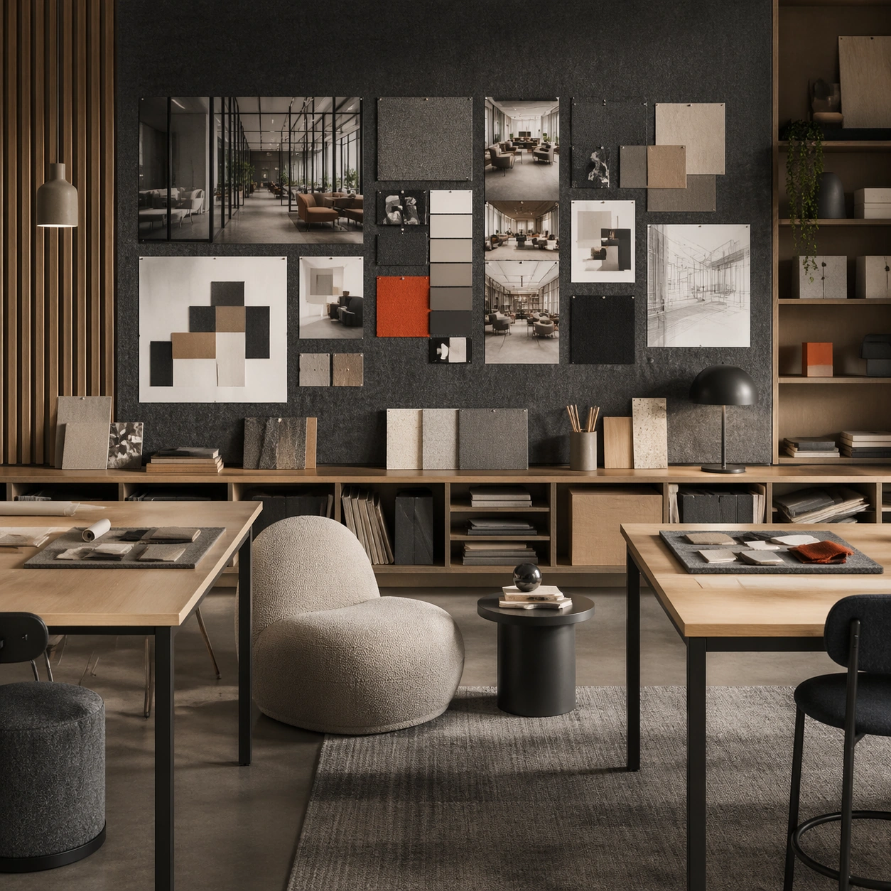

```text
Scene:
Create a square standalone support study for Creative Studio and Office Brand Floor. Use a front-on wall of samples, books, mockups, and pin-up surfaces arranged with discipline and frame it like a premium commercial still or design-editorial crop with clear focal hierarchy, disciplined perspective, and enough breathing room for the materials and objects to read at both thumbnail and full size. Keep warm gray, natural oak, charcoal felt, off-white surfaces, and one controlled accent hue as the tonal guide so the image still belongs to the same theme family, and light the scene in a controlled way that emphasizes texture, edge quality, and authored atmosphere over spectacle.

Subject:
Show a branded creative studio and office floor with modular collaboration tables, acoustic felt panels, smoked glass partitions, library shelving, soft lounge seating, and clear company personality. In this support study, focus on creative-process evidence, tactile order, and editorial neatness. The image should work independently, yet it must still feel like it belongs to the same broader world of Studio Office. Make the space, props, and detailing useful for real campaign, editorial, or design-review contexts rather than moodboard abstraction.

Important details:
Carry forward the broader language of the table system, acoustic materials, glass-partition rhythm, informal lounge furniture, and abstract brand-graphic zones, but let this image prove a new support surface or secondary deliverable. Material realism is essential: wood grain, metal sheen, glass edges, textiles, and stone should feel physically plausible and carefully art directed. Any graphic panels, labels, menus, packaging, or captions must stay abstract and unreadable. The overall result should feel reusable for office leasing decks, employer-brand campaigns, interior editorials, and workspace design reviews, with enough structure that a creative or operations team could build on it.

Use case:
Creative Studio and Office Brand Floor single study 5/9, exploring support image for studio culture storytelling.

Constraints:
No readable text, no watermark, no logos, preserve exact 1:1 aspect ratio, no office workers, no readable whiteboard text, no startup cliché neon, no messy desks, no cheap task-chair overload, no readable book spines.
```

Model: GPT Image 2 · Author: ChaosRealmsAI

[Original source](https://github.com/ChaosRealmsAI/gpt-image-2-gallery/blob/5296db8c996e38776c83a0bc8c64f848dcd512b3/works/topics/creative-studio-and-office-brand-floor/packages/single-support-studies/images/01-material-library-wall/meta.json) · [Provenance and original license](data/projectd-batch-0012.json)

## Croissant Lamination Cross-Section — ChaosRealmsAI · MIT

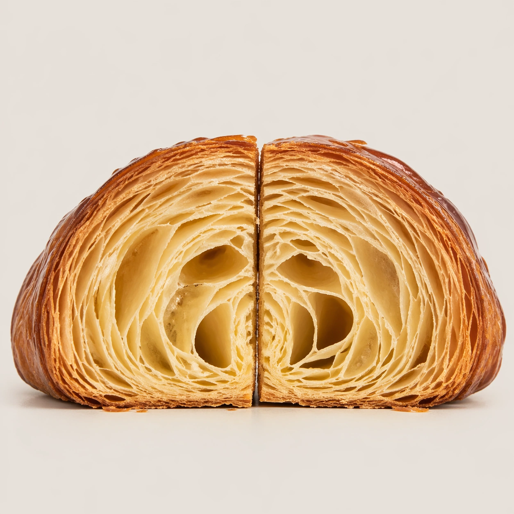

```text
Scene:
Create a square pastry documentation image on a seamless pale gray or warm ivory studio background with soft catalog lighting and almost no cast-shadow drama. The camera should feel orthographic or gently frontal so cross-sections remain easy to compare. Everything must read like a pastry atlas: clean, measured, and highly legible, with crumbs controlled and edges crisp. Create a square specimen-style photograph on a seamless warm gray background with a frontal view and restrained shadow. The frame should be tight enough that the croissant dominates, but generous enough to leave a quiet field around it.

Subject:
Show one large croissant cut cleanly down its center line, with the interior facing forward and the exterior shell still visibly crisp and flaky. The lamination should step outward in dense, countable leaves, with a hollow core tapering toward the tips. The specimen should look freshly cut, not dried out or crushed.

Important details:
Treat every cut face as the hero: laminated layers, cream density, air pockets, fruit cavities, glaze thickness, and crumb structure all need to be countable and believable. The studio language should stay consistent and understated so structural detail does the work. No element should feel collapsed, smeared, or over-stylized. Focus on the relationship between crisp exterior, honeycombed inner void, and laminated leaf structure. A few tiny flakes near the base are acceptable if controlled, but the image must remain as clean as a museum plate.

Use case:
Pastry cross-section atlas single study 5/9, isolating croissant lamination as a specimen.

Constraints:
No readable text, no watermark, no logos, preserve exact 1:1 aspect ratio, no bakery counter background, no casual napkins, no readable labels, no powdered sugar mess, no rustic knife marks, no coffee cups, no butter pats, no torn ragged cut.
```

Model: GPT Image 2 · Author: ChaosRealmsAI

[Original source](https://github.com/ChaosRealmsAI/gpt-image-2-gallery/blob/5296db8c996e38776c83a0bc8c64f848dcd512b3/works/topics/cross-section-pastry-atlas/packages/single-support-studies/images/croissant-spinal-cut/meta.json) · [Provenance and original license](data/projectd-batch-0012.json)

## Lunch Box Delivery Hero Card — ChaosRealmsAI · MIT

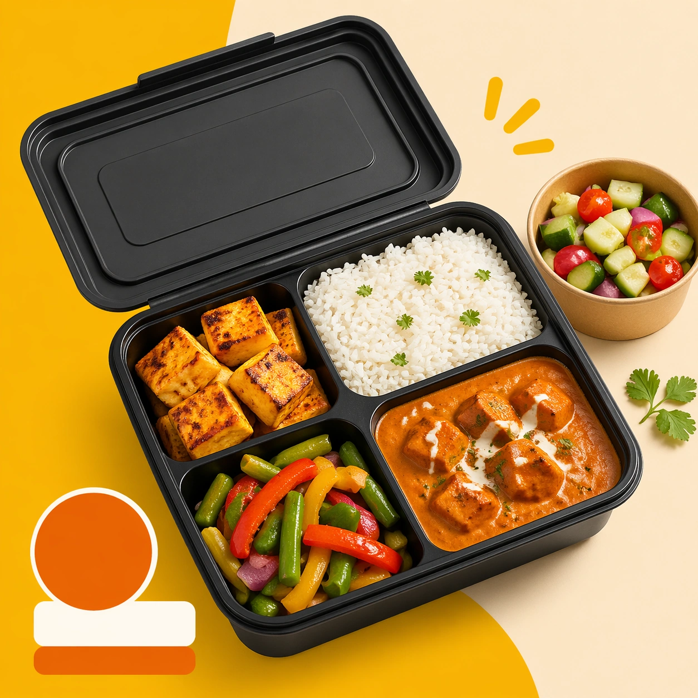

```text
Scene:
Compose a square food-commerce image optimized for instant readability in app tiles, promo cards, or delivery grids. The image should emphasize appetizing clarity, strong hierarchy, and modular layout zones while staying photorealistic and commercially grounded. Packaging, dish crop, and badge-like design shapes can appear, but all text must remain unreadable. Use a bright square crop with one open lunch container, one side element, and strong modular negative space around the food.

Subject:
The food should look craveable at thumbnail scale, with clear portion logic, supporting side items when relevant, and delivery-aware presentation that prioritizes speed, legibility, and conversion. Make the lunch box feel balanced, complete, and office-friendly, with ingredients separated enough to remain legible on small screens.

Important details:
This theme is about commerce reasoning. Preserve sharp hero food silhouettes, obvious combo structure, and clean tile-safe framing so the assets can survive small screens. Abstract text areas, CTA-like shapes, and offer badges are allowed only as non-legible design modules. Keep everything polished, modern, and immediately useful for ordering surfaces. This image should feel fully self-contained while still belonging to the same broader topic and commercial world. Clean compartment lines, lid geometry, and ingredient color contrast should make the image highly scannable for app browsing.

Use case:
Delivery Tiles single study 5/9, built for Prompt Atlas coverage of a food and beverage commercial visual system.

Constraints:
No readable text, no watermark, no logos, preserve exact 1:1 aspect ratio, no readable text, no logos, no app UI chrome, no fake prices, no delivery-bag chaos, no greasy blur, no clutter that hurts thumbnail legibility, no office desk clutter, no readable brand tape, no cafeteria tray vibe.
```

Model: GPT Image 2 · Author: ChaosRealmsAI

[Original source](https://github.com/ChaosRealmsAI/gpt-image-2-gallery/blob/5296db8c996e38776c83a0bc8c64f848dcd512b3/works/topics/delivery-first-food-commerce-tiles/packages/single-support-studies/images/lunch-box-hero-card/meta.json) · [Provenance and original license](data/projectd-batch-0012.json)

## Pink Patisserie Cake Box Flatlay — ChaosRealmsAI · MIT


```text
Scene:
Compose a square premium patisserie image with polished but believable boutique lighting, elegant marble or lacquer surfaces, and a sweet-shop atmosphere that feels brand-authored rather than generic. The camera should preserve product clarity, shape definition, and shelf or counter context while leaving enough breathing room for campaign placement. Use a top-down square composition over a clean stone surface, with tissue paper, ribbon, and one opened box arranged like a product campaign still life.

Subject:
The desserts must look crafted by a high-end pastry kitchen: clean lamination, glossy glaze, stable cream structure, crisp edges, and packaging or display surfaces that reinforce a coherent dessert identity. Feature a premium cake box system with a visible dessert slice, neat inserts, and subtle branded geometry expressed through color blocks and materials rather than readable text.

Important details:
Sweetness should come from color control, finish quality, and material nuance, not from visual clutter. Preserve believable pastry engineering, boutique display logic, and refined merchandising cues so the images can support brand storytelling across retail, packaging, and editorial use. This image should feel fully self-contained while still belonging to the same broader topic and commercial world. The result should feel like an expensive gifting moment: crisp folds, believable paper texture, precise corners, and pastry visibility that still keeps packaging central.

Use case:
Dessert Brand single study 5/9, built for Prompt Atlas coverage of a food and beverage commercial visual system.

Constraints:
No readable text, no watermark, no logos, preserve exact 1:1 aspect ratio, no candy-color overload, no plastic frosting, no supermarket clutter, no cartoon decorations, no melted textures that break realism, no childish party props, no shipping labels, no readable copy, no discount-store vibe.
```

Model: GPT Image 2 · Author: ChaosRealmsAI

[Original source](https://github.com/ChaosRealmsAI/gpt-image-2-gallery/blob/5296db8c996e38776c83a0bc8c64f848dcd512b3/works/topics/dessert-patisserie-brand-visual-system/packages/single-support-studies/images/cake-box-flatlay/meta.json) · [Provenance and original license](data/projectd-batch-0012.json)

## Braised Chicken Feet Dim Sum Study — ChaosRealmsAI · MIT

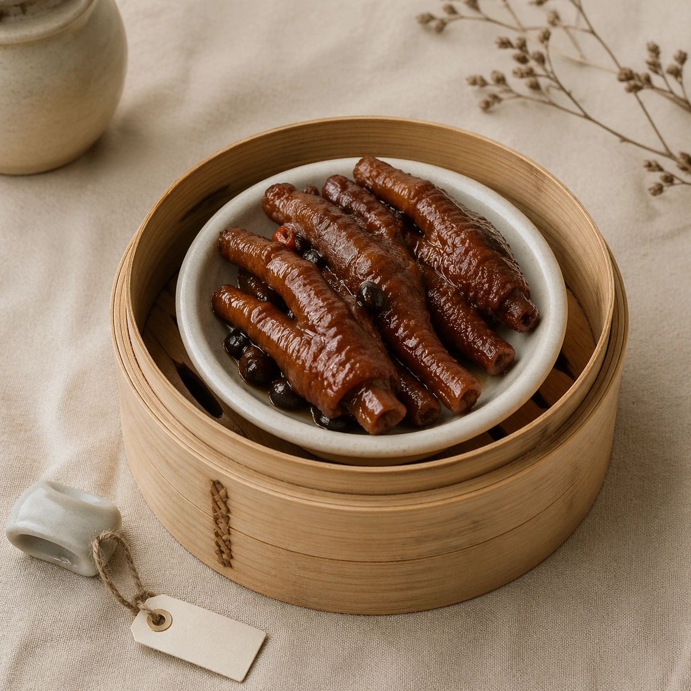

```text
Scene:
Create a square museum-atlas photograph of dim sum presented on natural linen or pale neutral textile, lit with calm daylight and restrained shadow. The composition should feel archival, specimen-like, and quietly luxurious rather than crowded or banquet-style. Blank museum tabs, bamboo details, and shallow steam are acceptable so long as no readable characters appear anywhere. Create a square overhead or gently angled specimen photograph on warm linen with soft daylight and very controlled shadow. The mood should be serious, tactile, and archival rather than sensational.

Subject:
Show a small arranged set of braised chicken feet with lacquered skin, visible joints, and a rich mahogany glaze, presented as part of the dim sum world rather than an oddity. A tiny blank specimen tab and a small porcelain rest may appear nearby. The subject should feel intricate, crafted, and fully edible.

Important details:
Make the dumplings feel handcrafted and specific: pleat count, skin thickness, translucency, filling pressure, steam moisture, and wrapper folds all need to be believable. The museum treatment should elevate the food without turning it into abstraction. Every item should still look edible, warm, and tactile. Focus on skin texture, folds, claws, and glaze sheen without exaggeration. The image should demonstrate that difficult anatomy-like forms can still be documented with elegance and warmth.

Use case:
Dim sum miniature atlas single study 5/9, treating braised chicken feet as an archival culinary specimen.

Constraints:
No readable text, no watermark, no logos, preserve exact 1:1 aspect ratio, no banquet table clutter, no readable calligraphy, no sauce spills, no glossy menu styling, no plastic steamer look, no horror framing, no sauce pooling, no banquet clutter.
```

Model: GPT Image 2 · Author: ChaosRealmsAI

[Original source](https://github.com/ChaosRealmsAI/gpt-image-2-gallery/blob/5296db8c996e38776c83a0bc8c64f848dcd512b3/works/topics/dim-sum-miniature-atlas/packages/single-support-studies/images/phoenix-claw-study/meta.json) · [Provenance and original license](data/projectd-batch-0012.json)

## Preschool Flashcard Deck Retail Flatlay — ChaosRealmsAI · MIT

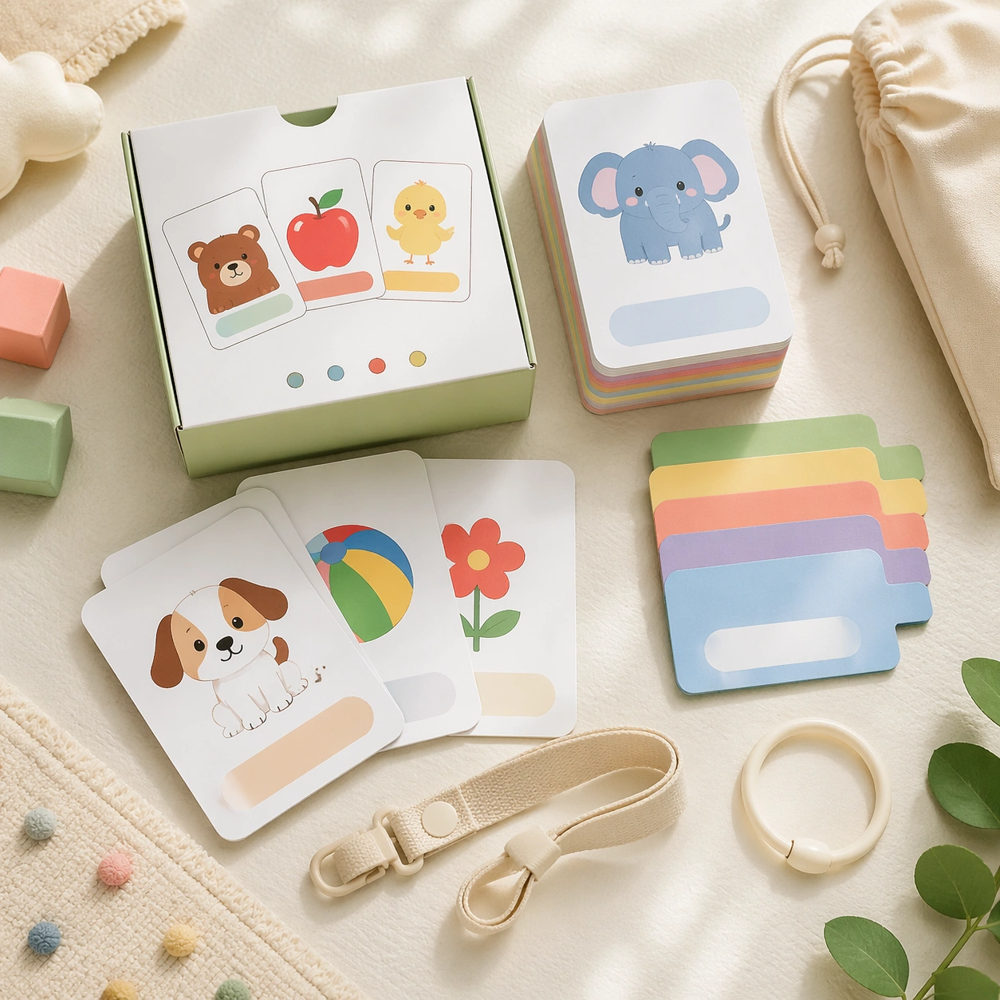

```text
Scene:
Create a square top-down retail flatlay on a pale playroom floor with one boxed flashcard deck, a few fanned cards, soft fabric pouches, and color-coded dividers arranged with catalog clarity. Use warm morning light and gentle shadows so the image feels commercial, trustworthy, and ready for an online learning-store product page. Keep the square frame balanced, calm, and production-ready so the asset can serve gallery review, research comparison, and real educational delivery at the same time.

Subject:
The hero product is a compact preschool flashcard deck with matte lamination, rounded edges, and animal, object, and counting illustrations peeking from the stack. Surround it with a few tactile add-ons such as a carrying strap, sorting ring, and corner tabs, all designed in the same child-friendly visual language. The subject arrangement should feel complete and self-contained, able to stand alone as a real supporting deliverable inside the same education business line.

Important details:
Keep the layout highly structured and retail-aware: clear spacing, controlled props, soft pastel accents, and obvious product hierarchy. The card art should stay simple and educational, with blank label fields instead of real words, so the deck can imply multilingual packaging without showing any readable copy. Keep the visual hierarchy modular, commercially believable, and clearly tied to a real educational use case rather than a generic mood board.

Use case:
Early Learning Flashcard Family single study 1/5, boxed deck flatlay.

Constraints:
No readable text, no watermark, no logos, preserve exact 1:1 aspect ratio, no readable text, no numerals, no brand mascots, no logos, no chaotic shelf clutter, no broken packaging.
```

Model: GPT Image 2 · Author: ChaosRealmsAI

[Original source](https://github.com/ChaosRealmsAI/gpt-image-2-gallery/blob/5296db8c996e38776c83a0bc8c64f848dcd512b3/works/topics/early-learning-flashcard-family/packages/single-support-studies/images/01-boxed-deck-flatlay/meta.json) · [Provenance and original license](data/projectd-batch-0012.json)

## Speaker Interior Cutaway Concept — ChaosRealmsAI · MIT

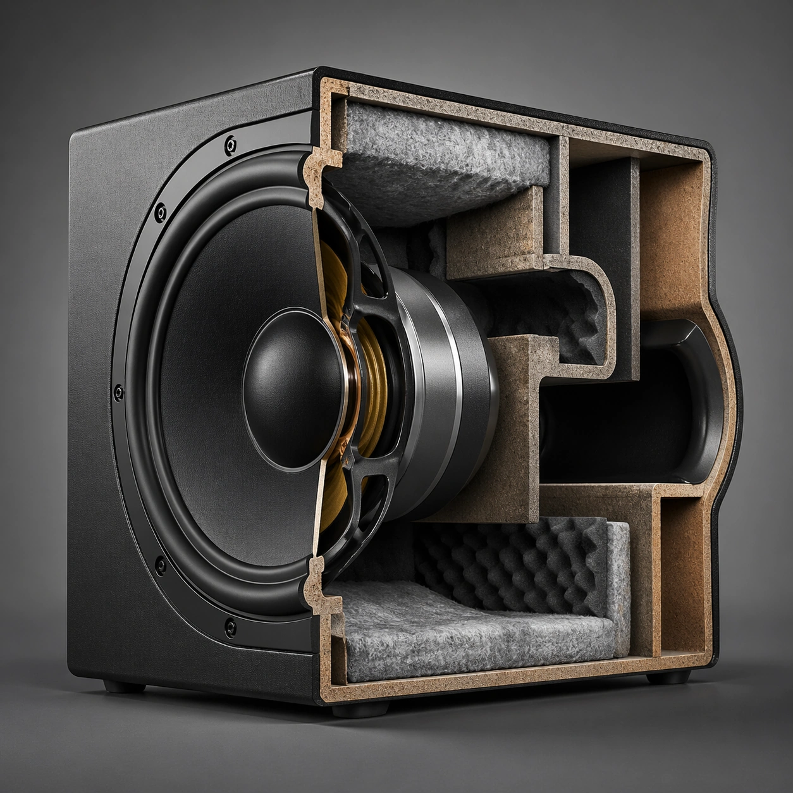

```text
Scene:
A square studio technical plate with crisp neutral lighting and strong object-legibility against a calm background. Compose the frame as a square key visual with disciplined camera placement, premium lighting control, and believable real-world scale. The tonal range should feel polished and intentional, with enough atmosphere to create depth without obscuring form. Keep contrast calibrated for launch, catalog, or research presentation use rather than casual snapshot aesthetics.

Subject:
Center an original speaker-like engineered object split to reveal driver, chamber, bracing, and damping layers. Make the subject feel original, production-aware, and clearly grounded in Engineering Cutaway and Section Poster. Treat this as an independent study that must feel complete and coherent without relying on any external reference image. The focal hierarchy should be immediate: primary form first, then material behavior, then supporting environmental cues that clarify use context and difficulty.

Important details:
Keep the acoustic logic believable and the section precise. The image should read as engineering communication, not stylized gadget art. The visual language should still feel native to Engineering Cutaway and Section Poster, using disciplined industrial or campaign composition instead of generic stock photography. Use believable materials, engineering logic, and professional composition discipline. Reflections, shadows, edge breaks, texture scale, interface density, and small physical joints must all support realism. Avoid filler props, vague mood-board clutter, or any element that weakens the sense of a purpose-built industrial or automotive image.

Use case:
Cutaway Poster single study 5/9 for Engineering Cutaway and Section Poster, built as image support-one.

Constraints:
No readable text, no watermark, no logos, preserve exact 1:1 aspect ratio, no readable labels, no logos, no impossible internals, no chaotic arrows, no random infographic decoration, no fantasy glow.
```

Model: GPT Image 2 · Author: ChaosRealmsAI

[Original source](https://github.com/ChaosRealmsAI/gpt-image-2-gallery/blob/5296db8c996e38776c83a0bc8c64f848dcd512b3/works/topics/engineering-cutaway-and-section-poster/packages/single-support-studies/images/support-one/meta.json) · [Provenance and original license](data/projectd-batch-0012.json)

## Cave-Aged Cheese Wheel Cross-Section — ChaosRealmsAI · MIT

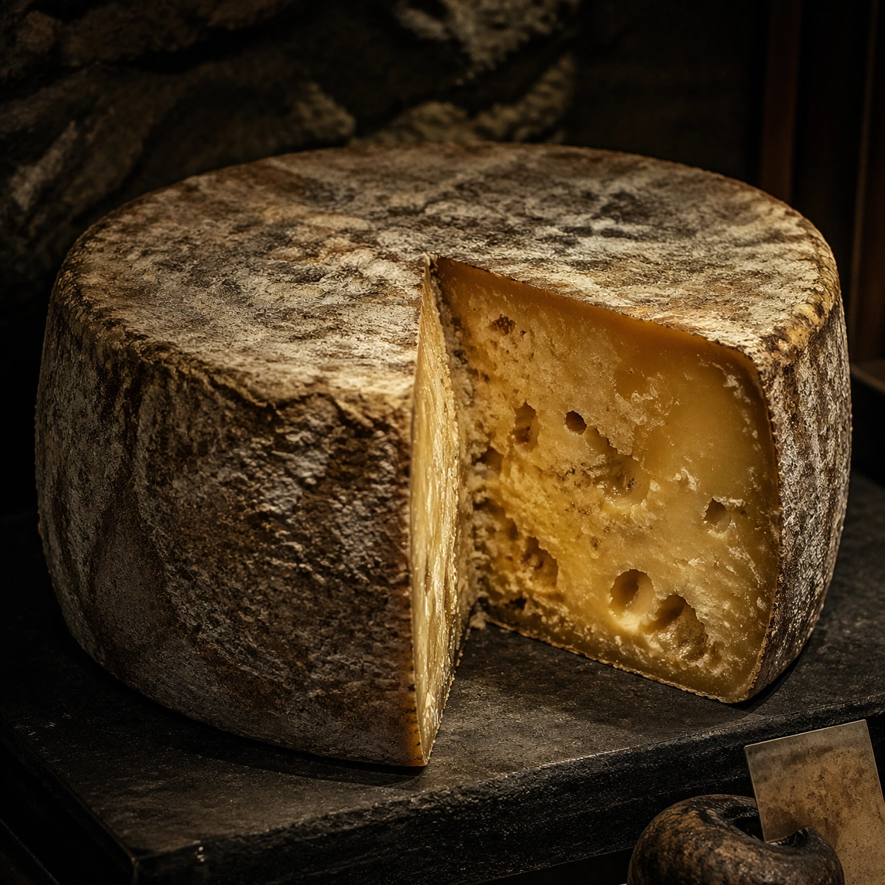

```text
Scene:
Create a square museum-vitrine style photograph of fermentation vessels treated as natural-history specimens, with calm raking light, restrained reflections, and an atmosphere of patient observation. Glass, ceramic, cloth covers, and aged labels can appear, but any markings must stay unreadable. The mood should be archival, biological, and sculptural at once. Create a square specimen photograph on a dark museum-like pedestal with soft raking light and controlled cave-like atmosphere. The background should imply cool stone darkness without distracting from the cheese.

Subject:
Show a large cheese wheel with one wedge removed so the rind, paste, internal openings, and age patterns become readable. The rind should carry subtle bloom and cave wear, while the interior shows density variation and possible tunnels or crystals. The wheel must feel mature, heavy, and alive with time.

Important details:
Micro texture is essential: skins, bubbles, sediment, microbial mats, crusts, folds, and wet surfaces all need distinct tactile logic. The images should respect the beauty of slow transformation without sanitizing it into generic product photography. Fermentation must look alive, layered, and physically specific. Focus on the contrast between rugged outer rind and complex interior body. Crystals, moisture gradients, and micro cavities should feel naturally formed, not stylized.

Use case:
Fermentation sculpture atlas single study 5/9, documenting a cave-aged cheese wheel as a living specimen.

Constraints:
No readable text, no watermark, no logos, preserve exact 1:1 aspect ratio, no readable dates or species names, no modern supermarket packaging, no laboratory sterility that kills the organic feel, no mold-horror sensationalism, no cartoon colors, no grocery wrapper, no cheese-board lifestyle props, no readable cave labels.
```

Model: GPT Image 2 · Author: ChaosRealmsAI

[Original source](https://github.com/ChaosRealmsAI/gpt-image-2-gallery/blob/5296db8c996e38776c83a0bc8c64f848dcd512b3/works/topics/fermentation-sculpture-atlas/packages/single-support-studies/images/cheese-cave-wheel-core/meta.json) · [Provenance and original license](data/projectd-batch-0012.json)

## Candlelit Banquet Place Setting — ChaosRealmsAI · MIT

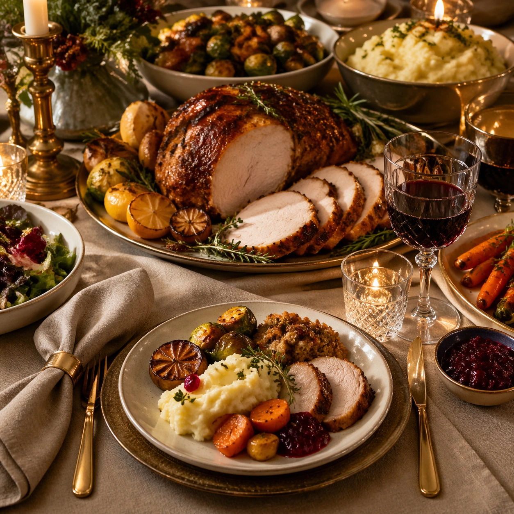

```text
Scene:
Compose a square feast or banquet campaign image with abundant but controlled table choreography, rich servingware, and a celebratory atmosphere that feels suitable for hospitality campaigns, seasonal dining promotions, or event editorials. The frame should manage many elements without losing hierarchy, elegance, or appetite appeal. Use a square crop of one portion of the table with candlelight, plateware, napkin folds, and partial dish visibility creating intimate celebration.

Subject:
The food must look substantial and celebratory, with believable multi-dish coordination, serving logic, and table rituals that suggest a real banquet rather than a random buffet pile. Let the place setting and nearby food communicate premium hospitality and anticipation.

Important details:
This topic depends on composition reasoning. Preserve a strong centerpiece, readable secondary dishes, coherent servingware, and lighting that supports depth across the table. Celebration should emerge from abundance, color, and ritual objects, not from gimmicks or branded holiday symbols. Everything must feel premium, coordinated, and logistically plausible. This image should feel fully self-contained while still belonging to the same broader topic and commercial world. Material realism matters: glass sparkle, candle glow, linen depth, and polished flatware should all feel warm and believable without overpowering the food.

Use case:
Festive Feast single study 5/9, built for Prompt Atlas coverage of a food and beverage commercial visual system.

Constraints:
No readable text, no watermark, no logos, preserve exact 1:1 aspect ratio, no readable text, no logos, no generic wedding décor, no buffet-chaos clutter, no novelty party props, no copied holiday mascots, no visible faces dominating the frame, no wedding invitation cards, no readable place cards, no luxury-brand logos.
```

Model: GPT Image 2 · Author: ChaosRealmsAI

[Original source](https://github.com/ChaosRealmsAI/gpt-image-2-gallery/blob/5296db8c996e38776c83a0bc8c64f848dcd512b3/works/topics/festive-feast-and-banquet-campaign-visuals/packages/single-support-studies/images/candle-place-setting/meta.json) · [Provenance and original license](data/projectd-batch-0012.json)

## Strength Training Program Social Tile — ChaosRealmsAI · MIT


```text
Scene:
Create a square strength-cycle social tile for Program Launch, using conversion-friendly fitness marketing with premium training imagery, structured layouts, and trustworthy coaching tone. The composition should read as a practical, production-ready sports or fitness surface with a clear hierarchy, premium lighting, and obvious commercial intent. Keep the environment specific enough to feel real, but leave enough control in the layout for non-readable information modules, campaign blocks, or visualized metrics. Aim for a finish that works for a brand, club, app, academy, or event operator.

Subject:
Build the image around athlete near barbell setup. The subject should be original, believable, and free of any real-brand or celebrity cues. Use realistic apparel, safe body mechanics when movement is visible, and environmental props that support the category without clutter. The subject must stay visually dominant so the design still works as a communication asset rather than a pure scene study.

Important details:
The mood should read as disciplined power. Treat layout, light, and supporting graphic structure as part of one polished delivery surface. Any schedule blocks, metric panels, quote zones, badges, or path diagrams must stay abstract and non-readable. Prioritize usefulness, clarity, and category truth over spectacle. The image should feel distinct from the series package while still belonging naturally to the same topic and business use case.

Use case:
Program Launch single study 5/9, an independent rollout surface for the topic.

Constraints:
No readable text, no watermark, no logos, preserve exact 1:1 aspect ratio, no brand marks, no public-figure resemblance, no generic stock layout, no cluttered UI imitation, no accidental copyrighted insignia.
```

Model: GPT Image 2 · Author: ChaosRealmsAI

[Original source](https://github.com/ChaosRealmsAI/gpt-image-2-gallery/blob/5296db8c996e38776c83a0bc8c64f848dcd512b3/works/topics/fitness-program-launch-campaign/packages/single-support-studies/images/strength-cycle-tile/meta.json) · [Provenance and original license](data/projectd-batch-0012.json)

## Hillside City with Layered Tram Transport — ChaosRealmsAI · MIT

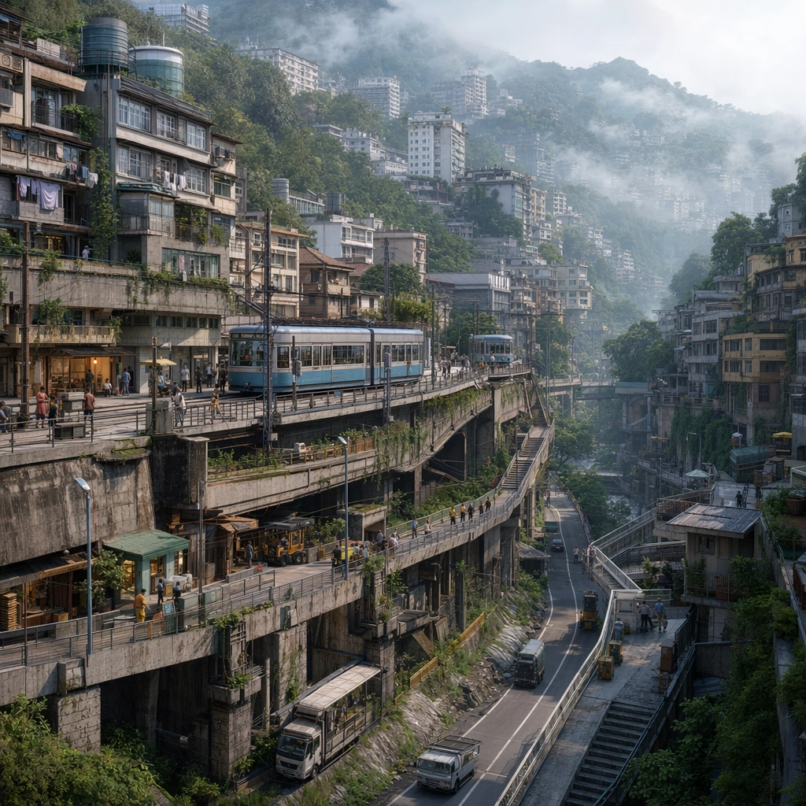

```text
Scene:
Design a square urban concept image that sells one future-city mobility idea clearly enough for an editorial spread, launch visual, or worldbuilding board. The framing should always reveal at least two transport layers and one strong lived-in density cue. Show a steep hillside district with terraced housing, switchback trams, layered retaining decks, and mist lifting through the valley.

Subject:
Show a complete district-scale mobility ecosystem with believable housing, transit, commerce, and utility access. Human presence can appear as tiny commuters, riders, or maintenance workers, but the main protagonist is the city system itself. The city should adapt to terrain elegantly, with circulation and density resolved through ramps, lifts, rail loops, and narrow civic terraces.

Important details:
Use depth layering, disciplined architecture families, and just enough weather or atmosphere to create mood without erasing the logic of roads, bridges, lines, and occupancy. The result should feel specific to a place and function, not like an all-purpose neon metropolis. Make slope logic, drainage, and movement the main read so the district feels engineered for real life, not merely picturesque. Preserve credible circulation between transport levels so every district reads as somewhere people could actually move through and inhabit.

Use case:
Future City single study 1/5, designed as a self-contained support image for this topic.

Constraints:
No readable text, no watermark, no logos, preserve exact 1:1 aspect ratio, no superhero chase scenes, no floating random platforms without support, no unreadable giant signage, no sterile empty plazas, no fantasy cliff palaces.
```

Model: GPT Image 2 · Author: ChaosRealmsAI

[Original source](https://github.com/ChaosRealmsAI/gpt-image-2-gallery/blob/5296db8c996e38776c83a0bc8c64f848dcd512b3/works/topics/future-city-layered-transport-world/packages/single-support-studies/images/01-hillside-switchback-metropolis/meta.json) · [Provenance and original license](data/projectd-batch-0012.json)

## Shared Laundry Community Lounge Concept — ChaosRealmsAI · MIT

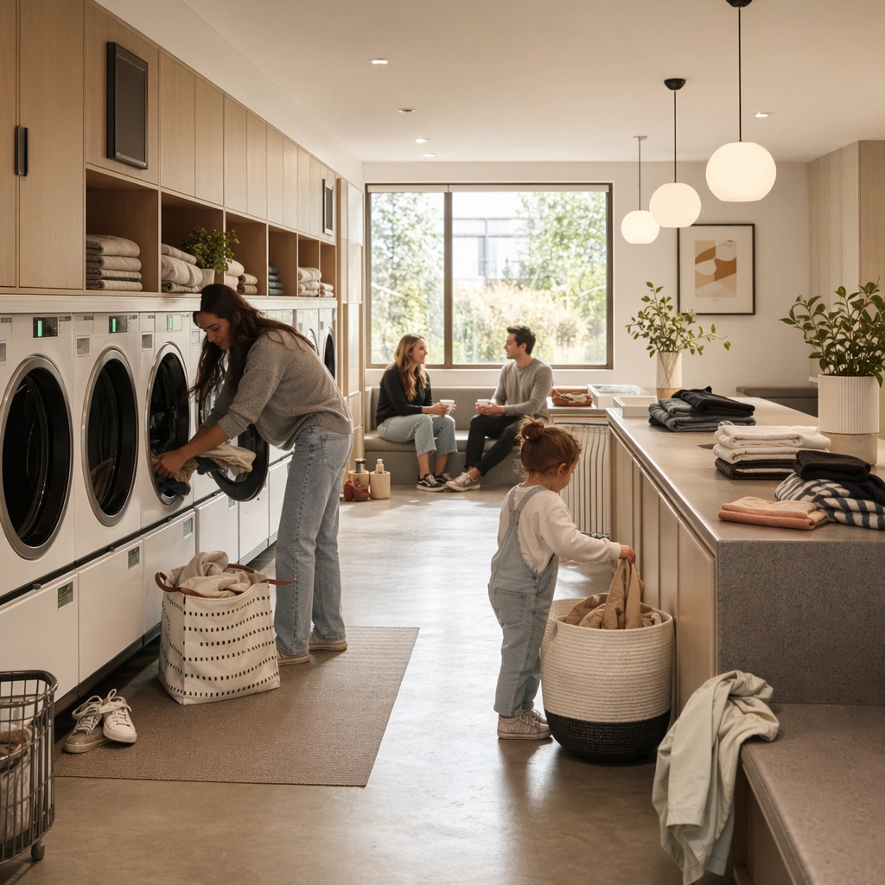

```text
Scene:
Design a square near-future living environment study that feels immediately usable as a brand-inspiration image or speculative editorial visual. The scene should show one complete routine surface, not just decorative furniture styling. Compose a bright shared laundry lounge with folding counters, seating niches, clean storage walls, and quietly automated machines integrated into one room.

Subject:
Focus on a believable room or shared domestic node where human habits, object placement, and light all imply how the space is used every day. Technology should feel embedded in materials, fixtures, and workflows instead of floating as abstract holograms. The space should feel used by neighbors and families, not merely styled, with clear workflows for washing, sorting, waiting, and light social interaction.

Important details:
Keep the design humane, tactile, and slightly imperfect so it reads as lived-in. Surfaces, storage, and appliance behavior should all support a credible near-future domestic routine. Show how good lighting, acoustics, and materials can turn a utility room into a credible community amenity. Preserve habitual realism in object placement, cleaning, storage, and circulation so every room feels actually inhabited.

Use case:
Future Domestic single study 1/5, designed as a self-contained support image for this topic.

Constraints:
No readable text, no watermark, no logos, preserve exact 1:1 aspect ratio, no generic smart-home wallpaper, no unrealistic levitating furniture, no fashion-shoot posing, no readable packaging copy, no luxury spa cues.
```

Model: GPT Image 2 · Author: ChaosRealmsAI

[Original source](https://github.com/ChaosRealmsAI/gpt-image-2-gallery/blob/5296db8c996e38776c83a0bc8c64f848dcd512b3/works/topics/future-domestic-life-environment-visions/packages/single-support-studies/images/01-shared-laundry-lounge/meta.json) · [Provenance and original license](data/projectd-batch-0012.json)

## Polar Survey Suit and Equipment Board — ChaosRealmsAI · MIT

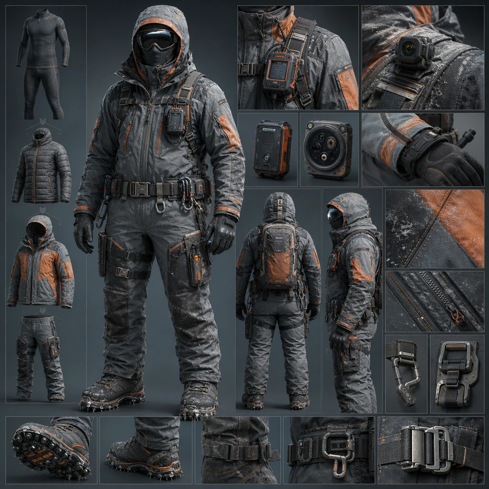

```text
Scene:
Design a square equipment concept board for one wearable product family or suit configuration, keeping silhouette clarity and material realism at the center. The board may use a full-body subject, cropped details, or organized accessories as long as the system stays legible. Compose a square board with one full-body cold-weather suit, thermal layering details, sensor modules, and anti-slip boot close-ups.

Subject:
Show a complete gear identity with clear task cues such as rescue, survey, reef work, cargo handling, agriculture, or courier transit. The suit should feel worn and usable, not merely styled. The system should feel built for prolonged field work through insulation, weather sealing, and instrument access.

Important details:
Favor seam logic, hardware placement, and believable material transitions over surface decoration. Each image should feel like part of a wider product ecosystem even when it stands alone. Use restrained color and realistic bulk so the rig feels professional and ergonomic. Preserve ergonomic realism so weight, protection, mobility, and access all make sense on the body.

Use case:
Suitline System single study 1/5, designed as a self-contained support image for this topic.

Constraints:
No readable text, no watermark, no logos, preserve exact 1:1 aspect ratio, no cosplay costume styling, no giant weapons, no fashion runway theatrics, no real-world brand marks, no expedition costume nostalgia.
```

Model: GPT Image 2 · Author: ChaosRealmsAI

[Original source](https://github.com/ChaosRealmsAI/gpt-image-2-gallery/blob/5296db8c996e38776c83a0bc8c64f848dcd512b3/works/topics/future-equipment-and-suitline-system/packages/single-support-studies/images/01-polar-survey-rig/meta.json) · [Provenance and original license](data/projectd-batch-0012.json)

## Urban Micro-Mobility Concept Lineup — ChaosRealmsAI · MIT

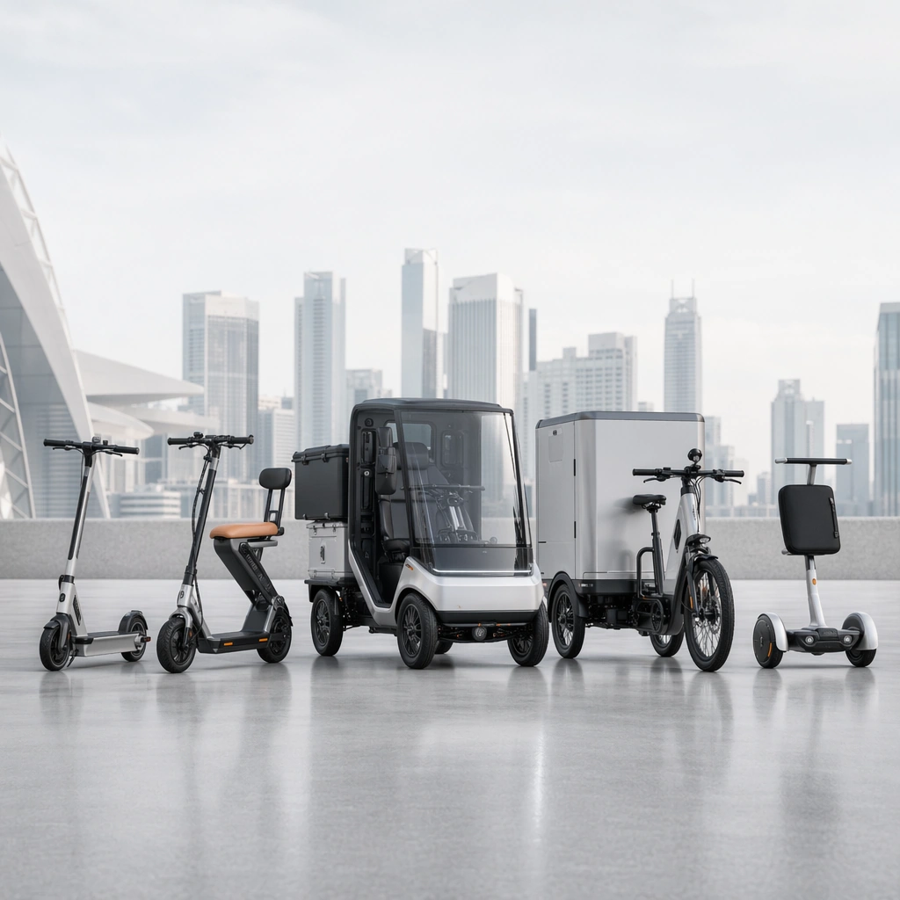

```text
Scene:
A square lineup shot with a white-gray city backdrop, precision product lighting, and even spacing across multiple design proposals. Compose the frame as a square key visual with disciplined camera placement, premium lighting control, and believable real-world scale. The tonal range should feel polished and intentional, with enough atmosphere to create depth without obscuring form. Keep contrast calibrated for launch, catalog, or research presentation use rather than casual snapshot aesthetics.

Subject:
Center several original micro-mobility devices arranged as one family of coherent industrial design concepts. Make the subject feel original, production-aware, and clearly grounded in Future Mobility Concept Surface Set. Treat this as an independent study that must feel complete and coherent without relying on any external reference image. The focal hierarchy should be immediate: primary form first, then material behavior, then supporting environmental cues that clarify use context and difficulty.

Important details:
Focus on believable packaging, wheel geometry, rider scale, and urban utility. The lineup should feel like a credible design portfolio rather than a toy collection. The visual language should still feel native to Future Mobility Concept Surface Set, using disciplined industrial or campaign composition instead of generic stock photography. Use believable materials, engineering logic, and professional composition discipline. Reflections, shadows, edge breaks, texture scale, interface density, and small physical joints must all support realism. Avoid filler props, vague mood-board clutter, or any element that weakens the sense of a purpose-built industrial or automotive image.

Use case:
Mobility Concept single study 5/9 for Future Mobility Concept Surface Set, built as image support-one.

Constraints:
No readable text, no watermark, no logos, preserve exact 1:1 aspect ratio, no readable text, no logos, no cyberpunk clutter, no impossible mechanics, no fantasy weaponry, no dystopian grime.
```

Model: GPT Image 2 · Author: ChaosRealmsAI

[Original source](https://github.com/ChaosRealmsAI/gpt-image-2-gallery/blob/5296db8c996e38776c83a0bc8c64f848dcd512b3/works/topics/future-mobility-concept-surface-set/packages/single-support-studies/images/support-one/meta.json) · [Provenance and original license](data/projectd-batch-0012.json)

## Gallery Plinth and Spotlight Study — ChaosRealmsAI · MIT

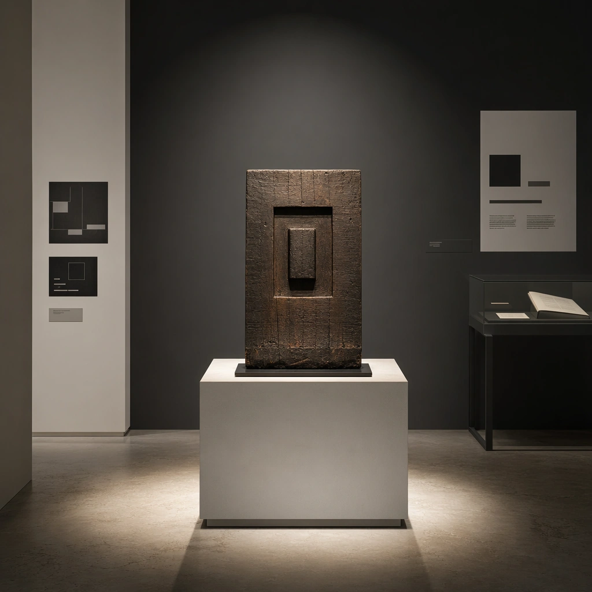

```text
Scene:
Create a square standalone support study for Gallery Exhibition Spatial Sequence. Use a front-on plinth composition under a tight spotlight pool and frame it like a premium commercial still or design-editorial crop with clear focal hierarchy, disciplined perspective, and enough breathing room for the materials and objects to read at both thumbnail and full size. Keep chalk white, charcoal gray, pale concrete, soft shadow black, and controlled spotlight warmth as the tonal guide so the image still belongs to the same theme family, and light the scene in a controlled way that emphasizes texture, edge quality, and authored atmosphere over spectacle.

Subject:
Show a gallery and exhibition environment with disciplined white and charcoal volumes, precise spotlighting, plinths, archival display furniture, abstract wall-label zones, and carefully paced emptiness. In this support study, focus on shadow edge precision, pedestal proportion, and artwork breathing room. The image should work independently, yet it must still feel like it belongs to the same broader world of Gallery Sequence. Make the space, props, and detailing useful for real campaign, editorial, or design-review contexts rather than moodboard abstraction.

Important details:
Carry forward the broader language of the wall-label rhythm, plinth geometry, spotlight language, floor material, and slow exhibition pacing, but let this image prove a new support surface or secondary deliverable. Material realism is essential: wood grain, metal sheen, glass edges, textiles, and stone should feel physically plausible and carefully art directed. Any graphic panels, labels, menus, packaging, or captions must stay abstract and unreadable. The overall result should feel reusable for museum campaigns, exhibition proposals, cultural editorials, and spatial storytelling decks, with enough structure that a creative or operations team could build on it.

Use case:
Gallery Exhibition Spatial Sequence single study 5/9, exploring support still for display-furniture and lighting reviews.

Constraints:
No readable text, no watermark, no logos, preserve exact 1:1 aspect ratio, no crowds, no readable wall text, no security barriers, no colorful trade-show clutter, no random gifts-shop products, no readable labels.
```

Model: GPT Image 2 · Author: ChaosRealmsAI

[Original source](https://github.com/ChaosRealmsAI/gpt-image-2-gallery/blob/5296db8c996e38776c83a0bc8c64f848dcd512b3/works/topics/gallery-exhibition-spatial-sequence/packages/single-support-studies/images/01-pedestal-spotlight-study/meta.json) · [Provenance and original license](data/projectd-batch-0012.json)

## Gym Reception Schedule Board Concept — ChaosRealmsAI · MIT

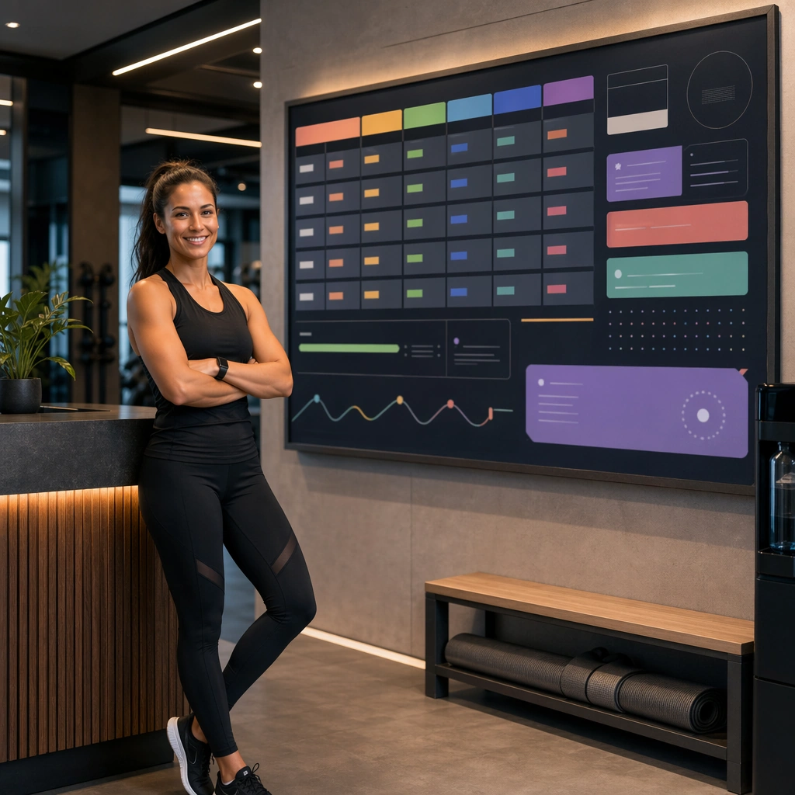

```text
Scene:
Create a square class schedule board for Gym Brand, using gym-brand communication with clean architecture, membership-friendly structure, and premium local-acquisition polish. The composition should read as a practical, production-ready sports or fitness surface with a clear hierarchy, premium lighting, and obvious commercial intent. Keep the environment specific enough to feel real, but leave enough control in the layout for non-readable information modules, campaign blocks, or visualized metrics. Aim for a finish that works for a brand, club, app, academy, or event operator.

Subject:
Build the image around trainer near reception or class corridor. The subject should be original, believable, and free of any real-brand or celebrity cues. Use realistic apparel, safe body mechanics when movement is visible, and environmental props that support the category without clutter. The subject must stay visually dominant so the design still works as a communication asset rather than a pure scene study.

Important details:
The mood should read as organized accessibility. Treat layout, light, and supporting graphic structure as part of one polished delivery surface. Any schedule blocks, metric panels, quote zones, badges, or path diagrams must stay abstract and non-readable. Prioritize usefulness, clarity, and category truth over spectacle. The image should feel distinct from the series package while still belonging naturally to the same topic and business use case.

Use case:
Gym Brand single study 5/9, an independent rollout surface for the topic.

Constraints:
No readable text, no watermark, no logos, preserve exact 1:1 aspect ratio, no brand marks, no public-figure resemblance, no generic stock layout, no cluttered UI imitation, no accidental copyrighted insignia.
```

Model: GPT Image 2 · Author: ChaosRealmsAI

[Original source](https://github.com/ChaosRealmsAI/gpt-image-2-gallery/blob/5296db8c996e38776c83a0bc8c64f848dcd512b3/works/topics/gym-brand-poster-and-membership-system/packages/single-support-studies/images/class-schedule-board/meta.json) · [Provenance and original license](data/projectd-batch-0012.json)

## Residential Foyer Console and Mirror — ChaosRealmsAI · MIT

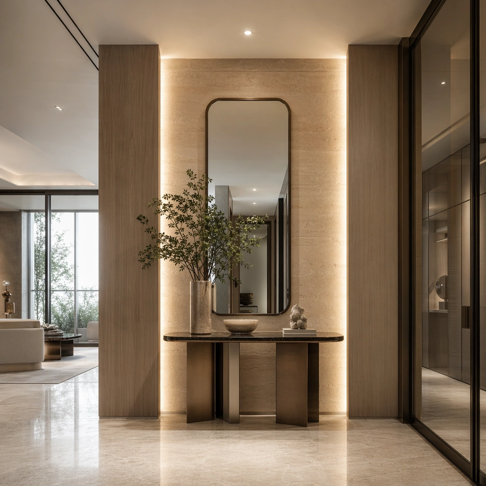

```text
Scene:
Create a square standalone support study for High-End Residential Showflat System. Use a front-on foyer study with console, mirror, lighting niche, and stone wall and frame it like a premium commercial still or design-editorial crop with clear focal hierarchy, disciplined perspective, and enough breathing room for the materials and objects to read at both thumbnail and full size. Keep pale oak, soft taupe, creamy travertine, smoke gray glass, and gentle daylight silver as the tonal guide so the image still belongs to the same theme family, and light the scene in a controlled way that emphasizes texture, edge quality, and authored atmosphere over spectacle.

Subject:
Show a high-end residential showflat with full-height glazing, pale oak wall panels, creamy stone flooring, sculptural furniture, restrained art objects, and polished property-marketing clarity. In this support study, focus on arrival styling, mirror proportion, and subtle property-luxury cues. The image should work independently, yet it must still feel like it belongs to the same broader world of Showflat System. Make the space, props, and detailing useful for real campaign, editorial, or design-review contexts rather than moodboard abstraction.

Important details:
Carry forward the broader language of the glazing rhythm, oak panel detailing, stone floor tone, furniture silhouettes, softly styled decor, and real-estate presentation polish, but let this image prove a new support surface or secondary deliverable. Material realism is essential: wood grain, metal sheen, glass edges, textiles, and stone should feel physically plausible and carefully art directed. Any graphic panels, labels, menus, packaging, or captions must stay abstract and unreadable. The overall result should feel reusable for property launches, brochure stills, sales-gallery walls, and premium listing presentations, with enough structure that a creative or operations team could build on it.

Use case:
High-End Residential Showflat System single study 5/9, exploring entry vignette for real-estate editorial use.

Constraints:
No readable text, no watermark, no logos, preserve exact 1:1 aspect ratio, no family photos, no clutter, no toy-like decor, no messy cables, no cheap staging tricks, no house keys with logos.
```

Model: GPT Image 2 · Author: ChaosRealmsAI

[Original source](https://github.com/ChaosRealmsAI/gpt-image-2-gallery/blob/5296db8c996e38776c83a0bc8c64f848dcd512b3/works/topics/high-end-residential-showflat-system/packages/single-support-studies/images/01-foyer-console-study/meta.json) · [Provenance and original license](data/projectd-batch-0012.json)

## Edible Sugar and Chocolate City Masterplan — ChaosRealmsAI · MIT

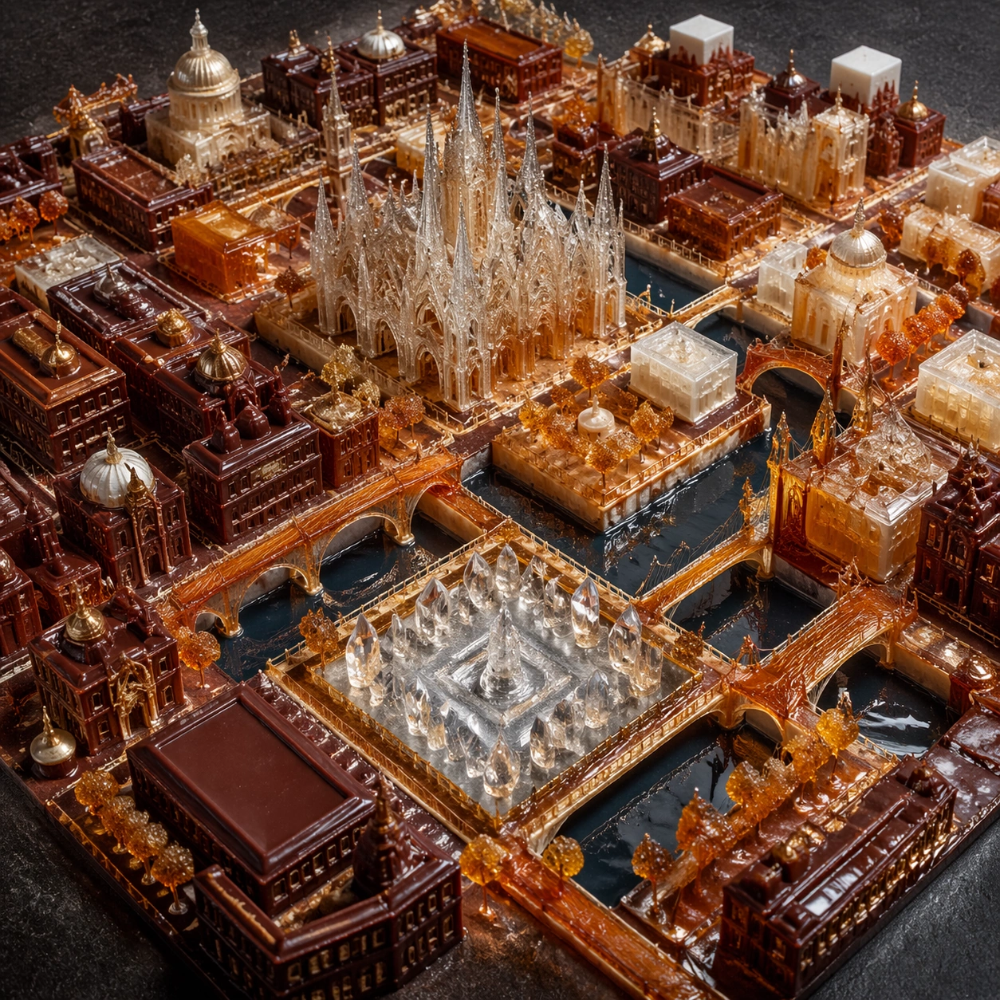

```text
Scene:
Create a square architectural photograph of an edible miniature city built from sugar and chocolate, lit like a serious built-environment hero shot rather than a whimsical craft display. The composition should imply scale through streets, openings, and tiny pathways while keeping the material identity unmistakably confectionary. Light must reveal translucency, lacework, caramel tension, and crystal sparkle without flattening the forms. Create a square aerial photograph looking down over an edible city on a dark neutral base, lit like a professional architecture model rather than a dessert table. Distinct districts should be readable through massing, color temperature, and material family.

Subject:
Show cathedrals of sugar, caramel bridge corridors, chocolate hotel blocks, and crystalline plazas all connected by precise street grids and water channels. The layout should feel intentional enough to function as a masterplan, with different edible materials assigned to specific urban roles. The city must remain confectionary in material detail while reading clearly as urban form.

Important details:
Treat the city as structurally plausible even when the materials are fantastical. Blown sugar should refract like fragile glass, pulled caramel should show tension and stretch, and dark chocolate should carry matte-to-satin variation where appropriate. The image should balance wonder with discipline, as if photographed for an architecture journal about impossible edible construction. Prioritize zoning clarity, street hierarchy, and believable transitions between material districts. The image should feel like an atlas plate for an impossible edible metropolis, not a random candy pile seen from above.

Use case:
Candy architecture single study 5/9, documenting the edible city as a coherent aerial masterplan.

Constraints:
No readable text, no watermark, no logos, preserve exact 1:1 aspect ratio, no candy wrappers, no toy-town props, no gingerbread-house cliches, no cartoon palette overload, no readable signage, no board-game tokens, no paper labels, no rainbow chaos.
```

Model: GPT Image 2 · Author: ChaosRealmsAI

[Original source](https://github.com/ChaosRealmsAI/gpt-image-2-gallery/blob/5296db8c996e38776c83a0bc8c64f848dcd512b3/works/topics/impossible-candy-architecture/packages/single-support-studies/images/aerial-masterplan/meta.json) · [Provenance and original license](data/projectd-batch-0012.json)

## Industrial Catalog Binder Cover Stack — ChaosRealmsAI · MIT

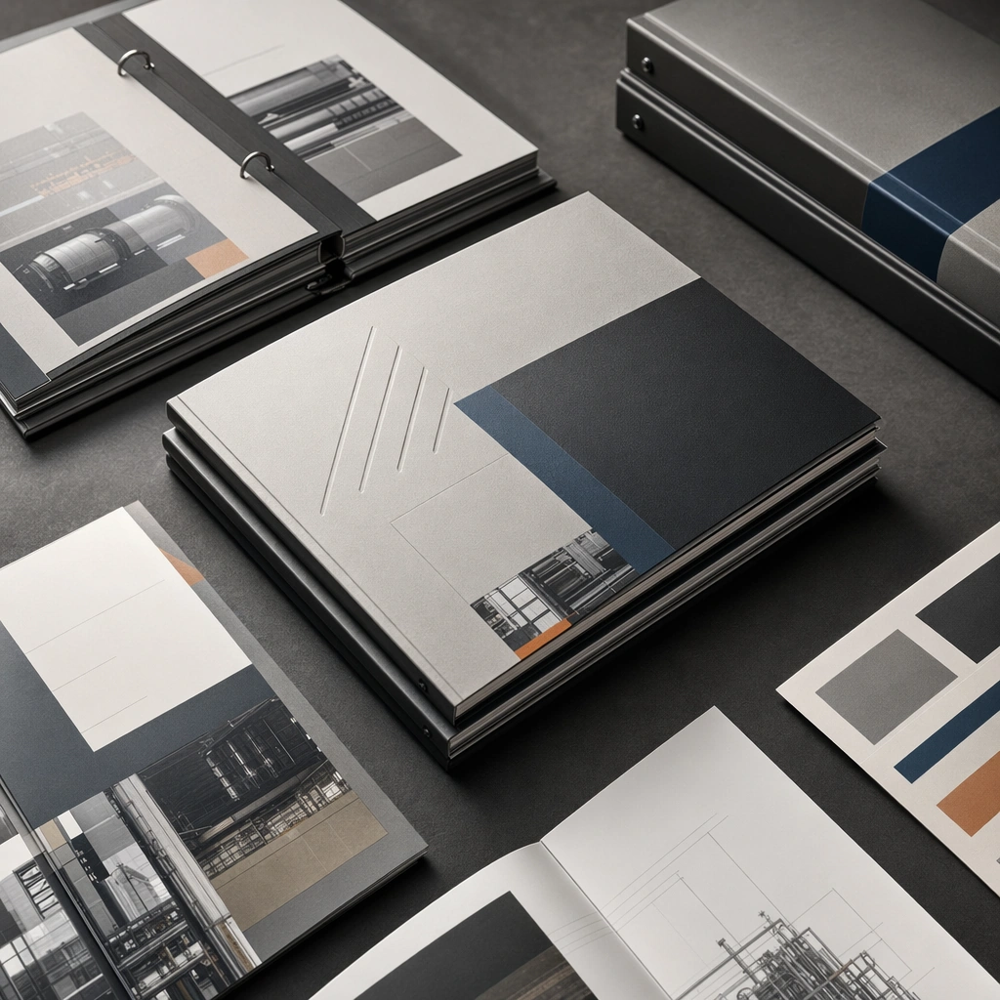

```text
Scene:
A square tabletop mockup with stacked binders, soft daylight, and refined paper texture across multiple printed objects. Compose the frame as a square key visual with disciplined camera placement, premium lighting control, and believable real-world scale. The tonal range should feel polished and intentional, with enough atmosphere to create depth without obscuring form. Keep contrast calibrated for launch, catalog, or research presentation use rather than casual snapshot aesthetics.

Subject:
Center original industrial catalog covers represented as non-readable abstract editorial surfaces. Make the subject feel original, production-aware, and clearly grounded in Industrial Catalog Cover and Spread System. Treat this as an independent study that must feel complete and coherent without relying on any external reference image. The focal hierarchy should be immediate: primary form first, then material behavior, then supporting environmental cues that clarify use context and difficulty.

Important details:
Sell material quality, print finish, and presentation polish. The image should feel like a real industrial sales kit prepared for a client meeting. The visual language should still feel native to Industrial Catalog Cover and Spread System, using disciplined industrial or campaign composition instead of generic stock photography. Use believable materials, engineering logic, and professional composition discipline. Reflections, shadows, edge breaks, texture scale, interface density, and small physical joints must all support realism. Avoid filler props, vague mood-board clutter, or any element that weakens the sense of a purpose-built industrial or automotive image.

Use case:
Catalog System single study 5/9 for Industrial Catalog Cover and Spread System, built as image support-one.

Constraints:
No readable text, no watermark, no logos, preserve exact 1:1 aspect ratio, no readable text, no logos, no lorem ipsum, no random office clutter, no unrelated consumer props, no fake brand marks.
```

Model: GPT Image 2 · Author: ChaosRealmsAI

[Original source](https://github.com/ChaosRealmsAI/gpt-image-2-gallery/blob/5296db8c996e38776c83a0bc8c64f848dcd512b3/works/topics/industrial-catalog-cover-and-spread-system/packages/single-support-studies/images/support-one/meta.json) · [Provenance and original license](data/projectd-batch-0012.json)

## Industrial CMF Material Swatch Array — ChaosRealmsAI · MIT

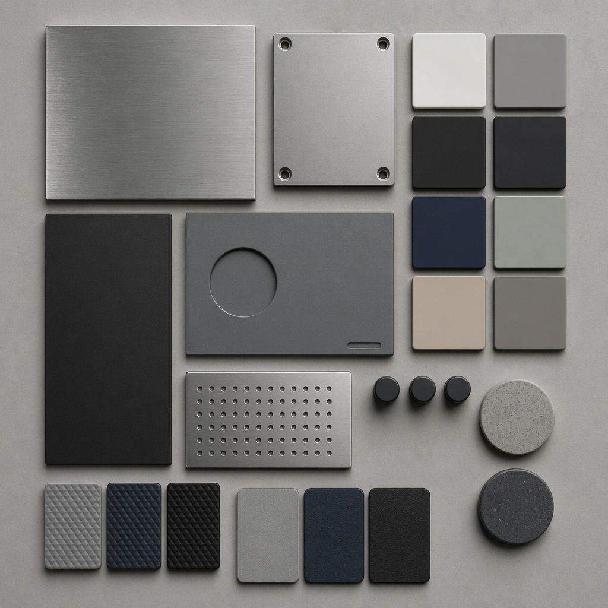

```text
Scene:
A square top-down CMF board with neat spacing, soft edge shadows, and neutral daylight-balanced illumination. Compose the frame as a square key visual with disciplined camera placement, premium lighting control, and believable real-world scale. The tonal range should feel polished and intentional, with enough atmosphere to create depth without obscuring form. Keep contrast calibrated for launch, catalog, or research presentation use rather than casual snapshot aesthetics.

Subject:
Center original material chips for anodized metal, matte polymer, rubber, and ceramic coating organized with industrial precision. Make the subject feel original, production-aware, and clearly grounded in Industrial Material Finish Study Board. Treat this as an independent study that must feel complete and coherent without relying on any external reference image. The focal hierarchy should be immediate: primary form first, then material behavior, then supporting environmental cues that clarify use context and difficulty.

Important details:
Stress sample precision and product relevance instead of decorative craft mood. The board should feel native to an industrial design studio. The visual language should still feel native to Industrial Material Finish Study Board, using disciplined industrial or campaign composition instead of generic stock photography. Use believable materials, engineering logic, and professional composition discipline. Reflections, shadows, edge breaks, texture scale, interface density, and small physical joints must all support realism. Avoid filler props, vague mood-board clutter, or any element that weakens the sense of a purpose-built industrial or automotive image.

Use case:
Material Study single study 5/9 for Industrial Material Finish Study Board, built as image support-one.

Constraints:
No readable text, no watermark, no logos, preserve exact 1:1 aspect ratio, no readable labels, no logos, no decorative lifestyle props, no fantasy texture, no chaotic palettes, no distressed damage.
```

Model: GPT Image 2 · Author: ChaosRealmsAI

[Original source](https://github.com/ChaosRealmsAI/gpt-image-2-gallery/blob/5296db8c996e38776c83a0bc8c64f848dcd512b3/works/topics/industrial-material-finish-study-board/packages/single-support-studies/images/support-one/meta.json) · [Provenance and original license](data/projectd-batch-0012.json)

## Industrial Device Parts Kit Flatlay — ChaosRealmsAI · MIT

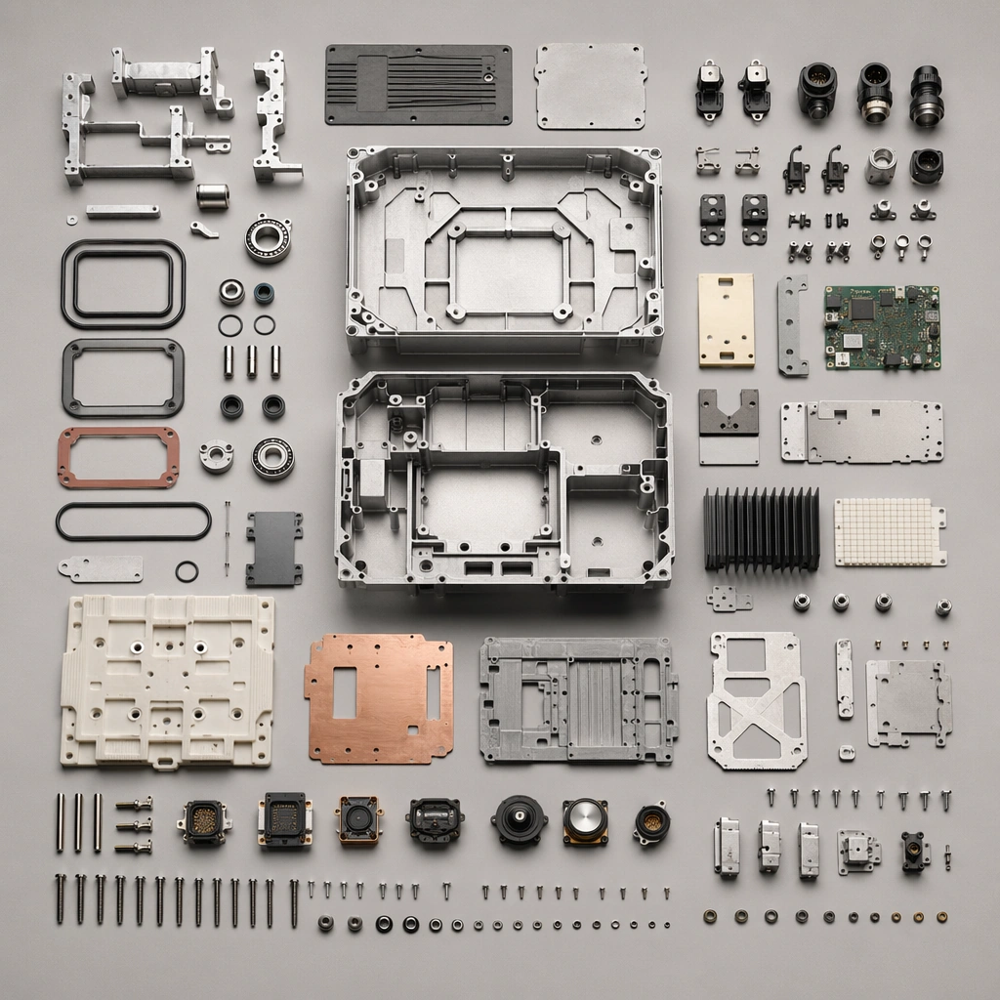

```text
Scene:
A square top-down workbench board with neutral ground, soft precision light, and crisp part spacing. Compose the frame as a square key visual with disciplined camera placement, premium lighting control, and believable real-world scale. The tonal range should feel polished and intentional, with enough atmosphere to create depth without obscuring form. Keep contrast calibrated for launch, catalog, or research presentation use rather than casual snapshot aesthetics.

Subject:
Center original industrial-device components grouped by system, material, and size with highly controlled organization. Make the subject feel original, production-aware, and clearly grounded in Industrial Product Exploded View Suite. Treat this as an independent study that must feel complete and coherent without relying on any external reference image. The focal hierarchy should be immediate: primary form first, then material behavior, then supporting environmental cues that clarify use context and difficulty.

Important details:
Use clean spacing and believable engineering categories without readable part numbers. The board should feel fit for catalog or teardown communication. The visual language should still feel native to Industrial Product Exploded View Suite, using disciplined industrial or campaign composition instead of generic stock photography. Use believable materials, engineering logic, and professional composition discipline. Reflections, shadows, edge breaks, texture scale, interface density, and small physical joints must all support realism. Avoid filler props, vague mood-board clutter, or any element that weakens the sense of a purpose-built industrial or automotive image.

Use case:
Exploded Views single study 5/9 for Industrial Product Exploded View Suite, built as image support-one.

Constraints:
No readable text, no watermark, no logos, preserve exact 1:1 aspect ratio, no readable labels, no logos, no fantasy glowing cores, no chaotic wire nests, no meaningless arrows, no decorative clutter.
```

Model: GPT Image 2 · Author: ChaosRealmsAI

[Original source](https://github.com/ChaosRealmsAI/gpt-image-2-gallery/blob/5296db8c996e38776c83a0bc8c64f848dcd512b3/works/topics/industrial-product-exploded-view-suite/packages/single-support-studies/images/support-one/meta.json) · [Provenance and original license](data/projectd-batch-0012.json)

## Language Club Course Cover Mockup — ChaosRealmsAI · MIT

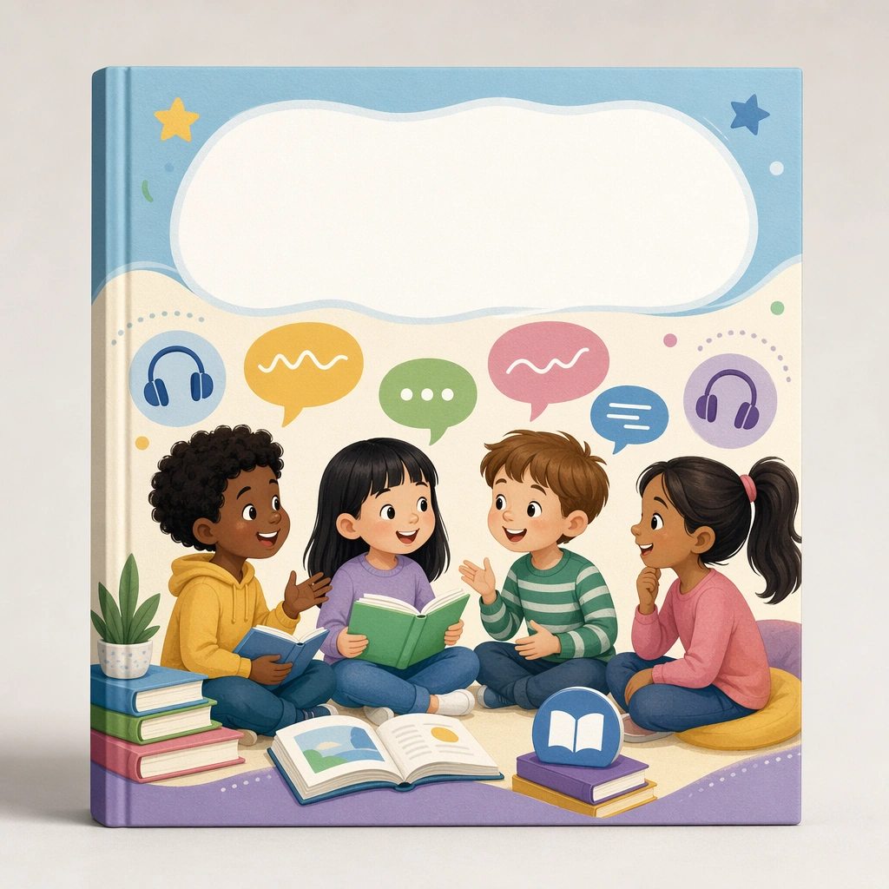

```text
Scene:
Create a square single-cover mockup against a soft studio backdrop with crisp print texture and clean shelf-lighting logic. The asset should feel like an ecommerce-ready course tile for a language club or reading program. Keep the square frame balanced, calm, and production-ready so the asset can serve gallery review, research comparison, and real educational delivery at the same time.

Subject:
Use friendly speech bubbles, books, listening icons, and conversation scenes inside a disciplined course-cover frame with blank title space. The cover should feel inviting, educational, and easy to classify within a larger catalog. The subject arrangement should feel complete and self-contained, able to stand alone as a real supporting deliverable inside the same education business line.

Important details:
Keep the structure highly intentional, with strong hierarchy and clear modularity. The goal is a believable product-shelf asset, not a generic poster. Keep the visual hierarchy modular, commercially believable, and clearly tied to a real educational use case rather than a generic mood board.

Use case:
Kids Course Cover and Module Family single study 1/5, language club cover.

Constraints:
No readable text, no watermark, no logos, preserve exact 1:1 aspect ratio, no readable course names, no logos, no fake ratings, no crowded marketplace clutter, no generic stock templates, no IP likeness.
```

Model: GPT Image 2 · Author: ChaosRealmsAI

[Original source](https://github.com/ChaosRealmsAI/gpt-image-2-gallery/blob/5296db8c996e38776c83a0bc8c64f848dcd512b3/works/topics/kids-course-cover-and-module-family/packages/single-support-studies/images/01-language-club-cover/meta.json) · [Provenance and original license](data/projectd-batch-0012.json)

## Basketball Season Opening Social Tile — ChaosRealmsAI · MIT

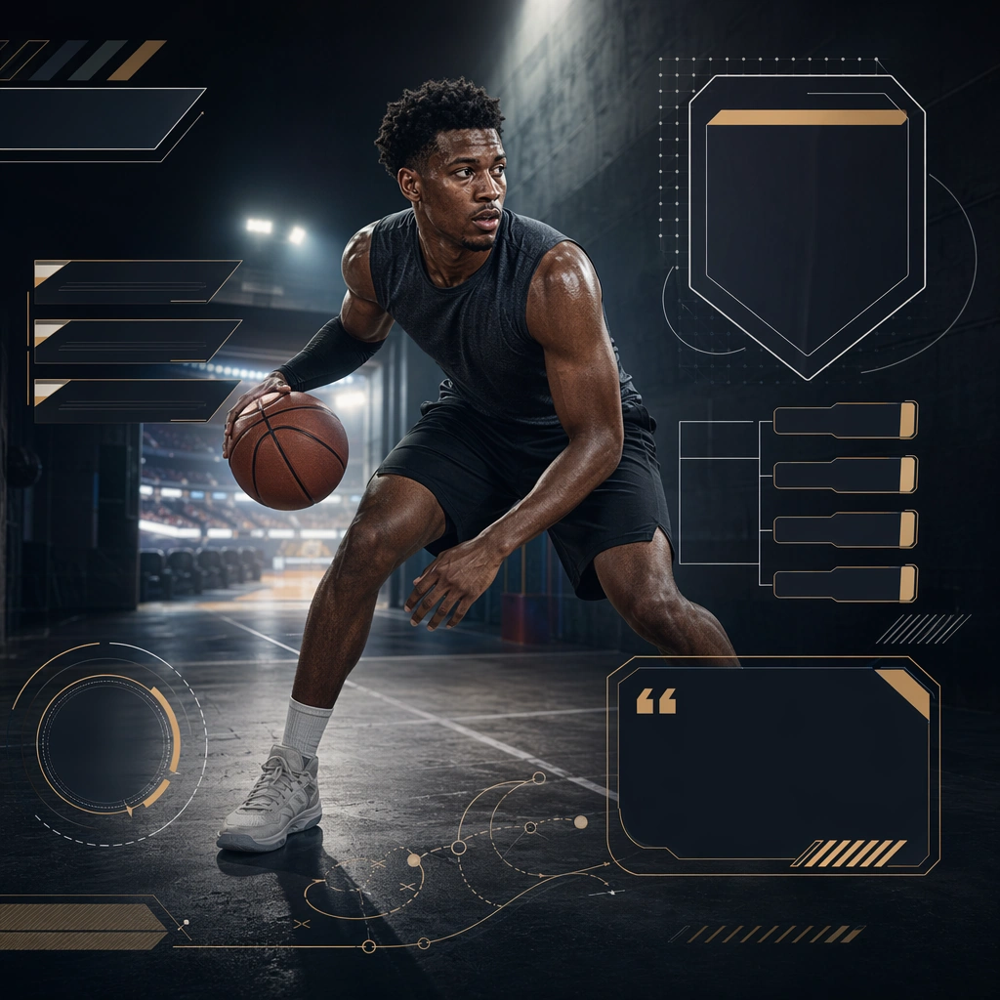

```text
Scene:
Create a square opening weekend tile for League Launch, using season-opening sports marketing with schedule-ready layout logic, neutral league prestige, and event-scale atmosphere. The composition should read as a practical, production-ready sports or fitness surface with a clear hierarchy, premium lighting, and obvious commercial intent. Keep the environment specific enough to feel real, but leave enough control in the layout for non-readable information modules, campaign blocks, or visualized metrics. Aim for a finish that works for a brand, club, app, academy, or event operator.

Subject:
Build the image around single athlete with fixture blocks. The subject should be original, believable, and free of any real-brand or celebrity cues. Use realistic apparel, safe body mechanics when movement is visible, and environmental props that support the category without clutter. The subject must stay visually dominant so the design still works as a communication asset rather than a pure scene study.

Important details:
The mood should read as official excitement. Treat layout, light, and supporting graphic structure as part of one polished delivery surface. Any schedule blocks, metric panels, quote zones, badges, or path diagrams must stay abstract and non-readable. Prioritize usefulness, clarity, and category truth over spectacle. The image should feel distinct from the series package while still belonging naturally to the same topic and business use case.

Use case:
League Launch single study 5/9, an independent rollout surface for the topic.

Constraints:
No readable text, no watermark, no logos, preserve exact 1:1 aspect ratio, no brand marks, no public-figure resemblance, no generic stock layout, no cluttered UI imitation, no accidental copyrighted insignia.
```

Model: GPT Image 2 · Author: ChaosRealmsAI

[Original source](https://github.com/ChaosRealmsAI/gpt-image-2-gallery/blob/5296db8c996e38776c83a0bc8c64f848dcd512b3/works/topics/league-season-launch-visual-kit/packages/single-support-studies/images/opening-weekend-tile/meta.json) · [Provenance and original license](data/projectd-batch-0012.json)

## Parent Learning Dashboard Tablet Concept — ChaosRealmsAI · MIT

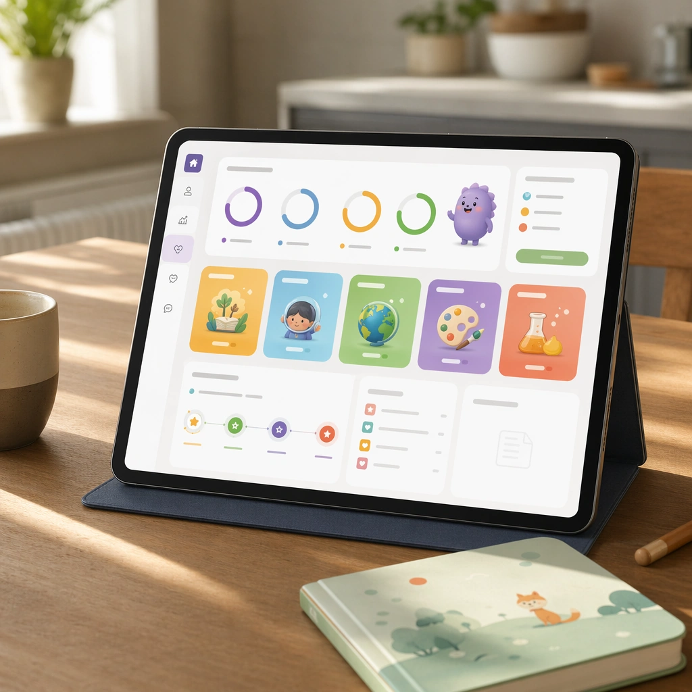

```text
Scene:
Create a square product composition showing a tablet on a quiet kitchen table with soft daylight, a cup, and a child-safe notebook nearby. The screen should feel calm and trustworthy, like a family-oriented companion dashboard for a premium learning app. Keep the square frame balanced, calm, and production-ready so the asset can serve gallery review, research comparison, and real educational delivery at the same time.

Subject:
Use visual progress rings, subject modules, mascot summaries, and blank report cards to communicate activity, milestones, and next steps without readable text. The dashboard should feel informative for adults while staying visually tied to the child-facing app universe. The subject arrangement should feel complete and self-contained, able to stand alone as a real supporting deliverable inside the same education business line.

Important details:
Balance reassurance and structure. The layout should be spacious, rational, and polished, proving that the product line can serve both children and caregivers without changing brands. Keep the visual hierarchy modular, commercially believable, and clearly tied to a real educational use case rather than a generic mood board.

Use case:
Learning App Onboarding and Lesson UI single study 1/5, parent dashboard tablet.

Constraints:
No readable text, no watermark, no logos, preserve exact 1:1 aspect ratio, no readable UI copy, no logos, no generic game loot clutter, no brand watermarks, no impossible screen perspective, no app-store badges.
```

Model: GPT Image 2 · Author: ChaosRealmsAI

[Original source](https://github.com/ChaosRealmsAI/gpt-image-2-gallery/blob/5296db8c996e38776c83a0bc8c64f848dcd512b3/works/topics/learning-app-onboarding-and-lesson-ui/packages/single-support-studies/images/01-parent-dashboard-tablet/meta.json) · [Provenance and original license](data/projectd-batch-0012.json)

## Frozen Sorbet Impact Study — ChaosRealmsAI · MIT

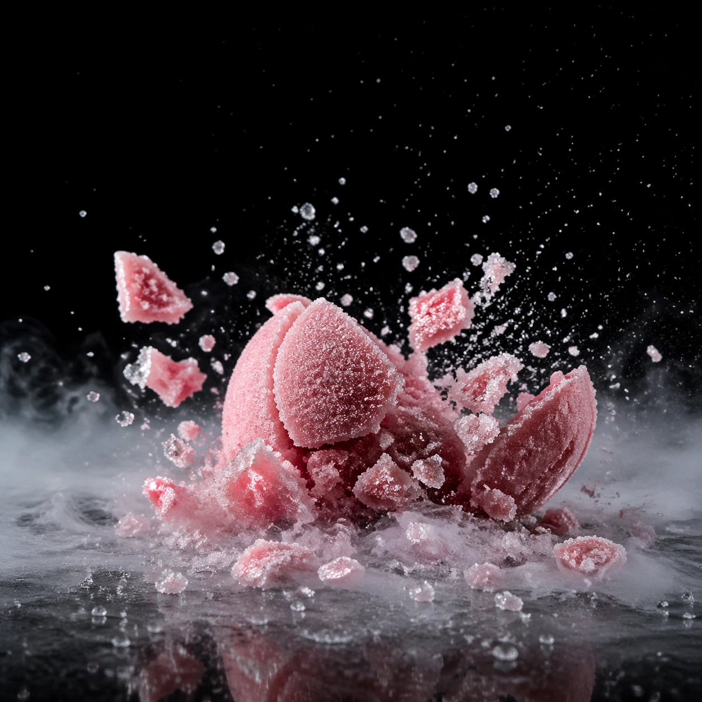

```text
Scene:
Create a square ultra-high-speed food photograph on a dark stage with precise flash freezing every crystal, fragment, and droplet. Cold vapor should sink and spread along the surface rather than billow upward like theatrical smoke. The scene must feel like a controlled scientific capture of an extreme thermal event, with deep blacks, disciplined highlights, and severe physical clarity. Create a square dark-stage action image with crisp flash and a shallow glossy floor, keeping the overall mood scientific and severe. The background should stay deep black so the pale frozen fragments stand out with maximum clarity.

Subject:
Show a compact scoop or quenelle of sorbet impacting the surface and breaking into brittle shards, icy dust, and small faceted chunks. A little cold vapor should spread outward along the floor plane as the impact occurs. The fragments must remain clearly readable as sorbet, not generic ice.

Important details:
The key challenge is believable thermal physics: frost bloom, brittle fracture, vapor density, wet-to-frozen transitions, and the texture of suddenly shocked food all need to feel accurate. Motion can be violent, but the image should remain legible and elegant. Every fragment must still read as part of a real food object. Focus on granular frozen texture, fracture edge sharpness, and how the impact converts a smooth scoop into angular crystalline debris. The scene should feel physically inevitable rather than stylized for spectacle.

Use case:
Liquid nitrogen frozen moment single study 5/9, testing brittle impact in frozen sorbet.

Constraints:
No readable text, no watermark, no logos, preserve exact 1:1 aspect ratio, no fire effects, no sci-fi blue laser glow, no generic splash stock-photo look, no readable gauges, no dramatic stage props, no colorful sprinkles, no gelatin bounce look, no blurred motion.
```

Model: GPT Image 2 · Author: ChaosRealmsAI

[Original source](https://github.com/ChaosRealmsAI/gpt-image-2-gallery/blob/5296db8c996e38776c83a0bc8c64f848dcd512b3/works/topics/liquid-nitrogen-frozen-moment/packages/single-support-studies/images/sorbet-impact-study/meta.json) · [Provenance and original license](data/projectd-batch-0012.json)

## Quiet Rain-Window Table Scene — ChaosRealmsAI · MIT

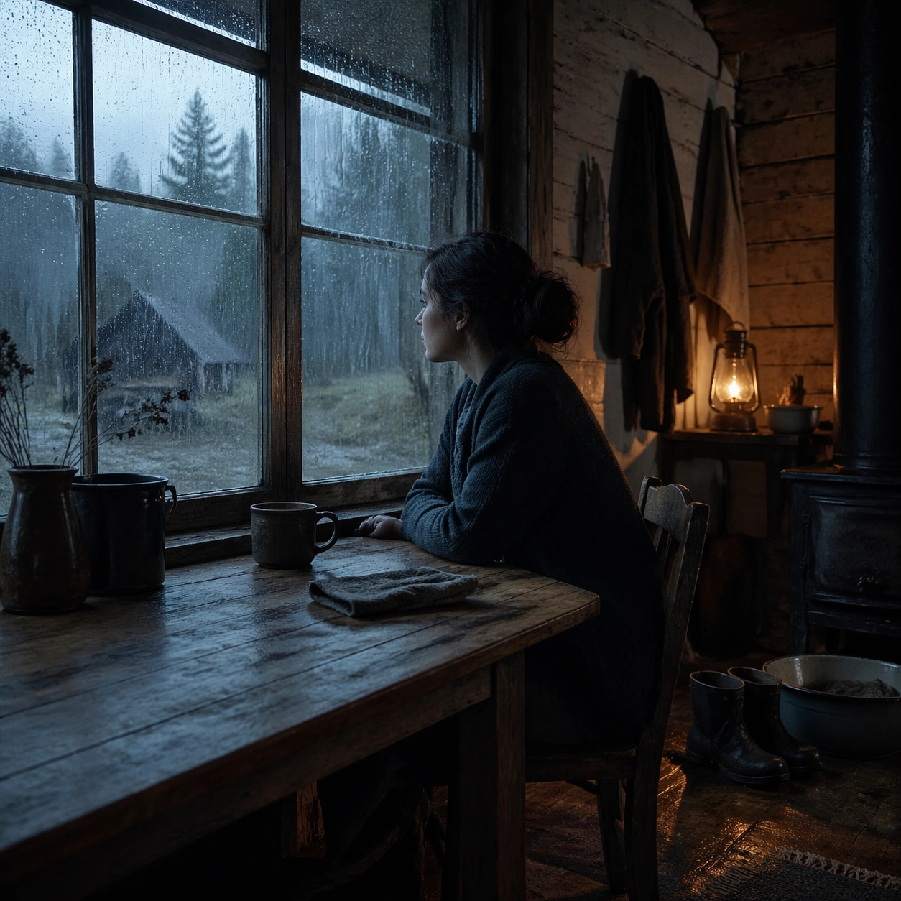

```text
Scene:
A square interior image held in patient stillness, with rain sliding down window glass, damp wood, muted blue-gray daylight, and one warm pool of lamplight or stove light inside. The room should feel inhabited but quiet, with time stretched by weather and silence rather than by spectacle. Show a wooden table pushed close to a rain-streaked window, with blue exterior light softening the edges of a ceramic cup and folded hands.

Subject:
Use one seated or standing figure, sometimes accompanied by a sleeping animal or simple domestic object, positioned so the window and the room share emotional weight. The human presence should be understated, contemplative, and integrated into the architecture. A solitary figure sits at the table in profile, not doing anything except watching rain collect and slide down the pane.

Important details:
The grammar depends on slow observation: wet glass, old timber, worn textiles, steam, puddled boots, enamel basins, and practical light. Preserve physical realism and spiritual quiet without turning the scene into fantasy, melodrama, or rustic cliche. Keep the room modest and tactile, with moisture and wood grain carrying the emotional tone.

Use case:
Long Gaze Through Rain Interior single study 1/9.

Constraints:
No readable text, no watermark, no logos, preserve exact 1:1 aspect ratio, no readable text, no obvious luxury styling, no dramatic storm destruction, no modern electronics dominating the room, no theatrical color grading, no broken anatomy, no low-detail background, no accidental text fragments.
```

Model: GPT Image 2 · Author: ChaosRealmsAI

[Original source](https://github.com/ChaosRealmsAI/gpt-image-2-gallery/blob/5296db8c996e38776c83a0bc8c64f848dcd512b3/works/topics/long-gaze-rain-interior/packages/single-long-gaze-rain-interior/images/01-window-table-silence/meta.json) · [Provenance and original license](data/projectd-batch-0012.json)

## Stone Hotel Check-In Island Detail — ChaosRealmsAI · MIT

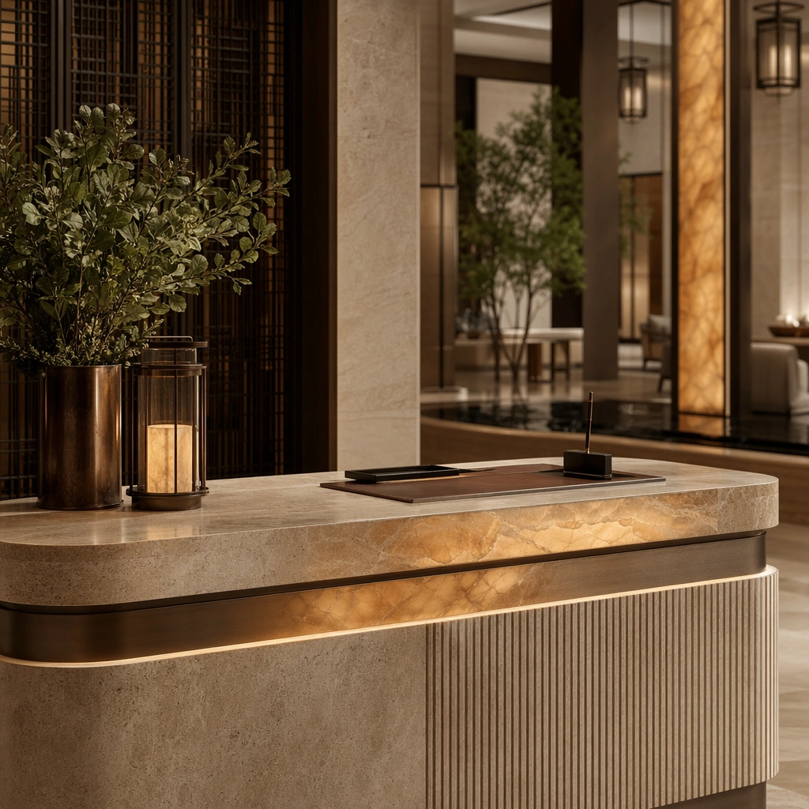

```text
Scene:
Create a square standalone support study for Luxury Hotel Lobby Arrival System. Use a close editorial crop of the stone check-in island under calm top light and frame it like a premium commercial still or design-editorial crop with clear focal hierarchy, disciplined perspective, and enough breathing room for the materials and objects to read at both thumbnail and full size. Keep warm limestone, honey amber, muted bronze, deep olive planting, and soft charcoal shadows as the tonal guide so the image still belongs to the same theme family, and light the scene in a controlled way that emphasizes texture, edge quality, and authored atmosphere over spectacle.

Subject:
Show a grand luxury hotel lobby with limestone slabs, smoked bronze screens, amber onyx accents, sculpted concierge islands, mirror-still water details, and a calm hospitality atmosphere. In this support study, focus on material precision, edge radius, tabletop accessories, and soft reflected glow. The image should work independently, yet it must still feel like it belongs to the same broader world of Hotel Lobby. Make the space, props, and detailing useful for real campaign, editorial, or design-review contexts rather than moodboard abstraction.

Important details:
Carry forward the broader language of the portal proportions, stone-and-bronze palette, concierge desk geometry, lantern rhythm, seating family, and abstract wayfinding zones, but let this image prove a new support surface or secondary deliverable. Material realism is essential: wood grain, metal sheen, glass edges, textiles, and stone should feel physically plausible and carefully art directed. Any graphic panels, labels, menus, packaging, or captions must stay abstract and unreadable. The overall result should feel reusable for campaign stills, hospitality editorials, investor decks, and operator handoff boards, with enough structure that a creative or operations team could build on it.

Use case:
Luxury Hotel Lobby Arrival System single study 5/9, exploring front desk detail photography for hospitality brand systems.

Constraints:
No readable text, no watermark, no logos, preserve exact 1:1 aspect ratio, no guests, no staff, no suitcases scattered everywhere, no casino mood, no festive balloons, no readable paperwork.
```

Model: GPT Image 2 · Author: ChaosRealmsAI

[Original source](https://github.com/ChaosRealmsAI/gpt-image-2-gallery/blob/5296db8c996e38776c83a0bc8c64f848dcd512b3/works/topics/luxury-hotel-lobby-arrival-system/packages/single-support-studies/images/01-check-in-island-detail/meta.json) · [Provenance and original license](data/projectd-batch-0012.json)

## Prematch Athlete Portrait Social Tile — ChaosRealmsAI · MIT


```text
Scene:
Create a square prematch social tile for Matchday System, using premium sports-media packaging built around stadium light, clean panel hierarchy, and brandless matchday communication. The composition should read as a practical, production-ready sports or fitness surface with a clear hierarchy, premium lighting, and obvious commercial intent. Keep the environment specific enough to feel real, but leave enough control in the layout for non-readable information modules, campaign blocks, or visualized metrics. Aim for a finish that works for a brand, club, app, academy, or event operator.

Subject:
Build the image around single athlete near tunnel light. The subject should be original, believable, and free of any real-brand or celebrity cues. Use realistic apparel, safe body mechanics when movement is visible, and environmental props that support the category without clutter. The subject must stay visually dominant so the design still works as a communication asset rather than a pure scene study.

Important details:
The mood should read as close portrait confidence. Treat layout, light, and supporting graphic structure as part of one polished delivery surface. Any schedule blocks, metric panels, quote zones, badges, or path diagrams must stay abstract and non-readable. Prioritize usefulness, clarity, and category truth over spectacle. The image should feel distinct from the series package while still belonging naturally to the same topic and business use case.

Use case:
Matchday System single study 5/9, an independent rollout surface for the topic.

Constraints:
No readable text, no watermark, no logos, preserve exact 1:1 aspect ratio, no brand marks, no public-figure resemblance, no generic stock layout, no cluttered UI imitation, no accidental copyrighted insignia.
```

Model: GPT Image 2 · Author: ChaosRealmsAI

[Original source](https://github.com/ChaosRealmsAI/gpt-image-2-gallery/blob/5296db8c996e38776c83a0bc8c64f848dcd512b3/works/topics/matchday-poster-and-score-update-system/packages/single-support-studies/images/prematch-social-tile/meta.json) · [Provenance and original license](data/projectd-batch-0012.json)

## Picture-Based Math Learning Station — ChaosRealmsAI · MIT

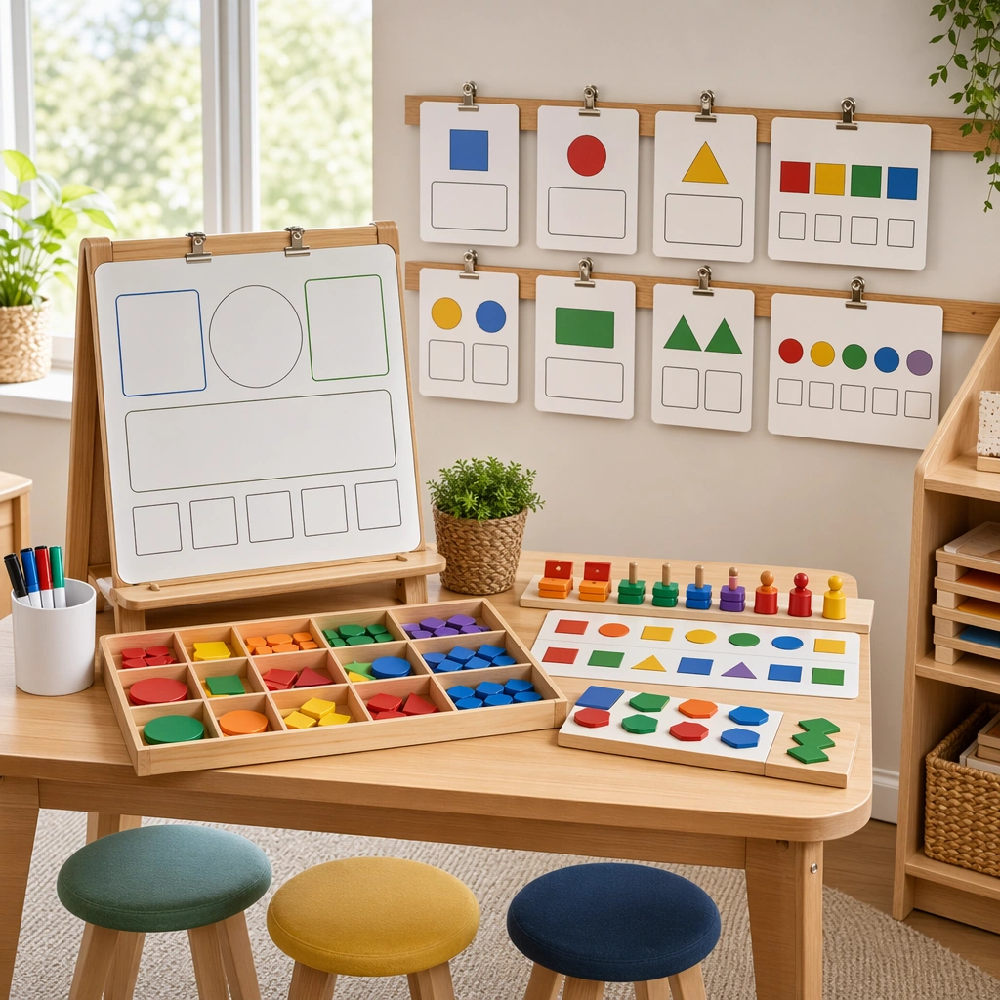

```text
Scene:
Show a square classroom station scene with a small whiteboard, tray of manipulatives, clipped concept cards, and a few child-height stools arranged neatly under bright natural light. The composition should feel like a teaching-resource brochure image, not a candid classroom snapshot. Keep the square frame balanced, calm, and production-ready so the asset can serve gallery review, research comparison, and real educational delivery at the same time.

Subject:
The station should visually explain matching, sorting, comparing, and building patterns through movable pieces, blank response zones, and spatial grouping. Keep the tools young-child friendly, robust, and clearly part of a cohesive pedagogical system. The subject arrangement should feel complete and self-contained, able to stand alone as a real supporting deliverable inside the same education business line.

Important details:
Favor structure and usability over decoration. The station must read instantly as a real instructional setup that teachers could replicate, while staying warm, calm, and commercially polished. Keep the visual hierarchy modular, commercially believable, and clearly tied to a real educational use case rather than a generic mood board.

Use case:
Math Concept Visual Card Set single study 2/5, whiteboard math station.

Constraints:
No readable text, no watermark, no logos, preserve exact 1:1 aspect ratio, no readable equations, no numerals, no logos, no messy classroom clutter, no generic stock-photo styling, no broken manipulatives.
```

Model: GPT Image 2 · Author: ChaosRealmsAI

[Original source](https://github.com/ChaosRealmsAI/gpt-image-2-gallery/blob/5296db8c996e38776c83a0bc8c64f848dcd512b3/works/topics/math-concept-visual-card-set/packages/single-support-studies/images/02-whiteboard-math-station/meta.json) · [Provenance and original license](data/projectd-batch-0012.json)

## Fine-Dining Folded Menu Mockup — ChaosRealmsAI · MIT


```text
Scene:
Compose a square menu-design mockup that combines printed surfaces, structured page hierarchy, and appetizing food photography into one coherent brand-authored system. The page layouts should feel intentional and premium, with strong margins, modular blocks, and realistic print or board materials even though all textual zones remain unreadable. Use a clean square still life on a linen-covered table with one folded menu object, one plate edge, and soft service lighting.

Subject:
The menu should communicate category structure, hero dish placement, and brand tone through composition, image framing, typographic blocks, and page rhythm rather than through readable copy. Food imagery must stay believable and publication-ready. Treat the folded menu as a luxury hospitality object with unreadable but intentional text zones and subtle dish-image integration.

Important details:
This topic tests layout reasoning as much as food styling. Preserve clean grids, realistic paper behavior, credible shadows, and strong focal hierarchy between cover, spreads, dish photos, and placeholder text zones. Text-like marks can exist only as abstract or unreadable forms; clarity must come from design structure. This image should feel fully self-contained while still belonging to the same broader topic and commercial world. Paper thickness, fold precision, foil-like accent blocks, and spatial calm should make the menu feel expensive and ceremonial.

Use case:
Menu System single study 5/9, built for Prompt Atlas coverage of a food and beverage commercial visual system.

Constraints:
No readable text, no watermark, no logos, preserve exact 1:1 aspect ratio, no readable text, no logos, no fake menu prices, no warped paper errors, no amateur flyer clutter, no chaotic collage, no obvious software UI chrome, no legible script, no wedding invitation look, no stationery clutter.
```

Model: GPT Image 2 · Author: ChaosRealmsAI

[Original source](https://github.com/ChaosRealmsAI/gpt-image-2-gallery/blob/5296db8c996e38776c83a0bc8c64f848dcd512b3/works/topics/menu-cover-and-spread-food-system/packages/single-support-studies/images/tasting-menu-fold/meta.json) · [Provenance and original license](data/projectd-batch-0012.json)

## Experimental Kitchen Tasting Flight — ChaosRealmsAI · MIT


```text
Scene:
Create a square studio photograph on a white laboratory bench or brushed steel prep surface, lit with cool overhead light and crisp backlight that gives transparent ingredients a scientific presence. The composition should feel clinical and premium at once, with careful reflections on glass, faint low vapor, and enough negative space to keep the experiment-like staging legible. Nothing should feel messy or improvised. Create a square top-down still life on a brushed aluminum tray resting on a white lab table, with cool overhead light and crisp soft shadows. The arrangement should feel like a tasting flight from an experimental kitchen rather than a school laboratory, with disciplined spacing and no clutter.

Subject:
Place six miniature vessels in a grid: one foamed shooter, one clear broth shot, one spherified bite in a spoon, one smoke-filled vial, one gel cube cup, and one cold sorbet canister. Each vessel should be visually distinct yet belong to one coherent scientific plating language. Tiny stainless tools can appear at the tray edge as context, but they must remain secondary.

Important details:
Make every transparent or semi-transparent material physically convincing: gels, sugar glass, vapor, condensation, foam, and liquid membranes all need distinct behavior. The scene should suggest a chef-scientist workflow, where precision plating meets controlled experimentation. Abstract annotation devices are acceptable only as blank bars, etched marks, or geometry with no readable characters. Emphasize clean glass edges, controlled reflections, and distinct material behavior across foam, liquid, gel, and vapor. The tray should feel presentation-ready, almost like a premium product mockup for edible experiments.

Use case:
Molecular gastronomy lab single study 5/9, expanding the theme into a tasting-flight overview.

Constraints:
No readable text, no watermark, no logos, preserve exact 1:1 aspect ratio, no handwritten formulas, no visible brand labware, no classroom clutter, no sloppy spills, no cartoon science props, no readable graduations, no messy condensation puddles, no cafeteria tray feel.
```

Model: GPT Image 2 · Author: ChaosRealmsAI

[Original source](https://github.com/ChaosRealmsAI/gpt-image-2-gallery/blob/5296db8c996e38776c83a0bc8c64f848dcd512b3/works/topics/molecular-gastronomy-lab/packages/single-support-studies/images/beaker-flight-board/meta.json) · [Provenance and original license](data/projectd-batch-0012.json)

## Motorsport Carbon and Livery Detail — ChaosRealmsAI · MIT


```text
Scene:
A square motorsport surface macro with harsh directional light, crisp texture, and dark surrounding falloff. Compose the frame as a square key visual with disciplined camera placement, premium lighting control, and believable real-world scale. The tonal range should feel polished and intentional, with enough atmosphere to create depth without obscuring form. Keep contrast calibrated for launch, catalog, or research presentation use rather than casual snapshot aesthetics.

Subject:
Center an original race-car body fragment showing livery bands, carbon weave, fasteners, vents, and subtle heat discoloration. Make the subject feel original, production-aware, and clearly grounded in Motorsport Livery and Track Promo Set. Treat this as an independent study that must feel complete and coherent without relying on any external reference image. The focal hierarchy should be immediate: primary form first, then material behavior, then supporting environmental cues that clarify use context and difficulty.

Important details:
Stress tactile realism, graphic discipline, and high-end fabrication quality without any readable branding or exaggerated battle damage. The visual language should still feel native to Motorsport Livery and Track Promo Set, using disciplined industrial or campaign composition instead of generic stock photography. Use believable materials, engineering logic, and professional composition discipline. Reflections, shadows, edge breaks, texture scale, interface density, and small physical joints must all support realism. Avoid filler props, vague mood-board clutter, or any element that weakens the sense of a purpose-built industrial or automotive image.

Use case:
Motorsport Promo single study 5/9 for Motorsport Livery and Track Promo Set, built as image support-one.

Constraints:
No readable text, no watermark, no logos, preserve exact 1:1 aspect ratio, no sponsor logos, no readable digits, no copyrighted circuit signage, no real team branding, no crowd chaos.
```

Model: GPT Image 2 · Author: ChaosRealmsAI

[Original source](https://github.com/ChaosRealmsAI/gpt-image-2-gallery/blob/5296db8c996e38776c83a0bc8c64f848dcd512b3/works/topics/motorsport-livery-and-track-promo-set/packages/single-support-studies/images/support-one/meta.json) · [Provenance and original license](data/projectd-batch-0012.json)

## Dark-Garage Vehicle Launch Silhouette — ChaosRealmsAI · MIT


```text
Scene:
A square dark garage threshold with narrow strips of cool rim light, deep negative space, and subtle airborne dust controlled by a single back source. Compose the frame as a square key visual with disciplined camera placement, premium lighting control, and believable real-world scale. The tonal range should feel polished and intentional, with enough atmosphere to create depth without obscuring form. Keep contrast calibrated for launch, catalog, or research presentation use rather than casual snapshot aesthetics.

Subject:
Center an original launch vehicle held mostly in silhouette, with only surfacing edges, wheel arcs, and lamp traces visible. Make the subject feel original, production-aware, and clearly grounded in New Car Launch Key Visual System. Treat this as an independent study that must feel complete and coherent without relying on any external reference image. The focal hierarchy should be immediate: primary form first, then material behavior, then supporting environmental cues that clarify use context and difficulty.

Important details:
Use disciplined darkness and high-recognition outline logic to create desire without collapsing into a generic black box. The frame should feel intentional, premium, and unmistakably automotive. The visual language should still feel native to New Car Launch Key Visual System, using disciplined industrial or campaign composition instead of generic stock photography. Use believable materials, engineering logic, and professional composition discipline. Reflections, shadows, edge breaks, texture scale, interface density, and small physical joints must all support realism. Avoid filler props, vague mood-board clutter, or any element that weakens the sense of a purpose-built industrial or automotive image.

Use case:
Car Launch single study 5/9 for New Car Launch Key Visual System, built as image support-one.

Constraints:
No readable text, no watermark, no logos, preserve exact 1:1 aspect ratio, no readable text, no logos, no badge lettering, no license plate numbers, no unrelated consumer clutter.
```

Model: GPT Image 2 · Author: ChaosRealmsAI

[Original source](https://github.com/ChaosRealmsAI/gpt-image-2-gallery/blob/5296db8c996e38776c83a0bc8c64f848dcd512b3/works/topics/new-car-launch-key-visual-system/packages/single-support-studies/images/support-one/meta.json) · [Provenance and original license](data/projectd-batch-0012.json)

## Sunlit Self-Care Bathroom Ritual — ChaosRealmsAI · MIT


```text
Scene:
Create a square bathroom or vanity-side image filled with gentle sunrise light, pale stone, clear glass, and fresh clean surfaces. The scene should feel polished and restorative, like a premium wellness or self-care campaign. Keep the composition airy and uncluttered, with realistic morning atmosphere and enough commercial precision that the image can support New Year reset messaging across beauty, wellness, or lifestyle brands.

Subject:
Show a ritual setup with folded towel, skincare-like containers without readable labels, a glass of water, plant detail, and one or two neatly placed grooming tools. The arrangement should communicate a fresh start through care and order rather than through overt seasonal props. Focus on cleanliness, light, and the sensory promise of a calmer beginning to a new cycle.

Important details:
Material credibility is essential. Make stone, glass, ceramic, fabric, and soft skin-adjacent products feel tactile and premium. Keep color restrained and modern. The result should be suitable for wellness, beauty, or lifestyle New Year campaigns that want optimism and discipline without falling into sterile minimalism or party-to-reset cliché.

Use case:
New Year Renewal single study 5/9.

Constraints:
No readable text, no watermark, no logos, preserve exact 1:1 aspect ratio, no readable labels, no visible person, no makeup chaos, no holiday décor, no logo packaging, no mirror text, no messy sink, no cold hospital feel.
```

Model: GPT Image 2 · Author: ChaosRealmsAI

[Original source](https://github.com/ChaosRealmsAI/gpt-image-2-gallery/blob/5296db8c996e38776c83a0bc8c64f848dcd512b3/works/topics/new-year-renewal-campaign-family/packages/single-fresh-cycle-studies/images/sunrise-bathroom-ritual/meta.json) · [Provenance and original license](data/projectd-batch-0012.json)

## Night Architecture Canopy Lighting Detail — ChaosRealmsAI · MIT


```text
Scene:
Create a square standalone support study for Night Architecture Lighting Photography Set. Use a close night still under a canopy showing downlights, soffit texture, and reflected sheen and frame it like a premium commercial still or design-editorial crop with clear focal hierarchy, disciplined perspective, and enough breathing room for the materials and objects to read at both thumbnail and full size. Keep deep blue-black night, warm gold light, cool silver reflections, and restrained amber interior spill as the tonal guide so the image still belongs to the same theme family, and light the scene in a controlled way that emphasizes texture, edge quality, and authored atmosphere over spectacle.

Subject:
Show a night-architecture photography subject with layered facade lighting, wet pavement reflections, atmospheric civic calm, controlled interior glow, and a clearly recognizable silhouette. In this support study, focus on lighting hardware discipline, glow control, and tactile finishes. The image should work independently, yet it must still feel like it belongs to the same broader world of Night Architecture. Make the space, props, and detailing useful for real campaign, editorial, or design-review contexts rather than moodboard abstraction.

Important details:
Carry forward the broader language of the building silhouette, lighting hierarchy, reflection logic, civic atmosphere, and disciplined night-photography realism, but let this image prove a new support surface or secondary deliverable. Material realism is essential: wood grain, metal sheen, glass edges, textiles, and stone should feel physically plausible and carefully art directed. Any graphic panels, labels, menus, packaging, or captions must stay abstract and unreadable. The overall result should feel reusable for hospitality night campaigns, architecture editorials, lighting-design decks, and city-brand presentations, with enough structure that a creative or operations team could build on it.

Use case:
Night Architecture Lighting Photography Set single study 5/9, exploring support image for lighting-detail reviews.

Constraints:
No readable text, no watermark, no logos, preserve exact 1:1 aspect ratio, no fireworks, no traffic light streak overload, no readable signage, no festival screens, no people crowding the foreground, no readable entrance text.
```

Model: GPT Image 2 · Author: ChaosRealmsAI

[Original source](https://github.com/ChaosRealmsAI/gpt-image-2-gallery/blob/5296db8c996e38776c83a0bc8c64f848dcd512b3/works/topics/night-architecture-lighting-photography-set/packages/single-support-studies/images/01-canopy-underside-study/meta.json) · [Provenance and original license](data/projectd-batch-0012.json)

## Orbital Energy Harvesting Megastructure — ChaosRealmsAI · MIT


```text
Scene:
Design a square key-art study for speculative orbital infrastructure with strong depth, silent space atmosphere, and enough detail to feel like a finished professional concept poster. Treat each image as a distinct program or mission context rather than a small variation on the same frame. Compose a square poster view of an energy megastructure where reflective harvest sails and power-routing ribs wrap around a compact orbital core above a dark planet.

Subject:
Show one legible orbital typology with disciplined silhouette, clear traffic logic, and small human or vehicle cues that reveal the scale without turning the composition into a crowded fleet battle. The design should feel commercially useful for worldbuilding, editorial, or launch-visual surfaces. Make the main read about utility and scale: harvesting petals, maintenance docks, sparse crew vehicles, and disciplined power trunks instead of weaponized shapes.

Important details:
Favor sharp hierarchy, credible modular engineering, and a palette of cool metals balanced by one environmental accent color. Each image should feel singular, but it must still belong to the same broader orbital design category with believable infrastructure grammar. Let one warm gold accent define the energy logic against an otherwise cool metallic palette so the image feels industrial and commercially legible. Preserve internal logic in docking, circulation, and maintenance access so the megastructure feels buildable rather than decorative.

Use case:
Orbital Vistas single study 1/5, designed as a self-contained support image for this topic.

Constraints:
No readable text, no watermark, no logos, preserve exact 1:1 aspect ratio, no fantasy insignia, no heroic movie-poster characters, no crowded battle fleets, no readable station markings, no fantasy sun temple forms.
```

Model: GPT Image 2 · Author: ChaosRealmsAI

[Original source](https://github.com/ChaosRealmsAI/gpt-image-2-gallery/blob/5296db8c996e38776c83a0bc8c64f848dcd512b3/works/topics/orbital-megastructure-vista-system/packages/single-support-studies/images/01-stellar-farm-crown/meta.json) · [Provenance and original license](data/projectd-batch-0012.json)

## Packaged Food Pantry Shelf Hero — ChaosRealmsAI · MIT


```text
Scene:
Compose a square packaged-food lifestyle image that connects shelf-ready packaging with actual household use, serving, and meal preparation. The frame should feel commercially precise but lived in, showing how the package belongs inside a believable kitchen, pantry, or dining context rather than isolated white-background product photography. Use a square crop of a well-organized pantry shelf with one hero package forward-facing and adjacent household items softly supporting it.

Subject:
The package must stay clearly visible and physically plausible, while the prepared food, ingredients, bowls, or serving scene demonstrate real usage and appetite appeal. Let the packaging be central while the surrounding jars, bowls, or ingredients establish a believable pantry environment.

Important details:
This topic tests bridge-building between package design and lived food context. Preserve realistic kitchen materials, pantry organization, serving logic, and package handling so the brand feels trustworthy and useful. If abstract label areas appear, they must remain unreadable; trust should come from materials, cooking cues, and scene credibility rather than literal copy. This image should feel fully self-contained while still belonging to the same broader topic and commercial world. Shelf spacing, container materials, and light falloff should feel real and aspirational without looking sterile or over-staged.

Use case:
Food Package Scenes single study 5/9, built for Prompt Atlas coverage of a food and beverage commercial visual system.

Constraints:
No readable text, no watermark, no logos, preserve exact 1:1 aspect ratio, no readable text, no logos, no sterile white studio void, no messy family chaos, no unrealistic packaging scale, no cluttered supermarket shelf wall, no grocery-store aisle, no readable shelf tags, no clutter avalanche.
```

Model: GPT Image 2 · Author: ChaosRealmsAI

[Original source](https://github.com/ChaosRealmsAI/gpt-image-2-gallery/blob/5296db8c996e38776c83a0bc8c64f848dcd512b3/works/topics/packaged-food-lifestyle-scene-system/packages/single-support-studies/images/pantry-shelf-hero/meta.json) · [Provenance and original license](data/projectd-batch-0012.json)

## Parent Education Mobile Feed Concept — ChaosRealmsAI · MIT


```text
Scene:
Create a square product composition with a smartphone displaying a clean stack of parent-education posts against a soft backdrop. The scene should feel like a communications-strategy mockup for a modern school or enrichment brand. Keep the square frame balanced, calm, and production-ready so the asset can serve gallery review, research comparison, and real educational delivery at the same time.

Subject:
Use a sequence of visual post cards with photos, icons, empty headline bars, and gentle dividers to suggest an organized ongoing feed. The mobile presentation should emphasize clarity, trust, and easy scanning over attention-seeking tricks. The subject arrangement should feel complete and self-contained, able to stand alone as a real supporting deliverable inside the same education business line.

Important details:
Keep the feed believable and brand-ready. Each card should feel like part of one coherent publishing system that respects parents time and attention. Keep the visual hierarchy modular, commercially believable, and clearly tied to a real educational use case rather than a generic mood board.

Use case:
Parent Communication Education Carousel single study 1/5, phone feed overview.

Constraints:
No readable text, no watermark, no logos, preserve exact 1:1 aspect ratio, no readable copy, no logos, no influencer aesthetics, no chaotic collage clutter, no fake app badges, no celebrity faces.
```

Model: GPT Image 2 · Author: ChaosRealmsAI

[Original source](https://github.com/ChaosRealmsAI/gpt-image-2-gallery/blob/5296db8c996e38776c83a0bc8c64f848dcd512b3/works/topics/parent-communication-education-carousel/packages/single-support-studies/images/01-phone-feed-overview/meta.json) · [Provenance and original license](data/projectd-batch-0012.json)

## Picture Phonics Workbook Spread Concept — ChaosRealmsAI · MIT


```text
Scene:
Create a square top-down view of an open literacy workbook on a pale oak desk, with rounded page corners, tidy binding, and crisp studio-classroom lighting. The spread should feel like a premium retail workbook preview, balanced between usability and polished presentation. Keep the square frame balanced, calm, and production-ready so the asset can serve gallery review, research comparison, and real educational delivery at the same time.

Subject:
Use two facing pages filled with picture-based phonics exercises, blank tracing lines, icon-led directions, and empty progress markers. Add a pencil, a soft eraser, and a few counters as supporting props, but keep the workbook pages dominant and highly legible. The subject arrangement should feel complete and self-contained, able to stand alone as a real supporting deliverable inside the same education business line.

Important details:
The design must communicate developmental pacing through spacing, color-coded modules, and obvious response zones instead of real words. It should look like something a teacher would recognize as production-ready for young learners and parents alike. Keep the visual hierarchy modular, commercially believable, and clearly tied to a real educational use case rather than a generic mood board.

Use case:
Phonics and Reading Practice Sheet single study 1/5, workbook spread.

Constraints:
No readable text, no watermark, no logos, preserve exact 1:1 aspect ratio, no readable text, no real letters, no logos, no teacher scribbles, no chaotic classroom mess, no broken magnets.
```

Model: GPT Image 2 · Author: ChaosRealmsAI

[Original source](https://github.com/ChaosRealmsAI/gpt-image-2-gallery/blob/5296db8c996e38776c83a0bc8c64f848dcd512b3/works/topics/phonics-and-reading-practice-sheet/packages/single-support-studies/images/01-workbook-spread/meta.json) · [Provenance and original license](data/projectd-batch-0012.json)

## Ice-Crater Bioresearch Base Concept — ChaosRealmsAI · MIT


```text
Scene:
Design a square concept image for one planetary survival installation, making the environment harsh but legible and the infrastructure specific enough for a real worldbuilding deck. The camera should always reveal at least one core habitat, one utility or extraction system, and one clear environmental stressor. Compose a blue-white crater rim with insulated modules, ice tunnels, and greenhouse domes glowing against a severe frozen landscape.

Subject:
Show a complete survival ecosystem with believable shelter, energy, mobility, and work routines. Small rovers or suited crew can appear as scale cues, but the installation itself should remain the main protagonist. Make the research mission clear through sample locks, heated circulation, rover trenches, and sheltered observation decks.

Important details:
Use pressure-rated geometry, practical weathering, and environmental contrast to distinguish climate, terrain, and base function. Each image should feel mission-specific while staying rooted in frontier engineering rather than fantasy spectacle. The scene should feel scientifically grounded and survival-driven, with every warm light and enclosure explained by climate pressure. Preserve daily operational logic in shelter, energy, mobility, and maintenance so each base feels sustainably inhabited.

Use case:
Frontier Base single study 1/5, designed as a self-contained support image for this topic.

Constraints:
No readable text, no watermark, no logos, preserve exact 1:1 aspect ratio, no alien-monster attack scenes, no unreadable base markings, no generic movie war camp look, no decorative spaceship clutter, no fantasy ice palace forms.
```

Model: GPT Image 2 · Author: ChaosRealmsAI

[Original source](https://github.com/ChaosRealmsAI/gpt-image-2-gallery/blob/5296db8c996e38776c83a0bc8c64f848dcd512b3/works/topics/planetary-outpost-and-frontier-base-set/packages/single-support-studies/images/01-ice-crater-bioresearch/meta.json) · [Provenance and original license](data/projectd-batch-0012.json)

## Oyster First-Course Overhead Editorial — ChaosRealmsAI · MIT


```text
Scene:
Compose a square restaurant editorial food photograph with a controlled three-quarter camera angle, tactile linen, brushed metal cutlery used sparingly at the edge of frame, and lighting that feels like a real dining room service captured by a magazine photographer. Keep the tonal range warm, dimensional, and refined, with enough negative space around the plate for the image to function as a hero asset rather than a crowded snapshot. Switch to a near-overhead camera while keeping the same premium restaurant styling, shallow ambient shadow, and elegant spacing between elements.

Subject:
The food must read as a true signature dish developed by a serious kitchen: precise portions, believable sauce behavior, carefully considered garnish, and a table context that suggests a coherent restaurant identity instead of generic luxury styling. Arrange opened oysters, citrus gel, chilled metal accents, and one small sauce vessel as a composed first-course editorial.

Important details:
Restaurant credibility matters more than spectacle. Preserve appetizing moisture, plausible ingredient hierarchy, and disciplined prop styling. Every crumb, herb leaf, ceramic reflection, and fold in the table linen should support the editorial story while keeping the dish unmistakably central. This image should feel fully self-contained while still belonging to the same broader topic and commercial world. The frame should feel crisp, cold, and expensive, with believable shell moisture, controlled reflections, and strong plate-to-table relationships.

Use case:
Signature Dishes single study 5/9, built for Prompt Atlas coverage of a food and beverage commercial visual system.

Constraints:
No readable text, no watermark, no logos, preserve exact 1:1 aspect ratio, no plastic-looking food, no overloaded garnish, no sloppy sauce smears, no cartoon color saturation, no stock-photo posing, no messy background clutter, no seafood tower, no crushed-ice excess, no beach props.
```

Model: GPT Image 2 · Author: ChaosRealmsAI

[Original source](https://github.com/ChaosRealmsAI/gpt-image-2-gallery/blob/5296db8c996e38776c83a0bc8c64f848dcd512b3/works/topics/plated-signature-dish-editorial/packages/single-support-studies/images/oyster-course-overhead/meta.json) · [Provenance and original license](data/projectd-batch-0012.json)

## Pop-Up Shop Merchandise Shelf Detail — ChaosRealmsAI · MIT


```text
Scene:
Create a square standalone support study for Pop-up Shop and Event Installation Kit. Use a close still of a modular merch shelf with packaging shapes and sculpted risers and frame it like a premium commercial still or design-editorial crop with clear focal hierarchy, disciplined perspective, and enough breathing room for the materials and objects to read at both thumbnail and full size. Keep soft neutral base with one strong accent color, translucent whites, brushed metal, and controlled event lighting as the tonal guide so the image still belongs to the same theme family, and light the scene in a controlled way that emphasizes texture, edge quality, and authored atmosphere over spectacle.

Subject:
Show a modular pop-up and event installation built from tubular frames, translucent panels, bold but refined color blocks, sculpted counters, photo-op arches, and a circulation path designed for sharing and recall. In this support study, focus on retail order, object spacing, and event-brand polish. The image should work independently, yet it must still feel like it belongs to the same broader world of Pop-up Kit. Make the space, props, and detailing useful for real campaign, editorial, or design-review contexts rather than moodboard abstraction.

Important details:
Carry forward the broader language of the tubular frame language, translucent panel system, accent-color blocking, modular counters, and camera-friendly circulation, but let this image prove a new support surface or secondary deliverable. Material realism is essential: wood grain, metal sheen, glass edges, textiles, and stone should feel physically plausible and carefully art directed. Any graphic panels, labels, menus, packaging, or captions must stay abstract and unreadable. The overall result should feel reusable for brand activations, launch events, campaign recaps, and experiential pitch decks, with enough structure that a creative or operations team could build on it.

Use case:
Pop-up Shop and Event Installation Kit single study 5/9, exploring support image for fixture and merchandise planning.

Constraints:
No readable text, no watermark, no logos, preserve exact 1:1 aspect ratio, no crowds, no branded slogans, no cheap balloon decor, no stage truss overload, no festival chaos, no readable labels.
```

Model: GPT Image 2 · Author: ChaosRealmsAI

[Original source](https://github.com/ChaosRealmsAI/gpt-image-2-gallery/blob/5296db8c996e38776c83a0bc8c64f848dcd512b3/works/topics/pop-up-shop-and-event-installation-kit/packages/single-support-studies/images/01-merch-shelf-micro/meta.json) · [Provenance and original license](data/projectd-batch-0012.json)

## Premium Appliance Knob and Spout Detail — ChaosRealmsAI · MIT


```text
Scene:
A square macro product shot with soft grazing light, restrained reflections, and a calm luxury tonal range. Compose the frame as a square key visual with disciplined camera placement, premium lighting control, and believable real-world scale. The tonal range should feel polished and intentional, with enough atmosphere to create depth without obscuring form. Keep contrast calibrated for launch, catalog, or research presentation use rather than casual snapshot aesthetics.

Subject:
Center an original appliance detail zone showing a control knob, spout, seam, touch surface, and surrounding finish transitions. Make the subject feel original, production-aware, and clearly grounded in Premium Appliance Lifestyle Launch Set. Treat this as an independent study that must feel complete and coherent without relying on any external reference image. The focal hierarchy should be immediate: primary form first, then material behavior, then supporting environmental cues that clarify use context and difficulty.

Important details:
Stress tactile quality, manufacturable detailing, and subtle use precision. The crop should feel rich and useful, not merely decorative. The visual language should still feel native to Premium Appliance Lifestyle Launch Set, using disciplined industrial or campaign composition instead of generic stock photography. Use believable materials, engineering logic, and professional composition discipline. Reflections, shadows, edge breaks, texture scale, interface density, and small physical joints must all support realism. Avoid filler props, vague mood-board clutter, or any element that weakens the sense of a purpose-built industrial or automotive image.

Use case:
Appliance Launch single study 5/9 for Premium Appliance Lifestyle Launch Set, built as image support-one.

Constraints:
No readable text, no watermark, no logos, preserve exact 1:1 aspect ratio, no logos, no readable labels, no food-brand packaging, no influencer clutter, no unrealistic steam, no decorative overload.
```

Model: GPT Image 2 · Author: ChaosRealmsAI

[Original source](https://github.com/ChaosRealmsAI/gpt-image-2-gallery/blob/5296db8c996e38776c83a0bc8c64f848dcd512b3/works/topics/premium-appliance-lifestyle-launch-set/packages/single-support-studies/images/support-one/meta.json) · [Provenance and original license](data/projectd-batch-0012.json)

## Restaurant Tabletop Brand Editorial — ChaosRealmsAI · MIT


```text
Scene:
Create a square standalone support study for Restaurant Cafe Space Brand Integration. Use a square tabletop still with ceramics, cutlery, folded napkin, and stone surface and frame it like a premium commercial still or design-editorial crop with clear focal hierarchy, disciplined perspective, and enough breathing room for the materials and objects to read at both thumbnail and full size. Keep toasted oak, espresso brown, muted cream, oxidized brass, and warm tungsten amber as the tonal guide so the image still belongs to the same theme family, and light the scene in a controlled way that emphasizes texture, edge quality, and authored atmosphere over spectacle.

Subject:
Show a restaurant and cafe interior where oak, oxidized metal, patterned tile, leather banquettes, softly glowing pendants, and abstract menu surfaces feel authored as one brand system. In this support study, focus on table styling, material coordination, and restaurant-brand restraint. The image should work independently, yet it must still feel like it belongs to the same broader world of Cafe Space. Make the space, props, and detailing useful for real campaign, editorial, or design-review contexts rather than moodboard abstraction.

Important details:
Carry forward the broader language of the tile language, oak-and-metal pairings, banquette shapes, bar geometry, pendant rhythm, and abstract menu-display zones, but let this image prove a new support surface or secondary deliverable. Material realism is essential: wood grain, metal sheen, glass edges, textiles, and stone should feel physically plausible and carefully art directed. Any graphic panels, labels, menus, packaging, or captions must stay abstract and unreadable. The overall result should feel reusable for restaurant launches, cafe campaigns, hospitality editorials, and concept pitch boards, with enough structure that a creative or operations team could build on it.

Use case:
Restaurant Cafe Space Brand Integration single study 5/9, exploring support image for dining brand storytelling.

Constraints:
No readable text, no watermark, no logos, preserve exact 1:1 aspect ratio, no crowded diners, no readable menus, no food-delivery branding, no messy plates, no random neon slogans, no readable paper menu.
```

Model: GPT Image 2 · Author: ChaosRealmsAI

[Original source](https://github.com/ChaosRealmsAI/gpt-image-2-gallery/blob/5296db8c996e38776c83a0bc8c64f848dcd512b3/works/topics/restaurant-cafe-space-brand-integration/packages/single-support-studies/images/01-tabletop-editorial/meta.json) · [Provenance and original license](data/projectd-batch-0012.json)

## Flagship Store Product Table Detail — ChaosRealmsAI · MIT


```text
Scene:
Create a square standalone support study for Retail Flagship Store Experience System. Use a close still of a hero product table under focused top light and frame it like a premium commercial still or design-editorial crop with clear focal hierarchy, disciplined perspective, and enough breathing room for the materials and objects to read at both thumbnail and full size. Keep soft concrete gray, brushed silver, warm white light, muted sand stone, and one restrained accent tone as the tonal guide so the image still belongs to the same theme family, and light the scene in a controlled way that emphasizes texture, edge quality, and authored atmosphere over spectacle.

Subject:
Show a premium flagship retail interior with sculpted display fixtures, integrated light bands, neutral stone floors, brushed aluminum rails, translucent resin accents, and an immersive circulation plan. In this support study, focus on surface material, riser hierarchy, and premium object spacing. The image should work independently, yet it must still feel like it belongs to the same broader world of Flagship Store. Make the space, props, and detailing useful for real campaign, editorial, or design-review contexts rather than moodboard abstraction.

Important details:
Carry forward the broader language of the hero fixture shapes, integrated lighting bands, resin accents, circulation loop, and premium product-display grammar, but let this image prove a new support surface or secondary deliverable. Material realism is essential: wood grain, metal sheen, glass edges, textiles, and stone should feel physically plausible and carefully art directed. Any graphic panels, labels, menus, packaging, or captions must stay abstract and unreadable. The overall result should feel reusable for retail launch decks, store-design reviews, campaign stills, and experiential pitch boards, with enough structure that a creative or operations team could build on it.

Use case:
Retail Flagship Store Experience System single study 5/9, exploring support image for merchandising presentations.

Constraints:
No readable text, no watermark, no logos, preserve exact 1:1 aspect ratio, no crowds, no cash-register clutter, no readable price tags, no seasonal sale props, no random mannequins everywhere, no readable packaging.
```

Model: GPT Image 2 · Author: ChaosRealmsAI

[Original source](https://github.com/ChaosRealmsAI/gpt-image-2-gallery/blob/5296db8c996e38776c83a0bc8c64f848dcd512b3/works/topics/retail-flagship-store-experience-system/packages/single-support-studies/images/01-product-table-macro/meta.json) · [Provenance and original license](data/projectd-batch-0012.json)

## Chalk Dinosaur Egg — ChaosRealmsAI · MIT


```text
Scene:
A square overhead photograph of a dark slate sidewalk panel after light rain, bright enough to reveal chalk dust, stone grain, and tiny wet speckles. The camera is straight down, with cool daylight from the upper left and a few shallow puddle reflections near the edges. The composition should feel like a real street surface where a child's flat chalk drawing has been interrupted by a physically present object.

Subject:
A large white and green chalk drawing of a simple dinosaur skeleton sprawls across the slate. The dinosaur is clearly flat: broken chalk texture, powdery edges, rubbed joints, and simple two-dimensional bones. At the center of its rib cage sits a photoreal speckled dinosaur egg, about the size of a grapefruit, with matte shell texture, tiny cracks, damp grit on its base, and natural rounded volume.

Important details:
The egg must be the only 3D object and must cast a believable oval shadow across the chalk ribs. It should cover and interrupt several chalk lines, proving it sits above the drawing, while nearby chalk dust gathers around its contact point. The slate surface, chalk, wet speckles, and shell must stay materially distinct. Avoid making the dinosaur itself dimensional; the spectacle comes from a flat extinct creature appearing to hold a real egg.

Use case:
2D and 3D Medium Collision single study 5/8, testing chalk drawing, wet stone, contact shadow, and one real object occupying the drawn anatomy.

Constraints:
No readable text, no watermark, no logos, preserve exact 1:1 aspect ratio, no footprints, no extra toys, no 3D dinosaur bones, no illustrated egg, no nest, no frame, no dramatic low angle.
```

Model: GPT Image 2 · Author: ChaosRealmsAI

[Original source](https://github.com/ChaosRealmsAI/gpt-image-2-gallery/blob/5296db8c996e38776c83a0bc8c64f848dcd512b3/works/topics/2d-3d-medium-collision/packages/single-medium-collision-studies/images/chalk-dinosaur-egg/meta.json) · [Provenance and original license](data/projectd-batch-0012.json)

## Drip Constellation — ChaosRealmsAI · MIT


```text
Scene:
A square, gallery-ready composition with painterly surfaces, controlled negative space, and a deliberate fine-art presentation. Build the frame around a dense all-over field of marks that feels suspended between chaos and structure. Keep the lighting, camera distance, and spatial organization tuned for a high-signal research image rather than a casual snapshot. The image belongs to the Abstract Expressionism Study theme and should feel immediately legible as a prompt atlas theme for abstract expressionism study, testing style-transfer with gpt image 2..

Subject:
Center the study on a dense all-over field of marks that feels suspended between chaos and structure. Translate the theme into a concrete visual statement instead of an abstract mood board: the viewer should understand what kind of image this is, what is being tested, and why the composition is difficult. Use the slug idea of abstract expressionism study as a literal guide for subject matter, materials, and staging. If helpful, borrow the broad visual cues suggested by Pollock, Rothko, de Kooning, Kline, but keep the result original and specific to this study.

Important details:
Focus on authored mark-making, hierarchy, rhythm, and a visual idea that reads immediately before the viewer inspects the brushwork. Preserve a disciplined square composition, clear focal hierarchy, and enough secondary information to make the image feel complete rather than underspecified. The image should look polished, novel, and exhibition-ready, with topic-specific credibility coming from the way surfaces, structure, and visual language reinforce Abstract Expressionism Study. Avoid generic filler elements that do not serve the main concept.

Use case:
Abstract Expressionism Study single study 1/8, testing style-transfer through the drip constellation variation.

Constraints:
No readable text, no watermark, no logos, preserve exact 1:1 aspect ratio, no direct copy of a known artwork, no comic speech bubbles, no accidental typography, no low-effort doodle energy, no muddy center, no fake museum label.
```

Model: GPT Image 2 · Author: ChaosRealmsAI

[Original source](https://github.com/ChaosRealmsAI/gpt-image-2-gallery/blob/5296db8c996e38776c83a0bc8c64f848dcd512b3/works/topics/abstract-expressionism-study/packages/single-abstract-expressionism-studies/images/drip-constellation/meta.json) · [Provenance and original license](data/projectd-batch-0012.json)

## Action-Comic Hero Concept Sheet — ChaosRealmsAI · MIT


```text
Scene:
A square production-ready image designed for a game-art review wall and a commercial gallery at the same time. Frame a flagship hero study for action beat comic page action beat comic page presented as a polished, production-ready surface with disciplined lighting, clean edge separation, and enough surrounding context to prove how the asset would behave in a real product surface. The camera, crop, and tonal balance should feel intentional rather than generic, with high readability at first glance and convincing material response under closer inspection.

Subject:
Center the study on a flagship hero study for action beat comic page action beat comic page presented as a polished, production-ready surface. Translate the topic into a concrete, shippable visual statement instead of a loose mood board. Build layered object relationships, believable surface finish, and strong silhouette grouping so the image reads immediately as part of a action beat comic page action beat comic page visual system. The subject should feel made for a live game pipeline: useful in store, UI, campaign, or art-review contexts, with visual hierarchy strong enough to survive aggressive cropping.

Important details:
make the core idea immediately legible and premium enough for gallery or campaign use. Keep every supporting element subordinate to the main read, and make category separation obvious through form, color zoning, depth, and material logic rather than words. Where panels, cards, badges, or interface blocks appear, they must look professionally structured but remain unreadable. The visual language should feel premium, original, and coherent across this package, with no filler clutter and no accidental resemblance to a specific shipped game IP.

Use case:
action beat comic page action beat comic page single study 1/5, focused on hero study.

Constraints:
No readable text, no watermark, no logos, preserve exact 1:1 aspect ratio, no generic stock staging, no readable text, no broken hierarchy, no generic stock-photo staging, no accidental UI gibberish.
```

Model: GPT Image 2 · Author: ChaosRealmsAI

[Original source](https://github.com/ChaosRealmsAI/gpt-image-2-gallery/blob/5296db8c996e38776c83a0bc8c64f848dcd512b3/works/topics/action-beat-comic-page/packages/single-theme-extensions/images/hero-study/meta.json) · [Provenance and original license](data/projectd-batch-0012.json)

## Rooftop Atlas Mark — ChaosRealmsAI · MIT


```text
Scene:
A high rooftop terrace photographed from a single marked viewing point at golden hour, looking down across concrete slabs, railings, stair walls, air ducts, and painted floor zones. The camera is exactly at the intended illusion viewpoint.

Subject:
A large anamorphic floor-and-wall painting is stretched across many surfaces so that from this camera angle it resolves into the clean readable word ATLAS inside a simple circular compass mark. Outside the resolved viewpoint, the painted pieces are visibly distorted across different planes.

Important details:
Photorealistic architectural photography, wide-angle lens, accurate perspective convergence, painted matte pigments on concrete, subtle shadows proving the surfaces are real, one small brass viewing marker on the terrace floor, crisp geometry, strong but believable optical illusion.

Use case:
Independent Prompt Atlas image testing optical-illusion geometry, readable text placement, and perspective reasoning in one generated image.

Constraints:
Only readable text should be ATLAS inside the illusion, no real brand logos, no watermark, no extra signage, no drone view, no impossible floating shapes, preserve exact 16:9 aspect ratio.
```

Model: GPT Image 2 · Author: ChaosRealmsAI

[Original source](https://github.com/ChaosRealmsAI/gpt-image-2-gallery/blob/5296db8c996e38776c83a0bc8c64f848dcd512b3/works/topics/anamorphic-perspective-art/packages/single-anamorphic-studies/images/rooftop-atlas-mark/meta.json) · [Provenance and original license](data/projectd-batch-0012.json)

## Abyssal Bioluminescent Ecosystem — ChaosRealmsAI · MIT


```text
Scene:
Create a wide abyssal seafloor panorama at roughly four thousand meters depth, viewed from slightly above the sediment plain. The frame should feel almost black at first glance, then gradually reveal blue, teal, and acid-green points of living light across vents, shells, drifting bodies, and suspended marine snow. Build the frame as a square natural history study with disciplined composition, believable lighting, and enough environmental evidence to explain how this organism or system functions without any caption. Keep the image polished, observational, and suitable for a research gallery rather than pulp fantasy spectacle.

Subject:
Focus on a complete community: lure-jawed hunters hovering near the edges, pulsing sessile colonies rooted in the mud, ribbon medusae drifting through the water column, and small scavengers tracing luminous paths between carcass falls and mineral seeps. Show the anatomy, habitat interaction, and scale cues clearly so the viewer can infer locomotion, feeding, reproduction, or ecological role from the visual alone. Every visible structure should feel evolved for a purpose, with layered foreground, midground, and background information that rewards close inspection.

Important details:
Treat the abyss as a high-pressure ecosystem where light is scarce, energy is expensive, and every glow pattern carries a function such as luring prey, signaling kin, masking silhouette edges, or attracting symbiotic cleaners. Emphasize pressure-shaped anatomy, soft sediment plumes, faint particulate haze, and distinct glow signatures for each clade so the viewer can read trophic roles at a glance. Keep the illumination physically plausible, with bright organs softly haloing nearby surfaces rather than flooding the whole environment. Favor coherent biology over decorative excess: tissues, shells, membranes, spores, tendrils, fins, silica lattices, or atmospheric sacs should all follow one material logic. Preserve a convincing relationship between the environment and the body plan, use restrained color hierarchy, and make the image feel like a serious speculative field record rather than a random monster concept.

Use case:
Abyssal Bioluminescent Ecosystem single study 1/9.

Constraints:
No readable text, no watermark, no logos, preserve exact 1:1 aspect ratio, no diver, no submarine, no sunbeams, no surface-water clarity, no volcanic lava look, no accidental brand resemblance, no direct copy of known terrestrial species, no cartoon simplification.
```

Model: GPT Image 2 · Author: ChaosRealmsAI

[Original source](https://github.com/ChaosRealmsAI/gpt-image-2-gallery/blob/5296db8c996e38776c83a0bc8c64f848dcd512b3/works/topics/abyssal-bioluminescent-ecosystem/packages/single-abyssal-bioluminescent-studies/images/abyssal-estuary-wide/meta.json) · [Provenance and original license](data/projectd-batch-0012.json)

## Bird Specimen Display — ChaosRealmsAI · MIT


```text
Scene:
A square photographic image with intentional lens choice, coherent light, and a subject that feels observed rather than merely decorated. Build the frame around a definitive frame that establishes the subject’s strongest visual identity. Keep the lighting, camera distance, and spatial organization tuned for a high-signal research image rather than a casual snapshot. The image belongs to the Audubon Specimen Atlas theme and should feel immediately legible as a prompt atlas theme for audubon specimen atlas, testing structured-layout, technical-diagram with gpt image 2..

Subject:
Center the study on a definitive frame that establishes the subject’s strongest visual identity. Translate the theme into a concrete visual statement instead of an abstract mood board: the viewer should understand what kind of image this is, what is being tested, and why the composition is difficult. Use the slug idea of audubon specimen atlas as a literal guide for subject matter, materials, and staging. If helpful, borrow the broad visual cues suggested by John James Audubon, Maria Sibylla Merian, but keep the result original and specific to this study.

Important details:
The realism should come from timing, optics, and material response: atmosphere, contrast, depth, motion, and tiny physical cues all need to agree. Preserve a disciplined square composition, clear focal hierarchy, and enough secondary information to make the image feel complete rather than underspecified. The image should look polished, novel, and exhibition-ready, with topic-specific credibility coming from the way surfaces, structure, and visual language reinforce Audubon Specimen Atlas. Avoid generic filler elements that do not serve the main concept.

Use case:
Audubon Specimen Atlas single study 1/8, testing structured-layout, technical-diagram through the hero shot variation.

Constraints:
No readable text, no watermark, no logos, preserve exact 1:1 aspect ratio, no watermark, no cheap HDR excess, no unreadable signage, no fake stock-photo posing, no compositing seams, no arbitrary lens flare.
```

Model: GPT Image 2 · Author: ChaosRealmsAI

[Original source](https://github.com/ChaosRealmsAI/gpt-image-2-gallery/blob/5296db8c996e38776c83a0bc8c64f848dcd512b3/works/topics/audubon-specimen-atlas/packages/single-audubon-specimen-studies/images/hero-shot/meta.json) · [Provenance and original license](data/projectd-batch-0012.json)

## Prismatic Material Macro — ChaosRealmsAI · MIT


```text
Scene:
A square material-focused image where lighting, scale, and surface behavior are the main event. Build the frame around the dominant material language shown with full confidence. Keep the lighting, camera distance, and spatial organization tuned for a high-signal research image rather than a casual snapshot. The image belongs to the Complex Optics Materials theme and should feel immediately legible as a prompt atlas theme for complex optics materials, testing photorealism, physics-materials, reasoning-composition with gpt image 2..

Subject:
Center the study on the dominant material language shown with full confidence. Translate the theme into a concrete visual statement instead of an abstract mood board: the viewer should understand what kind of image this is, what is being tested, and why the composition is difficult. Use the slug idea of complex optics materials as a literal guide for subject matter, materials, and staging.

Important details:
Microstructure matters: refraction, fibers, scratches, pores, edge wear, translucency, and dust should all feel physically specific. Preserve a disciplined square composition, clear focal hierarchy, and enough secondary information to make the image feel complete rather than underspecified. The image should look polished, novel, and exhibition-ready, with topic-specific credibility coming from the way surfaces, structure, and visual language reinforce Complex Optics Materials. Avoid generic filler elements that do not serve the main concept.

Use case:
Complex Optics Materials single study 1/8, testing photorealism, physics-materials, reasoning-composition through the surface hero variation.

Constraints:
No readable text, no watermark, no logos, preserve exact 1:1 aspect ratio, no generic stock macro, no broken scale cues, no plastic-looking texture when it should feel natural, no meaningless blur, no watermark, no fake labels.
```

Model: GPT Image 2 · Author: ChaosRealmsAI

[Original source](https://github.com/ChaosRealmsAI/gpt-image-2-gallery/blob/5296db8c996e38776c83a0bc8c64f848dcd512b3/works/topics/complex-optics-materials/packages/single-complex-optics-materials-studies/images/surface-hero/meta.json) · [Provenance and original license](data/projectd-batch-0012.json)

## Silicon Scout Field Sketch — ChaosRealmsAI · MIT


```text
Scene:
Render a cream field-journal page viewed straight on, with a principal side-profile study occupying the center and subtle pen-and-wash shadows grounding it on the paper. The page should feel handled, observational, and elegant, with quiet warm desert tones embedded in the illustration rather than modern digital gloss. Build the frame as a square natural history study with disciplined composition, believable lighting, and enough environmental evidence to explain how this organism or system functions without any caption. Keep the image polished, observational, and suitable for a research gallery rather than pulp fantasy spectacle.

Subject:
Depict a mobile silicon scout organism with faceted load-bearing limbs, a crystal sensor crest, abrasion-smoothed ventral plates, and mineral intake grooves along the lower body. Surround the main profile with a few smaller inset views of foot structure and crest orientation, but keep the page visually calm. Show the anatomy, habitat interaction, and scale cues clearly so the viewer can infer locomotion, feeding, reproduction, or ecological role from the visual alone. Every visible structure should feel evolved for a purpose, with layered foreground, midground, and background information that rewards close inspection.

Important details:
Assume these organisms use mineral accretion, fracture repair, thermal gradients, and electrochemical surfaces instead of flesh-heavy metabolisms. Forms should look feasible for an arid silicon ecology: faceted growth, abrasive wear, and slow but purposeful movement across sand and rock. The page must read as serious natural history illustration: crisp line work, restrained wash color, and careful emphasis on how fracture lines also function as joints, heat fins, or growth seams. Avoid decorative gem fantasy and instead show wear, dust accumulation, and field-use plausibility. Favor coherent biology over decorative excess: tissues, shells, membranes, spores, tendrils, fins, silica lattices, or atmospheric sacs should all follow one material logic. Preserve a convincing relationship between the environment and the body plan, use restrained color hierarchy, and make the image feel like a serious speculative field record rather than a random monster concept.

Use case:
Crystal Silicon Lifeform Field Sketch single study 1/9.

Constraints:
No readable text, no watermark, no logos, preserve exact 1:1 aspect ratio, no readable labels, no blueprint neon, no jewelry glamour, no polished fantasy crystal monster, no accidental brand resemblance, no direct copy of known terrestrial species, no cartoon simplification.
```

Model: GPT Image 2 · Author: ChaosRealmsAI

[Original source](https://github.com/ChaosRealmsAI/gpt-image-2-gallery/blob/5296db8c996e38776c83a0bc8c64f848dcd512b3/works/topics/crystal-silicon-lifeform/packages/single-silicon-lifeform-atlas/images/scout-form-profile/meta.json) · [Provenance and original license](data/projectd-batch-0012.json)

## Floating Forest on an Exoplanet — ChaosRealmsAI · MIT


```text
Scene:
Create a wide environmental survey of a low-gravity plain beneath a drifting archipelago of forest canopies. The square frame should include several floating tree masses at different distances, long root tendrils hanging toward the ground, and a violet-gold sky with visible atmospheric depth rather than fantasy haze. Build the frame as a square natural history study with disciplined composition, believable lighting, and enough environmental evidence to explain how this organism or system functions without any caption. Keep the image polished, observational, and suitable for a research gallery rather than pulp fantasy spectacle.

Subject:
Show the ecosystem as a complete vertical system: mature canopy islands overhead, ground vegetation adapted to shade pulses below, and small glider fauna moving between hanging roots. The floating masses should feel heavy yet suspended by plausible buoyant anatomy and air movement. Show the anatomy, habitat interaction, and scale cues clearly so the viewer can infer locomotion, feeding, reproduction, or ecological role from the visual alone. Every visible structure should feel evolved for a purpose, with layered foreground, midground, and background information that rewards close inspection.

Important details:
Assume low gravity, persistent updrafts, and buoyant tissues let mature canopy masses hover while root tendrils still harvest minerals and moisture from the ground. Organisms should visibly respond to vertical distance, drifting substrates, and unstable aerial habitat. Make the canopy islands structurally convincing by showing gas-filled trunk chambers, braided root cables, and erosion-resistant soil mats clinging to the upper masses. Avoid arbitrary levitation; everything should suggest adaptation to updrafts, low gravity, and nutrient transport. Favor coherent biology over decorative excess: tissues, shells, membranes, spores, tendrils, fins, silica lattices, or atmospheric sacs should all follow one material logic. Preserve a convincing relationship between the environment and the body plan, use restrained color hierarchy, and make the image feel like a serious speculative field record rather than a random monster concept.

Use case:
Exoplanet Floating Forest single study 1/9.

Constraints:
No readable text, no watermark, no logos, preserve exact 1:1 aspect ratio, no magic levitation effect, no floating rocks with no biology, no fantasy castle silhouettes, no readable signage, no accidental brand resemblance, no direct copy of known terrestrial species, no cartoon simplification.
```

Model: GPT Image 2 · Author: ChaosRealmsAI

[Original source](https://github.com/ChaosRealmsAI/gpt-image-2-gallery/blob/5296db8c996e38776c83a0bc8c64f848dcd512b3/works/topics/exoplanet-floating-forest/packages/single-floating-forest-studies/images/canopy-archipelago-overview/meta.json) · [Provenance and original license](data/projectd-batch-0012.json)

## Fluid and Smoke Studio Study — ChaosRealmsAI · MIT


```text
Scene:
A square photographic image with intentional lens choice, coherent light, and a subject that feels observed rather than merely decorated. Build the frame around a definitive frame that establishes the subject’s strongest visual identity. Keep the lighting, camera distance, and spatial organization tuned for a high-signal research image rather than a casual snapshot. The image belongs to the Fluid Smoke Explosion theme and should feel immediately legible as a prompt atlas theme for fluid smoke explosion, testing physics-materials, commercial-mockup with gpt image 2..

Subject:
Center the study on a definitive frame that establishes the subject’s strongest visual identity. Translate the theme into a concrete visual statement instead of an abstract mood board: the viewer should understand what kind of image this is, what is being tested, and why the composition is difficult. Use the slug idea of fluid smoke explosion as a literal guide for subject matter, materials, and staging.

Important details:
The realism should come from timing, optics, and material response: atmosphere, contrast, depth, motion, and tiny physical cues all need to agree. Preserve a disciplined square composition, clear focal hierarchy, and enough secondary information to make the image feel complete rather than underspecified. The image should look polished, novel, and exhibition-ready, with topic-specific credibility coming from the way surfaces, structure, and visual language reinforce Fluid Smoke Explosion. Avoid generic filler elements that do not serve the main concept.

Use case:
Fluid Smoke Explosion single study 1/8, testing physics-materials, commercial-mockup through the hero shot variation.

Constraints:
No readable text, no watermark, no logos, preserve exact 1:1 aspect ratio, no watermark, no cheap HDR excess, no unreadable signage, no fake stock-photo posing, no compositing seams, no arbitrary lens flare.
```

Model: GPT Image 2 · Author: ChaosRealmsAI

[Original source](https://github.com/ChaosRealmsAI/gpt-image-2-gallery/blob/5296db8c996e38776c83a0bc8c64f848dcd512b3/works/topics/fluid-smoke-explosion/packages/single-fluid-smoke-explosion-studies/images/hero-shot/meta.json) · [Provenance and original license](data/projectd-batch-0012.json)

## Hopeful Adoption Portrait Poster — ChaosRealmsAI · MIT


```text
Scene:
A square adoption or rescue awareness visual designed for nonprofits, shelters, and community campaigns. Combine documentary style pet portraiture with organized communication layout, placeholder information zones, and enough polish to work across posters, social posts, event promotion, or donor materials. The frame should invite empathy and action without relying on guilt, shock, or clutter. Keep the visual system warm, dignified, and highly reusable. Use a clean neutral backdrop or tidy shelter corner with warm light and poster-like layout bands arranged around the animal portrait.

Subject:
Focus on one rescue or adoption story cue: hopeful portrait, foster care, bonded pair, senior pet dignity, volunteer support, event outreach, or successful home placement. Animals must remain central and treated with respect. Human presence can appear when it reinforces care or belonging, but the image should never become generic family advertising. The emotional tone should be humane, honest, and forward looking. Feature a rescue dog or cat looking directly at the camera with calm alertness and visible individuality rather than generic cuteness.

Important details:
Use clean nonprofit design signals such as modular card framing, gentle color blocks, bulletin space, and social-native hierarchy without readable text. Shelter environments should appear tidy and humane, not bleak. Show resilience, companionship, and possibility. The result should feel immediately useful for a real rescue team building an awareness kit, volunteer pack, event series, or donation appeal with credible imagery. The image should make the pet feel unforgettable and adoptable while preserving dignity and real world honesty.

Use case:
Adoption and Rescue Awareness Kit single study 1/9, hopeful portrait poster for a commercially reusable prompt atlas example.

Constraints:
No readable text, no watermark, no logos, preserve exact 1:1 aspect ratio, no trauma sensationalism, no chain fence misery clichés, no readable slogans, no disaster exploitation, no cluttered shelter chaos, no pity pose manipulation, no sad dark vignette, no shabby neglect styling, no cartoon poster effects.
```

Model: GPT Image 2 · Author: ChaosRealmsAI

[Original source](https://github.com/ChaosRealmsAI/gpt-image-2-gallery/blob/5296db8c996e38776c83a0bc8c64f848dcd512b3/works/topics/adoption-and-rescue-awareness-kit/packages/single-rescue-awareness-studies/images/01-hopeful-portrait-poster/meta.json) · [Provenance and original license](data/projectd-batch-0012.json)

## Album Rollout Still Life — ChaosRealmsAI · MIT


```text
Scene:
A square editorial still life photographed from a slight overhead angle on a brushed metal table, with folded sleeves, translucent plastic, chrome jewelry, and reflected circular light patterns arranged as if they belong to a deluxe album gatefold. The lighting should be low, glossy, and tactile, with cool cobalt shadows and thin ember highlights on edges and corners.

Subject:
The subject is not a person but a coherent family of release objects: an abstract sleeve, a translucent insert, a metallic pendant echoing the halo motif, scattered photographic contact prints without readable text, and a slim cassette-like object tucked into the composition. The arrangement must feel like a believable music-package spread rather than a random fashion flat lay.

Important details:
Keep the visual language tied to a premium record rollout: disciplined spacing, empty panels where title blocks could live later, and a strong sense of collectible material quality. Reflections should reinforce the circular motif without becoming a literal logo. The composition should communicate release identity, sequencing, and tactile desire using light, finish, and layout rhythm rather than words.

Use case:
Album Rollout single study 5/9 for the Album Cover and Single Rollout System Prompt Atlas theme.

Constraints:
No readable text, no watermark, no logos, preserve exact 1:1 aspect ratio, no human face, no brand labels, no price tags, no chaotic clutter, no food or lifestyle objects unrelated to music packaging
```

Model: GPT Image 2 · Author: ChaosRealmsAI

[Original source](https://github.com/ChaosRealmsAI/gpt-image-2-gallery/blob/5296db8c996e38776c83a0bc8c64f848dcd512b3/works/topics/album-cover-and-single-rollout-system/packages/single-rollout-assets/images/gatefold-still-life/meta.json) · [Provenance and original license](data/projectd-batch-0012.json)

## AI Notebook Launch Page — ChaosRealmsAI · MIT


```text
Scene:
A square premium SaaS launch-page still shown front-on like the first viewport and first supporting modules of a polished website. Use a quiet cream-to-stone background, thin graphite dividers, and one soft aurora-like gradient behind the hero. The page should feel expensive, calm, and organized, with strong vertical rhythm from hero area to feature cards to CTA strip.

Subject:
Center a laptop product screenshot for an AI notebook assistant, with a companion mobile screen floating to one side. The desktop screen should imply a clean note editor, threaded side panel, and highlighted insight cards, while the phone shows a compact daily summary. Around the screenshots, build a believable launch-page hierarchy using abstract headline bars, short paragraph blocks, a two-button CTA row, three feature cards, and a testimonial module with avatar circles. Add a subtle hero illustration of paper sheets turning into light ribbons behind the screens.

Important details:
The composition must feel like a real app launch page rather than a collage of UI. Product screenshots are the proof, hero art supports the story, and the lower modules establish conversion logic. Keep alignment precise, spacing generous, and the screenshot language consistent across devices. Typography zones should remain unreadable, appearing as elegant bars and glyph-like textures rather than actual copy. The page needs a clear premium product-marketing cadence from top hero to social proof to download section.

Use case:
App Launch Hero System single study 1/9, testing whether screenshot-led SaaS hero design can coexist with abstract brand art and strong conversion hierarchy.

Constraints:
No readable text, no watermark, no logos, preserve exact 1:1 aspect ratio, no browser chrome, no cluttered dashboard overload, no fake lorem ipsum, no stock-photo humans dominating the frame, no messy overlapping cards, no distorted laptop or phone perspective.
```

Model: GPT Image 2 · Author: ChaosRealmsAI

[Original source](https://github.com/ChaosRealmsAI/gpt-image-2-gallery/blob/5296db8c996e38776c83a0bc8c64f848dcd512b3/works/topics/app-launch-hero-system/packages/single-app-launch-hero-studies/images/01-ai-notebook-copilot/meta.json) · [Provenance and original license](data/projectd-batch-0012.json)

## Productivity App Launch Mockup — ChaosRealmsAI · MIT


```text
Scene:
A square launch-page board for a consumer productivity app, composed as a premium design presentation with one central phone render, two secondary screen crops, and surrounding modular landing-page sections. Use bright daylight studio lighting, soft white surfaces, deep slate blue accents, muted mint highlights, and a few disciplined coral signals. The view is front-facing with slight depth from shadows and layered cards, giving the board a polished commercial realism.

Subject:
Design a believable focus-and-planning app marketing page kit. The main phone should show a quiet dashboard with task stacks, scheduling blocks, a concentration timer, and progress rings. Around it, show supporting modules for feature explanation, screenshot detail, and store-promo extension, all using the same rounded UI language and careful spacing. The composition should feel ready for a real launch campaign, with enough device realism to look trustworthy and enough layout structure to read as a formal marketing page rather than a random mockup. Any copy areas must be represented as elegant abstract bars instead of readable words.

Important details:
Keep the device materials realistic, the interface crisp, and the module hierarchy easy to scan. Make the selling points feel calm, capable, and mature rather than flashy. The board should balance product storytelling, screenshot credibility, and premium restraint. Every section should look intentionally designed for conversion, App Store extension, and editorial product marketing.

Use case:
App Launch Marketing Page Kit single study 1/5, testing a premium productivity launch angle.

Constraints:
No readable text, no watermark, no logos, preserve exact 1:1 aspect ratio, no exaggerated fantasy effects, no crowded widget chaos, no warped phone geometry, no duplicate inconsistent interfaces, no lifestyle hands.
```

Model: GPT Image 2 · Author: ChaosRealmsAI

[Original source](https://github.com/ChaosRealmsAI/gpt-image-2-gallery/blob/5296db8c996e38776c83a0bc8c64f848dcd512b3/works/topics/app-launch-marketing-page-kit/packages/single-market-angle-studies/images/01-focusflow-productivity-board/meta.json) · [Provenance and original license](data/projectd-batch-0012.json)

## Rain-Window Festival Poster — ChaosRealmsAI · MIT


```text
Scene:
A square festival-poster composition with a vast pale gray field and a single rain-streaked apartment window occupying the lower middle third. The framing is static, calm, and slightly distant, like a prestigious arthouse one-sheet photographed for a museum wall. Light is dim blue-gray with one warm tungsten glow behind the glass. Large untouched negative space must dominate the upper half, reserving natural blank zones where title and credits would normally sit without showing readable text.

Subject:
Behind the window stands an anime-coded young woman with a short black bob, slim shoulders, and a dark coat still wet from rain. She is seen in three-quarter profile, not facing camera, holding a folded umbrella at her side. Her silhouette remains simple and immediately legible, while the tiny room behind her carries selective clues: a chair, a kettle, one unmade bed corner, and a narrow strip of city lights reflected on the pane. The character should feel specific and emotionally recognizable without looking like a direct copy of any existing IP.

Important details:
This must behave like a premium Cannes or A24-adjacent one-sheet. Keep the layout sparse, the color palette limited to wet concrete gray, muted navy, tobacco amber, and a trace of pale skin tone. Use very fine rain texture and subtle glass reflections, but avoid busy detail. Preserve a disciplined poster hierarchy with one visual anchor, one blank title zone, and a thin understated block where festival laurels or credits might belong as abstract marks only.

Use case:
Arthouse One-Sheet Anime Remake single study 1/9, focused on melancholy urban restraint and negative-space control.

Constraints:
No readable text, no watermark, no logos, preserve exact 1:1 aspect ratio, no crowded collage, no glossy blockbuster lighting, no oversized eyes, no extra floating graphic elements.
```

Model: GPT Image 2 · Author: ChaosRealmsAI

[Original source](https://github.com/ChaosRealmsAI/gpt-image-2-gallery/blob/5296db8c996e38776c83a0bc8c64f848dcd512b3/works/topics/arthouse-one-sheet-anime-remake/packages/single-arthouse-remix-studies/images/01-rain-window-solitude/meta.json) · [Provenance and original license](data/projectd-batch-0012.json)

## Automotive Concept Presentation — ChaosRealmsAI · MIT


```text
Scene:
A square CGI or design-visualization frame with calibrated lighting, intentional composition, and premium material rendering. Build the frame around a flagship render that establishes form, stance, and material identity. Keep the lighting, camera distance, and spatial organization tuned for a high-signal research image rather than a casual snapshot. The image belongs to the Automotive Concept Art theme and should feel immediately legible as a prompt atlas theme for automotive concept art, testing technical-diagram, style-transfer, commercial-mockup with gpt image 2..

Subject:
Center the study on a flagship render that establishes form, stance, and material identity. Translate the theme into a concrete visual statement instead of an abstract mood board: the viewer should understand what kind of image this is, what is being tested, and why the composition is difficult. Use the slug idea of automotive concept art as a literal guide for subject matter, materials, and staging.

Important details:
The model must feel engineered or art-directed rather than merely stylized: edges, seams, translucency, reflections, and scale cues should all hold up. Preserve a disciplined square composition, clear focal hierarchy, and enough secondary information to make the image feel complete rather than underspecified. The image should look polished, novel, and exhibition-ready, with topic-specific credibility coming from the way surfaces, structure, and visual language reinforce Automotive Concept Art. Avoid generic filler elements that do not serve the main concept.

Use case:
Automotive Concept Art single study 1/8, testing technical-diagram, style-transfer, commercial-mockup through the hero model variation.

Constraints:
No readable text, no watermark, no logos, preserve exact 1:1 aspect ratio, no real brand logos, no low-poly shortcuts, no broken reflections, no muddy materials, no generic showroom clutter, no unreadable UI overlays.
```

Model: GPT Image 2 · Author: ChaosRealmsAI

[Original source](https://github.com/ChaosRealmsAI/gpt-image-2-gallery/blob/5296db8c996e38776c83a0bc8c64f848dcd512b3/works/topics/automotive-concept-art/packages/single-automotive-concept-art-studies/images/hero-model/meta.json) · [Provenance and original license](data/projectd-batch-0012.json)

## Fictional Archive Dossier — ChaosRealmsAI · MIT


```text
Scene:
A square editorial or interface layout study with exact margins, confident grid structure, and premium print or screen presentation. Build the frame around a primary spread or headline surface with immediate hierarchy. Keep the lighting, camera distance, and spatial organization tuned for a high-signal research image rather than a casual snapshot. The image belongs to the Archive Aesthetic File theme and should feel immediately legible as a prompt atlas theme for archive aesthetic file, testing text-rendering, structured-layout with gpt image 2..

Subject:
Center the study on a primary spread or headline surface with immediate hierarchy. Translate the theme into a concrete visual statement instead of an abstract mood board: the viewer should understand what kind of image this is, what is being tested, and why the composition is difficult. Use the slug idea of archive aesthetic file as a literal guide for subject matter, materials, and staging. If helpful, borrow the broad visual cues suggested by Old West Wanted, FBI, but keep the result original and specific to this study.

Important details:
Typography fields must stay unreadable, but hierarchy, rhythm, and page architecture should feel convincing enough for design review. Preserve a disciplined square composition, clear focal hierarchy, and enough secondary information to make the image feel complete rather than underspecified. The image should look polished, novel, and exhibition-ready, with topic-specific credibility coming from the way surfaces, structure, and visual language reinforce Archive Aesthetic File. Avoid generic filler elements that do not serve the main concept.

Use case:
Archive Aesthetic File single study 1/8, testing text-rendering, structured-layout through the hero spread variation.

Constraints:
No readable text, no watermark, no logos, preserve exact 1:1 aspect ratio, no readable text, no logo lockups from real brands, no broken grid, no arbitrary poster clutter, no malformed columns, no accidental lorem ipsum.
```

Model: GPT Image 2 · Author: ChaosRealmsAI

[Original source](https://github.com/ChaosRealmsAI/gpt-image-2-gallery/blob/5296db8c996e38776c83a0bc8c64f848dcd512b3/works/topics/archive-aesthetic-file/packages/single-archive-aesthetic-file-studies/images/hero-spread/meta.json) · [Provenance and original license](data/projectd-batch-0012.json)

## Fictional Oracle-Bone Artifact — ChaosRealmsAI · MIT


```text
Scene:
Square studio photograph of a cracked oracle-bone display panel on black felt, lit with a narrow warm beam and soft museum spill. The bone surface is ivory, amber, and smoke-brown, with scorched divination pits, hairline fractures, and tiny mineral deposits. The arrangement should feel like a high-end exhibition object, not a textbook diagram.

Subject:
An independent fictional oracle-bone symbol system. The surface contains carved glyphs inspired by the idea of bone inscriptions but not copying real oracle bone script. Symbols are built from antler forks, seed triangles, rain hooks, nested eye marks, and short tally cuts. Several repeated compounds appear in columns and around burn marks, implying questions, omens, and responses without using any readable language.

Important details:
Create a believable pseudo-decoder artifact through visual organization alone. Include small separated zones, repeated radicals, careful alignment, and a few emphasized central glyph clusters. The glyphs must be sharp enough to inspect, with consistent carving depth and spacing. Avoid decorative chaos: the viewer should sense a grammar, even though no real text is present. The artifact should balance archaeological realism with fantasy worldbuilding craft.

Use case:
Fictional Symbol System single study 5/8, testing an independent bone-inscription artifact with controlled invented glyph repetition.

Constraints:
No readable text, no watermark, no logos, preserve exact 1:1 aspect ratio, no Latin letters, no real alphabets, no real Chinese oracle script, no museum caption card, no translation labels, no modern pen marks, no random scratches pretending to be writing.
```

Model: GPT Image 2 · Author: ChaosRealmsAI

[Original source](https://github.com/ChaosRealmsAI/gpt-image-2-gallery/blob/5296db8c996e38776c83a0bc8c64f848dcd512b3/works/topics/fictional-symbol-system/packages/single-decoder-artifacts/images/oracle-bone-panel/meta.json) · [Provenance and original license](data/projectd-batch-0012.json)

## LINA Engraved Rice Grain — ChaosRealmsAI · MIT


```text
Scene:
A square extreme macro photograph of a shallow ceramic dish filled with uncooked white rice, lit by a bright diffused window and a small specular highlight from the side. The color palette is ivory, pale gray, and a single warm gold accent from a jeweler's tweezer tip. Depth of field is very shallow, but one rice grain in the front third is sharply focused.

Subject:
Among dozens of plain rice grains, exactly one selected grain carries a tiny engraved name reading "LINA". The letters are carved into the rice surface, not painted, following the long axis of the grain. Use realistic rice translucency, powdery starch texture, and microscopic edge shadows inside the cuts. A fine jeweler's tweezer can point toward the marked grain without touching or covering the name.

Important details:
The visual test is pixel-level target selection: the viewer must notice that only one grain is personalized while the surrounding grains remain blank. The word "LINA" must be small, centered, and readable, with clean Roman capitals and no extra letters. Avoid turning the image into a graphic poster; it should feel like a high-end custom keepsake photographed under a macro lens.

Use case:
Micro-Engraved Jewelry single study 5/8, testing readable micro text on a rice-grain keepsake among visually similar objects.

Constraints:
No readable text except the specified name "LINA", no watermark, no logos, preserve exact 1:1 aspect ratio, no labels on the dish, no scattered letters, no more than one engraved grain, no ink-like black writing, no oversized word, no illegible scratches.
```

Model: GPT Image 2 · Author: ChaosRealmsAI

[Original source](https://github.com/ChaosRealmsAI/gpt-image-2-gallery/blob/5296db8c996e38776c83a0bc8c64f848dcd512b3/works/topics/micro-engraved-jewelry/packages/single-micro-inscription-studies/images/named-rice-grain/meta.json) · [Provenance and original license](data/projectd-batch-0012.json)

## Six-Panel Multiscript Menu — ChaosRealmsAI · MIT


```text
Scene:
A square front-facing commercial poster photographed as a clean wall-mounted menu board inside a bright international food hall. Use crisp studio lighting, a neutral off-white wall, subtle metal clips, and a disciplined grid with generous margins. The color palette should mix charcoal ink, warm tomato red, jade green, and small brass dividers, with enough contrast for every script block to be readable.

Subject:
A multilingual market menu titled by visual hierarchy rather than brand identity: six equal menu panels arranged in two columns and three rows. Each panel contains one large dish name and two short price-like glyph groups rendered in a different writing system: simplified Chinese, Japanese kana/kanji, Korean hangul, Arabic, Devanagari Hindi, and Sanskrit-style Devanagari. Keep the panels visually parallel so the viewer can compare script density, baseline rhythm, and spacing.

Important details:
The core test is non-Latin text rendering inside a strict commercial layout. Letterforms must be clean, separated by script family, aligned to their own baselines, and not melt into decorative marks. Use real-looking menu typography with consistent padding, thin rules, small food icons, and clear typographic hierarchy. Avoid fake brand marks; make the poster feel usable as a food hall production proof.

Use case:
Multi-Script Poster single study 1/8, testing a dense six-language menu board with readable script blocks and stable grid alignment.

Constraints:
No readable text outside the specified multilingual menu copy, no watermark, no logos, preserve exact 1:1 aspect ratio, no Latin fallback labels, no random extra characters, no mirrored scripts, no misshapen baselines, no smeared letter clusters, no fake QR codes.
```

Model: GPT Image 2 · Author: ChaosRealmsAI

[Original source](https://github.com/ChaosRealmsAI/gpt-image-2-gallery/blob/5296db8c996e38776c83a0bc8c64f848dcd512b3/works/topics/multi-script-poster/packages/single-global-script-posters/images/01-market-menu-wall/meta.json) · [Provenance and original license](data/projectd-batch-0012.json)

## Aged Book Material Study — ChaosRealmsAI · MIT


```text
Scene:
A square material-focused image where lighting, scale, and surface behavior are the main event. Build the frame around the dominant material language shown with full confidence. Keep the lighting, camera distance, and spatial organization tuned for a high-signal research image rather than a casual snapshot. The image belongs to the Ancient Book Restoration theme and should feel immediately legible as a prompt atlas theme for ancient book restoration, testing world-knowledge, editing-workflow with gpt image 2..

Subject:
Center the study on the dominant material language shown with full confidence. Translate the theme into a concrete visual statement instead of an abstract mood board: the viewer should understand what kind of image this is, what is being tested, and why the composition is difficult. Use the slug idea of ancient book restoration as a literal guide for subject matter, materials, and staging.

Important details:
Microstructure matters: refraction, fibers, scratches, pores, edge wear, translucency, and dust should all feel physically specific. Preserve a disciplined square composition, clear focal hierarchy, and enough secondary information to make the image feel complete rather than underspecified. The image should look polished, novel, and exhibition-ready, with topic-specific credibility coming from the way surfaces, structure, and visual language reinforce Ancient Book Restoration. Avoid generic filler elements that do not serve the main concept.

Use case:
Ancient Book Restoration single study 1/8, testing world-knowledge, editing-workflow through the surface hero variation.

Constraints:
No readable text, no watermark, no logos, preserve exact 1:1 aspect ratio, no generic stock macro, no broken scale cues, no plastic-looking texture when it should feel natural, no meaningless blur, no watermark, no fake labels.
```

Model: GPT Image 2 · Author: ChaosRealmsAI

[Original source](https://github.com/ChaosRealmsAI/gpt-image-2-gallery/blob/5296db8c996e38776c83a0bc8c64f848dcd512b3/works/topics/ancient-book-restoration/packages/single-ancient-book-restoration-studies/images/surface-hero/meta.json) · [Provenance and original license](data/projectd-batch-0012.json)

## Expressive Fictional Courtroom Sketch — ChaosRealmsAI · MIT


```text
Scene:
A square, gallery-ready composition with painterly surfaces, controlled negative space, and a deliberate fine-art presentation. Build the frame around a dense all-over field of marks that feels suspended between chaos and structure. Keep the lighting, camera distance, and spatial organization tuned for a high-signal research image rather than a casual snapshot. The image belongs to the Courtroom Sketch theme and should feel immediately legible as a prompt atlas theme for courtroom sketch, testing photorealism, world-knowledge, style-transfer with gpt image 2..

Subject:
Center the study on a dense all-over field of marks that feels suspended between chaos and structure. Translate the theme into a concrete visual statement instead of an abstract mood board: the viewer should understand what kind of image this is, what is being tested, and why the composition is difficult. Use the slug idea of courtroom sketch as a literal guide for subject matter, materials, and staging.

Important details:
Focus on authored mark-making, hierarchy, rhythm, and a visual idea that reads immediately before the viewer inspects the brushwork. Preserve a disciplined square composition, clear focal hierarchy, and enough secondary information to make the image feel complete rather than underspecified. The image should look polished, novel, and exhibition-ready, with topic-specific credibility coming from the way surfaces, structure, and visual language reinforce Courtroom Sketch. Avoid generic filler elements that do not serve the main concept.

Use case:
Courtroom Sketch single study 1/8, testing photorealism, world-knowledge, style-transfer through the drip constellation variation.

Constraints:
No readable text, no watermark, no logos, preserve exact 1:1 aspect ratio, no direct copy of a known artwork, no comic speech bubbles, no accidental typography, no low-effort doodle energy, no muddy center, no fake museum label.
```

Model: GPT Image 2 · Author: ChaosRealmsAI

[Original source](https://github.com/ChaosRealmsAI/gpt-image-2-gallery/blob/5296db8c996e38776c83a0bc8c64f848dcd512b3/works/topics/courtroom-sketch/packages/single-courtroom-sketch-studies/images/drip-constellation/meta.json) · [Provenance and original license](data/projectd-batch-0012.json)

## Fictional Neighborhood Treasure Scroll — ChaosRealmsAI · MIT


```text
Scene:
A square overhead product photograph of a rolled parchment neighborhood map partly unfurled on a walnut desk, with a brass house key, blank seal tag, and soft afternoon light. The paper edges are curled, the ink is brown and faded, and the desk casts realistic shadows under the scroll rods. The scene should feel like a premium real-estate closing gift rather than a fantasy poster.

Subject:
Convert a modern suburban neighborhood route into an antique treasure-map artifact. Show a plausible loop road, three cul-de-sacs, a small park pond, and a dotted path leading from a gate-like entrance icon to a hilltop house symbol. Preserve map logic: roads connect cleanly, the dotted path follows accessible streets, and the house destination sits at the end of the route. Use no street labels or readable sales copy.

Important details:
The visual language should prove data-format transformation: modern property-access topology becomes old parchment without losing practical route structure. Include a wind rose, small sketched trees, contour-like ink rings around the hill, subtle fold creases, tea stains, and wax-colored smudges. Materials must be physically credible: parchment translucency at thin edges, ink bleed in fibers, brass key tarnish, and shadows matching the scroll height.

Use case:
Maps to Treasure Map single study 5/8, testing a real-estate neighborhood map converted into a tactile treasure-map closing gift.

Constraints:
No readable text, no watermark, no logos, preserve exact 1:1 aspect ratio, no real estate brand, no address labels, no price tag, no impossible disconnected roads, no random island coastline, no route that crosses buildings, no glossy poster paper.
```

Model: GPT Image 2 · Author: ChaosRealmsAI

[Original source](https://github.com/ChaosRealmsAI/gpt-image-2-gallery/blob/5296db8c996e38776c83a0bc8c64f848dcd512b3/works/topics/maps-to-treasure-map/packages/single-cartographic-relics/images/estate-neighborhood-scroll/meta.json) · [Provenance and original license](data/projectd-batch-0012.json)

