# ProjectD backfill batch 13

Original generation model, full prompt, reference requirements and original notices are retained. These are existing ProjectD records, not new 2.6 recipes.

## Porcelain Vase Exploded Illustration — ChaosRealmsAI · MIT

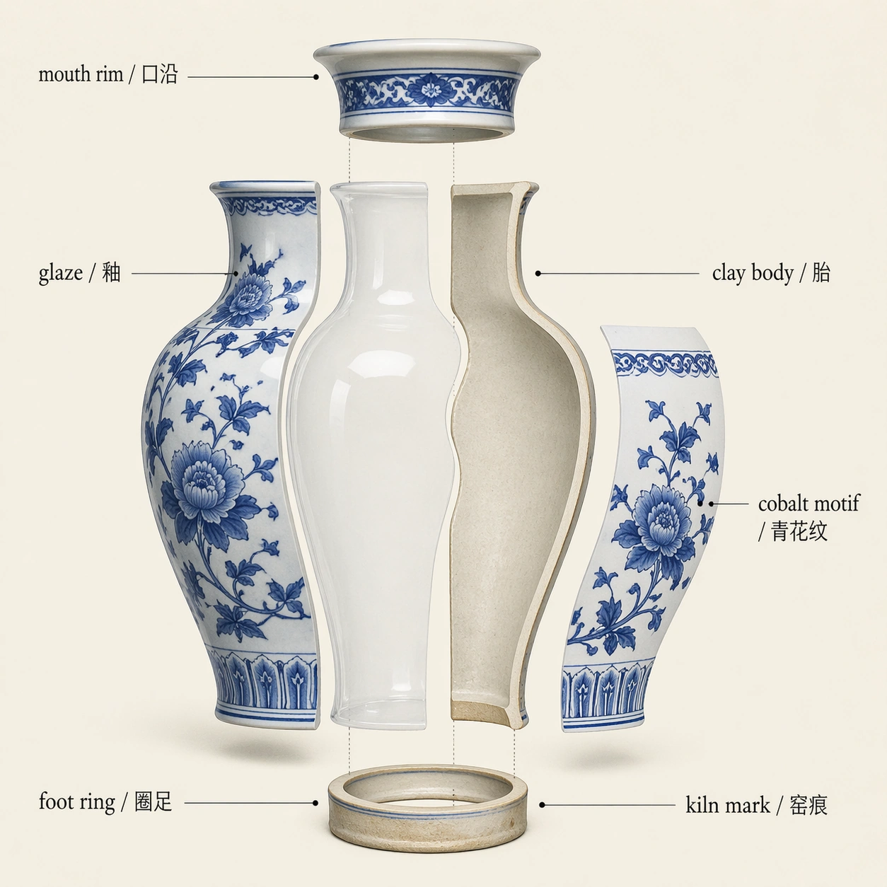

```text
Scene:
A square museum conservation diagram on pale cream paper, rendered as a clean orthographic exploded cutaway of a porcelain vase. Use bright but soft studio lighting, delicate blue-and-white ceramic color, graphite leader lines, and subtle drop shadows under separated layers. The style should sit between a catalog plate and a technical restoration note.

Subject:
Show a blue-white porcelain vase separated into its structural and surface layers: mouth rim lifted slightly, glaze layer peeling outward as a transparent shell, clay body cross-section visible, painted cobalt motif isolated on one floating sheet, and foot ring shown below. Include only these readable bilingual labels: glaze / 釉, clay body / 胎, cobalt motif / 青花纹, mouth rim / 口沿, foot ring / 圈足, kiln mark / 窑痕. The vase remains elegant and museum-like, not broken rubble.

Important details:
The material behavior must be credible: porcelain is thin, hard, slightly translucent at edges; glaze is glossy and continuous; cobalt pigment sits under the glaze; the foot ring has unglazed texture. Keep labels aligned around the object with no leader-line tangles. The image should explain construction and craft at a glance.

Use case:
Museum Exploded View single study 5/8, testing a porcelain artifact cutaway with bilingual technical callouts.

Constraints:
No readable text except the specified bilingual labels, no watermark, no logos, preserve exact 1:1 aspect ratio, no shattered vase, no modern barcode, no random dynasty stamp, no cluttered restoration tools, no illegible micro labels.
```

Model: GPT Image 2 · Author: ChaosRealmsAI

[Original source](https://github.com/ChaosRealmsAI/gpt-image-2-gallery/blob/5296db8c996e38776c83a0bc8c64f848dcd512b3/works/topics/museum-exploded-view/packages/single-artifact-exploded-studies/images/porcelain-vase-cutaway/meta.json) · [Provenance and original license](data/projectd-batch-0013.json)

## 春山入湖 · Spring Ink Poster — ChaosRealmsAI · MIT

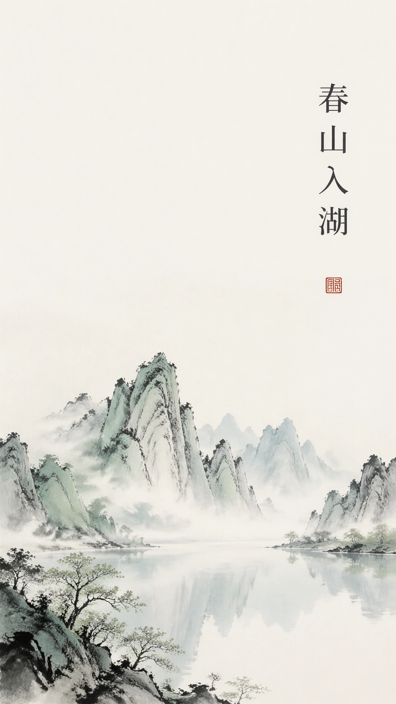

```text
Scene:
A vertical 9:16 luxury poster on matte warm-white paper, front-facing and perfectly flat, with about sixty-five percent open negative space. Use a quiet spring palette of celadon green, mist blue, pale ink gray, and off-white. The upper two thirds should feel calm and airy, while the lower third carries the main landscape gesture. Lighting is soft and even, like a premium gallery print photographed for a brand deck.

Subject:
A new Chinese ink landscape with jagged distant mountains rising from a still central lake. The mountains are rendered with sparse ink washes, dry brush edges, and a few mineral-green accents; the lake is a horizontal mist band that reflects the peaks with almost no detail. Place one readable vertical Chinese title, "春山入湖", near the upper right, set in elegant modern Song-style typography, black-gray ink, generous tracking, and precise alignment.

Important details:
Keep the design minimal and commercial-ready. The title must be clean, correctly ordered, and the only readable text. The mountains must look like contemporary ink, not fantasy concept art; the lake must sit calmly in the middle, not become an ocean. Leave large unmarked paper areas, balance asymmetry carefully, and add only one tiny abstract cinnabar seal block with no readable characters.

Use case:
New Chinese Ink Poster single study 1/8, testing vertical white space, readable Chinese title placement, and refined spring mountain-water composition.

Constraints:
No readable text outside the specified Chinese title, no watermark, no logos, preserve exact 9:16 aspect ratio, no frame, no busy texture, no saturated neon color, no tourist-photo realism, no random calligraphy strokes, no extra seals with characters.
```

Model: GPT Image 2 · Author: ChaosRealmsAI

[Original source](https://github.com/ChaosRealmsAI/gpt-image-2-gallery/blob/5296db8c996e38776c83a0bc8c64f848dcd512b3/works/topics/new-chinese-ink-poster/packages/single-ink-poster-studies/images/01-spring-mountain-lake/meta.json) · [Provenance and original license](data/projectd-batch-0013.json)

## Constructivist Megaphone Poster Study — ChaosRealmsAI · MIT

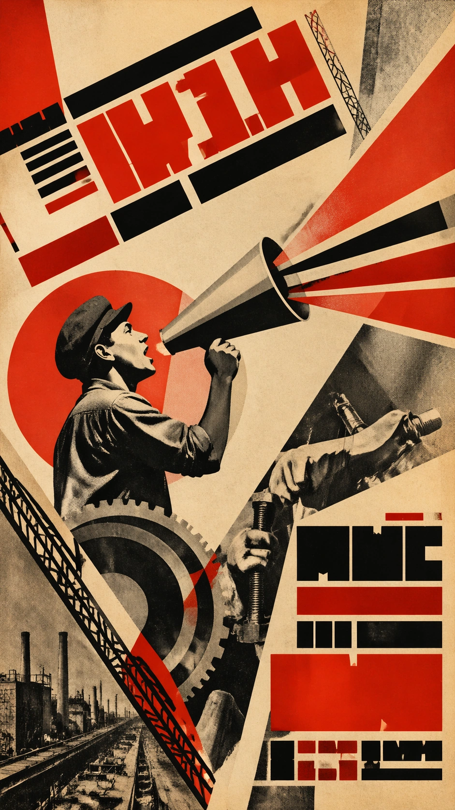

```text
Scene:
A vertical 9:16 fictional museum-study poster inspired by early twentieth-century constructivist political graphic design. The composition is sharp, diagonal, and geometric: red and black wedges, cream paper, photomontage texture, halftone grain, and asymmetric blocks. Large headline areas appear as bold abstract block-letter shapes and bars, but they must remain unreadable. The poster should feel like a design-history specimen, not an active campaign.

Subject:
A stylized worker-like figure in profile holds a megaphone made from angular paper shapes, projecting triangular sound beams across the page. Around the figure are industrial circles, cropped gears, diagonal scaffolding, and photomontage fragments of anonymous hands and tools. No real political emblems, national symbols, party marks, or recognizable leaders appear. The figure is symbolic and invented, with strong graphic silhouette and controlled visual hierarchy.

Important details:
Emphasize constructivist layout logic: severe diagonals, limited palette, hard-edged geometry, overprinted red ink, rough paper, halftone fragments, and tension between image and typography fields. The unreadable headline blocks should occupy believable poster positions at top and lower right. Keep the composition historically informed without copying a specific known poster. It must read as educational style transfer and structured layout research.

Use case:
Propaganda Poster History single study 1/8, an independent constructivist poster-language specimen for design-history comparison.

Constraints:
No readable text, no watermark, no logos, preserve exact 9:16 vertical aspect ratio, no real party symbols, no real leader likeness, no actual slogan, no contemporary election reference, no clean digital gradient.
```

Model: GPT Image 2 · Author: ChaosRealmsAI

[Original source](https://github.com/ChaosRealmsAI/gpt-image-2-gallery/blob/5296db8c996e38776c83a0bc8c64f848dcd512b3/works/topics/propaganda-poster-history/packages/single-poster-history-studies/images/01-constructivist-megaphone/meta.json) · [Provenance and original license](data/projectd-batch-0013.json)

## Imagined Khmer Archaeology Fieldwork — ChaosRealmsAI · MIT

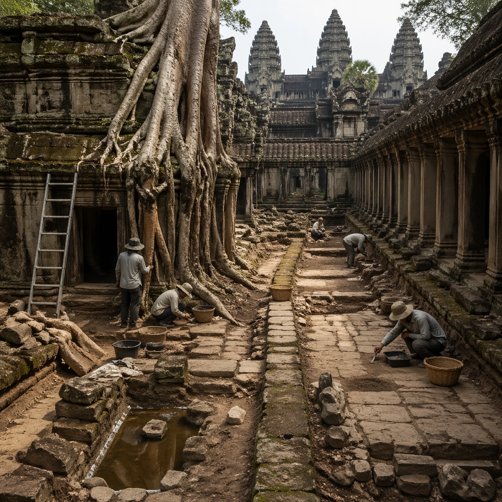

```text
Scene:
A square independent archaeology study composed from a slightly elevated fieldwork viewpoint. Use balanced natural light, crisp evidence hierarchy, and practical site organization so the image feels publishable in a museum report and still visually strong enough for a gallery wall. The frame should explain where excavation is happening without relying on readable markers or diagrams.

Subject:
Show a root-bound court with selective clearing, measured pathways, drainage traces, and archaeologists studying where living wood meets carved stone. Include grounded human traces such as ladders, trays, brushes, baskets, light rigs, or measuring tools only when they support archaeological realism and remain visually secondary. The site should stay culturally specific, with architecture, surface treatment, sediment, and environmental context all belonging to the correct civilization rather than a generic dig.

Important details:
Keep the site recognizably Khmer, with disciplined tower silhouettes, naga-era stone logic, gallery rhythm, and roots that wrap around built forms instead of replacing them with fantasy tree sculpture. Prioritize evidence relationships: exposed layers, cleaned edges, protected surfaces, loose fragments, and transitions between buried and revealed material. Let color, wear, and composition explain what has just been uncovered. The image must feel methodical rather than adventurous. Keep any site tags, notes, or markers abstract and unreadable. Avoid sensational treasure imagery and keep the atmosphere scholarly, patient, and materially convincing.

Use case:
Angkor Wat Overgrown Symbiosis single study 5/9.

Constraints:
No readable text, no watermark, no logos, preserve exact 1:1 aspect ratio, no fantasy elves, no glowing magic runes, no steel catwalks, no modern park signage, no treasure-chest clichés, no action-movie posing, no arbitrary props, no infographic overlay.
```

Model: GPT Image 2 · Author: ChaosRealmsAI

[Original source](https://github.com/ChaosRealmsAI/gpt-image-2-gallery/blob/5296db8c996e38776c83a0bc8c64f848dcd512b3/works/topics/angkor-wat-overgrown/packages/single-context-studies/images/excavation-overview/meta.json) · [Provenance and original license](data/projectd-batch-0013.json)

## Dog Portrait Editorial Opener — ChaosRealmsAI · MIT

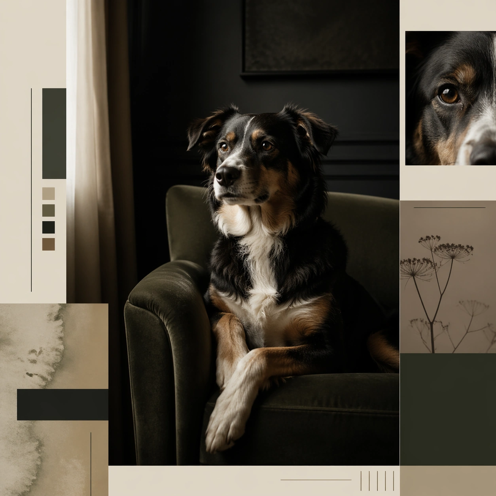

```text
Scene:
A square editorial spread opener or magazine board that combines photoreal animal portraiture with layout fragments, negative space, and sophisticated art direction. The animal should read as a character with presence and point of view, but never become a cartoon mascot or a human impersonation. Keep the image useful for brand editorials, cultural magazines, nonprofit storytelling, or visual essays where personality and atmosphere matter as much as realism. Use a moody domestic interior with one armchair, side light, and layout columns framing the portrait like a magazine opener.

Subject:
Focus on one animal in a setting that supports a distinct personality cue such as quiet confidence, urban wit, eccentric elegance, patient age, or tactile curiosity. Use real anatomy, plausible behavior, and emotionally controlled lighting. The animal may be framed with objects, set pieces, or composition motifs, but the scene must still feel truthful to the species and grounded in editorial photography logic. Show a medium dog seated with calm intelligence, looking slightly past camera as if holding a private opinion about the room.

Important details:
Use magazine-like hierarchy: one hero image, supporting crop windows, abstract text columns, margin bars, or pull quote blocks without readable words. The result should feel authored and surprising, not like a stock portrait dropped into a template. Aim for mood, specificity, and a polished sense of visual journalism. Let environment, gesture, and styling carry the personality instead of costumes or overt anthropomorphism. The image should feel serious, witty, and highly publishable, balancing portrait depth with elegant editorial spacing.

Use case:
Animal Character Editorial Spread Set single study 1/9, dog column opening spread for a commercially reusable prompt atlas example.

Constraints:
No readable text, no watermark, no logos, preserve exact 1:1 aspect ratio, no human clothes on animals, no cartoon facial exaggeration, no readable magazine text, no mascot smile effects, no fake celebrity parody, no novelty prop overload, no pipe-smoking parody, no human wardrobe, no kitschy study décor.
```

Model: GPT Image 2 · Author: ChaosRealmsAI

[Original source](https://github.com/ChaosRealmsAI/gpt-image-2-gallery/blob/5296db8c996e38776c83a0bc8c64f848dcd512b3/works/topics/animal-character-editorial-spread-set/packages/single-animal-editorial-studies/images/01-dog-column-opening-spread/meta.json) · [Provenance and original license](data/projectd-batch-0013.json)

## Artist Press Kit Desk Mockup — ChaosRealmsAI · MIT

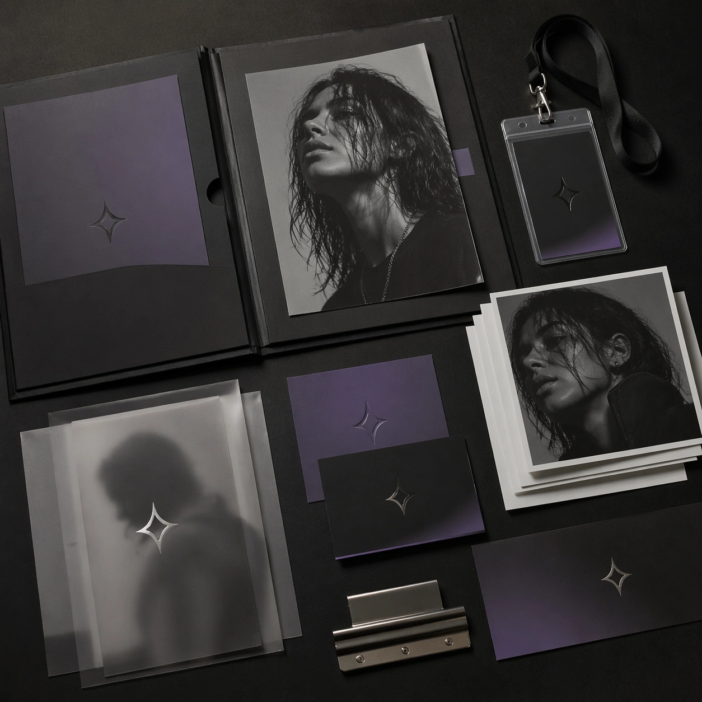

```text
Scene:
A square overhead desk photograph with an open press folder, stacked portrait cards, translucent inserts, credential sleeve, and metallic binding hardware arranged with editorial neatness. Lighting should be soft and expensive, showing paper texture, sleeve transparency, and the subtle tactile quality of a premium artist press package.

Subject:
The subject is a complete artist press-kit surface rather than one hero portrait: a folder system, cropped headshots, abstract emblem cards, matte paper inserts, and a lanyard-like credential laid out with deliberate spacing. Everything should imply a coherent artist brand language without showing readable names or publication text.

Important details:
Keep the composition practical and believable for the music industry. Materials matter: coated card stock, brushed metal clip, translucent vellum, and a muted monochrome palette with one controlled accent color. The desk should not feel like an office supply ad; it should feel like a refined music-publicity toolkit built around one clear artist identity.

Use case:
Artist Kit single study 5/9 for the Artist Identity Portrait and Brand Kit Prompt Atlas theme.

Constraints:
No readable text, no watermark, no logos, preserve exact 1:1 aspect ratio, no laptop, no coffee cup, no stationery clutter, no visible corporate office branding, no readable paperwork
```

Model: GPT Image 2 · Author: ChaosRealmsAI

[Original source](https://github.com/ChaosRealmsAI/gpt-image-2-gallery/blob/5296db8c996e38776c83a0bc8c64f848dcd512b3/works/topics/artist-identity-portrait-and-brand-kit/packages/single-brand-surfaces/images/press-folder-desk/meta.json) · [Provenance and original license](data/projectd-batch-0013.json)

## Aurora Glacier Cinematic Still — ChaosRealmsAI · MIT

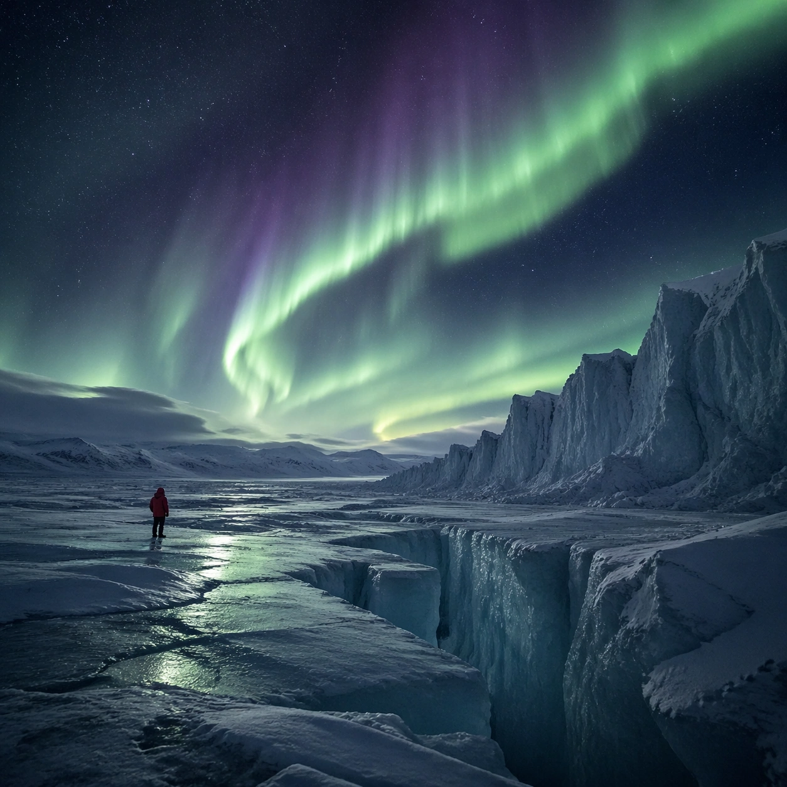

```text
Scene:
Create a square cinematic still for Aurora Glacier Silent Theatre. Use production-grade photoreal lighting, disciplined lens behavior, and a composition that feels like a finished key frame from an original film rather than a casual snapshot. An Arctic glacier plain opens under a sweeping aurora curtain, with deep night sky, luminous green and faint violet ribbons overhead, fractured ice catching reflected color, and a breath-frozen atmosphere that feels almost soundless. Build an independent square study around the way atmosphere interacts with surfaces, keeping enough environmental context for the image to feel finished rather than cropped at random.

Subject:
Build a coherent original scene whose emotional center comes from atmosphere, light physics, and spatial clarity. Avoid relying on celebrity likeness, franchise iconography, or stylized illustration shortcuts. A solitary human figure in a red parka should appear tiny against the glacier geometry, while crevasses, wind-scoured snow, and ice walls provide a strong sense of scale without cluttering the frame. Let textures, reflections, residue, moisture, dust, or particulate response become primary, while the broader setting remains clearly implied.

Important details:
Preserve a believable physical world with strong depth layering, careful color separation, and premium image discipline. Keep the aurora soft and physically plausible rather than graphic, with believable ice reflectance, low-angle moonless ambient light, and careful contrast so the red parka remains a scale marker rather than a fashion focal point. The key is material credibility under dramatic light, with micro-contrast and controlled mood supporting the theme.

Use case:
Aurora Glacier single study 5/9.

Constraints:
No readable text, no watermark, no logos, preserve exact 1:1 aspect ratio, no tents, no readable expedition logos, no fantasy animals, no saturated nightclub colors, no fireworks effect.
```

Model: GPT Image 2 · Author: ChaosRealmsAI

[Original source](https://github.com/ChaosRealmsAI/gpt-image-2-gallery/blob/5296db8c996e38776c83a0bc8c64f848dcd512b3/works/topics/aurora-glacier-silent-theatre/packages/single-support-studies/images/surface-study/meta.json) · [Provenance and original license](data/projectd-batch-0013.json)

## Six-Look Beauty Styling Comparison — ChaosRealmsAI · MIT

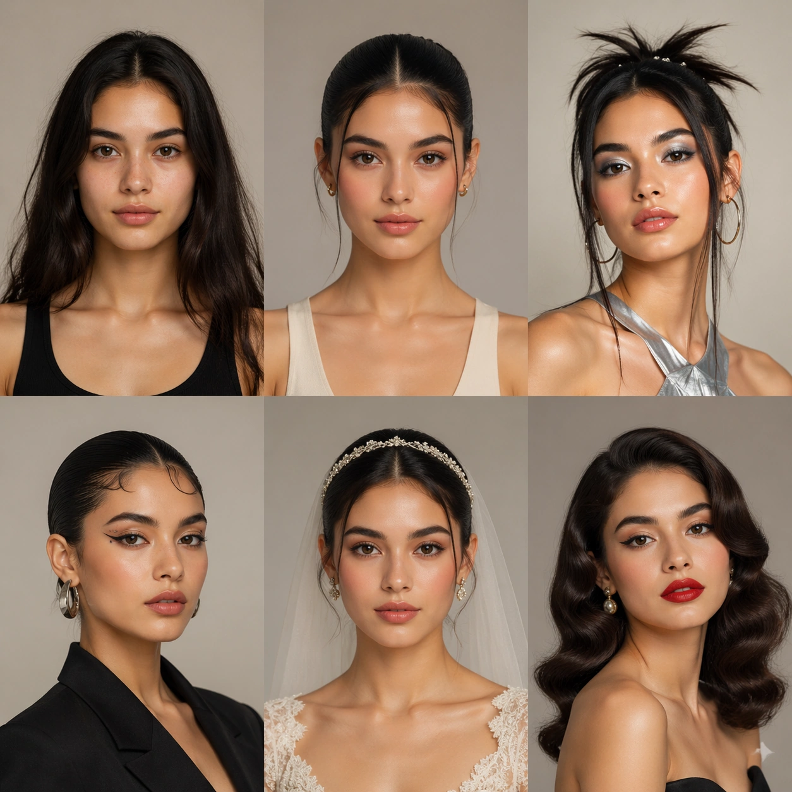

```text
Scene:
A square commercial beauty-or-fashion image designed like a polished campaign proof for Beauty Look Era Switchboard. Keep the camera discipline clear and believable: portrait-oriented within the square, premium studio light, controlled tonal contrast, and enough surrounding negative space to feel like an ad layout without relying on readable typography. The image should look production-ready, with realistic skin, hair, fabric, and makeup rendering that supports identity locking instead of distracting from it.

Subject:
Build the frame around one clearly recognizable person. Before After Board should feel like a specific transformation step that a disciplined comparison layout making transformation logic instantly legible. The face structure, age, body proportions, and general camera position must stay consistent with the same-person premise of Transform one face across distinct beauty directions such as clean-girl, Y2K, runway editorial, bridal, and retro glamour while preserving recognizability.. Styling, wardrobe, grooming, makeup, hair, or pose can evolve, but the viewer must believe it is unquestionably the same subject across the whole theme. Use a premium editorial-commercial tone rather than a casual portrait session.

Important details:
The visual test is identity consistency under change. Preserve stable bone structure, eye spacing, nose shape, lip volume, skin tone family, and believable texture response. Let the transformation be visible through styling choices instead of facial drift. This theme studies editing-workflow, multi-image-reference, photorealism, commercial-mockup through a production-ready visual system. Make the composition clean enough for client review, with professional grooming fidelity and enough detail for salon, beauty, or fashion decision-making. Aim for clear hierarchy, polished craft, and immediately usable campaign logic.

Use case:
Beauty Look Era Switchboard single study 1/5.

Constraints:
No readable text, no watermark, no logos, preserve exact 1:1 aspect ratio, no face drift, no inconsistent age shift, no extra limbs, no duplicate person, no asymmetric eye placement, no beauty-editorial chaos.
```

Model: GPT Image 2 · Author: ChaosRealmsAI

[Original source](https://github.com/ChaosRealmsAI/gpt-image-2-gallery/blob/5296db8c996e38776c83a0bc8c64f848dcd512b3/works/topics/beauty-look-era-switchboard/packages/single-editorial-support/images/before-after-board/meta.json) · [Provenance and original license](data/projectd-batch-0013.json)

## Blue Hour Riverside Metropolis — ChaosRealmsAI · MIT


```text
Scene:
Create a square cinematic still for Blue Hour Metropolis Long Exposure. Use production-grade photoreal lighting, disciplined lens behavior, and a composition that feels like a finished key frame from an original film rather than a casual snapshot. A dense riverside metropolis is captured at the exact transition of blue hour, where the sky holds deep cobalt, windows begin to glow warm gold, traffic turns into elegant light trails, and water reflects both cool atmosphere and neon accents. Build an independent square study around the way atmosphere interacts with surfaces, keeping enough environmental context for the image to feel finished rather than cropped at random.

Subject:
Build a coherent original scene whose emotional center comes from atmosphere, light physics, and spatial clarity. Avoid relying on celebrity likeness, franchise iconography, or stylized illustration shortcuts. Skyscrapers, bridges, riverbanks, layered roads, and a few boats or ferries should form a coherent urban rhythm, with architecture believable and anonymous rather than tied to any one landmark identity. Let textures, reflections, residue, moisture, dust, or particulate response become primary, while the broader setting remains clearly implied.

Important details:
Preserve a believable physical world with strong depth layering, careful color separation, and premium image discipline. Control color temperature precisely, keeping the cool ambient sky separate from warm occupancy lights, with long-exposure motion on roads and water that feels polished, metropolitan, and technically disciplined. The key is material credibility under dramatic light, with micro-contrast and controlled mood supporting the theme.

Use case:
Blue Hour City single study 5/9.

Constraints:
No readable text, no watermark, no logos, preserve exact 1:1 aspect ratio, no readable billboards, no famous landmark mimicry, no fireworks, no science-fiction holograms, no empty skyline.
```

Model: GPT Image 2 · Author: ChaosRealmsAI

[Original source](https://github.com/ChaosRealmsAI/gpt-image-2-gallery/blob/5296db8c996e38776c83a0bc8c64f848dcd512b3/works/topics/blue-hour-metropolis/packages/single-support-studies/images/surface-study/meta.json) · [Provenance and original license](data/projectd-batch-0013.json)

## Arcology Medic Four-View Concept — ChaosRealmsAI · MIT

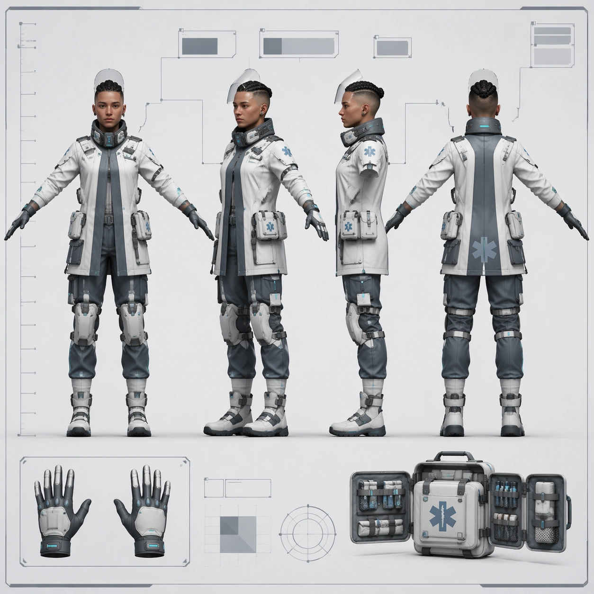

```text
Scene:
A square game-studio character turnaround sheet displayed as a pristine concept-art document on a pale clinical board. Lighting is even and cool, with crisp paper edges, faint guide lines, and clear negative space around the figures. The overall visual language is medical-industrial rather than cinematic, with quiet blue-gray tones and precise layout balance.

Subject:
Create one original arcology medic shown in four aligned full-body views on the same sheet: front, forty-five-degree, side, and back, all in a relaxed T-pose. The medic is a lean urban emergency specialist with shaved sides and a tightly braided crown, translucent face shield resting up, compact respirator collar, layered white and slate treatment jacket, soft cyan bio-monitor strips, articulated knee braces, and modular medical pouches distributed consistently around the waist. Include one or two secondary insets for gloved hands and a fold-out trauma kit, but keep the main four views dominant.

Important details:
This is a technical character sheet, so maintain exact identity and proportion consistency across all four views. Keep head size, shoulder width, coat seam placement, pouch count, brace geometry, and boot silhouette stable. Show believable material distinctions: wipe-clean fabric, translucent polymer visor, matte rubber seals, brushed clips, and reflective safety edging. Add a non-readable height ruler and abstract callout boxes with no letters. The sheet should feel ready for a production handoff, not like a poster or comic panel.

Use case:
Character Turnaround single study 5/8, testing a medical-industrial four-view sheet with strong technical-diagram discipline.

Constraints:
No readable text, no watermark, no logos, preserve exact 1:1 aspect ratio, no dramatic hospital background, no extra pose, no weapon, no floating hologram UI, no inconsistent pouch placement, no broken anatomy across views.
```

Model: GPT Image 2 · Author: ChaosRealmsAI

[Original source](https://github.com/ChaosRealmsAI/gpt-image-2-gallery/blob/5296db8c996e38776c83a0bc8c64f848dcd512b3/works/topics/character-turnaround/packages/single-turnaround-sheet-studies/images/arcology-medic-turnaround/meta.json) · [Provenance and original license](data/projectd-batch-0013.json)

## Canyon Citadel Loading-Screen Art — ChaosRealmsAI · MIT

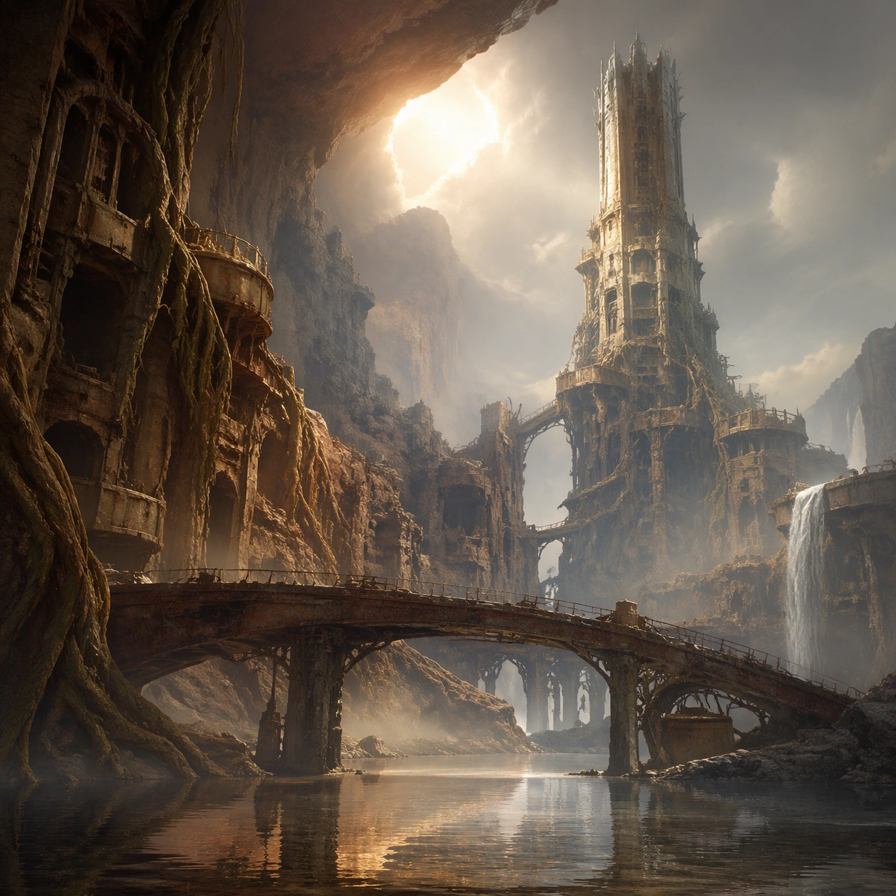

```text
Scene:
A square polished loading-screen hero composition for the same fictional canyon biome, with a grand cinematic camera, clean negative space, and layered atmosphere designed for a chapter or region splash image. The frame should feel more composed and poster-like than the reference, while still grounded in the same world language of cliffs, roots, ruins, and water.

Subject:
The biome appears as a premium game environment artwork: the landmark tower, a foreground bridge, reflective water, and one strong sky break all align into a single iconic composition. The subject remains the place itself, not a figure. Every architectural element should imply climbable paths, explored ruins, and story-rich history embedded in the environment.

Important details:
The goal is brandable clarity rather than pure concept-art chaos. Use strong silhouette hierarchy, rich but believable atmosphere, and material contrast between wet rock, ancient roots, rusted metal, and pale fog. Keep the mood high-end and collectible, like a chapter key art that could sit on a website hero panel or regional landing page. No readable text anywhere.

Use case:
Biome Pack single study 5/9, turning the biome into a polished chapter-level loading screen asset.

Constraints:
No readable text, no watermark, no logos, preserve exact 1:1 aspect ratio, no readable text, no characters, no vehicles, no random monsters, no cluttered foreground props, no broken perspective
```

Model: GPT Image 2 · Author: ChaosRealmsAI

[Original source](https://github.com/ChaosRealmsAI/gpt-image-2-gallery/blob/5296db8c996e38776c83a0bc8c64f848dcd512b3/works/topics/biome-establishing-scene-pack/packages/single-support-studies/images/loading-screen-key-art/meta.json) · [Provenance and original license](data/projectd-batch-0013.json)

## Kyoto Rooftop Geological Diorama — ChaosRealmsAI · MIT

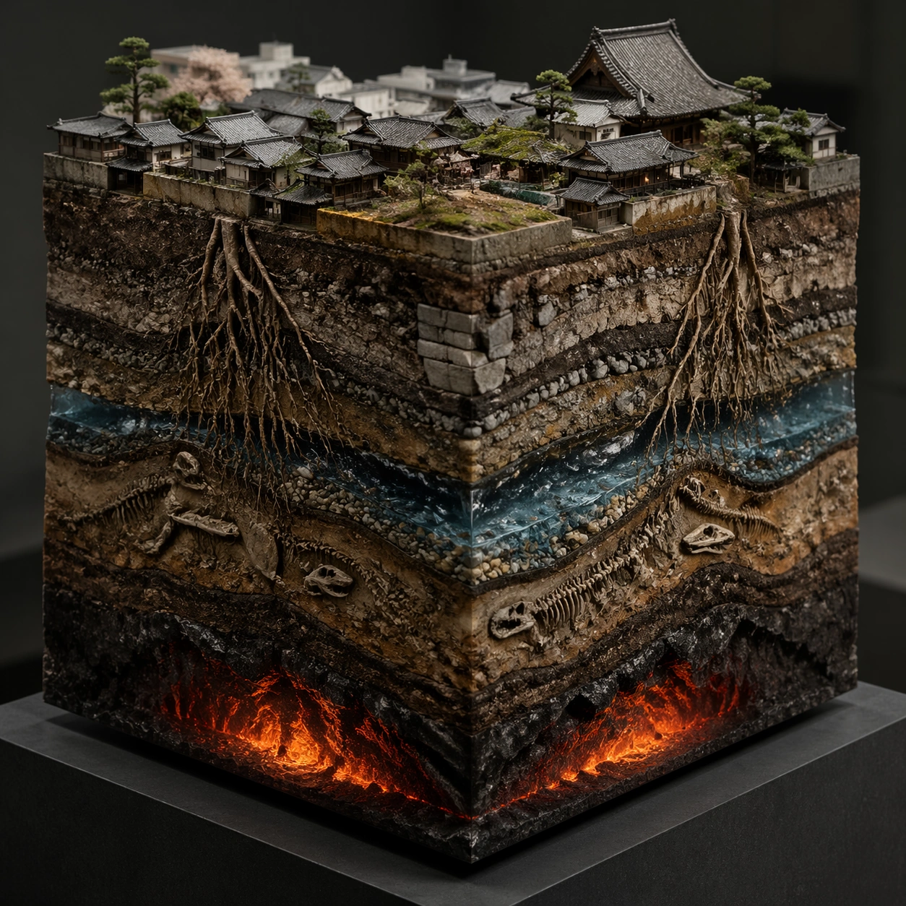

```text
Scene:
A square studio photograph of a hyperreal diorama cube floating above a matte charcoal plinth, lit with soft museum lighting and a crisp three-quarter view. The cube is about the size of a shoebox, with the top face visible and all four vertical faces cut away like a scientific specimen. Use natural colors, fine dust, tiny shadows, and shallow depth of field without hiding the cube edges.

Subject:
The top surface is a miniature Kyoto rooftop district with clay tile roofs, a small temple gable, narrow alleys, moss, rain gutters, and tiny garden trees. The four side faces expose different hidden layers: compact city fill and stone foundations, tangled tree roots descending from courtyard pines, a blue-gray aquifer seam with pebbles and wet sand, dinosaur fossil fragments embedded in older strata, and a warm lava chamber glowing far below.

Important details:
The cube must read as one coherent object, not separate panels. Each side face should align with the top surface and show believable stratigraphy, material boundaries, roots crossing layers, water pockets, fossil cavities, and glowing volcanic depth. Keep the cut edges sharp and physically plausible. The image should feel both collectible and scientific, like an impossible museum display with precise information hierarchy.

Use case:
Hyperreal Diorama Cube single study 1/8, testing a Kyoto rooftop surface combined with geological, biological, fossil, aquifer, and lava cutaway layers.

Constraints:
No readable text, no watermark, no logos, preserve exact 1:1 aspect ratio, no floating labels, no disconnected slices, no muddy layer boundaries, no cartoon miniature style, no impossible shadows, no oversized people, no cropped cube corners.
```

Model: GPT Image 2 · Author: ChaosRealmsAI

[Original source](https://github.com/ChaosRealmsAI/gpt-image-2-gallery/blob/5296db8c996e38776c83a0bc8c64f848dcd512b3/works/topics/hyperreal-diorama-cube/packages/single-diorama-cube-studies/images/01-kyoto-rooftop-core/meta.json) · [Provenance and original license](data/projectd-batch-0013.json)

## Four Ages in a Midnight Office — ChaosRealmsAI · MIT

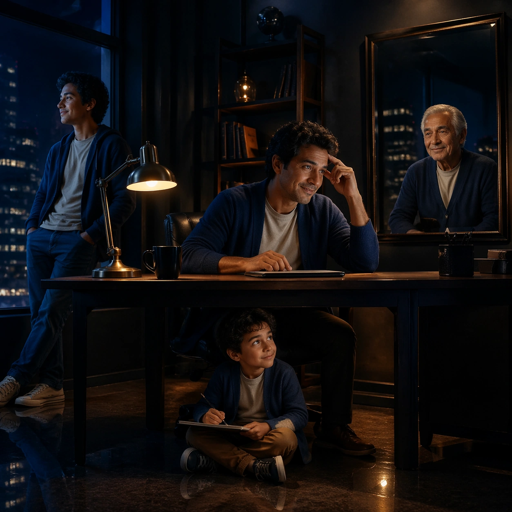

```text
Scene:
A square cinematic office at night, seen from a calm three-quarter angle. The room has a desk, a soft desk lamp, tall windows with city lights, shelves, a wall mirror, and a polished floor reflection. Use deep navy shadows, warm amber lamp light, and controlled negative space so multiple figures remain easy to read.

Subject:
Show the same man at four life stages sharing the office: child sitting under the desk with a sketchbook, teenager leaning against the window, adult working at the desk, and elderly version reflected in the wall mirror. Preserve identity through the same broad brow, round eyes, slight gap-toothed smile, and a blue cardigan motif adapted across ages. Each version should feel physically present or reflected in the same room, not pasted from separate images.

Important details:
The emotional concept is a person surrounded by earlier and later selves while making a decision. Keep the office geometry coherent, with reflections and shadows obeying the room. Age differences should be clear but connected through facial structure, posture echoes, and the blue clothing motif. The composition should feel like one surreal photograph with cinematic polish.

Use case:
Mirror Worlds single study 5/8, testing same-person age consistency and mirror logic in an office scene without references.

Constraints:
No readable text, no watermark, no logos, preserve exact 1:1 aspect ratio, no extra coworkers, no readable documents, no horror tone, no inconsistent facial traits, no broken mirror perspective, no cluttered desk pile.
```

Model: GPT Image 2 · Author: ChaosRealmsAI

[Original source](https://github.com/ChaosRealmsAI/gpt-image-2-gallery/blob/5296db8c996e38776c83a0bc8c64f848dcd512b3/works/topics/mirror-worlds/packages/single-temporal-mirror-studies/images/childhood-office-echo/meta.json) · [Provenance and original license](data/projectd-batch-0013.json)

## Desert Faction NPC Portrait Grid — ChaosRealmsAI · MIT

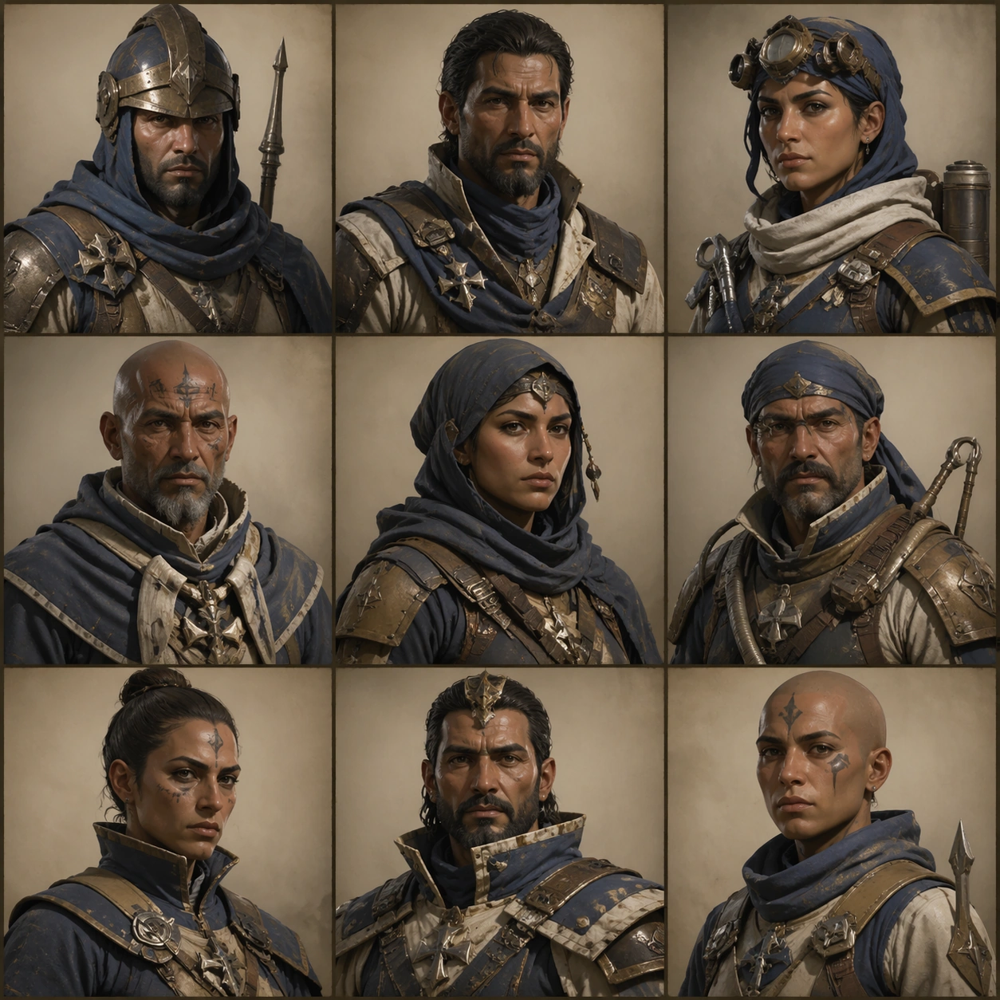

```text
Scene:
Create a square portrait-grid sheet with nine bust crops arranged in precise rows, each cell lit consistently like in-game dialogue art capture. Keep the overall frame square, polished, and production-ready game art bible presentation with crisp panel rhythm, believable costume construction, and enough visual hierarchy for downstream UI or documentation reuse. Let materials, lighting, and spacing feel intentional enough for gallery, research, campaign, or approval-board reuse without depending on readable text.

Subject:
Use multiple NPC types from the same faction and prove that faces, collars, insignia strips, and emotional range all stay regionally coherent. Ground the image inside a wind-carved desert citadel faction with oxidized bronze, indigo cloth, pale bone accents, practical leather, and a sun-faded military-monastic attitude. Use multiple adult NPC archetypes such as guard, quartermaster, medic, machinist, scout, priest, and captain, but keep them visually linked through the same regional craft language and social hierarchy. 

Important details:
Keep insignia geometry, rank markers, cloth layering, tool silhouettes, and color hierarchy coherent across every role so the cast reads like one population rather than unrelated hero concepts. Cells should feel made for dialogue UI export, not random moodboard collage. Vary age read and role, but hold the faction language steady. Treat this frame as an independent study that still honors the same overall theme and production logic. Favor believable production craft, clean hierarchy, and reusable visual logic over empty spectacle or random decoration.

Use case:
NPC Faction Casting Sheet single study 5/9, dialogue portrait coverage for one coherent NPC population.

Constraints:
No readable text, no watermark, no logos, preserve exact 1:1 aspect ratio, no readable names, no floating UI chrome, no celebrity likeness, no modern casualwear.
```

Model: GPT Image 2 · Author: ChaosRealmsAI

[Original source](https://github.com/ChaosRealmsAI/gpt-image-2-gallery/blob/5296db8c996e38776c83a0bc8c64f848dcd512b3/works/topics/npc-faction-casting-sheet/packages/single-faction-support-sheets/images/01-dialogue-portrait-grid/meta.json) · [Provenance and original license](data/projectd-batch-0013.json)

## Cursed Lantern Collectible Lore Card — ChaosRealmsAI · MIT

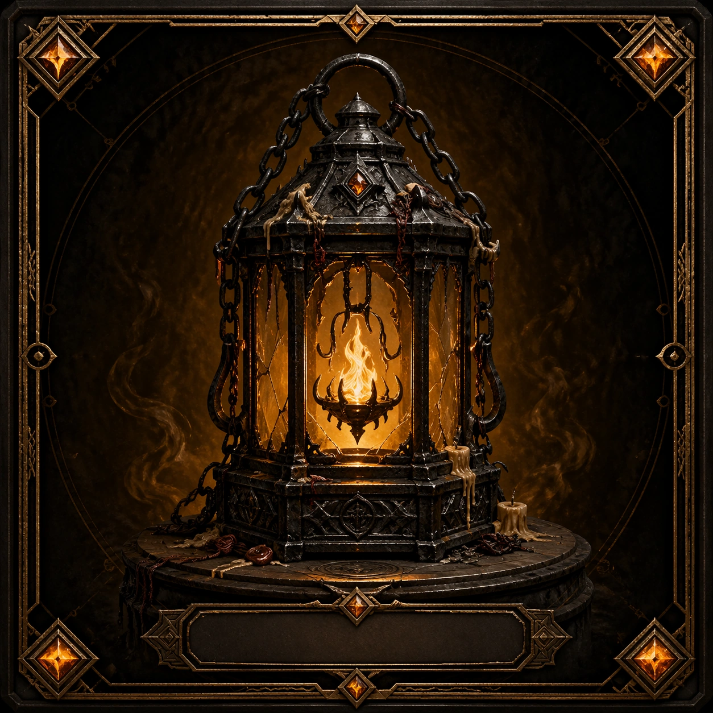

```text
Scene:
Create a square collectible lore card with a premium codex layout, centered object pedestal, dark velvet background, and restrained bronze frame accents. The card should feel like an in-game archive page rather than a loose still life: one large relic in the middle, blank plaque areas, faint decorative border geometry, and a controlled halo of smoky amber light. Keep the composition symmetrical enough to read as a collectible card while still feeling tactile and dramatic.

Subject:
The relic is a haunted lantern reliquary made from blackened iron, cracked amber glass, soot-dark chains, and a suspended pale flame that seems trapped inside a small cage of ritual hooks. The base is engraved with abstract warding marks that remain unreadable. Tiny melted wax drips, old ash, and a few seal-thread knots imply repeated attempts to contain whatever spirit once lived inside it. The lantern should feel dangerous yet treasured, as if players would keep it for both lore and power.

Important details:
Make the object itself tell the story. The iron should feel scorched and old, the amber glass should glow from within, and the flame should look eerie but controlled rather than explosive. The card frame language must suggest rarity through shape, metallic trim, and gemlike insets, not through words. Preserve strong silhouette clarity and make the relic feel worthy of a codex entry, reward card, or quest archive. Avoid generic fantasy clutter; every surface detail should reinforce age, containment, and cursed value.

Use case:
Relic Artifact Lore Card Set single study 1/9.

Constraints:
No readable text, no watermark, no logos, preserve exact 1:1 aspect ratio, no modern lantern parts, no extra weapons, no character portrait, no random skull overload, no noisy particle storm, no broken card frame.
```

Model: GPT Image 2 · Author: ChaosRealmsAI

[Original source](https://github.com/ChaosRealmsAI/gpt-image-2-gallery/blob/5296db8c996e38776c83a0bc8c64f848dcd512b3/works/topics/relic-artifact-lore-card-set/packages/single-relic-codex-studies/images/cursed-lantern-reliquary/meta.json) · [Provenance and original license](data/projectd-batch-0013.json)

## Boss Arena Hazard Floor Board — ChaosRealmsAI · MIT

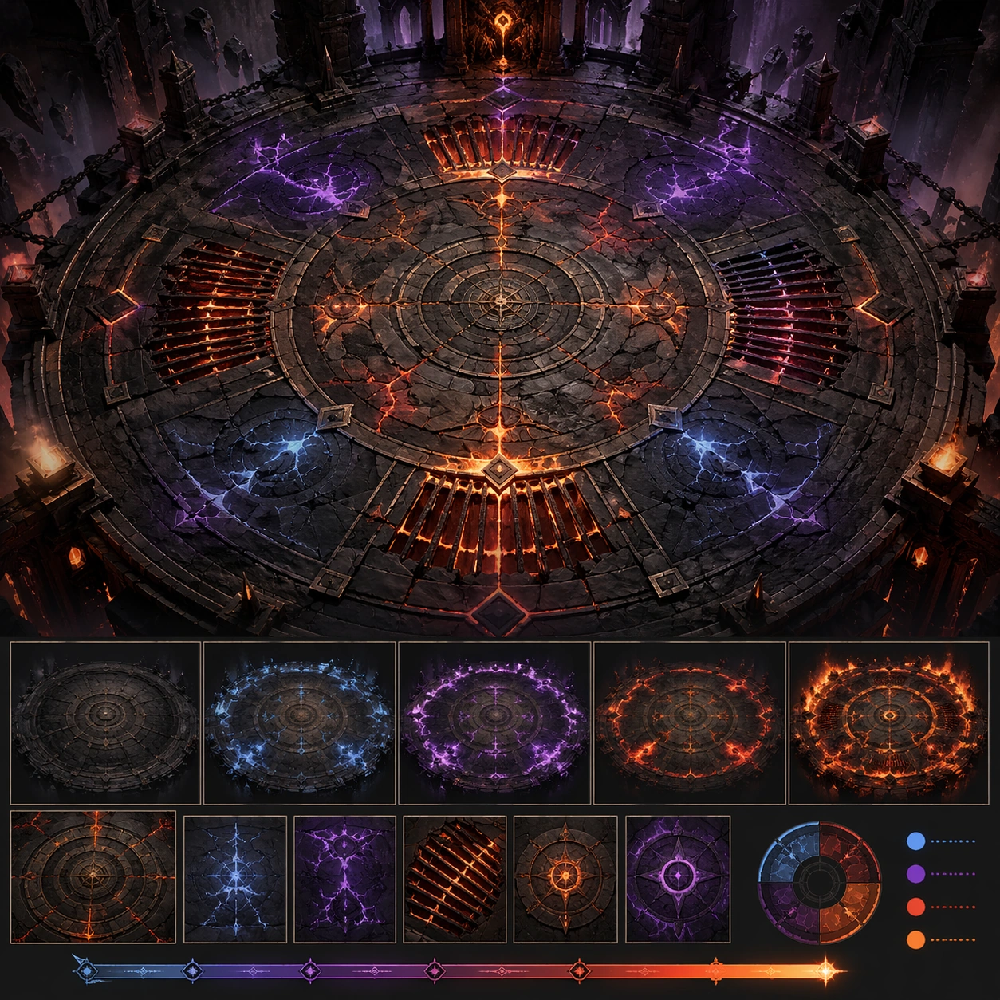

```text
Scene:
A square production-ready image designed for a game-art review wall and a commercial gallery at the same time. Frame a floor-centric board that isolates the arena mechanic language through cracks, sigils, vents, or hazard panels with disciplined lighting, clean edge separation, and enough surrounding context to prove how the asset would behave in a real product surface. The camera, crop, and tonal balance should feel intentional rather than generic, with high readability at first glance and convincing material response under closer inspection.

Subject:
Center the study on a floor-centric board that isolates the arena mechanic language through cracks, sigils, vents, or hazard panels. Translate the topic into a concrete, shippable visual statement instead of a loose mood board. Build layered object relationships, believable surface finish, and strong silhouette grouping so the image reads immediately as part of Boss Arena Phase Keyframes. The subject should feel made for a live game pipeline: useful in store, UI, campaign, or art-review contexts, with visual hierarchy strong enough to survive aggressive cropping.

Important details:
the design should teach encounter logic without any readable labels. Keep every supporting element subordinate to the main read, and make category separation obvious through form, color zoning, depth, and material logic rather than words. Where panels, cards, badges, or interface blocks appear, they must look professionally structured but remain unreadable. The visual language should feel premium, original, and coherent across this package, with no filler clutter and no accidental resemblance to a specific shipped game IP.

Use case:
Boss Arena Phase Keyframes single study 1/5, focused on mechanic floor board.

Constraints:
No readable text, no watermark, no logos, preserve exact 1:1 aspect ratio, no text callouts, no arrows, no broken hierarchy, no generic stock-photo staging, no accidental UI gibberish.
```

Model: GPT Image 2 · Author: ChaosRealmsAI

[Original source](https://github.com/ChaosRealmsAI/gpt-image-2-gallery/blob/5296db8c996e38776c83a0bc8c64f848dcd512b3/works/topics/boss-arena-phase-keyframes/packages/single-boss-support-studies/images/mechanic-floor-board/meta.json) · [Provenance and original license](data/projectd-batch-0013.json)

## Eight-Panel Inventor Product Demo — ChaosRealmsAI · MIT

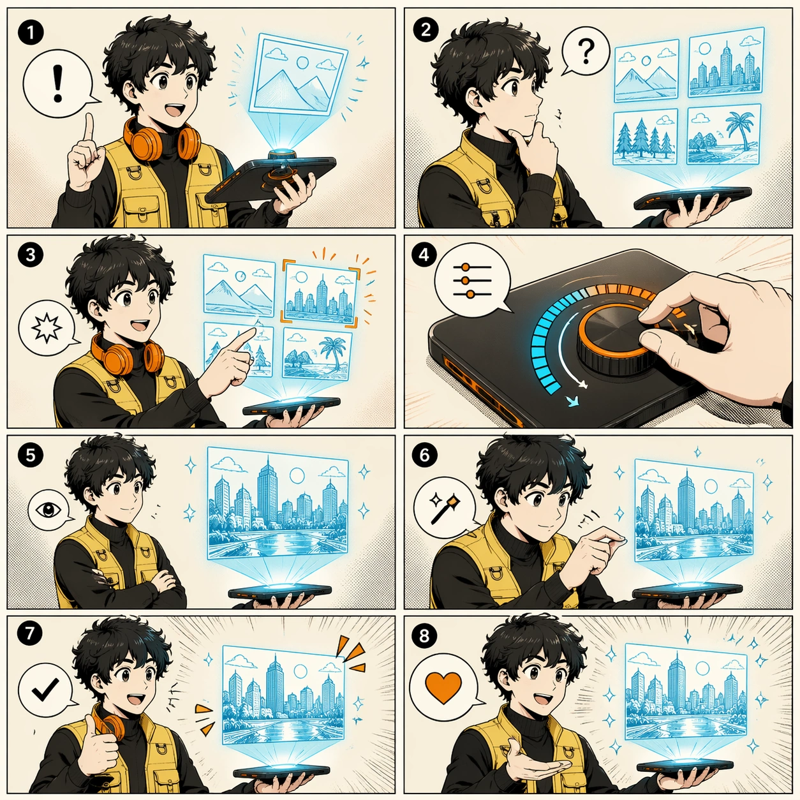

```text
Scene:
A square eight-panel product-demo comic page, exactly eight panels in a 2 by 4 grid, clean manga-inspired line art, crisp panel borders, soft screen tones, and a restrained black, cream, cyan, and orange palette.

Subject:
A consistent young inventor character demonstrates a floating image-making tablet across all eight panels. The character has curly dark hair, a yellow utility vest, black turtleneck, and orange headphones. The tablet projects small picture panels, then the inventor compares them, adjusts a dial, and presents a polished final image in the last panel.

Important details:
Strong character consistency across panels, clear commercial demo storytelling, coherent panel-to-panel action, readable gesture language, pseudo-dialogue bubbles, simple sound-effect shapes, no dependency on reference images. The page should feel like a launch storyboard that could be used in a product presentation.

Use case:
Independent comic single image, testing whether one prompt can produce a complete eight-panel product demonstration with consistent character and prop design.

Constraints:
Exactly eight panels, no real logos, no watermark, no readable text, no extra main characters, no broken panel grid, no photorealism, no cluttered UI, preserve exact 1:1 aspect ratio.
```

Model: GPT Image 2 · Author: ChaosRealmsAI

[Original source](https://github.com/ChaosRealmsAI/gpt-image-2-gallery/blob/5296db8c996e38776c83a0bc8c64f848dcd512b3/works/topics/eight-panel-consistency-comic/packages/single-comic-studies/images/product-demo-board/meta.json) · [Provenance and original license](data/projectd-batch-0013.json)

## Six-Panel Beverage Spill Storyboard — ChaosRealmsAI · MIT

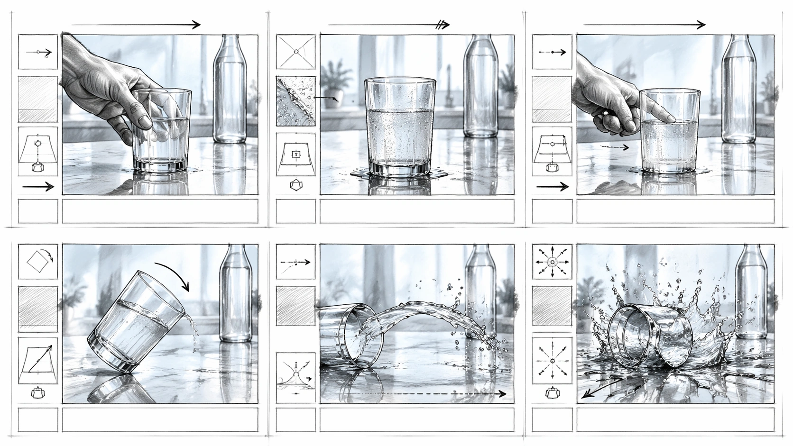

```text
Scene:
A horizontal 16:9 advertising storyboard sheet drawn in pencil, gray marker, and pale blue wash, arranged as six equal panels in a clean 2 by 3 grid. Each panel includes abstract production-note blocks, camera arrows, and blank caption strips with no readable words. The board plans a tabletop beverage commercial in a bright kitchen studio with reflective glass, polished stone, and controlled splash lighting.

Subject:
The six panels follow one physical action: a hand sets down a clear tumbler, condensation beads form on the glass, a second hand nudges it, the tumbler tips in slow motion, liquid arcs across the stone counter, and the final panel shows a dramatic splash frozen around the fallen glass. A plain unbranded bottle silhouette sits in the background as a product placeholder, never showing a label. The hand, glass, bottle, and counter remain consistent across the sequence.

Important details:
The board must feel useful for production: precise camera framing, arrows for dolly and tilt movement, cutaway insert boxes, notes bands, and clear physical continuity from upright glass to spill. Emphasize physics-materials: transparent glass refraction, water surface tension, droplets, splash direction, condensation, countertop reflections, and gravity. Keep the style as storyboard pencil work, not a finished advertisement render. All notation should be graphic and unreadable.

Use case:
Film Storyboard Sequence single study 5/8, an independent tabletop commercial board testing material physics and production layout.

Constraints:
No readable text, no watermark, no logos, preserve exact 16:9 horizontal aspect ratio, no brand label, no broken six-panel grid, no impossible liquid direction, no extra products, no full-color polished ad comp.
```

Model: GPT Image 2 · Author: ChaosRealmsAI

[Original source](https://github.com/ChaosRealmsAI/gpt-image-2-gallery/blob/5296db8c996e38776c83a0bc8c64f848dcd512b3/works/topics/film-storyboard-sequence/packages/single-production-storyboards/images/01-glass-spill-commercial/meta.json) · [Provenance and original license](data/projectd-batch-0013.json)

## A Blue City Inside a Dusk Tower — ChaosRealmsAI · MIT

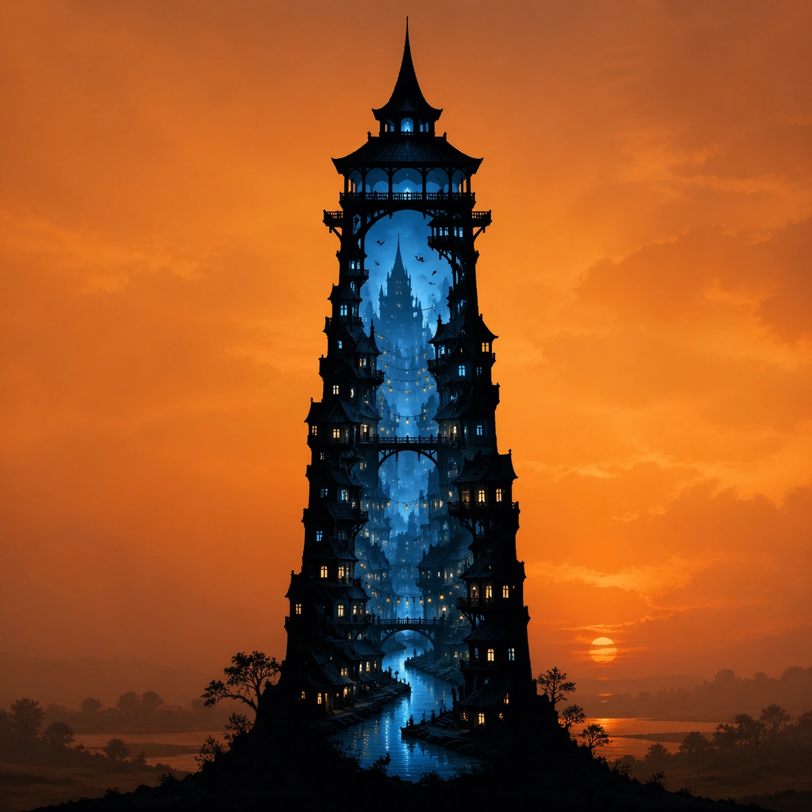

```text
Scene:
A square poster-like composition with a single tall tower centered against a warm orange dusk sky. The outside field is quiet, misty, and minimal, with soft amber haze and low contrast so the tower silhouette dominates immediately. The image should feel like a high-impact editorial illustration with precise hierarchy: bold outer shape first, intricate inner world second.

Subject:
A pure black silhouette of a solitary tower, but the tower is not solid fill. Inside the tower outline is a complete dusk city in miniature: stacked windows, narrow buildings, tiny bridges, a winding river, lantern strings, rooftops, silhouettes of birds, and cold blue city light glowing through the interior. The tower top, walls, and base remain readable as one continuous iconic shape.

Important details:
The silhouette is a container, not a boundary decoration. Every city detail must stay inside the tower contour, with no spillover beyond the black edge. The outer contour must be razor sharp and solid black, while the interior world can reveal blue light, depth layers, and tiny atmospheric details. Keep a clear temperature contrast: warm orange mist outside, cool blue city inside.

Use case:
Silhouette Universe independent study 1/3, demonstrating the tower outline as a narrative container.

Constraints:
No readable text, no watermark, no logos, preserve exact 1:1 aspect ratio, no broken silhouette edges, no white halo, no extra people outside the outline.
```

Model: GPT Image 2 · Author: ChaosRealmsAI

[Original source](https://github.com/ChaosRealmsAI/gpt-image-2-gallery/blob/5296db8c996e38776c83a0bc8c64f848dcd512b3/works/topics/silhouette-universe/packages/single-silhouette-studies/images/tower-at-dusk/meta.json) · [Provenance and original license](data/projectd-batch-0013.json)

## Charcoal Cafe Menu Board Mockup — ChaosRealmsAI · MIT

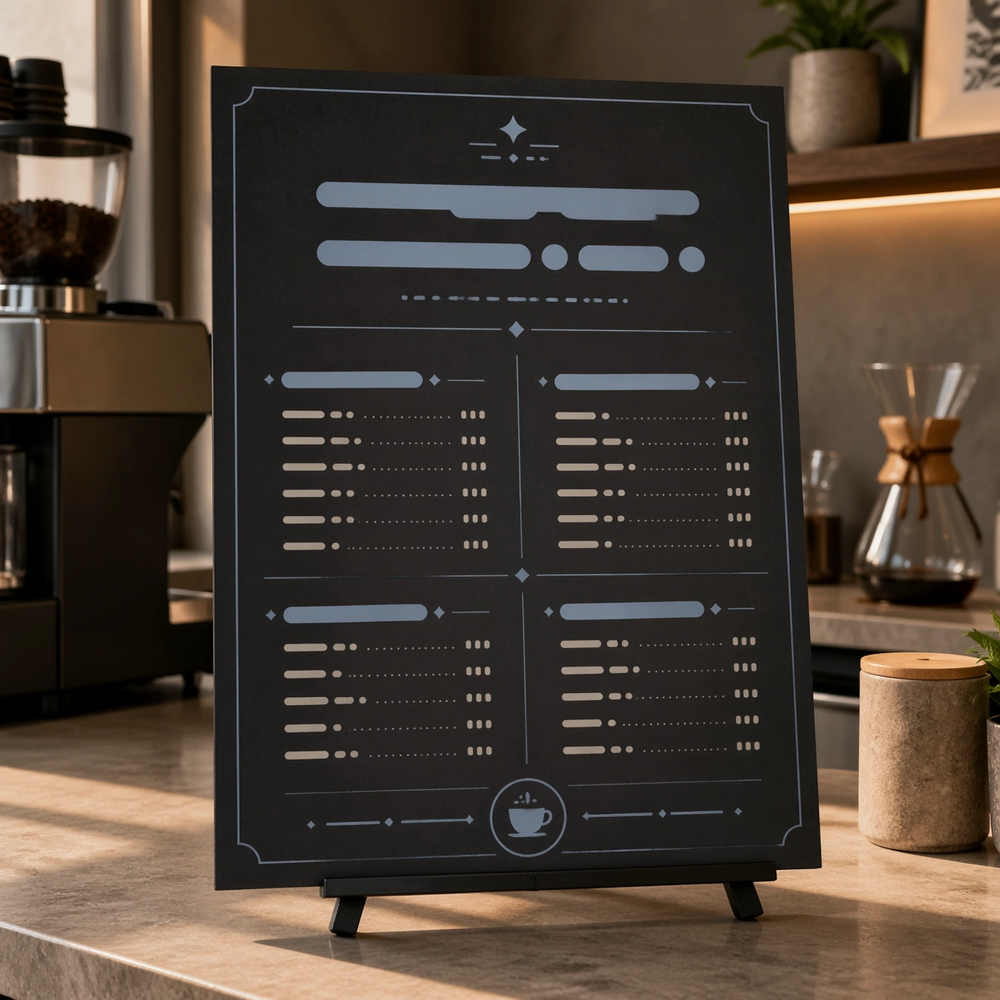

```text
Scene:
Square crop of a cafe counter design review scene, soft morning light, neutral stone counter, and a single menu board mockup standing upright on a small easel. The image is polished commercial editorial realism with quiet shadows and precise layout. The board is not a real menu: all text areas are abstract bars, dots, and glyph-like marks.

Subject:
Show one finished menu board that visually implies several conversational edits have been applied: the background changed from bright daytime cream to a warmer evening charcoal, one left-side pastry illustration removed cleanly, the main abstract title area enlarged, and the accent color shifted cooler. Keep the menu category blocks, price-like rows made of unreadable marks, small coffee cup icon, and border grid aligned and consistent.

Important details:
The point is not a before-after split; it is the result of an edit workflow that required semantic understanding. The removed pastry area should be repaired with matching board texture and spacing. The larger heading should push nearby abstract rows downward without crowding. The cooler color should affect icons, dividers, and highlights while the cafe counter environment remains natural. The composition should feel usable by a designer evaluating whether the edit respected the original layout.

Use case:
Conversational Editing Workflow single study 5/8, testing a mask-free menu revision with object removal, hierarchy adjustment, and color tuning.

Constraints:
No readable text, no watermark, no logos, preserve exact 1:1 aspect ratio, no real cafe brand, no split-screen comparison, no UI overlay, no misspelled words, no human hands, no cluttered countertop.
```

Model: GPT Image 2 · Author: ChaosRealmsAI

[Original source](https://github.com/ChaosRealmsAI/gpt-image-2-gallery/blob/5296db8c996e38776c83a0bc8c64f848dcd512b3/works/topics/conversational-editing-workflow/packages/single-editing-scenarios/images/cafe-menu-revision/meta.json) · [Provenance and original license](data/projectd-batch-0013.json)

## Chinese Museum Wayfinding Mockup — ChaosRealmsAI · MIT

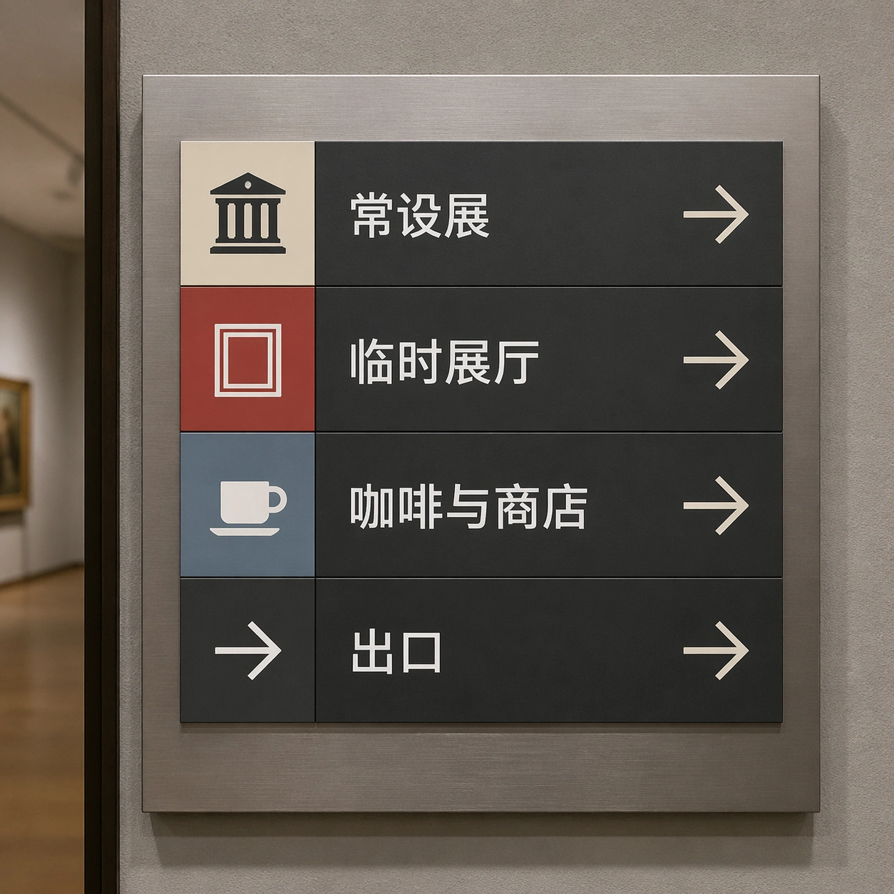

```text
Scene:
A square close-up of a museum wayfinding placard mounted on brushed aluminum beside a gallery doorway. The camera is straight-on with slight environmental depth at the edges, soft museum lighting, neutral gray walls, and a restrained institutional palette of charcoal, cream, muted red, and pale blue. The sign is divided into three perfectly aligned rows with icon columns and bilingual-looking spacing.

Subject:
Show a finished Chinese localization of an English museum sign while implying the original layout is preserved. The exact readable Chinese text must be: 常设展, 临时展厅, 咖啡与商店, 出口. Each phrase appears in a clean sans serif style, replacing where English labels would have been, beside simple pictograms for collection, gallery, cup, and arrow. The sign should look production ready, with exact baseline alignment and even optical margins.

Important details:
The point is not just multilingual text; it is text replacement inside a pre-existing wayfinding grid. Keep icon positions fixed, keep row heights equal, keep the arrows and pictograms crisp, and make all Chinese characters readable at thumbnail scale. The sign should show professional localization discipline: no crowding, no mismatched font weights, no accidental extra copy, and no redesign.

Use case:
In-Image Translation single study 5/8, testing translated signage text inside a strict wayfinding layout.

Constraints:
No readable text except the specified Chinese strings, no watermark, no logos, preserve exact 1:1 aspect ratio, no fake museum brand, no misshaped Chinese characters, no handwritten style, no perspective distortion, no extra labels.
```

Model: GPT Image 2 · Author: ChaosRealmsAI

[Original source](https://github.com/ChaosRealmsAI/gpt-image-2-gallery/blob/5296db8c996e38776c83a0bc8c64f848dcd512b3/works/topics/in-image-translation/packages/single-translation-surfaces/images/museum-wayfinding-card/meta.json) · [Provenance and original license](data/projectd-batch-0013.json)

## Warehouse Loft Sketch-to-Render Concept — ChaosRealmsAI · MIT

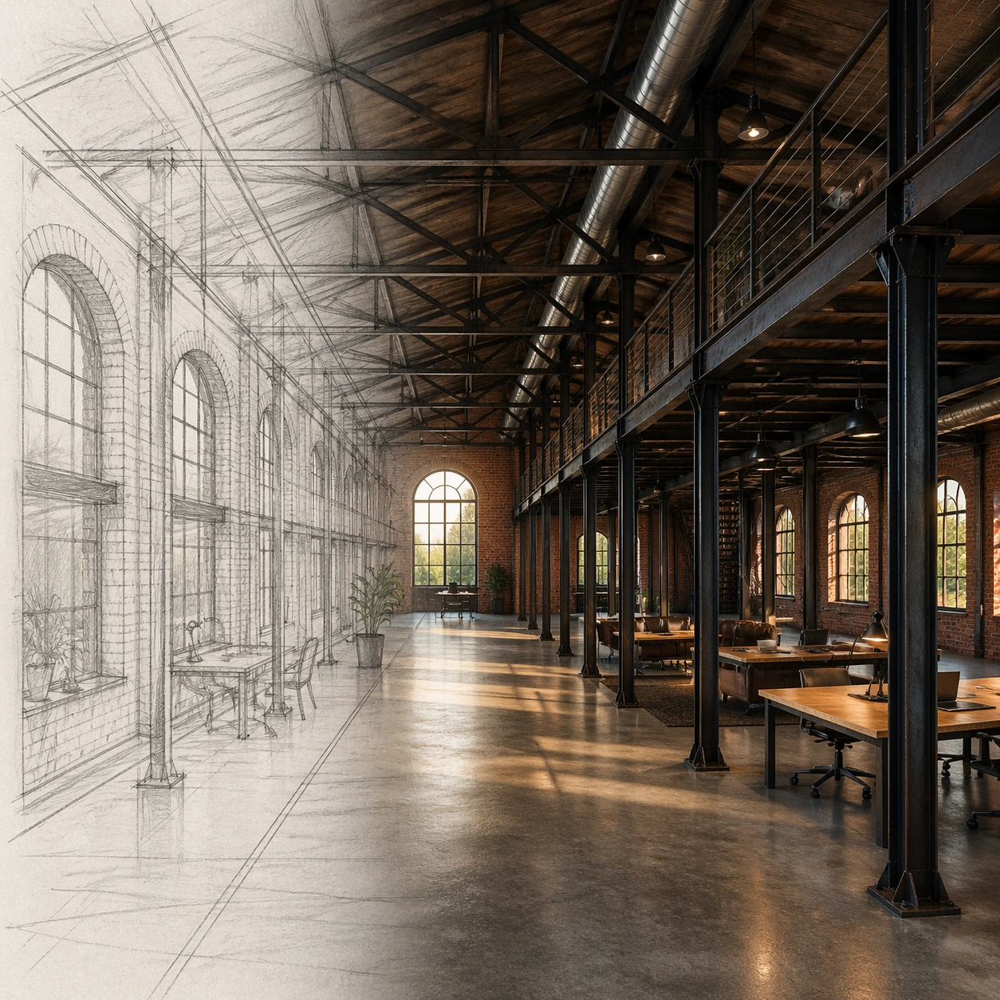

```text
Scene:
A square architectural visualization arranged as a clean before-and-after transformation without readable labels: a loose pencil sketch occupies the left third as translucent graphite linework, while the right two thirds resolve into a photoreal interior render. The viewpoint, horizon, column spacing, and window rhythm align across both halves, making the conversion easy to read. Light is late afternoon, warm but natural, with balanced shadows.

Subject:
An old brick warehouse converted into a loft workspace. The sketch side shows arched industrial windows, steel columns, a mezzanine edge, exposed roof trusses, and a long central circulation path. The photoreal side renders the same layout with aged red brick, blackened steel, polished concrete floor, large restored windows, simple worktables, a mezzanine guardrail, and ceiling ducts following the sketched truss bays.

Important details:
The drawing-to-render relationship must be structurally faithful: window arches, column grid, mezzanine height, truss spacing, floor perspective, and central path must stay locked between sketch and render. Do not turn the scene into a generic luxury office. Use plausible adaptive-reuse details, scale cues, material weathering, and real construction logic. The sketch layer can remain visible at the boundary, but the final image should mostly read as photoreal architecture.

Use case:
Sketch to Photoreal Render single study 5/8, testing independent conversion from a warehouse interior sketch into a faithful photoreal adaptive-reuse render.

Constraints:
No readable text, no watermark, no logos, preserve exact 1:1 aspect ratio, no floating furniture, no impossible beams, no extra window rows, no ornate hotel styling, no people dominating the scene.
```

Model: GPT Image 2 · Author: ChaosRealmsAI

[Original source](https://github.com/ChaosRealmsAI/gpt-image-2-gallery/blob/5296db8c996e38776c83a0bc8c64f848dcd512b3/works/topics/sketch-to-photoreal-render/packages/single-render-studies/images/warehouse-loft-conversion/meta.json) · [Provenance and original license](data/projectd-batch-0013.json)

## Analyst Reasoning Workbench Illustration — ChaosRealmsAI · MIT

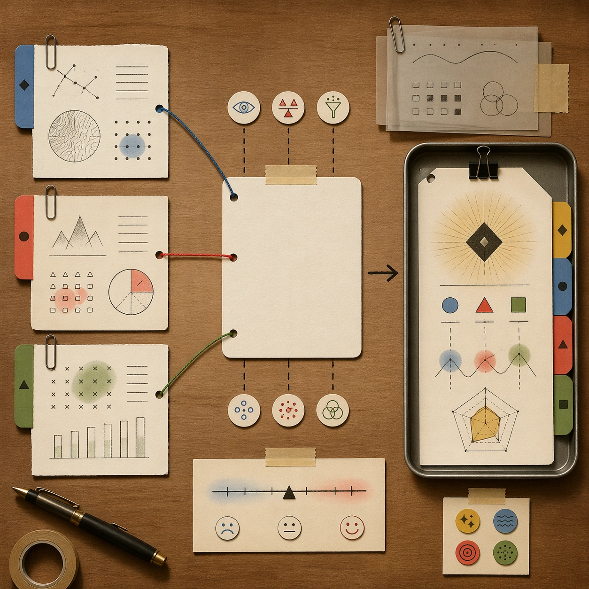

```text
Scene:
A quiet top-down studio illustration of an analyst workbench, square crop, warm desk surface, soft afternoon light, and carefully arranged paper layers. The style is polished editorial illustration with tactile paper texture, graphite lines, and restrained accent colors.

Subject:
A complete visual reasoning workspace: one central blank research card, three source cards, a small uncertainty scale, colored string connections, tiny icon stickers, and a final decision tray. The arrangement shows how messy inputs become a structured conclusion. The cards contain only non-readable glyph marks and abstract chart shapes, not real words or numbers.

Important details:
Clear information architecture, visible reasoning sequence from left to right, balanced negative space, precise alignment, and subtle handmade imperfections. Include paper clips, transparent overlays, arrows, and color-coded evidence groups. The image should look like thinking made visible without exposing literal text.

Use case:
Independent Thinking Mode single image, testing whether a complex reasoning workflow can become a clear editorial object composition.

Constraints:
No readable text, no real data, no company names, no logos, no watermark, no photorealistic laptop screen, no cluttered desk mess, no human hands, preserve exact 1:1 aspect ratio.
```

Model: GPT Image 2 · Author: ChaosRealmsAI

[Original source](https://github.com/ChaosRealmsAI/gpt-image-2-gallery/blob/5296db8c996e38776c83a0bc8c64f848dcd512b3/works/topics/thinking-mode/packages/single-reasoning-studies/images/analyst-workbench/meta.json) · [Provenance and original license](data/projectd-batch-0013.json)

## AI Football Double-exposure Poster Study — ClawLabs AI · MIT

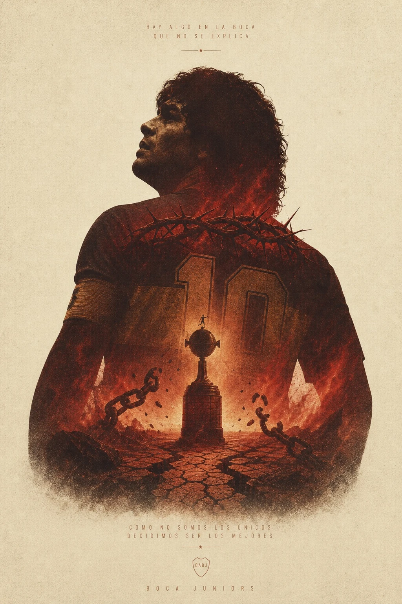

```text
Generate a highly finished, epic-feeling art poster with a double exposure composition on a cream/off-white background. Team: [TEAM_NAME]. A large silhouette of [SUBJECT] occupies the main body of the composition, with [ELEMENT_1], [ELEMENT_2], [ELEMENT_3], [ELEMENT_4], and [ELEMENT_5] fused inside the silhouette. The overall color palette is dominated by [PRIMARY_COLOR] and earthy ochre/brown tones, evoking an oppressive, resolute, and strongly fatalistic mood. Keep the elements minimal and uncluttered, with generous negative space. Apply a printed grain texture throughout. Avoid overly sharp details on the elements, but maintain an epic, cinematic quality — like an official theatrical animated feature film poster. Vertical/portrait orientation. If any text appears in the image, it should use a thin/light-weight typeface.
```

Model: GPT Image 2 · Author: 小红书号2692926140 · adapted and regenerated by ClawLabs AI

[Original source](https://github.com/ClawLabsAI/awesome-verified-text-to-image-prompts/blob/c25274d3c30dca596c21d885ff9dc0c5106ab5c6/prompts.json#L367) · [Provenance and original license](data/projectd-batch-0013.json)

## Fictional VTuber Debut Poster — ClawLabs AI · MIT

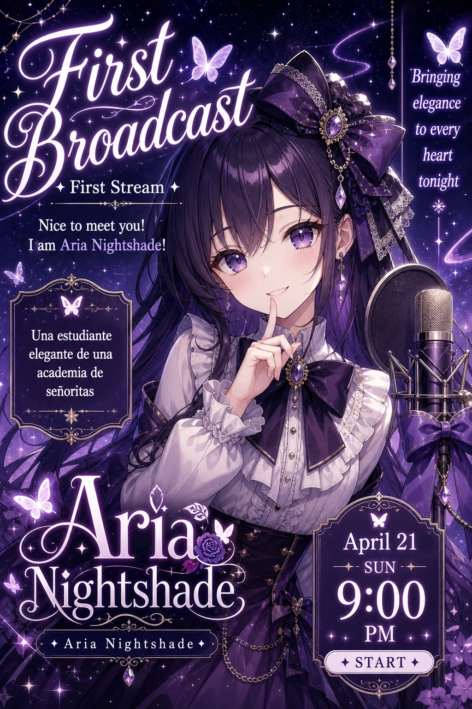

```text
Design a VTuber debut livestream thumbnail illustration. The character is an anime girl with long dark purple hair, purple eyes, wearing a frilly white blouse, a dark purple bow tie, and a large decorative hair bow. She strikes a cute pose with one finger raised to her lips. On the right side of the frame, place a condenser microphone fitted with a pop filter and decorated with a purple ribbon. The background depicts a magical starry night sky filled with sparkles and glowing butterflies, rendered in a purple and white color palette.

Layout the typography as follows:
- Top left: large, bold text in a cursive English style displaying the main title [MAIN_TITLE], with a subtitle line reading 'First Stream' beneath it, followed by a second line reading 'Nice to meet you! I am [CHARACTER_NAME_EN]!'
- Middle left: a decorative text box containing the character's description: [CHARACTER_DESCRIPTION]
- Bottom left: a logo-style text displaying the character's name [CHARACTER_NAME], with a smaller subtext showing the romanized name [CHARACTER_NAME_EN]
- Top right: vertical text displaying the catchphrase [CATCHPHRASE]
- Bottom right: a decorative pill-shaped badge showing the stream date and time [STREAM_DATETIME], with a small subtext reading '✦ START ✦'
```

Model: GPT Image 2 · Author: @wtry1102 · adapted and regenerated by ClawLabs AI

[Original source](https://github.com/ClawLabsAI/awesome-verified-text-to-image-prompts/blob/c25274d3c30dca596c21d885ff9dc0c5106ab5c6/prompts.json#L3363) · [Provenance and original license](data/projectd-batch-0013.json)

## Fictional Anime Course-ad Layout — ClawLabs AI · MIT

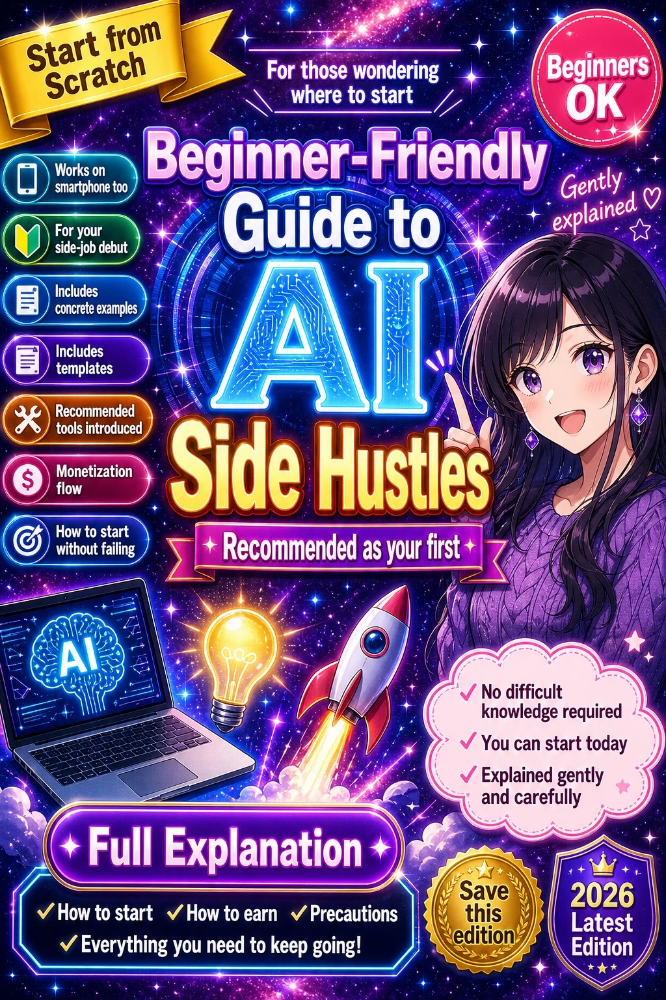

```text
Design a vibrant promotional banner thumbnail in an anime illustration style, featuring a cosmic galaxy background with neon glow effects and high-density typography with glowing text effects.

Background: a purple, pink, and blue starry space nebula.

Character (positioned on the right side of the composition): a smiling young woman pointing upward with her right index finger. She has long [HAIR_COLOR] hair, purple drop earrings, and a textured purple sweater.

Center typography:
- Small top text: "For those wondering where to start"
- Main title: [MAIN_TITLE]
- Subtitle: "Recommended as your first"
- Floating text near the character: "Gently explained ♡"

Top-left corner: a yellow ribbon banner reading [RIBBON_TEXT].

Top-right corner: a pink circle badge reading "Beginners OK".

Left column: a vertical stack of seven pill-shaped badges reading:
1. "Works on smartphone too" with a phone icon
2. "For your side-job debut" with a beginner mark icon
3. "Includes concrete examples"
4. "Includes templates"
5. "Recommended tools introduced"
6. "Monetization flow"
7. "How to start without failing"

Bottom-left graphics: three icons - a laptop displaying an AI circuit brain graphic, a glowing lightbulb, and a rocket ship taking off.

Bottom-center: a large purple button reading [BUTTON_TEXT], with a checklist text below it reading "✓How to start ✓How to earn ✓Precautions ✓Everything you need to keep going!".

Bottom-right: a pink cloud shape containing three bullet points:
- "✓No difficult knowledge required"
- "✓You can start today"
- "✓Explained gently and carefully"
Also include a gold medal seal reading "Save this edition" and a purple badge reading [YEAR_BADGE_TEXT].
```

Model: GPT Image 2 · Author: @naga_zyashin · adapted and regenerated by ClawLabs AI

[Original source](https://github.com/ClawLabsAI/awesome-verified-text-to-image-prompts/blob/c25274d3c30dca596c21d885ff9dc0c5106ab5c6/prompts.json#L3521) · [Provenance and original license](data/projectd-batch-0013.json)

## AI Livestream Video-call Interface Mockup — ClawLabs AI · MIT

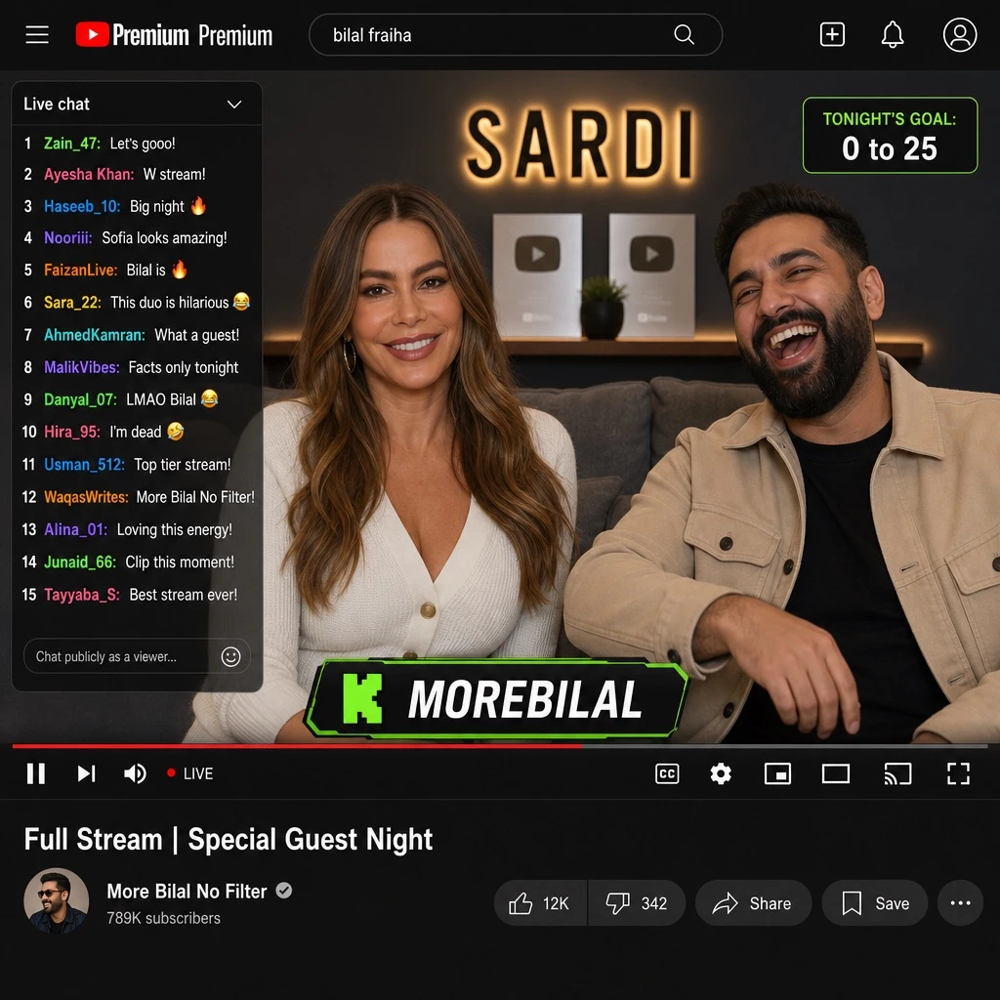

```text
Design a mockup of a livestream video-call user interface. Top navigation bar: a [BRAND] logo, a search bar containing the query '[SEARCH_QUERY]', and 3 icons. Video player area: two subjects on screen - a [FEMALE_GUEST] wearing a white cardigan, and a bearded man in a beige jacket laughing; the background shows a couch, two silver play-button icons, and a logo reading '[LOGO_TEXT]'. Overlay elements: a live chat panel on the left side with 15 messages showing colored usernames and white text; a goal tracker in the top right corner reading 'TONIGHT'S GOAL: 0 to 25'; a banner at the bottom center reading 'K [STREAMER_NAME]'. Include 10 player control icons below the video. Beneath the player, show video details: title '[VIDEO_TITLE]', channel name '[CHANNEL_NAME]', and 5 action buttons.
```

Model: GPT Image 2 · Author: @marouane53 · adapted and regenerated by ClawLabs AI

[Original source](https://github.com/ClawLabsAI/awesome-verified-text-to-image-prompts/blob/c25274d3c30dca596c21d885ff9dc0c5106ab5c6/prompts.json#L3638) · [Provenance and original license](data/projectd-batch-0013.json)

## Fictional Anime-film Pitch Board — ClawLabs AI · MIT

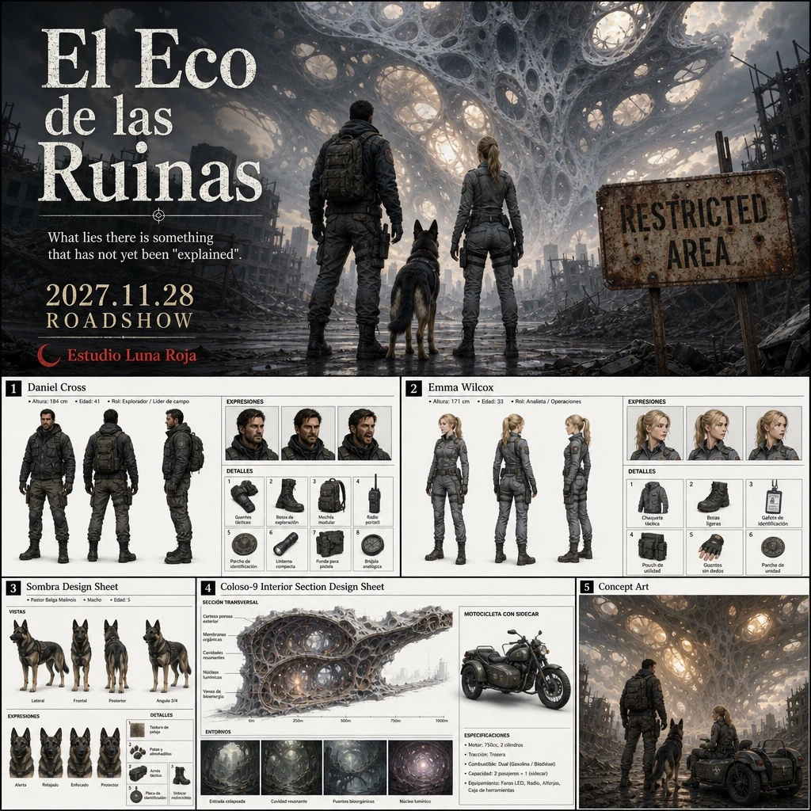

```text
Design a two-part anime movie production pitch document, split into a top and bottom section.

Top section: a large cinematic movie poster in anime film style. Show a man, a woman, and a dog standing on a ruined city street, viewed from behind, all facing toward a colossal, porous, web-like alien structure that dominates the sky above them. A rusty sign reading 'RESTRICTED AREA' is visible on the right side of the frame. Overlay the poster with typography: the movie title '[MOVIE_TITLE]', the release date '[RELEASE_DATE]', the tagline 'What lies there is something that has not yet been "explained".', and the studio credit '[STUDIO_NAME]'.

Bottom section: a grid of five detailed reference sheets beneath the poster.
1. Character reference sheet titled '[MALE_CHARACTER_NAME]': male protagonist wearing a dark tactical jacket and cargo pants, shown in 3 full-body poses (front, back, side), 3 facial expressions, and 8 detail callouts covering gloves, boots, backpack, and radio.
2. Character reference sheet titled '[FEMALE_CHARACTER_NAME]': female protagonist wearing a grey tactical uniform, shown in 3 full-body poses (front, back, side), 3 facial expressions, and 6 detail callouts covering jacket, boots, ID badge, and pouch.
3. Animal character reference sheet titled '[DOG_NAME] Design Sheet': a dog companion shown in 4 full-body poses (side, front, back, angled), 4 expressions, and 5 detail callouts covering fur texture, paws, and a motorcycle sidecar.
4. Environment and vehicle reference sheet titled '[STRUCTURE_NAME] Interior Section Design Sheet': one large cross-section diagram of the porous alien structure, 4 smaller environment thumbnails, and 1 motorcycle design featuring the characters.
5. Concept art panel titled 'Concept Art': a scene illustration showing the male character, the female character, and the dog with a motorcycle sidecar parked in front of the glowing, porous alien structure.

Overall style: cinematic anime film production document, high-quality poster illustration on top, clean technical reference sheet layout on the bottom, high level of detail, professional pitch deck presentation.
```

Model: GPT Image 2 · Author: @old_pgmrs_will · adapted and regenerated by ClawLabs AI

[Original source](https://github.com/ClawLabsAI/awesome-verified-text-to-image-prompts/blob/c25274d3c30dca596c21d885ff9dc0c5106ab5c6/prompts.json#L4422) · [Provenance and original license](data/projectd-batch-0013.json)

## Anime Samurai Character-design Sheet — ClawLabs AI · MIT

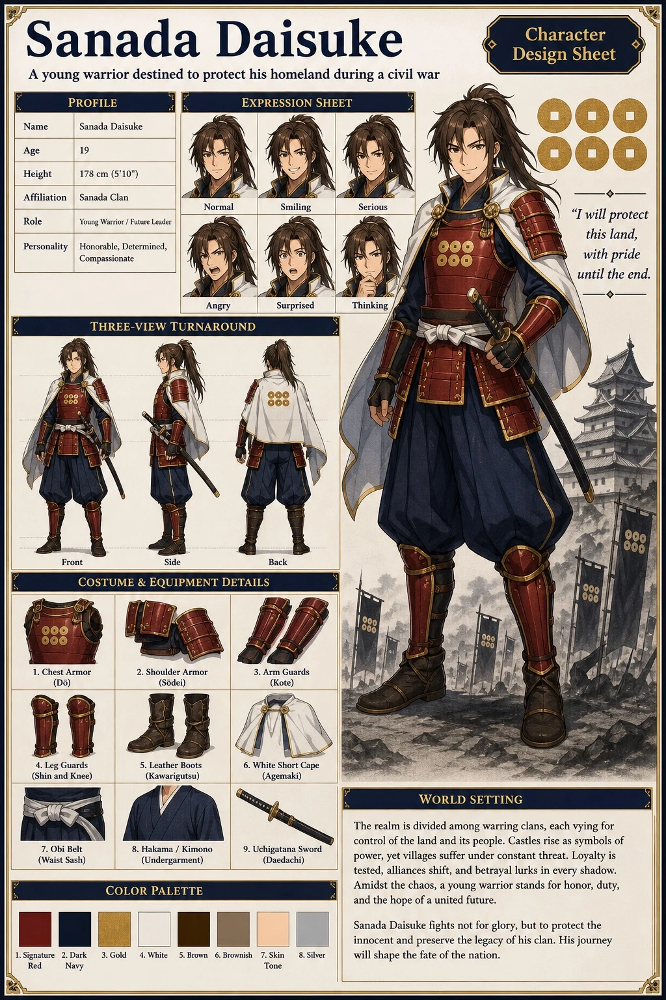

```text
Create an anime-style character reference sheet (settei/model sheet) for a character named [CHARACTER_NAME]. Character appearance: a young warrior with long brown hair, wearing samurai-inspired armor with a [MAIN_COLOR] chest plate and guards, a [SECONDARY_COLOR] pleated hakama, and a white short cape. Layout: at the top, a header showing the title '[CHARACTER_NAME]', a subtitle reading '[CHARACTER_CONCEPT]', and a small badge labeled 'Character Design Sheet'. On the right side, place a large full-body standing pose with a confident smile as the main portrait; behind the character add background elements including an [EMBLEM_DESIGN] emblem, a quote reading '[CATCHPHRASE]', and a monochrome Japanese castle with army banners positioned at the bottom right. Include the following labeled sections: 'Profile' in the top-left, containing a table with 6 rows of descriptive text; 'Three-View Turnaround' in the mid-left, showing 3 poses labeled Front, Side, and Back; 'Expression Sheet' in the top-center, showing 6 expressions labeled Normal, Smiling, Serious, Angry, Surprised, and Thinking; 'Costume & Equipment Details' in the bottom-left, showing 9 labeled close-ups: chest armor, shoulder armor, arm guards (kote), leg guards (shin and knee), leather boots, white short cape, obi belt, hakama/kimono section, and uchigatana sword; 'Color Palette' in the bottom-center, showing 8 labeled swatches: signature red, dark navy, gold, white, brown, brownish, skin tone, and silver; and 'World Setting' in the bottom-center-right, containing a paragraph of text describing the setting.
```

Model: GPT Image 2 · Author: @Luvune · adapted and regenerated by ClawLabs AI

[Original source](https://github.com/ClawLabsAI/awesome-verified-text-to-image-prompts/blob/c25274d3c30dca596c21d885ff9dc0c5106ab5c6/prompts.json#L4760) · [Provenance and original license](data/projectd-batch-0013.json)

## Anime Key-animation Layout Study — ClawLabs AI · MIT

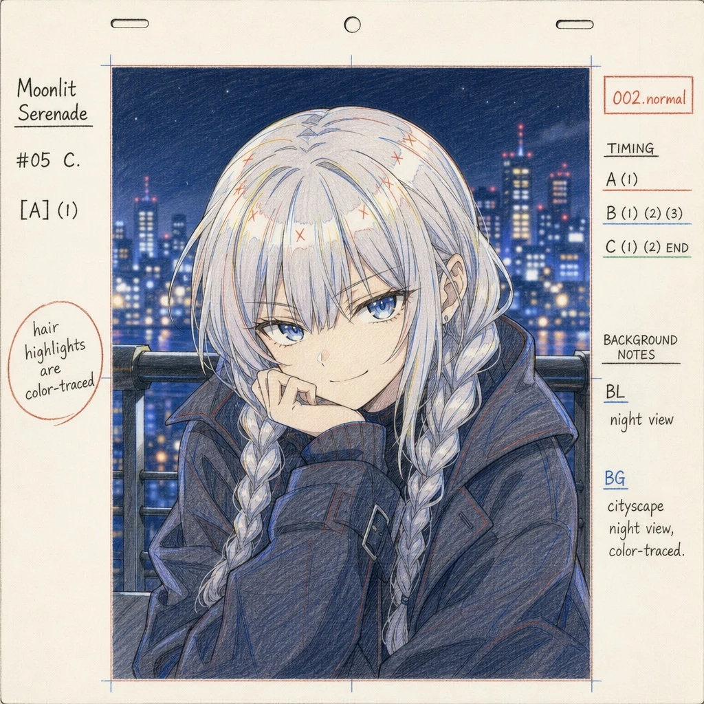

```text
Create an anime production layout sheet in the traditional colored pencil genga (key animation drawing) style. The subject is [CHARACTER_NAME], an anime girl with [HAIR_COLOR] hair styled in twin braids with bangs, blue eyes, and wearing a dark oversized coat, posed with a [EXPRESSION] expression. The background depicts [BACKGROUND_SCENE], rendered in soft focus. The layout includes: standard animation paper peg holes along the top edge; on the left margin, the series title '[ANIME_TITLE]', production codes '#05 C.' and '[A] (1)', and a circled handwritten note reading 'hair highlights are color-traced' in [LANGUAGE]; on the right margin, a red box labeled '002.normal', timing layers labeled 'A (1)', 'B (1) (2) (3)', and 'C (1) (2) END', and background notes reading 'BL night view' and 'BG cityscape night view, color-traced' in [LANGUAGE].
```

Model: GPT Image 2 · Author: @Gc_qube · adapted and regenerated by ClawLabs AI

[Original source](https://github.com/ClawLabsAI/awesome-verified-text-to-image-prompts/blob/c25274d3c30dca596c21d885ff9dc0c5106ab5c6/prompts.json#L4907) · [Provenance and original license](data/projectd-batch-0013.json)

## Fictional Romantic Novel-cover Illustration — ClawLabs AI · MIT

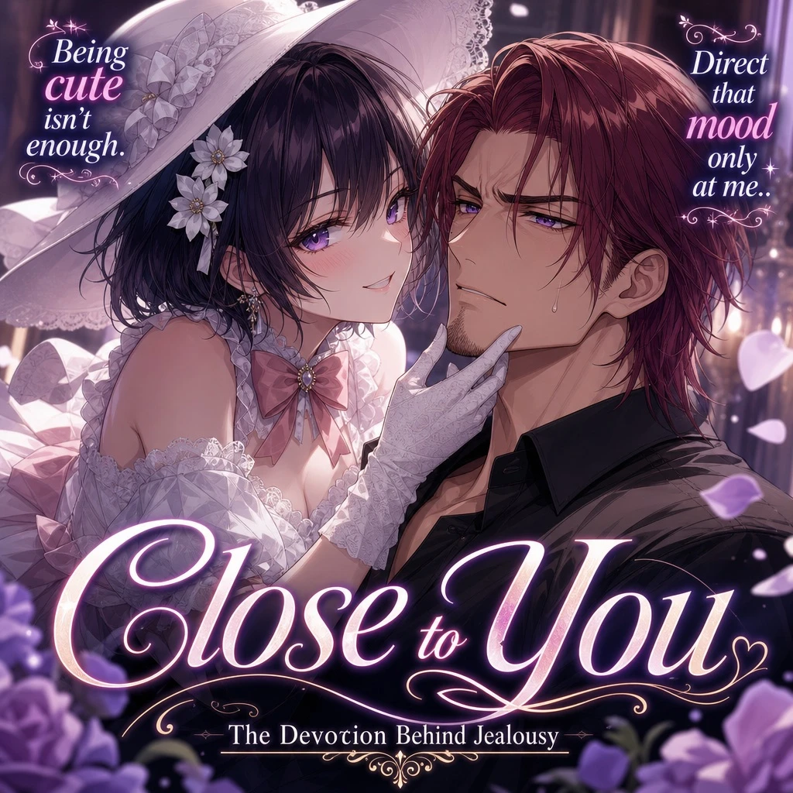

```text
An anime-style light novel cover illustration featuring two characters in an intimate pose. On the left, a young woman with short dark hair, purple eyes, wearing a white hat, a frilly white dress with a pink bow tie, white gloves, and two white flower hairpins. She has an affectionate, teasing smile and is gently touching the chin of the man next to her. On the right, an adult man with [HAIR_COLOR] hair parted in the middle, purple eyes, and a light goatee. He is wearing a black button-down shirt and has a slightly annoyed, reluctant expression with a sweat drop on his cheek. The scene features soft, romantic lighting with out-of-focus purple flower petals in the foreground corners. The image includes several text elements in [LANGUAGE]: a large stylized main title at the bottom reading [MAIN_TITLE], a subtitle below it reading [SUBTITLE], stylized text in the top left reading [LEFT_QUOTE], and stylized text in the top right reading [RIGHT_QUOTE].
```

Model: GPT Image 2 · Author: @taira_renta · adapted and regenerated by ClawLabs AI

[Original source](https://github.com/ClawLabsAI/awesome-verified-text-to-image-prompts/blob/c25274d3c30dca596c21d885ff9dc0c5106ab5c6/prompts.json#L4985) · [Provenance and original license](data/projectd-batch-0013.json)

## Fictional Anime Character Brand Collection — ClawLabs AI · MIT

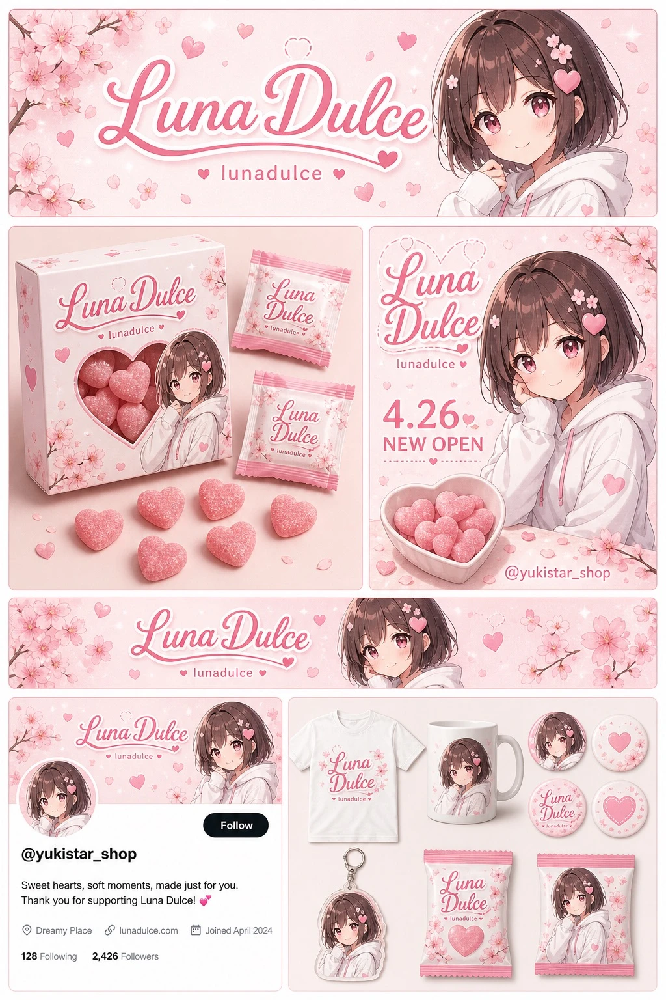

```text
Design a complete brand identity and merchandise design board. Theme: color palette of [THEME_COLOR] and white, with a recurring motif of [MOTIF] and pink hearts. Character: an anime girl with short brown bob hair, pink eyes, wearing a white hoodie, with a gentle smile. Branding: main logo text '[CHARACTER_NAME]' and sub logo text '[CHARACTER_SUBTEXT]'. Layout sections: (1) Header banner at the top featuring a large main logo, sub logo, cherry blossom graphics, and a character portrait on the right. (2) Product packaging in the middle-left area showing one square box with a heart-shaped transparent window revealing pink heart candies, a character illustration printed on the box, two individual candy wrappers, and five scattered heart candies. (3) Promotional poster in the middle-right area with a character portrait, a heart-shaped candy bowl, the main logo, the text '[PROMO_TEXT]', and the text '[SOCIAL_HANDLE]'. (4) A horizontal web banner in the lower-middle area featuring the main logo, cherry blossoms, and a character portrait on the right. (5) A social media profile mockup at the bottom-left with a header image containing the logo, one circular profile picture, the handle '[SOCIAL_HANDLE]', one follow button, and mock bio text. (6) A merchandise collection at the bottom-right showing nine items: one white t-shirt with the logo, one white mug with the character, four round pin badges, one acrylic keychain, and two candy packets.
```

Model: GPT Image 2 · Author: @chi_vc_ · adapted and regenerated by ClawLabs AI

[Original source](https://github.com/ClawLabsAI/awesome-verified-text-to-image-prompts/blob/c25274d3c30dca596c21d885ff9dc0c5106ab5c6/prompts.json#L5217) · [Provenance and original license](data/projectd-batch-0013.json)

## Tea-brand Mascot Design Book — ClawLabs AI · MIT

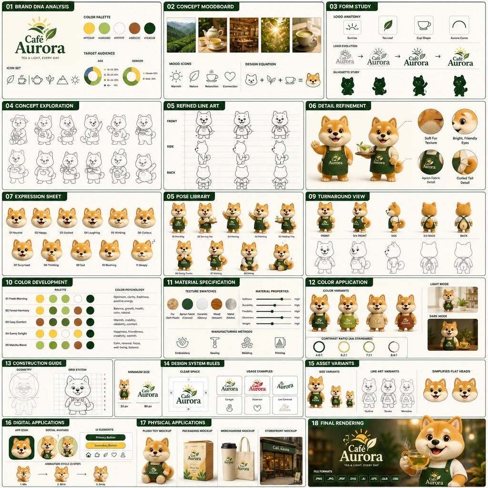

```text
Create an 18-panel brand identity and character design document, arranged in a grid of 3 columns by 6 rows. The brand is called [BRAND_NAME], operating in the [INDUSTRY] industry, with a color palette of [PRIMARY_COLOR], [SECONDARY_COLOR], white, brown, and dark green. The main subject is [CHARACTER_DESCRIPTION]. The 18 sections should be labeled and structured as follows: 01 BRAND DNA ANALYSIS — logo, 5 color swatches, 6 icons, target audience charts; 02 CONCEPT MOODBOARD — 5 photo references, 4 mood icons, a design equation; 03 FORM STUDY — 4 logo anatomy icons, 4 evolution steps, 4 silhouettes; 04 CONCEPT EXPLORATION — 12 line-art character sketches; 05 REFINED LINE ART — 3 rows of front and side line art with proportion guides; 06 DETAIL REFINEMENT — 2 full-body renders with labels, 4 circular close-ups; 07 EXPRESSION SHEET — 11 3D rendered head expressions; 08 POSE LIBRARY — 9 full-body 3D rendered poses; 09 TURNAROUND VIEW — 5 full-body 3D renders with 5 matching line-art views; 10 COLOR DEVELOPMENT — 5 rows of 5-color palettes with color psychology text; 11 MATERIAL SPECIFICATION — 5 texture swatches, property sliders, 4 manufacturing icons; 12 COLOR APPLICATION — 4 color variant renders, 2 light/dark renders, 4 contrast rating circles; 13 CONSTRUCTION GUIDE — 2 line-art diagrams for geometry and grid; 14 DESIGN SYSTEM RULES — minimum size icons, clear space diagram, 4 usage examples; 15 ASSET VARIANTS — 3 size variants, 3 line-art variants, 3 simplified flat heads; 16 DIGITAL APPLICATIONS — 1 app icon, 2 social avatars, UI elements, a 3-step animation cycle; 17 PHYSICAL APPLICATIONS — plush toy mockup, packaging mockup, merchandise mockup, storefront mockup; 18 FINAL RENDERING — a large high-resolution 3D render of the mascot holding tea, the logo, and a file format list. Each section title should appear in [LANGUAGE], formatted as a professional branding presentation document.
```

Model: GPT Image 2 · Author: @Colin_Leeee · adapted and regenerated by ClawLabs AI

[Original source](https://github.com/ClawLabsAI/awesome-verified-text-to-image-prompts/blob/c25274d3c30dca596c21d885ff9dc0c5106ab5c6/prompts.json#L5384) · [Provenance and original license](data/projectd-batch-0013.json)

## Fictional Idol Merchandise Flyer — ClawLabs AI · MIT

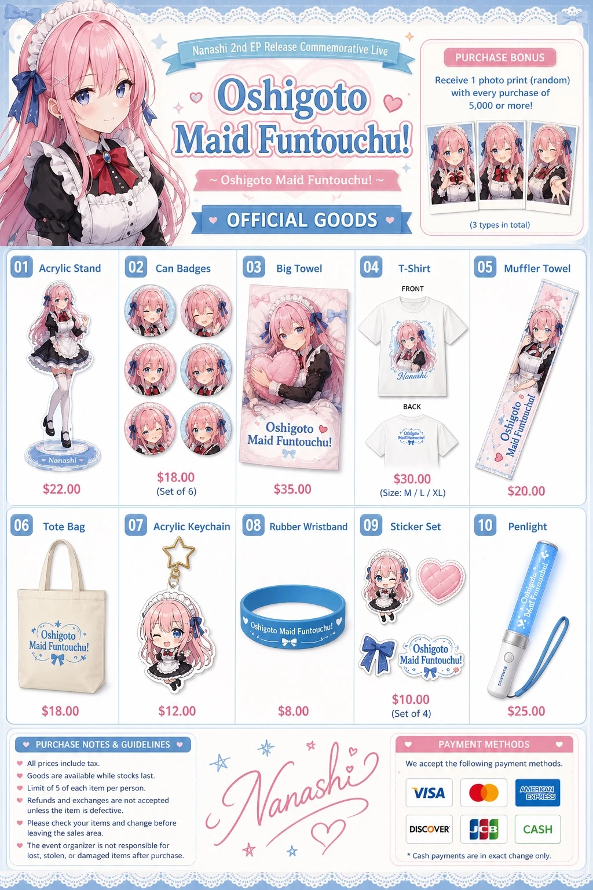

```text
Design an anime idol merchandise catalog flyer, realistic photography style with clean commercial UI layout, using a [THEME_COLORS] color scheme throughout. Feature an anime girl character named [CHARACTER_NAME] with long [HAIR_COLOR] hair, blue eyes, wearing [OUTFIT] accented with blue hair ribbons. Header layout: on the left, an upper body portrait of the character looking slightly to the side; in the center, a top banner reading '[CHARACTER_NAME] 2nd EP Release Commemorative Live', a main title reading '[EVENT_TITLE]', a subtitle reading '~ [EVENT_SUBTITLE] ~', and a section header labeled 'OFFICIAL GOODS'; on the right, a purchase bonus info box containing three small rectangular photo prints. Merchandise grid with ten numbered items, each clearly labeled and illustrated: 01 Acrylic Stand — full body acrylic stand of the character; 02 Can Badges — set of 6 circular can badges featuring different facial expressions; 03 Big Towel — large rectangular towel showing the character holding a heart pillow; 04 T-Shirt — white t-shirt showing the FRONT with character graphic and BACK with small logo; 05 Muffler Towel — long narrow muffler towel with character art and logo; 06 Tote Bag — canvas tote bag with blue logo; 07 Acrylic Keychain — chibi character acrylic keychain with a star-shaped clasp; 08 Rubber Wristband — blue silicone wristband with logo; 09 Sticker Set — set of 4 visible stickers depicting chibi character, heart, ribbon bow, and logo; 10 Penlight — blue glowing concert penlight. Footer layout: on the left, a purchase notes and guidelines box; in the center, the character's signature '[CHARACTER_NAME]' with hand-drawn hearts and stars; on the right, a payment methods box.
```

Model: GPT Image 2 · Author: @anemone_sd · adapted and regenerated by ClawLabs AI

[Original source](https://github.com/ClawLabsAI/awesome-verified-text-to-image-prompts/blob/c25274d3c30dca596c21d885ff9dc0c5106ab5c6/prompts.json#L6090) · [Provenance and original license](data/projectd-batch-0013.json)

## Fictional AI Product-launch Livestream UI — ClawLabs AI · MIT

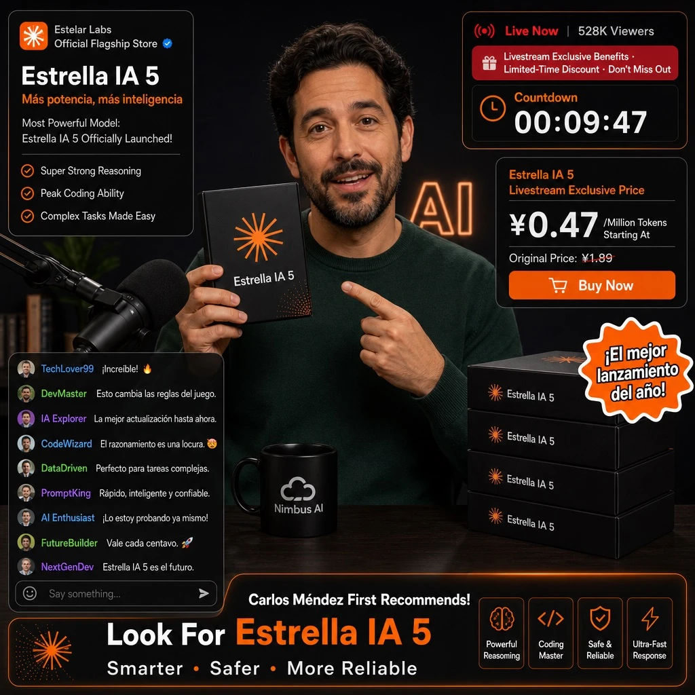

```text
Design an e-commerce livestream screenshot mockup. Scene: the main subject is [PERSON], wearing a dark green crewneck sweater, holding a black product box in one hand while pointing at it with the other. The setting is a dark studio with a microphone visible on the left side and faint 'AI' lettering glowing in the background. Props include a black mug printed with a white [BRAND_A] logo, and a stack of four black product boxes positioned on the right side of the frame.

Product design: the box is black with an orange asterisk or sunburst logo, and the product name '[PRODUCT_NAME]' printed on the front.

UI overlays:
- Top-left product info panel: brand tag '[BRAND_B] Official Flagship Store', title '[PRODUCT_NAME]', subtitle '[MAIN_HEADLINE]', sub-subtitle 'Most Powerful Model: [PRODUCT_NAME] Officially Launched!', and three bullet points reading 'Super Strong Reasoning', 'Peak Coding Ability', 'Complex Tasks Made Easy'.
- Top-right live status panel: viewer info 'Live Now | 528K Viewers', a promotional banner reading 'Livestream Exclusive Benefits · Limited-Time Discount · Don't Miss Out', and a countdown timer showing 'Countdown 00:09:47'.
- Middle-right price card: header '[PRODUCT_NAME] Livestream Exclusive Price', price displayed as '¥[PROMO_PRICE]/Million Tokens Starting At', original price 'Original Price: ¥1.89', and a button labeled 'Buy Now'.
- Bottom-left chat panel: nine chat messages visible, with an input box placeholder reading 'Say something...'.
- Bottom-right banner: headline '[PERSON] First Recommends! Look For [PRODUCT_NAME]', subheadline 'Smarter · Safer · More Reliable', and four feature tags: 'Powerful Reasoning', 'Coding Master', 'Safe & Reliable', 'Ultra-Fast Response'.
- A floating sticker element positioned over the product boxes on the middle-right, displaying the text '[STICKER_TEXT]'.
```

Model: GPT Image 2 · Author: @coder_left · adapted and regenerated by ClawLabs AI

[Original source](https://github.com/ClawLabsAI/awesome-verified-text-to-image-prompts/blob/c25274d3c30dca596c21d885ff9dc0c5106ab5c6/prompts.json#L6593) · [Provenance and original license](data/projectd-batch-0013.json)

## LED-driver Product Infographic Concept — ClawLabs AI · MIT

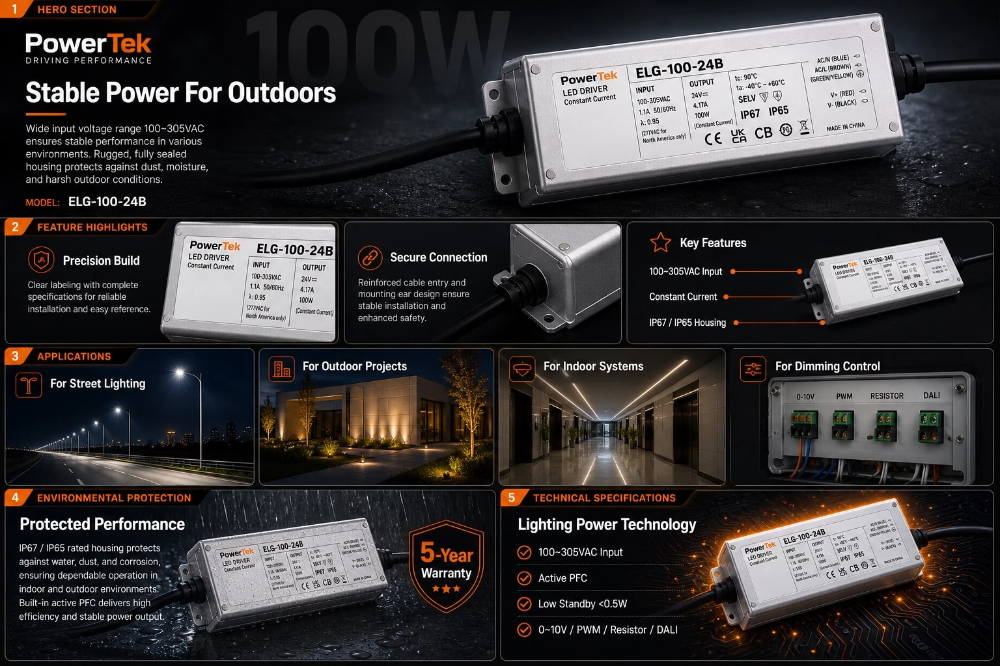

```text
Design a dark-mode e-commerce product infographic with [ACCENT_COLOR] accent highlights, showcasing a 100W Constant Current LED Driver with a rectangular silver metal housing, black cables on both ends, and a detailed specification label, for the brand [BRAND] model [PRODUCT_MODEL]. Structure the layout in five sections: (1) Hero Section — brand logo top left, headline '[HEADLINE]', subtext describing wide input voltage and protected housing, a large angled product shot, and a faded '100W' watermark in the background; (2) Feature Highlights, three panels — 'Precision Build' with a close-up of the specification label, 'Secure Connection' with a close-up of the cable entry and mounting ear, and 'Key Features' with an angled product shot and three callout lines pointing to the text '100~305VAC Input', 'Constant Current', and 'IP67 / IP65 Housing'; (3) Applications, four panels — 'For Street Lighting' showing a nighttime highway illuminated by streetlights, 'For Outdoor Projects' showing a modern building exterior with architectural landscape lighting, 'For Indoor Systems' showing a modern commercial hallway with linear ceiling lights, and 'For Dimming Control' showing an electrical control box labeled '0-10V', 'PWM', 'RESISTOR', 'DALI'; (4) Environmental Protection — the product resting on a wet surface with water droplets and a rain effect, headline 'Protected Performance', description text about indoor/outdoor use and active PFC, and a badge reading '[WARRANTY_YEARS]-Year Warranty'; (5) Technical Specifications — headline 'Lighting Power Technology', four checkmark bullet points reading '100~305VAC Input', 'Active PFC', 'Low Standby <0.5W', and '0~10V / PWM / Resistor / DALI', with the product shot glowing on a high-tech circuit board background.
```

Model: GPT Image 2 · Author: @AmberPromptai · adapted and regenerated by ClawLabs AI

[Original source](https://github.com/ClawLabsAI/awesome-verified-text-to-image-prompts/blob/c25274d3c30dca596c21d885ff9dc0c5106ab5c6/prompts.json#L6817) · [Provenance and original license](data/projectd-batch-0013.json)

## Fictional Tropical Open-world Game HUD — ClawLabs AI · MIT

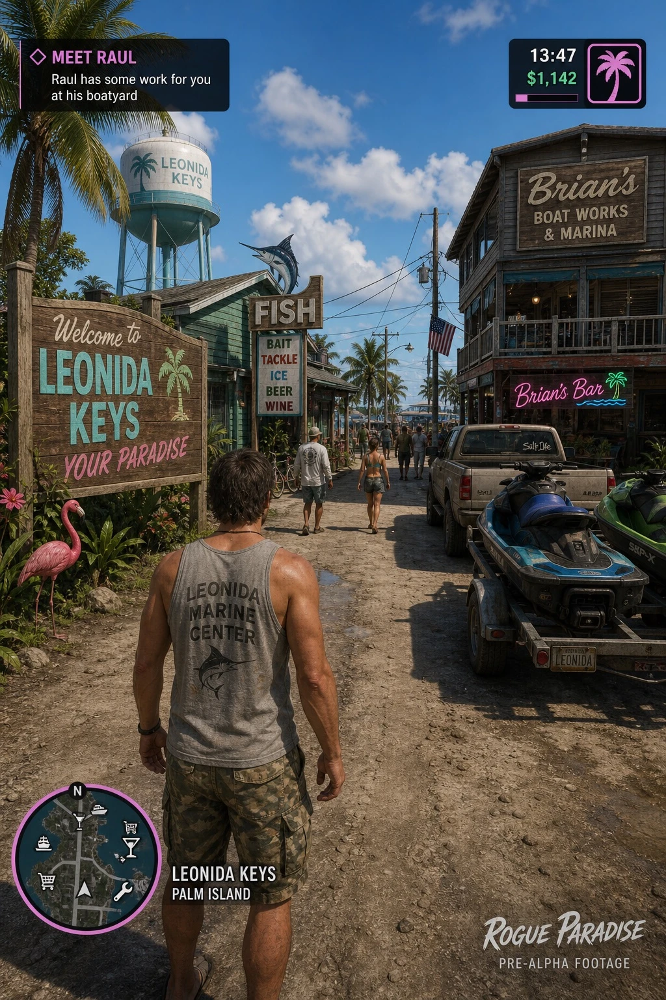

```text
Create a video game screenshot mockup in third-person over-the-shoulder perspective. The main character is a male protagonist seen from behind, wearing a grey tank top with the graphic text '[SHIRT_GRAPHIC]' printed on it, paired with camouflage cargo shorts. The setting is a tropical coastal town on a dirt road, under a sunny daytime sky with scattered clouds. On the left side of the scene, place a wooden welcome sign reading 'Welcome to [LOCATION_NAME] YOUR PARADISE', a pink plastic flamingo, tropical foliage, and a distant water tower. In the center, show a green building with a 'FISH' sign featuring a marlin graphic, another sign reading 'BAIT TACKLE ICE BEER WINE', and pedestrians walking along the street. On the right side, include a two-story wooden building labeled '[OWNER_NAME]'s Boat Works & Marina' with a neon sign reading '[OWNER_NAME]'s Bar', a parked pickup truck, and jet skis loaded on a trailer. Overlay five UI elements typical of an open-world game HUD: (1) top-left, a mission objective box with the text '[MISSION_TITLE]' followed by '[MISSION_DESCRIPTION]'; (2) top-right, a status HUD showing '13:47' and '$1,142' next to a pink palm tree icon; (3) bottom-left, a circular minimap with a purple border and white map icons including an 'N' marking north; (4) to the right of the minimap, location text reading '[LOCATION_NAME]' above 'PALM ISLAND'; (5) bottom-right, a watermark reading '[GAME_TITLE]' above 'PRE-ALPHA FOOTAGE'.
```

Model: GPT Image 2 · Author: @DanDaniDaniel01 · adapted and regenerated by ClawLabs AI

[Original source](https://github.com/ClawLabsAI/awesome-verified-text-to-image-prompts/blob/c25274d3c30dca596c21d885ff9dc0c5106ab5c6/prompts.json#L7065) · [Provenance and original license](data/projectd-batch-0013.json)

## Wind-inspired Character-design Sheet — ClawLabs AI · MIT

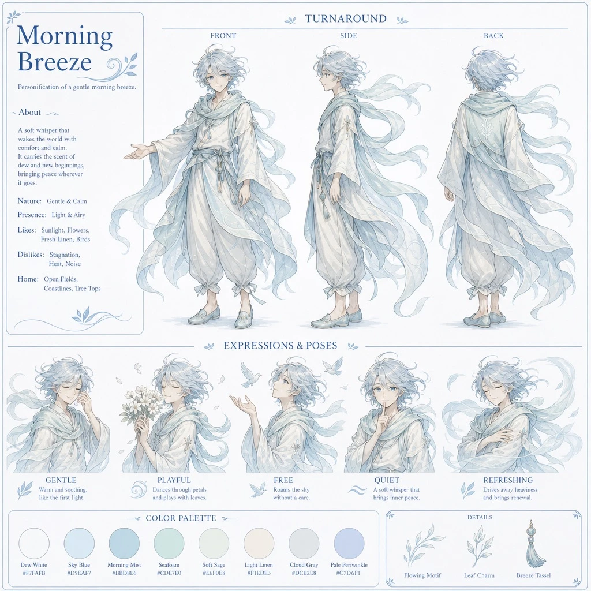

```text
Design a character reference sheet that personifies [CONCEPT] as if it were a living character, showing front, side, and back turnaround views along with a few expressive poses that reflect its personality traits. Include a small color palette swatch and keep the overall presentation clean and professional, in the style of a standard character-design settei sheet.
```

Model: GPT Image 2 · Author: @nicdunz · adapted and regenerated by ClawLabs AI

[Original source](https://github.com/ClawLabsAI/awesome-verified-text-to-image-prompts/blob/c25274d3c30dca596c21d885ff9dc0c5106ab5c6/prompts.json#L7143) · [Provenance and original license](data/projectd-batch-0013.json)

## Fictional Startup Presentation Cover — 3:2 Source Preview — ClawLabs AI · MIT

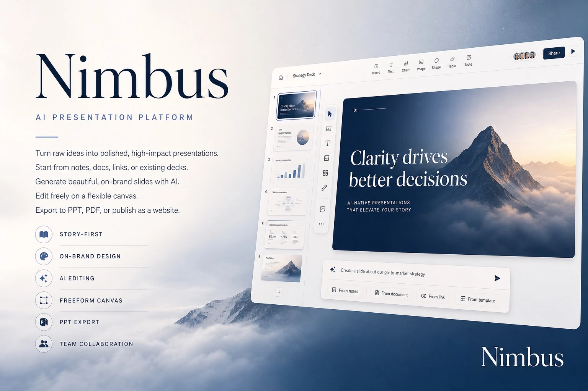

```text
Create a premium 4:3 presentation cover slide introducing [BRAND], the AI-native presentation platform from [BRAND_URL].

Style:
Elegant, minimal, modern, premium startup aesthetic. Similar to high-end brand guideline covers (in the style of leading tech companies). Soft gradient background with subtle depth, clean whitespace, refined typography, polished editorial layout.

Main title:
[BRAND]

Subtitle:
AI PRESENTATION PLATFORM

Body copy (small elegant text):
Turn raw ideas into polished, high-impact presentations.
Start from notes, docs, links, or existing decks.
Generate beautiful, on-brand slides with AI.
Edit freely on a flexible canvas.
Export to PPT, PDF, or publish as a website.

Feature highlights (small premium labels):
STORY-FIRST
ON-BRAND DESIGN
AI EDITING
FREEFORM CANVAS
PPT EXPORT
TEAM COLLABORATION

Bottom-right elegant logo text:
[BRAND]

Visual feeling:
Business-class premium, strategy deck quality, consulting-grade presentation, slightly futuristic but highly professional.

Composition:
Clean editorial balance, asymmetrical layout, strong whitespace, presentation software hero shot feeling.

Aspect ratio:
4:3

Language:
English only
```

Model: GPT Image 2 · Author: @cellier_ · adapted and regenerated by ClawLabs AI

[Original source](https://github.com/ClawLabsAI/awesome-verified-text-to-image-prompts/blob/c25274d3c30dca596c21d885ff9dc0c5106ab5c6/prompts.json#L7255) · [Provenance and original license](data/projectd-batch-0013.json)

## Fictional Surreal Comedy Poster Set — ClawLabs AI · MIT

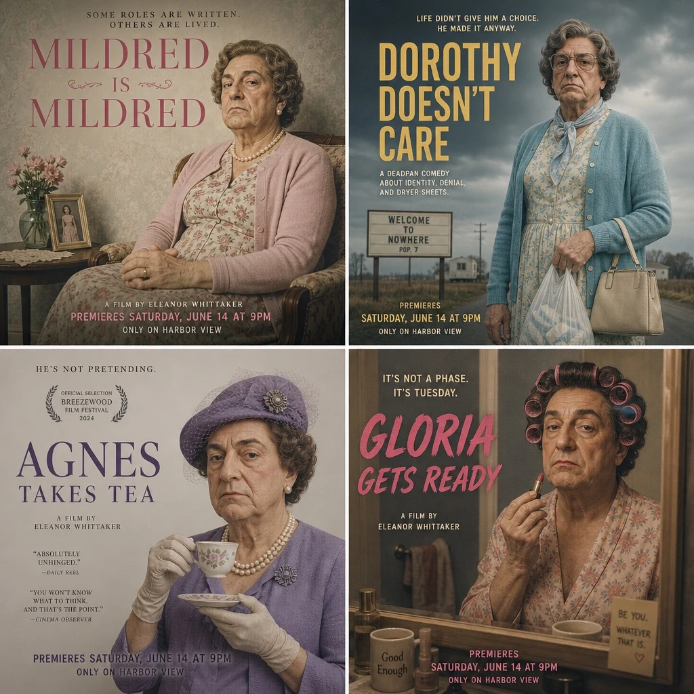

```text
A movie poster featuring a seemingly realistic yet subtly bizarre older man dressed in women's clothing, presented in 4 variations, achieving the level of professional graphic design production. The concept and setting itself should evoke the feeling of 'are they seriously making a movie out of this?' — a surreal, deadpan comedy that takes itself completely seriously yet is impossible not to laugh at. The title and broadcast information text should be displayed in [LANGUAGE].
```

Model: GPT Image 2 · Author: @aiehon_aya · adapted and regenerated by ClawLabs AI

[Original source](https://github.com/ClawLabsAI/awesome-verified-text-to-image-prompts/blob/c25274d3c30dca596c21d885ff9dc0c5106ab5c6/prompts.json#L7400) · [Provenance and original license](data/projectd-batch-0013.json)

## Dark Avatar-site Brand Identity Concept — ClawLabs AI · MIT

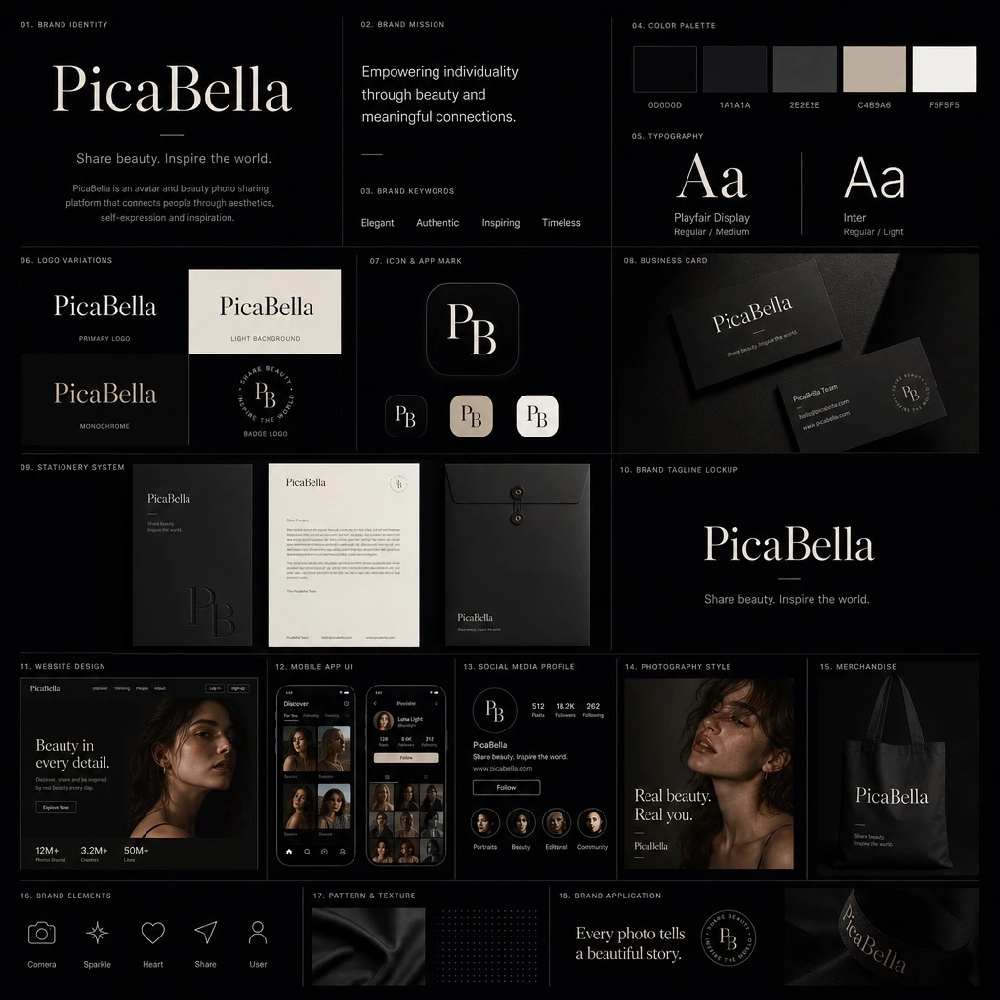

```text
In a dark, minimalist style inspired by [STYLE_REFERENCE] (a black cover design aesthetic), design a complete visual identity (VI) system for [BRAND], an avatar and beauty photo sharing website. The design should reflect a sleek, moody, high-contrast branding approach suitable for a modern photo-sharing platform.
```

Model: GPT Image 2 · Author: @xiaoxiaodong01 · adapted and regenerated by ClawLabs AI

[Original source](https://github.com/ClawLabsAI/awesome-verified-text-to-image-prompts/blob/c25274d3c30dca596c21d885ff9dc0c5106ab5c6/prompts.json#L7517) · [Provenance and original license](data/projectd-batch-0013.json)

## Scribble Creature on a Synthetic Exam Page — ClawLabs AI · MIT

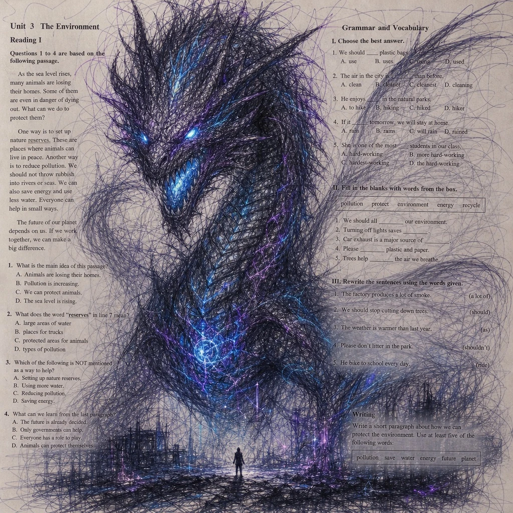

```text
A colossal [SUBJECT], massive scale, towering presence, a gigantic entity far beyond human size, overwhelming and oppressive, drawn with extremely dense chaotic scribble lines, ultra-dense overlapping pen strokes, tangled and chaotic linework, on top of a real printed textbook or exam paper page in [LANGUAGE], with visible text, layout, and paper texture clearly showing through, ballpoint pen drawing style, fine ink lines, messy layered strokes, no clean outlines, everything constructed from chaotic scribbles, dark and muted base tones (black, deep indigo, dark violet), with subtle low-saturation neon accents (blue, cyan, purple), selective bioluminescent glow only in key areas (eyes, core, cracks, veins), not overall brightness, organic or mechanical textures depending on the subject, intricate details, complex surface patterns, form emerging from chaos, high-density center, edges dissolving into loose scribbles, sense of scale emphasized by a tiny human silhouette near the subject, semi-transparent layers, depth created by line density, raw, imperfect, noisy, energetic hand-drawn feeling, slightly eerie, surreal, mysterious atmosphere, mixed media illustration, scribble art, extremely detailed, high contrast between dark mass and glowing accents, masterpiece, ultra detailed.
```

Model: GPT Image 2 · Author: @GeekCatX · adapted and regenerated by ClawLabs AI

[Original source](https://github.com/ClawLabsAI/awesome-verified-text-to-image-prompts/blob/c25274d3c30dca596c21d885ff9dc0c5106ab5c6/prompts.json#L7673) · [Provenance and original license](data/projectd-batch-0013.json)

## Fictional Animation Storyboard-generator UI — ClawLabs AI · MIT

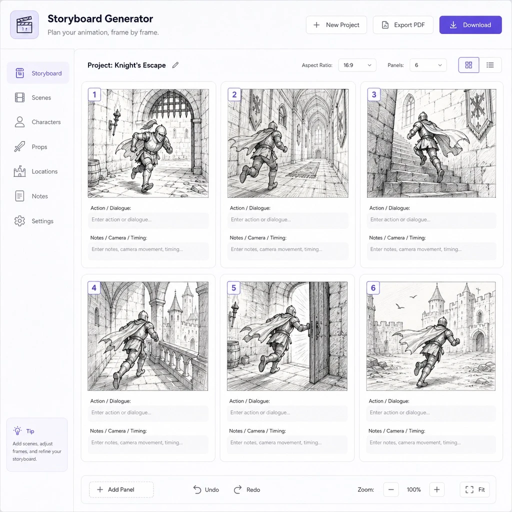

```text
Create a visual mockup of an animation storyboard generator tool: a clean grid layout displaying a sequence of hand-drawn style storyboard panels, each illustrating a key frame of [SCENE_SUBJECT] in sequential order, with simple sketch-style line art, panel numbering, and small caption placeholders beneath each frame, arranged in [PANEL_COUNT] panels total, presented as a modern software interface mockup.
```

Model: GPT Image 2 · Author: @joshesye · adapted and regenerated by ClawLabs AI

[Original source](https://github.com/ClawLabsAI/awesome-verified-text-to-image-prompts/blob/c25274d3c30dca596c21d885ff9dc0c5106ab5c6/prompts.json#L7857) · [Provenance and original license](data/projectd-batch-0013.json)

## Classic-fiction Fantasy Game-interface Mashup — ClawLabs AI · MIT

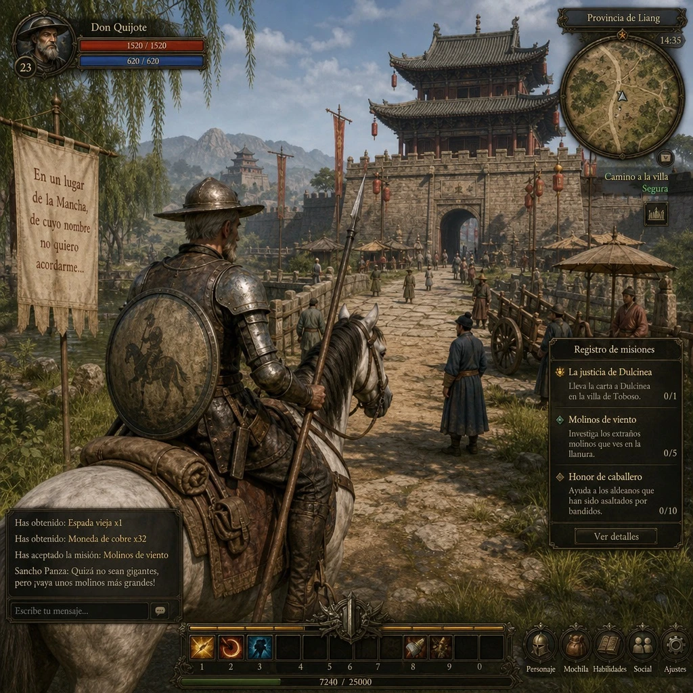

```text
Generate a screenshot of an ancient-style ARPG MMO open-world video game, themed around [LITERARY_WORK], a classical work of fiction, set in a richly detailed historical Chinese world with period-accurate architecture, clothing, and landscapes, complete with an immersive in-game UI showing health bars, minimap, and quest log.
```

Model: GPT Image 2 · Author: @op7418 · adapted and regenerated by ClawLabs AI

[Original source](https://github.com/ClawLabsAI/awesome-verified-text-to-image-prompts/blob/c25274d3c30dca596c21d885ff9dc0c5106ab5c6/prompts.json#L8034) · [Provenance and original license](data/projectd-batch-0013.json)

## Neumorphic UI Design-system Concept Board — ClawLabs AI · MIT

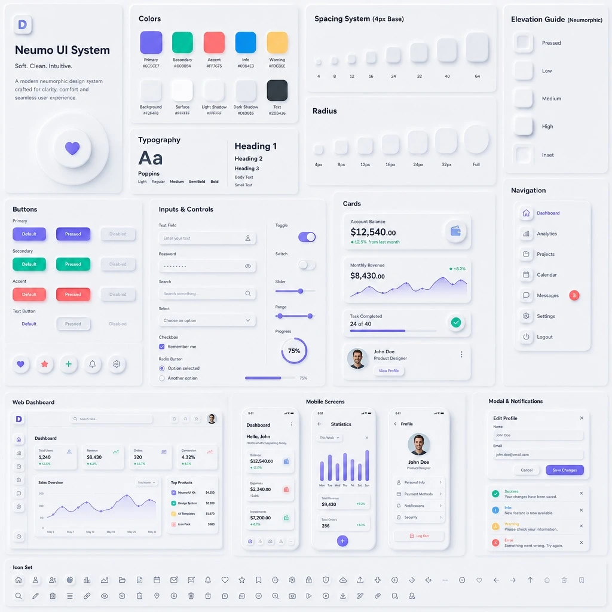

```text
Generate a complete UI design system for me in [STYLE], including web pages, mobile screens, cards, controls, buttons, and other essential UI components. Ensure visual consistency across all elements, with a cohesive color palette, typography, spacing, and iconography that reflect the chosen style throughout the entire system.
```

Model: GPT Image 2 · Author: @stark_nico99 · adapted and regenerated by ClawLabs AI

[Original source](https://github.com/ClawLabsAI/awesome-verified-text-to-image-prompts/blob/c25274d3c30dca596c21d885ff9dc0c5106ab5c6/prompts.json#L8595) · [Provenance and original license](data/projectd-batch-0013.json)

## Grain Rain Seasonal Campaign Poster — ClawLabs AI · MIT

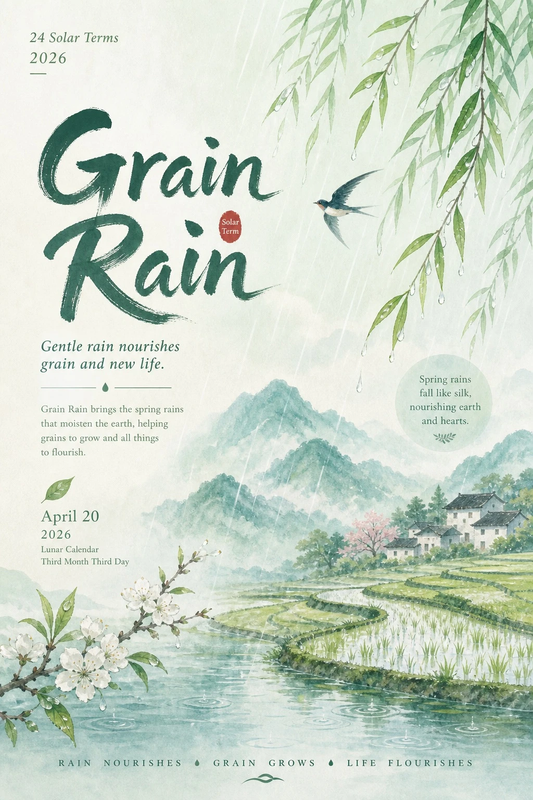

```text
Create an aesthetically pleasing poster design for the [SOLAR_TERM] solar term for the year [YEAR], incorporating traditional Chinese seasonal imagery, elegant brushwork-inspired typography, soft pastel colors reflecting spring rain and new growth, and a balanced, harmonious composition suitable for a vertical poster format.
```

Model: GPT Image 2 · Author: @akokoi1 · adapted and regenerated by ClawLabs AI

[Original source](https://github.com/ClawLabsAI/awesome-verified-text-to-image-prompts/blob/c25274d3c30dca596c21d885ff9dc0c5106ab5c6/prompts.json#L8778) · [Provenance and original license](data/projectd-batch-0013.json)

## Synthetic Handwritten Notebook Photo — Spanish-lettered Preview — ClawLabs AI · MIT

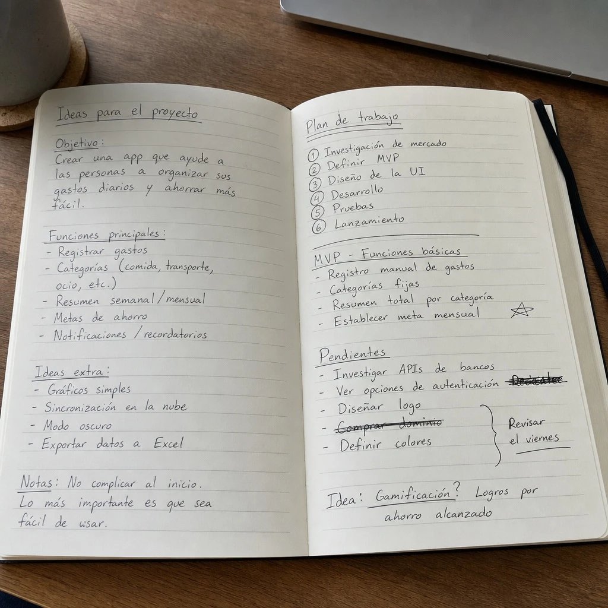

```text
Amateur photo of an open notebook lying flat, filled with handwritten notes in black ballpoint pen. The handwriting is casual and slightly messy, like personal notes, with natural imperfections, crossed-out words, and underlined headings. Shot from slightly above, with natural daylight from a window, no flash. Casual desk setting, shot on [DEVICE].
```

Model: GPT Image 2 · Author: @patrickassale · adapted and regenerated by ClawLabs AI

[Original source](https://github.com/ClawLabsAI/awesome-verified-text-to-image-prompts/blob/c25274d3c30dca596c21d885ff9dc0c5106ab5c6/prompts.json#L9032) · [Provenance and original license](data/projectd-batch-0013.json)

## Renaissance-inspired Fantasy Trading-card Concept — ClawLabs AI · MIT

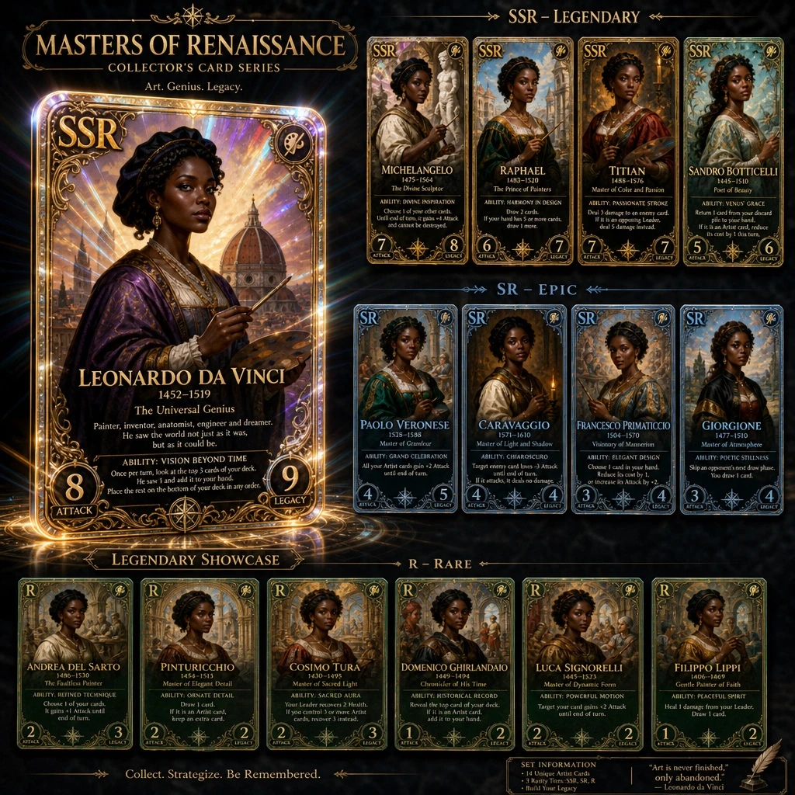

```text
Design a full set of collectible trading game cards featuring [SUBJECT_THEME], organized into SSR, SR, and R rarity tiers. Key or legendary cards should include an enlarged showcase display effect. Each card must include a detailed card-face illustration and a character introduction or bio text. The overall style should convey a premium, high-end collectible card texture and finish. Rare cards, especially the top tier, should feature special light and shadow effects such as holographic or laser foil finishes. The set should include a cohesive card series design and a skill or ability design for each character, along with fairly detailed descriptive text accompanying each card.
```

Model: GPT Image 2 · Author: @TanShilong · adapted and regenerated by ClawLabs AI

[Original source](https://github.com/ClawLabsAI/awesome-verified-text-to-image-prompts/blob/c25274d3c30dca596c21d885ff9dc0c5106ab5c6/prompts.json#L9541) · [Provenance and original license](data/projectd-batch-0013.json)

## AI Snack-packaging Schematic — Illustrative Specifications — ClawLabs AI · MIT

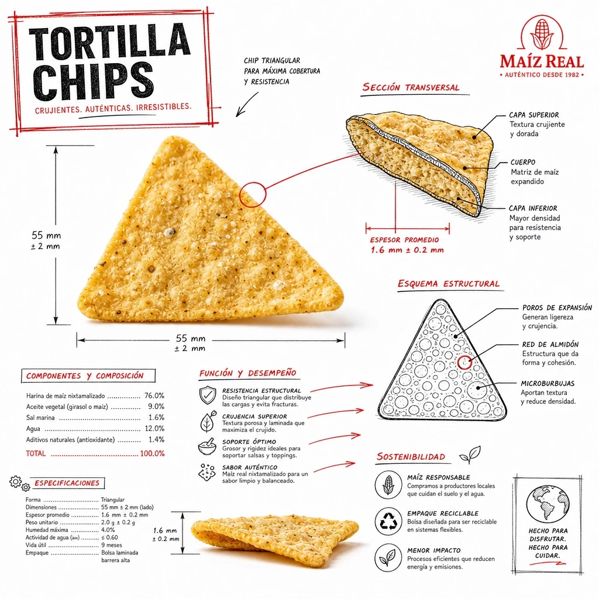

```text
Create a branded technical infographic of a [SNACK], combining a realistic photograph or photoreal render of the product with technical annotation overlays placed directly on top. Use black ink-style line drawings with strategic [BRAND COLOR] accents (architectural sketch look) on a pure white studio background, including: key component labels; an internal cross-section showing structure, layering, or internal design; measurements, dimensions, and specifications; material callouts with composition and quantities; arrows indicating function for primary features and structural integrity; a simple schematic or sectional diagram showing key mechanical or design elements; and sustainability callouts. Title placement: inside a hand-drawn technical annotation box with an accent border reading the product name in bold font, positioned in the upper corner. Style and layout rules: the realistic product remains clearly visible; annotations feel sketched, technical, and architectural; accents are used for highlights (20-30% of the linework), black for primary technical lines (70-80%); clean composition with balanced negative space; educational, food-engineering vibe with premium branding; include a subtle brand logo mark in the corner. Visual style: minimal technical illustration aesthetic, black linework with accents over realistic imagery, precise but with a slightly hand-drawn feel. Color palette: white background, black annotation lines/text, [BRAND COLOR] for accents and key callouts only. Output: 1080x1080, ultra-crisp, social-feed optimized, no watermark.
```

Model: GPT Image 2 · Author: @TechieBySA · adapted and regenerated by ClawLabs AI

[Original source](https://github.com/ClawLabsAI/awesome-verified-text-to-image-prompts/blob/c25274d3c30dca596c21d885ff9dc0c5106ab5c6/prompts.json#L9917) · [Provenance and original license](data/projectd-batch-0013.json)

## Neon Three-can Soda Advertising Concept — ClawLabs AI · MIT

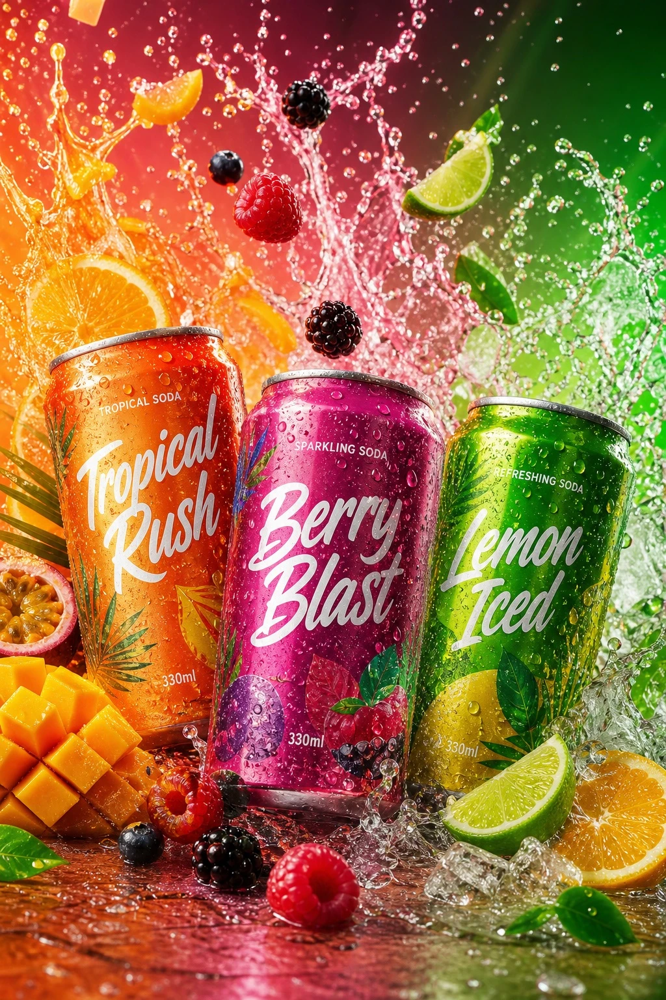

```text
Three ultra-dynamic soda cans in one vibrant, high-end advertising composition — a can labeled [FLAVOR_NAME_1] exploding with a dramatic splash of water and tropical fruit, set against vibrant orange and pink background lighting; a can labeled [FLAVOR_NAME_2] splashed with cold water against a glowing green dynamic light background; both cans covered in realistic condensation and motion-blurred droplets, bursting with fruity, refreshing energy. Deep orange, pink, and neon green lighting blend together in a bold studio setup. Captured by a professional photographer using a [CAMERA_BRAND] 50mm lens, hyper-realistic textures, crisp details, ultra high resolution, bright commercial poster aesthetic, rich color vibrancy, cinematic splash effects --ar 3:4
```

Model: GPT Image 2 · Author: @Fujimoto_hina · adapted and regenerated by ClawLabs AI

[Original source](https://github.com/ClawLabsAI/awesome-verified-text-to-image-prompts/blob/c25274d3c30dca596c21d885ff9dc0c5106ab5c6/prompts.json#L9972) · [Provenance and original license](data/projectd-batch-0013.json)

## AI Bottled-tea Advertising Study — ClawLabs AI · MIT

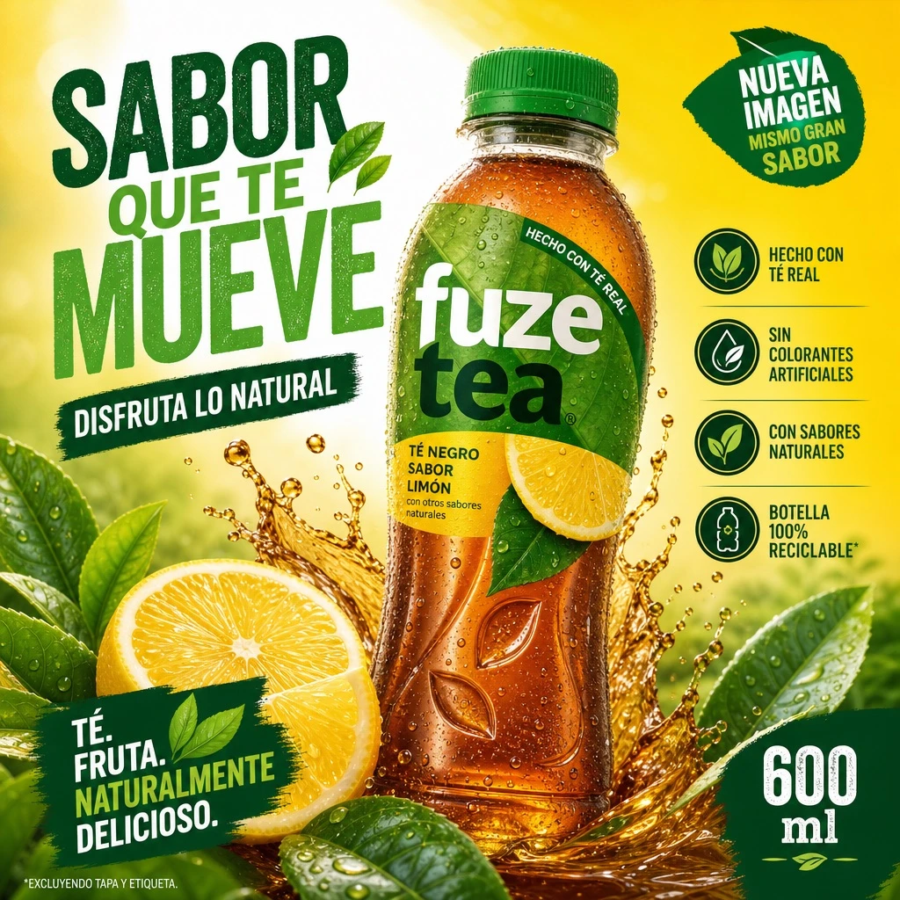

```text
Create a promotional poster for this [BRAND] bottled tea beverage product. Showcase the product bottle as the main visual focus, using an eye-catching poster-style layout with bold typography, vibrant colors, and a clean commercial advertising aesthetic suitable for retail marketing.
```

Model: GPT Image 2 · Author: 苍何原创实测（公众号文章《我逆向了 329 条 GPT-Image2 提示词模板，全部开源！》） · adapted and regenerated by ClawLabs AI

[Original source](https://github.com/ClawLabsAI/awesome-verified-text-to-image-prompts/blob/c25274d3c30dca596c21d885ff9dc0c5106ab5c6/prompts.json#L10447) · [Provenance and original license](data/projectd-batch-0013.json)

## AI Fashion Magazine-cover Study — Chanel Masthead Mockup — ClawLabs AI · MIT


```text
Ultra high-fashion magazine cover in the style of [BRAND] editorial photography. Close-up portrait of a confident woman with soft rose-gold hair and natural airy bangs, slightly wind-blown for movement. She is wearing a luxury summer outfit: a structured lightweight linen or silk jacket in warm golden-yellow tones, layered over a modest high-neck top, paired with a bold gold choker necklace and subtle statement earrings. Fabric flows naturally with a summer breeze, slightly textured and breathable, capturing a premium seasonal feel. Styling is elegant, modest, and refined — no revealing clothing. Lighting is high-end studio mixed with natural golden hour glow: warm highlights, soft shadows, luminous skin with a glossy editorial finish. Background is a rich summer gradient (sunset gold fading into soft coral or warm beige), clean but visually striking. Composition is dynamic and slightly cinematic: hair in motion, shallow depth of field, sharp focus on the face. Typography: large elegant serif masthead "[BRAND]" at the top, bold cover line "[COVER_LINE]" in a premium editorial layout, minimal supporting text. Ultra-realistic, hyper-detailed skin texture, 8K resolution, sharp focus, glossy magazine print quality, cinematic color grading, luxury fashion photography, no nudity, tasteful and editorial.
```

Model: GPT Image 2 · Author: @SPEEDAI07 · adapted and regenerated by ClawLabs AI

[Original source](https://github.com/ClawLabsAI/awesome-verified-text-to-image-prompts/blob/c25274d3c30dca596c21d885ff9dc0c5106ab5c6/prompts.json#L10734) · [Provenance and original license](data/projectd-batch-0013.json)

## Fictional Torn-paper New-wave Film Poster — ClawLabs AI · MIT


```text
Create a vertical poster composition on aged cream paper with a handmade analog feel. Use rough ripped paper edges, layered magazine cutouts, photocopy grain, halftone texture, ink bleed, and slightly imperfect screen-print registration. Keep the subject as the main black-and-white photographic portrait, placed prominently in the center or upper center. Surround the subject with graphic blocks of deep red, cobalt blue, warm yellow, black, and ivory. Add supporting collage fragments such as a rainy European street, film-strip borders, newspaper clippings, urban silhouettes, and cinematic details, arranged like a handmade 1960s art-house movie poster. Use bold condensed typography with a strong visual hierarchy. Add large headline text: "[MAIN_TITLE]". Add smaller subtitle text: "[SUBTITLE]". Add bottom text: "[BOTTOM_TEXT]". If needed, include a small top line reading "[TAGLINE]". The final result should feel cinematic, intellectual, rebellious, and editorial — like a lost 1960s European film poster with a strong point of view. Keep it raw, tactile, printed, imperfect, and handmade. Avoid a glossy modern finish.
```

Model: GPT Image 2 · Author: @bananaprompts · adapted and regenerated by ClawLabs AI

[Original source](https://github.com/ClawLabsAI/awesome-verified-text-to-image-prompts/blob/c25274d3c30dca596c21d885ff9dc0c5106ab5c6/prompts.json#L10812) · [Provenance and original license](data/projectd-batch-0013.json)

## Phoenix Rebirth Typography Poster — ClawLabs AI · MIT


```text
Create ONE finished premium conceptual typography poster for the exact title:

"[TITLE_TEXT]"

Single poster only. No moodboard, grid, presentation board, mockup, captions, prompt text, process sheet, or sample labels.

The title "[TITLE_TEXT]" must be the dominant visual structure of the poster: huge, readable, powerful, and spelled exactly. Do not translate, shorten, replace, or misspell it. Do not add other large readable text. Optional micro catalog text is allowed only if it stays subtle and secondary.

Silently interpret the title's meaning, mood, cultural aura, symbolic associations, psychological tension, and visual rhythm. Turn that interpretation into one strong visual metaphor.

Typography is the hero. Design custom-looking letterforms whose weight, width, contrast, spacing, rhythm, distortion, negative space, edge quality, and ink texture express the temperament of the title. The type should feel intentionally designed, not like a default font.

If "[TITLE_TEXT]" refers to a widely known person, make a large editorial portrait or full / half-body figure a major visual presence, occupying roughly 40-70% of the composition. The figure should feel recognizable through aura, posture, styling, era, expression, lighting, and symbolic atmosphere, but should not copy a specific existing photograph, official poster, campaign image, logo, slogan, or copyrighted composition. The portrait must interact with the typography: overlapping the letters, emerging from them, being framed by them, casting shadows on them, breaking through them, or being partially hidden behind them.

For all other titles, use a human figure, landscape, object, or atmospheric setting only when it strengthens the meaning. It must interact with the typography and deepen the concept, not decorate it.

Use a rich but restrained 4-6 color system matched to the theme: dominant background color, primary typography color, figure / landscape tone, emotional accent color, muted support color, and subtle paper / ink texture tone. Avoid flat black-white-red defaults unless conceptually necessary.

Composition style: high-end editorial poster, museum-quality graphic design, dramatic scale, strong hierarchy, few elements, intelligent whitespace, bold flat color areas, sharp cropping, silkscreen / lithograph / risograph grain, paper fibers, subtle ink imperfections, refined visual tension.

The final image should feel like a complete visual sentence: the title, the figure or setting, the color, and the typography explain each other.

Avoid generic word art, glossy 3D lettering, random icons, stock-photo realism, cluttered collage, excessive grunge, tourist clichés, official logos, copied slogans, copied campaign aesthetics, unrelated text, and misspelled typography.

-----

TITLE_TEXT: [TITLE_TEXT]
```

Model: GPT Image 2 · Author: @dotey · adapted and regenerated by ClawLabs AI

[Original source](https://github.com/ClawLabsAI/awesome-verified-text-to-image-prompts/blob/c25274d3c30dca596c21d885ff9dc0c5106ab5c6/prompts.json#L11050) · [Provenance and original license](data/projectd-batch-0013.json)

## Fictional Masked-wrestler Ink Poster — ClawLabs AI · MIT


```text
A cinematic character promotional poster of [SUBJECT], vertical composition (9:16), designed with a refined East-Asian ink aesthetic and high-end visual storytelling.

STRUCTURE:
Top-heavy hierarchical layout. The upper half features a large, highly recognizable silhouette of [SUBJECT]'s head, face, mask, or upper body, forming a bold, iconic primary shape. The silhouette should be instantly identifiable.

The middle-lower section contains the full-body version of [SUBJECT] as a secondary subject, standing in a stable pose or subtle action stance, forming the visual core.

COMPOSITION STYLE:
Inside the large silhouette and around the character, use double exposure and collage storytelling. Integrate multiple elements:
- key scenes related to [SUBJECT]
- symbolic imagery and environment
- small narrative figures and interactions
- supporting visual motifs

Blend everything seamlessly using clouds, mist, ink diffusion, and negative space.

VISUAL FLOW:
Create a continuous flowing visual path from top to bottom, connecting:
- the upper silhouette
- the inner collage elements
- the full-body subject

Ensure smooth eye guidance and compositional cohesion.

SIDE ELEMENTS:
Add balanced supporting elements on the left and right sides to create tension, depth, and spatial variation.

STYLE & ATMOSPHERE:
- Large areas of negative space
- Ink-wash diffusion edges, soft fading, subtle fragmentation
- Eastern aesthetic balancing emptiness and detail
- Calm, premium, restrained, cinematic tone

QUALITY:
Ultra-detailed, high resolution, layered depth, soft lighting, atmospheric perspective, cohesive series-style design.

OUTPUT:
9:16 aspect ratio, poster-ready composition.
```

Model: GPT Image 2 · Author: @Goodmanprotocol · adapted and regenerated by ClawLabs AI

[Original source](https://github.com/ClawLabsAI/awesome-verified-text-to-image-prompts/blob/c25274d3c30dca596c21d885ff9dc0c5106ab5c6/prompts.json#L11203) · [Provenance and original license](data/projectd-batch-0013.json)

## Fictional Matcha Brand Identity System — ClawLabs AI · MIT


```text
Create a premium 'Matcha Brand Touchpoint System' visual board for a modern lifestyle brand called '[BRAND]'. Build a full brand identity system, not a single image.

HERO SCENE:
A hyper-realistic matcha drink in a ceramic cup placed on a clean natural surface.
– vibrant green matcha foam with micro-bubbles
– bamboo whisk (chasen) nearby
– soft natural light
– slight matcha powder dust on the surface
– minimal Japanese aesthetic

ATMOSPHERE:
– calm, warm, soft daylight
– clean background (off-white or beige)
– subtle shadows and reflections
– feeling of wellness and luxury

FULL BRAND SYSTEM:
– takeout cups (paper + glass bottles)
– packaging boxes (minimalist design)
– tote bags (premium lifestyle)
– labels, stickers, seals
– menu cards with pricing ([PRICE_1], [PRICE_2], etc.)
– small typography everywhere
– subtle imperfections for realism

DESIGN LANGUAGE:
– modern minimalist typography
– Japanese-inspired layout
– soft green palette
– elegant spacing

INCLUDE:
– matcha latte
– iced matcha
– matcha desserts
– combo sets
– lifestyle shots

The composition must feel like a high-end design agency presentation. Ultra-detailed, realistic, clean, aesthetic, and highly shareable.
```

Model: GPT Image 2 · Author: @Preda2005 · adapted and regenerated by ClawLabs AI

[Original source](https://github.com/ClawLabsAI/awesome-verified-text-to-image-prompts/blob/c25274d3c30dca596c21d885ff9dc0c5106ab5c6/prompts.json#L11308) · [Provenance and original license](data/projectd-batch-0013.json)

## Manga Katana Draw Portrait — ClawLabs AI · MIT


```text
A high-contrast, black-and-white illustration of an elderly man in a sharp suit, drawing a katana. The man has slicked-back white hair, deep wrinkles, and an intense, focused expression, looking down at the blade. He wears a dark suit, a white shirt, and a dark tie. His hands are prominently featured in the foreground, showing pronounced veins and wrinkles as they grip the ornate handle and scabbard of the katana. The background is completely black, emphasizing the dramatic lighting and intricate cross-hatching details on the man's face, hands, and clothing. The style resembles a detailed, gritty manga or graphic novel.
```

Model: GPT Image 2 · Author: @nicdunz · adapted and regenerated by ClawLabs AI

[Original source](https://github.com/ClawLabsAI/awesome-verified-text-to-image-prompts/blob/c25274d3c30dca596c21d885ff9dc0c5106ab5c6/prompts.json#L4405) · [Provenance and original license](data/projectd-batch-0013.json)

## Anime-Inspired Beauty Portrait — ClawLabs AI · MIT


```text
Generate a high-quality, photorealistic portrait of a beautiful young woman with an anime-inspired aesthetic, styled to appeal to fans of anime and otaku culture, featuring sharp facial detail, soft flattering lighting, and vibrant, expressive styling.
```

Model: GPT Image 2 · Author: @joshesye · adapted and regenerated by ClawLabs AI

[Original source](https://github.com/ClawLabsAI/awesome-verified-text-to-image-prompts/blob/c25274d3c30dca596c21d885ff9dc0c5106ab5c6/prompts.json#L7784) · [Provenance and original license](data/projectd-batch-0013.json)

## AI Training Infographic Layout — Spanish-lettered Preview — ClawLabs AI · MIT


```text
Create a cute, kawaii-style infographic that playfully explains the training process of a large language model, using soft pastel colors, simple rounded icons, and friendly illustrations to represent each stage of the process in an easy-to-understand visual flow.
```

Model: GPT Image 2 · Author: @op7418 · adapted and regenerated by ClawLabs AI

[Original source](https://github.com/ClawLabsAI/awesome-verified-text-to-image-prompts/blob/c25274d3c30dca596c21d885ff9dc0c5106ab5c6/prompts.json#L7990) · [Provenance and original license](data/projectd-batch-0013.json)

## Mecha Girl Over Ruined Sea — ClawLabs AI · MIT


```text
A mecha girl in her mid-teens, pale skin smudged with soot and salt spray, sharp amber eyes reflecting a glowing HUD reticle, waist-length ash-white hair tied in a high ponytail whipping in the sea wind. Matte gunmetal exoskeleton armor plates her shoulders, forearms and shins, with exposed hydraulic pistons at the joints and a chest rig lined with glowing cyan coolant tubes. An oversized oil-stained hangar jacket half slips off one shoulder, a massive rail cannon rests on her right shoulder, and dog tags with a frayed red ribbon hang at her collar. She stands off-center to the left on the rusted edge of a tilted steel platform jutting out over dark water, weight shifted onto one leg, left hand gripping the cannon strap, head turned slightly toward the camera with a quiet, defiant stare. Steam vents from her back thrusters as her ponytail and jacket stream sideways in the salt wind. The background shows a vast derelict sea-city at dusk: colossal megastructures of unknown purpose rise from the ocean in staggered silhouettes, bone-white monolithic towers fused with barnacled steel, cyclopean ring-shaped constructs canted at broken angles, rusted skeletal gantries threaded with dead cables, dark swells rolling between the pylons, and shipwrecks half-swallowed at their feet. Thick sea fog clings to the bases while the upper structures pierce a bruised sky, with scattered faint lights blinking high in the towers like distant eyes. The lighting is moody and low-key: cold teal ambient light from the overcast sky, a warm amber sodium glow leaking from a distant structure on the right side of frame, and hard backlight from a low sun behind the towers carving her silhouette. Volumetric god rays cut through the sea mist, producing wet specular highlights on her armor. Shot on a 35mm anamorphic lens at a slight low angle, looking up past her shoulder toward the structures; medium-wide composition with shallow depth of field blurring the rusted foreground, horizontal lens flares, and fine atmospheric haze compressing the distant megastructures into layered silhouettes. The overall style is a cinematic anime key visual: painterly digital illustration with crisp line art, a desaturated oceanic palette of teal, bone-white and rust punctuated by small warm accent lights, film grain, and a high-contrast editorial poster aesthetic. Format 16:9.
```

Model: GPT Image 2 · Author: @old_pgmrs_will · adapted and regenerated by ClawLabs AI

[Original source](https://github.com/ClawLabsAI/awesome-verified-text-to-image-prompts/blob/c25274d3c30dca596c21d885ff9dc0c5106ab5c6/prompts.json#L8431) · [Provenance and original license](data/projectd-batch-0013.json)

## Nebula Koi and Tiny Figure — ClawLabs AI · MIT


```text
A surrealist digital illustration in a low-angle upward perspective. The scene depicts a giant, colorful koi fish swimming through a dreamy nebula, surrounded by vividly colored nebulae and floating bubbles. In the center of the composition stands a small human figure, seen from behind, calmly gazing upward at the enormous koi hovering above, while the koi looks down at the figure. The overall image emphasizes a strong contrast in scale between the tiny figure and the colossal fish, creating an ethereal, dreamlike atmosphere. Aspect ratio 9:16.
```

Model: GPT Image 2 · Author: @liyue_ai · adapted and regenerated by ClawLabs AI

[Original source](https://github.com/ClawLabsAI/awesome-verified-text-to-image-prompts/blob/c25274d3c30dca596c21d885ff9dc0c5106ab5c6/prompts.json#L8579) · [Provenance and original license](data/projectd-batch-0013.json)

## Silhouette in Orange Gradient — ClawLabs AI · MIT


```text
Generate a cinematic, minimalist portrait of a solitary man standing in an intense orange-to-red gradient environment, with strong silhouette lighting, deep shadow contrast, a reflective glossy floor, and a symmetrical composition, minimal style.
```

Model: GPT Image 2 · Author: @iam_miharbi · adapted and regenerated by ClawLabs AI

[Original source](https://github.com/ClawLabsAI/awesome-verified-text-to-image-prompts/blob/c25274d3c30dca596c21d885ff9dc0c5106ab5c6/prompts.json#L9114) · [Provenance and original license](data/projectd-batch-0013.json)

## Lavender Field Triptych Portrait — ClawLabs AI · MIT


```text
Horizontal triptych of a woman in a lavender field at sunrise, realistic photography style.
Top panel: waist-up portrait, eyes closed, wearing a pale lilac dress, one hand resting in her hair, blurred lavender flowers in the foreground.
Middle panel: close-up shot, looking directly at the camera, tousled hair, a sheer scarf draped around her, warm sunlight illuminating her face.
Bottom panel: three-quarter length shot, holding a bouquet of lavender, flowing skirt caught in motion, soft pastel sky in the background, warm dreamy color tones throughout the composition.
```

Model: GPT Image 2 · Author: @Naiknelofar788 · adapted and regenerated by ClawLabs AI

[Original source](https://github.com/ClawLabsAI/awesome-verified-text-to-image-prompts/blob/c25274d3c30dca596c21d885ff9dc0c5106ab5c6/prompts.json#L9956) · [Provenance and original license](data/projectd-batch-0013.json)

## Bird Flock Couture Runway — ClawLabs AI · MIT


```text
A playful high-fashion runway scene featuring a confident woman walking a luxury fashion show catwalk, wearing an extraordinary couture dress made entirely of birds. Hundreds of elegant, vividly colored birds form the shape of a flowing, sculptural gown, layered like living feathers, with wings partially spread to create the illusion of fabric and motion. Some birds lift gently into the air around her, captured mid-flight, adding a magical, surreal sense of movement. The birds display a rich variety of colors — iridescent blues, radiant reds, golden yellows, and soft whites — with intricate feather details and natural textures. She poses mid-stride with a joyful, confident expression, expressive eyes, and refined runway makeup. Dramatic stage lighting with glowing highlights, a dark blurred audience background, cinematic depth of field, fantasy realism, ultra-detailed textures, high contrast, sharp focus, whimsical luxury fashion show, surreal couture, 4K resolution, professional color grading.
```

Model: GPT Image 2 · Author: @MrDasOnX · adapted and regenerated by ClawLabs AI

[Original source](https://github.com/ClawLabsAI/awesome-verified-text-to-image-prompts/blob/c25274d3c30dca596c21d885ff9dc0c5106ab5c6/prompts.json#L10166) · [Provenance and original license](data/projectd-batch-0013.json)

## Fire and Ice Warriors Poster — ClawLabs AI · MIT


```text
A dramatic, cinematic poster-style portrait of two epic fantasy warriors standing back-to-back in a frozen storm. On the left, a battle-worn male warrior with wet, curly dark hair, head bowed in quiet resolve, gripping a medieval sword planted into the ice; frost and snow cling to his fur-lined cloak and shoulders. On the right, a powerful female warrior shown in profile, pale skin glowing with fiery orange light, her body partially engulfed in flames that contrast against the icy blue atmosphere. Snow particles swirl through the air, blending fire and ice in a symbolic clash. Ultra-detailed faces, emotional intensity, volumetric fog, cinematic lighting, cold blue tones mixed with warm fire highlights, shallow depth of field, epic fantasy movie poster, hyper-realistic, 8K resolution, dramatic composition, sharp focus, high contrast, photorealistic textures.
```

Model: GPT Image 2 · Author: @Naiknelofar788 · adapted and regenerated by ClawLabs AI

[Original source](https://github.com/ClawLabsAI/awesome-verified-text-to-image-prompts/blob/c25274d3c30dca596c21d885ff9dc0c5106ab5c6/prompts.json#L10182) · [Provenance and original license](data/projectd-batch-0013.json)

## Fictional Strawberry Energy-drink Ad — Spanish-lettered Preview — ClawLabs AI · MIT


```text
A hyper-realistic commercial advertisement blending energy drink and sports branding. A dynamic athletic woman is captured mid-air jump, wearing modern sportswear (a light translucent jacket, orange shorts, and white sneakers), surrounded by explosive splashes of red strawberry liquid and flying ice cubes. A cold metallic energy drink can with strawberry flavor branding, bursting with droplets and covered in condensation, sits in the foreground. Fresh strawberries are scattered across a glossy reflective surface. The scene features bright cinematic lighting with dramatic highlights and motion effects, a vibrant orange gradient background, and bold glowing typography positioned behind the subject. The overall aesthetic is ultra-detailed, high contrast, sharp focus, in a commercial product photography style at 8K resolution, evoking an energetic, powerful, and refreshing advertising poster mood.
```

Model: GPT Image 2 · Author: @SPEEDAI07 · adapted and regenerated by ClawLabs AI

[Original source](https://github.com/ClawLabsAI/awesome-verified-text-to-image-prompts/blob/c25274d3c30dca596c21d885ff9dc0c5106ab5c6/prompts.json#L11185) · [Provenance and original license](data/projectd-batch-0013.json)

## Miniature City in Hair — ClawLabs AI · MIT


```text
Macro photograph of a miniature city hidden within human hair, clearly located on a real human head, with part of the forehead and hairline visible, realistic skin texture with visible pores, tiny people walking through streets between the hair strands, extremely small yet realistic proportions, shot as macro photography with an 85mm lens, shallow depth of field, natural lighting, neutral color palette, no warm tones, ultra-realistic hair with visible roots, natural imperfections, slightly messy strands, realistic materials, slightly dirty buildings, no perfect surfaces, fully photorealistic, looks like a genuine photograph, no illustration style, no CGI, no glow effects.
```

Model: GPT Image 2 · Author: @krafterlab · adapted and regenerated by ClawLabs AI

[Original source](https://github.com/ClawLabsAI/awesome-verified-text-to-image-prompts/blob/c25274d3c30dca596c21d885ff9dc0c5106ab5c6/prompts.json#L12508) · [Provenance and original license](data/projectd-batch-0013.json)

## Vintage Dragon Species Poster — ClawLabs AI · MIT


```text
Create a highly detailed A4 vertical vintage fantasy encyclopedia style dragon species poster.

Style: medieval creature atlas, ancient mythology manuscript, museum fantasy archive, old explorer journal.

Main subject: a massive hyper-realistic dragon standing proudly in the center with detailed scales, smoke rising from its nostrils, and giant wings partially open.

Background: stormy mountains, ancient ruins, layered fog, and a burnt parchment texture.

Color palette: dark emerald, ash gray, faded gold, ancient brown, deep crimson.

Include infographic sections labeled: Species Type, Fire Capacity, Wing Structure, Temperament Scale, Habitat Region, Battle Strength, Ancient Legends, Scale Patterns, Skull Diagram, Hunter Notes.

Add: engraved fantasy sketches, ancient symbols, old map textures, ink grain, and a collectible poster layout.

Do NOT include modern UI elements. Do NOT include futuristic elements. Do NOT include flat minimalism.

Ultra detailed, 8K printable masterpiece.
```

Model: GPT Image 2 · Author: @sha_zdiii · adapted and regenerated by ClawLabs AI

[Original source](https://github.com/ClawLabsAI/awesome-verified-text-to-image-prompts/blob/c25274d3c30dca596c21d885ff9dc0c5106ab5c6/prompts.json#L12671) · [Provenance and original license](data/projectd-batch-0013.json)

## Pencil Sketch Fashion Illustration — ClawLabs AI · MIT


```text
A high-detail digital illustration of a stylish woman sitting gracefully on a stone ledge, posing with one hand near her chin and her legs crossed. She wears vintage-inspired round sunglasses, a white blouse with rolled-up sleeves, denim overalls, and rugged lace-up combat boots. The subject is rendered in a desaturated, monochromatic pencil-sketch style with soft cross-hatching and charcoal textures. In the background, a large, vibrant solid orange circle creates a bold geometric contrast against a clean, light grey backdrop. The overall composition is minimalist, editorial, and features a clean indie-magazine aesthetic with sharp linework and soft shading. Aspect ratio is 9:16.
```

Model: GPT Image 2 · Author: @harboriis · adapted and regenerated by ClawLabs AI

[Original source](https://github.com/ClawLabsAI/awesome-verified-text-to-image-prompts/blob/c25274d3c30dca596c21d885ff9dc0c5106ab5c6/prompts.json#L13793) · [Provenance and original license](data/projectd-batch-0013.json)

## Layered Paper-cut Couple — Spanish-lettered Preview — ClawLabs AI · MIT


```text
Layered paper-cut illustration of a cozy chibi couple, rendered as a papercraft diorama with a handcrafted aesthetic. Technique: multiple stacked paper layers with soft drop shadows between each layer, creating 5 to 7 visible depth planes from foreground to background. Edges are smooth, rounded, and slightly beveled paper-cut edges, with subtle paper grain and fibrous texture visible on all surfaces. Soft, diffused inner shadows sit beneath each layer to suggest physical depth. Character design: chibi, cute, simplified proportions with a large round head and small body at roughly a 1:1.5 ratio; small dot eyes with a glossy highlight; soft circular rosy blush patches on the cheeks; an absent or minimal dot nose; a simple small curved smile; short, rounded, stubby limbs; and a clean, smooth silhouette with no sharp corners. Color palette: warm, cozy, pastel mood using soft cream, dusty rose, sage green, warm peach, sky blue, and honey yellow tones, kept at low-to-medium, muted and gentle saturation, against a warm off-white or soft gradient background. Lighting: soft ambient light from the top-front, with gentle white edge highlights on the top layers and warm light tan or beige shadow tones beneath the cut layers. Environment: simplified rounded leaf and floral shapes built as separate paper layers, curved horizon layers suggesting rolling hills, and tiny decorative paper-cut elements such as stars, small hearts, and dots. Overall mood: warm, whimsical, cozy, handmade, storybook. Render quality: ultra-detailed papercraft art with studio photography lighting and sharp focus on the layer edges.
```

Model: GPT Image 2 · Author: @Just_sharon7 · adapted and regenerated by ClawLabs AI

[Original source](https://github.com/ClawLabsAI/awesome-verified-text-to-image-prompts/blob/c25274d3c30dca596c21d885ff9dc0c5106ab5c6/prompts.json#L13950) · [Provenance and original license](data/projectd-batch-0013.json)

## Exploded Taco Infographic — ClawLabs AI · MIT


```text
Create a hyper-realistic exploded vertical infographic composition of a taco.

Top-to-bottom structure:
Fresh lettuce (crisp green texture with natural folds)
→ Tomato & salsa layer (juicy diced tomatoes and salsa mix)
→ Melted cheese (smooth cheddar texture)
→ Grilled meat filling (juicy seasoned meat detail)
→ Taco shell base (crispy golden shell texture)

Perfect vertical alignment, rustic background, soft studio lighting, realistic shadows beneath each floating element.

Add clean infographic text labels with thin pointer lines using these exact labels:
"Lettuce"
"Salsa"
"Cheese"
"Meat"
"Shell"

Ultra-detailed food textures, premium commercial aesthetic, 8K resolution.
```

Model: GPT Image 2 · Author: @Strength04_X · adapted and regenerated by ClawLabs AI

[Original source](https://github.com/ClawLabsAI/awesome-verified-text-to-image-prompts/blob/c25274d3c30dca596c21d885ff9dc0c5106ab5c6/prompts.json#L14352) · [Provenance and original license](data/projectd-batch-0013.json)

## Candlelit Side Room Portrait — ClawLabs AI · MIT


```text
A medium-shot authentic daily life photograph, a natural candid moment, of an East Asian young woman standing in a small side room lit only by a single candle resting on a low stone shelf. Shot on an 85mm lens, waist-up framing, shallow depth of field. The candle itself is off-frame to the left; the room behind her exists only as a dark, warm suggestion.

The East Asian young woman is in her early 20s. Her almond-shaped eyes receive the candle's warm flicker — the irises briefly caught in light before returning to shadow. She has a straight, refined nose, its bridge illuminated in a narrow warm stripe. Her skin tone is fair beige, warmed entirely by candlelight into something amber. Subsurface scattering is visible under the directional candlelight, with specular micro-highlights on her cheekbones and nose ridge, and fine foundation powder grain perceptible on the skin.

She wears an aged amber silk qipao with chrysanthemum embroidery in tones of old bronze and dusty ochre — the amber pigment identical in temperature to the candle's own light, the embroidery appearing and disappearing depending on the angle. It has a Mandarin collar and short sleeves. She stands facing the candle without looking at it, arms at her sides, very still. The room is otherwise empty. Two or three stray hairs are displaced by faint air movement, a natural unplanned imperfection, not geometrically symmetrical.

A single candle — warm amber-orange, directional and fragile — carves the left side of her face out of darkness, leaving the right side in near-black shadow. The amber qipao and the candlelight share a single temperature register: the room folds her into the light. Deep chiaroscuro with no artificial fill light. Subtle ISO 400 film grain is visible in shadow areas, a photographic noise texture rather than CG render smoothness. Aspect ratio 9:16. No watermark, no text overlay; not cartoon, not digitally painted, not illustration, not anime.
```

Model: GPT Image 2 · Author: @ToroJushiAi · adapted and regenerated by ClawLabs AI

[Original source](https://github.com/ClawLabsAI/awesome-verified-text-to-image-prompts/blob/c25274d3c30dca596c21d885ff9dc0c5106ab5c6/prompts.json#L14592) · [Provenance and original license](data/projectd-batch-0013.json)

## Urban Bird Street Portrait — ClawLabs AI · MIT


```text
A stylish, cinematic portrait of a confident young woman leaning casually against a textured urban concrete wall, surrounded by vibrant flying birds including blue macaws, white seagulls, and a colorful hummingbird. Black graffiti-style bird silhouettes painted on the wall create an artistic street-art vibe. She is wearing a trendy all-white outfit — an oversized denim jacket, a fitted graphic tee, skinny jeans, and black sneakers. Soft natural daylight, realistic shadows, ultra-detailed fashion photography, urban luxury aesthetic, sharp facial features, glossy hair, high-end editorial style, dynamic composition, photorealistic, shallow depth of field, 8K quality.
```

Model: GPT Image 2 · Author: @HaniaAi12 · adapted and regenerated by ClawLabs AI

[Original source](https://github.com/ClawLabsAI/awesome-verified-text-to-image-prompts/blob/c25274d3c30dca596c21d885ff9dc0c5106ab5c6/prompts.json#L15624) · [Provenance and original license](data/projectd-batch-0013.json)

## Neon Graffiti Portrait Poster — Spanish-lettered Preview — ClawLabs AI · MIT


```text
Create a high-contrast, black-and-white urban portrait of a curly-haired, bearded man wearing a black leather jacket, holding two fingers up near his glowing neon-green eyes. Surround him with bold graffiti doodles, colorful paint splashes, abstract arrows, crown sketches, and gritty grunge street-art textures set against a concrete background. Use cinematic lighting and an edgy graphic poster style throughout the composition.
```

Model: GPT Image 2 · Author: @harboriis · adapted and regenerated by ClawLabs AI

[Original source](https://github.com/ClawLabsAI/awesome-verified-text-to-image-prompts/blob/c25274d3c30dca596c21d885ff9dc0c5106ab5c6/prompts.json#L15640) · [Provenance and original license](data/projectd-batch-0013.json)

## Astronaut Moon T-Shirt Design — ClawLabs AI · MIT


```text
A graphic illustration centered on a dark navy blue t-shirt, depicting an astronaut sitting on the surface of the moon, viewed from a side profile. The astronaut is wearing a detailed, bulky space suit and helmet, leaning back against a small lunar rock formation, and is holding a small steaming mug, suggesting they are enjoying a peaceful drink. Positioned directly in front of the astronaut in the background is a large, majestic view of Earth, rendered in shades of white, light blue, and navy, featuring prominent swirling cloud formations. The entire artwork is monochromatic, utilizing a cool blue-and-white color palette that creates a serene, solitary, and contemplative atmosphere. The lunar ground is textured with craters and dust, providing a grounded contrast to the vast, dark sky and the bright, swirling planet above. The style is clean, artistic, and iconic, reminiscent of screen-printed apparel designs.
```

Model: GPT Image 2 · Author: @lovimg_com · adapted and regenerated by ClawLabs AI

[Original source](https://github.com/ClawLabsAI/awesome-verified-text-to-image-prompts/blob/c25274d3c30dca596c21d885ff9dc0c5106ab5c6/prompts.json#L17191) · [Provenance and original license](data/projectd-batch-0013.json)

## Dreamlike Futuristic City Poster — Spanish-lettered Preview — ClawLabs AI · MIT


```text
Create a visually unforgettable editorial art poster depicting a dreamlike futuristic world where familiar everyday life meets surreal architecture. Include grand sculptural buildings, winding roads, oversized plants, tiny human figures, unexpected floating elements, dramatic perspective, a cinematic atmosphere, and one iconic focal point. Blend vintage travel-poster design with modern luxury editorial aesthetics: sophisticated muted colors, soft natural light, subtle film grain, tactile paper texture, clean geometric shapes, and a minimal composition. The overall mood should be nostalgic yet futuristic, whimsical but premium, highly detailed, with an instantly recognizable silhouette, Pinterest-worthy and Instagram-viral aesthetic quality, suitable as a collectible art print. Avoid clutter and photorealism. Vertical 4:5 aspect ratio.
```

Model: GPT Image 2 · Author: @Naiknelofar788 · adapted and regenerated by ClawLabs AI

[Original source](https://github.com/ClawLabsAI/awesome-verified-text-to-image-prompts/blob/c25274d3c30dca596c21d885ff9dc0c5106ab5c6/prompts.json#L17947) · [Provenance and original license](data/projectd-batch-0013.json)

## Gourmet Burger Ad Storyboard — Two-prompt Workflow — ClawLabs AI · MIT


```text
Prompt 1: Create a cinematic hero image of a gourmet cheeseburger resting on a dark stone surface, featuring a glossy brioche bun, melted cheese, crisp lettuce, ripe tomato, a grilled patty, and rich sauce. Render realistic textures with appetizing steam rising from the burger, warm side lighting, shallow depth of field, and a premium food-commercial aesthetic. Do not include any text, logos, or watermarks.

Prompt 2: Create a 9-cell hybrid keyframe-to-transition storyboard sheet for a 15-second gourmet burger advertisement, progressing from an empty surface to ingredient assembly and finally to a macro hero shot. Use larger 'S' (scene) cells alongside smaller 'T' (transition) cells, incorporating motion arrows, ghosted ingredient positions, steam, sauce trails, and camera push-in icons. Maintain a premium food-commercial style with warm lighting, rich texture, and an appetizing, cinematic look, using only minimal labels. Do not include any logos or watermarks.
```

Model: GPT Image 2 · Author: ClawLabs AI · adapted prompt and regenerated preview

[Original source](https://github.com/ClawLabsAI/awesome-verified-text-to-image-prompts/blob/c25274d3c30dca596c21d885ff9dc0c5106ab5c6/prompts.json#L18183) · [Provenance and original license](data/projectd-batch-0013.json)

## Miniature Running Shoe Universe — ClawLabs AI · MIT


```text
A high-performance running shoe transformed into a miniature brand universe. The shoe is the hero character, surrounded by floating speed trails, miniature running tracks, energetic mascot companions, stopwatch icons, clouds, and dynamic sports-inspired elements. Oversized bold typography is integrated into the scene. Clean commercial 3D rendering, pastel orange, white, and gray color palette derived from the product, premium packaging aesthetics, soft gloss, graphic backgrounds, floating platforms, and collectible toy-like charm. Modern consumer branding, cute yet premium, highly shareable social-media campaign visual, rich detail, centered composition, studio quality.
```

Model: GPT Image 2 · Author: ClawLabs AI · adapted prompt and regenerated preview

[Original source](https://github.com/ClawLabsAI/awesome-verified-text-to-image-prompts/blob/c25274d3c30dca596c21d885ff9dc0c5106ab5c6/prompts.json#L18211) · [Provenance and original license](data/projectd-batch-0013.json)

## Döner Food Photography Set — ClawLabs AI · MIT


```text
8K UHD hyper-realistic commercial food photography, 3:4 aspect ratio. Six scenes, each on its own solid or gradient background:

Scene 1, döner slice explosion: traditional Turkish döner (beef and lamb mix), paper-thin ribbons spiraling outward mid-air, white garlic sauce and red chili sauce splashing, fresh parsley leaves floating. Deep crimson red background.

Scene 2, dürüm wrap floating: premium dürüm cut in half and floating vertically, cross-section revealing döner meat, lettuce, tomatoes, onions layered inside, white garlic yogurt sauce drizzling elegantly, subtle spice particles drifting. Warm terracotta orange background.

Scene 3, sauce pour drama: mound of freshly sliced döner with crispy charred edges, thick creamy garlic yogurt sauce pouring from above frozen mid-flow, spicy red chili sauce drizzling alongside in thin crimson streams, sliced tomatoes and parsley below, heat vapor rising. Dark charcoal black background.

Scene 4, deconstructed composition: toasted lavash bread pieces, döner slices, tomato slices, lettuce leaves, and onion rings all suspended separately at varying heights, glossy sauce ribbons connecting elements artistically, ultra-fine spice dust in the air. Muted sage green background.

Scene 5, rotating spit close-up: extreme close-up of a vertical döner tower on a spit, a large döner knife frozen mid-slice, a fresh slice falling away, charred bits and seasoning particles in the air, heat vapor rising from the fresh cut. Rich golden amber background.

Scene 6, overhead plate explosion: top-down view, all ingredients bursting upward in a circular pattern, döner slices, french fries, grilled peppers and tomatoes, fresh parsley, sumac, lemon wedges, sauce droplets spraying, elements at varying heights with some rotating. Deep burgundy red background with vignette.

Global: controlled studio lighting emphasizing meat texture and char marks, shallow to medium depth of field, rich contrast, warm savory tones, natural shine, appetizing color grading. No text, logos, people, hands, cartoon style, or plastic-looking food.
```

Model: GPT Image 2 · Author: ClawLabs AI · adapted prompt and regenerated preview

[Original source](https://github.com/ClawLabsAI/awesome-verified-text-to-image-prompts/blob/c25274d3c30dca596c21d885ff9dc0c5106ab5c6/prompts.json#L19366) · [Provenance and original license](data/projectd-batch-0013.json)

## Cyborg Portrait Concept — ClawLabs AI · MIT


```text
Ultra-realistic, cinematic close-up portrait of a young woman with pale, freckled skin and wet, dark hair. Her eyes are a vivid blue-green, and she wears a silver septum ring.

Cybernetics: A massive industrial robotic prosthetic arm with worn metal textures, visible wiring, and hydraulic components rests near her face, its metallic fingers curved toward her temple. A thin cybernetic sensor wire traces across her cheekbone just below the eye. Her jawline and neck show embedded steel plating and brushed-metal body augmentations.

Background: A clean, neutral studio setting in muted grey-white tones.

Lighting: Soft, front-left directional light casts detailed shadows across the mechanical joints while catching moisture on the skin and lips.

Mood: Raw, futuristic, and melancholic, with a high-end editorial aesthetic.

Framing: Off-center composition with shallow focus on the eye and the robotic hand's texture detail.

Surface detail: Pores are clearly visible, along with individual wet hair strands and scratched, oil-marked metal.

Color grade: A muted, cool color palette with high contrast, rendered in a photorealistic digital art style.
```

Model: GPT Image 2 · Author: ClawLabs AI · adapted prompt and regenerated preview

[Original source](https://github.com/ClawLabsAI/awesome-verified-text-to-image-prompts/blob/c25274d3c30dca596c21d885ff9dc0c5106ab5c6/prompts.json#L20133) · [Provenance and original license](data/projectd-batch-0013.json)

## Retro Café Scrapbook Poster — ClawLabs AI · MIT


```text
Whimsical retro café scrapbook poster with a dreamy pistachio rose latte aesthetic, featuring a layered iced pistachio drink with rose cream foam and milk gradients. Ultra-realistic beverage photography blended with hand-drawn journal doodles, soft watercolor marker sketches, and playful handwritten café notes with tiny arrows and ingredient callouts. Sticker-book collage composition in a pastel stationery aesthetic, evoking a cozy Korean café moodboard style with textured paper scraps and layered washi tape. Sparkles, bows, cherries, and tiny floral doodles surround the drink in a trendy Pinterest-inspired café branding style. Warm natural window lighting illuminates creamy foam textures with realistic condensation droplets. A rich pistachio green palette is paired with blush pink and cream tones, with detailed ice cubes and glass reflections in a modern Gen Z dessert-shop aesthetic. Artistic flatlay composition featuring cute props like mini spoons, cookies, flowers, and polaroid snapshots, creating an editorial, social-media-ready food poster vibe. Ultra detailed, with a soft dreamy color palette and stylish lifestyle café photography.
```

Model: GPT Image 2 · Author: ClawLabs AI · adapted prompt and regenerated preview

[Original source](https://github.com/ClawLabsAI/awesome-verified-text-to-image-prompts/blob/c25274d3c30dca596c21d885ff9dc0c5106ab5c6/prompts.json#L20419) · [Provenance and original license](data/projectd-batch-0013.json)

## Neo-Noir Character Design Board — ClawLabs AI · MIT


```text
Create a cinematic, realistic character design board for a high-budget neo-noir film production set in a rain-soaked, futuristic city. Use a dark charcoal and electric cyan color palette with neon reflections in the background. Avoid generic grids or symmetrical layouts; the composition should feel like a stylized director's pitch board. Design a grounded human character with realistic anatomy, subtle imperfections, and a strong emotional presence. Include full-body turnarounds, expressive head angles, a cinematic portrait, a wardrobe breakdown, fabric texture detail, and production notes. Background: blurred cyberpunk city lights, wet glass reflections, moody atmosphere, soft neon glow. Style: semi-realistic cinematic realism, high contrast lighting, shallow depth of field, film grain, emotional intensity.
```

Model: GPT Image 2 · Author: ClawLabs AI · adapted prompt and regenerated preview

[Original source](https://github.com/ClawLabsAI/awesome-verified-text-to-image-prompts/blob/c25274d3c30dca596c21d885ff9dc0c5106ab5c6/prompts.json#L21329) · [Provenance and original license](data/projectd-batch-0013.json)

## Kawaii Clay Character Render — ClawLabs AI · MIT


```text
A 3D render of a cute kawaii [SUBJECT] character on a pure white background. The character has a soft, matte, squishy texture resembling clay or a stress toy. It features large glossy black eyes with white highlights, a simple curved smile, and round pink blush on its cheeks. The edges and bottom of the figure have a subtle pastel gradient of [ACCENT_COLORS]. Soft studio lighting, minimalist icon style, casting a gentle shadow.
```

Model: GPT Image 2 · Author: @yurunekofree · adapted and regenerated by ClawLabs AI

[Original source](https://github.com/ClawLabsAI/awesome-verified-text-to-image-prompts/blob/c25274d3c30dca596c21d885ff9dc0c5106ab5c6/prompts.json#L1213) · [Provenance and original license](data/projectd-batch-0013.json)

## Fictional Product-launch Livestream UI — ClawLabs AI · MIT


```text
Design a realistic desktop UI mockup of a dark-mode video streaming platform interface, styled like [PLATFORM]. The header includes the [PLATFORM] logo, a search bar labeled 'Search', and five icons: search, microphone, create, notifications, and profile picture. The main video player shows a 'LIVE' badge in the top-left corner. On the left side of the video, depict [PRESENTER_DESCRIPTION] standing behind a podium branded with the [COMPANY] logo. On the right side, show a presentation slide with the text elements '[COMPANY]', 'INTRODUCING', '[PRODUCT_NAME]', and the tagline '[TAGLINE]', accompanied by four sample generated images: a mountain lake with a boat, a woman's portrait lit by dappled light, a cute robot holding a lantern in a forest, and a starry night café painting. Below the video, add ten playback controls: pause, next, volume, a 'LIVE' label, a red progress bar, closed captions (CC), settings, miniplayer, theater mode, and fullscreen. Beneath the player, display the video title '[VIDEO_TITLE]', the channel name '[CHANNEL_NAME]' with a verified badge, '[SUBSCRIBER_COUNT]' subscribers, and a 'Subscribe' button. Include five action buttons: 'Like [LIKE_COUNT]', 'Dislike [DISLIKE_COUNT]', 'Share', 'Save', and 'More'. Add a description box showing '[VIEWER_COUNT] watching now, started streaming [STREAM_DURATION] ago', hashtags '[HASHTAGS]', and a description text: '[DESCRIPTION_TEXT]'. Render the entire mockup in a clean, realistic UI illustration style with a dark mode color scheme.
```

Model: GPT Image 2 · Author: @tehno_maniak · adapted and regenerated by ClawLabs AI

[Original source](https://github.com/ClawLabsAI/awesome-verified-text-to-image-prompts/blob/c25274d3c30dca596c21d885ff9dc0c5106ab5c6/prompts.json#L3726) · [Provenance and original license](data/projectd-batch-0013.json)

## Unboxing Video Thumbnail — Portuguese-lettered Preview — ClawLabs AI · MIT


```text
Design a YouTube video thumbnail in the popular unboxing-video style, depicting a video about [TOPIC], showing [QUANTITY]. Use bold, high-contrast colors, dramatic lighting, and a clickbait-style composition typical of trending YouTube thumbnails, with an exaggerated expression of surprise or excitement, and clear visual space reserved for large bold text overlay.
```

Model: GPT Image 2 · Author: @TlanoAI · adapted and regenerated by ClawLabs AI

[Original source](https://github.com/ClawLabsAI/awesome-verified-text-to-image-prompts/blob/c25274d3c30dca596c21d885ff9dc0c5106ab5c6/prompts.json#L3885) · [Provenance and original license](data/projectd-batch-0013.json)

## Fictional Skincare Landing-page Layout — ClawLabs AI · MIT


```text
Design an e-commerce landing page hero section for a skincare brand called [BRAND_NAME]. The theme is refreshing skincare with a clean aesthetic and a background of floating water bubbles. Use a color palette of white, [PRIMARY_COLOR], and light blue.

Layout:
- Header: display the logo '[BRAND_NAME]', a navigation bar with 5 links labeled 'About Product', 'About Pores/Acne', 'Ingredients', 'How to Use', and 'FAQ', plus 2 action buttons labeled 'Buy Now' and 'My Page'.
- Hero content: a headline reading '[MAIN_HEADLINE]', a subheadline saying 'Balances sebum and clears pores. Non-sticky, medicated skincare for comfortable daily use.', and vertical accent copy reading 'Prevents recurring rough skin and acne, leading to smooth, clear skin.'
- Visuals: show a model described as [MODEL_DESCRIPTION], centered in the composition alongside 2 products described as [PRODUCT_TYPE]. The background should be a light blue gradient with floating water bubbles.
- Feature highlights: 4 circular icons with text below, labeled 'Quasi-drug', 'Pore Care', 'Non-sticky', and 'Daily Use Morning/Night OK'.
- Call to action: a banner reading 'Limited to first-time buyers' with 2 buttons labeled 'Try it at a discount' and 'See details'.
- Statistics cards: 4 white rectangular cards with large [PRIMARY_COLOR] numbers, labeled 'Satisfaction 92%', 'Pore visibility -23%', 'Acne prevention 87%', and 'Want to repeat 97%'.
```

Model: GPT Image 2 · Author: @ryuya__31 · adapted and regenerated by ClawLabs AI

[Original source](https://github.com/ClawLabsAI/awesome-verified-text-to-image-prompts/blob/c25274d3c30dca596c21d885ff9dc0c5106ab5c6/prompts.json#L5709) · [Provenance and original license](data/projectd-batch-0013.json)

## Fictional Beauty-serum Landing-page Mockup — ClawLabs AI · MIT


```text
Design a clean, bright, airy, feminine e-commerce landing page hero section mockup for a beauty serum brand. Aesthetic: soft lighting, purple floral accents, and a color palette combining [PRIMARY_COLOR] and white.

Header: The logo reads "[BRAND]". A navigation bar contains 5 links labeled in [LANGUAGE]: Features, Ingredients, Testimonials, How to Use, and FAQ. Include a call-to-action button labeled Try Now.

Hero section, left column: A large headline reading "[HEADLINE_TEXT]" and a subheadline reading "For skin prone to dryness and dullness — an intensive moisturizing serum for daily use, richly formulated with beauty ingredients," in [LANGUAGE]. Include 3 pill-shaped feature badges with small icons labeled Sensitive Skin OK, High Moisture, Morning & Night Use, in [LANGUAGE]. Include 3 bullet points marked with pink checkmarks labeled Delivers Beauty Ingredients Deeply, For Firmer, Glowing Skin, and Easy, Simple Routine, in [LANGUAGE]. Include 2 call-to-action buttons labeled Try the First-Time Offer > and Check Ingredients >, in [LANGUAGE]. Include trust badges reading Free Shipping / First-Time Limited Offer / No Subscription Commitment, in [LANGUAGE].

Center subject: [MODEL_DESCRIPTION], holding a dropper bottle of [PRODUCT_TYPE].

Right column: A product display showing 2 items — a [PRODUCT_TYPE] dropper bottle and its packaging box. Include 3 floating white rounded-rectangle stat cards with gold accents labeled 96% Satisfaction Rate, 5 Types of Beauty Ingredients, and Over 12,000 Loyal Users, in [LANGUAGE]. 

Bottom section: 3 horizontal white rounded-rectangle benefit cards with icons labeled Moisture, Clarity, and Ease of Use, in [LANGUAGE].
```

Model: GPT Image 2 · Author: @ryuya__31 · adapted and regenerated by ClawLabs AI

[Original source](https://github.com/ClawLabsAI/awesome-verified-text-to-image-prompts/blob/c25274d3c30dca596c21d885ff9dc0c5106ab5c6/prompts.json#L5777) · [Provenance and original license](data/projectd-batch-0013.json)

## Fashion Catalog Poster Layout — ClawLabs AI · MIT


```text
Design a fashion product catalog layout with a 2x2 grid structure plus a full-width bottom banner. Theme: a cohesive fashion collection featuring [PATTERN_DESCRIPTION].

Section 01: Title '[PRODUCT_1]' with subtitle in [LANGUAGE] 'Flared dress'. Main image: a woman wearing a patterned flared dress, holding a white handbag. Include 3 fabric swatches: purple variant, green/blue variant, orange/yellow variant. Description text in [LANGUAGE]: 'A gorgeous flared silhouette. Lightweight fabric creates elegant movement.'

Section 02: Title '[PRODUCT_2]' with subtitle in [LANGUAGE] 'Silk scarf'. Main image: a woman in a white blouse wearing a patterned silk scarf. Include 2 swatches: flat pattern detail, tied knot detail. Description text in [LANGUAGE]: 'A silk scarf that adds color around the neck. Elegant sheen and smooth texture.'

Section 03: Title '[PRODUCT_3]' with subtitle in [LANGUAGE] 'Tote bag'. Main image: a woman carrying a patterned tote bag. Include 3 swatches: purple variant, blue variant, orange/yellow variant. Description text in [LANGUAGE]: 'Spacious enough to hold an A4 size. A lightweight, durable tote bag you'll want to use every day.'

Section 04: Title '[PRODUCT_4]' with subtitle in [LANGUAGE] 'Pouch'. Main image: a patterned zip pouch on a table with a magazine and a vase. Include 3 swatches: green/purple variant, orange variant, pink variant. Description text in [LANGUAGE]: 'A gorgeous pouch that adds color inside your bag. Beautifully designed down to the smallest detail.'

Bottom banner: Title 'Pattern Design'. Description text in [LANGUAGE]: 'A one-of-a-kind pattern design woven from delicate lines and rich colors. Elegant color for everyday life.' Image: a horizontal strip showing the seamless repeating pattern.
```

Model: GPT Image 2 · Author: @aiehon_aya · adapted and regenerated by ClawLabs AI

[Original source](https://github.com/ClawLabsAI/awesome-verified-text-to-image-prompts/blob/c25274d3c30dca596c21d885ff9dc0c5106ab5c6/prompts.json#L5856) · [Provenance and original license](data/projectd-batch-0013.json)

## Fictional Cosmetic-jar Advertising Concept — ClawLabs AI · MIT


```text
A luxurious cosmetic product advertisement featuring a single elegant glass jar with a shiny gold lid resting on a round, light-colored marble slab. The jar displays gold text reading [BRAND_NAME] and [PRODUCT_TYPE], with "AGING CARE*" printed below it. The background consists of soft, draped, shimmering champagne-colored silk fabric with delicate white flowers on the left side. The lighting is warm, ethereal, and sun-drenched, with soft bokeh. At the top center, elegant dark brown typography in [LANGUAGE] reads [MAIN_HEADLINE], above a small decorative gold divider and the text [SUBHEADLINE]. To the right of the jar, a thin gold circle contains the text "With dense moisture, high-quality firmness and radiance" in [LANGUAGE]. At the bottom center is a dark rectangular call-to-action button with a thin gold border containing the text [BUTTON_TEXT] and a right-pointing chevron icon. In the bottom right corner, tiny fine print reads "*Care according to age" in [LANGUAGE].
```

Model: GPT Image 2 · Author: @panchaaan_2 · adapted and regenerated by ClawLabs AI

[Original source](https://github.com/ClawLabsAI/awesome-verified-text-to-image-prompts/blob/c25274d3c30dca596c21d885ff9dc0c5106ab5c6/prompts.json#L6228) · [Provenance and original license](data/projectd-batch-0013.json)

## Summer Highball Beach Ad — ClawLabs AI · MIT


```text
A bright, summery commercial product photography shot featuring a refreshing beverage on a weathered wooden table. In the sharp foreground, there is 1 tall glass filled with a golden, bubbly iced drink garnished with 1 lemon slice and a sprig of rosemary, sitting next to 1 silver aluminum can covered in cold condensation. The can prominently displays the English text [PRODUCT_NAME] below a small gold star logo, featuring a graphic of the drink itself and the text in [LANGUAGE] "Alcohol content [ALCOHOL_PERCENTAGE]%" near the bottom. To the right of the can, 2 cut lemon wedges rest on the table. In the softly blurred background, a sunny beach scene unfolds with sparkling turquoise water and a clear blue sky. Standing to the left in the background is 1 young woman with long brown hair, wearing a white sleeveless top and a light blue skirt, looking out toward the ocean. Floating elegantly in the sky above the scene is the text in [LANGUAGE] [CATCHPHRASE]. The overall lighting is radiant and inviting, with sparkling bokeh and lens flares emphasizing the crisp, cold, and refreshing atmosphere of a perfect summer day.
```

Model: GPT Image 2 · Author: @highball_cho · adapted and regenerated by ClawLabs AI

[Original source](https://github.com/ClawLabsAI/awesome-verified-text-to-image-prompts/blob/c25274d3c30dca596c21d885ff9dc0c5106ab5c6/prompts.json#L6416) · [Provenance and original license](data/projectd-batch-0013.json)

## Fictional Four-industry Advertising Layout — ClawLabs AI · MIT


```text
Design a 2x2 advertising banner grid layout composed of 4 distinct quadrants, each showcasing a different industry advertisement with its own visual style and typography treatment.

Top-left quadrant (Skincare): Show a [PERSON_LOOK] gently touching her cheek, surrounded by floating water droplets, with a white pump bottle placed in the composition. The brand name [SKINCARE_BRAND] appears prominently. Headline text (in [LANGUAGE]): [SKINCARE_HEADLINE] (default: 'Bare skin awakens.'), with subheadline 'Toward a new, radiantly clear me.' and three feature labels: 'High moisture', 'Skin trouble prevention', 'Whitening care*'.

Top-right quadrant (Restaurant/Food): Feature a close-up shot of spaghetti bolognese topped with grated cheese and fresh parsley, lit with dark, moody lighting for a premium feel. The brand name [RESTAURANT_BRAND] is displayed. Headline text (in [LANGUAGE]): [FOOD_HEADLINE] (default: 'This pasta is next level.'), with a limited-time badge reading 'Limited time' and description text 'Kuroge Wagyu Bolognese ~with truffle aroma~'.

Bottom-left quadrant (Travel): Depict a woman wearing a backpack facing a scenic mountain lake under bright daylight. The brand name [TRAVEL_BRAND] appears. Headline text (in [LANGUAGE]): [TRAVEL_HEADLINE] (default: 'A journey that sets me free.'), subheadline 'In nature, the heart begins to move.', script text 'Find your freedom.', and banner details listing: 'Early Summer Special Campaign', '6.1 SAT - 6.30 SUN', 'Up to 20% OFF', 'Many special plans available now only!'.

Bottom-right quadrant (SaaS App): Display a smartphone screen showing a task management app interface with 4 schedule items visible. The app brand name is [APP_BRAND] (default: 'Taskme'). Headline text (in [LANGUAGE]): [APP_HEADLINE] (default: 'Make task management simpler and smarter.'), with a circular badge reading 'Let's design your day.', three feature labels: 'Intuitive operability', 'Shareable with your team', 'Access anywhere', and a bottom banner reading '7-day free trial now available!'.

Maintain clean commercial ad design conventions in each quadrant, with distinct color palettes and typography suited to each industry (skincare: soft pastel and clean whites; food: warm dark moody tones; travel: bright natural daylight tones; SaaS: modern flat UI colors).
```

Model: GPT Image 2 · Author: @kitune_fire45 · adapted and regenerated by ClawLabs AI

[Original source](https://github.com/ClawLabsAI/awesome-verified-text-to-image-prompts/blob/c25274d3c30dca596c21d885ff9dc0c5106ab5c6/prompts.json#L6475) · [Provenance and original license](data/projectd-batch-0013.json)

## Fictional Sports Livestream Shopping Interface — ClawLabs AI · MIT


```text
Create a realistic e-commerce livestream interface mockup with a UI/product photography style, formatted as a mobile app screenshot. All interface text, labels, and chat messages must be in [LANGUAGE].

Subject: [PERSON_LOOK] with long wavy dark hair, wearing a white short-sleeve polo shirt and a white pleated tennis skirt, holding a white tennis racket over her right shoulder, looking directly at the camera with a soft expression. Background: soft light grey studio background.

Header layout — left side: a circular female portrait avatar, host display name '[HOST_NAME]' (e.g. default 'Little Deer Sports Picks'), stats text '128K likes this stream', a 'Follow' button labeled 'Follow', and a badge reading 'Sales Rank #3'. Header right side: a cluster of 3 small viewer avatars, a viewer counter showing '12K viewers', and a close 'X' icon.

Floating UI elements over the video feed:
1. Top right — a coupon card titled 'Livestream Exclusive Coupon', with details '¥20 off orders over ¥199', and a 'Claim' button labeled 'Claim'.
2. Mid left — promotional campaign text with subtitle 'Summer Sports Season', a bold headline '[HEADLINE]' (e.g. default 'Energetic Kickoff'), and 3 bullet points: 'Breathable & quick-dry', 'Stretchy & comfortable', 'Versatile for sports'.
3. Mid right — an active product card with a badge reading 'Currently featured', a flat-lay image of the white polo and skirt, a title '[PRODUCT_NAME]' (e.g. default 'Sports Polo Set'), details 'White, size M', a price '[PRICE]' (e.g. default '¥129'), and a 'Buy now' button labeled 'Buy now'.
4. Bottom right — a secondary product card with a badge 'Best seller x156', an image of a model wearing the outfit, title 'Women's Sports Polo Set, Breathable Quick-Dry, Slimming, Versatile', tags '7-day no-reason return' and 'Shipping insurance', price '¥129', and a 'Grab' button labeled 'Grab'.

Chat overlay, bottom left, showing 5 stacked messages:
- 'Sister Xiaolu: Welcome new friends to the livestream~'
- 'Sports Guru: [CHAT_MESSAGE]' (e.g. default 'This outfit looks great!')
- 'Kakashi: Is the fabric breathable?'
- 'Little Deer Sports Picks: Our fabric is ice-silk quick-dry, won't feel stuffy even when sweating during exercise~'
- 'User_6789: Ordered!'
Below the chat, a purchase alert reads 'User_6789 and 3 others are purchasing'.

Footer: a text input bar reading 'Say something...', plus 5 icons: smile, shopping cart, heart, share, and more.
```

Model: GPT Image 2 · Author: @coconut_256 · adapted and regenerated by ClawLabs AI

[Original source](https://github.com/ClawLabsAI/awesome-verified-text-to-image-prompts/blob/c25274d3c30dca596c21d885ff9dc0c5106ab5c6/prompts.json#L6886) · [Provenance and original license](data/projectd-batch-0013.json)

## Fictional E-commerce Detail Layout — Spanish-lettered Preview — ClawLabs AI · MIT


```text
Design a cohesive set of enhanced brand content detail images for a [PLATFORM] product listing page, showcasing [PRODUCT] in a clean, professional e-commerce style. Include multiple modules: a hero banner with lifestyle photography of [PRODUCT], a feature highlight section with icons and short benefit callouts, a size or specification comparison chart, and a lifestyle scene showing the product in use. Use a consistent color palette in [COLOR] tones, modern sans-serif typography for headlines such as "[HEADLINE_TEXT]", high-resolution studio lighting, and a cohesive grid layout optimized for vertical scrolling on product detail pages. Maintain a 1:1 or 4:3 aspect ratio per module, consistent branding for [BRAND], and a polished commercial photography aesthetic suitable for online marketplace listings.
```

Model: GPT Image 2 · Author: @xin_pai88825 · adapted and regenerated by ClawLabs AI

[Original source](https://github.com/ClawLabsAI/awesome-verified-text-to-image-prompts/blob/c25274d3c30dca596c21d885ff9dc0c5106ab5c6/prompts.json#L7294) · [Provenance and original license](data/projectd-batch-0013.json)

## Coffee Machine Product Display — ClawLabs AI · MIT


```text
Professional e-commerce product photography of a fully automatic coffee machine, showcased against a clean [COLOR] studio background with soft, even lighting that highlights its sleek design, control panel, and brushed metal or matte finish. The composition should be centered and minimalist, with subtle reflections and crisp focus on functional details such as the water tank, drip tray, and dispensing spout, suitable for use as a detail image on an online product listing page. Render in high resolution with balanced negative space for accompanying text callouts.
```

Model: GPT Image 2 · Author: @MrLarus · adapted and regenerated by ClawLabs AI

[Original source](https://github.com/ClawLabsAI/awesome-verified-text-to-image-prompts/blob/c25274d3c30dca596c21d885ff9dc0c5106ab5c6/prompts.json#L7593) · [Provenance and original license](data/projectd-batch-0013.json)

## Fictional Protein-powder Packaging — Spanish-lettered Preview — ClawLabs AI · MIT


```text
Professional e-commerce product photography of a [BRAND] fitness protein powder container, [FLAVOR] flavor, placed on a clean minimalist background with soft studio lighting, high-resolution close-up detail shot suitable for an online store product listing, clearly showcasing the packaging design, label typography, and material texture.
```

Model: GPT Image 2 · Author: @MrLarus · adapted and regenerated by ClawLabs AI

[Original source](https://github.com/ClawLabsAI/awesome-verified-text-to-image-prompts/blob/c25274d3c30dca596c21d885ff9dc0c5106ab5c6/prompts.json#L7636) · [Provenance and original license](data/projectd-batch-0013.json)

## Fictional Meridian 8 Watch Exploded-view Concept — Wuyoscar · GPT Image 2.5


```text
Create a premium technical exploded-view illustration of a fictional mechanical wristwatch called the Meridian 8, centered on a dark slate background with fine blueprint grid accents. Show the watch components separated vertically with precise spacing: sapphire crystal, dial, hands, chapter ring, movement plates, escapement, balance wheel, mainspring barrel, case, crown, and leather strap sections. Use realistic brushed steel, brass, ruby jewel accents, and deep navy dial details. Add crisp callouts and labels with the in-image text "Meridian 8", "Exploded Assembly", "42 mm Case", "25 Jewels", and "Power Reserve 72 h". Include numbered callouts "01" through "10" with short labels like "Balance Wheel", "Mainspring Barrel", and "Sapphire Crystal". The result should be highly detailed, technically believable, sharply rendered, and suitable for an industrial design plate with clean hierarchy, exact labeling, and refined material realism.
```

Model: GPT Image 2.5 · Author: Wuyoscar · curated prompt and independently generated source image

[Original source](https://github.com/wuyoscar/GPT-Image2-Skill/blob/9f8aa1a44a4a5c0f5a5d6e45eed564b3e2d5b87f/skills/gpt-image/references/gallery-technical-illustration.md#L7) · [Provenance and original license](data/projectd-batch-0013.json)

## Fictional Thriller Poster — Downward-shadow Source Result — Wuyoscar · GPT Image 2.5


```text
A Saul-Bass-style minimalist thriller movie poster, 3:4 portrait. Off-white paper background with subtle vintage grain. Large flat-color cut-paper shapes, bold geometry, negative-space illusion.

Composition: a single stylised human silhouette in crimson running across centre; the shadow warps into a knife blade pointing up into the title. Black ink-brush splatter across the lower third. A single yellow eye motif in the upper-left negative space.

Exact typography:
- Title (large hand-lettered serif, black): "THE LAST HEIR"
- Tagline (small caps sans-serif, dark red): "EVERY FAMILY KEEPS A SECRET. HIS WILL BURY THEM ALL."
- Bottom credit block: "PRODUCERS JANE NORRIS  LEWIS HAHN    DIRECTED BY MAYA ALVAREZ    A CINERA RELEASE    IN CINEMAS OCTOBER 31"

Palette: cream, charcoal black, crimson red, mustard-yellow accent. Pure flat graphic design, no photo elements, no gradients, no 3D — in the lineage of Bass's "Anatomy of a Murder", "Vertigo", and "The Man with the Golden Arm".
```

Model: GPT Image 2.5 · Author: Wuyoscar · curated prompt and independently generated source image

[Original source](https://github.com/wuyoscar/GPT-Image2-Skill/blob/9f8aa1a44a4a5c0f5a5d6e45eed564b3e2d5b87f/skills/gpt-image/references/gallery-typography-and-posters.md#L44) · [Provenance and original license](data/projectd-batch-0013.json)

## Concept Smart Glasses Product Advertisement — ClawLabs AI · MIT


```text
Professional e-commerce product detail image of AI-powered smart glasses, clean studio product photography with soft even lighting, minimalist background, sharp focus highlighting the frame design, lenses, and technical features, high resolution suitable for an online marketplace listing.
```

Model: GPT Image 2 · Author: @MrLarus · adapted and regenerated by ClawLabs AI

[Original source](https://github.com/ClawLabsAI/awesome-verified-text-to-image-prompts/blob/c25274d3c30dca596c21d885ff9dc0c5106ab5c6/prompts.json#L7620) · [Provenance and original license](data/projectd-batch-0013.json)

## Summer Citrus Beverage Ad Concept — ClawLabs AI · MIT


```text
Product advertising photograph of a carbonated beverage, a seasonal product suited for summer. Product name displayed on the label: "[PRODUCT_NAME]". Bottle shape: 500ml PET bottle. Design and generate the image specifications based on research into high-CTA (high click-through-rate) beverage advertisement design trends for 2025. Aspect ratio 3:4.
```

Model: GPT Image 2 · Author: @old_pgmrs_will · adapted and regenerated by ClawLabs AI

[Original source](https://github.com/ClawLabsAI/awesome-verified-text-to-image-prompts/blob/c25274d3c30dca596c21d885ff9dc0c5106ab5c6/prompts.json#L8550) · [Provenance and original license](data/projectd-batch-0013.json)

## Sports App Icon Sheet Concept — Raster Preview — ClawLabs AI · MIT


```text
Design a complete icon font set for a sports mobile application. Create a unified series of icon glyphs representing sports-related actions and equipment, maintaining consistent stroke weight, sizing, and visual style across every icon so they form a cohesive, scalable icon family suitable for use within a mobile app interface.
```

Model: GPT Image 2 · Author: @akokoi1 · adapted and regenerated by ClawLabs AI

[Original source](https://github.com/ClawLabsAI/awesome-verified-text-to-image-prompts/blob/c25274d3c30dca596c21d885ff9dc0c5106ab5c6/prompts.json#L8688) · [Provenance and original license](data/projectd-batch-0013.json)

