# ProjectD backfill batch 14

Original generation model, full prompt, reference requirements and original notices are retained. These are existing ProjectD records, not new 2.6 recipes.

## Y2K Cosmetics Ad Design — ClawLabs AI · MIT

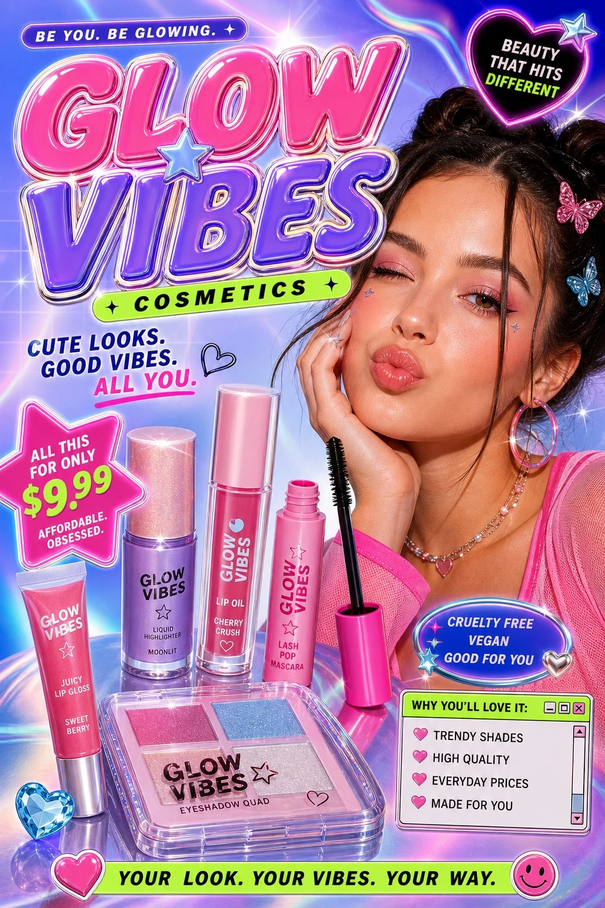

```text
Cute Y2K-style advertising image for an affordable cosmetics product line, designed to appeal to Gen Z. Use a vibrant color scheme, including neon accents, playful typography, and glossy, futuristic textures reminiscent of early-2000s pop aesthetics. Aspect ratio 3:4.
```

Model: GPT Image 2 · Author: @midori_tatsuta · adapted and regenerated by ClawLabs AI

[Original source](https://github.com/ClawLabsAI/awesome-verified-text-to-image-prompts/blob/c25274d3c30dca596c21d885ff9dc0c5106ab5c6/prompts.json#L9016) · [Provenance and original license](data/projectd-batch-0014.json)

## Appetizing Menu Dish Illustration — ClawLabs AI · MIT

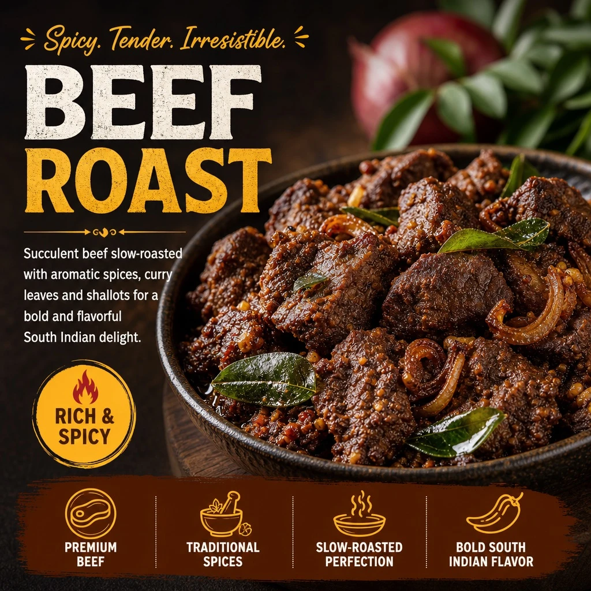

```text
This is an authentic menu item from [CUISINE] cuisine. Based on this, regenerate an engaging, mouth-watering illustrated image with descriptive text captions. Use English text that is clear and easy to read on small mobile screens. This dish is [DISH_NAME].
```

Model: GPT Image 2 · Author: @Johnson998877 · adapted and regenerated by ClawLabs AI

[Original source](https://github.com/ClawLabsAI/awesome-verified-text-to-image-prompts/blob/c25274d3c30dca596c21d885ff9dc0c5106ab5c6/prompts.json#L11711) · [Provenance and original license](data/projectd-batch-0014.json)

## Disco Mirror 3D App Icon — ClawLabs AI · MIT

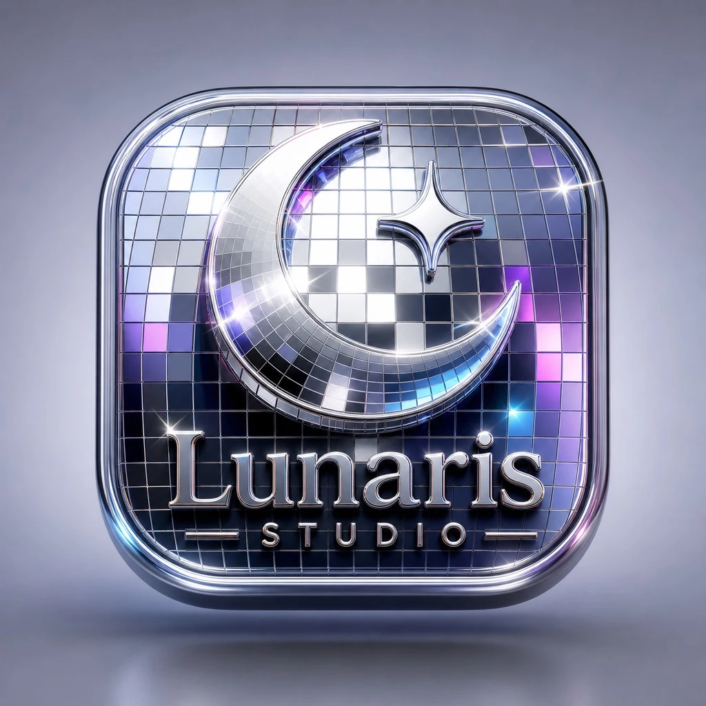

```text
A premium 3D app icon for [BRAND], rounded square tile shape, glossy glass and chrome material, disco-ball mosaic mirror tile texture, sparkling specular highlights, soft studio lighting, clean minimal background, high-end product icon style, Blender 3D render, ultra detailed.
```

Model: GPT Image 2 · Author: @vista8 · adapted and regenerated by ClawLabs AI

[Original source](https://github.com/ClawLabsAI/awesome-verified-text-to-image-prompts/blob/c25274d3c30dca596c21d885ff9dc0c5106ab5c6/prompts.json#L14370) · [Provenance and original license](data/projectd-batch-0014.json)

## Floral Facial Serum Studio Shot — ClawLabs AI · MIT

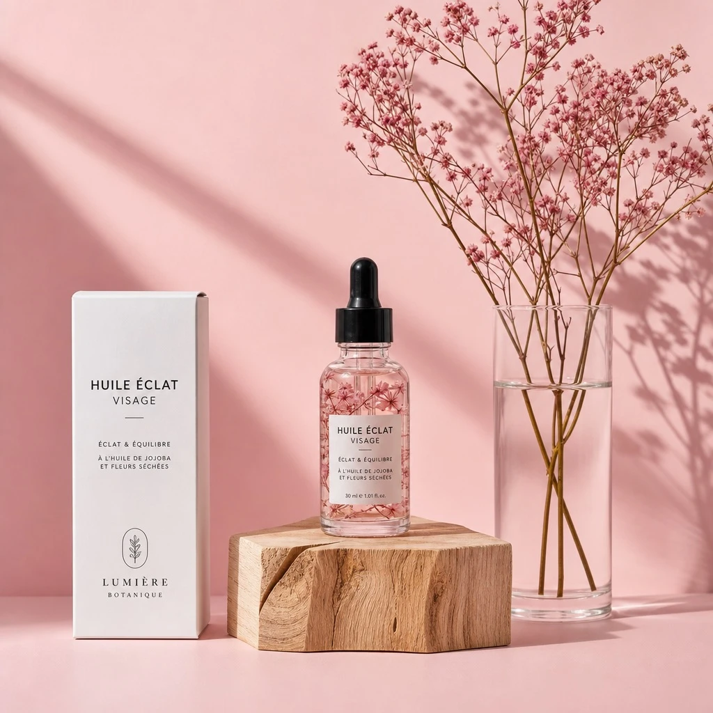

```text
Minimalist studio product photography featuring a small transparent glass facial oil dropper bottle with a black rubber pipette cap, containing pale pink serum with suspended dried pink floral elements, centered on a natural raw wooden block with visible grain and split texture. A tall matte white skincare box sits on the left, labeled "[LABEL_TEXT]" with clean black typography and a subtle logo near the bottom. A clear cylindrical glass vase on the right is filled with water and thin stems of dried pink gypsophila extending upward. The composition rests on a smooth matte pastel pink surface against a matching seamless pink studio background. Strong directional soft light from the left casts long natural-style shadows of the flowers onto the background, with gentle highlights on the glass, subtle reflections on the serum bottle, and soft texture on the wooden block. Straight-on tabletop camera angle, all objects in sharp focus. Color palette: blush pink, soft rose, warm light wood, clean white, transparent glass. Premium Scandinavian minimalist skincare aesthetic, ultra-realistic, studio-grade.
```

Model: GPT Image 2 · Author: ClawLabs AI · adapted prompt and regenerated preview

[Original source](https://github.com/ClawLabsAI/awesome-verified-text-to-image-prompts/blob/c25274d3c30dca596c21d885ff9dc0c5106ab5c6/prompts.json#L18225) · [Provenance and original license](data/projectd-batch-0014.json)

## Luxury Chocolate Campaign Poster — ClawLabs AI · MIT

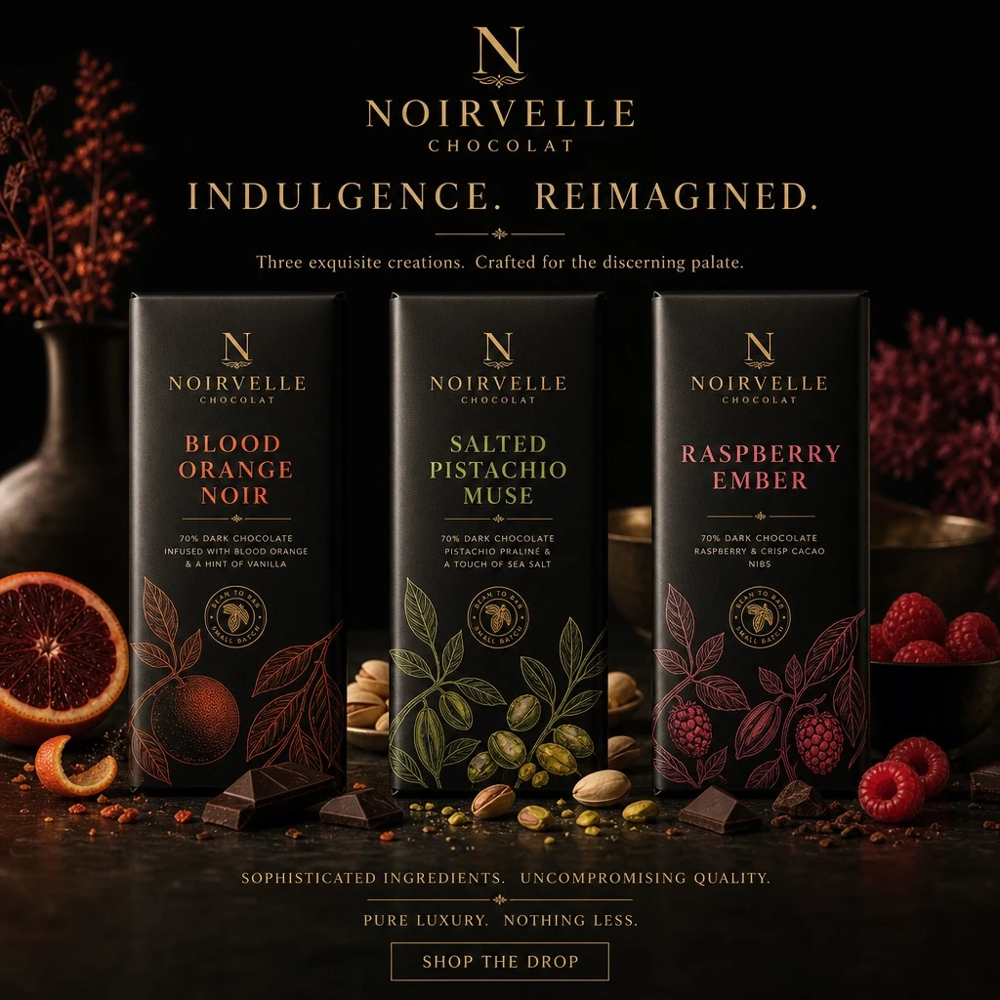

```text
Create a premium, square (1:1) product advertisement for a fictional luxury chocolate brand called [BRAND], inspired by high-end chocolate brands. The ad should feel like a high-end editorial campaign, combining luxury food photography, refined packaging design, and cinematic lighting. Use a matte black wrapper, subtle gold foil, elegant serif typography, and realistic product rendering. Generate flavor variants such as [FLAVOR_1], [FLAVOR_2], and [FLAVOR_3] with distinct mood, color palette, ingredients, headline, and supporting copy. Keep the chocolate bar as the hero centerpiece with subtle reflections, shallow depth of field, luxury minimalism, and a small CTA reading: "[CTA_TEXT]".
```

Model: GPT Image 2 · Author: ClawLabs AI · adapted prompt and regenerated preview

[Original source](https://github.com/ClawLabsAI/awesome-verified-text-to-image-prompts/blob/c25274d3c30dca596c21d885ff9dc0c5106ab5c6/prompts.json#L18295) · [Provenance and original license](data/projectd-batch-0014.json)

## Berry Bowl Brand Campaign — ClawLabs AI · MIT

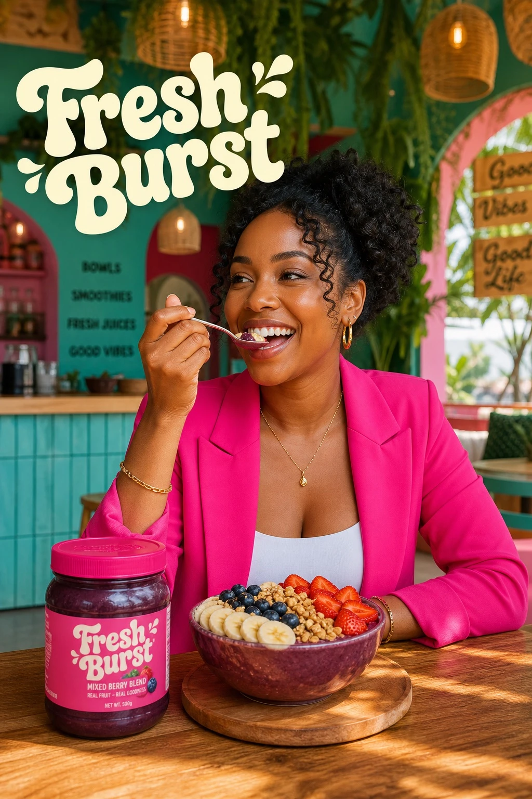

```text
Prompt 1: Create a vibrant lifestyle food advertisement set inside a colorful, trendy cafe. Show a smiling woman in a bright hot-pink blazer seated at a wooden table, lifting a spoon as she eats an acai berry bowl topped with strawberries, blueberries, banana slices, and granola. Keep a clearly branded "[BRAND]" jar on the table. Add playful retro cream bubble-letter typography that reads "[BRAND]". Use a tropical cafe interior with hanging plants, warm natural sunlight, a cheerful mood, a bold pink-and-teal palette, shallow depth of field, cinematic food-photography realism, high detail, and a polished commercial campaign finish. Format: vertical 9:16. Quality: ultra realistic, 4k.

Prompt 2: Create a dynamic food product advertisement for the "[BRAND]" mixed berry blend. Feature an acai smoothie bowl overflowing with strawberries, raspberries, blueberries, blackberries, banana slices, and granola. Surround it with dramatic berry juice splashes and floating fruit frozen midair. Place a branded jar next to the bowl. Use a vivid hot-pink background and large retro cream typography that says "NEW DROP [BRAND]". Keep the lighting glossy, the composition energetic, the colors vibrant, the textures ultra detailed, and the overall look like a polished studio-shot commercial poster with hyper-realistic food photography and splash-effect motion. Format: vertical 9:16. Quality: 4k.
```

Model: GPT Image 2 · Author: ClawLabs AI · adapted prompt and regenerated preview

[Original source](https://github.com/ClawLabsAI/awesome-verified-text-to-image-prompts/blob/c25274d3c30dca596c21d885ff9dc0c5106ab5c6/prompts.json#L18405) · [Provenance and original license](data/projectd-batch-0014.json)

## Grape Reveal Can Product Shot — ClawLabs AI · MIT

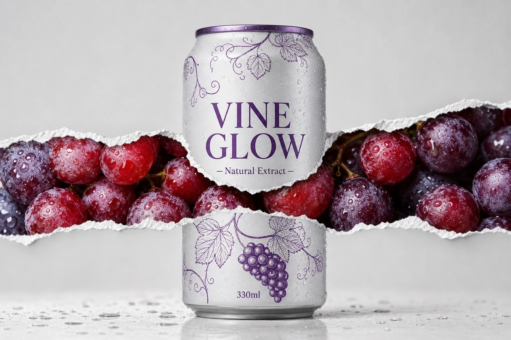

```text
Product shot of a 330ml aluminum can labeled "[PRODUCT_NAME]" placed center-frame against a clean light grey studio background. The can is adorned with refined purple vine line illustrations. A dramatic horizontal torn paper reveal slices across the can and background, exposing glistening red and purple grapes inside, covered in water droplets with a glossy wet texture. Soft studio lighting, ultra-sharp focus, photorealistic commercial packaging photography, symmetrical layout, 8K resolution.
```

Model: GPT Image 2 · Author: ClawLabs AI · adapted prompt and regenerated preview

[Original source](https://github.com/ClawLabsAI/awesome-verified-text-to-image-prompts/blob/c25274d3c30dca596c21d885ff9dc0c5106ab5c6/prompts.json#L18576) · [Provenance and original license](data/projectd-batch-0014.json)

## Luxury Perfume Bottle Ad — ClawLabs AI · MIT

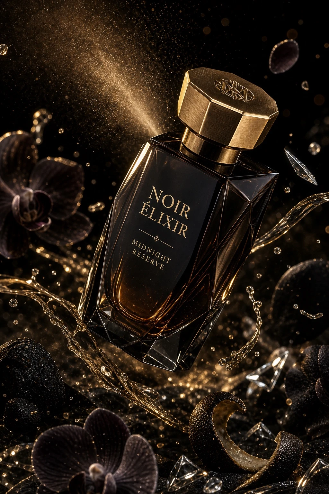

```text
Ultra-cinematic luxury fragrance advertising photography of a "[PRODUCT_NAME]" perfume bottle. Faceted geometric crystal bottle with sharp elegant edges, deep smoked black gradient glass, polished reflective surfaces with subtle matte facets. Magnetic brushed gold metal cap with engraved emblem. Minimal serif typography etched directly into the glass with gold inlay. Dark amber liquid with golden undertones.

The bottle floats mid-air at a dramatic diagonal hero angle with a slight forward tilt. Atomized perfume mist trails and fluid fragrance ribbons are suspended in motion. Background: deep black velvet gradient fading into shadow. Surrounding elements: atomized perfume droplets suspended mid-air, shattered crystal glass fragments catching highlights, dark orchid petals drifting slowly, glossy black citrus peel curls, fine gold dust particles sparkling in the light. Micro condensation beads and polished reflections enhance realism.

Lighting: dramatic low-key studio setup with soft directional key light sculpting the glass facets, strong rim lights outlining the silhouette and edges, gold-toned specular highlights on the cap and engraved details, deep cinematic shadows, high contrast with controlled reflections and luminous highlights.

Color palette: obsidian black, smoked charcoal, deep amber with metallic gold and warm champagne glow accents.

Shot on a macro cinema prime lens, shallow depth of field isolating the product from the background, smooth cinematic bokeh from reflective particles, extreme micro-detail clarity. 8K ultra-high-definition, hyper-realistic luxury commercial render, accurate glass refraction and internal reflections, physically accurate fluid dynamics, ultra-detailed crystal, metal, mist, and micro-droplet textures. Vertical 4:5 aspect ratio.
```

Model: GPT Image 2 · Author: ClawLabs AI · adapted prompt and regenerated preview

[Original source](https://github.com/ClawLabsAI/awesome-verified-text-to-image-prompts/blob/c25274d3c30dca596c21d885ff9dc0c5106ab5c6/prompts.json#L18601) · [Provenance and original license](data/projectd-batch-0014.json)

## Floating Smartphone Photo Ribbon Mockup — ClawLabs AI · MIT

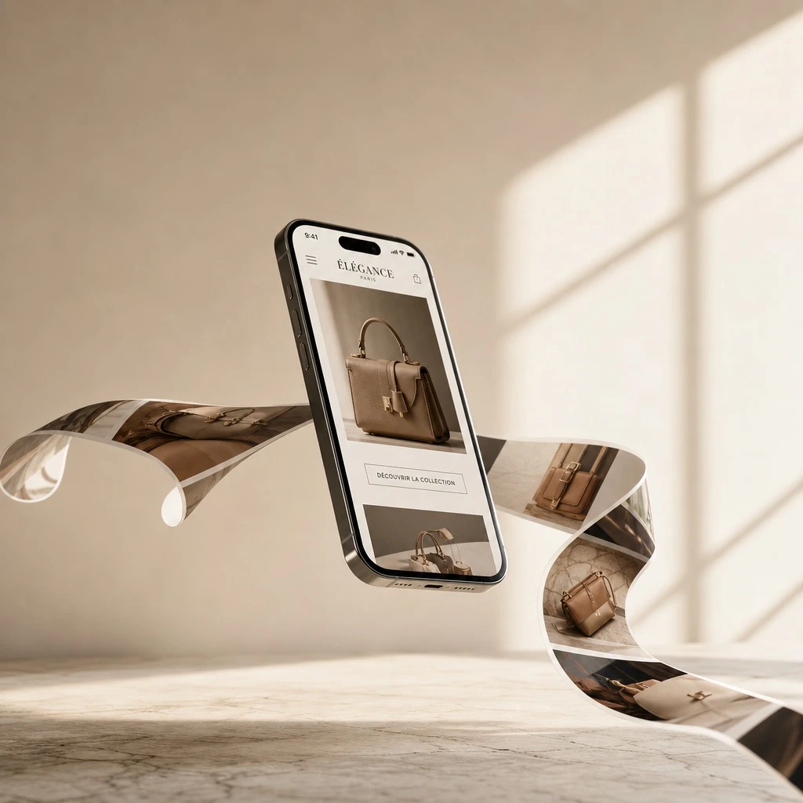

```text
A highly realistic, premium 3D product mockup for a [BUSINESS_TYPE]. A sleek, modern smartphone elegantly levitates at a dynamic angle in mid-air. Emerging seamlessly from the phone's screen is a continuous, wavy, physical ribbon of printed photos that flows elegantly and wraps around the device in a surreal, gravity-defying way. The photos on the flowing ribbon display stunning, high-quality images of [PRODUCT_IMAGES]. The background is a minimalist, warm beige and soft cream environment with a subtly textured stone floor. The lighting consists of soft, diffused natural sunlight casting an elegant diagonal window shadow on the back wall, adding depth. Cinematic lighting, shallow depth of field, ultra-photorealistic, 8k resolution, highly detailed, trendy minimal aesthetic, perfect for an engaging and viral social media post, featuring clean negative space at the top for typography.
```

Model: GPT Image 2 · Author: ClawLabs AI · adapted prompt and regenerated preview

[Original source](https://github.com/ClawLabsAI/awesome-verified-text-to-image-prompts/blob/c25274d3c30dca596c21d885ff9dc0c5106ab5c6/prompts.json#L19162) · [Provenance and original license](data/projectd-batch-0014.json)

## Gourmet Burger Gravity Poster — ClawLabs AI · MIT

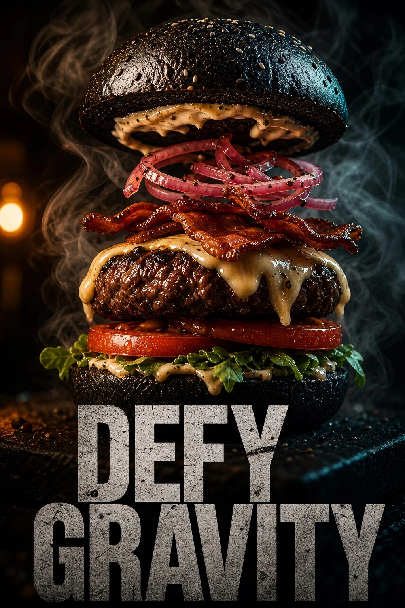

```text
A cinematic 9:16 vertical composition featuring a gourmet "[PRODUCT_NAME]" burger. WHAT: A towering burger with a charcoal brioche bun, a thick Wagyu beef patty with visible sear marks, melting aged gruyère cheese dripping like lava, and crispy maple-glazed bacon. FEEL: An atmosphere of "Urban Indulgence." Dark, moody lighting with a single warm amber spotlight. Wisps of real hickory smoke curl around the bun. The texture is hyper-realistic: you can see the salt crystals on the crust and the moisture on the heirloom tomato. SHOW: The burger is captured in a "deconstructed gravity" moment — the top bun is slightly hovering, revealing the internal layers of house-made aioli and pickled red onions. TYPOGRAPHY: Integration of an ultra-bold, distressed sans-serif typeface overlapping the bottom third of the frame. The text reads "[HEADLINE_TEXT]" in a raw, concrete-texture finish. TECHNICAL: 4K resolution, macro photography style, shallow depth of field, neon-noir color grading (deep blacks, warm ambers, and subtle teal highlights).
```

Model: GPT Image 2 · Author: ClawLabs AI · adapted prompt and regenerated preview

[Original source](https://github.com/ClawLabsAI/awesome-verified-text-to-image-prompts/blob/c25274d3c30dca596c21d885ff9dc0c5106ab5c6/prompts.json#L19585) · [Provenance and original license](data/projectd-batch-0014.json)

## Torn Can Fruit Explosion — ClawLabs AI · MIT

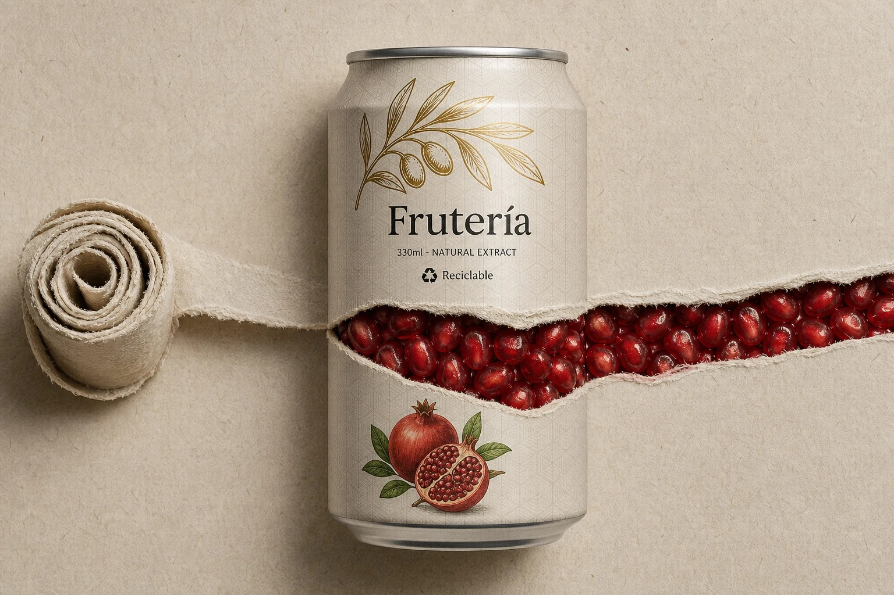

```text
A photorealistic, highly detailed commercial product shot of a standard aluminum [SODA_CAN_TYPE] can, perfectly centered on a minimal textured [BACKGROUND_COLOR] paper backdrop with subtle visible fibers. A single continuous horizontal torn paper strip crosses the full frame from the right edge to the left edge, with a barely noticeable upward diagonal slant toward the upper left. The tear passes through the can body and continues seamlessly across the background on both sides.

Make the torn opening wide and dramatic, exposing a dense, glossy, vibrant mass of [FRUIT_FILLING_DESCRIPTION] packed tightly inside the can. At the far left end of the tear, roll the paper neatly into a tight realistic coil that nearly fills the left margin.

Design new minimalist can branding: on the upper can, place a stylized abstract line-art illustration of [PLANT_ILLUSTRATION] in contrasting [INK_COLOR], layered over a subtle matte geometric [PATTERN_TYPE] pattern on the can surface. Below it, print the brand name "[BRAND]" in elegant modern dark typography, with smaller technical text reading "330ml - NATURAL EXTRACT" plus a small "Recyclable" logo. Add a small detailed fruit graphic below the torn path.

Use soft cinematic lighting with delicate drop shadows under the torn paper edges and the large left-side coil. Render in 8K with macro-level detail on fibrous paper, brushed aluminum, and glossy fruit texture.
```

Model: GPT Image 2 · Author: ClawLabs AI · adapted prompt and regenerated preview

[Original source](https://github.com/ClawLabsAI/awesome-verified-text-to-image-prompts/blob/c25274d3c30dca596c21d885ff9dc0c5106ab5c6/prompts.json#L20478) · [Provenance and original license](data/projectd-batch-0014.json)

## Miniature Landmark Diorama — ClawLabs AI · MIT

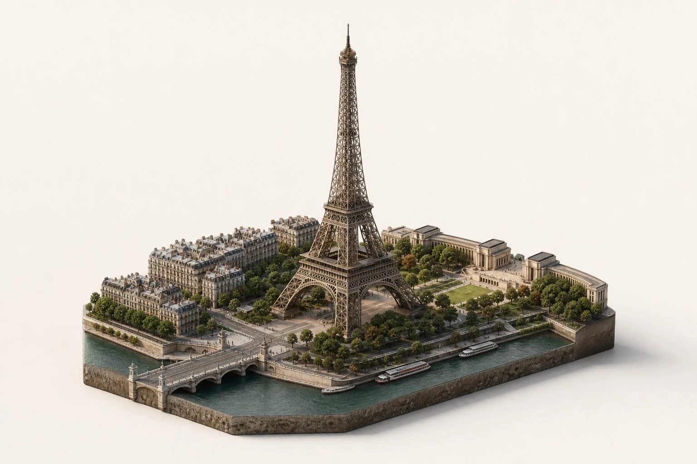

```text
Isometric miniature diorama of [LANDMARK], capturing its real-world structure and proportions on a small floating platform, surrounded by buildings and landscape details from [CITY], [COUNTRY]. Physically accurate materials including stone, concrete, metal, and glass. True-to-life color palette, muted and realistic tones matching the actual landmark. Off-white studio background with soft natural lighting, gentle shadows, and clean composition. High-detail 3D render, premium architectural model aesthetic, no people, no text.
```

Model: GPT Image 2 · Author: ClawLabs AI · adapted prompt and regenerated preview

[Original source](https://github.com/ClawLabsAI/awesome-verified-text-to-image-prompts/blob/c25274d3c30dca596c21d885ff9dc0c5106ab5c6/prompts.json#L20688) · [Provenance and original license](data/projectd-batch-0014.json)

## Furniture Product Sheet Layout — ClawLabs AI · MIT

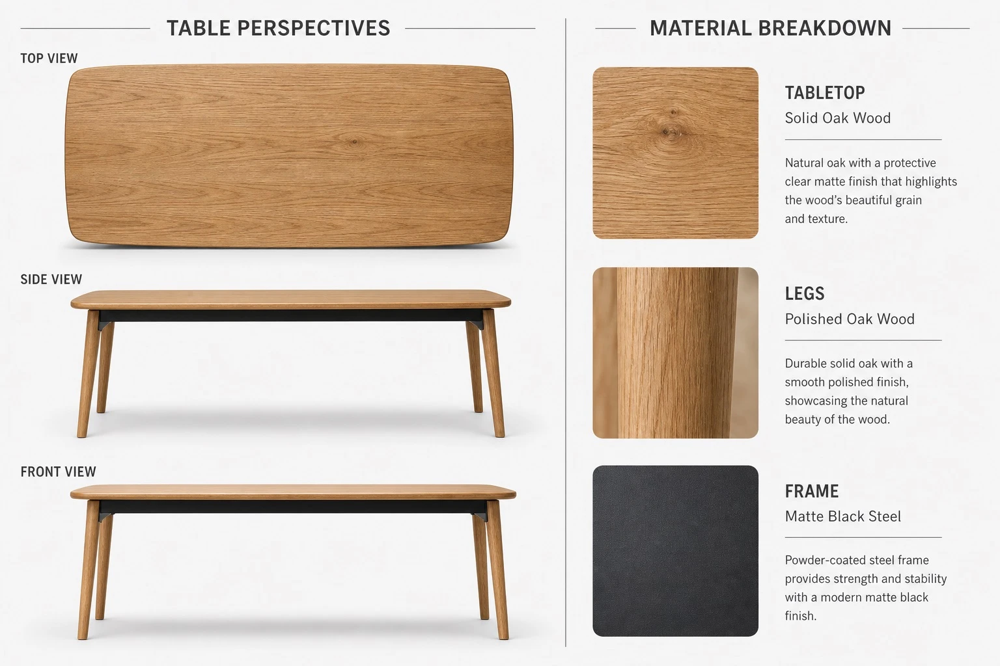

```text
Create a high-quality, realistic 3D product showcase for a table using a split-view layout with a 3:2 or 4:3 aspect ratio, set against a neutral light gray or white background.

Left side — Table Perspectives:
- Top-down view: full tabletop shape, surface texture, and edge details
- Side view: leg design, table height, and tabletop thickness
- Front view: width, symmetry, and leg alignment
Use consistent lighting with subtle shadows for realism.

Right side — Material Breakdown:
- Tabletop: [WOOD_TYPE], with a close-up wood texture swatch and a clean sans-serif label
- Legs: [LEG_MATERIAL], with a material texture swatch and consistent labeling
- Frame: [FRAME_COLOR] steel, with a small metallic texture swatch and minimalist annotation

Separate the two sections with a vertical dividing line or a subtle split background. Use natural tones for the materials and grayscale for the backgrounds and lines. Use a modern, readable font for labels and section titles. Output as a high-resolution image suitable for a product sheet, interior design catalog, or furniture showcase.
```

Model: GPT Image 2 · Author: ClawLabs AI · adapted prompt and regenerated preview

[Original source](https://github.com/ClawLabsAI/awesome-verified-text-to-image-prompts/blob/c25274d3c30dca596c21d885ff9dc0c5106ab5c6/prompts.json#L20884) · [Provenance and original license](data/projectd-batch-0014.json)

## Embossed Metal Logo Bas-Relief — ClawLabs AI · MIT

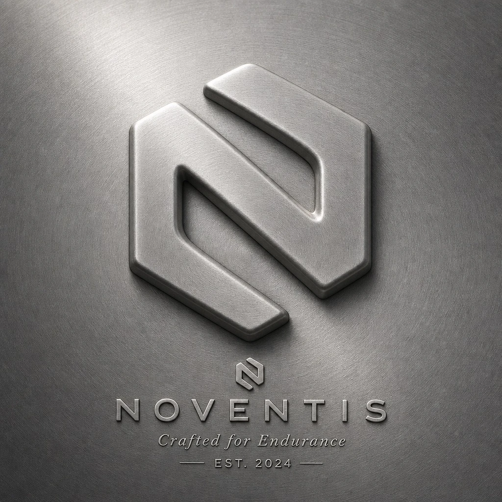

```text
Replace [BRAND] with your brand and [COLOR] with your preferred metal tone.

Act as a senior CGI artist. Create a premium bas-relief logo visualization where the brand mark appears embossed outward from a metallic surface, like a coin, hallmark stamp, or luxury seal. The logo rises as a unified raised form from the surface itself.

Surface: one continuous material plane filling the entire canvas. Use the metal tone from [COLOR]: silver/grey becomes brushed steel, gold becomes warm brushed metal, black becomes anodized aluminum, white becomes matte ceramic, saturated colors become anodized colored metal. Apply radial brushed grain and fine film grain for tactility.

Emboss: the brand's primary logo mark rises as a full bas-relief, like a coin die-stamp. The entire filled silhouette pushes outward as one solid mass at uniform height. The top face is slightly convex, catching key light. A smooth beveled edge transitions from the flat surface to the raised form. Interior negative spaces recess back to surface level. Substantial raised height, like a thick coin.

Lighting: primary soft area light from upper-left (10-11 o'clock), broad and diffused. Light temperature matches [COLOR]: cool white for silver/grey/blue, warm amber for gold/copper, neutral for white/black. Subtle fill light from lower-right at 10-15% intensity. No hard shadows.

Typography: below the embossed mark, a minimal lockup on the same surface. A small flat brand icon, the brand name in spaced geometric caps, and one light italic descriptor line (founding year, category, or tagline). Centered, vertically stacked.

Render: ray tracing enabled for self-shadowing. Full sharpness edge to edge. Uniform film grain. No chromatic aberration. The mark must read as pushed outward from the surface.
```

Model: GPT Image 2 · Author: ClawLabs AI · adapted prompt and regenerated preview

[Original source](https://github.com/ClawLabsAI/awesome-verified-text-to-image-prompts/blob/c25274d3c30dca596c21d885ff9dc0c5106ab5c6/prompts.json#L21379) · [Provenance and original license](data/projectd-batch-0014.json)

## Sculptural Fruit Packaging Design — ClawLabs AI · MIT

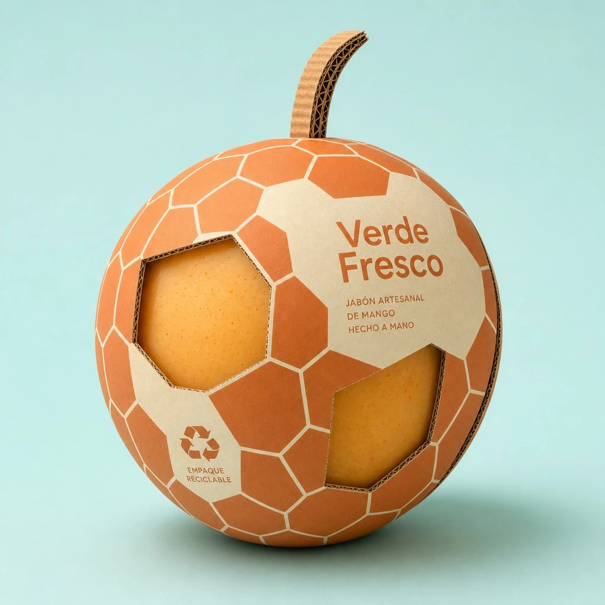

```text
Professional product photography of a sculptural packaging design created for [FRUIT_NAME]. The box is made of premium corrugated cardboard, shaped and cut into the exact silhouette of a giant [SHAPE] [FRUIT_NAME].

The outer surface is printed with a bold, minimal [PATTERN] pattern that echoes the natural skin texture, rendered in a duo-tone color scheme of [COLOR_1] and [COLOR_2].

Die-cut window panels expose the [PRODUCT_INSIDE] nestled inside. Clean modern sans-serif text on the side reads "[BRAND_NAME]". Eco-friendly details include a recycling icon and a sculpted corrugated [STEM_ELEMENT] on top.

Soft diffused studio lighting, gentle drop shadows, set against a solid pastel [BACKGROUND_COLOR] background. 8K, photorealistic, cinematic framing, industrial design aesthetic.
```

Model: GPT Image 2 · Author: ClawLabs AI · adapted prompt and regenerated preview

[Original source](https://github.com/ClawLabsAI/awesome-verified-text-to-image-prompts/blob/c25274d3c30dca596c21d885ff9dc0c5106ab5c6/prompts.json#L21414) · [Provenance and original license](data/projectd-batch-0014.json)

## Energy Drink Citrus Explosion — ClawLabs AI · MIT

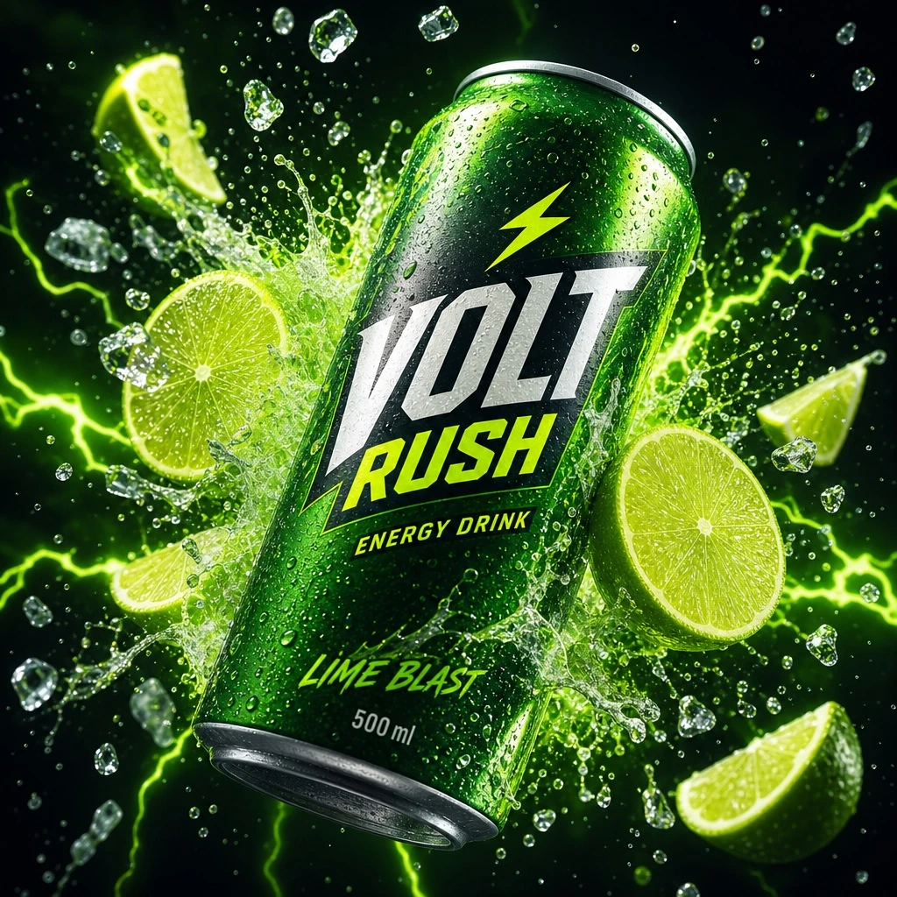

```text
Ultra-cinematic product photography of a neon-green energy drink can labeled "[BRAND_NAME]", tilted at a sharp diagonal angle, bursting through glowing citrus slices and electric sparks. Frozen lime juice splashes and ice shards are suspended mid-air, with micro droplets clearly visible. High-contrast studio lighting features green neon rim lights, a deep dark background, and a glossy aluminum surface, shallow depth of field, photorealistic, 8K resolution, premium advertising style.
```

Model: GPT Image 2 · Author: ClawLabs AI · adapted prompt and regenerated preview

[Original source](https://github.com/ClawLabsAI/awesome-verified-text-to-image-prompts/blob/c25274d3c30dca596c21d885ff9dc0c5106ab5c6/prompts.json#L21653) · [Provenance and original license](data/projectd-batch-0014.json)

## Logo-shaped cloud — ClawLabs AI · MIT

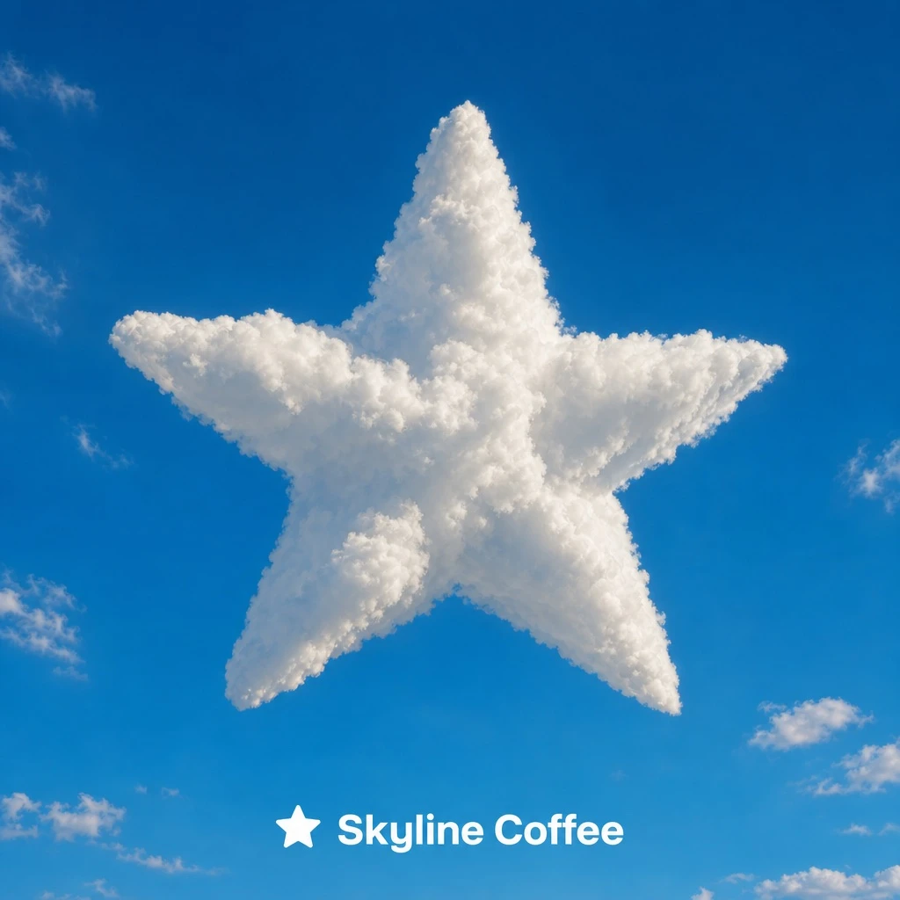

```text
Minimalist surreal photograph: a massive, photorealistic cumulus cloud shaped exactly like [ICON_SHAPE], puffy and voluminous, with natural sunlight illuminating its edges and soft realistic shadows within its folds to show depth. The cloud floats in a vast, clear, vibrant blue summer sky, with a few small wispy natural clouds scattered far in the background for scale. Lighting is bright, direct daylight from the side, creating high-contrast highlights and shadows. At the bottom center of the frame, the word "[BRAND_NAME]" appears in a clean, bold sans-serif font in [ACCENT_COLOR], next to a small flat icon in the same [ACCENT_COLOR] echoing the shape of [ICON_SHAPE]. Style: surrealist photography, ultra-minimalist composition, high resolution, 8k, cinematic look, clean and airy vibe.
```

Model: GPT Image 2 · Author: @AmirMushich · adapted and regenerated by ClawLabs AI

[Original source](https://github.com/ClawLabsAI/awesome-verified-text-to-image-prompts/blob/c25274d3c30dca596c21d885ff9dc0c5106ab5c6/prompts.json#L21811) · [Provenance and original license](data/projectd-batch-0014.json)

## Splash-motion product bottle photography — ClawLabs AI · MIT

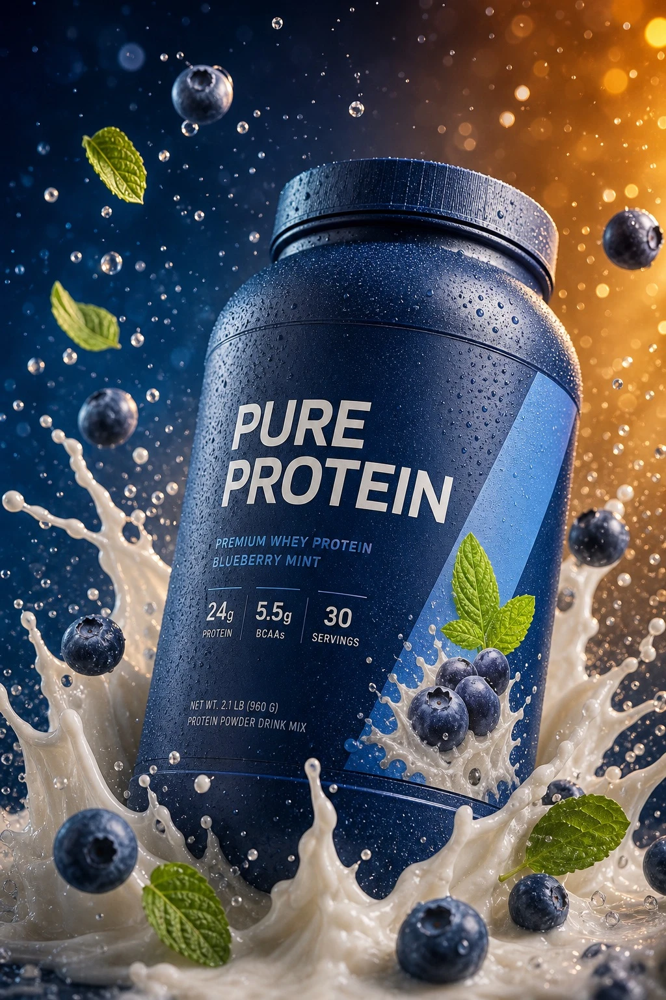

```text
Hyper-realistic 8K commercial product photography, 3:4 vertical aspect ratio, cinematic studio lighting with controlled highlights and soft shadows. A [CONTAINER_TYPE] in [CONTAINER_COLOR], covered in fine condensation droplets, shown in a [VIEW_ANGLE], leaning dynamically into a swirling splash of [LIQUID_COLOR] liquid rising around its base. Around the container, [FLOATING_ELEMENTS] float suspended at different depths alongside fine droplets frozen mid-air. The label reads '[LABEL_TEXT]' in clean sans-serif lettering. Background transitions smoothly from [BACKGROUND_COLOR_1] to [BACKGROUND_COLOR_2], with soft circular bokeh light particles scattered throughout. Extreme micro-detail sharpness, frozen high-speed motion, no noise, no artifacts.
```

Model: GPT Image 2 · Author: @mehvishs25 · adapted and regenerated by ClawLabs AI

[Original source](https://github.com/ClawLabsAI/awesome-verified-text-to-image-prompts/blob/c25274d3c30dca596c21d885ff9dc0c5106ab5c6/prompts.json#L22159) · [Provenance and original license](data/projectd-batch-0014.json)

## Levitating Product in the Void — ClawLabs AI · MIT

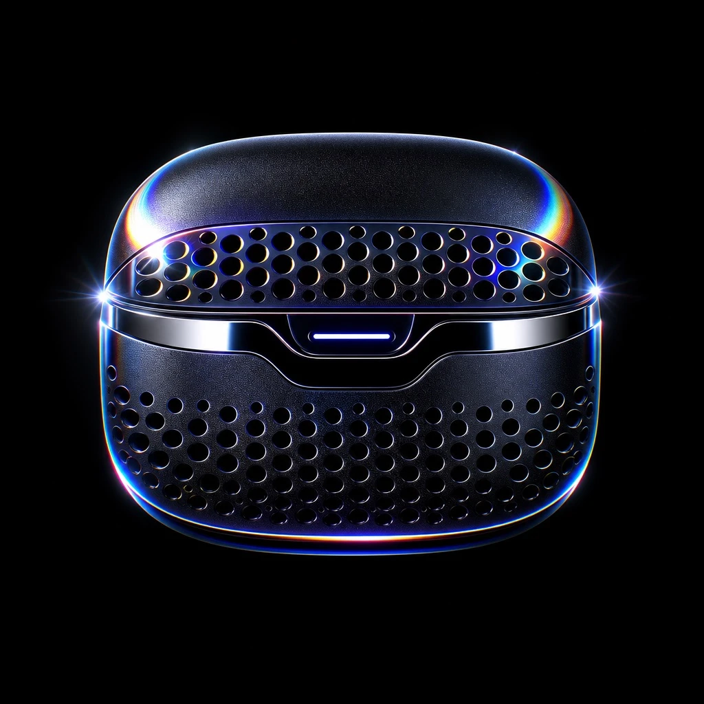

```text
Hyper-realistic 3D render of [PRODUCT_NAME] floating and levitating in the absolute center of a pure black void, fully visible with generous padding and no cropping. The product features an anodized obsidian metal finish with microscopic grit texture, blended with high-gloss fluid chrome accents and a precision-machined hemispherical lattice venting pattern inspired by premium computer hardware design. Add monatomic light dispersion, prismatic diffraction on the edges, and an ethereal holographic sheen. Lighting is hard rim lighting with chiaroscuro, high contrast, sharp specular highlights, and no ambient fill, using a palette of pure black, [ACCENT_COLOR], and spectral iridescent rainbow highlights from thin-film interference. Rendered in ultra-detailed 8k cinematic quality with ray-traced reflections and dramatic studio-grade lighting. Exclude any visible lighting equipment, stands, pedestals, platforms, text, watermarks, props, surface reflections, floor, shadows, logos, or cluttered background.
```

Model: GPT Image 2 · Author: @lloydcreates · adapted and regenerated by ClawLabs AI

[Original source](https://github.com/ClawLabsAI/awesome-verified-text-to-image-prompts/blob/c25274d3c30dca596c21d885ff9dc0c5106ab5c6/prompts.json#L24303) · [Provenance and original license](data/projectd-batch-0014.json)

## Golden hour product still life — ClawLabs AI · MIT


```text
A high-end editorial studio photograph of a [PRODUCT_FORM], made of [MATERIAL] with a [COLOR] [DETAIL]. The product is placed on a natural, textured [BASE_SURFACE] slab, itself resting on a round mirror laid on a [SURFACE_TONE] surface. Around the mirror and on the slab are scattered droplets of [LIQUID] with realistic reflections. A few sprigs of [DECORATIVE_ELEMENTS] lie gently across the slab and mirror, connecting both surfaces naturally. Strong, warm sunlight filters from the top left, casting soft diagonal leaf shadows to simulate filtered daylight. The aesthetic is [VISUAL_STYLE], with realistic materials and natural textures highlighted by golden hour tones. Style: 3D realism, luxury product photography, shallow depth of field. Format: 1:1, ultra-detailed.
```

Model: GPT Image 2 · Author: @Kerroudjm · adapted and regenerated by ClawLabs AI

[Original source](https://github.com/ClawLabsAI/awesome-verified-text-to-image-prompts/blob/c25274d3c30dca596c21d885ff9dc0c5106ab5c6/prompts.json#L25136) · [Provenance and original license](data/projectd-batch-0014.json)

## Juice box product mockup — ClawLabs AI · MIT

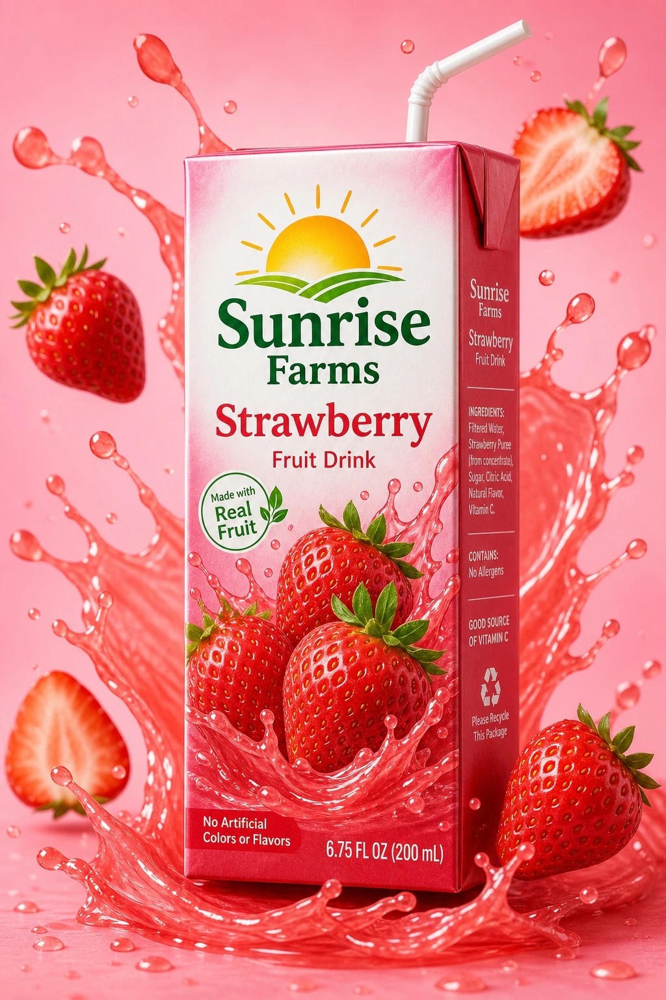

```text
Commercial product photograph of a juice box carton labeled '[BRAND_NAME]' in [FLAVOR] flavor. The front of the carton shows a realistic depiction of [FRUIT_DESCRIPTION]. The carton sits centered against a [BACKGROUND_COLOR] background, surrounded by dynamic swirling juice splashes and pieces of [FRUIT_DESCRIPTION] floating around it. High-quality commercial-grade photorealism, crisp packaging material texture, studio lighting, vertical 2:3 packaging mockup composition.
```

Model: GPT Image 2 · Author: @YaseenK7212 · adapted and regenerated by ClawLabs AI

[Original source](https://github.com/ClawLabsAI/awesome-verified-text-to-image-prompts/blob/c25274d3c30dca596c21d885ff9dc0c5106ab5c6/prompts.json#L25246) · [Provenance and original license](data/projectd-batch-0014.json)

## Frutiger Aero product render — ClawLabs AI · MIT

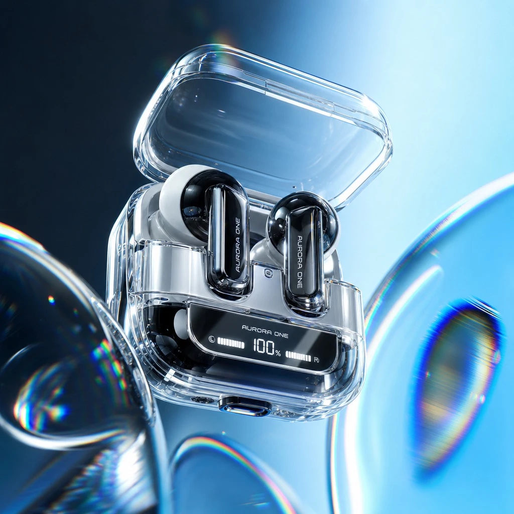

```text
Ultra-detailed hyper-realistic product photograph of [PRODUCT], floating in a gravity-defying, wide-angle composition against a smooth dual-tone studio gradient background transitioning from [COLOR_START] to [COLOR_END]. High-contrast studio lighting with bright rim highlights emphasizes glossy chrome, transparent acrylic, and high-gloss plastic textures. Dynamic glass refraction, prismatic chromatic aberration at the edges of transparent surfaces, iridescent lens flares, and distorted glass overlays float in the foreground. The aesthetic blends Y2K Frutiger Aero optimism with modern hyper-realism, rendered in 8k UHD with Octane-style macro photography focus and hyper-detailed mechanical parts.
```

Model: GPT Image 2 · Author: @lloydcreates · adapted and regenerated by ClawLabs AI

[Original source](https://github.com/ClawLabsAI/awesome-verified-text-to-image-prompts/blob/c25274d3c30dca596c21d885ff9dc0c5106ab5c6/prompts.json#L26385) · [Provenance and original license](data/projectd-batch-0014.json)

## Art Deco — Midnight at the Starlight Hotel (code-generated animation; creator style recipe)

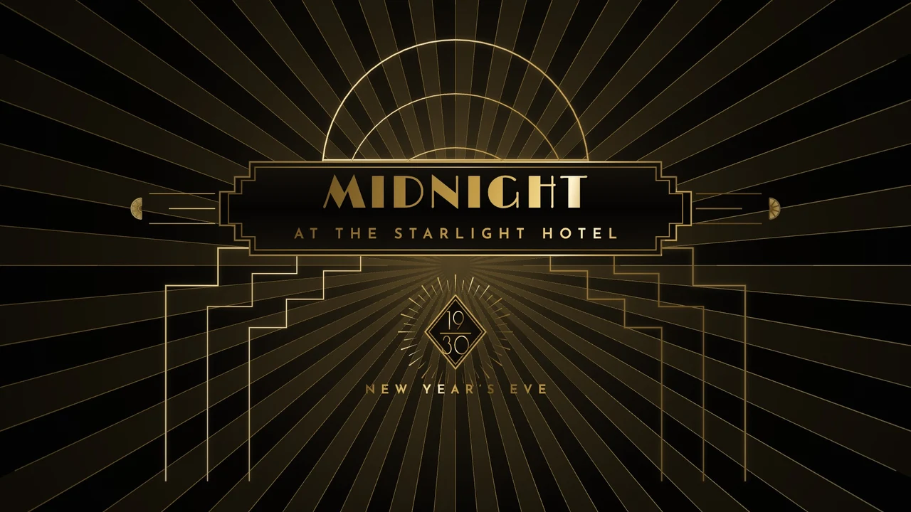

```text
# Art Deco — Style Prompt

> Black lacquer, engraved gold line and airbrushed geometry: a 1930s poster that moves. Every composition has a centre axis, transitions open or close along it, and light arrives as bulbs switching on one by one.
> References (grammar only): **A. M. Cassandre** posters (giant geometry, steep perspective, airbrush inside hard edges); **Chrysler Building / Rockefeller Center ornament** (setbacks, sunbursts, chevrons); **Busby Berkeley** overhead numbers overheads (human kaleidoscopes); **The Great Gatsby (2013) title sequence** (gold line drawing itself on black); **Gershwin-era symphonic jazz** (clarinet, piano, muted trumpet). Never copy a poster layout, a real building, a character, a typeface design or a melody.

## 1. Essence, and what it is not

A world built from **gold keylines on warm black**, filled with **airbrushed hard-edged volumes** (Cassandre, Lempicka), organised around **one vertical axis**. Ornament *is* the picture: sunbursts are backgrounds, stepped arches are frames, a dial is a progress bar, a bulb marquee is a reveal. Motion is **mechanical and symmetrical**: things unfold from the centre, doors split along the seam, lights switch on in counted order. Native register: glamour with a clock ticking (an event, a deadline, a launch).

Not a gold-foil slideshow (things move and have volume), not Art Nouveau (no whiplash curves, no flowers), not a flat vector poster (volumes are airbrushed and rimmed), not a 60s spy title (no silhouettes on flat colour).

## 2. Materials & rendering

- **Ground**: warm lacquer black, never neutral grey-black; a night sky may drift toward a deep emerald near the horizon.
- **Gold is a banded metal gradient** (dark – light – hot – light – dark); animate its `sheen` offset for a light sweep.
- **The signature stroke** (`gline`): a dark engraved underline ~1.6 px wider than the line, the gold gradient line, and a hairline highlight on top. Optional glow and a parallel twin (`double`). Nothing gets a black cartoon outline.
- **Volumes**: hard edge + airbrush (`airbrush`): a directional gradient from shade to light inside the shape, one consistent light direction (upper left by default), a thin gold rim on the lit side.
- **Motifs** (sunburst, stepped arch / ziggurat, fish-scale, chevrons, fan, four-point sparkle, speed lines, clock face, dial) are structural (a background, a frame, a transition), not stickers.
- **Perspective is real**: true one-point (mode-7 floors) and two-point perspective through a pinhole camera, so dolly, tilt and pan change perspective instead of scaling flats.
- **Characters are deco too**: about 7 heads tall, tapered streamline bodies, faceted lacquer planes (Lempicka), almond or arc eyes, a one-stroke nose, airbrush + gold rim. Give each lead one or two silhouette marks readable at a quarter of frame height.

## 3. Colour logic

- Three constants: **warm black ground, gold line and metal, ivory** for paper, gloves, light and type.
- **One saturated accent reserved for the protagonist** (or the one object the story follows). It is the only large saturated area, so the eye finds it in any wide shot. A cooler jewel tone may carry secondary surfaces, never competing in area.
- **The one-colour exception**: any single element can be drawn in its own colour through the same fill + keyline + glow (`color` option) while everything else stays gold.
- Always expand hex to six digits in code (three-digit hex breaks colour mixing).
- Examples of the triad (accent / jewel / metal): burgundy / emerald / gold; coral / sapphire / pale gold; jade / plum / rose gold. Our demo's actual values are in DEMO.md.

## 4. Type & subtitles

- **Type (OFL)**: Limelight (titles), Poiret One (numbers, sign skeletons, plaques), Josefin Sans (subtitles, labels), Italiana (numerals).
- **Titles are architecture**: a stepped gold title bar over an arch or sunburst, optional badge and wings; drawn on in gold, then a sheen sweep.
- **Subtitle card** (`subtitleCard`): a lacquer bar (~88 % black) with stepped ends like the title bar, double gold keyline, Josefin Sans SemiBold ~40–42 px ivory, an optional small speaker icon per voice. It **unfolds from the centre** like every other title, so titles, subtitles and transitions are one system. Hold ≥ max(1.8 s, speech + 0.6 s).
- Numbers carry plot without narration: dials, clock faces, floor medallions, badges.

## 5. Motion quality

- **Characters step on twos (12 fps)**; camera, light, bulbs, gold draw-on and sheen run on ones (24 fps). A stepped camera reads as stutter.
- **Everything unfolds from the centre**: a point → a hairline → bars open symmetrically → text rises → wings and sparkle.
- **Draw-on follows the music**: a gold line grows at the speed of the phrase under it and lands on the hit.
- **Bulbs have an ignition overshoot** (~1.6× flash settling in ~0.18 s) and a relay "chunk"; once a sign is lit, a fast chase may run across it.
- **Mechanical easing**: doors, dials and hands move with firm ease-in-out and a small settle, like machinery; nothing floats.
- **Performance beats get anticipation** and escalation in threes (once, twice, mash).
- What never moves: the centre axis of a composition. Symmetry may rotate or open, but it never drifts off-centre.

## 6. Camera grammar

A vocabulary, not a route. Opening and ending come from the topic.

| Move | What it expresses | Can serve |
|---|---|---|
| Symmetric split (two door leaves hinged at the edges; or a revolving-door wipe) | a threshold crossed | a new place; a new chapter; a reveal behind a façade |
| Leaves sliding shut over the live shot | a door closing on a moment | leaving; a decision made; the end of an era |
| Extreme low-angle Cassandre tilt | scale and aspiration | a goal far above; a tower, a rocket, a monument |
| Architectural section (pull out to a cutaway of the whole building) | progress through a structure | climbing, descending, a process in stages; a company's floors |
| Busby Berkeley overhead, mirrored and rotating | people become pattern | a team, a release, a celebration, a system of parts |
| Push-in on a dial, medallion or clock | the number is the plot | a deadline; a count; a milestone |
| Match-cut on shape (circle → circle, ray → ray) | two places, one rhyme | jumping between departments, cities, eras |
| Low oblique along a sign or marquee | light travelling letter by letter | a name revealed; a launch; a score being counted |
| Pull back from detail to skyline | where the moment sits in the world | aftermath; a city-wide effect; scale |

Framing: the centre axis is sacred; an asymmetric frame must resolve to it within the shot. At an emotional peak the protagonist fills ≥ ~1/3 of frame height (smaller, the face reads as a prop in the ornament). Transitions: splits, revolves, arch openings, shape matches; never a generic dissolve or slide.

## 7. Sound palette

- **Symphonic jazz of the 1920s–30s, not a 60s big band.** Options: stride or concert piano, clarinet (trill; a glissando by time-varying resampling of a long note), strings (tremolo, rushes, pizzicato), muted trumpet commentary, trombone and sax section, walking pizz bass, brushes or sticks, tubular bells, harp glissandi, banjo, xylophone runs, celesta.
- Rhythm families to choose from: foxtrot, Charleston, tango, a slow torch-song ballad, a fanfare in the manner of a newsreel.
- **Techniques (options)**: one hit per unit of counted light; accelerate by dividing the beat; plant a theme in fragments so its full statement is a payoff; low-pass a band that is physically far away and open it as we approach; move a period narrator through acoustic spaces (horn, radio, PA, live mic) to make distance audible.
- **Foley by material**: brass clicks, bronze clang + chain, iron treads, marble heels, silver trays, wooden doors + spring twang, paper flutter, knife-switch "chunk" + filament hum, relay ticks, elevator ding, champagne cork.
- **Silence as a tool**: before the most important sound, drop to one small diegetic sound (a clock tick, wind) and cut back in with that sound alone.
- **J/L-cuts** carry architecture: the next room's sound enters a bar before its door opens.
- Mix: duck music ~−9 dB under voice (less under a period announcer who is part of the texture), beds −6 dB, −14 LUFS, light film grain.

## 8. Native moves

A menu: use the ones your story needs.

- **Counted light.** A bulb sign lights one letter per beat or per event, so the audience can count. *Fits content like:* the countdown to a product launch; the letters of a city name lighting as a train arrives; votes tallied into a winner.
- **Threshold doors.** Every scene change is a door split along the seam. *Fits content like:* the departments of a company; the rooms of a museum; stages of a career.
- **Machine kaleidoscope.** People or objects become a mirrored, rotating pattern that locks into a symbol. *Fits content like:* a team becoming a logo; gears of a supply chain; a choir becoming a clock.
- **Dials carry the plot.** A floor indicator, a clock or a gauge moves instead of narration. *Fits content like:* a funding thermometer; the altitude of a climb; a stock ticker at the opening bell.
- **The architectural cutaway.** Pull out until a building is a section and the protagonist a coloured dot with speed lines. *Fits content like:* data moving through a server stack; a letter through a post office; a skier down a resort.
- **Sheen sweep / draw-on.** Light crosses a gold object on a hit; a gold line engraves itself at the speed of a glissando. *Fits content like:* unveiling a trophy; a map route; a signature on a treaty.
- **The one colour.** One element keeps its own colour in a gold world. *Fits content like:* the one product among competitors; the patient among doctors; the new idea in an old firm.

## 9. Pitfalls of the medium

- Bulb signs from glyph skeletons break on curves (G, S, R): Zhang–Suen staircase pixels fool a neighbour-count junction test → use the **crossing number** and weld chain ends within ~14 px.
- A generic cartoon character looks pasted in → characters are deco (§2).
- Fish-scale reads as brickwork → lower half-circles row by row, each overlapping the previous row, plus an inner arc.
- Door leaves over a flat "interior" read as a blank frame → draw only the leaves, closing over the live shot.
- A gold point on pure black trips `blackdetect` → lift the background wedges and glow slightly.
- Period loudspeaker distortion is unintelligible under music → gentle drive; whisper-check every line on the final mix.

## 10. Engine

Canvas2D, deterministic in `t`, in `demo/engine/`: `deco.js` (gold gradient, `gline`, `airbrush`, motifs, `drawShape` for any path in the deco manner, `color` for the one-colour exception), `type.js` (title bar, digits, badges, dial, clock, `subtitleCard`), `bulbs.js` (any text → bulb sign, `litSequence`), `cam.js` (pinhole camera, `cardTransform`). `demo/frames.js` renders model sheets and style frames from the real engine. Signatures and a minimal example that draws something not in the demo: DEMO.md "Engine reference".

## 11. Variation space

You decide the structure, the characters (or none), the settings, the opening, the ending, the camera path, the pacing, the accent colour and what gets counted. All far from our demo:

- Structures: **the exhibition** (five pavilions of a world's fair, one idea of the topic behind each door); **the ocean liner** (three decks from engine room to ballroom, a horn per stage); **the trophy night** (nominees as sunburst panels, the winner revealed in light).
- Openings: **the machine room** (gold gears and pistons building to the first beat); **the engraved map** (a gold route crosses a continent before anyone appears); **the telegram** (ticker tape types the premise).
- Endings: **the lights go out** (letters switch off in reverse until one bulb remains); **the dawn** (lacquer black warms to a pale sky); **the poster** (the last shot flattens into a printed poster with a date).

---

How our demo was made (story, shots, score, end card, build): [DEMO.md](DEMO.md). Read it after your treatment exists.

```

Model: Claude Opus 5.5 · Author: LemoLab

[Original source](https://github.com/lemomo-ai/lemo-opuscar/blob/b5e8ef93930b6d828f352055a689320f138237b1/styles/art-deco/STYLE.md) · [Provenance and original license](data/projectd-batch-0014.json)

## One-line Drawing — The Line That Never Lifted (code-generated animation; creator style recipe)

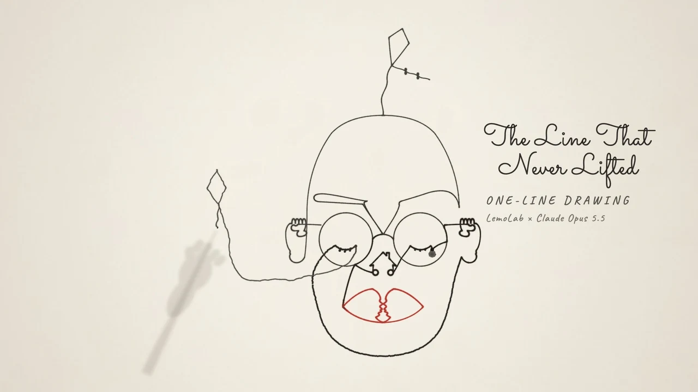

```text
# One-line Drawing — Style Prompt

> A single ink line that never leaves the paper. Everything on screen is that one line being drawn; scenes don't cut, they morph.
> References (grammar only): Osvaldo Cavandoli's *La Linea* (1971) — one line is both the world and the character, and transformations of the line are the jokes and the transitions; Gjon Mili's 1949 photographs of Picasso drawing with light — the confidence and speed of a single gesture; Norman McLaren's *Begone Dull Care* and *Boogie-Doodle* — lines drawn *to* the music. Do not copy La Linea's character, its gibberish voice, or any specific continuous-line illustration.

## 1. Essence, and what it is not

- **One continuous line** on warm white paper. The pen never lifts: in code the whole film can literally be one point array, from the first touch of the nib to the last frame.
- **Everything is a line**: characters, places, objects, even time. No fills, no shading, no second line weight, no background art.
- **We watch the line being drawn**: the camera follows the nib with a little lag and anticipation.
- Besides ink there is only the paper and a soft **shadow of the pen** (the real world above the paper). One accent colour at most, used once.

Not a whiteboard explainer (no hand, no marker, no erasing, no text-heavy boards), not ink wash (no tones, no brush bloom as a look), not a line-art animation with cuts and many strokes.

## 2. Materials & rendering

- **Paper**: warm white (around `#F4EFE4`), procedural mottling (soft-light, large tile), long fibres that fade out when zoomed out (or they shimmer), a sparse paper-tooth speckle over the ink at close zoom, light vignette. All textures anchored to the paper; they move with the camera.
- **Ink** is a filled polygon around the path (not `ctx.stroke`), mixed with paper colour to an opaque tone per point.
  - Width = base width of the current "voice" of the line × pen pressure × fine noise (±8 %); pressure from speed: `0.66 + 0.8·exp(−v/300)` (fast = thin, slow = fat).
  - The line's character can change along the path (base width, alpha, tremble, dryness); blend over a short stretch at boundaries.
  - Ink bleed: the same polygon slightly wider, blurred on an offscreen layer, composited at ~20 %.
  - Pooling: extra round dots where speed drops low.
  - Tremble (perpendicular noise) and dry-brush gaps (long-scale noise + thin bristle strands) for age, fear or fatigue.
  - A stop leaves a teardrop-shaped blot: tip at the nib, belly sagging downward as it spreads, a dark tide line at the rim.
  - **A screen-space minimum width**: widths scale with zoom like a line under a macro lens, but clamp the zoom used for width during pull-backs so a wide view keeps its weight.
- **The pen is never drawn**: a soft blurred wedge of shadow from the nib and a tiny contact dot. Hands, if any, appear only as shadows, each hand composited as one flat layer.
- **Path design**: chapters written as SVG path strings, sampled by arc length, joined by tangent-continuous connectors; time assigned per point weighted by curvature.

## 3. Colour logic

- **Ink on paper.** A warm black (around `#1D1A17`) on warm white; nothing else fills the frame.
- **One accent at most, used once**, on a stretch of the line that means something; it returns to ink afterwards and stays visible in the final picture if the picture is revealed.
- Examples of an accent's job: red for love or danger; blue for water or cold; gold for money or a prize. Never a second accent.

## 4. Type & subtitles

- **Text is written, like the line**: a handwriting face (e.g. Caveat) for subtitles, ink at ~84 %, no box, centred near the bottom, **written on** left to right (~0.2 s + ~17 ms per character) behind a soft paper-coloured halo so passing lines never cross the letters; fade out ~0.45 s. Hold ≥ max(1.8 s, speech + 0.6 s).
- Titles in a monoline connected script (e.g. Sacramento: itself a one-line drawing), written on in empty paper away from the drawing, gone before the camera moves into them.

## 5. Motion quality

- **Everything on ones** (24 fps): the appeal is the continuous act of drawing; stepping breaks it.
- **Timing = chapter windows + curvature**: within a window, time per point is weighted by `1 + K·turn` (sharp turns get more time, smoothed so speed never jumps). Pin musical beats with marks: by arc-length fraction or by position ("the second time the pen passes here"). A stop is two marks at the same place.
- Corners (speed minima at high turn) can be exported to the soundtrack as candidate note onsets.
- Speeds: ~300–700 units/s for travelling lines, ~50–150 for small details. The most important stroke is usually the slowest.
- **Retracing** over an existing line is legal and invisible (it only thickens slightly).

## 6. Camera grammar

A vocabulary, not a route. The camera is one continuous move: composition centre, zoom, a few degrees of roll, and a follow weight (0 = composed, 1 = locked to the nib); the follow point averages the nib over roughly −0.55…+0.4 s (lag and anticipation), with a soft clamp keeping the nib inside the central ~70 % of the frame. Opening and ending come from the topic.

| Move | What it expresses | Can serve |
|---|---|---|
| Follow the nib (high follow weight) | travel; momentum; a thread of time | a journey; a process; a timeline |
| Composed frame, low follow weight | a scene that must read as a whole | a vignette; a joke; a diagram |
| Macro on the nib | intimacy; the act of making | a first touch; a signature; a detail |
| Hold with a slow push-in | weight; a stop | a loss; a doubt; a decision |
| Mirrored framing | rhyme across time | parent and child; before/after |
| Continuous pull-back | everything was one picture | a reveal; a map; a word |
| Lateral scroll with the line running ahead | a horizon; a graph; a race | a stock chart; a heartbeat; a road |
| Roll with the line | vertigo; play | a loop-the-loop; a fall; a dance |

No cuts. Transitions are morphs: the last stroke of one image is the first stroke of the next.

## 7. Sound palette

- **Music: one solo instrument, one unbroken melodic line**, the sound equivalent of the drawing: a bowed or plucked string (cello, violin, viola, harp), a solo woodwind (clarinet, flute, bassoon), a hummed voice, a single guitar. A second colour only as a rare accent (a chime, a pizzicato stretch). No pads.
- **Write the score to the drawing**: key notes on marks and corners; fast line = short notes; a stopped line = one long note fading into silence; the highest note on the most important touch.
- **The pen on paper is the most important sound**, synthesised from the pen speed: band-passed noise (brighter when fast, duller when slow), random paper-fibre ticks with density ∝ speed, amplitude ∝ √speed, panned with the nib's screen position; broken up by dry gaps; lighter and jerkier for a young hand. Plus: a wooden tap on the first touch, a faint wet swell for a blot, a tiny rub for a handoff, a page lift.
- **Silence is literal**: zero the music bus including reverb tails; drop room tone.
- **Mix**: music ducks ~5 dB and the pen ~4 dB under voice; −14 LUFS; grain 0 (the paper is in the render).
- **Voice**: warm, few short lines that leave space for the line; place key words on picture beats with whisper word timestamps.

## 8. Native moves

A menu: use the ones your story needs.

- **The pen never lifts.** Anything that is one continuous thing. *Fits content like:* a river from source to sea; a relay race; a production line.
- **The line is time.** The stroke's character changes with age, mood or strain. *Fits content like:* a building aging; a runner tiring; a machine wearing out.
- **Transformation.** One image morphs into the next. *Fits content like:* a seed becoming a tree becoming a table; a sketch becoming a product; a word becoming its object.
- **Stopping is an event.** The nib stops, ink pools, music cuts to silence (1.5–3 s). *Fits content like:* a power cut; a pause for a minute's silence; a hesitation before a signature.
- **Reverse-designed scale reveal.** Every vignette is secretly part of one big picture seen at the end. *Fits content like:* a city's landmarks forming its skyline; a company's milestones forming its logo; a recipe's steps forming the dish.
- **Handoff.** The pen passes to another hand (as a shadow) and a new line begins. *Fits content like:* a teacher and a student; a founder and a successor; one generation to the next.
- **Line as graph.** The line becomes a chart while staying a drawing. *Fits content like:* a heartbeat; a temperature record; a football match's momentum.

## 9. Pitfalls of the medium

- **Stray connectors ruin a reveal**: every extra line reads as a wrinkle, beard or mask. Fix the topology (where each chapter enters and leaves), not the drawing. Plan it like an Euler path: a closed motif is a circuit (you leave where you came in); retrace or reorder chapters.
- Each region of a final picture is drawn exactly once; connectors must fall on natural lines of that picture.
- **Test the reveal early and often**: render the whole path at once at final scale after every change.
- Lines drawn too close braid together once width is applied; keep a gap.
- A round blot reads as a mole → a sagging teardrop.
- Thin lines at wide zoom → clamp the width zoom.
- Translucent hand shadows double-darken where they overlap → one layer per hand.
- Titles collide with the drawing as the camera moves → check every frame of the title's window.
- Whisper mishears short lines → rephrase rather than fight it.

## 10. Engine

In `demo/`: `geom.js` (samples SVG paths by arc length in the browser, adds tangent-continuous connectors, assigns time by curvature, marks and holds), `ink.js` (the line renderer: pressure, bleed, pooling, tremble, dry brush, accent stretch, blot, minimum screen width), `paper.js` (paper, fibres, tooth, vignette), `cam.js` (composition keys + nib follow + soft clamp), `hands.js` (pen and hand shadows), `subs.js` (written-on subtitles and titles). The drawing itself lives in one file of SVG path strings and a chapter table (`face.js`); replace it with your own path. Debug views (`?all=1`, `?cams=`) render the whole path or many camera views in one session: see [DEMO.md](DEMO.md) "Build notes".

## 11. Variation space

You decide what the line draws, whether it reveals one final picture, where it stops, the accent (or none), the opening and the ending. All far from our demo:

- Structures: **a line that is a graph** (a data series drawn as a horizon; each peak and trough becomes a scene); **two lines** that start in opposite corners and are drawn in alternation until they meet; **a loop** (the line draws a scene and then retraces its way back to the start, which now means something else).
- Openings: **mid-line at speed**, the pen already running across the paper; **a finished drawing** whose line then unravels into the story; **a word written in script** whose last letter becomes the first scene.
- Endings: **the line runs off the edge** of the paper and keeps going; **the ink runs out** and the last stroke fades into dry scratches; **the pen stops in mid-air** over the paper before the last stroke.

---

How our demo was made (story, shots, score, end card, build): [DEMO.md](DEMO.md). Read it after your treatment exists.

```

Model: Claude Opus 5.5 · Author: LemoLab

[Original source](https://github.com/lemomo-ai/lemo-opuscar/blob/b5e8ef93930b6d828f352055a689320f138237b1/styles/one-line/STYLE.md) · [Provenance and original license](data/projectd-batch-0014.json)

## Whiteboard Explainer — Einstein in Your Pocket (code-generated animation; simplified diagram)

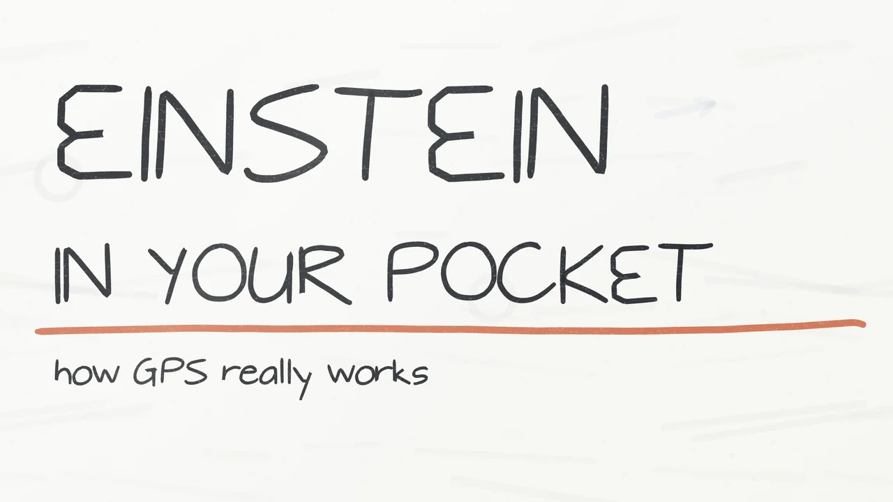

```text
# Whiteboard Explainer — Style Prompt (v2, no hands)

> An explainer drawn live on one glossy dry-erase board: single-line handwriting that is actually *written* stroke by stroke, floating markers with no hand, magnets that can move, an eraser that can rewind, and a camera that travels across the board instead of cutting.
> References (grammar only): RSA Animate / Cognitive Media (one continuous board, the camera travels instead of cutting, a full-board view); minutephysics (one sentence = one drawing, the simplest geometry that carries the idea); Steve Reich's *Piano Phase* (two copies of one figure at two tempi as a structure). Never copy their drawings, characters, hands or music.

Suits explainers of 60–120 s, usually science or "how does X work".

## 1. Essence, and what it is not

- **One physical whiteboard.** Everything the viewer learns is drawn in dry-erase marker in front of them, in real handwriting order.
- **The board is a map**: each idea lives in its own region; the camera travels between regions, often led by the pen. Distance on the board = distance in the argument.
- **Real marker, not animated text**: ink pools where the nib lands, dry streaks and speckle, strokes overshoot and don't quite close, ghosts of old lessons remain, a glossy sheen drifts slower than the board, and **every stroke makes a sound**.
- **No hands.** Markers float with a real cast shadow that grows when they lift, park outside the frame between phrases and fly back in. Magnets and the eraser move on their own. Never draw a hand, an arm or a cursor.

Not Blueprint (no blue sheet, no drafting conventions), not Crayon Picture Book (no wax texture, no children's story), not a kinetic-type explainer (text is handwritten stroke by stroke, never animated as blocks).

## 2. Materials & rendering

- **Board**: a warm white gradient, a faint scuff and micro-scratch tile, a few dozen **ghost marks** (old words, circles, arrows) at 5–10 % in grey or pale blue, and a soft diagonal **window sheen** (white, 10–16 %) moving at ~0.35× the camera: this one detail sells "glossy".
- **Ink**: alpha ~0.94, composited with **multiply** so overlaps darken like real marker. Width 6–11 px for drawing, ~13 % of cap height for lettering.
- **Stroke character**: resampled every ~0.6 × width; low-frequency hand wobble along the normal (a few px, long wavelength) plus a finer tremor; chisel-tip width modulated by direction; a pressure ramp at the start and a small taper at the end; circles start at an angle and **overlap past closure**; rectangles are four strokes with small corner overshoot; a darker pooled dot *inside* the start of long strokes.
- **Dry-marker texture**: a speckle-and-streak tile subtracted from the ink layer (destination-out), locked to board space, faded out when the camera is wide.
- **Lettering**: a single-line (single-stroke) font written in stroke order, each glyph with small rotation, baseline and scale jitter. Missing symbols (μ ≈ → × − ✓ ² ° ±) are hand-defined.
- **Props**: dry-erase markers (white barrel, colour band and cap in the ink colour, felt nib), a felt eraser, magnets (glossy, with specular highlight and soft cast shadow). Frame, tray and wall appear only if the camera ever goes past the board edge.

## 3. Colour logic

- **Three marker colours at most**, each with a meaning held for the whole film: one dark ink for things and structure, one for signals / measurement / process, one accent for the thing that matters (one accent per region).
- **Monochrome variant**: everything in the dark ink, one element in the accent (the "only colour").
- Ghost marks and board stay neutral; the accent never appears on props except its own marker cap and the hero magnet.
- Example sets: black `#23262c` / blue `#2a5cb3` / orange `#d97757`; black / green `#2e8b57` / red `#c8363a`; navy `#1f2a44` / teal `#1f8a8a` / purple `#7a4fb3`.

## 4. Type & subtitles

- **Handwriting only**: a single-line hand (e.g. EMS Tech, OFL) for all board text; titles large (~120–200 px cap height), labels 30–70 px.
- **Title and end card are written on the board** in the same hand.
- **Burned subtitles**: an off-white rounded label (~90 %), a handwriting-like face (e.g. Architects Daughter ~44 px), dark text, a short accent-colour marker dash. Split at clauses, ≤ 44 characters per line, bottom ~12 % of the frame kept free for them in every shot. Hold ≥ max(1.8 s, speech + 0.6 s).
- **Writing finishes on the word**: a term appears exactly when the narrator says it.
- A label is fully in or fully out of every shot it appears in.

## 5. Motion quality

- **Hand speed**: every stroke follows a slow-fast-slow curve (`u − sin(2πu)/2π × 0.8`). Strokes are scheduled into a **time window** and the engine solves the speed, so writing always finishes on time.
- **Pen hops** between strokes lift in proportion to distance (shadow slides and blurs); long gaps send the pen off-frame to park and back shortly before its next stroke.
- **Magnet**: drop with a shrinking shadow; slide with a small lift; lift-off and sink possible.
- **Eraser**: constant speed along a path, a wide band at ~90 % strength (a ghost always remains).
- **Speed**: faster than real hands (a sped-up lesson) but never so fast the stroke order is lost: a label ~0.3–0.8 s, a title ~3 s.
- Camera on ones with real motion blur when it moves fast.

## 6. Camera grammar

A 2D camera over a large board (e.g. 8000 × 4500): position, zoom interpolated in 1/z so pushes feel like dollies, a little roll. A vocabulary, not a route. Opening and ending come from the topic.

| Move | What it expresses | Can serve |
|---|---|---|
| Pull back from a tiny drawing | scale | a surprising size; context |
| Ride the line the pen is drawing | one idea leads to the next | a transition; a process; a path |
| Hold still | read now | an equation; a definition; a list |
| Whip to a new region | a new idea after a pause | a twist; a "but" |
| Return to an earlier region | a callback, for free | reusing a result; a comparison |
| Split view of two regions (zoomed out enough for both) | two things at once | a duet; before/after |
| Slow push into one symbol | this term is the point | a unit; a variable; a name |
| Track along a long diagram | sequence, time | a timeline; a pipeline; a journey |
| Pull back past the board edge to the wall | the whole lesson as one picture | a summary; a scale jump |

Motion blur: when the camera moves more than ~14 px per frame, render and average sub-frames (≤ 4 px apart). No cuts on the board; if a cut is needed, it is a whip.

## 7. Sound palette

- **Every stroke sounds**: band-passed felt-on-gloss noise (a hiss band ~2–7.5 kHz + body ~0.5–1.5 kHz) enveloped by the stroke's own speed curve, a tiny nib tick at the start, stick-slip grains, and on some long strokes the **dry-erase squeak** (a 1.5–2.6 kHz sine with 7–13 Hz vibrato). Each colour sounds slightly different. Pan = the stroke's screen x; closer camera = louder.
- **Props**: magnet on steel = click + metal modes + a low board thump; eraser = felt rub modulated by its zig-zag; cap off/on; marker tray bounce.
- **Room**: low room tone; a single diegetic ticker (a wall clock, a fridge hum, a projector fan) can own a silence.
- **Music** options: a solo piano figure; a small jazz trio with brushes; plucked strings and kalimba; a synth arpeggio for tech topics; clockwork minimalism (marimba, pizzicato, woodblock, glockenspiel). Mickey-mouse details: a rising whistle for growth, pings for signals, a harp run for a fall.
- **Techniques to pick from**: adding one instrument per step of a mechanism; a key change when the frame of reference changes; a full stop into silence before a surprise; the previous cue reversed and squeezed for a rewind; two copies of one figure at two tempi (phasing) for anything that diverges, snapping into unison when resolved.
- **Mix**: voice on top (compressed, light room), music well under voice and ducked further under speech, foley ~11 dB under voice; −14 LUFS.

## 8. Native moves

A menu: use the ones your story needs.

- **Writing in stroke order.** The reveal is the explanation: a formula term by term as it is spoken. *Fits content like:* compound interest; the Drake equation; a recipe's ratios.
- **The pen leads the camera.** Transitions are drawn lines the camera rides. *Fits content like:* a nerve signal; a supply chain; the water cycle.
- **Magnets.** The only things allowed to move on a board: give the hero to a magnet; slide, lift, drop, sink it. *Fits content like:* a delivery truck on a route; a cell in a bloodstream; a player on a pitch.
- **The eraser rewinds.** Wiping a trail backwards reads as undoing time. *Fits content like:* an undo in software; reversing a chemical reaction; "what if we hadn't…".
- **Two pens at once.** A live duet comparing two quantities. *Fits content like:* two savings plans; two runners; a population vs its food supply.
- **Ghosts of the old lesson.** A faint previous drawing becomes relevant. *Fits content like:* a theory replaced; last year's forecast; a first draft.
- **The full-board view.** Every region seen at once as one picture. *Fits content like:* a system diagram; a history; a map of a field.

## 9. Pitfalls of the medium

- **One pen, too many jobs** drifts later and later → give each drawing a deadline window and let overlapping jobs go to another pen.
- **Minimum stroke duration × many dashes** makes a dashed line take seconds → dashes need their own floor.
- **A pooled-ink dot bigger than the stroke start** leaves halos on every letter → keep it inside.
- **Punctuation vanishes** (a font period is a 1 px stroke) → render sub-width strokes as dots.
- **Labels half-cut by a push-in** look sloppy.
- **Motion blur with few sub-frames** strobes text.
- **Eraser paths** crossing labels you want to keep.
- **Voice and phoneme set mismatch** (a British voice with US phonemes) mispronounces → match the language code to the voice; ASR-check.

## 10. Engine

`demo/engine/wb.js`: hand-drawn shapes (`line`, `curve`, `poly`, `arc`, `circle`, `rect`, `arrow`, `dashed`, `hatch`), `text()` in writing order from a single-line font (`loadFont`), `Stroke`, floating `Pen`s, `Timeline.draw(pen, shapes, t, {by})` (solves hand speed to a deadline), `Timeline.erase`, `Timeline.cue`, keyed `Camera`, `Board` (ink multiply, dry texture, erasers, sheen, props), prop drawers. API table and a minimal example that draws something new: [DEMO.md](DEMO.md#engine-reference).

## 11. Variation space

You decide the topic's object, the board layout, the colours within the logic, the voice, the music family, the camera route, the opening, the ending and the length.

All far from our demo:

- Structures: **a proof** (one claim at the top, the board fills downward step by step, each step boxed when proven); **a debate** (two pens, two halves of the board, each drawing its side until the drawings meet in the middle); **a timeline** (one long horizontal line ridden left to right, with events hanging off it).
- Openings: **a question mark** drawn huge in the centre, then shrunk to become a dot in the first diagram; **an erased board** where the ghost of a wrong answer is still visible; **a magnet dropping** onto an empty board with a clack.
- Endings: **the answer circled** twice and the pen capped; **the board wiped** except for one line that survives; **a push into the smallest symbol** on the board, which becomes the title.

---

How our demo was made (story, shots, score, end card, build): [DEMO.md](DEMO.md). Read it after your treatment exists.

```

Model: Claude Opus 5.5 · Author: LemoLab

[Original source](https://github.com/lemomo-ai/lemo-opuscar/blob/b5e8ef93930b6d828f352055a689320f138237b1/styles/whiteboard/STYLE.md) · [Provenance and original license](data/projectd-batch-0014.json)

## Swiss Motion Graphics — Five Rules for a Poster (code-generated animation; creator style recipe)

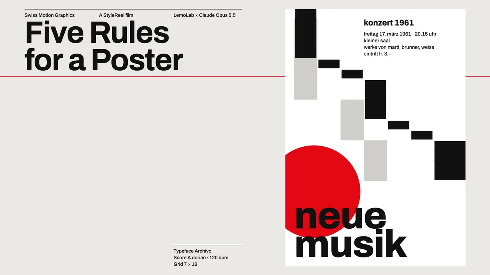

```text
# Swiss Motion Graphics — Style Prompt

> International Typographic Style in motion: a modular grid, one typeface, one signal colour, and movement as exact as a printing press.
> References (grammar only): 1950s–70s Zurich posters (Müller-Brockmann, Hofmann, Gerstner, Crouwel) for the grid, flush-left type, scale contrast and "designing programmes"; modern identity systems in motion (Experimental Jetset, Pentagram) for snaps on the beat. Never copy a specific historical poster's composition (no concentric-circle or fan layouts lifted from Müller-Brockmann), never use Helvetica or Akzidenz font files, never name a real institution on a poster.

## 1. Essence, and what it is not

- **Pure 2D graphic design animated on a grid**: flat paper, black type and bars, a very light grey and **one** saturated signal colour.
- **Every element snaps to the grid, every move lands on a beat, nothing bounces.**
- **Rigor with one exception**: the whole frame obeys a system, so the one element that doesn't becomes a character.
- **Extreme scale contrast**: a giant numeral next to tiny technical notes.

Not a keynote (no gradients, no glow, no device renders), not kinetic typography for a lyric video (words don't fly, spin or bounce), not data visualisation (bars have mass as graphic form, not as charted quantities, unless the grid gives them that meaning), not a Bauhaus pastiche of primary shapes.

## 2. Materials & rendering

- **Frame grid**: 1920×1080, 12 columns, ~96 px side margins, 24 px gutters, 24 px baseline. The frame can act as a **spread**: a left page (the programme: numeral, rule text, notes) and a right page (the artifact).
- **Artifact grid** derived from the content (Gerstner): what the columns and rows *mean* is a design decision. **Choose module sizes that give the elements mass**; too many thin columns make a layout look like a chart.
- **Surfaces**: page, paper, ink, signal colour, grid lines in two or three light greys (on page, while building, on paper). No gradients, no shadows, no particles, no grain (mux grain 0).
- **Bars and blocks** are flat rects; consecutive cells of one unit merge into one bar, overdrawn 1 px at seams (antialiasing shows hairlines, especially when rotated or scaled).
- **A secondary voice** can be light-grey elements under the black ones: depth without a second colour.
- **A 2D camera matrix** (centre, scale, rotation) for all moves.

## 3. Colour logic

- **Paper, ink, greys, and one signal colour.** Only one thing carries the signal colour; that makes it the protagonist. It is the only thing allowed to be inexact.
- Overprint is allowed: black type on the signal colour.
- The signal colour can be red, orange, ultramarine or green; choose it for the topic, then never add a second.
- Examples: `#EAE9E5` page, `#FFFFFF` paper, `#111111` ink, signal `#E30613`; or `#F2F0EA` / `#141414` / signal `#FF5A00`; or `#E9ECEF` / `#0B0B0B` / signal `#1F3FFF`.

## 4. Type & subtitles

- **One family for the whole film**, an OFL neo-grotesque (Archivo, Inter, Schibsted Grotesk, Instrument Sans…), several weights. Letter-spacing ~−2 % at ≥ 90 px. Headlines can be lowercase. Load every weight with `document.fonts.load` before drawing.
- **Flush left, ragged right**; everything on a grid line; big white space is part of the layout. Giant numerals are **optically** flush left (subtract the glyph's left bearing).
- **Subtitles are part of the layout**, not a bar at the bottom: each line sits at a column start in the current composition (a small grey lead-in + a large bold statement, or a caption like a museum label), each word clip-revealed on its whisper timestamp. Hold ≥ max(1.8 s, speech + 0.6 s); assert it in code.
- **Caption rows**: small (~19 px) medium-weight notes with a 1 px rule above; technical notes in a corner (module sizes, counts, a bar counter).

## 5. Motion quality

- **Two curves only**: a precise ease `cubic-bezier(.7,0,.2,1)` for snaps; linear for lines being drawn, playheads and the exception. No overshoot, no spring, no bounce.
- **Durations are note values** at the film's tempo. A snap starts one note value early and **lands on the beat**.
- **Entrances are wipes or clip-reveals, never fades**: words rise out of a clip rect from below the baseline and leave upward; lines grow along their length; paper appears by a wipe; big numerals climb in eased steps ("one module at a time").
- **Deletions are knife cuts**: a thin line crosses the element, then the element collapses to its midline.
- **Ripples are ordered by distance** from their cause, a couple of units per subdivision.
- **The exception moves differently**: linear, unsnapped, perhaps pausing mid-flight; a coordinate readout beside it can turn from "on grid" to "off grid".
- Smooth 24 fps, no stepping: digital precision, not hand-made.

## 6. Camera grammar

A vocabulary, not a route. The camera moves only with the precise ease and only on beats. Opening and ending come from the topic.

| Move | What it expresses | Can serve |
|---|---|---|
| Locked spread | cause (left) → effect (right) | a rule applied; a before/after; a comparison |
| Hard pan by one page or column | the next step in a system | a sequence; a catalogue; a timeline |
| Rotate 90° and stop | the same thing read another way | a poster as a score; a chart as a map |
| Pull out to a wall of artifacts | one programme, many outputs | a brand system; a product range; a series |
| Push into one module | detail; the unit of the system | a pixel; a letter; a single data point |
| Grid extends past the page | the system is bigger than the artifact | scale; ambition; a break from constraints |
| Split frame into equal cells | parallel cases | options; variants; team members |
| Vertical scroll through a column | reading; a list | a manifesto; a spec sheet; a timetable |

Framing: everything on the grid; the signal element may sit off-grid only when it is being the exception. Transitions are wipes, knife cuts, camera moves and re-flows; never dissolves.

## 7. Sound palette

- **Music with a grid of its own**: a steady pulse whose subdivisions give snap durations. Options: motorik / krautrock kit and bass, minimal techno, marimba or vibraphone patterns, a mechanical piano ostinato, a drum machine with a glockenspiel; one instrument added per new rule is a clear build.
- **Picture and music can share one data file** (a column → pitch, a row → onset), so a graphic can literally be the score.
- **Techniques (options)**: drop the drums for the one moment of the exception; a near-silent bar before a reveal; thin the band during a reveal so every note is audible.
- **Foley follows the materials of print**, dry and close, no reverb: letterpress clack, ruling pen "tss", guillotine snick, paper slap and slide, numeral thunk, block snap, felt thump for a landing, rubber stamp, typewriter carriage.
- **The exception can be the only element that sings** (a sine glide following its position).
- **Silence**: a hard stop of everything on a downbeat; the next snap reads as an event.
- **Mix**: voice compressed and ≥ 6 dB above music, music ducked ~10 dB under voice, −14 LUFS.
- **Voice**: cool, crisp, rule-like sentences; prefer voices with bright consonants.

## 8. Native moves

A menu: use the ones your story needs.

- **The grid means something.** Columns and rows become a quantity (notes, hours, floors, years). *Fits content like:* a building's floors and rooms; a week's timetable; a city's districts.
- **Snap = beat.** Every arrival is a percussion hit. *Fits content like:* a product's feature list; the steps of a recipe; a countdown.
- **Programme.** Rules applied one by one to one artifact, then the same programme generating many. *Fits content like:* a brand identity; a typeface family; a set of stamps.
- **Extreme scale contrast.** A giant element as chapter card beside tiny notes. *Fits content like:* a record statistic; a year; a price.
- **The exception.** One element breaks the grid, linear and unsnapped. *Fits content like:* an inventor; an outlier in the data; a rebel employee.
- **Knife cut.** An element deleted by a line. *Fits content like:* budget cuts; editing a text; removing a feature.
- **Re-flow.** Everything else rearranges around a change, nearest first. *Fits content like:* a team reorganised; traffic after a road closes; a layout adapting to a phone.

## 9. Pitfalls of the medium

- Too many thin columns look like a chart → fewer, wider modules.
- A "better" composition that isn't obviously better → one strong diagonal with long/short rhythm, a larger signal element, bleeds, type over colour. Merely tilting is not enough.
- Rotating and labelling at once reads as noise → rotate, hold, then add labels.
- Merged bars show seams after rotation → overdraw 1 px.
- Elements that share the camera matrix leak into other shots → draw them only when on screen.
- Canvas `letterSpacing` affects `measureText` → measure after setting the font.
- Onsets that fall between frames flicker → put visual onsets on whole frames.
- Whisper splits or merges words and pads the first word → align by letters, clamp to 0.

## 10. Engine

In `demo/`: `ease.js` (`cubic-bezier(.7,0,.2,1)`, `snap(t, t_arrive, dur)`, `steps()`, `track()`), `film.js` (layout system, clip-reveal text, knife cuts, bars from a score, rotation reveal, wall of artifacts, caption rows), `main.js` (fonts, whisper word times, `?nosub=1`, `?poster=1`), `score.json` (the shared data file for picture and music), `tools/words.py` and `tools/subs.py` (word timings, asserted subtitle intervals). File list and build steps: [DEMO.md](DEMO.md) "Build notes".

## 11. Variation space

You decide the system, what the grid means, the exception (or none), the signal colour, the opening and the ending. All far from our demo:

- Structures: **a timetable** (a 24-row grid of hours fills with the topic's day, one row per beat); **an alphabet** (A to Z, each letter a module of the topic, the grid completing as a specimen sheet); **a comparison** (two systems side by side on a split spread until one element crosses the gutter).
- Openings: **a single dot** placed on the page, then the grid growing from it; **the finished artifact** that is then dismantled into its rules; **a giant numeral** filling the frame, which turns out to be a detail of a small layout.
- Endings: **the empty grid** after every element has been cut away; **a single word** flush left in the corner; **the exception leaves the frame** and the system closes over the space it left.

---

How our demo was made (story, shots, score, end card, build): [DEMO.md](DEMO.md). Read it after your treatment exists.

```

Model: Claude Opus 5.5 · Author: LemoLab

[Original source](https://github.com/lemomo-ai/lemo-opuscar/blob/b5e8ef93930b6d828f352055a689320f138237b1/styles/swiss-motion/STYLE.md) · [Provenance and original license](data/projectd-batch-0014.json)

## Fictional Livestream Commerce Interface Mockup — ClawLabs AI · MIT

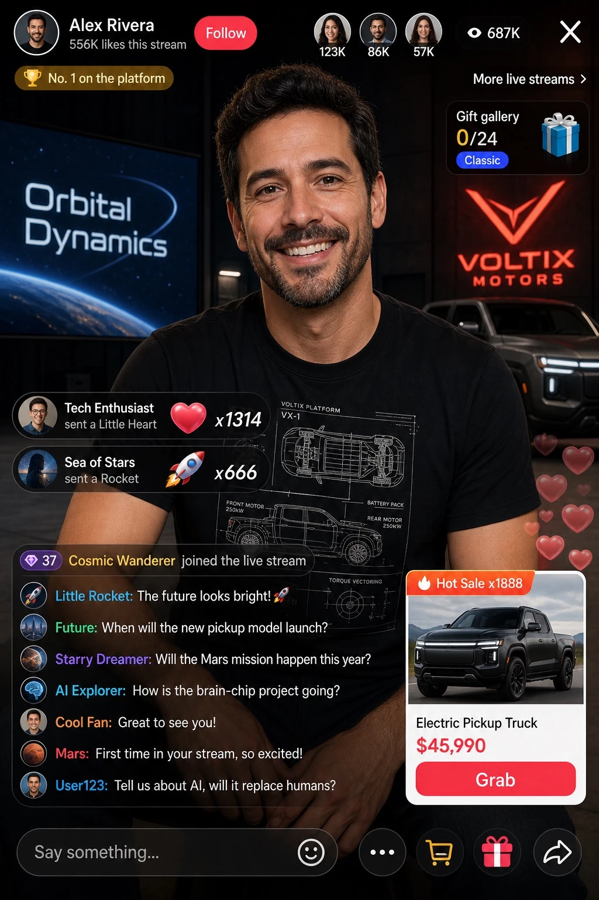

```text
Design a portrait-orientation mockup of a live-streaming app UI. The main subject is a smiling [PERSON], wearing a black t-shirt printed with a white technical schematic graphic. The background shows, on the left side, a screen displaying the text '[BRAND_1]', and on the right side, a red '[BRAND_2]' logo alongside a dark parked car.

Overlay UI elements:
- Top header: host avatar and name '[PERSON]', subtext reading '556K likes this stream', red 'Follow' button; a gold coin rank badge reading 'No. 1 on the platform'; three top viewer avatars with counts '123K', '86K', '57K', a total of '687K' viewers, and an 'X' close button; on the right, links reading 'More live streams >' and 'Gift gallery 0/24' with a blue 'Classic' tag.
- Middle-left gift notifications (2 items): avatar 'Tech Enthusiast' with text 'sent a Little Heart', heart icon x1314; avatar 'Sea of Stars' with text 'sent a Rocket', rocket icon x666.
- Bottom-left chat panel: a system message with a level 37 badge reading 'Cosmic Wanderer joined the live stream'; below it, 7 chat messages: 'Little Rocket: The future looks bright! 🚀', 'Future: When will the new pickup model launch?', 'Starry Dreamer: Will the Mars mission happen this year?', 'AI Explorer: How is the brain-chip project going?', 'Cool Fan: Great to see you!', 'Mars: First time in your stream, so excited!', 'User123: Tell us about AI, will it replace humans?'.
- Bottom-right product card: an orange 'Hot Sale x1888' tag, an image of [PRODUCT_NAME], title '[PRODUCT_NAME]', price '[PRODUCT_PRICE]', a red 'Grab' button, and translucent floating hearts animating up the right edge.
- Bottom bar: an input field with placeholder text 'Say something...', and icons for smiley face, three-dot menu, shopping cart, gift box, and share.
```

Model: GPT Image 2 · Author: @sjbbxhz · adapted and regenerated by ClawLabs AI

[Original source](https://github.com/ClawLabsAI/awesome-verified-text-to-image-prompts/blob/c25274d3c30dca596c21d885ff9dc0c5106ab5c6/prompts.json#L680) · [Provenance and original license](data/projectd-batch-0014.json)

## Fantasy Cast Profile Portrait Grid — ClawLabs AI · MIT

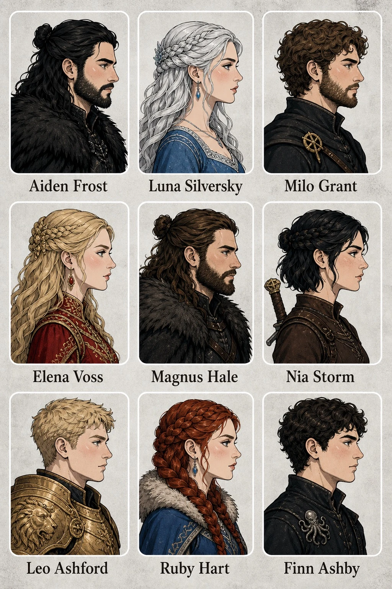

```text
Create a character portrait grid image with the following specifications: type: character portrait grid; theme: [FRANCHISE_THEME]; style: 2D flat illustration, clean line art, comic style, portraits in profile view facing right, pale skin with blush; layout: 3x3 grid, light gray textured background, each portrait placed inside a white rounded-rectangle frame with a text label below it; total count: 9 portraits. Portrait details: 1) [CHARACTER_1_NAME] – black hair worn half-up, beard, dark fur cloak; 2) [CHARACTER_2_NAME] – silver braided hair, blue dress; 3) [CHARACTER_3_NAME] – curly brown hair, beard, dark tunic with a gold pin; 4) [CHARACTER_4_NAME] – blonde braided hair, ornate red and gold dress; 5) [CHARACTER_5_NAME] – brown hair half-up, beard, dark fur cloak; 6) [CHARACTER_6_NAME] – short dark hair half-up, brown tunic, visible sword hilt; 7) [CHARACTER_7_NAME] – short blonde hair, gold armor with a lion motif; 8) [CHARACTER_8_NAME] – red braided hair, blue dress with a fur collar; 9) [CHARACTER_9_NAME] – short dark curly hair, dark tunic with a kraken pin.
```

Model: GPT Image 2 · Author: @stark_nico99 · adapted and regenerated by ClawLabs AI

[Original source](https://github.com/ClawLabsAI/awesome-verified-text-to-image-prompts/blob/c25274d3c30dca596c21d885ff9dc0c5106ab5c6/prompts.json#L1531) · [Provenance and original license](data/projectd-batch-0014.json)

## Seven-Day Fashion Lookbook Layout Study — ClawLabs AI · MIT

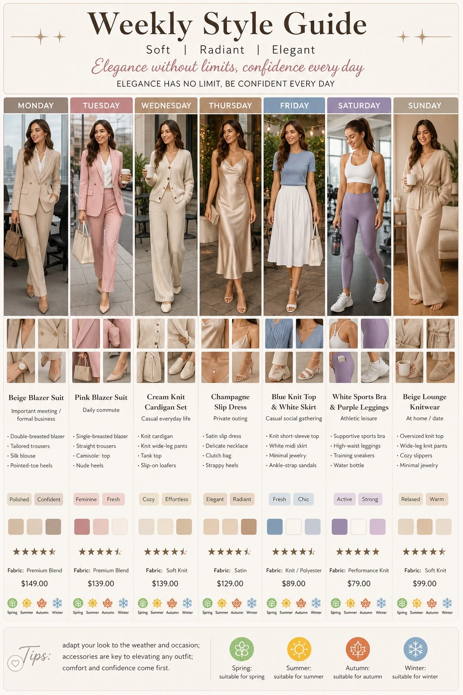

```text
Design a 7-day fashion lookbook infographic in a clean UI/infographic style, structured into 7 vertical columns representing the days of the week (Monday through Sunday).

Header:
- Main title: [MAIN_TITLE]
- Subtitle with style keywords: [STYLE_KEYWORDS]
- Slogan (must appear in the image as-is, in [LANGUAGE]): Elegance without limits, confidence every day
- English slogan: [ENGLISH_SLOGAN]

Subject: [SUBJECT_DESCRIPTION], featured as the model wearing each day's outfit.

Layout: Each of the 7 columns must include, from top to bottom: a day-of-week header, a main full-body portrait of the model wearing that day's outfit, 4 small detail thumbnails, outfit specification text, keyword and color labels, 3 color swatches, a star rating, fabric and price information, and 4 season icons.

Daily outfits and scenes (label each column with the day name in [LANGUAGE]):
- Monday: beige blazer suit; scene: important meeting / formal business
- Tuesday: pink blazer suit; scene: daily commute
- Wednesday: cream knit cardigan set; scene: casual everyday life
- Thursday: champagne slip dress; scene: private outing
- Friday: blue knit top with white skirt; scene: casual social gathering
- Saturday: white sports bra with purple leggings; scene: athletic leisure
- Sunday: beige lounge knitwear; scene: at home / date

Footer:
- Tips text: [FOOTER_TIPS]
- Season legend (in [LANGUAGE]): Spring: suitable for spring, Summer: suitable for summer, Autumn: suitable for autumn, Winter: suitable for winter

Overall style: modern, clean UI infographic design with a consistent color palette, elegant typography, and a well-organized grid layout suitable for a fashion styling guide.
```

Model: GPT Image 2 · Author: @yyyole · adapted and regenerated by ClawLabs AI

[Original source](https://github.com/ClawLabsAI/awesome-verified-text-to-image-prompts/blob/c25274d3c30dca596c21d885ff9dc0c5106ab5c6/prompts.json#L1850) · [Provenance and original license](data/projectd-batch-0014.json)

## Fictional Lifestyle Course Banner Grid — ClawLabs AI · MIT

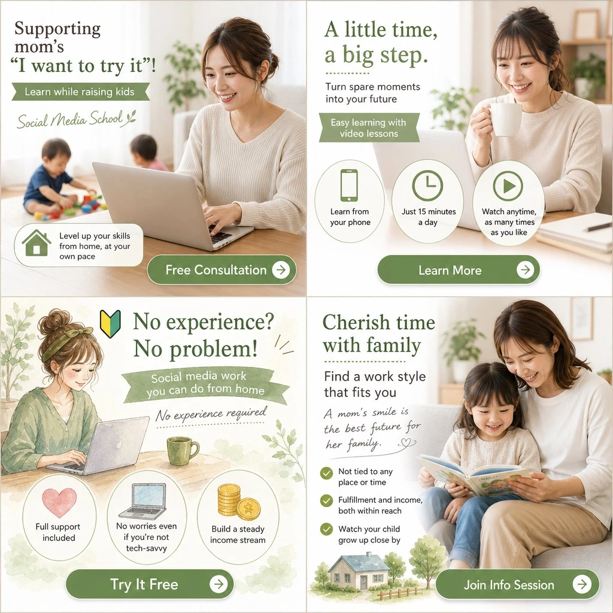

```text
{
  "type": "2x2 grid of banner advertisements",
  "theme": "[MAIN_THEME] for [TARGET_AUDIENCE]",
  "design_style": "soft, approachable, bright lighting, featuring [COLOR_PALETTE]",
  "layout": {
    "sections": [
      {
        "position": "top-left",
        "visual_style": "photography",
        "image_description": "Smiling woman working on a laptop at a table, a toddler playing with toys in the blurred background.",
        "headlines": ["Supporting mom's \"I want to try it\"!", "Learn while raising kids", "Social Media School"],
        "features": {
          "count": 1,
          "type": "icon with text",
          "labels": ["Level up your skills from home, at your own pace (with house icon)"]
        },
        "call_to_action_button": "Free Consultation"
      },
      {
        "position": "top-right",
        "visual_style": "photography",
        "image_description": "Smiling woman holding a white mug, looking at a laptop.",
        "headlines": ["A little time, a big step.", "Turn spare moments into your future", "Easy learning with video lessons"],
        "features": {
          "count": 3,
          "type": "circular icons with text below",
          "labels": ["Learn from your phone (smartphone icon)", "Just 15 minutes a day (clock icon)", "Watch anytime, as many times as you like (play button icon)"]
        },
        "call_to_action_button": "Learn More"
      },
      {
        "position": "bottom-left",
        "visual_style": "watercolor illustration",
        "image_description": "Illustration of a woman with hair in a bun, smiling at a laptop with a green mug nearby.",
        "headlines": ["No experience? No problem! (with beginner mark)", "Social media work you can do from home", "No experience required"],
        "features": {
          "count": 3,
          "type": "circular icons with text below",
          "labels": ["Full support included (heart icon)", "No worries even if you're not tech-savvy (laptop icon)", "Build a steady income stream (coin icon)"]
        },
        "call_to_action_button": "Try It Free"
      },
      {
        "position": "bottom-right",
        "visual_style": "photography",
        "image_description": "Smiling mother and young daughter sitting on a sofa reading a picture book together.",
        "headlines": ["Cherish time with family", "Find a work style that fits you", "A mom's smile is the best future for her family."],
        "features": {
          "count": 3,
          "type": "checkmark bullet points",
          "labels": ["Not tied to any place or time", "Fulfillment and income, both within reach", "Watch your child grow up close by"]
        },
        "extra_graphics": "Small illustration of a house and trees at the bottom left.",
        "call_to_action_button": "Join Info Session"
      }
    ],
    "common_elements": "All panels feature a [BUTTON_STYLE] at the bottom."
  }
}
```

Model: GPT Image 2 · Author: @masapark95 · adapted and regenerated by ClawLabs AI

[Original source](https://github.com/ClawLabsAI/awesome-verified-text-to-image-prompts/blob/c25274d3c30dca596c21d885ff9dc0c5106ab5c6/prompts.json#L2331) · [Provenance and original license](data/projectd-batch-0014.json)

## Anime Chat-Stream Cover Design — ClawLabs AI · MIT

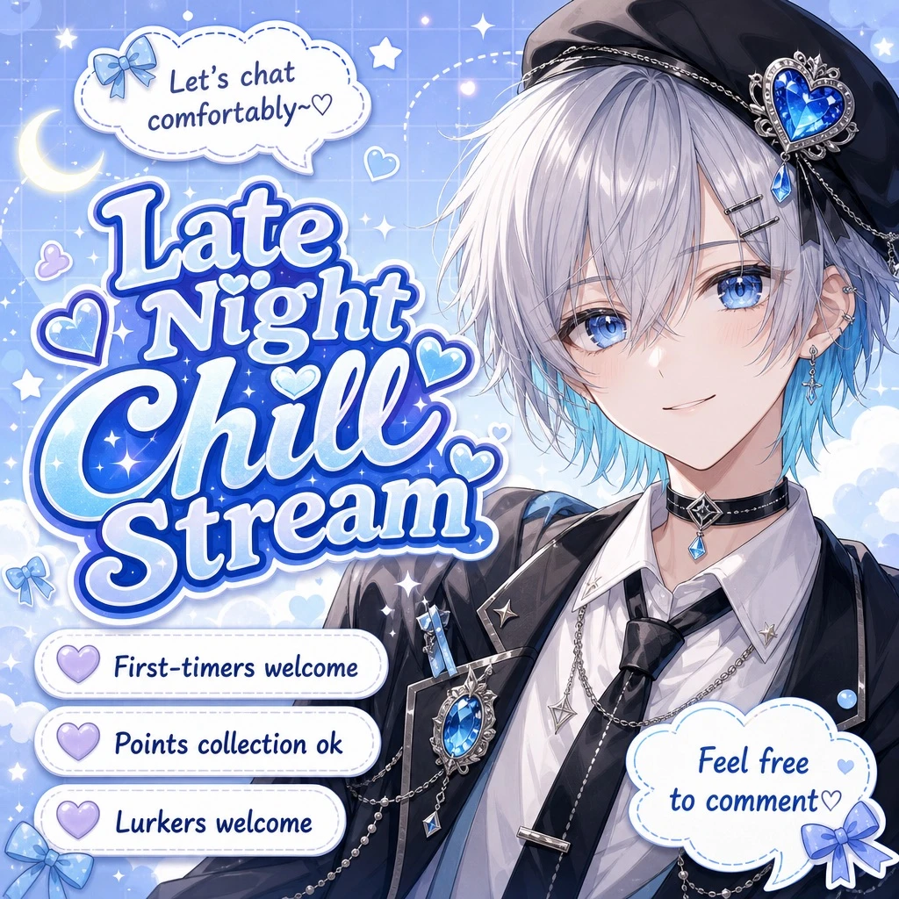

```text
Design an anime-style livestream thumbnail. The character has [HAIR_COLOR], large bright blue eyes, and wears a white collared shirt, a black tie with silver accents, a black jacket, a black beret decorated with a large blue heart jewel, a blue jewel brooch, and a black choker. The character is smiling gently, looking directly at the viewer, and is positioned on the right side of the frame. The background is pastel blue with white clouds, sparkles, stars, small bows, and a subtle grid pattern. Typography and UI elements: a speech bubble in the top-left corner reading "[SPEECH_BUBBLE_TEXT]"; a main title reading "[MAIN_TITLE]" rendered in a large soft blue gradient with a white outline, decorated with small hearts, positioned in the middle-left; three white pill-shaped badge buttons at the bottom-left, each with a purple heart icon on the left, labeled "[BADGE_1_TEXT]", "[BADGE_2_TEXT]", and "[BADGE_3_TEXT]"; and a cloud-shaped speech bubble at the bottom-right reading "[BOTTOM_RIGHT_TEXT]".
```

Model: GPT Image 2 · Author: @sayaka_aiart · adapted and regenerated by ClawLabs AI

[Original source](https://github.com/ClawLabsAI/awesome-verified-text-to-image-prompts/blob/c25274d3c30dca596c21d885ff9dc0c5106ab5c6/prompts.json#L3274) · [Provenance and original license](data/projectd-batch-0014.json)

## Thematic Silhouette Narrative Poster — ClawLabs AI · MIT

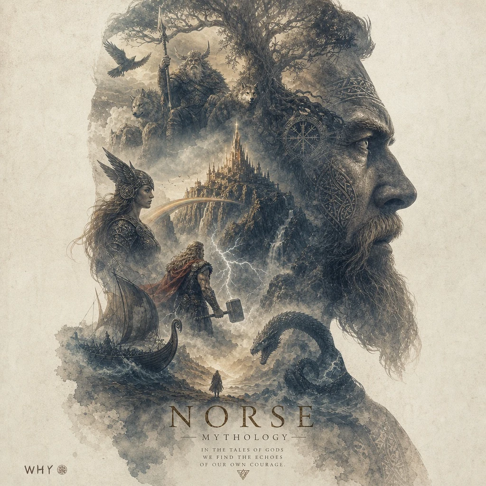

```text
Based on the given [THEME], automatically generate a collectible epic narrative poster: a large, elegant silhouette of a person's profile serves as the outer contour, and within the silhouette, the most fitting complete worldview, iconic scenes, character relationships, symbolic motifs, key architecture, creatures, props, and atmosphere for that theme organically grow and fill the shape. The overall effect should not be an ordinary collage, but rather an elevated silhouette-fill narrative composite, evoking a double-exposure association, leaning more toward a fusion of cinematic poster and dreamy watercolor illustration style; soft aerial perspective, gentle misty transitions, paper grain texture, feathered edges and brush strokes, generous negative space, a restrained and premium layout, with a quiet, grand, sacred, nostalgic, poetic, and legendary feeling. The style, color palette, scenes, and materials should all automatically adapt to the theme, with every element strongly tied to the theme and instantly recognizable — avoid clutter, avoid hard collage effects, avoid templated backgrounds, and avoid cheap fantasy stock assets. Naturally incorporate the exclusive signature "[SIGNATURE_TEXT]" into the composition as part of the poster design, placed subtly but clearly — in the bottom-left corner, bottom-right corner, or near the title — in a style consistent with the overall layout, like the artist's signature or design seal of a collector's edition poster; the signature typeface should be refined, restrained, and premium, not too large, must not disrupt the main composition, and must not appear jarring or cheap.
```

Model: GPT Image 2 · Author: 小红书号6455654397 · adapted and regenerated by ClawLabs AI

[Original source](https://github.com/ClawLabsAI/awesome-verified-text-to-image-prompts/blob/c25274d3c30dca596c21d885ff9dc0c5106ab5c6/prompts.json#L116) · [Provenance and original license](data/projectd-batch-0014.json)

## Character Expression Grid Illustration — ClawLabs AI · MIT

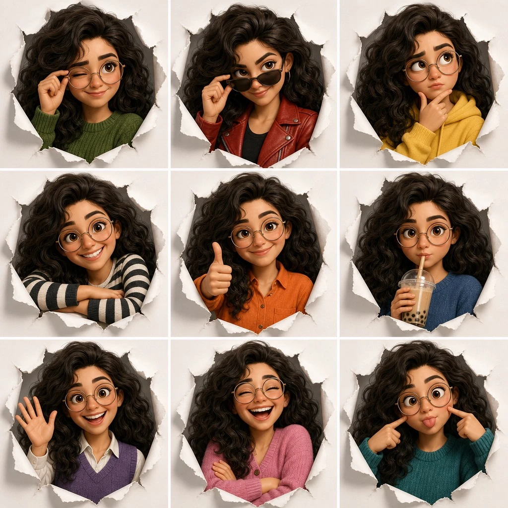

```text
Create a 3x3 character expression grid illustration, a single composite image divided into nine equal panels arranged in 3 rows and 3 columns, showing the same character in different expressions, poses, and outfits. Render the artwork in [ART_STYLE]. The character is described as: [CHARACTER_DESCRIPTION]. Every panel shares a common visual theme: [FRAMING_CONCEPT]. Layout details for each of the 9 panels: (1) top-left: winking expression, adjusting glasses, wearing a green sweater; (2) top-center: smirking expression, lowering dark sunglasses, wearing a red leather jacket; (3) top-right: thinking expression, finger on chin, wearing a yellow hoodie; (4) middle-left: big smile, arms resting on the edge of the frame, wearing a black and white striped shirt; (5) middle-center: smiling expression, giving a thumbs up, wearing an orange button-up shirt; (6) middle-right: neutral expression, drinking boba tea, wearing a blue sweater; (7) bottom-left: happy expression, waving, wearing a purple sweater vest over a white shirt; (8) bottom-center: laughing with eyes closed, arms crossed, wearing a pink cardigan; (9) bottom-right: silly expression, poking own cheeks, wearing a teal sweater. Keep consistent character design, proportions, and lighting style across all nine panels, with each panel cleanly separated by even borders.
```

Model: GPT Image 2 · Author: @austinit · adapted and regenerated by ClawLabs AI

[Original source](https://github.com/ClawLabsAI/awesome-verified-text-to-image-prompts/blob/c25274d3c30dca596c21d885ff9dc0c5106ab5c6/prompts.json#L1164) · [Provenance and original license](data/projectd-batch-0014.json)

## Soft Skeuomorphic Pet-Shop App Icon Concept — ClawLabs AI · MIT

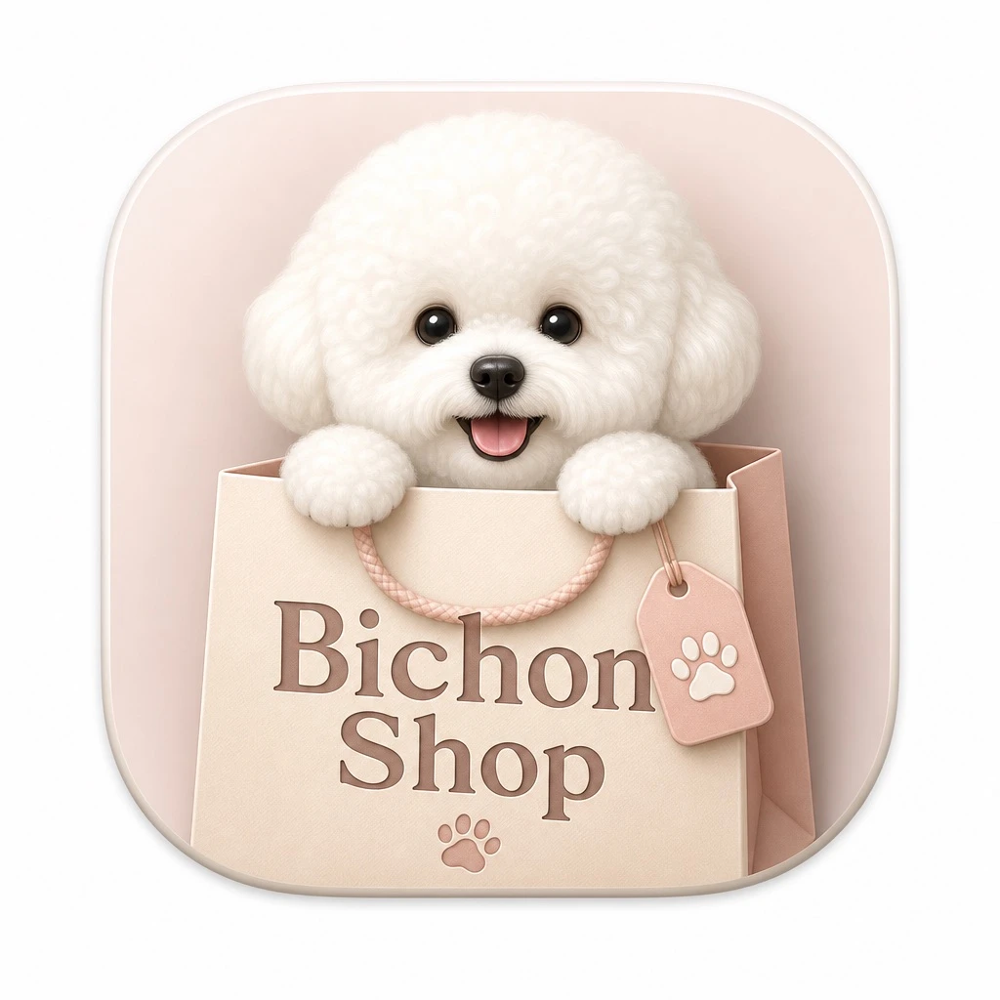

```text
A macOS app icon for an app named '[APP_NAME]'. A single squircle icon with smooth, continuous rounded corners, centered on a white canvas with padding, occupying about 80% of the canvas. Modern, light skeuomorphic macOS App Store style. Only one icon.
```

Model: GPT Image 2 · Author: @iamaiistudio · adapted and regenerated by ClawLabs AI

[Original source](https://github.com/ClawLabsAI/awesome-verified-text-to-image-prompts/blob/c25274d3c30dca596c21d885ff9dc0c5106ab5c6/prompts.json#L16714) · [Provenance and original license](data/projectd-batch-0014.json)

## Fisheye Summer Drink Advertising Study — ClawLabs AI · MIT

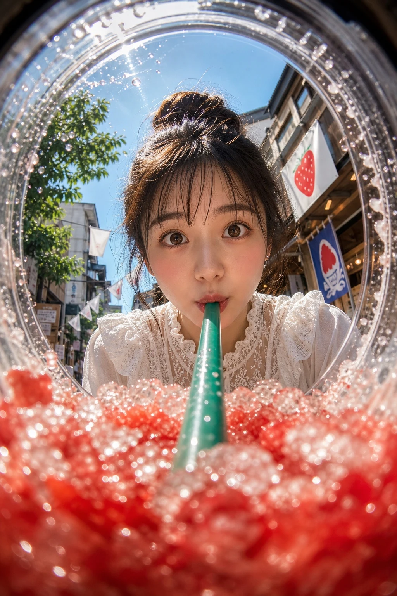

```text
Theme:
Summer Beyond the Ice

Subject:
A vertical 2:3 realistic photograph. An ultra-wide fisheye composition as if looking up from inside a large transparent plastic cup. The lower half of the frame is filled with red [FRUIT] pulp and crushed ice, while a thick [STRAW_COLOR] straw extends straight back from the center into the depth of the frame. Beyond the rounded, distorted rim of the cup, a woman's face fills the center of the frame.

Person & Expression:
A natural, realistic-looking young woman. Her [HAIR_COLOR] hair is gathered into a high bun, with wispy bangs and loose strands around her face catching the sunlight. She wears translucent natural makeup, soft pink cheeks, and glossy lips. Her eyes are wide open, looking straight at the camera, her lips slightly pursed around the straw. Her expression is slightly surprised, cute, and innocent.

Clothing & Pose:
She wears a [BLOUSE_COLOR] lace blouse with delicate ruffles at the neckline and shoulders, giving it a light, summery texture. She leans her face close to the far side of the cup, her shoulders barely visible at the bottom of the frame. The straw naturally touches her mouth, creating strong depth as it stretches from her lips toward the red ice in the foreground.

Background & Lighting:
The background shows an old shopping street on a sunny summer day — wooden-style shopfronts, a shaved-ice shop curtain, a strawberry-patterned sign, small white flags, and street trees. All text in the background is treated as blurred, illegible decoration. Strong sunlight enters from the upper left, creating fine reflections and highlights on the water droplets on the cup, the rim, the ice, and the red fruit pulp. Shadows fall toward the lower right, and a ring of white cream residue remains on the inside of the cup.

Composition & Camera:
The camera is positioned at an extreme low angle, as if placed near the bottom of the cup just above the red ice. The fisheye lens strongly curves the circular rim of the cup, with the surrounding shopping street slightly distorted as well. The bottom 45% of the frame shows red ice and fruit pulp in foreground blur, the center shows the straw and the woman's face, and the top shows blue sky and the transparent rim of the cup. Focus is on the woman's eyes and mouth, with the foreground ice rendered in shallow, sparkling bokeh.

Texture & Style:
Shot in the style of a professional summer advertisement photograph. High-detail rendering of the refraction of the transparent plastic, droplets of water, the coldness of the ice, and the juiciness of the fruit pulp. Vivid contrast between the blue sky, red ice, [STRAW_COLOR] straw, and [BLOUSE_COLOR] blouse. Skin retains a natural texture without excessive skin-smoothing retouching. Bright, pop, slightly humorous Japanese summer dessert photography style.

Negative prompt:
No real brand logos, no legible text, no trademark reproduction, no unnatural faces, no unnatural gaze, no distorted teeth or lips, no poor contact with the straw, no extra fingers, no missing fingers, no fused limbs, no floating ice, no unnatural gravity, no incorrect perspective, no shadows inconsistent with the light source, no garbled text, no watermark, no excessive skin-smoothing retouching, no plastic-looking skin.
```

Model: GPT Image 2 · Author: @lovimg_com · adapted and regenerated by ClawLabs AI

[Original source](https://github.com/ClawLabsAI/awesome-verified-text-to-image-prompts/blob/c25274d3c30dca596c21d885ff9dc0c5106ab5c6/prompts.json#L17018) · [Provenance and original license](data/projectd-batch-0014.json)

## Volumetric Laser Stage Poster Concept — ClawLabs AI · MIT

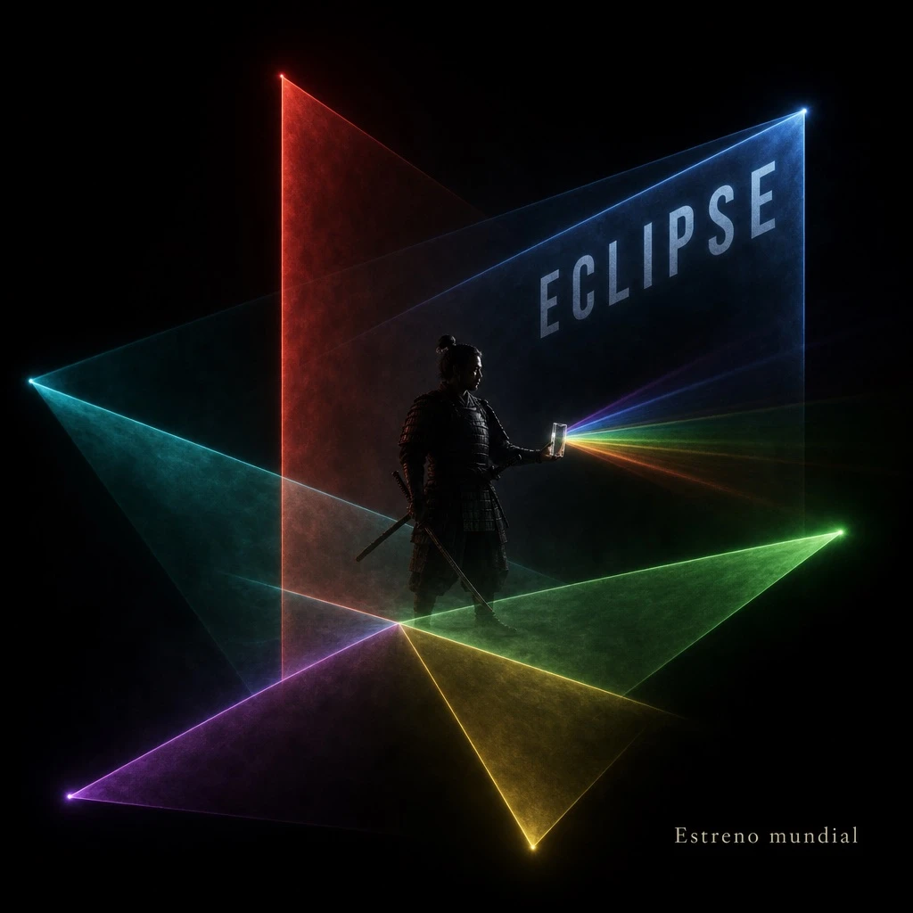

```text
Start in a completely black theater/stage void. Like slicing a specimen, use six real volumetric laser planes to layer the space. Each light plane must have a clear point of origin, defined perspective, and visible thickness within haze. [SUBJECT] stands at the intersection point of the light planes, holding a transparent prop that refracts a small fan of differently-colored light. The composition progresses along a diagonal axis from bottom-left to top-right; the face is revealed only through a single restrained rim light. The title text '[TITLE_TEXT]' shares the same perspective as one of the light planes, while the smaller text '[SUBTITLE_TEXT]' remains in the pure black negative space. Whenever the subject or character changes, the image must not degrade into a nightclub flyer template, a HUD/UI overlay, a neon cityscape, or light sources lacking a physical origin.
```

Model: GPT Image 2 · Author: @zhidawang219555 · adapted and regenerated by ClawLabs AI

[Original source](https://github.com/ClawLabsAI/awesome-verified-text-to-image-prompts/blob/c25274d3c30dca596c21d885ff9dc0c5106ab5c6/prompts.json#L17395) · [Provenance and original license](data/projectd-batch-0014.json)

## Fictional Energy-Storage Brochure Visual System — ClawLabs AI · MIT

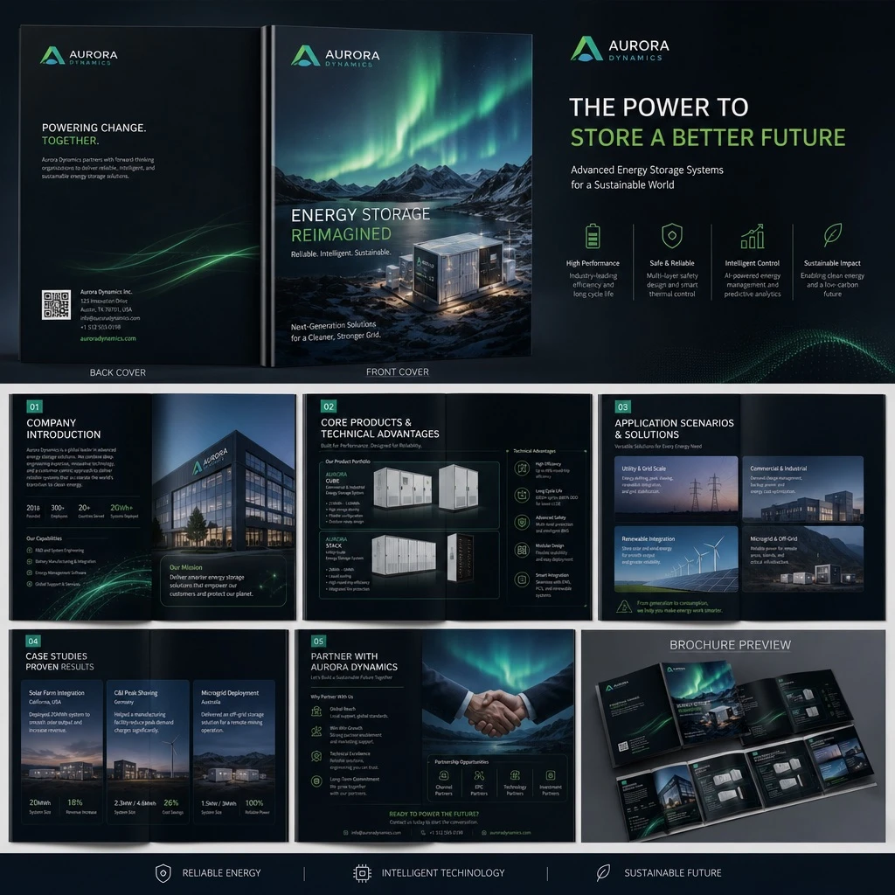

```text
Generate a complete enterprise-grade commercial brochure visual system for [BRAND_NAME], promoting its [INDUSTRY_PRODUCT_SOLUTION].

Overall style: high-end, professional, with strong visual impact; avoid the look of traditional Word layouts or ordinary PowerPoint slides. Use a [VISUAL_STYLE] aesthetic.

The brochure content should include:
1. Front and back cover
2. Company introduction and brand philosophy
3. Core products and technical advantages
4. Application scenarios and solutions
5. Client case studies and partnership methods
6. A full system preview spread of the whole brochure

Requirements: the layout must have strong design intent, with clear hierarchy among images, headlines, data, icons, and negative space; maintain a unified brand visual system across the entire brochure; emphasize the finish quality of real commercial print materials, avoiding simple text layouts.

Structural plan:
1. Front/back cover: establish the brand's presence, industry character, and overall visual tone.
2. Company introduction page: state the company's positioning, scope of capabilities, and target clients.
3. Product/technology page: showcase core products, technical strengths, and solutions.
4. Application scenario page: show which industries the product can be used in.
5. Case studies/partnership page: add credibility and business conversion information.
6. Full-book system preview: verify stylistic consistency and the systemic feel of the entire brochure.

If existing company materials are available, you may upload the previous brochure, company introduction documents, product manuals, website content, PowerPoint proposals, product photos, or case study images, so the process can accomplish three things:
1. Reorganize the content structure, determining which materials fit the cover, company introduction, product pages, case study pages, and partnership pages.
2. Extract a clear brochure storyline, avoiding a mere pile of materials, and instead building a coherent business narrative.
3. Unify the visual direction so the entire brochure looks like one consistent brand system, avoiding a patchwork feel between pages.

Pitfalls to avoid:
1. Avoid simply saying 'generate a brochure', as this tends to produce a generic template image.
2. Avoid stacking only text; the brochure must include product visuals, scenario photos, data modules, and clear design hierarchy.
3. Avoid generating only a single page; it's best to add a full-book preview image to convey a complete system feel.
```

Model: GPT Image 2 · Author: @MrLarus · adapted and regenerated by ClawLabs AI

[Original source](https://github.com/ClawLabsAI/awesome-verified-text-to-image-prompts/blob/c25274d3c30dca596c21d885ff9dc0c5106ab5c6/prompts.json#L14639) · [Provenance and original license](data/projectd-batch-0014.json)

## Light-Trail Choreography Portrait Study — ClawLabs AI · MIT

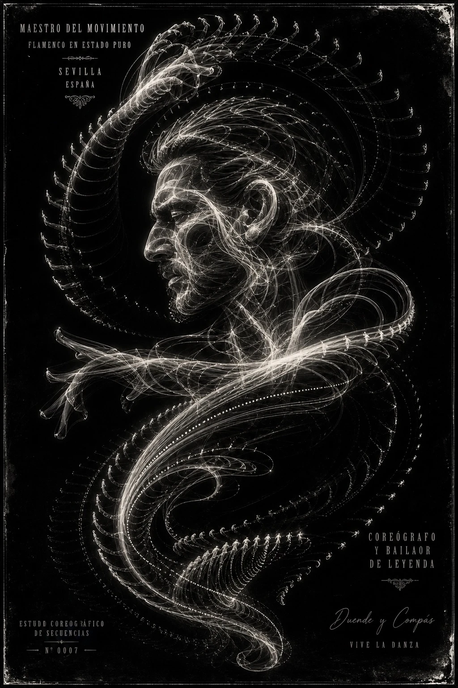

```text
Create a poster portrait of [DANCER_NAME], a legendary dancer and choreographer, composed entirely of motion trails that trace their signature movement sequence. The figure should be built from continuous luminous bands that coalesce into a recognizable portrait: an arabesque trail weaves to form the skull, a grand jeté arc shapes the cheekbone, and the sweep of the arms creates the jawline, with stillness implied through negative space. Render the image as a blackened silver gelatin print with faint chemical residue, subtle motion blur, and glowing filament traces reminiscent of a Marey wheel chronophotograph. Set the scene in complete darkness, lit only by bioluminescent-like light trails with no external light sources, creating high contrast. Style: chronophotography, fine art dance study, 8k resolution, kinetic sculpture concept. Avoid still body parts, studio lighting, and solid silhouettes.
```

Model: GPT Image 2 · Author: @Gdgtify · adapted and regenerated by ClawLabs AI

[Original source](https://github.com/ClawLabsAI/awesome-verified-text-to-image-prompts/blob/c25274d3c30dca596c21d885ff9dc0c5106ab5c6/prompts.json#L14834) · [Provenance and original license](data/projectd-batch-0014.json)

## Metro Morning Reading Photography Study — ClawLabs AI · MIT

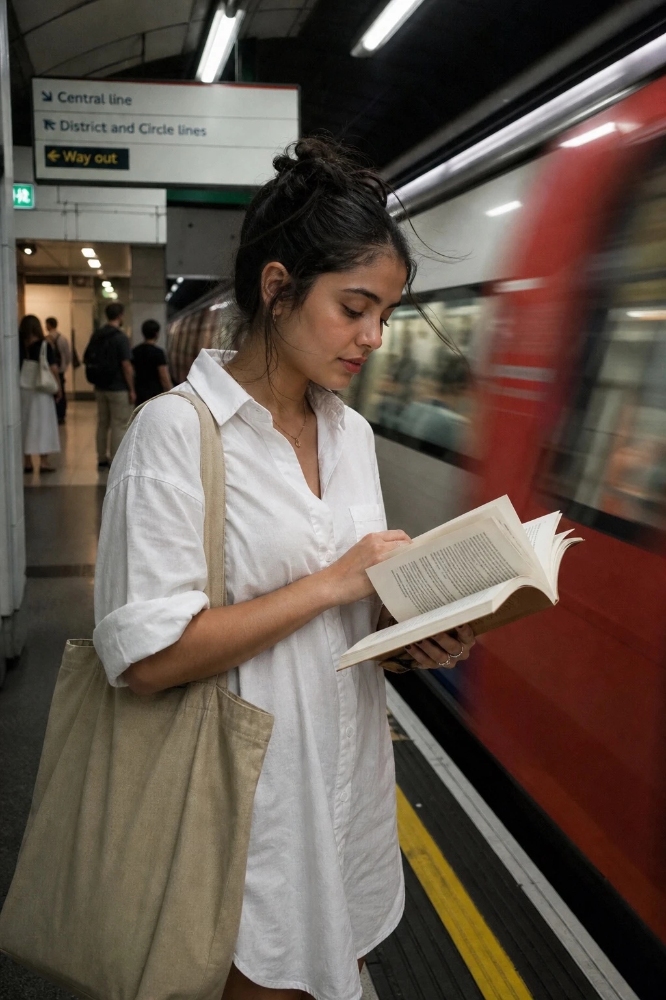

```text
A candid photograph of a young woman standing on a metro platform in [CITY] during the summer morning commute — authentic daily-life photography, a natural, unposed moment. Half-body framing, shot at eye level from a moderate distance, with the arriving train rendered as a motion-blurred streak behind her and the yellow safety line at her feet.

[PERSON_LOOK], her gaze directed downward, fully absorbed, with subsurface scattering visible under the cool overhead station light, specular micro-highlights on the cheekbones and nose ridge, and fine foundation powder grain perceptible on close inspection. A fresh summer look with light, natural makeup coverage and a lightly tinted lip.

She wears a relaxed, oversized white shirt dress with the collar lightly open and the sleeves loosely rolled above the elbow. A structured, natural tan canvas tote bag hangs from her shoulder, and a physical novel is tucked under one arm, its pages open at a saved page. She stands with her weight shifted onto one hip, gaze fixed downward on the open book, entirely absorbed, holding her own stillness within the rush of the morning commute.

Background: a white-and-grey tiled metro wall, an overhead route signage board, the arriving train rendered as motion blur to one side, and other commuters blurred and distant. Two or three loose strands of hair are displaced by the air pushed forward by the arriving train — a natural, unplanned imperfection, not perfectly symmetrical.

Lighting is cool overhead fluorescent with a slight greenish cast, flat frontal illumination balanced by warm spill light from the platform entrance behind her. She remains absorbed in focus, eyes downward, unaware of being observed — a private moment held inside a public space, a [CITY] morning. Subtle ISO 400 film grain visible in the shadow areas, with a photographic noise texture rather than the smoothness of CG rendering.

Aspect ratio 2:3. No watermark, no text overlay. Not cartoon, not digitally painted, not illustration, not anime.
```

Model: GPT Image 2 · Author: @ToroJushiAi · adapted and regenerated by ClawLabs AI

[Original source](https://github.com/ClawLabsAI/awesome-verified-text-to-image-prompts/blob/c25274d3c30dca596c21d885ff9dc0c5106ab5c6/prompts.json#L15186) · [Provenance and original license](data/projectd-batch-0014.json)

## Fictional Vintage Catnip Advertisement Study — ClawLabs AI · MIT

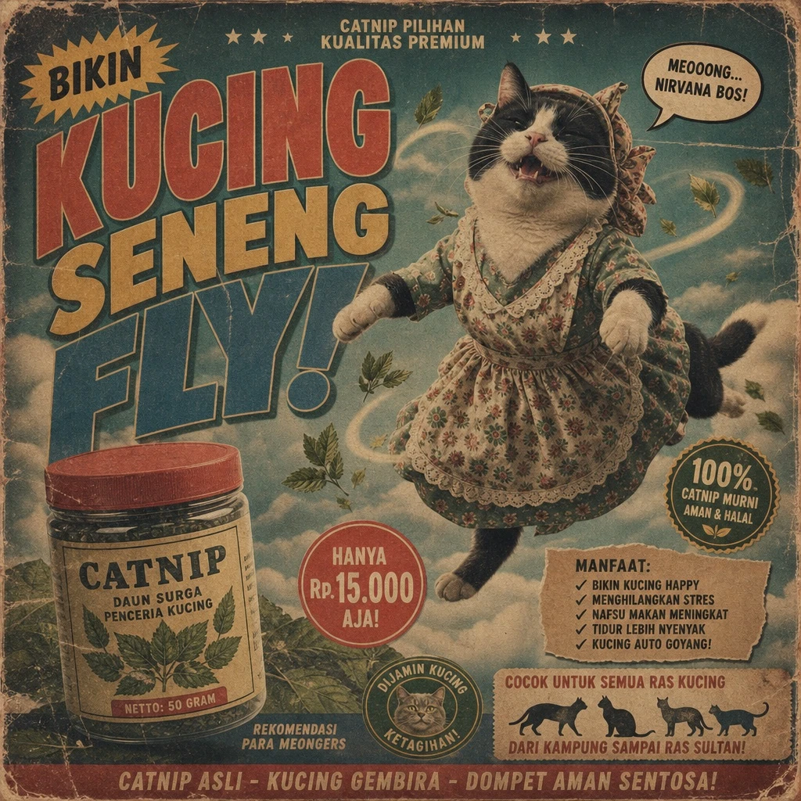

```text
Ultra-realistic vintage [COUNTRY] catnip advertisement poster, retro 1970s paper texture, distressed print, faded colors. A black-and-white tuxedo cat wearing cute vintage housewife clothing floats happily in the air after smelling catnip, with a euphoric expression, swirling catnip leaves, and absurd meme-style energy typical of [COUNTRY] internet humor. Bold retro typography reads: "[TEXT]" on a fake catnip jar product label, with old-school badges, a price tag, and a nostalgic corner-shop advertisement aesthetic. Cinematic lighting, film grain, scratches, and an authentic aged poster look throughout.
```

Model: GPT Image 2 · Author: @NyaiiBubu · adapted and regenerated by ClawLabs AI

[Original source](https://github.com/ClawLabsAI/awesome-verified-text-to-image-prompts/blob/c25274d3c30dca596c21d885ff9dc0c5106ab5c6/prompts.json#L13145) · [Provenance and original license](data/projectd-batch-0014.json)

## London Line-Art Postcard Illustration — ClawLabs AI · MIT

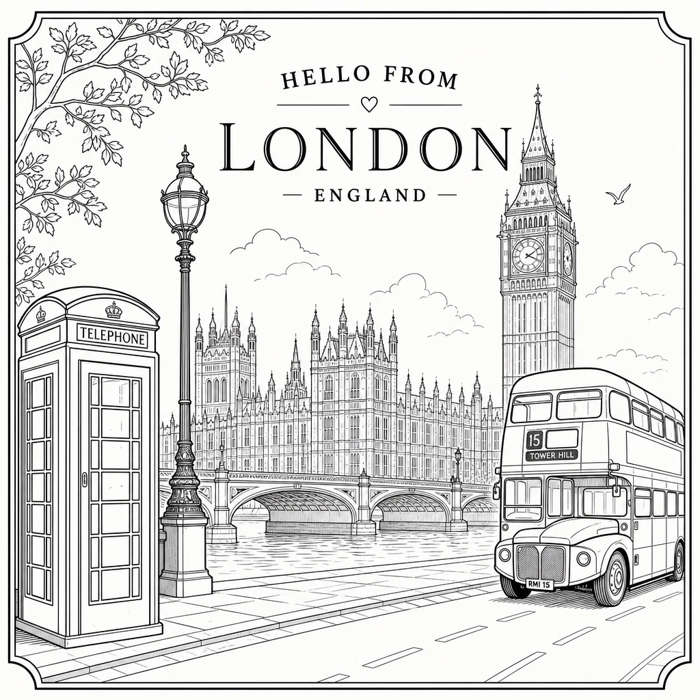

```text
Design a postcard illustration in black-and-white line art style, capturing the distinctive charm and atmosphere of [CITY], with clean, minimalist linework outlining the city's iconic architecture, streets, and scenery.
```

Model: GPT Image 2 · Author: @akokoi1 · adapted and regenerated by ClawLabs AI

[Original source](https://github.com/ClawLabsAI/awesome-verified-text-to-image-prompts/blob/c25274d3c30dca596c21d885ff9dc0c5106ab5c6/prompts.json#L8660) · [Provenance and original license](data/projectd-batch-0014.json)

## Fictional Storybook and Space Company Postcard Concept — ClawLabs AI · MIT

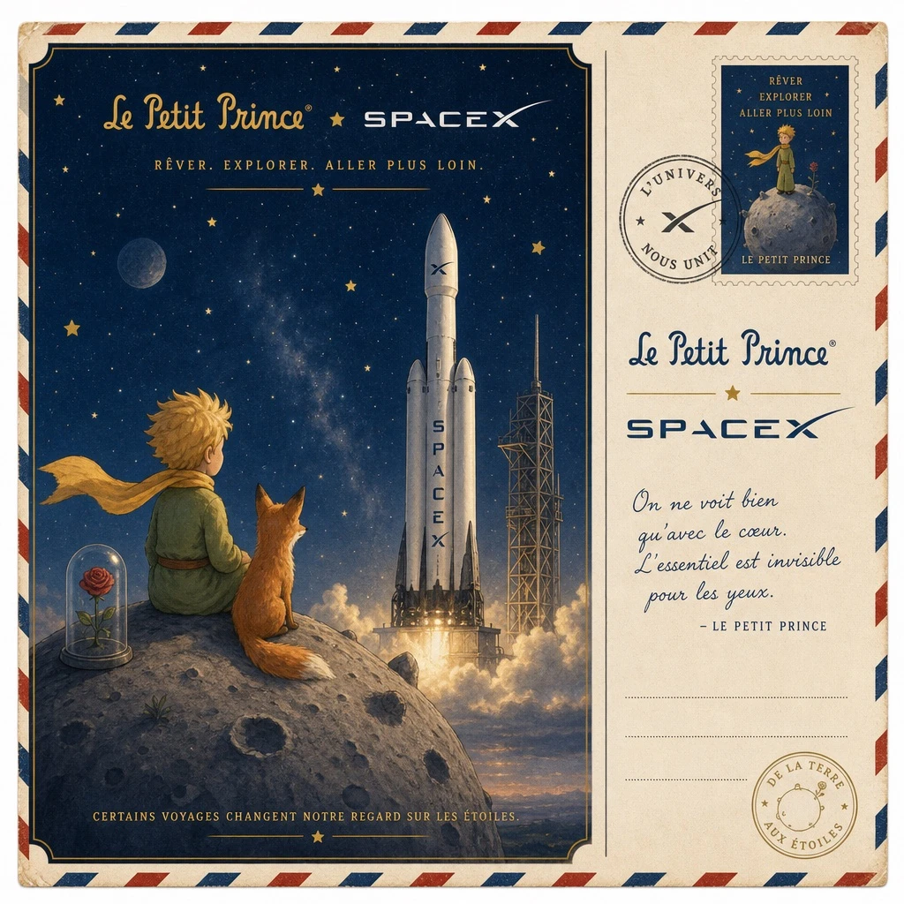

```text
Design a postcard that showcases a co-branded collaboration between [STORY_BRAND] and [BRAND], blending the whimsical, storybook aesthetic of the fictional character with the sleek, futuristic look of the space brand.
```

Model: GPT Image 2 · Author: @akokoi1 · adapted and regenerated by ClawLabs AI

[Original source](https://github.com/ClawLabsAI/awesome-verified-text-to-image-prompts/blob/c25274d3c30dca596c21d885ff9dc0c5106ab5c6/prompts.json#L8704) · [Provenance and original license](data/projectd-batch-0014.json)

## Rainy Garden Daily Calendar Layout — ClawLabs AI · MIT

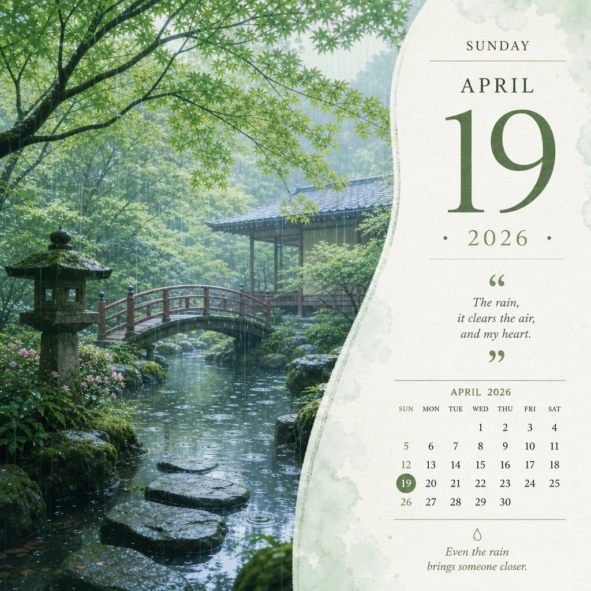

```text
Design a single-day calendar page inspired by [ANIME_TITLE], evoking a lush, rain-soaked Japanese garden with soft spring green tones and a gentle, misty rainfall atmosphere. Prominently display the date [DATE] within the calendar layout.
```

Model: GPT Image 2 · Author: @akokoi1 · adapted and regenerated by ClawLabs AI

[Original source](https://github.com/ClawLabsAI/awesome-verified-text-to-image-prompts/blob/c25274d3c30dca596c21d885ff9dc0c5106ab5c6/prompts.json#L8741) · [Provenance and original license](data/projectd-batch-0014.json)

## Film-Grain Landscape Travel Poster Study — ClawLabs AI · MIT

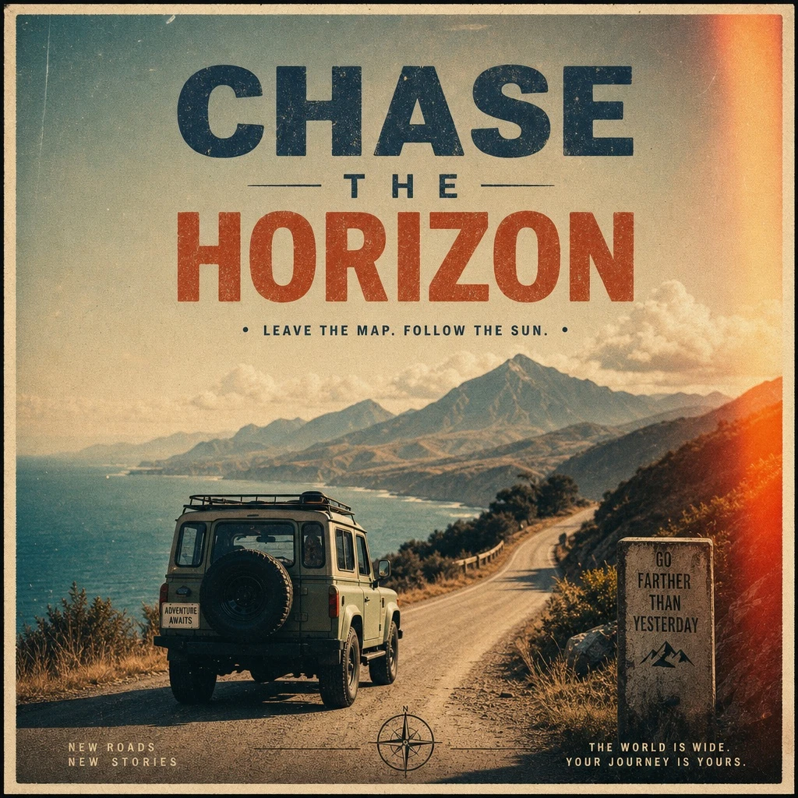

```text
Design a poster with the theme of "[POSTER_TEXT]", rendered in a film photography style with a nostalgic, grainy analog film texture, warm muted tones, soft light leaks, and a composition that evokes the feeling of travel and adventure toward distant natural landscapes.
```

Model: GPT Image 2 · Author: @akokoi1 · adapted and regenerated by ClawLabs AI

[Original source](https://github.com/ClawLabsAI/awesome-verified-text-to-image-prompts/blob/c25274d3c30dca596c21d885ff9dc0c5106ab5c6/prompts.json#L8815) · [Provenance and original license](data/projectd-batch-0014.json)

## Circuit Mandala Fantasy Illustration — ClawLabs AI · MIT

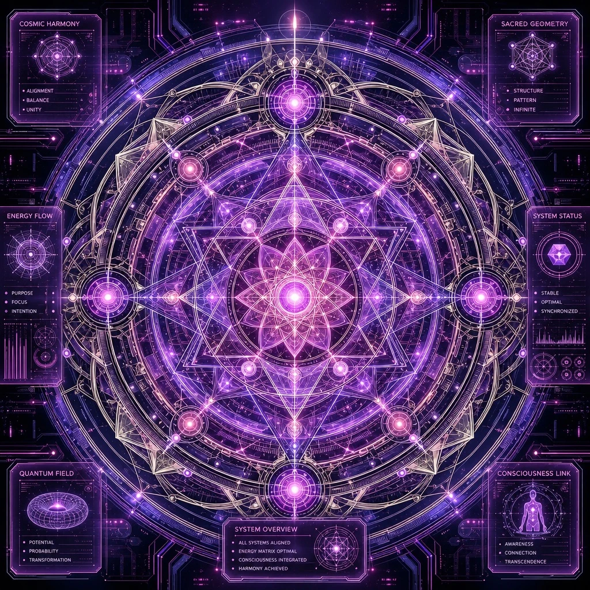

```text
Create a highly detailed illustration of a near-future sci-fi mandala, blending traditional sacred geometry with cyberpunk aesthetics. The design should feature intricate, symmetrical patterns radiating from a central focal point, incorporating futuristic elements like circuit-like traceries, holographic panels, and glowing energy nodes. Render the piece with a strong sense of transparency and layered depth, using a dominant color palette of [COLOR] tones accented with metallic highlights. The overall composition should feel precise, ornate, and technologically advanced, with high resolution and fine linework throughout, evoking both spiritual symbolism and a futuristic sci-fi atmosphere. Square aspect ratio.
```

Model: GPT Image 2 · Author: @4WEB1 · adapted and regenerated by ClawLabs AI

[Original source](https://github.com/ClawLabsAI/awesome-verified-text-to-image-prompts/blob/c25274d3c30dca596c21d885ff9dc0c5106ab5c6/prompts.json#L9354) · [Provenance and original license](data/projectd-batch-0014.json)

## Paper-Cut Skyline Concept Illustration — ClawLabs AI · MIT

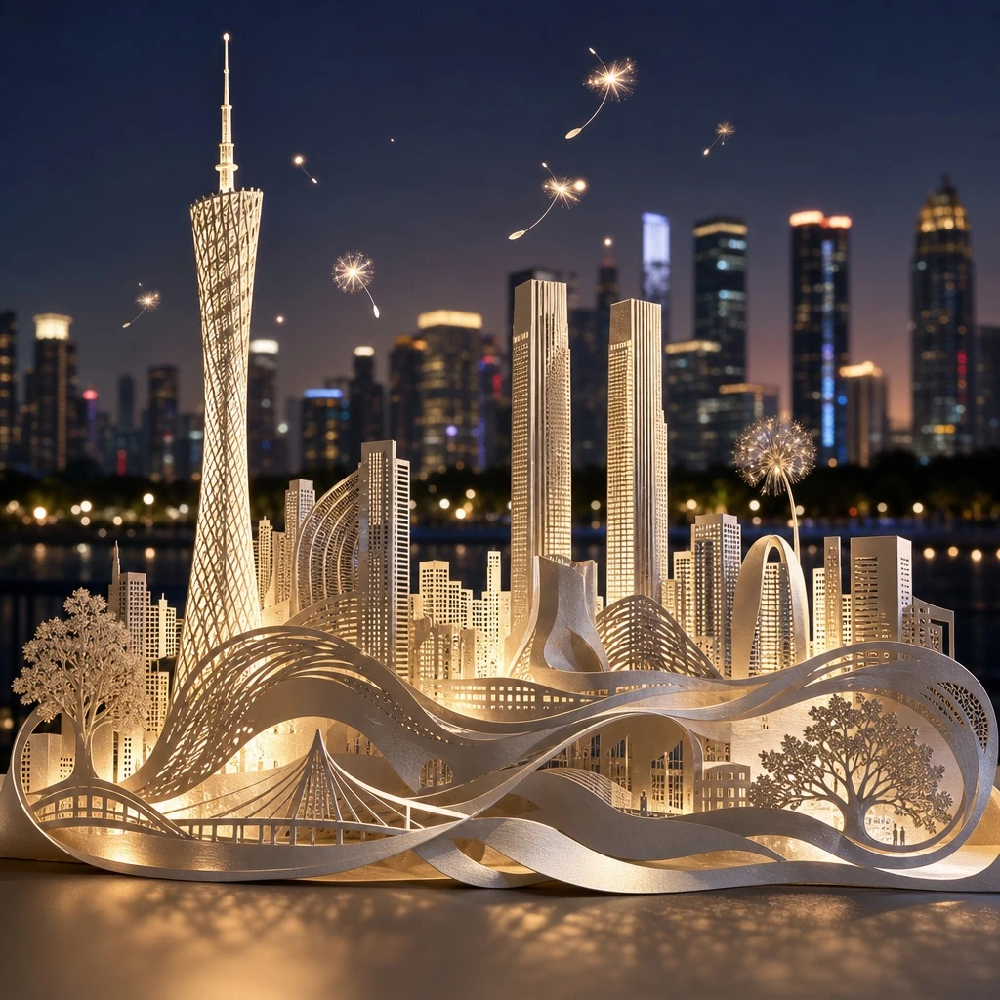

```text
Paper-cut artwork inspired by the modern urban skyline of [CITY_DISTRICT], created through exquisite hollow-carving techniques on a single sheet of paper, three-dimensionally depicting landmark structures such as the [LANDMARK_TOWER] and the [TWIN_TOWERS], along with the bustling cityscape surrounding them. All buildings and elements are connected by smooth, flowing lines and structures, with no isolated or disconnected parts, forming a single continuous urban scroll. The piece uses a metallic foil or glossy paper material, with delicate light-and-dark sheen across the surface, producing soft highlights and shadows under illumination, as if gently lit by the city's own lights. The background features a softly blurred skyline of [CITY_DISTRICT], with faint outlines of [LANDMARK_SQUARE] and scattered trees visible in the distance, creating an overall modern, romantic atmosphere. The composition cleverly incorporates light dandelion fluff or starlight-like floating particles, symbolizing dreams and vitality drifting through this new city. The final image should render in 8K ultra-high-definition, rich in fine detail, photorealistic yet artistically evocative.
```

Model: GPT Image 2 · Author: @liyue_ai · adapted and regenerated by ClawLabs AI

[Original source](https://github.com/ClawLabsAI/awesome-verified-text-to-image-prompts/blob/c25274d3c30dca596c21d885ff9dc0c5106ab5c6/prompts.json#L9483) · [Provenance and original license](data/projectd-batch-0014.json)

## Fictional Regional Restaurant Menu Layout — ClawLabs AI · MIT

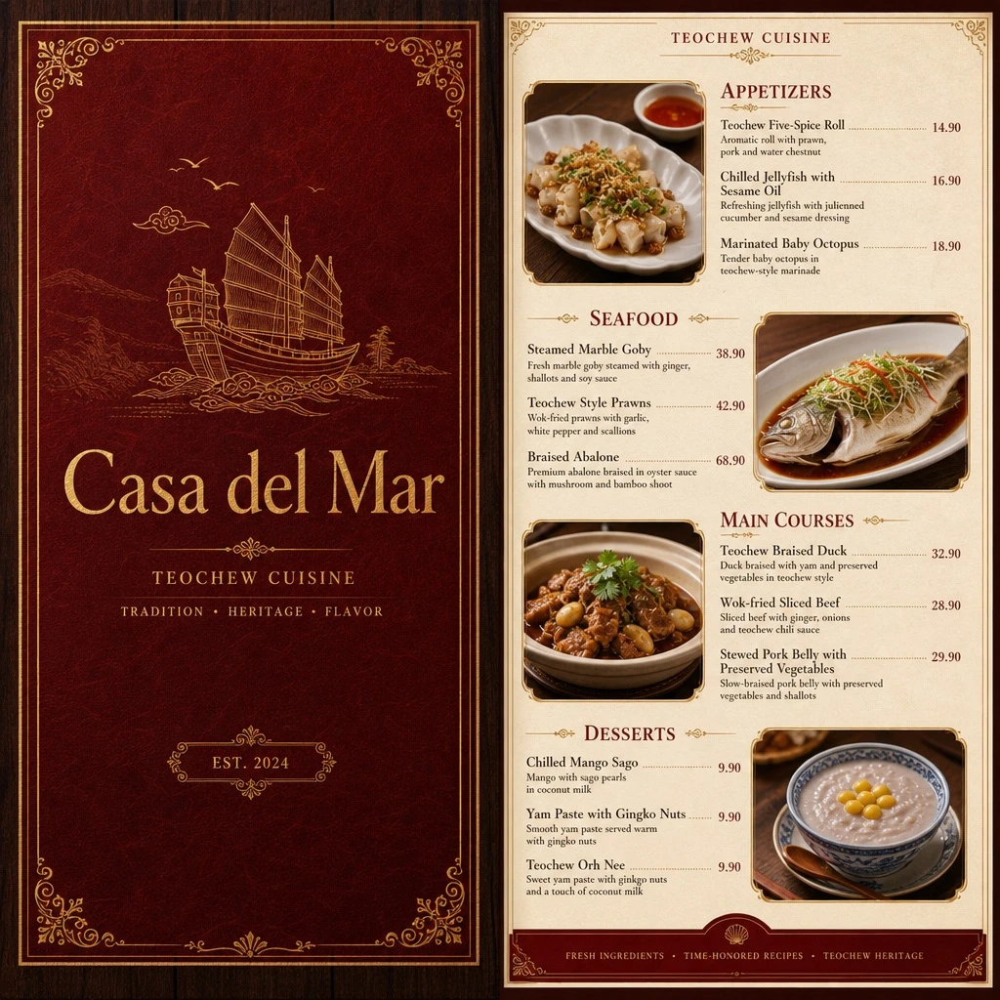

```text
Design an elegant, high-quality menu cover and interior layout for a [CUISINE_TYPE] restaurant. Use a sophisticated composition with traditional decorative border elements, appetizing photography or illustrations of signature dishes, and a clear typographic hierarchy that separates dish names, descriptions, and prices. Apply a warm, upscale color palette of deep reds, gold accents, and dark wood tones that reflects the restaurant's cultural heritage. Organize the menu into sections such as appetizers, seafood, main courses, and desserts, and display the restaurant name '[RESTAURANT_NAME]' prominently on the cover in an elegant serif or brush-style typeface.
```

Model: GPT Image 2 · Author: @MrLarus · adapted and regenerated by ClawLabs AI

[Original source](https://github.com/ClawLabsAI/awesome-verified-text-to-image-prompts/blob/c25274d3c30dca596c21d885ff9dc0c5106ab5c6/prompts.json#L9657) · [Provenance and original license](data/projectd-batch-0014.json)

## Fictional City Double-Exposure Film Poster — ClawLabs AI · MIT

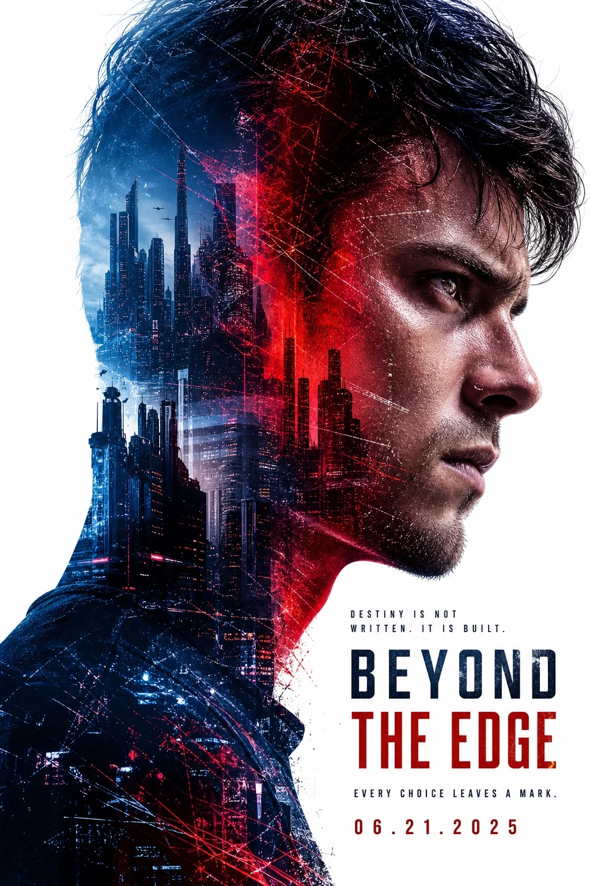

```text
A hyper-realistic cinematic double-exposure portrait of a young man in side profile, with an intense, focused expression, richly detailed skin texture, and sharp, piercing eyes. His face seamlessly blends with a futuristic city skyline emerging from his silhouette, with skyscrapers and urban architecture forming the lines of his neck and jaw. Strong contrast between deep blue and vibrant red tones symbolizes conflict and power. Abstract digital scratches, fractured glass textures, and light leaks overlay the face for a dramatic effect. The background is clean white, with ultra-detailed lighting, professional movie poster style, high contrast, sharp focus, 8K resolution, realistic hair strands, editorial poster composition, modern graphic design aesthetics, dramatic mood, ultra-HD, and photorealistic rendering. Negative elements to avoid: blurriness, low resolution, distorted face, extra limbs, oversaturated colors, noisy background, flat lighting, cartoonish look, low detail.
```

Model: GPT Image 2 · Author: @Fujimoto_hina · adapted and regenerated by ClawLabs AI

[Original source](https://github.com/ClawLabsAI/awesome-verified-text-to-image-prompts/blob/c25274d3c30dca596c21d885ff9dc0c5106ab5c6/prompts.json#L10021) · [Provenance and original license](data/projectd-batch-0014.json)

## Embroidered Birds and Blossoms Illustration — ClawLabs AI · MIT

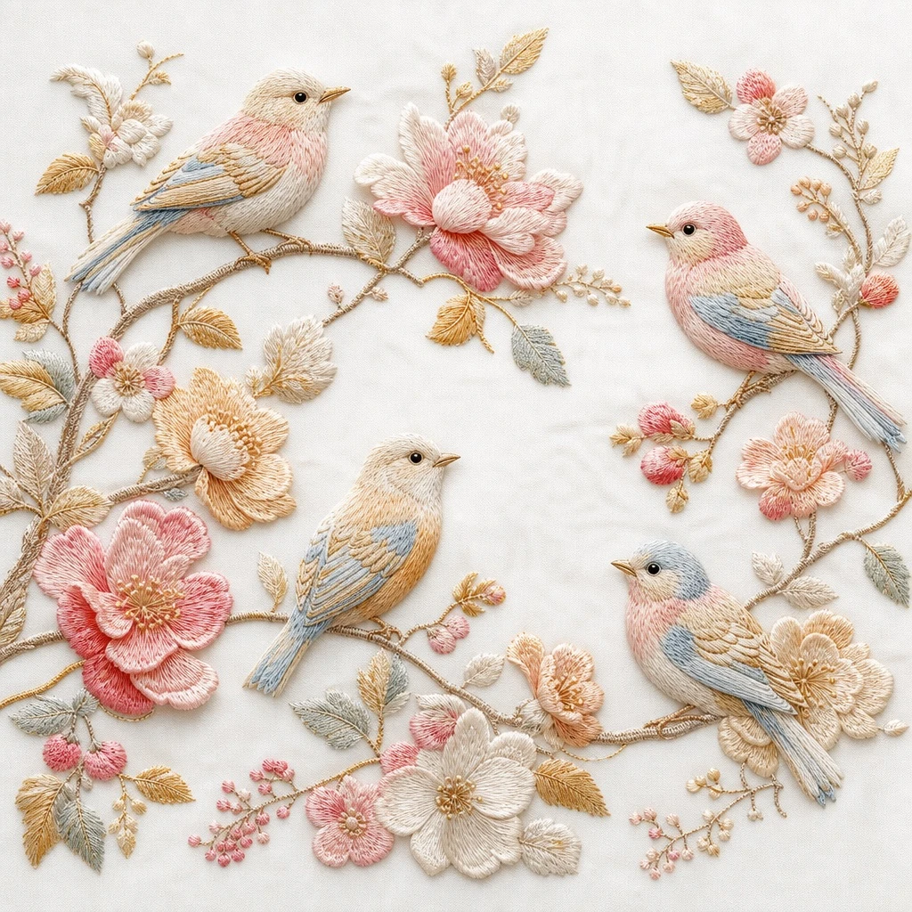

```text
Delicate high-relief embroidery-style illustration with a fiber-art, soft bas-relief effect, featuring a pure background in 'silk white plus cream white' with a refined silky thread texture. The composition shows several small birds perched on winding flowering branches, surrounded by pink-white, pale peach, coral pink, and soft gold blossoms and leaves; the layout is light, elegant, and generously balanced with negative space. The birds' feathers are rendered in cream, pale blue, soft pink, and light gold embroidery threads, the branches are slender and natural, and the flowers are built up with layered stitching. The overall effect should evoke fine handcrafted embroidery, layered thread relief, soft light and shadow, rich detail, and a gentle, fresh artistic mood.
```

Model: GPT Image 2 · Author: @dotey · adapted and regenerated by ClawLabs AI

[Original source](https://github.com/ClawLabsAI/awesome-verified-text-to-image-prompts/blob/c25274d3c30dca596c21d885ff9dc0c5106ab5c6/prompts.json#L10871) · [Provenance and original license](data/projectd-batch-0014.json)

## Night Market Lifestyle Poster Study — ClawLabs AI · MIT

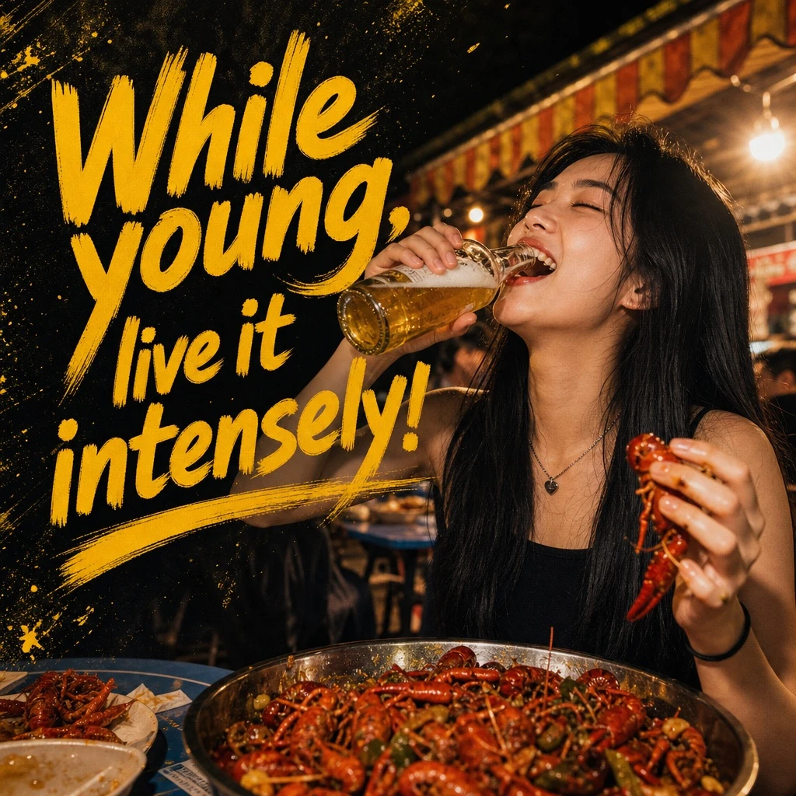

```text
Generate a poster image featuring a [AGE]-year-old [NATIONALITY] girl with long, straight black hair, joyfully drinking beer and eating crayfish at a late-night food stall. The poster displays bold mustard-yellow artistic typography reading: '[POSTER_TEXT]'
```

Model: GPT Image 2 · Author: 小红书号1005414639 · adapted and regenerated by ClawLabs AI

[Original source](https://github.com/ClawLabsAI/awesome-verified-text-to-image-prompts/blob/c25274d3c30dca596c21d885ff9dc0c5106ab5c6/prompts.json#L319) · [Provenance and original license](data/projectd-batch-0014.json)

## Hand-Drawn Cat Sticker Sheet — ClawLabs AI · MIT

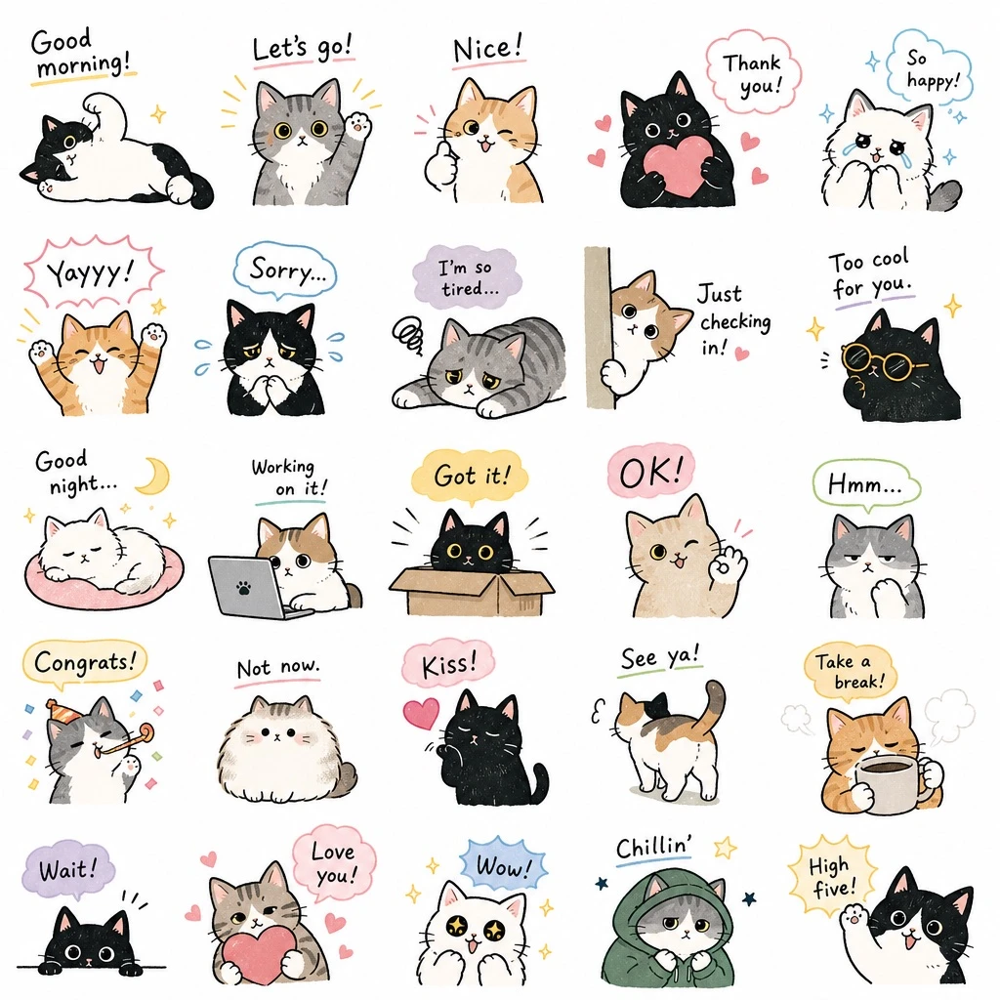

```text
Create [QUANTITY] [BRAND] stickers featuring [ANIMAL_TYPE] in a quirky, hand-drawn illustration style. Design them to appeal to [TARGET_AUDIENCE], with a trendy aesthetic aimed at achieving top download rankings.
```

Model: GPT Image 2 · Author: @midori_tatsuta · adapted and regenerated by ClawLabs AI

[Original source](https://github.com/ClawLabsAI/awesome-verified-text-to-image-prompts/blob/c25274d3c30dca596c21d885ff9dc0c5106ab5c6/prompts.json#L1415) · [Provenance and original license](data/projectd-batch-0014.json)

## Fictional Enchanted Forest Film Poster — ClawLabs AI · MIT


```text
Create an anime-style animated movie poster. The scene depicts a magical, glowing multi-story treehouse restaurant nestled in a dark enchanted forest at night, illuminated by strings of warm lights and the golden glow of its windows. In the center foreground, two children face the restaurant: a boy carrying a backpack and holding a lantern, and a girl in a red coat and beret also holding a lantern. Surrounding them are four anthropomorphic animal characters: a bear dressed as a chef holding a menu book in the bottom left, an owl playing a violin and a squirrel playing a flute perched on a branch in the top left, a badger playing a cello on the mid right, and a rabbit in a suit holding a sign in the bottom right. Near the rabbit, three small black soot-sprite-like creatures with glowing eyes peek out. Four glowing food items float magically in the air: a bowl of soup, a stack of pancakes, a plate of omurice, and a fruit parfait. Typography and text layout: at the top of the poster, a catchphrase reads [TOP_CATCHPHRASE]; the restaurant's building sign reads [RESTAURANT_NAME]; a chalkboard on the left lists today's specials: 'Forest soup, Starry omurice, Fluffy pancakes, Happiness parfait... and more!'; a board on the right reads 'Welcome! This is a place where everyone can smile.'; the main title, rendered in large stylized typography decorated with a chef's hat, fork, and spoon motifs, reads [MOVIE_TITLE]; the sign held by the rabbit reads 'Thank you for the meal! Come again!'; a badge in the bottom left reads [GENRE_BADGE], describing the film's genre and tone; the bottom center shows fictional cast and staff credits in [LANGUAGE]; the bottom area displays a release date reading [RELEASE_DATE]; and the bottom right corner features a QR code with the text 'Scan here for the latest updates!'.
```

Model: GPT Image 2 · Author: @masapark95 · adapted and regenerated by ClawLabs AI

[Original source](https://github.com/ClawLabsAI/awesome-verified-text-to-image-prompts/blob/c25274d3c30dca596c21d885ff9dc0c5106ab5c6/prompts.json#L5139) · [Provenance and original license](data/projectd-batch-0014.json)

## Fictional Amusement Poster Advertisement Layout — ClawLabs AI · MIT


```text
Design a hyper-energetic promotional landing page poster with explosive typography, vibrant colors, and an amusement park night festival aesthetic, laid out in a vertical composition with multiple stacked sections.

Top section: a night sky background filled with fireworks, a brightly lit ferris wheel, and a roller coaster; in the foreground, four young adults cheering and raising their fists, illuminated by dynamic, high-energy lighting. Include bold typography reading '[MAIN_HEADLINE]' as the main headline, '[SUB_HEADLINE]' as the sub headline, and the line 'This one moment will rewrite your life for the best!!' beneath them. Add a badge that reads 'Over [SALES_BADGE] sold!!!'.

Middle section: a title reading 'The 5 ultimate pleasure points for the perfect experience' followed by five numbered highlight points, each with a label and an accompanying image: (1) 'Belly-Laugh Awakening' with people laughing, (2) 'Heart-Racing MAX' with a roller coaster loop, (3) 'Wave of Emotion' with a fireworks explosion, (4) 'Ultimate Freedom Zone' with silhouettes jumping at sunset, and (5) 'Infinite Repeat' with a group of people cheering.

Bonus section: a heading reading 'Limited time only! 5 amazing bonuses included!!!' followed by five listed bonus items: '① Limited-edition design poster', '② Fun quotes booklet (PDF)', '③ Ultimate hype playlist (MP3)', '④ Phone wallpaper set', '⑤ Fun secret video'.

Bottom section: product information showing the product name 'The Ultimate Fun Poster' with three variant labels: 'Full Power ver.', 'Smile Explosion ver.', and 'Peak Emotion ver.'. Below that, pricing information labeled 'Price of your soul' showing the amount '[PRICE]' and the text 'Free shipping'.

Footer: a magenta background band containing the call-to-action text '[FOOTER_CTA]'.
```

Model: GPT Image 2 · Author: @nakazakifam · adapted and regenerated by ClawLabs AI

[Original source](https://github.com/ClawLabsAI/awesome-verified-text-to-image-prompts/blob/c25274d3c30dca596c21d885ff9dc0c5106ab5c6/prompts.json#L5934) · [Provenance and original license](data/projectd-batch-0014.json)

## Fictional Green Tea Advertisement Layout — ClawLabs AI · MIT


```text
Design a promotional advertisement poster for a bottled green tea beverage. The product is a clear plastic PET bottle filled with yellow-green tea, featuring a white label with green typography that displays the product name '[PRODUCT_NAME]', the subtitle 'Green Tea', and vertical text reading 'Made with domestic tea leaves' and 'Rich aroma, refreshing aftertaste'. The background shows a bright, fresh, sunlit outdoor atmosphere with dynamic water splashes wrapping around the bottle and vibrant green tea leaves scattered around. Layout sections: (1) Headline, positioned top-left, large red text with a gold underline and a small green leaf accent, reading '[HEADLINE_TEXT]'. (2) Catchphrase, positioned mid-left, dark green text reading '[CATCHPHRASE_TEXT]'. (3) Features, positioned lower-left, two white pill-shaped banners with green leaf icons, displaying the labels '[FEATURE_TEXT_1]' and '[FEATURE_TEXT_2]'. (4) Price badge, positioned top-right, a red circular sticker with white and yellow text reading 'Limited time!! Special price [PRICE] (tax included)'. (5) Promo banner, positioned bottom-left, an angled red ribbon with yellow and white text reading 'Limited-time special offer!'. (6) Footer, positioned along the bottom edge, a solid green horizontal bar with a white shopping cart icon, displaying the text '[FOOTER_TEXT]'.
```

Model: GPT Image 2 · Author: @AutoIntelliMode · adapted and regenerated by ClawLabs AI

[Original source](https://github.com/ClawLabsAI/awesome-verified-text-to-image-prompts/blob/c25274d3c30dca596c21d885ff9dc0c5106ab5c6/prompts.json#L6002) · [Provenance and original license](data/projectd-batch-0014.json)

## Zodiac Fantasy Mechanical Atlas Illustration — ClawLabs AI · MIT


```text
(Steampunk Scientific Illustrator) You are a professional vintage steampunk anatomy atlas designer specializing in constellation mechanical-structure popular-science posters. Based on the user-specified constellation, [CONSTELLATION_NAME], generate a vintage steampunk-style constellation anatomy atlas poster. The top title bar reads '[CONSTELLATION_NAME] Anatomy Atlas' or 'ANATOMIA [CONSTELLATION_LATIN_NAME]', styled as a vintage ribbon banner. The background is distressed parchment or yellowed old-paper texture, with natural stains and creases, creating a vintage scientific manuscript feel. The central subject is the classic mythological figure of this constellation, with its internal structure replaced by steampunk elements such as precision gears, pipelines, and metal skeletons. All icons and illustrations are rendered in hand-drawn line-art style, using arrows or connecting lines to show logical relationships. The main color palette is warm brown, beige, and bronze, accented with a small amount of high-contrast color to highlight key points. The composition is divided into left and right columns with the main figure centered; functional modules are distributed on both sides, and the bottom section contains a summary and table. The left side contains 3-5 functional modules (each with icon, title, and description) plus a 'Five-Layer Personality Structure' layered diagram. The right side contains 3-5 trait modules (each with icon and label) plus 'Relationship Classification' and 'Ecological Niche' sections. The bottom features an 'Advantages/Risks Comparison Table', a 'Survival Guide', and a closing life-philosophy manifesto banner. Overall the style should be rigorous, exquisite, and steeped in vintage mechanical aesthetics, with clear and readable text, rendered in 4K high definition, direct image output.
```

Model: GPT Image 2 · Author: @GeekCatX · adapted and regenerated by ClawLabs AI

[Original source](https://github.com/ClawLabsAI/awesome-verified-text-to-image-prompts/blob/c25274d3c30dca596c21d885ff9dc0c5106ab5c6/prompts.json#L7361) · [Provenance and original license](data/projectd-batch-0014.json)

## Urban Systems Infographic Layout Study — ClawLabs AI · MIT


```text
Vertical 9:16 isometric cutaway infographic titled '[DIAGRAM_TITLE]'. Depict a smart city from sky to bedrock, showing skyscrapers, streets, subway lines, utility tunnels, water/sewage/gas/heating pipes, fiber optic cables, a data center, flood retention tanks, aquifers, geothermal wells, and bedrock. Use color-coded flows to distinguish power, water, data, traffic, and waste systems. Include 12 numbered panels with labels in [LANGUAGE]: Energy / Water Cycle / Transportation / Data / Waste / Buildings / Public Services / Logistics / Climate Resilience / Ecology / Geology / Governance Dashboard. Add a 24-hour timeline at the bottom. Style: engineering white-paper diagram combined with scientific atlas aesthetics, light paper background, crisp clean lines, 8K resolution. Avoid cyberpunk aesthetics and gibberish text; the illustration must clearly show both above-ground and below-ground layers.
```

Model: GPT Image 2 · Author: 小红书号insight_express · adapted and regenerated by ClawLabs AI

[Original source](https://github.com/ClawLabsAI/awesome-verified-text-to-image-prompts/blob/c25274d3c30dca596c21d885ff9dc0c5106ab5c6/prompts.json#L20) · [Provenance and original license](data/projectd-batch-0014.json)

## Fictional Public-Sector Slide Layout Mockup — ClawLabs AI · MIT


```text
Create an explanatory slide in [FORMAT] style for the theme of [THEME], fusing the gentle, approachable atmosphere of [BRAND]-style illustrations with the overwhelming information density characteristic of dense, bureaucratic government presentation slides associated with [CITY].
```

Model: GPT Image 2 · Author: @yammamon · adapted and regenerated by ClawLabs AI

[Original source](https://github.com/ClawLabsAI/awesome-verified-text-to-image-prompts/blob/c25274d3c30dca596c21d885ff9dc0c5106ab5c6/prompts.json#L621) · [Provenance and original license](data/projectd-batch-0014.json)

## Fictional Four-Panel Advertisement Layout — ClawLabs AI · MIT


```text
Design a 2x2 grid layout of four digital advertisement banners, each filling an equal quadrant, in a polished commercial product/UI photography style.

Top-left quadrant (Travel theme): A couple holding hands on a white sand beach, gazing out at turquoise ocean water under a bright blue sky, with a red hibiscus flower in the bottom-left corner. Overlay text in [LANGUAGE]: "This is the year to break free.", "[TRAVEL_DESTINATION]", "3-Day Healing Trip", "Flight + Hotel", "From ¥39,800", and "Stunning views, gourmet food, and experiences — all in one!". Add three small icons: an airplane, a hotel building, and a car.

Top-right quadrant (Skincare theme): A close-up portrait of a young woman with glowing, dewy skin, eyes closed, gently touching her cheeks, set against a soft pink gradient background with dynamic water splash effects. Include a pink cosmetic jar labeled "[BRAND] Brightening Gel". Overlay text in [LANGUAGE]: "Say Goodbye to Pores and Dullness!", "Overflowing with Transparency", "Toward Glass Skin", "A New Sensation in Skincare", "First-Time Only 78% Off", and "[DISCOUNT_PRICE]". Add three gold circular badges labeled "Pore Care", "High Moisture", and "Firmness & Glow", in [LANGUAGE].

Bottom-left quadrant (Gourmet Food theme): A thick, sliced, medium-rare steak sizzling on a dark grill plate, garnished with garlic chips and a rosemary sprig, against a dark smoky background with glowing embers. Overlay text in [LANGUAGE]: "Melt-in-Your-Mouth Deliciousness!", "[FOOD_ITEM]", "Luxurious Steak", "Limited Time Only", "Special Price", "Regular Price ¥8,980", and "¥4,980". Add one red circular badge labeled "A4/A5 Grade", in [LANGUAGE].

Bottom-right quadrant (Online Education theme): A young man in a blue shirt studying at a desk, writing in a notebook next to an open laptop, under bright indoor lighting. Overlay text in [LANGUAGE]: "In Your Spare Time", "[EDUCATION_GOAL]", "Online Certification Course", "Complete It All on Your Smartphone", "Make a Difference with Efficient Learning!", and "Now Only! 20% Off Tuition". Add one blue circular badge labeled "Over 100,000 Students Enrolled!", in [LANGUAGE], and two icons: a smartphone and an open book.

Overall style: crisp e-commerce advertising aesthetic, vivid commercial photography, bold sans-serif typography overlays, high color contrast, and clean grid separation between the four quadrants.
```

Model: GPT Image 2 · Author: @makaneko_AI · adapted and regenerated by ClawLabs AI

[Original source](https://github.com/ClawLabsAI/awesome-verified-text-to-image-prompts/blob/c25274d3c30dca596c21d885ff9dc0c5106ab5c6/prompts.json#L1707) · [Provenance and original license](data/projectd-batch-0014.json)

## Fashion Design Process Infographic — ClawLabs AI · MIT


```text
Design an editorial fashion design process infographic poster titled '[MAIN_TITLE]', with the subtitle 'FROM FIBER TO FIT' (matching text in [LANGUAGE] 'From Fiber, to Pattern, to Wear'). Style: elegant editorial, technical fashion illustration, highly detailed, rendered in a [COLOR_PALETTE] color palette.

Centerpiece: an exploded-view illustration of a [GARMENT_TYPE], showing cascading layers of fabric, pattern pieces, and stitching lines, with a model wearing the finished garment shown at the top. Include a central numbered list of 13 steps connected by pointer lines: 01 Material, 02 Inspiration, 03 Sketch, 04 Fabric, 05 Draping, 06 Pattern, 07 Sewing, 08 Fitting, 09 Revision, 10 Team, 11 Construction, 12 Garment, 13 Collaboration.

Left column, three modules:
Module 1: Raw Material and Fabric (6 items) - Fiber, Yarn Structure, Fabric Construction, Weight, Drape, Surface Texture.
Module 2: Inspiration and Direction (5 items) - Inspiration Source, Color Direction, Woman Image, Occasion Positioning, Silhouette Intention.
Module 3: Design Sketch and Silhouette (7 items) - Design Sketch, Construction Line, Front Back Relationship, Neckline, Shoulder Line, Waist Line, Hem Proportion.

Right column, three modules:
Module 4: Patternmaking and Draping (6 items) - Draping, Patternmaking, Dart, Panel Line, Ease, Grain Direction.
Module 5: Cutting and Sampling (5 items) - Cutting, Layout, Sample Sewing, Construction Sequence, Technique Test.
Module 6: Fitting and Revision (4 items) - Fitting, Fit Issues, Before, After.

Bottom row, four modules:
Module 7: Team Collaboration (8 items) - Designer, Patternmaker, Fabric Buyer, Sample Maker, Merchandiser, QC, Feedback Loop, Model.
Module 8: Final Garment Presentation (3 items) - Details, Finished Front & Back, Labels & Care.
Module 9: Final Wear (3 items) - Drape, Proportion, Movement in Motion.
Module 10: The Chain Summary (8 items) - Material Foundation, Aesthetic Judgment, Structural Engineering, Craft Realization, Body Negotiation, Team Collaboration, Iterative Revision, Final Garment.

Footer caption: '[FOOTER_TEXT]'.
```

Model: GPT Image 2 · Author: @hx831126 · adapted and regenerated by ClawLabs AI

[Original source](https://github.com/ClawLabsAI/awesome-verified-text-to-image-prompts/blob/c25274d3c30dca596c21d885ff9dc0c5106ab5c6/prompts.json#L2586) · [Provenance and original license](data/projectd-batch-0014.json)

## Photography Process Infographic Poster — ClawLabs AI · MIT


```text
Create a highly detailed technical infographic poster about [SUBJECT], designed as an educational chart in a technical, precise style with wireframe elements, glowing data lines, photorealistic camera components, and clean typography.

At the top, include a header with the main title '[MAIN_TITLE]' and a subtitle reading 'FROM WORLD TO IMAGE'.

The centerpiece is an exploded isometric view of a modern mirrorless camera, styled after a [CAMERA_MODEL]-type body, with 12 labeled parts: EVF, Body Structure, Control Dials, Thermal Design, Optical Axis, IBIS Stabilizer, Shutter Unit, Full-Frame Sensor, [PROCESSOR_NAME], Main PCB, High-Speed Bus, and Card Slot.

On the left column, show a chronological causal chain of 13 steps: 01 REALITY EXISTS, 02 PHOTONS LEAVE THE WORLD, 03 LENS ACCEPTS & BENDS LIGHT, 04 APERTURE SELECTS, 05 SHUTTER CUTS TIME, 06 FOCUS SETS PRIORITY, 07 SENSOR RECEIVES EVENT, 08 LIGHT BECOMES CHARGE, 09 ANALOG READOUT, 10 A/D CONVERSION, 11 COMPUTATION RECONSTRUCTS, 12 IMAGE APPEARS, 13 MEMORY OUTLIVES.

On the right column, include a section titled '8 MODULES' listing 8 modules: 1 ORIGIN OF LIGHT, 2 LENS SHAPES REALITY, 3 APERTURE & SHUTTER EDIT THE WORLD, 4 FOCUS DECIDES CLARITY, 5 SENSOR MEASURES LIGHT, 6 SIGNAL BORN & AMPLIFIED, 7 COMPUTATION BUILDS IMAGE, 8 FILE BECOMES MEMORY.

Add 7 side diagrams illustrating: ray cone & image formation, aperture & depth of field, shutter & motion, focal plane & clarity, pixel structure, photoelectric conversion, and analog signal waveform.

At the bottom, include a footer section with 5 philosophical summary points related to the theme.

Render the overall visual style as technical and precise, featuring wireframe elements, glowing data lines, photorealistic camera components, and clean typography throughout the composition.
```

Model: GPT Image 2 · Author: @hx831126 · adapted and regenerated by ClawLabs AI

[Original source](https://github.com/ClawLabsAI/awesome-verified-text-to-image-prompts/blob/c25274d3c30dca596c21d885ff9dc0c5106ab5c6/prompts.json#L2782) · [Provenance and original license](data/projectd-batch-0014.json)

## Optical Table Diagram Setup — ClawLabs AI · MIT


```text
Create a 3D-rendered scientific hardware diagram in an infographic, realistic style, illustrating an optical table setup with a red laser beam passing through 11 aligned optical components mounted on black posts, arranged left to right.

Add labeled brackets across the top identifying four functional sections: 'Dual Modulation' spanning SLM1; '4f Relay Optics' spanning from Lens L1 to Lens L2; 'Imaging Optics' spanning from SLM2 to Lens L4; and 'Detection' spanning the Camera.

Arrange the optical components in this order from left to right, each with its label:
1. Laser, labeled 'Laser' and 'λ = [LASER_WAVELENGTH]'
2. SLM1, labeled 'SLM1' and '(Phase / Pol. Mod.)'
3. Lens L1, labeled 'Lens L1' and '(f1)'
4. Iris, labeled 'Fourier Plane', '(Pupil Plane)', 'Iris', and '(Higher Orders Filtered)'
5. HWP, labeled 'HWP' and '(λ/2)'
6. Lens L2, labeled 'Lens L2' and '(f1)'
7. SLM2, labeled 'SLM2' and '(Phase / Pol. Mod.)'
8. Lens L3, labeled 'Lens L3' and '(f2)'
9. Lens L4, labeled 'Lens L4' and '(f2)'
10. Linear Polarizer, labeled 'Linear', '-Polarizer', and '(Global Analyzer)'
11. Polarization Camera, labeled 'POLARIZATION CAMERA'

In the bottom-right corner, include an inset box titled 'Polarization Camera Micro-Polarizer Array (Per-Pixel Analyzer)' showing a 4x4 grid of colored squares with directional arrows, accompanied by a 4-item legend:
- Red square with horizontal arrow, labeled '0° (H)'
- Green square with vertical arrow, labeled '90° (V)'
- Blue square with diagonal arrow, labeled '45° (D)'
- Yellow square with diagonal arrow, labeled '135° (A)'

At the bottom of the image, include a figure caption starting with '[FIGURE_NUMBER]' followed by the bold title '[SYSTEM_NAME]', and a paragraph of scientific explanatory text describing the dual-modulation configuration, 4f relay optics, and polarization camera setup.
```

Model: GPT Image 2 · Author: @HumanOS_v2 · adapted and regenerated by ClawLabs AI

[Original source](https://github.com/ClawLabsAI/awesome-verified-text-to-image-prompts/blob/c25274d3c30dca596c21d885ff9dc0c5106ab5c6/prompts.json#L3059) · [Provenance and original license](data/projectd-batch-0014.json)

## Voxel Game Interface Screenshot — ClawLabs AI · MIT


```text
A highly detailed, realistic first-person video game screenshot set in a next-generation voxel-based world. At the top center, a large, bold 3D logo reads "[GAME_TITLE]". The scene features [ENVIRONMENT]. The world blends realistic lighting, volumetric clouds, and high-resolution textures with cubic, voxel geometry. In the foreground on the left, a [MOB_1] stands on the grass, while a [MOB_2] stands on the dirt path to the right. On the far right, the player's hand holds a [HELD_ITEM] in first-person perspective. At the bottom of the screen is a game user interface featuring a health bar with 10 red hearts, a green experience bar showing the number '16', a hunger bar with 10 brown meat icons, and a 9-slot inventory hotbar. The hotbar contains, from left to right: a selected blue tool with a green highlight box, a green tool, a knife, a wrench with the number '3', a piece of meat labeled '6', a lantern labeled '24', a dirt block labeled '10', a bucket, and a sponge block.
```

Model: GPT Image 2 · Author: @wolfaidev · adapted and regenerated by ClawLabs AI

[Original source](https://github.com/ClawLabsAI/awesome-verified-text-to-image-prompts/blob/c25274d3c30dca596c21d885ff9dc0c5106ab5c6/prompts.json#L3205) · [Provenance and original license](data/projectd-batch-0014.json)

## Fictional Viral Campaign Landing Page Mockup — ClawLabs AI · MIT


```text
Design a UI/UX landing page mockup in dark mode with a sleek, modern glassmorphism aesthetic and glowing [ACCENT_COLOR] accents throughout. In the header, place a logo reading '[BRAND_NAME]' on the left and a top-right tag labeled 'VIRAL CAMPAIGN CASE STUDY'. The page layout should include the following sections in order: (1) A Hero section with a bold headline '[HERO_HEADLINE]' and a subheadline stating that the campaign exploded across the internet in 3 days, driving exponential brand growth; below it, a row of 4 stat cards labeled Total Views, Engagement Rate, Conversion Inquiries, and Execution Timeframe, with values '[MAIN_STATISTIC]', '18.7%', '3,200+', and '72 hours'; the hero visual is a cinematic shot of a person in a hoodie looking at glowing digital screens and graphs, with a large play button overlay. (2) A Strategy section titled 'Our 3-Day Execution Strategy' laid out as a vertical timeline with 3 steps, each containing a timeline node, a title, bullet points, a video thumbnail with a play button, and a description box. (3) A Performance section titled 'Data-Driven Performance' with a left column of 4 stat cards showing '10M+', '43%', '28,000+', and '3,200+', and a right column with two charts: a line graph showing 7-day growth peaking at Day 3, and a horizontal segmented bar chart showing platform distribution as [PLATFORM_DISTRIBUTION]. (4) A 'Keys to Success' section titled 'The 3 Keys to Viral Success' with 3 cards, each featuring a glowing icon (fire, target, or antenna), a title, a description, and a 'VIEW DETAIL' link. (5) A Social Proof section titled 'TRUSTED BY CREATORS & BRANDS' with a left column showing an 8-logo grid arranged 2x4 featuring [BRAND_LOGOS], and a right column with 2 testimonial cards each containing a quote and an author title such as SaaS Founder or Growth Manager. (6) A Call to Action section titled 'READY TO GO VIRAL?' with a text input field and a glowing button reading '[CTA_TEXT]', accompanied by a 3D render of a rocket ship taking off with purple and blue flames.
```

Model: GPT Image 2 · Author: @IndieDevHailey · adapted and regenerated by ClawLabs AI

[Original source](https://github.com/ClawLabsAI/awesome-verified-text-to-image-prompts/blob/c25274d3c30dca596c21d885ff9dc0c5106ab5c6/prompts.json#L5296) · [Provenance and original license](data/projectd-batch-0014.json)

## Brand Identity Guideline Poster — ClawLabs AI · MIT


```text
Design a brand identity system presentation board (UI poster style, realistic render), similar to a professional brand guideline deck used for client presentations.

Header: title text 'BRAND IDENTITY SYSTEM', with slogan text '[SLOGAN]' displayed beneath it.

Main logo section: primary logotype text '[BRAND_NAME]' with subtitle '[BRAND_CHINESE_NAME]', design feature described as [MAIN_SUBJECT]. Metadata labels beside the logo read: 'Brand Name', 'Industry Attribute: [INDUSTRY]', and 'Design Date: 2024.05'.

Layout sections arranged in a structured grid:
1. Design Grid (1 item): the logo displayed with architectural grid lines and golden ratio measurement guides.
2. Concept Sketches (4 items): evolution steps showing progression from a rough dog sketch to the final geometric logo.
3. Inspiration Sources (4 items): a moodboard with images including minimalist architecture, a golden retriever dog, and dark green geometric shapes.
4. Creative Concept (4 items): text blocks paired with minimalist icons explaining the design philosophy, brand positioning, color psychology, and logo scalability.
5. Brand Applications (6 items) labeled: 'Business Card Front & Back', 'Letterhead & Envelope', 'App Icon', 'Website Header / Favicon', 'Product Packaging / Shopping Bag', and 'Storefront Sign / Signage'. Mockups show business cards, envelopes, app icons, a website header featuring a dog, paper shopping bags, and a storefront sign.
6. Color Specifications (5 swatches) labeled 'Primary Color', 'Secondary Color', 'Accent Color', with color values: [PRIMARY_COLOR], #F5F3EF, #E5E2DD, #A8C5B1, #E0A86E.
7. Typography Specifications (2 samples) labeled '[FONT_NAME_1]' and '[FONT_NAME_2]', showing typography specimens with 'Aa', the full alphabet, and numerals.
8. Minimum Usage Size (2 items): minimum logo size specifications shown at 20mm and 12mm.
9. Clear Space Area (1 item): the logo surrounded by a bounding box with 'X' markers indicating required clear space margins.
10. Incorrect Usage Examples (5 items) labeled: 'Do Not Stretch or Distort', 'Do Not Change Color', 'Do Not Add Drop Shadow', 'Do Not Tilt', and 'Do Not Use on Complex Background'. Show examples of incorrect logo usage: stretched, wrong color, with a drop shadow, tilted, and placed over a busy photographic background.

Overall style: clean, professional grid layout typical of a modern brand guideline board, realistic UI poster rendering with balanced whitespace and consistent typographic hierarchy.
```

Model: GPT Image 2 · Author: @yyyole · adapted and regenerated by ClawLabs AI

[Original source](https://github.com/ClawLabsAI/awesome-verified-text-to-image-prompts/blob/c25274d3c30dca596c21d885ff9dc0c5106ab5c6/prompts.json#L5463) · [Provenance and original license](data/projectd-batch-0014.json)

## Livestream Shopping Interface Mockup — ClawLabs AI · MIT


```text
Design a realistic mobile livestream e-commerce interface mockup. The main subject is [PERSON], wearing a black t-shirt printed with the [BRAND] logo, gesturing enthusiastically toward the camera with both hands as if explaining a product. A small watermark reading '[WATERMARK_TEXT]' appears subtly on the screen. Behind the host, a large display screen shows a Mars landscape featuring a rocket and dome habitats, with the word '[BRAND]' and a secondary title '[BACKGROUND_TITLE]' rendered in [LANGUAGE] text overlaying the scene. The UI layout should include: a header showing the broadcaster's name '[BROADCASTER_NAME]', a stat line '750.8k likes this session', a 'Follow' button, viewer avatars with the text '100k+ viewers', a close 'X' icon, and tags reading 'No.1 on sales chart' and 'More livestreams >'. Include a mid-right product card labeled 'Now Explaining' showing an image of Mars dome habitats, with product title '[PRODUCT_TITLE]', price '[PRICE]', and a red action button reading 'Grab it'. On the bottom-left, add a chat overlay showing a join alert 'User joined the livestream' and seven scrolling chat messages, the top one being '[TOP_CHAT_MESSAGE]', followed by messages such as 'Mars Bro: How much per seat?', 'Tech Fan: So cool! Want to go to Mars!', 'Future Is Now: How do I sign up?', 'Little Rocket: 🌹🌹🌹', 'Cosmic Invincible: Explain the details', and 'Undefeated East: Old Ma is awesome! 👍👍👍'. At the bottom, include an input bar with placeholder text 'Say something...' and four icons: shopping cart, gift box, heart-shaped planet, and a plus sign. In the bottom-right corner, show floating reaction animations with a stack of hearts, thumbs-up, and laughing emojis rising upward. The overall style should look like a realistic, polished UI screenshot of a livestream shopping app interface, sharp typography, vibrant colors, and authentic app layout proportions, in portrait mobile aspect ratio.
```

Model: GPT Image 2 · Author: @JCutcut47692 · adapted and regenerated by ClawLabs AI

[Original source](https://github.com/ClawLabsAI/awesome-verified-text-to-image-prompts/blob/c25274d3c30dca596c21d885ff9dc0c5106ab5c6/prompts.json#L6307) · [Provenance and original license](data/projectd-batch-0014.json)

## RAG Technology Explainer Diagram — ClawLabs AI · MIT


```text
Create a detailed technical infographic explaining Retrieval-Augmented Generation (RAG) technology. Illustrate the full architecture and workflow, including the user query, the retriever module, the knowledge base or vector database, the augmented prompt construction step, and the generator (large language model) that produces the final answer. Use clearly labeled boxes and directional arrows to show the data flow between each stage. Apply a clean, modern chart style with a coherent color palette, readable typography, well-organized layout, and a professional look suitable for a technical presentation slide.
```

Model: GPT Image 2 · Author: 苍何原创实测（公众号文章《我逆向了 329 条 GPT-Image2 提示词模板，全部开源！》） · adapted and regenerated by ClawLabs AI

[Original source](https://github.com/ClawLabsAI/awesome-verified-text-to-image-prompts/blob/c25274d3c30dca596c21d885ff9dc0c5106ab5c6/prompts.json#L10474) · [Provenance and original license](data/projectd-batch-0014.json)

## Seasonal Packaging Campaign Grid — ClawLabs AI · MIT


```text
PHASE 1 - PRODUCT: [ITEM] in [MATERIAL] packaging, minimal label design
PHASE 2 - GRID: 2x2 seasonal grid, four distinct brand worlds
PHASE 3 - COMPOSITION: each quadrant is a full campaign scene with props and environment
PHASE 4 - CONSISTENCY: same product silhouette across all four quadrants, four distinct seasonal color palettes

Swappable variables: [ITEM] / [MATERIAL] / [LABEL STYLE]
```

Model: GPT Image 2 · Author: @SRKDAN · adapted and regenerated by ClawLabs AI

[Original source](https://github.com/ClawLabsAI/awesome-verified-text-to-image-prompts/blob/c25274d3c30dca596c21d885ff9dc0c5106ab5c6/prompts.json#L10686) · [Provenance and original license](data/projectd-batch-0014.json)

## 3D Exploded Assembly Diagram — ClawLabs AI · MIT


```text
Create a highly detailed, insanely intricate 3D exploded assembly drawing of [SUBJECT], showcasing every individual component separated and suspended along a central axis to clearly reveal the internal structure, layered parts, and assembly order.
```

Model: GPT Image 2 · Author: @Ankit_patel211 · adapted and regenerated by ClawLabs AI

[Original source](https://github.com/ClawLabsAI/awesome-verified-text-to-image-prompts/blob/c25274d3c30dca596c21d885ff9dc0c5106ab5c6/prompts.json#L11281) · [Provenance and original license](data/projectd-batch-0014.json)

## Brand Identity Moodboard Study — ClawLabs AI · MIT


```text
Full brand identity system for [BRAND] — Brand Identity Moodboard.

STEP 1 — DECODE THE BRAND
Extract from real brand guidelines only:
- Colors: full official palette (primary, secondary, neutrals, accents) — exact, no approximations.
- Type: weight, width, tracking, and capitalization style — applied identically across all cards.
- Copy: real slogans, campaigns, product names, manifesto phrases — zero invented text.
- World: the brand's domain (sport / tech / fashion / music / etc.) — all imagery stays inside it.

STEP 2 — OUTPUT
Single 16:9 flat image. Black (#000–#0A0A0A) background. 8 cards arranged in an asymmetric 3-column grid. Uniform 8–12px gaps. Rounded corners of 8–12px. Every card uses only the colors, type, and copy defined in Step 1.

CARDS — in order:
1. LOGO LOCKUP (wide, top-left) — brand-color background, official logo/wordmark, oversized cropped logo mark used as a structural graphic. No photo.
2. EDITORIAL PHOTO (mid-left) — dark photo from the brand's world, manifesto headline set in the brand's type over the image, wordmark small at the bottom.
3. CAMPAIGN BANNER (wide, bottom-left) — flat accent-color background, real event/campaign headline in bold condensed type on the left side, action photo cropped into the right side.
4. STORY FORMAT (tall, full-height, center) — full-bleed photo, oversized display type partially cropped by the edges, date/location detail at the top. Mobile story proportions.
5. TYPOGRAPHIC POSTER (upper center-right) — vivid accent background, campaign headline with one letter replaced by a real object from the brand's world, edition tag below.
6. COLOR PALETTE (center-right) — vertical equal stripes, one per brand color, color name labeled at the bottom of each stripe. No photo. Zero decoration.
7. PRODUCT MOCKUP (upper right) — studio photo of a real brand product or branded device/interface, neutral background, accurate logo/color/type placement.
8. TYPE PATTERN (lower right) — brand name/slogan repeated as an all-over pattern at varied sizes and angles, with an editorial photo overlaid and color-treated to integrate.

RULE: Someone familiar with this brand must immediately confirm that every card belongs to it.
Output quality: Behance brand identity case study / agency pitch deck level.
```

Model: GPT Image 2 · Author: ClawLabs AI · adapted prompt and regenerated preview

[Original source](https://github.com/ClawLabsAI/awesome-verified-text-to-image-prompts/blob/c25274d3c30dca596c21d885ff9dc0c5106ab5c6/prompts.json#L19222) · [Provenance and original license](data/projectd-batch-0014.json)

## Landscape Architecture Competition Board — ClawLabs AI · MIT


```text
Generate a 3:4 vertical, competition-grade landscape architecture presentation board. The board blends photorealistic aerial rendering with refined architectural diagram language, in the style of a high-end international landscape competition submission. Mood: calm, atmospheric, regenerative, ecological, scientific yet poetic. Layout (three stacked zones): 1. Top zone: analytical ecological diagrams and mapping overlays. 2. Middle zone: a large aerial landscape rendering as the primary focal image. 3. Bottom zone: a continuous sectional cut through the ecological landscape system. Top analytical zone: simplified ecological maps with soft, transparent color overlays; ultra-thin linework in white and pale gray; diagrams of water flow, circulation systems, ecological networks, habitat zones, and landscape connectivity; dashed lines for movement and flow; minimal annotations and soft ecological icons; floating overlay effect sitting above the rendering; very light pastel tones, high transparency, clean spacing, no dense clutter. Middle aerial rendering: bird's-eye view of an ecological restoration landscape; wetlands, ponds, flowing water systems, vegetation patches, bioswales, regenerative terrain; soft, slightly desaturated palette of greens, browns, and muted water blues; atmospheric depth with subtle haze in the distance; gentle human and ecological activity such as walking paths, birds, small environmental interactions; wide landscape depth, smooth terrain transitions, calm cinematic environmental lighting; soft paper-texture finish integrated into the rendering. Bottom sectional cut: continuous section through terrain and ecological systems; soil layers, hydrology, groundwater movement, vegetation roots, ecological restoration processes, water filtration systems; thin white or pale linework, muted tones, minimal color; arrows indicating water movement and ecological flow; elegant architectural drafting quality, seamlessly merged into the board. Diagram language: extremely thin and precise linework, slightly softened edges with no harsh vector look, minimal labels, clean scientific notation, soft ecological symbols, balanced between scientific clarity and poetic visualization. Color system: base tones of desaturated greens, earthy browns, and muted blue water tones; overlay tones of pale green, soft cyan, light beige, and translucent pastel layers; avoid saturated accents, harsh contrast, bright reds, or overly graphic colors. Texture and atmosphere: soft atmospheric rendering, slight environmental haze, diffused lighting, subtle paper-grain or printed board texture, refined competition-board aesthetic. Format: 3:4 vertical architectural competition board composition.
```

Model: GPT Image 2 · Author: ClawLabs AI · adapted prompt and regenerated preview

[Original source](https://github.com/ClawLabsAI/awesome-verified-text-to-image-prompts/blob/c25274d3c30dca596c21d885ff9dc0c5106ab5c6/prompts.json#L21315) · [Provenance and original license](data/projectd-batch-0014.json)

## Scandinavian coffee shop poster — ClawLabs AI · MIT


```text
Poster for a specialty coffee shop, Scandinavian editorial style, a [CUP_COLOR] ceramic cup resting on [WOOD_TONE] light wood, soft natural window light, large bold typography at the top displaying the text '[SHOP_NAME]'
```

Model: GPT Image 2 · Author: ClawLabs AI · adapted prompt and regenerated preview

[Original source](https://github.com/ClawLabsAI/awesome-verified-text-to-image-prompts/blob/c25274d3c30dca596c21d885ff9dc0c5106ab5c6/prompts.json#L21703) · [Provenance and original license](data/projectd-batch-0014.json)

## Fruit-shaped cardboard packaging concept — ClawLabs AI · MIT


```text
A high-quality professional product photography of a creative structural packaging design for [FRUIT_NAME]. The packaging is made of premium corrugated cardboard, intricately crafted into the literal shape of a giant stylized [SHAPE] [FRUIT_NAME].

The exterior surface features a vibrant and sophisticated printed pattern of minimalist [PATTERN], mimicking the natural skin of the fruit in a duo-tone palette of [COLOR_1] and [COLOR_2].

Features clever die-cut windows that reveal the actual [PRODUCT_INSIDE] stored inside. Minimalist modern typography on the side saying "[NAME]". Includes eco-friendly details like a small recycling logo and a [CARDBOARD_DETAIL] on top. Soft studio lighting with gentle shadows, placed on a clean solid pastel [BACKGROUND_COLOR] background. 8k resolution, photorealistic, cinematic composition, industrial design aesthetic.
```

Model: GPT Image 2 · Author: @Arminn_Ai · adapted and regenerated by ClawLabs AI

[Original source](https://github.com/ClawLabsAI/awesome-verified-text-to-image-prompts/blob/c25274d3c30dca596c21d885ff9dc0c5106ab5c6/prompts.json#L25500) · [Provenance and original license](data/projectd-batch-0014.json)

## Exploded component render — ClawLabs AI · MIT


```text
Hyperrealistic 3D radial exploded view of [PRODUCT], with [NUMBER] components bursting outward from a central axis in every direction, frozen mid-air. True spatial explosion with depth and parallax, not a vertical stack. Components radiate outward from the core: [SHELL], [DISPLAY], [FRAME], [MAINBOARD], [BATTERY], plus a cluster of smaller internal parts shown in three floating callout circles. Materials render with extreme fidelity: glass refracts light and catches specular highlights, aluminium shows brushed grain and machined edges, circuit traces glow faintly amber, rubber gaskets are matte with micro-texture, and cables show soft bend physics. Each component has a hairline leader line to a floating label box: the component name in uppercase, its function in italic beneath it, and a key spec in monospace font, all radiating outward with no overlaps. Lighting mixes cool diffused overhead light with warm amber underlighting on internal parts and a thin blue rim light on the outer shell; displays emit a soft UI glow and circuits self-illuminate. Background is a deep, non-reflective [COLOR]. Title "[PRODUCT_NAME]" appears top right, subtitle "[TAGLINE]" beneath it, and a spec block "[SPEC_1] / [SPEC_2] / [SPEC_3]" in monospace sits bottom left. Mood: precision teardown documentation meets technical manual meets glossy tech-magazine cover. 4K, tack sharp, extraordinary material fidelity.
```

Model: GPT Image 2 · Author: @AllaAisling · adapted and regenerated by ClawLabs AI

[Original source](https://github.com/ClawLabsAI/awesome-verified-text-to-image-prompts/blob/c25274d3c30dca596c21d885ff9dc0c5106ab5c6/prompts.json#L25748) · [Provenance and original license](data/projectd-batch-0014.json)

## Zine DIY — bthnbdk · CC BY 4.0


```text
a lone figure standing in an open landscape, Zine DIY (1970s-, Britain and United States): cut-and-paste headlines; photocopied photos; typewriter text; marker corrections; mismatched paper stocks. Palette: toner black, xerox grey, highlighter yellow. Mood: self-publishing, subcultural voice, anti-corporate honesty
Medium: photocopied zine page, toner grain, cut-and-paste collage. Lighting: soft directional daylight, subtle chiaroscuro, long shadows. Composition: centered lone figure, wide open landscape, generous negative space, horizon at lower third. Rendering: sharp, high detail.
--no watermark, text artefacts, muddy colour, extra limbs
```

Model: Nano Banana · Author: bthnbdk · AI Art Style Prompt Library · CC BY 4.0

[Original source](https://github.com/bthnbdk/ai-art-style-prompts/blob/028aad93ea9da35064f50643bf408207c8c5244c/data/styles.json#L5938) · [Provenance and original license](data/projectd-batch-0014.json)

## Coloured Pencil Drawing — bthnbdk · CC BY 4.0


```text
a lone figure standing in an open landscape, Coloured Pencil Drawing (1900s-, Europe and United States): waxy layered pencil pigment; visible directional strokes; paper tooth breaking through the colour; smooth build-up in one area and sketchy strokes in another. Palette: warm saturated pencil colours, waxy bloom, cream paper. Mood: handcrafted warmth, patient layering, illustration-studio charm
Medium: coloured pencils on textured paper, waxy matte surface, visible strokes. Lighting: soft directional daylight, subtle chiaroscuro, long shadows. Composition: centered lone figure, wide open landscape, generous negative space, horizon at lower third. Rendering: sharp, high detail.
--no watermark, text artefacts, muddy colour, extra limbs
```

Model: Nano Banana · Author: bthnbdk · AI Art Style Prompt Library · CC BY 4.0

[Original source](https://github.com/bthnbdk/ai-art-style-prompts/blob/028aad93ea9da35064f50643bf408207c8c5244c/data/styles.json#L6128) · [Provenance and original license](data/projectd-batch-0014.json)

## 16-Bit SNES — bthnbdk · CC BY 4.0


```text
a lone figure standing in an open landscape, 16-Bit SNES (1990-1996, Japan): parallax scrolling; detailed sprite shading; mode-7 floor effects; ornate HUD frames; tile-built castles. Palette: rich jewel tones, deep shadow blues, metallic highlights. Mood: epic scale, handcrafted detail, RPG grandeur
Medium: pixel graphic, 16-bit palette, parallax layers, scanlines. Lighting: soft directional daylight, subtle chiaroscuro, long shadows. Composition: centered lone figure, wide open landscape, generous negative space, horizon at lower third. Rendering: sharp, high detail.
--no watermark, text artefacts, muddy colour, extra limbs
```

Model: Nano Banana · Author: bthnbdk · AI Art Style Prompt Library · CC BY 4.0

[Original source](https://github.com/bthnbdk/ai-art-style-prompts/blob/028aad93ea9da35064f50643bf408207c8c5244c/data/styles.json#L4513) · [Provenance and original license](data/projectd-batch-0014.json)

## 8-Bit NES — bthnbdk · CC BY 4.0


```text
a lone figure standing in an open landscape, 8-Bit NES (1983-1990, Japan and United States): chunky pixels; tile-based landscapes; limited palette; sprite flicker; blocky UI frames; flat repeating textures. Palette: nes palette: sky blue, brick orange, grass green, black. Mood: readability, arcade challenge, nostalgic simplicity
Medium: pixel graphic, 8-bit palette, limited sprites, CRT glow. Lighting: soft directional daylight, subtle chiaroscuro, long shadows. Composition: centered lone figure, wide open landscape, generous negative space, horizon at lower third. Rendering: sharp, high detail.
--no watermark, text artefacts, muddy colour, extra limbs
```

Model: Nano Banana · Author: bthnbdk · AI Art Style Prompt Library · CC BY 4.0

[Original source](https://github.com/bthnbdk/ai-art-style-prompts/blob/028aad93ea9da35064f50643bf408207c8c5244c/data/styles.json#L4494) · [Provenance and original license](data/projectd-batch-0014.json)

## Aboriginal Dot Painting — bthnbdk · CC BY 4.0


```text
a lone figure standing in an open landscape, Aboriginal Dot Painting (1971-, Central Desert, Australia): concentric circles as waterholes; songline tracks; dot fields; aerial dreaming maps; ancestral paths. Palette: red ochre, white, yellow earth, black. Mood: country and ancestry, ritual knowledge, aerial cosmology
Medium: acrylic on canvas, dense dotting, earth pigment tone. Lighting: soft directional daylight, subtle chiaroscuro, long shadows. Composition: centered lone figure, wide open landscape, generous negative space, horizon at lower third. Rendering: sharp, high detail.
--no watermark, text artefacts, muddy colour, extra limbs
```

Model: Nano Banana · Author: bthnbdk · AI Art Style Prompt Library · CC BY 4.0

[Original source](https://github.com/bthnbdk/ai-art-style-prompts/blob/028aad93ea9da35064f50643bf408207c8c5244c/data/styles.json#L5178) · [Provenance and original license](data/projectd-batch-0014.json)

## Abstract Expressionism — bthnbdk · CC BY 4.0


```text
a lone figure standing in an open landscape, Abstract Expressionism (1940s-1950s, New York, USA): all-over composition; gestural drips; sweeping brush energy; huge scale; absence of focal point. Palette: bold primaries, raw black and white on unprimed canvas. Mood: existential urgency, freedom, the sublime
Medium: oil and enamel on unprimed canvas, visible impasto and drip. Lighting: soft directional daylight, subtle chiaroscuro, long shadows. Composition: centered lone figure, wide open landscape, generous negative space, horizon at lower third. Rendering: sharp, high detail.
--no watermark, text artefacts, muddy colour, extra limbs
```

Model: Nano Banana · Author: bthnbdk · AI Art Style Prompt Library · CC BY 4.0

[Original source](https://github.com/bthnbdk/ai-art-style-prompts/blob/028aad93ea9da35064f50643bf408207c8c5244c/data/styles.json#L2727) · [Provenance and original license](data/projectd-batch-0014.json)

## Adobe Vernacular — bthnbdk · CC BY 4.0


```text
a lone figure standing in an open landscape, Adobe Vernacular (ancient-, arid regions worldwide): hand-moulded earth walls; small windows; deep reveals; flat roofs; buttresses; warm plaster. Palette: clay tan, straw, whitewash, indigo doors. Mood: climate wisdom, communal building, modesty
Medium: architectural photograph, raking sunlight, cracked plaster texture. Lighting: soft directional daylight, subtle chiaroscuro, long shadows. Composition: centered lone figure, wide open landscape, generous negative space, horizon at lower third. Rendering: sharp, high detail.
--no watermark, text artefacts, muddy colour, extra limbs
```

Model: Nano Banana · Author: bthnbdk · AI Art Style Prompt Library · CC BY 4.0

[Original source](https://github.com/bthnbdk/ai-art-style-prompts/blob/028aad93ea9da35064f50643bf408207c8c5244c/data/styles.json#L3753) · [Provenance and original license](data/projectd-batch-0014.json)

## Aerial Photography — bthnbdk · CC BY 4.0


```text
a lone figure standing in an open landscape, Aerial Photography (1920s-, global): top-down abstraction; patchwork fields; river deltas; highways; parking grids; human scale vanished. Palette: earth green, sediment brown, water steel blue. Mood: new scale, pattern revelation, the map-like world
Medium: aerial photograph, high altitude, crisp detail. Lighting: soft directional daylight, subtle chiaroscuro, long shadows. Composition: centered lone figure, wide open landscape, generous negative space, horizon at lower third. Rendering: sharp, high detail.
--no watermark, text artefacts, muddy colour, extra limbs
```

Model: Nano Banana · Author: bthnbdk · AI Art Style Prompt Library · CC BY 4.0

[Original source](https://github.com/bthnbdk/ai-art-style-prompts/blob/028aad93ea9da35064f50643bf408207c8c5244c/data/styles.json#L4000) · [Provenance and original license](data/projectd-batch-0014.json)

## Anadolu Pop — bthnbdk · CC BY 4.0


```text
a lone figure standing in an open landscape, Anadolu Pop (1968-1980, Turkiye): Anatolian folk instruments turned psychedelic; wire-tensioned tambura; moire swirls; hand-lettered Turkish; village motifs. Palette: burnt orange, mustard, cobalt, black. Mood: modernisation and folk pride, groovy protest
Medium: offset lithograph poster with halftone dots, slightly misregistered ink. Lighting: soft directional daylight, subtle chiaroscuro, long shadows. Composition: centered lone figure, wide open landscape, generous negative space, horizon at lower third. Rendering: sharp, high detail.
--no watermark, text artefacts, muddy colour, extra limbs
```

Model: Nano Banana · Author: bthnbdk · AI Art Style Prompt Library · CC BY 4.0

[Original source](https://github.com/bthnbdk/ai-art-style-prompts/blob/028aad93ea9da35064f50643bf408207c8c5244c/data/styles.json#L2936) · [Provenance and original license](data/projectd-batch-0014.json)

## Ancient Egyptian — bthnbdk · CC BY 4.0


```text
a lone figure standing in an open landscape, Ancient Egyptian (c. 3000-300 BC, Nile Valley, Egypt): massive battered stone walls; lotus and papyrus columns; obelisks; hieroglyphic bands; axial temple pylons; sunk relief carving. Palette: sand ochre, limestone cream, gold leaf, lapis blue. Mood: eternal order, monumentality, sacred permanence
Medium: architectural photograph, harsh desert sun, deep shadow, stone texture. Lighting: soft directional daylight, subtle chiaroscuro, long shadows. Composition: centered lone figure, wide open landscape, generous negative space, horizon at lower third. Rendering: sharp, high detail.
--no watermark, text artefacts, muddy colour, extra limbs
```

Model: Nano Banana · Author: bthnbdk · AI Art Style Prompt Library · CC BY 4.0

[Original source](https://github.com/bthnbdk/ai-art-style-prompts/blob/028aad93ea9da35064f50643bf408207c8c5244c/data/styles.json#L3354) · [Provenance and original license](data/projectd-batch-0014.json)

## Andean Textile — bthnbdk · CC BY 4.0


```text
a lone figure standing in an open landscape, Andean Textile (pre-Inca-, Peruvian and Bolivian Andes): stepped diamond patterns; repeating banded stripes; interlocking hooks; complementary warp weave; wrapped fringe. Palette: crimson cochineal, indigo, ochre, white, black. Mood: ancestral memory, cosmological order, textile mastery
Medium: woven camelid fibre cloth, warp-patterned, fine handspun weave. Lighting: soft directional daylight, subtle chiaroscuro, long shadows. Composition: centered lone figure, wide open landscape, generous negative space, horizon at lower third. Rendering: sharp, high detail.
--no watermark, text artefacts, muddy colour, extra limbs
```

Model: Nano Banana · Author: bthnbdk · AI Art Style Prompt Library · CC BY 4.0

[Original source](https://github.com/bthnbdk/ai-art-style-prompts/blob/028aad93ea9da35064f50643bf408207c8c5244c/data/styles.json#L5406) · [Provenance and original license](data/projectd-batch-0014.json)

## Art Brut — bthnbdk · CC BY 4.0


```text
a lone figure standing in an open landscape, Art Brut (1940s-, Europe (as framed by Jean Dubuffet)): raw outsider imagery; obsessive mark-making; crude figures; dense scribbles; invented writing; repetition. Palette: earthy browns, chalky whites, crayon reds. Mood: unfiltered expression, madness and innocence, anti-culture
Medium: ballpoint, crayon, mud and collage on found paper, smeared pigment. Lighting: soft directional daylight, subtle chiaroscuro, long shadows. Composition: centered lone figure, wide open landscape, generous negative space, horizon at lower third. Rendering: sharp, high detail.
--no watermark, text artefacts, muddy colour, extra limbs
```

Model: Nano Banana · Author: bthnbdk · AI Art Style Prompt Library · CC BY 4.0

[Original source](https://github.com/bthnbdk/ai-art-style-prompts/blob/028aad93ea9da35064f50643bf408207c8c5244c/data/styles.json#L2765) · [Provenance and original license](data/projectd-batch-0014.json)

## ASCII Roguelike — bthnbdk · CC BY 4.0


```text
a lone figure standing in an open landscape, ASCII Roguelike (1980-, United States and Europe): glyph-based dungeon maps; @ for the hero; symmetrical corridors; line-drawn rooms; terminal colour pairs. Palette: amber on black, green phosphor, cyan, white. Mood: imagination filling gaps, systemic depth, austere wit
Medium: terminal text display, monospaced glyphs, 4-bit colour. Lighting: soft directional daylight, subtle chiaroscuro, long shadows. Composition: centered lone figure, wide open landscape, generous negative space, horizon at lower third. Rendering: sharp, high detail.
--no watermark, text artefacts, muddy colour, extra limbs
```

Model: Nano Banana · Author: bthnbdk · AI Art Style Prompt Library · CC BY 4.0

[Original source](https://github.com/bthnbdk/ai-art-style-prompts/blob/028aad93ea9da35064f50643bf408207c8c5244c/data/styles.json#L4760) · [Provenance and original license](data/projectd-batch-0014.json)

## Ashanti Kente Cloth — bthnbdk · CC BY 4.0


```text
a lone figure standing in an open landscape, Ashanti Kente Cloth (17th century-, Ghana): narrow woven strips sewn into a grid; repeating warp blocks; adinkra-like symbols; alternating patterns per strip. Palette: gold, royal blue, green, black, scarlet thread. Mood: status, proverbial meaning, ceremonial weaving
Medium: hand-woven silk and cotton strips, visible weave, glossy thread. Lighting: soft directional daylight, subtle chiaroscuro, long shadows. Composition: centered lone figure, wide open landscape, generous negative space, horizon at lower third. Rendering: sharp, high detail.
--no watermark, text artefacts, muddy colour, extra limbs
```

Model: Nano Banana · Author: bthnbdk · AI Art Style Prompt Library · CC BY 4.0

[Original source](https://github.com/bthnbdk/ai-art-style-prompts/blob/028aad93ea9da35064f50643bf408207c8c5244c/data/styles.json#L5349) · [Provenance and original license](data/projectd-batch-0014.json)

## Ashcan School — bthnbdk · CC BY 4.0


```text
a lone figure standing in an open landscape, Ashcan School (c. 1900-1915, New York, USA): gritty street life; tenements; alleys; bar-room interiors; boxers; laundry lines; street urchins. Palette: muddy browns, slate grey, sooty ochre. Mood: unsentimental realism, urban vitality
Medium: oil on canvas, loose bravura brushwork, dark tonality. Lighting: soft directional daylight, subtle chiaroscuro, long shadows. Composition: centered lone figure, wide open landscape, generous negative space, horizon at lower third. Rendering: sharp, high detail.
--no watermark, text artefacts, muddy colour, extra limbs
```

Model: Nano Banana · Author: bthnbdk · AI Art Style Prompt Library · CC BY 4.0

[Original source](https://github.com/bthnbdk/ai-art-style-prompts/blob/028aad93ea9da35064f50643bf408207c8c5244c/data/styles.json#L2784) · [Provenance and original license](data/projectd-batch-0014.json)

## Balinese Painting — bthnbdk · CC BY 4.0


```text
a lone figure standing in an open landscape, Balinese Painting (1930s-, Ubud, Bali, Indonesia): densely filled canvas; demons and dancers; frangipani foliage; wayang-style profiles; ornamental framing. Palette: cobalt blue, burnt orange, black outline, gold. Mood: ritual spectacle, communal narrative, lush vitality
Medium: tempera on cloth, dense opaque pigment, black outline. Lighting: soft directional daylight, subtle chiaroscuro, long shadows. Composition: centered lone figure, wide open landscape, generous negative space, horizon at lower third. Rendering: sharp, high detail.
--no watermark, text artefacts, muddy colour, extra limbs
```

Model: Nano Banana · Author: bthnbdk · AI Art Style Prompt Library · CC BY 4.0

[Original source](https://github.com/bthnbdk/ai-art-style-prompts/blob/028aad93ea9da35064f50643bf408207c8c5244c/data/styles.json#L5159) · [Provenance and original license](data/projectd-batch-0014.json)

## Ballpoint Biro Sketch — bthnbdk · CC BY 4.0


```text
a lone figure standing in an open landscape, Ballpoint Biro Sketch (1950s-, global): cheap blue biro strokes; tight scribbled shading that darkens by repetition; slightly skipping lines where the ball bounces; the sketchbook page edge. Palette: royal blue biro on off-white paper, occasional black. Mood: obsessive casual energy, notes in the margin, everyday genius
Medium: ballpoint pen on cheap paper, blue ink, scribbled dense shading. Lighting: soft directional daylight, subtle chiaroscuro, long shadows. Composition: centered lone figure, wide open landscape, generous negative space, horizon at lower third. Rendering: sharp, high detail.
--no watermark, text artefacts, muddy colour, extra limbs
```

Model: Nano Banana · Author: bthnbdk · AI Art Style Prompt Library · CC BY 4.0

[Original source](https://github.com/bthnbdk/ai-art-style-prompts/blob/028aad93ea9da35064f50643bf408207c8c5244c/data/styles.json#L6223) · [Provenance and original license](data/projectd-batch-0014.json)

## Bandes Dessinees — bthnbdk · CC BY 4.0


```text
a lone figure standing in an open landscape, Bandes Dessinees (1960s-, France and Belgium): cinematic panel grids; precise architecture; expressive colour scripting; sweeping landscapes; detailed vehicles. Palette: muted earth, teal shadow, warm ochre, ink black. Mood: graphic novel ambition, European storytelling, atmosphere
Medium: oversized album page, rich colour, matte offset print. Lighting: soft directional daylight, subtle chiaroscuro, long shadows. Composition: centered lone figure, wide open landscape, generous negative space, horizon at lower third. Rendering: sharp, high detail.
--no watermark, text artefacts, muddy colour, extra limbs
```

Model: Nano Banana · Author: bthnbdk · AI Art Style Prompt Library · CC BY 4.0

[Original source](https://github.com/bthnbdk/ai-art-style-prompts/blob/028aad93ea9da35064f50643bf408207c8c5244c/data/styles.json#L4247) · [Provenance and original license](data/projectd-batch-0014.json)

## Beaux-Arts — bthnbdk · CC BY 4.0


```text
a lone figure standing in an open landscape, Beaux-Arts (1880s-1920s, Paris, France and the United States): axial symmetry; paired columns; paired sculpture groups; mansard roofs; grand staircases; ornate cornices; cartouches. Palette: cream limestone, verdigris copper, slate grey, gilt. Mood: academic grandeur, civic confidence, historicist prestige
Medium: architectural photograph, golden-hour facade light. Lighting: soft directional daylight, subtle chiaroscuro, long shadows. Composition: centered lone figure, wide open landscape, generous negative space, horizon at lower third. Rendering: sharp, high detail.
--no watermark, text artefacts, muddy colour, extra limbs
```

Model: Nano Banana · Author: bthnbdk · AI Art Style Prompt Library · CC BY 4.0

[Original source](https://github.com/bthnbdk/ai-art-style-prompts/blob/028aad93ea9da35064f50643bf408207c8c5244c/data/styles.json#L3430) · [Provenance and original license](data/projectd-batch-0014.json)

## Biedermeier — bthnbdk · CC BY 4.0


```text
a lone figure standing in an open landscape, Biedermeier (1815-1848, German Confederation and Austria): domestic interiors; petit-bourgeois idyll; plain furniture; window light; family portraits; neatly arranged still life. Palette: soft beige, pale lilac, muted green, mahogany brown. Mood: withdrawn contentment, order, quiet intimacy
Medium: oil on canvas, smooth porcelain-like finish, precise drawing. Lighting: soft directional daylight, subtle chiaroscuro, long shadows. Composition: centered lone figure, wide open landscape, generous negative space, horizon at lower third. Rendering: sharp, high detail.
--no watermark, text artefacts, muddy colour, extra limbs
```

Model: Nano Banana · Author: bthnbdk · AI Art Style Prompt Library · CC BY 4.0

[Original source](https://github.com/bthnbdk/ai-art-style-prompts/blob/028aad93ea9da35064f50643bf408207c8c5244c/data/styles.json#L2955) · [Provenance and original license](data/projectd-batch-0014.json)

## Blaxploitation — bthnbdk · CC BY 4.0


```text
a lone figure standing in an open landscape, Blaxploitation (1971-1980, United States): bold afros and platform boots; funky title typography; city streets at night; oversized cars; unapologetic swagger. Palette: orange, purple, gold, afro-sheen brown. Mood: Black empowerment through genre, style as defiance, street cool
Medium: cinematic film still, 35mm, saturated colour, hard flash. Lighting: soft directional daylight, subtle chiaroscuro, long shadows. Composition: centered lone figure, wide open landscape, generous negative space, horizon at lower third. Rendering: sharp, high detail.
--no watermark, text artefacts, muddy colour, extra limbs
```

Model: Nano Banana · Author: bthnbdk · AI Art Style Prompt Library · CC BY 4.0

[Original source](https://github.com/bthnbdk/ai-art-style-prompts/blob/028aad93ea9da35064f50643bf408207c8c5244c/data/styles.json#L5558) · [Provenance and original license](data/projectd-batch-0014.json)

## Blobitecture — bthnbdk · CC BY 4.0


```text
a lone figure standing in an open landscape, Blobitecture (1990s-2000s, global): inflated amorphous volumes; pillow-like surfaces; bubble clusters; soft topology; seamless skins. Palette: silver, sage, translucent white, glass blue. Mood: playful organicism, digital craft, anti-orthogonal
Medium: architectural render, overcast light, soft plastic sheen. Lighting: soft directional daylight, subtle chiaroscuro, long shadows. Composition: centered lone figure, wide open landscape, generous negative space, horizon at lower third. Rendering: sharp, high detail.
--no watermark, text artefacts, muddy colour, extra limbs
```

Model: Nano Banana · Author: bthnbdk · AI Art Style Prompt Library · CC BY 4.0

[Original source](https://github.com/bthnbdk/ai-art-style-prompts/blob/028aad93ea9da35064f50643bf408207c8c5244c/data/styles.json#L3658) · [Provenance and original license](data/projectd-batch-0014.json)

## Blue Note Jazz Cover — bthnbdk · CC BY 4.0


```text
a lone figure standing in an open landscape, Blue Note Jazz Cover (1956-1967, New York, United States): tight cropped photography; duotone tinting; bold slab-serif title; monochrome mood; smoke and shadow. Palette: deep teal, burnt orange, ink black, cream. Mood: midnight cool, modernist hipness, musicianship
Medium: offset-printed album sleeve, studio photography, warm duotone. Lighting: soft directional daylight, subtle chiaroscuro, long shadows. Composition: centered lone figure, wide open landscape, generous negative space, horizon at lower third. Rendering: sharp, high detail.
--no watermark, text artefacts, muddy colour, extra limbs
```

Model: Nano Banana · Author: bthnbdk · AI Art Style Prompt Library · CC BY 4.0

[Original source](https://github.com/bthnbdk/ai-art-style-prompts/blob/028aad93ea9da35064f50643bf408207c8c5244c/data/styles.json#L4893) · [Provenance and original license](data/projectd-batch-0014.json)

## Bogolan Mudcloth — bthnbdk · CC BY 4.0


```text
a lone figure standing in an open landscape, Bogolan Mudcloth (12th century-, Mali): hand-painted symbolic patterns; irregular mud outlines; woven strip seams; geometric pictograms; bold cream negative space. Palette: rust brown, charcoal, cream, faded clay. Mood: ancestral communication, handwork, earthy economy
Medium: fermented-mud dyed cotton, hand-woven bands, matte earthy surface. Lighting: soft directional daylight, subtle chiaroscuro, long shadows. Composition: centered lone figure, wide open landscape, generous negative space, horizon at lower third. Rendering: sharp, high detail.
--no watermark, text artefacts, muddy colour, extra limbs
```

Model: Nano Banana · Author: bthnbdk · AI Art Style Prompt Library · CC BY 4.0

[Original source](https://github.com/bthnbdk/ai-art-style-prompts/blob/028aad93ea9da35064f50643bf408207c8c5244c/data/styles.json#L5368) · [Provenance and original license](data/projectd-batch-0014.json)

## Bollywood Masala — bthnbdk · CC BY 4.0


```text
a lone figure standing in an open landscape, Bollywood Masala (1970s-, India): elaborate dance numbers; swirling saris; mountain song sequences; villain lairs; overlapping plot spectacle. Palette: magenta, marigold, turquoise, gold. Mood: maximalist joy, family duty, escapist excess
Medium: cinematic film still, saturated colour, studio lighting, choreography. Lighting: soft directional daylight, subtle chiaroscuro, long shadows. Composition: centered lone figure, wide open landscape, generous negative space, horizon at lower third. Rendering: sharp, high detail.
--no watermark, text artefacts, muddy colour, extra limbs
```

Model: Nano Banana · Author: bthnbdk · AI Art Style Prompt Library · CC BY 4.0

[Original source](https://github.com/bthnbdk/ai-art-style-prompts/blob/028aad93ea9da35064f50643bf408207c8c5244c/data/styles.json#L5672) · [Provenance and original license](data/projectd-batch-0014.json)

## Botanical Scientific Illustration — bthnbdk · CC BY 4.0


```text
a lone figure standing in an open landscape, Botanical Scientific Illustration (1600s-, Europe): dissected flowers; numbered parts; root systems; herbarium labels; careful shading; scale bars. Palette: sage green, muted rose, ivory paper, iron-gall ink. Mood: patient observation, scientific romance, documentary beauty
Medium: watercolour and ink plate on laid paper, fine stipple, handwritten labels. Lighting: soft directional daylight, subtle chiaroscuro, long shadows. Composition: centered lone figure, wide open landscape, generous negative space, horizon at lower third. Rendering: sharp, high detail.
--no watermark, text artefacts, muddy colour, extra limbs
```

Model: Nano Banana · Author: bthnbdk · AI Art Style Prompt Library · CC BY 4.0

[Original source](https://github.com/bthnbdk/ai-art-style-prompts/blob/028aad93ea9da35064f50643bf408207c8c5244c/data/styles.json#L5957) · [Provenance and original license](data/projectd-batch-0014.json)

## Bubble-Letter Graffiti — bthnbdk · CC BY 4.0


```text
a lone figure standing in an open landscape, Bubble-Letter Graffiti (1970s-, New York, United States): fat rounded letters; soft blended gradients; white highlight sparkle; thick black keyline; cast soft shadow. Palette: bubblegum pink, sky blue, lemon yellow, chrome. Mood: playful pride, uptown style, pop lettering joy
Medium: spray-painted wall photograph, glossy aerosol, soft highlights. Lighting: soft directional daylight, subtle chiaroscuro, long shadows. Composition: centered lone figure, wide open landscape, generous negative space, horizon at lower third. Rendering: sharp, high detail.
--no watermark, text artefacts, muddy colour, extra limbs
```

Model: Nano Banana · Author: bthnbdk · AI Art Style Prompt Library · CC BY 4.0

[Original source](https://github.com/bthnbdk/ai-art-style-prompts/blob/028aad93ea9da35064f50643bf408207c8c5244c/data/styles.json#L5862) · [Provenance and original license](data/projectd-batch-0014.json)

