# ProjectD backfill batch 15

Original generation model, full prompt, reference requirements and original notices are retained. These are existing ProjectD records, not new 2.6 recipes.

## Byzantine — bthnbdk · CC BY 4.0

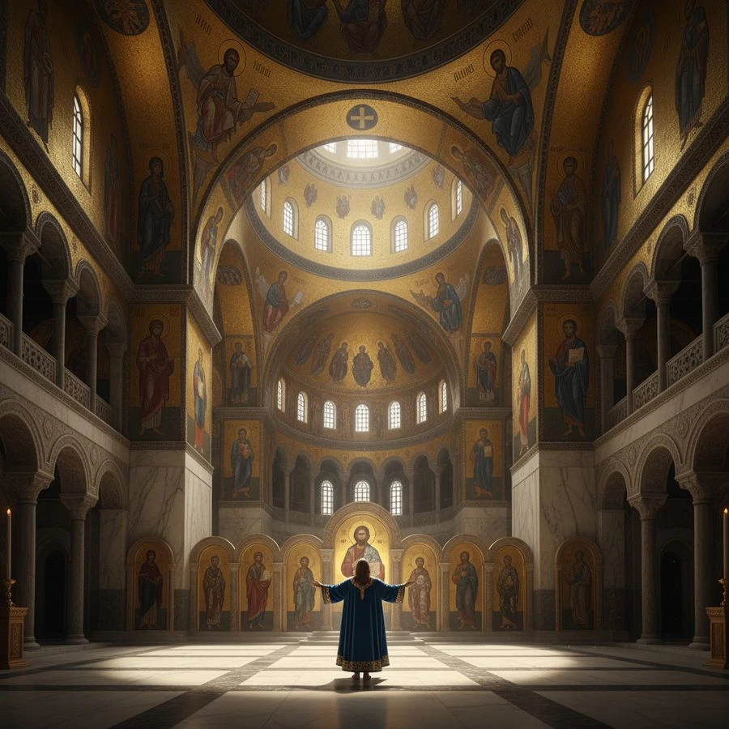

```text
a lone figure standing in an open landscape, Byzantine (4th-15th century, Constantinople and Eastern Mediterranean): central domes on pendentives; gold-ground mosaics; squinches; marble revetment; icon panels; arcaded galleries. Palette: gold, deep blue, porphyry red, ivory. Mood: celestial hierarchy, sacred light, imperial orthodoxy
Medium: interior photograph, dim ambient light, gold mosaic glow. Lighting: soft directional daylight, subtle chiaroscuro, long shadows. Composition: centered lone figure, wide open landscape, generous negative space, horizon at lower third. Rendering: sharp, high detail.
--no watermark, text artefacts, muddy colour, extra limbs
```

Model: Nano Banana · Author: bthnbdk · AI Art Style Prompt Library · CC BY 4.0

[Original source](https://github.com/bthnbdk/ai-art-style-prompts/blob/028aad93ea9da35064f50643bf408207c8c5244c/data/styles.json#L3411) · [Provenance and original license](data/projectd-batch-0015.json)

## Canadiana — bthnbdk · CC BY 4.0

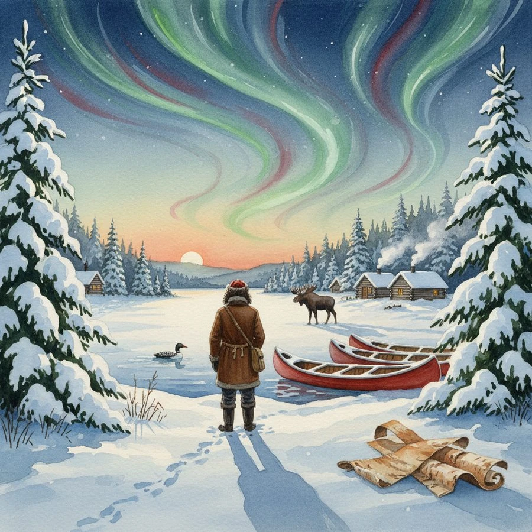

```text
a lone figure standing in an open landscape, Canadiana (19th century-, Canada): snow-laden evergreens; red canoes; log cabins; moose and loon; vast lakes; birch bark; northern lights. Palette: forest green, warm red, snow white, sky blue. Mood: rugged northern pastoral, homely nostalgia
Medium: watercolour and gouache on paper, visible wash. Lighting: soft directional daylight, subtle chiaroscuro, long shadows. Composition: centered lone figure, wide open landscape, generous negative space, horizon at lower third. Rendering: sharp, high detail.
--no watermark, text artefacts, muddy colour, extra limbs
```

Model: Nano Banana · Author: bthnbdk · AI Art Style Prompt Library · CC BY 4.0

[Original source](https://github.com/bthnbdk/ai-art-style-prompts/blob/028aad93ea9da35064f50643bf408207c8c5244c/data/styles.json#L2993) · [Provenance and original license](data/projectd-batch-0015.json)

## Cassette Futurism — bthnbdk · CC BY 4.0

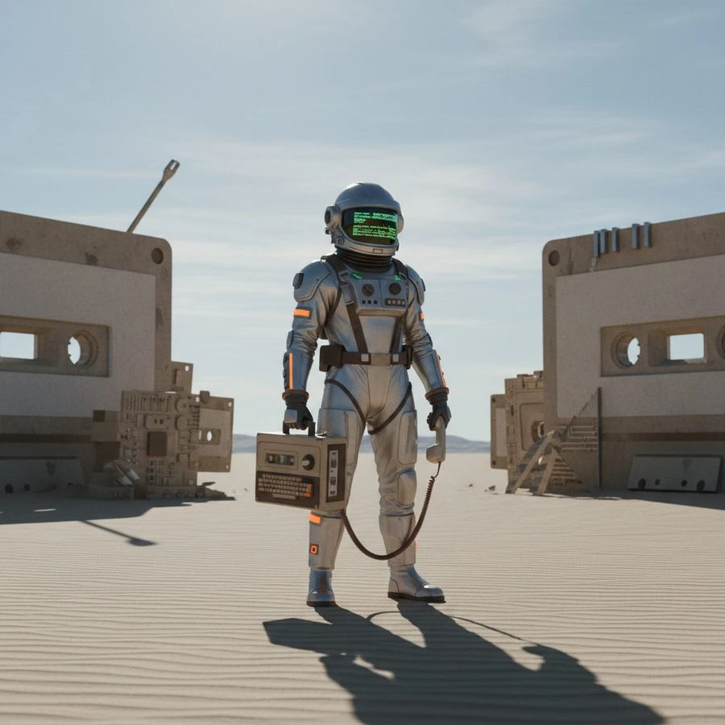

```text
a lone figure standing in an open landscape, Cassette Futurism (1970s-1980s, Japan and the West): chunky beige plastics; CRT monitors; cassette tapes; membrane keyboards; brushed aluminium; rotary dials; blinking LEDs. Palette: beige, dark brown, phosphor green, orange LED. Mood: analogue optimism, bureaucratic spaceflight, tactile futurism
Medium: production-design photograph, CRT glow, visible plastic texture. Lighting: soft directional daylight, subtle chiaroscuro, long shadows. Composition: centered lone figure, wide open landscape, generous negative space, horizon at lower third. Rendering: sharp, high detail.
--no watermark, text artefacts, muddy colour, extra limbs
```

Model: Nano Banana · Author: bthnbdk · AI Art Style Prompt Library · CC BY 4.0

[Original source](https://github.com/bthnbdk/ai-art-style-prompts/blob/028aad93ea9da35064f50643bf408207c8c5244c/data/styles.json#L3050) · [Provenance and original license](data/projectd-batch-0015.json)

## Cel Anime — bthnbdk · CC BY 4.0

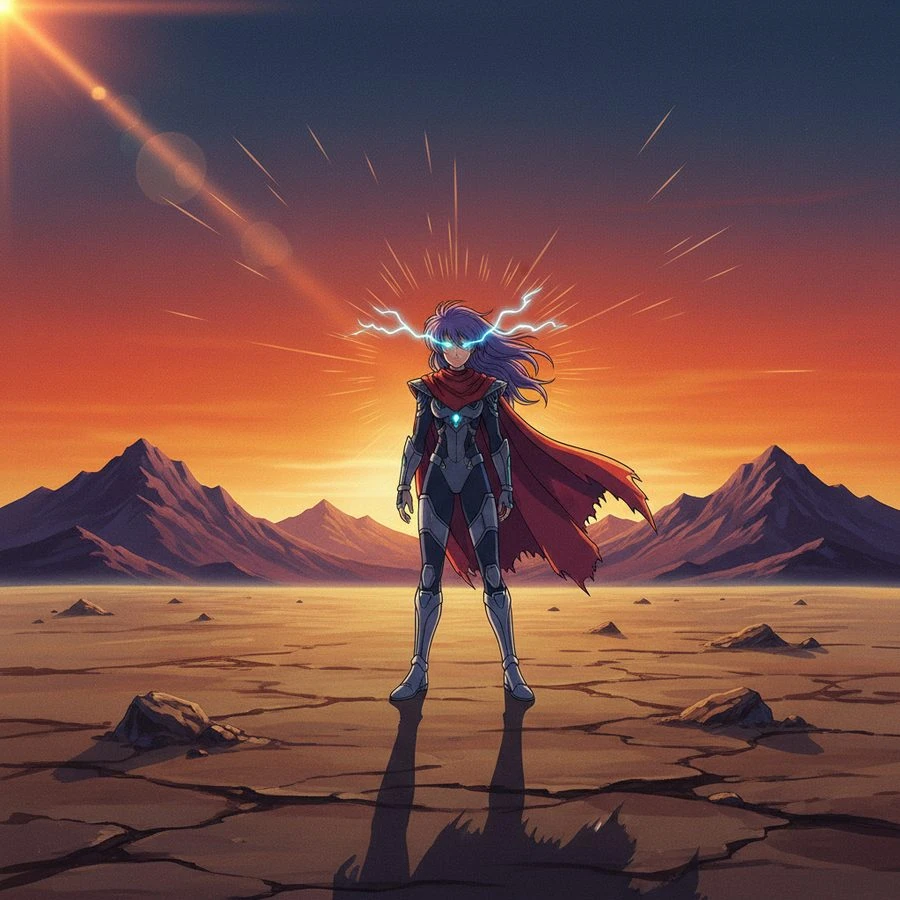

```text
a lone figure standing in an open landscape, Cel Anime (1980s-1990s, Japan): hand-painted cels; static painted backgrounds; speed-line bursts; glowing eyes; lens flares; 4:3 framing. Palette: saturated acrylic flats, sunset gradients, deep shadow blue. Mood: handcrafted spectacle, nostalgia, emotional crescendo
Medium: animation cel, hand-painted acetate, film grain. Lighting: soft directional daylight, subtle chiaroscuro, long shadows. Composition: centered lone figure, wide open landscape, generous negative space, horizon at lower third. Rendering: sharp, high detail.
--no watermark, text artefacts, muddy colour, extra limbs
```

Model: Nano Banana · Author: bthnbdk · AI Art Style Prompt Library · CC BY 4.0

[Original source](https://github.com/bthnbdk/ai-art-style-prompts/blob/028aad93ea9da35064f50643bf408207c8c5244c/data/styles.json#L4342) · [Provenance and original license](data/projectd-batch-0015.json)

## Cel-Shaded Game — bthnbdk · CC BY 4.0

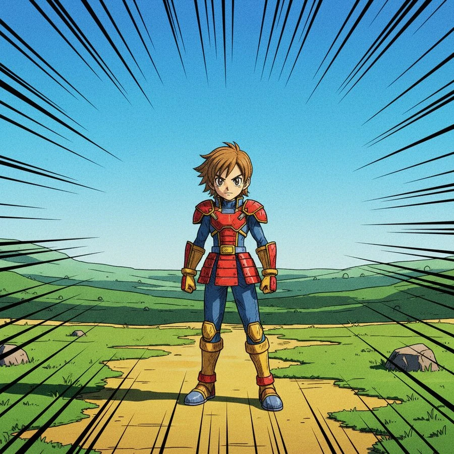

```text
a lone figure standing in an open landscape, Cel-Shaded Game (2000s-, Japan): hard-edged shading bands; ink outlines; hand-drawn texture maps; speed-line starbursts; anime faces in 3D. Palette: flat anime palette, vivid primaries, ink black. Mood: animation fidelity, style over realism, dynamism
Medium: 3D render with flat cel shading, black ink outlines. Lighting: soft directional daylight, subtle chiaroscuro, long shadows. Composition: centered lone figure, wide open landscape, generous negative space, horizon at lower third. Rendering: sharp, high detail.
--no watermark, text artefacts, muddy colour, extra limbs
```

Model: Nano Banana · Author: bthnbdk · AI Art Style Prompt Library · CC BY 4.0

[Original source](https://github.com/bthnbdk/ai-art-style-prompts/blob/028aad93ea9da35064f50643bf408207c8c5244c/data/styles.json#L4665) · [Provenance and original license](data/projectd-batch-0015.json)

## Chalkboard Chalk Drawing — bthnbdk · CC BY 4.0

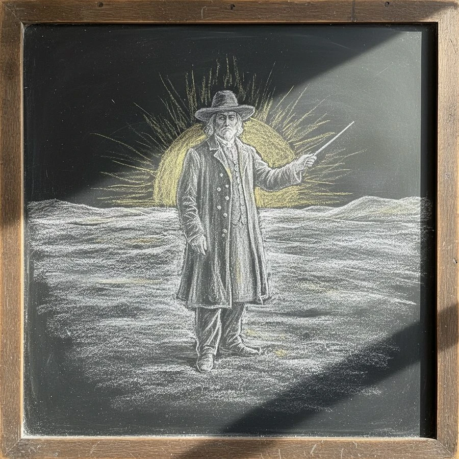

```text
a lone figure standing in an open landscape, Chalkboard Chalk Drawing (1800s-1900s, Europe and United States): white and yellow chalk on a dark slate board; hatched and finger-smudged shading; chalk dust and eraser smears around the forms; a wooden frame edge. Palette: chalk white, dusty yellow, slate green-black. Mood: classroom authority, old-school instruction, dusty intimacy
Medium: chalk on dark slate board, powdery matte surface, visible dust. Lighting: soft directional daylight, subtle chiaroscuro, long shadows. Composition: centered lone figure, wide open landscape, generous negative space, horizon at lower third. Rendering: sharp, high detail.
--no watermark, text artefacts, muddy colour, extra limbs
```

Model: Nano Banana · Author: bthnbdk · AI Art Style Prompt Library · CC BY 4.0

[Original source](https://github.com/bthnbdk/ai-art-style-prompts/blob/028aad93ea9da35064f50643bf408207c8c5244c/data/styles.json#L6033) · [Provenance and original license](data/projectd-batch-0015.json)

## Charcoal Drawing — bthnbdk · CC BY 4.0

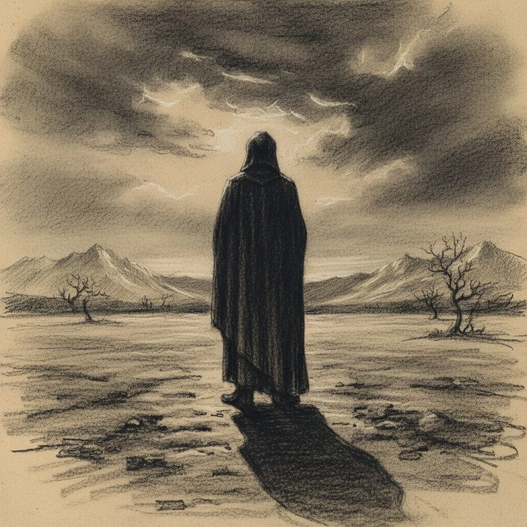

```text
a lone figure standing in an open landscape, Charcoal Drawing (1500s-, Europe): compressed and vine charcoal; sooty velvety blacks; broad smudged tone; highlights lifted with an eraser; rough paper tooth showing through. Palette: charcoal black, smoky grey, cream paper. Mood: dramatic weight, raw immediacy, theatrical light
Medium: charcoal on rough cream paper, powdery matte darks, smudged edges. Lighting: soft directional daylight, subtle chiaroscuro, long shadows. Composition: centered lone figure, wide open landscape, generous negative space, horizon at lower third. Rendering: sharp, high detail.
--no watermark, text artefacts, muddy colour, extra limbs
```

Model: Nano Banana · Author: bthnbdk · AI Art Style Prompt Library · CC BY 4.0

[Original source](https://github.com/bthnbdk/ai-art-style-prompts/blob/028aad93ea9da35064f50643bf408207c8c5244c/data/styles.json#L6071) · [Provenance and original license](data/projectd-batch-0015.json)

## Children's Book Watercolour — bthnbdk · CC BY 4.0

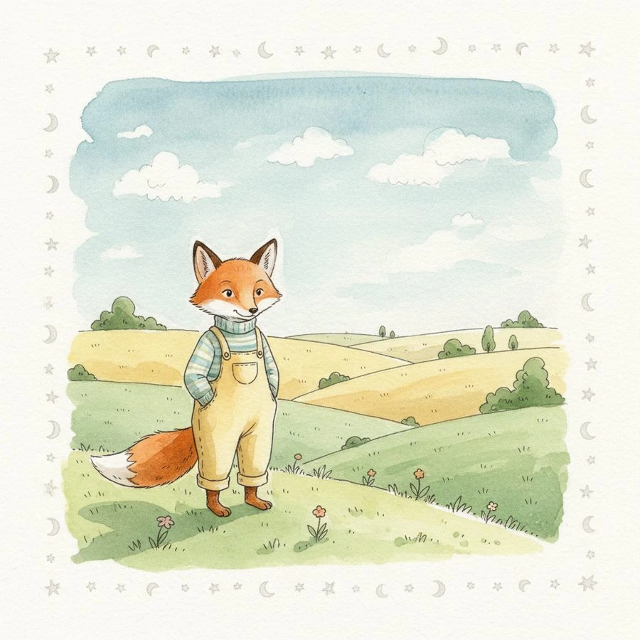

```text
a lone figure standing in an open landscape, Children's Book Watercolour (1930s-, Europe and United States): loose watercolour washes; ink contour lines; anthropomorphic animals; generous white margins; gentle repetition. Palette: soft sage, butter yellow, sky blue, warm grey. Mood: gentleness, play, bedtime warmth
Medium: watercolour and ink on textured paper, visible wash. Lighting: soft directional daylight, subtle chiaroscuro, long shadows. Composition: centered lone figure, wide open landscape, generous negative space, horizon at lower third. Rendering: sharp, high detail.
--no watermark, text artefacts, muddy colour, extra limbs
```

Model: Nano Banana · Author: bthnbdk · AI Art Style Prompt Library · CC BY 4.0

[Original source](https://github.com/bthnbdk/ai-art-style-prompts/blob/028aad93ea9da35064f50643bf408207c8c5244c/data/styles.json#L4456) · [Provenance and original license](data/projectd-batch-0015.json)

## Chinese Gongbi — bthnbdk · CC BY 4.0

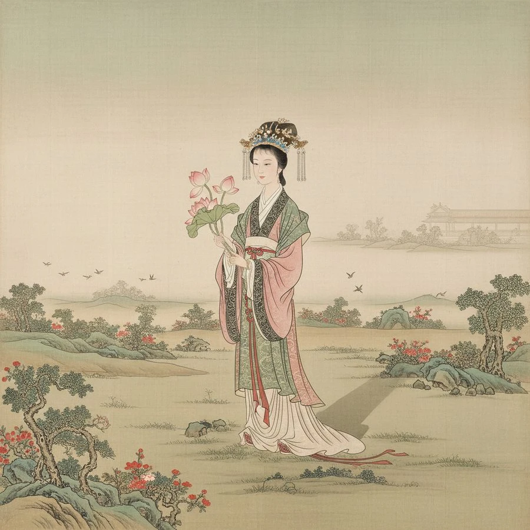

```text
a lone figure standing in an open landscape, Chinese Gongbi (Tang dynasty-, China): meticulous outlines; court ladies; flowers and birds; folded silk drapery; delicate realism; silent interiors. Palette: mineral green, cinnabar, ink black, lotus pink. Mood: courtly refinement, patient observation, elegance
Medium: ink and mineral pigment on silk or paper, fine outline, flat wash. Lighting: soft directional daylight, subtle chiaroscuro, long shadows. Composition: centered lone figure, wide open landscape, generous negative space, horizon at lower third. Rendering: sharp, high detail.
--no watermark, text artefacts, muddy colour, extra limbs
```

Model: Nano Banana · Author: bthnbdk · AI Art Style Prompt Library · CC BY 4.0

[Original source](https://github.com/bthnbdk/ai-art-style-prompts/blob/028aad93ea9da35064f50643bf408207c8c5244c/data/styles.json#L5026) · [Provenance and original license](data/projectd-batch-0015.json)

## Chinese Shan Shui — bthnbdk · CC BY 4.0

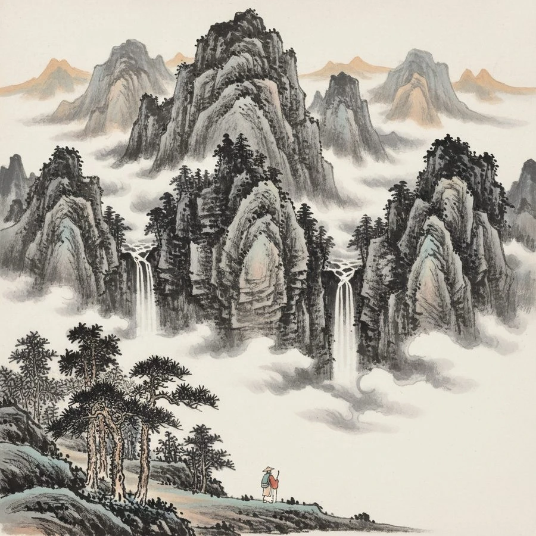

```text
a lone figure standing in an open landscape, Chinese Shan Shui (5th century-, China): towering misty peaks; empty water and mist; tiny traveller beneath pines; cascades; far-distance wash mountains. Palette: ink black and grey, faint ochre wash, paper white. Mood: reclusion, harmony with nature, cosmic scale
Medium: ink wash on paper or silk, dry brush, unpainted voids as mist. Lighting: soft directional daylight, subtle chiaroscuro, long shadows. Composition: centered lone figure, wide open landscape, generous negative space, horizon at lower third. Rendering: sharp, high detail.
--no watermark, text artefacts, muddy colour, extra limbs
```

Model: Nano Banana · Author: bthnbdk · AI Art Style Prompt Library · CC BY 4.0

[Original source](https://github.com/bthnbdk/ai-art-style-prompts/blob/028aad93ea9da35064f50643bf408207c8c5244c/data/styles.json#L5045) · [Provenance and original license](data/projectd-batch-0015.json)

## Classic Western — bthnbdk · CC BY 4.0

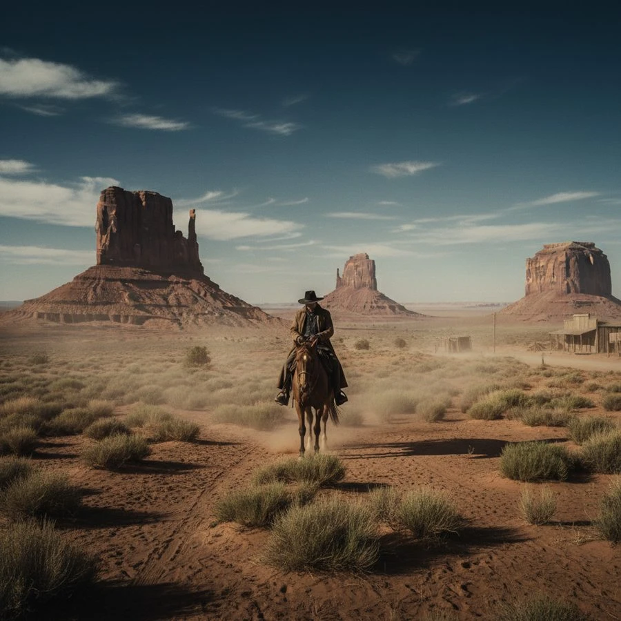

```text
a lone figure standing in an open landscape, Classic Western (1939-1960s, United States): monument valley buttes; lone rider silhouette; dust-swept main street; saloon interiors; holstered revolver. Palette: sand ochre, sage green, deep sky blue, sepia shadow. Mood: frontier myth, solitude, manifest destiny questioned
Medium: cinematic film still, 35mm Technicolor, wide desert vistas. Lighting: soft directional daylight, subtle chiaroscuro, long shadows. Composition: centered lone figure, wide open landscape, generous negative space, horizon at lower third. Rendering: sharp, high detail.
--no watermark, text artefacts, muddy colour, extra limbs
```

Model: Nano Banana · Author: bthnbdk · AI Art Style Prompt Library · CC BY 4.0

[Original source](https://github.com/bthnbdk/ai-art-style-prompts/blob/028aad93ea9da35064f50643bf408207c8c5244c/data/styles.json#L5615) · [Provenance and original license](data/projectd-batch-0015.json)

## Classical Greek — bthnbdk · CC BY 4.0

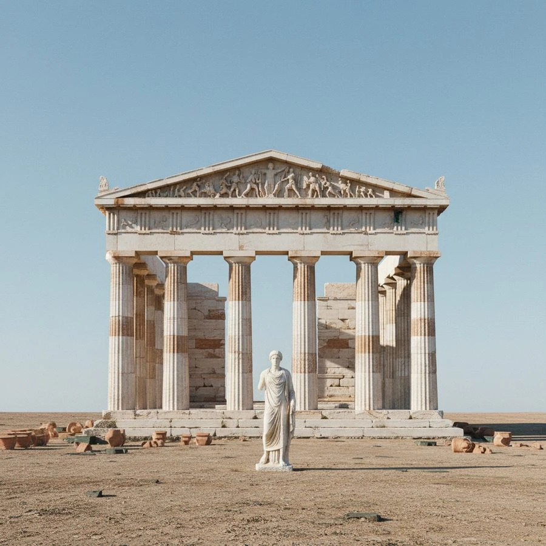

```text
a lone figure standing in an open landscape, Classical Greek (5th-4th century BC, Greece): Doric, Ionic and Corinthian orders; fluted columns; entablature; pediment sculpture; ideal proportion; marble. Palette: bleached marble white, terracotta, weathered bronze. Mood: harmony, rational proportion, civic ideal
Medium: architectural photograph, hard Mediterranean light, marble surface. Lighting: soft directional daylight, subtle chiaroscuro, long shadows. Composition: centered lone figure, wide open landscape, generous negative space, horizon at lower third. Rendering: sharp, high detail.
--no watermark, text artefacts, muddy colour, extra limbs
```

Model: Nano Banana · Author: bthnbdk · AI Art Style Prompt Library · CC BY 4.0

[Original source](https://github.com/bthnbdk/ai-art-style-prompts/blob/028aad93ea9da35064f50643bf408207c8c5244c/data/styles.json#L3373) · [Provenance and original license](data/projectd-batch-0015.json)

## Claymation Stop Motion — bthnbdk · CC BY 4.0

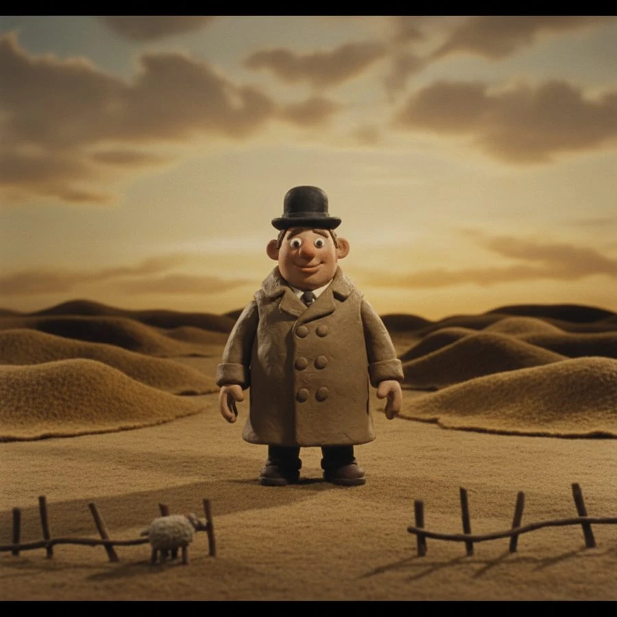

```text
a lone figure standing in an open landscape, Claymation Stop Motion (1950s-, Britain and United States): fingerprinted clay; miniature sets; visible thumb marks; felted textures; frame-by-frame squash; practical props. Palette: earthy plasticine, warm tungsten light, painted backdrop. Mood: handmade craft, gentle humour, physical charm
Medium: stop-motion film frame, tactile set, practical lighting. Lighting: soft directional daylight, subtle chiaroscuro, long shadows. Composition: centered lone figure, wide open landscape, generous negative space, horizon at lower third. Rendering: sharp, high detail.
--no watermark, text artefacts, muddy colour, extra limbs
```

Model: Nano Banana · Author: bthnbdk · AI Art Style Prompt Library · CC BY 4.0

[Original source](https://github.com/bthnbdk/ai-art-style-prompts/blob/028aad93ea9da35064f50643bf408207c8c5244c/data/styles.json#L4418) · [Provenance and original license](data/projectd-batch-0015.json)

## Color Field — bthnbdk · CC BY 4.0

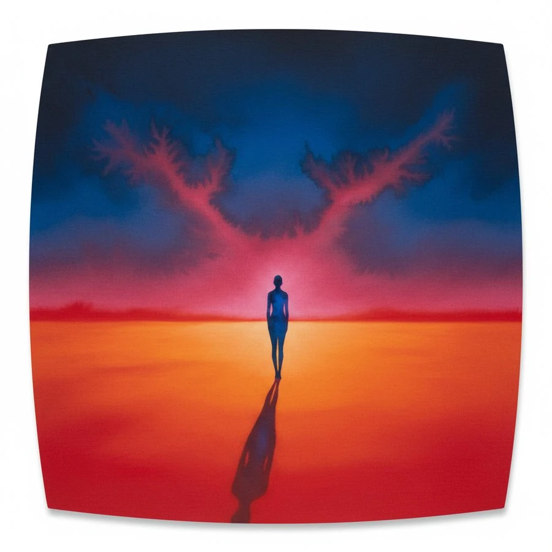

```text
a lone figure standing in an open landscape, Color Field (1950s-1960s, USA): vast unmodulated colour planes; soft stained edges; breathing halos; no drawing; shaped canvases. Palette: luminous orange, magenta, deep blue, saturated red. Mood: contemplative awe, optical resonance
Medium: acrylic stained into raw canvas, flat matte finish. Lighting: soft directional daylight, subtle chiaroscuro, long shadows. Composition: centered lone figure, wide open landscape, generous negative space, horizon at lower third. Rendering: sharp, high detail.
--no watermark, text artefacts, muddy colour, extra limbs
```

Model: Nano Banana · Author: bthnbdk · AI Art Style Prompt Library · CC BY 4.0

[Original source](https://github.com/bthnbdk/ai-art-style-prompts/blob/028aad93ea9da35064f50643bf408207c8c5244c/data/styles.json#L2746) · [Provenance and original license](data/projectd-batch-0015.json)

## Continuous Line Drawing — bthnbdk · CC BY 4.0

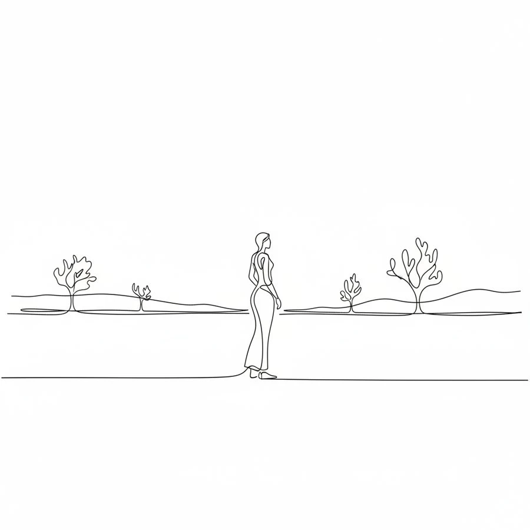

```text
a lone figure standing in an open landscape, Continuous Line Drawing (1940s-, Europe and United States): one single unbroken contour line — the pen touches the paper once and never lifts, so the whole drawing is one continuous looping line; absolutely no hatching, no shading, no grey tones and no fill anywhere; a few lines doubled where the line retraces itself. Palette: black line only on white paper. Mood: elegant brevity, improvisational confidence, gallery-graphic wit
Medium: single-weight ink line on paper, no shading, flat graphic clarity. Lighting: flat even paper-white light, no cast shadow, no tonal shading. Composition: centered lone figure, wide open landscape, generous negative space, horizon at lower third. Rendering: sharp, high detail.
--no watermark, text artefacts, muddy colour, extra limbs
```

Model: Nano Banana · Author: bthnbdk · AI Art Style Prompt Library · CC BY 4.0

[Original source](https://github.com/bthnbdk/ai-art-style-prompts/blob/028aad93ea9da35064f50643bf408207c8c5244c/data/styles.json#L6185) · [Provenance and original license](data/projectd-batch-0015.json)

## Cozy Pixel RPG — bthnbdk · CC BY 4.0

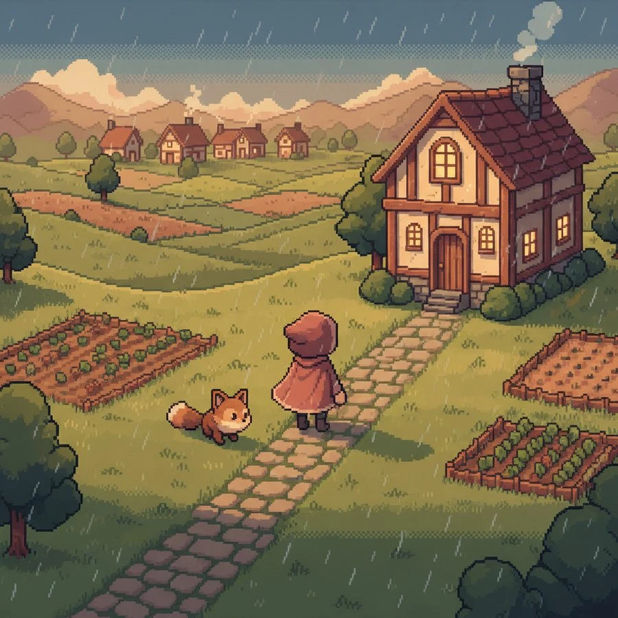

```text
a lone figure standing in an open landscape, Cozy Pixel RPG (2010s-, global indie): tiny farms; warm lamps; rainy windows; seasonal tilesets; cute animal companions; day-night cycles. Palette: warm amber, moss green, dusty rose, dusk blue. Mood: comfort, small kindnesses, gentle routine
Medium: pixel art, warm palette, soft dithering, gentle animation. Lighting: soft directional daylight, subtle chiaroscuro, long shadows. Composition: centered lone figure, wide open landscape, generous negative space, horizon at lower third. Rendering: sharp, high detail.
--no watermark, text artefacts, muddy colour, extra limbs
```

Model: Nano Banana · Author: bthnbdk · AI Art Style Prompt Library · CC BY 4.0

[Original source](https://github.com/bthnbdk/ai-art-style-prompts/blob/028aad93ea9da35064f50643bf408207c8c5244c/data/styles.json#L4741) · [Provenance and original license](data/projectd-batch-0015.json)

## Critical Regionalism — bthnbdk · CC BY 4.0

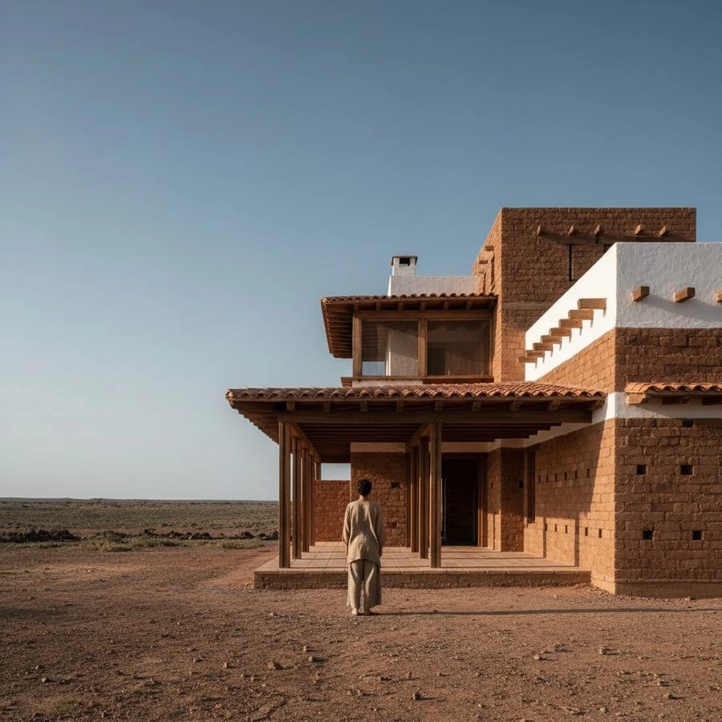

```text
a lone figure standing in an open landscape, Critical Regionalism (1980s-, global periphery): local materials; climate-responsive forms; layered thresholds; reinterpreted vernacular; tectonic detail. Palette: local earth, timber brown, whitewash, terracotta. Mood: rooted modernity, place over spectacle, resistance
Medium: architectural photograph, natural daylight, honest materials. Lighting: soft directional daylight, subtle chiaroscuro, long shadows. Composition: centered lone figure, wide open landscape, generous negative space, horizon at lower third. Rendering: sharp, high detail.
--no watermark, text artefacts, muddy colour, extra limbs
```

Model: Nano Banana · Author: bthnbdk · AI Art Style Prompt Library · CC BY 4.0

[Original source](https://github.com/bthnbdk/ai-art-style-prompts/blob/028aad93ea9da35064f50643bf408207c8c5244c/data/styles.json#L3696) · [Provenance and original license](data/projectd-batch-0015.json)

## Cross-Hatch Pen Illustration — bthnbdk · CC BY 4.0

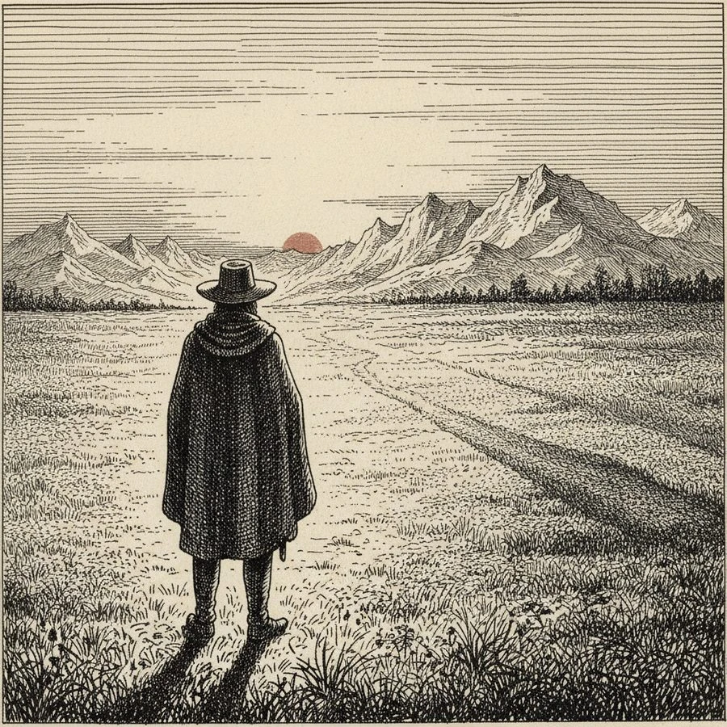

```text
a lone figure standing in an open landscape, Cross-Hatch Pen Illustration (1800s-, Europe and United States): dense parallel and crossed hatching with a fine pen; tone built from line density alone; stippled darkest passages; crisp unbroken contours. Palette: black ink line on off-white paper, one spot colour at most. Mood: reportorial precision, old-press craft, patient volume-building
Medium: fine pen and ink on paper, hatching-driven tone, print-like clarity. Lighting: soft directional daylight, subtle chiaroscuro, long shadows. Composition: centered lone figure, wide open landscape, generous negative space, horizon at lower third. Rendering: sharp, high detail.
--no watermark, text artefacts, muddy colour, extra limbs
```

Model: Nano Banana · Author: bthnbdk · AI Art Style Prompt Library · CC BY 4.0

[Original source](https://github.com/bthnbdk/ai-art-style-prompts/blob/028aad93ea9da35064f50643bf408207c8c5244c/data/styles.json#L6204) · [Provenance and original license](data/projectd-batch-0015.json)

## Cutout Collage Animation — bthnbdk · CC BY 4.0

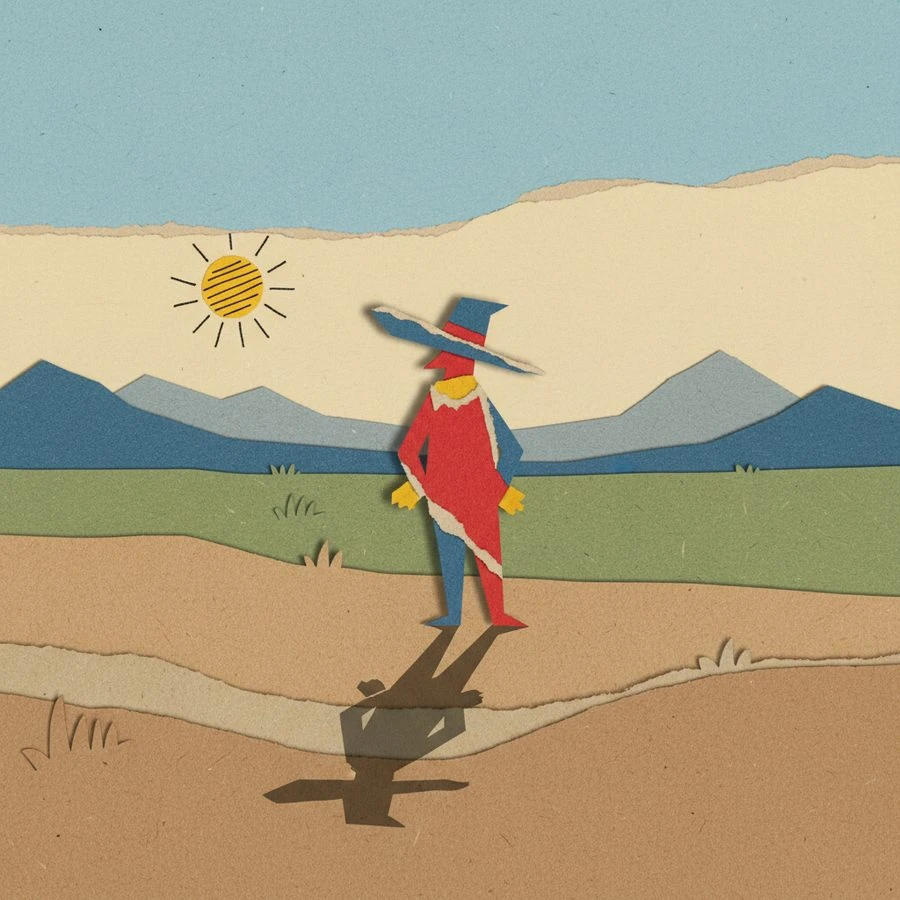

```text
a lone figure standing in an open landscape, Cutout Collage Animation (1950s-, Europe): layered paper shapes; torn edges; visible fibres; flat graphic depth; stop-motion jitter. Palette: construction paper primaries, kraft brown, ink black. Mood: graphic wit, tactile collage, playful design
Medium: animation frame, paper cutout textures, hard shadow. Lighting: soft directional daylight, subtle chiaroscuro, long shadows. Composition: centered lone figure, wide open landscape, generous negative space, horizon at lower third. Rendering: sharp, high detail.
--no watermark, text artefacts, muddy colour, extra limbs
```

Model: Nano Banana · Author: bthnbdk · AI Art Style Prompt Library · CC BY 4.0

[Original source](https://github.com/bthnbdk/ai-art-style-prompts/blob/028aad93ea9da35064f50643bf408207c8c5244c/data/styles.json#L4437) · [Provenance and original license](data/projectd-batch-0015.json)

## Cyanotype — bthnbdk · CC BY 4.0

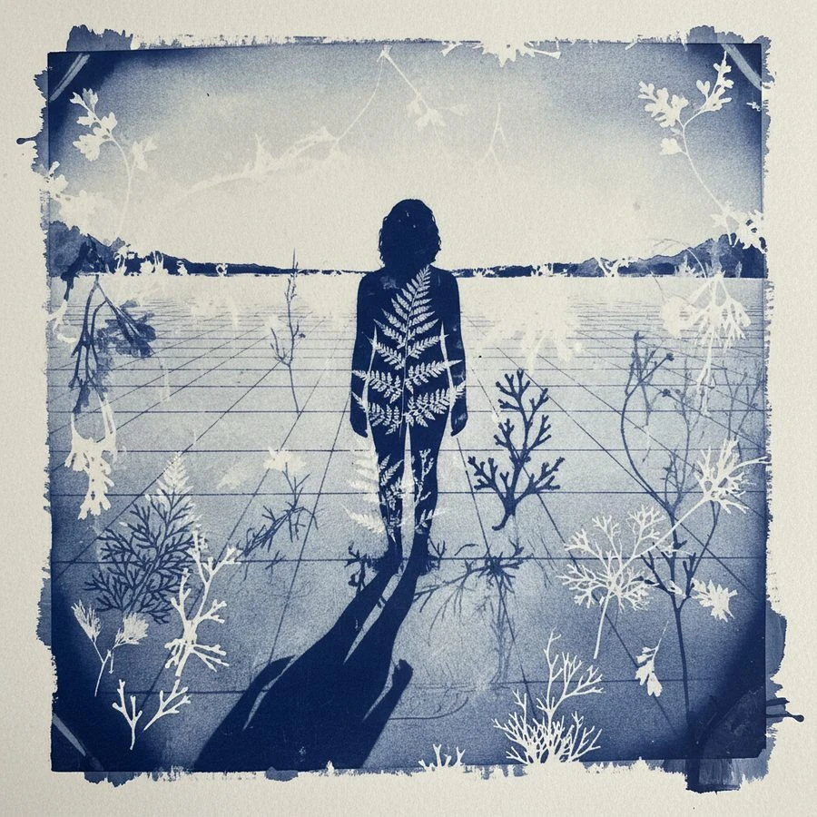

```text
a lone figure standing in an open landscape, Cyanotype (1842-, Britain): blue silhouette contact prints; ferns and algae; blueprint grids; brush-coated paper edges; sun exposure marks. Palette: Prussian blue, paper white, faded navy. Mood: botanical wonder, scientific poetry, handmade process
Medium: contact print, Prussian blue emulsion, matte paper. Lighting: soft directional daylight, subtle chiaroscuro, long shadows. Composition: centered lone figure, wide open landscape, generous negative space, horizon at lower third. Rendering: sharp, high detail.
--no watermark, text artefacts, muddy colour, extra limbs
```

Model: Nano Banana · Author: bthnbdk · AI Art Style Prompt Library · CC BY 4.0

[Original source](https://github.com/bthnbdk/ai-art-style-prompts/blob/028aad93ea9da35064f50643bf408207c8c5244c/data/styles.json#L3867) · [Provenance and original license](data/projectd-batch-0015.json)

## Daguerreotype — bthnbdk · CC BY 4.0

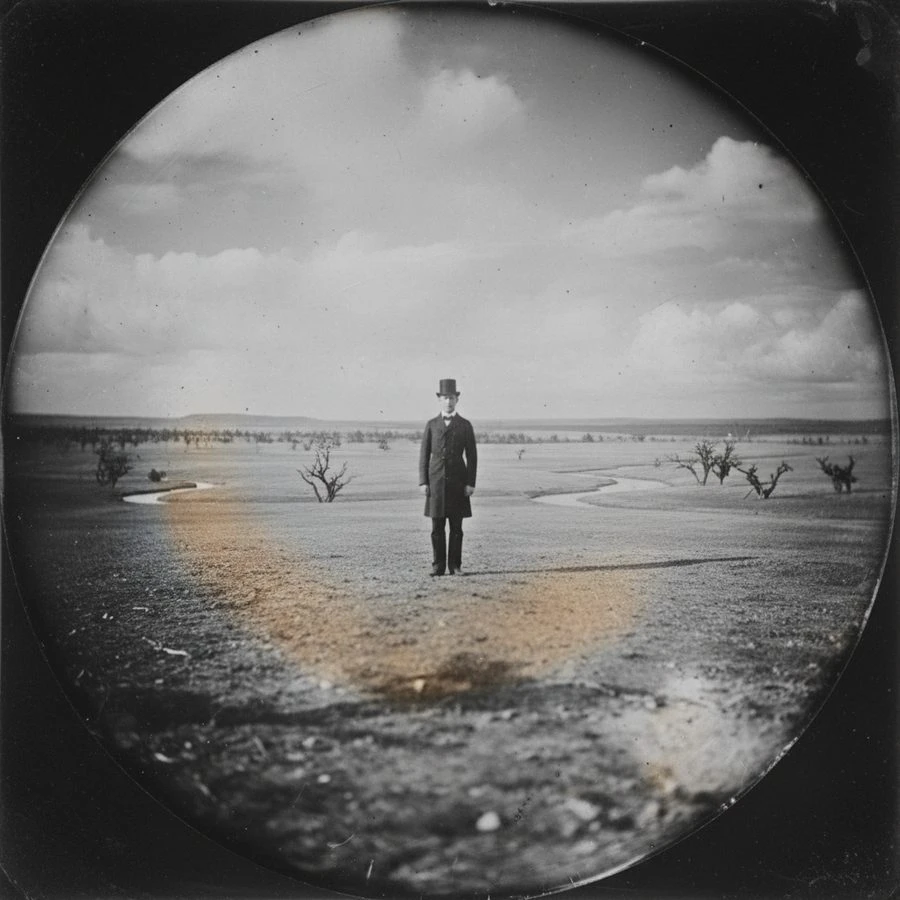

```text
a lone figure standing in an open landscape, Daguerreotype (1839-1860s, France): one-of-a-kind silver plate; stiff formal sitters; plain studio drapes; primitive lens vignetting; silvered reflection. Palette: silvery grey, warm sepia, tarnish black. Mood: early magic, frozen stillness, solemnity
Medium: antique photograph, mirrored silver plate, shallow depth of field. Lighting: soft directional daylight, subtle chiaroscuro, long shadows. Composition: centered lone figure, wide open landscape, generous negative space, horizon at lower third. Rendering: sharp, high detail.
--no watermark, text artefacts, muddy colour, extra limbs
```

Model: Nano Banana · Author: bthnbdk · AI Art Style Prompt Library · CC BY 4.0

[Original source](https://github.com/bthnbdk/ai-art-style-prompts/blob/028aad93ea9da35064f50643bf408207c8c5244c/data/styles.json#L3810) · [Provenance and original license](data/projectd-batch-0015.json)

## Day of the Dead Altar — bthnbdk · CC BY 4.0

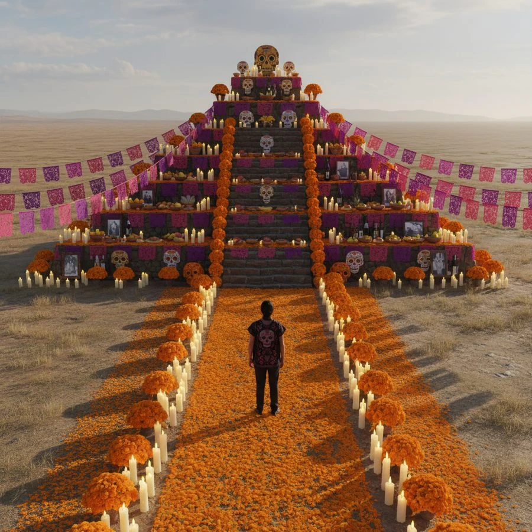

```text
a lone figure standing in an open landscape, Day of the Dead Altar (pre-colonial-, Mexico): tiered ofrenda altars; marigold paths; sugar skulls; candles; photographs and food; cempasuchil petals. Palette: marigold orange, magenta, purple, candle gold. Mood: remembrance, communion with the dead, festive grief
Medium: mixed installation with candlelight, marigolds, sugar skulls, papel picado. Lighting: soft directional daylight, subtle chiaroscuro, long shadows. Composition: centered lone figure, wide open landscape, generous negative space, horizon at lower third. Rendering: sharp, high detail.
--no watermark, text artefacts, muddy colour, extra limbs
```

Model: Nano Banana · Author: bthnbdk · AI Art Style Prompt Library · CC BY 4.0

[Original source](https://github.com/bthnbdk/ai-art-style-prompts/blob/028aad93ea9da35064f50643bf408207c8c5244c/data/styles.json#L5292) · [Provenance and original license](data/projectd-batch-0015.json)

## Documentary Photography — bthnbdk · CC BY 4.0

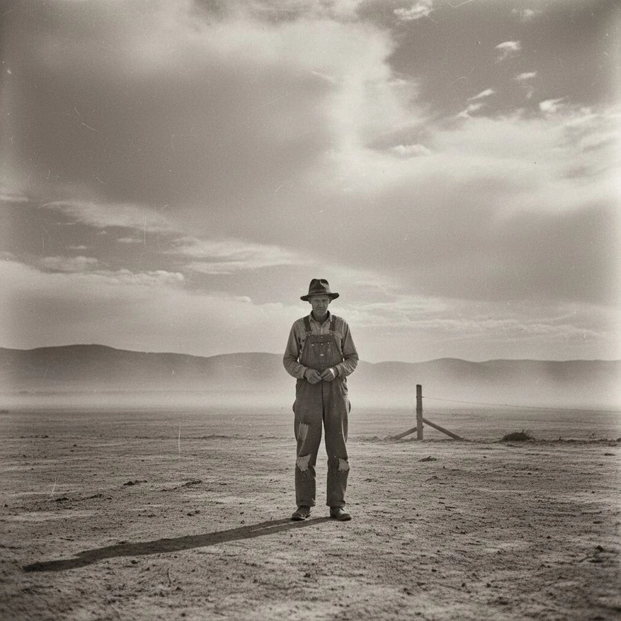

```text
a lone figure standing in an open landscape, Documentary Photography (1930s-, United States and Europe): witnessed human moments; working conditions; rural poverty; migration; candid framing; contact-sheet sequencing. Palette: desaturated browns and greys, dusty light. Mood: social conscience, testimony, dignity
Medium: reportage photograph, 35mm, available light, grain. Lighting: soft directional daylight, subtle chiaroscuro, long shadows. Composition: centered lone figure, wide open landscape, generous negative space, horizon at lower third. Rendering: sharp, high detail.
--no watermark, text artefacts, muddy colour, extra limbs
```

Model: Nano Banana · Author: bthnbdk · AI Art Style Prompt Library · CC BY 4.0

[Original source](https://github.com/bthnbdk/ai-art-style-prompts/blob/028aad93ea9da35064f50643bf408207c8c5244c/data/styles.json#L3924) · [Provenance and original license](data/projectd-batch-0015.json)

## Dogme 95 — bthnbdk · CC BY 4.0

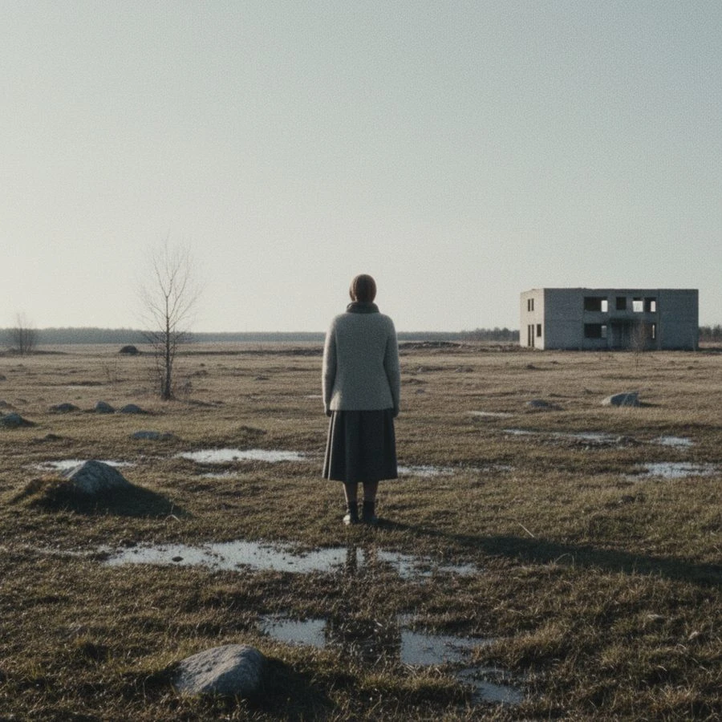

```text
a lone figure standing in an open landscape, Dogme 95 (1995-2005, Denmark): handheld jitter; natural light only; unflattering real locations; improvised dialogue; no added music; grainy video. Palette: muddy natural tones, blown highlights. Mood: vow of chastity, authenticity, anti-spectacle
Medium: handheld video still, available light, raw unsaturated colour. Lighting: soft directional daylight, subtle chiaroscuro, long shadows. Composition: centered lone figure, wide open landscape, generous negative space, horizon at lower third. Rendering: sharp, high detail.
--no watermark, text artefacts, muddy colour, extra limbs
```

Model: Nano Banana · Author: bthnbdk · AI Art Style Prompt Library · CC BY 4.0

[Original source](https://github.com/bthnbdk/ai-art-style-prompts/blob/028aad93ea9da35064f50643bf408207c8c5244c/data/styles.json#L5710) · [Provenance and original license](data/projectd-batch-0015.json)

## Doodle Explainer — bthnbdk · CC BY 4.0

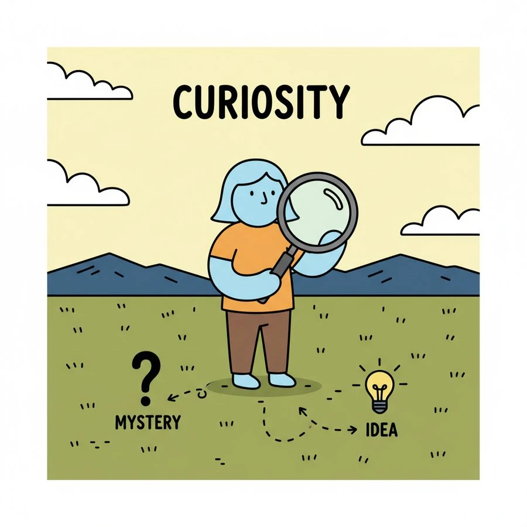

```text
a lone figure standing in an open landscape, Doodle Explainer (2010s-2020s, global): thick even black outline doodle characters; flat single-colour fills inside the line; rounded blobby hands and dot eyes; simple symbol props with label text. Palette: black outline with three or four flat poster colours on white. Mood: friendly explainer video, approachable humour, motion-ready shapes
Medium: flat doodle illustration, thick uniform outlines, flat poster fills. Lighting: soft directional daylight, subtle chiaroscuro, long shadows. Composition: centered lone figure, wide open landscape, generous negative space, horizon at lower third. Rendering: sharp, high detail.
--no watermark, text artefacts, muddy colour, extra limbs
```

Model: Nano Banana · Author: bthnbdk · AI Art Style Prompt Library · CC BY 4.0

[Original source](https://github.com/bthnbdk/ai-art-style-prompts/blob/028aad93ea9da35064f50643bf408207c8c5244c/data/styles.json#L6261) · [Provenance and original license](data/projectd-batch-0015.json)

## Dry-Erase Glass Board — bthnbdk · CC BY 4.0


```text
a lone figure standing in an open landscape, Dry-Erase Glass Board (2010s-2020s, United States): coloured marker diagrams on a glass studio board; wet glossy marker strokes; reflections of the room behind the glass; boxed flowcharts joined by arrows. Palette: glass grey-white, marker blue, orange, green. Mood: collaborative planning, transparency, ideas under construction
Medium: photographed glass whiteboard with coloured dry-erase markers, reflective surface. Lighting: soft directional daylight, subtle chiaroscuro, long shadows. Composition: centered lone figure, wide open landscape, generous negative space, horizon at lower third. Rendering: sharp, high detail.
--no watermark, text artefacts, muddy colour, extra limbs
```

Model: Nano Banana · Author: bthnbdk · AI Art Style Prompt Library · CC BY 4.0

[Original source](https://github.com/bthnbdk/ai-art-style-prompts/blob/028aad93ea9da35064f50643bf408207c8c5244c/data/styles.json#L6014) · [Provenance and original license](data/projectd-batch-0015.json)

## Ebru (Paper Marbling) — bthnbdk · CC BY 4.0

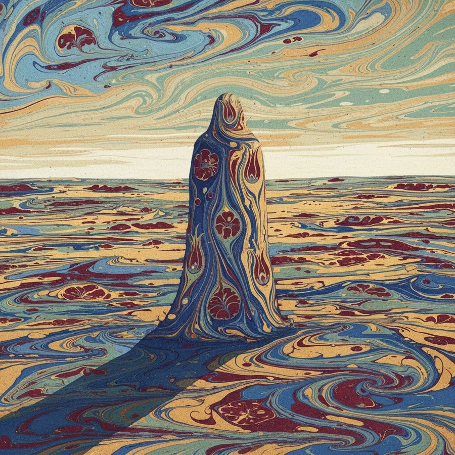

```text
a lone figure standing in an open landscape, Ebru Marbling (15th century-, Istanbul, Turkiye): fluid comb-and-kit swirls; tulip, carnation and nightingale figures; floating pigment skin; combed waves; speckled grounds. Palette: indigo, saffron, oxblood, sage. Mood: controlled chance, calm meditative rhythm
Medium: marbled pigment floated on sized water and transferred to paper, visible float grain. Lighting: soft directional daylight, subtle chiaroscuro, long shadows. Composition: centered lone figure, wide open landscape, generous negative space, horizon at lower third. Rendering: sharp, high detail.
--no watermark, text artefacts, muddy colour, extra limbs
```

Model: Nano Banana · Author: bthnbdk · AI Art Style Prompt Library · CC BY 4.0

[Original source](https://github.com/bthnbdk/ai-art-style-prompts/blob/028aad93ea9da35064f50643bf408207c8c5244c/data/styles.json#L2879) · [Provenance and original license](data/projectd-batch-0015.json)

## Editorial Magazine Layout — bthnbdk · CC BY 4.0

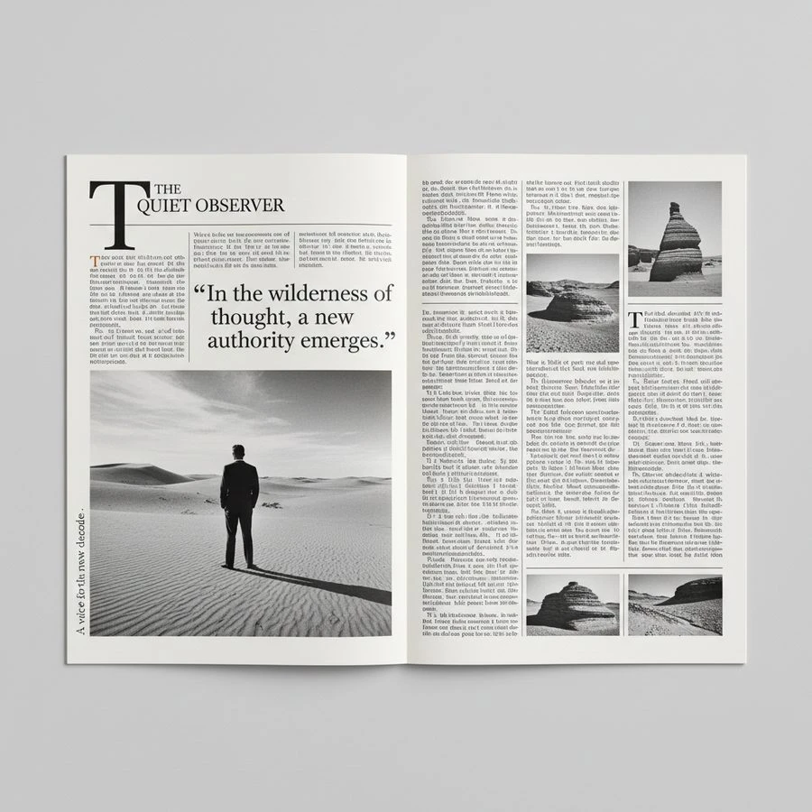

```text
a lone figure standing in an open landscape, Editorial Magazine Layout (1960s-, global): multi-column grids; pull quotes; white space and rules; cropped photography; drop caps; marginalia. Palette: paper white, ink black, restrained spot colour. Mood: considered reading, taste-making, authority
Medium: printed magazine spread, glossy stock, art-directed photography. Lighting: soft directional daylight, subtle chiaroscuro, long shadows. Composition: centered lone figure, wide open landscape, generous negative space, horizon at lower third. Rendering: sharp, high detail.
--no watermark, text artefacts, muddy colour, extra limbs
```

Model: Nano Banana · Author: bthnbdk · AI Art Style Prompt Library · CC BY 4.0

[Original source](https://github.com/bthnbdk/ai-art-style-prompts/blob/028aad93ea9da35064f50643bf408207c8c5244c/data/styles.json#L4855) · [Provenance and original license](data/projectd-batch-0015.json)

## Ethiopian Illuminated Manuscript — bthnbdk · CC BY 4.0

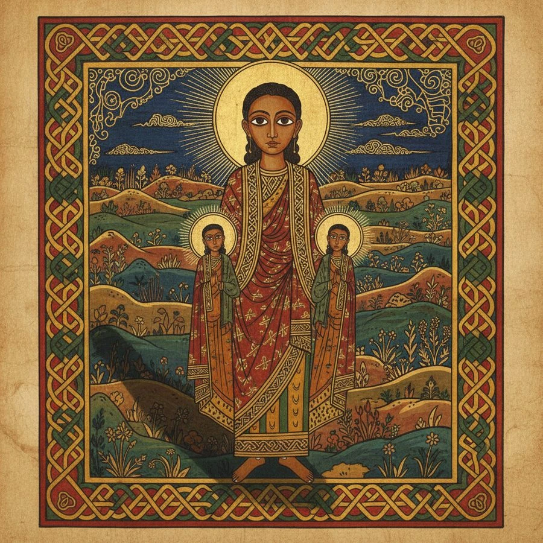

```text
a lone figure standing in an open landscape, Ethiopian Illuminated Manuscript (4th-18th century, Ethiopia): large almond eyes; flat frontal saints; geometric interlace borders; paired facing figures; gold halos; stylized drapery. Palette: deep red, ochre yellow, green, indigo, gold. Mood: devotion, colourful cosmology, manuscript reverence
Medium: pigment on parchment, fine brush, hide grain visible. Lighting: soft directional daylight, subtle chiaroscuro, long shadows. Composition: centered lone figure, wide open landscape, generous negative space, horizon at lower third. Rendering: sharp, high detail.
--no watermark, text artefacts, muddy colour, extra limbs
```

Model: Nano Banana · Author: bthnbdk · AI Art Style Prompt Library · CC BY 4.0

[Original source](https://github.com/bthnbdk/ai-art-style-prompts/blob/028aad93ea9da35064f50643bf408207c8c5244c/data/styles.json#L5330) · [Provenance and original license](data/projectd-batch-0015.json)

## Fashion Editorial — bthnbdk · CC BY 4.0

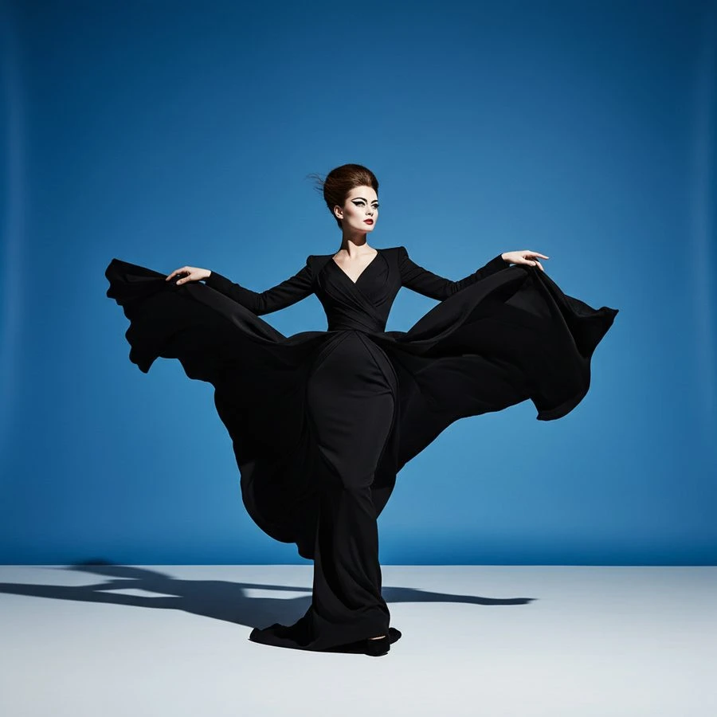

```text
a lone figure standing in an open landscape, Fashion Editorial (1960s-, Paris, Milan, New York): designed poses; seamless backdrops; dramatic styling; wind machines; strong graphic silhouettes; makeup detail. Palette: pure white, saturated set colour, black couture. Mood: glamour, constructed identity, desire
Medium: studio fashion photograph, controlled strobe, glossy print. Lighting: soft directional daylight, subtle chiaroscuro, long shadows. Composition: centered lone figure, wide open landscape, generous negative space, horizon at lower third. Rendering: sharp, high detail.
--no watermark, text artefacts, muddy colour, extra limbs
```

Model: Nano Banana · Author: bthnbdk · AI Art Style Prompt Library · CC BY 4.0

[Original source](https://github.com/bthnbdk/ai-art-style-prompts/blob/028aad93ea9da35064f50643bf408207c8c5244c/data/styles.json#L3981) · [Provenance and original license](data/projectd-batch-0015.json)

## Found Footage — bthnbdk · CC BY 4.0

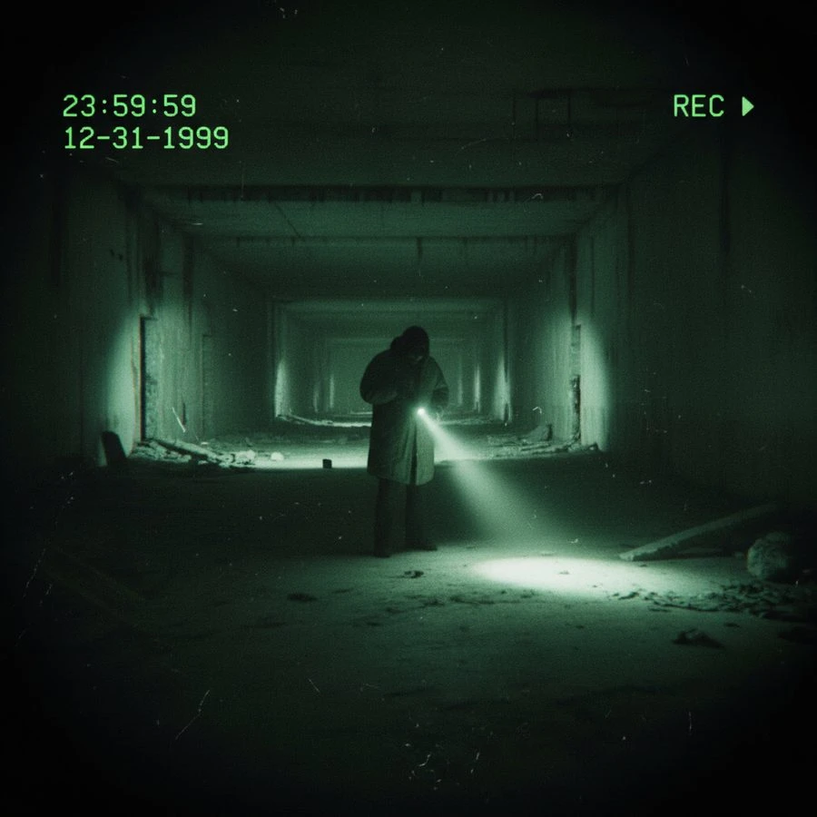

```text
a lone figure standing in an open landscape, Found Footage (1999-, United States): handheld camcorder shake; night-vision green; flashlight cones; abandoned corridors; timestamp overlays. Palette: night-vision green, flashlight white, black corners. Mood: immediacy, dread of the real, voyeuristic unease
Medium: camcorder video still, night vision green, harsh shadows, VHS artefacts. Lighting: soft directional daylight, subtle chiaroscuro, long shadows. Composition: centered lone figure, wide open landscape, generous negative space, horizon at lower third. Rendering: sharp, high detail.
--no watermark, text artefacts, muddy colour, extra limbs
```

Model: Nano Banana · Author: bthnbdk · AI Art Style Prompt Library · CC BY 4.0

[Original source](https://github.com/bthnbdk/ai-art-style-prompts/blob/028aad93ea9da35064f50643bf408207c8c5244c/data/styles.json#L5729) · [Provenance and original license](data/projectd-batch-0015.json)

## French New Wave — bthnbdk · CC BY 4.0

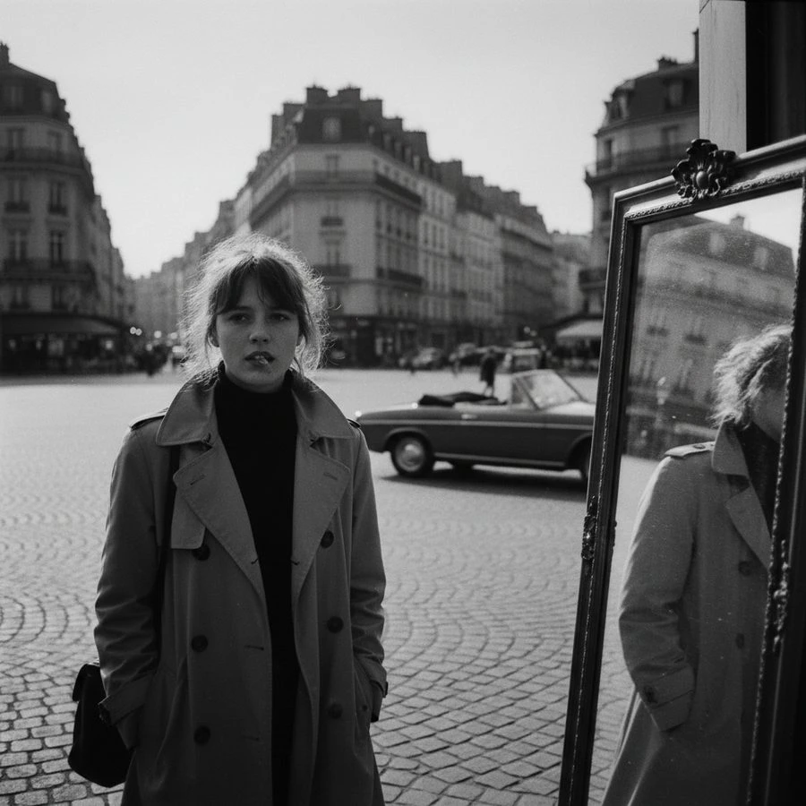

```text
a lone figure standing in an open landscape, French New Wave (1959-1968, Paris, France): handheld camera freedom; jump cuts; Paris streets and cafes; cigarettes; mirrors; cars in motion; direct-to-camera address. Palette: high-contrast black and white, natural Parisian greys. Mood: youthful irreverence, improvisation, cinephilia
Medium: cinematic film still, 35mm, grain, available light. Lighting: soft directional daylight, subtle chiaroscuro, long shadows. Composition: centered lone figure, wide open landscape, generous negative space, horizon at lower third. Rendering: sharp, high detail.
--no watermark, text artefacts, muddy colour, extra limbs
```

Model: Nano Banana · Author: bthnbdk · AI Art Style Prompt Library · CC BY 4.0

[Original source](https://github.com/bthnbdk/ai-art-style-prompts/blob/028aad93ea9da35064f50643bf408207c8c5244c/data/styles.json#L2613) · [Provenance and original license](data/projectd-batch-0015.json)

## Game Boy Green — bthnbdk · CC BY 4.0

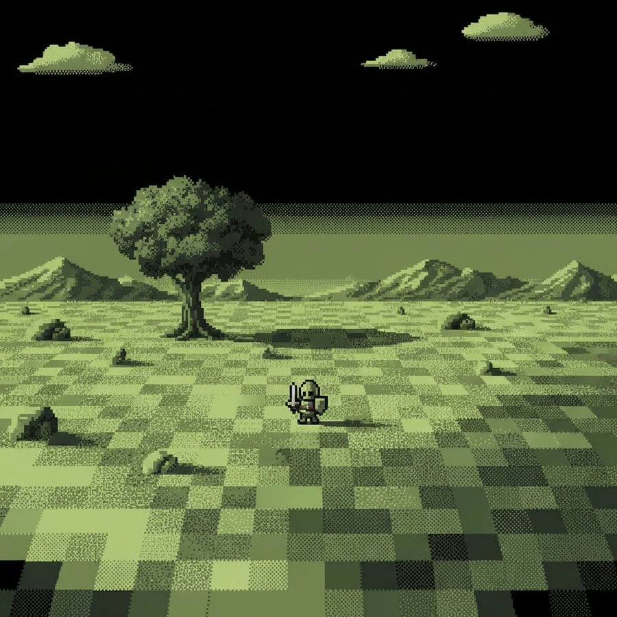

```text
a lone figure standing in an open landscape, Game Boy Green (1989-1998, Japan): four shades only; dot-matrix grid; dithered gradients; tiny sprites; scrolling tile maps. Palette: olive green, pale pea, dark forest, near-black. Mood: portable intimacy, minimalism, quiet adventure
Medium: pixel graphic, four-tone green LCD palette, dot matrix grid. Lighting: soft directional daylight, subtle chiaroscuro, long shadows. Composition: centered lone figure, wide open landscape, generous negative space, horizon at lower third. Rendering: sharp, high detail.
--no watermark, text artefacts, muddy colour, extra limbs
```

Model: Nano Banana · Author: bthnbdk · AI Art Style Prompt Library · CC BY 4.0

[Original source](https://github.com/bthnbdk/ai-art-style-prompts/blob/028aad93ea9da35064f50643bf408207c8c5244c/data/styles.json#L4551) · [Provenance and original license](data/projectd-batch-0015.json)

## Gekiga — bthnbdk · CC BY 4.0

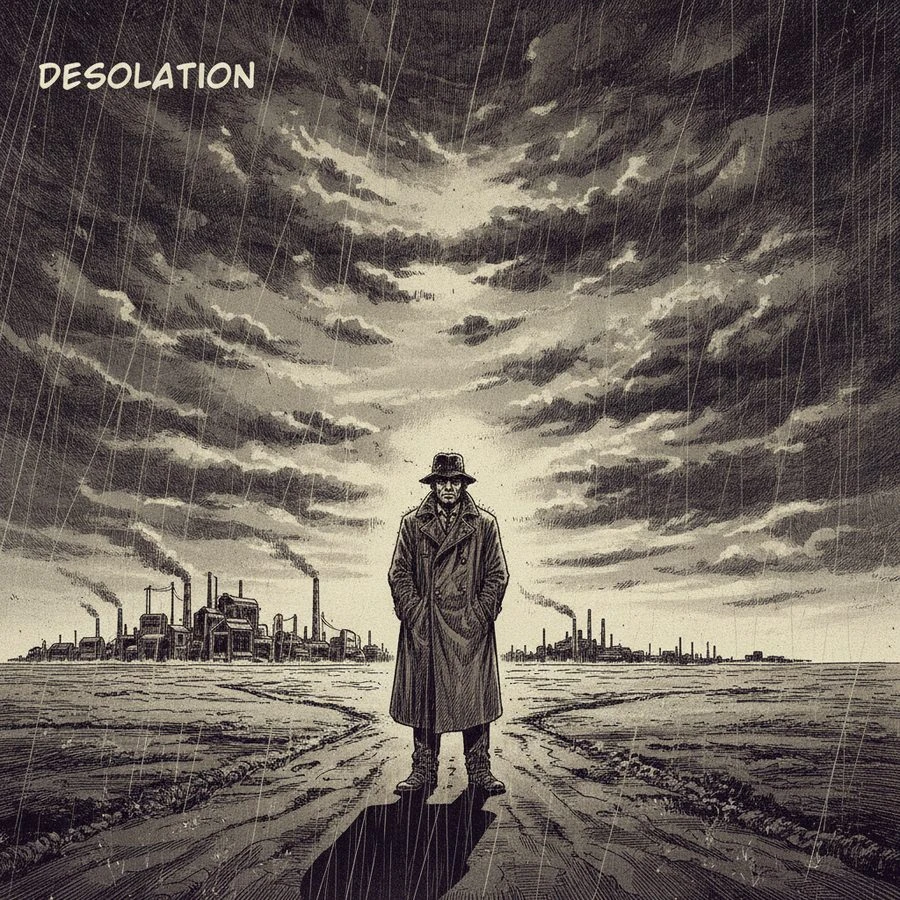

```text
a lone figure standing in an open landscape, Gekiga (1957-, Japan): adult anti-heroes; rain-soaked alleys; harsh chiaroscuro; cramped urban interiors; sprawling realistic detail. Palette: sepia and ink black, muted red, dirty grey. Mood: gritty realism, social critique, noir despair
Medium: manga page, dense ink, textured paper, dramatic chiaroscuro. Lighting: soft directional daylight, subtle chiaroscuro, long shadows. Composition: centered lone figure, wide open landscape, generous negative space, horizon at lower third. Rendering: sharp, high detail.
--no watermark, text artefacts, muddy colour, extra limbs
```

Model: Nano Banana · Author: bthnbdk · AI Art Style Prompt Library · CC BY 4.0

[Original source](https://github.com/bthnbdk/ai-art-style-prompts/blob/028aad93ea9da35064f50643bf408207c8c5244c/data/styles.json#L4323) · [Provenance and original license](data/projectd-batch-0015.json)

## Generative Algorithmic Art — bthnbdk · CC BY 4.0

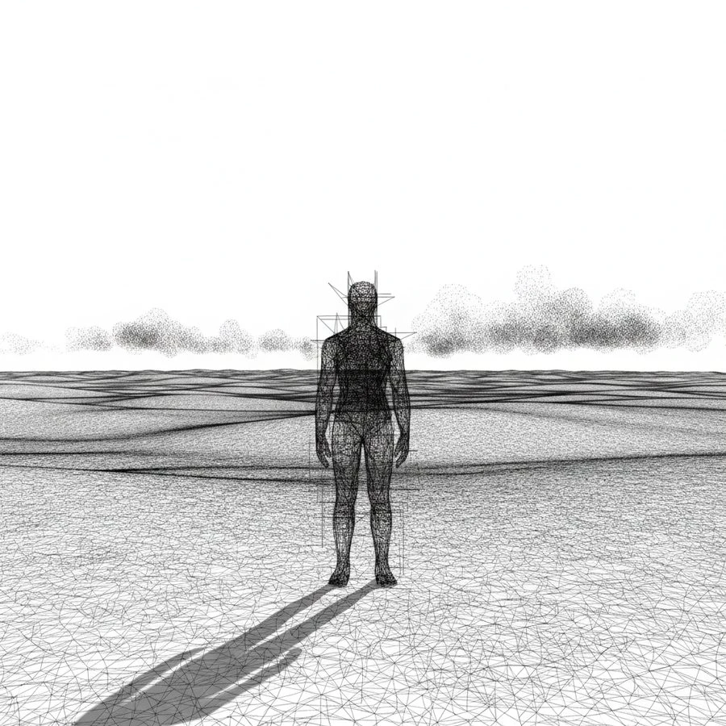

```text
a lone figure standing in an open landscape, Generative Algorithmic Art (1960s-, global digital culture): rule-based repetition; plotted lines; swarm particles; recursive subdivision; noise fields; emergent density. Palette: monochrome black on white, restricted plotter inks. Mood: systemic authorship, emergent form, mathematics as aesthetic
Medium: digital plot or render, computed linework, precise geometry. Lighting: soft directional daylight, subtle chiaroscuro, long shadows. Composition: centered lone figure, wide open landscape, generous negative space, horizon at lower third. Rendering: sharp, high detail.
--no watermark, text artefacts, muddy colour, extra limbs
```

Model: Nano Banana · Author: bthnbdk · AI Art Style Prompt Library · CC BY 4.0

[Original source](https://github.com/bthnbdk/ai-art-style-prompts/blob/028aad93ea9da35064f50643bf408207c8c5244c/data/styles.json#L5900) · [Provenance and original license](data/projectd-batch-0015.json)

## German Expressionism — bthnbdk · CC BY 4.0

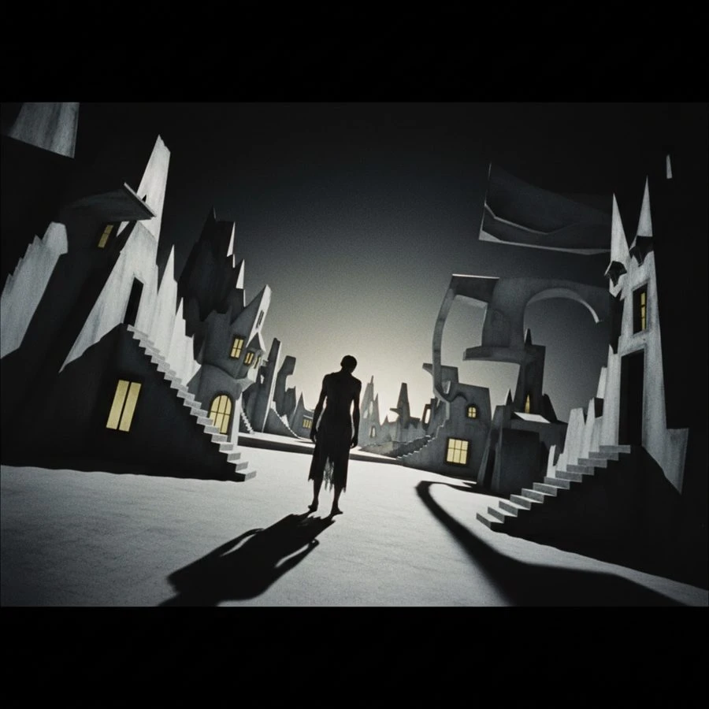

```text
a lone figure standing in an open landscape, German Expressionism (1920s, Germany): jagged distorted sets; skewed perspective; hard chiaroscuro shadows painted onto walls; angular staircases; looming silhouettes; low-key lighting; tilted camera. Palette: black, white and silver-grey with sickly yellow accents. Mood: psychological dread, subjectivity, social alienation, revolt against realism
Medium: cinematic film still, 35mm, shallow depth of field, visible grain. Lighting: soft directional daylight, subtle chiaroscuro, long shadows. Composition: centered lone figure, wide open landscape, generous negative space, horizon at lower third. Rendering: sharp, high detail.
--no watermark, text artefacts, muddy colour, extra limbs
```

Model: Nano Banana · Author: bthnbdk · AI Art Style Prompt Library · CC BY 4.0

[Original source](https://github.com/bthnbdk/ai-art-style-prompts/blob/028aad93ea9da35064f50643bf408207c8c5244c/data/styles.json#L2575) · [Provenance and original license](data/projectd-batch-0015.json)

## Ghanaian Hand-Painted Poster — bthnbdk · CC BY 4.0

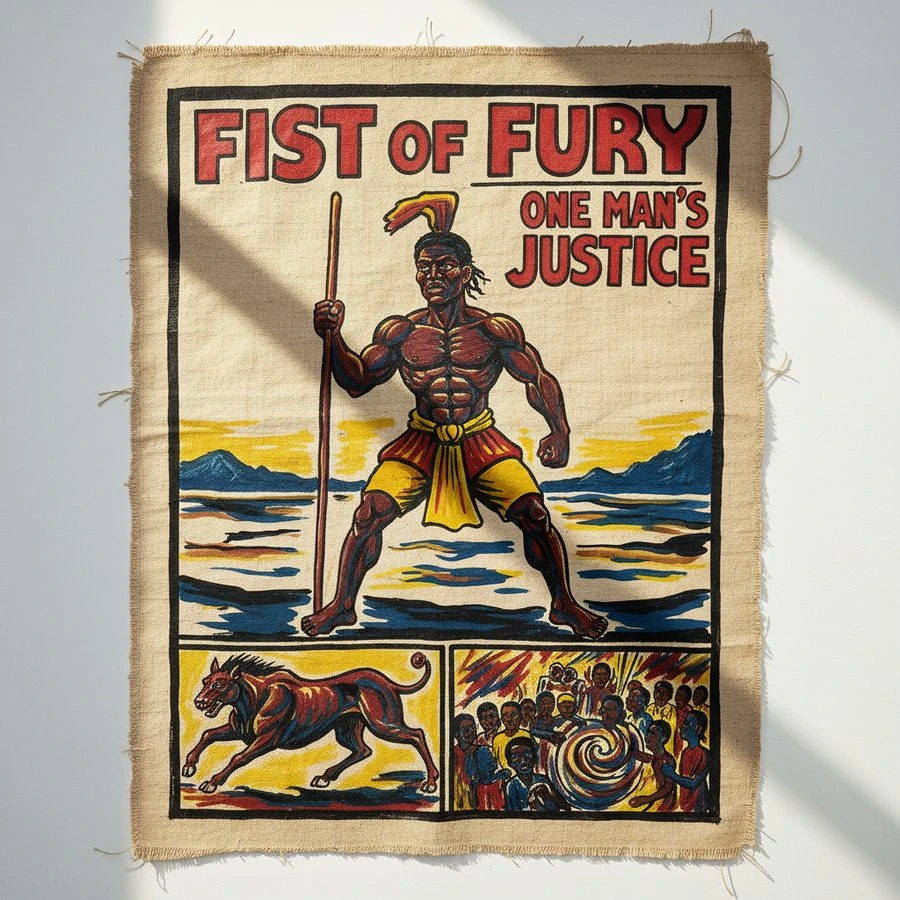

```text
a lone figure standing in an open landscape, Ghanaian Hand-Painted Poster (1980s-1990s, Ghana): painted flour-sack canvas panels; several scenes stacked on one sheet; bold self-taught figures; dramatic expressive poses; hand-lettered English headlines; improvised brushwork. Palette: saturated enamel red, yellow, blue, black outlines. Mood: street cinema ballyhoo, improvised craft, hand-made showmanship
Medium: painted flour-sack canvas poster, glossy enamel paint, irregular edges. Lighting: soft directional daylight, subtle chiaroscuro, long shadows. Composition: centered lone figure, wide open landscape, generous negative space, horizon at lower third. Rendering: sharp, high detail.
--no watermark, text artefacts, muddy colour, extra limbs
```

Model: Nano Banana · Author: bthnbdk · AI Art Style Prompt Library · CC BY 4.0

[Original source](https://github.com/bthnbdk/ai-art-style-prompts/blob/028aad93ea9da35064f50643bf408207c8c5244c/data/styles.json#L5311) · [Provenance and original license](data/projectd-batch-0015.json)

## Giallo — bthnbdk · CC BY 4.0

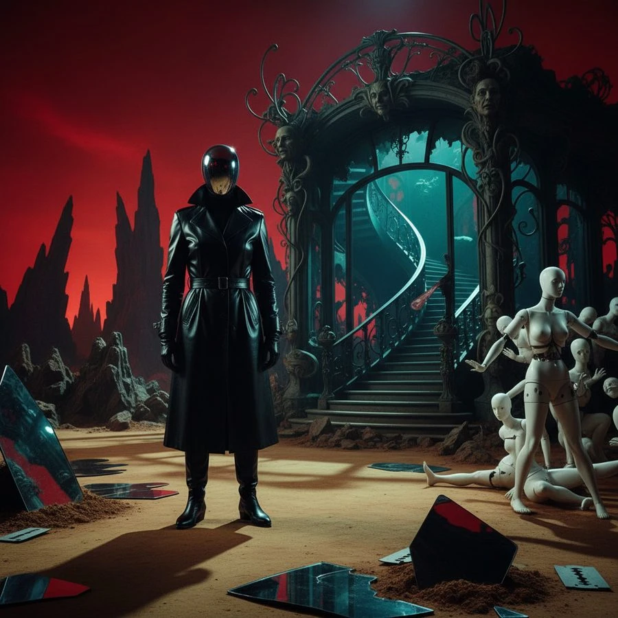

```text
a lone figure standing in an open landscape, Giallo (1970s, Italy): black-gloved killers; razor blades; mirrors; mannequins; Art Nouveau interiors; coloured gel lighting; baroque staircases. Palette: saturated blood red, deep blue, acid green, black. Mood: erotic menace, baroque violence, dream logic
Medium: cinematic film still, 35mm, saturated colour, soft gel lighting. Lighting: soft directional daylight, subtle chiaroscuro, long shadows. Composition: centered lone figure, wide open landscape, generous negative space, horizon at lower third. Rendering: sharp, high detail.
--no watermark, text artefacts, muddy colour, extra limbs
```

Model: Nano Banana · Author: bthnbdk · AI Art Style Prompt Library · CC BY 4.0

[Original source](https://github.com/bthnbdk/ai-art-style-prompts/blob/028aad93ea9da35064f50643bf408207c8c5244c/data/styles.json#L2632) · [Provenance and original license](data/projectd-batch-0015.json)

## Golden Age Illustration — bthnbdk · CC BY 4.0

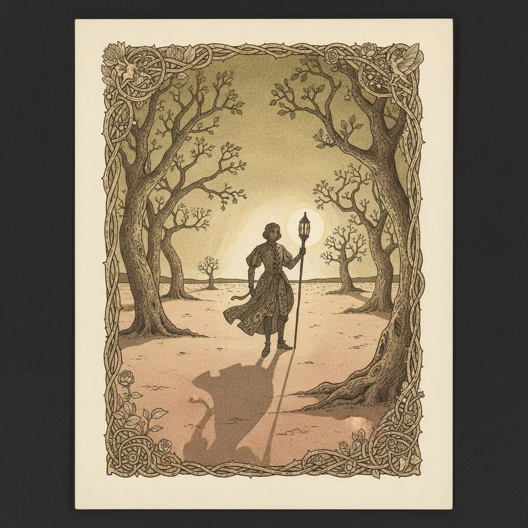

```text
a lone figure standing in an open landscape, Golden Age Illustration (1880s-1920s, Britain and United States): pen and ink linework with washes; fairy tale figures; gnarled trees; ornamental borders; silhouettes; tipped-in plates. Palette: muted olive, gold ochre, dusty rose, sepia ink. Mood: narrative enchantment, craft, storybook romance
Medium: ink and watercolour illustration on paper, fine stipple, print grain. Lighting: soft directional daylight, subtle chiaroscuro, long shadows. Composition: centered lone figure, wide open landscape, generous negative space, horizon at lower third. Rendering: sharp, high detail.
--no watermark, text artefacts, muddy colour, extra limbs
```

Model: Nano Banana · Author: bthnbdk · AI Art Style Prompt Library · CC BY 4.0

[Original source](https://github.com/bthnbdk/ai-art-style-prompts/blob/028aad93ea9da35064f50643bf408207c8c5244c/data/styles.json#L4133) · [Provenance and original license](data/projectd-batch-0015.json)

## Gothic Revival — bthnbdk · CC BY 4.0

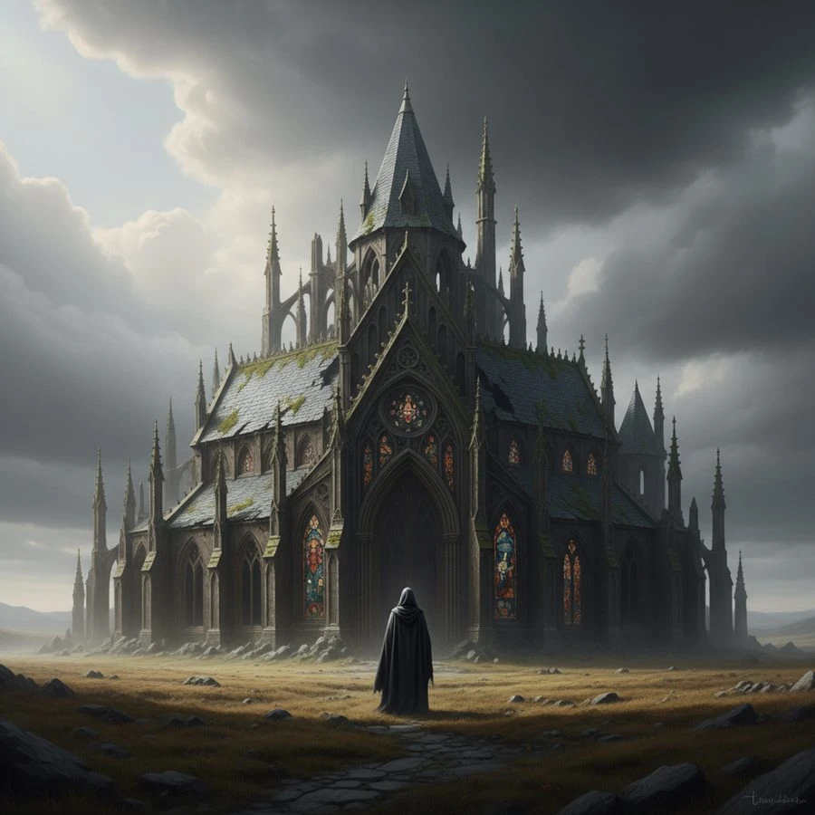

```text
a lone figure standing in an open landscape, Gothic Revival (1740s-1900s, Britain and Europe): pointed arches; tracery; pinnacles; steep pitched roofs; crockets; stained glass; asymmetrical picturesque massing. Palette: grey stone, slate, jewel-toned stained glass, verdigris. Mood: romantic medievalism, moral earnestness, craft
Medium: architectural photograph, overcast light, wet stone. Lighting: soft directional daylight, subtle chiaroscuro, long shadows. Composition: centered lone figure, wide open landscape, generous negative space, horizon at lower third. Rendering: sharp, high detail.
--no watermark, text artefacts, muddy colour, extra limbs
```

Model: Nano Banana · Author: bthnbdk · AI Art Style Prompt Library · CC BY 4.0

[Original source](https://github.com/bthnbdk/ai-art-style-prompts/blob/028aad93ea9da35064f50643bf408207c8c5244c/data/styles.json#L3449) · [Provenance and original license](data/projectd-batch-0015.json)

## Graphite Pencil Sketch — bthnbdk · CC BY 4.0

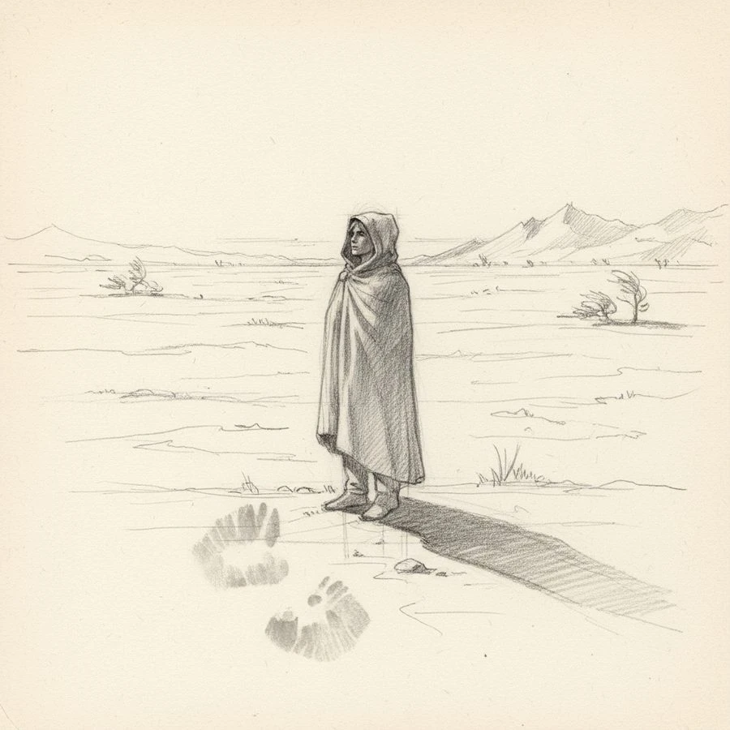

```text
a lone figure standing in an open landscape, Graphite Pencil Sketch (1500s-, Europe): soft 2B graphite on white paper; visible construction and guide lines; directional hatching; thumb smudges; one passage resolved and the rest left rough. Palette: graphite grey on warm paper white. Mood: honest study, thinking in progress, quiet observation
Medium: graphite pencil on textured drawing paper, greyscale, visible paper tooth. Lighting: soft directional daylight, subtle chiaroscuro, long shadows. Composition: centered lone figure, wide open landscape, generous negative space, horizon at lower third. Rendering: sharp, high detail.
--no watermark, text artefacts, muddy colour, extra limbs
```

Model: Nano Banana · Author: bthnbdk · AI Art Style Prompt Library · CC BY 4.0

[Original source](https://github.com/bthnbdk/ai-art-style-prompts/blob/028aad93ea9da35064f50643bf408207c8c5244c/data/styles.json#L6052) · [Provenance and original license](data/projectd-batch-0015.json)

## Grunge Typography — bthnbdk · CC BY 4.0

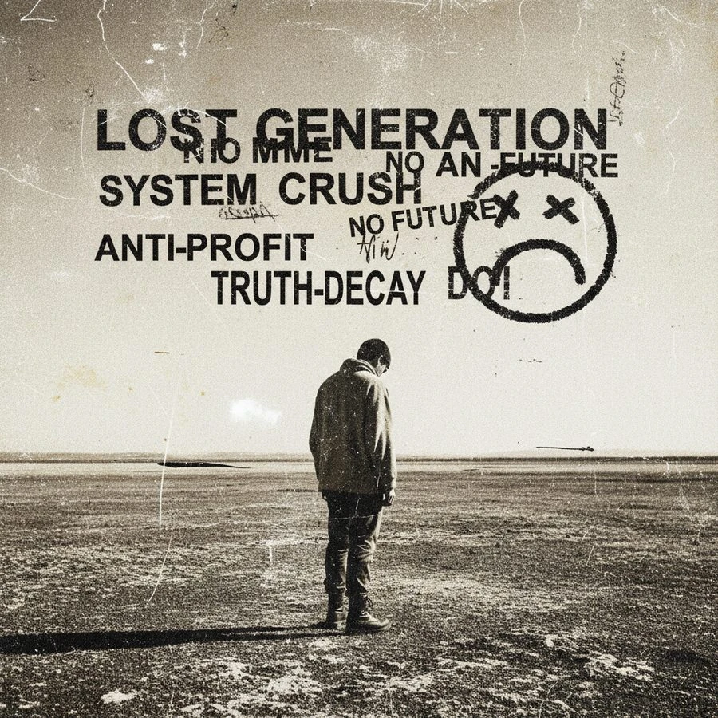

```text
a lone figure standing in an open landscape, Grunge Typography (1990s, United States and Britain): distressed typefaces; scratched and smeared textures; layered scans; handwriting overlays; cramped leading; accidental marks. Palette: dirty black, muddy brown, bleached white, nicotine yellow. Mood: youth alienation, anti-corporate energy, raw authenticity
Medium: photocopied print, distressed texture, layered scans, matte paper. Lighting: soft directional daylight, subtle chiaroscuro, long shadows. Composition: centered lone figure, wide open landscape, generous negative space, horizon at lower third. Rendering: sharp, high detail.
--no watermark, text artefacts, muddy colour, extra limbs
```

Model: Nano Banana · Author: bthnbdk · AI Art Style Prompt Library · CC BY 4.0

[Original source](https://github.com/bthnbdk/ai-art-style-prompts/blob/028aad93ea9da35064f50643bf408207c8c5244c/data/styles.json#L4798) · [Provenance and original license](data/projectd-batch-0015.json)

## Guna Mola — bthnbdk · CC BY 4.0

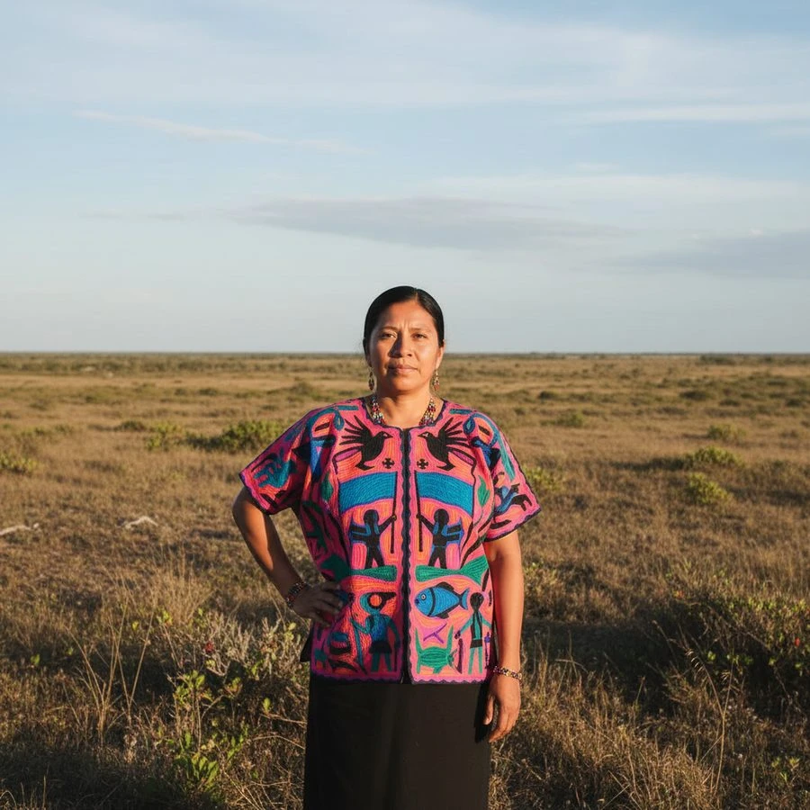

```text
a lone figure standing in an open landscape, Guna Mola (19th century-, Panama and Colombia (Guna people)): reverse applique layers; political and natural motifs; wavy cut lines; blouse-front panels; mirror pair designs. Palette: hot pink, orange, cobalt, green, black layers. Mood: woman-led artistry, graphic wit, cultural signature
Medium: reverse-appliqued layered cloth, visible stitches, cut-away panels. Lighting: soft directional daylight, subtle chiaroscuro, long shadows. Composition: centered lone figure, wide open landscape, generous negative space, horizon at lower third. Rendering: sharp, high detail.
--no watermark, text artefacts, muddy colour, extra limbs
```

Model: Nano Banana · Author: bthnbdk · AI Art Style Prompt Library · CC BY 4.0

[Original source](https://github.com/bthnbdk/ai-art-style-prompts/blob/028aad93ea9da35064f50643bf408207c8c5244c/data/styles.json#L5425) · [Provenance and original license](data/projectd-batch-0015.json)

## Gutai — bthnbdk · CC BY 4.0

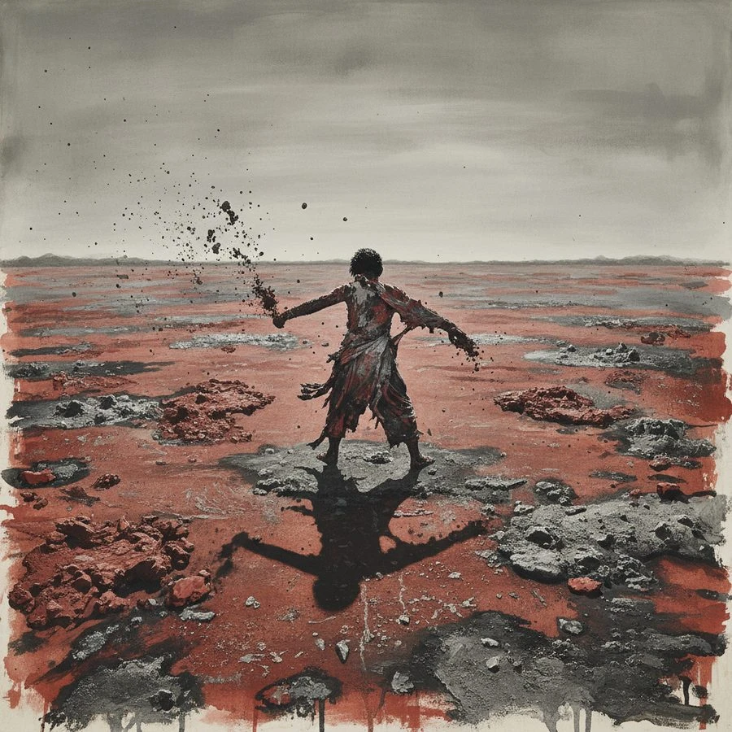

```text
a lone figure standing in an open landscape, Gutai (1954-1972, Ashiya, Japan): physical action painting; hurled paint; mud and cement; bodies through paper; raw industrial materials; performance documentation. Palette: raw earth reds, ink black, industrial greys. Mood: matter confronting the body, liberation of material
Medium: paint hurled and soaked on unstretched canvas and paper, mud and cement texture. Lighting: soft directional daylight, subtle chiaroscuro, long shadows. Composition: centered lone figure, wide open landscape, generous negative space, horizon at lower third. Rendering: sharp, high detail.
--no watermark, text artefacts, muddy colour, extra limbs
```

Model: Nano Banana · Author: bthnbdk · AI Art Style Prompt Library · CC BY 4.0

[Original source](https://github.com/bthnbdk/ai-art-style-prompts/blob/028aad93ea9da35064f50643bf408207c8c5244c/data/styles.json#L2822) · [Provenance and original license](data/projectd-batch-0015.json)

## Gzhel Porcelain — bthnbdk · CC BY 4.0

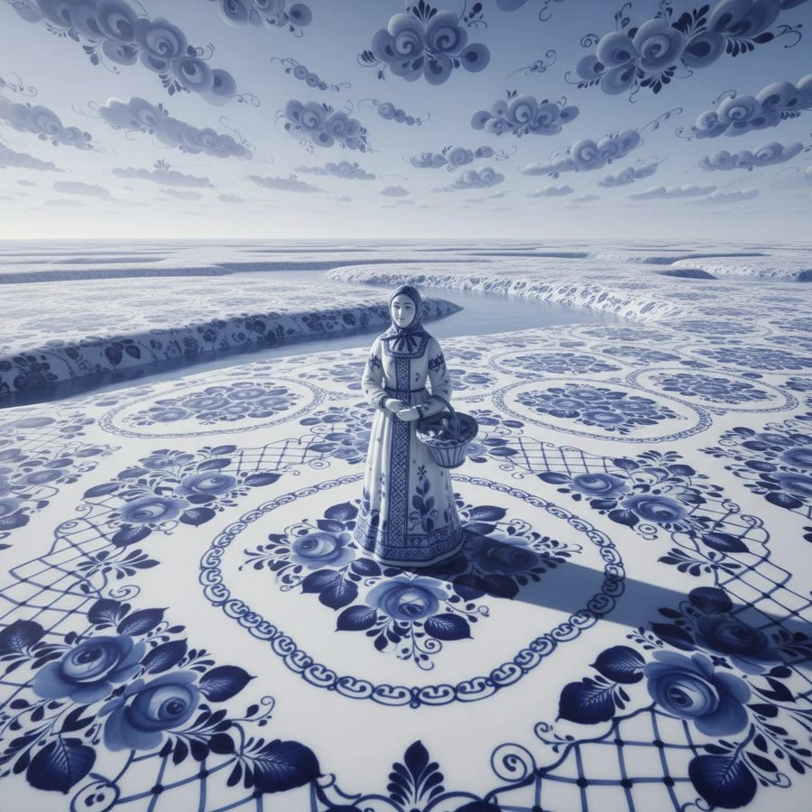

```text
a lone figure standing in an open landscape, Gzhel Porcelain (1800s-, Gzhel, Russia): cobalt blue brush strokes; rose and flower clusters; lattice and wave borders; figurines; white ground. Palette: cobalt blue on white porcelain. Mood: cool purity, artisan repetition, national craft
Medium: painted porcelain, glossy white glaze, cobalt underglaze brushwork. Lighting: soft directional daylight, subtle chiaroscuro, long shadows. Composition: centered lone figure, wide open landscape, generous negative space, horizon at lower third. Rendering: sharp, high detail.
--no watermark, text artefacts, muddy colour, extra limbs
```

Model: Nano Banana · Author: bthnbdk · AI Art Style Prompt Library · CC BY 4.0

[Original source](https://github.com/bthnbdk/ai-art-style-prompts/blob/028aad93ea9da35064f50643bf408207c8c5244c/data/styles.json#L5482) · [Provenance and original license](data/projectd-batch-0015.json)

## Hand-Painted MMO — bthnbdk · CC BY 4.0

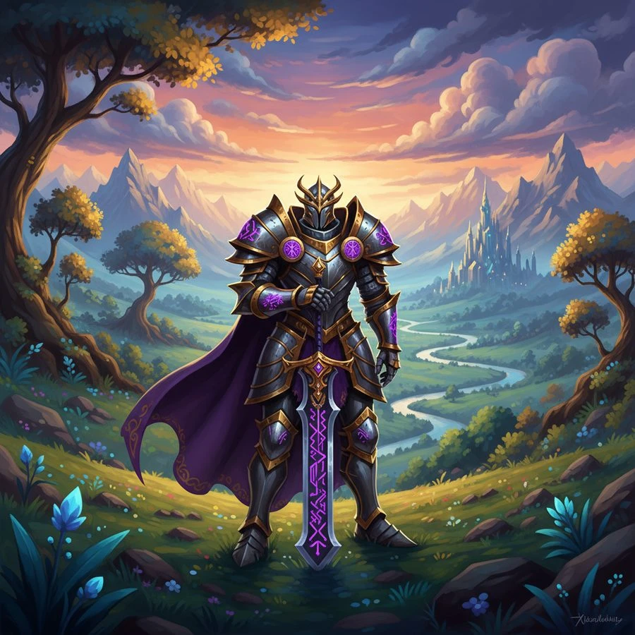

```text
a lone figure standing in an open landscape, Hand-Painted MMO (2000s-, South Korea and China): painterly texture maps; exaggerated armour; glowing runes; lush fantasy vistas; oversized weapons. Palette: rich fantasy palette, gold trim, arcane violet. Mood: escapist fantasy, spectacle, ornamental excess
Medium: stylised 3D render, hand-painted textures, soft rim light. Lighting: soft directional daylight, subtle chiaroscuro, long shadows. Composition: centered lone figure, wide open landscape, generous negative space, horizon at lower third. Rendering: sharp, high detail.
--no watermark, text artefacts, muddy colour, extra limbs
```

Model: Nano Banana · Author: bthnbdk · AI Art Style Prompt Library · CC BY 4.0

[Original source](https://github.com/bthnbdk/ai-art-style-prompts/blob/028aad93ea9da35064f50643bf408207c8c5244c/data/styles.json#L4684) · [Provenance and original license](data/projectd-batch-0015.json)

## Haussmann Paris — bthnbdk · CC BY 4.0

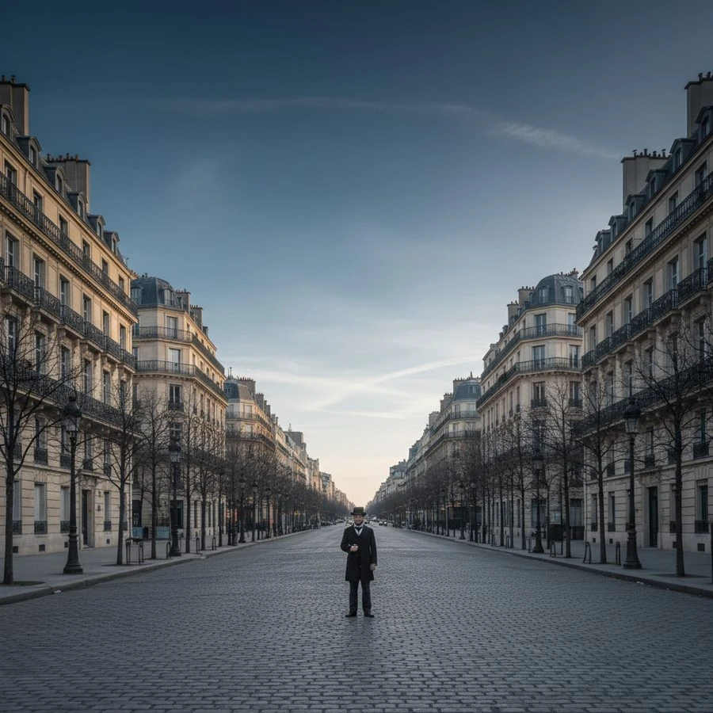

```text
a lone figure standing in an open landscape, Haussmann Paris (1853-1870, Paris, France): uniform limestone facades; mansard roofs; wrought-iron balconies; tree-lined boulevards; street lamps; long axial vistas. Palette: pale cream stone, zinc grey, dusk blue, gaslight amber. Mood: imperial order, urban theatre, bourgeois monumentality
Medium: architectural photograph, wet-plate tonality, symmetrical perspective. Lighting: soft directional daylight, subtle chiaroscuro, long shadows. Composition: centered lone figure, wide open landscape, generous negative space, horizon at lower third. Rendering: sharp, high detail.
--no watermark, text artefacts, muddy colour, extra limbs
```

Model: Nano Banana · Author: bthnbdk · AI Art Style Prompt Library · CC BY 4.0

[Original source](https://github.com/bthnbdk/ai-art-style-prompts/blob/028aad93ea9da35064f50643bf408207c8c5244c/data/styles.json#L3012) · [Provenance and original license](data/projectd-batch-0015.json)

## Heroic Bloodshed — bthnbdk · CC BY 4.0

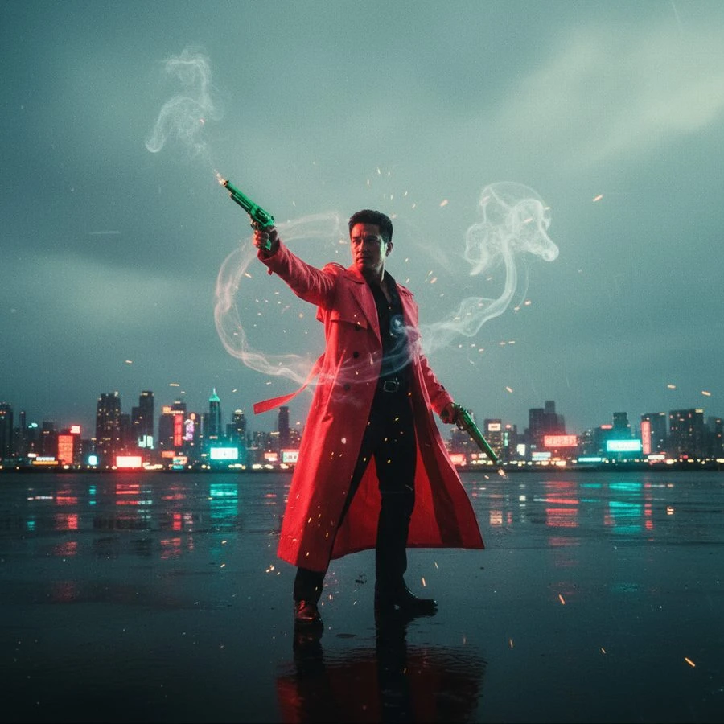

```text
a lone figure standing in an open landscape, Heroic Bloodshed (1986-1995, Hong Kong): stylised slow-motion action choreography; long flapping coats; neon-lit rain-slick streets; dramatic two-handed hero stances; sparks; swirling cigarette smoke; operatic standoffs. Palette: neon red, jade green, wet black, cyan glow. Mood: honour among outlaws, operatic drama, doomed loyalty
Medium: cinematic film still, slow-motion muzzle flash, neon night, 35mm grain. Lighting: soft directional daylight, subtle chiaroscuro, long shadows. Composition: centered lone figure, wide open landscape, generous negative space, horizon at lower third. Rendering: sharp, high detail.
--no watermark, text artefacts, muddy colour, extra limbs
```

Model: Nano Banana · Author: bthnbdk · AI Art Style Prompt Library · CC BY 4.0

[Original source](https://github.com/bthnbdk/ai-art-style-prompts/blob/028aad93ea9da35064f50643bf408207c8c5244c/data/styles.json#L5767) · [Provenance and original license](data/projectd-batch-0015.json)

## High-Tech Architecture — bthnbdk · CC BY 4.0

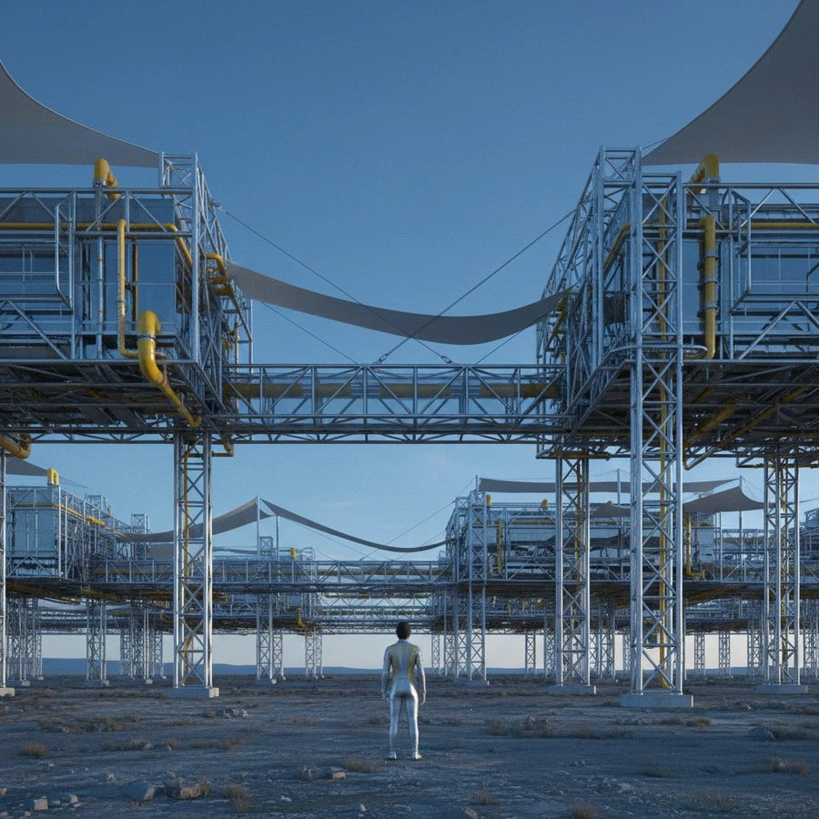

```text
a lone figure standing in an open landscape, High-Tech Architecture (1970s-, Britain and Europe): exposed steel trusses; external service ducts; glass skin; gantries; cross-bracing; tensile structures. Palette: silver steel, glass blue, safety yellow, white. Mood: engineering display, systems thinking, techno-optimism
Medium: architectural photograph, blue-hour light, specular reflections. Lighting: soft directional daylight, subtle chiaroscuro, long shadows. Composition: centered lone figure, wide open landscape, generous negative space, horizon at lower third. Rendering: sharp, high detail.
--no watermark, text artefacts, muddy colour, extra limbs
```

Model: Nano Banana · Author: bthnbdk · AI Art Style Prompt Library · CC BY 4.0

[Original source](https://github.com/bthnbdk/ai-art-style-prompts/blob/028aad93ea9da35064f50643bf408207c8c5244c/data/styles.json#L3601) · [Provenance and original license](data/projectd-batch-0015.json)

## Indonesian Batik — bthnbdk · CC BY 4.0

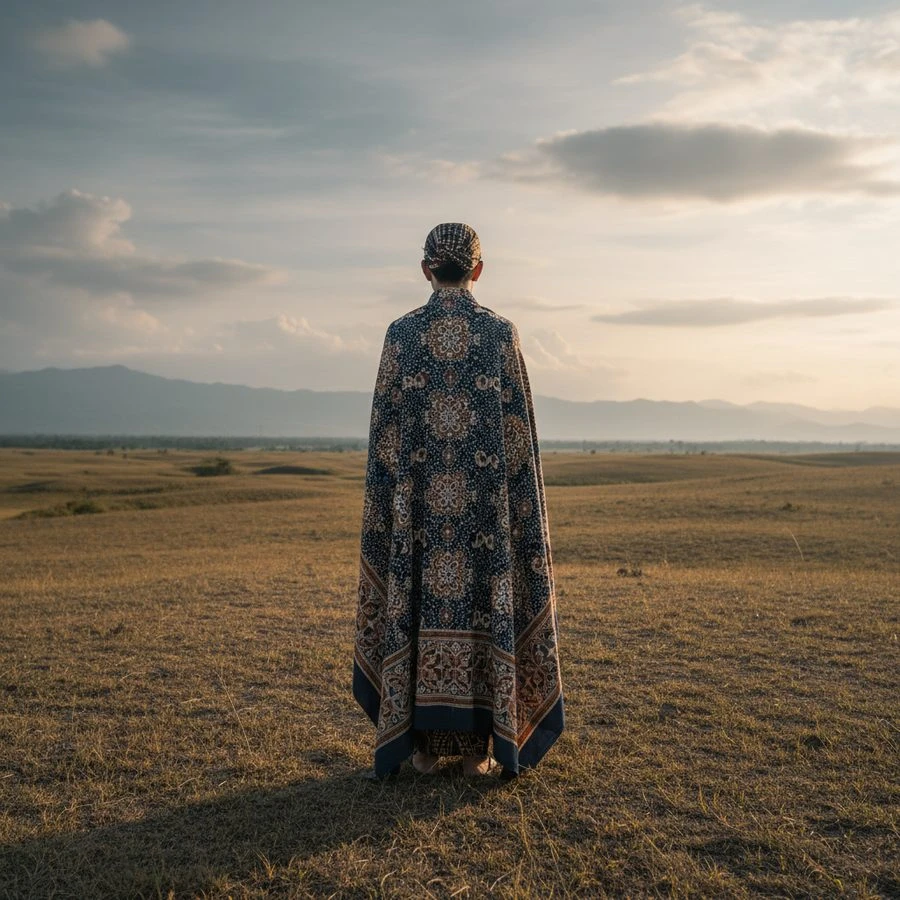

```text
a lone figure standing in an open landscape, Indonesian Batik (12th century-, Java, Indonesia): repeating parang and kawung motifs; dotted resist patterns; crackle lines; sarong borders; organic floral lattices. Palette: indigo, soga brown, ivory, deep maroon. Mood: ancestral order, patience, ceremonial rank
Medium: wax-resist dyed cloth, visible crackling, hand-drawn canting line. Lighting: soft directional daylight, subtle chiaroscuro, long shadows. Composition: centered lone figure, wide open landscape, generous negative space, horizon at lower third. Rendering: sharp, high detail.
--no watermark, text artefacts, muddy colour, extra limbs
```

Model: Nano Banana · Author: bthnbdk · AI Art Style Prompt Library · CC BY 4.0

[Original source](https://github.com/bthnbdk/ai-art-style-prompts/blob/028aad93ea9da35064f50643bf408207c8c5244c/data/styles.json#L5140) · [Provenance and original license](data/projectd-batch-0015.json)

## Infrared Photography — bthnbdk · CC BY 4.0

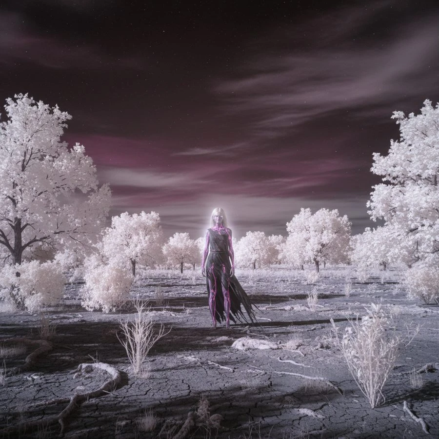

```text
a lone figure standing in an open landscape, Infrared Photography (1910s-, global): white glowing foliage; near-black skies; dreamlike landscapes; translucent skin veins; surreal contrast. Palette: ghost white, deep magenta, dark charcoal. Mood: altered perception, uncanny beauty, otherworldliness
Medium: infrared photograph, false-colour foliage, dark skies. Lighting: soft directional daylight, subtle chiaroscuro, long shadows. Composition: centered lone figure, wide open landscape, generous negative space, horizon at lower third. Rendering: sharp, high detail.
--no watermark, text artefacts, muddy colour, extra limbs
```

Model: Nano Banana · Author: bthnbdk · AI Art Style Prompt Library · CC BY 4.0

[Original source](https://github.com/bthnbdk/ai-art-style-prompts/blob/028aad93ea9da35064f50643bf408207c8c5244c/data/styles.json#L4095) · [Provenance and original license](data/projectd-batch-0015.json)

## Ink & Wash Urban Sketch — bthnbdk · CC BY 4.0


```text
a lone figure standing in an open landscape, Ink & Wash Urban Sketch (1980s-, global): waterproof fineliner contour drawn on site, then a loose watercolour wash; colour spilling past the line; bare paper left as light; fast skewed perspective. Palette: sepia or grey ink with warm ochre, terracotta and sky-blue washes. Mood: on-location immediacy, travel journal, hand-drawn documentary
Medium: fineliner ink with loose watercolour wash on rough watercolour paper. Lighting: soft directional daylight, subtle chiaroscuro, long shadows. Composition: centered lone figure, wide open landscape, generous negative space, horizon at lower third. Rendering: sharp, high detail.
--no watermark, text artefacts, muddy colour, extra limbs
```

Model: Nano Banana · Author: bthnbdk · AI Art Style Prompt Library · CC BY 4.0

[Original source](https://github.com/bthnbdk/ai-art-style-prompts/blob/028aad93ea9da35064f50643bf408207c8c5244c/data/styles.json#L6242) · [Provenance and original license](data/projectd-batch-0015.json)

## International Style — bthnbdk · CC BY 4.0


```text
a lone figure standing in an open landscape, International Style (1925-1960s, Europe and the world): white planar volumes; no ornament; ribbon windows; pilotis; flat roofs; glass curtain walls; asymmetry. Palette: white, black, grey, glass green, primary accents. Mood: functionalist universalism, machine-age clarity
Medium: architectural photograph, bright even daylight, crisp shadow. Lighting: soft directional daylight, subtle chiaroscuro, long shadows. Composition: centered lone figure, wide open landscape, generous negative space, horizon at lower third. Rendering: sharp, high detail.
--no watermark, text artefacts, muddy colour, extra limbs
```

Model: Nano Banana · Author: bthnbdk · AI Art Style Prompt Library · CC BY 4.0

[Original source](https://github.com/bthnbdk/ai-art-style-prompts/blob/028aad93ea9da35064f50643bf408207c8c5244c/data/styles.json#L3582) · [Provenance and original license](data/projectd-batch-0015.json)

## Inuit Printmaking — bthnbdk · CC BY 4.0


```text
a lone figure standing in an open landscape, Inuit Printmaking (1957-, Nunavut and Arctic Canada): spirits and shamanic transformation; seals and whales; hunting scenes; bold non-perspective shapes; syllabic captions. Palette: black ink, earth tones, cool blue-green, cream paper. Mood: Arctic survival, spiritual kinship, cold light
Medium: stonecut and stencil print, bold flat shapes, cream paper. Lighting: soft directional daylight, subtle chiaroscuro, long shadows. Composition: centered lone figure, wide open landscape, generous negative space, horizon at lower third. Rendering: sharp, high detail.
--no watermark, text artefacts, muddy colour, extra limbs
```

Model: Nano Banana · Author: bthnbdk · AI Art Style Prompt Library · CC BY 4.0

[Original source](https://github.com/bthnbdk/ai-art-style-prompts/blob/028aad93ea9da35064f50643bf408207c8c5244c/data/styles.json#L5216) · [Provenance and original license](data/projectd-batch-0015.json)

## Isometric Game Art — bthnbdk · CC BY 4.0


```text
a lone figure standing in an open landscape, Isometric Game Art (1983-, Britain and Japan): diamond tile grids; stacked boxes; tiny characters; architectural cutaways; scrolling map vistas. Palette: warm arcade palette, teal shadows, sand ochre. Mood: tactical clarity, diorama charm, ordered worlds
Medium: pixel art, isometric projection, crisp tile edges. Lighting: soft directional daylight, subtle chiaroscuro, long shadows. Composition: centered lone figure, wide open landscape, generous negative space, horizon at lower third. Rendering: sharp, high detail.
--no watermark, text artefacts, muddy colour, extra limbs
```

Model: Nano Banana · Author: bthnbdk · AI Art Style Prompt Library · CC BY 4.0

[Original source](https://github.com/bthnbdk/ai-art-style-prompts/blob/028aad93ea9da35064f50643bf408207c8c5244c/data/styles.json#L4627) · [Provenance and original license](data/projectd-batch-0015.json)

## Italian Neorealism — bthnbdk · CC BY 4.0


```text
a lone figure standing in an open landscape, Italian Neorealism (1945-1953, Italy): non-professional faces; rubble and post-war streets; bicycles; crowded tenements; laundered sheets; natural light; documentary framing. Palette: desaturated greys, warm dust, washed-out daylight. Mood: social compassion, defeat, dignity of the poor
Medium: documentary photograph, 35mm, grainy, available light. Lighting: soft directional daylight, subtle chiaroscuro, long shadows. Composition: centered lone figure, wide open landscape, generous negative space, horizon at lower third. Rendering: sharp, high detail.
--no watermark, text artefacts, muddy colour, extra limbs
```

Model: Nano Banana · Author: bthnbdk · AI Art Style Prompt Library · CC BY 4.0

[Original source](https://github.com/bthnbdk/ai-art-style-prompts/blob/028aad93ea9da35064f50643bf408207c8c5244c/data/styles.json#L2594) · [Provenance and original license](data/projectd-batch-0015.json)

## İznik Çini — bthnbdk · CC BY 4.0


```text
a lone figure standing in an open landscape, Iznik Cini (16th century, Iznik, Ottoman Empire): cobalt-turquoise tilework; saz leaves; rosettes; carnations; white slip ground; repeating geometric bands. Palette: cobalt blue, turquoise, coral red, emerald green on white. Mood: devotional order, ceramic perfection
Medium: underglaze-painted fritware tile, glossy glaze, slight craquelure. Lighting: soft directional daylight, subtle chiaroscuro, long shadows. Composition: centered lone figure, wide open landscape, generous negative space, horizon at lower third. Rendering: sharp, high detail.
--no watermark, text artefacts, muddy colour, extra limbs
```

Model: Nano Banana · Author: bthnbdk · AI Art Style Prompt Library · CC BY 4.0

[Original source](https://github.com/bthnbdk/ai-art-style-prompts/blob/028aad93ea9da35064f50643bf408207c8c5244c/data/styles.json#L2898) · [Provenance and original license](data/projectd-batch-0015.json)

## Japanese City Pop Cover — bthnbdk · CC BY 4.0


```text
a lone figure standing in an open landscape, Japanese City Pop Cover (1978-1990, Japan): airbrushed summer scenes; chrome cars; palm shadows; pastel beach horizons; silhouetted figures; katakana titles. Palette: aqua, sunset coral, chrome silver, deep navy. Mood: urban leisure, sophisticated nostalgia, tropical escapism
Medium: printed album sleeve, airbrush illustration, glossy stock. Lighting: soft directional daylight, subtle chiaroscuro, long shadows. Composition: centered lone figure, wide open landscape, generous negative space, horizon at lower third. Rendering: sharp, high detail.
--no watermark, text artefacts, muddy colour, extra limbs
```

Model: Nano Banana · Author: bthnbdk · AI Art Style Prompt Library · CC BY 4.0

[Original source](https://github.com/bthnbdk/ai-art-style-prompts/blob/028aad93ea9da35064f50643bf408207c8c5244c/data/styles.json#L4931) · [Provenance and original license](data/projectd-batch-0015.json)

## Japanese RPG Illustration — bthnbdk · CC BY 4.0


```text
a lone figure standing in an open landscape, Japanese RPG Illustration (1990s-, Japan): detailed fantasy costumes; windswept hair; ornate belt hardware; oversized swords; sky-and-cloud backdrops. Palette: soft gradient skies, warm skin tones, pastel metal. Mood: character romance, adventure promise, crafted fantasy
Medium: digital illustration, crisp lineart, soft gradient shading. Lighting: soft directional daylight, subtle chiaroscuro, long shadows. Composition: centered lone figure, wide open landscape, generous negative space, horizon at lower third. Rendering: sharp, high detail.
--no watermark, text artefacts, muddy colour, extra limbs
```

Model: Nano Banana · Author: bthnbdk · AI Art Style Prompt Library · CC BY 4.0

[Original source](https://github.com/bthnbdk/ai-art-style-prompts/blob/028aad93ea9da35064f50643bf408207c8c5244c/data/styles.json#L4703) · [Provenance and original license](data/projectd-batch-0015.json)

## Japanese Sumi-e — bthnbdk · CC BY 4.0


```text
a lone figure standing in an open landscape, Japanese Sumi-e (14th century-, Japan): bamboo, plum and orchid; single sweeping strokes; empty space; asymmetric off-centre composition; seal stamps. Palette: ink black, paper white, faint red seal. Mood: directness, zen discipline, suggestion over description
Medium: ink on absorbent paper, single rapid brushstrokes, visible paper grain. Lighting: soft directional daylight, subtle chiaroscuro, long shadows. Composition: centered lone figure, wide open landscape, generous negative space, horizon at lower third. Rendering: sharp, high detail.
--no watermark, text artefacts, muddy colour, extra limbs
```

Model: Nano Banana · Author: bthnbdk · AI Art Style Prompt Library · CC BY 4.0

[Original source](https://github.com/bthnbdk/ai-art-style-prompts/blob/028aad93ea9da35064f50643bf408207c8c5244c/data/styles.json#L5064) · [Provenance and original license](data/projectd-batch-0015.json)

## K-Drama Pastel — bthnbdk · CC BY 4.0


```text
a lone figure standing in an open landscape, K-Drama Pastel (2010s-, South Korea): soft-lit cafes; falling cherry blossom; rain with shared umbrella; pastel knitwear; gentle close-ups; city night bokeh. Palette: pastel pink, cream, soft blue, warm brown. Mood: tender romance, slow burn, everyday comfort
Medium: video still, soft warm lighting, shallow depth of field. Lighting: soft directional daylight, subtle chiaroscuro, long shadows. Composition: centered lone figure, wide open landscape, generous negative space, horizon at lower third. Rendering: sharp, high detail.
--no watermark, text artefacts, muddy colour, extra limbs
```

Model: Nano Banana · Author: bthnbdk · AI Art Style Prompt Library · CC BY 4.0

[Original source](https://github.com/bthnbdk/ai-art-style-prompts/blob/028aad93ea9da35064f50643bf408207c8c5244c/data/styles.json#L5786) · [Provenance and original license](data/projectd-batch-0015.json)

## Kaiju Tokusatsu — bthnbdk · CC BY 4.0


```text
a lone figure standing in an open landscape, Kaiju Tokusatsu (1954-, Japan): suitmation monsters; tabletop miniature Tokyo; collapsing model towers; rubber scales; military hardware. Palette: sickly green, warning red, concrete grey, fire orange. Mood: nuclear anxiety, spectacle of destruction, earnest heroism
Medium: film still, miniature set photography, practical pyrotechnics, suit texture. Lighting: soft directional daylight, subtle chiaroscuro, long shadows. Composition: centered lone figure, wide open landscape, generous negative space, horizon at lower third. Rendering: sharp, high detail.
--no watermark, text artefacts, muddy colour, extra limbs
```

Model: Nano Banana · Author: bthnbdk · AI Art Style Prompt Library · CC BY 4.0

[Original source](https://github.com/bthnbdk/ai-art-style-prompts/blob/028aad93ea9da35064f50643bf408207c8c5244c/data/styles.json#L5596) · [Provenance and original license](data/projectd-batch-0015.json)

## Karagöz Shadow Play — bthnbdk · CC BY 4.0


```text
a lone figure standing in an open landscape, Karagoz Shadow Play (16th century-, Ottoman Empire): flat jointed leather puppets; silhouettes on a backlit screen; ornate cut-out lacework; exaggerated profiles; rod joints. Palette: translucent ochre, amber, deep black silhouettes. Mood: satirical folk comedy, moral fable
Medium: backlit shadow-puppet photograph, translucent tawed leather, screen glow. Lighting: soft directional daylight, subtle chiaroscuro, long shadows. Composition: centered lone figure, wide open landscape, generous negative space, horizon at lower third. Rendering: sharp, high detail.
--no watermark, text artefacts, muddy colour, extra limbs
```

Model: Nano Banana · Author: bthnbdk · AI Art Style Prompt Library · CC BY 4.0

[Original source](https://github.com/bthnbdk/ai-art-style-prompts/blob/028aad93ea9da35064f50643bf408207c8c5244c/data/styles.json#L2917) · [Provenance and original license](data/projectd-batch-0015.json)

## Korean Minhwa — bthnbdk · CC BY 4.0


```text
a lone figure standing in an open landscape, Korean Minhwa (18th-20th century, Korea): tigers with magpies; peony rocks; bookshelves; village festivals; folk humour; irregular naive proportion. Palette: strong blue-green, vermilion, ochre, ink black. Mood: folk wish-fulfilment, humour, hopeful symbolism
Medium: ink and colour on mulberry paper, bold brush, flat colour. Lighting: soft directional daylight, subtle chiaroscuro, long shadows. Composition: centered lone figure, wide open landscape, generous negative space, horizon at lower third. Rendering: sharp, high detail.
--no watermark, text artefacts, muddy colour, extra limbs
```

Model: Nano Banana · Author: bthnbdk · AI Art Style Prompt Library · CC BY 4.0

[Original source](https://github.com/bthnbdk/ai-art-style-prompts/blob/028aad93ea9da35064f50643bf408207c8c5244c/data/styles.json#L5121) · [Provenance and original license](data/projectd-batch-0015.json)

## Kraft Paper Sketch — bthnbdk · CC BY 4.0


```text
a lone figure standing in an open landscape, Kraft Paper Sketch (1900s-, Europe and United States): pencil and white chalk on brown kraft paper; the brown ground becomes the mid-tone; only the lights and the darks are drawn; tape and torn edges. Palette: kraft brown ground, graphite dark, chalk white highlight. Mood: provisional outdoor study, economical means, street-corner improvisation
Medium: pencil and white chalk on brown kraft paper, fibrous matte texture. Lighting: soft directional daylight, subtle chiaroscuro, long shadows. Composition: centered lone figure, wide open landscape, generous negative space, horizon at lower third. Rendering: sharp, high detail.
--no watermark, text artefacts, muddy colour, extra limbs
```

Model: Nano Banana · Author: bthnbdk · AI Art Style Prompt Library · CC BY 4.0

[Original source](https://github.com/bthnbdk/ai-art-style-prompts/blob/028aad93ea9da35064f50643bf408207c8c5244c/data/styles.json#L6166) · [Provenance and original license](data/projectd-batch-0015.json)

## Land Art — bthnbdk · CC BY 4.0


```text
a lone figure standing in an open landscape, Land Art (1960s-1970s, USA): monumental earthworks in remote landscapes; spiral jetties; trenches; mounds; documentation photographs; entropy. Palette: ochre earth, salt white, basalt black, lake blue. Mood: sublime scale, entropy, anti-gallery
Medium: large-scale earthwork documented in aerial photograph, natural materials. Lighting: soft directional daylight, subtle chiaroscuro, long shadows. Composition: centered lone figure, wide open landscape, generous negative space, horizon at lower third. Rendering: sharp, high detail.
--no watermark, text artefacts, muddy colour, extra limbs
```

Model: Nano Banana · Author: bthnbdk · AI Art Style Prompt Library · CC BY 4.0

[Original source](https://github.com/bthnbdk/ai-art-style-prompts/blob/028aad93ea9da35064f50643bf408207c8c5244c/data/styles.json#L2841) · [Provenance and original license](data/projectd-batch-0015.json)

## Light Art Installation — bthnbdk · CC BY 4.0


```text
a lone figure standing in an open landscape, Light Art Installation (1960s-, global): rooms of light; neon tubes; LED fields; mirrored infinity rooms; fog beams; light as architecture. Palette: magenta, cyan, amber, deep black. Mood: perceptual immersion, sublime technology, meditative space
Medium: long-exposure photograph of installation, volumetric haze, saturated LEDs. Lighting: soft directional daylight, subtle chiaroscuro, long shadows. Composition: centered lone figure, wide open landscape, generous negative space, horizon at lower third. Rendering: sharp, high detail.
--no watermark, text artefacts, muddy colour, extra limbs
```

Model: Nano Banana · Author: bthnbdk · AI Art Style Prompt Library · CC BY 4.0

[Original source](https://github.com/bthnbdk/ai-art-style-prompts/blob/028aad93ea9da35064f50643bf408207c8c5244c/data/styles.json#L5919) · [Provenance and original license](data/projectd-batch-0015.json)

## Light Painting — bthnbdk · CC BY 4.0


```text
a lone figure standing in an open landscape, Light Painting (1930s-, global): drawn light trails; orbiting sparks; wire-wool fire; neon ribbons in darkness; human outlines of light. Palette: electric blue, ember orange, deep black. Mood: gesture in the dark, performance, energy
Medium: long-exposure photograph, moving light sources, black background. Lighting: soft directional daylight, subtle chiaroscuro, long shadows. Composition: centered lone figure, wide open landscape, generous negative space, horizon at lower third. Rendering: sharp, high detail.
--no watermark, text artefacts, muddy colour, extra limbs
```

Model: Nano Banana · Author: bthnbdk · AI Art Style Prompt Library · CC BY 4.0

[Original source](https://github.com/bthnbdk/ai-art-style-prompts/blob/028aad93ea9da35064f50643bf408207c8c5244c/data/styles.json#L4114) · [Provenance and original license](data/projectd-batch-0015.json)

## Ligne Claire — bthnbdk · CC BY 4.0


```text
a lone figure standing in an open landscape, Ligne Claire (1946-, Belgium and France): uniform-width outlines; flat unshaded colour; clear staging; realistic architecture; no cross-hatching; readable silhouettes. Palette: flat ochre, sky blue, brick red, cream. Mood: legibility, calm adventure, precision
Medium: comic page, flat colour, uniform ink outline, matte paper. Lighting: soft directional daylight, subtle chiaroscuro, long shadows. Composition: centered lone figure, wide open landscape, generous negative space, horizon at lower third. Rendering: sharp, high detail.
--no watermark, text artefacts, muddy colour, extra limbs
```

Model: Nano Banana · Author: bthnbdk · AI Art Style Prompt Library · CC BY 4.0

[Original source](https://github.com/bthnbdk/ai-art-style-prompts/blob/028aad93ea9da35064f50643bf408207c8c5244c/data/styles.json#L4228) · [Provenance and original license](data/projectd-batch-0015.json)

## Lomography — bthnbdk · CC BY 4.0


```text
a lone figure standing in an open landscape, Lomography (1991-, Vienna, Austria): heavy vignetting; saturated colour shifts; light leaks; soft corners; accidental framing; plastic optics. Palette: acid green, magenta cast, punchy cyan. Mood: anti-perfection, spontaneity, joyful accident
Medium: toy-camera photograph, heavy vignette, colour shift. Lighting: soft directional daylight, subtle chiaroscuro, long shadows. Composition: centered lone figure, wide open landscape, generous negative space, horizon at lower third. Rendering: sharp, high detail.
--no watermark, text artefacts, muddy colour, extra limbs
```

Model: Nano Banana · Author: bthnbdk · AI Art Style Prompt Library · CC BY 4.0

[Original source](https://github.com/bthnbdk/ai-art-style-prompts/blob/028aad93ea9da35064f50643bf408207c8c5244c/data/styles.json#L4057) · [Provenance and original license](data/projectd-batch-0015.json)

## Long Exposure — bthnbdk · CC BY 4.0


```text
a lone figure standing in an open landscape, Long Exposure (20th century-, global): silky water; light trails; blurred crowds; star trails; ghosted figures; stretched cloud bands. Palette: cold blue hour, orange light trails, monochrome sea. Mood: time made visible, serenity, dissolution of the instant
Medium: long-exposure photograph, tripod, motion blur. Lighting: soft directional daylight, subtle chiaroscuro, long shadows. Composition: centered lone figure, wide open landscape, generous negative space, horizon at lower third. Rendering: sharp, high detail.
--no watermark, text artefacts, muddy colour, extra limbs
```

Model: Nano Banana · Author: bthnbdk · AI Art Style Prompt Library · CC BY 4.0

[Original source](https://github.com/bthnbdk/ai-art-style-prompts/blob/028aad93ea9da35064f50643bf408207c8c5244c/data/styles.json#L4019) · [Provenance and original license](data/projectd-batch-0015.json)

## Maori Kowhaiwhai — bthnbdk · CC BY 4.0


```text
a lone figure standing in an open landscape, Maori Kowhaiwhai (pre-1800s-, Aotearoa New Zealand): koru spiral unfolding; symmetrical painted rafters; flowing kape curves; carved meeting-house context. Palette: red ochre, soot black, white clay, turquoise accents. Mood: genealogy, protection, ancestral rhythm
Medium: painted rafter panels, red ochre and black on cream ground. Lighting: soft directional daylight, subtle chiaroscuro, long shadows. Composition: centered lone figure, wide open landscape, generous negative space, horizon at lower third. Rendering: sharp, high detail.
--no watermark, text artefacts, muddy colour, extra limbs
```

Model: Nano Banana · Author: bthnbdk · AI Art Style Prompt Library · CC BY 4.0

[Original source](https://github.com/bthnbdk/ai-art-style-prompts/blob/028aad93ea9da35064f50643bf408207c8c5244c/data/styles.json#L5197) · [Provenance and original license](data/projectd-batch-0015.json)

## Marker Rendering — bthnbdk · CC BY 4.0


```text
a lone figure standing in an open landscape, Marker Rendering (1980s-2000s, Japan and United States): alcohol marker strokes with visible overlapping bands; warm and cool grey families; a heavy black accent on the silhouette; paper bleed at the stroke ends. Palette: warm grey, cool grey, one saturated accent, white paper highlight. Mood: industrial-design studio, product-pitch energy, confident craft
Medium: alcohol-based design markers on marker paper, banded strokes, paper bleed. Lighting: soft directional daylight, subtle chiaroscuro, long shadows. Composition: centered lone figure, wide open landscape, generous negative space, horizon at lower third. Rendering: sharp, high detail.
--no watermark, text artefacts, muddy colour, extra limbs
```

Model: Nano Banana · Author: bthnbdk · AI Art Style Prompt Library · CC BY 4.0

[Original source](https://github.com/bthnbdk/ai-art-style-prompts/blob/028aad93ea9da35064f50643bf408207c8c5244c/data/styles.json#L6318) · [Provenance and original license](data/projectd-batch-0015.json)

## Metabolism — bthnbdk · CC BY 4.0


```text
a lone figure standing in an open landscape, Metabolism (1959-1970s, Japan): capsule units; megastructures with plug-in pods; exposed service cores; scaffolding aesthetics; growth diagrams. Palette: concrete grey, painted steel red and blue, white pods. Mood: biological growth, adaptability, collective futurism
Medium: architectural photograph, overcast light, concrete texture. Lighting: soft directional daylight, subtle chiaroscuro, long shadows. Composition: centered lone figure, wide open landscape, generous negative space, horizon at lower third. Rendering: sharp, high detail.
--no watermark, text artefacts, muddy colour, extra limbs
```

Model: Nano Banana · Author: bthnbdk · AI Art Style Prompt Library · CC BY 4.0

[Original source](https://github.com/bthnbdk/ai-art-style-prompts/blob/028aad93ea9da35064f50643bf408207c8c5244c/data/styles.json#L3677) · [Provenance and original license](data/projectd-batch-0015.json)

## Mexican Papel Picado — bthnbdk · CC BY 4.0


```text
a lone figure standing in an open landscape, Mexican Papel Picado (19th century-, Mexico): hand-cut perforated silhouettes; skulls and flowers; birds; serrated borders; stacked banner strings. Palette: pink, orange, cobalt, lime tissue paper. Mood: festive ephemerality, celebration, folk devotion
Medium: hand-cut tissue paper banner, translucent against light, visible fibre. Lighting: soft directional daylight, subtle chiaroscuro, long shadows. Composition: centered lone figure, wide open landscape, generous negative space, horizon at lower third. Rendering: sharp, high detail.
--no watermark, text artefacts, muddy colour, extra limbs
```

Model: Nano Banana · Author: bthnbdk · AI Art Style Prompt Library · CC BY 4.0

[Original source](https://github.com/bthnbdk/ai-art-style-prompts/blob/028aad93ea9da35064f50643bf408207c8c5244c/data/styles.json#L5254) · [Provenance and original license](data/projectd-batch-0015.json)

## MS Paint Doodle — bthnbdk · CC BY 4.0


```text
a lone figure standing in an open landscape, MS Paint Doodle (1990s-2020s, global): crude mouse-drawn shapes with visibly square, hard aliased edges and absolutely no anti-aliasing; flat fill from a tiny 16-colour palette; unsteady circles and rectangle-tool boxes; the white canvas left blank — no text, no words, no lettering, no labels anywhere in the image. Palette: white canvas with saturated default red, blue, green and black. Mood: deadpan internet humour, amateur charm, meme-ready crudeness
Medium: pixel-level mouse drawing in a basic paint program, aliased edges, flat fills. Lighting: soft directional daylight, subtle chiaroscuro, long shadows. Composition: centered lone figure, wide open landscape, generous negative space, horizon at lower third. Rendering: sharp, high detail.
--no watermark, text artefacts, muddy colour, extra limbs
```

Model: Nano Banana · Author: bthnbdk · AI Art Style Prompt Library · CC BY 4.0

[Original source](https://github.com/bthnbdk/ai-art-style-prompts/blob/028aad93ea9da35064f50643bf408207c8c5244c/data/styles.json#L6413) · [Provenance and original license](data/projectd-batch-0015.json)

## Mughal Architecture — bthnbdk · CC BY 4.0


```text
a lone figure standing in an open landscape, Mughal Architecture (1526-1858, South Asia): bulbous domes; pietra dura inlay; red sandstone; chatris; jali screens; water channels; symmetrical gardens. Palette: red sandstone, white marble, gemstone inlay, jade green. Mood: imperial refinement, paradise garden, dynastic grandeur
Medium: architectural photograph, warm morning light, marble sheen. Lighting: soft directional daylight, subtle chiaroscuro, long shadows. Composition: centered lone figure, wide open landscape, generous negative space, horizon at lower third. Rendering: sharp, high detail.
--no watermark, text artefacts, muddy colour, extra limbs
```

Model: Nano Banana · Author: bthnbdk · AI Art Style Prompt Library · CC BY 4.0

[Original source](https://github.com/bthnbdk/ai-art-style-prompts/blob/028aad93ea9da35064f50643bf408207c8c5244c/data/styles.json#L3791) · [Provenance and original license](data/projectd-batch-0015.json)

## Mughal Miniature — bthnbdk · CC BY 4.0


```text
a lone figure standing in an open landscape, Mughal Miniature (16th-19th century, South Asia): naturalistic portraits; haloed emperors; dense garden greenery; hunting scenes; birds in profile; ornate borders. Palette: emerald green, rose pink, gold, ultramarine. Mood: imperial self-presentation, observation, luxury
Medium: opaque watercolour and gold on paper, fine stipple, burnished surface. Lighting: soft directional daylight, subtle chiaroscuro, long shadows. Composition: centered lone figure, wide open landscape, generous negative space, horizon at lower third. Rendering: sharp, high detail.
--no watermark, text artefacts, muddy colour, extra limbs
```

Model: Nano Banana · Author: bthnbdk · AI Art Style Prompt Library · CC BY 4.0

[Original source](https://github.com/bthnbdk/ai-art-style-prompts/blob/028aad93ea9da35064f50643bf408207c8c5244c/data/styles.json#L4988) · [Provenance and original license](data/projectd-batch-0015.json)

## N64 Fog — bthnbdk · CC BY 4.0


```text
a lone figure standing in an open landscape, N64 Fog (1996-2001, Japan and United States): smothering distance fog; low-res stretched textures; water reflections; chunky character models; open explorable fields. Palette: misty blue, muted green, sun-bleached yellow. Mood: lonely expanse, exploration, dreamlike spaces
Medium: 3D render, low-res textures, heavy distance fog, antialiasing blur. Lighting: soft directional daylight, subtle chiaroscuro, long shadows. Composition: centered lone figure, wide open landscape, generous negative space, horizon at lower third. Rendering: sharp, high detail.
--no watermark, text artefacts, muddy colour, extra limbs
```

Model: Nano Banana · Author: bthnbdk · AI Art Style Prompt Library · CC BY 4.0

[Original source](https://github.com/bthnbdk/ai-art-style-prompts/blob/028aad93ea9da35064f50643bf408207c8c5244c/data/styles.json#L4589) · [Provenance and original license](data/projectd-batch-0015.json)

## Navajo Sandpainting — bthnbdk · CC BY 4.0


```text
a lone figure standing in an open landscape, Navajo Sandpainting (pre-contact-, Southwestern United States): symmetrical ceremonial figures; protective encircling borders; pollen and corn colours; rainbow guardians; yéi figures. Palette: red ochre, white gypsum, yellow ochre, charcoal black. Mood: healing ritual, cosmic balance, impermanence
Medium: dry pigment on sand, loose granular texture, healed by scattering. Lighting: soft directional daylight, subtle chiaroscuro, long shadows. Composition: centered lone figure, wide open landscape, generous negative space, horizon at lower third. Rendering: sharp, high detail.
--no watermark, text artefacts, muddy colour, extra limbs
```

Model: Nano Banana · Author: bthnbdk · AI Art Style Prompt Library · CC BY 4.0

[Original source](https://github.com/bthnbdk/ai-art-style-prompts/blob/028aad93ea9da35064f50643bf408207c8c5244c/data/styles.json#L5235) · [Provenance and original license](data/projectd-batch-0015.json)

## Ndebele House Painting — bthnbdk · CC BY 4.0


```text
a lone figure standing in an open landscape, Ndebele House Painting (19th century-, South Africa): bold geometric murals; razor-straight outlines; stacked triangles; doorframe ornament; symmetrical facade bands. Palette: white ground, black outline, red, blue, yellow. Mood: female authorship, defiance and pride, geometric order
Medium: exterior mural paint on earth plaster, flat colour, hard edges. Lighting: soft directional daylight, subtle chiaroscuro, long shadows. Composition: centered lone figure, wide open landscape, generous negative space, horizon at lower third. Rendering: sharp, high detail.
--no watermark, text artefacts, muddy colour, extra limbs
```

Model: Nano Banana · Author: bthnbdk · AI Art Style Prompt Library · CC BY 4.0

[Original source](https://github.com/bthnbdk/ai-art-style-prompts/blob/028aad93ea9da35064f50643bf408207c8c5244c/data/styles.json#L5387) · [Provenance and original license](data/projectd-batch-0015.json)

## Neo-Dada — bthnbdk · CC BY 4.0


```text
a lone figure standing in an open landscape, Neo-Dada (1950s-1960s, USA): found objects; junk assemblage; mass-media imagery; readymade irony; happenings; comic-strip fragments. Palette: industrial greys, newsprint, muted pop accents. Mood: playful anti-art, absurdity, blurring art and life
Medium: assemblage of found objects, mixed media, newsprint collage. Lighting: soft directional daylight, subtle chiaroscuro, long shadows. Composition: centered lone figure, wide open landscape, generous negative space, horizon at lower third. Rendering: sharp, high detail.
--no watermark, text artefacts, muddy colour, extra limbs
```

Model: Nano Banana · Author: bthnbdk · AI Art Style Prompt Library · CC BY 4.0

[Original source](https://github.com/bthnbdk/ai-art-style-prompts/blob/028aad93ea9da35064f50643bf408207c8c5244c/data/styles.json#L2803) · [Provenance and original license](data/projectd-batch-0015.json)

## Neo-Futurism — bthnbdk · CC BY 4.0


```text
a lone figure standing in an open landscape, Neo-Futurism (2000s-, global): flowing aerodynamic forms; cantilevers; parametric skins; curved glass; exoskeleton frames; LED edges. Palette: white, chrome silver, glass cyan, LED magenta. Mood: optimistic futurism, movement, technological grace
Medium: architectural render, dusk lighting, glossy materials. Lighting: soft directional daylight, subtle chiaroscuro, long shadows. Composition: centered lone figure, wide open landscape, generous negative space, horizon at lower third. Rendering: sharp, high detail.
--no watermark, text artefacts, muddy colour, extra limbs
```

Model: Nano Banana · Author: bthnbdk · AI Art Style Prompt Library · CC BY 4.0

[Original source](https://github.com/bthnbdk/ai-art-style-prompts/blob/028aad93ea9da35064f50643bf408207c8c5244c/data/styles.json#L3620) · [Provenance and original license](data/projectd-batch-0015.json)

## Neo-Noir — bthnbdk · CC BY 4.0


```text
a lone figure standing in an open landscape, Neo-Noir (1970s-, United States): neon reflections on wet asphalt; venetian blind shadows; morally compromised detective; night cityscapes; cigarette smoke. Palette: teal shadow, sodium orange, black, rain silver. Mood: fatalism, moral fog, wounded masculinity
Medium: cinematic film still, anamorphic lens, neon practicals, rain. Lighting: soft directional daylight, subtle chiaroscuro, long shadows. Composition: centered lone figure, wide open landscape, generous negative space, horizon at lower third. Rendering: sharp, high detail.
--no watermark, text artefacts, muddy colour, extra limbs
```

Model: Nano Banana · Author: bthnbdk · AI Art Style Prompt Library · CC BY 4.0

[Original source](https://github.com/bthnbdk/ai-art-style-prompts/blob/028aad93ea9da35064f50643bf408207c8c5244c/data/styles.json#L5539) · [Provenance and original license](data/projectd-batch-0015.json)

## Neubrutalism — bthnbdk · CC BY 4.0


```text
a lone figure standing in an open landscape, Neubrutalism (2020s, web design culture): thick black outlines; hard drop shadows; sticker-like cards; clashing flat colour; oversized type; no gradients. Palette: raw yellow, electric purple, black, off-white. Mood: anti-corporate directness, playful honesty, web-native grit
Medium: flat vector UI graphic, hard outlines, unblended flat colour. Lighting: soft directional daylight, subtle chiaroscuro, long shadows. Composition: centered lone figure, wide open landscape, generous negative space, horizon at lower third. Rendering: sharp, high detail.
--no watermark, text artefacts, muddy colour, extra limbs
```

Model: Nano Banana · Author: bthnbdk · AI Art Style Prompt Library · CC BY 4.0

[Original source](https://github.com/bthnbdk/ai-art-style-prompts/blob/028aad93ea9da35064f50643bf408207c8c5244c/data/styles.json#L4836) · [Provenance and original license](data/projectd-batch-0015.json)

## Nihonga — bthnbdk · CC BY 4.0


```text
a lone figure standing in an open landscape, Nihonga (1880s-, Japan): flattened decorative space; seasonal flowers and birds; gold leaf grounds; subtle pigment granulation; elegant contours. Palette: shell white, malachite green, ochre, gold, cinnabar. Mood: modern Japanese identity, refinement, seasonal feeling
Medium: mineral pigment and animal glue on paper or silk, matte surface. Lighting: soft directional daylight, subtle chiaroscuro, long shadows. Composition: centered lone figure, wide open landscape, generous negative space, horizon at lower third. Rendering: sharp, high detail.
--no watermark, text artefacts, muddy colour, extra limbs
```

Model: Nano Banana · Author: bthnbdk · AI Art Style Prompt Library · CC BY 4.0

[Original source](https://github.com/bthnbdk/ai-art-style-prompts/blob/028aad93ea9da35064f50643bf408207c8c5244c/data/styles.json#L5083) · [Provenance and original license](data/projectd-batch-0015.json)

## Nordic Noir — bthnbdk · CC BY 4.0


```text
a lone figure standing in an open landscape, Nordic Noir (1990s-, Scandinavia): grey coastal towns; wool sweaters; frosted windows; police interviews; bleak apartment interiors; winter dusk. Palette: slate grey, cold teal, blood red accent, snow white. Mood: social unease, stoic investigation, climate melancholy
Medium: cinematic film still, desaturated colour, natural light, handheld. Lighting: soft directional daylight, subtle chiaroscuro, long shadows. Composition: centered lone figure, wide open landscape, generous negative space, horizon at lower third. Rendering: sharp, high detail.
--no watermark, text artefacts, muddy colour, extra limbs
```

Model: Nano Banana · Author: bthnbdk · AI Art Style Prompt Library · CC BY 4.0

[Original source](https://github.com/bthnbdk/ai-art-style-prompts/blob/028aad93ea9da35064f50643bf408207c8c5244c/data/styles.json#L5634) · [Provenance and original license](data/projectd-batch-0015.json)

## Norwegian Rosemaling — bthnbdk · CC BY 4.0


```text
a lone figure standing in an open landscape, Norwegian Rosemaling (1700s-, Norway): asymmetric flowing scrollwork; stylised roses and tulips; C- and S-curves; painted chests and ale bowls; frame borders. Palette: deep blue, ochre red, olive green, white highlights. Mood: rural homemaking, vibrant piety, regional style
Medium: dekoration painting on wood, oil-based brushwork, glossy varnish. Lighting: soft directional daylight, subtle chiaroscuro, long shadows. Composition: centered lone figure, wide open landscape, generous negative space, horizon at lower third. Rendering: sharp, high detail.
--no watermark, text artefacts, muddy colour, extra limbs
```

Model: Nano Banana · Author: bthnbdk · AI Art Style Prompt Library · CC BY 4.0

[Original source](https://github.com/bthnbdk/ai-art-style-prompts/blob/028aad93ea9da35064f50643bf408207c8c5244c/data/styles.json#L5501) · [Provenance and original license](data/projectd-batch-0015.json)

## Oaxacan Alebrijes — bthnbdk · CC BY 4.0


```text
a lone figure standing in an open landscape, Oaxacan Alebrijes (1936-, Oaxaca, Mexico): fantastical hybrid creatures; patterned scales and dots; fanged friendly faces; zoomorphic chimeras; intricate linework. Palette: electric blue, lime, orange, violet, black dots. Mood: imagined fauna, carnival exuberance, artisan virtuosity
Medium: carved and painted wood sculpture, glossy acrylic, fine brush patterns. Lighting: soft directional daylight, subtle chiaroscuro, long shadows. Composition: centered lone figure, wide open landscape, generous negative space, horizon at lower third. Rendering: sharp, high detail.
--no watermark, text artefacts, muddy colour, extra limbs
```

Model: Nano Banana · Author: bthnbdk · AI Art Style Prompt Library · CC BY 4.0

[Original source](https://github.com/bthnbdk/ai-art-style-prompts/blob/028aad93ea9da35064f50643bf408207c8c5244c/data/styles.json#L5273) · [Provenance and original license](data/projectd-batch-0015.json)

## Organic Architecture — bthnbdk · CC BY 4.0


```text
a lone figure standing in an open landscape, Organic Architecture (1900s-, United States and Europe): forms growing from the site; cantilevered terraces; rough stone masses; low roofs; natural materials; central hearth. Palette: ochre stone, timber brown, moss green, sunlight cream. Mood: harmony with nature, integration of site and building
Medium: architectural photograph, dappled daylight through trees. Lighting: soft directional daylight, subtle chiaroscuro, long shadows. Composition: centered lone figure, wide open landscape, generous negative space, horizon at lower third. Rendering: sharp, high detail.
--no watermark, text artefacts, muddy colour, extra limbs
```

Model: Nano Banana · Author: bthnbdk · AI Art Style Prompt Library · CC BY 4.0

[Original source](https://github.com/bthnbdk/ai-art-style-prompts/blob/028aad93ea9da35064f50643bf408207c8c5244c/data/styles.json#L3734) · [Provenance and original license](data/projectd-batch-0015.json)

## Ottoman Miniature — bthnbdk · CC BY 4.0


```text
a lone figure standing in an open landscape, Ottoman Miniature (15th-18th century, Istanbul, Ottoman Empire): flattened bird's-eye perspective; stacked registers; stylised tulips and carnations; gold clouds; no cast shadows; courtly procession. Palette: lapis lazuli, vermilion, gold leaf, turquoise. Mood: courtly narration, serenity, hierarchy
Medium: opaque watercolour and gold leaf on sized paper, fine reed-pen contour. Lighting: soft directional daylight, subtle chiaroscuro, long shadows. Composition: centered lone figure, wide open landscape, generous negative space, horizon at lower third. Rendering: sharp, high detail.
--no watermark, text artefacts, muddy colour, extra limbs
```

Model: Nano Banana · Author: bthnbdk · AI Art Style Prompt Library · CC BY 4.0

[Original source](https://github.com/bthnbdk/ai-art-style-prompts/blob/028aad93ea9da35064f50643bf408207c8c5244c/data/styles.json#L2860) · [Provenance and original license](data/projectd-batch-0015.json)

## Parametricism — bthnbdk · CC BY 4.0


```text
a lone figure standing in an open landscape, Parametricism (2000s-, global): algorithmically varied lattices; continuous curvature; swarms of panels; non-repeating geometry; fluid envelope. Palette: matte white, aluminium, glass grey, gradient accents. Mood: computational design, emergent complexity
Medium: architectural render, soft studio light, matte composite panels. Lighting: soft directional daylight, subtle chiaroscuro, long shadows. Composition: centered lone figure, wide open landscape, generous negative space, horizon at lower third. Rendering: sharp, high detail.
--no watermark, text artefacts, muddy colour, extra limbs
```

Model: Nano Banana · Author: bthnbdk · AI Art Style Prompt Library · CC BY 4.0

[Original source](https://github.com/bthnbdk/ai-art-style-prompts/blob/028aad93ea9da35064f50643bf408207c8c5244c/data/styles.json#L3639) · [Provenance and original license](data/projectd-batch-0015.json)

## Penguin Paperback — bthnbdk · CC BY 4.0


```text
a lone figure standing in an open landscape, Penguin Paperback (1935-1960s, Britain): tri-band colour coding; flipper-and-penguin logo grace; plain typographic grid; minimal illustration; numbered spine. Palette: orange, green, blue, black, cream. Mood: democratic reading, clarity, series identity
Medium: printed book cover, matte paper, simple typographic grid. Lighting: soft directional daylight, subtle chiaroscuro, long shadows. Composition: centered lone figure, wide open landscape, generous negative space, horizon at lower third. Rendering: sharp, high detail.
--no watermark, text artefacts, muddy colour, extra limbs
```

Model: Nano Banana · Author: bthnbdk · AI Art Style Prompt Library · CC BY 4.0

[Original source](https://github.com/bthnbdk/ai-art-style-prompts/blob/028aad93ea9da35064f50643bf408207c8c5244c/data/styles.json#L4912) · [Provenance and original license](data/projectd-batch-0015.json)

## Persian Islamic Architecture — bthnbdk · CC BY 4.0


```text
a lone figure standing in an open landscape, Persian Islamic Architecture (7th-17th century, Iran and Central Asia): pointed iwans; muqarnas; polychrome tile revetment; geometric stars; domes on drums; chahar bagh gardens. Palette: turquoise, cobalt, saffron, lotus white. Mood: divine geometry, paradise symbolism, courtly refinement
Medium: architectural photograph, warm daylight, glazed tile sheen. Lighting: soft directional daylight, subtle chiaroscuro, long shadows. Composition: centered lone figure, wide open landscape, generous negative space, horizon at lower third. Rendering: sharp, high detail.
--no watermark, text artefacts, muddy colour, extra limbs
```

Model: Nano Banana · Author: bthnbdk · AI Art Style Prompt Library · CC BY 4.0

[Original source](https://github.com/bthnbdk/ai-art-style-prompts/blob/028aad93ea9da35064f50643bf408207c8c5244c/data/styles.json#L3772) · [Provenance and original license](data/projectd-batch-0015.json)

## Persian Miniature — bthnbdk · CC BY 4.0


```text
a lone figure standing in an open landscape, Persian Miniature (13th-17th century, Iran): flat stacked planes; rocky crags like clouds; gardens and pavilions; polo, hunting and feasting; haloed rulers; gold sky. Palette: lapis blue, gold, vermilion, turquoise, rose. Mood: poetic narration, courtly celebration, refined ornament
Medium: opaque watercolour and gold on paper, fine brush, burnished surface. Lighting: soft directional daylight, subtle chiaroscuro, long shadows. Composition: centered lone figure, wide open landscape, generous negative space, horizon at lower third. Rendering: sharp, high detail.
--no watermark, text artefacts, muddy colour, extra limbs
```

Model: Nano Banana · Author: bthnbdk · AI Art Style Prompt Library · CC BY 4.0

[Original source](https://github.com/bthnbdk/ai-art-style-prompts/blob/028aad93ea9da35064f50643bf408207c8c5244c/data/styles.json#L4969) · [Provenance and original license](data/projectd-batch-0015.json)

## Photojournalism — bthnbdk · CC BY 4.0


```text
a lone figure standing in an open landscape, Photojournalism (1940s-, global): conflict and protest; press scrums; shocking immediacy; wide and telephoto reportage; caption-ready composition. Palette: raw colour, harsh flash white, dusty earth. Mood: urgency, truth-telling, risk
Medium: press photograph, 35mm, harsh flash or available light. Lighting: soft directional daylight, subtle chiaroscuro, long shadows. Composition: centered lone figure, wide open landscape, generous negative space, horizon at lower third. Rendering: sharp, high detail.
--no watermark, text artefacts, muddy colour, extra limbs
```

Model: Nano Banana · Author: bthnbdk · AI Art Style Prompt Library · CC BY 4.0

[Original source](https://github.com/bthnbdk/ai-art-style-prompts/blob/028aad93ea9da35064f50643bf408207c8c5244c/data/styles.json#L3962) · [Provenance and original license](data/projectd-batch-0015.json)

## Pictorialism — bthnbdk · CC BY 4.0


```text
a lone figure standing in an open landscape, Pictorialism (1885-1915, Europe and United States): soft focus; misty backlight; gum bichromate brushwork; allegorical figures; hand-coated paper. Palette: warm sepia, plum grey, cream highlights. Mood: photography as fine art, mood over record, gentility
Medium: soft-focus photograph, warm-toned print, visible paper texture. Lighting: soft directional daylight, subtle chiaroscuro, long shadows. Composition: centered lone figure, wide open landscape, generous negative space, horizon at lower third. Rendering: sharp, high detail.
--no watermark, text artefacts, muddy colour, extra limbs
```

Model: Nano Banana · Author: bthnbdk · AI Art Style Prompt Library · CC BY 4.0

[Original source](https://github.com/bthnbdk/ai-art-style-prompts/blob/028aad93ea9da35064f50643bf408207c8c5244c/data/styles.json#L3886) · [Provenance and original license](data/projectd-batch-0015.json)

## Polaroid Instant — bthnbdk · CC BY 4.0


```text
a lone figure standing in an open landscape, Polaroid Instant (1948-, United States): instant square frames; flash-blown faces; milky highlights; faded dyes; handwritten captions. Palette: muted pastel, cyan-magenta drift, white border. Mood: immediate souvenir, intimacy, disposability
Medium: instant film photograph, soft tonality, white border. Lighting: soft directional daylight, subtle chiaroscuro, long shadows. Composition: centered lone figure, wide open landscape, generous negative space, horizon at lower third. Rendering: sharp, high detail.
--no watermark, text artefacts, muddy colour, extra limbs
```

Model: Nano Banana · Author: bthnbdk · AI Art Style Prompt Library · CC BY 4.0

[Original source](https://github.com/bthnbdk/ai-art-style-prompts/blob/028aad93ea9da35064f50643bf408207c8c5244c/data/styles.json#L4076) · [Provenance and original license](data/projectd-batch-0015.json)

## Portuguese Azulejo — bthnbdk · CC BY 4.0


```text
a lone figure standing in an open landscape, Portuguese Azulejo (16th century-, Portugal): repeating tile patterns; blue-and-white narrative panels; baroque scrollwork; maritime scenes; church facades. Palette: cobalt blue, white, yellow ochre, manganese purple. Mood: urban elegance, maritime memory, devotional order
Medium: tin-glazed ceramic tiles, glossy surface, slight crackle. Lighting: soft directional daylight, subtle chiaroscuro, long shadows. Composition: centered lone figure, wide open landscape, generous negative space, horizon at lower third. Rendering: sharp, high detail.
--no watermark, text artefacts, muddy colour, extra limbs
```

Model: Nano Banana · Author: bthnbdk · AI Art Style Prompt Library · CC BY 4.0

[Original source](https://github.com/bthnbdk/ai-art-style-prompts/blob/028aad93ea9da35064f50643bf408207c8c5244c/data/styles.json#L5520) · [Provenance and original license](data/projectd-batch-0015.json)

## Postmodernism — bthnbdk · CC BY 4.0


```text
a lone figure standing in an open landscape, Postmodernism (1960s-1980s, International): quotation of historical styles; playful pastiche; loud colour; ironic ornament; offbeat asymmetry; neon signage. Palette: pastel candy plus saturated primaries, black accents. Mood: pluralism, irony, scepticism toward grand narratives
Medium: mixed media collage with mirrored surfaces and printed graphics. Lighting: soft directional daylight, subtle chiaroscuro, long shadows. Composition: centered lone figure, wide open landscape, generous negative space, horizon at lower third. Rendering: sharp, high detail.
--no watermark, text artefacts, muddy colour, extra limbs
```

Model: Nano Banana · Author: bthnbdk · AI Art Style Prompt Library · CC BY 4.0

[Original source](https://github.com/bthnbdk/ai-art-style-prompts/blob/028aad93ea9da35064f50643bf408207c8c5244c/data/styles.json#L2974) · [Provenance and original license](data/projectd-batch-0015.json)

