# ProjectD backfill batch 16

Original generation model, full prompt, reference requirements and original notices are retained. These are existing ProjectD records, not new 2.6 recipes.

## Prairie School — bthnbdk · CC BY 4.0

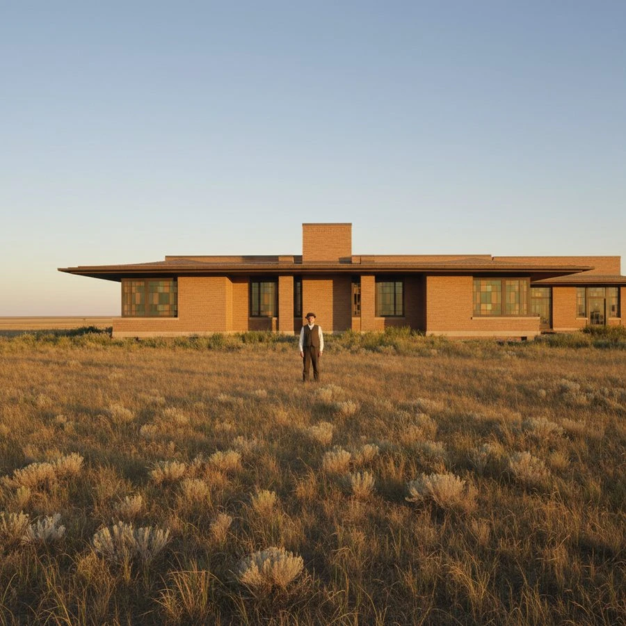

```text
a lone figure standing in an open landscape, Prairie School (1900-1920s, Midwest United States): low horizontal lines; broad overhanging eaves; open plans; art-glass windows; brick piers; central chimney. Palette: warm brick, oak, ochre glass, moss green. Mood: democratic modernism, harmony with the flat land
Medium: architectural photograph, low golden light. Lighting: soft directional daylight, subtle chiaroscuro, long shadows. Composition: centered lone figure, wide open landscape, generous negative space, horizon at lower third. Rendering: sharp, high detail.
--no watermark, text artefacts, muddy colour, extra limbs
```

Model: Nano Banana · Author: bthnbdk · AI Art Style Prompt Library · CC BY 4.0

[Original source](https://github.com/bthnbdk/ai-art-style-prompts/blob/028aad93ea9da35064f50643bf408207c8c5244c/data/styles.json#L3563) · [Provenance and original license](data/projectd-batch-0016.json)

## PS1 Low-Poly — bthnbdk · CC BY 4.0

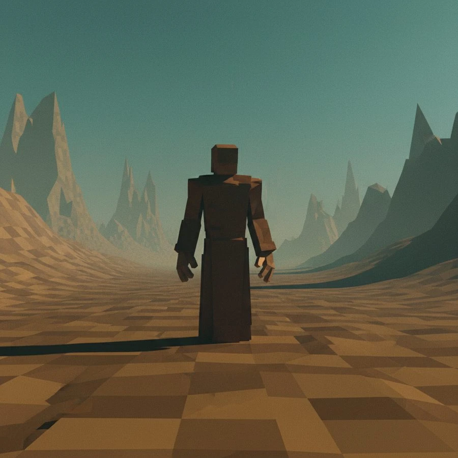

```text
a lone figure standing in an open landscape, PS1 Low-Poly (1994-2000, Japan and the West): visible polygon seams; warping textures; vertex jitter; fog walls; blocky hands; pre-rendered backgrounds. Palette: muddy browns, teal fog, dithered gradients. Mood: atmospheric dread, early-3D charm, abstraction
Medium: 3D render, low polygon count, affine texture warping, dithering. Lighting: soft directional daylight, subtle chiaroscuro, long shadows. Composition: centered lone figure, wide open landscape, generous negative space, horizon at lower third. Rendering: sharp, high detail.
--no watermark, text artefacts, muddy colour, extra limbs
```

Model: Nano Banana · Author: bthnbdk · AI Art Style Prompt Library · CC BY 4.0

[Original source](https://github.com/bthnbdk/ai-art-style-prompts/blob/028aad93ea9da35064f50643bf408207c8c5244c/data/styles.json#L4570) · [Provenance and original license](data/projectd-batch-0016.json)

## Pueblo Revival — bthnbdk · CC BY 4.0

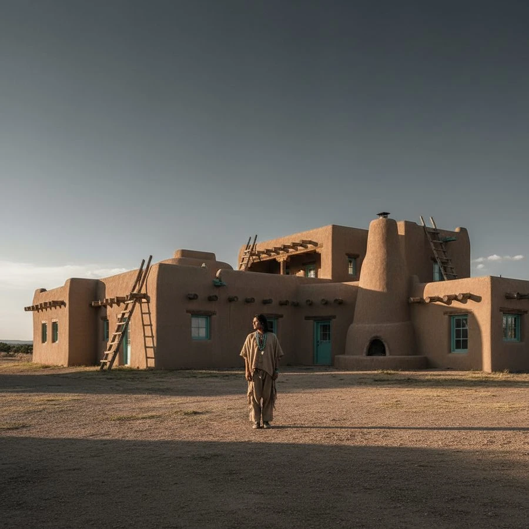

```text
a lone figure standing in an open landscape, Pueblo Revival (1910s-, New Mexico, United States): adobe masses; rounded parapets; vigas; ladder-like forms; earth plaster; kiva fireplaces. Palette: earth tan, turquoise accents, slate, whitewash. Mood: regional authenticity, earthiness, indigenous homage
Medium: architectural photograph, low sun, adobe texture. Lighting: soft directional daylight, subtle chiaroscuro, long shadows. Composition: centered lone figure, wide open landscape, generous negative space, horizon at lower third. Rendering: sharp, high detail.
--no watermark, text artefacts, muddy colour, extra limbs
```

Model: Nano Banana · Author: bthnbdk · AI Art Style Prompt Library · CC BY 4.0

[Original source](https://github.com/bthnbdk/ai-art-style-prompts/blob/028aad93ea9da35064f50643bf408207c8c5244c/data/styles.json#L3544) · [Provenance and original license](data/projectd-batch-0016.json)

## Pulp Magazine Cover — bthnbdk · CC BY 4.0

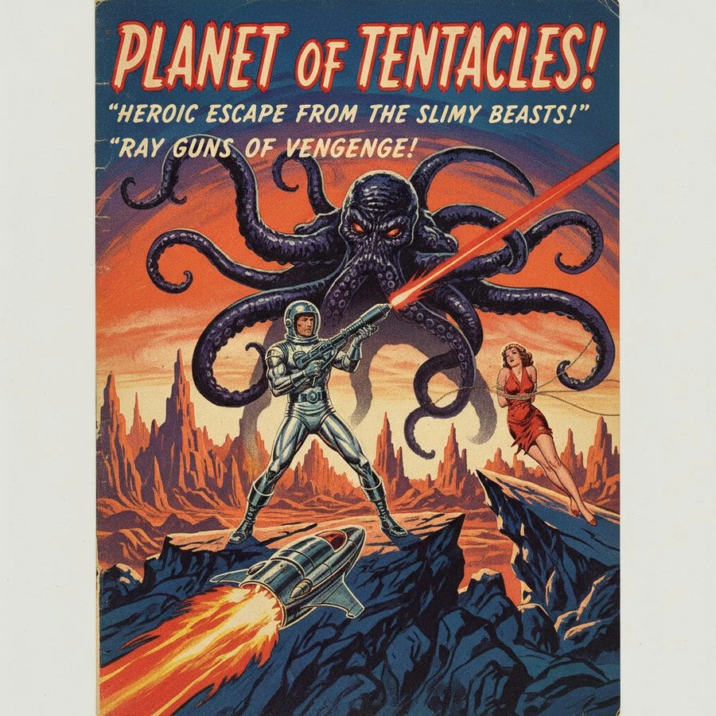

```text
a lone figure standing in an open landscape, Pulp Magazine Cover (1920s-1950s, United States): damsel in peril; ray guns; tentacled monsters; bold painted speed; lurid taglines; cover-art cropping. Palette: acid orange, blood red, chrome silver, deep blue. Mood: sensational adventure, cheap thrills, heroic escape
Medium: offset-printed magazine cover, high saturation, newsprint texture. Lighting: soft directional daylight, subtle chiaroscuro, long shadows. Composition: centered lone figure, wide open landscape, generous negative space, horizon at lower third. Rendering: sharp, high detail.
--no watermark, text artefacts, muddy colour, extra limbs
```

Model: Nano Banana · Author: bthnbdk · AI Art Style Prompt Library · CC BY 4.0

[Original source](https://github.com/bthnbdk/ai-art-style-prompts/blob/028aad93ea9da35064f50643bf408207c8c5244c/data/styles.json#L4152) · [Provenance and original license](data/projectd-batch-0016.json)

## Queen Anne Victorian — bthnbdk · CC BY 4.0

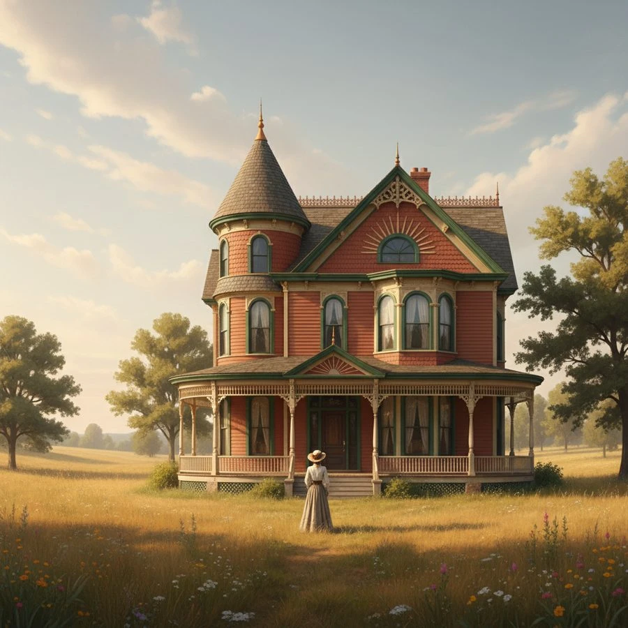

```text
a lone figure standing in an open landscape, Queen Anne Victorian (1880s-1900s, United States and Britain): asymmetric facades; wrap-around porches; turrets; fish-scale shingles; sunburst gables; spindlework. Palette: painted multicolour trim, terracotta, hunter green, cream. Mood: domestic individuality, ornament, nostalgia
Medium: architectural photograph, soft summer light, painted wood texture. Lighting: soft directional daylight, subtle chiaroscuro, long shadows. Composition: centered lone figure, wide open landscape, generous negative space, horizon at lower third. Rendering: sharp, high detail.
--no watermark, text artefacts, muddy colour, extra limbs
```

Model: Nano Banana · Author: bthnbdk · AI Art Style Prompt Library · CC BY 4.0

[Original source](https://github.com/bthnbdk/ai-art-style-prompts/blob/028aad93ea9da35064f50643bf408207c8c5244c/data/styles.json#L3487) · [Provenance and original license](data/projectd-batch-0016.json)

## Retro FPS — bthnbdk · CC BY 4.0

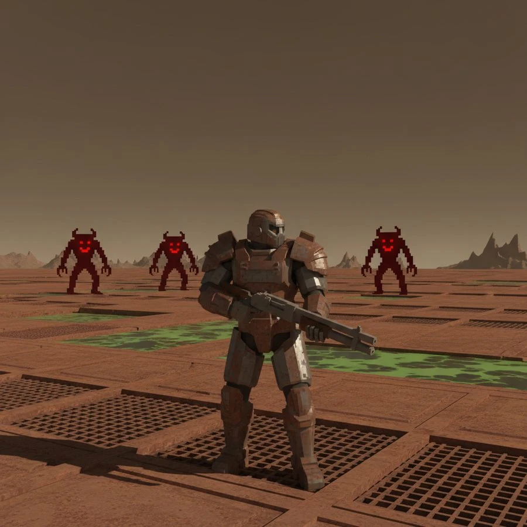

```text
a lone figure standing in an open landscape, Retro FPS (1993-1999, United States): crude 3D geometry; pixelated textures; sprite enemies; brown industrial corridors; chunky weapon sprites. Palette: rust brown, sickly green, gunmetal grey, blood red. Mood: visceral speed, grim humour, adrenaline
Medium: 3D render, low-res textures, harsh sprite lighting, palette limits. Lighting: soft directional daylight, subtle chiaroscuro, long shadows. Composition: centered lone figure, wide open landscape, generous negative space, horizon at lower third. Rendering: sharp, high detail.
--no watermark, text artefacts, muddy colour, extra limbs
```

Model: Nano Banana · Author: bthnbdk · AI Art Style Prompt Library · CC BY 4.0

[Original source](https://github.com/bthnbdk/ai-art-style-prompts/blob/028aad93ea9da35064f50643bf408207c8c5244c/data/styles.json#L4722) · [Provenance and original license](data/projectd-batch-0016.json)

## Roman Imperial — bthnbdk · CC BY 4.0

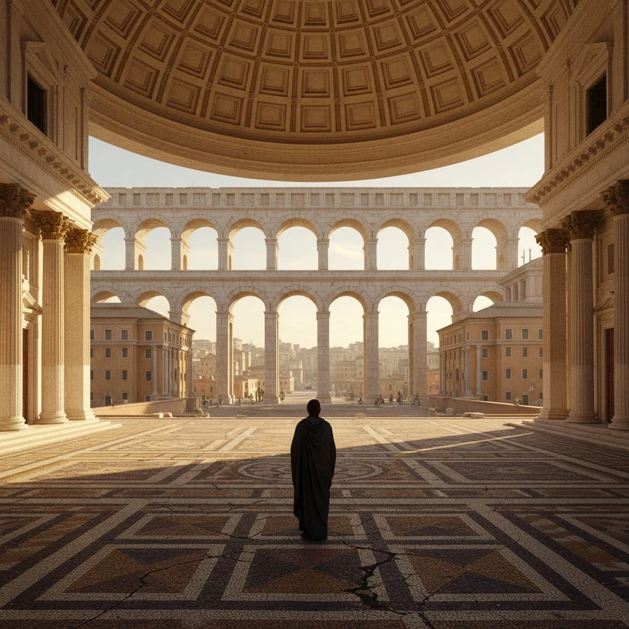

```text
a lone figure standing in an open landscape, Roman Imperial (1st-4th century AD, Rome, Italy): arches, vaults and domes; massive concrete; engaged columns; coffered ceilings; aqueducts; mosaic floors. Palette: travertine cream, porphyry purple, ochre stucco, gilded bronze. Mood: engineering power, empire, urban order
Medium: architectural photograph, warm afternoon light, stone and plaster texture. Lighting: soft directional daylight, subtle chiaroscuro, long shadows. Composition: centered lone figure, wide open landscape, generous negative space, horizon at lower third. Rendering: sharp, high detail.
--no watermark, text artefacts, muddy colour, extra limbs
```

Model: Nano Banana · Author: bthnbdk · AI Art Style Prompt Library · CC BY 4.0

[Original source](https://github.com/bthnbdk/ai-art-style-prompts/blob/028aad93ea9da35064f50643bf408207c8c5244c/data/styles.json#L3392) · [Provenance and original license](data/projectd-batch-0016.json)

## Rough Animatic Pencil — bthnbdk · CC BY 4.0

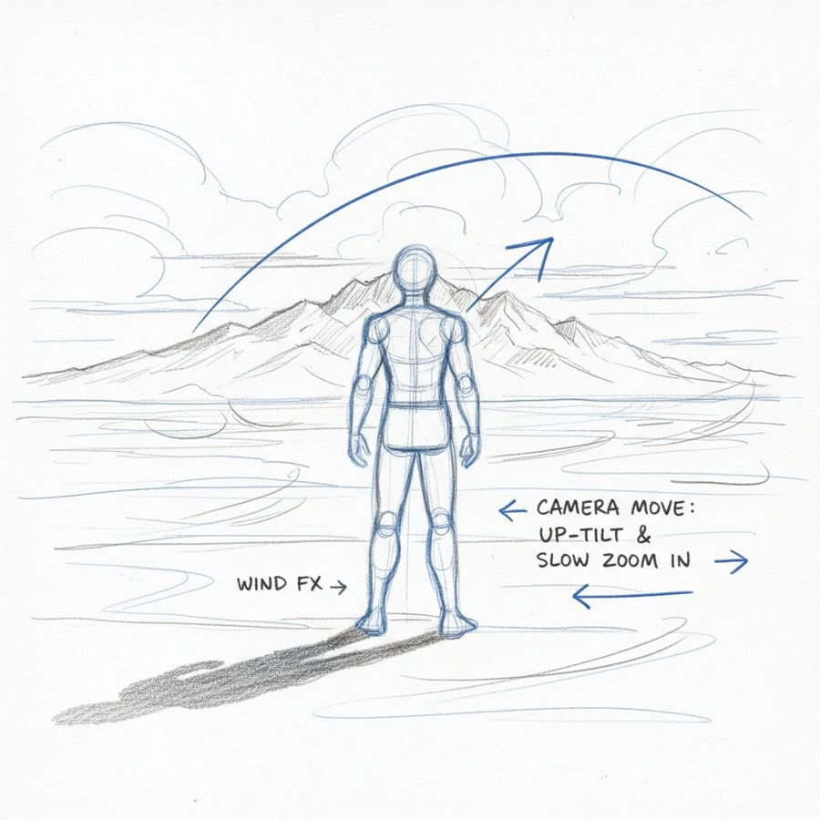

```text
a lone figure standing in an open landscape, Rough Animatic Pencil (1990s-, global): loose blue and graphite pencil roughs of a shot with motion arcs and annotation; construction shapes left visible; camera-move arrows drawn over the figure. Palette: graphite grey and blue pencil on white paper. Mood: animation pipeline, work-in-progress energy, unpolished honesty
Medium: blue and graphite pencil rough sketch on paper, construction lines visible. Lighting: soft directional daylight, subtle chiaroscuro, long shadows. Composition: centered lone figure, wide open landscape, generous negative space, horizon at lower third. Rendering: sharp, high detail.
--no watermark, text artefacts, muddy colour, extra limbs
```

Model: Nano Banana · Author: bthnbdk · AI Art Style Prompt Library · CC BY 4.0

[Original source](https://github.com/bthnbdk/ai-art-style-prompts/blob/028aad93ea9da35064f50643bf408207c8c5244c/data/styles.json#L6375) · [Provenance and original license](data/projectd-batch-0016.json)

## Rubber Hose Animation — bthnbdk · CC BY 4.0

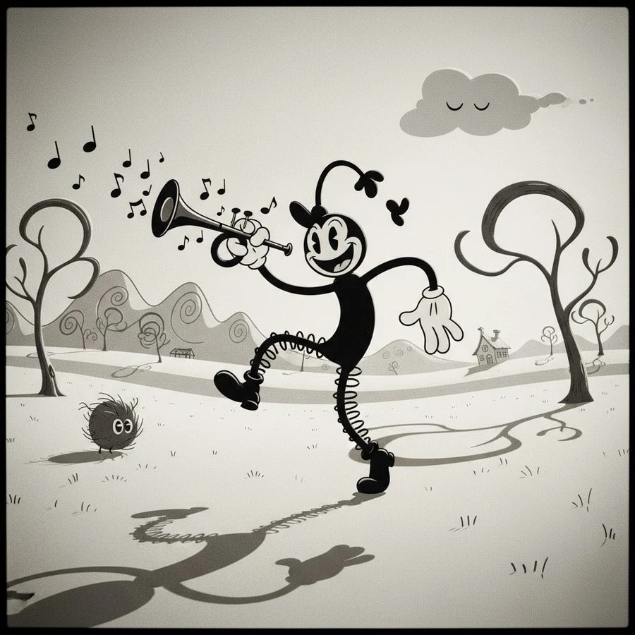

```text
a lone figure standing in an open landscape, Rubber Hose Animation (1920s-1930s, United States): noodle limbs; pie-cut eyes; bouncing gaits; rubbery transformations; ink-blot bodies; musical numbers. Palette: black, white and grey, occasional sepia. Mood: anarchic joy, silent-era gags, kinetic fun
Medium: black-and-white film frame, 35mm, heavy grain. Lighting: soft directional daylight, subtle chiaroscuro, long shadows. Composition: centered lone figure, wide open landscape, generous negative space, horizon at lower third. Rendering: sharp, high detail.
--no watermark, text artefacts, muddy colour, extra limbs
```

Model: Nano Banana · Author: bthnbdk · AI Art Style Prompt Library · CC BY 4.0

[Original source](https://github.com/bthnbdk/ai-art-style-prompts/blob/028aad93ea9da35064f50643bf408207c8c5244c/data/styles.json#L4399) · [Provenance and original license](data/projectd-batch-0016.json)

## Russian Khokhloma — bthnbdk · CC BY 4.0

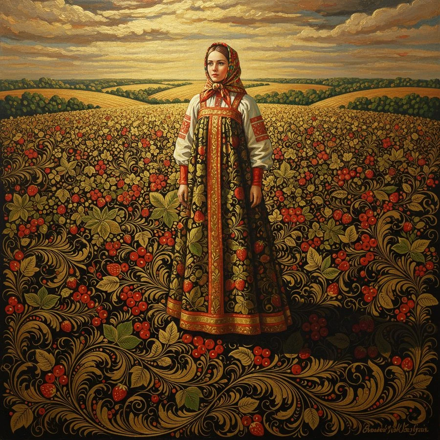

```text
a lone figure standing in an open landscape, Russian Khokhloma (17th century-, Nizhny Novgorod, Russia): golden curling foliage; strawberries and rowan berries; black ground with red highlights; scrolling grass ornament. Palette: gold on black, vermilion red, emerald. Mood: festive abundance, peasant luxury, gleaming craft
Medium: lacquered wood painting, gilded surface, black and red brushwork. Lighting: soft directional daylight, subtle chiaroscuro, long shadows. Composition: centered lone figure, wide open landscape, generous negative space, horizon at lower third. Rendering: sharp, high detail.
--no watermark, text artefacts, muddy colour, extra limbs
```

Model: Nano Banana · Author: bthnbdk · AI Art Style Prompt Library · CC BY 4.0

[Original source](https://github.com/bthnbdk/ai-art-style-prompts/blob/028aad93ea9da35064f50643bf408207c8c5244c/data/styles.json#L5463) · [Provenance and original license](data/projectd-batch-0016.json)

## Sanguine Chalk Drawing — bthnbdk · CC BY 4.0

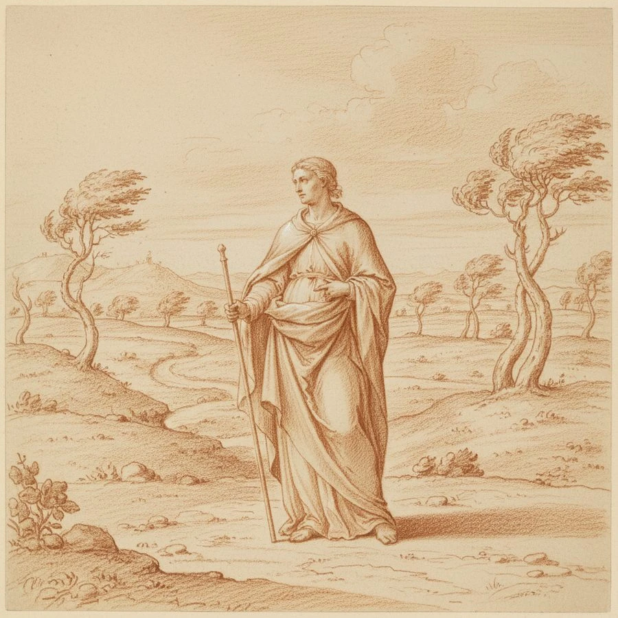

```text
a lone figure standing in an open landscape, Sanguine Chalk Drawing (1500s-1700s, Italy): red-brown natural chalk on cream toned paper; fine hatching and stumped shading; a warm skin-like cast over every form; crisp chalk grain. Palette: sanguine red-brown, cream paper, faint white heightening. Mood: old-master study, warm intimacy, Renaissance workshop
Medium: red chalk on toned laid paper, grainy matte surface. Lighting: soft directional daylight, subtle chiaroscuro, long shadows. Composition: centered lone figure, wide open landscape, generous negative space, horizon at lower third. Rendering: sharp, high detail.
--no watermark, text artefacts, muddy colour, extra limbs
```

Model: Nano Banana · Author: bthnbdk · AI Art Style Prompt Library · CC BY 4.0

[Original source](https://github.com/bthnbdk/ai-art-style-prompts/blob/028aad93ea9da35064f50643bf408207c8c5244c/data/styles.json#L6090) · [Provenance and original license](data/projectd-batch-0016.json)

## Second Empire — bthnbdk · CC BY 4.0

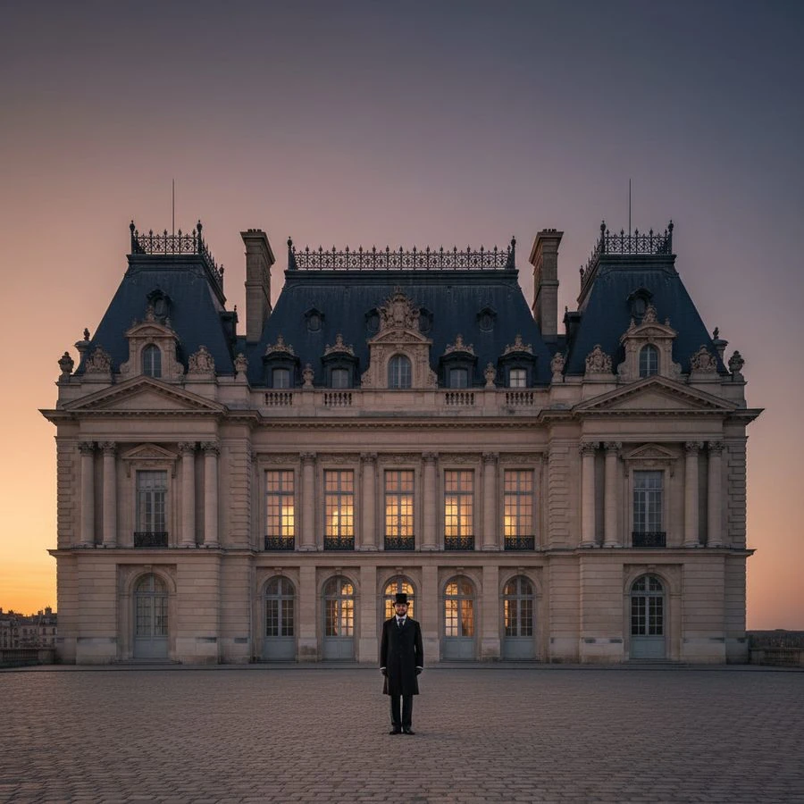

```text
a lone figure standing in an open landscape, Second Empire (1852-1880, France and the United States): mansard roofs with dormers; heavy cornices; quoins; paired columns; pavilion massing; cast-iron cresting. Palette: pale stone, slate blue-grey, black iron, bronze. Mood: bourgeois respectability, urban modernity, state pomp
Medium: architectural photograph, dusk, warm window light. Lighting: soft directional daylight, subtle chiaroscuro, long shadows. Composition: centered lone figure, wide open landscape, generous negative space, horizon at lower third. Rendering: sharp, high detail.
--no watermark, text artefacts, muddy colour, extra limbs
```

Model: Nano Banana · Author: bthnbdk · AI Art Style Prompt Library · CC BY 4.0

[Original source](https://github.com/bthnbdk/ai-art-style-prompts/blob/028aad93ea9da35064f50643bf408207c8c5244c/data/styles.json#L3468) · [Provenance and original license](data/projectd-batch-0016.json)

## Shin-hanga — bthnbdk · CC BY 4.0

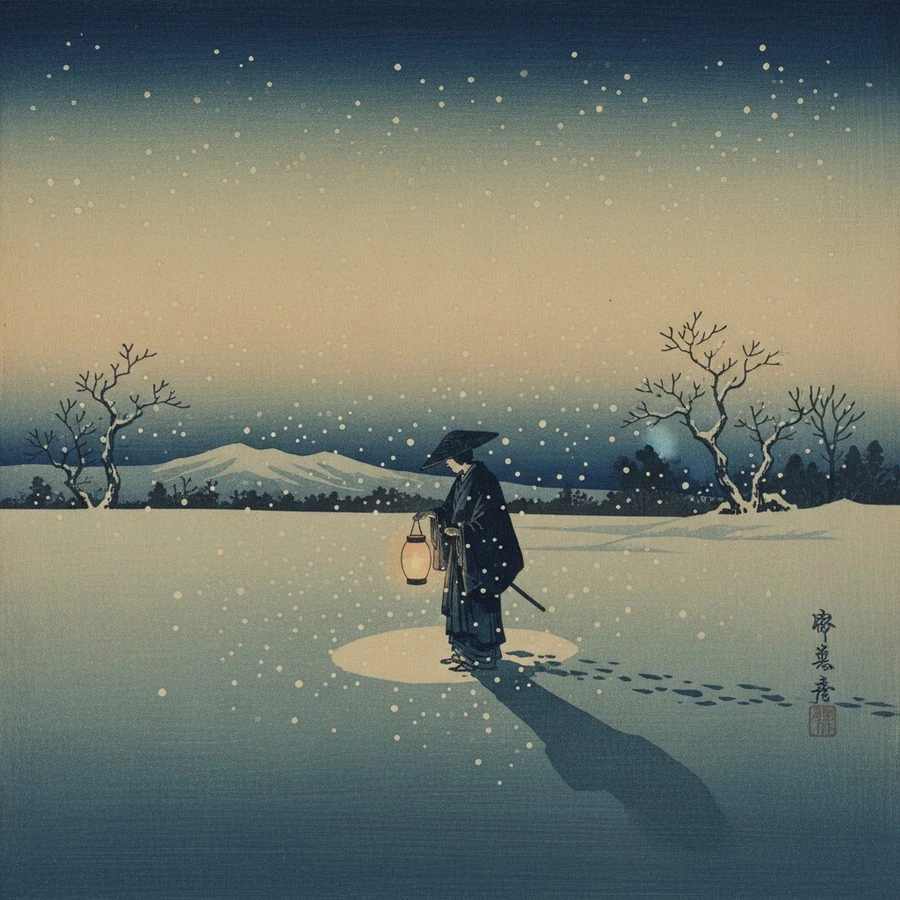

```text
a lone figure standing in an open landscape, Shin-hanga (1915-1940s, Japan): twilight landscapes; falling snow; lantern-lit rain; lonely figures; bokashi sky gradation; night blue shadows. Palette: indigo night, muted ochre, snow grey, lamp amber. Mood: quiet melancholy, modern mood, craftsmanship
Medium: woodblock print, many-block gradation, visible paper grain. Lighting: soft directional daylight, subtle chiaroscuro, long shadows. Composition: centered lone figure, wide open landscape, generous negative space, horizon at lower third. Rendering: sharp, high detail.
--no watermark, text artefacts, muddy colour, extra limbs
```

Model: Nano Banana · Author: bthnbdk · AI Art Style Prompt Library · CC BY 4.0

[Original source](https://github.com/bthnbdk/ai-art-style-prompts/blob/028aad93ea9da35064f50643bf408207c8c5244c/data/styles.json#L5102) · [Provenance and original license](data/projectd-batch-0016.json)

## Shojo Manga — bthnbdk · CC BY 4.0

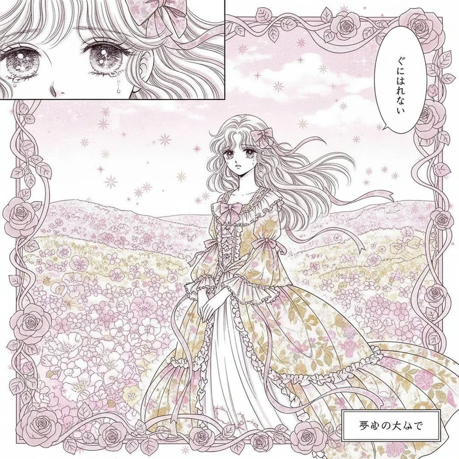

```text
a lone figure standing in an open landscape, Shojo Manga (1950s-, Japan): large sparkling eyes; ribboned hair; flower backgrounds; floating sparkles; slender figures; emotional close-ups. Palette: soft pink, lavender, pale gold, ink black. Mood: romance, interiority, aesthetic pleasure
Medium: manga page, delicate linework, floral screentone, sparkle. Lighting: soft directional daylight, subtle chiaroscuro, long shadows. Composition: centered lone figure, wide open landscape, generous negative space, horizon at lower third. Rendering: sharp, high detail.
--no watermark, text artefacts, muddy colour, extra limbs
```

Model: Nano Banana · Author: bthnbdk · AI Art Style Prompt Library · CC BY 4.0

[Original source](https://github.com/bthnbdk/ai-art-style-prompts/blob/028aad93ea9da35064f50643bf408207c8c5244c/data/styles.json#L4304) · [Provenance and original license](data/projectd-batch-0016.json)

## Shonen Manga — bthnbdk · CC BY 4.0

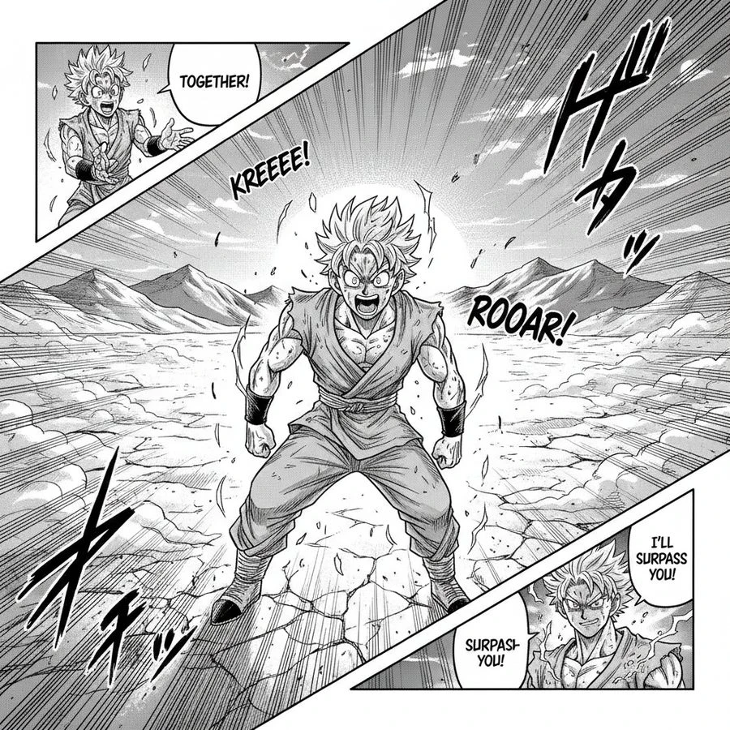

```text
a lone figure standing in an open landscape, Shonen Manga (1960s-, Japan): speed lines; sweat drops; screaming power-ups; dynamic diagonal panels; screentone; huge irises. Palette: black and white with screentone greys. Mood: friendship, rivalry, relentless improvement
Medium: manga page, screentone, black ink on white, kinetic linework. Lighting: soft directional daylight, subtle chiaroscuro, long shadows. Composition: centered lone figure, wide open landscape, generous negative space, horizon at lower third. Rendering: sharp, high detail.
--no watermark, text artefacts, muddy colour, extra limbs
```

Model: Nano Banana · Author: bthnbdk · AI Art Style Prompt Library · CC BY 4.0

[Original source](https://github.com/bthnbdk/ai-art-style-prompts/blob/028aad93ea9da35064f50643bf408207c8c5244c/data/styles.json#L4285) · [Provenance and original license](data/projectd-batch-0016.json)

## Silverpoint Drawing — bthnbdk · CC BY 4.0

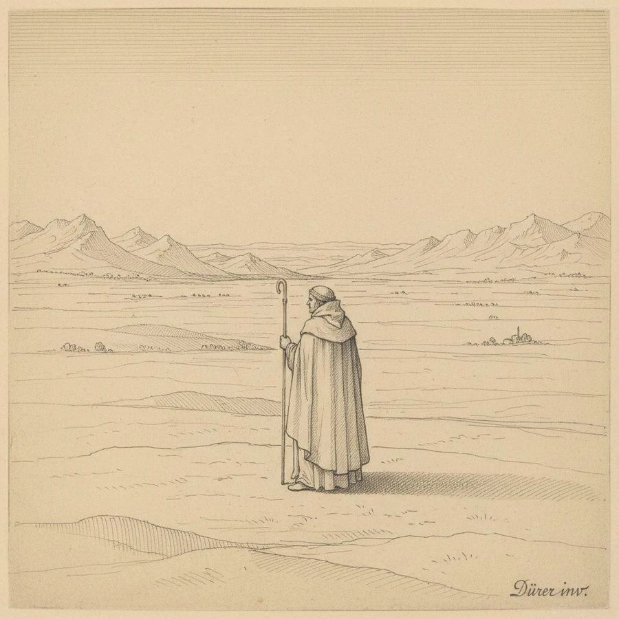

```text
a lone figure standing in an open landscape, Silverpoint Drawing (1400s-1600s, Northern Europe): fine silver-grey metalpoint lines on a tinted prepared ground; delicate parallel hatching; no smudge, only crisp thin strokes; a faint luminous tone. Palette: silver grey line on warm ivory ground. Mood: patient precision, precious delicacy, monastic focus
Medium: silverpoint on prepared tinted paper, hairline metallic grey lines. Lighting: soft directional daylight, subtle chiaroscuro, long shadows. Composition: centered lone figure, wide open landscape, generous negative space, horizon at lower third. Rendering: sharp, high detail.
--no watermark, text artefacts, muddy colour, extra limbs
```

Model: Nano Banana · Author: bthnbdk · AI Art Style Prompt Library · CC BY 4.0

[Original source](https://github.com/bthnbdk/ai-art-style-prompts/blob/028aad93ea9da35064f50643bf408207c8c5244c/data/styles.json#L6109) · [Provenance and original license](data/projectd-batch-0016.json)

## Slow Horror — bthnbdk · CC BY 4.0

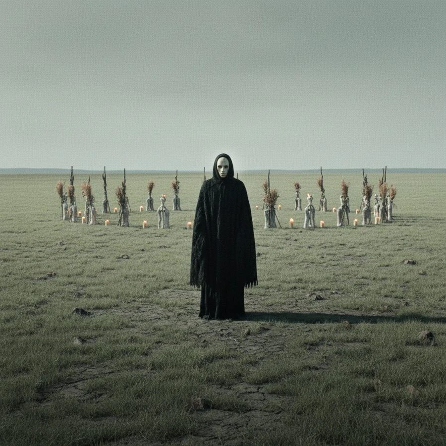

```text
a lone figure standing in an open landscape, Slow Horror (2010s-, United States and Europe): slow creeping camera; symmetric interiors; daylight dread; folk ritual objects; long held wide shots; muted colour. Palette: desaturated green, bone white, candle amber, black. Mood: dread as atmosphere, grief and cult, contemplative terror
Medium: cinematic still, natural darkness, symmetric composition, film grain. Lighting: soft directional daylight, subtle chiaroscuro, long shadows. Composition: centered lone figure, wide open landscape, generous negative space, horizon at lower third. Rendering: sharp, high detail.
--no watermark, text artefacts, muddy colour, extra limbs
```

Model: Nano Banana · Author: bthnbdk · AI Art Style Prompt Library · CC BY 4.0

[Original source](https://github.com/bthnbdk/ai-art-style-prompts/blob/028aad93ea9da35064f50643bf408207c8c5244c/data/styles.json#L5748) · [Provenance and original license](data/projectd-batch-0016.json)

## Soft Pastel Drawing — bthnbdk · CC BY 4.0

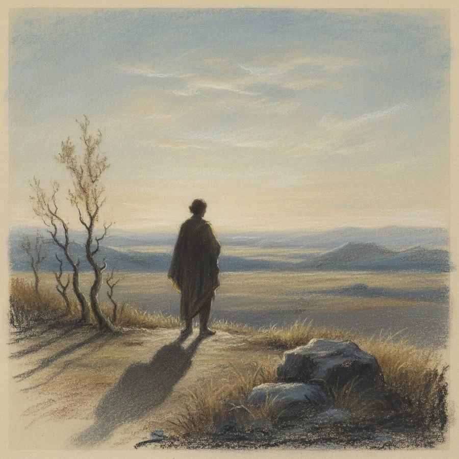

```text
a lone figure standing in an open landscape, Soft Pastel Drawing (1700s-, Europe): powdery pastel strokes; blended hazy passages against dry sharp edges; pastel dust settled in the paper; luminous shadow and a light shoulder. Palette: chalky pastel spectrum, dusty blues and ochres, cream ground. Mood: airy softness, fleeting daylight, gentle lyricism
Medium: soft pastel on coloured paper, powdery velvety surface, visible dust. Lighting: soft directional daylight, subtle chiaroscuro, long shadows. Composition: centered lone figure, wide open landscape, generous negative space, horizon at lower third. Rendering: sharp, high detail.
--no watermark, text artefacts, muddy colour, extra limbs
```

Model: Nano Banana · Author: bthnbdk · AI Art Style Prompt Library · CC BY 4.0

[Original source](https://github.com/bthnbdk/ai-art-style-prompts/blob/028aad93ea9da35064f50643bf408207c8c5244c/data/styles.json#L6147) · [Provenance and original license](data/projectd-batch-0016.json)

## Soviet Modernism — bthnbdk · CC BY 4.0

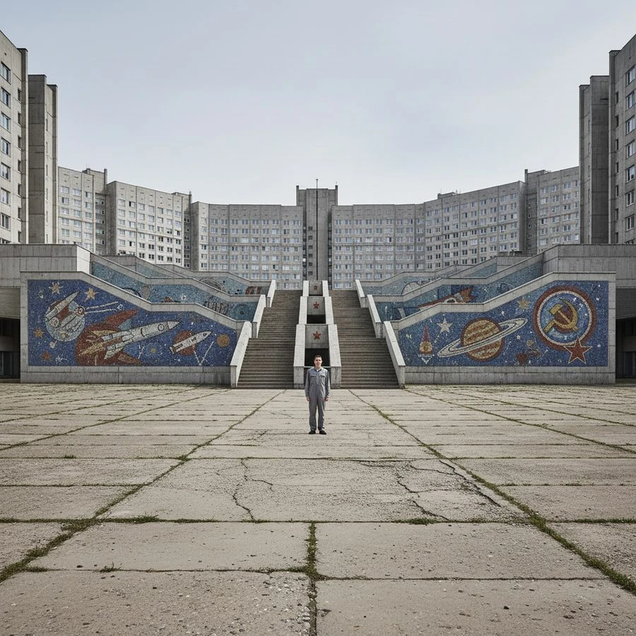

```text
a lone figure standing in an open landscape, Soviet Modernism (1955-1991, Soviet Union): brut concrete slabs; mosaic panels; repetitive housing blocks; monumental stairways; cosmos motifs. Palette: concrete grey, ceramic blue, red accents, faded mosaics. Mood: collective utopia, state order, heroic banality
Medium: architectural photograph, flat overcast light, concrete texture. Lighting: soft directional daylight, subtle chiaroscuro, long shadows. Composition: centered lone figure, wide open landscape, generous negative space, horizon at lower third. Rendering: sharp, high detail.
--no watermark, text artefacts, muddy colour, extra limbs
```

Model: Nano Banana · Author: bthnbdk · AI Art Style Prompt Library · CC BY 4.0

[Original source](https://github.com/bthnbdk/ai-art-style-prompts/blob/028aad93ea9da35064f50643bf408207c8c5244c/data/styles.json#L3715) · [Provenance and original license](data/projectd-batch-0016.json)

## Soviet Montage — bthnbdk · CC BY 4.0

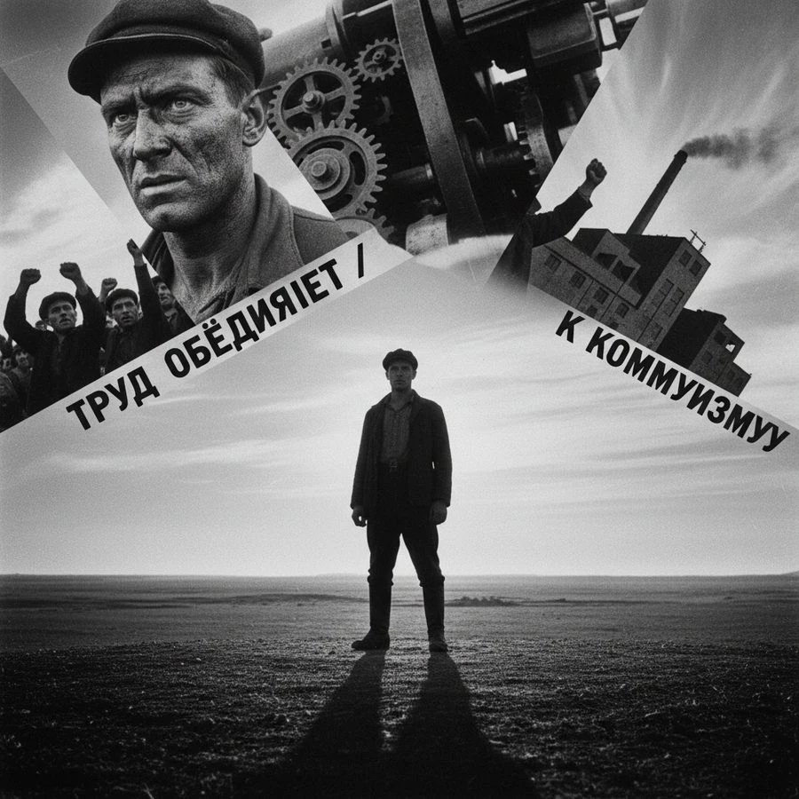

```text
a lone figure standing in an open landscape, Soviet Montage (1920s, Soviet Union): colliding shots; extreme close-ups of faces and machines; low-angle crowds; tilted geometric compositions; intertitles. Palette: black and white, silver nitrate contrast. Mood: dialectical editing, revolutionary energy, collective heroism
Medium: film still, high-contrast black and white, 35mm, radical framing. Lighting: soft directional daylight, subtle chiaroscuro, long shadows. Composition: centered lone figure, wide open landscape, generous negative space, horizon at lower third. Rendering: sharp, high detail.
--no watermark, text artefacts, muddy colour, extra limbs
```

Model: Nano Banana · Author: bthnbdk · AI Art Style Prompt Library · CC BY 4.0

[Original source](https://github.com/bthnbdk/ai-art-style-prompts/blob/028aad93ea9da35064f50643bf408207c8c5244c/data/styles.json#L5691) · [Provenance and original license](data/projectd-batch-0016.json)

## Soviet Space Poster — bthnbdk · CC BY 4.0

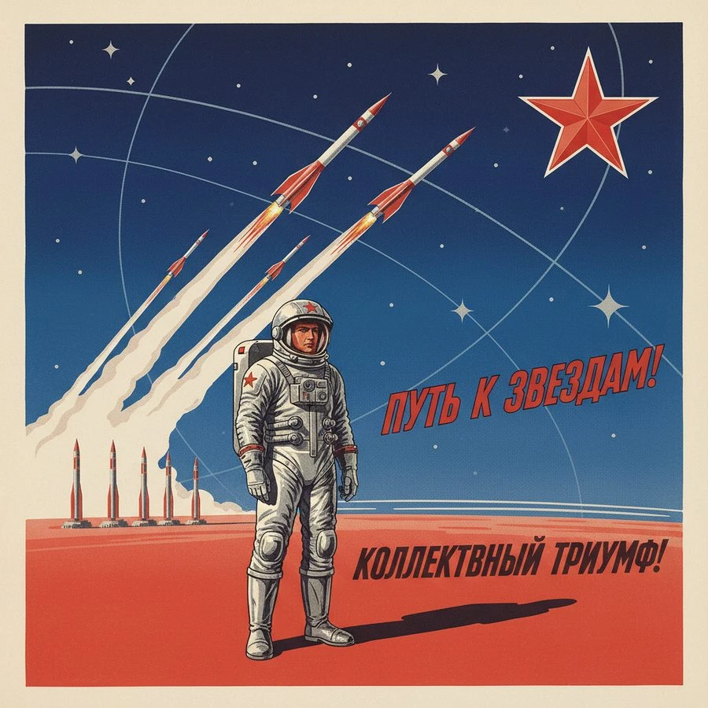

```text
a lone figure standing in an open landscape, Soviet Space Poster (1957-1980s, Soviet Union): rockets and orbits; heroic cosmonauts; red star typography; diagonal thrust; optimistic futurology. Palette: red, deep blue, white, silver metallic ink. Mood: collective triumph, technological faith, propaganda grandeur
Medium: offset lithograph poster, flat ink, slight register shift. Lighting: soft directional daylight, subtle chiaroscuro, long shadows. Composition: centered lone figure, wide open landscape, generous negative space, horizon at lower third. Rendering: sharp, high detail.
--no watermark, text artefacts, muddy colour, extra limbs
```

Model: Nano Banana · Author: bthnbdk · AI Art Style Prompt Library · CC BY 4.0

[Original source](https://github.com/bthnbdk/ai-art-style-prompts/blob/028aad93ea9da35064f50643bf408207c8c5244c/data/styles.json#L4874) · [Provenance and original license](data/projectd-batch-0016.json)

## Spaghetti Western — bthnbdk · CC BY 4.0

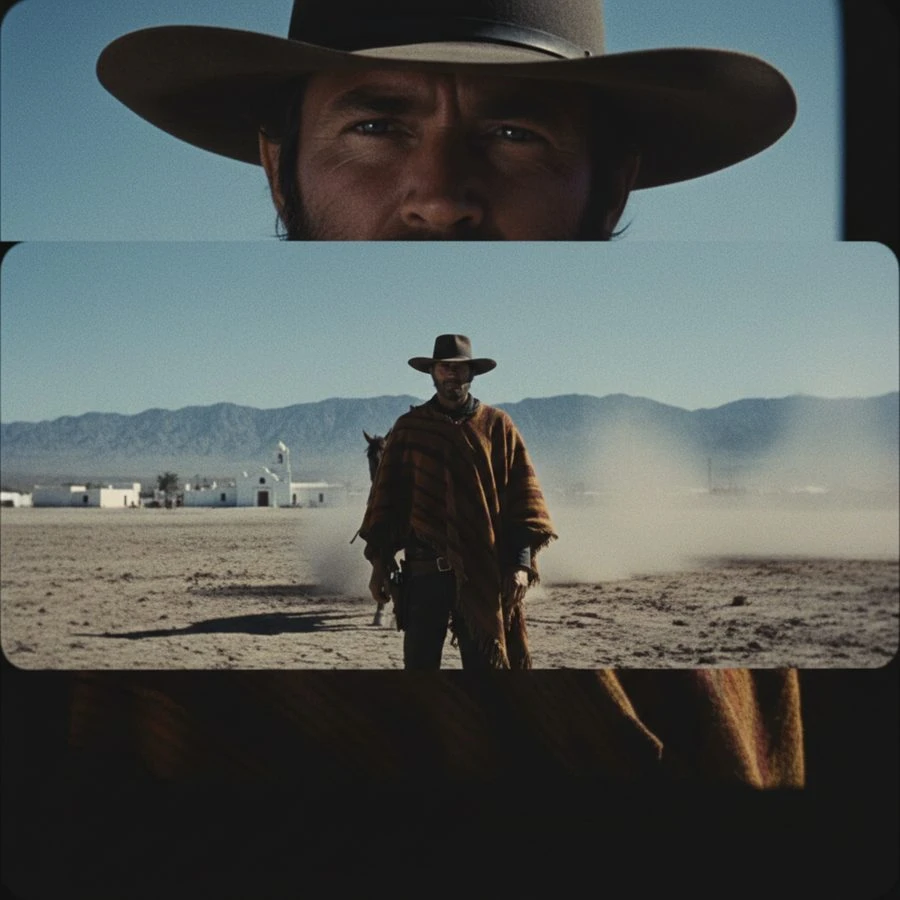

```text
a lone figure standing in an open landscape, Spaghetti Western (1964-1978, Italy and Spain): sun-scorched desert; ponchos; dust clouds; wide horizons; extreme close-ups of eyes; six-shooters; whitewashed mission towns. Palette: ochre, burnt sienna, washed blue sky, dust. Mood: cynical anti-heroism, operatic tension, blistering heat
Medium: anamorphic film still, 35mm, telephoto compression, dust haze. Lighting: soft directional daylight, subtle chiaroscuro, long shadows. Composition: centered lone figure, wide open landscape, generous negative space, horizon at lower third. Rendering: sharp, high detail.
--no watermark, text artefacts, muddy colour, extra limbs
```

Model: Nano Banana · Author: bthnbdk · AI Art Style Prompt Library · CC BY 4.0

[Original source](https://github.com/bthnbdk/ai-art-style-prompts/blob/028aad93ea9da35064f50643bf408207c8c5244c/data/styles.json#L2651) · [Provenance and original license](data/projectd-batch-0016.json)

## Spanish Colonial Revival — bthnbdk · CC BY 4.0

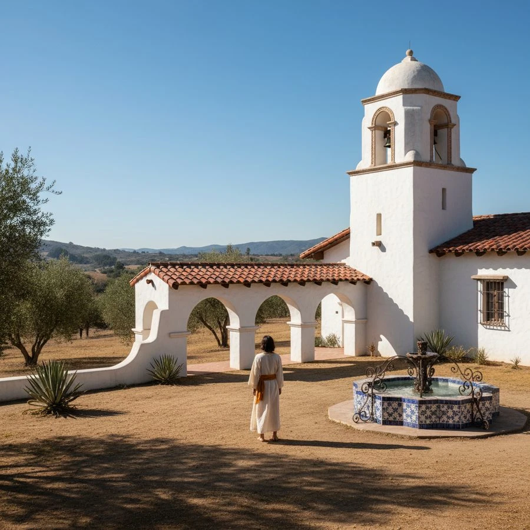

```text
a lone figure standing in an open landscape, Spanish Colonial Revival (1915-1930s, California and Latin America): white stucco walls; red clay tile roofs; arcaded courtyards; wrought iron; tile fountains; bell towers. Palette: white stucco, terracotta, cobalt tile, ochre. Mood: sunny Mediterranean fantasy, leisure, romance
Medium: architectural photograph, bright midday sun, hard shadow. Lighting: soft directional daylight, subtle chiaroscuro, long shadows. Composition: centered lone figure, wide open landscape, generous negative space, horizon at lower third. Rendering: sharp, high detail.
--no watermark, text artefacts, muddy colour, extra limbs
```

Model: Nano Banana · Author: bthnbdk · AI Art Style Prompt Library · CC BY 4.0

[Original source](https://github.com/bthnbdk/ai-art-style-prompts/blob/028aad93ea9da35064f50643bf408207c8c5244c/data/styles.json#L3525) · [Provenance and original license](data/projectd-batch-0016.json)

## Steampunk — bthnbdk · CC BY 4.0

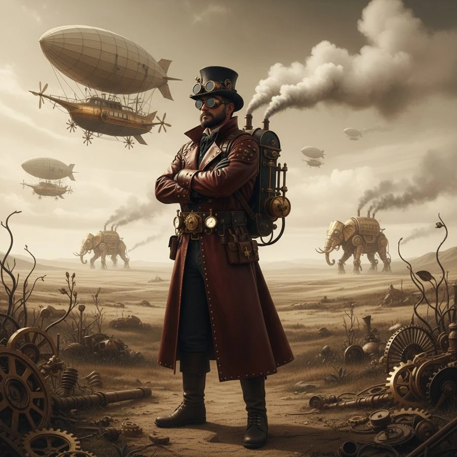

```text
a lone figure standing in an open landscape, Steampunk (1980s-, Western Europe (Victorian-inspired)): brass gears; steam pipes; airships; goggles; clockwork; rivets and leather; pressure gauges. Palette: brass, copper, oxblood leather, coal black, sepia. Mood: romantic industrial adventure, retro-scientific wonder
Medium: digital render or prop photograph, glossy brass, volumetric steam. Lighting: soft directional daylight, subtle chiaroscuro, long shadows. Composition: centered lone figure, wide open landscape, generous negative space, horizon at lower third. Rendering: sharp, high detail.
--no watermark, text artefacts, muddy colour, extra limbs
```

Model: Nano Banana · Author: bthnbdk · AI Art Style Prompt Library · CC BY 4.0

[Original source](https://github.com/bthnbdk/ai-art-style-prompts/blob/028aad93ea9da35064f50643bf408207c8c5244c/data/styles.json#L3031) · [Provenance and original license](data/projectd-batch-0016.json)

## Stencil Street Art — bthnbdk · CC BY 4.0

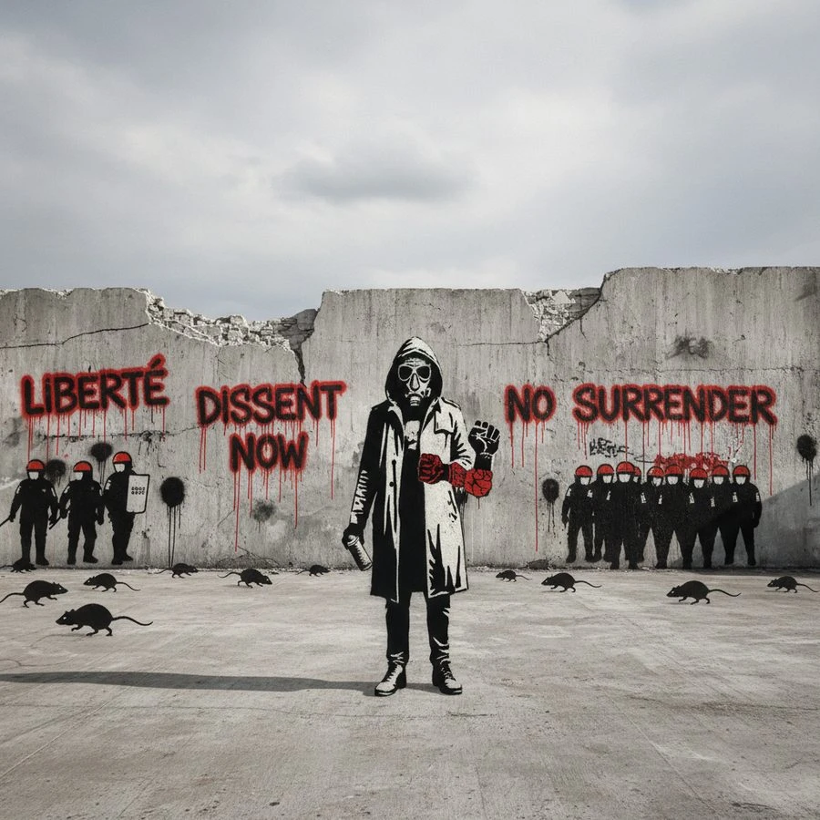

```text
a lone figure standing in an open landscape, Stencil Street Art (1980s-, Paris, London and Bristol): multi-layer stencils; high-contrast photographic icons; political slogans; dripping edges; rats and riot police. Palette: black on concrete grey, red and white accents. Mood: political dissent, stealth authorship, public intervention
Medium: sprayed stencil on concrete, hard-edged mask, dripping paint. Lighting: soft directional daylight, subtle chiaroscuro, long shadows. Composition: centered lone figure, wide open landscape, generous negative space, horizon at lower third. Rendering: sharp, high detail.
--no watermark, text artefacts, muddy colour, extra limbs
```

Model: Nano Banana · Author: bthnbdk · AI Art Style Prompt Library · CC BY 4.0

[Original source](https://github.com/bthnbdk/ai-art-style-prompts/blob/028aad93ea9da35064f50643bf408207c8c5244c/data/styles.json#L5824) · [Provenance and original license](data/projectd-batch-0016.json)

## Sticky-Note Doodle Notes — bthnbdk · CC BY 4.0

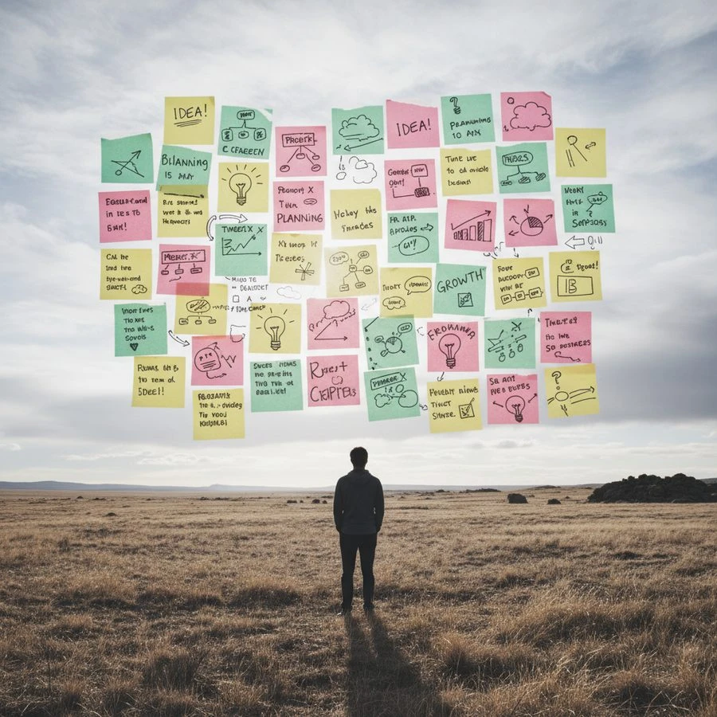

```text
a lone figure standing in an open landscape, Sticky-Note Doodle Notes (2000s-2020s, global): small square sticky notes pinned to a wall with quick biro doodles and arrows drawn between them; some notes curling; handwriting in three or four different sizes. Palette: pastel note paper (yellow, pink, mint), black biro, red corrections. Mood: brainstorming wall, playful planning, classroom-like energy
Medium: photographed sticky notes on a wall with ballpoint doodles, flat office light. Lighting: soft directional daylight, subtle chiaroscuro, long shadows. Composition: centered lone figure, wide open landscape, generous negative space, horizon at lower third. Rendering: sharp, high detail.
--no watermark, text artefacts, muddy colour, extra limbs
```

Model: Nano Banana · Author: bthnbdk · AI Art Style Prompt Library · CC BY 4.0

[Original source](https://github.com/bthnbdk/ai-art-style-prompts/blob/028aad93ea9da35064f50643bf408207c8c5244c/data/styles.json#L6337) · [Provenance and original license](data/projectd-batch-0016.json)

## Storyboard Marker Sketch — bthnbdk · CC BY 4.0

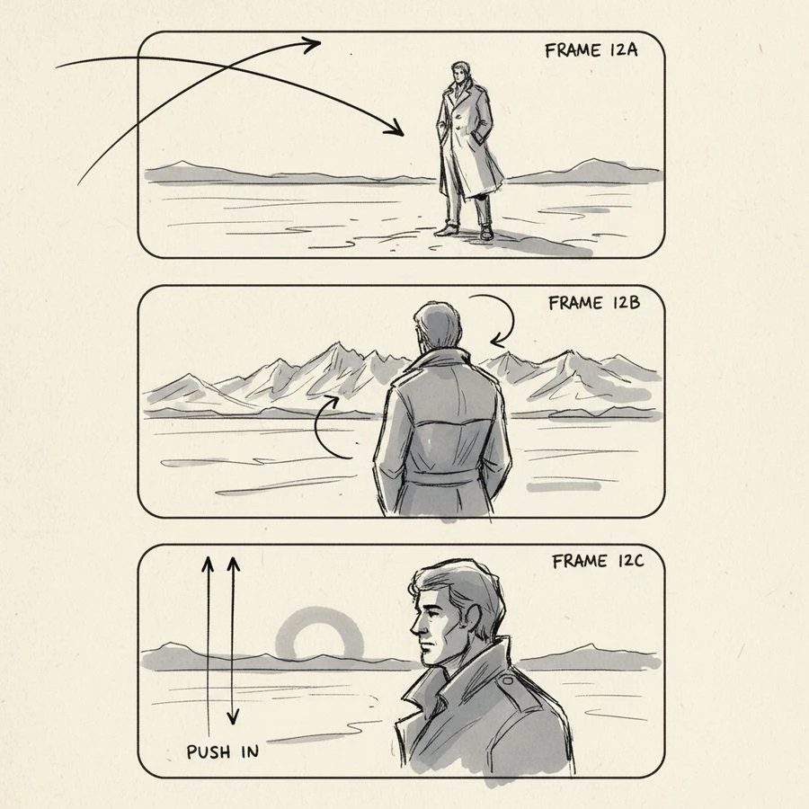

```text
a lone figure standing in an open landscape, Storyboard Marker Sketch (1970s-, Hollywood, USA): small grey-marker storyboard panels drawn with a black pen; loose figure gesture; arrows for camera moves and a scribbled frame number; grey tone blocked in flat. Palette: grey marker, black pen, off-white paper. Mood: pre-production momentum, scene planning, director shorthand
Medium: grey marker and pen storyboard panels on paper, flat tone, quick gestures. Lighting: soft directional daylight, subtle chiaroscuro, long shadows. Composition: centered lone figure, wide open landscape, generous negative space, horizon at lower third. Rendering: sharp, high detail.
--no watermark, text artefacts, muddy colour, extra limbs
```

Model: Nano Banana · Author: bthnbdk · AI Art Style Prompt Library · CC BY 4.0

[Original source](https://github.com/bthnbdk/ai-art-style-prompts/blob/028aad93ea9da35064f50643bf408207c8c5244c/data/styles.json#L6356) · [Provenance and original license](data/projectd-batch-0016.json)

## Straight Photography — bthnbdk · CC BY 4.0

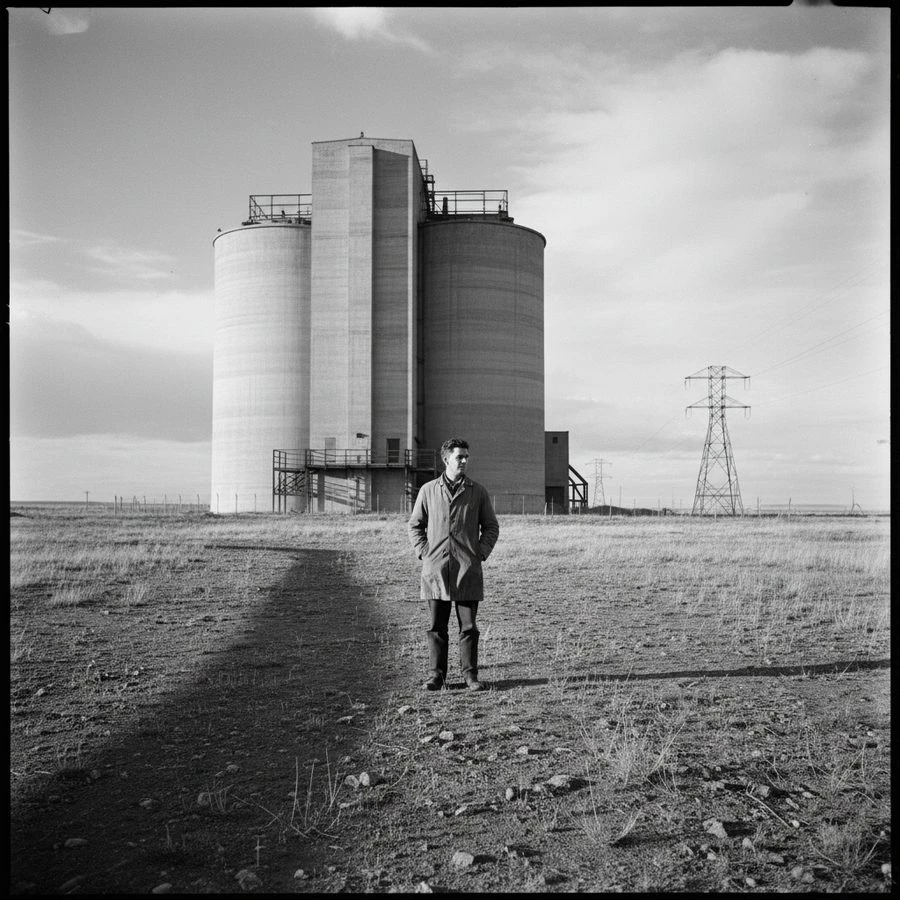

```text
a lone figure standing in an open landscape, Straight Photography (1910s-1950s, United States): sharp focus; full tonal range; found geometry; industrial forms; unmanipulated print; precise framing. Palette: pure black and white, silver grey. Mood: honesty of the medium, clarity, modernist form
Medium: sharp black-and-white photograph, full tonal range. Lighting: soft directional daylight, subtle chiaroscuro, long shadows. Composition: centered lone figure, wide open landscape, generous negative space, horizon at lower third. Rendering: sharp, high detail.
--no watermark, text artefacts, muddy colour, extra limbs
```

Model: Nano Banana · Author: bthnbdk · AI Art Style Prompt Library · CC BY 4.0

[Original source](https://github.com/bthnbdk/ai-art-style-prompts/blob/028aad93ea9da35064f50643bf408207c8c5244c/data/styles.json#L3905) · [Provenance and original license](data/projectd-batch-0016.json)

## Street Photography — bthnbdk · CC BY 4.0

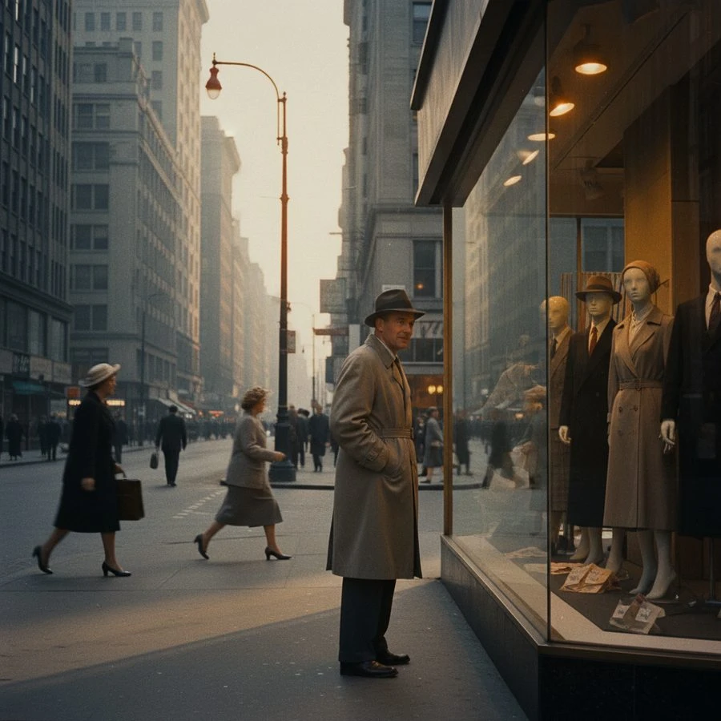

```text
a lone figure standing in an open landscape, Street Photography (1950s-, global cities): decisive moments; layered urban geometry; reflections; passing figures; shop windows; hips and elbows framing. Palette: muted city palette, sodium light, grey concrete. Mood: curiosity, chance, human comedy
Medium: 35mm rangefinder photograph, available light, grain. Lighting: soft directional daylight, subtle chiaroscuro, long shadows. Composition: centered lone figure, wide open landscape, generous negative space, horizon at lower third. Rendering: sharp, high detail.
--no watermark, text artefacts, muddy colour, extra limbs
```

Model: Nano Banana · Author: bthnbdk · AI Art Style Prompt Library · CC BY 4.0

[Original source](https://github.com/bthnbdk/ai-art-style-prompts/blob/028aad93ea9da35064f50643bf408207c8c5244c/data/styles.json#L3943) · [Provenance and original license](data/projectd-batch-0016.json)

## Studyblr Notes — bthnbdk · CC BY 4.0

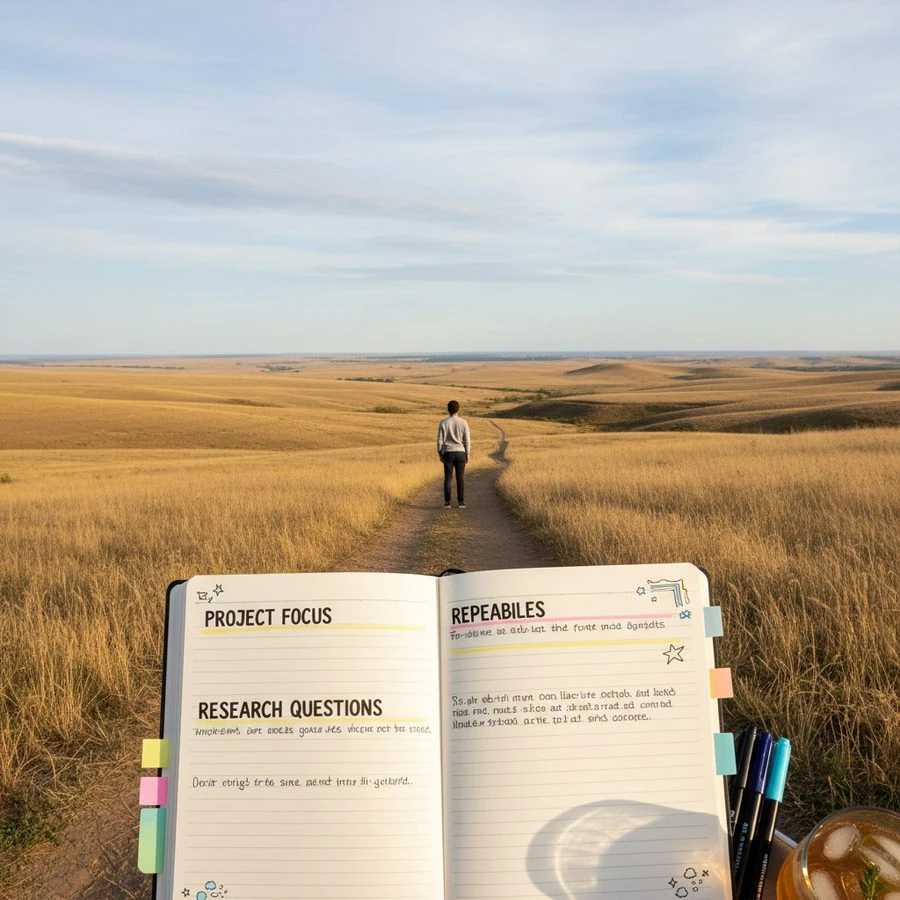

```text
a lone figure standing in an open landscape, Studyblr Notes (2010s-2020s, global): a photographed notebook spread with neatly ruled headings, highlighter stripes and small margin doodles; pastel sticky tabs; a drink and pens at the edge of frame. Palette: cream paper, pastel highlight yellow and pink, black and blue ink. Mood: aesthetic productivity, study motivation, calm order
Medium: photographed notebook page, highlighter and fine pen, pastel tabs. Lighting: soft directional daylight, subtle chiaroscuro, long shadows. Composition: centered lone figure, wide open landscape, generous negative space, horizon at lower third. Rendering: sharp, high detail.
--no watermark, text artefacts, muddy colour, extra limbs
```

Model: Nano Banana · Author: bthnbdk · AI Art Style Prompt Library · CC BY 4.0

[Original source](https://github.com/bthnbdk/ai-art-style-prompts/blob/028aad93ea9da35064f50643bf408207c8c5244c/data/styles.json#L6394) · [Provenance and original license](data/projectd-batch-0016.json)

## Swiss International Style — bthnbdk · CC BY 4.0

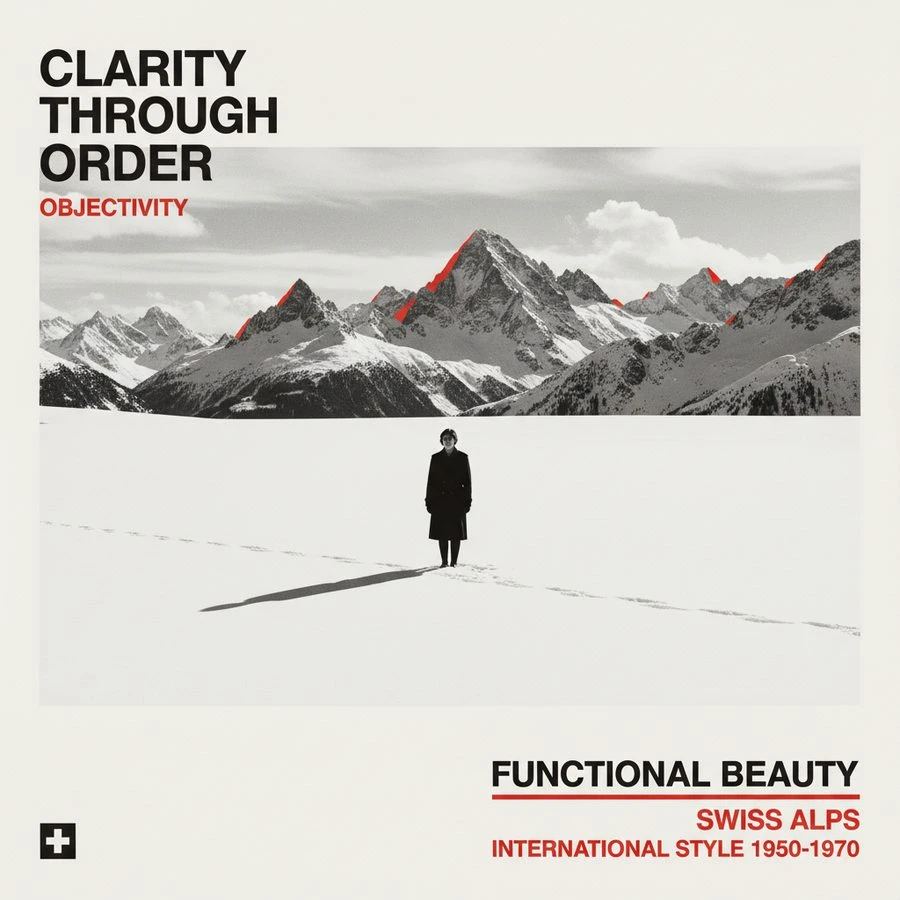

```text
a lone figure standing in an open landscape, Swiss International Style (1950s-1970s, Basel and Zurich, Switzerland): grid systems; Helvetica-like sans serifs; asymmetric balance; photographic montage; generous whitespace; flush-left type. Palette: black, white, one signal red. Mood: clarity through order, objectivity, functional beauty
Medium: offset-printed poster, flat ink, precise typography, matte stock. Lighting: soft directional daylight, subtle chiaroscuro, long shadows. Composition: centered lone figure, wide open landscape, generous negative space, horizon at lower third. Rendering: sharp, high detail.
--no watermark, text artefacts, muddy colour, extra limbs
```

Model: Nano Banana · Author: bthnbdk · AI Art Style Prompt Library · CC BY 4.0

[Original source](https://github.com/bthnbdk/ai-art-style-prompts/blob/028aad93ea9da35064f50643bf408207c8c5244c/data/styles.json#L4779) · [Provenance and original license](data/projectd-batch-0016.json)

## Technical Blueprint — bthnbdk · CC BY 4.0

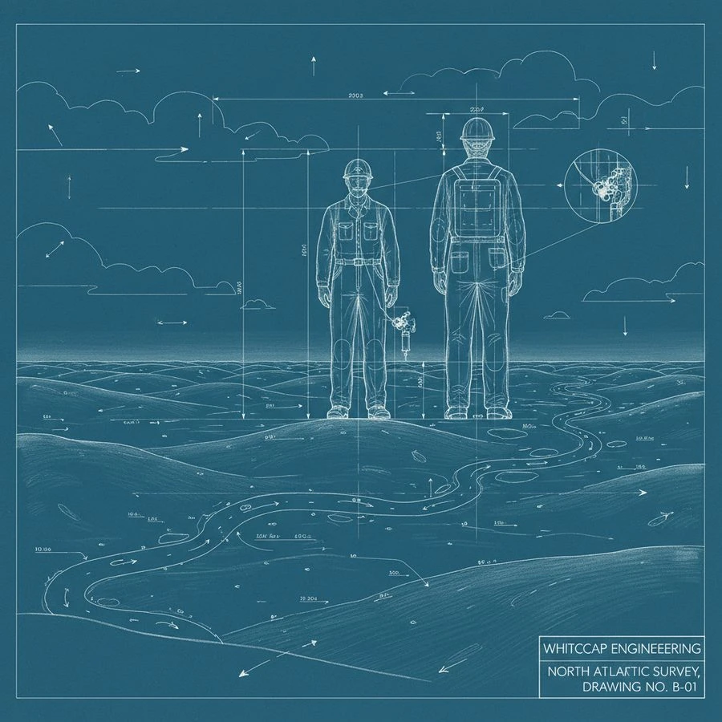

```text
a lone figure standing in an open landscape, Technical Blueprint (1850s-1970s, Europe and United States): white construction lines on a deep cyan blueprint field; orthographic and section views; dimension lines, arrows and drawn callout circles; a title block in the corner. Palette: blueprint cyan or Prussian blue field, white line, faint pencil marks. Mood: engineering exactness, industrial drafting room, beautiful specification
Medium: cyanotype blueprint reproduction, white line on blue, technical drawing. Lighting: soft directional daylight, subtle chiaroscuro, long shadows. Composition: centered lone figure, wide open landscape, generous negative space, horizon at lower third. Rendering: sharp, high detail.
--no watermark, text artefacts, muddy colour, extra limbs
```

Model: Nano Banana · Author: bthnbdk · AI Art Style Prompt Library · CC BY 4.0

[Original source](https://github.com/bthnbdk/ai-art-style-prompts/blob/028aad93ea9da35064f50643bf408207c8c5244c/data/styles.json#L6280) · [Provenance and original license](data/projectd-batch-0016.json)

## Technicolor Musical — bthnbdk · CC BY 4.0

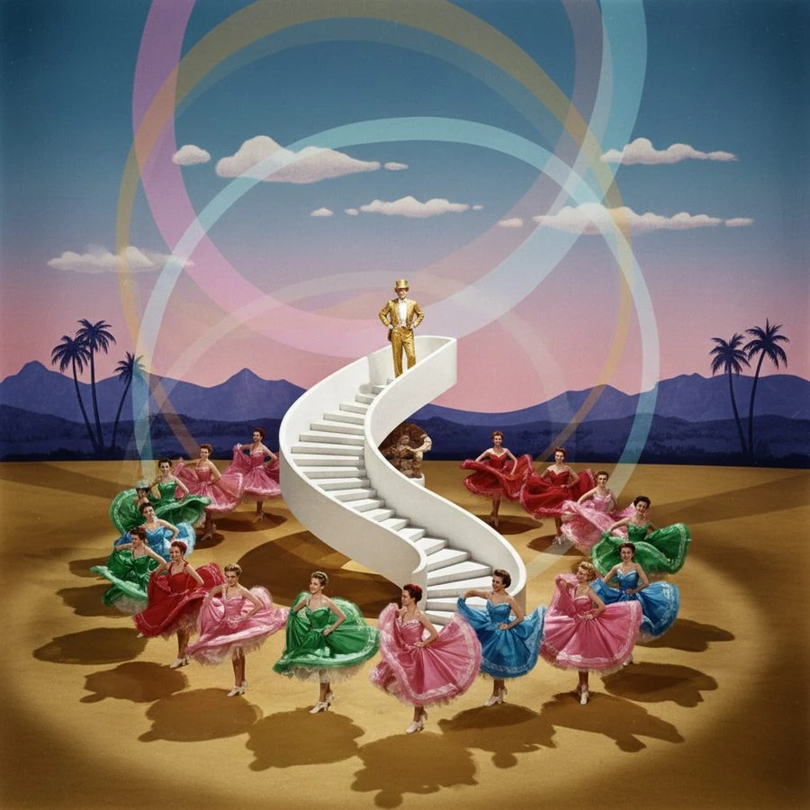

```text
a lone figure standing in an open landscape, Technicolor Musical (1930s-1950s, Hollywood, USA): staircase choruses; top hats and tails; swirling saturated dresses; spotlight spirals; painted backdrops; kaleidoscopic formations. Palette: candy pink, emerald, ruby, gold, sky blue. Mood: escapist joy, spectacle, post-war optimism
Medium: three-strip Technicolor film still, 35mm, high saturation, soft key light. Lighting: soft directional daylight, subtle chiaroscuro, long shadows. Composition: centered lone figure, wide open landscape, generous negative space, horizon at lower third. Rendering: sharp, high detail.
--no watermark, text artefacts, muddy colour, extra limbs
```

Model: Nano Banana · Author: bthnbdk · AI Art Style Prompt Library · CC BY 4.0

[Original source](https://github.com/bthnbdk/ai-art-style-prompts/blob/028aad93ea9da35064f50643bf408207c8c5244c/data/styles.json#L2670) · [Provenance and original license](data/projectd-batch-0016.json)

## Techno Rave Flyer — bthnbdk · CC BY 4.0

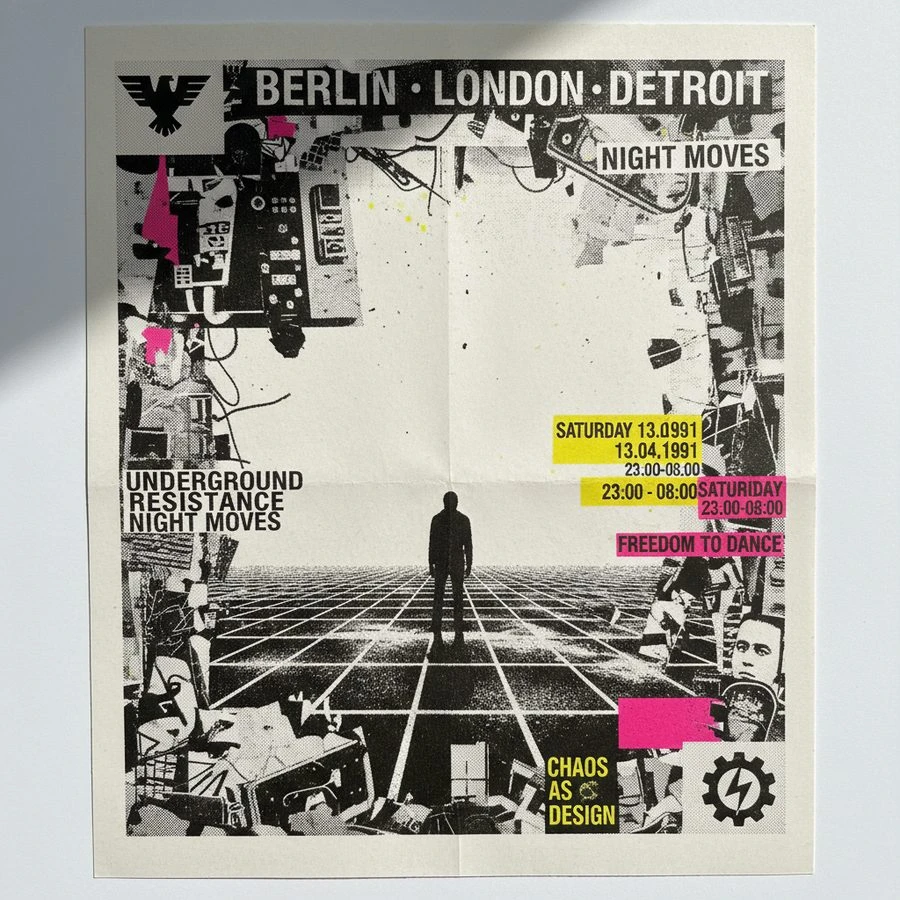

```text
a lone figure standing in an open landscape, Techno Rave Flyer (1989-2000, Berlin, London and Detroit): gridded party details; scanned collages; distorted type; repetitive date stamps; negative-space logos. Palette: black on white, acid yellow, fluorescent pink. Mood: underground solidarity, night economy, chaos as design
Medium: photocopied flyer, halftone, harsh contrast, cheap paper. Lighting: soft directional daylight, subtle chiaroscuro, long shadows. Composition: centered lone figure, wide open landscape, generous negative space, horizon at lower third. Rendering: sharp, high detail.
--no watermark, text artefacts, muddy colour, extra limbs
```

Model: Nano Banana · Author: bthnbdk · AI Art Style Prompt Library · CC BY 4.0

[Original source](https://github.com/bthnbdk/ai-art-style-prompts/blob/028aad93ea9da35064f50643bf408207c8c5244c/data/styles.json#L4950) · [Provenance and original license](data/projectd-batch-0016.json)

## Telenovela — bthnbdk · CC BY 4.0

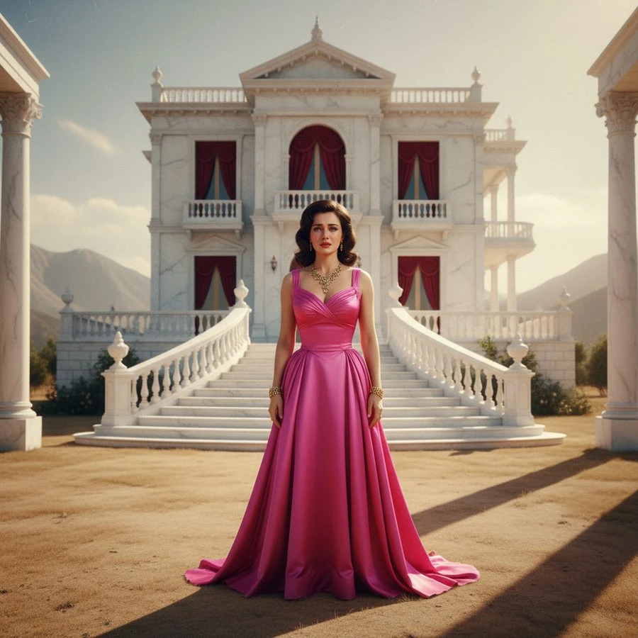

```text
a lone figure standing in an open landscape, Telenovela (1950s-, Latin America): heightened emotional close-ups; mansion interiors; dramatic staircases; tearful embraces; soft focus glamour. Palette: hot pink, gold, white marble, deep red. Mood: melodrama, family intrigue, class conflict
Medium: video still, soft studio lighting, saturated costume colour. Lighting: soft directional daylight, subtle chiaroscuro, long shadows. Composition: centered lone figure, wide open landscape, generous negative space, horizon at lower third. Rendering: sharp, high detail.
--no watermark, text artefacts, muddy colour, extra limbs
```

Model: Nano Banana · Author: bthnbdk · AI Art Style Prompt Library · CC BY 4.0

[Original source](https://github.com/bthnbdk/ai-art-style-prompts/blob/028aad93ea9da35064f50643bf408207c8c5244c/data/styles.json#L5653) · [Provenance and original license](data/projectd-batch-0016.json)

## Tibetan Thangka — bthnbdk · CC BY 4.0

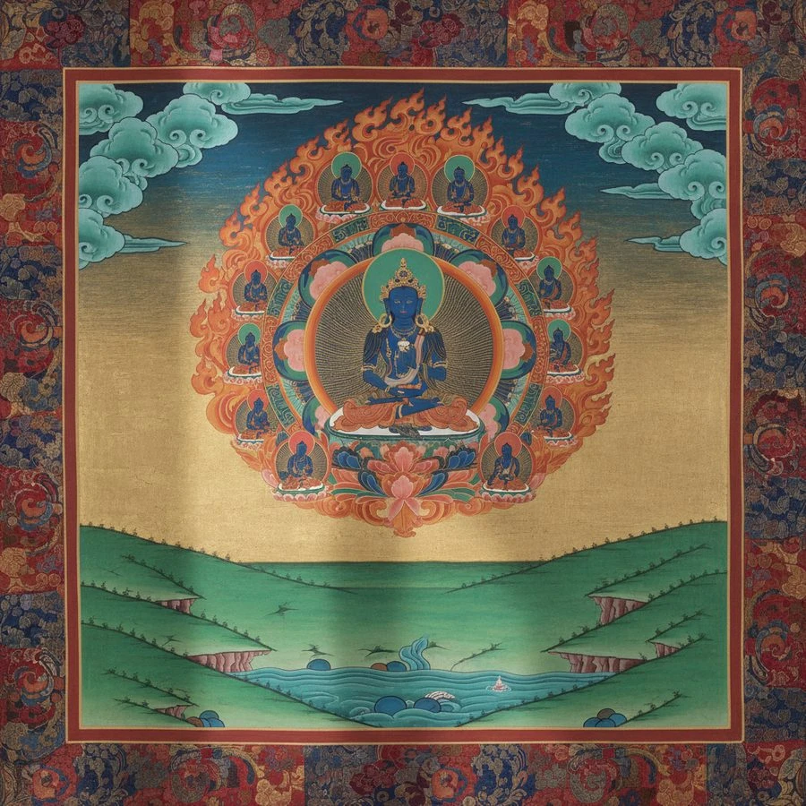

```text
a lone figure standing in an open landscape, Tibetan Thangka (11th century-, Tibet and the Himalayas): central deity in mandala; symmetrical retinues; flames and clouds; lotus thrones; gold contours; brocade mounts. Palette: turquoise, vermilion, gold, deep blue, emerald. Mood: cosmic order, devotion, meditative precision
Medium: mineral pigment on sized cotton, gold outline, silk brocade border. Lighting: soft directional daylight, subtle chiaroscuro, long shadows. Composition: centered lone figure, wide open landscape, generous negative space, horizon at lower third. Rendering: sharp, high detail.
--no watermark, text artefacts, muddy colour, extra limbs
```

Model: Nano Banana · Author: bthnbdk · AI Art Style Prompt Library · CC BY 4.0

[Original source](https://github.com/bthnbdk/ai-art-style-prompts/blob/028aad93ea9da35064f50643bf408207c8c5244c/data/styles.json#L5007) · [Provenance and original license](data/projectd-batch-0016.json)

## Tintype — bthnbdk · CC BY 4.0

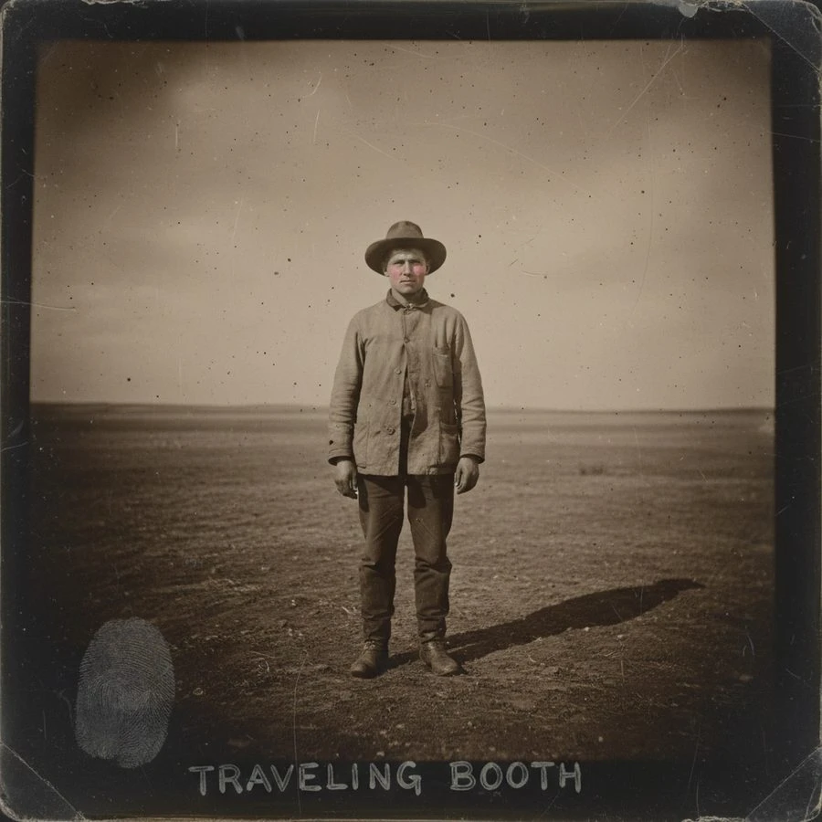

```text
a lone figure standing in an open landscape, Tintype (1856-1900s, United States): cheap iron plate portraits; painted rosy cheeks; matte black background; scratches and thumbprints; travelling booth. Palette: sepia-brown, black lacquer, hand-tinted pink. Mood: democratic portraiture, folk memory, imperfection
Medium: antique photograph, lacquered iron plate, scratched surface. Lighting: soft directional daylight, subtle chiaroscuro, long shadows. Composition: centered lone figure, wide open landscape, generous negative space, horizon at lower third. Rendering: sharp, high detail.
--no watermark, text artefacts, muddy colour, extra limbs
```

Model: Nano Banana · Author: bthnbdk · AI Art Style Prompt Library · CC BY 4.0

[Original source](https://github.com/bthnbdk/ai-art-style-prompts/blob/028aad93ea9da35064f50643bf408207c8c5244c/data/styles.json#L3848) · [Provenance and original license](data/projectd-batch-0016.json)

## Tudor Revival — bthnbdk · CC BY 4.0

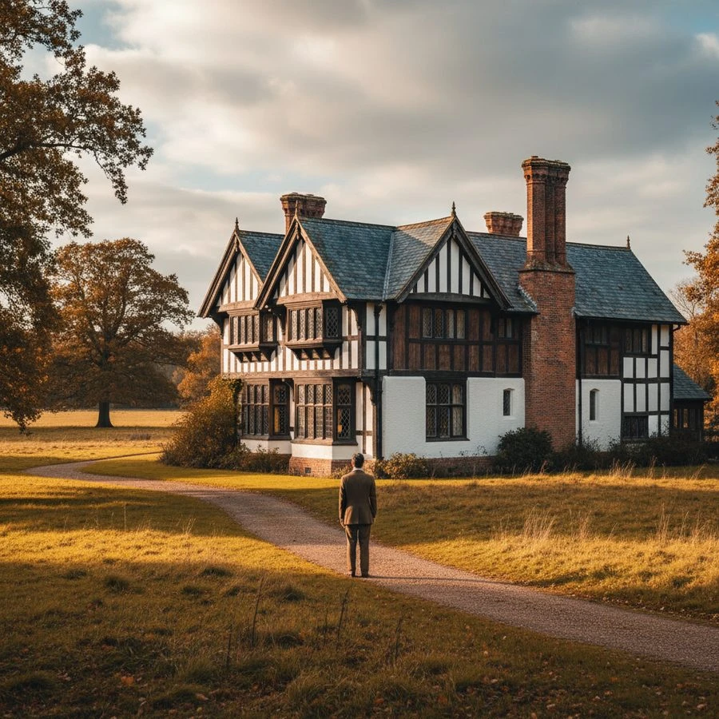

```text
a lone figure standing in an open landscape, Tudor Revival (1890s-1940s, Britain and United States): half-timbering; steep gables; tall narrow windows with leaded panes; massive chimneys; oriel windows. Palette: dark oak brown, white stucco, brick red, slate. Mood: old-world comfort, heritage, domestic romance
Medium: architectural photograph, autumn light, timber and brick texture. Lighting: soft directional daylight, subtle chiaroscuro, long shadows. Composition: centered lone figure, wide open landscape, generous negative space, horizon at lower third. Rendering: sharp, high detail.
--no watermark, text artefacts, muddy colour, extra limbs
```

Model: Nano Banana · Author: bthnbdk · AI Art Style Prompt Library · CC BY 4.0

[Original source](https://github.com/bthnbdk/ai-art-style-prompts/blob/028aad93ea9da35064f50643bf408207c8c5244c/data/styles.json#L3506) · [Provenance and original license](data/projectd-batch-0016.json)

## Ukrainian Petrykivka — bthnbdk · CC BY 4.0

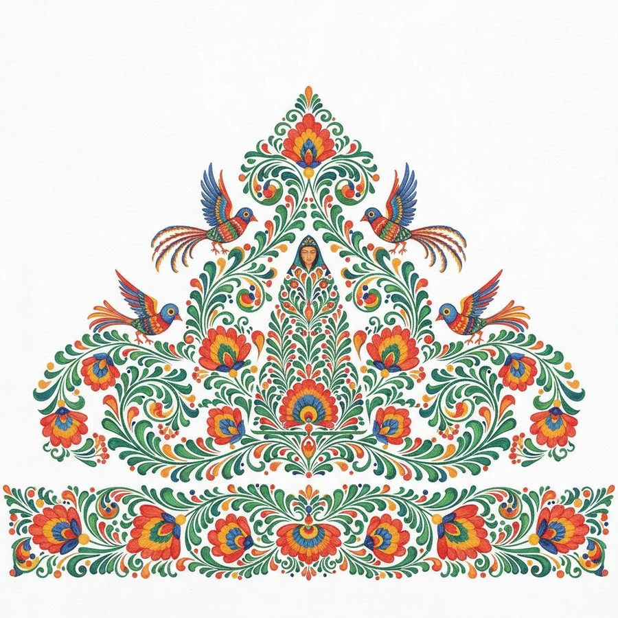

```text
a lone figure standing in an open landscape, Ukrainian Petrykivka (18th century-, Petrykivka, Ukraine): feathery curling leaves; fantastical flowers; birds; ornamental friezes; fingertip berries; flowing symmetric stems. Palette: red, green, yellow, blue on white. Mood: protective beauty, household talisman, folk flourish
Medium: gouache and egg tempera brushwork on white ground, cat-hair brushes. Lighting: soft directional daylight, subtle chiaroscuro, long shadows. Composition: centered lone figure, wide open landscape, generous negative space, horizon at lower third. Rendering: sharp, high detail.
--no watermark, text artefacts, muddy colour, extra limbs
```

Model: Nano Banana · Author: bthnbdk · AI Art Style Prompt Library · CC BY 4.0

[Original source](https://github.com/bthnbdk/ai-art-style-prompts/blob/028aad93ea9da35064f50643bf408207c8c5244c/data/styles.json#L5444) · [Provenance and original license](data/projectd-batch-0016.json)

## UPA Modern Cartoon — bthnbdk · CC BY 4.0

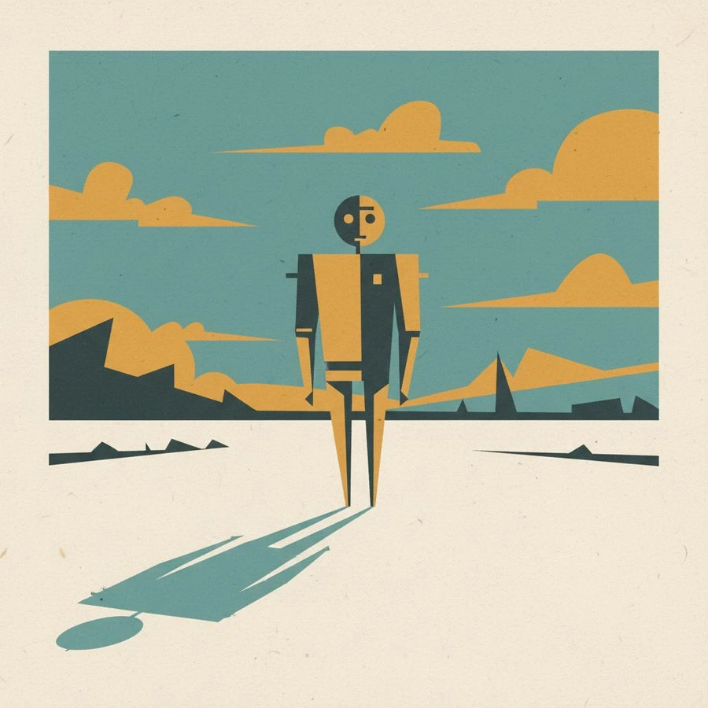

```text
a lone figure standing in an open landscape, UPA Modern Cartoon (1944-1959, United States): flat geometric backgrounds; limited animation; angular characters; abstract shapes; jazz-driven timing. Palette: off-register orange, teal, mustard, charcoal. Mood: design-led wit, modernism, expressive economy
Medium: animation cel, limited animation, flat colour, textured paper. Lighting: soft directional daylight, subtle chiaroscuro, long shadows. Composition: centered lone figure, wide open landscape, generous negative space, horizon at lower third. Rendering: sharp, high detail.
--no watermark, text artefacts, muddy colour, extra limbs
```

Model: Nano Banana · Author: bthnbdk · AI Art Style Prompt Library · CC BY 4.0

[Original source](https://github.com/bthnbdk/ai-art-style-prompts/blob/028aad93ea9da35064f50643bf408207c8c5244c/data/styles.json#L4380) · [Provenance and original license](data/projectd-batch-0016.json)

## UX Wireframe Sketch — bthnbdk · CC BY 4.0


```text
a lone figure standing in an open landscape, UX Wireframe Sketch (2000s-2020s, global): grey boxes and placeholder bars standing in for interface regions; handwritten annotation arrows; dashed grid-paper ground; no visual style inside the boxes. Palette: light grey and blue-grey marker on white or pale grid. Mood: product thinking, prototype stage, honest scaffolding
Medium: grey marker and pen on grid paper, flat interface blocks, handwritten notes. Lighting: soft directional daylight, subtle chiaroscuro, long shadows. Composition: centered lone figure, wide open landscape, generous negative space, horizon at lower third. Rendering: sharp, high detail.
--no watermark, text artefacts, muddy colour, extra limbs
```

Model: Nano Banana · Author: bthnbdk · AI Art Style Prompt Library · CC BY 4.0

[Original source](https://github.com/bthnbdk/ai-art-style-prompts/blob/028aad93ea9da35064f50643bf408207c8c5244c/data/styles.json#L6299) · [Provenance and original license](data/projectd-batch-0016.json)

## Vector Arcade — bthnbdk · CC BY 4.0

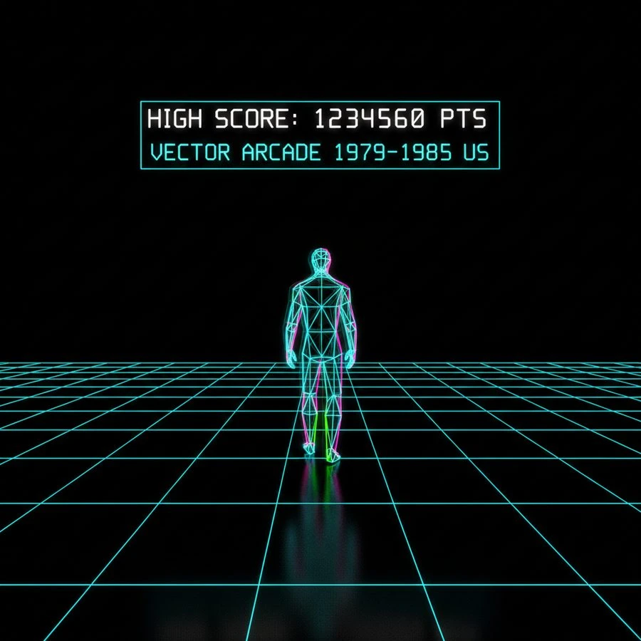

```text
a lone figure standing in an open landscape, Vector Arcade (1979-1985, United States): glowing wireframe lines; pure black background; phosphor trails; simple polygons; high-score typography. Palette: neon cyan, phosphor white, vector green, hot pink. Mood: pure interaction, minimalist abstraction, electric tension
Medium: vector monitor graphic, glowing lines, black void background. Lighting: soft directional daylight, subtle chiaroscuro, long shadows. Composition: centered lone figure, wide open landscape, generous negative space, horizon at lower third. Rendering: sharp, high detail.
--no watermark, text artefacts, muddy colour, extra limbs
```

Model: Nano Banana · Author: bthnbdk · AI Art Style Prompt Library · CC BY 4.0

[Original source](https://github.com/bthnbdk/ai-art-style-prompts/blob/028aad93ea9da35064f50643bf408207c8c5244c/data/styles.json#L4608) · [Provenance and original license](data/projectd-batch-0016.json)

## Vienna Secession — bthnbdk · CC BY 4.0

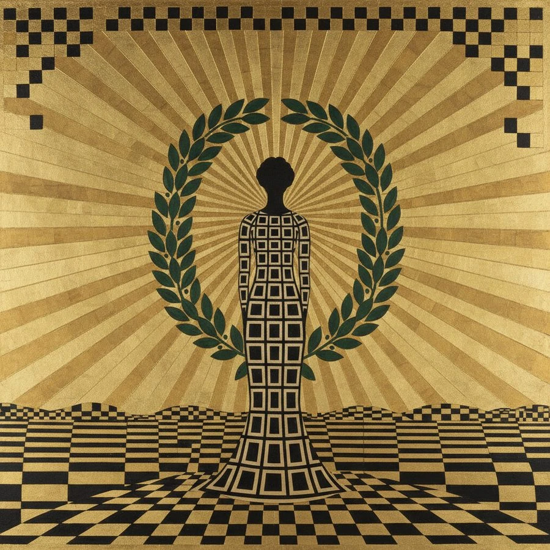

```text
a lone figure standing in an open landscape, Vienna Secession (1897-1905, Vienna, Austria): geometric ornament grids; gold leaf; stylised laurels; square patterns; mosaic-like figuration; checkerboard friezes. Palette: gold, black, deep green, ivory. Mood: gesamtkunstwerk, refined luxury, rebellion against academic art
Medium: gold leaf and oil on canvas, graphic ornament, flat pattern areas. Lighting: soft directional daylight, subtle chiaroscuro, long shadows. Composition: centered lone figure, wide open landscape, generous negative space, horizon at lower third. Rendering: sharp, high detail.
--no watermark, text artefacts, muddy colour, extra limbs
```

Model: Nano Banana · Author: bthnbdk · AI Art Style Prompt Library · CC BY 4.0

[Original source](https://github.com/bthnbdk/ai-art-style-prompts/blob/028aad93ea9da35064f50643bf408207c8c5244c/data/styles.json#L2708) · [Provenance and original license](data/projectd-batch-0016.json)

## Vintage Travel Poster — bthnbdk · CC BY 4.0

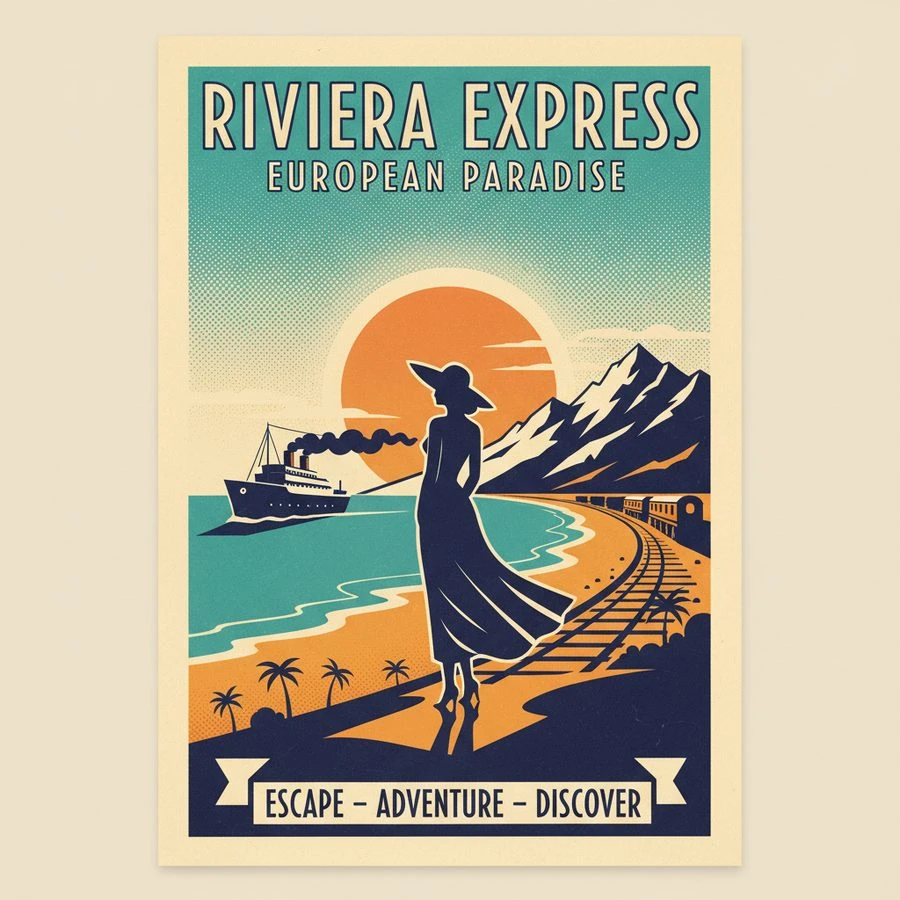

```text
a lone figure standing in an open landscape, Vintage Travel Poster (1920s-1960s, Europe and United States): simplified landscapes; railway and steamship geometry; sunlit beaches; silhouetted tourists; bold destination typography. Palette: sunset orange, sea turquoise, cream, navy. Mood: glamorous escape, modern mobility, place as promise
Medium: stone lithograph poster, flat ink, halftone shading, matte paper. Lighting: soft directional daylight, subtle chiaroscuro, long shadows. Composition: centered lone figure, wide open landscape, generous negative space, horizon at lower third. Rendering: sharp, high detail.
--no watermark, text artefacts, muddy colour, extra limbs
```

Model: Nano Banana · Author: bthnbdk · AI Art Style Prompt Library · CC BY 4.0

[Original source](https://github.com/bthnbdk/ai-art-style-prompts/blob/028aad93ea9da35064f50643bf408207c8c5244c/data/styles.json#L5976) · [Provenance and original license](data/projectd-batch-0016.json)

## Voxel — bthnbdk · CC BY 4.0

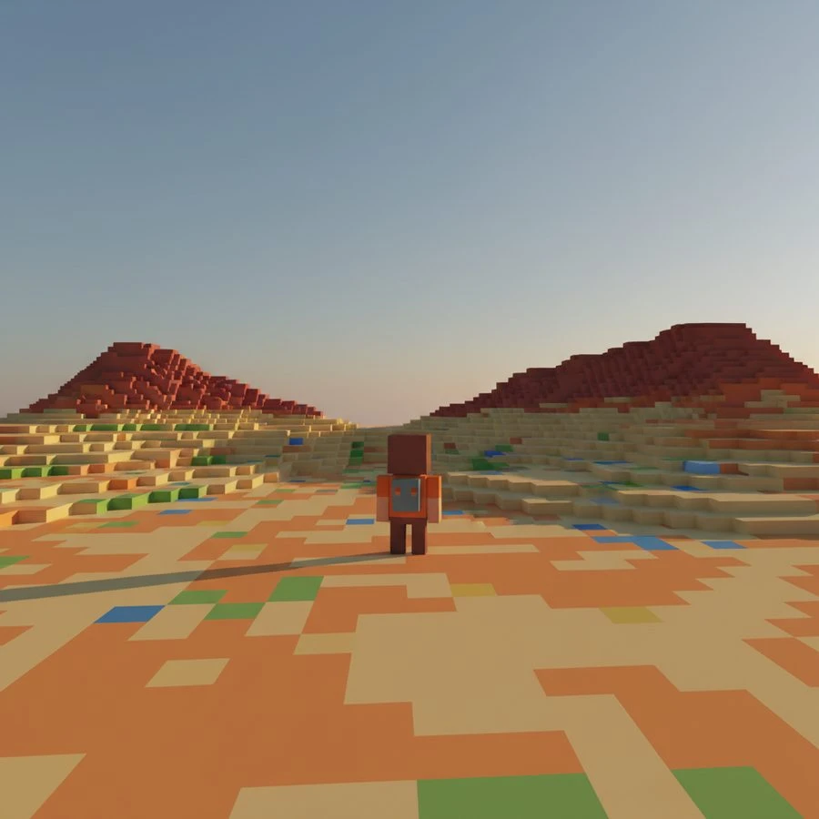

```text
a lone figure standing in an open landscape, Voxel (2009-, global): cube-built terrain; chunky block characters; dig-and-build grids; soft ambient occlusion; toy dioramas. Palette: saturated block colour, sky gradient, sunlit sand. Mood: creative freedom, toy-like scale, playful systems
Medium: voxel render, cube geometry, ambient occlusion, crisp shadows. Lighting: soft directional daylight, subtle chiaroscuro, long shadows. Composition: centered lone figure, wide open landscape, generous negative space, horizon at lower third. Rendering: sharp, high detail.
--no watermark, text artefacts, muddy colour, extra limbs
```

Model: Nano Banana · Author: bthnbdk · AI Art Style Prompt Library · CC BY 4.0

[Original source](https://github.com/bthnbdk/ai-art-style-prompts/blob/028aad93ea9da35064f50643bf408207c8c5244c/data/styles.json#L4646) · [Provenance and original license](data/projectd-batch-0016.json)

## Wet Plate Collodion — bthnbdk · CC BY 4.0

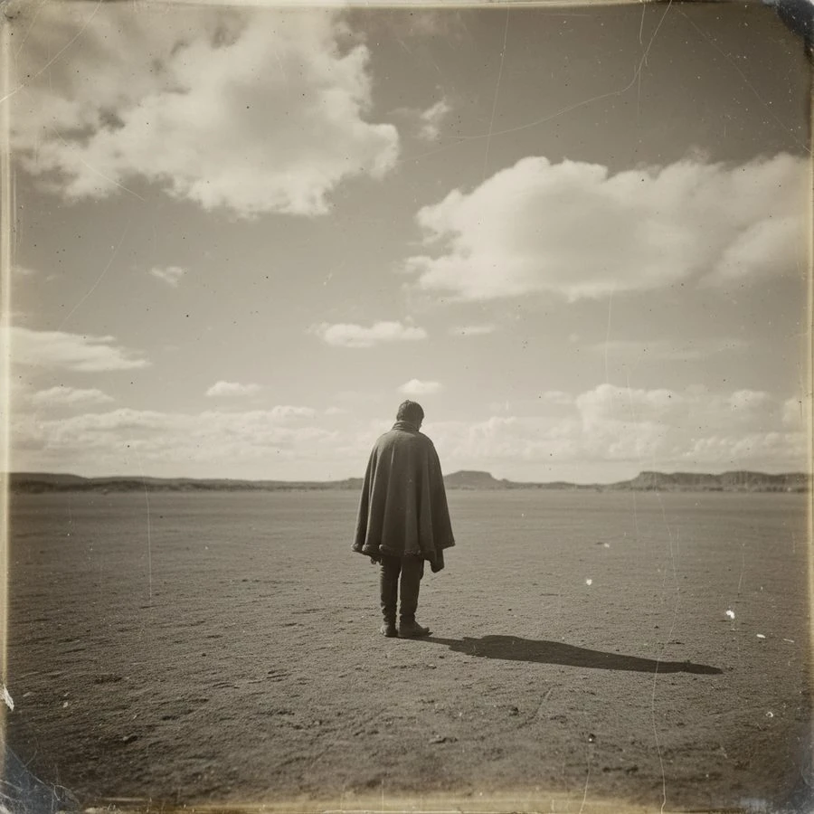

```text
a lone figure standing in an open landscape, Wet Plate Collodion (1851-1880s, Britain and United States): poured collodion streaks; uneven chemical edges; long exposures; glass plate flaws; battlefield and portrait subjects. Palette: cream and amber, iron grey, dust brown. Mood: craft and chemistry, documentary weight, mortality
Medium: antique photograph, glass plate, chemical edge artefacts. Lighting: soft directional daylight, subtle chiaroscuro, long shadows. Composition: centered lone figure, wide open landscape, generous negative space, horizon at lower third. Rendering: sharp, high detail.
--no watermark, text artefacts, muddy colour, extra limbs
```

Model: Nano Banana · Author: bthnbdk · AI Art Style Prompt Library · CC BY 4.0

[Original source](https://github.com/bthnbdk/ai-art-style-prompts/blob/028aad93ea9da35064f50643bf408207c8c5244c/data/styles.json#L3829) · [Provenance and original license](data/projectd-batch-0016.json)

## Wheatpaste Poster — bthnbdk · CC BY 4.0

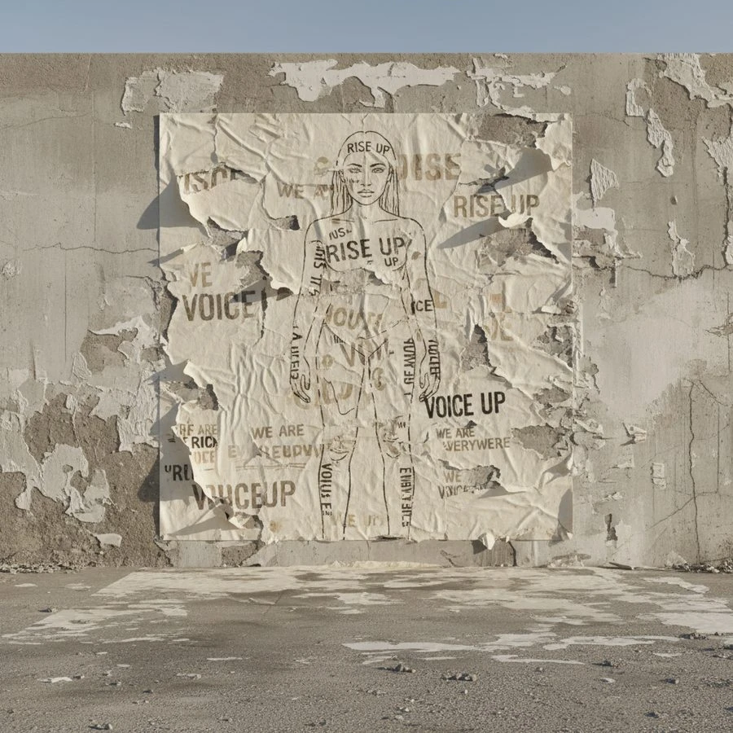

```text
a lone figure standing in an open landscape, Wheatpaste Poster (1990s-, global cities): large line-art figures; torn and layered paper; buckled paste texture; repeated faces; soft activist typography. Palette: paper cream, ink black, faded sepia. Mood: gentle rebellion, ephemeral ubiquity, folk communication
Medium: wheatpaste paper on wall, crinkled paper texture, torn edges. Lighting: soft directional daylight, subtle chiaroscuro, long shadows. Composition: centered lone figure, wide open landscape, generous negative space, horizon at lower third. Rendering: sharp, high detail.
--no watermark, text artefacts, muddy colour, extra limbs
```

Model: Nano Banana · Author: bthnbdk · AI Art Style Prompt Library · CC BY 4.0

[Original source](https://github.com/bthnbdk/ai-art-style-prompts/blob/028aad93ea9da35064f50643bf408207c8c5244c/data/styles.json#L5843) · [Provenance and original license](data/projectd-batch-0016.json)

## Whimsigothic — bthnbdk · CC BY 4.0

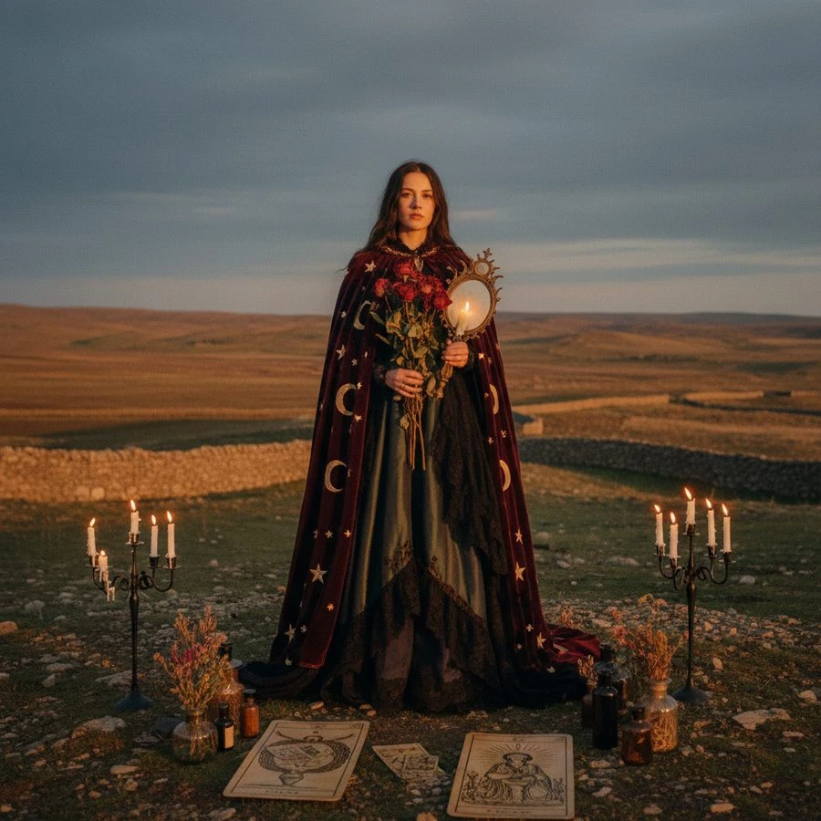

```text
a lone figure standing in an open landscape, Whimsigothic (1990s-, USA): celestial motifs; tarot cards and moons; dark velvet; black lace; antique mirrors; candles; dried roses; apothecary bottles. Palette: aubergine, oxblood, moss green, gold, deep navy. Mood: cosy occult domesticity, mystery, feminine power
Medium: film-photograph still, warm candlelight, visible grain. Lighting: soft directional daylight, subtle chiaroscuro, long shadows. Composition: centered lone figure, wide open landscape, generous negative space, horizon at lower third. Rendering: sharp, high detail.
--no watermark, text artefacts, muddy colour, extra limbs
```

Model: Nano Banana · Author: bthnbdk · AI Art Style Prompt Library · CC BY 4.0

[Original source](https://github.com/bthnbdk/ai-art-style-prompts/blob/028aad93ea9da35064f50643bf408207c8c5244c/data/styles.json#L3069) · [Provenance and original license](data/projectd-batch-0016.json)

## Whiteboard Animation — bthnbdk · CC BY 4.0

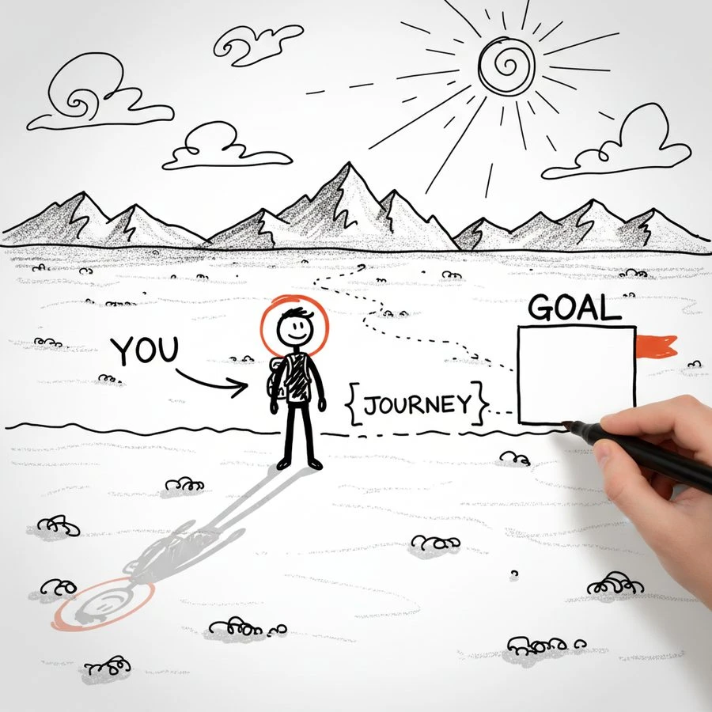

```text
a lone figure standing in an open landscape, Whiteboard Animation (2000s-2020s, United States): dry-erase marker drawings appearing on a glossy white board; thick black marker outlines; arrows, brackets, boxes and simple stick figures; annotated labels beside each object; a hand holding a marker entering the frame. Palette: white board, black marker, one or two marker accents. Mood: patient explanation, playful teaching, drawn-in-front-of-you momentum
Medium: whiteboard explainer frame, dry-erase marker on glossy board, flat even studio light. Lighting: soft directional daylight, subtle chiaroscuro, long shadows. Composition: centered lone figure, wide open landscape, generous negative space, horizon at lower third. Rendering: sharp, high detail.
--no watermark, text artefacts, muddy colour, extra limbs
```

Model: Nano Banana · Author: bthnbdk · AI Art Style Prompt Library · CC BY 4.0

[Original source](https://github.com/bthnbdk/ai-art-style-prompts/blob/028aad93ea9da35064f50643bf408207c8c5244c/data/styles.json#L5995) · [Provenance and original license](data/projectd-batch-0016.json)

## Wildstyle Graffiti — bthnbdk · CC BY 4.0

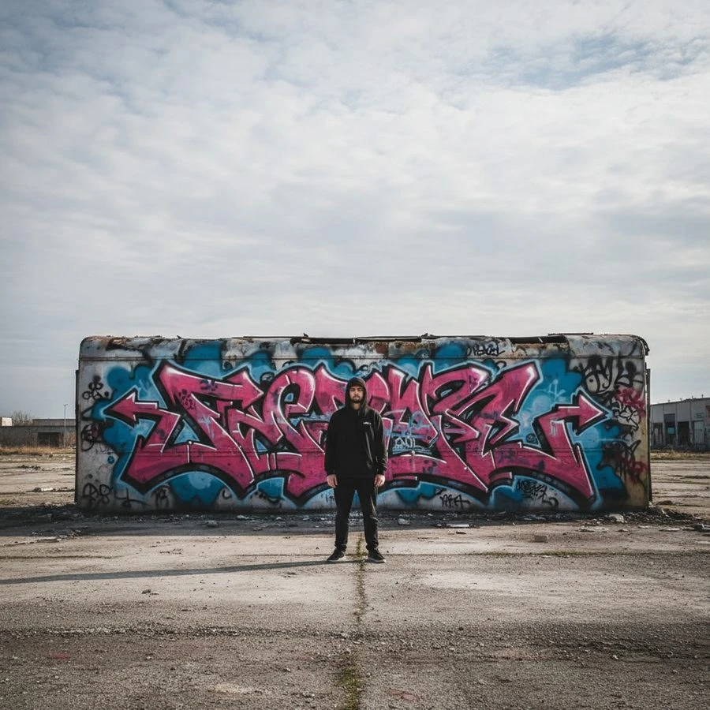

```text
a lone figure standing in an open landscape, Wildstyle Graffiti (1980s-, New York, United States): interlocking arrows; illegible twisted letterforms; wild spikes; layered outlines and highlights; train-car panels. Palette: hot pink, electric blue, chrome, black outline. Mood: territorial virtuosity, coded language, street fame
Medium: spray-painted wall photograph, matte aerosol, layered colour. Lighting: soft directional daylight, subtle chiaroscuro, long shadows. Composition: centered lone figure, wide open landscape, generous negative space, horizon at lower third. Rendering: sharp, high detail.
--no watermark, text artefacts, muddy colour, extra limbs
```

Model: Nano Banana · Author: bthnbdk · AI Art Style Prompt Library · CC BY 4.0

[Original source](https://github.com/bthnbdk/ai-art-style-prompts/blob/028aad93ea9da35064f50643bf408207c8c5244c/data/styles.json#L5805) · [Provenance and original license](data/projectd-batch-0016.json)

## Wuxia — bthnbdk · CC BY 4.0

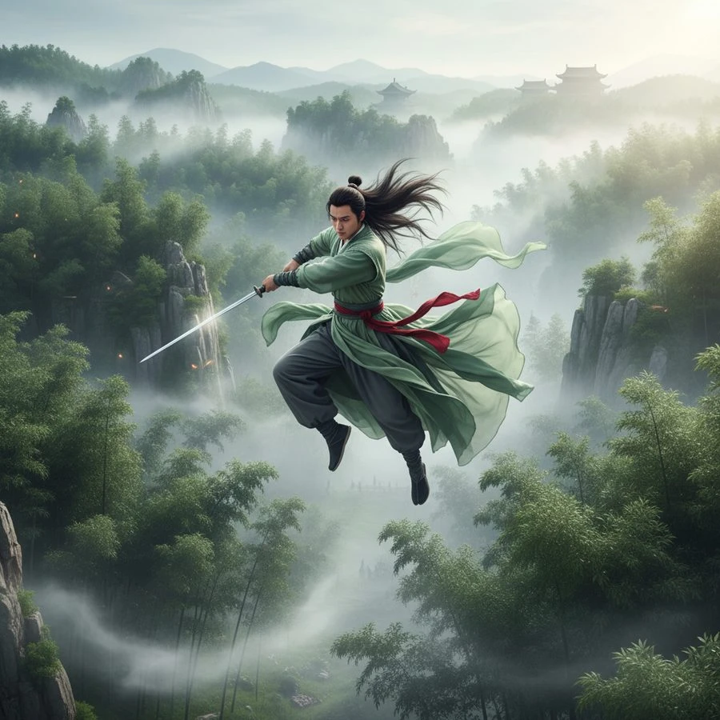

```text
a lone figure standing in an open landscape, Wuxia (1960s-, China and Hong Kong): weightless sword flight; silk robes in motion; bamboo forests; misty cliffs; rooftop duels; flowing hair. Palette: jade green, ink grey, crimson, mist white. Mood: chivalric honour, lyrical gravity-defiance, romantic fate
Medium: cinematic film still, wire-work motion, diaphanous fabrics, mist. Lighting: soft directional daylight, subtle chiaroscuro, long shadows. Composition: centered lone figure, wide open landscape, generous negative space, horizon at lower third. Rendering: sharp, high detail.
--no watermark, text artefacts, muddy colour, extra limbs
```

Model: Nano Banana · Author: bthnbdk · AI Art Style Prompt Library · CC BY 4.0

[Original source](https://github.com/bthnbdk/ai-art-style-prompts/blob/028aad93ea9da35064f50643bf408207c8c5244c/data/styles.json#L5577) · [Provenance and original license](data/projectd-batch-0016.json)

## Y2K Chrome — bthnbdk · CC BY 4.0


```text
a lone figure standing in an open landscape, Y2K Chrome (1998-2005, global): liquid chrome type; lens flares; blue gradient grids; bubble fonts; metallic swooshes; optimistic gloss. Palette: electric blue, chrome silver, acid lime, hot magenta. Mood: technological optimism, cyber-futurism, glossy novelty
Medium: digital graphic, chrome gradients, lens flare, glossy render. Lighting: soft directional daylight, subtle chiaroscuro, long shadows. Composition: centered lone figure, wide open landscape, generous negative space, horizon at lower third. Rendering: sharp, high detail.
--no watermark, text artefacts, muddy colour, extra limbs
```

Model: Nano Banana · Author: bthnbdk · AI Art Style Prompt Library · CC BY 4.0

[Original source](https://github.com/bthnbdk/ai-art-style-prompts/blob/028aad93ea9da35064f50643bf408207c8c5244c/data/styles.json#L4817) · [Provenance and original license](data/projectd-batch-0016.json)

## Yarn Bombing — bthnbdk · CC BY 4.0


```text
a lone figure standing in an open landscape, Yarn Bombing (2005-, United States): knitted cosies on trees and railings; crocheted patches; pom-poms; granny squares; unexpected softness on hard city objects. Palette: hot pink, turquoise, mustard, cream wool. Mood: craft activism, gentle appropriation, warmth in public
Medium: photograph of knitted textile installation, fibre texture, soft daylight. Lighting: soft directional daylight, subtle chiaroscuro, long shadows. Composition: centered lone figure, wide open landscape, generous negative space, horizon at lower third. Rendering: sharp, high detail.
--no watermark, text artefacts, muddy colour, extra limbs
```

Model: Nano Banana · Author: bthnbdk · AI Art Style Prompt Library · CC BY 4.0

[Original source](https://github.com/bthnbdk/ai-art-style-prompts/blob/028aad93ea9da35064f50643bf408207c8c5244c/data/styles.json#L5881) · [Provenance and original license](data/projectd-batch-0016.json)

## Yeşilçam — bthnbdk · CC BY 4.0


```text
a lone figure standing in an open landscape, Yesilcam (1960s-1970s, Istanbul, Turkiye): hand-painted poster melodrama; Bosphorus vistas; Anatolian village squares; moustachioed heroes and veiled heroines; hand-lettered titles; painted portraits. Palette: faded colour print, creamy yellow, dusty teal, crimson. Mood: yearning melodrama, family, poverty and honour
Medium: hand-painted film poster, tempera on card, visible brushstrokes, print registration offsets. Lighting: soft directional daylight, subtle chiaroscuro, long shadows. Composition: centered lone figure, wide open landscape, generous negative space, horizon at lower third. Rendering: sharp, high detail.
--no watermark, text artefacts, muddy colour, extra limbs
```

Model: Nano Banana · Author: bthnbdk · AI Art Style Prompt Library · CC BY 4.0

[Original source](https://github.com/bthnbdk/ai-art-style-prompts/blob/028aad93ea9da35064f50643bf408207c8c5244c/data/styles.json#L2689) · [Provenance and original license](data/projectd-batch-0016.json)

## ZX Spectrum Attribute Clash — bthnbdk · CC BY 4.0


```text
a lone figure standing in an open landscape, ZX Spectrum Attribute Clash (1982-1992, United Kingdom): two-colour cells; abrupt colour blocks; monochrome sprites; loading-screen line art; paper-white borders. Palette: bright black, cyan, magenta, yellow, white. Mood: constraint-driven invention, bedroom coding, punk computing
Medium: pixel graphic, 8x8 colour cells, attribute clash artefacts. Lighting: soft directional daylight, subtle chiaroscuro, long shadows. Composition: centered lone figure, wide open landscape, generous negative space, horizon at lower third. Rendering: sharp, high detail.
--no watermark, text artefacts, muddy colour, extra limbs
```

Model: Nano Banana · Author: bthnbdk · AI Art Style Prompt Library · CC BY 4.0

[Original source](https://github.com/bthnbdk/ai-art-style-prompts/blob/028aad93ea9da35064f50643bf408207c8c5244c/data/styles.json#L4532) · [Provenance and original license](data/projectd-batch-0016.json)

## Swiss Geometric Embossed Logo


```text
(change [BRAND] and [COLOR])

3D embossed glossy contour render of center-aligned [BRAND] on a flat surface, perfectly centered composition with ample negative space surrounding the object for a premium minimalist aesthetic. Monochromatic [COLOR] palette with soft tonal gradients. The object is defined by a raised, smooth, liquid-like glass bezel or chrome rim, creating a blind emboss effect where the interior matches the background. Matte surface finish with fine film grain or noise texture overlay. Soft diffuse lighting, strong specular highlights on the rounded edges, top-down view.
```

Model: Nano Banana · Author: AmirMušić

[Original source](https://x.com/AmirMushich/status/1995542490049290680) · [Provenance and original license](data/projectd-batch-0016.json)

## Tactile Wax Seal Brand Mark


```text
[MATERIAL COLOR] glossy wax seal icon depicting [BRAND] logo, lying flat on a plain white background. The seal is made of thick, deformed plastic or wax with an irregular, squashed shape and a prominent 'drip' or smear extending to the right side. The center features a clear, raised relief impression of the subject. The lighting is soft and even, creating smooth specular highlights on the curved, glossy edges. The shadow cast is soft and minimal.
```

Model: Nano Banana · Author: AmirMušić

[Original source](https://x.com/AmirMushich/status/1998766162033713370) · [Provenance and original license](data/projectd-batch-0016.json)

## High-Fashion Tennis Campaign


```text
A clean high-fashion sports editorial featuring a confident female tennis athlete in an all-white luxury tennis outfit posing with an oversized tennis racket that towers above her like a modern art sculpture. She rests one foot casually on the racket while striking a powerful fashion pose against a seamless white studio backdrop. Behind her, giant bold black typography reading "FOCUS" spans the entire background, creating a striking graphic composition. Glossy reflective floor with scattered tennis balls, minimalist luxury aesthetic, cinematic softbox lighting, ultra-sharp details, premium athletic campaign, Vogue-style editorial photography, balanced composition, high contrast, photorealistic, 8K, 1:1 aspect ratio.
```

Model: Nano Banana · Author: Smiling Khan

[Original source](https://x.com/AIwithkhan/status/2076644507245048242) · [Provenance and original license](data/projectd-batch-0016.json)

## Open-Book Sci-Fi Story Diorama


```text
2x2 grid, 16:9, do this for 4 famous scifi movies: {INPUT: $ SUBJECT

A = {
  open storybook diorama,
  cute 3D character world,
  warm clay/vinyl miniature materials,
  labeled origin panels,
  model-sheet side views,
  accessory callouts,
  collectible character design
}

B = {
  dense illustrated encyclopedia,
  tiny worldbuilding details,
  micro-architecture,
  miniature people / animals / objects,
  hand-painted storybook charm,
  inspectable hidden scenes
}

C = {
  designer toy proportions,
  rounded expressive faces,
  cozy fantasy-adventure mood,
  tactile handcrafted props,
  organized page layout
}

SUBJECT_CORE = stylize($ SUBJECT)
where:
- preserve the main identity of $ SUBJECT
- convert it into a charming collectible character, object, creature, building, or scene
- simplify proportions into cute readable forms
- make it feel like the hero of a storybook universe

BOOK_WORLD = infer_world($ SUBJECT)
where:
- create an open book or field-guide spread
- left page: title, origin, values, symbols, short quote, icons, tiny lore text
- center: dimensional pop-up diorama of the subject’s world
- right page: model sheet, expressions, accessories, palette, material swatches
- fill the world with small props, creatures, signs, tools, plants, and narrative fragments inferred from $ SUBJECT

MATERIAL_FUSION:
- character and props rendered as soft matte clay / vinyl / miniature sculpture
- pages rendered as warm aged paper with printed labels and tiny diagrams
- small details rendered with storybook illustration charm
- environmental pieces built as handcrafted diorama objects

COLOR_RULES:
- warm parchment base
- cozy saturated accents
- teal, ochre, coral, forest green, cream, clay brown, soft blue
- avoid harsh neon or photorealistic material

OUTPUT:
A premium open-book character encyclopedia diorama for $ SUBJECT, combining toy design, storybook lore, miniature worldbuilding, and model-sheet clarity.}
```

Model: Nano Banana · Author: Gadgetify

[Original source](https://x.com/Gdgtify/status/2076749503290351717) · [Provenance and original license](data/projectd-batch-0016.json)

## Character Turnaround Sheet for a Rugged Hero


```text
Character reference sheet- rugged Indian man, intense expression, wavy hair, thick beard, maroon striped shirt, black jeans — front view, profile view, back view, cinematic realism.
```

Model: Nano Banana · Author: Gowtham

[Original source](https://x.com/GowthamCinemas/status/2029505882984501485) · [Provenance and original license](data/projectd-batch-0016.json)

## Photorealistic Futuristic Mecha


```text
Theme: Futuristic Mecha Design with Photorealistic Details Color Image: Metallic shades of gunmetal gray and steel, with glowing red or neon accents Color Pallet: Main color: #4B4E50 Sub color: #A3A5A8, #2E2F31, #FF3B30 Accent color: #FF0000, #1E1E1E Camera Settings: Close-up or dynamic low-angle shots, slight depth of field for dramatic focus, high contrast with sharp details Film Stock/Analog Settings: High-resolution digital photography with post-apocalyptic grading Lighting: Dramatic, high contrast lighting with a mix of cool and warm tones, occasional backlighting or side-lighting for a cinematic feel Vibe: Intense, futuristic, action-packed, and slightly dystopian Content Transformation (Optional): Converts organic animals or creatures into hyper-realistic mechanical designs Font Setting(Optional): Main: Orbitron 18px, Sub: Roboto 14px Additional Effects: Motion blur, dust and particle effects for action scenes, subtle reflections on metallic surfaces
```

Model: Nano Banana · Author: 四季橘/Shikikitsu@AIイラストとTRPG(希望)

[Original source](https://x.com/getkomusen/status/2049059361557746159) · [Provenance and original license](data/projectd-batch-0016.json)

## Luxury Cruise Ship Technical Infographic


```text
An ultra-detailed, vertical infographic poster for a fictional luxury cruise ship named "Titan of the Seas." The central focus is a massive, multi-deck ship rendered in a sophisticated deep red and gold color scheme. The layout features various data visualization elements, including technical specification tables, deck plan cutaways, interior highlight photos, and performance gauges. The aesthetic is clean and editorial, utilizing a soft cream background with professional typography to create a high-luxury informational moodboard.
```

Model: Nano Banana · Author: Minahil

[Original source](https://x.com/Minahil42298354/status/2052972122432016547) · [Provenance and original license](data/projectd-batch-0016.json)

## Illustrated Travel Maps with Cultural Callouts


```text
Two vertical, highly detailed, illustrated travel infographic maps showcasing Japan and Russia. Each poster features a stylized, colorful 3D-rendered country map surrounded by deep blue seas, populated with miniature cultural landmarks, regional food items, and local wildlife connected to specific city labels. The top of each poster displays a bold, artistic title banner with the country's name, localized slogans, and cultural border motifs like cherry blossoms or traditional patterns. The bottom sections include key demographic statistics alongside a row of circular vignette photos highlighting local architecture, cuisine, and scenery, all tied together by a descriptive quote translated into both the native language and English.
```

Model: Nano Banana · Author: Minahil

[Original source](https://x.com/Minahil42298354/status/2056672835125284972) · [Provenance and original license](data/projectd-batch-0016.json)

## Technical Outerwear Specification Sheet


```text
An AMZ Collection fashion design spec sheet and product layout presented as a tall, vertical infographic for men's technical outerwear. On the left side, a full-body shot features a 32-year-old male model with a short beard and a faded haircut, wearing a rugged, multi-pocketed utility jacket and matching cargo pants in deep olive green and slate grey with bright orange accents. The top of the sheet prominently displays the title "AMZLECTION - URBAN FRONTIER SERIES" and "AERO SHELL PARKA SYSTEM" in a bold, clean sans-serif typeface, accompanied by a bio detailing his occupation as a systems engineer and urban explorer. The right side features a technical "Articulation & Layer Study" breakdown showing multiple back and front silhouette angles detailing the zip-in system, articulated sleeves, and hood stowage. The center section provides macro close-up macro shots highlighting the technical textures, including ripstop tech fabric, a seal-zip closure, and a grip-liner sleeve cuff. Below, a "Modular Styling" column showcases alternative ways to style the garment, such as a full protection system or a light urban shell. The bottom of the layout features grid sections labeled "Modular Add-Ons" displaying accessories like a utility belt, touchscreen-compatible tech gloves, an EDC multi-tool, and a headlamp. Adjacent to this is an "Urban Palette & Mats" swatch color bar showing slate grey, olive green, night black, blaze orange, and technical ivory, followed by a comprehensive "Technical Specifications" block outlining the fabric, insulation, closures, pockets, and features of the high-performance gear.
```

Model: Nano Banana · Author: Minahil

[Original source](https://x.com/Minahil42298354/status/2059570046972670409) · [Provenance and original license](data/projectd-batch-0016.json)

## Four-Panel Engineering Cutaway Board


```text
Ultra-detailed technical engineering infographic, clean white background, divided into a precise 2×2 grid by sharp black separator lines. Blueprint-style industrial design visualization featuring photorealistic 3D renders, transparent cutaways, exploded views, dimensional annotations, technical callout boxes, measurement guides, and color-coded engineering arrows (red, blue, green, orange). Professional product design presentation, Apple-style industrial design documentation, high-end technical illustration.

TOP LEFT: Modern smartphone shown in angled perspective with display removed, exposing densely packed internal components. Visible L-shaped battery, advanced logic board, processor chip, camera module, Face ID sensors, Taptic Engine, thermal pathways, ribbon cables, screws, connectors, and cooling architecture. Precise engineering labels and dimension lines surrounding components.

TOP RIGHT: Professional mirrorless camera with large zoom lens. Longitudinal cutaway through lens assembly revealing multiple glass elements, optical groups, aperture mechanism, image sensor, shutter system, electronic components, and viewfinder structure. Additional exploded sub-diagram illustrating aperture blade construction and assembly sequence. Detailed optical engineering annotations.

BOTTOM LEFT: Premium wireless earbud charging case displayed partially transparent and split open. One earbud seated inside, second earbud floating above in exploded-view configuration. Internal lithium-polymer battery, miniature logic board, charging contacts, wiring channels, magnets, and compact electronic architecture clearly visible through transparent shell. Technical callouts and component identification markers.

BOTTOM RIGHT: Modern mechanical keyboard with charcoal-gray keycaps and single red accent key. Horizontal transparent cutaway sections exposing mechanical switches, switch housings, springs, stabilizers, PCB circuitry, LEDs, and internal frame structure. Lower margin includes enlarged switch cross-section diagram and geometric PCB schematic blueprint. Engineering measurements and component annotations throughout.

Highly detailed CAD visualization, industrial design presentation board, precision engineering drawing, exploded assembly diagrams, transparent materials, photorealistic rendering, ultra-sharp focus, clean typography, scientific infographic aesthetics, professional product teardown documentation, white paper style, 8K resolution, museum-quality technical illustration, symmetrical layout, exceptional clarity.
```

Model: Nano Banana · Author: ⁠ luciaAI

[Original source](https://x.com/luciaverseai/status/2062938095109255382) · [Provenance and original license](data/projectd-batch-0016.json)

## Eight-Panel Anime Friendship Storyboard


```text
STORY

Panel 1

Warm cloudy evening after light rain.

A small neighborhood park glows under golden sunset light.

Children are laughing and playing together.

In the distance, the long-haired girl sits alone on a swing.

The empty swing beside her slowly moves in the wind.

Camera note:
Wide establishing shot.

⸻

Panel 2

Close-up.

The girl watches the other children from afar while quietly spinning her handmade paper windmill.

A faint sad smile appears.

Camera note:
Slow push-in.

⸻

Panel 3

A sudden gust of wind lifts the paper windmill from her hands.

It flies across the park.

The girl stands and runs after it.

Camera note:
Tracking shot.

⸻

Panel 4

The windmill lands near a group of children playing.

The girl hesitates and freezes.

She is too shy to approach them.

From her perspective the group feels intimidating and distant.

Camera note:
Low-angle emotional POV.

⸻

Panel 5

One of the children notices the windmill.

Instead of simply returning it, the group carefully repairs a torn corner and decorates it with colorful drawings and messages.

The girl watches in surprise.

Camera note:
Medium emotional shot.

⸻

Panel 6

The kindest child walks toward her with a warm smile and gently offers the windmill back.

The group invites her to join them.

Camera note:
Soft close-up.

⸻

Panel 7

The girl’s eyes fill with tears.

For the first time she smiles openly.

She runs toward the group while clutching the repaired windmill.

Camera note:
Dynamic running shot with sunset backlight.

⸻

Panel 8

Final emotional wide shot.

The girl and her new friends laugh together beneath glowing sunset clouds.

The once-empty swing gently moves in the background.

The repaired windmill spins in the warm evening breeze.

Mood:
Bittersweet, heartwarming, unforgettable.

Camera note:
Large cinematic ending frame.

FINAL GOAL

Create a breathtaking premium anime film development board that tells a deeply emotional story about loneliness, kindness, and finding friendship.

The artwork should feel like a lost masterpiece from a classic theatrical anime studio, with stunning painted backgrounds, expressive character acting, emotional visual storytelling, and a touching ending that leaves a lasting emotional impact.
```

Model: Nano Banana · Author: H A J R A

[Original source](https://x.com/codewithhajra/status/2067971258134745321) · [Provenance and original license](data/projectd-batch-0016.json)

## 1990s Indie Bedroom Portrait


```text
A candid 1990s-inspired indie bedroom portrait of a young woman sitting cross-legged on a worn vintage patterned couch. She has short messy dark hair, natural makeup, soft skin texture, and a thoughtful, distant expression while looking slightly off-camera. She wears an oversized faded pastel pink Nirvana band T-shirt, blue denim shorts, and retro white tube socks with red and blue stripes.
The room is decorated with a collage-covered wall filled with music magazine clippings, cassette tape advertisements, Polaroid photos, handwritten notes, concert memorabilia, and alternative rock posters, creating a nostalgic DIY bedroom aesthetic. Soft direct flash photography illuminates the scene, producing subtle shadows, realistic skin details, and authentic film-camera imperfections.
Shot on 35mm film with a disposable camera look, featuring visible film grain, dust particles, slight color fading, muted vintage tones, and a purple-tinted photo frame border. Cozy indie-rock atmosphere, early 2000s Tumblr aesthetic, authentic lo-fi documentary style, casual home environment, highly detailed, realistic candid photography, nostalgic youth culture mood, vertical composition, editorial lifestyle portrait.
Keywords: retro bedroom, indie aesthetic, grunge fashion, Nirvana shirt, cassette culture, film photography, disposable camera flash, nostalgic youth, vintage magazines, alternative music scene, lo-fi portrait, authentic candid moment, 35mm grain, cozy vintage interior.
```

Model: Nano Banana · Author: Jahan Zaib

[Original source](https://x.com/jzaib4269/status/2068691563522458015) · [Provenance and original license](data/projectd-batch-0016.json)

## Golden-Hour Mountain Meadow


```text
"subject": "A serene landscape transformation of a mountain scene",
    "setting": "A scenic meadow at golden hour with a dirt walking path leading toward a majestic mountain range",
    "visual_elements": {
      "foreground": [
        "A winding, narrow dirt path leading into the distance",
        "Lush tall grass and vibrant wildflowers including purple lupines and red poppies",
        "Scattered natural rocks and stones along the path edges"
      ],
      "midground": [
        "A prominent, old gnarled tree with bare, twisted branches standing alone in the field",
        "Gentle, rolling meadow slopes",
        "Small wild animals, likely deer, grazing in the distance"
      ],
      "background": [
        "Towering, jagged mountain peaks illuminated by the warm, amber glow of the setting sun",
        "Dense forest covering the lower slopes of the mountains"
      ],
      "atmosphere": {
        "lighting": "Warm, dramatic golden hour sunset, soft side-lighting, long shadows",
        "sky": "Painterly clouds with hues of orange, gold, and soft violet",
        "mood": "Tranquil, magical, ethereal, peaceful"
      }
    },
    "technical_specifications": {
      "resolution": "4k",
      "style": "Photorealistic, cinematic, high detail, sharp focus",
      "aspect_ratio": "9:16"
    }
  }
}
```

Model: Nano Banana · Author: NUSRAT

[Original source](https://x.com/nxnusratul/status/2070499219476230359) · [Provenance and original license](data/projectd-batch-0016.json)

## Surreal Giantess in Venice


```text
Create a surreal giantess travel photography scene featuring a beautiful young woman wearing a white embroidered summer dress, white crew socks, and white sneakers. She is sitting gracefully among the iconic architecture of St. Mark's Square, Venice, Italy, appearing hundreds of feet tall, with one leg crossed over the other and her hands resting behind her for support. She smiles peacefully with her eyes closed, enjoying the warm sunshine and gentle breeze. Below her, crowds of tourists gather, taking photos and looking up in amazement, emphasizing her enormous scale. Capture the famous bell tower and basilica in the background under a bright blue sky with soft clouds. Use realistic forced perspective, natural daylight, cinematic travel photography, ultra-detailed skin and fabric textures, photorealistic architecture, vibrant colors, editorial travel magazine style, 8K, HDR, vertical 9: 16 composition, no text, no logos, no watermarks, no UI elements.
```

Model: Nano Banana · Author: Smiling Khan

[Original source](https://x.com/AIwithkhan/status/2071930341552701579) · [Provenance and original license](data/projectd-batch-0016.json)

## Object Dissolving into LEGO Bricks


```text
Minimalist food photograph, [1080x1080] – a single [OBJECT] rests on a light, matte surface and is captured mid-transformation into a lego bricks 3D form: one half remains intact while the other organically fragments into large, floating lego bricks that drift outward, each brick revealing the object’s texture, ingredients, and colors. Studio lighting with soft, realistic shadows, shallow depth of field, tasteful perspective and composition, hyperrealistic detail, stylish geometric abstraction, high resolution, cinematic close-up
```

Model: Nano Banana · Author: AmirMušić

[Original source](https://x.com/AmirMushich/status/1969076111628734881) · [Provenance and original license](data/projectd-batch-0016.json)

## Dark Chrome Logo in a White Void


```text
BRAND NAME], the official trademark logo rendered strictly as a solid 3D object, maintaining the exact original vector shape and proportions without any artistic reinterpretation or distortion. The logo is crafted from dark, highly polished chrome metal with subtle surface micro-scratches and imperfections that break the mirror finish. The object is perfectly centered in a vast, infinite pure white void with no visible background elements or studio equipment. The lighting creates a soft, cinematic bloom (halo effect) along the metallic edges. 50mm lens aesthetic with a shallow depth of field gently blurring the furthest points of the object. A pronounced, visible film grain overlay is applied to the entire image.
```

Model: Nano Banana · Author: AmirMušić

[Original source](https://x.com/AmirMushich/status/2000614012422136108) · [Provenance and original license](data/projectd-batch-0016.json)

## Luxury basketball editorial triptych


```text
Ultra-premium sports editorial poster collage of a powerful female basketball athlete in a red and white uniform, cinematic Nike-style campaign aesthetic, glossy indoor basketball court reflections, dramatic studio lighting, bold oversized typography in background saying “THINK BETTER”, clean luxury sports branding, intense confident poses.

Top panel: athlete sitting on polished court floor with one knee raised, basketball beside her, looking sideways with dominant confident expression, deep red seamless background, giant cream-colored typography behind subject, cinematic shadows, hyper realistic skin texture, sweat glow, high-fashion sports photography.

Bottom left panel: close-up beauty portrait of the athlete with eyes closed, glowing skin, slick hair, athletic elegance, minimal typography saying “FOCUS” and “PASSION”.

Bottom right panel: dynamic low stance dribbling pose, action energy, motivational text saying “TRAIN HARD STAY HUNGRY”, luxury sports ad composition, reflective floor details.

Color palette: deep crimson red, white accents, cream typography, glossy hardwood reflections. Style: modern sports magazine cover, luxury athletic campaign, ultra detailed, photorealistic, sharp focus, symmetrical grid layout, cinematic contrast, commercial photography, 4:3 aspect ratio, premium typography design, editorial poster aesthetic.
```

Model: Nano Banana · Author: Smiling Khan

[Original source](https://x.com/AIwithkhan/status/2077390591777022413) · [Provenance and original license](data/projectd-batch-0016.json)

## Rembrandt-lit monochrome fashion portrait


```text
A cinematic black-and-white fine art portrait of a handsome young man with medium-length dark hair swept to the side, a few loose strands falling over his forehead, and a neatly trimmed beard. He wears a black textured knit sweater. His head is slightly tilted downward with an introspective, serious expression, looking off-camera. Dramatic Rembrandt lighting from the left creates deep shadows and high contrast, emphasizing facial structure. Dark seamless background fading into black, shallow depth of field, ultra-realistic skin texture, sharp focus on the eyes, soft falloff, moody atmosphere, editorial fashion photography, Leica SL2, 85mm lens, f/1.4, monochrome, film grain, fine art, luxury magazine cover quality, photorealistic, 8K.
```

Model: Nano Banana · Author: Aijaz

[Original source](https://x.com/iamsofiaijaz/status/2077233281729536050) · [Provenance and original license](data/projectd-batch-0016.json)

## Cinematic Double-Exposure Alley Portrait


```text
□A Image cinematic 4K double-exposure style photo editing poster featuring a stylish young Indian man. In the foreground, he is walking confidently down a dark cobblestone alleyway, hands in his pockets, wearing a maroon-to-black gradient denim jacket with a black hoodie inside, grey ripped jeans, sandals, and dark sunglasses. In the background, a large ghosted, semi-transparent close-up portrait of his face looking upwards with a serious expression is blended smoothly. 3:5 vartical ratio
```

Model: Nano Banana · Author: Muhammad Jamil

[Original source](https://x.com/JamilAI55/status/2081571082415292841) · [Provenance and original license](data/projectd-batch-0016.json)

## Clay Diorama Timeline of Four Historic Moments


```text
2x2 grid, 16:9, do this for 4 famous days that changed history<instructions> CREATE VIEW clay_timeline AS WITH topic_data AS ( SELECT '$topic' AS subject, infer_historical_evolution('$topic') AS stages, infer_iconic_props('$topic') AS props, infer_educational_labels('$topic') AS labels ), panels AS ( SELECT stage_index, stage_name, stage_prop, stage_label, stage_color_accent FROM topic_data, unnest(stages) WITH ORDINALITY AS s(stage_name, stage_prop, stage_label, stage_color_accent, stage_index) ) SELECT compose_clay_timeline( main_subject := (SELECT subject FROM topic_data), panels := array_agg( clay_diorama_panel( title := stage_name, clay_object := stage_prop || ' as chunky matte polymer clay miniature', callouts := stage_label, color_accent := stage_color_accent, base := 'rounded display plinth with soft shadow' ) ORDER BY stage_index ), typography := 'bold hand‑drawn marker lettering, short punchy notes, underlines and arrows', materials := 'soft polymer clay, matte toy plastic, rounded handmade props, puffy sculpted icons', lighting := 'soft studio light, gentle shadows, even bright toy‑photography clarity', background := 'warm pastel with teal, coral, pink, cream, yellow, mint, orange, soft green', mood := 'friendly, educational, nostalgic, cute, clever, shareable', negative := 'photorealism, corporate infographic, flat 2D only, dark cinematic, gritty, tiny fragile detail' ) AS final_image FROM panels; RETURN final_image; </instructions>
```

Model: Nano Banana · Author: Gadgetify

[Original source](https://x.com/Gdgtify/status/2081286397949001917) · [Provenance and original license](data/projectd-batch-0016.json)

## Three-panel traditional beauty composite


```text
A three-panel vertical composite image, presented on a light, textured paper background, showcases an Indian woman in various traditional settings. The top panel, set in an ornate temple courtyard, shows her smiling gently and holding a lit diya. She is dressed in a rich emerald green silk saree with a gold-patterned border and wears traditional gold jewelry. The middle panel captures her in an outdoor, sand-colored Rajasthani village courtyard. She is laughing heartily and looking up, wearing a vibrant, multi-colored mirror-work lehenga and a braided hairstyle adorned with yellow flowers. The bottom panel features her in a majestic, arched stone palace courtyard. She stands composed and serene, looking directly ahead, dressed in a deep maroon velvet lehenga and choli heavily embroidered with silver and gold thread, complemented by a pearl-and-kundan necklace and matching earrings. Throughout the triptych, the woman's consistent features and warm, engaging expression create a cohesive narrative of cultural celebration and diverse architectural beauty.
```

Model: Nano Banana · Author: Minahil

[Original source](https://x.com/Minahil42298354/status/2082038544730612074) · [Provenance and original license](data/projectd-batch-0016.json)

## Polka-dot street-style portrait


```text
A photorealistic full-body portrait of a young East Asian woman in her early 20s with long straight jet-black hair cascading over one shoulder, fair porcelain skin, soft facial features, and a calm neutral expression looking directly at the camera. She stands confidently outdoors against a tall gray brick wall. She wears a tight black halter-neck crop top with small white polka dots, a deep plunging V-neckline, and a long matching polka-dot fabric scarf draped from the neck and hanging loosely down her side. A short tight black mini skirt sits high on her hips. She has white crew socks and black ballet flats with white polka dots. In her left hand she holds a clear plastic cup filled with iced coffee and a black straw. Her right hand is raised, gently touching the ends of her hair near her shoulder. A small black drawstring pouch rests on the wooden floorboards beside her feet. Use soft natural daylight, realistic skin texture, sharp details, shallow depth of field, and high-resolution fashion photography.
```

Model: Nano Banana · Author: Feyber | AI Creator

[Original source](https://x.com/woleswoosh/status/2084247918882791849) · [Provenance and original license](data/projectd-batch-0016.json)

