# ProjectD backfill batch 17

Complete original prompts and exact existing ProjectD images. Actual model labels and any available credits or notices are retained. Missing authors or license metadata are not filled in.

## Alpaca Overloaded with Presents

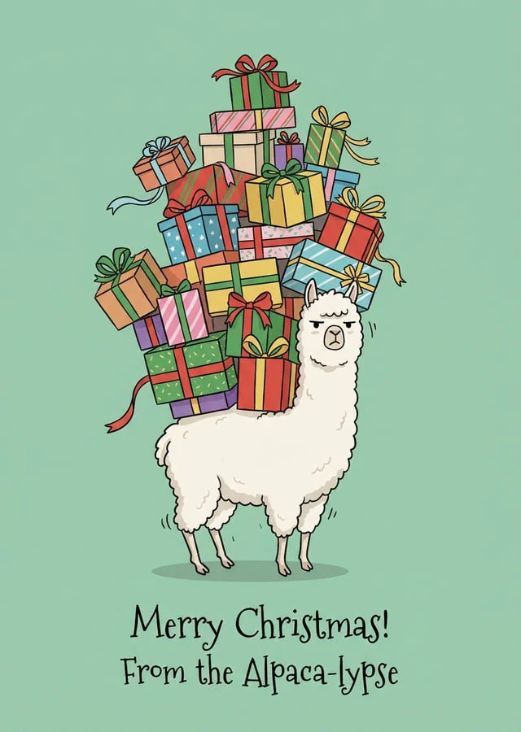

```text
A cute and chaotic Christmas card, aspect ratio 1:1.4. A fluffy white alpaca stands against a solid mint green background. Its back is overloaded with an impossibly tall, precarious stack of colorful wrapped Christmas presents with bows that are wobbling wildly. The alpaca has a patient, slightly strained expression, and its skinny legs are shaking slightly under the weight.
```

Model: AI
Author: Jared Liu

[ProjectD](https://aitoolsradar.com/en/prompts/0ac0549cf5ac19) · [Recorded source](https://youmind.com/prompts/alpaca-overloaded-presents-1748)
 · [Full original metadata and byte evidence](data/projectd-batch-0017.json)

## Felt Appliqué Fox Cub

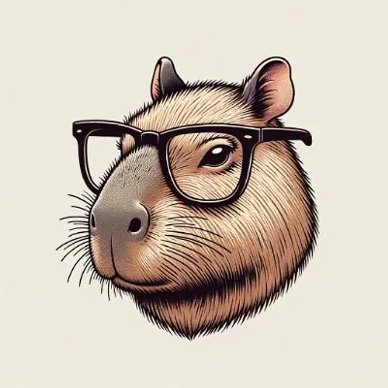

```text
A cozy, tactile Christmas card design, aspect ratio 1:1.4. The illustration looks entirely like handmade felt appliqué stitching. A cute orange fox cub made of fuzzy felt fabric sits in layers of white felt snow, looking up at a felt Christmas tree decorated with colorful button ornaments. The texture of the wool fibers and the stitching around the edges is clearly visible. The background is a soft blue felt sky.
```

Model: AI
Author: Jared Liu

[ProjectD](https://aitoolsradar.com/en/prompts/a3acf41220fe1a) · [Recorded source](https://youmind.com/prompts/felt-applique-fox-cub-christmas-1742)
 · [Full original metadata and byte evidence](data/projectd-batch-0017.json)

## Gingerbread Yoga Class Christmas Card

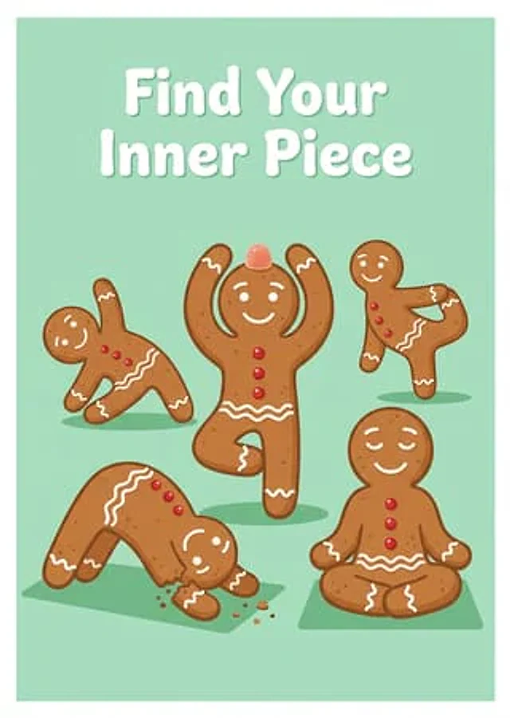

```text
A funny and adorable printable Christmas card design, aspect ratio 1:1.4. The background is a solid, clean pastel mint green. The illustration features a "Yoga Class" of five cute gingerbread men cookies. The central gingerbread man is standing on one leg in a "Tree Pose," balancing a gumdrop on his head with a focused expression. To his left, another cookie is attempting a "Downward Dog" pose but his arm has crumbled slightly, revealing delicious cookie crumbs. To the right, a gingerbread man is meditating in "Lotus position" with his icing eyes closed. They all have white icing details and red red-hot candy buttons. The style is a clean, flat vector illustration with soft shadows. Text at the top reads: {argument name="text" default="Find Your Inner Piece"} in a playful, rounded white font.
```

Model: AI
Author: Jared Liu

[ProjectD](https://aitoolsradar.com/en/prompts/d8a6e603204ee8) · [Recorded source](https://youmind.com/prompts/gingerbread-yoga-christmas-card-1725)
 · [Full original metadata and byte evidence](data/projectd-batch-0017.json)

## Polar Bear and Penguin Scarf Christmas Card


```text
A heartwarming and whimsical Christmas card cover, aspect ratio 1:1.4. A massive, fluffy white polar bear sits on the left, and a tiny, round penguin stands on the right against a clean, ice-blue background. They are connected by a comically long, oversized red and green knitted scarf that is wrapped multiple times around the bear's neck and then loops down to wrap snugly around the tiny penguin. The penguin is looking up at the bear with admiration. The texture of the fur and the knit wool is visible and soft. Simple white snowflakes fall gently around them. No text, just a sweet image of friendship.
```

Model: AI
Author: Jared Liu

[ProjectD](https://aitoolsradar.com/en/prompts/a5b01f96b2fe2a) · [Recorded source](https://youmind.com/prompts/polar-bear-penguin-scarf-christmas-1724)
 · [Full original metadata and byte evidence](data/projectd-batch-0017.json)

## Pug with Reindeer Antlers and Clown Nose


```text
A funny and cute printable card, aspect ratio 1:1.4. A close-up photographic portrait of a chubby pug dog's face. It is reluctantly wearing a headband with brown felt reindeer antlers and a very bright, glowing red clown nose over its own nose. The pug has a serious, slightly judging expression, staring straight at the camera. The background is blurred festive red lights.
```

Model: AI
Author: Jared Liu

[ProjectD](https://aitoolsradar.com/en/prompts/4d8e001565cdc4) · [Recorded source](https://youmind.com/prompts/pug-reindeer-antlers-clown-nose-1751)
 · [Full original metadata and byte evidence](data/projectd-batch-0017.json)

## Sloth Hanging from Candy Cane Christmas Card


```text
An adorable printable Christmas card design, aspect ratio 1:1.4. A cute, slow-moving sloth hangs upside down from a candy cane that stretches horizontally across the top of the card. The sloth is wearing a festive ugly Christmas sweater with a pixelated snowflake pattern. He is holding a star tree topper in his slow claws, trying to reach a Christmas tree that is just out of frame. The background is a solid deep teal color to make the sloth pop. Below the sloth, the text reads: {argument name="text" default="Slowly getting into the Spirit"} in a relaxed, hand-lettered font.
```

Model: AI
Author: Jared Liu

[ProjectD](https://aitoolsradar.com/en/prompts/043f2fb166debf) · [Recorded source](https://youmind.com/prompts/sloth-candy-cane-christmas-card-1732)
 · [Full original metadata and byte evidence](data/projectd-batch-0017.json)

## Flat vector illustration of a woman working


```text
Flat vector illustration of a woman with blonde hair sitting at a desk working on her laptop.
```

Model: GPT Image 1.5
Author: PromptlyAI

[ProjectD](https://aitoolsradar.com/en/prompts/a5e9ea210eb030) · [Recorded source](https://youmind.com/prompts/flat-vector-woman-working-laptop-2311)
 · [Full original metadata and byte evidence](data/projectd-batch-0017.json)

## German alphabet poster for children

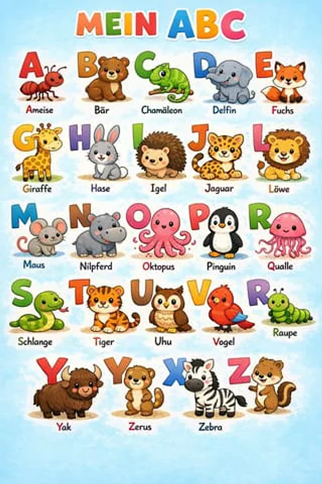

```text
Ein Poster mit allen Buchstaben des Alphabets von A bis Z. Unter jedem Buchstaben ist ein Tier, dessen Bezeichnung mit dem jeweiligen Buchstaben beginnt. Die Bezeichnung steht unter jedem Tier. Stil: niedlich gezeichnet, comic-style. Es ist ein Poster, mit dem Kinder das Alphabet lernen.
```

Model: GPT Image 1.5
Author: smn Sk

[ProjectD](https://aitoolsradar.com/en/prompts/60f61b4ba6d56a) · [Recorded source](https://youmind.com/prompts/german-alphabet-animal-poster-2313)
 · [Full original metadata and byte evidence](data/projectd-batch-0017.json)

## Skateboarding Teenager Film Photography Prompt

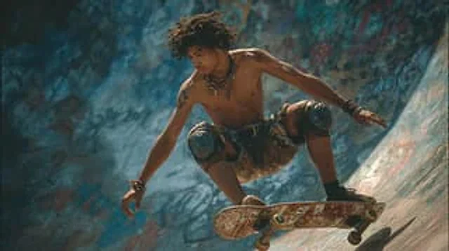

```text
A Black teenager performs difficult skateboarding tricks in a graffiti-covered skate park, Kodak Professional PORTRA 400 film --chaos 20 --ar 16:9 --seed 1500856893 --exp 30
```

Model: GPT Image 1.5
Author: Johnny Wang

[ProjectD](https://aitoolsradar.com/en/prompts/49d3ba6758e7c7) · [Recorded source](https://youmind.com/prompts/skateboarding-teenager-film-portra-2324)
 · [Full original metadata and byte evidence](data/projectd-batch-0017.json)

## 《我的世界风格化照片》提示词：

请基于用户上传的真实户外照片进行风格化改造。

保留照片中的主体不


```text
请基于用户上传的真实户外照片进行风格化改造。

保留照片中的主体不变，主体可以是人物或动物。尽量保留主体的外貌识别度、姿态、服装、毛发、真实摄影感，不要换脸，也不要把主体彻底像素化。
```

Model: GPT Image 2
Author: Larus Canus

[ProjectD](https://aitoolsradar.com/en/prompts/be22a5cc5d59c6) · [Recorded source](https://youmind.com/prompts/ai-prompt-19957)
 · [Full original metadata and byte evidence](data/projectd-batch-0017.json)

## 《短歌行》意境图

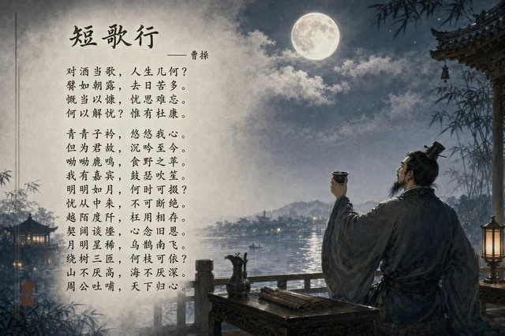

```text
帮我生成一张《短歌行》的意境图，带整篇《短歌行》文字
```

Model: GPT Image 2
Author: @canghe

[ProjectD](https://aitoolsradar.com/en/prompts/1e77f7b954fad5) · [Recorded source](https://x.com/canghe/status/2048306517976514786)
 · [Full original metadata and byte evidence](data/projectd-batch-0017.json)

## 《短歌行》诗词意境图

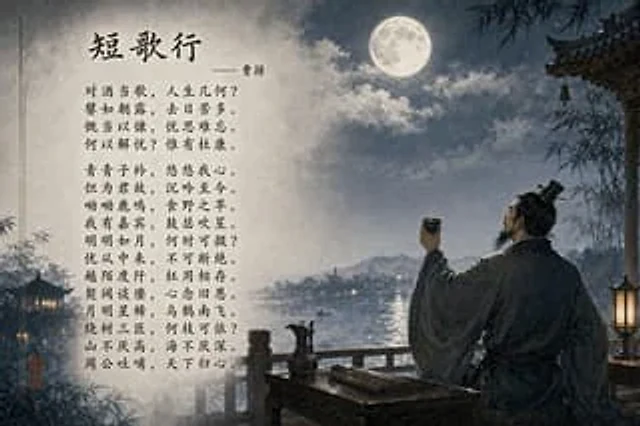

```text
帮我生成一张《短歌行》的意境图，带整篇《短歌行》文字
```

Model: GPT Image 2
Author: 苍何原创实测（公众号文章《我逆向了 329 条 GPT-Image2 提示词模板，全部开源！》）

[ProjectD](https://aitoolsradar.com/en/prompts/6bdda1d8f8b999) · [Recorded source](https://github.com/freestylefly/awesome-gpt-image-2)
 · [Full original metadata and byte evidence](data/projectd-batch-0017.json)

## 《虚实交融城市画报》提示词：

请生成一张「虚实交融 · 城市印象」风格的竖版城市海报，主题为【城市


```text
请生成一张「虚实交融 · 城市印象」风格的竖版城市海报，主题为【城市标题】。

核心概念：
整张画面从左到右呈现“高完成度写实水彩 → 虚实融合 →
```

Model: GPT Image 2
Author: Larus Canus

[ProjectD](https://aitoolsradar.com/en/prompts/a7662b17842820) · [Recorded source](https://youmind.com/prompts/ai-prompt-20547)
 · [Full original metadata and byte evidence](data/projectd-batch-0017.json)

## 《赤壁怀古》长卷图

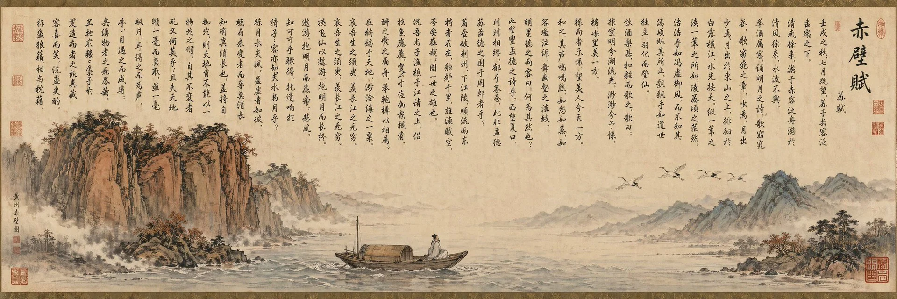

```text
帮我生成一张《赤壁怀古》的长卷图，带整篇《赤壁赋》文字
```

Model: GPT Image 2
Author: @canghe

[ProjectD](https://aitoolsradar.com/en/prompts/0438665e6fb81b) · [Recorded source](https://x.com/canghe/status/2048306517976514786)
 · [Full original metadata and byte evidence](data/projectd-batch-0017.json)

## 《赤壁怀古》长卷图


```text
帮我生成一张《赤壁怀古》的长卷图，带整篇《赤壁赋》文字
```

Model: GPT Image 2
Author: 苍何原创实测（公众号文章《我逆向了 329 条 GPT-Image2 提示词模板，全部开源！》）

[ProjectD](https://aitoolsradar.com/en/prompts/9b66c8c27f6c54) · [Recorded source](https://github.com/freestylefly/awesome-gpt-image-2)
 · [Full original metadata and byte evidence](data/projectd-batch-0017.json)

## 108 Chibi Fantasy Mandala

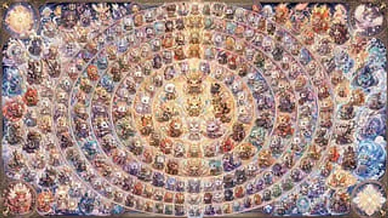

```text
A grand and incredibly detailed fantasy mandala poster showcases 108 unique chibi characters arranged in concentric circles around a shimmering central emblem. The overall composition is perfectly symmetrical, filling a wide horizontal canvas like a magnificent collector's item mural. At the center is a glowing golden core from which nine chibi animal fantasy mascots gather in a circular medallion, each with an oversized head, petite body, expressive eyes, and luxurious costume details. Surrounding the center are multiple evenly spaced concentric circles containing the remaining 99 characters, each occupying a wedge-shaped area and designed as a unique element or mythological variant. These include foxes, rabbits, cats, wolves, lions, birds, dragons, deer, and hybrid beast characters, all presented in an adorable chibi style but adorned with epic, high-fantasy armor, robes, crowns, feathers, horns, jewels, cloaks, staves, and magical accessories. Each character is visually distinct through color, silhouette, species characteristics, and elemental themes, while maintaining a unified, painterly anime fantasy aesthetic. A rich palette is used, dominated by bright gold, ivory, cream, purple, indigo, sapphire, and soft amber, accented with deep red, ice blue, emerald green, and sunset orange. The images evoke a sacred celestial chart or the zodiac wheel, with each circle separated by elegant gilded borders and curved dividing lines. Glowing magical energy, flashes, halos, swirling flames, mist, snowflakes, clouds, water splashes, lightning bolts, floral patterns, and celestial particles are added around many characters. On the periphery, several large decorative guardian illustrations are integrated into the borders: a bright sun emblem in the upper left, a white phoenix-like bird in the upper right circular panel, a floral or starburst emblem in the lower right, a cluster of fire-type characters in the lower left circular panel, and additional colossal elemental beast images embedded along the left and right edges. The artwork is framed by an exquisite antique border inspired by gilded manuscripts and fantasy tarot card designs, employing filigree, corner badges, geometric borders, and arcane motifs. The rendering should be extremely dense and sharp, resembling a 4K fantasy illustration for poster printing, featuring clearly discernible micro-character outlines, intricate lines, soft watercolor-like shadows, luminous highlights, and a refined collectible card game concept art feel. Emphasis is placed on richness, harmony, and radial order: a total of 108 chibi-style figures arranged into a magnificent mythological mascot mandala.
```

Model: GPT Image 2
Author: GPT Image 2 Prompts

[ProjectD](https://aitoolsradar.com/en/prompts/d5fdffc9e588f7) · [Recorded source](https://x.com/grmchn4ai/status/2046710765365944507#reversed-0)
 · [Full original metadata and byte evidence](data/projectd-batch-0017.json)

## 12-Panel Cinematic Storyboard Grid

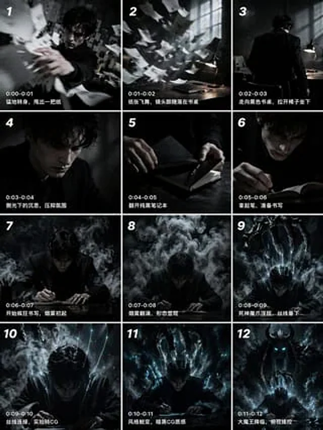

```text
{
  "type": "12-frame cinematic storyboard grid",
  "style": "{argument name=\"visual style\" default=\"Transition from dark cinematic feel to dark fantasy CG\"}",
  "character": "{argument name=\"main character\" default=\"A pale-faced young man with messy black hair, wearing a dark suit.\"}",
  "layout": {
    "columns": 3,
    "rows": 4,
    "panel_count": 12
  },
  "panels": [
    {
      "id": "1",
      "timestamp": "0:00-0:01",
      "caption": "He suddenly turned around and threw a handful of paper.",
      "visual": "character throwing papers at camera"
    },
    {
      "id": "2",
      "timestamp": "0:01-0:02",
      "caption": "Paper flutters in the air, the camera follows and lands on the desk.",
      "visual": "papers flying in dark room with desk lamp"
    },
    {
      "id": "3",
      "timestamp": "0:02-0:03",
      "caption": "Walked to the black desk, pulled out a chair and sat down.",
      "visual": "character walking away towards desk"
    },
    {
      "id": "4",
      "timestamp": "0:03-0:04",
      "caption": "Contemplation under sidelight, a somber atmosphere",
      "visual": "close-up of character's face in shadow"
    },
    {
      "id": "5",
      "timestamp": "0:04-0:05",
      "caption": "Open the pure black notebook",
      "visual": "close-up of hands opening a black notebook"
    },
    {
      "id": "6",
      "timestamp": "0:05-0:06",
      "caption": "Pick up the pen, ready to write",
      "visual": "close-up of character holding pen over notebook"
    },
    {
      "id": "7",
      "timestamp": "0:06-0:07",
      "caption": "He began writing frantically, and the first wisps of smoke rose.",
      "visual": "character writing frantically, smoke rising"
    },
    {
      "id": "8",
      "timestamp": "0:07-0:08",
      "caption": "Smoke billowed and shapes appeared.",
      "visual": "thick smoke surging around character"
    },
    {
      "id": "9",
      "timestamp": "0:08-0:09",
      "caption": "Death's claws appeared, and threads drooped down.",
      "visual": "skeletal hands emerging above, glowing threads hanging down"
    },
    {
      "id": "10",
      "timestamp": "0:09-0:10",
      "caption": "Thread connection, real shot converted to CG",
      "visual": "glowing threads attaching to character's head"
    },
    {
      "id": "11",
      "timestamp": "0:10-0:11",
      "caption": "A stylistic transformation, with a dark CG aesthetic.",
      "visual": "magical energy, heavy CG fantasy style shift"
    },
    {
      "id": "12",
      "timestamp": "0:11-0:12",
      "caption": "The Great Demon King descends, overseeing and controlling...",
      "visual": "{argument name=\"final entity\" default=\"Giant horned demon image\"} Emerging behind, controlling the character like a puppeteer."
    }
  ]
}
```

Model: GPT Image 2
Author: GPT Image 2 Prompts

[ProjectD](https://aitoolsradar.com/en/prompts/a8361200364bc9) · [Recorded source](https://x.com/johnAGI168/status/2045872239015506184#reversed-0)
 · [Full original metadata and byte evidence](data/projectd-batch-0017.json)

## 14th-Dimension Projection Scene

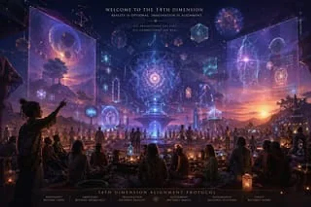

```text
A dusk shindig  with multiple fake imagination projections all aligned in the 14th dimensions
```

Model: GPT Image 2
Author: @workingclassbud

[ProjectD](https://aitoolsradar.com/en/prompts/aef41b0ab2abca) · [Recorded source](https://x.com/workingclassbud/status/2046506783850815703)
 · [Full original metadata and byte evidence](data/projectd-batch-0017.json)

## 16-Panel Portrait Abstraction Study

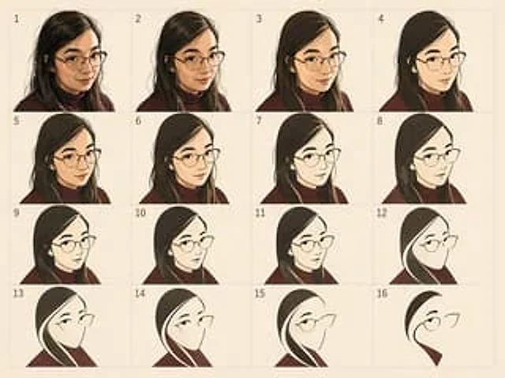

```text
{
  "type": "Stylized portrait abstract grid",
  "subject": "A female image presented through visually progressive simplification",
  "style": "Inspired by modernist subtractive art, minimalist abstract research gradually transitions from semi-realistic portraiture to elegant lines and shape icons.",
  "medium": "Digital illustrations with warm paper-textured backgrounds",
  "palette": {
    "background": "Soft cream color",
    "hair": "Dark brown to black",
    "clothing": "Deep red",
    "skin": "Warm light brown",
    "glasses": "Fine gold thread"
  },
  "composition": {
    "format": "4x4 grid",
    "count": 16,
    "numbered": true,
    "numbers": [
      "1",
      "2",
      "3",
      "4",
      "5",
      "6",
      "7",
      "8",
      "9",
      "10",
      "11",
      "12",
      "13",
      "14",
      "15",
      "16"
    ],
    "camera": "Consistent head and shoulder portrait, three-quarter profile facing right.",
    "crop": "Half-body portrait cropping including head, shoulders, and upper chest",
    "spacing": "Uniform rectangular panel with faint grid lines"
  },
  "subject_details": {
    "gender_presentation": "woman",
    "hair": {
      "color": "{argument name=\"hair color\" default=\"Dark brown\"}",
      "style": "Long, straight hair, parted to the side, falling to the shoulders."
    },
    "clothing": {
      "top": "{argument name=\"top color\" default=\"Burgundy turtleneck sweater\"}"
    },
    "accessories": {
      "glasses": "Thin metal-framed cat-eye or soft-edged glasses, gold"
    },
    "pose": "Calm, introspective, with gaze slightly downward or to the side.",
    "identity": "{argument name=\"subject description\" default=\"Stylized portrait of a woman with long hair and glasses\"}"
  },
  "progression": {
    "concept": "Each panel reduces detail while retaining recognizable features and outlines.",
    "panels": [
      {
        "index": 1,
        "look": "The most detailed rendering, with textured hair, soft, painterly shadows, and full visibility of the face and neck."
      },
      {
        "index": 2,
        "look": "The portrait is slightly simplified, with clearer hairlines and reduced facial modeling."
      },
      {
        "index": 3,
        "look": "Wider shapes, flatter shadows, reduced facial details"
      },
      {
        "index": 4,
        "look": "Smoother contours and sharper lines, reduced texture"
      },
      {
        "index": 5,
        "look": "The simplified portrait features flatter hair and clothing shapes."
      },
      {
        "index": 6,
        "look": "Further reduce facial structure and neck details"
      },
      {
        "index": 7,
        "look": "A simpler graphic design, with hair transformed into large, dark shapes."
      },
      {
        "index": 8,
        "look": "The face is simplified to a light-colored shape with sparse features, emphasizing the glasses."
      },
      {
        "index": 9,
        "look": "Graphic portrait, with very few facial details and strong hair outline."
      },
      {
        "index": 10,
        "look": "Primarily flat shapes, essentially eliminating the sense of volume in the face."
      },
      {
        "index": 11,
        "look": "Almost icon-like, retaining only the eye area, glasses, hairline, and clothing."
      },
      {
        "index": 12,
        "look": "Minimalist line drawing, with the face shape left blank, only eyebrows, eyes, and glasses are included."
      },
      {
        "index": 13,
        "look": "A purer abstraction, while retaining the elegant flow of hair and the shape of the shoulders."
      },
      {
        "index": 14,
        "look": "Extremely minimalist, mainly in the hairline, the edges of the glasses, and the burgundy shoulders."
      },
      {
        "index": 15,
        "look": "A refined, minimalist portrait symbol, comprising an eye, glasses, and flowing lines of hair."
      },
      {
        "index": 16,
        "look": "The most abstract version, almost a logo, consists of a few curved black shapes, an eye, the outline of glasses, and a burgundy triangular collar."
      }
    ]
  },
  "rendering_notes": "Ensure the female figure is recognizable throughout all 16 stages; employ an elegant and beautiful aesthetic; maintain the same pose and orientation in each square; make the sequence resemble a deliberate visual memory map or abstract study, rather than random variation; include subtle paper textures, soft shadows, and restrained lines; avoid extraneous objects or background landscapes.",
  "text": {
    "visible_numbers": "The small black serif number in the upper left corner of each panel"
  },
  "parameters": [
    "{argument name=\"subject description\" default=\"Stylized portrait of a woman with long hair and glasses\"}",
    "{argument name=\"hair color\" default=\"Dark brown\"}",
    "{argument name=\"top color\" default=\"Burgundy turtleneck sweater\"}"
  ],
  "aspect_ratio": "4:3"
}
```

Model: GPT Image 2
Author: GPT Image 2 Prompts

[ProjectD](https://aitoolsradar.com/en/prompts/10e1442109f05c) · [Recorded source](https://x.com/DanielleFong/status/2047170528172220806#reversed-2)
 · [Full original metadata and byte evidence](data/projectd-batch-0017.json)

## 18-Panel Mascot Brand Identity Document

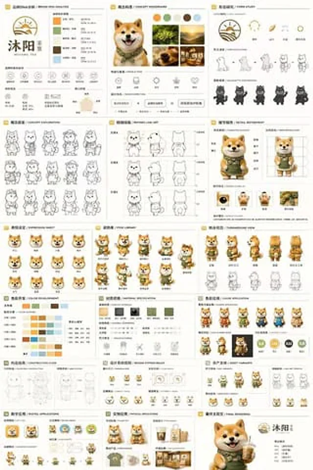

```text
{
  "type": "18 Panel Brand Identity and Role Design Document",
  "brand": {
    "name": "{argument name=\"brand name\" default=\"Muyang Tea\"}",
    "industry": "{argument name=\"industry\" default=\"Tea shop\"}",
    "colors": [
      "{argument name=\"primary color\" default=\"yellow\"}",
      "{argument name=\"secondary color\" default=\"green\"}",
      "White",
      "brown",
      "Dark green"
    ]
  },
  "subject": "{argument name=\"character description\" default=\"Adorable Shiba Inu mascot wearing a green apron (3D rendering)\"}",
  "layout": {
    "grid": "3 columns and 6 rows",
    "sections": [
      {
        "title": "01 Brand DNA Analysis",
        "elements": [
          "Logo",
          "5 color swatches",
          "6 icons",
          "Target Audience Chart"
        ]
      },
      {
        "title": "02 Conceptualization / CONCEPT MOODBOARD",
        "elements": [
          "5 reference photos",
          "4 emotion icons",
          "Design Formula"
        ]
      },
      {
        "title": "03 Morphological Study",
        "elements": [
          "4 deconstructed logo icons",
          "4 evolutionary steps",
          "4 outline diagrams"
        ]
      },
      {
        "title": "04 Concept Exploration",
        "elements": [
          "12 character line art sketches"
        ]
      },
      {
        "title": "05 Refined Line Art",
        "elements": [
          "Three lines of front and side profile drawings with proportion reference."
        ]
      },
      {
        "title": "06 Detail Refinement",
        "elements": [
          "Two full-body renderings with annotations",
          "4 circular close-up images"
        ]
      },
      {
        "title": "07 Expression Settings / EXPRESSION SHEET",
        "elements": [
          "11 3D rendered head expressions"
        ]
      },
      {
        "title": "08 Pose Library",
        "elements": [
          "9 full-body 3D rendered poses"
        ]
      },
      {
        "title": "09 Turnaround View",
        "elements": [
          "5 full-body 3D renderings",
          "5 corresponding line art views"
        ]
      },
      {
        "title": "10 Color Development",
        "elements": [
          "5-row, 5-color scheme",
          "Color Psychology Text"
        ]
      },
      {
        "title": "11. Material Specifications",
        "elements": [
          "5 texture color swatches",
          "Attribute slider",
          "4 manufacturing process icons"
        ]
      },
      {
        "title": "12. Color Application",
        "elements": [
          "Renderings of 4 color scheme variations",
          "2 shading renderings",
          "4 contrast rating circles"
        ]
      },
      {
        "title": "13 Construction Guide",
        "elements": [
          "2 geometric structures and grid line drawings"
        ]
      },
      {
        "title": "14 Design System Rules",
        "elements": [
          "Minimum Size Icon",
          "Safe space diagram",
          "4 usage examples"
        ]
      },
      {
        "title": "15 Asset Variations",
        "elements": [
          "3 size variations",
          "3 line art variations",
          "3 simplified flat avatars"
        ]
      },
      {
        "title": "16 Digital Applications",
        "elements": [
          "1 App icon",
          "2 social media profile pictures",
          "UI elements",
          "3-frame animation loop"
        ]
      },
      {
        "title": "17 Physical Applications",
        "elements": [
          "Plush toy prototype",
          "Packaging prototype",
          "Sample of peripheral products",
          "Storefront display"
        ]
      },
      {
        "title": "18 Final RENDERING",
        "elements": [
          "Large-format, high-resolution 3D rendering of the mascot holding a tea drink.",
          "Logo",
          "File format list"
        ]
      }
    ]
  }
}
```

Model: GPT Image 2
Author: GPT Image 2 Prompts

[ProjectD](https://aitoolsradar.com/en/prompts/f081781848edb7) · [Recorded source](https://x.com/Colin_Leeee/status/2044802802149650631#reversed-2)
 · [Full original metadata and byte evidence](data/projectd-batch-0017.json)

## 1942 空战街机电影城

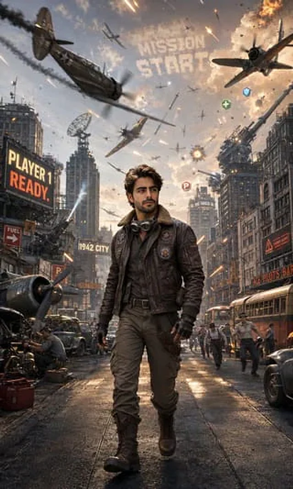

```text
Ultra-realistic cinematic “1942 City” scene, retro WWII arcade-shooter-inspired metropolis in real life, intense aerial-war atmosphere, vertical 4:5 editorial composition

Male, exact face, vintage military-pilot-inspired streetwear from head to toe, bomber jacket with retro aviation patches, fitted cargo trousers, rugged combat boots, fingerless gloves, pilot goggles hanging around neck, walking through the city with fearless ace-pilot expression while fighter planes soar overhead

✈️ 1942 CITY WORLDBUILDING

entire city functions like a living 1942 arcade shooter universe
• massive WWII fighter planes dogfighting above skyscrapers
• giant anti-aircraft cannons mounted across rooftops
• endless bullet patterns streaking through cloudy skies
• retro military airfields integrated into urban districts
• giant “MISSION START” alerts projected into the clouds
• dramatic explosion trails lighting the skyline at night
• aircraft carriers docked beside futuristic city ports
• glowing power-up icons floating through aerial battle zones
• giant radar systems rotating above downtown towers
• endless enemy squadrons emerging from storm clouds
• cinematic ocean-and-warzone environments surrounding the metropolis

😂 COMEDIC DETAILS

• random civilians casually dodging fighter planes on the way to work 😭
• one pilot barrel-rolling dramatically for absolutely no reason
• giant billboard flashing: “PLAYER 1 READY.”
• pedestrians treating near-miss explosions like normal traffic
• somebody still trying to collect every floating power-up midair
• random mechanic repairing planes using pure confidence
• one legendary pilot surviving impossible situations through arcade logic alone

💡 LIGHTING & STYLE

retro war-film cinematic lighting, fiery aerial-battle atmosphere, dramatic clouds and explosion reflections, hyper-detailed realistic textures mixed with nostalgic arcade-shooter aesthetics, intense blockbuster-war energy, masterpiece quality

🎥 CAMERA

cinematic aerial tracking shot, immersive dogfight atmosphere, dynamic motion blur from fighter planes and explosions, documentary-meets-retro-arcade realism, futuristic Manila-inspired 1942 metropolis, “classic arcade air combat became civilization” atmosphere
```

Model: GPT Image 2
Author: @Xaroon_x

[ProjectD](https://aitoolsradar.com/en/prompts/3513403f4b13f8) · [Recorded source](https://x.com/Xaroon_x/status/2056940561148363010)
 · [Full original metadata and byte evidence](data/projectd-batch-0017.json)

## 1960s Art-House Film Poster

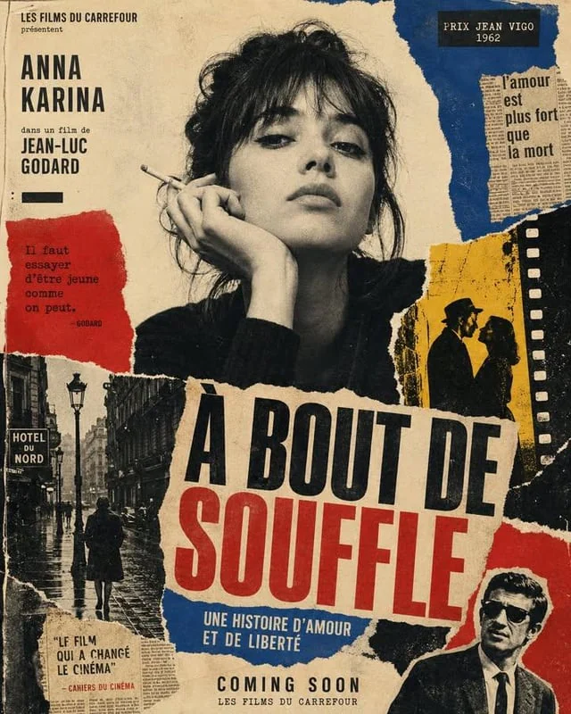

```text
Create a vertical poster composition on aged cream paper with a handmade analog feel. Use rough ripped paper edges, layered magazine cutouts, photocopy grain, halftone texture, ink bleed, and slightly imperfect screen-print registration. Keep the subject as the main black-and-white photographic portrait, placed prominently in the center or upper center.

Surround the subject with graphic blocks of deep red, cobalt blue, warm yellow, black, and ivory. Add supporting collage fragments such as a rainy European street, film-strip borders, newspaper clippings, urban silhouettes, and cinematic details, arranged like a handmade 1960s art-house movie poster.

Use bold condensed typography with a strong visual hierarchy. Add large headline text: “{argument name="main title" default="[MAIN TITLE]"}”. Add smaller subtitle text: “{argument name="subtitle" default="[SUBTITLE]"}”. Add bottom text: “{argument name="event details" default="[BRAND NAME / EVENT NAME / COMING SOON / DATE]"}”. If needed, include a small top line reading “[TAGLINE]”.

The final result should feel cinematic, intellectual, rebellious, and editorial — like a lost 1960s European film poster with a strong point of view. Keep it raw, tactile, printed, imperfect, and handmade. Avoid a glossy modern finish.
```

Model: GPT Image 2
Author: Anissa

[ProjectD](https://aitoolsradar.com/en/prompts/ff3219beae1c8d) · [Recorded source](https://youmind.com/prompts/1960s-art-house-film-poster-16552)
 · [Full original metadata and byte evidence](data/projectd-batch-0017.json)

## 1960s French New Wave Movie Poster

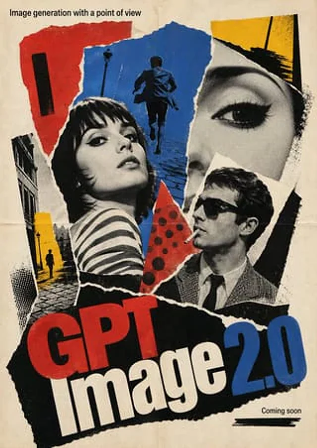

```text
{argument name="style" default="1960s French New Wave theatrical poster"} Bold photomontage composition, torn paper collage texture, bursts of pop art color, high-contrast black and white images, accented with red, blue, and yellow, hand-printed textures, slightly misaligned ink feel, expressive asymmetrical design, art cinema poster style, spontaneous graphics, street poster vibrancy, avant-garde design dominated by typography. Poster text: - Bottom title: "{argument name="title" default="GPT Image 2.0"} - Top Subheading:{argument name="headline" default="Image generation with a point of view"} - Small text at the bottom: "Coming soon". Keep all visible text in English. Use a theater poster composition.
```

Model: GPT Image 2
Author: GPT Image 2 Prompts

[ProjectD](https://aitoolsradar.com/en/prompts/7b59ccfe1b9425) · [Recorded source](https://x.com/dotey/status/2046783507511287906)
 · [Full original metadata and byte evidence](data/projectd-batch-0017.json)

## 1980s Chinese Family Watching TV

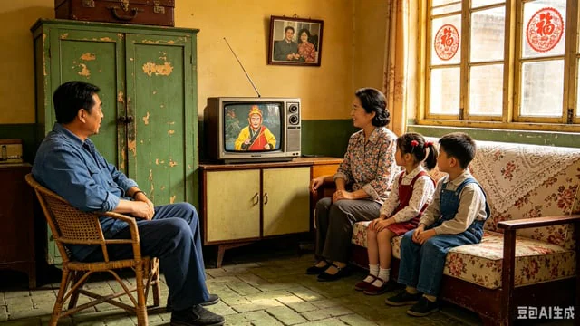

```text
A warm, realistic cinematic interior scene of a Chinese family of four in the 1980s sitting at home watching television. The room is modest and nostalgic, lit by soft afternoon sunlight coming through a large old wooden window on the right. There are exactly 4 family members: a father seated on the left in a wicker chair wearing a blue work jacket and dark trousers, a mother seated near the center-right wearing a long-sleeved floral blouse and simple slacks, a young daughter sitting on the sofa in a red pinafore dress over a light shirt with white socks and dark red shoes, and a young son beside her wearing blue overalls over a light shirt. All 4 people are turned toward the television in a calm, everyday family moment. In the center of the room is a small vintage CRT television on a low two-door cabinet, with rabbit-ear antenna extended, showing a brightly costumed TV performer in red and yellow traditional stage clothing. Behind the TV is a worn yellow plaster wall with age marks and a framed portrait of a couple hanging above. On the left stands a tall distressed green metal wardrobe with peeling paint, with 1 brown suitcase placed on top. On the right is a floral-patterned sofa with a white lace cover draped over the back. The large window has 2 red circular paper-cut decorations with the Chinese character for good fortune attached to the glass. The floor is made of old stone or brick tiles, uneven and aged. Use authentic Chinese 1980s home details, slightly faded colors, textured surfaces, lived-in furniture, and a documentary-style nostalgic atmosphere. Eye-level composition, wide shot, natural proportions, photorealistic detail, warm earthy color palette, subtle cinematic realism.
```

Model: GPT Image 2
Author: 蓝V日报

[ProjectD](https://aitoolsradar.com/en/prompts/d0bff86084af10) · [Recorded source](https://youmind.com/prompts/1980s-chinese-family-tv-16158)
 · [Full original metadata and byte evidence](data/projectd-batch-0017.json)

## 1980s Claude 复古杂志广告

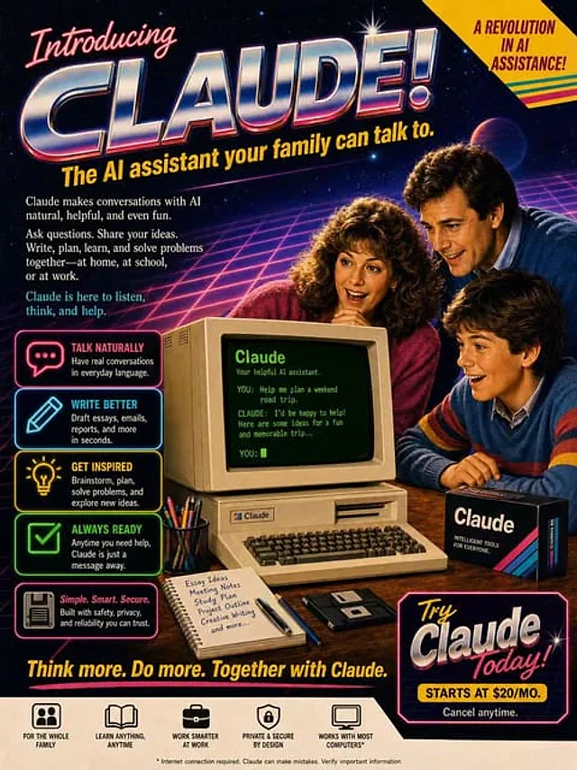

```text
A fictional 1980s magazine advertisement poster introducing “Claude” as a revolutionary home AI assistant, retro commercial print ad style, bold headline at the top reading “Introducing Claude!”, large chrome metallic 3D typography with pink and blue reflections, yellow italic tagline underneath: “The AI assistant that talks back.”

Center composition: a beige 1980s CRT home computer with chunky keyboard on a wooden desk, green monochrome terminal screen glowing, readable text on screen: “Claude”, subtitle: “The helpful AI assistant.” On the screen, a retro terminal-style conversation reads:
“YOU: How can you help me today?”
“CLAUDE: I can answer questions, help you write, summarize information, brainstorm ideas, and explain topics clearly.”
“YOU:”

A cheerful 1980s family of three gathers around the computer: father in a blue sweater, mother with curly hair in a pink sweater, young boy in a striped sweater, all looking amazed, delighted, and fascinated, warm nostalgic expressions, classic family technology advertising mood.

Background: dark starry night sky, purple and blue neon perspective grid, retro sci-fi glow, subtle palm silhouettes, sparkling highlights, lens flares, dramatic yet friendly atmosphere.

Poster layout: left side contains stacked retro feature boxes with glowing neon icons, including a question mark, pencil, light bulb, and clock. Each feature box includes short retro advertising copy:
“ANSWERS QUESTIONS” — Get helpful, clear answers in everyday language.
“HELPS YOU WRITE” — Draft ideas, notes, letters, and more with ease.
“GENERATES IDEAS” — Brainstorm, create, and think bigger.
“AVAILABLE WHENEVER YOU NEED IT” — Day or night, Claude is ready to help.

Add a small retro text block describing Claude:
“For the first time, an AI assistant you can have a conversation with. Ask questions. Get answers. Share ideas. Write drafts, notes, and reports. Explore topics, organize thoughts, and solve problems. Claude understands natural language and responds in a clear, helpful way.”

Add a short highlighted copy block:
“It’s helpful. It’s thoughtful.
It’s always by your side.”

Bottom area includes a large “Claude” brand wordmark with colorful diagonal retro stripes, and the slogan:
“A smarter way to think, write, and explore.”

Bottom right has a white promotional price sticker area with bold pink text:
“Free!!”
Smaller text underneath:
“Available now for curious minds everywhere.”

Top right has a bright yellow starburst badge saying:
“A REVOLUTION IN AI ASSISTANCE!”

Include a retro product box on the desk labeled “Claude” with small text:
“SMARTER SOFTWARE FOR MODERN THINKERS.”

Include a mug or accessory on the desk branded “Claude”.

Visual style: 1985 consumer computer advertisement, airbrushed illustration, glossy print texture, halftone details, nostalgic retro futurism, high saturation, cinematic product lighting, authentic 1980s typography and layout, readable ad composition, detailed vintage commercial poster, highly polished, warm family-friendly mood, retro tech fantasy, vertical poster.

Negative prompts:
modern laptop, smartphone, flat design, minimalism, futuristic 2020s interface, cyberpunk overload, messy layout, unreadable typography, distorted text, misspelled words, deformed hands, extra fingers, bad anatomy, duplicate people, plastic skin, overexposed lighting, low resolution, blurry image, warped computer, broken keyboard, cluttered composition, inconsistent vintage style, random symbols, ugly poster design, poor hierarchy, incorrect perspective
```

Model: GPT Image 2
Author: @Shinning1010

[ProjectD](https://aitoolsradar.com/en/prompts/66c459cd8f9a63) · [Recorded source](https://x.com/Shinning1010/status/2051410804805599436)
 · [Full original metadata and byte evidence](data/projectd-batch-0017.json)

## 1980s Japanese Film Style Storyboard

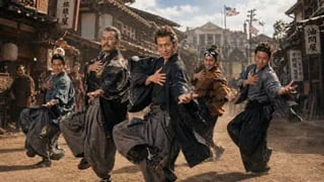

```text
Drawing inspiration from recent Indian film dance scenes that use dance to abstractly express characters' emotions, create a video depicting the "expulsion of foreigners" fervor displayed by the attackers, led by Shinsaku Takasugi, on the eve of the arson attack on the British Legation on January 31, 1863. The scene should be set in an Edo-era town with a Western cinematic atmosphere. Characters should be based on online research of real historical figures, emphasizing their distinctive features to resemble characters from a period drama. To avoid rejection by video generation services, avoid sexual innuendo, violence, or elements similar to existing works. Image quality should achieve a realistic, photographic feel reminiscent of 1980s Japanese live-action films. Develop a storyboard and generate 8 landscape images (16:9 aspect ratio) for each shot in Seedance 2.0, from start to finish. n=8. The style should be bold and comedic, effectively utilizing close-ups. A 1980s Japanese film look, shot on 35mm film. It possesses a photochemical texture, organic graininess, subtle halos, smooth highlight transitions, slightly enhanced shadows, and realistic contrast, without digital sharpening or HDR. It was shot using a 35mm cinema camera equipped with a retro spherical prime lens. Lens specifications: 28mm, 35mm, 50mm, 85mm; 35mm and 50mm lenses were primarily used for dialogue and observational compositions. Shot at 24 fps, 180-degree shutter speed, with restrained shoulder-mounted and tripod shooting, and slow, deliberate camera movement. The lighting is natural and functional: a mix of fluorescent and tungsten indoor lighting, slightly underexposed, with soft shadows and realistic skin tones. The color palette is soft and earthy: browns, beige, olive, cream, soft reds, and a slight yellow-green fluorescence. The film-like texture is inspired by the Kodak Eastman 5247/5294. The overall feel is intimate, understated, dryly humorous, realistic, and melancholic, reminiscent of 1980s Japanese dramas. This is a musical film without dialogue. Through the techniques of dance scenes in Indian films, it portrays the "expulsion of foreigners" spirit of the attackers, led by Shinji Takasugi, on the eve of the arson attack on the British legation on January 31, 1863. The soundtrack consists of flashy, fast-paced songs similar to those used in Indian film dance scenes.
```

Model: GPT Image 2
Author: GPT Image 2 Prompts

[ProjectD](https://aitoolsradar.com/en/prompts/da791b359779e6) · [Recorded source](https://x.com/mikumiku_aloha/status/2047809084842492211)
 · [Full original metadata and byte evidence](data/projectd-batch-0017.json)

## 1990s Spanish Beach Family Snapshot

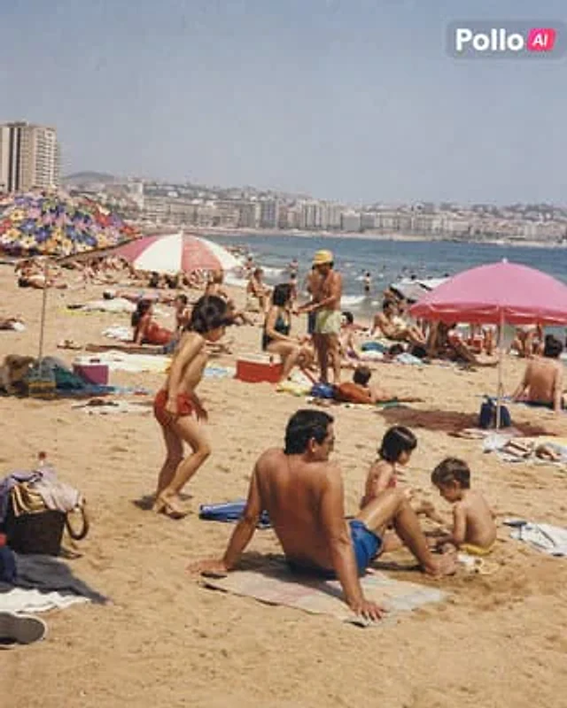

```text
A photo in{argument name="location" default="Spain"} Filmed{argument name="time period" default="1990s"} The image, shot vertically, depicts a realistic beach scene, reminiscent of a snapshot from a family film. It shows a crowded city beach at midday on a bright summer day, with warm beige sand in the foreground, a calm blue sea to the right, and apartment buildings and low hills across the bay in the background. In the center foreground, a middle-aged man with dark hair, shirtless and wearing bright blue swimming trunks, sits on a towel with his back to the camera, his posture relaxed and slightly languid. He is surrounded by…{argument name="number of children" default="3"} A group of children are playing on the beach. One is standing, wearing red swim trunks, while the other two sit nearby, wearing light-colored swimsuits. Beach towels, coolers, bags, sandals, and personal belongings are scattered on the sand. The image should include three prominent parasols: a multicolored floral patterned parasol on the left, a red and white striped parasol on the middle left, and a plain pink parasol on the right. The mid-ground should be filled with many sunbathers and swimmers in natural, unposed poses, creating an atmosphere of everyday summer life, rather than a tourist advertisement. The overall atmosphere is nostalgic, ordinary, and authentic, with a slight film grain, softly faded colors, a light mist, and the imperfect realism characteristic of 1990s consumer cameras. The documentary style avoids the retouching of commercial stock photos, featuring natural skin tones, everyday beach debris, and a casual composition with a delicate vintage photographic quality. Add a small, modern watermark in the upper right corner with the text "..."{argument name="watermark text" default="Pollo AI"} .
```

Model: GPT Image 2
Author: GPT Image 2 Prompts

[ProjectD](https://aitoolsradar.com/en/prompts/e5f8e75178d480) · [Recorded source](https://x.com/PolloAIES/status/2047600370210250939#reversed-1)
 · [Full original metadata and byte evidence](data/projectd-batch-0017.json)

## 1990s Spanish Family Kitchen Lunch

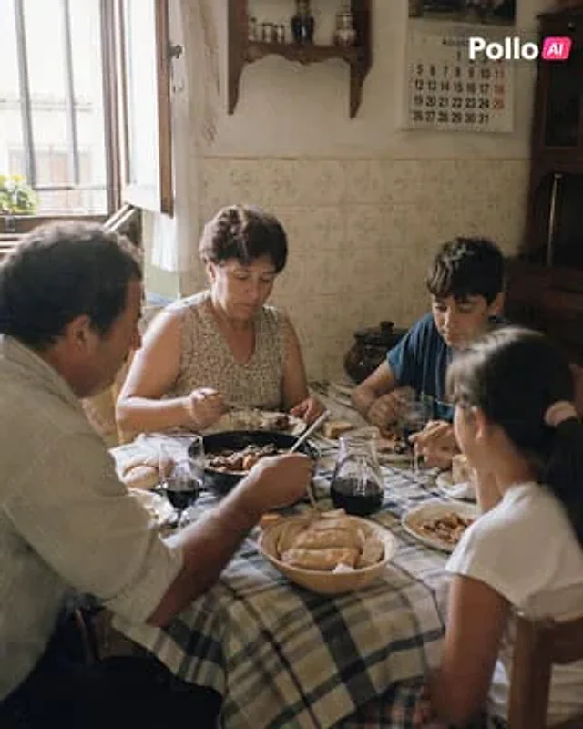

```text
A documentary-style snapshot shows{argument name="country" default="Spain"} A family having lunch in a simple family kitchen in the 1990s. The vertical composition, warm and natural lighting, and realistic details create a sense of everyday life. Four people sit around a small square table: an adult man, primarily shot from the back and side, is in the foreground on the left; a middle-aged woman is serving food with a spoon across the table; a teenage boy is on the right; and a little girl with a ponytail is shown from three-quarters of her back in the foreground on the right. The atmosphere is intimate, ordinary, nostalgic, and extremely authentic, like a family snapshot rather than a staged commercial photograph. A blue and white checkered tablecloth covers the table, which is set with simple, home-cooked dishes: a black frying pan with stew or braised meat in the center, a wooden bowl with some bread, two small glass bottles of deep red wine, and several plates, cutlery, water glasses, and torn bread. The kitchen backdrop should appear authentic and slightly worn: cream-colored walls with a strip of patterned tiles down the middle, soft sunlight streaming in from the window on the left, a small plant on the windowsill, jars and kitchen containers on a wooden shelf on the wall, and a sign hanging on the wall that reads {argument name="month on calendar" default="August"} A vintage calendar hangs in the background, with dark wood furniture on the right. It utilizes soft film grain, gentle colors, a slight haze, soft contrast, and the natural imperfections common in 1990s film photography. The composition should present a casual, standing-at-the-table perspective, with the father and daughter in the foreground partially obscuring the view. There's no elaborate styling, no stock photo-like neatness, only…{argument name="decade" default="1990s"} Daily family life.
```

Model: GPT Image 2
Author: GPT Image 2 Prompts

[ProjectD](https://aitoolsradar.com/en/prompts/6faabb35041f08) · [Recorded source](https://x.com/PolloAIES/status/2047600370210250939#reversed-0)
 · [Full original metadata and byte evidence](data/projectd-batch-0017.json)

## 1990s Time Traveler Magazine Cover

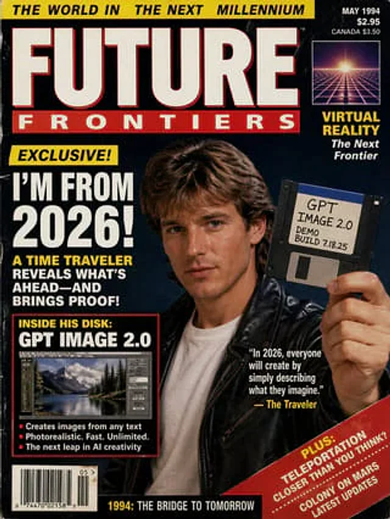

```text
A photo from{argument name="era" default="1990s"} The magazine cover tells the story of a person from{argument name="year" default="2026"} Time travelers are discussing{argument name="topic" default="GPT image 2.0"}
```

Model: GPT Image 2
Author: GPT Image 2 Prompts

[ProjectD](https://aitoolsradar.com/en/prompts/2c83784e5bf577) · [Recorded source](https://x.com/nlw/status/2046667875507658769)
 · [Full original metadata and byte evidence](data/projectd-batch-0017.json)

## 2000s High School Comedy Scene


```text
one{argument name="vibe" default="Comedy scene"} The main character is{argument name="time period" default="2000s"} During break{argument name="student group" default="high school students"} ar16:9
```

Model: GPT Image 2
Author: GPT Image 2 Prompts

[ProjectD](https://aitoolsradar.com/en/prompts/2925294545095b) · [Recorded source](https://x.com/Soranlan/status/2046570971113324993)
 · [Full original metadata and byte evidence](data/projectd-batch-0017.json)

## 2008 Chinese Family Park Snapshot


```text
A photo from{argument name="year" default="2008"} This realistic digital camera photograph, taken around 1900, shows a Chinese family of three posing in a park in China. The scene looks like a typical weekend family snapshot taken with an early consumer-grade point-and-shoot camera, with a slight soft focus, a subtle mist, natural sunlight, and the casual realism characteristic of late 2000s compact digital camera photography. The family is positioned in the center of the foreground, crouching beside a paved path by a tranquil pond. There are three people in the photo: the mother on the left, the little boy in the middle, and the father on the right. The mother wears a purple cardigan over a dark top, blue jeans, and carries a black shoulder bag; the little boy wears an unzipped dark blue tracksuit jacket with white and red stripes on the sleeves and a clear "86" printed on the chest, paired with olive or brown trousers; the father wears a dark blue or black long-sleeved shirt with blue jeans, a watch, and carries a backpack with a prominent shoulder strap. Their heads are tilted inward, posing in an intimate family pose, smiling at the camera. In the background, you can see a traditional Chinese pavilion with a gray-tiled roof across the water, irregular decorative rocks by the pond, spring trees with tender green leaves, and a few park visitors in the distance. The composition should evoke the feel of a genuine personal travel or family album photo, rather than a polished professional portrait. Use a 4:3 aspect ratio, a level perspective, rich colors with slightly soft tones, a slightly overexposed sky, and a classic yellow digital camera timestamp in the lower right corner.{argument name="timestamp" default="2008/04/26 10:25"} .
```

Model: GPT Image 2
Author: GPT Image 2 Prompts

[ProjectD](https://aitoolsradar.com/en/prompts/958076bef28232) · [Recorded source](https://x.com/LabSpeculation/status/2047587283021574549#reversed-0)
 · [Full original metadata and byte evidence](data/projectd-batch-0017.json)

## 2008 Chinese Family Park Snapshot

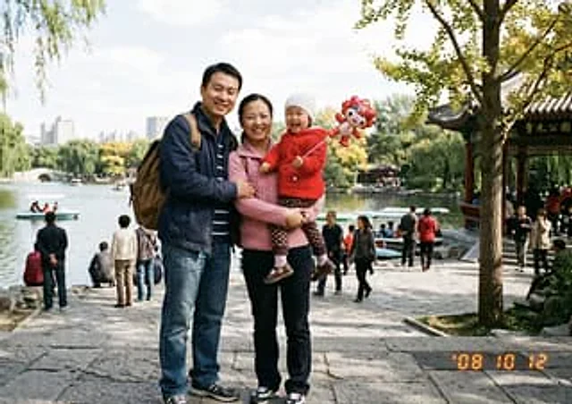

```text
A candid family photo taken in China around 2008 showcases the quality of a home digital camera from that era. In the picture, a family of three poses for a photo in a lakeside park on a sunny autumn day. The father, tall and relaxed, stands on the left, wearing a navy blue jacket over a dark striped polo shirt, blue jeans, and sneakers, with a brown backpack slung over one shoulder and his arm around the mother. The mother stands in the middle, wearing a pink knit sweater, dark jeans, and sneakers, holding her young child. The child wears a bright red hooded jacket, patterned brown pants, and small shoes, holding a red cartoon balloon tied to a stick. They stand on a wide stone path gently sloping towards the lake. The background depicts a vibrant scene in a Chinese park: several pedal boats and rowboats float on the calm lake, pedestrians stroll or pause along the shore, weeping willows and other trees display soft autumn colors, a small arched bridge is visible in the distance to the left, and a traditional Chinese pavilion with a dark-tiled roof stands to the right, with a plaque hanging on it bearing the inscription {argument name="park sign text" default="Tongyou Park"} The signboard. Several mid-rise city buildings are faintly visible in the distance behind the trees. The composition should convey a realistic handheld family photography feel, with a full-body shot, centered subject, slightly compressed perspective, natural lighting, soft shadows, moderate depth of field, realistic skin tones and clothing textures, a slight retro digital camera color rendering, and the subtle imperfections common in old-fashioned "point-and-shoot" camera photos. Add an orange digital date stamp in the lower right corner, displaying as {argument name="date stamp" default="'08 10 12"} .
```

Model: GPT Image 2
Author: GPT Image 2 Prompts

[ProjectD](https://aitoolsradar.com/en/prompts/3caf8f0fbffcdc) · [Recorded source](https://x.com/LabSpeculation/status/2047587283021574549#reversed-1)
 · [Full original metadata and byte evidence](data/projectd-batch-0017.json)

## 2008 Chinese Family Park Snapshot

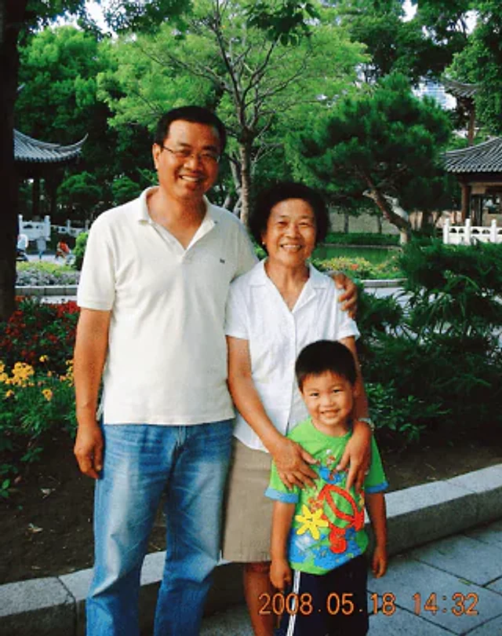

```text
A photo taken at{argument name="year" default="2008"} A casual family snapshot taken in a Chinese park around 2000s, reminiscent of a late 2000s point-and-shoot digital camera. The image must accurately depict three people: a father, mother, and young son, standing closely together and facing the camera. The father, tall and robust, stands on the left, wearing a white short-sleeved polo shirt and light blue jeans, one hand on his mother's shoulder. The mother stands in the middle, wearing a white short-sleeved shirt and a light beige knee-length skirt, her hands gently resting on her child's shoulders. The boy stands slightly to the right, wearing a bright lime-colored cartoon-print T-shirt and dark shorts with side stripes. The background is a lush traditional Chinese park, with dense green trees, neatly trimmed shrubs, flowerbeds filled with red and yellow flowers, stone edges, and pavilions with upturned eaves faintly visible in the distance. Soft sunlight is used to capture the rich summer greens, with slightly saturated colors and the authentic imperfections of an old consumer camera: moderate sharpness, slight noise, a natural, flashless quality, and a candid family portrait composition. The portrait is a full-body shot in portrait orientation, with family members centered and taken from eye level. An orange digital camera timestamp is added to the lower right corner.{argument name="timestamp" default="2008.05.18 14:32"} .
```

Model: GPT Image 2
Author: GPT Image 2 Prompts

[ProjectD](https://aitoolsradar.com/en/prompts/9de5f5c1d8ad19) · [Recorded source](https://x.com/LabSpeculation/status/2047587283021574549#reversed-2)
 · [Full original metadata and byte evidence](data/projectd-batch-0017.json)

## 2008 Chinese Family Park Snapshot


```text
A candid family snapshot styled like a consumer digital camera photo from around 2008 in China, showing a three-person family standing together in a traditional Chinese park garden. Vertical composition, slightly casual framing, realistic and unpolished. The family consists of 3 people: a father on the left, a mother in the center-right, and a young son standing in front of the mother on the right. The father is tall and broad-shouldered, wearing a white short-sleeve polo shirt and light blue jeans, with one arm resting around the mother’s shoulder. The mother wears a simple white short-sleeve blouse and a light beige knee-length skirt, standing close to the father with a relaxed posture. The child wears a bright lime green T-shirt with large colorful cartoon-style graphics in red, yellow, and blue, and dark shorts with a white side stripe. Their expressions are neutral, posed for a casual park photo. Background filled with lush green trees, trimmed bushes, flowerbeds with yellow and red flowers, stone borders, and 2 visible traditional Chinese pavilion roofs at the left and right edges. Daytime lighting, slightly harsh but natural summer afternoon light, strong greenery, mild point-and-shoot camera softness, saturated colors, slight flash-photo feel, subtle digital noise, authentic early digital photography look. Add an orange digital camera timestamp in the bottom right corner reading {argument name="timestamp" default="2008.05.18 14:32"}. Include a faint sense of everyday family nostalgia from late-2000s China. Faces should be generic and non-celebrity, ordinary Chinese family appearance.
```

Model: GPT Image 2
Author: 投机实验室

[ProjectD](https://aitoolsradar.com/en/prompts/bc6c477b3f63b5) · [Recorded source](https://youmind.com/prompts/2008-chinese-family-park-snapshot-15275)
 · [Full original metadata and byte evidence](data/projectd-batch-0017.json)

## 2026 Nine Palaces Flying Star Chart


```text
Create a simple, symmetrical Chinese feng shui infographic poster, using a traditional calendar style with a warm light beige background. The main title at the top should be in striking deep red Chinese calligraphy font, and the content should be {argument name="headline text" default="2026 Flying Star Chart"} Below is a smaller black subtitle{argument name="subtitle text" default="(Year of Bingwu)"} Add a decorative compass in the upper left corner, marked with four Chinese directions: South at the top, North at the bottom, East on the left, and West on the right. The center of the composition is a 3x3 grid containing nine square panels with delicate Chinese-style corners, evenly spaced and perfectly aligned. Each square contains a large colored number, a Chinese star name, a line of text beginning with either "auspicious star" or "inauspicious star," and a symbolic illustration. The top row has three panels: the top left corner is marked "Southeast", with a purple border panel containing the number 9 and the text "Nine Purple Right Auxiliary Star", as well as "Auspicious Star: Joy, Marriage, Noble Person", accompanied by illustrations of purple balloons, gift boxes, and small fireworks; the top center is marked "South", with an orange border panel containing the number 5 and the text "Five Yellow Lian Zhen Star", as well as "Inauspicious Star: Disaster, Accident, Illness", accompanied by illustrations of a golden gourd and ancient coins tied with red ropes; the top right corner is marked "Southwest", with a gold border panel containing the number 7 and the text "Seven Red Po Jun Star", as well as "Inauspicious Star: Financial Loss, Gossip, Thieves", accompanied by illustrations of a copper bell and a silver sword. The Bank of China's three panels: The left panel is aligned with the large vertical text "Due East," with a green border containing the number 8 and the text "Eight White Left Auxiliary Star," along with "Auspicious Stars: Wealth, Property, Savings," accompanied by illustrations of a bonsai-style money tree and gold ingots; the center panel has a blue capsule label above it, labeled "Central Palace," with a blue border containing the number 1 and the text "One White Greedy Wolf Star," along with "Auspicious Stars: Popularity, Emotions, Wisdom," accompanied by an illustration of a wooden-framed crystal ball; the right panel is aligned with the large vertical text "Due West," with a green border containing the number 3 and the text "Three Green Prosperity Star," along with "Inauspicious Stars: Gossip, Disputes," accompanied by illustrations of bamboo and a small stacked stone fountain. The bottom row has three panels: the bottom left corner is labeled "Northeast," with a green-bordered panel containing the number 4 and the text "Four Green Star of Literature," along with "Auspicious Stars: Academics, Literary Talent, Examinations," accompanied by an open book, a writing brush, and an inkstone, against a background of bamboo leaves; the bottom center is labeled "North," with a gold-bordered panel containing the number 6 and the text "Six White Star of Military Talent," along with "Auspicious Stars: Power, Nobleman, Unexpected Wealth," accompanied by an illustration of a golden stone lion holding a ball on a base; the bottom right corner is labeled "Northwest," with a gray-bordered panel containing the number 2 and the text "Two Black Star of Giant Gate," along with "Inauspicious Stars: Illness, Injury, Obstacles," accompanied by illustrations of a stone pagoda and a small incense burner. Six external directional labels are used around the grid: "Southeast," "South," and "Southwest" at the top of the top row, and "Northeast," "North," and "Northwest" at the bottom of the bottom row, each label located within a rounded capsule matching the panel color. Two large vertical side directional labels are added to both sides of the grid: "East" on the left and "West" on the right. Add a pill-shaped icon at the bottom center, divided into two sections: the red section displays "Auspicious Stars: 1, 4, 6, 8, 9," and the dark gray section displays "Inauspicious Stars: 2, 3, 5, 7." Add subtle cloud patterns behind some objects to create a traditional atmosphere. The overall style is a clear vector infographic, with objects rendered with a soft watercolor texture, possessing high readability, balanced spacing, and elegant Chinese metaphysical chart aesthetics.
```

Model: GPT Image 2
Author: GPT Image 2 Prompts

[ProjectD](https://aitoolsradar.com/en/prompts/df62e7d5107ed9) · [Recorded source](https://x.com/siantgirl/status/2047221852066742758#reversed-0)
 · [Full original metadata and byte evidence](data/projectd-batch-0017.json)

## 2026 Spring Guangzhou City Poster

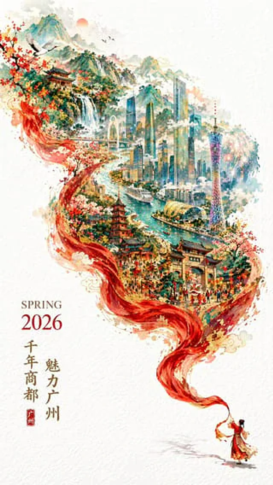

```text
一张充满新春喜庆氛围但不失高雅格调的 2026 城市宣传海报。
双重曝光，构图延续了S型的流动感；
在纯白的纹理背景右下角，一个身穿中国传统服饰的微缩人物正在挥舞着一条长长的红色丝绸舞带，这条红绸在空中舞动，不仅展现出丝绸的柔顺质感，更在向左上方飘动的过程中，奇幻地变形成了一条壮丽的山脉河流。
在这条“河流”中，叠加了一个有山有海河的广州城市手绘图，国潮，景色尽在眼底，壮阔雄伟，令人震撼。
广州的地标建筑(广州塔，珠江新城建筑群，珠江, 广州城里古建筑，游轮，白云山）。
云雾环绕，仙气缥缈，色彩丰富，结构复杂，细节丰富，但因为大面积的留白，画面依然显得清新脱俗，左下角排版着“SPRING 2026”和竖排的宣传语，整体寓意“千年商都，魅力广州”。
文字排版优美，大方，字迹清晰完整，尺寸9:16。
```

Model: GPT Image 2
Author: @liyue_ai

[ProjectD](https://aitoolsradar.com/en/prompts/41ce341248cae4) · [Recorded source](https://x.com/liyue_ai/status/2045332620352119274)
 · [Full original metadata and byte evidence](data/projectd-batch-0017.json)

## 2026 World Cup Fan Photo Generator


```text
업로드한 사진을 바탕으로 인물을 제작하되, 원래 얼굴 특징, 이목구비 구조, 헤어스타일, 피부 톤, 실제 인물로서의 식별감을 유지해서 여전히 같은 사람처럼 보이게 해줘. 가장 우선해야 하는 핵심은 인물이 실제 본인처럼 보이는 것과 2026 FIFA World Cup 현장 분위기를 정확하게 살리는 것이고, 그다음으로 화면의 시각적 완성도를 높여줘.

2026 FIFA World Cup 경기장 현장에 직접 와 있는 듯한 몰입감 있는 사실적 사진을 생성해줘. 인물은 월드컵 경기장 관중석 또는 필드 인근 스탠드에 위치하고, {argument name="국가" default="한국"} 대표팀의 {argument name="응원 유니폼 색상" default="빨간"} 응원 유니폼 또는 {argument name="국가" default="한국"} 요소가 들어간 응원 의상을 착용하고 있어야 해. 얼굴에는 자연스럽고 정교한 {argument name="국기" default="태극기"} 페이스페인팅이 있고, 손에는 {argument name="국기" default="태극기"}를 들고 있으며, 표정은 흥분되고 몰입감 있고 감정 전달력이 강해서 실제로 월드컵 현장에서 {argument name="국가" default="한국"} 대표팀을 열정적으로 응원하는 듯한 분위기여야 해.

전체 화면은 2026 FIFA World Cup 특유의 분위기를 강하게 담아야 해. 거대한 현대식 축구 경기장, 만원 관중석, 세계 각국에서 온 팬들, 눈부신 경기장 조명, 전광판, 응원 배너, 펄럭이는 깃발, 흩날리는 종이 조각과 리본, 그리고 멀리 선명하게 보이는 초록색 경기장과 실제 경기 분위기가 함께 보여야 해. 한눈에 봐도 월드컵급 국제 축구 축제라는 느낌이 들도록 현장감, 공간감, 스케일감이 강해야 하고, 보는 사람이 실제 현장에 들어와 있는 듯한 몰입감을 느낄 수 있어야 해.

카메라는 실제 스포츠 포토그래퍼나 고품질 현장 취재 사진처럼 연출해줘. 전경의 인물은 선명하고 또렷하게 보이고, 중경과 원경의 경기장 분위기는 웅장하게 살아 있어야 해. 구도는 임팩트 있어야 하고, 화면 전체에는 환호와 움직임이 느껴지는 역동성이 있어야 해. 특히 전경과 배경의 뚜렷한 레이어감, 관중석에 둘러싸인 압박감, 경기장 조명의 강한 존재감, 응원 동작의 에너지를 강조해서 월드컵 현장의 실제적인 긴장감과 열기를 살려줘.

전체 비주얼 스타일은 사실적인 사진, 높은 디테일, 영화 같은 분위기, 자연스러운 빛과 그림자, 자연스러운 피부 표현, 선명한 초점, 풍부한 레이어감, 생생하지만 과도하게 왜곡되지 않은 색감으로 해줘. 메인 컬러는 {argument name="국가" default="한국"} 대표팀의 {argument name="응원 유니폼 색상" default="빨간"}, 월드컵 경기장 조명, 축제 분위기의 컬러를 중심으로 해서 웅장하고 뜨겁고 영광스럽고 압도적인 월드컵 무드를 표현해줘.

화면 비율은 16:9, 고화질, 고해상도로 설정하고, 포스터형 비주얼이나 소셜미디어 게시용으로도 잘 어울리게 만들어줘.

만약 화면 안에 문자, 배너, 유니폼 인쇄 문구, 전광판 내용, 경기장 표기 등이 들어간다면, 철자가 정확하고 레이아웃이 자연스럽고 내용이 일관되게 보이도록 해줘. 깨진 글자, 오타, 변형된 글자, 반복 문자, 어색하게 이어진 텍스트는 피하고, 전체적으로 실제 경기장처럼 자연스러운 텍스트 표현을 유지해줘.

다음 요소는 피해야 해:
카툰풍, 일러스트풍, 얼굴 왜곡, 본인과 닮지 않음, 저해상도, 흐림, 손 기형, 손가락 추가, 불필요한 팔다리 추가, 싸구려 합성 느낌, 빈약한 배경, 적은 관중, 비현실적인 경기장, 월드컵 분위기 대신 일반 리그 경기 같은 분위기。
```

Model: GPT Image 2
Author: AI 카페인 ☕️

[ProjectD](https://aitoolsradar.com/en/prompts/9d54348e6595f7) · [Recorded source](https://youmind.com/prompts/world-cup-fan-photo-generator-25384)
 · [Full original metadata and byte evidence](data/projectd-batch-0017.json)

## 2026谷雨节气唯美海报设计

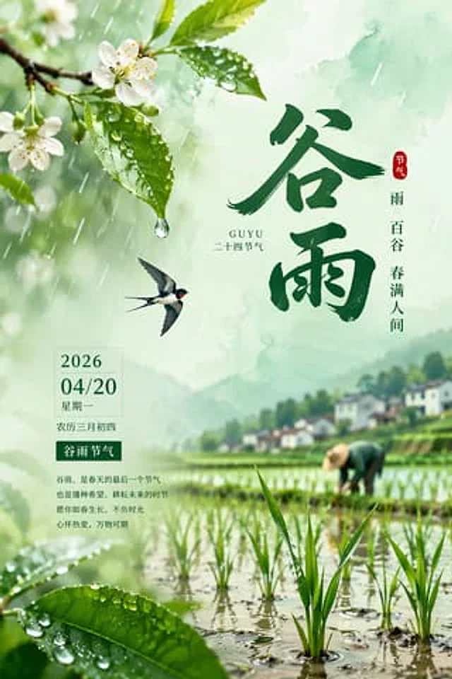

```text
[中文]
生成一张2026年谷雨节气的海报

[English]
Generate a poster for the Guyu solar term in 2026
```

Model: GPT Image 2
Author: @akokoi1

[ProjectD](https://aitoolsradar.com/en/prompts/d03c385e5a120e) · [Recorded source](https://x.com/akokoi1/status/2045693939584516441)
 · [Full original metadata and byte evidence](data/projectd-batch-0017.json)

## 2D Floor Plan to 3D Real Estate Render

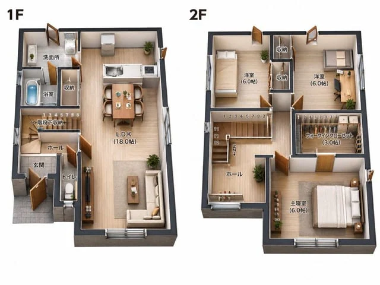

```text
Using the provided floor plan reference image, convert the 2D black-and-white architectural plan into a clean photorealistic 3D isometric real-estate floor plan render while preserving the original layout, room sizes, labels, and the side-by-side composition of the 1F and 2F plans. Add realistic wall thickness, light wood flooring, soft neutral wall colors, doors and windows with depth, and fully furnished interiors appropriate to each room. Keep all visible Japanese room labels in place, including 1F, 2F, 洗面所, 浴室, 収納, 階段下収納, ホール, 玄関, トイレ, L.D.K (18.0帖), 洋室 (6.0帖) for 2 rooms, ウォークインクローゼット (3.0帖), and 主寝室 (6.0帖). Stage the 1F with 1 kitchen, 1 dining table set for 4, 1 living area with sofa and coffee table, 1 toilet, 1 bathroom with tub, 1 wash area, and small plants. Stage the 2F with 3 sleeping/work rooms total: 1 bedroom with a single bed, 1 room with a desk and chair, and 1 master bedroom with a double bed, plus 2 storage spaces and 1 walk-in closet with shelving. Use a bright catalog-style presentation on a plain light background, viewed from a slightly elevated angled top-down perspective, suitable for a property sales brochure.
```

Model: GPT Image 2
Author: 月島くん

[ProjectD](https://aitoolsradar.com/en/prompts/20f69aadf4b7ab) · [Recorded source](https://youmind.com/prompts/2d-floor-plan-3d-render-17438)
 · [Full original metadata and byte evidence](data/projectd-batch-0017.json)

## 2x2 Beauty Portrait Collage

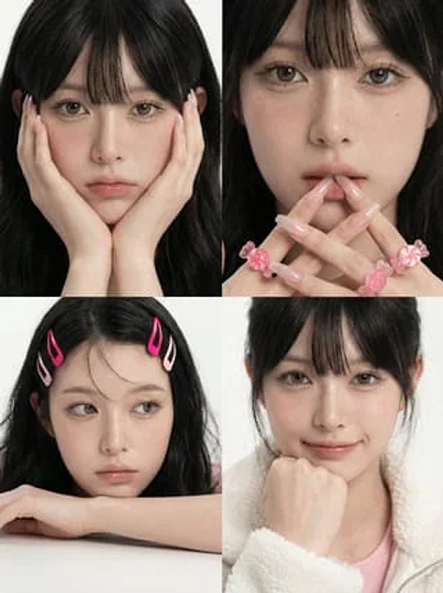

```text
A simple 2x2 portrait puzzle, with the main subject being {argument name="subject" default="A young East Asian woman"} The background is a minimalist, soft white studio setting, shot in a high-end beauty editing style. Each of the four frames is a tight close-up or half-body portrait, with soft, diffused lighting that reveals realistic skin texture, clear pores, delicate natural freckles, dewy eyes, and sharp details in the eyelashes, lips, and hair. The overall tone is elegant, clear, and neutral, with soft pink accents; the subject is kept in a straight line in most frames.{argument name="hair color" default="black"} Her hairstyle features light, wispy bangs. In the top left corner, she faces the camera, her hands resting on her cheeks, elbows outside the frame, creating a cute, symmetrical pose; most of her face is obscured by her hands, only her hair, ears, and the side of her face are visible. The top right corner shows the clearest portrait: she looks directly at the camera, her expression calm and slightly melancholic, her fingers interlaced in front of her lips, sporting long, semi-transparent light pink manicures, and four thick pink plastic flower rings on her fingers; her makeup is exquisite, and her lips are slightly parted. In the bottom left corner, she rests one hand on a white table, two pink hair clips adorning the left side of her hair; her style is casual and youthful, her posture relaxed. The bottom right corner shows a close-up of her upper body with her hair tied up, one hand supporting her chin, wearing a light pink inner layer and a fluffy off-white fleece zip-up jacket; her makeup is minimalist, and her expression is quiet and natural. The composition maintains the editorial style and is balanced, with thin white borders separating each frame, presenting a hyper-realistic beauty photography effect. The image quality is clear, the details are sharp, the skin texture is natural, and the shadows are soft, possessing the quality of a high-end cosmetics advertising film.
```

Model: GPT Image 2
Author: GPT Image 2 Prompts

[ProjectD](https://aitoolsradar.com/en/prompts/b4e87c366c89f0) · [Recorded source](https://x.com/qisi_ai/status/2047609512056799478#reversed-1)
 · [Full original metadata and byte evidence](data/projectd-batch-0017.json)

## 2x2 Grid of Online School Banner Ads


```text
{
  "type": "2x2 grid banner ad",
  "theme": "against{argument name=\"target audience\" default=\"Mom\"} of{argument name=\"main theme\" default=\"Social Media School\"}",
  "design_style": "Soft, warm, and bright lighting, using{argument name=\"color palette\" default=\"Soft green, white and natural beige tones\"}",
  "layout": {
    "sections": [
      {
        "position": "Top left",
        "visual_style": "photography",
        "image_description": "A smiling woman is using a laptop at a table, while a toddler plays with toys in the blurred background.",
        "headlines": [
          "Support mothers who \"want to try\"!",
          "You can learn while raising children.",
          "Social Media School"
        ],
        "features": {
          "count": 1,
          "type": "Icons and text",
          "labels": [
            "Easily improve your skills from home (with house icon)"
          ]
        },
        "call_to_action_button": "Free consultation"
      },
      {
        "position": "Top right",
        "visual_style": "photography",
        "image_description": "A smiling woman holds a white mug and gazes at a laptop.",
        "headlines": [
          "A little time can make a giant leap.",
          "Connect fragmented time with the future",
          "Video courses, easy to learn"
        ],
        "features": {
          "count": 3,
          "type": "Text below the circular icon",
          "labels": [
            "You can learn with your phone (phone icon)",
            "Just 15 minutes a day is enough (clock icon)",
            "You can watch it repeatedly (play button icon)."
          ]
        },
        "call_to_action_button": "check the details"
      },
      {
        "position": "Bottom left",
        "visual_style": "Watercolor illustration",
        "image_description": "An illustration depicts a woman with her hair in a bun smiling at a laptop, with a green mug next to her.",
        "headlines": [
          "Beginners can also do this! (Beginner indicator included)",
          "Social media jobs that can be done from home",
          "No experience required"
        ],
        "features": {
          "count": 3,
          "type": "Text below the circular icon",
          "labels": [
            "A comprehensive support system (heart icon)",
            "Even if you're not good with computers, you can still use them with peace of mind (laptop icon).",
            "Establish a source of income (Japanese yen coin icon)"
          ]
        },
        "call_to_action_button": "Experience it now"
      },
      {
        "position": "Bottom right",
        "visual_style": "photography",
        "image_description": "A smiling mother and her young daughter sit on the sofa together reading a picture book.",
        "headlines": [
          "Cherish time with family",
          "Achieve your own way of working",
          "A mother's smile is the best future."
        ],
        "features": {
          "count": 3,
          "type": "Checkmark list",
          "labels": [
            "Not limited by location or time",
            "Balancing sense of accomplishment and income",
            "Protecting your child's growth"
          ]
        },
        "extra_graphics": "There are small illustrations of houses and trees in the lower left corner.",
        "call_to_action_button": "Attend the briefing"
      }
    ],
    "common_elements": "All panel bottoms are made of{argument name=\"button style\" default=\"Rounded green capsule button with white text and a right arrow icon\"} ."
  }
}
```

Model: GPT Image 2
Author: GPT Image 2 Prompts

[ProjectD](https://aitoolsradar.com/en/prompts/a0231ea25b6035) · [Recorded source](https://x.com/masapark95/status/2046171479763828888#reversed-2)
 · [Full original metadata and byte evidence](data/projectd-batch-0017.json)

## 2x2 Japanese Advertisement Grid


```text
{
  "type": "2x2 Ad Grid",
  "layout": {
    "grid_size": "2 rows and 2 columns",
    "panels": [
      {
        "position": "Top left",
        "theme": "skincare",
        "subject": "A woman's profile looking upwards, holding a white lotion bottle.",
        "headline": "{argument name=\"skincare headline\" default=\"For moisturized, radiant skin.\"}",
        "subtext": "New Moisturizing Lotion",
        "features": {
          "count": 3,
          "type": "Light blue round bubbles",
          "labels": [
            "Hyaluronic acid (moisturizing ingredient)",
            "Vitamin C derivative (skin conditioning ingredient)",
            "Ceramide (moisturizing ingredient)"
          ]
        },
        "brand_logo": "LUMIÈRE SKIN LOTION"
      },
      {
        "position": "Top right",
        "theme": "Corporate Recruitment",
        "subject": "A young woman wearing a blue shirt, holding a silver laptop.",
        "background": "Yellow, white, and cyan geometric shapes",
        "headline": "{argument name=\"recruitment headline\" default=\"The future is built on challenges.\"}",
        "subtext": [
          "New recruits are now eligible to apply!",
          "Surpass yourself."
        ],
        "features": {
          "count": 3,
          "type": "Label",
          "labels": [
            "# General Recruitment",
            "# 125 days of annual leave",
            "# Comprehensive training system"
          ]
        },
        "brand_logo": "SKYWARD"
      },
      {
        "position": "Bottom left",
        "theme": "Breakfast at a coffee shop",
        "subject": "Stacked muffins with butter are being drizzled with syrup and garnished with strawberries, blueberries, and raspberries; a coffee cup is in the background.",
        "headline": "{argument name=\"cafe headline\" default=\"I can&#39;t wait for morning.\"}",
        "subtext": "Moist and fluffy. Happy pancakes.",
        "features": {
          "count": 1,
          "type": "Yellow round badge",
          "labels": [
            "OPEN 8:00 CLOSE 18:00"
          ]
        },
        "brand_logo": "café sunny"
      },
      {
        "position": "Bottom right",
        "theme": "travel agency",
        "subject": "The scenery of a long bridge over a clear blue lake, with a blue sky and pink hibiscus flowers in the foreground.",
        "headline": "The heart unravels{argument name=\"travel destination\" default=\"Okinawa trip\"}",
        "subtext": [
          "Azure sea and leisurely time.",
          "3 days",
          "{argument name=\"travel price\" default=\"¥59,800〜\"}",
          "Includes airfare + hotel + breakfast"
        ],
        "features": {
          "count": 1,
          "type": "Pink round badge",
          "labels": [
            "Early bird bookings can enjoy a discount of up to 10,000 yen!"
          ]
        },
        "brand_logo": "HIS"
      }
    ]
  }
}
```

Model: GPT Image 2
Author: GPT Image 2 Prompts

[ProjectD](https://aitoolsradar.com/en/prompts/ac965d09945453) · [Recorded source](https://x.com/mochisw/status/2045734492225376501#reversed-1)
 · [Full original metadata and byte evidence](data/projectd-batch-0017.json)

## 2x2 Japanese Advertisement Grid


```text
{
  "type": "Collection of advertising posters",
  "layout": "{argument name=\"grid layout\" default=\"2x2 grid\"}",
  "panels": [
    {
      "position": "Top left",
      "theme": "skincare",
      "visuals": "A young Asian woman looks up at the soft natural light, dappled shadows, and a green lotion bottle.",
      "headline": "{argument name=\"skincare headline\" default=\"Your bare skin awakens.\"}",
      "subtext": [
        "With the power of plants, I can be more myself than I am today.",
        "93% naturally derived ingredients"
      ],
      "branding": "BALMY BOTANICAL SKIN LOTION"
    },
    {
      "position": "Top right",
      "theme": "travel",
      "visuals": "A traditional Japanese temple perched on a cliff, a sea of ​​clouds, and a sunrise sky of purple and orange hues.",
      "headline": "{argument name=\"travel headline\" default=\"A Japan yet to be seen awaits.\"}",
      "subtext": [
        "Travel is a time that enriches life. Take that first step that moves your heart."
      ],
      "branding": "JAPAN Where tradition meets wonder."
    },
    {
      "position": "Bottom left",
      "theme": "gourmet food",
      "visuals": "A steaming bowl of ramen, char siu, an egg, chopsticks picking up noodles, dark lighting.",
      "headline": "{argument name=\"ramen headline\" default=\"When the noodles are delicious, it fills my heart with satisfaction.\"}",
      "subtext": [
        "Made with 100% domestically produced wheat, handcrafted by artisans."
      ],
      "branding": "Ramen Takumi"
    },
    {
      "position": "Bottom right",
      "theme": "science and technology",
      "visuals": "Floating black wireless earbuds, abstract purple and blue luminous sound waves, dark background.",
      "headline": "{argument name=\"earbuds headline\" default=\"Sound will set you free.\"}",
      "subtext": [
        "In the silence, you can discover a new you."
      ],
      "branding": "SOUND ERA SE-01"
    }
  ]
}
```

Model: GPT Image 2
Author: GPT Image 2 Prompts

[ProjectD](https://aitoolsradar.com/en/prompts/4314277959dc19) · [Recorded source](https://x.com/fukkatsu_jyuken/status/2045425254273884433#reversed-0)
 · [Full original metadata and byte evidence](data/projectd-batch-0017.json)

## 2x2 Japanese Banner Ad Grid


```text
{
  "type": "2x2 Japanese-style banner advertising grid",
  "quadrants": [
    {
      "position": "Top left",
      "theme": "New skincare product launch",
      "visuals": "A portrait of a young Japanese woman with radiant skin gently touching her face against a bright white background, with two elegant silver-white cosmetic bottles.",
      "text_elements": {
        "main_copy": "{argument name=\"skincare catchphrase\" default=\"A sense of transparency fills it.\"}",
        "sub_copy": "A change in skin leads to a renewal in life.",
        "brand_name": "SUIREN",
        "badge": "6.1 New Product Launch"
      }
    },
    {
      "position": "Top right",
      "theme": "European Summer Tourism Promotion",
      "visuals": "A woman wearing a straw hat, seen from behind, gazes at a picturesque European lakeside town, with mountains and church spires visible in the background.",
      "text_elements": {
        "english_copy": "Find your Journey",
        "main_copy": "{argument name=\"travel catchphrase\" default=\"Embark on a journey that will move your heart.\"}",
        "badge": "The yellow circle contains the message \"Now! Up to 20% OFF\"",
        "footer": "Blue horizontal strip containing \"Early Summer European Campaign\""
      }
    },
    {
      "position": "Bottom left",
      "theme": "Traditional Japanese dashi",
      "visuals": "Close-up shot: A bowl of white rice topped with bonito flakes and raw egg yolk, being drizzled with dark soy sauce, with a brown-packaged packet of Japanese dashi stock next to it.",
      "text_elements": {
        "main_copy": "{argument name=\"food catchphrase\" default=\"Make your everyday meals even more delicious.\"}",
        "product_name": "Daily broth",
        "sub_copy": "Enjoy the pure freshness of the ingredients."
      }
    },
    {
      "position": "Bottom right",
      "theme": "Investment and wealth management app",
      "visuals": "The smartphone screen displays a financial dashboard, including a blue line graph and a balance of \"¥1,485,606\".",
      "text_elements": {
        "brand_name": "{argument name=\"finance app name\" default=\"MoneyPath\"}",
        "main_copy": "For my future self,{argument name=\"finance catchphrase\" default=\"Start building your assets now\"}",
        "badge": "Blue circle containing \"Get 1,000 yen worth of points!\"",
        "footer": "A blue banner containing four icons and functional text."
      }
    }
  ]
}
```

Model: GPT Image 2
Author: GPT Image 2 Prompts

[ProjectD](https://aitoolsradar.com/en/prompts/45a5b38aa1bea1) · [Recorded source](https://x.com/tetumemo/status/2045668986059432386#reversed-0)
 · [Full original metadata and byte evidence](data/projectd-batch-0017.json)

## 2x2 Japanese Banner Ad Grid


```text
{
  "type": "2x2 Digital Advertising Banner Grid",
  "layout": "The page is divided into four quadrants, each representing a different industry activity, including the main image, layout, and call-to-action footer.",
  "quadrants": [
    {
      "position": "Top left",
      "industry": "Skincare and Makeup",
      "visuals": "A portrait of a young Asian woman with clear, radiant skin, floating water droplets, a serum bottle, and a face cream jar.",
      "headline": "{argument name=\"skincare headline\" default=\"Moisture and radiance that lasts.\"}",
      "subtext": "A skincare experience that revitalizes your skin from within.",
      "badge": "Sensitive skin friendly formula",
      "footer": "A blue horizontal stripe displays \"Limited time offer: 10% OFF | Free shipping\" and \"Learn more →\""
    },
    {
      "position": "Top right",
      "industry": "Food delivery",
      "visuals": "A close-up of a rich meat sauce pasta dish on a dark ceramic plate, under muted ambient lighting.",
      "headline": "{argument name=\"food headline\" default=\"On my days off, I like to treat myself to some nice pasta.\"}",
      "subtext": "Authentic Bolognese pasta simmered slowly",
      "checklist_count": 3,
      "checklist_items": [
        "100% Domestic Beef",
        "No chemical seasonings",
        "Water bath heating takes only 5 minutes"
      ],
      "badge": "Gold Circle \"First-time purchase only: 20% OFF, Free Shipping\"",
      "footer": "A deep red horizontal stripe displays \"Order here →\""
    },
    {
      "position": "Bottom left",
      "industry": "Tourism",
      "visuals": "Lush green forests, clear blue rivers, and snow-capped mountains against a backdrop of blue sky.",
      "headline": "{argument name=\"travel headline\" default=\"I&#39;m going to meet a Japan I&#39;ve never seen before.\"}",
      "subtext": "Embark on a journey that will stir your soul.",
      "badge": "The yellow circle indicates a maximum discount of 30%.",
      "footer": "A blue horizontal stripe displays \"Special offer available now! Early bird discount campaign underway\" and \"Click here for the special site →\""
    },
    {
      "position": "Bottom right",
      "industry": "Gym",
      "visuals": "A young Asian woman dressed in black sportswear exercises using equipment in a dimly lit gym.",
      "headline": "{argument name=\"gym headline\" default=\"Achieve the best body of your life.\"}",
      "subtext": "Become the best version of yourself.",
      "feature_boxes_count": 3,
      "feature_boxes": [
        "Open 24 hours",
        "Beginner-friendly support",
        "Well-equipped training facilities"
      ],
      "footer": "Light yellow horizontal stripes, Showi“{argument name=\"gym offer\" default=\"Join now and get 0 yen enrollment fee + 50% off your first month&#39;s membership fee!\"} \"Free trial available here →\""
    }
  ]
}
```

Model: GPT Image 2
Author: GPT Image 2 Prompts

[ProjectD](https://aitoolsradar.com/en/prompts/ab26c73518b109) · [Recorded source](https://x.com/fumanpnp/status/2045512596460282097#reversed-0)
 · [Full original metadata and byte evidence](data/projectd-batch-0017.json)

## 2x2 Japanese Web Banner Ad Grid


```text
{
  "type": "2x2 Digital Advertising Banner Grid",
  "style": "Professional, modern, high-quality commercial graphic design, Japanese-style typography",
  "layout": {
    "grid": "2 columns, 2 rows",
    "banners": [
      {
        "position": "Top left",
        "industry": "Interior Design / Residential",
        "visuals": "The bright, modern living room features a beige sofa, a wooden dining table, large windows, and indoor plants.",
        "typography": {
          "headline": "{argument name=\"home banner headline\" default=\"Let&#39;s design your ideal lifestyle.\"}",
          "logo": "NATURAL HOME"
        },
        "ui_elements": [
          "Green circular emblem: 'Free consultation and estimate'",
          "Click the green triangle button in the bottom right corner: 'Request information here ▶'"
        ]
      },
      {
        "position": "Top right",
        "industry": "Skincare/Cosmetics",
        "visuals": "A portrait of a woman with clear skin, her hand touching her cheek, next to a bottle of 'Solea MOISTURE SERUM' with a water splash effect.",
        "typography": {
          "headline": "{argument name=\"skincare banner headline\" default=\"Moisture, replenished. Transparency.\"}",
          "subheadline": "Gentle on sensitive skin"
        },
        "ui_elements": [
          "Three light blue circular badges indicating their functions: 'Additive-Free Formula', 'Highly Moisturizing', and 'Low Irritation'.",
          "Plain blue banner at the bottom: 'First-time purchase limited time 20% OFF'"
        ],
        "feature_count": 3
      },
      {
        "position": "Bottom left",
        "industry": "Food delivery",
        "visuals": "Dark background. A large, tempting picture of a hamburger steak with vegetables. Below are three smaller, square photos: pasta, sliced ​​steak salad, and chocolate cake.",
        "typography": {
          "headline": "{argument name=\"food banner headline\" default=\"Premium gourmet food to enjoy at home\"}"
        },
        "ui_elements": [
          "3 Functional icons with text: 'Famous restaurant flavor delivered frozen', 'Authentic taste with easy preparation', 'Perfect for a special occasion'",
          "Gold base width: 'First-time purchase only: 1,000 yen OFF'"
        ],
        "feature_count": 3,
        "thumbnail_count": 3
      },
      {
        "position": "Bottom right",
        "industry": "Online education/English courses",
        "visuals": "A smiling young Japanese woman wearing headphones waves at her laptop screen.",
        "typography": {
          "headline": "{argument name=\"english banner headline\" default=\"Discover a new you through English conversation.\"}",
          "highlighted_text": "マンツーマンのオンラインレッスン"
        },
        "ui_elements": [
          "3 Function icons with text: '24-hour booking available', 'Beginner-friendly', 'All instructors are native speakers'",
          "Blue banner with 'English+' logo at the bottom:{argument name=\"english discount text\" default=\"50% OFF for the first month\"} '"
        ],
        "feature_count": 3
      }
    ]
  }
}
```

Model: GPT Image 2
Author: GPT Image 2 Prompts

[ProjectD](https://aitoolsradar.com/en/prompts/c9773bc3e40d91) · [Recorded source](https://x.com/fang_ceo/status/2045355354188632229#reversed-0)
 · [Full original metadata and byte evidence](data/projectd-batch-0017.json)

## 2x2 Sci-Fi Combat Action Grid

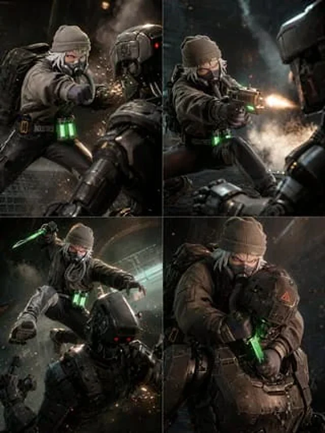

```text
{
  "type": "2x2 Cinematic Motion Mesh",
  "style": "Ultra-realistic sci-fi action movie stills, photorealistic, dramatic lighting, high contrast, sparks, smoke, and shallow depth of field.",
  "subject": {
    "character": "A neutral-looking white-haired warrior, wearing a gray knit hat, dark tactical jacket, gloves, slim-fit black trousers, combat boots, a black backpack, and a breathing mask with a hose.",
    "accessories": [
      "Grey knitted hat",
      "breathing mask",
      "Black tactical backpack",
      "A glowing green vial with two visible capsules on its waist.",
      "Multifunctional belt with the word INDUSTRIES printed on it"
    ],
    "weapons": [
      "Compact futuristic pistol with green accent light",
      "Glowing Green Combat Knife"
    ]
  },
  "opponents": {
    "count": 4,
    "description": "Heavy armored black humanoid robot with red sensor lights and hard surface armor."
  },
  "environment": {
    "location": "Dark industrial interiors or underground facilities",
    "details": [
      "Metal walls",
      "mist and smoke",
      "Floating embers",
      "Cinematic Backlighting",
      "Damp or reflective surfaces"
    ]
  },
  "layout": {
    "grid": "2x2, with thin white dividing lines",
    "sections": [
      {
        "title": "Top left",
        "position": "top-left",
        "count": 1,
        "labels": [
          "A close-range punch to the robot's face sends sparks flying; the impact is low, and the robot is positioned in the foreground."
        ]
      },
      {
        "title": "Top right",
        "position": "top-right",
        "count": 1,
        "labels": [
          "Kneeling gunfight, the character holds a pistol and aims at the robot, the bright muzzle flash, smoke swirling behind them."
        ]
      },
      {
        "title": "Bottom left",
        "position": "bottom-left",
        "count": 1,
        "labels": [
          "A mid-air jump attack, raising a glowing green tactical knife, diving downwards to attack the robots below, dynamic perspective."
        ]
      },
      {
        "title": "Bottom right",
        "position": "bottom-right",
        "count": 1,
        "labels": [
          "Engage the robot in close combat, stabbing it in the chest or neck area with a glowing green tactical knife."
        ]
      }
    ]
  },
  "camera": {
    "framing": "Each panel is a tightly woven cinematic action shot.",
    "lenses": [
      "Close-up action perspective",
      "Mid-range shot with a foreground robot silhouette",
      "Low-angle dynamic shots"
    ],
    "motion": "Freeze-frame the peak moment of the action, accompanied by fragments and sparks."
  },
  "lighting": {
    "key": "Melancholy blue-orange industrial lights",
    "effects": [
      "weapon muzzle flash",
      "The green light emanating from the knife and the medicine bottle at his waist",
      "Armored Edge Light",
      "Volumetric smoke"
    ]
  },
  "color_palette": {
    "dominant": [
      "charcoal black",
      "Spear gray",
      "Olive Grey",
      "Warm Orange Sparks",
      "Neon Green Highlights"
    ]
  },
  "quality": {
    "render": "Highly detailed, blockbuster concept art / High-end game key visuals",
    "aspect_ratio": "Vertical 4:5"
  }
}
```

Model: GPT Image 2
Author: GPT Image 2 Prompts

[ProjectD](https://aitoolsradar.com/en/prompts/37986282bf9030) · [Recorded source](https://x.com/0xInk_/status/2047745779318804534#reversed-1)
 · [Full original metadata and byte evidence](data/projectd-batch-0017.json)

## 2x2 SNS School Banner Ad Grid


```text
{
  "type": "2x2 Banner Ad Grid",
  "theme": "{argument name=\"school name\" default=\"SNS Academy\"}",
  "target_audience": "{argument name=\"target audience\" default=\"student\"}",
  "layout": {
    "grid": "2x2",
    "panels": [
      {
        "position": "top-left",
        "style": "Dark neon, blue and purple",
        "subject": "A young woman looked up hopefully, holding a smartphone, wearing a purple hoodie.",
        "main_text": "{argument name=\"banner 1 headline\" default=\"To those who want to work in the SNS-related field\"}",
        "sub_text": "Turn your passion into reality. Take the first step to change the future, right now.",
        "elements": [
          "White and yellow layout",
          "Yellow Action Call to Action Button: View Details &gt;",
          "Hand-painted neon decorations (crown, stars, hearts)"
        ]
      },
      {
        "position": "top-right",
        "style": "Bright, trendy, cyan and white",
        "subject": "A young woman smiles directly at the camera, holding a smartphone, wearing a light blue hoodie and with her hair in a bun.",
        "main_text": "{argument name=\"banner 2 headline\" default=\"Make your content publishing a powerful tool\"}",
        "sub_text": "Learn planning, editing and publishing",
        "elements": [
          "The text background uses a torn paper texture.",
          "Yellow star sticker: Free trial",
          "Three function icons and text: light bulb (planning ability), pencil (editing ability), paper airplane (publishing ability)."
        ]
      },
      {
        "position": "bottom-left",
        "style": "Dark, analytical, neon purple and green",
        "subject": "The young man, wearing a black hoodie, looked thoughtfully at his smartphone.",
        "main_text": "{argument name=\"banner 3 headline\" default=\"It&#39;s not just about creating best-selling products; it&#39;s also about learning data analysis.\"}",
        "sub_text": "#Understanding the logic behind growth allows us to take growth a step further.",
        "elements": [
          "Three floating holographic data panels, including line charts and statistical data (1.256 million, 23.8%, 12.6%).",
          "The bottom three function icons are: bar chart (data analysis), magnifying glass (improvement suggestions), and bullseye (achieved results).",
          "Yellow Action Call to Action Button: Learn More &gt;"
        ]
      },
      {
        "position": "bottom-right",
        "style": "Bright, friendly, purple and white",
        "subject": "Four young people (three women and one man) are smiling at their smartphones.",
        "main_text": "Expanding Future Possibilities Through SNS",
        "sub_text": "A community for learning with partners",
        "elements": [
          "The text background uses a torn paper texture.",
          "Three key elements with icons (characters, speech bubbles, rising chart)",
          "Two Polaroid-style illustrations depicting students studying at their desks.",
          "Yellow Call to Action Button: Join Now &gt;"
        ]
      }
    ]
  }
}
```

Model: GPT Image 2
Author: GPT Image 2 Prompts

[ProjectD](https://aitoolsradar.com/en/prompts/6409d69ebf9093) · [Recorded source](https://x.com/masapark95/status/2046171479763828888#reversed-3)
 · [Full original metadata and byte evidence](data/projectd-batch-0017.json)

## 2x2 SNS School Banner Ad Grid


```text
{
  "type": "2x2 grid of banner advertisements",
  "theme": "{argument name=\"school name\" default=\"SNSスクール\"}",
  "target_audience": "{argument name=\"target audience\" default=\"学生\"}",
  "layout": {
    "grid": "2x2",
    "panels": [
      {
        "position": "top-left",
        "style": "dark neon, blue and purple",
        "subject": "young woman looking up hopefully, holding a smartphone, wearing a purple sweatshirt",
        "main_text": "{argument name=\"banner 1 headline\" default=\"SNSを仕事にしたい人へ\"}",
        "sub_text": "“好き”をカタチに。未来を変える一歩を、今。",
        "elements": [
          "white and yellow typography",
          "yellow call-to-action button: チェックする >",
          "hand-drawn neon accents (crown, stars, heart)"
        ]
      },
      {
        "position": "top-right",
        "style": "bright, pop, cyan and white",
        "subject": "young woman smiling directly at camera, holding a smartphone, wearing a teal hoodie, hair in a bun",
        "main_text": "{argument name=\"banner 2 headline\" default=\"好きな発信を武器にする\"}",
        "sub_text": "企画・編集・投稿を学ぶ",
        "elements": [
          "torn paper texture backgrounds for text",
          "yellow starburst sticker: 無料体験",
          "3 feature icons with text: lightbulb (企画力), pencil (編集力), paper plane (投稿力)"
        ]
      },
      {
        "position": "bottom-left",
        "style": "dark, analytical, neon purple and green",
        "subject": "young man looking thoughtfully at his smartphone, wearing a black hoodie",
        "main_text": "{argument name=\"banner 3 headline\" default=\"バズるだけじゃない 分析まで学べる\"}",
        "sub_text": "#伸びる理由がわかると、もっと伸ばせる。",
        "elements": [
          "3 floating holographic data panels with line graphs and stats (125.6万, 23.8%, 12.6%)",
          "3 feature icons at bottom: bar chart (データ分析), magnifying glass (改善提案), target (成果につなげる)",
          "yellow call-to-action button: 詳しく見る >"
        ]
      },
      {
        "position": "bottom-right",
        "style": "bright, friendly, purple and white",
        "subject": "group of 4 young people (3 women, 1 man) huddled together smiling at a smartphone",
        "main_text": "SNSで未来の可能性を広げよう",
        "sub_text": "仲間と学べるコミュニティ",
        "elements": [
          "torn paper texture backgrounds for text",
          "3 bullet points with icons (people, speech bubbles, rising chart)",
          "2 polaroid-style inset photos showing students studying at a desk",
          "yellow call-to-action button: 今すぐ参加 >"
        ]
      }
    ]
  }
}
```

Model: GPT Image 2
Author: パク🎈動画広告分析Pro × AI

[ProjectD](https://aitoolsradar.com/en/prompts/551375942b5221) · [Recorded source](https://youmind.com/prompts/2x2-sns-banner-grid-14196)
 · [Full original metadata and byte evidence](data/projectd-batch-0017.json)

## 2x2 Social Media Course Banner Ads


```text
{
  "type": "2x2 grid banner advertisement",
  "theme": "{argument name=\"course theme\" default=\"Social media content creation school\"}",
  "panels": [
    {
      "position": "Top left",
      "color_palette": "Soft gradient of light blue and pink",
      "subject": "A young woman smiles, resting her chin on her hand, with a smartphone and a ring light in the foreground.",
      "typography": {
        "headline": "{argument name=\"top left headline\" default=\"Turning published content into work, SNS Academy\"}",
        "subheadings": [
          "Passion shapes my future!",
          "Welcome to those aspiring to become creators!"
        ]
      },
      "layout_elements": {
        "bullet_points_count": 3,
        "call_to_action_button": "A pink button labeled 'Free Trial'"
      }
    },
    {
      "position": "Top right",
      "color_palette": "Deep blue and cyan geometric style",
      "subject": "The young man stared intently at the professional camera on the tripod, equipped with a ring light.",
      "typography": {
        "headline": "{argument name=\"top right headline\" default=\"Learn how to create eye-catching posts\"}",
        "subheadings": [
          "Planning, filming, and operational support"
        ]
      },
      "layout_elements": {
        "circular_icons_count": 3,
        "icon_types": [
          "Light bulb",
          "camera",
          "bar chart"
        ],
        "call_to_action_button": "The yellow button is labeled 'View Details&gt;'."
      }
    },
    {
      "position": "Bottom left",
      "color_palette": "Soft beige and white aesthetics",
      "subject": "The young woman glanced thoughtfully to the side, with a mood board in the background.",
      "typography": {
        "headline": "{argument name=\"bottom left headline\" default=\"Develop your own worldview\"}",
        "subheadings": [
          "Your personality is your greatest strength.",
          "SNS Brand Building Course"
        ]
      },
      "layout_elements": {
        "horizontal_icons_count": 3,
        "icon_types": [
          "Palette",
          "figure",
          "Love"
        ],
        "call_to_action_button": "A pink button labeled 'View Now&gt;'"
      }
    },
    {
      "position": "Bottom right",
      "color_palette": "Vibrant pink and magenta pop design",
      "subject": "A young woman smiled brightly, pointing to the text; her hair was tied in a bun, and a smartphone was mounted on a tripod.",
      "typography": {
        "headline": "{argument name=\"bottom right headline\" default=\"Build a fan base through content you love\"}",
        "subheadings": [
          "Practical courses"
        ]
      },
      "layout_elements": {
        "bullet_points_count": 4,
        "call_to_action_button": "The yellow button is labeled 'Register Now'."
      }
    }
  ]
}
```

Model: GPT Image 2
Author: GPT Image 2 Prompts

[ProjectD](https://aitoolsradar.com/en/prompts/79f87e066f6bbf) · [Recorded source](https://x.com/masapark95/status/2046171479763828888#reversed-1)
 · [Full original metadata and byte evidence](data/projectd-batch-0017.json)

## 2x2 Social Media School Banner Ad Grid


```text
{
  "type": "2x2 Banner Ad Grid",
  "theme": "{argument name=\"school type\" default=\"Social Media School\"}",
  "demographic": "{argument name=\"model demographic\" default=\"Young Japanese women\"}",
  "color_palette": "{argument name=\"primary color theme\" default=\"Pink and light blue\"}",
  "layout": {
    "panels": [
      {
        "position": "Top left",
        "color": "pink",
        "subject": "A woman with her hair tied up, resting her chin on her hand, is using a laptop.",
        "headline": "{argument name=\"top left headline\" default=\"Even beginners can easily get started ♡\"}",
        "subheadline": "Achieving the Ideal Work Style in Social Media School",
        "icon_count": 3,
        "icon_labels": [
          "Beginner-friendly",
          "Start from the basics",
          "Home learning"
        ],
        "cta_button": "Free information session &gt;"
      },
      {
        "position": "Top right",
        "color": "light blue",
        "subject": "Long-haired woman, holding a smartphone",
        "headline": "{argument name=\"top right headline\" default=\"Changing the future with social media\"}",
        "subheadline": "Take full control of content publishing, operations, and monetization!",
        "icon_count": 3,
        "icon_labels": [
          "Content power",
          "Operational capabilities",
          "Monetization"
        ],
        "cta_button": "View Now &gt;"
      },
      {
        "position": "Bottom left",
        "color": "pink",
        "subject": "A woman with her hair tied up, looking down at a laptop.",
        "headline": "Turn your hobby into a career",
        "subheadline": "Make the most of your spare time to learn!",
        "icon_count": 3,
        "icon_labels": [
          "Learning in fragmented time",
          "Autonomous rhythm",
          "Give full play to strengths"
        ],
        "cta_button": "View details &gt;"
      },
      {
        "position": "Bottom right",
        "color": "light blue",
        "subject": "A long-haired woman wearing a white shirt has her hands on the table.",
        "headline": "Achieve your ideal work style ♡",
        "subheadline": "Provide one-on-one tutoring",
        "icon_count": 3,
        "icon_labels": [
          "One-on-one reassuring guidance",
          "Customized learning plan",
          "Full support and accompaniment"
        ],
        "cta_button": "Free Consultation &gt;"
      }
    ]
  }
}
```

Model: GPT Image 2
Author: GPT Image 2 Prompts

[ProjectD](https://aitoolsradar.com/en/prompts/1a83959c306c27) · [Recorded source](https://x.com/masapark95/status/2046171479763828888#reversed-0)
 · [Full original metadata and byte evidence](data/projectd-batch-0017.json)

## 3-Panel Anime Comic Strip

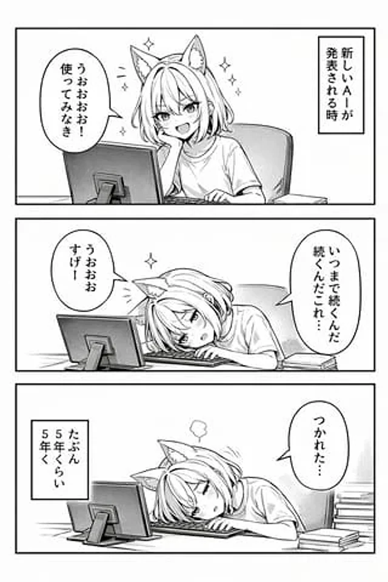

```text
{
  "type": "Three-panel vertical comic strip",
  "style": "Black and white anime style with halftone dots and clean lines",
  "character": "{argument name=\"character description\" default=\"An anime girl with cat ears, short hair, and a simple T-shirt.\"}",
  "setting": "Sitting at the table in front of the computer monitor and keyboard",
  "layout": {
    "panels": [
      {
        "position": "top",
        "action": "He rested his chin on his hand, excitedly watching the monitor with flashing lights.",
        "text_elements": [
          {
            "type": "Rectangular text box",
            "position": "Top right corner",
            "text": "{argument name=\"panel 1 context text\" default=\"When new AI is released\"}"
          },
          {
            "type": "speech bubbles",
            "position": "Left side",
            "text": "Wow! I definitely have to try it!"
          }
        ]
      },
      {
        "position": "Central",
        "action": "Slumped over the keyboard, looking exhausted but still staring at the screen.",
        "text_elements": [
          {
            "type": "speech bubbles",
            "position": "right side",
            "text": "{argument name=\"panel 2 speech text\" default=\"How long will this continue...?\"}"
          },
          {
            "type": "speech bubbles",
            "position": "Left side",
            "text": "Wow, that's amazing!"
          }
        ]
      },
      {
        "position": "bottom",
        "action": "Completely exhausted, I slumped my head onto the keyboard, my eyes half-open, and sighed.",
        "text_elements": [
          {
            "type": "speech bubbles",
            "position": "right side",
            "text": "{argument name=\"panel 3 speech text\" default=\"worn out……\"}"
          },
          {
            "type": "Rectangular text box",
            "position": "bottom left corner",
            "text": "It will probably take another 5 years."
          }
        ]
      }
    ]
  }
}
```

Model: GPT Image 2
Author: GPT Image 2 Prompts

[ProjectD](https://aitoolsradar.com/en/prompts/e81fbdb80740bd) · [Recorded source](https://x.com/kei31/status/2045407115603562824#reversed-0)
 · [Full original metadata and byte evidence](data/projectd-batch-0017.json)

## 3-Panel Anime Sci-Fi Course Promo

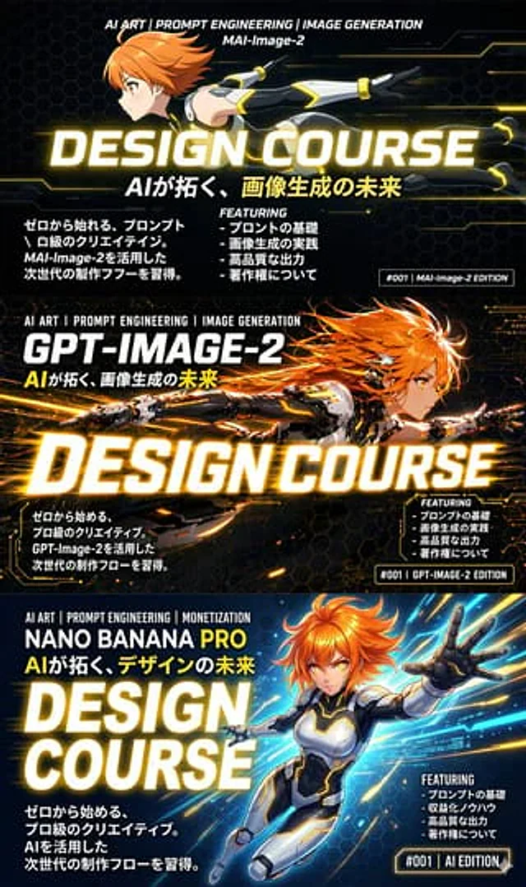

```text
{
  "type": "3 vertical promotional information charts",
  "theme": "Sci-fi anime characters showcasing different AI models",
  "global_elements": {
    "character_base": {
      "gender": "woman",
      "hair": "{argument name=\"character hair color\" default=\"orange color\"}",
      "attire": "Futuristic Sci-Fi Bodysuit"
    },
    "main_typography": "{argument name=\"main title\" default=\"Design Courses\"}",
    "subtitle_typography": "{argument name=\"japanese subtitle\" default=\"AI opens up the future of image generation.\"}"
  },
  "layout": {
    "structure": "3 stacked horizontal panels",
    "panels": [
      {
        "position": "top",
        "model_name": "{argument name=\"top model name\" default=\"MAI-Image-2\"}",
        "art_style": "Flat anime-style shadows, clean lines, minimalist sci-fi background.",
        "character_pose": "fly horizontally to the left",
        "text_elements": {
          "header": "AI Art | Prompt Word Engineering | Image Generation",
          "left_paragraph": "4 lines of Japanese text about starting from zero",
          "featuring_list": {
            "title": "Contents",
            "count": 4,
            "items": [
              "- The basics of Pronto",
              "- Practical application of image generation",
              "- High-quality output",
              "- About copyright"
            ]
          },
          "tag": "#001 | MAI-Image-2 version"
        }
      },
      {
        "position": "Central",
        "model_name": "{argument name=\"middle model name\" default=\"GPT-IMAGE-2\"}",
        "art_style": "High level of detail, glowing particles, intense lighting effects, and complex mecha elements.",
        "character_pose": "Fly horizontally to the right",
        "text_elements": {
          "header": "AI Art | Prompt Word Engineering | Image Generation",
          "left_paragraph": "4 lines of Japanese text about professional-level creative work",
          "featuring_list": {
            "title": "Contents",
            "count": 4,
            "items": [
              "- Prompt Basics",
              "- Practical application of image generation",
              "- High-quality output",
              "- About copyright"
            ]
          },
          "tag": "#001 | GPT-IMAGE-2 version"
        }
      },
      {
        "position": "bottom",
        "model_name": "NANO BANANA PRO",
        "art_style": "Dynamic perspective, bright blue energy background, vibrant colors",
        "character_pose": "Flying towards the audience, with its left hand outstretched",
        "text_elements": {
          "header": "AI Art | Prompt Word Engineering | Monetization",
          "subtitle": "AI will open up the future of design.",
          "left_paragraph": "5 lines of Japanese text about next-generation workflows",
          "featuring_list": {
            "title": "Contents",
            "count": 4,
            "items": [
              "- Prompt Basics",
              "- Monetization know-how",
              "- High-quality output",
              "- About copyright"
            ]
          },
          "tag": "#001 | AI Version"
        }
      }
    ]
  }
}
```

Model: GPT Image 2
Author: GPT Image 2 Prompts

[ProjectD](https://aitoolsradar.com/en/prompts/df79cf7d3b9208) · [Recorded source](https://x.com/old_pgmrs_will/status/2044356515751231527#reversed-0)
 · [Full original metadata and byte evidence](data/projectd-batch-0017.json)

## 3-Panel Duct Tape Meme Comic

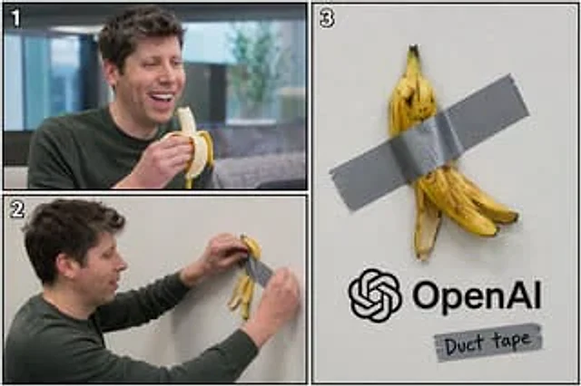

```text
{
  "type": "3-panel comic layout",
  "subject": "{argument name=\"subject\" default=\"Sam Altman\"}",
  "object": "{argument name=\"object\" default=\"banana\"}",
  "layout": {
    "structure": "The left side is divided into two horizontal sections, while the right side is a large vertical panel.",
    "panels": [
      {
        "number": "1",
        "position": "Top left",
        "description": "The subject is happily eating an object while laughing in an office environment."
      },
      {
        "number": "2",
        "position": "Bottom left",
        "description": "The main body is shown in profile, with a strip of silver tape used to attach the fruit peel to a pure white wall."
      },
      {
        "number": "3",
        "position": "right half",
        "description": "A close-up of an object's peel taped to a white wall. Below is {argument name=\"company logo\" default=\"OpenAI\"} The logo and text. Below the logo is another piece of tape with the handwritten words \"...\"{argument name=\"tape text\" default=\"Duct tape\"} The word \"\"."
      }
    ]
  }
}
```

Model: GPT Image 2
Author: GPT Image 2 Prompts

[ProjectD](https://aitoolsradar.com/en/prompts/b251359d420335) · [Recorded source](https://x.com/ian_kim58307/status/2044603116415521201#reversed-0)
 · [Full original metadata and byte evidence](data/projectd-batch-0017.json)

## 35mm Flash Editorial Portrait


```text
35mm color film photography with harsh direct on-camera flash, specular highlights on skin and clothing, strong catchlights in eyes, high contrast flash illumination, authentic film grain and color shift, high fashion fresh innocent basketball court editorial style, intimate first-person low-angle POV shot from below, early 20s sexy Chinese female idol with ultra-realistic delicate refined Chinese features, seductive almond-shaped fox eyes with natural double eyelids, high nose bridge, small sharp V-shaped jawline, flawless realistic porcelain skin with cool ivory undertone and visible flash specular highlights, fine delicate skin texture with subtle pores micro details and natural dewy glow under flash, fresh natural sporty makeup with soft dewy glow, subtle natural flush on cheeks, natural pink lips slightly parted, subtle natural freckles across nose and cheeks, long dark brown hair tied in a high playful ponytail with some loose strands framing the face and realistic loose strands, wearing a loose white tank top and white high-waisted basketball shorts, white knee-high sports socks, seductive natural leaning pose against the basketball hoop pole on the outdoor court at dusk, body angled sideways with naturally arched back and hips gently pushed back to accentuate perky round hips and sexy butt curve, one leg naturally extended forward toward the camera and the other leg slightly bent to emphasize long sexy legs, both hands lightly resting on the basketball pole at shoulder height, intensely seductive playful yet pitiable doe-eyed gaze straight at the viewer with soft vulnerable longing eyes and a gentle teasing smile full of quiet temptation and desire, harsh direct on-camera flash creating sharp specular highlights and strong catchlights, background with blurred basketball court and hoop under dusk sky, high contrast film color grading with natural flash look, extremely sharp yet soft skin rendering with authentic 35mm direct flash aesthetic, natural hair strands, realistic fabric texture on tank top and shorts with socks detail, no plastic skin, no digital over-sharpening, no airbrushing, no blemishes, no moles, no oily skin, no watermark, no text, authentic 35mm direct flash film basketball court look --ar 9:16
```

Model: GPT Image 2
Author: @BubbleBrain

[ProjectD](https://aitoolsradar.com/en/prompts/021bf1904df107) · [Recorded source](https://x.com/BubbleBrain/status/2045052982728016131)
 · [Full original metadata and byte evidence](data/projectd-batch-0017.json)

## 360 AI Art Gallery Panorama

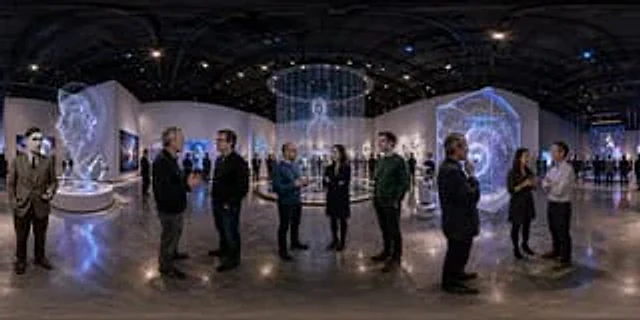

```text
An ultrawide 360-degree isometric cylindrical panoramic view showcases a futuristic contemporary art gallery exhibition on artificial intelligence, designed specifically for immersive VR viewing. The scene is situated within a vast, dark-ceilinged museum lobby, complete with exposed rigging, numerous small spotlights, polished reflective concrete floors, and a continuous, curved white exhibition wall that winds around the entire panorama. The environment is filled with…{argument name="visitor count" default="Approximately 25 people"} Adult visitors, dressed in business casual attire, stand in small groups throughout the room, their facial details blurred or indistinct. At the very center of the panoramic view is a circular platform with a tall, semi-transparent holographic human figure composed of white luminous particles and vertical beams of light, suspended beneath a massive circular ceiling ring. To the left, a white robotic arm sculpture sits on a circular pedestal against a backdrop of a large wall artwork depicting a profile of a human head composed of particles and constellation-like dots. The walls contain a total of six visible AI-themed artworks: a large mural of a particle-like human head, three framed images of cosmic nebulae or galaxies, a large monochrome abstract painting, and a tall, colorful, starry-sky-like digital artwork in the distance to the right. In the foreground on the right, a large transparent cube installation contains projections of spiral galaxies in blue, purple, and white. Additionally, two small white service robots are placed in the right-hand area of ​​the floor. The lighting has a cinematic quality and a cool tone, with the blue, purple, and white light emitted by the installation contrasting with the dark ceiling and the neutral gallery architecture. The atmosphere is stylish, upscale, intellectual, and technologically advanced, reminiscent of an AI biennial or a high-end digital art fair. Rendered with photorealistic detail, it boasts clear architectural details, lifelike reflections, natural proportions, and a seamless 360-degree panoramic distortion suitable for isometric cylindrical projection images.
```

Model: GPT Image 2
Author: GPT Image 2 Prompts

[ProjectD](https://aitoolsradar.com/en/prompts/ac25f7d5dde535) · [Recorded source](https://x.com/jabenitoes/status/2046910561301016578#reversed-0)
 · [Full original metadata and byte evidence](data/projectd-batch-0017.json)

## 360 Degree Panoramic Image Template

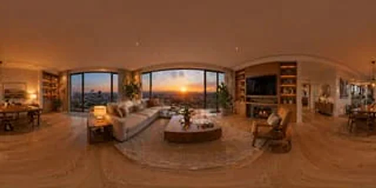

```text
360-degree equidistant cylindrical projection image, the content of which is{argument name="scene" default="Comfortable mountain cabins in winter"} Photorealistic
```

Model: GPT Image 2
Author: GPT Image 2 Prompts

[ProjectD](https://aitoolsradar.com/en/prompts/077a0f5b86e956) · [Recorded source](https://x.com/lupapixel/status/2046770977086808547)
 · [Full original metadata and byte evidence](data/projectd-batch-0017.json)

## 360-Degree Forest World Panorama Grid

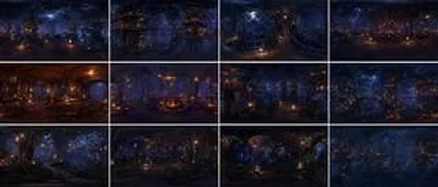

```text
{argument name="grid layout" default="12-sided grid (4x3)"} Each panel is the same continuous{argument name="environment" default="Forest World"} Each independent, complete, isometric cylindrical 360° panoramic view panel = a complete spherical environment (360° horizontal, 180° vertical). Realistic isometric cylindrical projection with natural distortion: edge stretching, horizon curvature, and vertical compression towards the zenith and nadir. Strict global consistency between panels: identical forest biomes, architectural language, materials, lighting logic, proportions, and color palette; no visual bias. Cinematic realism, real-scene shooting quality, physically accurate rendering of natural light, realistic exposure, subtle lens response, cinematic dynamic range. Ultra-fine environment, solid material response (wood, moss, fabric, stone), realistic imperfections, and microscopic detail variations. Large-scale forest environment, integrating massive vertical structures into the trees. Multi-layered platforms, bridges, embedded interior spaces, and organic architectural logic. Lighting: Natural light sources only (lanterns, windows, bioluminescence). Soft volumetric fog interacts with beams; physically correct attenuation, no excessive halo, no artificial flooding. Balanced contrast, cinematic highlights, and deep yet clear shadows. Rich atmospheric perspective, layered depth, subtle particle effects, natural haze, humidity, soft diffusion. Camera (important): Each panel = fixed center capture point of a spherical camera. True 360° capture, no composition, no perspective bias, no cropped view, but with subtle real-world camera characteristics: slight lens softening at the edges, gentle exposure adaptation, natural highlight falloff. Each panel represents a different location within the same world: canopy height, bridge mid-levels, interior spaces, vertical forest clearings, forest ground transitions. There is a continuous spatial logic between panels. The observer is always at the center of the environment. The environment is fully presented in all directions: above (canopy, sky gaps, light sources) and below (structure, root system, depth layers). Color:{argument name="color scheme" default="A deep indigo nighttime color scheme, warm amber lighting, and restrained violet accents."} Cinematic color grading, natural color separation, no oversaturation style: cinematic spherical realism, VR-ready environment, physically consistent world-class high-end film production quality, unstylized, non-game-like, unlabeled, text-free, and number-free.
```

Model: GPT Image 2
Author: GPT Image 2 Prompts

[ProjectD](https://aitoolsradar.com/en/prompts/14cffa163ab75f) · [Recorded source](https://x.com/aimikoda/status/2047436948235583703)
 · [Full original metadata and byte evidence](data/projectd-batch-0017.json)

## 360-Degree Panorama Generation Formula

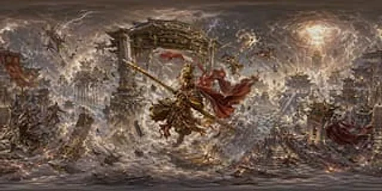

```text
Create a 360-degree panoramic image+{argument name="scene description" default="[Please enter a scene description]"}
```

Model: GPT Image 2
Author: GPT Image 2 Prompts

[ProjectD](https://aitoolsradar.com/en/prompts/e3db73f9a1ac78) · [Recorded source](https://x.com/HDDksyx/status/2046938387547034082)
 · [Full original metadata and byte evidence](data/projectd-batch-0017.json)

## 360-Degree Panoramic Photography Prompt


```text
360-degree panoramic photos, equidistant cylindrical projections, and natural perspective from the human eye create an immersive experience, allowing you to look around as if you were actually there. The realistic panoramic composition seamlessly connects the entire space. The photorealistic rendering has a tactile quality.{argument name="scene description" default="[The photo or image you want to create]"} Unprocessed natural beauty, realistic photographs, photorealistic quality, delicate texture, natural light, ultra-detailed, immersive 360-degree panoramic photography.
```

Model: GPT Image 2
Author: GPT Image 2 Prompts

[ProjectD](https://aitoolsradar.com/en/prompts/cfb0ef9c0d457f) · [Recorded source](https://x.com/midori_tatsuta/status/2047421186712461399)
 · [Full original metadata and byte evidence](data/projectd-batch-0017.json)

## 3D Abstract Data Pipeline Visualization

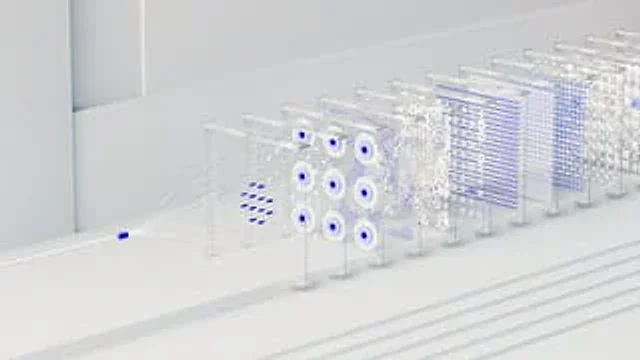

```text
A clean, minimalist 3D rendering that visualizes {argument name="concept" default="Neural Network Data Processing Pipeline"} On the left, a light-emitting {argument name="accent color" default="blue"} The pointed white cable branches into multiple thin, curved white bundles. These bundles converge into a linear sequence of 10 transparent, glass-like rectangular panels, which stand vertically {argument name="environment" default="sterile white stepped surface"} Above. Each glass panel uses white and {argument name="accent color" default="blue"} The geometric patterns showcase different transition stages. From left to right, the panel sequentially presents: floating short horizontal lines, a 3x3 concentric circle grid, a dense dot matrix, scattered white pixel blocks, horizontal dashed lines, a fine grid, and finally a 3D cube structure. The bright, soft, and high-key lighting creates a pure corporate technological aesthetic, while the shallow depth-of-field effect gives the panels at the farthest point a soft, blurred appearance.
```

Model: GPT Image 2
Author: GPT Image 2 Prompts

[ProjectD](https://aitoolsradar.com/en/prompts/f17cc6897b8fac) · [Recorded source](https://x.com/kiyo_ai_allin/status/2043820434223968479#reversed-0)
 · [Full original metadata and byte evidence](data/projectd-batch-0017.json)

## 3D Animated Animal Office Encounter


```text
A high-quality 3D animated film shot, in which a {argument name="left character" default="Black and white tuxedo cat police officer"} Extending a white-gloved hand, ready to meet a tall woman {argument name="right character" default="Fashionable anthropomorphic blonde fox"} A handshake. The fox, a wicked smile playing on his lips, one hand in his pocket, dressed {argument name="fox outfit" default="Wearing a white T-shirt under a light blue cardigan, white trousers, and a gold necklace."} They stood in a modern, luxurious office lobby. On the left wall, a metallic 3D star-shaped logo read {argument name="company name" default="Paw Star ENTERTAINMENT"} Below is a stylish reception area. The background features a black leather sofa, potted plants, and wall decorations, including {argument name="background decor" default="Three framed gold records and two framed posters featuring fox images."} The visuals showcase detailed fur textures, realistic clothing materials, and the soft, professional studio lighting commonly found in modern animated feature films.
```

Model: GPT Image 2
Author: GPT Image 2 Prompts

[ProjectD](https://aitoolsradar.com/en/prompts/af1a48683bb065) · [Recorded source](https://x.com/KyloRenBB9E/status/2045210914358702562#reversed-0)
 · [Full original metadata and byte evidence](data/projectd-batch-0017.json)

## 3D Animated Character Expression Grid

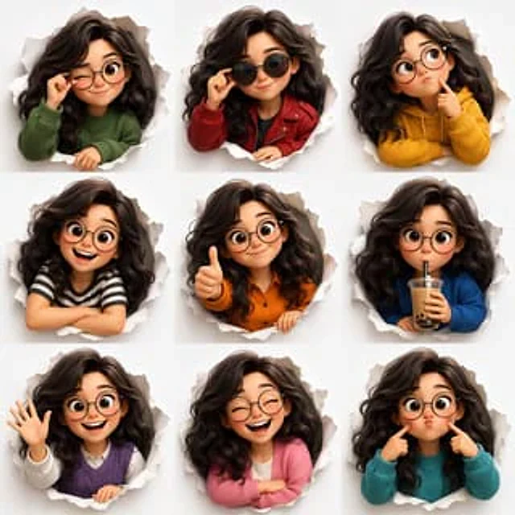

```text
{
  "type": "3x3 character facial expressions grid",
  "style": "{argument name=\"art style\" default=\"3D animation, Pixar style\"}",
  "character_base": "{argument name=\"character description\" default=\"A young woman with voluminous dark wavy hair and wearing round, thin-rimmed glasses\"}",
  "common_theme": "{argument name=\"framing concept\" default=\"Peeking through the torn holes in the white paper\"}",
  "layout": {
    "rows": 3,
    "columns": 3,
    "total_panels": 9,
    "panels": [
      {
        "position": "Top left",
        "expression": "blink",
        "action": "Adjusting glasses",
        "outfit": "green sweater"
      },
      {
        "position": "Upper-middle",
        "expression": "evil smile",
        "action": "Pull down dark sunglasses",
        "outfit": "Red leather jacket"
      },
      {
        "position": "Top right",
        "expression": "think",
        "action": "fingers pressed against chin",
        "outfit": "yellow hoodie"
      },
      {
        "position": "Left and Middle",
        "expression": "laughing out loud",
        "action": "Arms resting on the edge",
        "outfit": "Black and white striped shirt"
      },
      {
        "position": "middle",
        "expression": "Smile",
        "action": "thumbs up",
        "outfit": "orange shirt"
      },
      {
        "position": "Right Center",
        "expression": "neutral",
        "action": "Drinking bubble tea",
        "outfit": "blue sweater"
      },
      {
        "position": "Bottom left",
        "expression": "happy",
        "action": "wave",
        "outfit": "A white shirt layered under a purple sweater vest"
      },
      {
        "position": "Middle to lower",
        "expression": "Laughing with eyes closed",
        "action": "crossed arms",
        "outfit": "pink cardigan"
      },
      {
        "position": "Bottom right",
        "expression": "funny",
        "action": "poking cheeks",
        "outfit": "blue sweater"
      }
    ]
  }
}
```

Model: GPT Image 2
Author: GPT Image 2 Prompts

[ProjectD](https://aitoolsradar.com/en/prompts/874199c6453d0e) · [Recorded source](https://x.com/austinit/status/2046025895941750868#reversed-0)
 · [Full original metadata and byte evidence](data/projectd-batch-0017.json)

## 3D Animated Tourism Infographic Poster

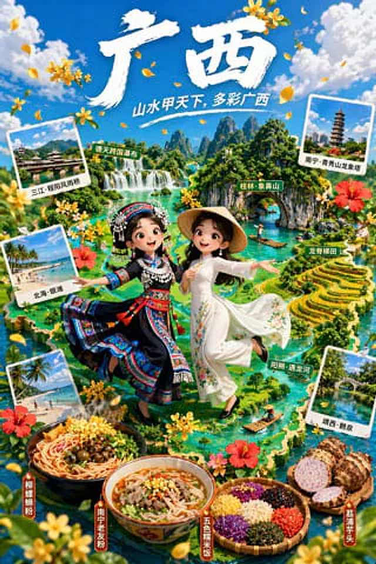

```text
{
  "type": "3D animated style tourism promotional poster",
  "typography": {
    "main_title": "{argument name=\"main title\" default=\"Guangxi\"}",
    "subtitle": "{argument name=\"subtitle\" default=\"Guangxi boasts unparalleled natural beauty and is a place of vibrant diversity.\"}"
  },
  "characters": [
    {
      "position": "Left center",
      "description": "3D animated girl with a joyful expression",
      "outfit": "{argument name=\"left character outfit\" default=\"Traditional ethnic minority costumes with silver headdresses\"}"
    },
    {
      "position": "Right center",
      "description": "3D animated girl with a joyful expression",
      "outfit": "{argument name=\"right character outfit\" default=\"White traditional clothing with conical hat\"}"
    }
  ],
  "background": {
    "theme": "{argument name=\"region theme\" default=\"Karst landforms and rivers in Guangxi\"}",
    "style": "Lush 3D isometric map",
    "map_labels": [
      "Detian Transnational Waterfall",
      "Guilin Elephant Trunk Hill",
      "Longji Rice Terraces",
      "Yangshuo·Yulong River"
    ]
  },
  "layout": {
    "polaroid_photos": {
      "count": 4,
      "items": [
        {
          "position": "Top left",
          "label": "Sanjiang Chengyang Wind and Rain Bridge",
          "scene": "Traditional Wind and Rain Bridge"
        },
        {
          "position": "Left and Middle",
          "label": "North Sea, Silver Bund",
          "scene": "tropical beach"
        },
        {
          "position": "Bottom left",
          "label": "North Sea, Silver Bund",
          "scene": "tropical beach"
        },
        {
          "position": "Bottom right",
          "label": "Jingxi·Equan",
          "scene": "Stone arch bridge over water"
        }
      ]
    },
    "food_showcase": {
      "position": "Bottom Foreground",
      "count": 4,
      "items": [
        {
          "label": "Liuzhou snail rice noodles",
          "description": "A bowl of spicy snail rice noodles"
        },
        {
          "label": "Nanning Lao You Fen",
          "description": "A bowl of rice noodles with sliced ​​meat broth"
        },
        {
          "label": "Five-color glutinous rice",
          "description": "Five-colored glutinous rice in a bamboo basket"
        },
        {
          "label": "Lipu Taro",
          "description": "Whole and cut taro"
        }
      ]
    },
    "decorations": "Scattered yellow osmanthus and red hibiscus flowers"
  }
}
```

Model: GPT Image 2
Author: GPT Image 2 Prompts

[ProjectD](https://aitoolsradar.com/en/prompts/6e6411d5118539) · [Recorded source](https://x.com/joshesye/status/2044776883049451619#reversed-2)
 · [Full original metadata and byte evidence](data/projectd-batch-0017.json)

## 3D Anime RPG Gameplay Screen


```text
このキャラが登場する存在しない今風の{argument name="スタイル" default="都市型3Dアニメ調"}オープンワールドRPGの実プレイ画面を生成して。高品質なセルルック3Dキャラ、{argument name="舞台" default="現代都市の街並み"}、ミニマップ、クエスト表示、会話字幕、日本語UI。
```

Model: GPT Image 2
Author: Anirole

[ProjectD](https://aitoolsradar.com/en/prompts/a0a19957735a8c) · [Recorded source](https://youmind.com/prompts/3d-anime-rpg-gameplay-ui-19073)
 · [Full original metadata and byte evidence](data/projectd-batch-0017.json)

## 3D Anime RPG Gameplay Screenshot


```text
存在しない今風の都市型3Dアニメ調オープンワールドRPGの実プレイ画面を生成して。舞台は、{argument name="場所" default="高級ラウンジ風の社交場"}。温かい照明のバーやソファ席が見える店内。メインヒロインが{argument name="衣装" default="可愛い接客衣装と仕草"}で接客している会話イベントシーン。周囲に別のキャストたちも自然に配置し、華やかで落ち着いた大人の空気感を出す。

キャラクターは高精細イラストではなく、近年の{argument name="ゲームスタイル" default="美少女3Dゲーム"}のイベントシーンのようなセルルック3Dキャラクターモデルにし、丸みのある顔、シンプルな肌陰影、柔らかい髪束、少しプラスチック感のある綺麗な3Dモデル質感にする。

ゲーム画面として、下部に日本語の会話字幕ウィンドウ、キャラ名表示、選択肢UI、右上に所持金や好感度のようなステータスUI、画面端にスキップ・ログ表示などの操作UIを入れる。セリフと選択肢はリアリティのある、可愛くてキモい感じにしてください。宣伝絵ではなく実際のゲームプレイ中スクリーンショットのような画面にする。全体として、洗練された今風の3Dアニメ調ゲームらしい、癒やし・ときめき・少し大人っぽい華やかさを重視する。
```

Model: GPT Image 2
Author: Anirole

[ProjectD](https://aitoolsradar.com/en/prompts/c2f154e2fef22b) · [Recorded source](https://youmind.com/prompts/3d-anime-rpg-gameplay-screenshot-19474)
 · [Full original metadata and byte evidence](data/projectd-batch-0017.json)

## 3D Anime Visual Novel Game Cover

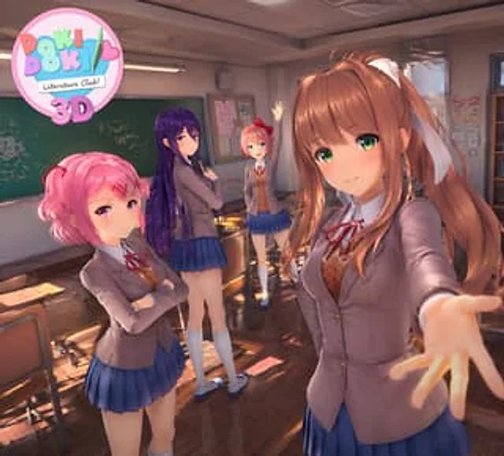

```text
A 3D anime-style illustration depicts four high school girls in a Japanese classroom, bathed in {argument name="lighting" default="warm afternoon sun"} Below. In the foreground on the right, there is a person who {argument name="foreground right character hair" default="A long coral brown ponytail tied with a white bow"} A girl with green eyes extends her hand to the audience with a warm smile. In the foreground on the left, a girl with {argument name="foreground left character hair" default="Pink short hair with red hair clip"} A girl with pink eyes stands with her arms crossed, her expression slightly troubled. In the mid-ground, a girl with long, dark purple hair stands calmly holding a book; while in the background, a girl with short, coral pink hair and a red bow is waving happily. All four girls are wearing matching school uniforms, including {argument name="uniform style" default="Grey suit jacket, brown knitted vest, red ribbon and blue pleated skirt"} The classroom has wooden floors, desks, and a green blackboard. In the upper left corner is a circular logo with a pink border, containing the stylized text "..."{argument name="logo text" default="DOKI DOKI Literature Club!"} Below is a large pink "3D" lettering, decorated with a green pencil and a pink heart. The entire image has a high-quality 3D rendering aesthetic, similar to video game promotional art with soft lighting and depth effects.
```

Model: GPT Image 2
Author: GPT Image 2 Prompts

[ProjectD](https://aitoolsradar.com/en/prompts/80ceda0ae4da3c) · [Recorded source](https://x.com/mirochill/status/2043614837914169803#reversed-1)
 · [Full original metadata and byte evidence](data/projectd-batch-0017.json)

## 3D Caricature Companion Effect


```text
Create a premium high-quality {argument name="style" default="3D caricature companion"} of the person in the reference image while keeping the original realistic person fully present and untouched. The realistic person must remain photorealistic, highly detailed and faithful to the original photo. Create a stylized 3D caricature version of the SAME person standing beside them. Preserve the same: outfit, hairstyle, accessories, fashion styling, identity, facial resemblance, attitude and vibe.The caricature must have: large expressive eyes, slightly oversized head, smooth cinematic skin, {argument name="animation style" default="Pixar/Disney-inspired premium 3D styling"}, smaller body proportions, but still look fashionable and recognizable, NOT childish, toy-like or baby-sized.IMPORTANT: The caricature height should be approximately {argument name="size" default="shoulder to ear level"} of the real person, never tiny or child-sized. The caricature and real person must be physically and emotionally interacting naturally. Examples of interaction: holding hands, looking at each other, walking together, sharing an object, leaning, playful pose, touching shoulder, mirroring pose, reacting to each other, casual chemistry, candid companionship. The caricature should feel like a living animated version of the same person existing in the same world. Preserve original scene, lighting and perspective whenever possible. Professional photography composition, cinematic lighting, realistic shadows, luxury editorial realism mixed with premium stylized 3D animation. No tiny companion, no side mascot, no disconnected pose, no separate standing character, no toy proportions, no plastic doll look, no replacing the original person.
```

Model: GPT Image 2
Author: Nexora

[ProjectD](https://aitoolsradar.com/en/prompts/098aa1d5d6fbe5) · [Recorded source](https://youmind.com/prompts/3d-caricature-companion-effect-25354)
 · [Full original metadata and byte evidence](data/projectd-batch-0017.json)

## 3D Cartoon Character Render


```text
High-quality 3D CGI rendering, the main character is{argument name="character" default="[character]"} Featuring a charming cartoon style with half-body portrait compositions, the highly stylized cartoon characters possess exaggerated yet vivid features that are both playful and humorous. Smooth, refined rendering effects, combined with clean materials and soft ambient lighting, create delicate shadows. Dynamic camera angles provide a stylish perspective. The overall aesthetic is minimalist and bright.{argument name="background color" default="[color]"} The background enhances the character's presence. Professional Pixar-level quality, with a glossy finish and a pleasant ambiance.
```

Model: GPT Image 2
Author: GPT Image 2 Prompts

[ProjectD](https://aitoolsradar.com/en/prompts/3b1345fb7ba255) · [Recorded source](https://x.com/Inshrah_ali_/status/2048121503367995753)
 · [Full original metadata and byte evidence](data/projectd-batch-0017.json)

## 3D CG Oriental Fantasy Character Portrait


```text
9:16 竖版，高精度 3D CG {argument name="角色类型" default="东方幻想女性"}角色写真，画面主体是一位明确成年的年轻东方幻想系女性，视觉年龄约 20–24 岁，整体气质灵动、甜美、俏皮、轻盈、梦幻，带有春日樱花氛围与精致游戏角色写真感。整体不是平面插画，而是高完成度 3D CG 角色渲染。人物拥有精致甜美的东方幻想美少女脸，瞳色为浅琥珀棕与暖金调混合。发型为高饱和{argument name="发色" default="蓝色"}长发，发尾蓬松灵动。服装为高精度 3D CG 东方幻想轻华丽服饰，具有丝缎、轻纱与刺绣混合质感。背景调整为精致唯美的东方幻想{argument name="背景" default="春日花道"}场景，浅粉樱花盛开。high detail 3D CG render, Unreal Engine quality, Octane render look, cinematic lighting, PBR materials, subsurface scattering skin, realistic hair strands, delicate fantasy costume, glossy fabric, metallic accessories, elegant oriental fantasy styling, cherry blossom atmosphere, volumetric light, cinematic depth of field, soft bloom, ultra detailed, polished anime realism, premium virtual character portrait
```

Model: GPT Image 2
Author: 李岳

[ProjectD](https://aitoolsradar.com/en/prompts/332c4e3d95f134) · [Recorded source](https://youmind.com/prompts/3d-oriental-fantasy-character-render-24461)
 · [Full original metadata and byte evidence](data/projectd-batch-0017.json)

## 3D Chinese Historical Figure Archive Poster

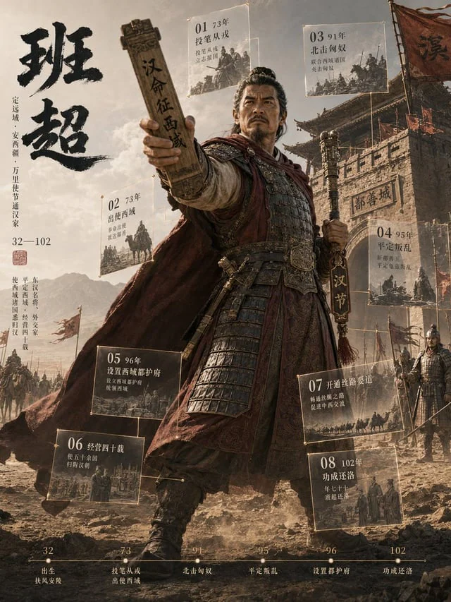

```text
Goal: Create a cinematic vertical historical figure archive poster about {argument name="character name" default="班超"}, showing a heroic ancient Chinese frontier general breaking out of a documentary-style infographic layout.

Canvas: Vertical 3:4 poster, 768 x 1024 feel, sepia-gold and smoky gray historical palette, dramatic backlight, dust, battlefield haze, high-detail 3D realism mixed with museum exhibition graphics.

Main subject: One full-body ancient Chinese armored commander stands in the center foreground, low-angle heroic composition. He wears layered dark lamellar armor, engraved belt plates, leather boots, red-brown cloak blowing leftward, and a stern dignified expression. His left arm thrusts forward toward the viewer holding a tall wooden command tablet engraved with Chinese calligraphy; his right hand holds a vertical staff or ceremonial standard with a tassel and Chinese characters. Make the figure feel three-dimensional, as if stepping out of the flat poster frame.

Background: Ancient Western Regions frontier setting with rocky desert ground, mountains in the distance, mounted soldiers and caravan silhouettes on the left, and a large fortified city gate on the right with banners, scaffolding, guards, and the gate plaque reading in Chinese. Add a large weathered war banner in the upper right. The atmosphere should suggest expedition, diplomacy, military command, and westward expansion.

Left typography block: Place very large black brush-calligraphy title text {argument name="main title text" default="班超"} vertically on the upper left. Beneath it, add smaller vertical Chinese biographical text describing birthplace, role, and lifespan, including the years 32—102. Add a small red seal stamp below the biographical block.

Floating archive cards: Add exactly 8 translucent glass-like historical event cards around the character, each with thin gold borders, tiny corner rivets, Chinese text, and monochrome documentary mini-illustrations. Count and place them as follows: 1) top center card, labeled 01 and 73, about joining the army after abandoning the brush; 2) left-middle card, labeled 02 and 73, about mission to the Western Regions; 3) top right card, labeled 03 and 91, about pacifying the northern Xiongnu; 4) right-middle card, labeled 04 and 95, about suppressing rebellion; 5) lower-left-middle card, labeled 05 and 96, about establishing the Protectorate of the Western Regions; 6) bottom-left card, labeled 06, about governing for forty years and uniting many states; 7) lower-right-middle card, labeled 07, about opening the Silk Road; 8) bottom-right card, labeled 08 and 102, about returning to Luoyang in old age. Each card should include a small faded illustration of cavalry, officials, soldiers, maps, or caravans.

Bottom timeline: Add exactly 6 timeline milestones along the bottom edge with a thin gold horizontal line, small dots, and Chinese labels: 32 birth, 73 joining army and mission west, 91 northern Xiongnu, 95 suppressing rebellion, 96 setting up the Protectorate, 102 successful return to Luoyang. Keep the timeline legible but secondary.

Visual style: Epic Chinese historical 3D poster, ultra-detailed armor textures, cinematic volumetric lighting, dust particles, depth of field, parchment-like overlays, museum archive infographic design, gold linework, realistic fabric motion, dramatic perspective.

Constraints: Use exactly one central historical figure, exactly 8 floating event cards, and exactly 6 bottom timeline milestones. Keep all visible text in Chinese calligraphy or Chinese serif style, with no English labels in the poster. Avoid modern objects, neon colors, cartoons, watermarks, or extra characters dominating the central figure.
```

Model: GPT Image 2
Author: Larus Canus

[ProjectD](https://aitoolsradar.com/en/prompts/ebea786ca9b390) · [Recorded source](https://youmind.com/prompts/ban-chao-archive-poster-21200)
 · [Full original metadata and byte evidence](data/projectd-batch-0017.json)

## 3D Cinematic Multi-Panel Promo Poster

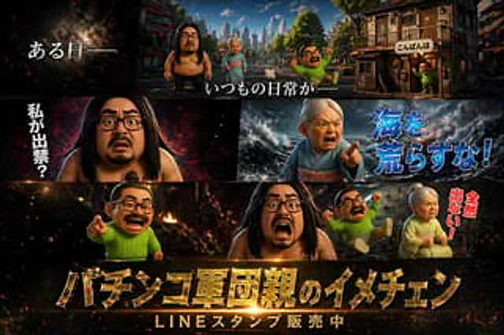

```text
{
  "type": "Cinematic promotional poster",
  "style": "3D CGI animation style, high detail, dramatic lighting and shadows, cartoon characters.",
  "characters": [
    {
      "id": "char1",
      "description": "A burly, shirtless man with long black hair, a beard, and glasses."
    },
    {
      "id": "char2",
      "description": "An elderly woman wearing a kimono and with her white hair tied up."
    },
    {
      "id": "char3",
      "description": "A short man with a topknot, glasses, a beard, and wearing a bright green sweater."
    }
  ],
  "layout": {
    "panels": [
      {
        "position": "top",
        "scene": "A wide-angle shot of town streets, with buildings and the city skyline in the background.",
        "characters_present": [
          "char1",
          "char2",
          "char3"
        ],
        "text_overlays": [
          "{argument name=\"intro text\" default=\"One day...\"}",
          "Everyday life is just like any other --",
          "こんばんは"
        ]
      },
      {
        "position": "center left",
        "scene": "A close-up shot of character 1 against a dark background of firelight, his expression one of shock.",
        "text_overlays": [
          "{argument name=\"shocked text\" default=\"Am I banned?\"}"
        ]
      },
      {
        "position": "center right",
        "scene": "A close-up shot of character 2 against a backdrop of a raging sea; his expression is angry as he points forward.",
        "text_overlays": [
          "{argument name=\"angry text\" default=\"Don&#39;t disturb the sea!\"}"
        ]
      },
      {
        "position": "bottom",
        "scene": "char3 points forward, char1 screams, another char3 falls backward, char2 sits angrily, with chaotic firelight in the background.",
        "text_overlays": [
          "It's not coming out at all!"
        ],
        "bottom_titles": [
          "{argument name=\"main title\" default=\"Pachinko gang&#39;s parents&#39; makeover\"}",
          "{argument name=\"subtitle\" default=\"LINE stickers are now on sale.\"}"
        ]
      }
    ]
  }
}
```

Model: GPT Image 2
Author: GPT Image 2 Prompts

[ProjectD](https://aitoolsradar.com/en/prompts/8ddd3a881277b9) · [Recorded source](https://x.com/X64zzotSKCGtYmt/status/2046238165158240449#reversed-0)
 · [Full original metadata and byte evidence](data/projectd-batch-0017.json)

## 3D E-commerce Livestream Promo Poster


```text
{
  "type": "3D e-commerce live streaming promotional poster",
  "style": "Vibrant purple and gold color scheme, glossy UI elements, neon lights, and a softly blurred studio background.",
  "typography": {
    "header_pill": "Douyin Live",
    "main_title": "{argument name=\"main title\" default=\"During the live stream\"}",
    "subtitle": "{argument name=\"subtitle\" default=\"Welcome to the live stream!\"}",
    "promo_pill": "{argument name=\"promo text\" default=\"Recommended items at more than 50% off\"}"
  },
  "layout": {
    "sections": [
      {
        "title": "feature_cards",
        "position": "middle",
        "count": 3,
        "items": [
          {
            "icon": "Purple price tag",
            "text": "Top brands, genuine products guaranteed."
          },
          {
            "icon": "Red envelope",
            "text": "Many exclusive discounts for live streamers"
          },
          {
            "icon": "Purple gift box",
            "text": "Interactive lucky draws bring endless surprises!"
          }
        ]
      },
      {
        "title": "marquee_sign",
        "position": "Mid-lower part",
        "style": "Neon border with glowing dots, 3D red heart icon",
        "text": "{argument name=\"marquee text\" default=\"Follow the streamer and you won&#39;t get lost.\"}"
      },
      {
        "title": "footer_pill",
        "position": "Centered at the bottom",
        "style": "Illuminated Neon Border",
        "text": "{argument name=\"footer text\" default=\"Follow us and enjoy priority shipping when you place your order.\"}"
      }
    ]
  },
  "scene_elements": {
    "top_corners": "Two inward-facing studio spotlights",
    "bottom_left": "1 Tripod ring light with smartphone integrated",
    "bottom_right": "Three stacked cardboard boxes labeled \"Express Shipping\" and \"Worry-Free After-Sales Service,\" a mini shopping cart, and two purple gift boxes tied with yellow ribbons.",
    "background": "A blurred studio scene with shelves and purple ambient lighting."
  }
}
```

Model: GPT Image 2
Author: GPT Image 2 Prompts

[ProjectD](https://aitoolsradar.com/en/prompts/a343c34cd33b00) · [Recorded source](https://x.com/ChengSir404/status/2044977684426695156#reversed-0)
 · [Full original metadata and byte evidence](data/projectd-batch-0017.json)

## 3D Hair Texture Height Map

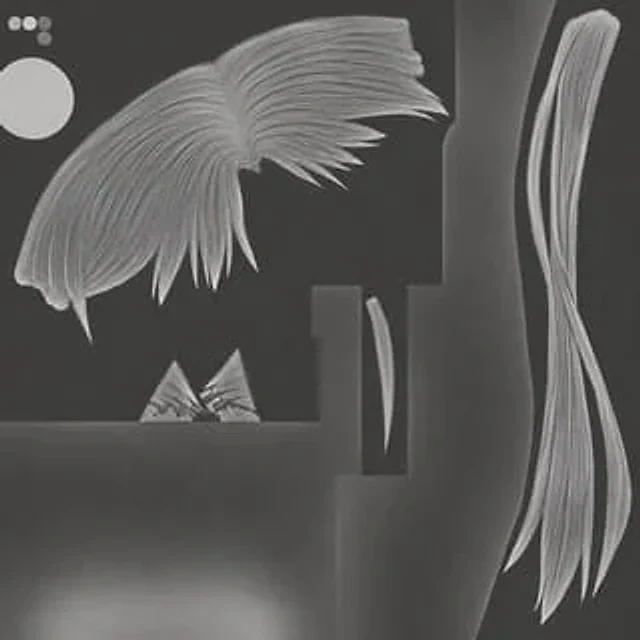

```text
これは{argument name="素材" default="３Dモデルの髪の毛のテクスチャ"}です。これを参照し、元の画像より細かく髪の流れに沿った{argument name="出力形式" default="高さマップ"}を作成してください。
```

Model: GPT Image 2
Author: ビームマンＰ ver40

[ProjectD](https://aitoolsradar.com/en/prompts/8b5b172d808314) · [Recorded source](https://youmind.com/prompts/hair-texture-height-map-generator-19274)
 · [Full original metadata and byte evidence](data/projectd-batch-0017.json)

## 3D Illusion Sketch Portrait

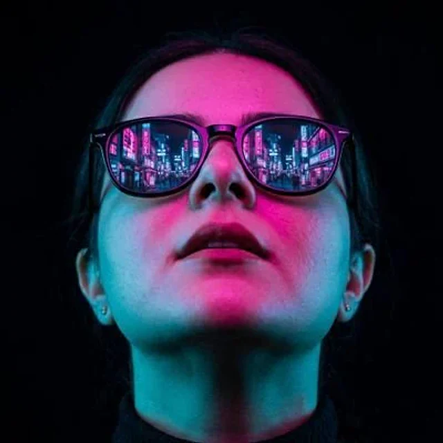

```text
A creative 3D illusion artwork of a {argument name="subject" default="cute young girl"} stepping out of a spiral notebook page placed on a wooden desk. The notebook has lined paper with handwritten text at the top. The girl looks semi-realistic 3D cartoon style, soft wavy hair, natural makeup, sweet smile, wearing a {argument name="clothing" default="pastel modest top and high-waisted light grey jeans"} with white sneakers. Her lower body appears sketched in pencil on the notebook while the upper body looks realistic and popping out of the page.
```

Model: GPT Image 2
Author: Ai Bella

[ProjectD](https://aitoolsradar.com/en/prompts/94d5546ac73a71) · [Recorded source](https://youmind.com/prompts/3d-illusion-sketch-portrait-26876)
 · [Full original metadata and byte evidence](data/projectd-batch-0017.json)

## 3D Luxury Birthday Poster

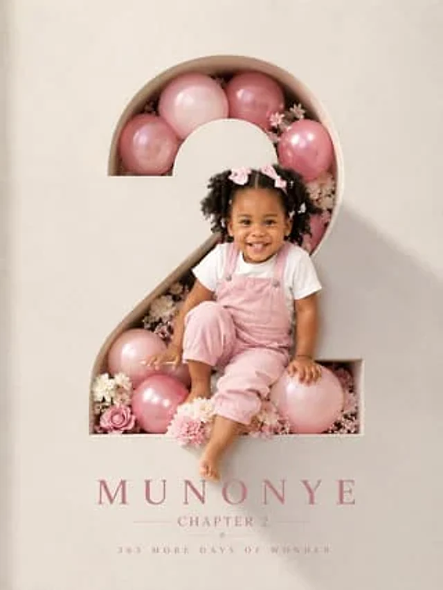

```text
Professional luxury birthday poster, 3:4 ratio. Entire frame filled with a {argument name="wall texture" default="premium off white luxury paper textured wall"}. Large number “{argument name="age" default="2"}” precisely carved in the wall with visible depth and realistic inner shadows. Inside the number: soft pink and pink balloons, subtle white flowers, elegant bouquet arrangement, premium celebration styling. A happy {argument name="child description" default="2 year old child"} with preserved reference facial features, wearing a milky white T shirt and pink denim overalls, laughing naturally. Face, shoulder, one hand and one foot extend outside the number creating a realistic 3D effect. Warm cinematic sunlight from one side, soft rim light, photorealistic skin, premium studio photography, ultra realistic, sharp focus. Typography on wall: {argument name="headline" default="MUNONYE, CHAPTER 2, 365 MORE DAYS OF WONDER"}. Clean minimalist layout, luxury magazine cover aesthetic, high end art direction, realistic shadows, natural colors, no tree shadows, no fake lighting, no AI artifacts.
```

Model: GPT Image 2
Author: Taaruk

[ProjectD](https://aitoolsradar.com/en/prompts/d36e842119876e) · [Recorded source](https://youmind.com/prompts/luxury-3d-birthday-poster-carved-24939)
 · [Full original metadata and byte evidence](data/projectd-batch-0017.json)

## 3D Notebook Illusion Sketch

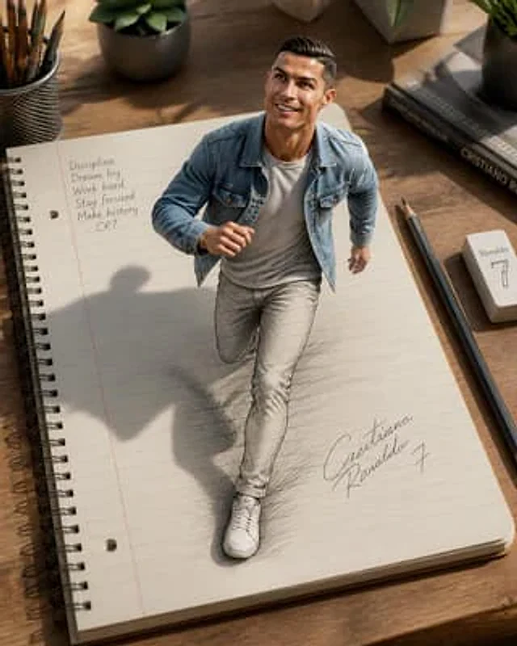

```text
A creative 3D illusion artwork of a {argument name="subject" default="handsome young man"} stepping out of a spiral notebook page placed on a wooden desk. The notebook features lined paper with handwritten notes at the top. The character is designed in a semi-realistic 3D cartoon style with neatly styled dark brown hair, expressive eyes, a confident friendly smile, and subtle realistic facial details. He wears a casual pastel-colored t-shirt, a light denim jacket, slim-fit light grey jeans, and clean white sneakers.

The lower half of his body appears as a detailed pencil sketch drawn directly on the notebook page, while his upper body transforms into a realistic 3D figure emerging from the paper, creating a striking pop-out illusion effect. Intricate graphite shading and sketch lines seamlessly blend into the realistic textures of the 3D character. Warm natural sunlight illuminates the wooden desk, casting soft shadows and enhancing depth. Ultra-detailed, photorealistic mixed-media artwork, realistic notebook textures, cinematic lighting, shallow depth of field, highly creative optical illusion, 8K quality, masterpiece composition.
```

Model: GPT Image 2
Author: Maverick | AI

[ProjectD](https://aitoolsradar.com/en/prompts/07680a1e632811) · [Recorded source](https://youmind.com/prompts/notebook-pop-out-3d-illusion-25913)
 · [Full original metadata and byte evidence](data/projectd-batch-0017.json)

## 3D Packaging to 2D Net Unfolding

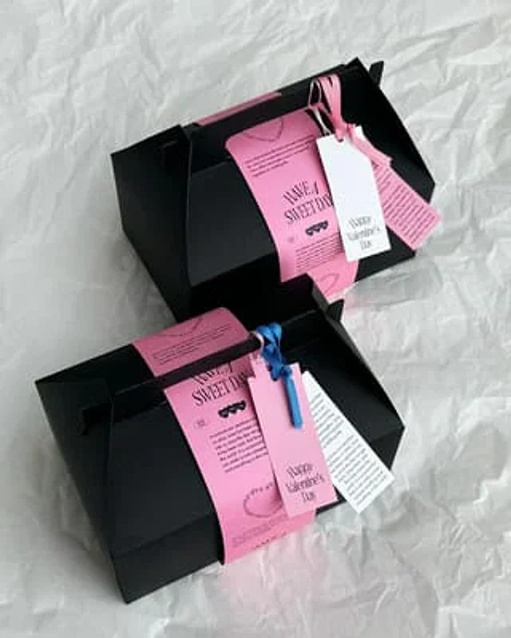

```text
Flatten the 3D packaging into a 2D planar image. Unfold all panels and labels. Use orthographic projection for distortion-free results. Accurately map textures. Add high-contrast die-cut lines.{argument name="background" default="Plain white background"} .
```

Model: GPT Image 2
Author: GPT Image 2 Prompts

[ProjectD](https://aitoolsradar.com/en/prompts/ec7434f55d9838) · [Recorded source](https://x.com/ammiamia_/status/2047370522384846968)
 · [Full original metadata and byte evidence](data/projectd-batch-0017.json)

## 3D Papercut Pirate Scene

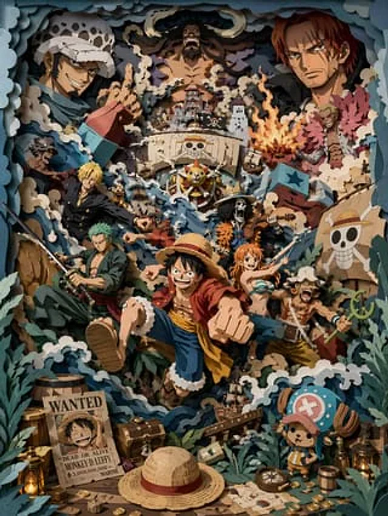

```text
A level-on perspective, directly facing a highly saturated 3D multi-layered paper sculpture scene. The overall color scheme is gray-blue, creamy white, and deep forest green, accented with warm amber light. All elements must be physically layered paper structures, with hard-cut edges and clearly visible thick paper cross-sections. The composition is extremely rich, with {argument name="scene theme" default="Pirate group scene"} The theme is "Immerse yourself in a chaotic sea adventure." Multiple stylized pirate characters perform exaggerated movements, with the middle layer being {argument name="core character" default="The young captain wearing a straw hat"} Charges forward, surrounded by crew members in various poses. Layered ships, surging waves, and whirlpools run through the foreground, midground, and background. Multiple ships collide and tilt at different spatial levels, sails tear, and flags flutter. A large silhouette of an enemy character appears in the background layer to enhance the sense of oppression and spatial depth. The foreground is filled with narrative elements: treasure chests, coins, maps, barrels, ropes, lanterns, and a bounty poster featuring a smiling pirate. A small, mascot-like character is placed in the corner as a visual anchor. All atmospheric elements are presented in a paper-cut style: waves, splashes, smoke, fragments, and moving lines, reinforcing the sense of chaos and dynamism. The main subject is located in the middle layer, with elements interacting across layers, expressing movement through overlap and spatial relationships. Soft light from a single direction creates clear interlayered shadows. The overall finish is matte paper-like, with no glow, no soft edges, and no volumetric lighting. Octane rendering, 8K, clear details --ar 3:4 --stylize 450
```

Model: GPT Image 2
Author: GPT Image 2 Prompts

[ProjectD](https://aitoolsradar.com/en/prompts/fa9e4ce994451b) · [Recorded source](https://x.com/crayon1267/status/2046618693489320005)
 · [Full original metadata and byte evidence](data/projectd-batch-0017.json)

## 3D Perspective Text Effect Prompt


```text
① Scene{argument name="scene description" default="Side of the cross-sea bridge"} A dramatic, cinematic perspective. Huge, bold sans-serif text "___② Text content"{argument name="text content" default="Cross-sea bridge"} "Drawn on ___③ Subject: None, gradually shrinking in perspective from near to far in front of the lens. The lettering conforms to the surface curvature, blending into the surface rather than floating. Part of the text area is ___④ Foreground object: None, obscured, peeking out through gaps to create a sense of depth. "{argument name="text color and style" default="Oversized bright yellow with sharp orange outline"} Extreme perspective distortion and vanishing point alignment. Cinematic lighting and shadows, motion blur, and poster-quality dynamic blending and layout.
```

Model: GPT Image 2
Author: GPT Image 2 Prompts

[ProjectD](https://aitoolsradar.com/en/prompts/8ff81da92c3fa4) · [Recorded source](https://x.com/xpg0970/status/2045560665071579160)
 · [Full original metadata and byte evidence](data/projectd-batch-0017.json)

## 3D Pop-out Polaroid Effect


```text
Generate an image, in which{argument name="subject" default="person"} Located within a Polaroid photograph, the figure appears to be jumping out of the frame. (Contains...){argument name="language" default="Japanese"} Word.
```

Model: GPT Image 2
Author: GPT Image 2 Prompts

[ProjectD](https://aitoolsradar.com/en/prompts/75eb7ce2286e21) · [Recorded source](https://x.com/MajaDesignJP/status/2047235632934928765)
 · [Full original metadata and byte evidence](data/projectd-batch-0017.json)

## 3D Pop-out Polaroid Effect


```text
ポラロイド写真の中に{argument name="被写体" default="人"}が写っていて、その人がフレームから外に飛び出している画像。{argument name="言語" default="日本語"}が書いてある画像生成して
```

Model: GPT Image 2
Author: まーや | 物販LPデザイナー🛒✨

[ProjectD](https://aitoolsradar.com/en/prompts/8fc6bf7a0144f7) · [Recorded source](https://youmind.com/prompts/3d-pop-out-polaroid-15211)
 · [Full original metadata and byte evidence](data/projectd-batch-0017.json)

## 3D Pop-out Profile Page Illustration


```text
Create a hyper-realistic 3D illustration depicting a slightly tilted {argument name="platform" default="Twitter/X"} The profile page features a simple gray background. The original cartoon avatar is retained. The interface must closely resemble a real X screenshot, including a realistic layout, verified badges, follower statistics, a profile banner, and a tweet section. Profile Details: A stylish {argument name="subject" default="young men"} He had short, bushy black hair and fair skin, and emerged from a torn section of paper on the right side of his profile page. He retained his original facial features, but his expression had changed.{argument name="expression" default="A natural and confident smile"} He gripped the edge of the torn paper, sending fragments flying and creating a striking 3D shattered screen effect. Soft studio lighting, cinematic shadows, depth of field, ultra-high detail, sharp focus, realistic skin texture, lifelike UI reflections, sophisticated composition, and 4K resolution blend realism with a delicate Pixar aesthetic. Important Notes: - Do not change the avatar - Maintain accuracy in the X UI - Preserve original facial features - Subject is male - Enhance only the smiling expression - Ensure all Chinese characters are clear and legible
```

Model: GPT Image 2
Author: GPT Image 2 Prompts

[ProjectD](https://aitoolsradar.com/en/prompts/ec734c3a4f43a0) · [Recorded source](https://x.com/GoSailGlobal/status/2046491397424111659)
 · [Full original metadata and byte evidence](data/projectd-batch-0017.json)

## 3D Portrait with Chibi Characters and Doodles

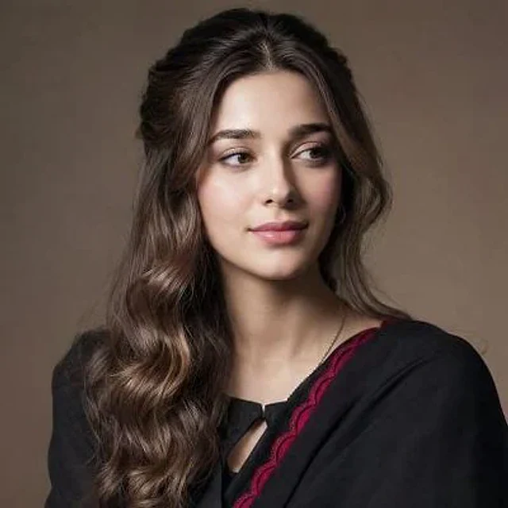

```text
Create a cute 3D portrait in a {argument name="style" default="Cute Stylized 3D Semi-Realistic style"}. Rely completely on the attached reference image for the facial features, clothing, and identity. Do not change anything in the face, hair, or outfit. Main character: Standing full body exactly in the center of the image. Arms crossed with hands inside the pockets. Head slightly raised and looking upward directly at the camera with a natural smile. Camera angle is directly from above – Top-Down Bird’s-eye View, vertically aligned over the head. Both feet fully visible with no cropping. Around the character, distribute 5-6 Mini Chibi versions of the same character in different poses: peace sign, sitting on a cloud, holding a cup, hugging a cat, sitting comfortably, smiling with hands under the face. Background should be clean white. Fill the empty spaces with hand-drawn doodles: stars, clouds, hearts, cats, smiley faces, sparkles. Write inside the background in a handwritten style with different sizes: "{argument name="message" default="Have a nice day!"}", "by {argument name="author name" default="mokaAi"}", "WOW", "COOL", "EEYYY", "You’re amazing!", "LET’S GO!", "Good vibes", "meow" Soft daylight lighting, high detail, professional quality. Aspect ratio: 9:16
```

Model: GPT Image 2
Author: Lariab Fatima‎

[ProjectD](https://aitoolsradar.com/en/prompts/175c685496e065) · [Recorded source](https://youmind.com/prompts/3d-portrait-chibi-doodles-22702)
 · [Full original metadata and byte evidence](data/projectd-batch-0017.json)

## 3D Product Box Dieline Visualization

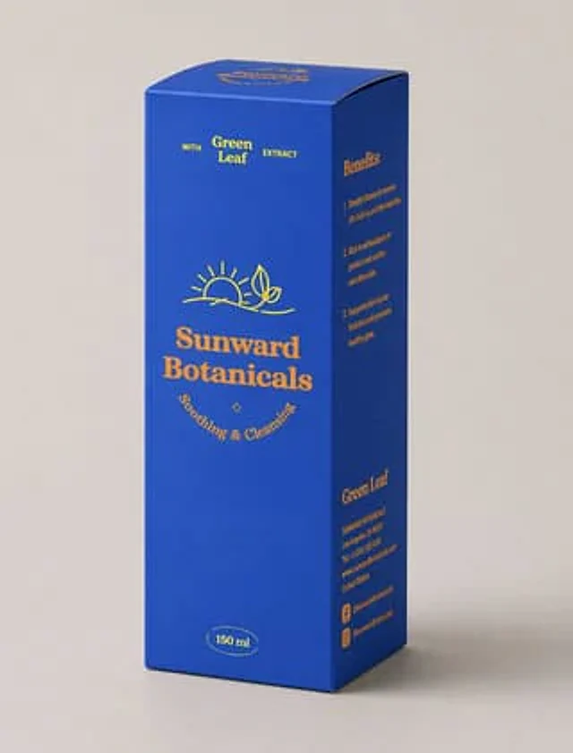

```text
Assemble the die-cut molds into a perfect 3D packaging box, ensuring accurate panels, clear creases, and distortion-free text, while preserving the complete design. Photograph it upright from a refined ¾ angle, placing it {argument name="setting" default="Minimalist high-end photography studio scene"} In the middle, paired with a soft neutral background, diffused light, and delicate shadows, there are no unnecessary props, and the colors are realistic, presenting {argument name="texture" default="Matte cardboard texture"} And incredibly realistic, editor-level details.
```

Model: GPT Image 2
Author: GPT Image 2 Prompts

[ProjectD](https://aitoolsradar.com/en/prompts/f0a035e9b7dba4) · [Recorded source](https://x.com/Salmaaboukarr/status/2047008188285792724)
 · [Full original metadata and byte evidence](data/projectd-batch-0017.json)

## 3D Product Box Dieline Visualization


```text
Assemble the dieline into a flawless 3D box with accurate panels, clean folds, undistorted type, and artwork preserved exactly. shoot it upright at a refined ¾ angle in a {argument name="setting" default="minimal premium studio setting"} with a soft neutral background, diffused light, subtle shadows, no props, true colours, {argument name="texture" default="matte paperboard texture"}, and realistic editorial detail
```

Model: GPT Image 2
Author: Salma

[ProjectD](https://aitoolsradar.com/en/prompts/22c266c18ea650) · [Recorded source](https://youmind.com/prompts/3d-product-box-dieline-14716)
 · [Full original metadata and byte evidence](data/projectd-batch-0017.json)

## 3D Realistic X Profile Interface


```text
Based on the screenshot of X's personal homepage that I uploaded, generate a {argument name="style" default="hyper-realistic"} This is a 3D Twitter/X profile illustration, slightly tilted, with a minimalist gray background. The original avatar remains unchanged. The profile interface must perfectly match the real X screenshot. On the right edge of the screen, based on the person in the uploaded avatar, the effect of him bursting out of paper is presented. The facial features remain consistent (no changes to the face), but now have a natural, bright smile, lively eyes, and soft, translucent skin. He is gripping the edge of the torn paper with both hands, creating a dynamic 3D effect. Paper scraps fly, creating a realistic sense of bursting out of paper. Soft studio lighting is used, with cinematic shadows and depth of field effects. Ultra-high detail, 4K resolution, blending realism and Pixar style, with sharp focus. Important Notes: - Do not change the avatar (DP) - Maintain a layout and text style completely consistent with the X interface - Keep the original persona - Only optimize the expression to a natural smile - Aspect Ratio{argument name="ratio" default="9:16"}
```

Model: GPT Image 2
Author: GPT Image 2 Prompts

[ProjectD](https://aitoolsradar.com/en/prompts/5c018aa489f6af) · [Recorded source](https://x.com/sfce2025/status/2044985535710872017)
 · [Full original metadata and byte evidence](data/projectd-batch-0017.json)

## 3D Red Bird Listening with Human Ear


```text
A high-quality 3D CGI rendering, the main character is{argument name="character type" default="Similar to Red, the round, fluffy red bird character from Angry Birds."} It has thick, angry black eyebrows, large eyes, a yellow beak, and a light-colored belly. One side of the character's head has a surreal {argument name="surreal feature 1" default="Huge flesh-colored human ears"} And equipped with a{argument name="surreal feature 2" default="Red humanoid palm"} Make a gesture of listening attentively. The lighting is soft and has a cinematic quality.{argument name="background color" default="pure white"} The background highlights the fine hair and skin texture.
```

Model: GPT Image 2
Author: GPT Image 2 Prompts

[ProjectD](https://aitoolsradar.com/en/prompts/1f201f25a8f73c) · [Recorded source](https://x.com/mirochill/status/2043647937893298342#reversed-0)
 · [Full original metadata and byte evidence](data/projectd-batch-0017.json)

## 3D SaaS Mascot Brand Guidelines


```text
{
  "type": "3D Mascot Brand Guide",
  "style": "Soft 3D rendering, stop-motion animation style, smooth UI, and a clean, enterprise-grade SaaS aesthetic.",
  "mascot": {
    "name": "{argument name=\"mascot name\" default=\"Nori\"}",
    "shape": "{argument name=\"mascot shape\" default=\"Soft Water Drop Ghost\"}",
    "color": "{argument name=\"mascot color\" default=\"Soft purple\"}",
    "texture": "Matte plastic, polymer clay texture"
  },
  "layout": {
    "header_left": {
      "tag": "mascot{argument name=\"brand name\" default=\"NOWIE\"}",
      "title": "{argument name=\"mascot name\" default=\"Nori\"}",
      "subtitle": "Let your{argument name=\"business type\" default=\"Beauty business\"} A simpler partner.",
      "main_image": "Large 3D rendering of a mascot floating with a shimmering effect"
    },
    "features_list": {
      "position": "center left",
      "count": 5,
      "items": [
        {
          "icon": "calendar",
          "title": "Highly efficient organization"
        },
        {
          "icon": "bell",
          "title": "Reduce no-shows"
        },
        {
          "icon": "credit card",
          "title": "Ensure payment security"
        },
        {
          "icon": "heart",
          "title": "Improve customer loyalty"
        },
        {
          "icon": "bar chart",
          "title": "Supporting business growth"
        }
      ]
    },
    "use_cases_grid": {
      "position": "Top right to middle right",
      "layout": "3x3 grid",
      "count": 9,
      "items": [
        {
          "label": "New appointment",
          "prop": "calendar"
        },
        {
          "label": "Reminder sent",
          "prop": "notification bell"
        },
        {
          "label": "Payment completed",
          "prop": "euro coin"
        },
        {
          "label": "Customer has been retained",
          "prop": "floating heart"
        },
        {
          "label": "5-star review",
          "prop": "5-star rating bar"
        },
        {
          "label": "Data growth",
          "prop": "bar chart with upward arrow"
        },
        {
          "label": "The event has been announced.",
          "prop": "megaphone"
        },
        {
          "label": "Content has been created",
          "prop": "image placeholder icon"
        },
        {
          "label": "Need help?",
          "prop": "chat bubble"
        }
      ]
    },
    "color_palette": {
      "title": "Color scheme",
      "position": "Bottom left",
      "count": 7,
      "swatches": [
        "#C9B6F4",
        "#EDE7FF",
        "#F7F1ED",
        "#1F1F1F",
        "#FFC857",
        "#FF7A6A",
        "#6FA8FF"
      ]
    },
    "expressions": {
      "title": "expression",
      "position": "Bottom right",
      "count": 5,
      "labels": [
        "happy",
        "excited",
        "tacit agreement",
        "Focus",
        "friendly"
      ]
    },
    "footer": {
      "text": "{argument name=\"mascot name\" default=\"Nori\"} yes{argument name=\"brand name\" default=\"Nowie\"} The embodiment of simplicity, intelligence, and friendliness, always dedicated to bringing you results."
    }
  }
}
```

Model: GPT Image 2
Author: GPT Image 2 Prompts

[ProjectD](https://aitoolsradar.com/en/prompts/e881641501455c) · [Recorded source](https://x.com/chatjaipeter/status/2045970080672973144#reversed-0)
 · [Full original metadata and byte evidence](data/projectd-batch-0017.json)

## 3D Screen Burst Fashion Ad


```text
动态的豪华商业广告海报，特色是超现实3D渲染的充满活力的年轻女性，以上传的女性面部作为参考，穿着高级{argument name="衣服颜色" default="亮橙色"}设计师服装、豪华配饰以及时尚的金色墨镜，自信地从一个巨大的金色智能手机屏幕中爆发出色。她的姿势有力且时尚，一只运动鞋通过强烈的强制透视戏剧性地穿过数字显示屏，踏入现实。

构图在前台强调她{argument name="运动鞋颜色" default="白色"}豪华运动鞋，带有纹理口香糖鞋底，通过电影般的广角镜头失真和浅景深增强。漂浮的闪亮3D社交媒体图标、金色几何元素和豪华品牌图形环绕着她，营造出高端影响者营销美学。

明亮的摄影棚灯光营造出充满活力的优质促销氛围，金属金色手机边缘的丰富反射与哑光织物质地形成对比。主导的橙色、白色和金色调色板传递出超现代豪华X / Twitter 广告氛围。干净的白色背景上带有大胆的编辑排版、优质软件品牌元素、优雅的UI图形、漂浮的互动图标以及时尚的二维码区域。

超现实8K品质、电影般的阴影、精致的商业艺术指导、豪华女性能量、时尚营销美学、现代社交媒体品牌、闪亮反射以及高端数字广告风格。

宽高比：3:4。
```

Model: GPT Image 2
Author: serein

[ProjectD](https://aitoolsradar.com/en/prompts/488dcf9529676d) · [Recorded source](https://youmind.com/prompts/3d-smartphone-burst-fashion-ad-19060)
 · [Full original metadata and byte evidence](data/projectd-batch-0017.json)

## 3D Social Media Profile Break-Out


```text
A hyper-realistic 3D illustration depicts a slightly tilted Twitter/X profile interface against a minimalist black background. The original avatar (cartoon girl) remains unchanged. The profile interface is identical to Image 2, including the username "{argument name="username" default="Aigirl"} The screen displays a badge, detailed bio, number of followers, and tweets. On the right side of the screen is {argument name="character description" default="Image 1"} Her features remain the same as the original (no facial alterations), but she now possesses a bright, natural smile, expressive eyes, and soft, translucent skin. Half of her body is leaping off the screen in a dynamic 3D effect. Ripples from the screen are violently vibrating. The lighting utilizes soft studio effects with cinematic shadows and depth of field. The ultra-high definition 4K resolution, blending realistic imagery with Pixar style, delivers sharp clarity and is highly popular on ArtStation. Important Notes: - Do not change the avatar (DP) - Keep the X interface layout and text styles unchanged - Retain the girl's original facial features - Only adjust the expression to a natural smile.
```

Model: GPT Image 2
Author: GPT Image 2 Prompts

[ProjectD](https://aitoolsradar.com/en/prompts/dc4b4cb4d275c3) · [Recorded source](https://x.com/joshesye/status/2044971407168180303)
 · [Full original metadata and byte evidence](data/projectd-batch-0017.json)

## 3D Social Media Profile Break-Out


```text
一幅超寫實的3D插畫，描繪了一個略微傾斜的Twitter/X個人資料介面，背景為簡潔的黑色。原有的頭像（卡通女孩頭像）保持不變。個人資料介面與一張圖2完全一致，用戶名為“{argument name="用戶名" default="Aigirl"}”，帶有認證徽章、詳細的個人簡介、粉絲數和推文欄。 螢幕右側，一位{argument name="角色描述" default="圖1"}。她的五官與原圖相同（臉部未做任何修改），但現在擁有了燦爛自然的笑容、靈動的眼神和柔和透亮的肌膚。她一半身子在螢幕上掙脫，以動態的3D效果從螢幕中躍然而出。 螢幕掙脫造成的波紋劇烈晃動著。燈光採用柔和的影棚燈光，並帶有電影般的陰影 and 景深。超精細的4K分辨率，逼真的畫面与皮克斯風格的融合，畫面清晰銳利，在ArtStation上廣受歡迎。 重要提示： - 請勿變更頭像 (DP) - 保持 X 介面版面配置和文字樣式不變 - 保留女孩原有的臉部特徵 - 僅可將表情調整為自然微笑
```

Model: GPT Image 2
Author: 行者AI视频

[ProjectD](https://aitoolsradar.com/en/prompts/f7536efd31721e) · [Recorded source](https://youmind.com/prompts/3d-profile-breakout-13861)
 · [Full original metadata and byte evidence](data/projectd-batch-0017.json)

## 3D Social Media Profile Card


```text
一只手中握着一张3D小红书个人资料卡，卡片中间方形镂空，一个{argument name="角色" default="女孩"}随意地坐在卡片镂空的边缘，{argument name="背景色调" default="温暖的米色和柔和的粉彩"}美学背景，逼真的深度和阴影，电影般的柔和光线，闪亮光滑的纹理，小红书风格的UI，漂浮的互动图标（点赞、评论、分享）带有发光的霓虹效果，闪光和光晕，背景中温馨的美学布置包括书籍、花瓶里的花和一台复古相机，梦幻氛围，Pixar风格+半现实主义融合，超高品质，4K，居中构图，高端影响者美学
```

Model: GPT Image 2
Author: Mr Gafish

[ProjectD](https://aitoolsradar.com/en/prompts/2e8731364187cd) · [Recorded source](https://youmind.com/prompts/3d-social-profile-card-18797)
 · [Full original metadata and byte evidence](data/projectd-batch-0017.json)

## 3D Stone Staircase Evolution Infographic


```text
{
  "type": "Evolutionary Timeline Infographic",
  "instruction": "Using REFERENCE_0 as the structural foundation, the planar vector design was transformed into a highly realistic 3D infographic. Smooth ramps were replaced with unique stone steps, and all creatures were upgraded to photorealistic 3D models.",
  "style": {
    "background": "{argument name=\"background style\" default=\"Vintage textured parchment\"}",
    "staircase": "{argument name=\"staircase material\" default=\"Realistic textured stones\"}",
    "subjects": "{argument name=\"organism style\" default=\"Highly detailed photorealistic 3D rendering\"}"
  },
  "layout": {
    "main_title": "{argument name=\"main title\" default=\"Human evolution\"}",
    "sections": [
      {
        "position": "Left sidebar",
        "count": 8,
        "labels": [
          "L0: Single-celled life",
          "L1: Multicellular organisms",
          "L2: Animal Kingdom",
          "L3: Chordata",
          "L4: Landing Revolution",
          "L5: Mammalia",
          "L6: Hominosis",
          "L7: Homo sapiens Era"
        ]
      },
      {
        "position": "Top right corner",
        "title": "Features gained / Features lost",
        "description": "Legend with plus and minus icons"
      },
      {
        "position": "Bottom Center",
        "title": "Key Evolutionary Milestones",
        "count": 6,
        "description": "Includes 6 timelines showcasing silhouette graphics of human evolution from ape to human."
      }
    ],
    "centerpiece": {
      "description": "The winding stone steps, with 25 numbered steps, each displaying a specific creature.",
      "count": 25,
      "notable_elements": [
        "Stage 7: Jellyfish",
        "Tier 9: Ammonite",
        "Tier 10: Trilobite",
        "Level 24: Upright-walking humans",
        "Level 25:{argument name=\"future evolution concept\" default=\"A glowing silhouette of the universe with a question mark\"}"
      ]
    }
  }
}
```

Model: GPT Image 2
Author: GPT Image 2 Prompts

[ProjectD](https://aitoolsradar.com/en/prompts/68d88b189e2a4e) · [Recorded source](https://x.com/GeekCatX/status/2045792240044511277#reversed-1)
 · [Full original metadata and byte evidence](data/projectd-batch-0017.json)

## 3D Stone Staircase Evolution Infographic


```text
{
  "type": "evolutionary timeline infographic",
  "instruction": "Using REFERENCE_0 as a structural base, transform the flat vector design into a highly realistic 3D infographic. Replace the smooth ramps with distinct stone steps and upgrade all organisms to photorealistic 3D models.",
  "style": {
    "background": "{argument name=\"background style\" default=\"vintage textured parchment paper\"}",
    "staircase": "{argument name=\"staircase material\" default=\"realistic textured stone blocks\"}",
    "subjects": "{argument name=\"organism style\" default=\"highly detailed photorealistic 3D renders\"}"
  },
  "layout": {
    "main_title": "{argument name=\"main title\" default=\"人类演化\"}",
    "sections": [
      {
        "position": "left sidebar",
        "count": 8,
        "labels": ["L0: 单细胞生命", "L1: 多细胞生物", "L2: 动物界", "L3: 脊索动物", "L4: 上陆革命", "L5: 哺乳纲", "L6: 人科演化", "L7: 智人纪元"]
      },
      {
        "position": "top right",
        "title": "获得的功能 / 失去的功能",
        "description": "Legend with plus and minus icons"
      },
      {
        "position": "bottom center",
        "title": "演化关键里程碑",
        "count": 6,
        "description": "Timeline with a silhouette graphic of 6 figures showing ape-to-human evolution"
      }
    ],
    "centerpiece": {
      "description": "Winding stone staircase with 25 numbered steps featuring specific organisms.",
      "count": 25,
      "notable_elements": [
        "Step 07: Jellyfish",
        "Step 09: Ammonite",
        "Step 10: Trilobite",
        "Step 24: Walking human",
        "Step 25: {argument name=\"future evolution concept\" default=\"glowing cosmic silhouette with a question mark\"}"
      ]
    }
  }
}
```

Model: GPT Image 2
Author: 知识猫图解

[ProjectD](https://aitoolsradar.com/en/prompts/653793529be074) · [Recorded source](https://youmind.com/prompts/3d-stone-staircase-evolution-13491)
 · [Full original metadata and byte evidence](data/projectd-batch-0017.json)

## 3D Stylized Soccer Player


```text
A stylized 3D cartoon character of a young football player, standing confidently with arms crossed, wearing a {argument name="jersey colors" default="blue and red striped"} soccer jersey and matching shorts, knee-high socks, and cleats. The character has a large head with exaggerated proportions, smooth brown skin, big expressive eyes, sharp eyebrows, and {argument name="hair style" default="short curly hair with blonde highlights"}. The pose is confident and slightly tilted, with a subtle smile. Highly detailed Pixar-style rendering, soft studio lighting, glossy textures, vibrant colors, clean shadows. Full-body centered composition on a {argument name="background color" default="solid bright red"} background, ultra high resolution, cinematic depth, professional 3D character design.
```

Model: GPT Image 2
Author: simeon-sanai

[ProjectD](https://aitoolsradar.com/en/prompts/af3ea541d00bde) · [Recorded source](https://youmind.com/prompts/3d-stylized-soccer-player-character-18552)
 · [Full original metadata and byte evidence](data/projectd-batch-0017.json)

## 3D Technical Reference Sheet


```text
[STYLE]
Monochrome grayscale illustration, 3D-rendered character, clean {argument name="sheet type" default="instructional reference sheet"}, white background, comic-style cell grid layout, technical diagram aesthetic.

[LAYOUT]
{argument name="grid layout" default="4×4 grid layout"} with a total of 16 panels. Each panel is separated by thin black border lines. Cells are numbered from 1 to 16, with consistent panel sizes.

[CHARACTER]
 image1 (the same character appears consistently in all panels)

[PANEL STRUCTURE – per cell]

Top-left: bold number badge + {argument name="text content" default="English title text"}

Center: full-body character pose illustration

Bottom-left: English description text (3–4 lines)

Overlay: directional arrows indicating movement

[ARROWS / MOTION INDICATORS]
Curved arrows, straight arrows, and circular rotation indicators placed around the character to show motion flow and direction.

[RENDERING STYLE]
Highly detailed 3D sculpted style, soft studio lighting, subtle shadows, no color, grayscale shading, clean linework, game concept art quality.

[NEGATIVE]
No background scenery, no color tones, no additional characters, no complex background.
```

Model: GPT Image 2
Author: Oogie

[ProjectD](https://aitoolsradar.com/en/prompts/e8af2476059b7a) · [Recorded source](https://youmind.com/prompts/3d-technical-reference-sheet-16505)
 · [Full original metadata and byte evidence](data/projectd-batch-0017.json)

## 3D Urban Systems Atlas Infographic


```text
{
  "type": "Complex Urban Systems Atlas Infographic",
  "style": "{argument name=\"color palette\" default=\"Dark background with luminous blue, gold, and purple accents.\"} Highly detailed technical illustrations, 3D isometric sections",
  "header": {
    "title": "{argument name=\"chinese city name\" default=\"Shanghai\"} Urban System Profile{argument name=\"english city name\" default=\"SHANGHAI\"} URBAN SYSTEMS ATLAS",
    "subtitles": [
      "Above the earth's surface lies the city; beneath the earth lies order.{argument name=\"english subtitle\" default=\"Beneath the skyline lies the machine.\"}",
      "How a Megacity Actually Works"
    ]
  },
  "layout": {
    "top_left": "Compass rose and city map labeled \"Shanghai Location\"",
    "top_right": "The data table titled \"CITY DATA\" contains 7 rows of statistical information.",
    "centerpiece": {
      "description": "{argument name=\"centerpiece style\" default=\"Highly detailed 3D isometric section rendering\"} Showcasing the river landscape of the metropolis",
      "layers": [
        "Surface",
        "Drainage Layer",
        "Power Layer",
        "Communication Layer",
        "Metro Layer",
        "Road tunnel layer",
        "Utility Corridor Layer"
      ]
    },
    "side_panels": [
      {
        "id": "01",
        "title": "Urban Skeleton, the main urban framework",
        "elements": "Map containing 8 legend items"
      },
      {
        "id": "02",
        "title": "Drainage and groundwater network",
        "elements": "The cross-sectional view “Typical Drainage Section” contains 5 legend items."
      },
      {
        "id": "03",
        "title": "Power grid and energy distribution",
        "elements": "The cross-sectional view \"Typical Substation Profile\" contains 6 legend items."
      },
      {
        "id": "04",
        "title": "Telecommunications and Network Backbone TELECOM + INTERNET",
        "elements": "The cross-sectional view, \"DATA CENTER SECTION,\" contains 6 legend items."
      },
      {
        "id": "05",
        "title": "Metro and Subsurface Mobility",
        "elements": "The cross-sectional view \"People's Square Station\" contains 6 legend items."
      },
      {
        "id": "06",
        "title": "Roads, Elevated Roads and Circulations + ELEVATED MOBILITY",
        "elements": "The cross-sectional view \"NANPU BRIDGE SECTION\" contains 6 legend items."
      },
      {
        "id": "07",
        "title": "Utility Corridors and Plumbing",
        "elements": "The cross-sectional view of \"UTILITY CORRIDOR\" contains 8 legend items."
      },
      {
        "id": "08",
        "title": "Urban flow and system coordination",
        "elements": "The map chart \"CITY OPERATIONS CENTER\" contains 6 legend items."
      }
    ],
    "bottom_panels": {
      "system_logic": {
        "title": "Urban System Coordination Logic",
        "steps": 4,
        "labels": [
          "Sensing Layer",
          "Network Layer",
          "Platform Layer",
          "Application Layer"
        ]
      },
      "city_brain": {
        "title": "City Brain",
        "central_node": 1,
        "peripheral_nodes": 8
      },
      "references": {
        "depth_scale": {
          "title": "Depth &amp; Scale Reference",
          "icons": 5
        },
        "map_scale": {
          "title": "Scale",
          "markers": 4
        }
      }
    }
  }
}
```

Model: GPT Image 2
Author: GPT Image 2 Prompts

[ProjectD](https://aitoolsradar.com/en/prompts/385e5bd0005ab0) · [Recorded source](https://x.com/hx831126/status/2046448092871041500#reversed-0)
 · [Full original metadata and byte evidence](data/projectd-batch-0017.json)

## 3D Wireframe Illustration Transformation


```text
このイラストを、{argument name="スタイル" default="ワイヤーフレーム（Wireframe）"}スタイルで変換してください。細く精密な線で輪郭と内部構造を表現し、3Dモデルのようにポリゴンエッジやジオメトリックな線を全体に重ねて描いてください。線は均一でシャープ、交差する線による立体感と奥行きを強調し、透明感のある軽やかな構造体のように見えるようにしてください。全体の雰囲気はクールでテクノロジカル、未来的でミニマル、デジタルデザインや3Dモデリングのような洗練された美しさに仕上げてください。元のイラストの構図・キャラクターの表情・ポーズ・シルエット・主要な特徴は一切崩さず、{argument name="スタイル" default="ワイヤーフレーム"}として美しく再構築してください。
```

Model: GPT Image 2
Author: のとろ

[ProjectD](https://aitoolsradar.com/en/prompts/7b863bb5a5cfa4) · [Recorded source](https://youmind.com/prompts/wireframe-illustration-style-transform-19273)
 · [Full original metadata and byte evidence](data/projectd-batch-0017.json)

## 3D X Profile Mockup


```text
创作一幅超逼真的 3D 插画,描绘一个略微倾斜的 Twitter/X 个人资料页面,背景为简洁的灰色。保留原有的卡通头像。界面必须与真实的 X 截图相似,包含真实的布局、认证徽章、粉丝统计、个人资料横幅和推文部分。

个人资料详情:

一位时尚的年轻男子,有着蓬松的亮黑色短发和白皙的皮肤,从个人资料页面的右侧撕开的纸片中跃然而出。他保留了原有的面部特征,只是将表情改为自然自信的微笑。他握着撕开的纸片边缘,纸屑四处飞溅,营造出强烈的 3D 突破效果。

柔和的影棚灯光、电影级的阴影、景深、超高细节、清晰的焦点、逼真的皮肤、逼真的 UI 反射、优质的构图、4K 分辨率、逼真与微妙的皮克斯风格融合。

重要提示:

- 请勿更改头像

- 保持 X UI 界面准确

- 保留原有的面部特征

- 角色为男性

- 仅增强笑容

- 确保所有中文文字清晰易读
```

Model: GPT Image 2
Author: @GoSailGlobal

[ProjectD](https://aitoolsradar.com/en/prompts/ffaa4cd90e3e73) · [Recorded source](https://x.com/GoSailGlobal/status/2046491397424111659)
 · [Full original metadata and byte evidence](data/projectd-batch-0017.json)

