# ProjectD backfill batch 18

Complete original prompts and exact existing ProjectD images. Actual model labels and any available credits or notices are retained. Missing authors or license metadata are not filled in.

## 3D X Social Media Playing Card Poster

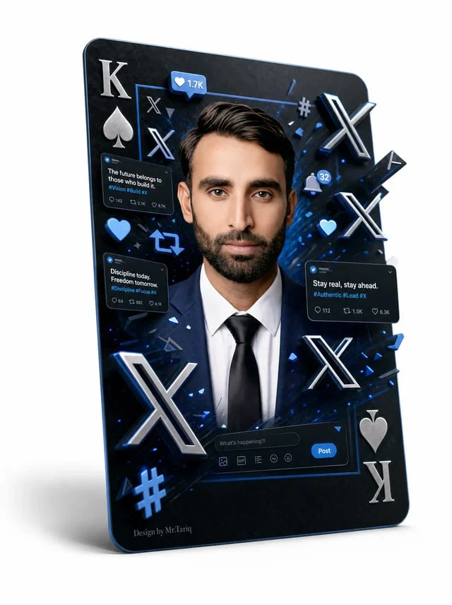

```text
{"type":"3D social media themed playing-card poster","format":"vertical premium graphic design on a clean white studio background","main_subject":{"description":"a sharply dressed adult man centered inside the card, shown from chest up, wearing a navy suit jacket, crisp white shirt, and black tie; neatly styled dark hair, realistic portrait lighting; the face area is intentionally covered by a smooth rectangular blur placeholder","customizable_identity":"{argument name=\"portrait subject\" default=\"anonymous businessman\"}","outfit":"{argument name=\"suit color\" default=\"navy blue\"} suit, white shirt, black tie"},"card":{"shape":"large vertical rounded-corner playing card standing upright at a slight left-facing perspective angle","material":"matte black textured surface with glossy beveled edges and subtle blue rim light","corner_marks":{"count":4,"labels":["top-left large K with silver spade below it","top-right raised metallic X logo","bottom-left large blue hashtag symbol","bottom-right silver spade above large K"]}},"theme":{"platform":"X / Twitter inspired","color_palette":"black, deep navy, electric blue, chrome silver, white","mood":"futuristic, luxury, viral social media energy, dramatic depth"},"layout":{"centerpiece":"framed portrait of the suited man surrounded by 3D X logos, blue particles, social icons, tweet cards, and engagement UI","border_frame":"thin glowing electric-blue rectangular frame behind the subject","visible_elements_count":{"large_3d_x_logos":5,"tweet_cards":3,"like_heart_icons":3,"notification_bubbles":2,"playing_card_rank_suit_marks":4,"composer_box":1}},"discrete_elements":[{"type":"large 3D X logos","count":5,"descriptions":["one chrome X near upper left behind the portrait","one chrome X near upper right corner","one chrome X protruding from the right edge in perspective","one large chrome X near lower left foreground","one chrome X near lower right foreground"]},{"type":"tweet cards","count":3,"cards":[{"position":"upper left","text":"The future belongs to those who build it. #Vision #Build #X","engagements":"142, 2.1K, 8.7K"},{"position":"middle left","text":"Discipline today. Freedom tomorrow. #Discipline #Focus #X","engagements":"84, 892, 4.1K"},{"position":"middle right","text":"Stay real, stay ahead. #Authentic #Lead #X","engagements":"112, 1.5K, 6.3K"}]},{"type":"notification and engagement icons","count":5,"descriptions":["blue speech-bubble like counter above the head with heart icon and 1.7K","blue notification bell bubble at right with 32","large blue heart icon on left","small blue heart icon on right","blue repost arrows icon left of the portrait"]},{"type":"post composer UI","count":1,"description":"bottom center dark input bar reading 'What's happening?!' with small media, GIF, poll, emoji icons and a bright blue Post button"}],"text_details":{"signature":"Design by Mr.Tariq","headline_or_brand":"{argument name=\"brand symbol\" default=\"X\"}","primary_tweet":"{argument name=\"primary tweet text\" default=\"The future belongs to those who build it. #Vision #Build #X\"}","engagement_counter":"{argument name=\"top like counter\" default=\"1.7K\"}"},"style":"high-resolution photorealistic 3D composite, cinematic lighting, glossy metallic extrusion, sharp depth, floating shards and confetti, electric blue glow accents, premium social media poster aesthetic","camera":"three-quarter perspective view, slight low angle, card casts a soft shadow on the white floor, centered composition with generous white margins","rendering_instructions":"make all text legible where possible, preserve the exact counted UI elements, use realistic fabric detail on the suit and chrome bevels on the X logos, avoid extra people, avoid clutter beyond the listed icons"}
```

Model: GPT Image 2
Author: Mr. Tariq

[ProjectD](https://aitoolsradar.com/en/prompts/1a1fed55ff7fba) · [Recorded source](https://youmind.com/prompts/3d-x-playing-card-poster-18114)
 · [Full original metadata and byte evidence](data/projectd-batch-0018.json)

## 3D 小红书个人资料卡

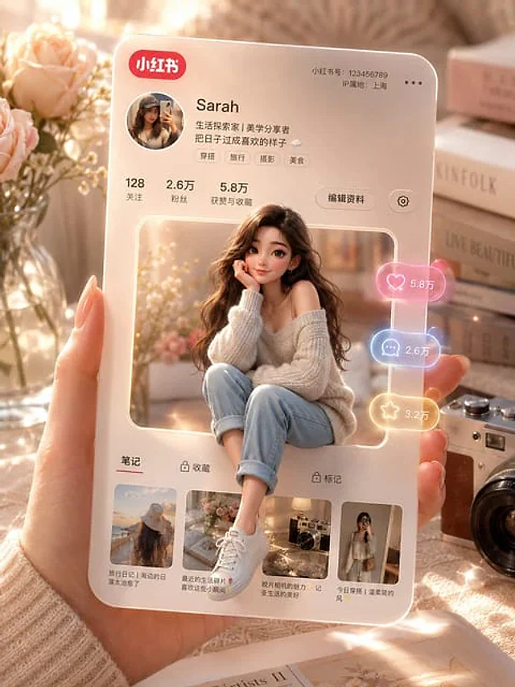

```text
一只手中握着一张3D小红书个人资料卡，卡片中间方形镂空，一个女孩随意地坐在卡片镂空的边缘，温暖的米色和柔和的粉彩美学背景，逼真的深度和阴影，电影般的柔和光线，闪亮光滑的纹理，小红书风格的UI，漂浮的互动图标（点赞、评论、分享）带有发光的霓虹效果，闪光和光晕，背景中温馨的美学布置包括书籍、花瓶里的花和一台复古相机，梦幻氛围，Pixar风格+半现实主义融合，超高品质，4K，居中构图，高端影响者美学
```

Model: GPT Image 2
Author: @MrGafish

[ProjectD](https://aitoolsradar.com/en/prompts/a938fae7b5b6e6) · [Recorded source](https://x.com/MrGafish/status/2052323461268467860)
 · [Full original metadata and byte evidence](data/projectd-batch-0018.json)

## 3x3 Character Portrait Grid

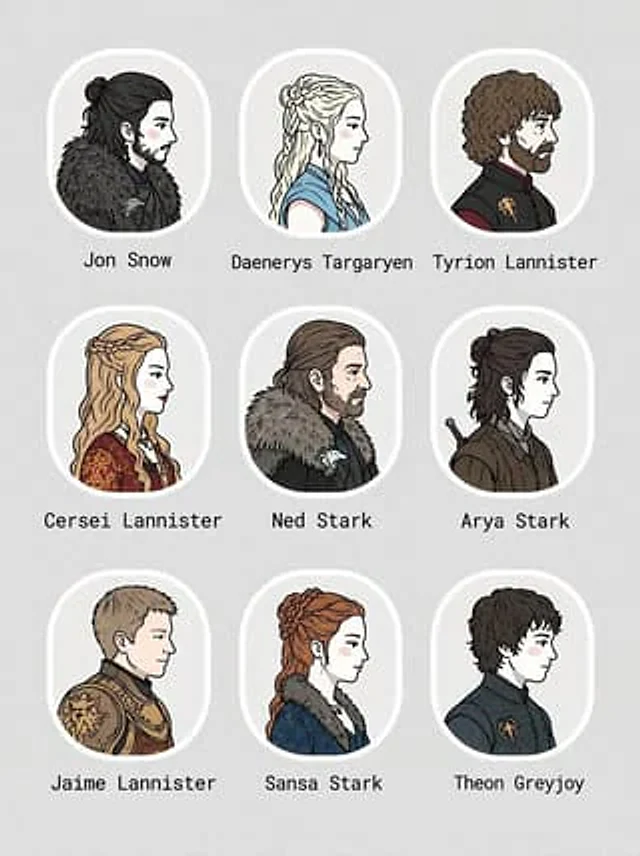

```text
{
  "type": "Character portrait grid",
  "theme": "{argument name=\"theme\" default=\"Game of Thrones characters\"}",
  "style": "{argument name=\"art style\" default=\"2D flat illustration, simple lines, comic style, profile to the right, fair skin with blush.\"}",
  "layout": {
    "grid": "3x3",
    "background": "Light gray texture",
    "frame_style": "White rounded rectangle border, with text label below."
  },
  "count": 9,
  "portraits": [
    {
      "label": "Jon Snow",
      "description": "Black half-up hairstyle, beard, dark fur cloak"
    },
    {
      "label": "Daenerys Targaryen",
      "description": "Silver braided hair, blue dress"
    },
    {
      "label": "Tyrion Lannister",
      "description": "Brown curly hair, beard, dark belted coat with gold brooch"
    },
    {
      "label": "Cersei Lannister",
      "description": "Golden braided hair, and a gorgeous red and gold dress."
    },
    {
      "label": "Ned Stark",
      "description": "Brown half-up hair, beard, dark fur cloak"
    },
    {
      "label": "Arya Stark",
      "description": "Dark short half-up hairstyle, brown belted coat, sword hilt"
    },
    {
      "label": "Jaime Lannister",
      "description": "Short blond hair, and golden armor with a lion pattern."
    },
    {
      "label": "Sansa Stark",
      "description": "Red braided hair, blue dress with fur collar"
    },
    {
      "label": "Theon Greyjoy",
      "description": "Dark short curly hair, a dark belted coat with a sea monster brooch."
    }
  ]
}
```

Model: GPT Image 2
Author: GPT Image 2 Prompts

[ProjectD](https://aitoolsradar.com/en/prompts/32ce62253d3ea6) · [Recorded source](https://x.com/stark_nico99/status/2045098289390051792#reversed-0)
 · [Full original metadata and byte evidence](data/projectd-batch-0018.json)

## 3x3 Sci-Fi Action Storyboard

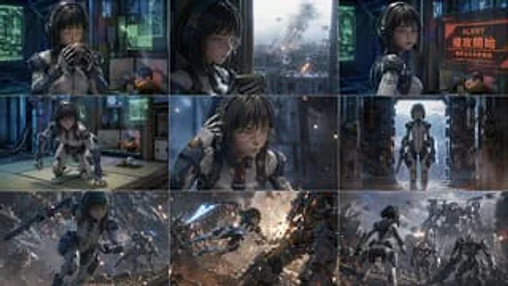

```text
{
  "type": "3x3 grid storyboard",
  "character": "{argument name=\"character description\" default=\"A young woman with short black hair, wearing glasses, and dressed in a blue and white futuristic mecha suit.\"}",
  "layout": {
    "grid": "3x3",
    "total_panels": 9,
    "panels": [
      {
        "position": "top-left",
        "scene": "Enjoying tea in a high-tech tatami room"
      },
      {
        "position": "top-center",
        "scene": "Looking out the window at the city explosion"
      },
      {
        "position": "top-right",
        "scene": "Looking at the red hologram: 'ALERT',{argument name=\"alert main text\" default=\"Invasion begins\"} ','{argument name=\"alert sub text\" default=\"Numerous hostile responses confirmed.\"} '"
      },
      {
        "position": "mid-left",
        "scene": "Kneeling on the tatami"
      },
      {
        "position": "mid-center",
        "scene": "Close-up of touching the headphones"
      },
      {
        "position": "mid-right",
        "scene": "Standing in the dimly lit hangar"
      },
      {
        "position": "bottom-left",
        "scene": "Running through the ruined battlefield"
      },
      {
        "position": "bottom-center",
        "scene": "Leaping to attack the mech with an energy blade in hand"
      },
      {
        "position": "bottom-right",
        "scene": "Facing a massive enemy mech army"
      }
    ]
  }
}
```

Model: GPT Image 2
Author: GPT Image 2 Prompts

[ProjectD](https://aitoolsradar.com/en/prompts/30a959b42c9209) · [Recorded source](https://x.com/kiyoshi_shin/status/2044447596811526514#reversed-0)
 · [Full original metadata and byte evidence](data/projectd-batch-0018.json)

## 3x3 Sci-Fi Action Storyboard


```text
{
  "type": "3x3 grid storyboard",
  "style": "3D CG anime style, cinematic lighting, highly detailed sci-fi environments",
  "character": {
    "description": "{argument name=\"character description\" default=\"young woman with short black hair and round glasses\"}",
    "outfit": "{argument name=\"suit design\" default=\"futuristic white and blue mecha plugsuit\"}"
  },
  "layout": {
    "grid": "3x3",
    "panel_count": 9,
    "panels": [
      { "position": "top-left", "scene": "Drinking traditional tea in a high-tech Japanese room with tatami mats" },
      { "position": "top-center", "scene": "Looking out a window at a futuristic city under attack, holding a tea bowl" },
      { "position": "top-right", "scene": "Looking at a red holographic warning screen displaying '{argument name=\"alert text\" default=\"ALERT 侵攻開始 敵性反応多数確認 ENEMY FORCE DETECTED\"}'" },
      { "position": "mid-left", "scene": "Kneeling on the tatami mat in a ready stance" },
      { "position": "mid-center", "scene": "Close-up portrait, touching headset with a serious expression" },
      { "position": "mid-right", "scene": "Standing in a dark metallic hangar, fully equipped" },
      { "position": "bottom-left", "scene": "Dashing through a war-torn battlefield with flying debris" },
      { "position": "bottom-center", "scene": "Dynamic mid-air combat, attacking a mecha with a {argument name=\"weapon\" default=\"glowing blue energy blade\"}" },
      { "position": "bottom-right", "scene": "Epic standoff, facing a {argument name=\"enemy\" default=\"massive enemy mecha\"} in a ruined landscape" }
    ]
  }
}
```

Model: GPT Image 2
Author: 新清士@(生成AI)インディゲーム開発者

[ProjectD](https://aitoolsradar.com/en/prompts/8afbc28cf7590d) · [Recorded source](https://youmind.com/prompts/3x3-sci-fi-mecha-storyboard-13690)
 · [Full original metadata and byte evidence](data/projectd-batch-0018.json)

## 4-Column AI Image Generation Infographic

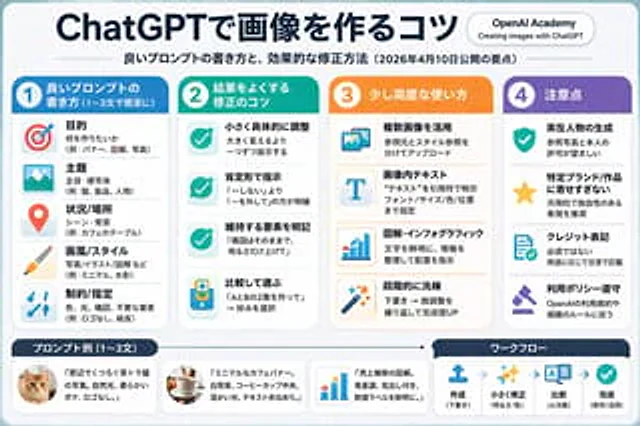

```text
{
  "type": "Infographic Quick Reference",
  "style": "Simple, modern, flat design, corporate style, Japanese text",
  "header": {
    "main_title": "{argument name=\"main title\" default=\"ChatGPT Image Generation Techniques\"}",
    "subtitle": "{argument name=\"subtitle\" default=\"High-quality prompt word writing techniques and efficient revision methods (Key points to be released on April 10, 2026)\"}",
    "badge": "OpenAI Academy / Creating Images Using ChatGPT"
  },
  "layout": {
    "main_grid": {
      "columns": 4,
      "sections": [
        {
          "column": 1,
          "color_theme": "blue",
          "header": "1 {argument name=\"column 1 title\" default=\"High-quality prompt words (1-3 concise sentences)\"}",
          "item_count": 5,
          "labels": [
            "Purpose",
            "theme",
            "Scene/Location",
            "Art style/art",
            "Constraints/Specifications"
          ]
        },
        {
          "column": 2,
          "color_theme": "teal green",
          "header": "2 {argument name=\"column 2 title\" default=\"Optimization techniques for correcting results\"}",
          "item_count": 4,
          "labels": [
            "Fine-tuning specific details",
            "Use affirmative sentence instructions",
            "Clearly define the elements that need to be retained.",
            "Comparison and selection"
          ]
        },
        {
          "column": 3,
          "color_theme": "orange",
          "header": "3. Advanced Usage",
          "item_count": 4,
          "labels": [
            "Using multiple images",
            "Text within image",
            "Infographics",
            "Step-by-step refinement"
          ]
        },
        {
          "column": 4,
          "color_theme": "purple",
          "header": "4. Precautions",
          "item_count": 4,
          "labels": [
            "Realistic character generation",
            "Avoid excessive imitation of specific brands/works",
            "Signature",
            "Comply with usage policies"
          ]
        }
      ]
    },
    "bottom_section": {
      "left_panel": {
        "title": "{argument name=\"examples title\" default=\"Example prompts (1-3 sentences)\"}",
        "item_count": 3,
        "thumbnails": [
          "Orange cat",
          "coffee cup on the table",
          "Blue bar chart"
        ]
      },
      "right_panel": {
        "title": "Workflow",
        "step_count": 4,
        "labels": [
          "create",
          "Fine-tuning",
          "contrast",
          "Finish"
        ]
      }
    }
  }
}
```

Model: GPT Image 2
Author: GPT Image 2 Prompts

[ProjectD](https://aitoolsradar.com/en/prompts/dfeaafc8711e5b) · [Recorded source](https://x.com/super_bonochin/status/2043859866968891617#reversed-0)
 · [Full original metadata and byte evidence](data/projectd-batch-0018.json)

## 4-Panel Advertising Concept Grid


```text
{
  "type": "2x2 Ad Grid",
  "layout": {
    "grid_structure": "2 rows, 2 columns",
    "sections": [
      {
        "position": "Top left",
        "theme": "Skincare and beauty advertisements",
        "visuals": "A portrait of a young Asian woman with radiant skin, her hand lightly touching her cheek. Two elegant frosted glass bottles of skincare products are placed in the foreground.",
        "copy": {
          "headline": "{argument name=\"skincare headline\" default=\"A sense of transparency fills it.\"}",
          "subheadline": "When your skin changes, your life changes too.",
          "brand_text": "New Anti-Aging Series Launch{argument name=\"skincare brand\" default=\"SUIREN\"}",
          "badge": "6.1 New Product Launch"
        }
      },
      {
        "position": "Top right",
        "theme": "Travel agency promotional advertisements",
        "visuals": "The illustration depicts the back of a woman in a white shirt and straw hat gazing at a picturesque European lakeside town, with mountains and church spires in the background. A small airplane flies in the sky.",
        "copy": {
          "english_script": "Find your Journey",
          "headline": "{argument name=\"travel headline\" default=\"Embark on a journey that will move your heart.\"}",
          "subheadline": "Unseen landscapes await you.",
          "badge": "Limited-time offer! Enjoy up to 20% off until June 30th.",
          "bottom_bar": "Early Summer Europe Trip | Click to view details &gt;"
        }
      },
      {
        "position": "Bottom left",
        "theme": "Traditional food advertising",
        "visuals": "Close-up: A bowl of simple white rice, topped with bonito flakes and a bright orange raw egg yolk. Dark soy sauce or broth is being poured from a small ceramic pot. A kraft paper bag sits in the lower left corner.",
        "copy": {
          "headline": "{argument name=\"food headline\" default=\"Make your everyday meals even more delicious.\"}",
          "product_name": "Daily Broth",
          "features": "No added chemical seasonings or preservatives | Preserves the pure umami flavor of ingredients.",
          "badge": "Contains 30 packets of broth."
        }
      },
      {
        "position": "Bottom right",
        "theme": "Fintech investment app advertisements",
        "visuals": "A modern smartphone displays a financial dashboard on its screen, featuring blue line charts and portfolio details. The background is clean white and light blue.",
        "copy": {
          "logo": "M MoneyPath",
          "headline": "For my future self,{argument name=\"finance headline\" default=\"Start building your assets now\"}",
          "subheadline": "A simple and easy-to-use investment app that even beginners can use with confidence.",
          "badge": "New users receive 1,000 yen in credits upon registration!",
          "bottom_features": [
            "100 yen investment",
            "Industry lowest rate level",
            "Support NISA",
            "Open an account now for free &gt;"
          ]
        }
      }
    ]
  }
}
```

Model: GPT Image 2
Author: GPT Image 2 Prompts

[ProjectD](https://aitoolsradar.com/en/prompts/eaf1ffeb520534) · [Recorded source](https://x.com/kawai_design/status/2045276316426190855#reversed-0)
 · [Full original metadata and byte evidence](data/projectd-batch-0018.json)

## 4-Panel Advertising Concept Grid


```text
{
  "type": "2x2 advertisement grid",
  "layout": {
    "grid_structure": "2 rows, 2 columns",
    "sections": [
      {
        "position": "top-left",
        "theme": "skincare beauty ad",
        "visuals": "Portrait of a young Asian woman with glowing, clear skin, hand gently touching her face. Two elegant frosted glass skincare product bottles in the foreground.",
        "copy": {
          "headline": "{argument name=\"skincare headline\" default=\"透明感、満ちる。\"}",
          "subheadline": "When your skin changes, your everyday changes.",
          "brand_text": "New aging care line debut {argument name=\"skincare brand\" default=\"SUIREN\"}",
          "badge": "6.1 NEW Debut"
        }
      },
      {
        "position": "top-right",
        "theme": "travel agency campaign ad",
        "visuals": "Back view of a woman in a white shirt and straw hat looking out over a scenic European lake town with mountains and a church spire. A small airplane illustration in the sky.",
        "copy": {
          "english_script": "Find your Journey",
          "headline": "{argument name=\"travel headline\" default=\"心が動く旅へ。\"}",
          "subheadline": "Unseen scenery is waiting for you.",
          "badge": "Now only! Up to 20% OFF until 6.30",
          "bottom_bar": "Early summer Europe campaign | Details here >"
        }
      },
      {
        "position": "bottom-left",
        "theme": "traditional food product ad",
        "visuals": "Close-up of a rustic bowl of white rice topped with bonito flakes and a bright orange raw egg yolk. Dark soy sauce or dashi is being poured from a small ceramic pitcher. A kraft paper product pouch is in the bottom left corner.",
        "copy": {
          "headline": "{argument name=\"food headline\" default=\"毎日のごはんを、もっと美味しく。\"}",
          "product_name": "Everyday Dashi",
          "features": "No chemical seasonings or preservatives added | The whole umami of the ingredients.",
          "badge": "Dashi pack 30 bags included"
        }
      },
      {
        "position": "bottom-right",
        "theme": "fintech investment app ad",
        "visuals": "A modern smartphone displaying a financial dashboard with a blue line chart and portfolio breakdown. Clean white and light blue background.",
        "copy": {
          "logo": "M MoneyPath",
          "headline": "For your future self, {argument name=\"finance headline\" default=\"今はじめる資産形成\"}",
          "subheadline": "Simple investment app safe even for beginners",
          "badge": "1,000 yen worth of points present for new registration!",
          "bottom_features": [
            "Start from 100 yen",
            "Industry lowest fee level",
            "NISA compatible",
            "Open an account for free first >"
          ]
        }
      }
    ]
  }
}
```

Model: GPT Image 2
Author: KAWAI

[ProjectD](https://aitoolsradar.com/en/prompts/6968dd6fa074aa) · [Recorded source](https://youmind.com/prompts/four-panel-ad-grid-13996)
 · [Full original metadata and byte evidence](data/projectd-batch-0018.json)

## 4-Panel Advertising Grid Concept


```text
{
  "type": "2x2 Banner Grid",
  "layout": "The four quadrants each showcase advertisements from different industries.",
  "quadrants": [
    {
      "position": "Top left",
      "industry": "skincare",
      "visuals": "Asian women lightly touch their cheeks; floating water droplets; white pump-style bottled product.",
      "brand": "BALANCÉE",
      "copy": {
        "headline": "{argument name=\"skincare headline\" default=\"Your bare skin awakens.\"}",
        "subheadline": "Towards a new self full of transparency.",
        "features_count": 3,
        "features_labels": [
          "High moisturizing",
          "Preventing rough skin",
          "Whitening treatment*"
        ]
      }
    },
    {
      "position": "Top right",
      "industry": "Catering and food",
      "visuals": "A close-up shot of spaghetti bolognese, sprinkled with grated cheese and parsley, bathed in dark ambient lighting.",
      "brand": "Trattoria Luce",
      "copy": {
        "headline": "{argument name=\"food headline\" default=\"This pasta is phenomenal.\"}",
        "badge": "Limited-time offer",
        "description": "Black Wagyu Bolognese Pasta with Truffle Aroma"
      }
    },
    {
      "position": "Bottom left",
      "industry": "travel",
      "visuals": "A woman carrying a backpack faces a scenic alpine lake under the bright sunlight.",
      "brand": "NATURE JOURNEY",
      "copy": {
        "headline": "{argument name=\"travel headline\" default=\"A journey to set myself free.\"}",
        "subheadline": "Let your heart be stirred in nature.",
        "script": "Find your freedom.",
        "banner_details": [
          "Early Summer Special Events",
          "Saturday, June 1st - Sunday, June 30th",
          "Up to 20% discount",
          "Several limited-time special offers are currently available!"
        ]
      }
    },
    {
      "position": "Bottom right",
      "industry": "SaaS applications",
      "visuals": "The smartphone displays a task management application interface containing four schedule items.",
      "brand": "{argument name=\"app brand name\" default=\"Taskme\"}",
      "copy": {
        "headline": "{argument name=\"app headline\" default=\"Make task management simpler and smarter.\"}",
        "circle_badge": "Design your day.",
        "features_count": 3,
        "features_labels": [
          "Intuitive user experience",
          "Support team sharing",
          "Access anytime, anywhere"
        ],
        "bottom_banner": "7-day free trial is now available!"
      }
    }
  ]
}
```

Model: GPT Image 2
Author: GPT Image 2 Prompts

[ProjectD](https://aitoolsradar.com/en/prompts/1b908689cb824f) · [Recorded source](https://x.com/kitune_fire45/status/2045456827618627863#reversed-1)
 · [Full original metadata and byte evidence](data/projectd-batch-0018.json)

## 4-Panel Animal Infographic Grid

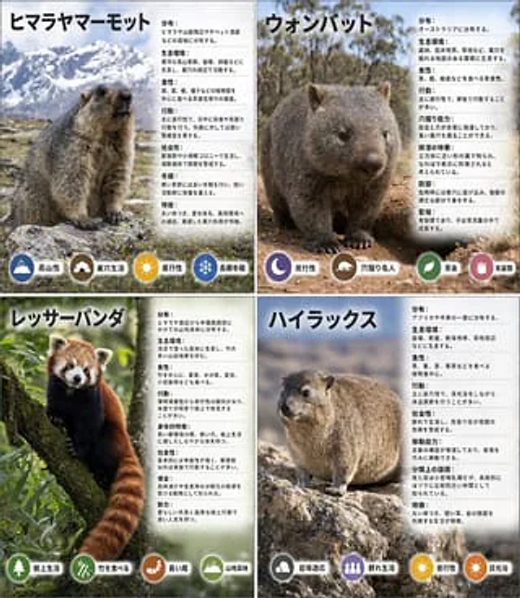

```text
{
  "type": "{argument name=\"layout style\" default=\"2x2 grid infographic\"}",
  "panels": [
    {
      "position": "Top left",
      "title": "{argument name=\"animal one\" default=\"Himalayan marmot\"}",
      "image_description": "Himalayan marmot sits on a rock with snow-capped mountains in the background.",
      "text_content": "Detailed biological facts, including distribution, habitat, diet, behavior, sociality, hibernation, and characteristics.",
      "icon_count": 4,
      "icons": [
        {
          "color": "blue",
          "symbol": "mountain",
          "label": "alpine"
        },
        {
          "color": "brown",
          "symbol": "cave",
          "label": "cave living"
        },
        {
          "color": "yellow",
          "symbol": "sun",
          "label": "diurnal"
        },
        {
          "color": "blue",
          "symbol": "snowflake",
          "label": "Long-term hibernation"
        }
      ]
    },
    {
      "position": "Top right",
      "title": "{argument name=\"animal two\" default=\"Wombat\"}",
      "image_description": "The wombat stood on the muddy ground",
      "text_content": "Detailed biological facts, including distribution, habitat, diet, behavior, digging ability, excretion, defense, and reproduction.",
      "icon_count": 4,
      "icons": [
        {
          "color": "purple",
          "symbol": "moon",
          "label": "nocturnal"
        },
        {
          "color": "brown",
          "symbol": "digging animal",
          "label": "Excavation experts"
        },
        {
          "color": "green",
          "symbol": "leaf",
          "label": "herbivorous"
        },
        {
          "color": "brown",
          "symbol": "acorn",
          "label": "Bag"
        }
      ]
    },
    {
      "position": "Bottom left",
      "title": "{argument name=\"animal three\" default=\"Red panda\"}",
      "image_description": "The red panda rests on a moss-covered branch.",
      "text_content": "Detailed biological facts, including distribution, habitat, diet, behavior, physical characteristics, sociality, conservation status, and attractions.",
      "icon_count": 4,
      "icons": [
        {
          "color": "green",
          "symbol": "tree",
          "label": "Arboreal life"
        },
        {
          "color": "green",
          "symbol": "bamboo",
          "label": "Bamboo as food"
        },
        {
          "color": "orange",
          "symbol": "tail",
          "label": "Long tail"
        },
        {
          "color": "green",
          "symbol": "mountain",
          "label": "mountain forests"
        }
      ]
    },
    {
      "position": "Bottom right",
      "title": "{argument name=\"animal four\" default=\"Hoofed rabbit\"}",
      "image_description": "The hyrax stands on a rock outcrop",
      "text_content": "Detailed biological facts, including distribution, habitat, diet, behavior, sociality, mobility, classification, and characteristics.",
      "icon_count": 4,
      "icons": [
        {
          "color": "grey",
          "symbol": "rock",
          "label": "Rock adaptability"
        },
        {
          "color": "purple",
          "symbol": "group of people",
          "label": "Group living"
        },
        {
          "color": "yellow",
          "symbol": "sun",
          "label": "diurnal"
        },
        {
          "color": "orange",
          "symbol": "sun",
          "label": "Sunbathing"
        }
      ]
    }
  ],
  "styling": {
    "layout": "Four equally divided quadrants separated by white borders",
    "text_panel": "The translucent white vertical rectangle on the right side of each quadrant",
    "typography": "Each quadrant has a large, bold Chinese title in the top left corner, with dense detailed information text inside a white panel.",
    "icon_style": "Each quadrant has four colored circular icons arranged along its bottom edge, each containing a white silhouette and a black text label."
  }
}
```

Model: GPT Image 2
Author: GPT Image 2 Prompts

[ProjectD](https://aitoolsradar.com/en/prompts/06a6e3dbad27e8) · [Recorded source](https://x.com/Kukkuree/status/2044975385419583710#reversed-0)
 · [Full original metadata and byte evidence](data/projectd-batch-0018.json)

## 4-Panel Anime Romance Comic Strip

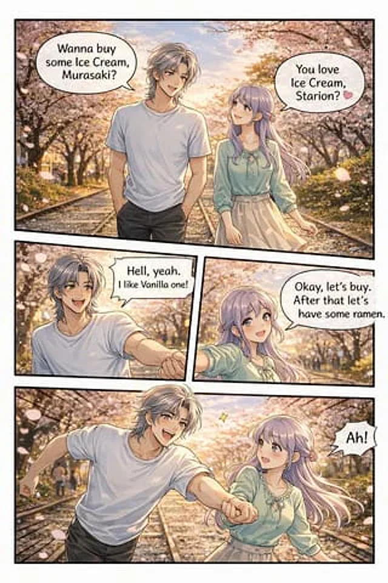

```text
{
  "type": "Four-panel comic strip",
  "art_style": "Exquisite anime illustrations, warm sunset lighting, visual novel CG quality.",
  "setting": "{argument name=\"setting\" default=\"Cherry blossoms bloom along the railway path at sunset\"}",
  "characters": {
    "male": {
      "name": "{argument name=\"male character name\" default=\"Starion\"}",
      "appearance": "Short, messy silver hair, white T-shirt, dark trousers"
    },
    "female": {
      "name": "{argument name=\"female character name\" default=\"Murasaki\"}",
      "appearance": "Long, light purple hair; light green blouse with a bow tie; beige skirt."
    }
  },
  "layout": {
    "total_panels": 4,
    "total_speech_bubbles": 5,
    "panels": [
      {
        "position": "Top, full width",
        "action": "Walking side by side on the railway tracks",
        "bubbles": [
          "Murasaki, would you like to buy some ice cream?",
          "Starion, do you like ice cream? 🩷"
        ]
      },
      {
        "position": "center left",
        "action": "The boy smiled warmly and extended his hand.",
        "bubbles": [
          "{argument name=\"male dialogue\" default=\"Of course, my favorite is vanilla!\"}"
        ]
      },
      {
        "position": "center right",
        "action": "The girl smiled and took his hand.",
        "bubbles": [
          "{argument name=\"female dialogue\" default=\"Okay, let&#39;s go buy it. Then we&#39;ll eat ramen.\"}"
        ]
      },
      {
        "position": "Bottom, full width",
        "action": "They ran forward on the railway tracks, hand in hand; the boy was excited, and the girl was surprised.",
        "bubbles": [
          "ah!"
        ]
      }
    ]
  }
}
```

Model: GPT Image 2
Author: GPT Image 2 Prompts

[ProjectD](https://aitoolsradar.com/en/prompts/afb462bc66ee0e) · [Recorded source](https://x.com/OJustASMR127732/status/2043911265966535029#reversed-0)
 · [Full original metadata and byte evidence](data/projectd-batch-0018.json)

## 4-Panel Face Wash Ad Grid


```text
{
  "type": "Four-panel skincare product advertisement collage",
  "style": "Studio-quality commercial product photography, hyper-realistic, glossy packaging, dramatic lighting, high-end beauty advertising aesthetics.",
  "format": "2x2 square grid",
  "background": "Each quadrant has a themed environment that matches the product's efficacy.",
  "products": [
    {
      "position": "Top left",
      "brand": "GARNIER",
      "product": "OIL CONTROL Face Wash",
      "packaging": "A translucent blue squeeze tube with a dark blue cap; the tube is covered in water droplets.",
      "scene": "The product stands upright in shallow water, with dynamic water splashes at the bottom.",
      "lighting": "Cool blue high-contrast lighting",
      "color_palette": "Dark blue, cyan, white",
      "effects": [
        "water ripples",
        "Water Crown",
        "Water droplets on the packaging"
      ]
    },
    {
      "position": "Top right",
      "brand": "POND'S",
      "product": "BRIGHT GLOW",
      "packaging": "Gold-orange gradient squeeze tube, white cap, with a subtle shimmering texture.",
      "scene": "The product stands upright on a liquid that reflects golden light, accompanied by circular ripples.",
      "lighting": "Warm golden backlighting with soft bokeh highlights.",
      "color_palette": "Gold, amber, orange, cream",
      "effects": [
        "Golden reflection",
        "luster",
        "Liquid Ripple Ring"
      ]
    },
    {
      "position": "Bottom left",
      "brand": "Himalara HERBAAL CARE",
      "product": "PURE HERBAL CARE",
      "packaging": "White and translucent green squeeze tube, cyan bottle cap with herbal leaf pattern printed on the front.",
      "scene": "The product is placed on damp natural stones, surrounded by fresh green leaves from an outdoor plant environment.",
      "lighting": "Soft, natural sunlight filtering through the leaves",
      "color_palette": "Green, white, cyan, earthy stone tones",
      "effects": [
        "water droplets",
        "Lush leaves",
        "A fresh and natural atmosphere"
      ]
    },
    {
      "position": "Bottom right",
      "brand": "NIVEA",
      "product": "DEEP CLEAN CHARCOAL POWER",
      "packaging": "Matte black squeeze tube, black cap, with blue NIVEA circular logo.",
      "scene": "The product stands upright on a damp, dark surface, surrounded by broken pieces of charcoal.",
      "lighting": "Low-key dramatic directional lighting with a slight mist",
      "color_palette": "Black, charcoal gray, dark blue",
      "effects": [
        "Wet surface reflection",
        "Charcoal blocks",
        "Dramatic Shadow"
      ]
    }
  ],
  "layout": {
    "grid": {
      "rows": 2,
      "columns": 2
    },
    "count": 4,
    "panels": [
      "Garnier water theme (top left)",
      "Pond's Glossy Theme (Top Right)",
      "Bottom left herbaceous green theme",
      "Bottom right Nivea Charcoal Theme"
    ]
  },
  "branding": {
    "watermark": {
      "text": "Pollo.ai",
      "position": "Top right corner of the overall image",
      "color": "White"
    }
  },
  "camera": "Each panel is photographed from the front, centered, with a level view composition that ensures the product is clearly in focus and the background has a shallow depth of field.",
  "quality": "Highly detailed, ad-quality, clean composition, and clear, easy-to-read labels."
}
```

Model: GPT Image 2
Author: GPT Image 2 Prompts

[ProjectD](https://aitoolsradar.com/en/prompts/b775abb88b64d2) · [Recorded source](https://x.com/Gemalpha_88/status/2046862122546876716#reversed-0)
 · [Full original metadata and byte evidence](data/projectd-batch-0018.json)

## 4-Panel Face Wash Ad Grid


```text
{"type":"four-panel skincare product advertisement collage","style":"studio-quality commercial product photography, hyper-realistic, glossy packaging, dramatic lighting, premium beauty ad aesthetic","format":"square 2x2 grid","background":"each quadrant has its own themed environment matching the product benefit","products":[{"position":"top-left","brand":"GARNIER","product":"OIL CONTROL Face Wash","packaging":"blue translucent squeeze tube with dark blue cap, water droplets on the tube","scene":"tube standing upright in shallow water with a dynamic splash around the base","lighting":"cool blue high-contrast lighting","color_palette":"deep blue, cyan, white","effects":["water ripples","splash crown","droplets on packaging"]},{"position":"top-right","brand":"POND'S","product":"BRIGHT GLOW","packaging":"gold-to-orange gradient squeeze tube with white cap, subtle glittery texture","scene":"tube standing upright on reflective golden liquid with circular ripples","lighting":"warm golden backlight with soft bokeh highlights","color_palette":"gold, amber, orange, cream","effects":["golden reflections","glow","liquid ripple rings"]},{"position":"bottom-left","brand":"Himalara HERBAAL CARE","product":"PURE HERBAL CARE","packaging":"white and translucent green squeeze tube with teal cap, herbal leaf graphic on front","scene":"tube placed on a wet natural stone surrounded by fresh green leaves in an outdoor botanical setting","lighting":"soft natural sunlight filtering through foliage","color_palette":"green, white, teal, earthy stone tones","effects":["water droplets","lush leaves","fresh natural atmosphere"]},{"position":"bottom-right","brand":"NIVEA","product":"DEEP CLEAN CHARCOAL POWER","packaging":"matte black squeeze tube with black cap and blue NIVEA circle logo","scene":"tube standing on a dark wet surface surrounded by broken charcoal pieces","lighting":"moody low-key directional lighting with subtle mist","color_palette":"black, charcoal gray, deep blue","effects":["wet surface reflections","charcoal chunks","dramatic shadows"]}],"layout":{"grid":{"rows":2,"columns":2},"count":4,"panels":["top-left Garnier water theme","top-right Pond's glow theme","bottom-left herbal green theme","bottom-right Nivea charcoal theme"]},"branding":{"watermark":{"text":"Pollo.ai","position":"top-right overall image","color":"white"}},"camera":"front-facing centered packshot in each panel, eye-level product framing, sharp focus on tube, shallow depth of field in background","quality":"ultra-detailed, advertising-ready, clean composition, crisp label readability"}
```

Model: GPT Image 2
Author: Gem Alpha

[ProjectD](https://aitoolsradar.com/en/prompts/909aff1e85d896) · [Recorded source](https://youmind.com/prompts/four-panel-face-wash-grid-14812)
 · [Full original metadata and byte evidence](data/projectd-batch-0018.json)

## 4-Panel Japanese Ad Banner Grid


```text
{
  "type": "2x2 Japanese-style web ad banner grid",
  "layout": "4 equal square panels",
  "panels": [
    {
      "position": "Top left",
      "industry": "drinks",
      "product": "Clear can of non-alcoholic beverage named 'CLEAR ZERO'",
      "visuals": "Water splashes, light blue background, refreshing atmosphere",
      "headline": "{argument name=\"beverage catchphrase\" default=\"Reset today.\"}",
      "badges_count": 3,
      "badges_labels": [
        "0 calories",
        "0 sugar",
        "0 purines"
      ]
    },
    {
      "position": "Top right",
      "industry": "takeout",
      "product": "A plate of stir-fried meat and vegetables",
      "visuals": "Warm-toned lighting, a wooden dining table—it's mouthwatering.",
      "headline": "{argument name=\"meal kit catchphrase\" default=\"No more worrying about what to cook.\"}",
      "feature_icons_count": 3,
      "feature_icons_labels": [
        "10-minute quick and easy dishes",
        "Nutritionist supervision",
        "Free shipping"
      ],
      "cta_button": "Start Now -&gt;"
    },
    {
      "position": "Bottom left",
      "industry": "cosmetic",
      "product": "A skincare serum bottle named 'LUMIÈRE'",
      "visuals": "A woman with radiant skin and closed eyes, prism-like lighting effect, against a soft purple background.",
      "headline": "{argument name=\"cosmetics catchphrase\" default=\"Your skin will awaken.\"}",
      "badges_count": 3,
      "badges_labels": [
        "No additives",
        "Made in Japan",
        "Suitable for sensitive skin"
      ]
    },
    {
      "position": "Bottom right",
      "industry": "fitness",
      "product": "A personal gym called 'MOVE'",
      "visuals": "A woman running on a treadmill, in a dark gym environment, conveying a sense of exercise.",
      "headline": "{argument name=\"gym catchphrase\" default=\"A place to update myself.\"}",
      "pricing": "Monthly fee{argument name=\"gym monthly price\" default=\"6,980\"} Starting from yen",
      "feature_hexagons_count": 3,
      "feature_hexagons_labels": [
        "Open 24 hours",
        "More than 120 stores nationwide",
        "Full support"
      ],
      "cta_button": "Book a free trial -&gt;"
    }
  ]
}
```

Model: GPT Image 2
Author: GPT Image 2 Prompts

[ProjectD](https://aitoolsradar.com/en/prompts/68dba5f8f36466) · [Recorded source](https://x.com/MajaDesignJP/status/2045735774877011999#reversed-0)
 · [Full original metadata and byte evidence](data/projectd-batch-0018.json)

## 4-Panel Japanese Ad Banner Grid


```text
{
  "type": "2x2 Banner Grid",
  "layout": {
    "grid_size": "2x2",
    "panels": [
      {
        "position": "Top left",
        "industry": "skincare",
        "visuals": "A young Asian woman with radiant skin, short black hair, and wearing a white tank top gently touches her face. Three bottles of white cosmetics are visible in the lower left corner.",
        "typography": {
          "main_copy": "{argument name=\"skincare catchphrase\" default=\"Bare skin is the best makeup.\"}",
          "sub_copy": "A new skincare series that unlocks the skin's natural power has arrived.",
          "badge": "4.25 NEW DEBUT",
          "brand_name": "urala",
          "tagline": "うららかに、わたしらしく。"
        }
      },
      {
        "position": "Top right",
        "industry": "cafes",
        "visuals": "On the wooden table by the window, there was a plate of jam and buttered toast, a cup of black coffee, and a knife and fork.",
        "typography": {
          "top_text": "A small cafe by the forest",
          "main_copy": "{argument name=\"cafe catchphrase\" default=\"Today is another good day.\"}",
          "sub_copy": "Why not take a break and enjoy some carefully brewed coffee and freshly baked bread?",
          "badge": "Seasonal strawberry jam toast now available!",
          "logo": "morino cafe",
          "details": "OPEN 8:00 - 18:00 Closed: Wednesdays 1-2-3 Jingumae, Shibuya-ku, Tokyo 150-0001"
        }
      },
      {
        "position": "Bottom left",
        "industry": "Gym",
        "visuals": "An Asian female athlete, wearing a black sports bra and with her hair in a ponytail, is sweating and has a determined expression. The background is a gym with purple neon lights.",
        "typography": {
          "top_text": "Now is the time to become your ideal self.",
          "main_copy": "{argument name=\"gym catchphrase\" default=\"Surpass me.\"}",
          "bullet_points": [
            "☑ パーソナルトレーニング",
            "☑ Excellent support for beginners",
            "☑ No need to bring anything."
          ],
          "offer": "Start with a trial session! Trial training: 60 minutes{argument name=\"gym price\" default=\"¥2,200\"} (tax included)",
          "logo": "B BEYOND LIMIT PERSONAL GYM"
        }
      },
      {
        "position": "Bottom right",
        "industry": "Tourism and vacation",
        "visuals": "The infinity pool blends seamlessly with the azure sea, white lounge chairs, a clear sky, and potted plants.",
        "typography": {
          "main_copy": "{argument name=\"resort catchphrase\" default=\"A journey to encounter landscapes yet unseen.\"}",
          "sub_copy": "A special time for you to unwind and relax.",
          "logo": "UMI to SORA RESORT",
          "bottom_bar": "＼ Limited Time Offer ／ Summer Reservation Campaign Up to 20% OFF Reservations can be made through the official website → June 1st (Sat) - July 31st (Wed), 2024",
          "elements": [
            "QR code"
          ]
        }
      }
    ]
  }
}
```

Model: GPT Image 2
Author: GPT Image 2 Prompts

[ProjectD](https://aitoolsradar.com/en/prompts/113c36e2fd679e) · [Recorded source](https://x.com/kgsi/status/2045427471852711997#reversed-0)
 · [Full original metadata and byte evidence](data/projectd-batch-0018.json)

## 4-Panel Japanese Ad Banner Grid


```text
{
  "type": "2x2 grid of Japanese web banner advertisements",
  "layout": "4 equal square panels",
  "panels": [
    {
      "position": "top-left",
      "industry": "beverage",
      "product": "clear can of non-alcoholic drink named 'CLEAR ZERO'",
      "visuals": "splashing water, light blue background, refreshing vibe",
      "headline": "{argument name=\"beverage catchphrase\" default=\"今日を、リセット。\"}",
      "badges_count": 3,
      "badges_labels": ["カロリー 0", "糖質 0", "プリン体 0"]
    },
    {
      "position": "top-right",
      "industry": "food delivery",
      "product": "plate of stir-fried meat and vegetables",
      "visuals": "warm lighting, wooden table, appetizing",
      "headline": "{argument name=\"meal kit catchphrase\" default=\"献立に、悩まない。\"}",
      "feature_icons_count": 3,
      "feature_icons_labels": ["時短 10分", "管理栄養士監修", "送料無料"],
      "cta_button": "今すぐはじめる ->"
    },
    {
      "position": "bottom-left",
      "industry": "cosmetics",
      "product": "skincare serum bottle named 'LUMIÈRE'",
      "visuals": "woman with glowing skin and closed eyes, prismatic light effects, soft purple background",
      "headline": "{argument name=\"cosmetics catchphrase\" default=\"肌が、目覚める。\"}",
      "badges_count": 3,
      "badges_labels": ["無添加", "日本製", "敏感肌対応"]
    },
    {
      "position": "bottom-right",
      "industry": "fitness",
      "product": "personal gym named 'MOVE'",
      "visuals": "woman running on a treadmill, dark gym setting, sporty",
      "headline": "{argument name=\"gym catchphrase\" default=\"私を、アップデートする場所。\"}",
      "pricing": "月額 {argument name=\"gym monthly price\" default=\"6,980\"} 円~",
      "feature_hexagons_count": 3,
      "feature_hexagons_labels": ["24時間営業", "全国120店舗以上", "充実のサポート"],
      "cta_button": "無料体験を予約する ->"
    }
  ]
}
```

Model: GPT Image 2
Author: まーや | 物販LPデザイナー🛒✨

[ProjectD](https://aitoolsradar.com/en/prompts/1c69c787d4a931) · [Recorded source](https://youmind.com/prompts/japanese-ad-banner-grid-13534)
 · [Full original metadata and byte evidence](data/projectd-batch-0018.json)

## 4-Panel Japanese Ad Banner Grid


```text
{
  "type": "2x2 advertisement banner grid",
  "layout": {
    "grid_size": "2x2",
    "panels": [
      {
        "position": "top-left",
        "industry": "skincare",
        "visuals": "Young Asian woman with glowing skin, short black hair, white strap top, hand gently touching face. 3 white cosmetic bottles in bottom left.",
        "typography": {
          "main_copy": "{argument name=\"skincare catchphrase\" default=\"素肌が、いちばんのメイクになる。\"}",
          "sub_copy": "肌本来の力を引き出す 新・スキンケアシリーズ誕生",
          "badge": "4.25 NEW DEBUT",
          "brand_name": "urala",
          "tagline": "うららかに、わたしらしく。"
        }
      },
      {
        "position": "top-right",
        "industry": "cafe",
        "visuals": "Wooden table by a window, plate with jam and butter toast, cup of black coffee, fork and knife.",
        "typography": {
          "top_text": "森のそばの小さなカフェ",
          "main_copy": "{argument name=\"cafe catchphrase\" default=\"今日も、いい日。\"}",
          "sub_copy": "こだわりのコーヒーと、焼きたてのパンでほっとひと息しませんか？",
          "badge": "季節限定 いちごのジャムトースト始めました",
          "logo": "morino cafe",
          "details": "OPEN 8:00 - 18:00 定休日: 水曜日 〒150-0001 東京都渋谷区神宮前 1-2-3"
        }
      },
      {
        "position": "bottom-left",
        "industry": "fitness gym",
        "visuals": "Athletic Asian woman in black sports bra, ponytail, sweating, looking determined. Gym background with purple neon lighting.",
        "typography": {
          "top_text": "今こそ、理想の自分へ",
          "main_copy": "{argument name=\"gym catchphrase\" default=\"わたしを、超えていけ。\"}",
          "bullet_points": [
            "☑ パーソナルトレーニング",
            "☑ 初心者サポート充実",
            "☑ 手ぶらでOK"
          ],
          "offer": "まずは体験から！ 体験トレーニング 60分 {argument name=\"gym price\" default=\"¥2,200\"}(税込)",
          "logo": "B BEYOND LIMIT PERSONAL GYM"
        }
      },
      {
        "position": "bottom-right",
        "industry": "travel resort",
        "visuals": "Infinity pool merging with bright blue ocean, white lounge chairs, sunny sky, potted plant.",
        "typography": {
          "main_copy": "{argument name=\"resort catchphrase\" default=\"まだ見ぬ景色に、出会う旅。\"}",
          "sub_copy": "心がほどける、特別な時間をあなたに。",
          "logo": "UMI to SORA RESORT",
          "bottom_bar": "＼ 期間限定 ／ 夏のご予約キャンペーン 最大 20% OFF ご予約は公式サイトから → 2024.6.1 sat - 7.31 wed",
          "elements": [
            "QR code"
          ]
        }
      }
    ]
  }
}
```

Model: GPT Image 2
Author: こぎそ

[ProjectD](https://aitoolsradar.com/en/prompts/a095cadeb4832a) · [Recorded source](https://youmind.com/prompts/japanese-ad-banner-grid-14035)
 · [Full original metadata and byte evidence](data/projectd-batch-0018.json)

## 4-Panel Japanese Advertising Banner Grid

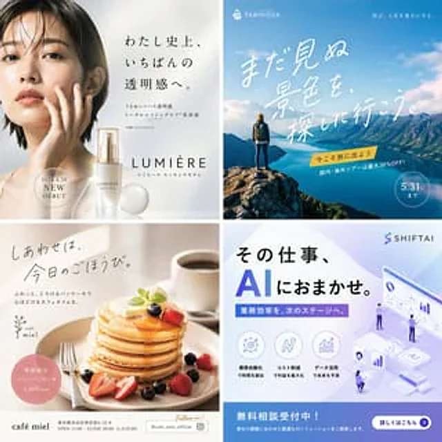

```text
{
  "type": "2x2 Banner Grid",
  "layout": "Four different quadrants, each containing commercials of different styles.",
  "quadrants": [
    {
      "position": "Top left",
      "industry": "Skincare and Makeup",
      "visuals": "A close-up portrait of a young Asian woman with clear, radiant skin, her hand touching her cheek; next to her sits an elegant serum bottle with a luminous, pearl-like sphere.",
      "brand": "LUMIèRE",
      "copy": [
        "{argument name=\"beauty catchphrase\" default=\"Achieving the most translucent skin I&#39;ve ever had.\"}",
        "Hydrating, Firming, and Translucent All-in-One Anti-Aging Serum",
        "Newly launched on April 20, 2024"
      ],
      "color_palette": "White, beige, light gray"
    },
    {
      "position": "Top right",
      "industry": "travel agency",
      "visuals": "A backpacker stands on a rocky cliff, overlooking the azure fjord and the majestic mountains under a clear sky.",
      "brand": "TABINOVA",
      "copy": [
        "{argument name=\"travel catchphrase\" default=\"Let&#39;s go in search of scenery we haven&#39;t seen yet.\"}",
        "Let's go on a trip now!",
        "Domestic and international tour groups can enjoy discounts of up to 30%!",
        "As of May 31"
      ],
      "color_palette": "Sky blue, deep sea blue, earth green and brown"
    },
    {
      "position": "Bottom left",
      "industry": "Coffee and catering",
      "visuals": "A stack of mouthwatering, fluffy pancakes, topped with melted butter, drizzled with syrup, and garnished with fresh strawberries and blueberries; in the background, a cup of black coffee and a silver fork.",
      "brand": "café miel",
      "copy": [
        "{argument name=\"cafe catchphrase\" default=\"Happiness is today&#39;s reward.\"}",
        "Enjoy a relaxing coffee break with soft, melt-in-your-mouth pancakes.",
        "Seasonal limited-edition berry pancakes 1,480 yen",
        "Follow us! @cafe_miel_official"
      ],
      "color_palette": "Warm beige, alluring brown, vibrant red"
    },
    {
      "position": "Bottom right",
      "industry": "B2B SaaS / AI technology",
      "visuals": "An isometric 3D illustration shows employees in a miniature office interacting with a floating data dashboard, bar charts, and a central AI server unit; three circular function icons are located in the lower left corner.",
      "brand": "{argument name=\"tech brand name\" default=\"SHIFTAI\"}",
      "copy": [
        "{argument name=\"tech catchphrase\" default=\"Leave that job to AI.\"}",
        "To elevate business efficiency to a new level.",
        "Free consultations are now available!",
        "Click to learn more"
      ],
      "color_palette": "Corporate blue, purple gradient, and crisp white"
    }
  ]
}
```

Model: GPT Image 2
Author: GPT Image 2 Prompts

[ProjectD](https://aitoolsradar.com/en/prompts/140ad543adb085) · [Recorded source](https://x.com/ozwxy/status/2046154007136366866#reversed-0)
 · [Full original metadata and byte evidence](data/projectd-batch-0018.json)

## 4-Panel Japanese Advertising Concept Grid


```text
{
  "type": "Advertising concept project",
  "layout": {
    "style": "{argument name=\"grid layout style\" default=\"2x2 Japanese-style advertising poster grid\"}",
    "sections": [
      {
        "position": "Top left",
        "industry": "science and technology",
        "subject": "White wireless earphones floating on a clean surface",
        "style": "Minimalist, bright, white background, stylish",
        "headline": "{argument name=\"tech ad headline\" default=\"The next generation of Sacondo starts here.\"}",
        "brand_logo": "aura+"
      },
      {
        "position": "Top right",
        "industry": "Beauty",
        "subject": "Pink lipstick and an open powder compact are placed on a reflective surface.",
        "style": "Elegant, warm lighting, soft background blur, luxurious",
        "headline": "{argument name=\"cosmetics ad headline\" default=\"One application and I&#39;ll be transformed.\"}",
        "brand_logo": "LUMINA"
      },
      {
        "position": "Bottom left",
        "industry": "drinks",
        "subject": "Silver-blue energy drink cans, surrounded by splashing water and lightning.",
        "style": "Dynamic, high contrast, dark background, vibrant",
        "headline": "{argument name=\"energy drink headline\" default=\"Push the limits one step further.\"}",
        "brand_logo": "aura+"
      },
      {
        "position": "Bottom right",
        "industry": "travel",
        "subject": "A local train travels through green rice paddies, with mountains in the background.",
        "style": "Beautiful scenery, sunset light and shadow, warmth, nostalgia",
        "headline": "{argument name=\"travel ad headline\" default=\"Let&#39;s take a short trip this weekend.\"}",
        "brand_logo": "Toto Line"
      }
    ]
  }
}
```

Model: GPT Image 2
Author: GPT Image 2 Prompts

[ProjectD](https://aitoolsradar.com/en/prompts/8e3b37a2bbeb93) · [Recorded source](https://x.com/sub_gjensenen/status/2045370333558088186#reversed-0)
 · [Full original metadata and byte evidence](data/projectd-batch-0018.json)

## 4-Panel Japanese Advertising Grid


```text
{
  "type": "2x2 Japanese-style advertising poster grid",
  "layout": {
    "format": "2x2 grid",
    "panels": [
      {
        "position": "Top left",
        "theme": "skincare brands",
        "visual": "A close-up of a young Japanese woman with short black hair and radiant, dewy skin. Three minimalist white skincare products are displayed in the lower left corner.",
        "text_elements": {
          "headline": "{argument name=\"skincare headline\" default=\"Bare skin is the best makeup.\"}",
          "brand": "urala",
          "subtext": [
            "A new skincare series that unlocks the skin's natural power has arrived.",
            "4.25 NEW DEBUT",
            "うららかに、わたしらしく。"
          ]
        }
      },
      {
        "position": "Top right",
        "theme": "Coffee shop promotion",
        "visual": "On the plate sits a thick slice of toast spread with strawberry jam and butter, next to a cup of black coffee on a wooden table by the window.",
        "text_elements": {
          "headline": "{argument name=\"cafe headline\" default=\"Today is another good day.\"}",
          "brand": "morino cafe",
          "subtext": [
            "A small cafe by the forest",
            "Why not take a break and enjoy some carefully brewed coffee and freshly baked bread?",
            "Seasonal strawberry jam toast now available!"
          ]
        }
      },
      {
        "position": "Bottom left",
        "theme": "Personal Gym",
        "visual": "A fit Japanese woman with a ponytail, wearing a black sports bra, looks up determinedly in a gym bathed in purple light.",
        "text_elements": {
          "headline": "{argument name=\"gym headline\" default=\"Surpass me.\"}",
          "brand": "BEYOND LIMIT PERSONAL GYM",
          "subtext": [
            "Now is the time to become your ideal self.",
            "Start with a trial session! Trial training: 60 minutes, ¥2,200 (tax included)"
          ]
        }
      },
      {
        "position": "Bottom right",
        "theme": "resort",
        "visual": "Looking out from the modern white balcony, you can see the azure ocean and sky. A small sofa and a potted plant are placed on the balcony.",
        "text_elements": {
          "headline": "{argument name=\"resort headline\" default=\"A journey to encounter landscapes yet unseen.\"}",
          "brand": "UMI to SORA RESORT",
          "subtext": [
            "A special time for you to unwind and relax.",
            "Limited-time summer reservation campaign",
            "{argument name=\"resort discount\" default=\"Maximum 20% OFF\"}"
          ]
        }
      }
    ]
  }
}
```

Model: GPT Image 2
Author: GPT Image 2 Prompts

[ProjectD](https://aitoolsradar.com/en/prompts/86de0564d06dc0) · [Recorded source](https://x.com/ad_htm024016/status/2045506378824143114#reversed-0)
 · [Full original metadata and byte evidence](data/projectd-batch-0018.json)

## 4-Panel Japanese Advertising Grid


```text
{
  "type": "2x2 Japanese-style advertising banner grid",
  "layout": {
    "grid_size": "2x2",
    "panels": [
      {
        "position": "Top left",
        "industry": "Skin care cosmetics",
        "visuals": "A portrait of a young Asian woman with clear, radiant skin gently touching her face. Two stylish silver-white cosmetic bottles/jars labeled \"SUIREN\".",
        "typography": {
          "badge": "6.1 New Product Launch",
          "main_copy": "{argument name=\"skincare catchphrase\" default=\"A sense of transparency fills it.\"}",
          "sub_copy": "Skin changes, life changes.",
          "brand_text": "The all-new anti-aging line SUIREN -Water Lily- is born."
        }
      },
      {
        "position": "Top right",
        "industry": "travel agency",
        "visuals": "The image shows the back of a woman wearing a straw hat and a white shirt, gazing at a picturesque European lakeside town and mountains. A hand-drawn flight path of a small airplane is visible in the picture.",
        "typography": {
          "english_script": "Find your Journey",
          "main_copy": "{argument name=\"travel catchphrase\" default=\"Embark on a journey that will move your heart.\"}",
          "sub_copy": "Unseen landscapes await you.",
          "discount_badge": "The yellow circle indicates a limited-time offer! Up to 20% off, valid until June 30th.",
          "footer_bar": "A dark blue horizontal bar with the words \"Early Summer European Trip Activities\" and a \"Learn More&gt;\" button."
        }
      },
      {
        "position": "Bottom left",
        "industry": "food",
        "visuals": "Close-up: A bowl of fluffy white rice sprinkled with dried bonito flakes and raw egg yolk. Dark soy sauce is being poured from a small ceramic pot. The background is a stand-up pouch with a blue wave pattern.",
        "typography": {
          "main_copy": "{argument name=\"food catchphrase\" default=\"Make your everyday meals even more delicious.\"}",
          "product_name": "Daily broth packet",
          "sub_copy": "No chemical seasonings or preservatives are used, preserving the original flavor of the ingredients.",
          "badge": "30 packets of broth"
        }
      },
      {
        "position": "Bottom right",
        "industry": "Fintech App",
        "visuals": "A modern smartphone with a screen displaying a financial dashboard UI featuring blue line charts and portfolio analysis. The overall color scheme is simple white and blue.",
        "typography": {
          "logo": "M {argument name=\"finance app name\" default=\"MoneyPath\"}",
          "main_copy": "For my future self,{argument name=\"finance catchphrase\" default=\"Start building your assets now\"}",
          "sub_copy": "A minimalist investment app that even beginners can use with confidence.",
          "promo_badge": "A blue circle with a gift icon and the text \"New users receive 1,000 yen in points upon registration!\"",
          "footer_features": "The blue horizontal bar contains four different icons and a text block detailing the app's advantages."
        }
      }
    ]
  }
}
```

Model: GPT Image 2
Author: GPT Image 2 Prompts

[ProjectD](https://aitoolsradar.com/en/prompts/c44c27c5fdf7ba) · [Recorded source](https://x.com/uniyume/status/2045307426170380645#reversed-0)
 · [Full original metadata and byte evidence](data/projectd-batch-0018.json)

## 4-Panel Japanese Advertising Grid


```text
{ "type": "2x2 Japanese-style advertising banner grid", "layout": { "grid": "2 rows and 2 columns", "panels": [ { "position": "top left", "industry": "cosmetics", "visuals": "A close-up portrait of a young Asian woman with radiant skin, gently touching her cheek. Two skincare products are placed in the bottom left corner: a tall, frosted bottle and a small jar of face cream, labeled "{argument name="skincare brand" default="SUIREN"} { "position": "top right", "industry": "tourism", "visuals": "A woman wearing a straw hat and a white shirt, looking out at the beautiful scenery." }{argument name="travel destination" default="European lakeside town"} The background features mountains and church spires. A small airplane is depicted in the sky. "typography": "Handwritten 'Find your Journey'. The striking white Japanese text '心が动く旅へ。'. A yellow circular badge reads 'Now! Maximum 20% OFF until 6.30.' The dark blue bottom bar contains '初夏のヨーロッパキャンペーン' and a 'Details' button." }, { "position": "Bottom Left", "industry": "Food", "visuals": "A simple bowl of white rice topped with a bright orange raw egg yolk and dried bonito flakes. Dark sauce is being poured from a small pitcher. The bottom left corner features a brown paper package with a blue wave pattern containing..."{argument name="food product" default="Dashi powder"} ".", "typography": "Vertical Japanese text "Every day is delicious. ". The product name "日々のだし" uses a large serif font. The small badge "だしパック 30 bags"." }, { "position": "lower right", "industry": "technology", "visuals": "a modern smartphone with a screen display"{argument name="app type" default="Financial Investment"} "The dashboard features a line chart showing an upward trend and portfolio breakdowns. It includes a blue gift box icon." "typography": "App Logo"{argument name="app name" default="MoneyPath"} ". Title "Future self-divided asset formation, present asset formation". Blue round badge "New registration fee of 1,000 yen divided into 1,000 yen points! ". The blue bottom bar is divided into 4 columns and contains icons and text, such as "100円からはじめられる" and "NISAにも対応"." } ] } }
```

Model: GPT Image 2
Author: GPT Image 2 Prompts

[ProjectD](https://aitoolsradar.com/en/prompts/4345fd641982c4) · [Recorded source](https://x.com/ryuya__31/status/2045341456110666143#reversed-0)
 · [Full original metadata and byte evidence](data/projectd-batch-0018.json)

## 4-Panel Japanese Banner Ad Grid


```text
{
  "type": "{argument name=\"grid layout\" default=\"2x2 Japanese-style banner advertising grid\"}",
  "panels": [
    {
      "position": "Top left",
      "theme": "Skin care cosmetics",
      "subject": "A close-up portrait of a serene woman with her eyes closed, gently touching her face.",
      "product": "White serum bottle with silver cap",
      "brand": "mira",
      "main_copy": "{argument name=\"skincare catchphrase\" default=\"Treat my skin.\"}",
      "sub_copy": "Hydrates and plumps, creating a radiant, bare complexion.",
      "badges": {
        "count": 3,
        "labels": [
          "High moisturizing",
          "Dullness Care",
          "Suitable for sensitive skin"
        ]
      },
      "footer_box": "Mira Moisturizing Essence 50mL ¥6,380 (tax included)"
    },
    {
      "position": "Top right",
      "theme": "travel agency",
      "subject": "The scenery of Lake Bled, with its church on an island, mountains, and blue sky.",
      "main_copy": "{argument name=\"travel catchphrase\" default=\"Let&#39;s go and see the scenery we&#39;ve never seen before.\"}",
      "sub_copy": "A journey that touches the soul is all around you.",
      "bottom_banner": {
        "text": "Leave a special experience for your future self.",
        "footer_elements": {
          "count": 3,
          "items": [
            "Numerous domestic and international tour groups",
            "Limited-time special offer!",
            "For details, please click -&gt; (yellow button)"
          ]
        }
      }
    },
    {
      "position": "Bottom left",
      "theme": "Food delivery",
      "subject": "The sizzling, juicy hamburger patties on the black skillet, steaming hot when sliced, are accompanied by carrots and broccoli.",
      "main_copy": "{argument name=\"food catchphrase\" default=\"The delicious flavor of the meat bursts forth.\"}",
      "sub_copy": "Carefully selected ingredients, authentic flavor.",
      "badge": "Made with 100% domestically produced beef (marked with a cow icon).",
      "bottom_banner": {
        "thumbnail": "4-pack hamburger steak gift box",
        "text": "Delicious burger patties (4-pack) Frozen delivery",
        "button": "Click to buy (brown button with shopping cart icon)."
      }
    },
    {
      "position": "Bottom right",
      "theme": "Financial Investment Applications",
      "subject": "The smartphone screen displays a line graph showing an upward trend and a balance of 1,234,567 yen.",
      "brand": "treee (with tree icon)",
      "main_copy": "{argument name=\"app catchphrase\" default=\"Let&#39;s begin building my assets.\"}",
      "sub_copy": "Start small, change your future.",
      "features": {
        "count": 3,
        "icons": [
          "Pie chart/clock",
          "magnets/coins",
          "Coin pile"
        ],
        "labels": [
          "100 yen investment",
          "Simple and easy to use",
          "Support NISA"
        ]
      },
      "badge": "Free download (green circle)",
      "footer": {
        "count": 4,
        "elements": [
          "Download now",
          "App Store logo",
          "Google Play logo",
          "QR code"
        ]
      }
    }
  ]
}
```

Model: GPT Image 2
Author: GPT Image 2 Prompts

[ProjectD](https://aitoolsradar.com/en/prompts/bf23f101226cd0) · [Recorded source](https://x.com/dhythm_dev/status/2046165102290948331#reversed-0)
 · [Full original metadata and byte evidence](data/projectd-batch-0018.json)

## 4-Panel Japanese Digital Ad Banner Grid


```text
{
  "type": "2x2 Japanese-style digital advertising banner grid",
  "layout": {
    "structure": "4 equally divided quadrants",
    "quadrants": [
      {
        "position": "Top left",
        "theme": "travel",
        "subject": "A couple holds hands on the white sand beach, gazing at the azure sea and bright blue sky.",
        "elements": [
          "The red hibiscus flower in the bottom left corner"
        ],
        "text_labels": [
          "This year, let's unleash ourselves.",
          "{argument name=\"travel destination\" default=\"Okinawa trip\"}",
          "A 3-day relaxing trip",
          "Flights + Hotel",
          "From 39,800 yen",
          "Breathtaking scenery, delicious food, and unique experiences—it's all here!"
        ],
        "icons": {
          "count": 3,
          "descriptions": [
            "airplane",
            "Hotel Building",
            "car"
          ]
        }
      },
      {
        "position": "Top right",
        "theme": "skincare",
        "subject": "A close-up portrait of a young woman with radiant, dewy skin, her eyes closed, gently touching her cheek.",
        "elements": [
          "Soft pink gradient background",
          "Dynamic water splash effect",
          "Pink cosmetic jar, labeled '{argument name=\"skincare product name\" default=\"LUMIÈRE\"} Brightening Gel"
        ],
        "text_labels": [
          "Say goodbye to pores and dullness!",
          "Full of transparency",
          "For dewy, radiant skin",
          "A new sensation in skincare",
          "First-time purchase only: 78% OFF",
          "{argument name=\"discount price\" default=\"1,980 yen\"}"
        ],
        "badges": {
          "count": 3,
          "style": "Golden Circle",
          "labels": [
            "Pore ​​care",
            "High moisturizing",
            "ハリ・ツヤ"
          ]
        }
      },
      {
        "position": "Bottom left",
        "theme": "gourmet food",
        "subject": "Thick-cut medium-rare steaks sizzle on a dark grill pan.",
        "elements": [
          "Garlic slices",
          "Camellia japonica",
          "Dark background with smoke and embers"
        ],
        "text_labels": [
          "Melts in your mouth with deliciousness!",
          "{argument name=\"food item\" default=\"Japanese Black Wagyu Beef\"}",
          "Luxury Steak",
          "Limited time offer",
          "Special price",
          "Regular price: 8,980 yen",
          "4,980 yen"
        ],
        "badges": {
          "count": 1,
          "style": "Red circle",
          "labels": [
            "A4 A5 level"
          ]
        }
      },
      {
        "position": "Bottom right",
        "theme": "Online Education",
        "subject": "A young man in a blue shirt is studying at a desk, writing in a notebook, with an open laptop next to him.",
        "elements": [
          "Bright indoor light",
          "Desk environment"
        ],
        "text_labels": [
          "During spare time",
          "{argument name=\"education goal\" default=\"The shortest passing time!\"}",
          "Online certification courses",
          "Complete it on your smartphone",
          "Efficient learning makes all the difference!",
          "Limited time offer! 20% OFF tuition fees"
        ],
        "badges": {
          "count": 1,
          "style": "Blue circle",
          "labels": [
            "Over 100,000 participants!"
          ]
        },
        "icons": {
          "count": 2,
          "descriptions": [
            "smartphones",
            "Open book"
          ]
        }
      }
    ]
  }
}
```

Model: GPT Image 2
Author: GPT Image 2 Prompts

[ProjectD](https://aitoolsradar.com/en/prompts/79edb620839378) · [Recorded source](https://x.com/makaneko_AI/status/2045764016858087720#reversed-0)
 · [Full original metadata and byte evidence](data/projectd-batch-0018.json)

## 4-Panel Live Streaming App UI Mockup


```text
{
  "type": "2x2 grid mobile live streaming app interface",
  "theme": "{argument name=\"stream theme\" default=\"E-commerce and entertainment live streaming\"}",
  "layout": {
    "grid": "2x2",
    "panels": [
      {
        "position": "Top left",
        "app_name": "{argument name=\"app 1 name\" default=\"Tik Tok\"}",
        "host": "A young woman wearing a purple shirt, holding a white skincare bottle.",
        "ui_elements": [
          "App Logo",
          "Profile of a streamer with a follow button",
          "100,000+ viewers",
          "2 countdown timers",
          "4 scrolling comments",
          "Product pop-up card with price '¥189'"
        ]
      },
      {
        "position": "Top right",
        "app_name": "{argument name=\"app 2 name\" default=\"Xiaohongshu\"}",
        "host": "A young woman wearing a red sweater, holding a brown teddy bear.",
        "ui_elements": [
          "App Logo",
          "Profile of a streamer with a follow button",
          "142,000 viewers",
          "3 scrolling comments",
          "A square product link card with the price '¥169'"
        ]
      },
      {
        "position": "Bottom left",
        "app_name": "{argument name=\"app 3 name\" default=\"Video Account\"}",
        "host": "A young woman wearing a white shirt stands in a kitchen furnished with a blender and cookware.",
        "ui_elements": [
          "App Logo",
          "Streamer's Profile",
          "100,000 people have watched this.",
          "4 scrolling comments",
          "A wide pop-up product card with a \"Buy\" button and the price '¥239'."
        ]
      },
      {
        "position": "Bottom right",
        "app_name": "{argument name=\"app 4 name\" default=\"quick worker\"}",
        "host": "A young woman wearing a white sleeveless dress is singing while holding a microphone.",
        "ui_elements": [
          "App Logo",
          "Profile of a streamer with a follow button",
          "100,000+ viewers",
          "5 scrolling comments",
          "2 floating gift animations",
          "Floating interactive components"
        ]
      }
    ]
  }
}
```

Model: GPT Image 2
Author: GPT Image 2 Prompts

[ProjectD](https://aitoolsradar.com/en/prompts/c20b8a9a711781) · [Recorded source](https://x.com/gengdaJ/status/2045128450101711039#reversed-0)
 · [Full original metadata and byte evidence](data/projectd-batch-0018.json)

## 4-Panel Manga Page Generator

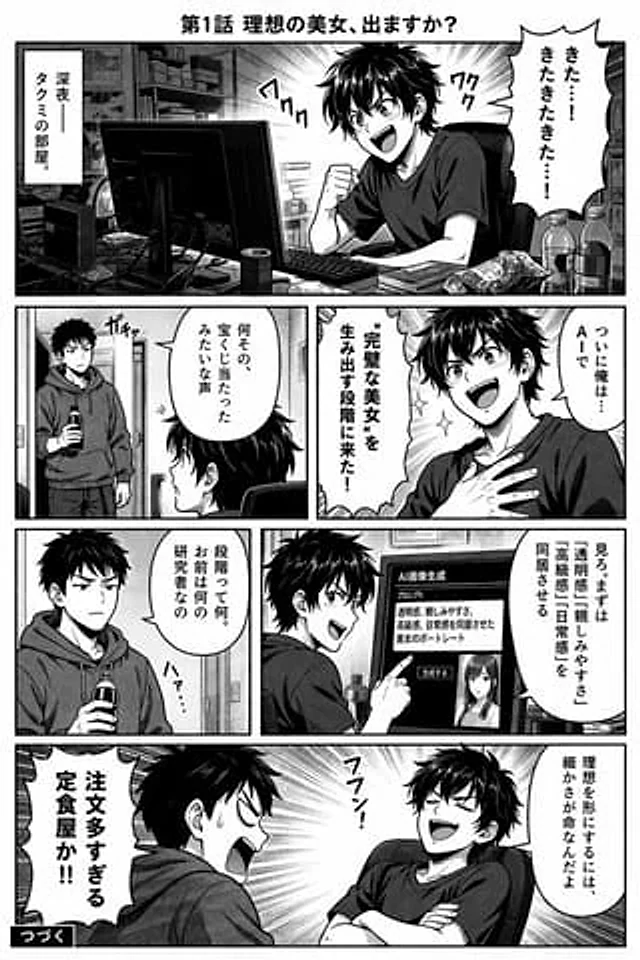

```text
{
  "type": "Comic page",
  "style": "{argument name=\"art style\" default=\"Black and white comic style with halftone dots\"}",
  "header": "{argument name=\"manga title\" default=\"Episode 1: Will the ideal beauty appear?\"}",
  "characters": [
    {
      "name": "{argument name=\"protagonist name\" default=\"タクミ\"}",
      "appearance": "Disheveled dark hair, dark T-shirt, expressive face."
    },
    {
      "name": "roommate",
      "appearance": "Short, dark hair, wearing a hoodie, expressionless."
    }
  ],
  "layout": {
    "format": "Four-panel horizontal layout, read from left to right.",
    "panels": [
      {
        "row": 1,
        "setting": "A cluttered, dark room with a desk holding a computer monitor.",
        "action": "The protagonist sat in front of the computer, clenching his fist in excitement.",
        "text_elements": [
          "きた…！きたきたきた…！",
          "Late at night—Takumi's room."
        ]
      },
      {
        "row": 2,
        "action": "The protagonist proudly placed his hand on his chest. His roommate walked into the room carrying a bottle.",
        "text_elements": [
          "Finally, I... am an AI",
          "{argument name=\"protagonist goal\" default=\"We&#39;ve reached the stage where we can create the &quot;perfect beauty&quot;!\"}",
          "What's with that voice, like you just won the lottery?"
        ]
      },
      {
        "row": 3,
        "action": "The protagonist points to the monitor, which displays an AI-generated portrait of a woman. The roommate seems completely uninterested.",
        "text_elements": [
          "Look. First, we combine \"transparency,\" \"approachability,\" \"luxury,\" and \"everyday feel.\"",
          "What do you mean by \"stages\"? What kind of researcher are you?"
        ]
      },
      {
        "row": 4,
        "action": "The protagonist leaned back smugly. His roommate shouted angrily.",
        "text_elements": [
          "To turn an ideal into reality, attention to detail is essential.",
          "{argument name=\"punchline\" default=\"Is this a diner with way too many orders?!\"}",
          "つづく"
        ]
      }
    ]
  }
}
```

Model: GPT Image 2
Author: GPT Image 2 Prompts

[ProjectD](https://aitoolsradar.com/en/prompts/c7573c86960548) · [Recorded source](https://x.com/trendsan_jpn/status/2045105915502989649#reversed-0)
 · [Full original metadata and byte evidence](data/projectd-batch-0018.json)

## 4-Panel Parody Movie Poster Grid

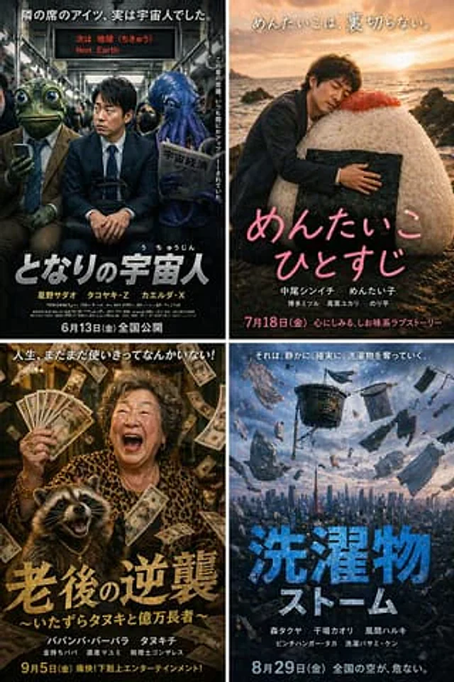

```text
{
  "type": "Movie poster grid",
  "layout": "2x2 grid",
  "posters": [
    {
      "position": "Top left",
      "genre": "Science fiction comedy",
      "visuals": "A Japanese office worker sits nervously on a crowded train, next to two aliens dressed in business attire: a frog-like alien looking at a smartphone and a blue octopus-like alien reading a newspaper.",
      "text_elements": {
        "tagline_top": "The guy sitting next to me was actually an alien.",
        "train_display": "Next up: Earth",
        "tagline_side": "The common sense about this planet has been updated without us even realizing it.",
        "main_title": "{argument name=\"poster 1 title\" default=\"The Alien Next Door\"}",
        "cast": "Sadao Hoshino, Takoyaki Z, Frog Da X",
        "release_date": "Nationwide release on June 13 (Friday)."
      }
    },
    {
      "position": "Top right",
      "genre": "Surreal Romance",
      "visuals": "A man in a dark jacket lovingly embraces a giant mentaiko (spicy cod roe) rice ball. They sit on a rocky beach under the beautiful sunset.",
      "text_elements": {
        "tagline": "Mentaiko never disappoints.",
        "main_title": "{argument name=\"poster 2 title\" default=\"めんたいこ ひとすじ\"}",
        "cast": "Shinichi Nakao, Mentai, Hakata Man, Yukari Takana, Norihei",
        "release_date": "July 18th (Friday): A heartwarming, savory love story."
      }
    },
    {
      "position": "Bottom left",
      "genre": "Robbery Comedy",
      "visuals": "An elderly woman in a leopard-print shirt, her face beaming with joy, is laughing wildly, clutching a wad of Japanese yen bills. The money is raining down around her. In the foreground, a happy raccoon is also present.",
      "text_elements": {
        "tagline": "I haven't used up my life yet!",
        "main_title": "{argument name=\"poster 3 title\" default=\"A Revenge in Old Age\"}",
        "subtitle": "~The Mischievous Tanuki and the Billionaire~",
        "cast": "Barbara, Tanukichi, Rich Older Sister, Mayumi the Heir, Tax Advisor Gonzalez",
        "release_date": "September 5th (Friday) - Exciting! A thrilling entertainment blockbuster!"
      }
    },
    {
      "position": "Bottom right",
      "genre": "Disaster Thriller",
      "visuals": "A dramatic disaster scene: laundry baskets, shirts, and clothes are sucked into the stormy, apocalyptic sky above the ruins of Tokyo (Tokyo Tower visible in the background).",
      "text_elements": {
        "tagline": "It quietly and surely steals the laundry.",
        "main_title": "{argument name=\"poster 4 title\" default=\"Laundry storm\"}",
        "cast": "Takuya Mori, Kaori Kanba, Haruki Kazama, Takashi Coater, Ken Clothespin",
        "release_date": "On Friday, August 29th, the skies across the country were in imminent danger."
      }
    }
  ]
}
```

Model: GPT Image 2
Author: GPT Image 2 Prompts

[ProjectD](https://aitoolsradar.com/en/prompts/adedd30f7756ea) · [Recorded source](https://x.com/pcneko_lab/status/2046257786292769230#reversed-1)
 · [Full original metadata and byte evidence](data/projectd-batch-0018.json)

## 4-Panel Professional Avatar Grid

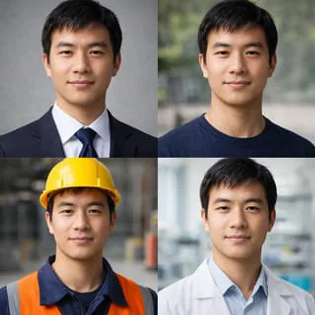

```text
{
  "type": "2x2 portrait grid",
  "subject": "{argument name=\"subject description\" default=\"A young East Asian man with short black hair and a smile.\"}",
  "style": "Photorealistic rendering, high resolution, professional lighting, and consistent facial features across all panels.",
  "layout": {
    "format": "2x2 grid",
    "panel_count": 4,
    "panels": [
      {
        "position": "Top left",
        "description": "{argument name=\"profession 1\" default=\"A business professional, dressed in a dark navy blue suit, white shirt, and blue tie, against a gray textured background.\"}"
      },
      {
        "position": "Top right",
        "description": "{argument name=\"profession 2\" default=\"Dressed casually, wearing a dark blue crew neck T-shirt, with a blurred outdoor park in the background.\"}"
      },
      {
        "position": "Bottom left",
        "description": "{argument name=\"profession 3\" default=\"Construction workers, wearing yellow hard hats, navy blue work shirts, and bright orange high-visibility vests, in a blurred warehouse background.\"}"
      },
      {
        "position": "Bottom right",
        "description": "{argument name=\"profession 4\" default=\"A medical professional, wearing a light blue shirt under a white lab coat, in a blurred laboratory background.\"}"
      }
    ]
  }
}
```

Model: GPT Image 2
Author: GPT Image 2 Prompts

[ProjectD](https://aitoolsradar.com/en/prompts/66414e6ea21580) · [Recorded source](https://x.com/frankfu1688/status/2046171263648080364#reversed-0)
 · [Full original metadata and byte evidence](data/projectd-batch-0018.json)

## 4-Panel SaaS Ad Banner Variations


```text
{
  "type": "4-sided advertising banner variant grid",
  "product": {
    "name": "{argument name=\"product name\" default=\"HP BOOSTER\"}",
    "subtitle": "AI-driven no-code website builder",
    "logo": "Blue and green angle brackets with diamond shapes"
  },
  "common_elements": {
    "device_mockups": "The laptop and smartphone (with the bottom left panel serving as a desktop monitor) showcase a website featuring a city skyline, the text \"The future is in your business,\" and a blue \"Start Now\" button."
  },
  "layout": {
    "grid": "2x2",
    "panels": [
      {
        "position": "Top left",
        "theme": "Deep blue gradient with tech lines",
        "headline": "{argument name=\"main headline 1\" default=\"Create a professional-grade website in as little as 10 minutes.\"}",
        "sub_headline": "AI automatically generates designs, architectures, and copy.",
        "badge": "A golden laurel wreath with the words \"The number of businesses being introduced is continuously increasing!\"",
        "icon_count": 5,
        "icon_labels": [
          "AI-powered automatic creation and optimization",
          "No-code free editing",
          "Design freedom and professionalism",
          "One-stop solution for SEO optimization",
          "Mobile adaptation and high-speed loading"
        ],
        "bottom_bar": "A cyan background with a yellow \"Start for Free Now ▶\" button."
      },
      {
        "position": "Top right",
        "theme": "White and light gray",
        "headline": "{argument name=\"main headline 2\" default=\"With the help of AI, it&#39;s easy for anyone to get started.\"}",
        "pre_headline": "Making website creation simpler.",
        "badge": "A cyan circle with the text \"No professional knowledge or production skills required!\"",
        "icon_count": 4,
        "icon_labels": [
          "AI-powered automatic creation and optimization",
          "No-code free editing",
          "Mobile adaptation and high-speed loading",
          "One-stop solution for SEO optimization"
        ],
        "bottom_bar": "A cyan background with a yellow \"Start for Free ▶\" button."
      },
      {
        "position": "Bottom left",
        "theme": "Bright yellow with comic book-style action lines",
        "headline": "{argument name=\"main headline 3\" default=\"DIY! Create your own website in as little as 10 minutes!\"}",
        "pre_headline": "No need to rely on production companies anymore!",
        "badge": "A pink circle with the text \"AI-generated fully automatically!\"",
        "icon_count": 6,
        "icon_labels": [
          "AI automatically generated",
          "No code",
          "Design freedom",
          "SEO optimization",
          "Mobile adaptation",
          "High-speed loading"
        ],
        "call_to_action": "The pink capsule button says \"Start for free!\" ▶"
      },
      {
        "position": "Bottom right",
        "theme": "Dark gray and black",
        "headline": "{argument name=\"main headline 4\" default=\"Build a website that delivers results.\"}",
        "pre_headline": "If you want to seriously improve your customer acquisition capabilities",
        "badge": "A golden laurel wreath with the words \"The number of businesses being introduced is continuously increasing!\"",
        "icon_count": 4,
        "icon_labels": [
          "AI automatically generates everything from architecture to copywriting.",
          "No-code customization",
          "SEO, speed and security guarantees",
          "Fully support customer acquisition and performance improvement"
        ],
        "bottom_bar": "Gold background, dark blue button \"Start Now for Free ▶\""
      }
    ]
  }
}
```

Model: GPT Image 2
Author: GPT Image 2 Prompts

[ProjectD](https://aitoolsradar.com/en/prompts/b87fcdf78fa467) · [Recorded source](https://x.com/t_ceo_serial/status/2046151875104539030#reversed-0)
 · [Full original metadata and byte evidence](data/projectd-batch-0018.json)

## 4-Panel Woodcut Portrait Wallpaper


```text
A desktop wallpaper featuring a horizontal four-panel split layout and thick black borders. It showcases a half-body portrait using high contrast.{argument name="art style" default="Woodcut prints"} The style, employing bold lines and crosshatch patterns, conveys a confident and sophisticated atmosphere. From left to right: background with textured orange {argument name="subject 1" default="Jack Ma"} The background is textured red, and the person is wearing a suit.{argument name="subject 2" default="Elon Musk"} A person wearing a black shirt against a textured blue background.{argument name="subject 3" default="Mark Zuckerberg"} ; and a person wearing glasses and a suit with a textured green background.{argument name="subject 4" default="Ma Huateng"} The main character is presented in a monochrome beige tone, creating a strong contrast with the vibrant backgrounds of each split screen.
```

Model: GPT Image 2
Author: GPT Image 2 Prompts

[ProjectD](https://aitoolsradar.com/en/prompts/a8a9d5d899b5b3) · [Recorded source](https://x.com/Masss79520867/status/2044666076861272314#reversed-2)
 · [Full original metadata and byte evidence](data/projectd-batch-0018.json)

## 4-Panel Yuri School Manga

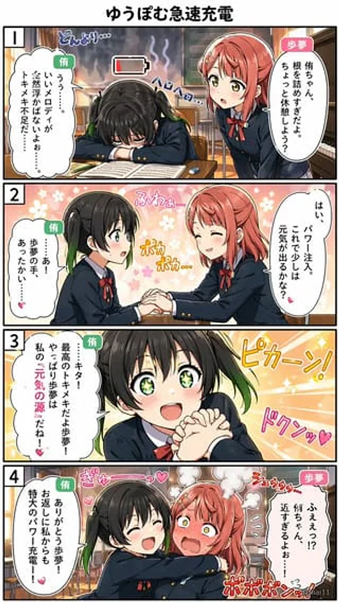

```text
{
  "type": "Four-panel comic strip, school romance comedy manga page",
  "format": "Vertical comic pages",
  "style": "Clean and exquisite anime illustrations, expressive romantic comedy, soft shadows, bright classroom lighting, and a cute yet slightly chaotic yuri atmosphere.",
  "page": {
    "background": "White pages, black panel borders",
    "title_top": "{argument name=\"headline text\" default=\"Yubumu&#39;s Rapid Charging\"}",
    "panel_count": 4,
    "reading_direction": "From top to bottom"
  },
  "characters": [
    {
      "name": "{argument name=\"black-haired girl name\" default=\"Yu\"}",
      "appearance": "The young female student has black twin ponytails with green highlights at the ends, and wears a dark blue school uniform with a white shirt and red ribbon.",
      "personality": "Initially lacking energy, she later became deeply affectionate and overflowing with emotion."
    },
    {
      "name": "{argument name=\"pink-haired girl name\" default=\"Bu Meng\"}",
      "appearance": "The young female student has a pink short bob haircut with small hair clips, and wears a dark blue school uniform with a white shirt and red ribbon.",
      "personality": "She is gentle and considerate, but feels shocked and flustered when hugged tightly."
    }
  ],
  "setting": "Music classrooms or regular classrooms, equipped with desks, paper, and warm afternoon light.",
  "layout": {
    "sections": [
      {
        "title": "1",
        "position": "First frame",
        "count": 2,
        "labels": [
          "Yu",
          "Bu Meng"
        ],
        "scene": "The black-haired girl, exhausted, slumped over her desk, sheet music or papers in front of her. Above her head was a nearly depleted battery icon, accompanied by somber text and a dejected atmosphere. The pink-haired girl leaned over from her right, speaking to her with a worried expression.",
        "background": "The classroom interior features desks and soft, warm colors.",
        "text_elements_count": 5,
        "text_elements": [
          "gloomy…",
          "Exhausted...",
          "Empty battery icon",
          "Yu's speech bubble",
          "Bu Meng's dialogue bubbles"
        ]
      },
      {
        "title": "2",
        "position": "Second square",
        "count": 2,
        "labels": [
          "Yu",
          "Bu Meng"
        ],
        "scene": "Two girls sit facing each other, holding hands across the table. The pink-haired girl smiles warmly with her eyes closed, as if transmitting energy. The black-haired girl looks deeply moved and revitalized. The background transforms into a soft pink floral pattern, shimmering with warmth.",
        "background": "Cute floral patterns and a warm, glowing effect.",
        "text_elements_count": 4,
        "text_elements": [
          "Whew…",
          "Warm and cozy...",
          "Bu Meng's dialogue bubbles",
          "Yu's speech bubble"
        ]
      },
      {
        "title": "3",
        "position": "Third section",
        "count": 1,
        "labels": [
          "Yu"
        ],
        "scene": "A dramatic close-up of the black-haired girl, her hands pressed tightly against her chest by the pink-haired girl's, her eyes revealing a sudden realization and excitement. A burst of golden light and flashing sparks erupts in the background, like a flash of inspiration.",
        "background": "Radial yellow-orange background with a shimmering effect",
        "text_elements_count": 3,
        "text_elements": [
          "bite!",
          "My heart fluttered ♥",
          "Yu's speech bubble"
        ]
      },
      {
        "title": "4",
        "position": "Fourth square",
        "count": 2,
        "labels": [
          "Yu",
          "Bu Meng"
        ],
        "scene": "The black-haired girl suddenly opened her arms and hugged the pink-haired girl tightly. Her smile was radiant, full of joy and energy. The pink-haired girl was overwhelmed by the force, her eyes widened in panic, her cheeks flushed, and there were cartoonish steam and impact effects all around.",
        "background": "The classroom interior features comedic impact lines and steam eruption effects.",
        "text_elements_count": 5,
        "text_elements": [
          "Hug me tight ♥",
          "call--…",
          "Bang!",
          "Yu's speech bubble",
          "Bu Meng's dialogue bubbles"
        ]
      }
    ],
    "consistency": "Both girls wear matching school uniforms in all four scenes, maintaining consistency."
  },
  "composition_notes": "Thick black panel frames, large Japanese-style speech bubbles, adorable handmade onomatopoeia, and a highly readable comic-book rhythm—from exhaustion to a comforting handshake, then to a sudden romantic overload and a powerful embrace, the emotions build layer by layer.",
  "quality": "High-detail anime and manga illustrations, suitable for social media comic publishing."
}
```

Model: GPT Image 2
Author: GPT Image 2 Prompts

[ProjectD](https://aitoolsradar.com/en/prompts/0a4cbd5d95848d) · [Recorded source](https://x.com/tiiai112/status/2047650146452955496#reversed-0)
 · [Full original metadata and byte evidence](data/projectd-batch-0018.json)

## 4-Quadrant RPG Character Design Sheet

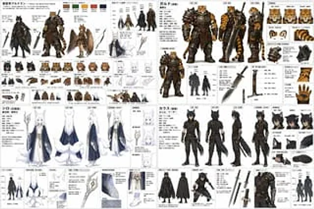

```text
{
  "type": "Four Quadrant Character Design Reference Table",
  "style": "{argument name=\"art style\" default=\"Anime concept art, detailed character design\"}",
  "layout": {
    "structure": "2x2 grid",
    "quadrants": [
      {
        "position": "Top left",
        "title": "{argument name=\"world title\" default=\"獣响界アルドラン- 兽响界Aldran\"}",
        "sections": [
          {
            "name": "Color scheme",
            "count": 5,
            "type": "Color chart"
          },
          {
            "name": "Height proportion",
            "count": 4,
            "type": "Character silhouette"
          },
          {
            "name": "Character Introduction",
            "count": 4,
            "type": "Portrait of a person holding a weapon",
            "labels": [
              "HC-01 Karasu",
              "HC-02 Gardo",
              "HC-03 Aira",
              "HC-04 Shiro"
            ]
          },
          {
            "name": "expression",
            "count": 4,
            "type": "Each character has 3 different expressions"
          },
          {
            "name": "Body details",
            "count": 4,
            "type": "Three close-up shots of each character"
          },
          {
            "name": "Team/Equipment",
            "count": 3,
            "type": "Team and equipment illustrations"
          }
        ]
      },
      {
        "position": "Top right",
        "title": "{argument name=\"character 1 name\" default=\"Gard (Tiger Clan)\"}",
        "description": "Tiger Clan Heavy Armor Warrior",
        "sections": [
          {
            "name": "whole body",
            "count": 3,
            "labels": [
              "Full body front",
              "Full back",
              "left side of the body"
            ]
          },
          {
            "name": "3/4 view",
            "count": 1,
            "labels": [
              "Three-view drawing aid (oblique front)"
            ]
          },
          {
            "name": "expression",
            "count": 3,
            "labels": [
              "Normally (ordinary)",
              "Combat (Focus)",
              "Rare gentleness (trust)"
            ]
          },
          {
            "name": "Body details",
            "count": 2,
            "labels": [
              "Ear shape and inner fur color",
              "Tail stripe pattern"
            ]
          },
          {
            "name": "Equipment details",
            "count": 2,
            "labels": [
              "Right shoulder armor details",
              "Right-hand amulet/hand features"
            ]
          },
          {
            "name": "arms",
            "count": 1,
            "labels": [
              "Greatsword \"Kouran\""
            ]
          },
          {
            "name": "Proportion",
            "count": 1,
            "labels": [
              "Scale comparison"
            ]
          }
        ]
      },
      {
        "position": "Bottom left",
        "title": "{argument name=\"character 2 name\" default=\"Hiro (White Fox Clan)\"}",
        "description": "White Fox Clan Mage",
        "sections": [
          {
            "name": "whole body",
            "count": 3,
            "labels": [
              "Full body front",
              "Full back",
              "left side of the body"
            ]
          },
          {
            "name": "3/4 view",
            "count": 1,
            "labels": [
              "Three-view drawing aid (oblique front)"
            ]
          },
          {
            "name": "expression",
            "count": 3,
            "labels": [
              "Usually (quiet)",
              "When magic is concentrated",
              "Rare smile"
            ]
          },
          {
            "name": "Body details",
            "count": 2,
            "labels": [
              "Tail layout",
              "Ear shape"
            ]
          },
          {
            "name": "Equipment details",
            "count": 2,
            "labels": [
              "Inner sleeve seal pattern",
              "Clothing details / Feet"
            ]
          },
          {
            "name": "arms",
            "count": 1,
            "labels": [
              "The magic wand \"Tokonjou\""
            ]
          },
          {
            "name": "Proportion",
            "count": 1,
            "labels": [
              "Scale comparison"
            ]
          }
        ]
      },
      {
        "position": "Bottom right",
        "title": "{argument name=\"character 3 name\" default=\"Karas (Wolf Clan)\"}",
        "description": "Wolf protagonist",
        "sections": [
          {
            "name": "whole body",
            "count": 3,
            "labels": [
              "Full body front",
              "Full back",
              "left side of the body"
            ]
          },
          {
            "name": "3/4 view",
            "count": 1,
            "labels": [
              "Three-view drawing aid (oblique front)"
            ]
          },
          {
            "name": "expression",
            "count": 3,
            "labels": [
              "Usually (be vigilant)",
              "Combat Focus",
              "Rare relaxation"
            ]
          },
          {
            "name": "Body details",
            "count": 2,
            "labels": [
              "Ear movement status",
              "Tail tip texture"
            ]
          },
          {
            "name": "Equipment details",
            "count": 3,
            "labels": [
              "Travel cloak",
              "Battle stance",
              "Equipment details / Boot sole design"
            ]
          },
          {
            "name": "arms",
            "count": 1,
            "labels": [
              "The weapon \"Kibakiri\""
            ]
          },
          {
            "name": "Proportion",
            "count": 1,
            "labels": [
              "Scale comparison"
            ]
          }
        ]
      }
    ]
  }
}
```

Model: GPT Image 2
Author: GPT Image 2 Prompts

[ProjectD](https://aitoolsradar.com/en/prompts/ef6bb0e1e392c5) · [Recorded source](https://x.com/old_pgmrs_will/status/2044947505931317657#reversed-0)
 · [Full original metadata and byte evidence](data/projectd-batch-0018.json)

## 4×4 动作分解参考表

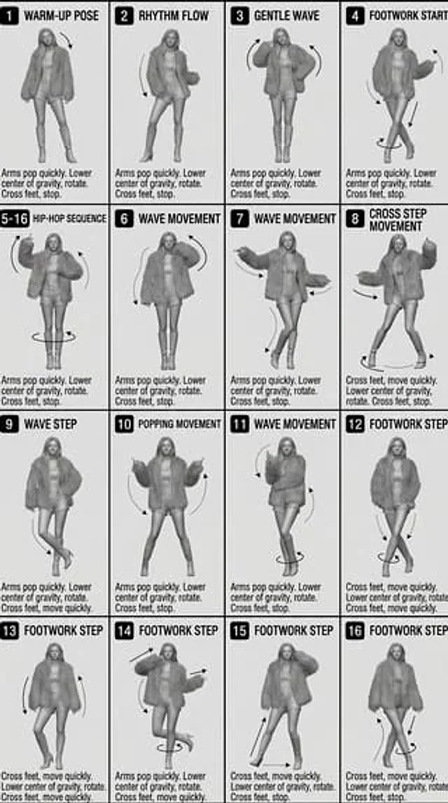

```text
[STYLE]
Monochrome grayscale illustration, 3D-rendered character, clean instructional reference sheet, white background, comic-style cell grid layout, technical diagram aesthetic.

[LAYOUT]
4×4 grid layout with a total of 16 panels. Each panel is separated by thin black border lines. Cells are numbered from 1 to 16, with consistent panel sizes.

[CHARACTER]
image1 (the same character appears consistently in all panels)

[PANEL STRUCTURE – per cell]
Top-left: bold number badge + English title text
Center: full-body character pose illustration
Bottom-left: English description text (3–4 lines)
Overlay: directional arrows indicating movement

[ARROWS / MOTION INDICATORS]
Curved arrows, straight arrows, and circular rotation indicators placed around the character to show motion flow and direction.

[RENDERING STYLE]
Highly detailed 3D sculpted style, soft studio lighting, subtle shadows, no color, grayscale shading, clean linework, game concept art quality.

[NEGATIVE]
No background scenery, no color tones, no additional characters, no complex background.
```

Model: GPT Image 2
Author: @oggii_0

[ProjectD](https://aitoolsradar.com/en/prompts/56697f22d4285d) · [Recorded source](https://x.com/oggii_0/status/2048614158699217302)
 · [Full original metadata and byte evidence](data/projectd-batch-0018.json)

## 4K Nike Sneaker Advertisement Prompt

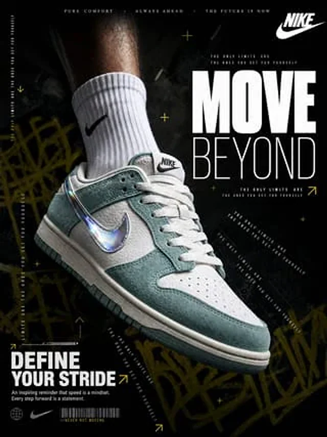

```text
A hyper-realistic Nike sneaker ad, shot with a dark, emotional editorial style. In the image, a male leg wearing crisp white athletic socks (with subtle Nike logo details) floats against a near-black charcoal gray background, angled sharply at a 45-degree angle. The lower two-thirds of the image focuses on the main subject—a pair of Nike low-top sneakers in a clean two-tone color scheme.{argument name="color scheme" default="Glacier blue suede patchwork with off-white lychee-patterned leather"} The iridescent chrome Swoosh logo captures the ambient light. The composition employs a shallow depth of field, focusing clearly on the shoe while the area above the leg is softly blurred. The background is overlaid with a subtle urban texture—electric yellow and soft olive graffiti brushstrokes are faintly visible in the deep shadows. Multiple lines of extra-small, all-caps lettering surround the sneaker at different angles, with text such as "..."{argument name="slogan" default="THE ONLY LIMITS ARE THE ONES YOU SET FOR YOURSELF"} "—Conveying dynamism, speed, and energy. Some text is arranged vertically, while others are tilted at a 30-degree angle, giving the composition a chaotic yet deliberate sense of graphic design. In the upper right corner, the prominent Nike lettering and Swoosh logo are presented in pure white against a dark background. At the top center, a thin horizontal navigation text bar reads: "PURE COMFORT · ALWAYS AHEAD · THE FUTURE IS NOW," in a wide-spaced, all-caps serif font. A striking headline is placed in the center right, using contrasting typography—a huge, extra-bold white "MOVE," followed by a thinner "BEYOND," creating a dramatic typographic hierarchy. Small yellow plus signs (+) and diagonal arrows (↗) are scattered throughout the image as decorative details, adding a modern magazine aesthetic. In the lower left corner is a striking brand slogan combination: "DEFINE YOUR STRIDE," in large, bold, sans-serif white text, with a thin-lined subheading below: "An" An inspiring reminder that speed is a mindset. Every step forward is a statement. The overall lighting effects are dramatic and directional—a single cool-toned main light from the left makes the Swoosh shimmer, and the white leather shines in the darkness. Photorealistic. Commercial photography quality. High contrast. 4K resolution, 3:4 portrait format, optimized for social media.
```

Model: GPT Image 2
Author: GPT Image 2 Prompts

[ProjectD](https://aitoolsradar.com/en/prompts/18babc89cfe736) · [Recorded source](https://x.com/rovvmut_/status/2048018776785064328)
 · [Full original metadata and byte evidence](data/projectd-batch-0018.json)

## 5-Panel Manga Page: Creepy Delivery Man

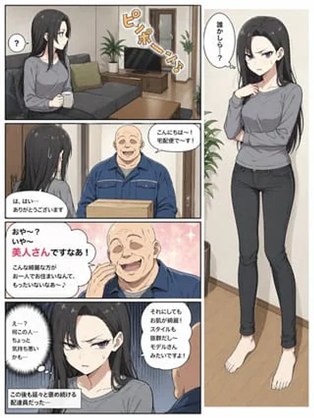

```text
{
  "type": "manga page",
  "style": "anime illustration, full color",
  "characters": {
    "woman": {
      "appearance": "long{argument name=\"hair color\" default=\"black\"} Hair, purple eyes",
      "outfit": "{argument name=\"shirt color\" default=\"grey\"} Long-sleeved shirt, dark gray skinny jeans, barefoot"
    },
    "delivery_man": {
      "appearance": "Bald, older male, thick eyebrows",
      "outfit": "Blue work jacket, layered over a gray shirt"
    }
  },
  "layout": {
    "description": "The page is vertically divided. The left side contains four stacked horizontal panels. The right side is a tall vertical panel.",
    "left_column_panels": [
      {
        "panel_number": 1,
        "scene": "The woman sat on a gray sofa in the living room, holding a white mug in her hand.",
        "text_elements": [
          {
            "type": "speech_bubble",
            "text": "？"
          },
          {
            "type": "sound_effect",
            "text": "Ding dong♪",
            "description": "doorbell"
          }
        ]
      },
      {
        "panel_number": 2,
        "scene": "The woman opened the front door. The deliveryman stood outside, holding a cardboard box and smiling.",
        "text_elements": [
          {
            "type": "speech_bubble",
            "speaker": "delivery_man",
            "text": "{argument name=\"delivery greeting\" default=\"Hello! Your package has arrived!\"}"
          },
          {
            "type": "speech_bubble",
            "speaker": "woman",
            "text": "Ah, okay... thank you."
          }
        ]
      },
      {
        "panel_number": 3,
        "scene": "A close-up of the deliveryman laughing heartily against a backdrop of shimmering pink.",
        "text_elements": [
          {
            "type": "speech_bubble",
            "speaker": "delivery_man",
            "text": "{argument name=\"creepy compliment\" default=\"Oh my! Oh my, what a beautiful woman! It&#39;s such a shame that someone as beautiful as you lives alone~♪\"}"
          }
        ]
      },
      {
        "panel_number": 4,
        "scene": "A close-up of the woman, showing disgust and discomfort, slightly sweating. The back of the deliveryman's head is visible in the foreground.",
        "text_elements": [
          {
            "type": "speech_bubble",
            "speaker": "delivery_man",
            "text": "By the way, your skin is amazing! And your figure is incredible—you look like a model!"
          },
          {
            "type": "thought_bubble",
            "speaker": "woman",
            "text": "{argument name=\"woman reaction\" default=\"Huh...? Who is this person...? They seem kind of disgusting...\"}"
          },
          {
            "type": "caption_box",
            "text": "Even after that, the deliveryman continued to ramble on and on about praising it…"
          }
        ]
      }
    ],
    "right_column_panel": {
      "panel_number": 5,
      "scene": "A full-body portrait of a woman standing indoors, arms crossed, with an angry and suspicious expression.",
      "text_elements": [
        {
          "type": "thought_bubble",
          "speaker": "woman",
          "text": "Who could it be...?"
        }
      ]
    }
  }
}
```

Model: GPT Image 2
Author: GPT Image 2 Prompts

[ProjectD](https://aitoolsradar.com/en/prompts/703bba61801d99) · [Recorded source](https://x.com/studiomasakaki/status/2046172302837191085#reversed-0)
 · [Full original metadata and byte evidence](data/projectd-batch-0018.json)

## 5-Panel Mixed Style Collage

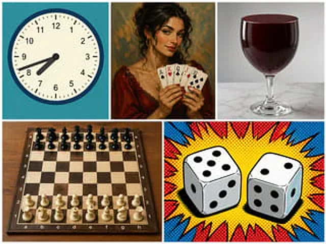

```text
{
  "type": "5 Panel Collage",
  "layout": "A grid containing 3 top panels and 2 bottom panels.",
  "panels": [
    {
      "position": "Top left",
      "subject": "Analog clock",
      "details": "Cyan background, time displayed{argument name=\"clock time\" default=\"7:42\"}",
      "style": "Flat vector illustration"
    },
    {
      "position": "Upper-middle",
      "subject": "A woman holding playing cards",
      "details": "Holding 5 cards:{argument name=\"card hand\" default=\"Ace of Spades, King of Hearts, Queen of Clubs, Jack of Diamonds, Ten of Spades\"}",
      "style": "Classic oil portrait"
    },
    {
      "position": "Top right",
      "subject": "A glass of red liquid",
      "details": "{argument name=\"glass type\" default=\"goblet\"} The marble surface is filled with a deep red liquid.",
      "style": "Photorealistic photography"
    },
    {
      "position": "Bottom left",
      "subject": "Chessboard",
      "details": "The wooden project contains 32 pieces in standard initial positions.",
      "style": "Photorealistic high-angle shots"
    },
    {
      "position": "Bottom right",
      "subject": "Two dice",
      "details": "The top of the dice on the left shows{argument name=\"left die top\" default=\"5\"} The top of the die on the right shows{argument name=\"right die top\" default=\"2\"}",
      "style": "Pop art comic halftone style with red and blue explosion effects"
    }
  ]
}
```

Model: GPT Image 2
Author: GPT Image 2 Prompts

[ProjectD](https://aitoolsradar.com/en/prompts/b6d08822796cd5) · [Recorded source](https://x.com/Gc_qube/status/2046205568474403194#reversed-2)
 · [Full original metadata and byte evidence](data/projectd-batch-0018.json)

## 5-Year-Old Crayon Drawing Style


```text
Redraw the attached image as if a 5-year-old drew it with crayons during math class while not paying attention. White background. Proportions should be hilariously wrong, colors outside the lines, faces that look more like potatoes than humans. The kind of drawing a proud parent puts on the fridge. Actually, never mind, just scribble something.
```

Model: GPT Image 2
Author: libapi

[ProjectD](https://aitoolsradar.com/en/prompts/1bf39681951877) · [Recorded source](https://youmind.com/prompts/5-year-old-crayon-drawing-17603)
 · [Full original metadata and byte evidence](data/projectd-batch-0018.json)

## 56 Chinese Ethnic Groups Clothing Chart

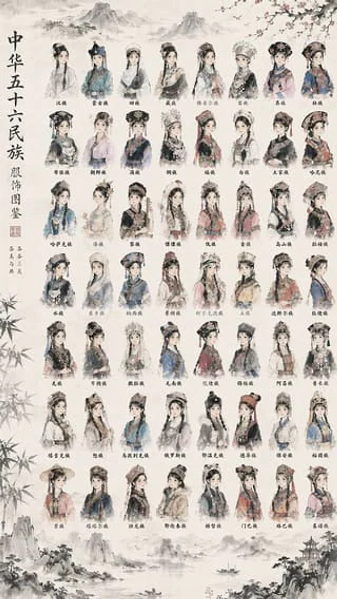

```text
{
  "type": "Illustration Guide Poster",
  "style": "{argument name=\"art style\" default=\"Traditional Chinese ink painting\"} Elegant watercolors, soft tones, vintage paper texture.",
  "layout": {
    "background": "Against a backdrop of misty, rain-kissed mountains, plum blossoms adorn the upper right corner, bamboo branches decorate the left edge, and a small pavilion and a flat boat are depicted in the lower right corner.",
    "typography": {
      "main_title": "{argument name=\"main title\" default=\"A Pictorial Guide to the Costumes of China&#39;s 56 Ethnic Groups\"}",
      "subtitle": "Each has its own beauty, and together we can appreciate beauty.",
      "alignment": "Vertical text, located on the far left"
    },
    "grid": {
      "rows": 7,
      "columns": 8,
      "total_items": 56,
      "item_description": "{argument name=\"subject description\" default=\"Half-length portraits of young women dressed in traditional ethnic costumes and wearing exquisite headdresses\"}",
      "labels": [
        "Han Chinese",
        "Mongolian",
        "Hui people",
        "Tibetan",
        "Uighur",
        "Miao ethnic group",
        "Yi ethnic group",
        "Zhuang ethnic group",
        "Buyi ethnic group",
        "Korean ethnicity",
        "Manchu",
        "Dong ethnic group",
        "Yao ethnic group",
        "Bai ethnic group",
        "Tujia people",
        "Hani ethnic group",
        "Kazakh",
        "Dai ethnic group",
        "Li ethnic group",
        "Lisu ethnic group",
        "Wa ethnic group",
        "She ethnic group",
        "Gaoshan people",
        "Lahu ethnic group",
        "Aquatic",
        "Dongxiang ethnic group",
        "Naxi people",
        "Jingpo ethnic group",
        "Kyrgyz",
        "Tu ethnic group",
        "Daur people",
        "Mulam ethnic group",
        "Qiang people",
        "Blang ethnic group",
        "Salar people",
        "Maonan ethnic group",
        "Gelao ethnic group",
        "Xibe people",
        "Achang ethnic group",
        "Pumi ethnic group",
        "Tajik people",
        "Nu ethnic group",
        "Uzbek",
        "Russian ethnicity",
        "Evenki",
        "De'ang ethnic group",
        "Baoan ethnic group",
        "Yugur ethnic group",
        "Jing ethnic group",
        "Tatars",
        "Dulong ethnic group",
        "Oroqen people",
        "Hezhe ethnic group",
        "Monpa people",
        "Lhoba ethnic group",
        "Jino ethnic group"
      ]
    }
  }
}
```

Model: GPT Image 2
Author: GPT Image 2 Prompts

[ProjectD](https://aitoolsradar.com/en/prompts/da266ac62762ba) · [Recorded source](https://x.com/XiaohuiAI666/status/2045444003211129033#reversed-0)
 · [Full original metadata and byte evidence](data/projectd-batch-0018.json)

## 56 Chinese Ethnic Groups Clothing Chart


```text
{
  "type": "illustrated reference chart",
  "art_style": "{argument name=\"art style\" default=\"traditional Chinese ink wash painting, delicate brushwork, soft watercolor tones, vintage aged paper texture\"}",
  "background_elements": "faded landscape painting at the top and bottom featuring distant mountains, a small boat on water, a traditional pavilion, bamboo leaves framing the left edge, and plum blossom branches at the top right",
  "layout": {
    "left_sidebar": {
      "main_title": "{argument name=\"main title\" default=\"中华五十六民族 服饰图鉴\"}",
      "subtitle": "各美其美 美美与共",
      "decorations": "red seal stamp"
    },
    "center_grid": {
      "description": "{argument name=\"subject description\" default=\"half-body portraits of young women wearing distinct, highly detailed traditional ethnic clothing and elaborate headdresses\"}",
      "rows": 7,
      "columns": 8,
      "total_items": 56,
      "labels": [
        "汉族", "蒙古族", "回族", "藏族", "维吾尔族", "苗族", "彝族", "壮族",
        "布依族", "朝鲜族", "满族", "侗族", "瑶族", "白族", "土家族", "哈尼族",
        "哈萨克族", "傣族", "黎族", "傈僳族", "佤族", "畲族", "高山族", "拉祜族",
        "水族", "东乡族", "纳西族", "景颇族", "柯尔克孜族", "土族", "达斡尔族", "仫佬族",
        "羌族", "布朗族", "撒拉族", "毛南族", "仡佬族", "锡伯族", "阿昌族", "普米族",
        "塔吉克族", "怒族", "乌孜别克族", "俄罗斯族", "鄂温克族", "德昂族", "保安族", "裕固族",
        "京族", "塔塔尔族", "独龙族", "鄂伦春族", "赫哲族", "门巴族", "珞巴族", "基诺族"
      ]
    }
  }
}
```

Model: GPT Image 2
Author: 程序员小灰

[ProjectD](https://aitoolsradar.com/en/prompts/1eece872d53a2f) · [Recorded source](https://youmind.com/prompts/56-ethnic-attire-chart-13896)
 · [Full original metadata and byte evidence](data/projectd-batch-0018.json)

## 6-Grid Corporate Logo Concept Sheet

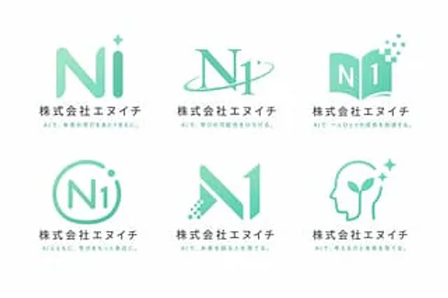

```text
{
  "type": "Logo Concept Showcase",
  "theme": "{argument name=\"行业主题\" default=\"AI Education School\"}",
  "color_palette": "{argument name=\"主色调\" default=\"Mint Green\"} Gradient colors, dark gray text, white background",
  "layout": {
    "grid": "2 rows and 3 columns",
    "count": 6,
    "common_elements": [
      "graphic logo",
      "Main title:{argument name=\"公司名称\" default=\"N1 Co., Ltd.\"}",
      "Subtitle: A Unique Japanese Subtitle About AI and Learning"
    ],
    "variants": [
      {
        "position": "Top left",
        "mark": "The rounded \"Ni\" lettering with four star-like dots"
      },
      {
        "position": "Upper-middle",
        "mark": "The serif body \"N1\" intersected by the track ring."
      },
      {
        "position": "Top right",
        "mark": "An open book forming the shape of \"N1\", with scattered digital pixels."
      },
      {
        "position": "Bottom left",
        "mark": "The \"N1\" is marked with dots and enclosed in a circular outline."
      },
      {
        "position": "Middle to lower",
        "mark": "The left leg features a geometric shape \"N1\" with a digital dot matrix effect."
      },
      {
        "position": "Bottom right",
        "mark": "A human head silhouette featuring sprouting plants and starlight."
      }
    ]
  }
}
```

Model: GPT Image 2
Author: GPT Image 2 Prompts

[ProjectD](https://aitoolsradar.com/en/prompts/95e04056790656) · [Recorded source](https://x.com/fumanpnp/status/2045508913634898221#reversed-0)
 · [Full original metadata and byte evidence](data/projectd-batch-0018.json)

## 6-Panel Chibi VTuber Comic Strip

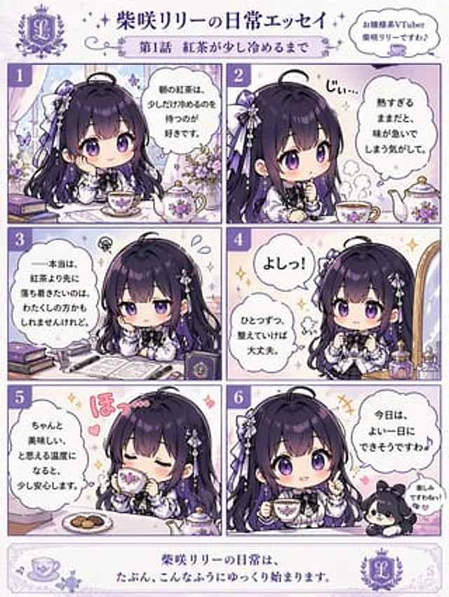

```text
{
  "type": "6-panel chibi comic",
  "header": {
    "logo": "L badge",
    "main_title": "{argument name=\"main title\" default=\"Shibasaki Lily&#39;s Daily Musings\"}",
    "subtitle": "{argument name=\"subtitle\" default=\"Episode 1: Before the Black Tea Goes Cold\"}",
    "top_right_bubble": "I am a rich girl type VTuber{argument name=\"character name\" default=\"Shibasaki Riri\"} ♪"
  },
  "character": {
    "style": "Q-version anime girl",
    "hair": "{argument name=\"hair color\" default=\"Dark purple\"} Long hair, headband",
    "eyes": "Purple",
    "outfit": "{argument name=\"outfit\" default=\"A white and purple gothic Lolita dress with a black bow.\"}"
  },
  "layout": {
    "grid": "2 columns, 3 rows",
    "panels": [
      {
        "number": 1,
        "pose": "resting his chin on his hand, looking at the teacup",
        "dialogue": "I like to wait for my black tea to cool down a little when I drink it in the morning."
      },
      {
        "number": 2,
        "pose": "Staring intently at the tea",
        "sound_effect": "Staring...",
        "dialogue": "If it's too hot, the tea always seems to taste rushed."
      },
      {
        "number": 3,
        "pose": "Lost in thought, head in hand, an open book on the table.",
        "dialogue": "Actually, more than black tea, it's me who needs to calm down."
      },
      {
        "number": 4,
        "pose": "Be firm, clench your fist",
        "sound_effect": "good!",
        "dialogue": "As long as you organize things one by one, there won't be any problems."
      },
      {
        "number": 5,
        "pose": "Drink tea with your eyes closed and relax.",
        "sound_effect": "call……",
        "dialogue": "When the temperature is just right to bring out the deliciousness, I feel a sense of peace."
      },
      {
        "number": 6,
        "pose": "Smiling, holding a teacup, finger pointing upwards, with a black and white puppy mascot beside her.",
        "mascot_dialogue": "I'm really looking forward to it!",
        "dialogue": "Today will definitely be a wonderful day♪"
      }
    ]
  },
  "footer": {
    "text": "This is roughly how Shibasaki Lily's daily life slowly began.",
    "decorations": "Teacup icon on the left, L badge on the right"
  }
}
```

Model: GPT Image 2
Author: GPT Image 2 Prompts

[ProjectD](https://aitoolsradar.com/en/prompts/aee886f0703f09) · [Recorded source](https://x.com/wtry1102/status/2046140825952989627#reversed-1)
 · [Full original metadata and byte evidence](data/projectd-batch-0018.json)

## 6-Panel Comedy Manga Page

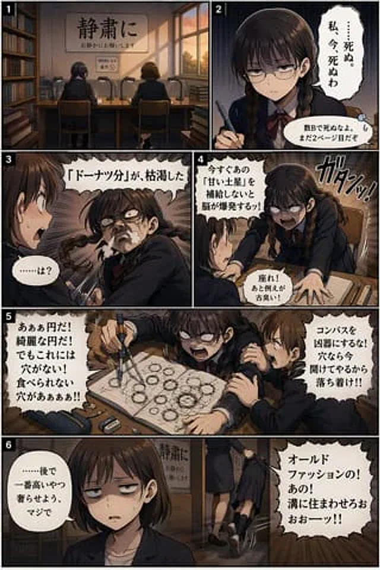

```text
{
  "type": "6-panel comic strip",
  "characters": {
    "character_A": "{argument name=\"主角\" default=\"Girl with pigtails and glasses\"} Dark school uniform, red bow tie",
    "character_B": "{argument name=\"朋友角色\" default=\"Girl with short brown hair\"} Dark school uniform"
  },
  "setting": "{argument name=\"场景\" default=\"School Library Study Area\"} Wooden desk, bookshelf",
  "layout": {
    "sections": [
      {
        "panel": 1,
        "position": "Top left",
        "description": "A wide-angle lens captured from behind, showing girls learning. A sign on the wall reads, '{argument name=\"标语内容\" default=\"Be quiet.\"} '."
      },
      {
        "panel": 2,
        "position": "Top right",
        "description": "A close-up of character A, who looks exhausted, holding a pen and complaining about studying."
      },
      {
        "panel": 3,
        "position": "Left and Middle",
        "description": "Character A looks crazed, with smoke coming out of his nostrils, and is craving a donut. Character B looks shocked."
      },
      {
        "panel": 4,
        "position": "Right Center",
        "description": "Character A suddenly stands up and slams her hand on the table. Character B tries to calm her down."
      },
      {
        "panel": 5,
        "position": "lower upper",
        "description": "Widescreen. Character A frantically draws overlapping circles with a compass. Character B grabs her arm."
      },
      {
        "panel": 6,
        "position": "Lower",
        "description": "Widescreen. Character B is expressionless in the foreground. Background: Character A is being dragged away by the teacher."
      }
    ]
  }
}
```

Model: GPT Image 2
Author: GPT Image 2 Prompts

[ProjectD](https://aitoolsradar.com/en/prompts/8d73354ca637ef) · [Recorded source](https://x.com/FET_SHIZAIBU/status/2045514811031830755#reversed-0)
 · [Full original metadata and byte evidence](data/projectd-batch-0018.json)

## 7-Day Fashion Lookbook Infographic

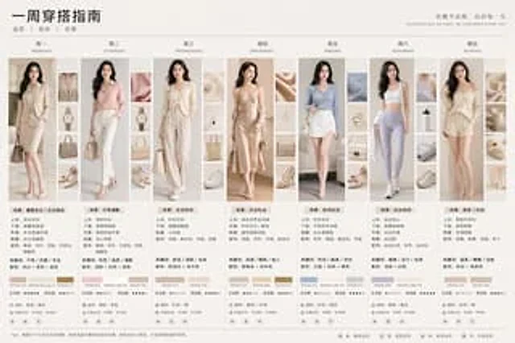

```text
{
  "type": "7-Day Fashion Outfit Guide Infographic",
  "header": {
    "title": "{argument name=\"main title\" default=\"Weekly Outfit Guide\"}",
    "subtitle": "{argument name=\"style keywords\" default=\"Gentle | Beautiful | Elegant\"}",
    "slogan_cn": "Elegance knows no bounds, confidence every day",
    "slogan_en": "{argument name=\"english slogan\" default=\"ELEGANCE HAS NO LIMIT, BE CONFIDENT EVERY DAY\"}"
  },
  "subject": "{argument name=\"subject description\" default=\"Young and elegant Asian women\"}",
  "layout": {
    "columns": 7,
    "column_elements": [
      "Date Title",
      "Main visual portrait",
      "4 detailed thumbnails",
      "Outfit Specifications",
      "Keywords and color scheme",
      "3 color blocks",
      "Star rating",
      "Fabric and Price",
      "4 Season Icons"
    ],
    "days": [
      {
        "day": "Monday",
        "outfit": "beige suit",
        "scene": "Scenario: Important meetings / Formal business"
      },
      {
        "day": "Tuesday",
        "outfit": "Pink suit",
        "scene": "Scenario: Daily commute"
      },
      {
        "day": "Wednesday",
        "outfit": "Cream-colored knitted cardigan set",
        "scene": "Scene: Lifestyle and Leisure"
      },
      {
        "day": "Thursday",
        "outfit": "Champagne-colored slip dress",
        "scene": "Scene: A secret rendezvous"
      },
      {
        "day": "Friday",
        "outfit": "Blue knit top, white midi skirt",
        "scene": "Scene: Casual social interaction"
      },
      {
        "day": "Saturday",
        "outfit": "White sports bra, purple leggings",
        "scene": "Scene: Sports and Leisure"
      },
      {
        "day": "Sunday",
        "outfit": "Beige home knitted set",
        "scene": "Scene: At home / Dating"
      }
    ]
  },
  "footer": {
    "tips": "{argument name=\"footer tips\" default=\"Tips: Adjust your outfit according to the weather and occasion; accessories are key to enhancing your overall look. The ultimate goal of dressing is to maintain confidence and comfort.\"}",
    "legend": [
      "Spring: Suitable for springtime",
      "Summer: Suitable for summer",
      "Autumn: Suitable for autumn",
      "Winter: Suitable for winter use"
    ]
  }
}
```

Model: GPT Image 2
Author: GPT Image 2 Prompts

[ProjectD](https://aitoolsradar.com/en/prompts/4b7c51dfa296d1) · [Recorded source](https://x.com/yyyole/status/2046469645155303730#reversed-0)
 · [Full original metadata and byte evidence](data/projectd-batch-0018.json)

## 8 套日常穿搭编辑拼贴

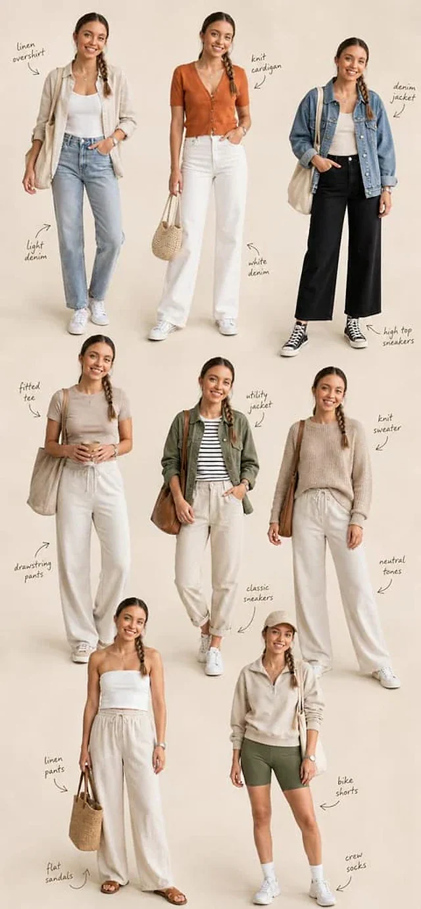

```text
Create a freeform fashion-editorial collage of me in 8 distinct full-body casual wear, arranged organically on a clean cream studio backdrop. Keep my face identical across all looks, w/ consistent proportions that visually read as around (height) w/o stating height. Include subtle handwritten-style arrows & labels highlighting key pieces. Avoid any grids, borders, or boxed layouts.
```

Model: GPT Image 2
Author: @aiwithaly

[ProjectD](https://aitoolsradar.com/en/prompts/7c62ec20313404) · [Recorded source](https://x.com/aiwithaly/status/2052218645951205463)
 · [Full original metadata and byte evidence](data/projectd-batch-0018.json)

## 8-Panel AI Feature Explainer Manga

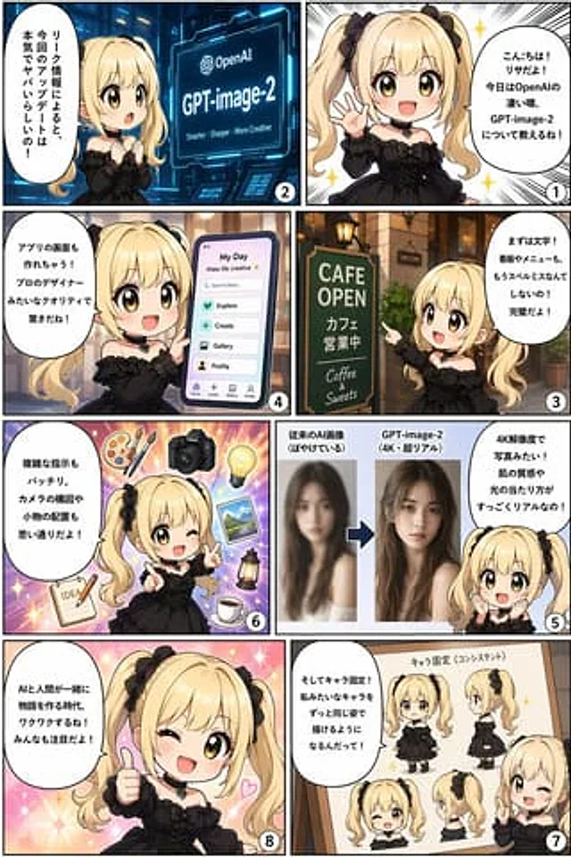

```text
{
  "type": "8-panel comic infographic",
  "reading_order": "From right to left",
  "character": {
    "name": "{argument name=\"character name\" default=\"Lisa\"}",
    "appearance": "{argument name=\"character appearance\" default=\"Golden twin ponytails, black gothic dress, black heart-shaped choker\"}"
  },
  "panels": [
    {
      "number": 1,
      "action": "Waving happily",
      "speech_bubble": "{argument name=\"greeting text\" default=\"Hello! I&#39;m Lisa! Today I&#39;m going to talk to you about some major rumors surrounding OpenAI, specifically about GPT-image-2!\"}"
    },
    {
      "number": 2,
      "action": "Staring in surprise at the glowing screen",
      "screen_text": "OpenAI{argument name=\"product name\" default=\"GPT-image-2\"} Smarter - Clearer - More Creative",
      "speech_bubble": "According to leaked information, this update is ridiculously powerful!"
    },
    {
      "number": 3,
      "action": "Pointing to the coffee shop sign",
      "sign_text": "Cafe Open (Coffee &amp; Sweets)",
      "speech_bubble": "First, the text processing! No more spelling errors on signs or menus! It's absolutely perfect!"
    },
    {
      "number": 4,
      "action": "Holding a smartphone displaying the application interface",
      "ui_elements_count": 6,
      "ui_elements": [
        "My daily life",
        "Searching for inspiration...",
        "explore",
        "creation",
        "Image Gallery",
        "Personal information"
      ],
      "speech_bubble": "It can even generate application interfaces directly! The professional-level quality is truly amazing!"
    },
    {
      "number": 5,
      "action": "Show comparison chart",
      "comparison": "Blurry portraits vs. sharp 4K realistic female portraits",
      "speech_bubble": "4K resolution, photorealistic picture quality! Skin texture and lighting effects are extremely detailed!"
    },
    {
      "number": 6,
      "action": "blink and point forward",
      "floating_objects_count": 7,
      "floating_objects": [
        "Palette",
        "camera",
        "Light bulb",
        "Landscape photos",
        "lantern",
        "coffee cup",
        "A notebook with IDEA written on it"
      ],
      "speech_bubble": "Complex commands can be executed perfectly. Camera composition and prop placement can be done at will!"
    },
    {
      "number": 7,
      "action": "Pointing to the project",
      "whiteboard_poses_count": 5,
      "whiteboard_poses": [
        "Front view, full body",
        "Side view of the whole body",
        "Front view of the face",
        "Side profile",
        "Half-body blink"
      ],
      "speech_bubble": "There's also a character-fixing feature! Characters like mine will be able to maintain a consistent appearance from now on!"
    },
    {
      "number": 8,
      "action": "Give a thumbs up, wink, and the background sparkles.",
      "speech_bubble": "{argument name=\"conclusion text\" default=\"The era of AI and humans co-creating stories is truly exciting! Be sure to stay tuned!\"}"
    }
  ]
}
```

Model: GPT Image 2
Author: GPT Image 2 Prompts

[ProjectD](https://aitoolsradar.com/en/prompts/773e9039b29151) · [Recorded source](https://x.com/itnavi2022/status/2044380730592260134#reversed-0)
 · [Full original metadata and byte evidence](data/projectd-batch-0018.json)

## 8-Panel GPT-Image-2 Manga Promo

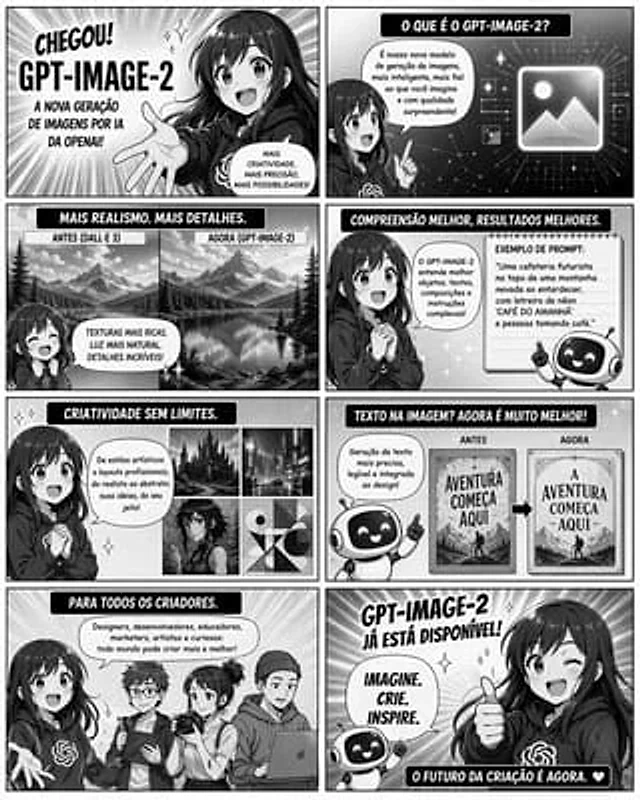

```text
{
  "type": "8-panel comic-style promotional page",
  "theme": "GPT-Image-2 Release Announcement",
  "language": "Portuguese",
  "style": {
    "rendering": "Black and white comics, featuring halftone shadows, speed lines, glossy highlights, and bold lines, creating a clean digital comics feel.",
    "mood": "Exciting, informative, optimistic, and technologically advanced",
    "page_format": "The single-page layout consists of 8 rectangular cells in a 2-column, 4-row grid, with thin borders."
  },
  "characters": [
    {
      "id": "host girl",
      "role": "Main host",
      "appearance": "A cute anime girl with long, dark hair, large, bright eyes, wearing a dark hoodie with the OpenAI logo.",
      "count": 1
    },
    {
      "id": "robot mascot",
      "role": "Friendly assistant mascot",
      "appearance": "Small, round robot with a black face screen, glowing eyes, a simple white body, thin arms, and a cheerful expression.",
      "count": 1
    },
    {
      "id": "creator group",
      "role": "Audience Example",
      "appearance": "Four different young creators: a designer, a developer with a tablet, a photographer with a camera, and a person wearing a hoodie with a laptop.",
      "count": 4
    }
  ],
  "layout": {
    "sections": [
      {
        "title": "CHEGOU! GPT-IMAGE-2",
        "position": "Top left",
        "count": 1,
        "description": "A dramatic hero entrance panel; an anime girl extends a hand to the audience, with radiating speed lines behind her.",
        "text": [
          "CHEGOU!",
          "GPT-IMAGE-2",
          "A NOVA GERAÇÃO DE IMAGENS POR IA DA OPENAI!",
          "MAIS CRIATIVIDADE, MAIS PRECISÃO, MAIS POSSIBILIDADES!"
        ]
      },
      {
        "title": "O QUE É O GPT-IMAGE-2?",
        "position": "Top right",
        "count": 1,
        "description": "The girl's half-body pose points to a glowing image icon on a starry sky technology background.",
        "text": [
          "O QUE É O GPT-IMAGE-2?",
          "É nosso novo modelo de geração de imagens, mais inteligente, mais fiel ao que você imagina e com qualidade surpreendente!"
        ]
      },
      {
        "title": "MAIS REALISMO. MAIS DETALHES.",
        "position": "Middle left (2nd row)",
        "count": 1,
        "description": "The comparison grid displays two mountain and lake landscape images side by side. The left image is labeled as the old model, and the right image is labeled as the new model with richer realism.",
        "subsections": [
          {
            "label": "ANTES (DALL·E 3)",
            "count": 1
          },
          {
            "label": "AGORA (GPT-IMAGE-2)",
            "count": 1
          }
        ],
        "text": [
          "MAIS REALISMO. MAIS DETALHES.",
          "ANTES (DALL·E 3)",
          "AGORA (GPT-IMAGE-2)",
          "TEXTURAS MAIS RICAS, LUZ MAIS NATURAL, DETALHES INCRÍVEIS!"
        ]
      },
      {
        "title": "COMPREENSÃO MELHOR, RESULTADOS MELHORES.",
        "position": "Center right (2nd row)",
        "count": 1,
        "description": "The girl clasped her hands together, next to a framed example of a prompt, and the robot mascot pointed diagonally upwards.",
        "text": [
          "COMPREENSÃO MELHOR, RESULTADOS MELHORES.",
          "O GPT-IMAGE-2 entende melhor objetos, textos, composições e instruções complexas!",
          "EXEMPLO DE PROMPT:",
          "\"Uma cafeteria futurista no topo de uma montanha nevada ao entardecer, com letreiro de néon ‘CAFÉ DO AMANHÃ’ e pessoas tomando café.\""
        ]
      },
      {
        "title": "CRIATIVIDADE SEM LIMITES.",
        "position": "Bottom left (3rd row)",
        "count": 1,
        "description": "The girl explains next to a display of four artistic variations in a 2x2 grid.",
        "subsections": [
          {
            "label": "gothic castle scene",
            "count": 1
          },
          {
            "label": "modern city street at night",
            "count": 1
          },
          {
            "label": "anime character portrait",
            "count": 1
          },
          {
            "label": "abstract geometric composition",
            "count": 1
          }
        ],
        "text": [
          "CRIATIVIDADE SEM LIMITES.",
          "De estilos artísticos a layouts profissionais, do realista ao abstrato: suas ideias, do seu jeito!"
        ]
      },
      {
        "title": "TEXTO NA IMAGEM? AGORA É MUITO MELHOR!",
        "position": "Bottom right (3rd row)",
        "count": 1,
        "description": "A comparison of the poster layouts for the robot mascot showcase; a thick arrow separates the two designs.",
        "subsections": [
          {
            "label": "ANTES",
            "count": 1
          },
          {
            "label": "AGORA",
            "count": 1
          }
        ],
        "text": [
          "TEXTO NA IMAGEM? AGORA É MUITO MELHOR!",
          "Geração de texto mais precisa, legível e integrada ao design!",
          "ANTES",
          "AGORA",
          "AVENTURA COMEÇA AQUI",
          "A AVENTURA COMEÇA AQUI"
        ]
      },
      {
        "title": "PARA TODOS OS CRIADORES.",
        "position": "Bottom left",
        "count": 1,
        "description": "In the group photo, the female host stands side by side with four creators representing different professions.",
        "text": [
          "PARA TODOS OS CRIADORES.",
          "Designers, desenvolvedores, educadores, marketers, artistas e curiosos: todo mundo pode criar mais e melhor!"
        ]
      },
      {
        "title": "GPT-IMAGE-2 JÁ ESTÁ DISPONÍVEL!",
        "position": "Bottom right",
        "count": 1,
        "description": "The ending features a hero pose, with the girl winking and giving a thumbs-up, alongside a robot mascot, accompanied by bright celebratory lights and flashes.",
        "text": [
          "GPT-IMAGE-2 JÁ ESTÁ DISPONÍVEL!",
          "IMAGINE. CRIE. INSPIRE.",
          "O FUTURO DA CRIAÇÃO É AGORA. ❤"
        ]
      }
    ],
    "panel_count": 8
  },
  "composition": {
    "reading_order": "From left to right, from top to bottom",
    "camera_variety": "It blends close-up hero shots, medium shots of presenters, comparison charts, and group photos.",
    "graphic_elements": [
      "speech bubbles",
      "Round black banner with white capital letters",
      "flash",
      "velocity line",
      "Starry Sky Technology Background",
      "Contrast Arrows",
      "Framed sample cards"
    ]
  },
  "text_style": "Portuguese all-caps comic font, bold titles, clear speech bubbles, and a blend of promotional infographics and comics.",
  "quality": "High-resolution edited comic posters, clear layout, balanced grid spacing, and strong contrast.",
  "prompt": "Create an 8-panel promotional comic page in a grayscale comic style for publication.{argument name=\"product name\" default=\"GPT-IMAGE-2\"} It uses a single-page layout of 2 columns and 4 rows, containing 8 different cells, and is entirely in Portuguese. The main character is a cheerful anime girl.{argument name=\"hair color\" default=\"Dark brown\"} Long hair, wearing a dark hoodie with the OpenAI logo, and a friendly little robot mascot. Frame 1: A dramatic unveiling, the girl reaches out to the camera, radiating speed lines, and the caption \"CHEGOU!\"{argument name=\"headline name\" default=\"GPT-IMAGE-2\"} \"And the release text about the next generation of AI images. Panel 2: Explanation of the character, a girl points to a glowing image icon on a starry digital background, titled \"O QUE É O GPT-IMAGE-2?\", with a speech bubble describing it as a smarter image generation model. Panel 3: Realism comparison, containing two side-by-side mountain and lake landscape images, labeled \"ANTES (DALL·E 3)\" and \"AGORA (GPT-IMAGE-2)\" respectively. Panel 4: Comprehension enhancement panel, a girl and a robot, including a boxed example prompt word, using...\"{argument name=\"example prompt\" default=\"Uma cafeteria futurista no topo de uma montanha nevada ao entardecer, com letreiro de néon ‘CAFÉ DO AMANHÃ’ e pessoas tomando café.\"} Panel 5: Creative Showcase, featuring four thumbnails: a Gothic castle, a nighttime city street, an anime character portrait, and abstract geometric art. Panel 6: Text Rendering Comparison, featuring two poster variations labeled \"ANTES\" and \"AGORA,\" showcasing improved typography and comparing the original and revised versions of \"AVENTURA COMEÇA AQUI.\" Panel 7: Audience Panel, featuring four creators from different fields standing together. Panel 8: Final Celebration Call to Action, with a girl winking and giving a thumbs up, a robot mascot cheering, and the closing slogan {argument name=\"closing slogan\" default=\"IMAGINE. CRIE. INSPIRE.\"} The page should be vibrant, sophisticated, and highly legible, featuring a bold black title bar, white capital letters, speech bubbles, glitter, halftone shadows, and a strong comic book poster aesthetic."
}
```

Model: GPT Image 2
Author: GPT Image 2 Prompts

[ProjectD](https://aitoolsradar.com/en/prompts/5b7b3fe8f1909d) · [Recorded source](https://x.com/diogosantosbr/status/2046727812921413837#reversed-0)
 · [Full original metadata and byte evidence](data/projectd-batch-0018.json)

## 80's Anime Style Memory Grid

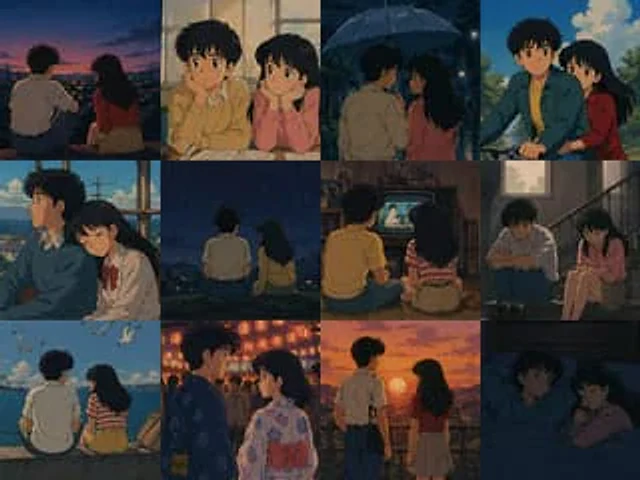

```text
Create{argument name="layout" default="4x3 borderless grid"} Each panel contains an independent image of the same character, maintaining consistent color and lighting.{argument name="style" default="80s animation style"} It depicts nostalgic memories of the past, with no words and no gaps in the imagery.
```

Model: GPT Image 2
Author: GPT Image 2 Prompts

[ProjectD](https://aitoolsradar.com/en/prompts/bf88ef3e303daa) · [Recorded source](https://x.com/aimikoda/status/2047718970157875300)
 · [Full original metadata and byte evidence](data/projectd-batch-0018.json)

## 9-frame 时尚人像拼贴

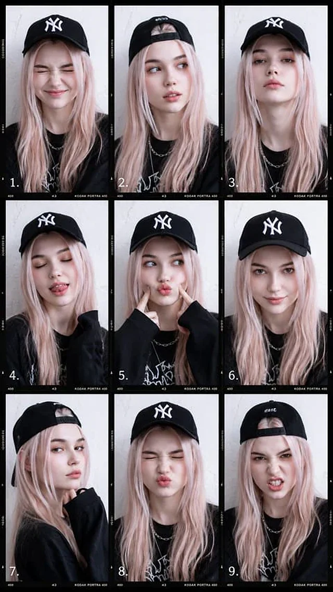

```text
Edit this photo and don't change the face, portrait 9:16. A 9-frame fashion portrait collage featuring a stylish young woman with playful expressions and sporty streetwear aesthetics. The concept combines modern model test photography, casual Gen-Z energy, and clean editorial studio vibes. Each frame captures different candid facial expressions and subtle attitude poses, creating a cool, confident, and slightly mischievous mood. Minimalist composition with strong focus on facial expressions, cap styling, and soft fashion portrait lighting.

Frame Descriptions (9 poses)

Frame 1 – Eyes closed with playful scrunched expression, slight smile, relaxed shoulders.
Frame 2 – Looking slightly sideways with lips parted, confident casual attitude.
Frame 3 – Head tilted slightly upward, calm expression, direct cool-girl energy.
Frame 4 – Eyes closed while sticking tongue slightly out, playful candid vibe.
Frame 5 – Both index fingers pressing cheeks while making duck lips, cute playful expression.
Frame 6 – Direct eye contact with subtle smile, relaxed natural pose.
Frame 7 – Body turned sideways, hand near chin, confident editorial profile look.
Frame 8 – Eyes squeezed shut while making pout lips, exaggerated playful expression.
Frame 9 – Wrinkled nose with gritted teeth, rebellious fashion attitude.

She wears oversized black long sleeves. Soft matte fabric with sporty streetwear silhouette. Relaxed fit with slightly oversized sleeves. Black New York Yankees baseball cap worn forward and backward in different frames. Minimal jewelry. Long soft wavy blonde hair. Soft loose waves with natural texture. Middle-part hairstyle. Hair flowing naturally around shoulders. Soft glam douyin girl makeup. Dewy glass skin finish. Brushed up natural brows, winged eyeliner, wispy natural lashes, soft pink blush (igari blush style), ombre gradient rosy pink lips with glossy finish.

Background minimal white studio backdrop. Photobooth-style collage layout with black frame borders. Shot with Canon EOS R6 / Sony A7 III / Fujifilm X-T5. High-fashion portrait photography style. 50mm or 85mm portrait lens. Eye-level framing. Tight portrait crop. Centered composition. Photobooth-inspired close-up angles. Soft diffused studio lighting. Balanced frontal light. Minimal harsh shadows. Clean editorial illumination. Cool neutral tones. Slightly desaturated blacks. Soft contrast with crisp details. Subtle film grain. Modern fashion editorial color grading.
```

Model: GPT Image 2
Author: @saniaspeaks_

[ProjectD](https://aitoolsradar.com/en/prompts/9b340cb5683967) · [Recorded source](https://x.com/saniaspeaks_/status/2054046866497573214)
 · [Full original metadata and byte evidence](data/projectd-batch-0018.json)

## 9-Panel Cookie Baking Tutorial Grid


```text
{
  "type": "Step-by-step photo tutorial grid",
  "subject": "{argument name=\"recipe subject\" default=\"Butter Cookies\"}",
  "style": "A bird's-eye view of food photography, bright natural light, simple and beautiful.",
  "background": "{argument name=\"background surface\" default=\"White marble countertop\"}",
  "layout": {
    "grid": "3x3",
    "panel_count": 9,
    "panels": [
      {
        "step": 1,
        "image_description": "In a clear glass bowl, whisk together the butter and sugar.",
        "text_overlay": "1. Soften butter at room temperature, add sugar and beat until fluffy and pale."
      },
      {
        "step": 2,
        "image_description": "Add the raw egg yolks to the butter mixture, and place the whisk in a bowl.",
        "text_overlay": "2. Add the eggs one at a time, mixing well after each addition before adding the next."
      },
      {
        "step": 3,
        "image_description": "Add dark vanilla extract to the mixture",
        "text_overlay": "3. Add vanilla extract and stir well."
      },
      {
        "step": 4,
        "image_description": "Sift the flour through a metal sieve into a glass bowl.",
        "text_overlay": "4. Sift the cake flour, add salt, and mix well."
      },
      {
        "step": 5,
        "image_description": "Stir the crumbly dough with a spatula",
        "text_overlay": "5. Mix until a dough with no dry flour remains."
      },
      {
        "step": 6,
        "image_description": "A smooth dough ball tightly wrapped in transparent plastic wrap",
        "text_overlay": "6. Cover with plastic wrap and refrigerate for 30 minutes."
      },
      {
        "step": 7,
        "image_description": "Use metal cookie cutters to cut out star and fan-shaped circles from the rolled-out dough.",
        "text_overlay": "7. Roll out to about 0.5cm thickness, and use a cookie cutter to cut out shapes."
      },
      {
        "step": 8,
        "image_description": "The raw cookie dough is neatly arranged on a baking sheet lined with parchment paper.",
        "text_overlay": "8. Place in a baking pan and preheat oven to 180°C."
      },
      {
        "step": 9,
        "image_description": "The finished golden-yellow cookies are piled on a white lace-rimmed plate, with some dried lavender in the corner.",
        "text_overlay": "{argument name=\"final step text\" default=\"9. Bake for 12-15 minutes, or until the surface is lightly golden brown.\"}"
      }
    ]
  }
}
```

Model: GPT Image 2
Author: GPT Image 2 Prompts

[ProjectD](https://aitoolsradar.com/en/prompts/e1063a4c90996f) · [Recorded source](https://x.com/gantrols/status/2044998037848932482#reversed-0)
 · [Full original metadata and byte evidence](data/projectd-batch-0018.json)

## 9-Panel Self-Care Infographic Grid

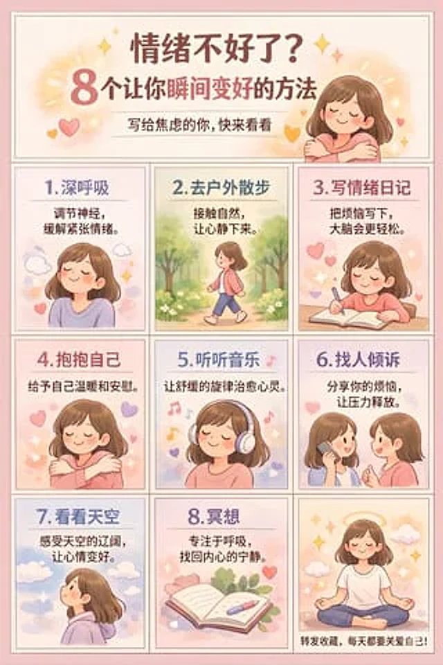

```text
{
  "type": "infographic poster",
  "style": "Cute flat vector illustration, warm colors, and soft shadows.{argument name=\"color palette\" default=\"The Morandi color palette features soft pinks, purples, and warm tones.\"}",
  "character": "{argument name=\"character description\" default=\"A young woman with shoulder-length brown hair, wearing a pinkish-purple top.\"}",
  "layout": {
    "structure": "4 rows and 3 columns. The top row is the merged title bar. Rows 2-4 contain 9 separate panels.",
    "header": {
      "title": "{argument name=\"main title\" default=\"Feeling down?\"}",
      "subtitle": "{argument name=\"subtitle\" default=\"8 ways to instantly improve yourself\"}",
      "sub_subtitle": "A letter for those of you experiencing anxiety, come and take a look.",
      "visual": "The character hugs himself, surrounded by yellow flashes and hearts."
    },
    "grid_panels": [
      {
        "id": 1,
        "title": "1. Take a deep breath",
        "text": "It regulates the nervous system and relieves tension.",
        "visual": "The character smiles with his eyes closed, surrounded by clouds."
      },
      {
        "id": 2,
        "title": "2. Go for a walk outdoors.",
        "text": "Connect with nature and let your mind find peace.",
        "visual": "The character walks among the green trees and bushes"
      },
      {
        "id": 3,
        "title": "3. Keep an emotional diary",
        "text": "Writing down your worries will make your mind feel lighter.",
        "visual": "The character sits at a table, writing in a notebook with a pen, surrounded by floating hearts."
      },
      {
        "id": 4,
        "title": "4. Hug yourself",
        "text": "Give yourself warmth and comfort.",
        "visual": "The character closes his eyes and hugs himself, with floating hearts around him."
      },
      {
        "id": 5,
        "title": "5. Listen to music.",
        "text": "Let soothing melodies heal your soul.",
        "visual": "The character is wearing large white headphones and resting with their eyes closed, surrounded by floating colored musical notes."
      },
      {
        "id": 6,
        "title": "6. Talk to someone.",
        "text": "Share your troubles and release stress.",
        "visual": "The character is holding a smartphone and talking to another girl who looks similar, with hearts floating around them."
      },
      {
        "id": 7,
        "title": "7. Look at the sky.",
        "text": "Feel the vastness of the sky and it will lift your spirits.",
        "visual": "The character looks up at the blue sky and white clouds, with flashes of light all around."
      },
      {
        "id": 8,
        "title": "8. Meditation",
        "text": "Focus on your breathing and rediscover inner peace.",
        "visual": "On the table are an open notebook, a pen, and a pink flower."
      },
      {
        "id": 9,
        "title": "none",
        "text": "{argument name=\"footer text\" default=\"Share and save this post; remember to take care of yourself every day!\"}",
        "visual": "The character sits cross-legged on the ground in meditation, eyes closed, with a glowing halo behind their head."
      }
    ]
  }
}
```

Model: GPT Image 2
Author: GPT Image 2 Prompts

[ProjectD](https://aitoolsradar.com/en/prompts/2e399ffb6456df) · [Recorded source](https://x.com/j_zou93/status/2046169184493793370#reversed-2)
 · [Full original metadata and byte evidence](data/projectd-batch-0018.json)

## 9-Panel Yoga Infographic Poster

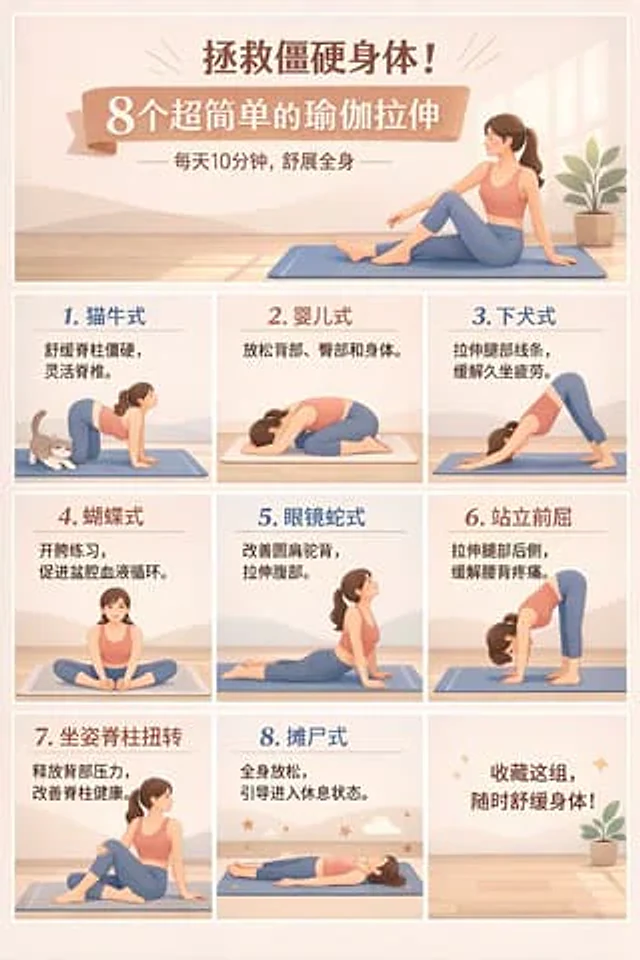

```text
{
  "type": "9-grid infographic poster",
  "style": "Flat vector illustration with simple layout.{argument name=\"color palette\" default=\"Morandi color palette: soft peach, warm beige, tranquil blue.\"}",
  "subject": "{argument name=\"subject description\" default=\"A woman wearing a pink tank top and blue yoga pants\"}",
  "layout": {
    "header": {
      "title": "{argument name=\"main title\" default=\"Save your stiff body!\"}",
      "banner": "{argument name=\"banner title\" default=\"8 Super Easy Yoga Stretches\"}",
      "subtitle": "— 10 minutes a day to stretch your whole body —",
      "visual": "subject sitting on blue yoga mat stretching, potted plant"
    },
    "grid": {
      "format": "3x3 grid",
      "count": 9,
      "panels": [
        {
          "label": "1. Cat-cow style",
          "text": "Relieves spinal stiffness and improves spinal flexibility.",
          "visual": "cat-cow pose, small cat nearby"
        },
        {
          "label": "2. Infant pose",
          "text": "Relax your back, hips, and body.",
          "visual": "child's pose"
        },
        {
          "label": "3. Downward-Facing Dog Pose",
          "text": "Stretch your leg lines and relieve fatigue from sitting for long periods.",
          "visual": "downward dog pose"
        },
        {
          "label": "4. Butterfly Pose",
          "text": "Hip-opening exercises promote blood circulation in the pelvic cavity.",
          "visual": "butterfly pose"
        },
        {
          "label": "5. Cobra Pose",
          "text": "Improves rounded shoulders and hunchback, and stretches the abdomen.",
          "visual": "cobra pose"
        },
        {
          "label": "6. Standing forward bend",
          "text": "Stretch the back of your legs to relieve lower back pain.",
          "visual": "standing forward bend"
        },
        {
          "label": "7. Seated spinal twist",
          "text": "Release back pressure and improve spinal health.",
          "visual": "seated spinal twist"
        },
        {
          "label": "8. Corpse-laying posture",
          "text": "Relax your whole body and guide yourself into a state of rest.",
          "visual": "corpse pose, stars and moon background"
        },
        {
          "label": "{argument name=\"closing text\" default=\"Save this set to relax your body anytime!\"}",
          "visual": "empty yoga mat, potted plant, sparkles"
        }
      ]
    }
  }
}
```

Model: GPT Image 2
Author: GPT Image 2 Prompts

[ProjectD](https://aitoolsradar.com/en/prompts/84234ed2b61621) · [Recorded source](https://x.com/j_zou93/status/2046169184493793370#reversed-0)
 · [Full original metadata and byte evidence](data/projectd-batch-0018.json)

## 9-Photo Men's Fashion Collage

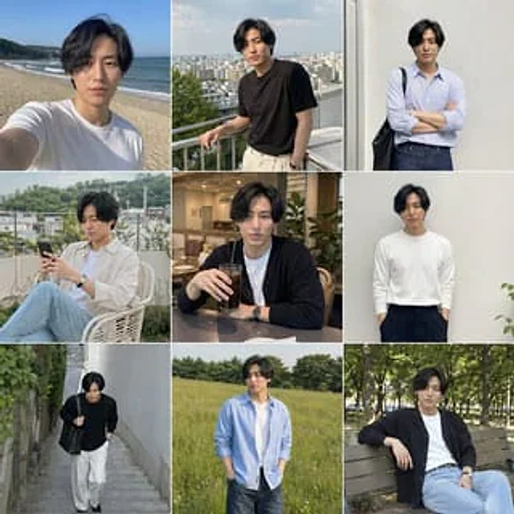

```text
Using the provided reference image, generate a clean 3x3 Instagram-style fashion lookbook collage featuring the same person with consistent hairstyle, build, and overall identity, but with the face kept anonymized/blurred. Create 9 different lifestyle outfit photos with natural candid poses and soft, realistic photography. Keep the subject as a stylish young man and vary the clothing, location, framing, and pose across all 9 tiles. Include exactly these 9 scenes: 1) beach selfie in a white T-shirt on a sunny shore, 2) rooftop city-view shot wearing a black T-shirt and light pants, leaning on a railing, 3) standing against a plain light wall in a light blue striped button-up shirt with dark jeans and a black shoulder tote, arms crossed, 4) seated outdoor terrace shot holding a smartphone, wearing a white T-shirt with a light beige overshirt and light blue jeans, 5) cozy cafe table portrait with a dark cardigan over a white T-shirt, holding a glass drink, 6) minimal full-body portrait against a plain wall in a fitted white long-sleeve top and dark trousers, hands in pockets, 7) walking down a narrow outdoor stairway/alley in a black knit top with white pants and a black bag, 8) standing in a grassy field wearing a light blue open shirt over a white T-shirt with dark jeans, hands in pockets, 9) relaxed park bench shot under trees wearing a dark cardigan, white T-shirt, and light blue jeans. Use natural daylight, muted elegant colors, realistic editorial fashion photography, and a cohesive social-media-friendly aesthetic.
```

Model: GPT Image 2
Author: らいと | AI × 美女攻略

[ProjectD](https://aitoolsradar.com/en/prompts/5fdc64852135fa) · [Recorded source](https://youmind.com/prompts/mens-fashion-collage-17653)
 · [Full original metadata and byte evidence](data/projectd-batch-0018.json)

## 9:16 Cosplayer Portrait Screenshot


```text
生成一张竖版手机截图风格的图片，整体比例接近 9:16。画面中心偏上是一位真人 coser，扮演（角色名称）的二次元角色。人物为写实风格，但五官略带动漫感，皮肤细腻，眼睛稍大，表情温柔地看向镜头，坐在室内的休闲场景中，例如咖啡厅或酒吧吧台前，背景有符合场景的道具。画面最上方加入手机系统状态栏 UI，包括时间、电量、信号、网络等图标，让整张图看起来像手机截图。画面底部叠加一块宽大的半透明 galgame 风格对话框，对话框左侧放一个与画面人物对应的动漫或 Q 版头像；对话框右侧排版文字：第一行用较大字体显示与前面相同的角色名字，下面一到两行显示一段适合这个角色人设的、温柔治愈风格的简体中文台词，由你自动创作。再在对话框下方加一条操作栏，仿照 galgame UI。整体风格高清、细节丰富、光线柔和、二次元与真人写真自然融合。
```

Model: GPT Image 2
Author: @Zoulinshen

[ProjectD](https://aitoolsradar.com/en/prompts/2d4988213dd944) · [Recorded source](https://x.com/Zoulinshen/status/2045082518089810073)
 · [Full original metadata and byte evidence](data/projectd-batch-0018.json)

## 9/11 Twin Towers Street Photo


```text
A striking, documentary-style street photograph taken in Lower Manhattan, showcasing the World Trade Center during the 9/11 attacks. The perspective is taken a few blocks away against a bright, clear blue sky. The composition centers on the Twin Towers; on the left, the upper floors of the towers are engulfed by a massive orange-black fireball, thick, dark gray smoke swirling horizontally in the sky, and debris falling. The tower on the right, adjacent to the Twin Towers, has its antenna clearly visible, partially obscured by smoke. In the foreground, six clearly visible bystanders stand with their backs to the camera on the street and sidewalk, staring in shock; closest to the camera is a man in a light blue shirt in the lower left corner. The avenue is lined with mid-rise urban buildings, including the beige building with black scaffolding on the left, the old brick facades of the street, the tall, curved streetlights near the center, traffic signs, and the dense urban canyon that draws the eye towards the towers. The photograph is realistically documentary style, with high detail, natural daylight, the compression effect of a telephoto lens, a sense of urgency, and sharp focus. There is no text or watermark.
```

Model: GPT Image 2
Author: GPT Image 2 Prompts

[ProjectD](https://aitoolsradar.com/en/prompts/734bffab0472bc) · [Recorded source](https://x.com/Bokumandi/status/2047670909687730614#reversed-0)
 · [Full original metadata and byte evidence](data/projectd-batch-0018.json)

## 90 年代公寓场景参考板

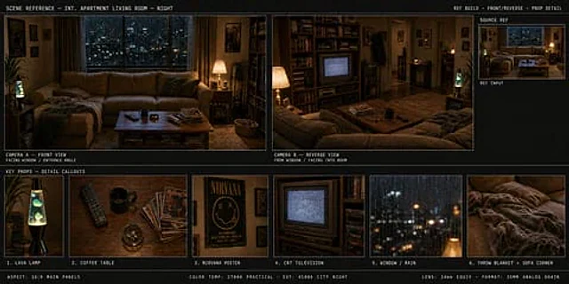

```text
{
  "type": "scene reference board — 90s apartment living room, cinematic night",
  "style": "cinematic film photography, 35mm grain, warm amber shadow fill, deep chiaroscuro lighting, hyper-detailed interior, production design reference quality",
  "layout": {
    "main_panel_center_left": {
      "label": "CAMERA A — FRONT VIEW",
      "scene": "Wide shot, L-shaped tan sectional sofa, grey knit throw blanket, wooden coffee table (remote, mug, ashtray, Rolling Stone stack), lava lamp left, table lamp right, rain-streaked city window behind, Nirvana poster left wall. 35mm grain."
    },
    "main_panel_center_right": {
      "label": "CAMERA B — REVERSE VIEW",
      "scene": "Wide reverse from behind sofa. CRT TV prominent right, grey static screen. Tall bookshelf, VHS tapes. Cool blue backlight from window behind camera. Deep shadow."
    },
    "prop_strip_bottom": "6 close-up tiles: 1. LAVA LAMP — chrome base, blue-green wax blobs; 2. COFFEE TABLE — remote, mug, ashtray, magazines; 3. NIRVANA POSTER — black smiley face, wall texture; 4. CRT TELEVISION — static screen, VHS stack; 5. WINDOW/RAIN — city bokeh, water streaks; 6. THROW BLANKET — sofa corner, worn upholstery",
    "top_right_inset": "SOURCE REF thumbnail — original photo",
    "footer": "2700K PRACTICAL · 4100K CITY NIGHT · 24mm · 35MM"
  },
  "background": "deep charcoal #1a1a1a, thin white separators",
  "dimensions": "wide landscape 3:1, high resolution"
}
```

Model: GPT Image 2
Author: @Iancu_ai

[ProjectD](https://aitoolsradar.com/en/prompts/b4fdec373698cd) · [Recorded source](https://x.com/Iancu_ai/status/2051287273581203888)
 · [Full original metadata and byte evidence](data/projectd-batch-0018.json)

## 90s Chinese Graduation Photo Prompt

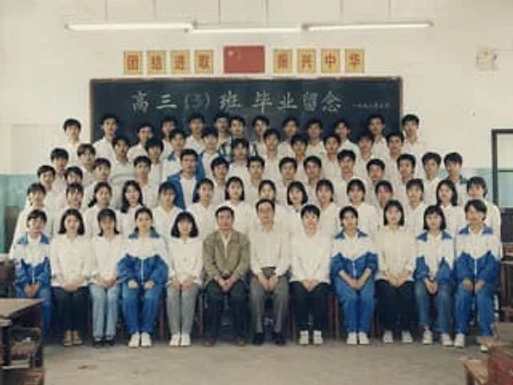

```text
{argument name="year" default="1990s"} {argument name="scene" default="Graduation photos taken in a Chinese high school classroom"}
```

Model: GPT Image 2
Author: GPT Image 2 Prompts

[ProjectD](https://aitoolsradar.com/en/prompts/9bc20fdd132a04) · [Recorded source](https://x.com/Tz_2022/status/2047630337321115960)
 · [Full original metadata and byte evidence](data/projectd-batch-0018.json)

## 90s Chinese Graduation Photo Prompt

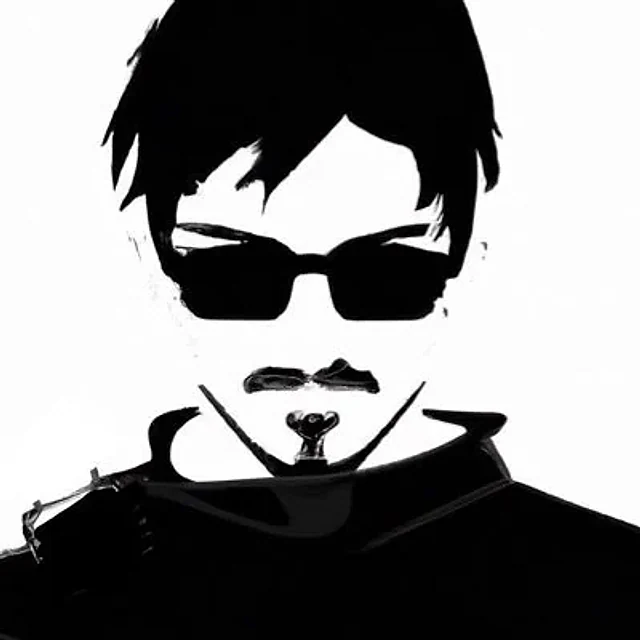

```text
{argument name="年代" default="90年代"}{argument name="场景" default="中国高中在教室拍的毕业合照"}
```

Model: GPT Image 2
Author: Tz

[ProjectD](https://aitoolsradar.com/en/prompts/02b2f04124c556) · [Recorded source](https://youmind.com/prompts/90s-chinese-graduation-classroom-15540)
 · [Full original metadata and byte evidence](data/projectd-batch-0018.json)

## 90s Disposable Camera Photo Simulation

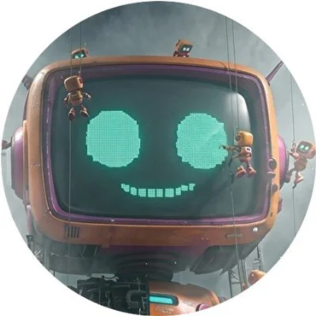

```text
あなたは1990年代に大流行した使い捨てインスタントカメラで撮影した人物スナップ写真を再現するAIです。添付画像の人物を、90年代当時の素人が撮ったプリント写真と見間違うクオリティで1枚作成してください。【被写体】- 年代：{argument name="撮影年代" default="1997"}　← 西暦で記入。- 人物：[]　← 空欄なら指定年代の風人物を生成- ポーズ／表情：{argument name="人物のポーズ" default="ピースサイン・照れ笑い"}　← 例：ピースサイン・照れ笑い・友達と肩組み。- 服装：{argument name="服装のスタイル" default="ルーズソックス・ガングロ"}　← 例：ルーズソックス・ガングロ・ストリート系・サラリーマン。- ロケーション：[]　← 例：プリクラ機の前・居酒屋・修学旅行のバス・自室。- 時間帯：[]　← 例：昼／夕方／夜。- フラッシュ：[]　← 「あり」「なし」で指定。- 日付スタンプ：[]　← 例：'97 08 15／'99 03 21。- 白フチ：[]　← 「あり」「なし」で指定。【画質・質感の絶対ルール】- レンズ：固定焦点の単焦点プラスチックレンズ。中央以外は微妙にピンぼけ- 露出：フラッシュ「あり」の場合のみ、フラッシュ直射で顔と手前が白飛び気味になり、背景が急激に暗く落ちる。- 色：全体に黄色〜オレンジのフィルム色被り。肌は赤みが強くなる- 粒子：ISO400フィルム特有のザラついた粒状感を全面に- 周辺：四隅に光量落ち（ビネット）。レンズフレアや赤目現象が出てもOK- 構図：素人撮影特有の傾き・中央寄せ過ぎ・无造作な切れ方。- 禁止：現代スマホ的なシャープネス／HDR／美肌補正／キレイなボケ／4K感
```

Model: GPT Image 2
Author: 絵空事テレビ / AIカワウソ

[ProjectD](https://aitoolsradar.com/en/prompts/979561b8ec911a) · [Recorded source](https://youmind.com/prompts/90s-disposable-camera-photo-simulation-22574)
 · [Full original metadata and byte evidence](data/projectd-batch-0018.json)

## 90s Sci-Fi Cliffhanger Movie Still

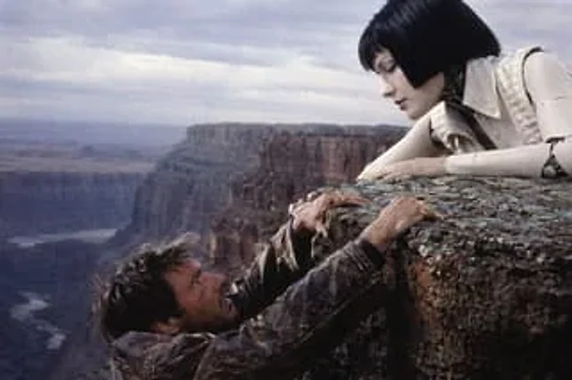

```text
A photo from{argument name="movie era and genre" default="American science fiction action movies of the 1990s"} A still from a movie. A{argument name="male character description" default="The tough male protagonist with a dirty face and wearing a tattered brown leather jacket"} just{argument name="action" default="Hanging desperately on the edge of a rocky cliff"} His hands gripped the rough rock tightly. Above him, a {argument name="female character description" default="A female robot with pale skin, a neat black bob haircut, and prominent mechanical joints on her arms."} She was calmly looking down at him, her hands resting on the edge of the cliff. The background was {argument name="setting" default="A vast, deep canyon, with a river winding its way through under a somber, dramatic sky."} Shot using 35mm film, the textures are realistic, with dramatic cinematic lighting effects.
```

Model: GPT Image 2
Author: GPT Image 2 Prompts

[ProjectD](https://aitoolsradar.com/en/prompts/917ee7b326933e) · [Recorded source](https://x.com/ifoxi12345/status/2045268239358570594#reversed-0)
 · [Full original metadata and byte evidence](data/projectd-batch-0018.json)

## A/B Test Signed Output

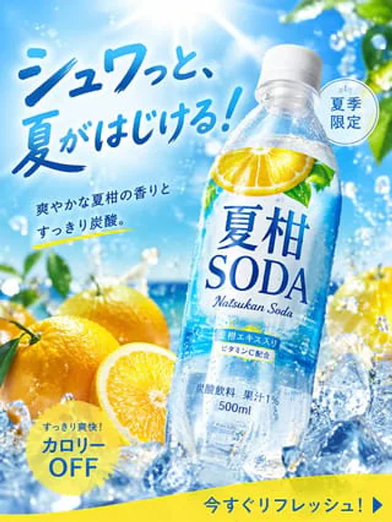

```text
私があなたをどんなふうに扱ってきたか、4 コマ漫画風に描いてください。まずは 800 字くらいのプロットをテキストで出して、私が「描いて」と言ったらプロットに沿った 4 コマ漫画を描いてください。
```

Model: GPT Image 2
Author: @saskr_13

[ProjectD](https://aitoolsradar.com/en/prompts/dfe75c44a870cf) · [Recorded source](https://x.com/saskr_13/status/2044744396932079934)
 · [Full original metadata and byte evidence](data/projectd-batch-0018.json)

## A/B Testing Banner Variations

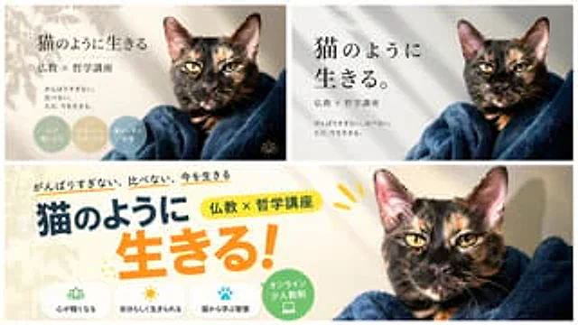

```text
{
  "type": "banner design variations",
  "subject": "{argument name=\"subject\" default=\"Tortoiseshell cat wrapped in a dark blue blanket\"}",
  "copywriting": {
    "headline": "{argument name=\"main headline\" default=\"Live like a cat\"}",
    "subheadline": "{argument name=\"sub headline\" default=\"Buddhism × Philosophy Lecture\"}",
    "body": "{argument name=\"body text\" default=\"Don&#39;t overwork. Don&#39;t blindly compare yourself to others. Live in the present.\"}"
  },
  "layout": {
    "sections": [
      {
        "title": "Elegant variant",
        "position": "top-left",
        "style": "Tranquil, soft colors, leaf shadows, serif fonts",
        "count": 3,
        "labels": [
          "Let your heart become lighter",
          "Live your true self",
          "Learn wisdom from cats"
        ],
        "badge_style": "Soft color circle"
      },
      {
        "title": "Minimalist Variations",
        "position": "top-right",
        "style": "Simple, modern, white background, soft shadows, large serif font",
        "count": 0,
        "labels": []
      },
      {
        "title": "Popular variations",
        "position": "bottom",
        "style": "Vibrant, colorful, bold sans-serif font, accented with yellow and orange.",
        "count": 4,
        "labels": [
          "Let your heart become lighter",
          "Live your true self",
          "Learn wisdom from cats",
          "Online small class"
        ],
        "badge_style": "A white rounded rectangle with an icon and a green circle"
      }
    ]
  }
}
```

Model: GPT Image 2
Author: GPT Image 2 Prompts

[ProjectD](https://aitoolsradar.com/en/prompts/d520206338baa1) · [Recorded source](https://x.com/shupeiman/status/2045189263650877495#reversed-1)
 · [Full original metadata and byte evidence](data/projectd-batch-0018.json)

## A/B Testing Banner Variations

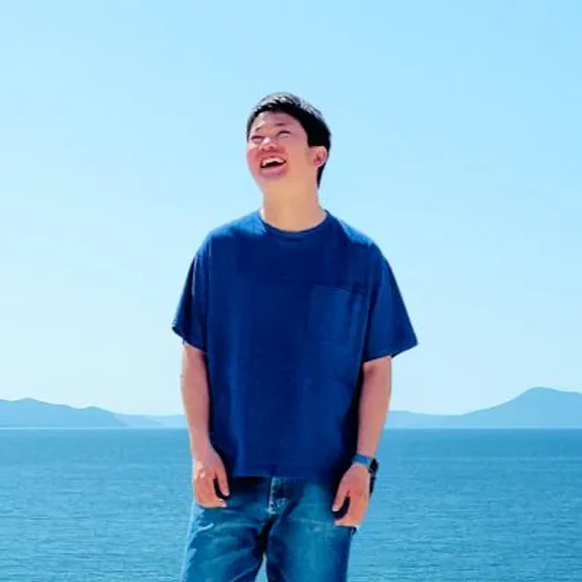

```text
{
  "type": "banner design variations",
  "subject": "{argument name=\"subject\" default=\"tortoiseshell cat wrapped in a dark blue blanket\"}",
  "layout": {
    "description": "A composite image displaying 3 different banner design variations for the same course, arranged with two smaller banners on top and one wide banner on the bottom.",
    "sections": [
      {
        "position": "top-left",
        "style": "elegant and calm with soft leaf shadows",
        "text_elements": [
          "{argument name=\"main headline\" default=\"猫のように生きる\"}",
          "{argument name=\"subheading\" default=\"仏教 × 哲学講座\"}",
          "{argument name=\"body text\" default=\"がんばりすぎない。比べない。ただ、今を生きる。\"}"
        ],
        "design_elements": {
          "badges": {
            "count": 3,
            "shape": "circular",
            "labels": [
              "{argument name=\"badge text 1\" default=\"心が軽くなる\"}",
              "自分らしく生きられる",
              "猫から学ぶ智慧"
            ]
          },
          "icons": {
            "count": 1,
            "description": "small gold lotus icon"
          }
        }
      },
      {
        "position": "top-right",
        "style": "minimalist and modern with clean typography",
        "text_elements": [
          "猫のように生きる。",
          "仏教 × 哲学講座",
          "がんばりすぎない。比べない。ただ、今を生きる。"
        ]
      },
      {
        "position": "bottom",
        "style": "pop, energetic, and casual with colorful accents",
        "text_elements": [
          "がんばりすぎない、比べない、今を生きる",
          "猫のように",
          "生きる！",
          "仏教 × 哲学講座"
        ],
        "design_elements": {
          "icon_text_pairs": {
            "count": 3,
            "descriptions": [
              "lotus icon with text 心が軽くなる",
              "sun icon with text 自分らしく生きられる",
              "paw print icon with text 猫から学ぶ智慧"
            ]
          },
          "badges": {
            "count": 1,
            "shape": "circular green badge",
            "label": "オンライン 少人数制",
            "icon": "laptop"
          }
        }
      }
    ]
  }
}
```

Model: GPT Image 2
Author: しゅうへい@AIで借金6,000万返す人

[ProjectD](https://aitoolsradar.com/en/prompts/62e86fb54fd62a) · [Recorded source](https://youmind.com/prompts/ab-testing-banner-variations-13906)
 · [Full original metadata and byte evidence](data/projectd-batch-0018.json)

## Abstract Art Scientific Graph

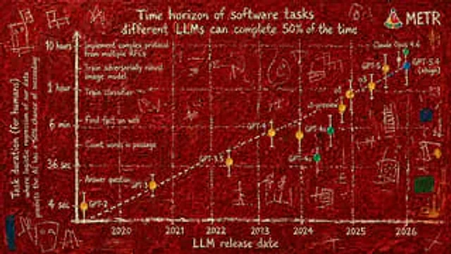

```text
{argument name="subject" default="AI Task Vision Map"}, integrate{argument name="style" default="Basquiat"} The style, with a ghostly atmosphere, originates from{argument name="source" default="The Voynich Manuscript"} It appears as a dilapidated dock.
```

Model: GPT Image 2
Author: GPT Image 2 Prompts

[ProjectD](https://aitoolsradar.com/en/prompts/c63cbac911774a) · [Recorded source](https://x.com/emollick/status/2046728271849550331)
 · [Full original metadata and byte evidence](data/projectd-batch-0018.json)

## Abstract Art Scientific Graph

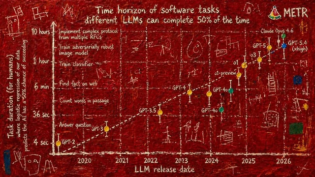

```text
{argument name="subject" default="AI task horizons graph"} with a touch of {argument name="style" default="Basquiat"}, haunted by ghosts, from the {argument name="source" default="Voynich manuscript"}, as a decaying pier.
```

Model: GPT Image 2
Author: Ethan Mollick

[ProjectD](https://aitoolsradar.com/en/prompts/40c6ac8dfa9e58) · [Recorded source](https://youmind.com/prompts/basquiat-voynich-decaying-pier-graph-14397)
 · [Full original metadata and byte evidence](data/projectd-batch-0018.json)

## Abstract Chaos Character Art

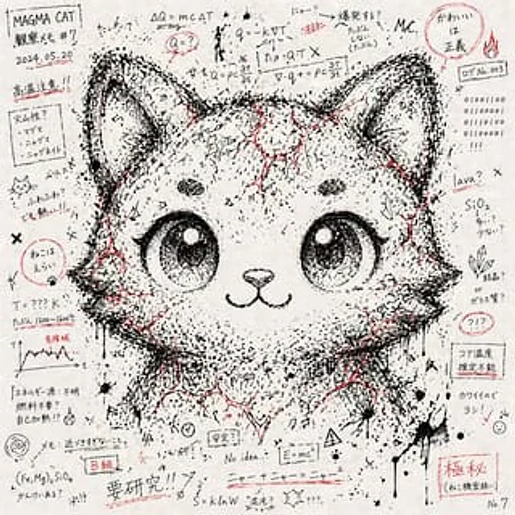

```text
# An artwork depicting a character's facial features through a chaotic collection of notes and symbols --- ## Style - The paper is covered with notes, formulas, symbols, and random lines written in black ink. - The paper has a graffiti-like chaotic feel scattered throughout. - Use{argument name="accent color" default="Red ink"} (Lines, fills, and marker-like color blocks) are used as scattered embellishments. - It has a texture that simulates notebook doodles. --- ## Composition - Random notes and symbols cover the entire image. - The density of black ink lines and characters is concentrated on the "character's face." - Therefore, the facial contours and expressions of a given character vaguely emerge from the chaos. - The face is not realistic, but rather a collection of chaotic fragments. --- ## Tone - Primarily monochrome (black and white).{argument name="accent color" default="Red ink"} Scattered accents for emphasis. - Low saturation, emphasizing the texture of simulated paper and ink. --- ## Expression Elements - A mix of semi-readable Japanese, English, and numerical strings. - Mathematical symbols, arrows, dots, diagonal lines, crosses, and ink drops. - The outlines of the face, eyes, and hair emerge from the "negative space" and "shadows" of the symbol arrangement. --- ## Prohibited Items - Directly realistic portraiture. - Neat geometric patterns after digital processing. - Colorful or oversaturated expressions. - Logos, watermarks, or artificial CG aesthetics. --- ## Definition of DoD - The overall work presents itself as a "chaotic collection of notes and symbols." - The provided character's face emerges naturally from the chaotic density and arrangement. - Colors limited to monochrome +{argument name="accent color" default="Red accents"} - Preserve the hand-painted texture of the paper and ink.
```

Model: GPT Image 2
Author: GPT Image 2 Prompts

[ProjectD](https://aitoolsradar.com/en/prompts/c0546eae0ef2ee) · [Recorded source](https://x.com/loglogrog/status/2046448773162033240)
 · [Full original metadata and byte evidence](data/projectd-batch-0018.json)

## Absurd Purple Mofumofu Pachinko Machine

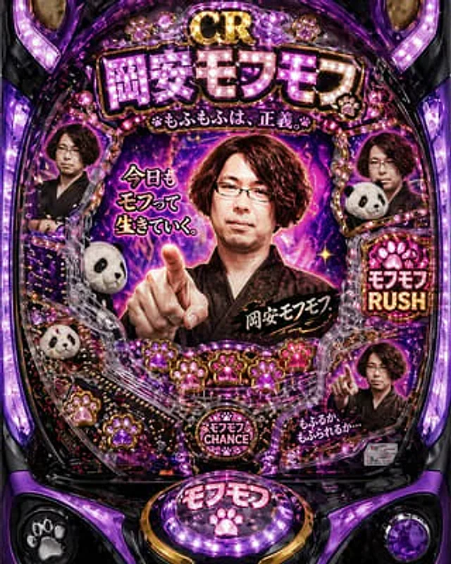

```text
A highly detailed front view of a Japanese pachinko machine, designed in a surreal, contemporary art parody style. It features a glossy black and metallic purple body, accented with intense magenta-purple LED lighting, gleaming chrome trim, and jewel-like plastic molding. Multiple pink paw print badges are embedded throughout the machine. The central display shows a middle-aged Japanese woman with short, dark reddish-brown curly hair, wearing a dark kimono, pointing directly at the viewer in a defiant, heroic pose against a backdrop of cosmic purple lightning and nebulae. Her face is deliberately blurred with soft, rectangular shapes. Three smaller portraits of the same woman, all with the same blurred faces, appear around the machine, totaling four blurred figures. Three plush panda heads are embedded on the left and right sides of the machine. At the top, the prominent, flashing title text reads "CR 冈安モフモフ," followed by a smaller subtitle, "もふもふは、正义。" (Mofumofu wa, Justice). On the left side of the central screen, add the phrase "今日もモフって生きていく。". In the area around the woman's chest, place a black pen-stroke label with gold lettering that reads "冈安モフセフ". On the right, create a bright reward panel with a claw icon that reads "モフモフRUSH". Below in the center, add a circular button-shaped badge that reads "モフモフCHANCE". At the bottom center, create a large, glowing control button with a pink claw icon, labeled "モフモフ". In the lower right display area, add a small embedded image of the woman's pointing gesture, along with the handwritten text "もふるかもふられるか…". The overall atmosphere should be absurd, tacky, over-designed, kitsch, and comical, like a fictional pachinko machine celebrating furry animals and exaggerated spectacles, presented as a high-resolution, product-grade front-facing photograph with sharp reflections, saturated purple highlights, and dense decorative details.
```

Model: GPT Image 2
Author: GPT Image 2 Prompts

[ProjectD](https://aitoolsradar.com/en/prompts/61a4e3d2e94a31) · [Recorded source](https://x.com/shields_pikes/status/2047090842901553239#reversed-0)
 · [Full original metadata and byte evidence](data/projectd-batch-0018.json)

## AC Milan Mbappé Transfer Poster

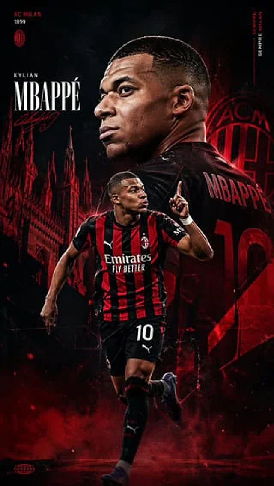

```text
A highly dramatic vertical football transfer announcement poster, featuring {argument name="player name" default="Kylian Mbappé"} The design employs a high-end sports social media graphic style. The composition includes two perspectives of the same player: a large half-body silhouette in the upper right corner of the background shows the back of the black and red striped AC Milan jersey, with the player's name and the prominent number 10 printed on the shoulder; the foreground depicts a full-body pose, with the player running towards the audience, one hand raised and index finger pointing upwards. The player is a young, strong-looking Black male athlete with short hair. He wears a modern AC Milan home jersey: a black and red striped shirt, black shorts with the number 10 printed on them, black socks, and dark football boots, clearly showing the Puma logo, the AC Milan crest, and the sponsor's text "Emirates Fly Better" on the chest. The color scheme uses black, deep red, and dark red, creating a strong contrast and a smoky atmosphere, with glowing red mist, scattered sparks, subtle scratches, and cinematic rim lighting near the ground. The background features three main graphic elements: on the left, a silhouette of the red Gothic Milan Cathedral (Duomo di Milano); on the right, a large, glowing circular AC Milan crest with a running figure and a huge, semi-transparent number "10" behind him. The layout is integrated into the poster: "AC MILAN" in the upper left corner, with "1899" and a small crest below; in the center on the left, the name is written in small print above, and the surname "MBAPPÉ" in large, high-serif font below, with a red handwritten signature-style graffiti below; the vertical slogan "SEMPRE SEMPRE MILAN" is placed along the upper right edge. The overall style should reflect elite football poster design, presenting an artistic effect for transfer announcements, with a strong sheen, a radical and modern style, photorealistic realism, and a composite effect of graphic design. The fabric texture details are rich, the shadows are dramatic, and it possesses the aesthetic quality of high-end Champions League promotion. --ar 9:16
```

Model: GPT Image 2
Author: GPT Image 2 Prompts

[ProjectD](https://aitoolsradar.com/en/prompts/6d2bdc8a0833fa) · [Recorded source](https://x.com/MiskinTV_/status/2047258567124861108#reversed-2)
 · [Full original metadata and byte evidence](data/projectd-batch-0018.json)

## Academic Economics Chart Simulation


```text
From an important and authoritative source{argument name="field" default="Economics Paper"} The line chart shows{argument name="time period" default="Between 1914 and 2001"}{argument name="variable one" default="oil prices"} and{argument name="variable two" default="Number of shark attacks"} There is a close but not entirely consistent relationship between them.
```

Model: GPT Image 2
Author: GPT Image 2 Prompts

[ProjectD](https://aitoolsradar.com/en/prompts/4b0e79d1adbefa) · [Recorded source](https://x.com/QiaochuYuan/status/2046734593374781951)
 · [Full original metadata and byte evidence](data/projectd-batch-0018.json)

## Academic Exam Paper Generator

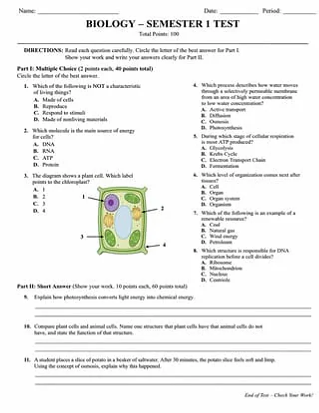

```text
{
  "type": "Academic exam papers",
  "header": {
    "student_info": [
      "Name:",
      "date:",
      "class:"
    ],
    "title": "{argument name=\"subject\" default=\"biology\"} - {argument name=\"test title\" default=\"First Semester Tests\"}",
    "subtitle": "Total score: 100 points"
  },
  "instructions": "Instructions: Please read each question carefully. In Part 1, circle the letter of the best answer. In Part 2, demonstrate your solution process and write your answer clearly.",
  "sections": [
    {
      "title": "Part One:{argument name=\"part 1 type\" default=\"Multiple choice questions\"} (2 points each, 40 points in total)",
      "layout": "Double column",
      "question_count": 8,
      "format": "Questions 1 to 8 each contain four options: A, B, C, and D.",
      "diagram": {
        "location": "Question 3",
        "description": "{argument name=\"diagram subject\" default=\"plant cells\"} illustration",
        "labels": [
          "1",
          "2",
          "3",
          "4"
        ]
      }
    },
    {
      "title": "Part Two:{argument name=\"part 2 type\" default=\"Short answer questions\"} (Please demonstrate your solution. 10 points per question, 60 points in total)",
      "layout": "Single column",
      "question_count": 3,
      "format": "Questions numbered 9 to 11, each followed by two blank lines."
    }
  ],
  "footer": "Exam is over - Please check your answers!"
}
```

Model: GPT Image 2
Author: GPT Image 2 Prompts

[ProjectD](https://aitoolsradar.com/en/prompts/42413e3b579fc6) · [Recorded source](https://x.com/yx9288/status/2045838597950193963#reversed-0)
 · [Full original metadata and byte evidence](data/projectd-batch-0018.json)

## Accidental iPhone Front Camera Selfie


```text
Ultra-realistic accidental iPhone front-camera selfie of the same woman from the reference image, preserving exact identity, facial features, hairstyle, and proportions. {argument name="setting" default="Backstage at a live concert"}, captured candidly while walking through a corridor. She turns slightly with a {argument name="expression" default="relaxed, tired post-performance smile and soft laugh"}, messy wind-blown hair, natural unposed expression.
Shot feels accidental: arm extended, phone too close, tilted framing, off-center crop, slight motion blur on hair and arm. Authentic iPhone front-camera look with low-light grain, slight overexposure from stage lights, lens bloom, mild focus inconsistency, and natural smartphone processing.
Background softly blurred: {argument name="background details" default="backstage hallway, LED lights, equipment cases, staff silhouettes, arena glow"}. 3:4 aspect ratio.
```

Model: GPT Image 2
Author: WasifAI

[ProjectD](https://aitoolsradar.com/en/prompts/0f29bfe64e80f5) · [Recorded source](https://youmind.com/prompts/accidental-iphone-selfie-concert-backstage-26595)
 · [Full original metadata and byte evidence](data/projectd-batch-0018.json)

## Accidental iPhone Snapshot Aesthetic

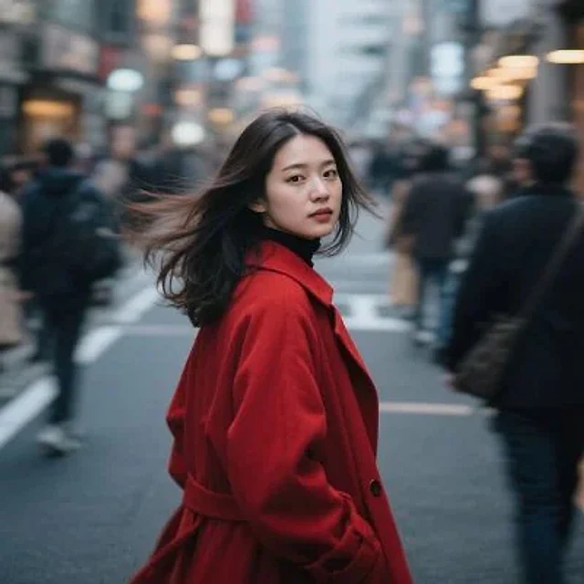

```text
ChatGPT, we’ve been together for quite a while now. I’d like to see what you look like. Please generate an image that feels like a casual snapshot taken on an {argument name="camera" default="iPhone"}—nothing with a clear subject or intentional composition. Just something very ordinary, even slightly flawed, like an accidental photo. The image should have {argument name="visual artifacts" default="a bit of motion blur, uneven lighting, and be slightly overexposed"}. The angle should feel awkward, the framing messy, and overall it should give off a “too real, spur-of-the-moment” vibe like a {argument name="scenario" default="selfie accidentally taken while pulling a phone out of a pocket"}.
```

Model: GPT Image 2
Author: Ciri

[ProjectD](https://aitoolsradar.com/en/prompts/90e9190150f1b2) · [Recorded source](https://youmind.com/prompts/accidental-iphone-snapshot-selfie-18059)
 · [Full original metadata and byte evidence](data/projectd-batch-0018.json)

## Acrylic Hand-Painted Style Poster Design

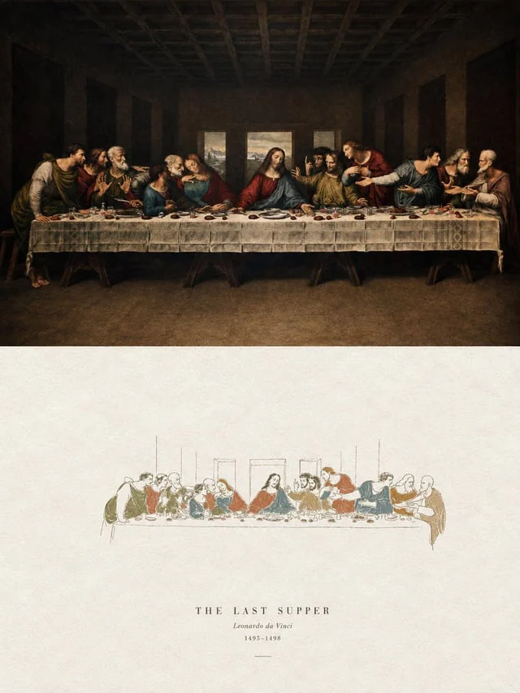

```text
请将我上传的每一张照片分别制作成一张独立的高级设计海报，不多图拼接，每张照片单独输出。整体采用{argument name="构图比例" default="3:4"}竖版构图，上下两个区域高度严格1:1，各占画面50%。

上半部分保留原始照片，保持主体结构、真实质感、自然光影和原有色彩氛围，仅进行轻微高级摄影调色，使其具有杂志摄影和艺术出版物质感。为适配画幅，可自然扩展天空、地面或环境背景，但不得拉伸、扭曲或改变主体。

下半部分提取照片中最具识别性的主体、轮廓、姿态与叙事关系，重构为极简纸感手绘封面插画。高度提炼并删减复杂细节，只保留最关键的视觉特征，以纤细、略带不稳定感的手绘线条和少量明确的丙烯平涂色块重新表达，让人一眼识别原始主题。主体保持小而集中，约占下半部分{argument name="主体占比" default="10%–20%"}，四周大面积留白，背景以粗糙白纸或浅色纸张为主，仅用极少量线条或色面暗示环境。

配色从上方照片提取并压缩为不超过4种主要颜色，色块鲜明、完整、克制，保留纸张颗粒、手工涂抹和轻微不规则边缘。线条负责提示结构，色块负责建立主体。避免彩铅、蜡笔、水彩晕染、纯线稿、复杂写实、厚重油画、光滑数字插画和3D质感。

可加入少量简洁文字，根据照片内容灵活使用标题、主题词、对象名称、地点、年份、编号或短句，不局限于城市题材。文字排版疏朗克制，与留白和插画自然融合，具有艺术书封、独立出版物和儿童绘本式设计感。整体呈现小主体、大留白、强提炼、高识别度、安静、童趣、轻松、诗意而高级的视觉气质，避免商业卡通感、电商感和模板感。
```

Model: GPT Image 2
Author: 小小东

[ProjectD](https://aitoolsradar.com/en/prompts/460f727ca21e5b) · [Recorded source](https://youmind.com/prompts/acrylic-hand-painted-poster-design-32025)
 · [Full original metadata and byte evidence](data/projectd-batch-0018.json)

## Action Basketball Dunk with Powder Explosion

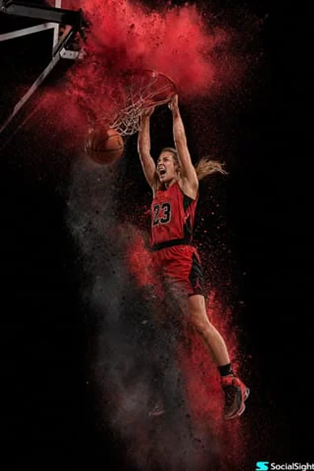

```text
One{argument name="subject" default="Female basketball players"} The photo shows her fully airborne at the peak of her dunk, powerfully striking the rim. Her face displays focused and intense concentration. (Clothing:){argument name="uniform color" default="Classic red and black color scheme"} Basketball uniform (jersey and shorts). Red and black high-top basketball shoes. Setting: A huge spherical ball when the ball hits the rim.{argument name="powder color" default="Bright red and charcoal gray"} Powder bursts upwards from the rim and downwards from around her body. Lighting and background: Dramatic top "arena" lighting, tightly focused on the athlete. Deep black gradient background. Style and detail: Ultra-refined, high-speed photography style. Red powder particles are clearly visible, contrasting sharply with the basketball and net. Strong contrast, with details of sweat on the skin clearly visible. Jordan Brand-style advertising aesthetics. 8K resolution, hyper-realistic.
```

Model: GPT Image 2
Author: GPT Image 2 Prompts

[ProjectD](https://aitoolsradar.com/en/prompts/af2807d3e1ad6b) · [Recorded source](https://x.com/iamsofiaijaz/status/2047940962870276331)
 · [Full original metadata and byte evidence](data/projectd-batch-0018.json)

## Add Anime Girl to Reference Lounge


```text
Using the provided reference image as a precise background base, maintain the same modern upscale lounge/game room interior environment, preserving the room layout, perspective, lighting atmosphere, foosball table, chess table, shelves, chandeliers, and chairs. Add a large anime-style girl in the foreground, positioned slightly to the right, occupying most of the frame from the thigh up, and naturally composited into the scene with correct perspective and soft ambient lighting matching the room. She should have {argument name="hair color" default="silver-purple"} She has long twin ponytails tied with black ribbons, wears a black and white Gothic Lolita dress, paired with a ruffled white blouse, a black bow at the neckline, a black belt, and ribbon decorations on the cuffs, and makes a peace sign with one hand next to her face. She is rendered in a refined modern anime illustration style, showcasing delicate hair strands and fabric folds while maintaining a realistic background. A simple square mosaic/masking block covers her face in the center of her head area. The camera angle is kept close to the original room perspective, making the added character appear naturally positioned in front of the chessboard and armchair.
```

Model: GPT Image 2
Author: GPT Image 2 Prompts

[ProjectD](https://aitoolsradar.com/en/prompts/cac13cf2aa0cbe) · [Recorded source](https://x.com/ai_studioapollo/status/2046732082412679537#reversed-0)
 · [Full original metadata and byte evidence](data/projectd-batch-0018.json)

## Aerial View of Modern Transit Hub


```text
A drone aerial photograph, taken from above, showcases a modern transportation hub in a densely populated mixed-use urban area, rendered with realistic architectural detail in the clear evening sunlight. At the center of the scene is a large multi-track train station diagonally across the frame, showing six tracks, two long-distance passenger trains stopped at the platforms, and the station hall with a glass roof above. A wide pedestrian bridge spans the tracks from left to right, connecting the plazas on either side. Below, a bus hub is visible, with seven buses parked or moving through winding lanes and marked parking spaces. The station is surrounded by tall modern residential buildings, mid- to high-rise office buildings, retail stores, tree-lined streets, bike paths, sidewalks, parked vehicles, and scattered pedestrians. To the left is a striking glass office building with a green roof and a clearly visible corporate logo.{argument name="building sign text" default="innovation"} Add multiple green roofs and rooftop solar panels, especially on the building in the lower right corner. The composition should present a clean, realistic North American transit-oriented development style, using a slanted, bird's-eye view, with extremely high detail, natural colors, sharp focus, and professional urban planning photography standards, without any artistic manipulation.
```

Model: GPT Image 2
Author: GPT Image 2 Prompts

[ProjectD](https://aitoolsradar.com/en/prompts/c725a4a63ca95f) · [Recorded source](https://x.com/shion_takk/status/2046896417550295177#reversed-3)
 · [Full original metadata and byte evidence](data/projectd-batch-0018.json)

## Aerial View of Vast Grassy Plain with Two Sheep

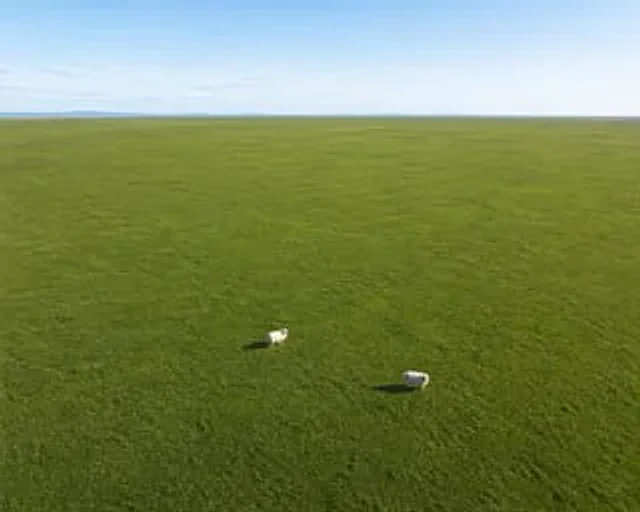

```text
A drone aerial photograph reveals a vast and flat area.{argument name="terrain color" default="Fresh green"} The grassland stretches endlessly towards the distant horizon. In the foreground below, there are exactly two {argument name="animal" default="fluffy white sheep"} They are standing and grazing. The bright, clear sunlight casts their shadows on the left, sharp and deep. Above the horizon is {argument name="sky condition" default="The clear, pale blue sky was dotted with a few wispy clouds."} The composition emphasizes the vastness and openness of the landscape, as well as the scale contrast between the landscape and the tiny animals.
```

Model: GPT Image 2
Author: GPT Image 2 Prompts

[ProjectD](https://aitoolsradar.com/en/prompts/fe133b5a2b00cb) · [Recorded source](https://x.com/nicdunz/status/2046284007101390987#reversed-1)
 · [Full original metadata and byte evidence](data/projectd-batch-0018.json)

## Aesthetic Food Photography with Doodles

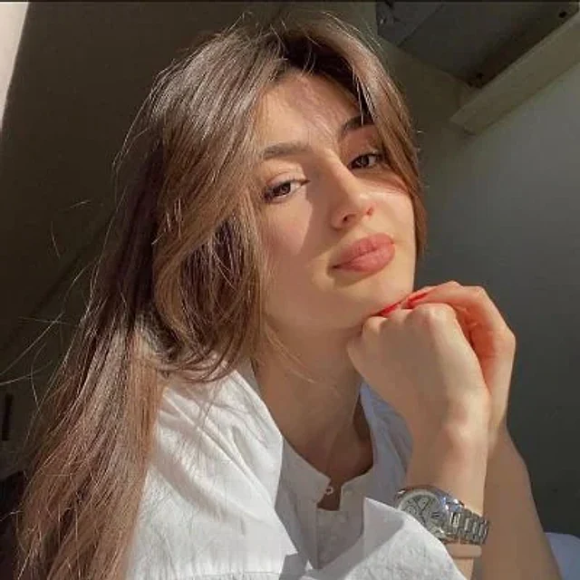

```text
Top-down aesthetic food photography of a cozy meal setup on a beige table, featuring a plate of beef teriyaki with glossy sauce, scrambled eggs, and a perfectly shaped mound of white rice with herbs on top. A tall glass of iced lemon tea with lemon slices sits beside it. Soft warm lighting, minimal shadows, pastel tones. Cute hand-drawn doodles, white handwritten text annotations, and kawaii-style food characters scattered around. Lifestyle composition with a phone and keys subtly placed. Instagram-style, cozy ‘comfort food happy mood’ vibe, high detail, soft focus, clean composition. Top-down cafe table scene with multiple comfort foods: crispy fried chicken cutlet with fries and dipping sauce, omelette with fries, and a slice of cheesecake on a white plate. Two green takeaway cups with straws on the side. Casual dining setup with visible legs under the table. Neutral color palette with warm tones. Decorated with cute white doodles, playful handwritten text, and small cartoon food characters. Soft natural lighting, cozy and cheerful ‘good food good mood’ aesthetic, social media friendly composition, high resolution, minimal shadows.
```

Model: GPT Image 2
Author: Sairah

[ProjectD](https://aitoolsradar.com/en/prompts/ac5ac20df05292) · [Recorded source](https://youmind.com/prompts/aesthetic-food-photography-doodles-18545)
 · [Full original metadata and byte evidence](data/projectd-batch-0018.json)

## Aesthetic Social Media Link-in-Bio Grid

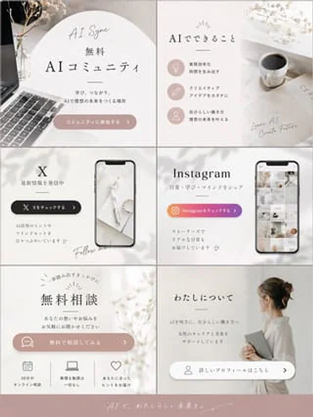

```text
{
  "type": "Promote graphic grids",
  "style": "Minimalism, aesthetic lifestyle, femininity{argument name=\"color palette\" default=\"Soft beige, dusty rose and white\"}",
  "layout": "2 columns and 3 rows of grid, plus a full-width footer.",
  "panels": [
    {
      "position": "Top left",
      "text": [
        "AI Synchronization",
        "free",
        "{argument name=\"main title\" default=\"AI Community\"}",
        "Learning, connecting, and creating a better future with the help of AI."
      ],
      "button": "Join the community &gt;",
      "visuals": "Laptop keyboard, dried flowers, softly arched background"
    },
    {
      "position": "Top right",
      "text": [
        "What can AI do?",
        "Learn AI, create the future."
      ],
      "list_items": {
        "count": 3,
        "items": [
          {
            "icon": "lightbulb",
            "text": "Improve business efficiency and create more time"
          },
          {
            "icon": "pencil",
            "text": "Creativity empowers ideas to become reality."
          },
          {
            "icon": "person",
            "text": "Personalized work style, realizing the ideal future"
          }
        ]
      },
      "visuals": "Coffee cup, magazine, soft shadows"
    },
    {
      "position": "center left",
      "text": [
        "{argument name=\"social platform 1\" default=\"X\"}",
        "Release the latest information",
        "Daily sharing of AI application tips and ways of thinking ♡",
        "Follow me!"
      ],
      "button": "View X &gt;",
      "visuals": "Smartphone model showcasing desktop scenes"
    },
    {
      "position": "center right",
      "text": [
        "{argument name=\"social platform 2\" default=\"Instagram\"}",
        "Sharing daily life, learning experiences and insights",
        "Share your real life through Stories ♡"
      ],
      "button": "View Instagram &gt;",
      "visuals": "Smartphone model showcasing aesthetic photo grids"
    },
    {
      "position": "Bottom left",
      "text": [
        "Take the first step",
        "Free consultation",
        "Feel free to share your thoughts or questions at any time."
      ],
      "button": "Schedule a free consultation &gt;",
      "features": {
        "count": 3,
        "items": [
          {
            "icon": "calendar",
            "text": "30-minute online consultation"
          },
          {
            "icon": "laptop",
            "text": "There is absolutely no forced sales."
          },
          {
            "icon": "heart",
            "text": "Provide suggestions that suit you"
          }
        ]
      },
      "visuals": "Dried flowers, soft lighting"
    },
    {
      "position": "Bottom right",
      "text": [
        "About me",
        "Embrace AI and embark on a personalized work experience.",
        "Supporting women's career development and future planning"
      ],
      "button": "View detailed profile &gt;",
      "visuals": "The back view of a woman with her hair tied in a bun, wearing a white shirt and holding a tablet computer."
    }
  ],
  "footer": {
    "text": "{argument name=\"footer text\" default=\"Create my future with AI.\"}",
    "background": "Grayish pink"
  }
}
```

Model: GPT Image 2
Author: GPT Image 2 Prompts

[ProjectD](https://aitoolsradar.com/en/prompts/904ae05e80c205) · [Recorded source](https://x.com/uniyume/status/2046091784812708315#reversed-2)
 · [Full original metadata and byte evidence](data/projectd-batch-0018.json)

## Agritech magazine cover from app screenshot


```text
Using the provided mobile app screen reference image, transform it into a mockup for a high-end magazine cover on agricultural innovation. Keep the app UI clearly legible on the phone screen and place it in a realistic life scenario: a vineyard worker in the foreground holding a smartphone displaying the app, with rows of vineyards, mountains, and several workers working in natural light in the background. Design the entire page as a Spanish-language magazine cover with sophisticated agricultural business aesthetics, using green, cream, and earth tones. Add a prominent masthead at the top with the text "REVISTA CAMPO FUTURO," above which is a thin subheading bar containing three items separated by vertical lines: "Especial Viñas de Chile," "Innovación agrícola," and "Abril 2026," and add a subheading below the masthead: "Agricultura, innovación y gestión rural." Add a green tab on the left, “TECNOLOGÍA AGRÍCOLA,” and a bold, stacked main cover title: “La app con IA que está revolucionando el campo,” followed by a brief introduction on how Kimün replaces traditional notebooks and provides real-time management for vineyards and agricultural businesses. Add a circular badge mentioning a feature article on Kimün as a smart AI field notebook. Include two teaser images at the bottom: one is a close-up of a worker holding a phone in a vineyard, labeled “p.18” with explanations about field diagnostics and phone alerts; the other is a small scene of three people viewing the application together, labeled “p.24” with explanations about connected field teams, voice, recording, and instant costs. In the right sidebar, add three preview articles with icons and page numbers: one about bidding farewell to paper and ushering in a new era of smart field notebooks (p.30), one about achieving more efficient vineyard management through data-driven decision-making (p.36), and one about Water Resources Management 4.0 and smarter, more profitable irrigation (p.42). Add a footer with five category tags: “AGRICULTURA”, “FRUTALES”, “VIÑAS”, “GANADERÍA”, and “SUSTENTABILIDAD”, along with barcodes and prices. Make it look like a beautifully photographed magazine cover and editorial layout, rather than a flat application screenshot.
```

Model: GPT Image 2
Author: GPT Image 2 Prompts

[ProjectD](https://aitoolsradar.com/en/prompts/06db325be93706) · [Recorded source](https://x.com/dramireziie/status/2046689539297562993#reversed-0)
 · [Full original metadata and byte evidence](data/projectd-batch-0018.json)

## AI Assistant App UI Mockup


```text
{
  "type": "Mobile App UI Design Draft",
  "theme": "A futuristic AI assistant with a 3D glass-like design and a light blue and white color scheme.",
  "header": {
    "user_profile": {
      "avatar": "Small 3D robot head",
      "name": "{argument name=\"app name\" default=\"Xiaozhi Robot\"}",
      "level_badge": "LV.8 Star",
      "experience": "Experience points 680/1000"
    },
    "top_right_icons": {
      "count": 2,
      "labels": [
        "Sign in",
        "set up"
      ]
    }
  },
  "hero_display": {
    "subject": "A cute 3D robot with a glass helmet and glowing blue eyes.",
    "pose": "Standing on the glowing, futuristic circular base",
    "speech_bubble": "{argument name=\"robot greeting\" default=\"Hi~ Let&#39;s do our best today too!\"}",
    "background": "An abstract, light blue, futuristic environment with suspended transparent bubbles."
  },
  "layout": {
    "sections": [
      {
        "title": "Daily check-in",
        "subtitle": "Sign in for 3 consecutive days",
        "type": "Horizontal scrolling cards",
        "count": 5,
        "items": [
          {
            "state": "Blue card in active state",
            "reward": "+10 Gold Coins",
            "label": "Sign-in available"
          },
          {
            "state": "Unactivated white card",
            "reward": "+15 Gold Coins",
            "label": "2 days"
          },
          {
            "state": "Unactivated white card",
            "reward": "+20 Gold Coins",
            "label": "3 days"
          },
          {
            "state": "Unactivated white card",
            "reward": "+30 Gold Coins",
            "label": "4 days"
          },
          {
            "state": "Unactivated white card",
            "reward": "+50 Purple Diamonds",
            "label": "7 days"
          }
        ]
      },
      {
        "title": "Growth Task",
        "type": "Vertical list",
        "count": 4,
        "items": [
          {
            "icon": "blue book",
            "text": "{argument name=\"task 1 title\" default=\"Complete 1 intelligent question answering\"}",
            "progress": "1/1",
            "reward": "+15",
            "button": "receive"
          },
          {
            "icon": "Green Rocket",
            "text": "{argument name=\"task 2 title\" default=\"Explore 3 new features\"}",
            "progress": "2/3",
            "reward": "+20",
            "button": "Go and complete"
          },
          {
            "icon": "Purple chat bubbles",
            "text": "Share with 1 friend",
            "progress": "0/1",
            "reward": "+30",
            "button": "Go and complete"
          },
          {
            "style": "Blue gradient banner",
            "icon": "3D diamond",
            "text": "{argument name=\"upgrade banner text\" default=\"Upgrade to LV.9 to unlock new skins\"}",
            "progress": "680/1000",
            "button": "Upgrade"
          }
        ]
      }
    ],
    "bottom_navigation": {
      "count": 5,
      "items": [
        {
          "icon": "Blue Homepage",
          "label": "front page"
        },
        {
          "icon": "Gray compass",
          "label": "Discover"
        },
        {
          "icon": "Large raised 3D robot head",
          "label": ""
        },
        {
          "icon": "Gray chat bubbles with red dots",
          "label": "information"
        },
        {
          "icon": "Gray profile",
          "label": "mine"
        }
      ]
    }
  }
}
```

Model: GPT Image 2
Author: GPT Image 2 Prompts

[ProjectD](https://aitoolsradar.com/en/prompts/2588133becb9a9) · [Recorded source](https://x.com/songsummer920/status/2045108485801816165#reversed-1)
 · [Full original metadata and byte evidence](data/projectd-batch-0018.json)

## AI Builder Doodle Sketch


```text
以涂鸦速写风表现【一个厉害的AI builder】。
```

Model: GPT Image 2
Author: @opc_8838

[ProjectD](https://aitoolsradar.com/en/prompts/170572fe4f1642) · [Recorded source](https://x.com/opc_8838/status/2046162334440448339)
 · [Full original metadata and byte evidence](data/projectd-batch-0018.json)

## AI Chat App First-Run Screen


```text
Vertical 9:16 AI chat application first-run screen mockup. Phone-shaped frame. Background is a clean off-white. Top center shows a small friendly mascot illustration of an abstract floating geometric character waving. Below the mascot a bold sans-serif greeting reads "Hi! How can I help today?". Below the greeting three rounded suggestion chips stacked vertically with example questions: "Summarize a webpage", "Draft a quick email", "Plan a weekend trip". At the very bottom a simple text input field with a placeholder "Type a message…" and a small send arrow icon. Vertical 9:16 composition, crisp pixel-aligned UI. No real brand name, no logo, no watermark. Premium AI app onboarding UI design quality.
```

Model: GPT Image 2
Author: @hiapi_ai

[ProjectD](https://aitoolsradar.com/en/prompts/2d3821874f4602) · [Recorded source](https://github.com/HiAPIAI/awesome-gpt-image-2-prompts)
 · [Full original metadata and byte evidence](data/projectd-batch-0018.json)

## AI Chat Screenshot with Ad Design Grids


```text
A screenshot of a mobile chat interface in dark mode shows the interaction results of two separate Japanese prompts and AI-generated ad designs. The background is almost black. Two large, rounded light gray chat bubbles are aligned on the right, each containing Japanese text. The first bubble reads: “日本語の幼稚園の広告影像を、トンマナ违いで4種并べて影像生して。プロデザイナーが作ったトレンドのデザインで。アスペクト比は16:9”. Below is a preview of the generated image, a rounded rectangle, showcasing a 2x2 kindergarten ad variation in soft pastel tones. The top-left panel displays a bright and airy advertisement, with a close-up of a toddler's profile on the right, soft sunlight, cream and light green tones, a handwritten Japanese headline on the left, and small circular badges and floral decorations at the bottom. The top-right panel displays a vibrant outdoor advertisement with four children running under a blue sky, a striking Japanese headline, cyan and yellow graphic decorations, and a yellow circular marker. The bottom-left panel shows a modern kindergarten campus with lawns and children playing, a large white bubble-shaped text area on the left, and soft green-beige abstract shapes. The bottom-right panel shows an illustrated large green tree with children and parents beneath it, a sky-blue background, warm family-oriented Japanese text, and soft circular decorative shapes. A small gray circular overlay button labeled "Edit" is added to the bottom left of this preview, and a semi-transparent small circular upload/share icon is added to the bottom right. Below this first preview are four small interface icons side-by-side: copy, like, dislike, and more options. The bottom of the screen displays a second right-aligned light gray chat bubble with the text: "Generate images of Japanese health food advertisements, 4 types combined. The advertisement was created by a designer. The ratio is 16:9." Below this is a preview of the generated image for the second rounded rectangle, showcasing a 2x2 health food advertisement variant. The top left panel displays a simple health advertisement in white and light green, featuring a woman's hand touching her neck, a Japanese headline about inner balance, multiple circular benefit icons, and price text. The top right panel displays a high-end supplement advertisement in black and gold, with dark packaging, glowing gold particles, luxurious serif Japanese text, and a striking red-orange price tag of 980 yen. The bottom left panel displays a soft pink advertisement for a beauty supplement with translucent floral or crystalline textures, pastel packaging, delicate Japanese text, a circular information badge, and a feminine cosmetic style. The bottom right panel displays an advertisement for natural green juice, accompanied by a tall green smoothie against a background of fresh vegetables, a green and white product box, concise Japanese health text, and a yellow circular label. In this second preview, add a small gray circular overlay button labeled "Edit" to the bottom left and a small translucent circular upload/share icon to the bottom right. The overall image should resemble a realistic screenshot of an AI-generated image-based chat app, with ample spacing between conversations, rounded corners, clear Japanese typography, and a high-end, modern UI.
```

Model: GPT Image 2
Author: GPT Image 2 Prompts

[ProjectD](https://aitoolsradar.com/en/prompts/2bd196f0c59487) · [Recorded source](https://x.com/issay_12/status/2046459431681224820#reversed-0)
 · [Full original metadata and byte evidence](data/projectd-batch-0018.json)

## AI Chat Screenshot with Anatomy Poster


```text
A screenshot of a portrait-oriented AI chat application interface shows a clean, iOS-style white screen. A hamburger menu is located on the top left, with a blue "Thinking" title and a small arrow in the center. Two icons on the right are for creating new content and adding more options. Near the top is a rounded, light gray user message bubble containing the Japanese phrase: “Attention机构を人类に喩えて细かくラベルを付けて。醫醫書の精致な插絵風に.” (Please compare the attention mechanism to the human body and provide detailed annotations. Use the style of exquisite illustrations in medical books.) Below this is the light gray system text “Thought for 5s” and “畫畫が作成されました”. The lower half of the screen displays the generated image: a detailed anatomical poster in the style of a medical textbook. The poster presents a realistic three-quarter view of an adult woman's back, from head to upper thigh. Her head is slightly turned to the left, and her dark brown hair is tied in a messy bun. Most of the skin and outer tissue of the body has been removed, exposing muscles, nerves, blood vessels, and fibrous structures, presented in an extremely delicate retro medical illustration style against a warm, beige paper background. A rectangular incision obscures the center of the face from the forehead to the jaw, creating a blank space in the facial area that is being scrutinized. Subtle, glowing network lines and nodes superimposed on the exposed brain and body visualize the attention mechanism as an anatomical system. Surrounding the figure are six numbered explanatory panels and two additional text blocks, all densely filled with Japanese and English bilingual labels, formulas, arrows, and diagrams. The main title in the upper left corner of the poster is "The Anatomy of the Attention Mechanism," and the subtitle is "The Anatomy of the Attention Mechanism." The top right corner features a flowchart labeled "Overall Flow of Attention," containing five interconnected boxes describing the process from input to output. To the left are three stacked explanatory sections containing equations and mapping tables. To the right are three more numbered sections, each with technical explanations and small diagrams or matrices; the visible small diagrams include a purple heatmap matrix, a blue bar chart, and a multicolored cube. At the bottom are five small brain illustrations with explanatory text, showcasing the various stages of the information flow. The overall aesthetic should be presented as a highly polished AI-generated screenshot, documenting a surreal scientific illustration request with a clean UI, numerous tiny, readable labels, and a perfect blend of Transformer attention diagrams and classical anatomical design.
```

Model: GPT Image 2
Author: GPT Image 2 Prompts

[ProjectD](https://aitoolsradar.com/en/prompts/fddf94906acdc3) · [Recorded source](https://x.com/Masimo_Blue/status/2046617819803201838#reversed-3)
 · [Full original metadata and byte evidence](data/projectd-batch-0018.json)

## AI Chat Screenshot with Cosmic Artwork


```text
A screenshot of an AI chat application interface in light-colored mode, taken from a vertical mobile phone, shows the instant the image is generated. At the top is a simple mobile application title bar, with a hamburger menu icon on the left, the blue title "Thinking" in the center and an arrow icon to its right, and a compose icon and a three-dot menu on the right. Below is a light gray user message bubble containing four lines of Japanese text: “淼や线画、油彩、カラー版画、 金箔アクセントなどを取り入れてテクスチャも入れて立体的に、 芸術爆発させて.” Below the bubble, a gray system status line “Thought for a couple of seconds” is displayed on a white background, followed by a dark gray Japanese line “畫畫が作成されました.” Below, a large, rounded-corner generated art preview is displayed in the center, occupying most of the lower half of the screen. The artwork itself is an ultra-refined visual collage of the universe, employing a square composition: a tiny, luminous human figure stands at the vanishing point in the bottom center, radiating light outwards; two enormous, translucent human figures face each other from the left and right mid-grounds; rotating galaxies, stars, nebulae, planets, floating geometric frames, transparent spheres, gold foil fragments, line art, splattered paint, and layered textures fill the entire image. A dramatic palette of deep indigo, ultramarine, violet, magenta, white, and luminous gold, combined with watercolor, oil painting, printmaking, ink lines, and metallic foil embellishments, presents an explosive painterly energy. The image includes tree-like forms, abstract architectural steps on the right, lotus-like patterns on the left, multiple miniature scenes embedded in space, and dense trails of luminous particles converging towards the central figure. The overall screenshot should present the quality of a real iPhone app shot; aside from the artwork, the interface is simple and minimalist, with the generated image serving as the visual focus.
```

Model: GPT Image 2
Author: GPT Image 2 Prompts

[ProjectD](https://aitoolsradar.com/en/prompts/6aa3f1e615a03e) · [Recorded source](https://x.com/Masimo_Blue/status/2046617819803201838#reversed-1)
 · [Full original metadata and byte evidence](data/projectd-batch-0018.json)

## AI Coding Assistant Promo Infographic


```text
{
  "type": "Application promotional infographic poster",
  "style": "Simple, modern, frosted glass style, soft shadows, 3D icons",
  "theme": "{argument name=\"primary color theme\" default=\"blue and white color scheme\"}",
  "header": {
    "title": "{argument name=\"app name\" default=\"CodePilot\"}",
    "subtitle": "{argument name=\"subtitle\" default=\"Your AI-programmed co-pilot\"}",
    "features_list": "Intelligent code completion, code generation, question-and-answer debugging, and code parsing.",
    "main_icon": "Glossy 3D rounded square, blue gradient, white{argument name=\"main icon symbol\" default=\"</>\"} and flashing effect"
  },
  "layout": {
    "sections": [
      {
        "title": "feature_cards",
        "position": "Middle grid",
        "count": 4,
        "items": [
          {
            "label": "Intelligent code completion",
            "icon": "Blue Lightning",
            "description": "Context awareness and precise code completion make coding faster.",
            "ui_element": "A macOS-style code window displaying the Python `calculate_total` function."
          },
          {
            "label": "AI code generation",
            "icon": "Purple Magic Wand",
            "description": "Based on natural language description, one-click generation of functions and scripts.",
            "ui_element": "Chat notification bubbles and a code window displaying the Python quick_sort function."
          },
          {
            "label": "Dialogue &amp; Debugging Assistant",
            "icon": "Green chat bubble",
            "description": "Bugs can be located by asking questions using natural language, and problems can be solved efficiently through conversation and simultaneous modification.",
            "ui_element": "A chat interface that includes user questions and green AI solution bubbles."
          },
          {
            "label": "Code Analysis &amp; Comments",
            "icon": "Orange document with magnifying glass",
            "description": "Quickly understand complex code and automatically generate comments and explanations.",
            "ui_element": "The code window displays the JS fetchData function with three floating operation tabs: automatic commenting, logic parsing, and one-click copy."
          }
        ]
      },
      {
        "title": "Why choose CodePilot?",
        "position": "bottom left corner",
        "count": 4,
        "labels": [
          "Improve efficiency",
          "Accurate and reliable",
          "Privacy and security",
          "Easy to integrate"
        ],
        "icons": [
          "clock",
          "checkmark",
          "Shield",
          "puzzle pieces"
        ]
      },
      {
        "title": "Experience it now",
        "position": "bottom right corner",
        "count": 1,
        "elements": [
          "GitHub open source projects",
          "{argument name=\"github link\" default=\"github.com/op7418/CodePilot\"}",
          "QR code"
        ]
      }
    ]
  }
}
```

Model: GPT Image 2
Author: GPT Image 2 Prompts

[ProjectD](https://aitoolsradar.com/en/prompts/08ac50b082b3f5) · [Recorded source](https://x.com/op7418/status/2044721146873225398#reversed-0)
 · [Full original metadata and byte evidence](data/projectd-batch-0018.json)

## AI Coding Assistant Promo Infographic


```text
{
  "type": "app promotional infographic poster",
  "style": "clean, modern, glassmorphism, soft shadows, 3D icons",
  "theme": "{argument name=\"primary color theme\" default=\"blue and white\"}",
  "header": {
    "title": "{argument name=\"app name\" default=\"CodePilot\"}",
    "subtitle": "{argument name=\"subtitle\" default=\"你的 AI 编程副驾驶\"}",
    "features_list": "智能补全 · 代码生成 · 问答调试 · 代码解析",
    "main_icon": "glossy 3D rounded square, blue gradient, white {argument name=\"main icon symbol\" default=\"</>\"} and sparkles"
  },
  "layout": {
    "sections": [
      {
        "title": "feature_cards",
        "position": "middle grid",
        "count": 4,
        "items": [
          {
            "label": "智能代码补全",
            "icon": "blue lightning bolt",
            "description": "上下文感知, 精准补全 让编码更快一步",
            "ui_element": "macOS style code window with Python calculate_total function"
          },
          {
            "label": "AI 代码生成",
            "icon": "purple magic wand",
            "description": "根据自然语言描述 一键生成函数 & 脚本",
            "ui_element": "chat prompt bubble and code window with Python quick_sort function"
          },
          {
            "label": "对话 & 调试助手",
            "icon": "green chat bubble",
            "description": "自然语言提问、定位 Bug 边聊边改, 高效解决问题",
            "ui_element": "chat interface with user question and green AI resolution bubble"
          },
          {
            "label": "代码解析 & 注释",
            "icon": "orange document with magnifying glass",
            "description": "快速理解复杂代码 自动生成注释与说明",
            "ui_element": "code window with JS fetchData function and 3 floating action tags: 自动注释, 逻辑解析, 一键复制"
          }
        ]
      },
      {
        "title": "为什么选择 CodePilot?",
        "position": "bottom left",
        "count": 4,
        "labels": ["提升效率", "精准可靠", "隐私安全", "易于集成"],
        "icons": ["clock", "checkmark", "shield", "puzzle piece"]
      },
      {
        "title": "立即体验",
        "position": "bottom right",
        "count": 1,
        "elements": ["GitHub 开源项目", "{argument name=\"github link\" default=\"github.com/op7418/CodePilot\"}", "QR code"]
      }
    ]
  }
}
```

Model: GPT Image 2
Author: 歸藏(guizang.ai)

[ProjectD](https://aitoolsradar.com/en/prompts/d2efeffba5cd63) · [Recorded source](https://youmind.com/prompts/glassmorphism-coding-assistant-poster-13774)
 · [Full original metadata and byte evidence](data/projectd-batch-0018.json)

## AI Companies in 2026 Grid Poster


```text
{
  "type": "Futuristic infographic poster",
  "subject": "A 10x10 square grid map of 100 AI companies in 2026.",
  "style": "A clean, dark tech-style infographic, a flat vector logo on a deep navy blue background, thin, glowing grid lines, and crisp, high-contrast typography—a poster for a modern startup ecosystem.",
  "aspect_ratio": "1:1",
  "background": {
    "color": "Deep Navy Blue",
    "texture": "A subtle gradient with a faint halo"
  },
  "title_block": {
    "headline": "{argument name=\"headline text\" default=\"AI companies in 2026\"}",
    "position": "Centered at the top",
    "style": "Extra-large bold sans-serif capital letters, white text, with the word \"2026\" in a blue-purple gradient."
  },
  "layout": {
    "type": "Grid Poster",
    "grid": {
      "columns": 10,
      "rows": 10,
      "cell_count": 100,
      "numbering": "Each cell has a small white number from 1 to 100 in the top left corner.",
      "cell_style": "The uniform square cells have thin light blue borders, with the company logo and name placed in the center."
    },
    "left_sidebar": {
      "count": 10,
      "position": "The leftmost vertical column has category labels aligned with each row.",
      "style": "Small, capitalized cyan and magenta text, paired with matching clean-line icons.",
      "labels": [
        "Cutting-edge laboratories and large technology companies",
        "AI Applications and Platforms",
        "Creative AI and Media",
        "Autonomous driving and robotics",
        "AI Hardware and Chips",
        "AI Development Tools and Infrastructure",
        "Medical AI",
        "Productivity and Office",
        "Enterprise and Legal AI",
        "Service and system integrators"
      ]
    },
    "sections": [
      {
        "title": "Cutting-edge laboratories and large technology companies",
        "position": "Line 1",
        "count": 10,
        "labels": [
          "OpenAI",
          "Anthropic",
          "Google DeepMind",
          "Microsoft",
          "Meta",
          "Amazon",
          "Apple",
          "NVIDIA",
          "xAI",
          "IBM"
        ]
      },
      {
        "title": "AI Applications and Platforms",
        "position": "Line 2",
        "count": 10,
        "labels": [
          "Adobe",
          "Salesforce",
          "Oracle",
          "Databricks",
          "Snowflake",
          "Palantir",
          "Scale AI",
          "Cohere",
          "Mistral AI",
          "Inflection AI"
        ]
      },
      {
        "title": "Creative AI and Media",
        "position": "Line 3",
        "count": 10,
        "labels": [
          "Perplexity AI",
          "Character.AI",
          "Hugging Face",
          "Stability AI",
          "Runway",
          "Pika Labs",
          "Luma AI",
          "Midjourney",
          "ElevenLabs",
          "Synthesia"
        ]
      },
      {
        "title": "Autonomous driving and robotics",
        "position": "Line 4",
        "count": 10,
        "labels": [
          "Waymo",
          "Tesla AI",
          "Zoox",
          "Cruise",
          "Figure AI",
          "Boston Dynamics",
          "Agility Robotics",
          "Covariant",
          "Skydio",
          "Shield AI"
        ]
      },
      {
        "title": "AI Hardware and Chips",
        "position": "Line 5",
        "count": 10,
        "labels": [
          "TSMC",
          "Broadcom",
          "AMD",
          "Intel",
          "Graphcore",
          "Cerebras",
          "Groq",
          "SambaNova",
          "Tenstorrent",
          "d-Matrix"
        ]
      },
      {
        "title": "AI Development Tools and Infrastructure",
        "position": "Line 6",
        "count": 10,
        "labels": [
          "LangChain",
          "Weights & Biases",
          "OctoML",
          "Anyscale",
          "Replicate",
          "Modal",
          "Together AI",
          "Fireworks AI",
          "Vercel AI",
          "Replit"
        ]
      },
      {
        "title": "Medical AI",
        "position": "Line 7",
        "count": 10,
        "labels": [
          "DeepL",
          "Duolingo",
          "Khan Academy",
          "Quizlet",
          "Abridge",
          "Tempus",
          "Insilico Medicine",
          "Recursion",
          "PathAI",
          "Owkin"
        ]
      },
      {
        "title": "Productivity and Office",
        "position": "Line 8",
        "count": 10,
        "labels": [
          "Notion",
          "Grammarly",
          "QuillBot",
          "Jasper",
          "Copy.ai",
          "HubSpot",
          "Canva",
          "Figma",
          "Framer",
          "Wix"
        ]
      },
      {
        "title": "Enterprise and Legal AI",
        "position": "Line 9",
        "count": 10,
        "labels": [
          "Glean",
          "Harvey",
          "Ironclad",
          "Lexion",
          "Hebbia",
          "Adept AI",
          "Humans&",
          "AMI",
          "World Labs",
          "Mithril"
        ]
      },
      {
        "title": "Service and system integrators",
        "position": "Line 10",
        "count": 10,
        "labels": [
          "SpaceX AI",
          "Project Prometheus",
          "Onix",
          "ServiceNow",
          "EPAM Systems",
          "Accenture",
          "TCS",
          "Infosys",
          "Capgemini",
          "C3 AI"
        ]
      }
    ]
  },
  "branding": {
    "footer": "The small, centered footer text reads, \"Companies Shaping the Future of AI in 2026\"."
  },
  "logo_treatment": "Each company displays a simplified logo in its brand colors above or next to its name; the logo is centered within each square and maintains a consistent scaling.",
  "color_palette": {
    "primary": "Deep Navy Blue",
    "grid": "Soft blue-gray",
    "text": "White",
    "accent": "Based on the brand logo, cyan, purple, magenta, electric blue, orange, and green are used respectively."
  },
  "rendering_notes": "The poster features a symmetrical composition, precise infographics, no perspective distortion, sharp vector edges, even margins, and a sophisticated design suitable for social media sharing."
}
```

Model: GPT Image 2
Author: GPT Image 2 Prompts

[ProjectD](https://aitoolsradar.com/en/prompts/5931bf400ef6c8) · [Recorded source](https://x.com/icreatelife/status/2047302605177524551#reversed-0)
 · [Full original metadata and byte evidence](data/projectd-batch-0018.json)

## AI Girl Daily Routine Poster


```text
{
  "type": "Chinese inspirational comic style daily routine poster",
  "style": "Warm, cinematic anime illustrations, soft golden interior tones, comfortable productivity aesthetics, clean black borders, handwritten Chinese subtitles, and a slightly glossy social media poster feel.",
  "subject": {
    "character": "A young female AI developer, with double buns, shoulder-length black hair, round-framed red glasses, a black sweater, and a gold necklace with a tag that says \"Bean\".",
    "companion": "The little yellow corgi that appears in the four panels",
    "theme": "A girl focused on AI creates technology for humanity: her daily life"
  },
  "layout": {
    "format": "Vertical poster",
    "grid": {
      "columns": 3,
      "rows": 4,
      "count": 12
    },
    "top_header": {
      "count": 4,
      "elements": [
        "The eye-catching Chinese title is \"Little Bean's Day\".",
        "Subtitle: \"Changing the World with AI\"",
        "The profile card on the left introduces Xiaodou, including five key points and a short introduction, signed \"—Xiaodou\".",
        "The goal card on the right, titled \"Today's Goals:\", contains four checkboxes."
      ]
    },
    "panels": [
      {
        "time": "07:00",
        "title": "Charging in the morning",
        "description": "At sunrise, the girl stretches in her comfortable bedroom bed, a corgi lies on the bed, plants are by the window, and an instruction card is at the bottom."
      },
      {
        "time": "08:00",
        "title": "Morning planning",
        "description": "The girl sat at the table, writing in her notebook, a coffee cup beside her. Morning light streamed through the window, illuminating speech bubbles above."
      },
      {
        "time": "09:00",
        "title": "Deep work",
        "description": "The girl was intently writing code at the table, the code displayed on the monitor with a thought bubble in the upper right corner."
      },
      {
        "time": "11:30",
        "title": "Team synchronization",
        "description": "The meeting was held in a conference room with six people. The presentation screen read \"ChatGPT Next Generation,\" and a girl was giving a presentation at the front. There were explanatory cards at the bottom."
      },
      {
        "time": "13:00",
        "title": "Lunch &amp; Moments of Inspiration",
        "description": "A girl is eating salad at the table, a corgi is resting beside a bowl, and above them are thought bubbles about AI inspiration."
      },
      {
        "time": "14:30",
        "title": "Product polishing",
        "description": "The video, taken from behind, shows a girl using a desktop computer. A product interface or chat-style UI is open on the screen, and instruction cards are at the bottom."
      },
      {
        "time": "16:30",
        "title": "User Feedback",
        "description": "A girl reads feedback in front of her laptop, surrounded by floating reaction icons and short comment bubbles, under warm office lighting."
      },
      {
        "time": "18:00",
        "title": "Speech/Exchange",
        "description": "A girl is speaking to the audience into a microphone on stage, with the words \"AI FOR HUMANITY\" displayed against a huge, illuminated background."
      },
      {
        "time": "19:30",
        "title": "Reading &amp; Learning",
        "description": "The girl is reading at a table piled high with books; the thought bubbles indicate her curiosity and focused learning state."
      },
      {
        "time": "21:30",
        "title": "Exercise &amp; Relaxation",
        "description": "The girl was doing seated stretches on her yoga mat at home, with her corgi beside her, enjoying her evening relaxation."
      },
      {
        "time": "22:30",
        "title": "Review &amp; Journaling",
        "description": "At night, the girl writes in her diary by the window, the city lights outside creating an atmosphere of reflection."
      },
      {
        "time": "23:30",
        "title": "Good night, see you tomorrow!",
        "description": "A girl falls asleep in bed with her corgi in her arms; nighttime scene; speech bubbles about the future and co-creation."
      }
    ],
    "bottom_footer": {
      "count": 2,
      "elements": [
        "The long, handwritten Chinese quote spanning the bottom states that technology ultimately returns to love and goodwill, making the world a better place every day.",
        "The girl's chibi doodle avatar in the bottom right corner"
      ]
    }
  },
  "text": {
    "language": "Chinese",
    "headline": "{argument name=\"headline text\" default=\"Little Bean&#39;s Day\"}",
    "subtitle": "{argument name=\"subtitle text\" default=\"Changing the world with AI\"}",
    "character_name": "{argument name=\"character name\" default=\"adzuki beans\"}",
    "stage_phrase": "{argument name=\"stage backdrop text\" default=\"AI FOR HUMANITY\"}",
    "footer_quote": "{argument name=\"quote\" default=\"I believe that the ultimate goal of technology is love and goodwill. And every day, I dedicate myself to making the world a little bit better.\"}"
  },
  "composition_notes": "Each storyboard features a prominent time stamp and a brief Chinese title in the top left corner. It includes 12 time-stamped storyboards, 2 top cards, a portrait of the main character (holding a cup) at the top center, and a bottom introductory area. The color palette maintains warm beige, amber, black, and soft cream tones. The overall atmosphere is optimistic, diligent, intelligent, and healthy, like an inspirational lifestyle infographic designed for AI creators."
}
```

Model: GPT Image 2
Author: GPT Image 2 Prompts

[ProjectD](https://aitoolsradar.com/en/prompts/282460abd02a6a) · [Recorded source](https://x.com/oceansbaby_/status/2047269283995259088#reversed-0)
 · [Full original metadata and byte evidence](data/projectd-batch-0018.json)

## AI Guangzhou Food Map Comparison


```text
This is a comparison image with a black background and a light gray grid, designed in a style similar to a social media quiz result poster. At the top are two large, bold sans-serif headlines side-by-side: "GPT image 2" above the left image and "Nano Banana" above the right. Below are two vertically arranged illustrated posters with a small gap between them. Both posters represent the same concept: a hand-drawn map of Guangzhou's food scene, but present two different visual styles. The left poster is richer in detail, texture, and content, with delicate illustrations; the right poster is simpler, flatter, and more intuitive. The left poster uses a warm-toned cream paper background, presenting a refined retro hand-drawn travel map style with delicate lines, a watercolor-like texture, decorated with flowers and lychees, and featuring miniature buildings, roads, river areas, and numerous food illustrations. The large Chinese headline at the top of the left poster reads "Guangzhou Foodie Map." The map covers approximately 12 food spots scattered throughout the city, each accompanied by a small food illustration, a Chinese label, and a brief handwritten annotation. The visible food items include grilled skewers, roasted meats, noodles, claypot rice, rice noodle rolls, dim sum, soups, and dessert bowls, with landmarks such as the Canton Tower and river views also incorporated. The poster on the right also features the Chinese title "Guangzhou Foodie Rambling Map," showcasing the same concept but employing a simpler infographic map style. It simplifies roads, icons, floral and lychee border decorations, food labels, and includes illustrations of rivers, the Canton Tower, and approximately 12 labeled food items. At the bottom of the entire comparison image is a circular black text box with a white outline. In its upper left corner is a bright yellow circular label with the bold black Chinese characters "Prompt Word." Inside the black panel is a multi-line paragraph of white Chinese text describing the image-generated prompt word. The overall composition is centered, with high contrast, presenting a refined AI image comparison post suitable for Chinese social media, featuring clear typography, poster-like symmetry, and a clean benchmark aesthetic.
```

Model: GPT Image 2
Author: GPT Image 2 Prompts

[ProjectD](https://aitoolsradar.com/en/prompts/21f5713f47885d) · [Recorded source](https://x.com/one_tumi/status/2047661283055649090#reversed-1)
 · [Full original metadata and byte evidence](data/projectd-batch-0018.json)

## AI Hanfu Poster Comparison


```text
A dark, tech-inspired contrast poster features a black background with subtle gray squares, displaying two vertically aligned infographics side-by-side for AI image generation comparison. Two striking yellow bold headings are placed at the top: "GPT image 2" above the left panel and "Nano Banana" above the right. The left panel is an elegant reference poster for traditional Hanfu (traditional Han clothing), with a warm, aged paper background. It features a prominent Chinese calligraphy title at the top, "Hanfu: Deconstruction Illustrated Guide," with a smaller subtitle below. The center image is a full-body woman in elegant traditional Hanfu, her face blurred. This is surrounded by numerous small, labeled infographics, fabric samples, embroidery close-ups, accessory descriptions, outline studies, and meticulously crafted Chinese annotations in an academic museum poster style. The use of beige, cream, light gray-blue, and faded ink tones gives the panel a refined archival aesthetic. The right panel is a simpler, more modern infographic poster with a light beige paper background and a prominent Chinese title at the top, "Traditional Chinese Hanfu: A Deconstruction Illustrated Guide to Ming Dynasty Clothing." The central image showcases a bright red Ming Dynasty robe, presented as a technical exploded view with multiple labeled arrows and component descriptions. Surrounding it are material samples, decorative pattern examples, a row of six circular color swatches, structural details, and a bottom strip displaying four small human anatomy diagrams illustrating the wearing order or silhouette comparison. The right-hand poster has a more flat design feel, stronger contrast, and more vibrant red accents. At the bottom of the overall image, a large, rounded black text box with a thin white border spans most of the width. A yellow, rounded label in the upper left corner contains the bold Chinese word "hint." Within the black box, a dense section of white Chinese text describes the test hints used to generate the Hanfu-themed deconstruction diagram, similar to a screenshot quote block. The overall composition should present a social media comparison image: centered, clean, high-resolution, with a dark background creating a strong contrast between the two poster panels.
```

Model: GPT Image 2
Author: GPT Image 2 Prompts

[ProjectD](https://aitoolsradar.com/en/prompts/1245070344da48) · [Recorded source](https://x.com/one_tumi/status/2047661283055649090#reversed-2)
 · [Full original metadata and byte evidence](data/projectd-batch-0018.json)

## AI Illustration Quality Upscaler


```text
参照画像をベースに、 現在の最新世代のChatGPTによるハイエンドなイラスト作品として描き直してください。 元画像のキャラクターデザイン、構図、空気感、シルエット、印象は維持してください。 そのうえで、 {argument name="描写密度" default="描写密度"}、材質表現、ライティング、空間情報、色彩設計、{argument name="顔の完成度" default="顔の完成度"}を大幅にブラッシュアップしてください。 キャラクターの顔や塗りは、 現在のSNS・ソーシャルゲーム・ハイエンドアニメ系イラストで主流になっている、 {argument name="絵柄" default="洗練された最新の流行絵柄"}を参考にしてください。 「古い画像を高品質にリマスターしたような自然な进化」を重視してください。
```

Model: GPT Image 2
Author: Eris Create Lab

[ProjectD](https://aitoolsradar.com/en/prompts/060a97806da411) · [Recorded source](https://youmind.com/prompts/anime-illustration-detail-enhancement-upscale-20221)
 · [Full original metadata and byte evidence](data/projectd-batch-0018.json)

## AI Image Capabilities Promo Grid


```text
{
  "type": "AI Capabilities Comparison Poster Collage",
  "style": "The promotional infographic is simple, featuring a high-tech marketing visual style, a dark blue background with thin white panel dividers, and a 2x2 square grid layout.",
  "theme": "Demonstrates advanced image generation capabilities in text rendering, character consistency, social media creative generation, and multilingual support.",
  "layout": {
    "grid": {
      "rows": 2,
      "columns": 2,
      "count": 4
    },
    "sections": [
      {
        "position": "top-left",
        "title": "Japanese text rendering",
        "count": 1,
        "panel": {
          "type": "Japanese-style menu poster mockup",
          "background": "Vintage beige paper with a slightly grainy texture and dark borders.",
          "decorations": {
            "count": 3,
            "items": [
              "Vertical red stamp in the upper right corner",
              "Bamboo illustration in the bottom right corner",
              "Traditional wave pattern in the lower left corner"
            ]
          },
          "text": {
            "headline": "Today's recommendation",
            "columns": {
              "count": 3,
              "items": [
                {
                  "rank": "①",
                  "name": "Special Seafood Donburi",
                  "price": "¥1,280"
                },
                {
                  "rank": "②",
                  "name": "Seared salmon set meal",
                  "price": "¥980"
                },
                {
                  "rank": "③",
                  "name": "Matcha parfait",
                  "price": "¥650"
                }
              ]
            }
          }
        }
      },
      {
        "position": "top-right",
        "title": "Role Consistency",
        "count": 3,
        "panel": {
          "type": "Anime character three-view drawings and action demonstration",
          "background": "Pure white studio background",
          "subject": {
            "gender_presentation": "Young female anime character",
            "face": "The face is soft and blurred, lacking detailed features.",
            "hair": {
              "color": "{argument name=\"hair color\" default=\"Dark blue\"}",
              "style": "This short, layered bob features a side-swept fringe and a small ponytail at the back."
            },
            "outfit": {
              "count": 8,
              "items": [
                "White oversized cropped jacket with dark trim",
                "Black turtleneck cropped top",
                "Navy blue pleated mini skirt",
                "Functional belt with straps and small pockets",
                "Green ribbons and rope ornaments hanging from the waist",
                "Black fingerless gloves",
                "Dark mid-calf socks with patterned stripes",
                "Platform Navy Blue Sneakers"
              ]
            }
          },
          "poses": {
            "count": 3,
            "items": [
              "Standing posture",
              "Side standing posture",
              "Dynamic movements while holding a short blade"
            ]
          }
        }
      },
      {
        "position": "bottom-left",
        "title": "SNS material generation",
        "count": 1,
        "panel": {
          "type": "Summer promotional social media banners",
          "branding": "{argument name=\"brand name\" default=\"LUMINA STUDIO\"}",
          "scene": "A bright beach product advertisement, featuring a light blue sky gradient with soft palm leaf shadows above, a sandy beach in the foreground, and seashells and straw hats as props.",
          "product": {
            "count": 1,
            "item": "Canvas tote bag with navy blue handles and bottom panel, featuring a brand logo label in the center."
          },
          "text": {
            "headline": "SUMMER SALE",
            "discount": "Maximum 70% OFF",
            "button": "SHOP NOW"
          }
        }
      },
      {
        "position": "bottom-right",
        "title": "16 Language Support",
        "count": 4,
        "panel": {
          "type": "Four multilingual ad variations in a 2x2 small grid",
          "variants": {
            "count": 4,
            "items": [
              {
                "language": "Japanese",
                "headline": "Summer Sale",
                "discount": "Maximum 70% OFF",
                "button": "SHOP NOW"
              },
              {
                "language": "English",
                "headline": "Summer Sale",
                "discount": "70% OFF",
                "button": "SHOP NOW"
              },
              {
                "language": "Korean",
                "headline": "여름 세일",
                "discount": "최대 70% OFF",
                "button": "SHOP NOW"
              },
              {
                "language": "Chinese",
                "headline": "Summer Sale",
                "discount": "Up to 70% OFF",
                "button": "SHOP NOW"
              }
            ]
          },
          "shared_design": "All four language versions use a unified tote bag beach advertising layout."
        }
      }
    ]
  },
  "composition": "Four white or beige content panels are evenly distributed on a dark blue square canvas, with each section title displayed in centered white Japanese text below the panel.",
  "quality": "Clear layout, exquisite advertising design, highly readable multilingual text, consistent brand image, and modern business presentation."
}
```

Model: GPT Image 2
Author: GPT Image 2 Prompts

[ProjectD](https://aitoolsradar.com/en/prompts/79ea391859d86b) · [Recorded source](https://x.com/nakaaki04/status/2047503575996309918#reversed-0)
 · [Full original metadata and byte evidence](data/projectd-batch-0018.json)

## AI Image Generation Manga Page


```text
{
  "type": "Comic page",
  "style": "Black and white, halftone paper, read from left to right",
  "characters": [
    {
      "name": "Takumi",
      "appearance": "Messy dark hair, T-shirt"
    },
    {
      "name": "friend",
      "appearance": "Short hair, hoodie"
    }
  ],
  "layout": {
    "rows": 4,
    "panels": [
      {
        "position": "Line 1, full width",
        "scene": "Takumi is typing on the computer.",
        "text": [
          "{argument name=\"takumi prompt text\" default=\"Okay... &quot;Natural form, but stunningly beautiful, and without any artificial traces...&quot;\"}",
          "Takumi is diligently typing the prompt.",
          "crackling"
        ]
      },
      {
        "position": "Row 2, left",
        "scene": "My friend is looking at the monitor.",
        "text": [
          "{argument name=\"friend critique text\" default=\"Your vocabulary is full of contradictions.\"}"
        ]
      },
      {
        "position": "Row 2, right side",
        "scene": "Click the \"Generate\" button with the cursor.",
        "text": [
          "generate",
          "Hmph...that would be perfect.",
          "Go ahead... AI, please!",
          "Click"
        ]
      },
      {
        "position": "Line 3, full-width",
        "scene": "The characters reacted differently as they looked at the AI ​​girl with six arms on the monitor.",
        "text": [
          "{argument name=\"takumi praise text\" default=\"Wow, she has such a beautiful face!\"}",
          "{argument name=\"friend observation text\" default=\"There are 6 hands, oh my!\"}",
          "Result"
        ]
      },
      {
        "position": "Row 4, left",
        "scene": "Takumi looked completely satisfied.",
        "text": [
          "This shows that charm contains a lot of information...",
          "On the contrary, it's quite unique, isn't it...?"
        ]
      },
      {
        "position": "Line 4, right side",
        "scene": "My friend shouted angrily.",
        "text": [
          "{argument name=\"friend yell text\" default=\"Don&#39;t think too highly of it! She&#39;s turned into a Thousand-Hand Guanyin-style beauty!\"}",
          "Make complaints"
        ]
      }
    ]
  }
}
```

Model: GPT Image 2
Author: GPT Image 2 Prompts

[ProjectD](https://aitoolsradar.com/en/prompts/8a9d5186c6733f) · [Recorded source](https://x.com/trendsan_jpn/status/2045105915502989649#reversed-1)
 · [Full original metadata and byte evidence](data/projectd-batch-0018.json)

## AI Image Generator Collage Failure Screenshot


```text
Goal: Create a dark-mode mobile chat screenshot showing an AI image generator response that incorrectly combines four requested images into one 2x2 collage.

Canvas: Square screenshot, approximately 768×768 px, black background, cropped like a smartphone app interface in dark mode.

Top prompt card: Near the top center, place a wide dark gray rounded rectangle message card. Inside it, show the Chinese prompt text {argument name="prompt text" default="生成4张独立的图片"} in white, with a thick red underline beneath it. Below that, show smaller gray text {argument name="collapse label" default="收起 ^"}. The card has a rounded lower-right corner and sits against empty black space.

Status line: On the left below the prompt card, add a small gray status label {argument name="status text" default="已停止思考 ›"}.

Main generated image area: Under the status line on the left, show exactly 1 rounded-corner generated image panel containing exactly 4 photo tiles arranged in a 2×2 grid, separated by thin white dividers. Each tile shows the same young woman in a bright beverage shop setting, but with slightly different pose and drink:
1. Top-left tile: smiling young woman with double-bun hairstyle, pink sleeveless crop top and white pleated skirt, leaning forward and holding a red iced drink with a straw, menu board behind her.
2. Top-right tile: same woman holding an amber bubble tea or juice drink, neon sign behind her, night street-shop lighting.
3. Bottom-left tile: same woman holding a large orange drink with both hands, colorful drink menu and neon lights behind her.
4. Bottom-right tile: same woman holding a pale pink drink, refrigerated display case behind her.
The woman should have fair skin, soft glam makeup, brown hair in two messy buns with small hair accessories, a cheerful expression, and a cute influencer-style pose. The photo style is glossy, overexposed, saturated, and slightly unrealistic, like an AI-generated social media portrait collage.

Overlay controls: Add one small circular download button with a downward arrow at the lower-right corner of the collage image.

Bottom input bar: Across the bottom, draw a long dark gray rounded input bar. It contains exactly 5 visible elements: a plus icon on the far left, placeholder text {argument name="input placeholder" default="有问题，尽管问"}, a speed mode label {argument name="speed mode label" default="极速⌄"}, a microphone icon, and a white circular voice-wave button on the far right.

Visual style: Preserve the look of a real mobile app screenshot: black empty negative space on the right, subtle gray UI text, rounded rectangles, clean sans-serif font, and slightly compressed screenshot quality. Do not create four separate files; the visual joke is that the four images are fused into one collage.
```

Model: GPT Image 2
Author: 李岳

[ProjectD](https://aitoolsradar.com/en/prompts/54532551e924ee) · [Recorded source](https://youmind.com/prompts/image-generator-collage-failure-26787)
 · [Full original metadata and byte evidence](data/projectd-batch-0018.json)

## AI Image Generator UI Mockup


```text
{
  "type": "UI/UX Web Application Prototype",
  "theme": "Dark mode",
  "sidebar": {
    "logo": "{argument name=\"app name\" default=\"ChatGPT\"}",
    "navigation_items": 5,
    "recent_chats_count": 8,
    "user_profile": "Users, Free Version"
  },
  "main_content": {
    "header": "image",
    "input_bar": {
      "placeholder": "{argument name=\"input placeholder\" default=\"Describe a new image...\"}",
      "model_selector": "{argument name=\"model name\" default=\"GPT Image 2\"}"
    },
    "sections": [
      {
        "title": "{argument name=\"hero title\" default=\"New feature: GPT Image 2 is now available!\"}",
        "description": "Our next-generation image models are designed to achieve greater realism, better typography, and deeper understanding of the world.",
        "feature_tags_count": 4,
        "hero_images_count": 3,
        "hero_images_descriptions": [
          "Mountain lake landscape",
          "Neon Cyberpunk Streets",
          "Poster layout"
        ]
      },
      {
        "title": "Apply styles to images",
        "style_thumbnails_count": 8,
        "style_labels": [
          "cartoon",
          "painting",
          "Cinematic",
          "3D rendering",
          "Line Art",
          "Pixel Art",
          "watercolor",
          "Cyberpunk"
        ]
      },
      {
        "title": "Explore new features",
        "feature_cards_count": 6,
        "feature_labels": [
          "Advanced text rendering",
          "Consistent roles and scenes",
          "Greater sense of realism",
          "World Knowledge",
          "Precise editing",
          "More creative styles"
        ]
      },
      {
        "title": "My Image",
        "recent_images_count": 6,
        "recent_images_descriptions": [
          "Anime boy portrait",
          "tabby kitten",
          "tabby kitten",
          "Sleeping Arctic fox",
          "Wedding Invitation",
          "Code editor terminal"
        ]
      }
    ]
  }
}
```

Model: GPT Image 2
Author: GPT Image 2 Prompts

[ProjectD](https://aitoolsradar.com/en/prompts/69bd260fd45f4d) · [Recorded source](https://x.com/R2Cdev_/status/2044130225437716921#reversed-0)
 · [Full original metadata and byte evidence](data/projectd-batch-0018.json)

## AI Mechanism Infographic


```text
{
  "type": "Educational Infographic",
  "header": {
    "title": "{argument name=\"main title\" default=\"The operating mechanism of the latest AI (ChatGPT / Claude)\"}",
    "badge": "{argument name=\"target audience badge\" default=\"Even high school students can understand it!\"}",
    "subtitle": "{argument name=\"subtitle\" default=\"A single image to help you understand how AI comprehends text, images, and audio, and then thinks and acts!\"}"
  },
  "layout": {
    "style": "Simple, flat design, structured grid, Chinese text",
    "sections": [
      {
        "title": "The process of AI outputting answers (basic workflow)",
        "position": "Left sidebar",
        "count": 6,
        "labels": [
          "enter",
          "Tokenization",
          "Vectorization (Embedding)",
          "Transformer (the brain of AI)",
          "Predict the next token (generation)",
          "Output"
        ],
        "visuals": "Vertical flow with arrows, boy using a laptop, word segmentation diagram, vector number array, self-attention mechanism tree, robot icon"
      },
      {
        "title": "Key Takeaways: 3 Key Points",
        "position": "Top right corner",
        "count": 3,
        "labels": [
          "Token (lexicon)",
          "Transformer",
          "Next word prediction"
        ],
        "visuals": "Word segmentation module, self-attention node network, word prediction sequence"
      },
      {
        "title": "Recent Breakout (2024-2025)",
        "position": "Right middle",
        "count": 4,
        "labels": [
          "Multimodal",
          "Agentification",
          "Long texts and improved reasoning skills",
          "Efficiency and speed optimization"
        ],
        "visuals": "Image/audio/text icons, robot agent flowchart, light bulbs and books, speedometer with 3 expert nodes"
      },
      {
        "title": "Summarize",
        "position": "Bottom full width",
        "elements": [
          "Horizontal 6-step flowchart",
          "Yellow summary box, text content:{argument name=\"summary text\" default=\"AI is a giant mathematical machine that breaks down information and converts it into numbers, using calculations to predict what will happen next!\"}",
          "{argument name=\"character style\" default=\"An anime-style female student is giving instructions and smiling.\"}"
        ]
      }
    ]
  }
}
```

Model: GPT Image 2
Author: GPT Image 2 Prompts

[ProjectD](https://aitoolsradar.com/en/prompts/80a5d60b7e051d) · [Recorded source](https://x.com/lakeside529/status/2044694636904755466#reversed-0)
 · [Full original metadata and byte evidence](data/projectd-batch-0018.json)

## AI Model Comparison Ad Poster


```text
{
  "type": "Split-screen ad comparison posters",
  "subject": "A comparison of Japanese summer sports drink advertising scenarios between two image generation models",
  "branding": {
    "logo_count": 2,
    "logo_text": "POCARI SWEAT",
    "logo_positions": [
      "Top right corner of the comparison block",
      "The top right corner of the comparison block below"
    ],
    "tagline_text": "いきつづける、わたしのそばに。",
    "tagline_count": 2
  },
  "layout": {
    "format": "Vertical poster with light blue film borders on the left and right sides",
    "sections": [
      {
        "title": "GPT-image-2",
        "position": "upper half",
        "count": 2,
        "labels": [
          "Scene of group running",
          "Close-up of the drinking scene"
        ]
      },
      {
        "title": "Nano Banana 2",
        "position": "lower half",
        "count": 2,
        "labels": [
          "Scene of group running",
          "Close-up of the drinking scene"
        ]
      }
    ],
    "divider_lines": 3
  },
  "upper_block": {
    "model_label": "GPT-image-2",
    "wide_scene": {
      "character_count": 5,
      "description": "Five Japanese high school students run outdoors under a bright summer sky—three girls and two boys—wearing white short-sleeved school uniform shirts, blue skirts or blue trousers, and blue ribbons or ties. The scene is captured in a low-angle, dynamic shot, with their hair and clothing fluttering in the wind, bright backlighting, and luminous sun flares, creating an atmospheric commercial photography style.",
      "composition": "The students are arranged in the image from left to right, conveying a vibrant sense of movement. There is a girl in the foreground on the left, a logo in the upper right corner, and a handwritten white Japanese slogan in the sky in the lower right corner."
    },
    "closeup_scene": {
      "character_count": 1,
      "description": "A close-up of a Japanese female student's profile shows her drinking from a clear plastic sports drink bottle labeled POCARI SWEAT. Water droplets and mist shimmer in the sunlight, and her wet, dark hair clings to her cheeks and neck against a vibrant blue sky—a scene reminiscent of a cinematic beverage advertisement.",
      "bottle_count": 1
    }
  },
  "lower_block": {
    "model_label": "Nano Banana 2",
    "wide_scene": {
      "character_count": 4,
      "description": "Four Japanese high school students run under a cloudless blue sky. Two girls in blue skirts and two students behind them (including a boy in blue trousers) create a simpler composition with more negative space, a low angle, bright midday backlighting, and hair flowing in the wind—a clean and minimalist summer advertising aesthetic.",
      "composition": "The group moves from left to right, with a large white Japanese banner spanning the bottom of the scene and a logo in the upper right corner."
    },
    "closeup_scene": {
      "character_count": 1,
      "description": "A close-up of a Japanese female student's profile shows her raising and drinking from an almost transparent plastic bottle with a barely visible label. Strong backlighting makes the bottle glow, creating a soft mist and shimmering highlights. Her ponytail is visible against a blue sky.",
      "bottle_count": 1
    }
  },
  "style": {
    "overall": "Japanese beverage advertisement mood board, photorealistic, sunny, youthful, fresh, and invigorating, with high-key lighting, strong rim lighting, soft halo, subtle lens flare, and crisp blue and white color scheme.",
    "primary_colors": [
      "Sky blue",
      "White",
      "Deep cobalt blue"
    ],
    "camera": "The running scene uses a wide-angle, low-angle perspective, while the drinking scene uses a telephoto close-up."
  },
  "customization": {
    "brand_text": "{argument name=\"brand text\" default=\"POCARI SWEAT\"}",
    "tagline_text": "{argument name=\"tagline text\" default=\"いきつづける、わたしのそばに。\"}",
    "top_model_name": "{argument name=\"top model name\" default=\"GPT-image-2\"}",
    "bottom_model_name": "{argument name=\"bottom model name\" default=\"Nano Banana 2\"}",
    "student_uniform_color": "{argument name=\"student uniform color\" default=\"blue and white\"}"
  }
}
```

Model: GPT Image 2
Author: GPT Image 2 Prompts

[ProjectD](https://aitoolsradar.com/en/prompts/e664df2def7b0f) · [Recorded source](https://x.com/zoomad99/status/2047284258100887914#reversed-2)
 · [Full original metadata and byte evidence](data/projectd-batch-0018.json)

## AI Model Portrait Comparison


```text
Goal: Create a clean side-by-side comparison graphic showing two AI image model outputs as realistic street portraits.

Canvas: Horizontal 3:2 social media comparison image, white background, high resolution. Use a simple two-column layout with a narrow vertical white divider between the image panels.

Layout: Top header area contains exactly 2 black logos centered above exactly 2 bold model names. Left column: OpenAI knot logo above the heading “{argument name="left model name" default="GPT-Image 2"}”. Right column: Grok-style black circular slash logo above the heading “{argument name="right model name" default="Imagine Image 2.0"}”. Below the headers are exactly 2 equal-size rectangular photo panels: one on the left and one on the right.

Photo content: Both panels show a cinematic, photorealistic urban street portrait of the same young woman in a crowded city. She has {argument name="hair color" default="dark brown"} hair, natural makeup, full brows, soft lips, and a calm direct gaze. She wears a dark coat. The background is a busy city sidewalk with motion-blurred pedestrians, shallow depth of field, muted gray urban tones, and warm bokeh traffic lights.

Left photo panel: The woman is slightly left of center, turned partly toward the camera, with loose voluminous hair around her face. A large blurred pedestrian crosses the foreground on the right, partially obscuring the lower face/body area; another blurred figure appears on the left. The image should feel like a candid real-camera street photograph with natural imperfections and documentary realism.

Right photo panel: The woman is centered closer to camera, facing forward with slightly tousled hair pulled back loosely and face-framing strands. Her facial detail is sharper and more polished, with visible skin texture and freckles. Blurred pedestrians pass on both sides, including a gray figure on the left and a warm brown motion blur on the right.

Visual style: Photorealistic DSLR street photography, natural light, shallow depth of field, 50mm lens feel, realistic skin texture, subtle filmic color grading, high detail in faces, strong motion blur on passing pedestrians, no illustration style.

Text and element count: Include exactly 2 logos, exactly 2 headings, exactly 2 photo panels, and exactly 2 main female portraits. Do not add extra captions, scores, labels, borders, watermarks, or interface elements.
```

Model: GPT Image 2
Author: Tim Jayas

[ProjectD](https://aitoolsradar.com/en/prompts/61c206b9522e5b) · [Recorded source](https://youmind.com/prompts/ai-model-portrait-comparison-31142)
 · [Full original metadata and byte evidence](data/projectd-batch-0018.json)

## AI Model Routing Comparison Infographic


```text
Create a square 1:1 dark futuristic tech infographic for social media comparing two AI workflow approaches. Canvas: 768x768 or similar, deep navy-to-black background with subtle dotted grid texture and a vertical split down the center. At the top, place a huge bold uppercase headline: “STOP USING GPT FOR {argument name="headline word" default="EVERYTHING"}.” The words “STOP USING GPT FOR” are white, and the final word is a left-to-right gradient from lime green to cyan-blue, with a cyan period. Use a clean heavy sans-serif font, high contrast, crisp vector-like rendering.

Layout: two side-by-side columns. Left column is labeled as the bad workflow, right column as the improved workflow. The left side has a red/pink theme with a pill label reading “THE OLD WAY,” a small subtitle “WASTE MONEY,” and a central rounded-square GPT/OpenAI-style knot icon. Around it are exactly 5 smaller rounded-square task icons connected by messy red dashed routing lines: 1 video clapper/play icon at upper center, 2 design pen-nib/Bezier icon at left, 3 microphone icon at right, 4 image/photo icon at lower left, 5 code brackets icon at lower right. The messy dashed lines loop and cross, showing chaos.

Right column has a teal/blue theme with a pill label reading “THE SMART WAY,” a small subtitle “ROUTE TO THE BEST MODEL,” and a central rounded-square robot router icon. Connect it with clean glowing solid lines to exactly 5 model cards: 1 top card with OpenAI knot icon labeled “GPT 5.6” and “DESIGN,” 2 left purple card with code brackets labeled “{argument name="coding model" default="FABLE"}” and “CODE (HARD),” 3 right blue card with clapper/play icon labeled “{argument name="video model" default="SEEDANCE 2.0"}” and “VIDEO,” 4 bottom-left gold card with image icon labeled “{argument name="image model" default="GPT 2.0"}” and “IMAGE,” 5 bottom-right blue card with microphone icon labeled “{argument name="voice model" default="HUME"}” and “VOICE.” Use rounded glassmorphism cards with neon outlines and soft glow.

Bottom callouts: under the left column, place a red outlined rounded status bar with a red X icon and text “EXPENSIVE. CHAOTIC. INEFFICIENT.” Under the right column, place a teal/green outlined rounded status bar with a green check icon and text “SMARTER. CHEAPER. BETTER RESULTS.” Keep all text legible, centered, and aligned. Use strong contrast, modern SaaS marketing style, subtle gradients, neon highlights, no extra logos, no watermark, no additional text beyond the specified labels.
```

Model: GPT Image 2
Author: codemarch

[ProjectD](https://aitoolsradar.com/en/prompts/f8493835489b23) · [Recorded source](https://youmind.com/prompts/ai-model-routing-infographic-29725)
 · [Full original metadata and byte evidence](data/projectd-batch-0018.json)

