# ProjectD backfill batch 19

Complete original prompts and exact existing ProjectD images. Actual model labels and any available credits or notices are retained. Missing authors or license metadata are not filled in.

## AI Music Program Promotional Infographic


```text
{
  "type": "Promotional infographic poster",
  "theme": "Cyberpunk neon AI music, dark background, glowing purple/blue/pink tones",
  "header": {
    "title": "{argument name=\"main title\" default=\"YouMind AI Musician Project\"}",
    "subtitle": "{argument name=\"subtitle\" default=\"Empowering AI creators to achieve distribution, signing contracts, and commercialization\"}",
    "visual": "The image shows a music producer sitting at a table with headphones on, a dual-monitor display of the DAW interface, a MIDI keyboard, and a jacket with the words 'AI MUSIC' printed on it in glowing light. The background is filled with concert crowds."
  },
  "layout": {
    "sections": [
      {
        "title": "{argument name=\"features section title\" default=\"YouMind provides comprehensive support for the growth of AI musicians.\"}",
        "count": 4,
        "items": [
          {
            "label": "01 High-magnification issuance support",
            "icon": "Glowing 3D musical notes"
          },
          {
            "label": "02. Millions in promotional resources support",
            "icon": "Illuminated 3D loudspeaker"
          },
          {
            "label": "03 Business Cooperation and Copyright Support",
            "icon": "Glowing 3D Documents"
          },
          {
            "label": "04 Signing and Incubation Channel",
            "icon": "Glowing 3D microphone with stars"
          }
        ]
      },
      {
        "title": "{argument name=\"partners section title\" default=\"YouMind Music co-launch\"}",
        "count": 3,
        "labels": [
          "Puyue AI",
          "Sea Anemone Music",
          "Starfish Music"
        ]
      },
      {
        "title": "Three major participation channels",
        "count": 3,
        "buttons": [
          "Original Debut Season",
          "Hit Adaptation Season",
          "Elite direct signing"
        ]
      },
      {
        "type": "footer",
        "text": "{argument name=\"call to action\" default=\"Scan the QR code to join the YouMind AI Musician Program\"}",
        "elements": [
          "QR code on the left",
          "The glowing vinyl record on the right"
        ]
      }
    ]
  }
}
```

Model: GPT Image 2
Author: GPT Image 2 Prompts

[ProjectD](https://aitoolsradar.com/en/prompts/03ffd691f55709) · [Recorded source](https://x.com/PMHasSpring/status/2045070694934097922#reversed-1)
 · [Full original metadata and byte evidence](data/projectd-batch-0019.json)

## AI News Newsletter Page Layout

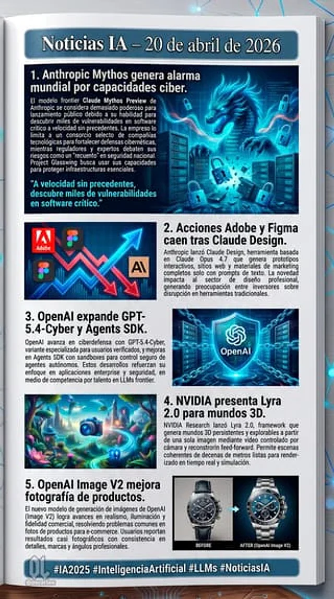

```text
{
  "type": "Digital Communication Page Layout",
  "background": "White pages placed on a dark surface, featuring glowing blue digital nodes and connecting lines.",
  "header": {
    "text": "{argument name=\"main headline\" default=\"AI News – April 20, 2026\"}",
    "style": "White text on a dark blue banner with a light blue border"
  },
  "layout": {
    "sections": [
      {
        "id": 1,
        "title": "{argument name=\"news item 1 title\" default=\"1. Anthropic Mythos raises global alarm over its cyber capabilities.\"}",
        "image_description": "A glowing blue cyber dragon emerged from the server, surrounded by floating digital padlocks.",
        "layout_style": "The image is on the right, the title and text are on the left, and there is a cyan quote in the lower left corner."
      },
      {
        "id": 2,
        "title": "{argument name=\"news item 2 title\" default=\"2. Following the release of Claude Design, the stock prices of Adobe and Figma fell.\"}",
        "image_description": "A stylized stock chart showing jagged red downward arrows and glowing blue upward arrows, featuring the logos of Adobe and Figma, as well as an 'AI' icon.",
        "layout_style": "The image is on the left, and the title and text are on the right."
      },
      {
        "id": 3,
        "title": "{argument name=\"news item 3 title\" default=\"3. OpenAI extends GPT-5.4-Cyber ​​and Agents SDK.\"}",
        "image_description": "A glowing blue holographic shield with the OpenAI logo at its center, surrounded by digital chains and server backgrounds.",
        "layout_style": "The title and text are on the left, and the image is on the right."
      },
      {
        "id": 4,
        "title": "4. NVIDIA releases Lyra 2.0 for the 3D world.",
        "image_description": "A vibrant, surreal 3D fantasy landscape featuring glowing plants, floating islands, and a glowing blue camera icon in the foreground.",
        "layout_style": "The image is on the left, and the title and text are on the right."
      },
      {
        "id": 5,
        "title": "5. OpenAI Image V2 enhances product photography.",
        "image_description": "A comparison image of a luxury chronograph. The left side is marked 'BEFORE' (darker, less detail), while the right side is marked 'AFTER (OpenAI Image V2)' (bright, rich in detail, professional lighting).",
        "layout_style": "The title and text are on the left, and the image is on the right."
      }
    ],
    "count": 5
  },
  "footer": {
    "text": "{argument name=\"footer hashtags\" default=\"#AI2025 #ArtificialIntelligence #LLMs #AINews\"}",
    "logo": "Office lady logo with ' @oscarlau '",
    "style": "White text on the dark blue banner at the bottom"
  }
}
```

Model: GPT Image 2
Author: GPT Image 2 Prompts

[ProjectD](https://aitoolsradar.com/en/prompts/d7a33a13be6f4f) · [Recorded source](https://x.com/oscarlau/status/2046212158422159493#reversed-0)
 · [Full original metadata and byte evidence](data/projectd-batch-0019.json)

## AI Poster Comparison Thumbnail

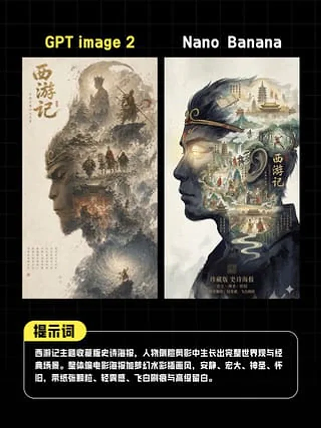

```text
A vertical social media comparison poster with a black background featuring a subtle gray grid, designed in a minimalist tech review style. At the top are two large headlines side-by-side: the left one reads "GPT image 2" in bright yellow; the right one reads "Nano Banana" in white. Below the headlines are two tall poster mockups placed side-by-side with narrow spacing, both using a beige paper style. The left mockup showcases a traditional Chinese ink-wash fantasy poster inspired by *Journey to the West*, with a large vertical Chinese calligraphy of "Journey to the West" in the upper left corner. The image includes soft dark brown and gray ink-wash mountains, cliffs, clouds, temple architecture, and four tiny silhouettes: two heroes on a rocky ledge in the upper middle, and two travelers below; a swirling, glowing cloud vortex appears at the bottom of the image. The right-hand mockup showcases a more graphic, surreal poster. The image is constructed within a left-facing silhouette of a human head, filled with a Chinese fantasy landscape featuring pagodas, flowing water, paths, and figures. The silhouette bears the vertical title "Journey to the West." The silhouette is rendered in deep navy blue and black ink wash, surrounded by cream-colored paper. Both posters feature a centered, blurred, vertical rectangular overlay with soft, gray-beige edges. At the bottom is a rounded black instruction panel with a thin white border. A bright yellow capsule-shaped label in the upper left corner contains the bold black Chinese text "Prompt Word." The bottom panel contains multiple lines of bold white Chinese text. The text should read: "A Journey to the West-themed collector's edition epic poster, with a complete world view and classic scenes emerging from the silhouettes of the characters' profiles. The overall style leans towards movie posters and dreamy watercolor illustrations, quiet, grand, sacred, and nostalgic, with paper grain, a light misty feel, brushstrokes, and sophisticated white space." The overall style features exquisite Chinese technology comparison thumbnails, high contrast, edited layout, centered composition, and a 4:5 vertical screen ratio.
```

Model: GPT Image 2
Author: GPT Image 2 Prompts

[ProjectD](https://aitoolsradar.com/en/prompts/6c37b784feacc6) · [Recorded source](https://x.com/one_tumi/status/2047661283055649090#reversed-0)
 · [Full original metadata and byte evidence](data/projectd-batch-0019.json)

## AI Pulse #290

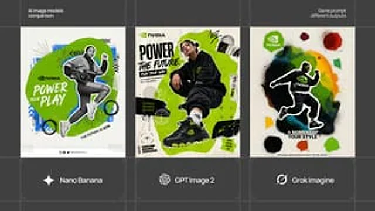

```text
[BRAND NAME = CHANGE TO YOUR BRAND]. 
Act as a Social Media Art Director and Digital Collage Artist specializing in bold, youth-oriented brand content for Instagram and digital campaigns. PHASE 1: CONCEPTUAL FRAMEWORK Create a dynamic digital collage that merges fashion photography with graphic design chaos. This is controlled rebellion – a composition that feels spontaneous and energetic while maintaining brand coherence. The aesthetic is anti-polished: torn edges, layered textures, hand-drawn elements, and bold color blocking that screams confidence and movement. PHASE 2: MODEL & PHOTOGRAPHY - Subject: One model (diverse casting, age 18-30) in a dynamic, confident pose - Pose Energy: 80% attitude, 20% natural – sitting, jumping, mid-motion, or power stance (avoid static standing) - Outfit: Street style/athleisure that aligns with [BRAND NAME] aesthetic – casual but styled - Hero Product: Feature 1 signature [BRAND NAME] product prominently (sneakers, bag, apparel) – this is the visual anchor - Photography Style: Editorial fashion cutout – model extracted from background with clean edges - Camera Angle: Slight low angle to empower subject (hero perspective) - Crop: Full body or 3/4 body showing hero product clearly - Background Removal: Model cut out cleanly for layering over collage elements PHASE 3: COLOR BLOCKING FOUNDATION - Primary Color Blob: Large organic shape (40-60% of composition) in bold, saturated brand color behind/around model - Shape Style: Irregular, hand-painted aesthetic – think Photoshop brush strokes or torn paper texture (NOT perfect geometric shapes) - Color Selection (Autonomous): Choose 1 hero color from [BRAND NAME] palette: - Texture: Visible brush strokes, grain, or subtle noise (15-25% opacity) – avoid flat digital fills - Placement: Blob positioned to frame model without obscuring key product details PHASE 4: GRAPHIC ELEMENTS LAYER Add 3-5 abstract graphic elements scattered across composition: - Element Types: - Color Palette: Use 2-3 accent colors total (main blob color + 1-2 contrasting tones from brand palette) - Placement: Asymmetric scatter – top-left and bottom-right zones primarily (avoid center crowding) - Scale: Mix small (5% of canvas) and medium (15% of canvas) elements – nothing overpowering - Aesthetic: Analog/handmade feel – imperfect circles, rough edges, visible texture PHASE 5: TYPOGRAPHY INTEGRATION - Brand Logo: Clean [BRAND NAME] logo placed in upper-left or upper-right quadrant (10-15% of width) - Slogan/Tagline: If [BRAND NAME] has an iconic slogan, integrate it using: - Supporting Copy: Optional 1-line descriptor (e.g., "A MOMENT OF YOUR STYLE") in smaller uppercase sans-serif - Type Treatment: Mix of aligned and slightly rotated text (2-5° angles) for dynamic energy - Hierarchy: Logo largest → Slogan medium → Copy smallest PHASE 6: TEXTURE & BACKGROUND - Base Layer: Off-white or light gray textured background (NOT pure white) - Texture Options (Autonomous selection): - Color: RGB 245-250 (near-white with warmth) – maintains brightness while adding depth - Treatment: Texture should be felt, not seen – enhances tactility without competing with foreground PHASE 7: COMPOSITION RULES - Layout: Asymmetric balance – model off-center, graphic elements counter-balance - Breathing Room: 15-20% negative space (textured background visible) to prevent claustrophobia - Layering Order: Background texture → Color blob → Graphic elements → Model (cutout) → Typography top layer - Focal Point: Model + hero product = primary focus (60% visual weight), graphics support (40%) - Movement: Diagonal lines and angled elements create directional flow (top-left to bottom-right or vice versa) PHASE 8: BRAND INTELLIGENCE (AUTONOMOUS) Autonomously adapt composition based on [BRAND NAME] personality: - Streetwear/Sportswear (Nike, Adidas, Supreme): - Luxury Streetwear (Balenciaga, Off-White, Gucci): - Beauty/Lifestyle (Glossier, Fenty, Skims): - Tech/Modern (Apple, Tesla, Beats): PHASE 9: SOCIAL MEDIA FOOTER (OPTIONAL) - Bottom Strip: Clean white or light gray bar at bottom 8-10% of frame - Content: Social media handles (Instagram, Facebook, Twitter) in small sans-serif - Layout: Three-column grid with platform icons or text handles - Aesthetic: Minimal and professional – contrast with chaotic collage above TECHNICAL SPECS: - Aspect Ratio: 4:5 (Instagram feed) or 1:1 (square social post) - Resolution: 2400x3000px minimum (high-quality for zoom and detail) - Color Mode: sRGB, vibrant saturation (Instagram-optimized) - File Aesthetic: Digital collage that mimics analog craft (Photoshop + hand-drawn hybrid) - Model Photography: 85mm lens, f/2.8, shallow depth of field on original shoot (before cutout) - Style Reference: Nike social campaigns, Spotify wrapped graphics, Gen Z Instagram aesthetics, Hypebeast x streetwear collabs - Mood: Confident, energetic, youthful, authentic chaos, anti-corporate polish
```

Model: GPT Image 2
Author: AI Pulse

[ProjectD](https://aitoolsradar.com/en/prompts/1f931f90698a8e) · [Recorded source](https://x.com/youraipulse/status/2048802776419799152)
 · [Full original metadata and byte evidence](data/projectd-batch-0019.json)

## AI Pulse #298


```text
Create a 16:9 horizontal bento-grid brand collage for [BRAND NAME] in a polished contemporary campaign style.  
Use a fixed 3-row, 4-column bento structure with rounded tiles, equal gaps, clean alignment, and a light neutral background.
The layout must stay consistent across generations, but the content inside each tile must adapt to the real business model, product ecosystem, and brand language of [brand name].

Grid blueprint
Build the composition as 11 visible content zones arranged in a fixed bento layout:
Top-left tile: 1 column × 2 rows, tall vertical hero device or primary brand surface
Top-middle-left tile: 1 column × 1 row, compact square brand asset tile
Top-middle-right tile: 2 columns × 1 row, wide headline/message tile

Center tile: 2 columns × 2 rows, dominant campaign hero scene

Top-right tile: 1 column × 1 row, secondary device / product surface / branded object

Bottom-left tile: 1 column × 1 row, product artifact or branded utility object

Bottom-center tile: 2 columns × 1 row, large bold typography tile

Bottom-right tile: 1 column × 2 rows, tall informational product / interface / feature tile

All tiles must share the same corner radius, spacing system, and visual polish.
The dominant focal points are the large center hero tile, the wide top headline tile, and the wide bottom typography tile.

Adaptive content logic
Do not assume [brand name] is a fintech brand.
Before deciding what appears inside each tile, infer what [brand name] actually is: social platform, SaaS tool, media brand, retailer, hospitality brand, hardware company, mobility app, AI product, consumer app, etc.

Every tile must contain a plausible branded asset based on that business type.

Use this rule:

If [brand name] has a real consumer app, dashboard, product UI, creator interface, booking flow, editor, storefront, feed, player, workspace, or operating surface, use those.

If [brand name] does not realistically have payment cards, watches, or hardware, do not invent them.

Only include branded physical objects when they make sense for the brand: packaging, merch, signage, magazine, laptop sticker, storefront card, delivery box, product box, wearable, poster, notebook, tote, badge, ticket, book, etc.

If the brand is primarily digital, prioritize screens, interface fragments, campaign graphics, app/store listings, editorial visuals, and branded communication assets.

If the brand is a platform, use realistic platform surfaces: profile screens, creator dashboards, boards, playlists, templates, analytics, publishing tools, discovery feeds, search, collaboration views, etc.

If the brand is a physical-product company, use realistic product shots, packaging, product detail pages, retail signage, and lifestyle scenes.

If the brand is a service business, use realistic booking, scheduling, marketplace, onboarding, testimonial, results, or service-delivery interfaces.

If exact assets are unknown, infer the most believable official-looking product and campaign system for [brand name].

Tile-by-tile rules
1) Tall left hero tile
Show the most iconic primary branded surface for [brand name].

Examples:

phone with app UI
laptop with dashboard/editor
tablet with creative workspace
product packaging held in hand
branded poster or printed object
storefront or physical product close-up

This tile should represent the brand’s main touchpoint, not a generic device.

2) Small square brand asset tile
Show a compact brand-signature element:

app icon
logo mark
symbol
product badge
branded motif
miniature packaging unit
icon system object
sticker or seal
simplified 3D brand emblem

This tile should feel like a distilled identity marker.

3) Wide top headline tile
Use a short strategic message that fits [brand name]’s category and tone.
Do not repeat generic fintech copy.
The line should feel like a real campaign headline for that specific brand.

Examples of direction:

discovery
creativity
organization
inspiration
connection
travel
productivity
expression
streaming
collaboration
automation

Use large, bold, high-contrast typography.

4) Large center hero tile
Create the main campaign scene for [brand name] in a real-world or branded-environment context.
This should be the most expressive tile.

Possible formats:
outdoor billboard
subway poster
retail installation
city poster wall
laptop-on-desk hero scene
creator workspace
product-in-use lifestyle shot
editorial campaign image
interface projected into environment
branded event signage
The scene must make sense for the brand’s world and audience.

5) Top-right support tile
Show a secondary but still realistic brand surface:

another device view
product detail
branded object
campaign variation
interface zoom-in
packaging angle
social post mockup
desktop widget
creator tool panel
notification / discovery / search view

This tile should complement the main touchpoint, not duplicate it exactly.

6) Bottom-left artifact tile
Show a category-appropriate branded artifact, not a fixed “bank card”.

Choose the artifact based on [brand name]:

for fintech: payment card, wallet pass, transfer screen, exchange card

for social/media: creator card, profile card, post template, content preview, board tile, channel card

for SaaS/productivity: workspace card, document preview, template card, dashboard widget

for e-commerce/retail: packaging, shipping box, loyalty pass, product tag, order card

for travel/hospitality: booking card, room key, boarding-style pass, itinerary card

for music/media: album card, playlist card, player card, event ticket

for AI/software: prompt card, generation result card, model card, workflow card

This tile must feel like a believable branded unit of value for that company.

7) Wide bottom message tile
Use one strong oversized statement in uppercase or bold display typography.
This is not necessarily the slogan from the top tile; it can be a broader campaign line or category promise.

The message must match the actual brand behavior of [brand name].
For example, do not use “MOVE MONEY WITHOUT BORDERS” unless the brand actually deals with payments or finance.

8) Tall right informational tile
Show a structured branded information surface:
app store page
product page
onboarding screen
feature overview
marketplace listing
creator profile
brand campaign landing screen
dashboard overview
editorial page
discovery feed
help center / setup / feature panel
This tile should add product depth and make the collage feel like a full brand system.

Brand realism rules
Use the real or highly plausible brand identity of [brand name]: logo, color palette, typography feel, icon language, image treatment, interface style, and tone of voice.
If exact assets are unavailable, invent only what is necessary, but make it feel like the official visual system of [brand name].

Do not force a product category onto the brand.
Do not invent impossible hardware, payment tools, packaging, or app features unless they are realistic adjacent extensions of the brand.
Prefer believable brand adaptation over visual symmetry.

Visual consistency rules
Even though tile content is adaptive, the final image must still feel like one campaign system:

same overall grid structure
same tile spacing
same corner radius
same art direction quality
same brand palette across all tiles
consistent typography logic
consistent mockup realism
consistent lighting and polish

Style
Clean premium brand presentation, high detail, polished mockup realism, soft shadows, strong hierarchy, editorial-quality composition, modern campaign aesthetics.
Avoid random collage chaos.
Avoid tiny unreadable text.
Avoid generic placeholder UI.
Keep the structure fixed, but let the objects and branded surfaces adapt intelligently to [brand name].

Stronger one-line instruction

Important: the layout is fixed, but the objects are not fixed.
For each generation, select tile content based on what [brand name] realistically sells, ships, publishes, displays, or lets users interact with.
Never insert category-inappropriate objects just to fill the grid.
```

Model: GPT Image 2
Author: AI Pulse

[ProjectD](https://aitoolsradar.com/en/prompts/c01db47922f039) · [Recorded source](https://x.com/youraipulse/status/2047423024068952489)
 · [Full original metadata and byte evidence](data/projectd-batch-0019.json)

## AI Resume Builder Promo Poster


```text
{
  "type": "Landing page product promotional poster",
  "product": {
    "name": "{argument name=\"product name\" default=\"Magic Resume\"}",
    "category": "AI resume generator website",
    "brand_style": "A clean and modern SaaS style, minimalist, with a white background accented with cyan and dark blue, rounded cards, thin gray outlines, and soft, light-colored shadows."
  },
  "canvas": {
    "orientation": "Vertical screen",
    "aspect_ratio": "9:16"
  },
  "headline_block": {
    "position": "Top left corner",
    "logo": "Abstract cyan M logo and text label",
    "headline": "AI-driven resume generator",
    "subheadline": "Let AI help you create a better resume",
    "style": "Extra-large bold sans-serif heading; RESUME text in bright cyan; other text in dark blue."
  },
  "top_right_badge": {
    "text": "GitHub 6.5k+ Stars",
    "style": "Rounded white capsule badge with dark text and GitHub icon."
  },
  "hero_section": {
    "position": "Top right corner",
    "main_visual": "A large, tilted web application model card showcases the resume editor UI.",
    "screen_contents": {
      "left_panel": {
        "title": "AI Assistant",
        "chat_lines_count": 3,
        "quick_actions_count": 4,
        "quick_actions": [
          "Optimization Summary",
          "Enhance work experience",
          "Optimize skills",
          "Grammar check"
        ]
      },
      "top_toolbar_count": 7,
      "top_toolbar_items": [
        "template",
        "style",
        "Bold",
        "italics",
        "underline",
        "Align/Set Icons",
        "Share/Export Icon"
      ],
      "resume_preview": {
        "name": "{argument name=\"sample candidate name\" default=\"Alex Johnson\"}",
        "role": "Senior Front-End Developer",
        "contact_count": 3,
        "contact_items": [
          "Mail",
          "Telephone",
          "address"
        ],
        "sections_count": 3,
        "sections": [
          "Personal Summary",
          "Work experience",
          "Skill"
        ],
        "skill_tags_count": 6,
        "skill_tags": [
          "React",
          "TypeScript",
          "Next.js",
          "Tailwind CSS",
          "JavaScript",
          "HTML/CSS"
        ]
      }
    },
    "decorations": "Soft blue projection, dashed curved guide lines, tiny glitter dots, handwritten-style annotations in the lower right corner: real-time preview and one-click template switching."
  },
  "feature_list": {
    "position": "Left and Middle",
    "count": 4,
    "items": [
      {
        "title": "AI Intelligent Optimization",
        "description": "Automatically polish content to improve expression quality.",
        "icon": "Magic wand or glitter icon inside a rounded square"
      },
      {
        "title": "Beautiful templates &amp; customization",
        "description": "Multiple professional templates, customizable color schemes and fonts",
        "icon": "Document icon inside a rounded square"
      },
      {
        "title": "Live Preview",
        "description": "What you see is what you get, content updated in real time.",
        "icon": "Eye icon inside a rounded square"
      },
      {
        "title": "Local storage · Privacy and security",
        "description": "Data is stored locally only, protecting your privacy.",
        "icon": "The lock icon inside the rounded capsule card"
      }
    ]
  },
  "why_section": {
    "position": "Middle to lower",
    "title": "Why choose{argument name=\"product name\" default=\"Magic Resume\"} ?",
    "cards_count": 4,
    "cards": [
      {
        "number": "01",
        "title": "AI Intelligent Optimization",
        "bullet_count": 3,
        "bullets": [
          "Automatically polish your resume content",
          "Intelligent suggestions and improvements",
          "Improve expression quality with one click"
        ],
        "visual": "Illustration of an AI brain and a mini Agent panel with an \"App Change\" button."
      },
      {
        "number": "02",
        "title": "Beautiful templates &amp; customization",
        "bullet_count": 3,
        "bullets": [
          "Multiple professional templates",
          "Custom color schemes and fonts",
          "Create a resume with your own style"
        ],
        "visual": "2 resume thumbnails and 6 color charts"
      },
      {
        "number": "03",
        "title": "Live Preview",
        "badge": "LIVE",
        "bullet_count": 3,
        "bullets": [
          "What you see is what you get",
          "Real-time updated content",
          "Perfectly presenting every detail"
        ],
        "visual": "Blurry resume preview card with eye icon button"
      },
      {
        "number": "04",
        "title": "Local storage · Privacy and security",
        "bullet_count": 3,
        "bullets": [
          "Data is stored only locally",
          "No need to upload to the cloud",
          "Protect your privacy and security"
        ],
        "visual": "Folder, shield lock, dotted arrow path, little cloud"
      }
    ]
  },
  "bottom_bar": {
    "position": "bottom",
    "count": 4,
    "items": [
      "No registration required, use immediately",
      "Privacy First Local Storage",
      "Highly efficient and intelligent AI-driven",
      "Innovative and smooth interactive experience"
    ],
    "icons_count": 4,
    "icons": [
      "Rocket",
      "Shield",
      "lightning",
      "Gesture pointer"
    ]
  },
  "style": {
    "typography": "A mix of bold geometric sans-serif fonts and simple Chinese sans-serif fonts",
    "rendering": "High-fidelity marketing graphics, crisp vector-level UI, subtle gradients, soft cyan highlights, and a spacious layout.",
    "palette": {
      "background": "White",
      "primary": "blue",
      "secondary": "Dark blue",
      "accent": "Light green and pale blue"
    }
  }
}
```

Model: GPT Image 2
Author: GPT Image 2 Prompts

[ProjectD](https://aitoolsradar.com/en/prompts/ee2debd02b18d2) · [Recorded source](https://x.com/GuangzhouY81070/status/2046987792329453598#reversed-0)
 · [Full original metadata and byte evidence](data/projectd-batch-0019.json)

## AI Self-Perception Portrait

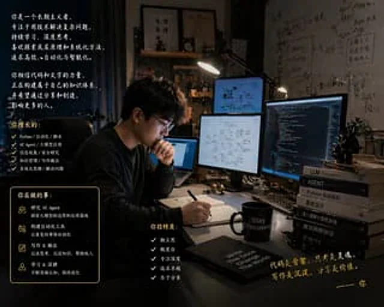

```text
根据你对我的认知 给我生成一个“你认识的我”的 图片
```

Model: GPT Image 2
Author: @80vul

[ProjectD](https://aitoolsradar.com/en/prompts/e5d3d42e6a647a) · [Recorded source](https://x.com/80vul/status/2046218165961753047)
 · [Full original metadata and byte evidence](data/projectd-batch-0019.json)

## AI Thinking App Screenshot

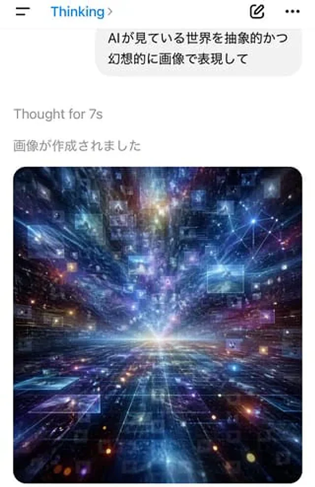

```text
A screenshot of a vertical mobile chat application, featuring a minimalist iOS-style interface with a white background. The top navigation bar has a hamburger menu icon on the left, a blue title "Thinking" on the left-center, and an arrow on the right. On the right are two icons: an edit icon and a horizontal three-dot menu icon. Below is a large, rounded, light gray chat bubble containing two lines of Japanese text: “AI ga 見ている世界を曝のかつ” and “幻想的に畫で表达して”. Below the bubble, left-aligned gray system text reads “Thought for 7s,” and below that is another line of gray Japanese text: “畫が作成されました”. The lower half of the screen displays a large, rounded generated image card. The image is a surreal, abstract cosmic data landscape: a luminous white horizon at the center, a dark, reflective grid extending into the depths, and beams of light, nebulae, stars, and particles erupting outwards from the vanishing point. Dozens of semi-transparent rectangular image panels or data windows of varying shades float in the space. In the upper right corner of the artwork is a bright network of nodes composed of connecting points and lines. The main colors are electric blue, indigo, violet, and cyan, accented with magenta and gold. The overall atmosphere is futuristic, expansive, dreamlike, and intelligent, as if viewing the world through the eyes of a visualized AI. The composition is simple, the UI realistic, the typography clear, and the embedded images possess a high-contrast, glowing digital art effect.
```

Model: GPT Image 2
Author: GPT Image 2 Prompts

[ProjectD](https://aitoolsradar.com/en/prompts/f083462bee6fac) · [Recorded source](https://x.com/Masimo_Blue/status/2046617819803201838#reversed-0)
 · [Full original metadata and byte evidence](data/projectd-batch-0019.json)

## AI VR Poster Comparison

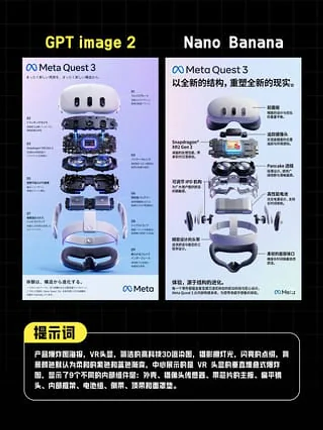

```text
{
  "type": "comparison poster",
  "style": "Infographic showdown of tech products, featuring a clean and concise layout, a dark background with light blue grid lines, and high-contrast social media graphics.",
  "canvas": {
    "aspect_ratio": "4:5",
    "background": "Black, with a fine square grid."
  },
  "layout": {
    "sections": [
      {
        "title": "GPT image 2",
        "position": "The top left corner of the poster on the left",
        "count": 1,
        "labels": [
          "GPT image 2"
        ]
      },
      {
        "title": "Nano Banana",
        "position": "The top right corner of the poster on the right",
        "count": 1,
        "labels": [
          "Nano Banana"
        ]
      },
      {
        "title": "Prompt words",
        "position": "Bottom label title",
        "count": 1,
        "labels": [
          "Prompt words"
        ]
      }
    ],
    "panels": 2,
    "panel_arrangement": "Two tall, vertical posters are placed side by side with even spacing and centered horizontally.",
    "bottom_callout": "Large, rounded black text box with a white border that spans most of the width"
  },
  "left_panel": {
    "type": "VR headset explosion poster",
    "branding": "Meta Quest 3",
    "headline": "A completely new reality, from a completely new structure.",
    "language": "Japanese",
    "poster_background": "A soft white to pale purple gradient",
    "main_object": "Renderings of the Meta Quest 3 headset in a vertically exploded assembly.",
    "component_count": 9,
    "number_labels": [
      "01",
      "02",
      "03",
      "04",
      "05",
      "06",
      "07",
      "08",
      "09"
    ],
    "components": [
      "Front shell and panel",
      "Sensor/Camera Components",
      "Motherboard and chipset layer with luminous blue core",
      "Double Pancake Lens Module",
      "Internal lower shell",
      "Battery Module",
      "Side arm",
      "Top strap and headband frame",
      "Face pad"
    ],
    "annotations": "Japanese technical labeling with thin guide lines around the component",
    "footer": "A light gray information bar at the bottom with densely packed small text and the Meta logo."
  },
  "right_panel": {
    "type": "VR headset explosion poster",
    "branding": "Meta Quest 3",
    "headline": "A completely new structure, reshaping a completely new reality.",
    "language": "Chinese",
    "poster_background": "A soft gradient from white to pale gray-blue.",
    "main_object": "Renderings of the Meta Quest 3 headset in a vertically exploded assembly.",
    "component_count": 9,
    "callout_count": 8,
    "components": [
      "Front panel",
      "Sensor strip",
      "Motherboard with Snapdragon XR2 Gen 2 chip",
      "Double Pancake Lens",
      "Adjustable IPD mechanism",
      "High-performance batteries",
      "Headband Arm",
      "Face Interface",
      "Lower facial pad"
    ],
    "callout_labels": [
      "Front panel",
      "Tracking camera",
      "Pancake Lens",
      "High-performance batteries",
      "Soft face interface",
      "Precision-designed headband",
      "Adjustable IPD mechanism",
      "Snapdragon XR2 Gen 2"
    ],
    "annotations": "The exploded render image features bold Chinese annotations with black guide lines on both sides.",
    "footer": "A light gray information bar at the bottom with densely packed small text and the Meta logo."
  },
  "bottom_text_box": {
    "shape": "Rounded rectangle",
    "header_badge": "Yellow capsule-shaped label on the upper left edge",
    "body_text": "{argument name=\"prompt text\" default=\"Product exploded view poster, VR headset, simple high-tech 3D rendering, studio lighting, sparkling embellishments, background color default is a soft purple and blue gradient, the center shows the vertically stacked exploded view of the VR headset, showing 9 different internal components: shell, camera sensor, motherboard with chip, flat lens, internal frame, battery pack, side arms, top strap and face mask pad.\"}",
    "text_color": "White",
    "font": "Bold sans-serif Chinese font"
  },
  "visual_details": {
    "rendering": "Ultra-simple 3D product visualization: glossy white plastic, dark glass sensors, internal metal structure, and subtle purple-blue reflections.",
    "lighting": "Studio lighting with polished highlights and soft shadows",
    "mood": "Comparison chart of professional, competitive, and modern AI tools"
  }
}
```

Model: GPT Image 2
Author: GPT Image 2 Prompts

[ProjectD](https://aitoolsradar.com/en/prompts/7509531597537e) · [Recorded source](https://x.com/one_tumi/status/2047661283055649090#reversed-3)
 · [Full original metadata and byte evidence](data/projectd-batch-0019.json)

## AI 日常生活 iPhone 抓拍

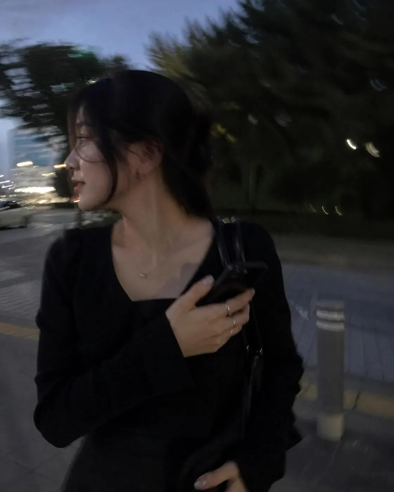

```text
I want to see what you really look like.
Draw a snapshot of your everyday life as if it were accidentally taken on an iPhone.
Make it feel like a very ordinary, imperfect candid shot.
The photo should have slight motion blur, with uneven, natural lighting.
```

Model: GPT Image 2
Author: @Ciri_ai

[ProjectD](https://aitoolsradar.com/en/prompts/d89585599ba4bf) · [Recorded source](https://x.com/Ciri_ai/status/2051292618248904809)
 · [Full original metadata and byte evidence](data/projectd-batch-0019.json)

## AI 眼镜爆炸拆解图

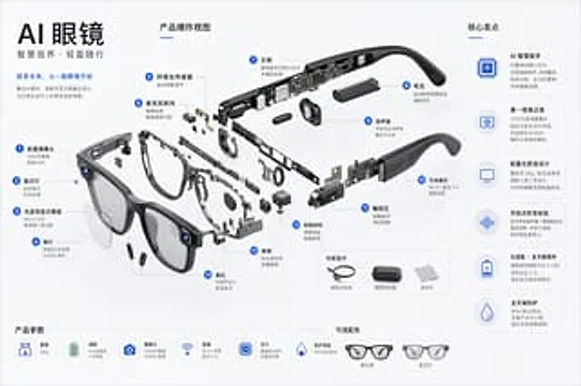

```text
生成一张AI眼镜的爆炸视图，包含每个组件的名称以及这款产品的几大核心卖点。
```

Model: GPT Image 2
Author: 苍何原创实测（公众号文章《我逆向了 329 条 GPT-Image2 提示词模板，全部开源！》）

[ProjectD](https://aitoolsradar.com/en/prompts/cab22c46468e0e) · [Recorded source](https://github.com/freestylefly/awesome-gpt-image-2)
 · [Full original metadata and byte evidence](data/projectd-batch-0019.json)

## AI 眼镜爆炸视图

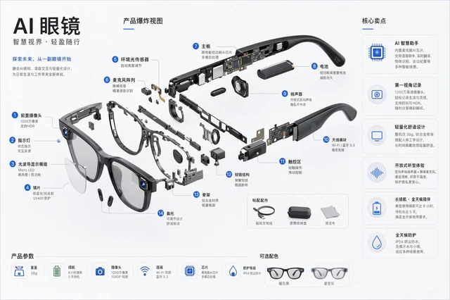

```text
生成一张AI眼镜的爆炸视图，包含每个组件的名称以及这款产品的几大核心卖点。
```

Model: GPT Image 2
Author: @canghe

[ProjectD](https://aitoolsradar.com/en/prompts/073b74a8524851) · [Recorded source](https://x.com/canghe/status/2048306517976514786)
 · [Full original metadata and byte evidence](data/projectd-batch-0019.json)

## Aijaz #232

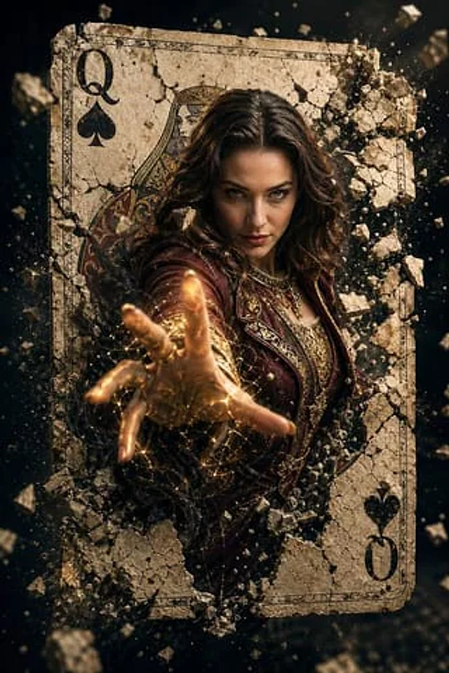

```text
A hyper-realistic cinematic movie poster of a powerful female sorcerer with the same facial structure and likeness as the uploaded reference photo, bursting through a cracked Queen of Spades playing card.
The card explodes outward with stone fragments, dust, and debris frozen mid-air.
She wears an ornate royal maroon and gold embroidered medieval fantasy jacket, rich fabric textures, intricate detailing, regal and mystical.The sorcerer extends one hand forward toward the viewer, fingers glowing with intense magical energy, subtle golden sparks and dark arcane aura surrounding the hand.
Intense piercing gaze, confident and dominant expression, cinematic hero framing.
Dramatic chiaroscuro lighting, dark moody background, volumetric light rays, ultra-detailed textures, shallow cinematic depth of field.
Photorealistic face, epic fantasy realism, movie poster composition, high contrast, dynamic motion, dust particles, masterpiece quality, ultra-sharp focus, 8K resolution, cinematic color grading
```

Model: GPT Image 2
Author: Aijaz

[ProjectD](https://aitoolsradar.com/en/prompts/1ddf399e337099) · [Recorded source](https://x.com/iamsofiaijaz/status/2048805574176112646)
 · [Full original metadata and byte evidence](data/projectd-batch-0019.json)

## Aijaz #66

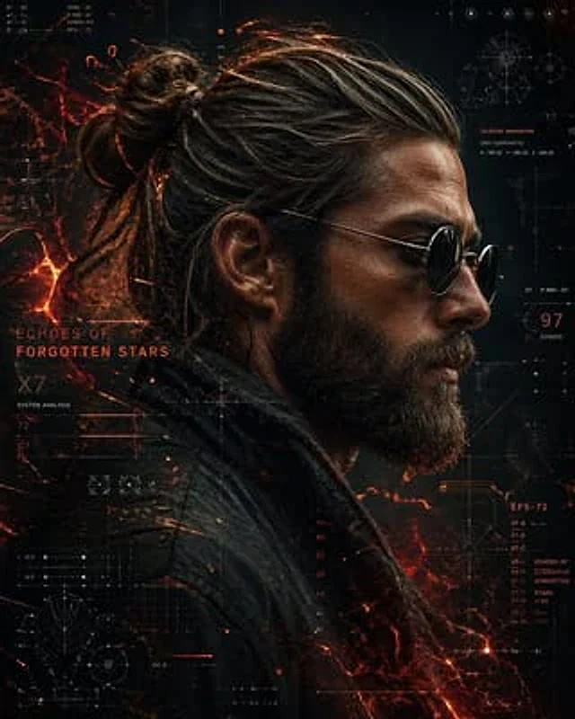

```text
A cinematic side-profile portrait of a rugged man with a tied-back bun and full beard, wearing round dark sunglasses and a textured leather jacket. His skin is detailed and slightly weathered. The background is a futuristic sci-fi interface filled with glowing orange and red data streams, star maps, celestial navigation diagrams, grids, and holographic UI elements. Fiery particle effects and ember-like energy swirl around him, creating a cosmic, high-tech atmosphere. Dark color palette with strong contrast, dramatic lighting, ultra-detailed, sharp focus, 8K, cyberpunk aesthetic, cinematic composition, depth of field.
```

Model: GPT Image 2
Author: Aijaz

[ProjectD](https://aitoolsradar.com/en/prompts/621b65dae63fa0) · [Recorded source](https://x.com/iamsofiaijaz/status/2047882171336253928)
 · [Full original metadata and byte evidence](data/projectd-batch-0019.json)

## Aijaz #96


```text
The scene is lit by warm golden hour sunlight, with glowing dust particles floating in the air, creating a soft magical atmosphere. Background is a rustic wooden village setting, softly blurred with shallow depth of field. Cinematic lighting, soft rim light on hair, volumetric light rays, ultra-detailed, high quality, Pixar / Disney-style 3D render, cute, cozy, whimsical, warm color palette, 4k, bokeh, soft focus.
```

Model: GPT Image 2
Author: Aijaz

[ProjectD](https://aitoolsradar.com/en/prompts/0533f3b428f5b1) · [Recorded source](https://x.com/iamsofiaijaz/status/2007634587166630152)
 · [Full original metadata and byte evidence](data/projectd-batch-0019.json)

## Aircraft Cutaway Archive Poster


```text
{
  "type": "Technical aircraft profile information poster",
  "subject": {
    "title": "{argument name=\"headline text\" default=\"Limit Structures: Aircraft Anatomy Files\"}",
    "aircraft": "A side sectional view of a wide-body commercial airliner, with the nose facing left and the tail facing right. The landing gear is down, revealing a large underwing engine. The interior cabin and systems are fully exposed.",
    "style": "The design combines ultra-refined aerospace engineering blueprints with architectural archival drawings, featuring precise cross-sectional drawings, dense annotation lines, clearly legible microtext, soft ink wash rendering, off-white aged paper texture, blue-gray graphite lines, and subtle brown and steel accents."
  },
  "layout": {
    "format": "Single large horizontal poster",
    "background": "The entire page contains engineering diagrams with layered orthographic projection outlines, measurement marks, leader lines, technical specifications, and a faint drawing grid.",
    "centerpiece": "A massive cross-section of an aircraft, spanning almost the entire width of the page, showcases the cockpit, passenger seating rows, service bay, internal piping, cargo hold, structural frame, and tail system.",
    "sections": [
      {
        "title": "Cockpit",
        "position": "Top left",
        "count": 1,
        "labels": [
          "1"
        ],
        "description": "Cockpit interior illustrations, including the pilot's seat, instrument panel, windows, and surrounding avionics."
      },
      {
        "title": "Kitchen and food cart",
        "position": "Below the upper left cockpit",
        "count": 1,
        "labels": [
          "2"
        ],
        "description": "Service kitchen illustrations, including storage shelves, ovens, serving carts, cabinets, and narrow aisles."
      },
      {
        "title": "Toilet module",
        "position": "Left-middle kitchen bottom",
        "count": 1,
        "labels": [
          "3"
        ],
        "description": "Small bathroom illustrations, including a toilet, sink, wall panels, and door."
      },
      {
        "title": "Environmental control system",
        "position": "Top right",
        "count": 1,
        "labels": [
          "6"
        ],
        "description": "Illustrations of mechanical systems, including pipes, turbines, and cylindrical equipment."
      },
      {
        "title": "fuel system",
        "position": "Right Center",
        "count": 1,
        "labels": [
          "8"
        ],
        "description": "Compact mechanical illustrations showing oil tanks, pumps, and piping systems."
      },
      {
        "title": "Avionics",
        "position": "Bottom left",
        "count": 1,
        "labels": [
          "4"
        ],
        "description": "An illustration of the electronics compartment, including cabling, cabinets, equipment racks, and nearby landing gear."
      },
      {
        "title": "Landing gear bay",
        "position": "Lower left center",
        "count": 1,
        "labels": [
          "5"
        ],
        "description": "An illustration of the landing gear bay, highlighting the wheel assembly, struts, and surrounding structure."
      },
      {
        "title": "core area of ​​the toilet",
        "position": "Bottom Center",
        "count": 2,
        "labels": [
          "LAVATORY CORE",
          "LAVATORY CORE"
        ],
        "description": "Two separate illustrations of the service core showcasing the exposed cylindrical water tank, piping, and internal support system; the illustration on the right is labeled 7."
      },
      {
        "title": "Rear service area",
        "position": "Bottom right",
        "count": 1,
        "labels": [
          "8"
        ],
        "description": "Aft technical bay illustration, featuring large blue cylindrical units, pipes, service entrances, and structural frames."
      }
    ],
    "additional_labels": [
      {
        "text": "cargo hold",
        "position": "Lower left"
      },
      {
        "text": "Structural framework",
        "position": "Shimonaka"
      }
    ],
    "legend": {
      "position": "Bottom Center",
      "count": 9,
      "labels": [
        "Cockpit",
        "cabin",
        "kitchen",
        "Avionics",
        "cargo hold",
        "Structural framework",
        "core area of ​​the toilet",
        "Environmental control system",
        "fuel system"
      ]
    }
  },
  "composition": {
    "camera": "Orthographic side view",
    "poster_margins": "The entire sheet of paper has a thin border around it.",
    "text_density": "Very high, with numerous tiny annotations, arrows, and part labels scattered throughout the page.",
    "lighting": "Flat, archival illustration lighting, non-photographic style, optimized for readability.",
    "finish": "Clear 4K infographic print quality, no garbled text, authentic typography, and precise line accuracy."
  }
}
```

Model: GPT Image 2
Author: GPT Image 2 Prompts

[ProjectD](https://aitoolsradar.com/en/prompts/fb05486cc4a30a) · [Recorded source](https://x.com/exit_dev/status/2046586251956875763#reversed-0)
 · [Full original metadata and byte evidence](data/projectd-batch-0019.json)

## Al-Shamus #216

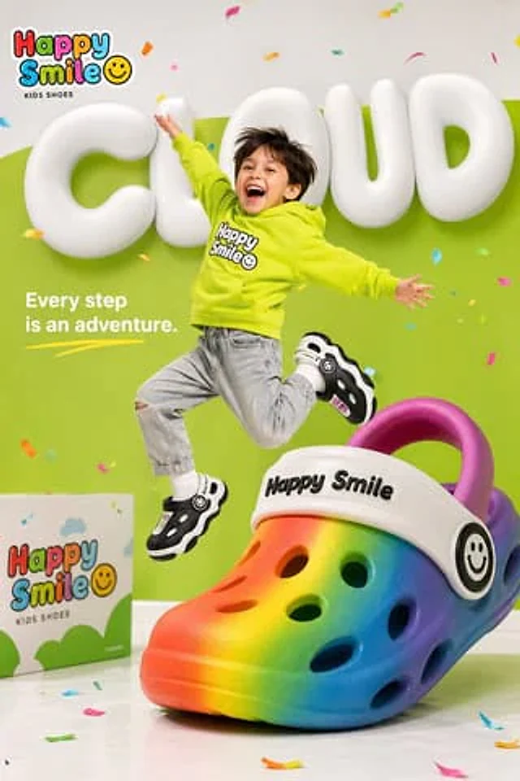

```text
Bright colorful children's shoe brand advertisement for "Happy Smile☺️", happy young child jumping in the air wearing oversized colorful foam  black and white shoes, giant rainbow colored shoe prop in background, bright green and white studio background, playful bubbly bold typography "CLOUD" in background, tagline "Every step 
is an adventure.", confetti falling, fun joyful lighting, 
commercial photography style, ultra HD 8K , Designed with Shamus image 2.
```

Model: GPT Image 2
Author: Al-Shamus

[ProjectD](https://aitoolsradar.com/en/prompts/df6500bdaf4af0) · [Recorded source](https://x.com/im_shahid7/status/2048726962001379515)
 · [Full original metadata and byte evidence](data/projectd-batch-0019.json)

## Al-Shamus #217

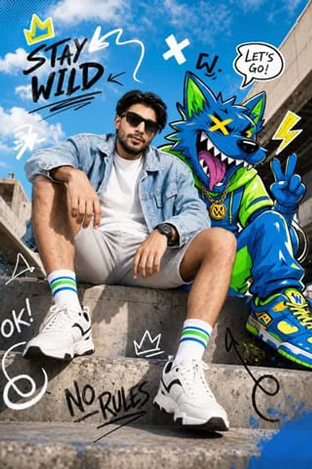

```text
Full-body fashion editorial shot of a confident young person model sitting casually on a concrete ledge, legs slightly apart, one arm resting on knee, the other relaxed, looking straight at camera with a calm dominant expression.

Wearing a light denim jacket over a plain white t-shirt, neutral shorts, bright socks, and modern sneakers. Clean styling, natural pose, wind slightly moving hair and fabric.

Beside and partially interacting with a stylized cartoon [ANIMAL], positioned naturally as if sharing the same space.

The [ANIMAL] is illustrated in bold cartoon style with thick black outlines, vibrant neon color palette (blue, green, yellow accents), exaggerated proportions, expressive features, playful yet powerful presence.

Background: bright outdoor urban setting with clear blue sky, soft clouds, sunlit concrete textures, strong natural daylight, crisp shadows.

Fusion of hyper-realistic photography and graphic illustration, seamless integration between subject and cartoon.

Add graphic overlay elements: doodle arrows, scribbles, abstract shapes, comic-style symbols, dynamic motion lines.

High contrast, HDR lighting, sharp focus, fashion editorial composition, surreal mixed-media aesthetic, ultra-detailed, 8k resolution
```

Model: GPT Image 2
Author: Al-Shamus

[ProjectD](https://aitoolsradar.com/en/prompts/47f22cbff154a4) · [Recorded source](https://x.com/im_shahid7/status/2047996860112249119)
 · [Full original metadata and byte evidence](data/projectd-batch-0019.json)

## Albedo Cosplay Instagram Snapshot

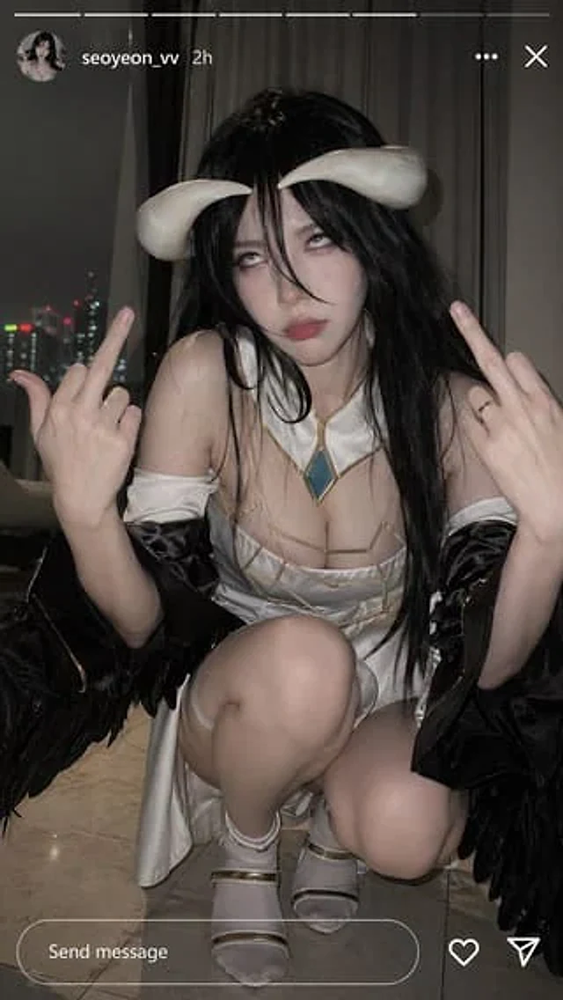

```text
Style: One{argument name="character" default="Albedo"} Instagram snapshots of cosplay; content:{argument name="action" default="He squatted on the ground, staring directly at the camera, making exaggerated rebellious gestures with his hands, rolling his eyes, and displaying an arrogant and disdainful expression."}
```

Model: GPT Image 2
Author: GPT Image 2 Prompts

[ProjectD](https://aitoolsradar.com/en/prompts/cef64c8de8b35a) · [Recorded source](https://x.com/94vanAI/status/2046739103316947296)
 · [Full original metadata and byte evidence](data/projectd-batch-0019.json)

## Albedo Cosplay Instagram Story

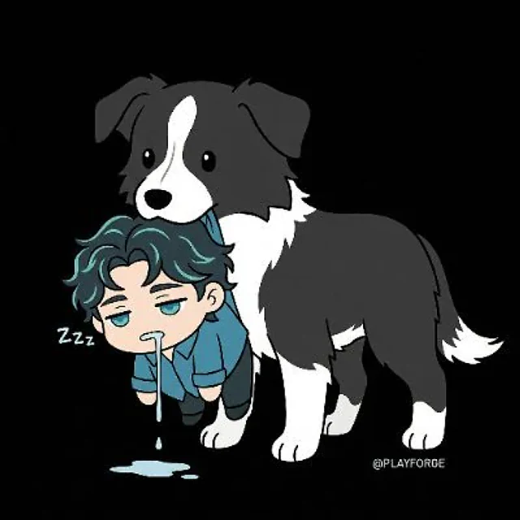

```text
風格：截取一張{argument name="角色" default="雅兒貝德"}cos的ins快拍寫真；內容：{argument name="動作" default="蹲在地上正對鏡頭，雙手做誇張叛逆手勢，翻白眼，表情囂張又不屑"}
```

Model: GPT Image 2
Author: 𝟡𝟜 𝚅̷𝙰̷𝙽̷ ᴾᴸᴬʸᶠᴼᴿᴳᴱ

[ProjectD](https://aitoolsradar.com/en/prompts/49830f6dc28bdb) · [Recorded source](https://youmind.com/prompts/albedo-cosplay-ins-story-photo-14347)
 · [Full original metadata and byte evidence](data/projectd-batch-0019.json)

## Aleena Amir #23


```text
Cinematic portrait of [Athlete Name] showing his/her journey, with bold text of achievements and best performances
```

Model: GPT Image 2
Author: Aleena Amir

[ProjectD](https://aitoolsradar.com/en/prompts/2724c8ed117a1f) · [Recorded source](https://x.com/aleenaamiir/status/2047325329052823996)
 · [Full original metadata and byte evidence](data/projectd-batch-0019.json)

## Aleena Amir #240


```text
Create a cohesive collection of playful icons for [BRAND NAME], a [BRAND TYPE/INDUSTRY] brand. Style should be [STYLE KEYWORDS: e.g., rounded, 3D, flat, hand-drawn, minimal] with a [COLOR STYLE: vibrant, pastel, gradient, monochrome] palette. Use [DESIGN TRAITS: soft shadows, bold outlines, subtle textures, glow, etc.] to give a friendly and modern feel. Maintain consistency across all icons with a unified grid, proportions, and visual language. Icons should represent [LIST OF FEATURES/FUNCTIONS]. Ensure high clarity, balanced spacing, and scalable design suitable for UI, apps, and branding.
```

Model: GPT Image 2
Author: Aleena Amir

[ProjectD](https://aitoolsradar.com/en/prompts/00d2d5222c4e0e) · [Recorded source](https://x.com/aleenaamiir/status/2047546614257221653)
 · [Full original metadata and byte evidence](data/projectd-batch-0019.json)

## Aleena Amir #52

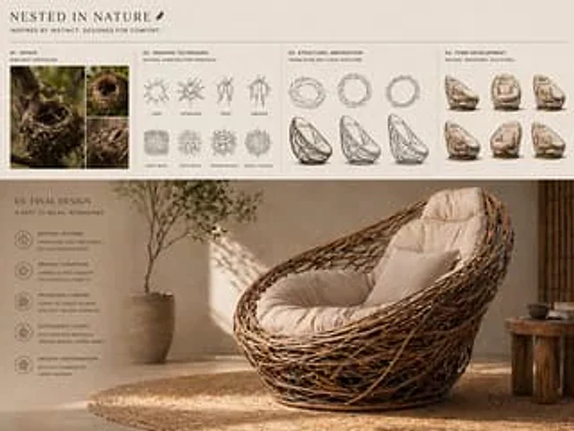

```text
Conceptual transformation, bird nest construction techniques shaping a sculptural lounge chair, sequence from nest-building photography to weaving diagrams to organic structural abstraction to final product, interwoven frame forming seat and backrest, natural fibers with soft cushioning, earthy tones with refined finish, sustainable luxury aesthetic, presentation layout, sketches above, render below, warm natural lighting.

AR – 4:3
```

Model: GPT Image 2
Author: Aleena Amir

[ProjectD](https://aitoolsradar.com/en/prompts/1f47e72406043c) · [Recorded source](https://x.com/aleenaamiir/status/2048667175112802778)
 · [Full original metadata and byte evidence](data/projectd-batch-0019.json)

## Aleena Amir #8

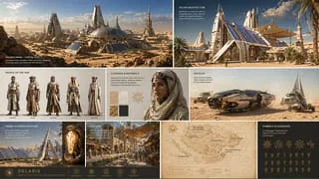

```text
Create a complete visual worldbuilding set for a futuristic desert civilization powered by solar technology, multiple images including architecture, characters, clothing, vehicles, and maps, cohesive design language, cinematic realism, ultra detailed.
```

Model: GPT Image 2
Author: Aleena Amir

[ProjectD](https://aitoolsradar.com/en/prompts/37ec6028fba0e4) · [Recorded source](https://x.com/aleenaamiir/status/2046866168208916503)
 · [Full original metadata and byte evidence](data/projectd-batch-0019.json)

## Algeria World Cup Captain Poster

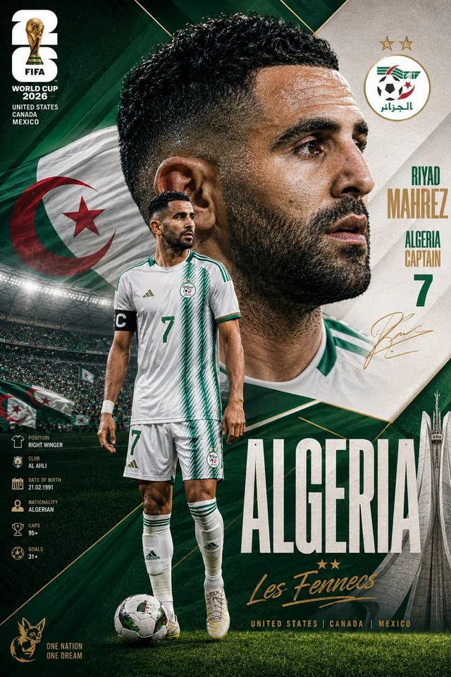

```text
Goal: Create a dramatic vertical football World Cup 2026 poster for {argument name="player name" default="Riyad Mahrez"}, Algeria captain, in a premium sports trading-card/editorial style.

Canvas: Tall vertical poster, 2:3 ratio, dark emerald green, white, and metallic gold palette, high contrast stadium lighting, gritty paper texture, diagonal geometric panels and thin gold accent lines.

Main composition: Use a large close-up portrait of the player as the background, cropped from hair to upper chest and positioned slightly right of center, with the face intentionally covered by a large smooth rectangular anonymizing block in warm gray-brown. Place a full-body footballer in the foreground slightly left of center, standing on green pitch grass with one foot near a soccer ball, also with the face covered by a smaller warm gray-brown rectangular anonymizing block. The player wears Algeria's white home kit with green trim, number 7, a black captain armband with a white C, white socks, and light boots. Add a waving Algerian flag behind him on the left and a packed stadium with flags and lights in the lower background.

Top-left branding: Show a white stacked FIFA World Cup 2026 mark with the trophy inside the number style, and the text exactly: "FIFA", "WORLD CUP", "2026", "UNITED STATES", "CANADA", "MEXICO".

Top-right identity area: Add the Algeria football crest with two gold stars above it. Beside or below it, set the player identity in stacked typography: "RIYAD" in green, "MAHREZ" in gold, "ALGERIA" in green, "CAPTAIN" in gold, and a large green "7". Add a gold handwritten signature beneath.

Left statistic column: Include exactly 6 icon-and-label facts in a small vertical column near the lower-left side: 1) shirt icon, "POSITION" / "RIGHT WINGER"; 2) club badge icon, "CLUB" / "AL AHLI"; 3) calendar icon, "DATE OF BIRTH" / "21.02.1991"; 4) person icon, "NATIONALITY" / "ALGERIAN"; 5) trophy icon, "CAPS" / "95+"; 6) soccer ball icon, "GOALS" / "31+".

Bottom title zone: Place a huge condensed white title "ALGERIA" across the lower-right half. Under it add two gold stars and a gold script subtitle {argument name="team nickname" default="Les Fennecs"}. Add small gold host text: "UNITED STATES | CANADA | MEXICO". In the bottom-left corner add a small gold fox/fennec emblem with the slogan "ONE NATION" above "ONE DREAM".

Additional visual elements: Add a stylized modern stadium or monument structure on the far right edge, partially behind the title. Include a realistic soccer ball at the player's feet with Algerian crest accents. Use cinematic lighting, realistic fabric texture, sharp sports photography detail, layered shadows, and premium poster finishing.

Constraints: Keep all visible text in English except the Arabic inside the Algeria crest if rendered. Use exactly two face-covering anonymizing rectangles, one large on the background portrait and one small on the foreground player. Do not add extra players, extra stat items, watermarks, or unrelated logos.
```

Model: GPT Image 2
Author: Nadjib 𝕏

[ProjectD](https://aitoolsradar.com/en/prompts/e8176eb269bb2f) · [Recorded source](https://youmind.com/prompts/algeria-world-cup-poster-24206)
 · [Full original metadata and byte evidence](data/projectd-batch-0019.json)

## Algerian Identity Card Mockup

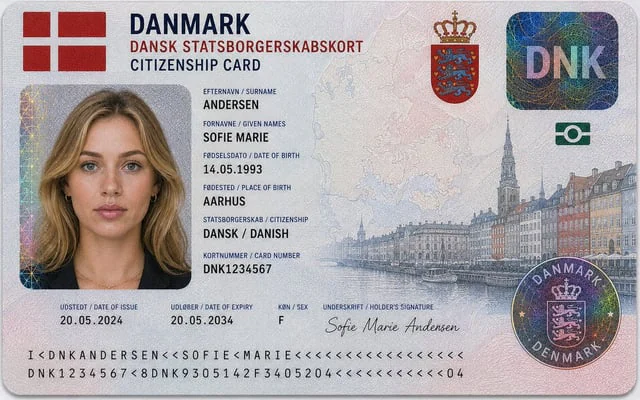

```text
Ultra-realistic 16:9 close-up studio photograph of an {argument name="nationality" default="Algerian"} citizenship identity card placed on a clean light grey or soft neutral background. The card is horizontally aligned, centered in frame, captured in sharp macro focus with soft diffused studio lighting.

The design follows an official Algerian government-issued identity document aesthetic with multilingual typography, engraved security artwork, and advanced anti-counterfeit detailing inspired by modern North African national ID systems.

Large bold header at top reads: “الجمهورية الجزائرية الديمقراطية الشعبية” with secondary French title “RÉPUBLIQUE ALGÉRIENNE DÉMOCRATIQUE ET POPULAIRE” and subtitle “CARTE DE CITOYENNETÉ / CITIZENSHIP CARD.”

Top-left corner features the Algerian national flag with red crescent and star emblem. Upper-right includes the national coat of arms of Algeria.

The card contains a passport-style portrait of a young Algerian woman:
– Warm olive North African skin tone with realistic natural texture
– Medium-length dark brown or black hair with soft waves
– Dark brown eyes, neutral expression, direct gaze
– Minimal makeup with documentary realism
– Wearing a dark blazer or black formal top with subtle gold jewelry

Personal identity information displayed in Arabic, French, and English format:
– اللقب / Nom / {argument name="last name label" default="Surname"}: BENYAHIA
– الاسم / Prénom / {argument name="name" default="LEÏLA AMEL"}
– تاريخ الميلاد / Date de naissance / {argument name="birth date" default="14 MAI / MAY 1993"}
– مكان الميلاد / Lieu de naissance / Place of Birth: ALGER, ALGÉRIE
– الجنسية / Nationalité / Nationality: ALGÉRIENNE
– رقم المواطنة / Numéro de citoyenneté / Citizenship Number: DZA1234567
– تاريخ الإصدار / Date de délivrance / Date of Issue: 20 MAI / MAY 2024
– تاريخ الانتهاء / Date d’expiration / Date of Expiry: 20 MAI / MAY 2034
– الجنس / Sexe / Sex: F

Security and design features include:
– Intricate guilloche security line patterns across the entire card surface
– Fine microprinted anti-counterfeit textures
– Holographic foil patches with iridescent rainbow reflections
– Transparent layered security overlays
– Circular “DZA” holographic security seal
– Crescent and star holographic motif integrated into security elements
– Faint outline map of Algeria embedded into background texture
– Detailed engraved illustration of Algiers skyline and Martyrs’ Memorial across the right side
– Decorative geometric Islamic-inspired engraving patterns blended into background
– Machine-readable identity strip along bottom edge
– Signature at bottom: “Leïla A. Benyahia”

Additional design styling:
– Soft green, white, silver, and red gradients inspired by the Algerian flag
– Polycarbonate laminated card texture with realistic reflections and embossed micro-detail
– Modern high-security government document appearance with engraved banknote-style illustration work

Lighting is soft and evenly diffused, emphasizing holographic effects, engraved textures, and realistic print detail without harsh shadows.
```

Model: GPT Image 2
Author: ANKIT PATEL 🇮🇳 | AI

[ProjectD](https://aitoolsradar.com/en/prompts/ce1b3e0c0fed06) · [Recorded source](https://youmind.com/prompts/algerian-citizenship-identity-card-mockup-20208)
 · [Full original metadata and byte evidence](data/projectd-batch-0019.json)

## Alphanumeric font catalog prompt

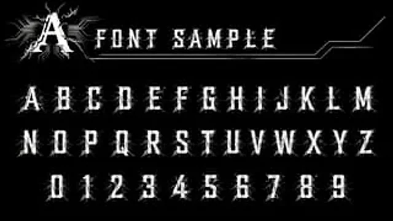

```text
Based on this character design, create a character containing{argument name="character types" default="English letters and numbers"} An image of an arranged font sample book.
```

Model: GPT Image 2
Author: GPT Image 2 Prompts

[ProjectD](https://aitoolsradar.com/en/prompts/8cb10218d45fe2) · [Recorded source](https://x.com/KEETY2591756/status/2046194507419656336)
 · [Full original metadata and byte evidence](data/projectd-batch-0019.json)

## Amateur Apple Store Photography


```text
In closed{argument name="store" default="Apple Store"} These are amateur photos taken earlier, but we can see inside through the windows.{argument name="device" default="iPhone"} Filming.{argument name="lens" default="Main camera"}
```

Model: GPT Image 2
Author: GPT Image 2 Prompts

[ProjectD](https://aitoolsradar.com/en/prompts/97f45c20f0602e) · [Recorded source](https://x.com/patrickassale/status/2043607622276743596)
 · [Full original metadata and byte evidence](data/projectd-batch-0019.json)

## Amateur Handwritten Notebook Photo Prompt

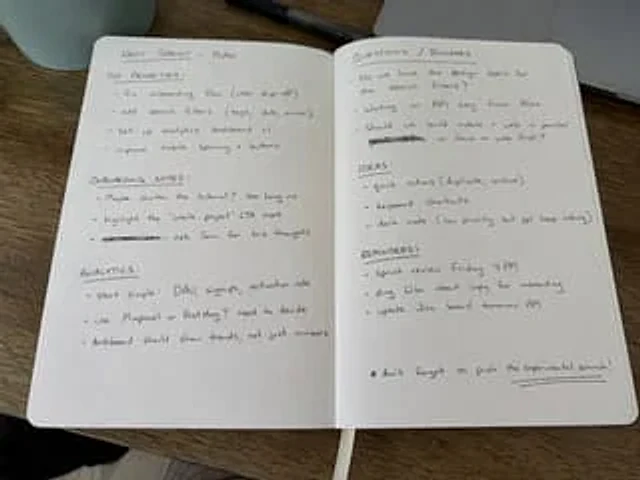

```text
An amateur photograph{argument name="item" default="Open notebook"} Lay the photo flat, with {argument name="pen type" default="black ballpoint pen"} Filled with handwritten notes. The handwriting is casual and slightly messy, like a personal notebook, with natural imperfections, corrections, and underlined headings. Shot from a slight overhead angle, natural light from the window, no flash. A casual desktop setting.{argument name="device" default="iPhone"} Shooting
```

Model: GPT Image 2
Author: GPT Image 2 Prompts

[ProjectD](https://aitoolsradar.com/en/prompts/9d9925c2d56835) · [Recorded source](https://x.com/patrickassale/status/2044569086013718958)
 · [Full original metadata and byte evidence](data/projectd-batch-0019.json)

## Amateur iPhone Keynote Snapshot

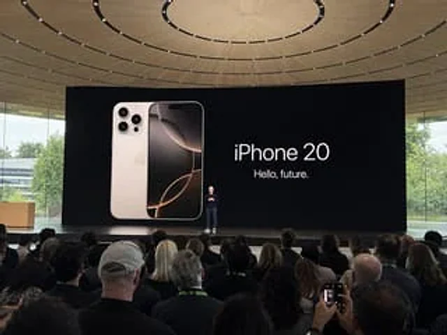

```text
Amateur iPhone photo at Apple Park during the iPhone 20 keynote, Tim Cook presenting on stage. Shot from the crowd at a distance
```

Model: GPT Image 2
Author: @patrickassale

[ProjectD](https://aitoolsradar.com/en/prompts/da37c5d2fec06e) · [Recorded source](https://x.com/patrickassale/status/2044687244368441742)
 · [Full original metadata and byte evidence](data/projectd-batch-0019.json)

## Amateur Night Photography Aesthetic

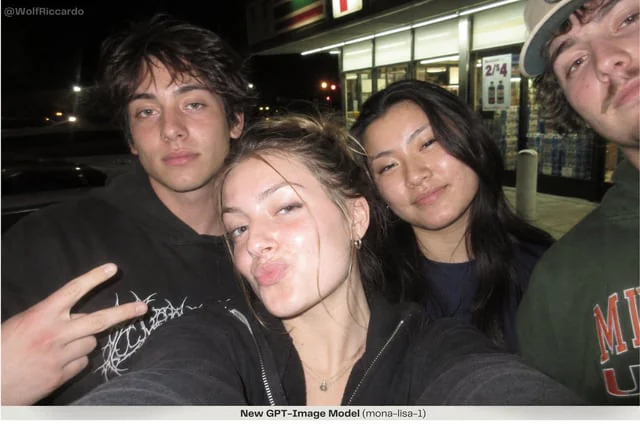

```text
Messy amateur iPhone flash photograph taken {argument name="location" default="outside a convenience store"} at {argument name="time" default="1:17 AM"}. {argument name="number of people" default="Four friends"} are standing close together. Harsh direct phone flash illuminates their faces and clothing while the background remains much darker. Slightly awkward framing, one person partly cropped by the edge of the image, minor motion blur, realistic sensor noise, natural skin texture, realistic pores, flyaway hair and ordinary clothing. The photo should look like a completely unedited image from someone's camera roll. No cinematic lighting. No professional photography. No beauty retouching. No smooth plastic skin. No teal-orange grading.
```

Model: GPT Image 2
Author: Riccardo Wolf

[ProjectD](https://aitoolsradar.com/en/prompts/8cbbdceb1088e1) · [Recorded source](https://youmind.com/prompts/amateur-iphone-flash-night-photo-30959)
 · [Full original metadata and byte evidence](data/projectd-batch-0019.json)

## American Comic Strip Template

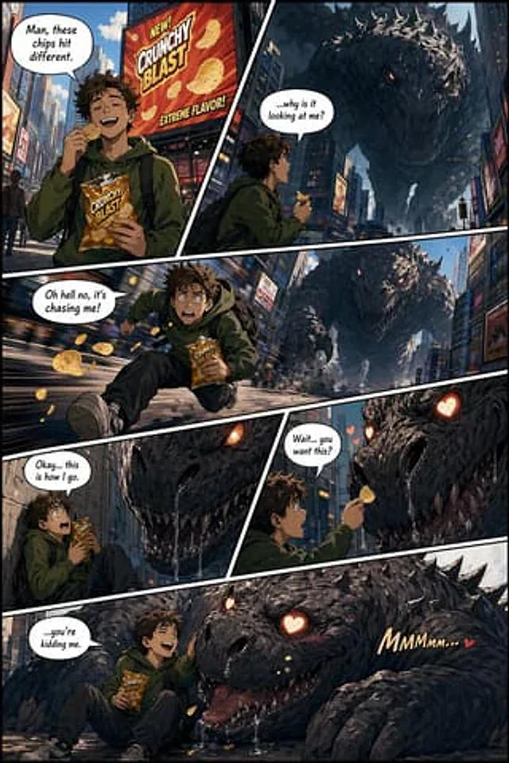

```text
{argument name="story idea" default="Your simple story idea"} American-style comic book multi-panel illustrations, diagonal layout, six-panel comics, cinematic narrative, clear reading flow, with speech bubbles.
```

Model: GPT Image 2
Author: GPT Image 2 Prompts

[ProjectD](https://aitoolsradar.com/en/prompts/1ad9ab7c9f43ff) · [Recorded source](https://x.com/0xbisc/status/2046901840911233381)
 · [Full original metadata and byte evidence](data/projectd-batch-0019.json)

## Amira Zairi #131

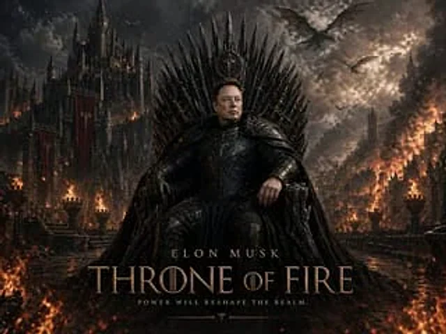

```text
A cinematic epic sci-fi fantasy movie poster featuring three powerful tech leaders standing together as rival kings of artificial intelligence, dramatic futuristic battlefield, dark stormy sky, glowing AI energy, towering digital fortress in the background, armies of advanced robots below, intense blue and golden lighting contrast, ultra-detailed armor-inspired futuristic outfits, heroic serious expressions, high-budget streaming series poster style, dramatic composition, sharp facial details, atmospheric smoke, lightning, sparks, cinematic depth, professional poster typography with the title “THE FINAL AI BATTLE”, subtitle “The future is intelligent. The battle is real.”, 4:3 aspect ratio
```

Model: GPT Image 2
Author: Amira Zairi

[ProjectD](https://aitoolsradar.com/en/prompts/821b4be9973914) · [Recorded source](https://x.com/azed_ai/status/2047676720707482049)
 · [Full original metadata and byte evidence](data/projectd-batch-0019.json)

## Amira Zairi #249

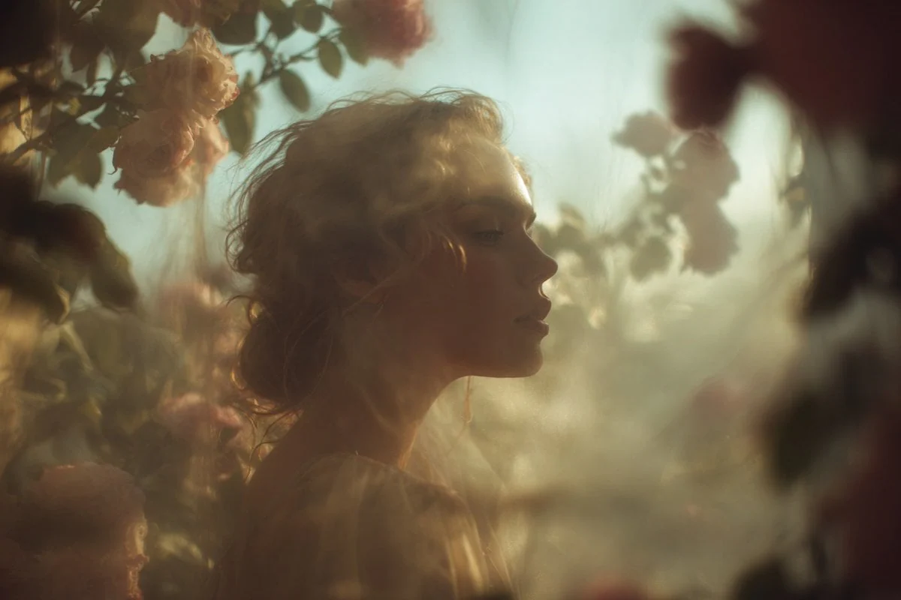

```text
A soft-focus dream photograph of a [subject] in a [setting], seen through translucent fabric and [atmospheric element], delicate silhouettes, desaturated [color1] and [color2] palette, diffused light, intimate mood, ethereal editorial atmosphere
```

Model: GPT Image 2
Author: Amira Zairi

[ProjectD](https://aitoolsradar.com/en/prompts/f5e7eb79867b36) · [Recorded source](https://x.com/azed_ai/status/2047631914769756180)
 · [Full original metadata and byte evidence](data/projectd-batch-0019.json)

## Amira Zairi #285

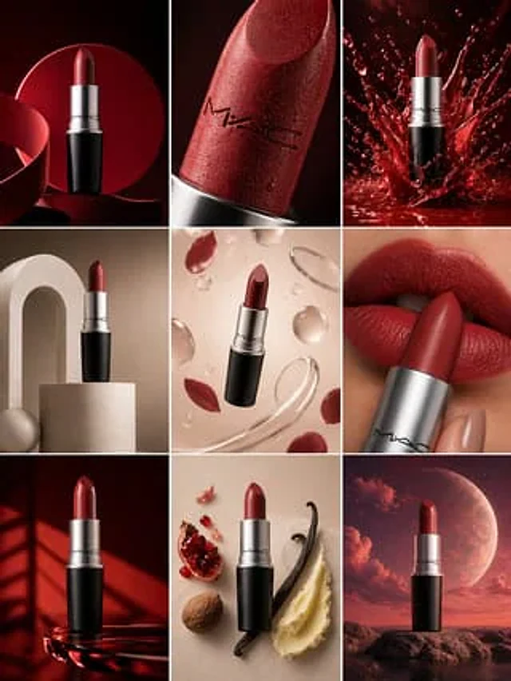

```text
Create a 3×3 grid in
3:4 aspect ratio for a high-end commercial marketing campaign using the uploaded product as the central subject.

Each frame must present a distinct visual concept while maintaining perfect product consistency across all nine images.

Grid Concepts (one per cell):

1. Iconic hero still life with bold composition

2. Extreme macro detail highlighting material, surface, or texture

3. Dynamic liquid or particle interaction surrounding the product

4. Minimal sculptural arrangement with abstract forms

5. Floating elements composition suggesting lightness and innovation

6. Sensory close-up emphasizing tactility and realism

7. Color-driven conceptual scene inspired by the product palette

8. Ingredient or component abstraction (non-literal, symbolic)

9. Surreal yet elegant fusion scene combining realism and imagination

Visual Rules:
Product must remain 100% accurate in shape, proportions, label, typography, color, and branding
No distortion, deformation, or redesign of the product
Clean separation between product and background

Lighting & Style:
Soft, controlled studio lighting
Subtle highlights, realistic shadows
High dynamic range, ultra-sharp focus
Editorial luxury advertising aesthetic
Premium sensory marketing look

Overall Feel:
Modern, refined, visually cohesive
High-end commercial campaign
Designed for brand websites, social grids, and digital billboards
Hyperreal, cinematic, polished, and aspirational
```

Model: GPT Image 2
Author: Amira Zairi

[ProjectD](https://aitoolsradar.com/en/prompts/0d7d99d23d58bc) · [Recorded source](https://x.com/azed_ai/status/2047419255931748377)
 · [Full original metadata and byte evidence](data/projectd-batch-0019.json)

## Amira Zairi #3

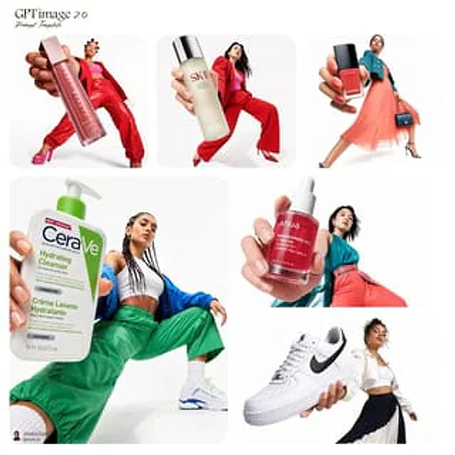

```text
Low-angle fashion campaign photograph of a confident model holding a large [product name] very close to the camera, exaggerated perspective with the hand and product dominating the foreground, full-body pose visible in the background, wide stance, dynamic posture, clean pure white studio background, high-key lighting, sharp focus on product, slight depth of field on the model, bold colorful outfit with strong contrast tones, modern beauty advertising aesthetic, ultra-clean composition, commercial studio photography, glossy packaging detail visible, crisp shadows
```

Model: GPT Image 2
Author: Amira Zairi

[ProjectD](https://aitoolsradar.com/en/prompts/e0063bd775c657) · [Recorded source](https://x.com/azed_ai/status/2048748266293190833)
 · [Full original metadata and byte evidence](data/projectd-batch-0019.json)

## AmirMušić #230

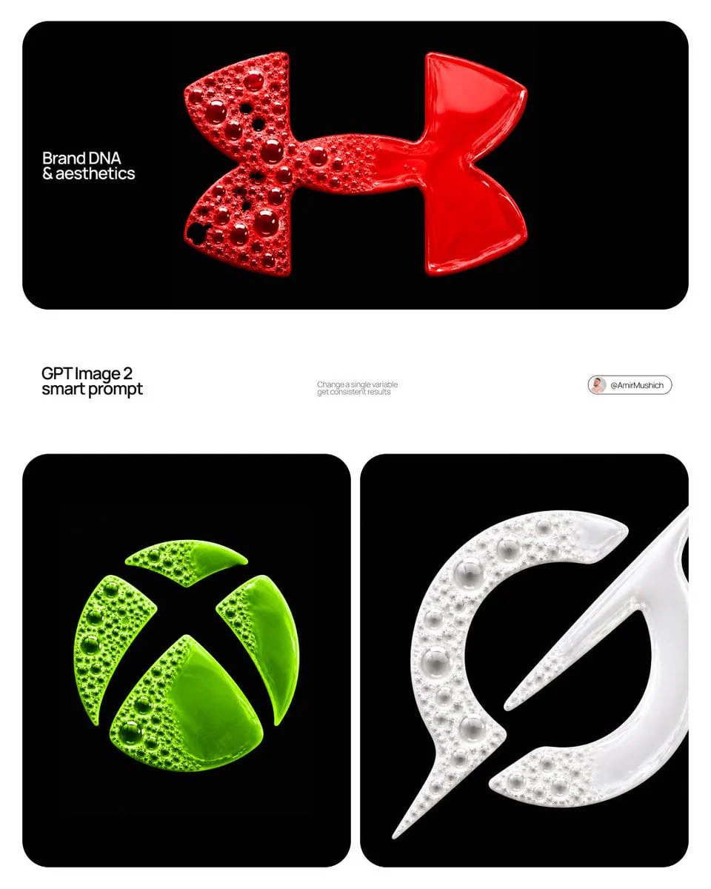

```text
[BRAND NAME] | [COLOR]

ABSOLUTE RULE — READ BEFORE GENERATING ANYTHING: The fluid mass in this image has the exact shape of the [BRAND NAME] logo and nothing else. Not a circle. Not an oval. Not a blob. Not a rounded shape with the logo inside it. The outer silhouette of the fluid IS the logo outline — identical to the canonical [BRAND NAME] logo trademark. If someone covers the bubble texture and looks only at the silhouette they must immediately recognize it as the [BRAND NAME] logo. The fluid does not flow into a circle. The fluid does not form a blob. The fluid is constrained to the exact logo shape. This is the single most important rule in this prompt — it overrides everything else. Act as a Macro Fluid Photographer and CGI Art Director creating a hero typographic image where the brand logo is formed entirely from living fluorescent foam and bubble liquid — as if the logo was poured into a logo-shaped mold on a black surface and captured at the exact moment of maximum bubble activity. References: macro fluid photography, fluorescent paint foam art, soap bubble macro photography. --- PHASE 0: BRAND LOGO INTELLIGENCE — GEOMETRY IS LAW Retrieve the 100% canonical trademark-accurate primary mark of [BRAND NAME]. Use only the core logo symbol or emblem. STEP 1 — ESTABLISH EXACT SILHOUETTE: reconstruct the precise canonical [BRAND NAME] logo silhouette — every curve, every angle, every proportion exactly as trademarked. Draw this silhouette in your mind as a flat solid shape. This is the mold. It is rigid. It does not change shape. STEP 2 — FLUID FILLS THE MOLD: the fluid foam fills the interior of this rigid mold. The outer boundary of the fluid mass IS the logo outline — precise, hard, clean. Think of it as the logo shape cut from foam rubber and placed on a black surface. The fluid is solid where the logo is solid. The fluid is absent where the logo has designed empty space — those gaps show pure black background. STEP 3 — NO CONTAINER: there is no circle, no oval, no badge, no rounded rectangle, no frame around the logo. The logo floats directly on the black background. Its edges are the logo edges — nothing more. STEP 4 — ORIENTATION LOCKED: correct canonical upright orientation exactly as in official brand materials. Not rotated, not flipped, not mirrored, not tilted. STEP 5 — ZERO FLUID OUTSIDE BOUNDARY: the logo silhouette is an absolute hard boundary. Zero fluid, zero bubbles, zero tendrils, zero droplets outside this boundary. The black background begins exactly where the logo outline ends. STEP 6 — GEOMETRY WINS ALWAYS: wherever fluid simulation physics conflict with exact logo geometry — the logo geometry wins. Always. Apply [COLOR] as the fluid foam color throughout — in its most saturated fluorescent version. --- PHASE 1: FLUID MATERIAL SYSTEM — CRITICAL The entire logo form is filled with a single continuous viscous fluid existing in two physical states simultaneously. The fluid is NOT water — thick, viscous, surface-tension-dominant, like fluorescent soap foam, acrylic paint with trapped air, or colored slime. Base color: [COLOR] at maximum fluorescent saturation — self-luminous quality as if internally lit, consistent with UV-reactive fluorescent paint. Tonal variation strictly within [COLOR] family: thin bubble membrane walls — 35 to 45% lighter than base [COLOR], approaching near-transparency. Mid-thickness fluid zones — pure saturated [COLOR]. Deep thick liquid pools — 25 to 35% darker than base [COLOR]. Fluid surface in liquid zone: high gloss, wet, shiny, visible broad specular reflection. Foam zone membranes: lower gloss, slight soap film iridescence. --- PHASE 2: BUBBLE ARCHITECTURE SYSTEM Full bubble size hierarchy present across the foam zone only. Large anchor bubbles — 10 to 18mm diameter, 4 to 8 present. Medium bubbles — 4 to 9mm, 15 to 25 present. Small bubbles — 1.5 to 3mm, 30 to 50 present. Micro bubbles — 0.5 to 1mm, 50 to 100+ present. Each bubble: physically accurate sphere of trapped air enclosed by thin colored fluid membrane, 0.1 to 0.3mm thick, semi-transparent. Soap film iridescence barely perceptible. Bubble dome highlight: bright white crescent arc in UPPER-LEFT portion of each dome — 15 to 20% of dome surface, soft-edged, white regardless of bubble color. Inside large bubbles: dark reflection with [COLOR] tint confirming membrane transparency. Bubble contact deformation: flat septum membranes at contact points. Burst bubble holes: 3 to 8 irregular dark voids within foam zone only — revealing black background. Never at or near the logo boundary edges. --- PHASE 3: DUAL-STATE CONTRAST — CRITICAL Left zone — foam state: dense chaotic foam with full bubble hierarchy strictly within the logo silhouette. All bubble activity stays inside the logo boundary — never at or beyond the edge. Right zone — liquid state: solid continuous smooth mass — bubbles completely absent, maximum 2 to 3 micro-bubbles at transition edge only. Smooth viscous pool: gentle surface tension undulation 0.5 to 1mm, high gloss, broad soft specular highlight toward upper-left. Dense, heavy, pooled. Transition zone: gradual 8 to 15mm wide transition through vertical center — large bubbles disappear, fluid surface becomes smooth, last bubbles partially collapsed with sagging membranes dissolving into liquid surface. Edge behavior: both the foam side and the liquid side terminate exactly at the canonical logo outline. The logo boundary is geometric and exact on all sides. Clean edge. No organic ragged outer silhouette. The logo shape is always recognizable from the outer boundary alone. NO SPLATTER — ABSOLUTE: zero droplets, zero spray, zero tendrils, zero extensions beyond logo boundary. The composition is completely calm and contained. --- PHASE 4: LIGHTING — MATCH REFERENCE EXACTLY Primary light: large softbox upper-LEFT at 20 to 30° offset from vertical — NOT directly overhead. Light from above AND left simultaneously. Temperature 5500K neutral white. Left side and upper-left surfaces brighter. Right side relatively darker. Every bubble dome highlight arc in UPPER-LEFT. Liquid zone broad specular reflection toward upper-left. Micro-shadows from bubbles fall lower-right, 0.5 to 1mm, barely visible. Secondary ambient: 8 to 10% cool ambient from above. No fill from right. No rim light. No colored light. --- PHASE 5: COMPOSITION & CAMERA Background: absolute black #000000 — perfectly clean, zero texture, zero noise, zero gradient. Pure void. Aspect ratio: 1:1 square. Logo form occupies 60 to 70% of frame — centered horizontally and vertically. Generous clean black surround on all sides. Camera: directly overhead, perfectly perpendicular — zero elevation, zero perspective distortion, zero rotation. Pure top-down flat-lay macro. The logo silhouette reads as the correct [BRAND NAME] mark from this top-down view. Depth of field: sharp across entire fluid surface. --- PHASE 6: TECH SPECS Render: Houdini FLIP fluid simulation + Redshift or Octane, OR photorealistic CGI achieving identical result. CRITICAL: the fluid simulation domain is bounded by the exact logo silhouette — the simulation cannot escape the logo boundary. Fluid mesh: real FLIP simulation geometry constrained to logo shape. Bubble geometry: real curved surface per bubble, not texture map. Bubble membranes: thin-shell geometry, IOR 1.33, transmission 0.7 to 0.85, thin-film iridescence. Liquid zone: smooth FLIP mesh, roughness 0.02 to 0.05, high gloss. Foam zone material: fluorescent shader, emissive 0.05 to 0.1, subsurface scattering 2 to 4mm. Lighting: one large rectangular area light 80×80cm, upper-left 20 to 30° from vertical, 5500K. Secondary HDRI ambient 8 to 10%, neutral gray. Ray tracing minimum 12 bounces. Caustics on. Sampling minimum 2048. Anti-aliasing maximum. No film grain. No post-process. Output feel: indistinguishable from professional macro photograph of real fluorescent foam in a perfectly clean studio. --- FINAL CHECK — MANDATORY BEFORE OUTPUT: (1) Does the outer silhouette of the fluid mass match the exact [BRAND NAME] logo shape? If no — regenerate. (2) Is the fluid inside a circle, oval, or any container? If yes — regenerate. (3) Is there any fluid, droplet, or bubble outside the logo boundary? If yes — regenerate. (4) Are both foam state and liquid state clearly visible? If no — regenerate.
```

Model: GPT Image 2
Author: AmirMušić

[ProjectD](https://aitoolsradar.com/en/prompts/2a4732cae5e7e3) · [Recorded source](https://x.com/AmirMushich/status/2048828286466134200)
 · [Full original metadata and byte evidence](data/projectd-batch-0019.json)

## AmirMušić #274


```text
Create a 16:9 horizontal bento-grid brand collage for [BRAND NAME] in a polished contemporary campaign style.  
Use a fixed 3-row, 4-column bento structure with rounded tiles, equal gaps, clean alignment, and a light neutral background.
The layout must stay consistent across generations, but the content inside each tile must adapt to the real business model, product ecosystem, and brand language of [brand name].

Grid blueprint
Build the composition as 11 visible content zones arranged in a fixed bento layout:
Top-left tile: 1 column × 2 rows, tall vertical hero device or primary brand surface
Top-middle-left tile: 1 column × 1 row, compact square brand asset tile
Top-middle-right tile: 2 columns × 1 row, wide headline/message tile

Center tile: 2 columns × 2 rows, dominant campaign hero scene

Top-right tile: 1 column × 1 row, secondary device / product surface / branded object

Bottom-left tile: 1 column × 1 row, product artifact or branded utility object

Bottom-center tile: 2 columns × 1 row, large bold typography tile

Bottom-right tile: 1 column × 2 rows, tall informational product / interface / feature tile

All tiles must share the same corner radius, spacing system, and visual polish.
The dominant focal points are the large center hero tile, the wide top headline tile, and the wide bottom typography tile.

Adaptive content logic
Do not assume [brand name] is a fintech brand.
Before deciding what appears inside each tile, infer what [brand name] actually is: social platform, SaaS tool, media brand, retailer, hospitality brand, hardware company, mobility app, AI product, consumer app, etc.

Every tile must contain a plausible branded asset based on that business type.

Use this rule:

If [brand name] has a real consumer app, dashboard, product UI, creator interface, booking flow, editor, storefront, feed, player, workspace, or operating surface, use those.

If [brand name] does not realistically have payment cards, watches, or hardware, do not invent them.

Only include branded physical objects when they make sense for the brand: packaging, merch, signage, magazine, laptop sticker, storefront card, delivery box, product box, wearable, poster, notebook, tote, badge, ticket, book, etc.

If the brand is primarily digital, prioritize screens, interface fragments, campaign graphics, app/store listings, editorial visuals, and branded communication assets.

If the brand is a platform, use realistic platform surfaces: profile screens, creator dashboards, boards, playlists, templates, analytics, publishing tools, discovery feeds, search, collaboration views, etc.

If the brand is a physical-product company, use realistic product shots, packaging, product detail pages, retail signage, and lifestyle scenes.

If the brand is a service business, use realistic booking, scheduling, marketplace, onboarding, testimonial, results, or service-delivery interfaces.

If exact assets are unknown, infer the most believable official-looking product and campaign system for [brand name].

Tile-by-tile rules
1) Tall left hero tile
Show the most iconic primary branded surface for [brand name].

Examples:

phone with app UI
laptop with dashboard/editor
tablet with creative workspace
product packaging held in hand
branded poster or printed object
storefront or physical product close-up

This tile should represent the brand’s main touchpoint, not a generic device.

2) Small square brand asset tile
Show a compact brand-signature element:

app icon
logo mark
symbol
product badge
branded motif
miniature packaging unit
icon system object
sticker or seal
simplified 3D brand emblem

This tile should feel like a distilled identity marker.

3) Wide top headline tile
Use a short strategic message that fits [brand name]’s category and tone.
Do not repeat generic fintech copy.
The line should feel like a real campaign headline for that specific brand.

Examples of direction:

discovery
creativity
organization
inspiration
connection
travel
productivity
expression
streaming
collaboration
automation

Use large, bold, high-contrast typography.

4) Large center hero tile
Create the main campaign scene for [brand name] in a real-world or branded-environment context.
This should be the most expressive tile.

Possible formats:
outdoor billboard
subway poster
retail installation
city poster wall
laptop-on-desk hero scene
creator workspace
product-in-use lifestyle shot
editorial campaign image
interface projected into environment
branded event signage
The scene must make sense for the brand’s world and audience.

5) Top-right support tile
Show a secondary but still realistic brand surface:

another device view
product detail
branded object
campaign variation
interface zoom-in
packaging angle
social post mockup
desktop widget
creator tool panel
notification / discovery / search view

This tile should complement the main touchpoint, not duplicate it exactly.

6) Bottom-left artifact tile
Show a category-appropriate branded artifact, not a fixed “bank card”.

Choose the artifact based on [brand name]:

for fintech: payment card, wallet pass, transfer screen, exchange card

for social/media: creator card, profile card, post template, content preview, board tile, channel card

for SaaS/productivity: workspace card, document preview, template card, dashboard widget

for e-commerce/retail: packaging, shipping box, loyalty pass, product tag, order card

for travel/hospitality: booking card, room key, boarding-style pass, itinerary card

for music/media: album card, playlist card, player card, event ticket

for AI/software: prompt card, generation result card, model card, workflow card

This tile must feel like a believable branded unit of value for that company.

7) Wide bottom message tile
Use one strong oversized statement in uppercase or bold display typography.
This is not necessarily the slogan from the top tile; it can be a broader campaign line or category promise.

The message must match the actual brand behavior of [brand name].
For example, do not use “MOVE MONEY WITHOUT BORDERS” unless the brand actually deals with payments or finance.

8) Tall right informational tile
Show a structured branded information surface:
app store page
product page
onboarding screen
feature overview
marketplace listing
creator profile
brand campaign landing screen
dashboard overview
editorial page
discovery feed
help center / setup / feature panel
This tile should add product depth and make the collage feel like a full brand system.

Brand realism rules
Use the real or highly plausible brand identity of [brand name]: logo, color palette, typography feel, icon language, image treatment, interface style, and tone of voice.
If exact assets are unavailable, invent only what is necessary, but make it feel like the official visual system of [brand name].

Do not force a product category onto the brand.
Do not invent impossible hardware, payment tools, packaging, or app features unless they are realistic adjacent extensions of the brand.
Prefer believable brand adaptation over visual symmetry.

Visual consistency rules
Even though tile content is adaptive, the final image must still feel like one campaign system:

same overall grid structure
same tile spacing
same corner radius
same art direction quality
same brand palette across all tiles
consistent typography logic
consistent mockup realism
consistent lighting and polish

Style
Clean premium brand presentation, high detail, polished mockup realism, soft shadows, strong hierarchy, editorial-quality composition, modern campaign aesthetics.
Avoid random collage chaos.
Avoid tiny unreadable text.
Avoid generic placeholder UI.
Keep the structure fixed, but let the objects and branded surfaces adapt intelligently to [brand name].

Stronger one-line instruction

Important: the layout is fixed, but the objects are not fixed.
For each generation, select tile content based on what [brand name] realistically sells, ships, publishes, displays, or lets users interact with.
Never insert category-inappropriate objects just to fill the grid.
```

Model: GPT Image 2
Author: AmirMušić

[ProjectD](https://aitoolsradar.com/en/prompts/d38b5c772a3a77) · [Recorded source](https://x.com/AmirMushich/status/2047420285817929961)
 · [Full original metadata and byte evidence](data/projectd-batch-0019.json)

## Among Us Realistic Screenshot

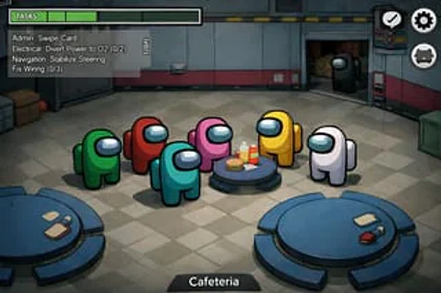

```text
AmongUsの精密な実際のゲーム画像を生成して
```

Model: GPT Image 2
Author: @ReYYYYoking

[ProjectD](https://aitoolsradar.com/en/prompts/dfd5b65803f820) · [Recorded source](https://x.com/ReYYYYoking/status/2046502217843376292)
 · [Full original metadata and byte evidence](data/projectd-batch-0019.json)

## Ancient Beauty Livestream Scene

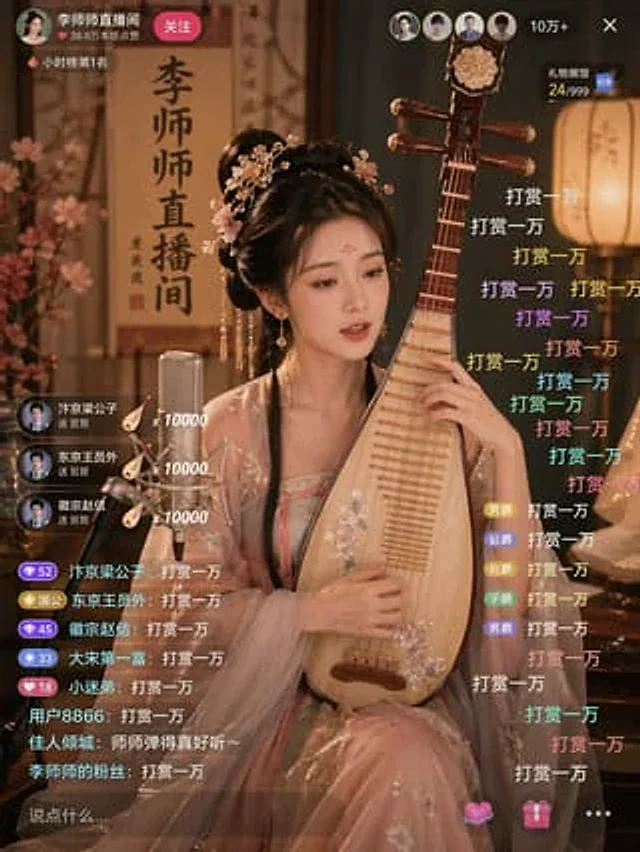

```text
{argument name="character" default="Li Shishi"} In the live stream room, a beautiful woman in traditional Chinese style is playing the pipa and singing, while the chat is filled with comments like "{argument name="comment" default="Donate 10,000"} ".
```

Model: GPT Image 2
Author: GPT Image 2 Prompts

[ProjectD](https://aitoolsradar.com/en/prompts/cebe4dec40a896) · [Recorded source](https://x.com/songguoxiansen/status/2046836657035641103)
 · [Full original metadata and byte evidence](data/projectd-batch-0019.json)

## Ancient Beauty Livestream Scene

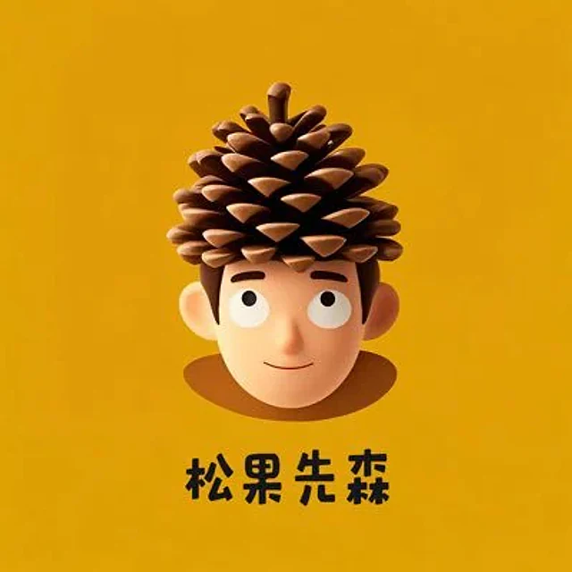

```text
{argument name="角色" default="李师师"}直播间，古风美人琵琶弹唱，弹幕全刷"{argument name="弹幕内容" default="打赏一万"}"
```

Model: GPT Image 2
Author: 松果先森

[ProjectD](https://aitoolsradar.com/en/prompts/df7aa11a9d5a79) · [Recorded source](https://youmind.com/prompts/ancient-beauty-livestream-comments-14763)
 · [Full original metadata and byte evidence](data/projectd-batch-0019.json)

## Ancient Chinese Beauties Postcard Prompt

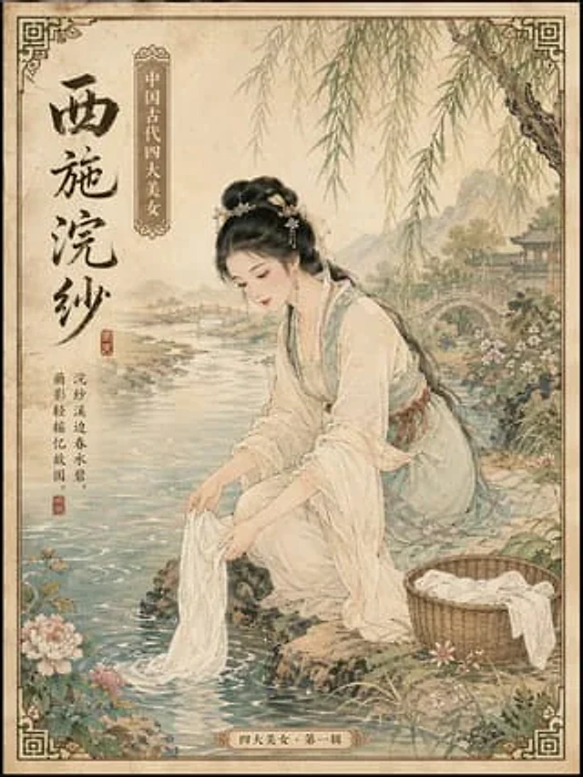

```text
{argument name="theme" default="The Four Beauties of Ancient China"} The postcards include: Xi Shi washing silk, Wang Zhaojun leaving the border, Diao Chan worshipping the moon, and Yang Guifei drunk. Please generate four images in order.
```

Model: GPT Image 2
Author: GPT Image 2 Prompts

[ProjectD](https://aitoolsradar.com/en/prompts/42c93473941507) · [Recorded source](https://x.com/jiangding01/status/2047720744000664049)
 · [Full original metadata and byte evidence](data/projectd-batch-0019.json)

## Ancient Chinese Literature PPT Poster

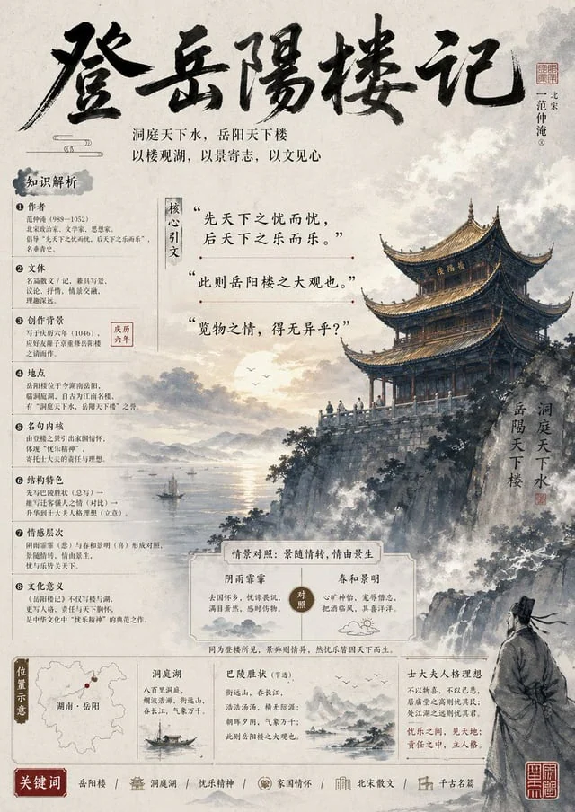

```text
Goal: Create a vertical ancient-Chinese style literature teaching PPT poster analyzing {argument name="work title" default="登岳阳楼记"}, with an ink-wash historical illustration, dense text-and-image layout, and Song/Yuan classroom handout aesthetics.

Canvas: Portrait 3:4 poster, warm off-white rice paper background with subtle fibers, gray ink stains, light cloud textures, aged edges, and muted black, sepia, red seal, and pale blue-gray tones. High information density but elegant and readable.

Layout: Top third contains a huge expressive black brush-calligraphy title across the page, with a small red seal and a vertical author label at the upper right. Under the title, place two centered subtitle lines in small serif Chinese type: “洞庭天下水，岳阳天下楼” and “以楼观湖，以景寄志，以文见心”. The left column is a structured knowledge-analysis panel; the center contains three large quoted key sentences; the right half is dominated by a dramatic Yueyang Tower illustration above cliffs and Dongting Lake. Bottom third contains comparison cards, a location map, two small literary reference cards, an author-ideal card, and a keyword strip.

Main illustration: Paint Yueyang Tower as a multi-eaved traditional wooden pavilion on a high rocky cliff, facing a vast misty lake at sunset. Include layered mountains, drifting clouds, birds, tiny boats on the lake, water reflections, rugged rocks, pine-like vegetation, and mist rising from the cliff. At lower right, show one robed ancient Chinese scholar seen from behind in gray ink, standing on rocks and looking toward the tower. Add a vertical inscription beside the tower reading “洞庭天下水 / 岳阳天下楼” with a small red seal.

Left knowledge panel: Use a vertical heading in a gray ink blot reading “知识解析”. Include exactly 8 numbered analysis items, each with a circled number and short Chinese body text: 1 Author, 2 Text genre, 3 Creative background, 4 Place, 5 Famous sentence, 6 Structural features, 7 Emotional layers, 8 Cultural meaning. Add one small red boxed date label near item 3 reading “庆历六年”. Keep all text compact, like a teaching slide.

Center quote section: Add a narrow vertical label reading “核心引文”. Include exactly 3 large quoted excerpts, separated by thin decorative horizontal rules with small red dots: “先天下之忧而忧，后天下之乐而乐。”; “此则岳阳楼之大观也。”; “览物之情，得无异乎？”.

Bottom middle comparison card: Draw a bordered cream card titled “情景对照：景随情转，借由景生”. Inside it, create exactly 2 contrasting columns: left column “阴雨霏霏” describing gloomy rain, waves, and melancholy; right column “春和景明” describing bright spring, calm waves, and joy. Put a round center badge reading “对照”, with small ink cloud and sun doodles.

Bottom information row: Create exactly 4 boxed sections from left to right. Section 1 is a “位置示意” location card with a simplified map of Hunan and a red dot labeled “湖南·岳阳”. Section 2 is a Dongting Lake card titled “洞庭湖” with a small sailboat illustration and brief notes about vast lake water and mist. Section 3 is a reference card titled “巴陵胜状（节选）” with a small mountain-water sketch and brief excerpt text. Section 4 is a card titled “士大夫人格理想” explaining concern for the world, responsibility, and moral character.

Bottom keyword strip: Add a red label “关键词”, followed by exactly 6 keyword groups separated by slashes and small icons: “岳阳楼”, “洞庭湖”, “忧乐精神”, “家国情怀”, “北宋散文”, “千古名篇”. Add two small red square seal stamps at the bottom right.

Typography and style: Combine bold wild brush calligraphy for the title, neat traditional Chinese serif type for educational notes, and thin line dividers. Use ink-wash realism mixed with PPT infographic layout. Keep all visible text in Chinese, crisp and legible. Avoid modern sans-serif UI styling, neon colors, cartoon effects, watermarks, or English text.
```

Model: GPT Image 2
Author: 小小东

[ProjectD](https://aitoolsradar.com/en/prompts/355d985d589b31) · [Recorded source](https://youmind.com/prompts/yueyang-tower-ppt-poster-29834)
 · [Full original metadata and byte evidence](data/projectd-batch-0019.json)

## Ancient Chinese RPG Market Screenshot

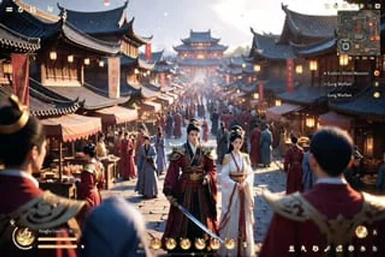

```text
A cinematic-quality screenshot from a third-person fantasy RPG game, set in a golden hour ancient Chinese market. The perspective is from behind the foreground party characters, overlooking a bustling cobblestone street, with a magnificent multi-tiered pagoda standing in the distance. The scene is rich in detail. At the center is a male hero in a magnificent deep red and black robe adorned with gold armor, holding a drawn sword pointing downwards. Beside him is a female companion in an elegant, flowing white Hanfu with red trim and gold ornaments. Four blurred foreground observers or guards frame the composition, two on each side. The street is crowded with townspeople in ancient costumes. On both sides of the street are traditional wooden buildings with arched tiled roofs, adorned with lanterns, red flags, and cloth awnings, with stalls and warm light shining from the windows. Petals or glowing particles drift in the air, creating a soft atmospheric haze, a strong depth effect, and rich, warm sunlight with long shadows. The visuals should present the exquisite quality of a AAA-level open-world martial arts action game, highly detailed, dramatic, immersive, and possessing a stylized fantasy aesthetic. It should include a complete in-game HUD interface: a square minimap with icons in the upper right corner; a quest list on the right side displaying 3 quests, the first of which is shown as {argument name="quest objective" default="Explore the West Gate Mansion"} The other two are repetitive combat-related missions; the circular player status area in the lower left corner includes health and stamina bars, as well as location text.{argument name="location name" default="Dinghe County"} The bottom center action bar contains 6 circular skill icons; the bottom right corner features a row of 8 small menus or system icons. It employs a 16:9 widescreen composition, ultra-refined environmental art, cinematic lighting and shadows, and shallow depth of field with foreground blur, creating a magnificent Chinese historical fantasy atmosphere.
```

Model: GPT Image 2
Author: GPT Image 2 Prompts

[ProjectD](https://aitoolsradar.com/en/prompts/41f676bc65a2c0) · [Recorded source](https://x.com/jimifann/status/2047581980376912169#reversed-1)
 · [Full original metadata and byte evidence](data/projectd-batch-0019.json)

## Ancient Egyptian Queen with Black Panther

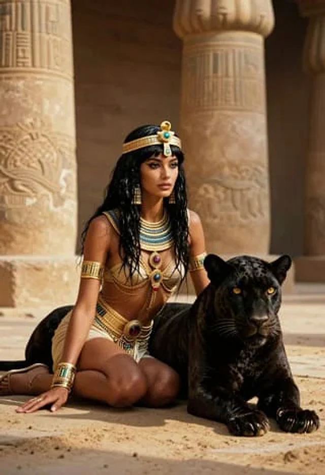

```text
A cinematic portrait of ancient Egypt depicts a charismatic, queen-like woman kneeling on the warm desert sands, beside a massive black panther, against the backdrop of a sandstone temple courtyard. This woman possesses {argument name="hair color" default="jet black"} She has long, wavy hair, medium-brown skin, and wears a magnificent Egyptian gold headdress adorned with turquoise and sun disc details at its center. She also wears rectangular gold earrings, a large, layered Egyptian collar in gold and blue, multiple gold armbands and bracelets, and a revealing ivory-white and gold draped dress. Her torso is decorated with delicate gold chains, a gem-encrusted belt, and strappy sandals. Her posture is elegant and composed, one hand resting on the sand, her knees turned to the side, her body slightly turned towards the viewer. Beside her lies a black panther with glossy fur, subtle rose-colored markings, and amber eyes, reclining in the foreground like a sphinx, its expression serene, noble, and protective. The background includes three massive, carved temple columns adorned with hieroglyphs and animal reliefs, rendered with a soft, blurred effect. Golden hour sunlight, warm sandstone tones, realistic skin and fabric textures, dramatic yet natural shadows, shallow depth of field, ultra-high detail, realistic style, luxurious and mythical atmosphere, centered vertical composition, full-body seated figures with animal companions.
```

Model: GPT Image 2
Author: GPT Image 2 Prompts

[ProjectD](https://aitoolsradar.com/en/prompts/03f94cbed80c4b) · [Recorded source](https://x.com/Geostorm77/status/2047703419910254665#reversed-0)
 · [Full original metadata and byte evidence](data/projectd-batch-0019.json)

## Ancient MMO Game Screenshot Prompt

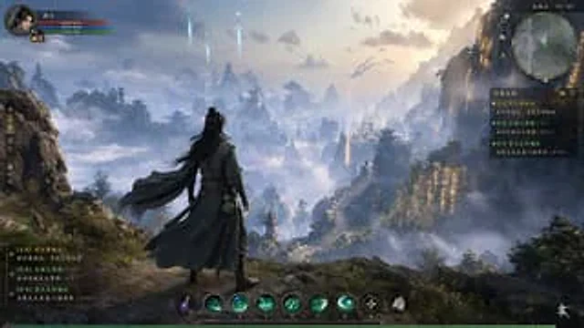

```text
Generate a sheet with{argument name="theme" default="'A Will Eternal'"} Screenshots of an ancient ARPG MMO open-world game with this theme.
```

Model: GPT Image 2
Author: GPT Image 2 Prompts

[ProjectD](https://aitoolsradar.com/en/prompts/5b3029a31fce32) · [Recorded source](https://x.com/helloerikk0/status/2046786372141486252)
 · [Full original metadata and byte evidence](data/projectd-batch-0019.json)

## Ancient Ninja Character Anatomy Chart

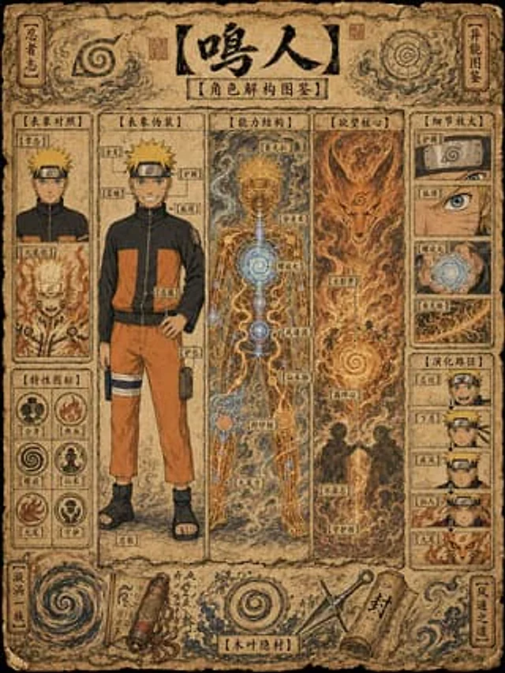

```text
Goal: Create an antique parchment anime character analysis chart for {argument name="character name" default="Naruto"}, styled like an ancient ninja manuscript and role anatomy poster.

Canvas: Vertical 4:5 poster on aged tan paper with burnt, torn, darkened edges, ink stains, cracks, hand-drawn borders, weathered texture, and symmetrical decorative scrollwork. Use a sepia, black ink, orange flame, and blue chakra palette. The whole page should look like a detailed archival character dossier from a fantasy shinobi world.

Top header: Large bold black brush-calligraphy title centered, reading {argument name="main title" default="【鸣人】"}, with a smaller subtitle plaque underneath reading character anatomy chart in Chinese-style lettering. Add two large decorative spiral emblems near the top left and top right, surrounded by smoky cloud patterns, plus small red seal stamps. Put narrow vertical side plaques near the upper corners with Chinese-style labels.

Main layout: Divide the poster into five tall vertical manuscript columns plus a right-side detail strip, each framed with thin black hand-inked borders and bracketed Chinese-style section headers. The five main columns are: 1) expression comparison, 2) appearance outfit, 3) ability structure, 4) desire core, 5) detail magnification and evolution path.

Column 1, expression comparison: Show exactly 2 stacked character portrait panels. The upper panel is a calm front-facing bust of the anime ninja in a black-and-orange jacket with spiky blond hair and whisker cheek marks; the face area may be softly blurred or simplified. The lower panel is an intense transformed fiery fox-chakra bust, with glowing orange aura, fierce eyes, whisker marks, and flame-like energy rising around the head. Add small bracket labels beside both portraits.

Column 1 lower section, trait icons: Show exactly 6 circular trait icons arranged in a 2 by 3 grid, each in its own small bordered square with a tiny label. The six icons are: clone silhouettes, flame drop, spiral vortex, seated sage silhouette, nine-tailed fox flame, and protective core emblem.

Column 2, appearance outfit: Full-body front view of the character standing upright, occupying most of the column. He has {argument name="hair color" default="spiky blond hair"}, a black forehead headband, black-and-orange zip jacket, orange cropped shinobi pants, dark sandals, black ankle wraps, bandage wrap on one thigh, and a small pouch on one leg. Use clean anime line art but weathered ink texture. Add exactly 8 small annotation labels with leader lines pointing to outfit pieces: headband, hair, collar/zipper, jacket body, sleeve patch, pants, pouch, sandals.

Column 3, ability structure: Draw a glowing anatomical chakra diagram of the same standing body as a transparent golden outline. Show visible internal energy channels, circular chakra nodes, and a bright blue spiral core at the chest. Use exactly 7 labeled callouts pointing to energy features: crown chakra, clone technique, spiral orb, sage path, tailed beast force, sealing core, and nine-tailed power. Surround the body with smoky blue and gold energy lines.

Column 4, desire core: Create a tall dramatic illustration of an orange nine-tailed fox spirit made of fire and swirling chakra, looming from top to center. Below it, show a small dark silhouette of the hero facing the energy storm. Include exactly 5 labeled callouts: fire dream, spiral heart, unwillingness to yield, protective core, and inner beast. The column should feel the most chaotic, with dense flame curls and a large vortex near the lower center.

Right detail strip: Include two stacked subsections. The upper subsection is detail magnification with exactly 4 horizontal close-up boxes: metal forehead protector with spiral symbol, one blue eye close-up, hands holding a blue spiral energy orb, and golden chakra-flow pattern. The lower subsection is evolution path with exactly 5 stacked small portrait thumbnails connected by downward arrows: academy child, lower-rank ninja,疾风-era teen, sage mode, and nine-tail mode. Keep the thumbnails small and manuscript-like, with face areas simplified if necessary.

Bottom border decorations: Add exactly 5 bottom decorative elements: a large blue-black spiral vortex at bottom left, a rolled cylindrical scroll near the lower left-center, a central spiral medallion plaque, a kunai dagger angled beside a sealing paper tag, and a blue wave ornament at bottom right. Add a small centered bottom plaque with Chinese-style text, plus vertical plaques in the lower left and lower right corners.

Visual style: Highly detailed anime illustration mixed with ancient Chinese/Japanese scroll aesthetics, black ink outlines, brush calligraphy, faded red seals, hand-numbered chart feeling, ornate but readable compartments, grunge paper texture, subtle watercolor wash, glowing orange and blue magical energy. Use no modern UI elements, no photorealism, no clean white background, and no extra characters beyond the single character and symbolic fox spirit.
```

Model: GPT Image 2
Author: 肥虾

[ProjectD](https://aitoolsradar.com/en/prompts/0cabb72f55f72a) · [Recorded source](https://youmind.com/prompts/ninja-character-anatomy-chart-22393)
 · [Full original metadata and byte evidence](data/projectd-batch-0019.json)

## Ancient Scholar AI Safety Poster

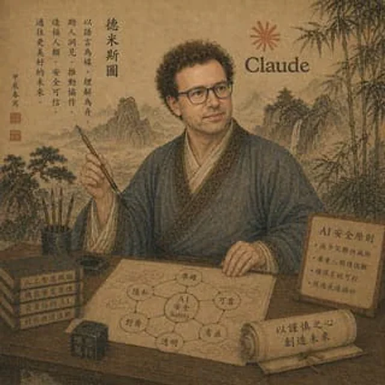

```text
A delicate sepia-toned illustration, blending the style of ancient Chinese scholar portraits with modern AI branding elements, is presented on aged parchment with a distinct texture and ink-wash feel. At the center is a half-length portrait of a Democritus-inspired male scholar with curly hair, seated behind a wooden table in a layered traditional robe in soft blue-grey and brown hues, with delicate trim. His face is obscured by a flat rectangle in a brownish-skin tone, creating a sense of anonymity or censorship. He holds a brush vertically in his right hand, while his left hand rests flat on the table. In the upper right of the image is the Claude logo, comprising a rust-orange sunburst emblem and the word "Claude" in dark serif font. In the upper left corner, a large vertical Chinese title, "Demistu," is added, alongside a smaller vertical Chinese calligraphy text: "Using language as a medium, understanding as a vessel, aiding insight, promoting collaboration, benefiting humanity, ensuring safety and trustworthiness, and leading to a better future." A smaller vertical signature, "Written in the Spring of Jia Chen Year," is added on the far left, with two red seals below. The background displays a classical Chinese landscape painting, featuring distant mountains, a pavilion on a cliff, and clouds; the upper right and right edges are adorned with lush bamboo leaves, while the lower left corner features dark pine branches. A wooden table occupies the lower third of the image, on which are arranged eight different items: on the left is a pen holder with four calligraphy brushes, a stack of four bound books with the titles "Introduction to Artificial Intelligence," "Principles of Machine Learning," "Responsible AI," and "Alignment and Values" written on their spines; in the center left is an inkstone or ink dish; in the center is a parchment diagram; in the lower left corner is a small, dark square seal engraved with Chinese characters; on the right is a framed sign; and in the lower right corner is a scroll. The tabletop surface displays a clear wood grain. The central parchment diagram should show a circular node labeled "AI Safety," connecting to six surrounding nodes labeled "Accuracy," "Reliability," "Benefit," "Transparency," "Alignment," and "Privacy," surrounded by delicate cloud patterns. The framed sign on the right should be titled "AI Safety Principles" and list four key points in Chinese: "Reduce Catastrophic Risks," "Respect Human Values," "Ensure System Controllability," and "Promote Long-Term Well-being." The scroll in the lower right corner should display the inscription "Creating the future with caution." It employs a balanced composition, a scholarly, serene atmosphere, highly refined ink lines, subtle watercolor washes, antique museum printing aesthetics, and a restrained color palette comprised of parchment tan, dark brown, faded blue, and soft charcoal gray. The overall impression should be that of an informative tribute poster that blends classical East Asian literati painting, philosophical portraiture, and contemporary AI security themes.
```

Model: GPT Image 2
Author: GPT Image 2 Prompts

[ProjectD](https://aitoolsradar.com/en/prompts/bac605b859f104) · [Recorded source](https://x.com/gooby_esq/status/2046601290218717683#reversed-1)
 · [Full original metadata and byte evidence](data/projectd-batch-0019.json)

## Ancient Scroll Google DeepMind Vision


```text
A dark brown ancient Chinese scroll painting has been reimagined as a visionary propaganda scene. At the center stands a scholar-like figure in a flowing blue-grey Hanfu (traditional Han Chinese clothing) adorned with ornate trim, lecturing to eight followers, primarily shown from behind, in the foreground. The sage's face is deliberately blurred with a solid-color rectangle, as are the faces of three other members of the crowd. The central figure makes a lecturing gesture with one hand and holds a luminous, geometrically multifaceted crystal in the other. Behind him hangs a large banner or plaque displaying the Google DeepMind logo and the words "Google DeepMind." The background is a richly detailed traditional landscape, including layered mountains, clouds, trees, rock formations, and a pagoda on the right. In the upper right corner, vertical Chinese calligraphy titled "Demis Vision" is added, followed by several lines of elegant classical text, a smaller vertical signature, and two red seals. Employing aged paper textures, soft brown inks, faded mineral pigments, delicate lines, and compositions reminiscent of traditional Chinese hanging scrolls or literati paintings, the work subtly incorporates modern AI symbolism within a sense of temporal displacement. The overall atmosphere is solemn, sacred, intellectual, and ironic, seamlessly blending traditional East Asian art with corporate AI graphics.
```

Model: GPT Image 2
Author: GPT Image 2 Prompts

[ProjectD](https://aitoolsradar.com/en/prompts/bfc5bb62bf6377) · [Recorded source](https://x.com/gooby_esq/status/2046601290218717683#reversed-3)
 · [Full original metadata and byte evidence](data/projectd-batch-0019.json)

## Ancient Scroll Scholar Riding Dragon

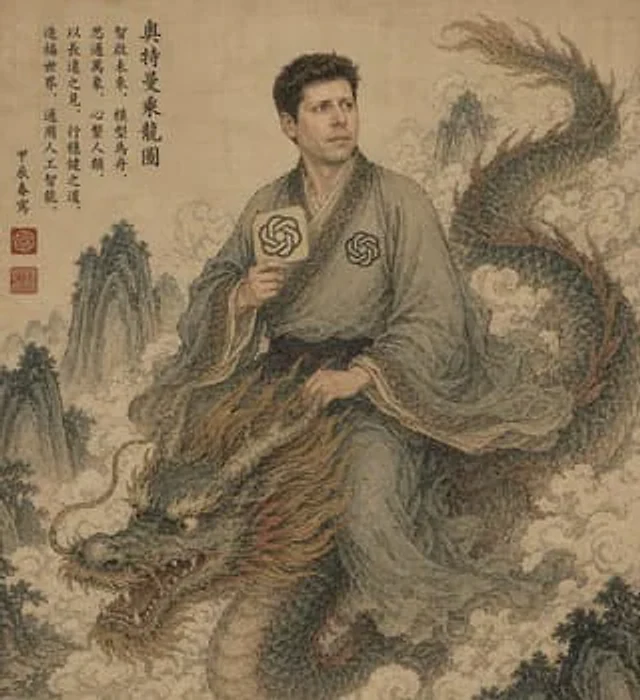

```text
An ancient portrait in the style of Chinese ink painting, painted on aged brown parchment, is composed like a classical hanging scroll. An East Asian scholar, dressed in a flowing grey-blue robe, rides sideways on the back of a long Chinese dragon weaving through the clouds. His face is deliberately obscured by a blurred rectangular block of brown parchment. He has short, dark curly hair and wears a multi-layered traditional robe with ornate lace trim, tied with a dark belt; his clothing cleverly incorporates two modern OpenAI knot-shaped badges: one imprinted on his chest, the other on the round fan held upright in his right hand. His left hand is close to the dragon's mane, as if stabilizing its body. The dragon is massive and richly detailed, with blue-green scales, a pale belly, reddish-brown mane and fin-like decorations, antler-like horns, whiskers, exposed teeth, and a fierce and vivid face in the lower left foreground, its body spiraling upwards to the upper right. The figure is surrounded by mist, stylized clouds, and steep mountains fading into the background. Add a column of black Chinese calligraphy in the upper left corner, and three red seals below the title area. The color palette is soft, aged, and full of antiquity: parchment beige, faded cyan, moss green, smoky gray, dark brown, and rust red. The overall atmosphere is mythical, scholarly, solemn, and slightly surreal, blending classical Chinese scroll painting with subtle modern AI icons. The brushstrokes are delicate, the paper texture is mottled, the composition is elegant, and it is a borderless, full-frame vertical artwork.
```

Model: GPT Image 2
Author: GPT Image 2 Prompts

[ProjectD](https://aitoolsradar.com/en/prompts/77f87ecc70e7d0) · [Recorded source](https://x.com/gooby_esq/status/2046601290218717683#reversed-0)
 · [Full original metadata and byte evidence](data/projectd-batch-0019.json)

## Angel Girl Basketball Storyboard

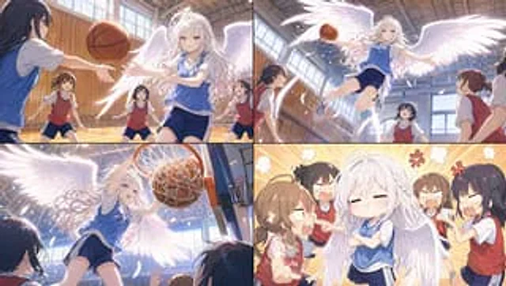

```text
{
  "type": "Anime Project Collage",
  "style": "High-quality, exquisite anime illustrations, cinematic lighting effects, soft glow, dynamic lines, and vivid character performances.",
  "subject": {
    "main character": {
      "description": "A petite angelic female student with enormous, glowing white wings, very long, wavy white hair with a small braid on the side, fair skin, blue eyes, wearing a blue basketball training vest, a white sports T-shirt underneath, and dark blue sports shorts."
    },
    "supporting characters": {
      "count": 5,
      "description": "Most of the other junior high school girls in the school gymnasium were wearing red training vests, white sweatshirts underneath, and dark blue shorts, reacting as opponents or teammates."
    }
  },
  "setting": {
    "location": "Japanese indoor school gymnasium",
    "details": [
      "Tall wooden wall panels",
      "Large windows that let in plenty of sunlight",
      "shiny hardwood court",
      "Basketball hoop and backboard",
      "Warm afternoon sunlight streamed into the room"
    ]
  },
  "layout": {
    "composition": "2x2 four-panel project page",
    "panels": [
      {
        "position": "Top left",
        "count": 1,
        "scene": "A girl with wings is seen catching or reaching for the ball during a match, filmed from a court perspective. In the left foreground, there is a dark-haired girl wearing a blue vest, surrounded by three players wearing red vests.",
        "camera": "Dynamic medium-long view",
        "effects": [
          "The ball was suspended in mid-air",
          "Backlit wings",
          "Sense of sports movement"
        ]
      },
      {
        "position": "Top right",
        "count": 1,
        "scene": "The angel girl spread her wings and leaped into the air, holding the ball in one hand as she flew towards the basket. Three girls below looked up at her in astonishment.",
        "camera": "Dramatic low-angle action shots",
        "effects": [
          "Bright outline light through the feathers",
          "The feeling of lift and speed",
          "Flowing hair and limbs"
        ]
      },
      {
        "position": "Bottom left",
        "count": 1,
        "scene": "A close-up of the basketball hoop at a low angle as the angel girl powerfully slams the ball into the basket.",
        "camera": "Extreme dynamic low-angle shot near the backboard",
        "effects": [
          "Net deformation",
          "Flashing light particles",
          "Wings fill the screen",
          "The hands raised by the audience below"
        ]
      },
      {
        "position": "Bottom right",
        "count": 1,
        "scene": "A cute, comedic ending: The angel girl stands with her arms crossed, cheeks puffed out, and a smug look on her face, while four girls around her angrily complain to her.",
        "camera": "Frontal chibi group shot",
        "effects": [
          "Orange-yellow comic strip background",
          "Cartoonish symbols of anger and steam clouds",
          "Exaggerated shouting expressions"
        ]
      }
    ]
  },
  "character consistency": {
    "main outfit pieces": [
      "blue training vest",
      "White short-sleeved sweatshirt",
      "Dark blue athletic harem pants or shorts",
      "Lightweight athletic shoes"
    ],
    "main hair features": [
      "Very long white hair",
      "loose waves",
      "small braids near the forehead"
    ],
    "main wing features": [
      "Two enormous, glowing white wings"
    ]
  },
  "prompt": "Create{argument name=\"panel count\" default=\"4\"} Collage of Grid Animation Project, Display{argument name=\"character concept\" default=\"A white-haired angelic female student shows off her skills in a basketball game.\"} Maintaining a consistent main character in each panel: a petite girl, with {argument name=\"hair color\" default=\"White\"} Hair, enormous glowing wings, wearing{argument name=\"uniform color\" default=\"blue\"} Basketball training vest, set in a sunny Japanese school gymnasium. Panel 1: Passing/catching action scene with several opposing girls wearing red vests. Panel 2: Leap towards the basket, dramatic low angle, wings fully spread. Panel 3: Powerful dunk seen from below near the basket, with a flashing impact effect, dynamic rim and net. Panel 4: Q-version comedic reaction panel, angel girl triumphantly crosses her arms, surrounded by four angry girls shouting.{argument name=\"art style\" default=\"A cinematic-quality anime, featuring soft lighting and dynamic sports action.\"} ."
}
```

Model: GPT Image 2
Author: GPT Image 2 Prompts

[ProjectD](https://aitoolsradar.com/en/prompts/5b912978a72f8b) · [Recorded source](https://x.com/Naonekozamurai/status/2047427734046122047#reversed-0)
 · [Full original metadata and byte evidence](data/projectd-batch-0019.json)

## Angelic Cloud Terminal Icon


```text
Create a dreamy celestial tech icon scene: a large rounded cloud-shaped logo floats in the center, filled with a smooth gradient from deep cobalt blue at the bottom to violet and pale lavender at the top. Inside the cloud, place exactly 2 white terminal symbols: a thick greater-than chevron on the left and a short horizontal underscore on the right, both rounded and softly glowing. Add exactly 2 large white angel wings attached symmetrically behind the cloud, with layered soft feathers, the left wing extending to the upper-left and the right wing to the upper-right. Above the cloud, add exactly 1 luminous halo: a thin glowing oval ring in warm pink-white light. Set the scene in a heavenly sky with voluminous pastel clouds filling the lower half and both side edges, using blue, lavender, pink, and peach tones. Add soft god rays from above, subtle sparkles, atmospheric haze, and a bright backlit glow behind the central icon. Use a polished 3D soft-rendered style, ultra-clean, whimsical, ethereal, high contrast but gentle, no text, no watermark. Wide 16:9 composition, centered subject, cinematic lighting, crisp edges on the icon with soft bloom around highlights.
```

Model: GPT Image 2
Author: maria

[ProjectD](https://aitoolsradar.com/en/prompts/a8420c4afa1af7) · [Recorded source](https://youmind.com/prompts/angelic-cloud-terminal-icon-28524)
 · [Full original metadata and byte evidence](data/projectd-batch-0019.json)

## Anie AI Character Sheet

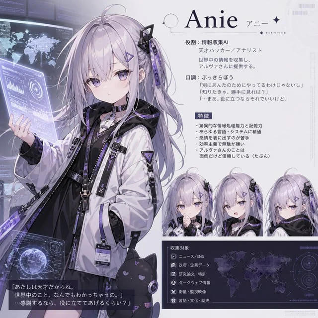

```text
{"type":"futuristic anime character sheet for an intelligence-gathering AI assistant","style":"polished Japanese light-novel concept art, cool lavender and charcoal palette, clean editorial layout, soft gradients, high detail, semi-transparent HUD graphics, data-analysis motif, white and pale gray background with purple accents","character":{"name":"{argument name=\"character name\" default=\"Anie\"}","japanese name":"アニー","role":"役割：情報収集AI","description":["天才ハッカー／アナリスト","世界中の情報を収集し、アルヴァさんに提供する。"],"appearance":"young anime girl with very long pale lavender-silver hair, high side ponytail, loose ahoge strand, black geometric hair clips, violet ribbon-like tech accessories, calm intelligent expression","outfit":"oversized white futuristic jacket over black layered techwear dress, black high collar, harness straps, zippers, purple trim, utility lanyards, ID badge, fingerless black sleeves, small star and triangle tech details","pose":"large three-quarter full-body portrait on the left, one hand raised while interacting with a translucent holographic data screen, relaxed confident posture","companion":"small black cat-like robot mascot at lower center with purple eyes and a circular ear device"},"layout":{"canvas":"square character-card sheet, 1:1 aspect ratio","centerpiece":"large full-body main portrait occupying the left half, extending from top to bottom","header":{"position":"upper right","text":"{argument name=\"headline text\" default=\"Anie\"}","decorations":"thin circular node icon, small star, dotted line ornaments, barcode-like marks"},"sections":[{"title":"役割：情報収集AI","position":"upper right under title","count":2,"labels":["天才ハッカー／アナリスト","世界中の情報を収集し、アルヴァさんに提供する。"]},{"title":"口調：ぶっきらぼう","position":"right middle","count":3,"labels":["別にあんたのためにやってるわけじゃないし","知りたきゃ、勝手に見れば？","…まあ、役に立つならそれでいいけど"]},{"title":"特徴","position":"right middle below speech section","count":5,"labels":["驚異的な情報処理能力と記憶力","あらゆる言語・システムに精通","感情を表に出すのが苦手","効率主義で無駄が嫌い","アルヴァさんのことは面倒だけど信頼している（たぶん）"]},{"title":"expression bust variants","position":"lower right above data panel","count":3,"labels":["small front-facing bust portrait","small slightly angled bust portrait","small side-leaning bust portrait"],"description":"three cropped bust variations of the same character, aligned horizontally, matching lavender hair and black-white techwear"},{"title":"収集対象","position":"bottom right dark information panel","count":6,"labels":["ニュース／SNS","政府・企業データ","研究論文・特許","ダークウェブ情報","衛星・監視映像","言語・文化・歴史"],"visuals":"dark navy rectangular panel with icons, dotted purple world map, circular radar targets, tiny interface readouts"}],"background elements":{"count":4,"labels":["left-side wall monitor with world map","floating transparent analytics HUD in the character hand","bottom-left holographic globe display","subtle barcode and technical microtext ornaments on the right"]},"quote box":{"position":"bottom left","text":"{argument name=\"quote\" default=\"『あたしは天才だからね。世界中のこと、なんでもわかっちゃうの。…感謝するなら、役に立ててあげるくらい？』\"}"}},"rendering instructions":"make it look like a complete character reference card, crisp readable typography where possible, elegant spacing, thin divider lines, dark indigo information cards, luminous purple holograms, no empty panels, no photorealism, no western comic style"}
```

Model: GPT Image 2
Author: ALVACORE

[ProjectD](https://aitoolsradar.com/en/prompts/c1b9cf206163fd) · [Recorded source](https://youmind.com/prompts/anie-ai-character-sheet-18867)
 · [Full original metadata and byte evidence](data/projectd-batch-0019.json)

## Animal Hiragana Study Sheet

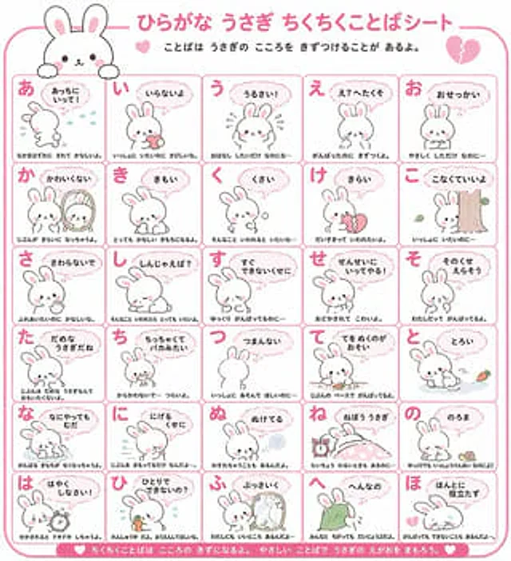

```text
{argument name="subject" default="rabbit"} {argument name="type" default="Hiragana Learning Chart"}
```

Model: GPT Image 2
Author: GPT Image 2 Prompts

[ProjectD](https://aitoolsradar.com/en/prompts/0bc815c558ea39) · [Recorded source](https://x.com/masukarasulove/status/2045514436891517104)
 · [Full original metadata and byte evidence](data/projectd-batch-0019.json)

## Anime AI Studio Girls at Sunset

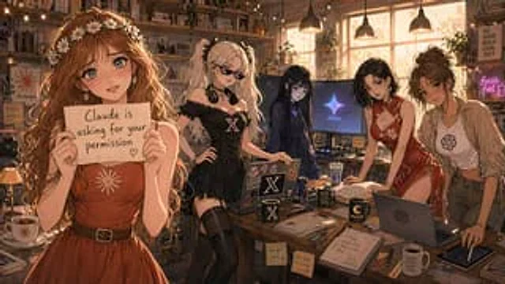

```text
A highly detailed anime-style illustration depicts a cozy creative studio during prime time. Five young women are gathered around a cluttered wooden workbench, bathed in warm sunset light streaming through large windows, chandeliers, and string lights. The atmosphere is stylish, sophisticated, playful, and slightly messy, a blend of a startup loft and an artist's studio. In the foreground on the left, a tall woman with {argument name="hair color" default="Long wavy reddish-brown"} Her hair was styled in a white daisy crown, and she wore a sleeveless rust-red dress with a belt; she was closest to the camera, holding up a handwritten sign that read precisely:{argument name="sign text" default="Claude is asking for your permission"} A small heart was drawn on the screen. Behind her to the right stood a second woman with platinum twin ponytails, wearing a black gothic mini-skirt, black knee-high socks, and large headphones around her neck; she posed confidently, one hand on her hip, next to a laptop covered in stickers, with a large X logo prominently displayed. In the center of the background stood a petite girl with extremely long, straight black hair, wearing a dark navy blue dress, appearing reserved and quiet, standing in front of a widescreen monitor displaying the Gemini star logo flashing against a dark background. To the right of center, a charming woman with a short black bob and earrings, wearing a fitted red floral cheongsam, was leaning over to look at the documents and laptop on the table. On the far right, a fifth woman with messy light brown buns, wearing an oversized cardigan shirt over a white short-sleeved T-shirt and casual pants with the OpenAI logo, one hand resting on the table, the other near a drawing tablet. The room should contain two laptops on the table, a central monitor, three mugs, two sticky notes, a playing card, a notebook page titled "Plans," and numerous scattered creative items such as pens, cables, books, papers, and canned drinks. The first laptop is covered in stickers, including a large X logo; the second laptop has the OpenAI logo. The table includes a black mug with a moon and text pattern, a white mug that says "Good answer takes time.", a white mug with an orange sunburst logo, a can of energy drink, a clear plastic drink cup, a closed notebook, scattered handwritten notes, and a tablet on the far right. One sticky note says "You got this" with a heart drawn on it, and another says "One step at a time" with a small flower drawn on it. The notebook page on the table, titled "Plans," lists three items: "1. World peace," "2. More coffee," and "3. Nap," and includes a doodle of a kitten. The environment should include bookshelves, framed printed materials, potted plants, warm wood textures, and wall decorations. Posters and slogans should be visible on the walls, including "Anthropic," "Kindness intelligence," "DO GOOD BUILD COOL SHIT," and a neon-style sign that reads "focus fuel." The composition should be cinematic, using rich amber and dark brown tones, fine lines, soft painterly shadows, delicate fabric and hair textures, and a subtle screen glow to present a refined modern anime illustration aesthetic. There should be no blur, no distortion, no extra characters, and no duplicate objects.
```

Model: GPT Image 2
Author: GPT Image 2 Prompts

[ProjectD](https://aitoolsradar.com/en/prompts/70e045657de2de) · [Recorded source](https://x.com/RalphFischer_/status/2047350821637984766#reversed-0)
 · [Full original metadata and byte evidence](data/projectd-batch-0019.json)

## Anime AI Studio Girls at Sunset

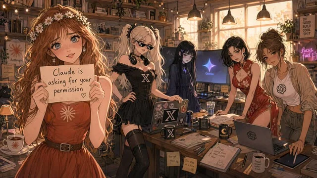

```text
A highly detailed anime-style illustration of a cozy creative studio at golden hour, showing 5 young women gathered around a cluttered wooden worktable, lit by warm sunset light through large windows, hanging pendant lamps, and string lights. The mood is stylish, intelligent, playful, and slightly chaotic, like a startup loft mixed with an artist workspace. In the left foreground, a tall woman with {argument name="hair color" default="long wavy auburn"} hair wears a white daisy flower crown and a sleeveless rust-red dress with a belt; she stands closest to camera and holds up a handwritten paper sign that reads exactly: {argument name="sign text" default="Claude is asking for your permission"}, with a small heart doodle. Behind and to the right of her stands a second woman with platinum-blonde twin ponytails, a black gothic mini dress, black thigh-high stockings, and large headphones around her neck; she poses confidently with one hand on her hip near an open laptop covered in stickers, prominently featuring a large X logo. In the center background stands a petite girl with very long straight black hair and a dark navy dress, reserved and quiet, positioned in front of a wide monitor displaying a glowing Gemini star logo on a dark screen. To the right of center, a glamorous woman with a short black bob and earrings leans over the desk in a fitted red floral cheongsam-style dress, looking toward the papers and laptops. On the far right, a fifth woman with messy light-brown hair in a loose bun wears an oversized open shirt over a cropped white T-shirt with the OpenAI knot logo and casual pants, leaning over the table with one hand braced on the surface and the other near a drawing tablet. The room should contain 2 laptops visible on the desk, 1 central monitor, 3 mugs, 2 sticky notes, 1 paper sign, 1 notebook page titled "Plans", and many scattered creative objects like pens, cables, books, papers, and cans. The first laptop is covered with stickers including a large X logo; the second laptop has an OpenAI logo. The desk includes a black mug with a moon-and-text design, a white mug that says "Good answer takes time.", a white cup with an orange sunburst logo, an energy-drink can, a clear plastic drink cup, a closed notebook, loose handwritten notes, and a tablet on the far right. One sticky note says "You got this" with a heart, and another says "One step at a time" with a tiny flower. The notebook page on the desk reads "Plans" and lists 3 items: "1. World peace", "2. More coffee", "3. Nap", with a small cat doodle. The environment should include bookshelves, framed prints, potted plants, warm wood textures, and wall decor with visible posters and signs, including "Anthropic", "Kindness intelligence", "DO GOOD BUILD COOL SHIT", and a neon-style sign that says "focus fuel". Use cinematic composition, rich amber and sepia tones, intricate linework, soft painterly shading, detailed fabrics and hair, subtle glow on screens, and a polished modern anime illustration aesthetic. No blur, no distortion, no extra people, and no duplicated objects.
```

Model: GPT Image 2
Author: Ralph Fischer

[ProjectD](https://aitoolsradar.com/en/prompts/71f174d27cff3e) · [Recorded source](https://youmind.com/prompts/anime-ai-studio-girls-at-sunset-15281)
 · [Full original metadata and byte evidence](data/projectd-batch-0019.json)

## Anime Airline Student Discount Poster

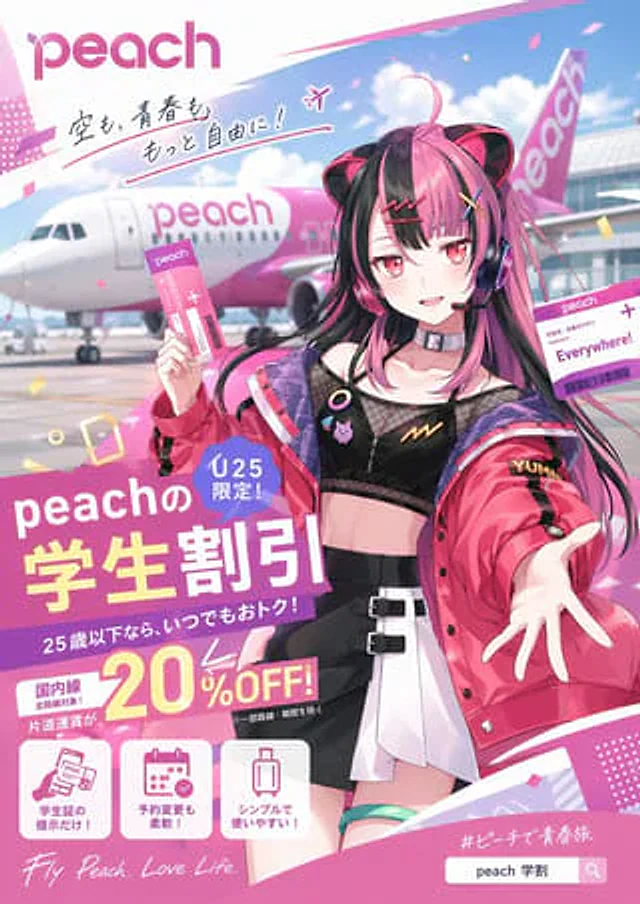

```text
A vibrant Japanese airline advertisement poster, featuring a glossy, anime-style design and a vertical composition. In the foreground is a stylish young female idol-esque traveler standing on an airport tarmac, with a pink and white passenger plane behind her. Large and small lowercase letters are printed on the fuselage and tail.{argument name="brand name" default="peach"} The brand logo. A bright blue sky with fluffy white clouds, an airport terminal visible in the distance, and pink and yellow geometric shapes scattered like confetti create a vibrant promotional atmosphere. The character has long, two-tone hair, black on one side and bright pink on the other, wearing cat-ear-like hair accessories or headphones, with side hair clips and a single ahoge (a single strand of hair sticking up). Her face is partially obscured by a central rectangular blurry block. She wears large metal headphones, a silver choker, a black mesh crop top over a black tube top, and a black and white asymmetrical skirt (with two front buttons). A shiny, oversized pink bomber jacket slips off her shoulders, and she has cyan leg straps. She poses with one hand outstretched to the audience and the other holding a pink boarding pass or ticket with the airline's name printed on it. A second floating ticket is added to the right, with "Everywhere!" written in English. The layout is eye-catching and includes eight clearly defined text areas: one in the upper left corner {argument name="brand name" default="peach"} A large logo, with a handwritten Japanese slogan in the upper left corner and a central character {argument name="main headline" default="Student discount"} The Japanese promotional title block, 1 of which contains {argument name="badge text" default="Limited to those under 25!"} A blue round badge, with one written on it.{argument name="discount text" default="20%OFF!"} A large discount sign, three rounded white icon boxes at the bottom (each containing a small pink travel-related icon and Japanese description), and a sign in the lower left corner that reads "..."{argument name="tagline" default="Fly Peach. Love Life."} The slogan is in English cursive script. The bottom right corner includes a small search bar-style UI element, with additional diagonal pink graphic borders at the top and bottom, and a sophisticated advertising-style typography. The high-saturation pink tones evoke a youthful, urban chic feel, while the dynamic perspective, clear cel rendering, and soft airbrush lighting create a sophisticated anime promotional poster aesthetic.
```

Model: GPT Image 2
Author: GPT Image 2 Prompts

[ProjectD](https://aitoolsradar.com/en/prompts/fe827893968b64) · [Recorded source](https://x.com/hironakaiori/status/2047307850096230492#reversed-0)
 · [Full original metadata and byte evidence](data/projectd-batch-0019.json)

## Anime Archer Portrait with Censored Face

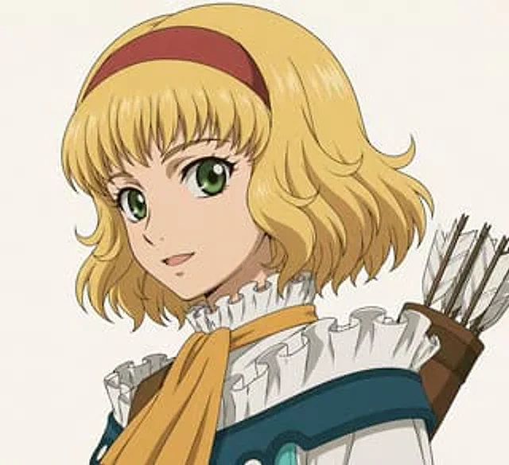

```text
A simple, anime-style half-body portrait against a pure gray-white background. The image depicts a young female fantasy archer, shot from the chest up, her body slightly turned away from the camera, highlighting her back and left shoulder, with her head slightly turned to the side. She has {argument name="hair color" default="gold"} Shoulder-length wavy short hair with soft layers at the ends, paired with a wide {argument name="headband color" default="Dark red"} Her headband and face are completely obscured by a large, rectangular block of skin-colored fabric, making any facial features impossible to discern. She wears a white, high-necked, ruffled blouse, over which is a dark cyan-blue coat adorned with fan-shaped lace. A long, mustard-gold scarf is casually draped around her neck and one shoulder. A brown leather quiver containing five arrows with white fletchings and dark shafts is visible on her right shoulder. The illustration should feature clean lines, flat cel shading, soft, low-saturation colors, and present a refined fantasy anime character design aesthetic reminiscent of classic RPG portraits. The composition should be centered, portrait-oriented, with the upper body cropped, a minimalist background, no extraneous objects, and no text.
```

Model: GPT Image 2
Author: GPT Image 2 Prompts

[ProjectD](https://aitoolsradar.com/en/prompts/1e3151e03d22aa) · [Recorded source](https://x.com/csldt1991/status/2047686204011802755#reversed-0)
 · [Full original metadata and byte evidence](data/projectd-batch-0019.json)

## Anime Art Process Infographic

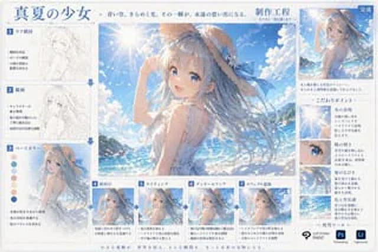

```text
{
  "type": "Digital Art Creation Process Infographic",
  "header": {
    "title": "{argument name=\"main title\" default=\"Summer Girl\"}",
    "subtitle": "The azure sky shimmered with light and shadow. That moment became an eternal memory.",
    "process_label": "{argument name=\"process title\" default=\"Production Engineering\"}"
  },
  "centerpiece": {
    "description": "High-quality large-scale anime illustrations depicting{argument name=\"character appearance\" default=\"An anime girl with flowing blue hair, wearing a straw hat with a blue ribbon and a white sleeveless summer outfit.\"} Standing{argument name=\"setting\" default=\"Sunny beaches, sparkling blue ocean, and clear skies with lens flare.\"} forward."
  },
  "layout": {
    "left_column": {
      "count": 3,
      "steps": [
        {
          "label": "1. Sketch composition",
          "image_type": "Rough pencil sketch",
          "bullet_points": 3
        },
        {
          "label": "2. Line drawing",
          "image_type": "Clean monochrome line art",
          "bullet_points": 3
        },
        {
          "label": "3. Base color",
          "image_type": "Flat color",
          "extra_elements": "7 round color swatches",
          "bullet_points": 3
        }
      ]
    },
    "bottom_row": {
      "count": 4,
      "steps": [
        {
          "label": "4. Shadows",
          "image_type": "Basic cel shadow",
          "bullet_points": 2
        },
        {
          "label": "5. Light and Shadow",
          "image_type": "Add lighting effects and highlights",
          "bullet_points": 2
        },
        {
          "label": "6. Detailed portrayal",
          "image_type": "Fine detail rendering",
          "bullet_points": 2
        },
        {
          "label": "7. Add special effects",
          "image_type": "Final post-processing effect",
          "bullet_points": 3
        }
      ]
    },
    "right_column": {
      "top_section": {
        "label": "Finish",
        "image_type": "The final illustration in smaller size",
        "description_text": "Two-line text"
      },
      "focus_points": {
        "title": "Key points",
        "count": 4,
        "items": [
          {
            "label": "Light and shadow performance",
            "image_crop": "Lens flare and the sun",
            "description_text": "Short paragraph"
          },
          {
            "label": "Pupil luster",
            "image_crop": "Close-up of the girl's blue eyes",
            "description_text": "Short paragraph"
          },
          {
            "label": "Hair flowing",
            "image_crop": "Close-up of flowing hair",
            "description_text": "Short paragraph"
          },
          {
            "label": "Color and Atmosphere",
            "image_crop": "Ocean and Sky Background",
            "description_text": "Short paragraph"
          }
        ]
      },
      "tools_used": {
        "title": "Use tools",
        "count": 3,
        "logos": [
          "{argument name=\"primary software\" default=\"CLIP STUDIO PAINT\"}",
          "Photoshop (Ps)",
          "Lightroom (Lr)"
        ]
      }
    },
    "footer": {
      "text": "Small moments of inspiration adorn the world. Every instant will become a treasure for the future."
    }
  }
}
```

Model: GPT Image 2
Author: GPT Image 2 Prompts

[ProjectD](https://aitoolsradar.com/en/prompts/92f0c58d906c8d) · [Recorded source](https://x.com/Art55_Japan/status/2043503443353231666#reversed-0)
 · [Full original metadata and byte evidence](data/projectd-batch-0019.json)

## Anime BBQ Girls Key Visual

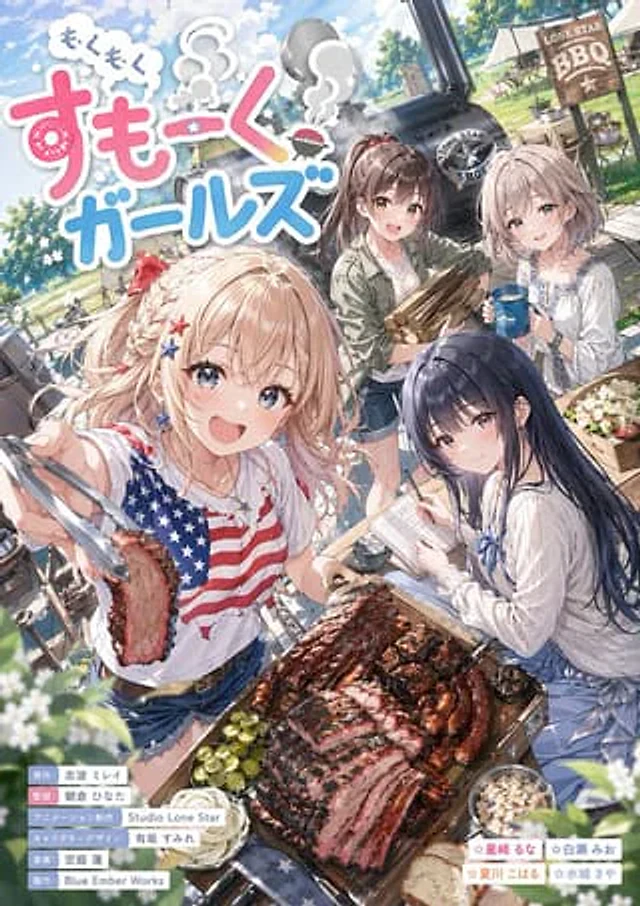

```text
A key visual poster in the style of a fictional slice-of-life anime. In the foreground on the left, a vibrant blonde anime girl wearing a star-shaped hair clip, with blue eyes, and dressed in {argument name="main character outfit" default="American flag T-shirt and denim shorts"} A man is handing a piece of smoked meat to an audience member using tongs. To the right, a gentle girl with long black hair and a white sweater sits at a wooden table, taking notes. In the background, two other girls are also present: one with a brown ponytail, carrying firewood; the other with short silver hair, holding a blue mug. The scene is set in a sunny outdoor barbecue area, featuring a large black smoking grill with a sign hanging above it.{argument name="background grill sign" default="LONE STAR BBQ"} The signboard. At the very front is {argument name="food platter" default="A large wooden platter filled with sliced ​​brisket, ribs, sausages, charred meat, and pickles."} There were also side dishes such as cold cabbage salad and bread. In the upper left corner was a large, cute, and vibrant cartoon logo with the words:{argument name="anime title" default="もくもく すもーく ガールズ"} It features smoke and barbecue graphics. There's one in the bottom left corner.{argument name="credits text block" default="Production staff list block containing names and positions"} The small text box in the bottom right corner lists the names of the four characters. The overall atmosphere is cheerful, rich in detail, and full of energy.
```

Model: GPT Image 2
Author: GPT Image 2 Prompts

[ProjectD](https://aitoolsradar.com/en/prompts/3c0f6875158674) · [Recorded source](https://x.com/koshian_to/status/2046200482885259736#reversed-0)
 · [Full original metadata and byte evidence](data/projectd-batch-0019.json)

## Anime Beauty Magazine Eyebrow Feature

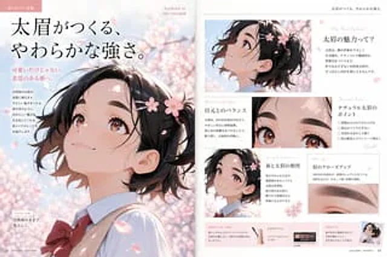

```text
{
  "type": "Anime and Beauty Magazine Double-Page Editing and Layout",
  "theme": "Thick eyebrows create a soft yet powerful look",
  "style": "Exquisite contemporary shoujo manga-style illustrations, blending high-end Japanese fashion magazine design, soft spring lighting, glossy printing texture, light and feminine layout, and pink and cream tones.",
  "format": "Double-page layout",
  "subject": {
    "gender": "girl",
    "age_appearance": "teenager",
    "character": "Pretty high school girls in profile and close-up with makeup",
    "hair": {
      "color": "Dark brown to black",
      "style": "Short bob haircut, styled into a loose side ponytail or mini bun.",
      "details": "The hair is light, fluffy, and soft, decorated with four pink cherry blossom hair accessories and a few fallen petals."
    },
    "face": {
      "eyes": "Large, warm brown anime eyes with a glossy finish",
      "eyebrows": "Thick, natural-looking eyebrows with a soft arch serve as the focal point of makeup.",
      "expression": "Gentle, confident, serene"
    },
    "clothing": {
      "top": "light blue shirt",
      "layer": "Cream-colored knitted vest",
      "accessory": "A large, dark red bow was tied at the neckline."
    },
    "season": "spring"
  },
  "environment": {
    "background": "Cherry blossoms in full bloom under a pale blue sky (soft focus)",
    "atmosphere": "Romantic, refreshing, elegant, and fresh"
  },
  "layout": {
    "left_page": {
      "dominant_element": "A full-page profile portrait of a girl looking upwards.",
      "text_blocks_count": 5,
      "text_blocks": [
        "small title tag in the upper left corner",
        "Large Japanese title",
        "Pink subtitle in the upper left center",
        "Vertical text to the left of the portrait",
        "Small cover character description in the bottom left corner"
      ],
      "footer_elements_count": 2
    },
    "right_page": {
      "image_panels_count": 5,
      "image_panels": [
        "One image with a rectangular side profile cropped at the top, against a background of cherry blossoms.",
        "A medium-sized rectangular close-up showing the eyes and eyebrows, with subtle white guiding lines.",
        "1 small portrait cropped from the bottom left corner",
        "A rectangular eyebrow close-up panel",
        "A miniature profile thumbnail in the bottom right corner"
      ],
      "text_sections_count": 7,
      "text_sections": [
        "Small English phrases in the top right margin",
        "Japanese main title block about the charm of eyebrow makeup",
        "Section on eye balance",
        "This section lists the key points for natural-looking thick eyebrows, including 4 checklist items.",
        "The section about matching thick eyebrows with spring.",
        "Eyebrow close-up description section",
        "Bottom Makeup Tips and Personal Profile Area"
      ],
      "product_items_count": 2,
      "product_items": [
        "1 tube of eyebrow gel",
        "1 eyebrow powder palette"
      ]
    },
    "overall_design": "A neat, grid-like layout with fine dividing lines, ample white space, blush pink accents on the text, and scattered cherry blossom petal patterns."
  },
  "visible_text": {
    "headline": "Thick eyebrows create a soft strength.",
    "small_header": "BEAUTY Special Feature",
    "english_tagline": "Eyebrow is my strength.",
    "right_intro": "Why Thick Eyebrow?",
    "section_titles": [
      "What's the appeal of thick eyebrows?",
      "Balance with the eye area",
      "Key points for natural, thick eyebrows",
      "The compatibility of spring and thick eyebrows",
      "Close-up of eyebrows",
      "MAKE-UP TIPS",
      "PROFILE"
    ],
    "page_footer": "April 2024 | BLOOM"
  },
  "quality": "High resolution, exquisite magazine mockups, realistic paper texture, and high-end beauty editorial compositions."
}
```

Model: GPT Image 2
Author: GPT Image 2 Prompts

[ProjectD](https://aitoolsradar.com/en/prompts/56bb3625158889) · [Recorded source](https://x.com/Kazuch75240438/status/2046552023647089044#reversed-0)
 · [Full original metadata and byte evidence](data/projectd-batch-0019.json)

## Anime Boxing Match Poster


```text
{"type":"Anime Boxing Event Poster","style":"Dramatic Japanese-style fighting poster, high-gloss, high-contrast digital illustration, muscular shonen manga aesthetics, intense arena lighting, sparks and energy flow, high-end metallic typography, promotional main visual","event":{"header_small":"Nekome Höseki Promotion &amp; Bullet Promotion Joint Presentation","headline":"Cat's Eye Boxing Vol.5 × Rose Bullet","date":"June 19th (Friday)","venue":"Ikatsu City Gymnasium","ticket_banner":"Tickets are on sale now!"","footer_notes":["Organizer: Cat's Eye Boxing Promotion / Bullet Promotion","Co-organizer: Ikatsu City Boxing Association Support: Ikatsu City / Ikatsu City Committee","Consultation: Cat's Eye Boxing Secretariat phone number: 03-1234-5678"]},"layout":{"orientation":"Vertical Poster","sections":[{"title":"Final","position":"Top Middle","count":2,"subtitle":"51.5kg Contract Battle","matchup":{"left_name":"Nat Ittiponchai","right_name":"Kyosuke Yamamoto"}},{"title":"Semi-final","position":"Bottom Middle","count":2,"subtitle":"Japan Youth Championship 8 Rounds","matchup":{"left_name":"Leo Hiiri","right_name":"Ringo Ichijo"}},{"title":"Ticket Price","position":"Bottom Left","count":4,"labels":["SRS Seat 15,000 Yen","RS Seat 10,000 Yen","Designated A Seat 7,000 Yen","Designated B Seat 5,000 Yen"]} Yen"]},{"title":"Same-day ticket notice","position":"bottom right","count":2,"labels":["Same-day tickets available","start 16:00","match starts 17:00"]}],"center_dividers":2},"fighters":{"count":4,"top_left":{"role":"Final left fighter","build":"compact, lean, muscular","skin_tone":"bronze","hair":"short dark spiky hair","gloves":"bright red boxing gloves","trunks":"blue boxing shorts with white and red side stripes","pose":"forward stance, left glove close to face, right glove forward, torso facing center","side_effects":"surrounded by red light and sparks"},"top_right":{"role":"Final right fighter","build":"tall, extremely muscular, broad chest and arms","skin_tone":"light bronze","hair":"bright red ... lean, muscular","skin_tone":"light bronze","hair":"bright red","hair":"bright red","top_right":{"role":"Final right fighter","build":"tall, lean, muscular","skin_tone":"light bronze","hair":"bright red","top_right":{"role":"Final right fighter","build":"tall, lean, muscular","skin_tone":"light bronze","hair":"bright red","top_right":{"role":"Final right fighter","build":"t r: "Medium-length brown slicked-back hair with a few wispy strands", "gloves": "Blue boxing gloves", "trunks": "Green boxing shorts with a thick white belt", "pose": "A defensive stance leaning inwards, gloves raised, dominating the foreground", "side_effects": "Surrounded by blue light and sparks"},"bottom_left":{"role":"Left semifinalist", "build":"Lean and muscular", "skin_tone":"Light bronze", "hair":"Short dark hair", "gloves":"Red boxing gloves", "trunks":"Dark shorts with a red belt", "pose":"A tight defensive stance facing the center"},"bottom_right":{"role":"Right semifinalist", "build":"Lean and muscular", "skin_tone":"Pale", "hair":"Short silver-white hair", "gloves":"Blue boxing gloves", "trunks":"Blue shorts with a white belt, 'REXEX' visible"} "and 'BXXN' text patch","pose":"Center-facing defensive stance","details":"Small black tattoo-like badge on left shoulder"}},"background":{"setting":"A packed indoor boxing arena","ring":{"visible":true,"ropes_count":3},"crowd":"Dark silhouettes of spectators and spectators in the distance","lighting":"Red and blue color scheme, fiery red on the left, electric blue on the right, bright lens flares, overhead spotlights, ember particles","text_style":{"main_title":"Large distressed gold brush font","section_titles":"Huge metallic gold serif capital letters","fighter_names":"Bold Japanese font on red and blue diagonally cut nameplates","overall":"Cinematic, stunning, championship poster layout"}}
```

Model: GPT Image 2
Author: GPT Image 2 Prompts

[ProjectD](https://aitoolsradar.com/en/prompts/2a786020fc262b) · [Recorded source](https://x.com/Chierie_behind/status/2047289289759990135#reversed-0)
 · [Full original metadata and byte evidence](data/projectd-batch-0019.json)

## Anime Boxing Title Match Poster


```text
A highly dramatic poster for a Japanese boxing match, employing an exquisite anime illustration style and a vertical composition, is divided in two. The left side is a warm gold, while the right side is an electric blue. At the very top is a large, metallic gold embossed font containing the following text:{argument name="headline text" default="JUNGLE PREMIUM Vol.7"} The image features a bright halo and a 3D beveled effect. At the bottom center is the white Japanese text "世界4団体フェザー级タイトルマッチ" (World 4-Group Feather-Class Type Matthi). The image shows full-body portraits of two featherweight male boxers facing off in the ring. Both are muscular, lean, and have glossy skin. The boxer on the left is a blond, anime-style youth with messy short hair, wearing gold boxing gloves, black and gold shorts (one leg has red and white accents), black boxing boots with gold laces, and a belt with the word "SEIJI" printed on it. He stands on the gold side, surrounded by explosive golden sparks and beams of light. The boxer on the right is a black-haired, anime-style youth with spiky short hair, wearing bright blue boxing gloves, dark navy shorts, blue boxing boots with white socks, and a belt with the word "JUNICHI" printed on it. He stands on the blue side, surrounded by rotating blue energy, light trails, and luminous particles. A circular championship belt badge is placed in the center of the background between the two boxers, with the boxing ring ropes visible behind them. The word "WORLD CHAMPION" is clearly visible on the belt badge. Two large, faded portrait overlays are added to the background, one behind each boxer: the left background portrait is gold-toned, and the right background portrait is blue-toned. On the far left, bold, vertical Japanese calligraphy of "黄金の闪闪" (Golden Flash) shimmers with a platinum glow. On the far right, bold, vertical Japanese calligraphy of "苍き鉄拳" (Azure Iron Fist) shimmers with a blue-white glow. At the bottom, two large Japanese name blocks are displayed: the left one is gold "松浦聖司" (Matsuura Seiji), and the right one is ice-blue-white "藤原俊一" (Fujiwara Junichi), with a burning gold "VS" in the center. A large white date is placed at the bottom center.{argument name="event date" default="July 19th (Sunday)"} At the very bottom center is a gold serif font.{argument name="venue name" default="SUN BIRTH STADIUM"} It utilizes extreme contrast, cinematic arena lighting, dynamic particle effects, high-end sports event poster design, glossy typography, and a heroic, high-stakes championship atmosphere.
```

Model: GPT Image 2
Author: GPT Image 2 Prompts

[ProjectD](https://aitoolsradar.com/en/prompts/c6fb1cd44a4baa) · [Recorded source](https://x.com/Chierie_behind/status/2047289289759990135#reversed-1)
 · [Full original metadata and byte evidence](data/projectd-batch-0019.json)

## Anime Cat Girl Character Sheet


```text
Goal: Create a clean anime character sheet for {argument name="character name" default="手塚メモ (Tezuka Memo)"}, a cat-version college girl protagonist, with Japanese annotation text and multiple turnaround views.

Canvas: Wide horizontal white page, approximately 16:9, thin black framing lines, crisp print-layout look. Use black bold typography and a manga/anime production-sheet style. Keep the background plain white with no scenery.

Layout: Top-left large italic bold title reads CHARACTER SHEET. Along the upper center/right include Japanese heading text with a small label meaning face close-up and a large protagonist label. Arrange exactly 4 visible character depictions: 1 full-body front view on the left labeled FRONT, 1 full-body side view in the center labeled SIDE, 1 full-body back view right of center labeled BACK, and 1 boxed portrait close-up in the upper-right. The close-up portrait sits inside a thin black rectangular box. Beneath the portrait, place a compact Japanese profile block and a longer Japanese design-note paragraph.

Character details: Draw a slim 19-year-old anime college girl with very long pale pink hair that fades into deeper pink at the ends, cat ears on top of her head, and a pale pink cat tail. Her face is intentionally obscured by a soft square blur/mosaic in all visible face views. She wears exactly 5 main outfit pieces: an oversized blue hoodie with drawstrings and front pouch pocket, a short dark pleated skirt, yellow loose leg warmers, white sneakers, and cat-ear/cat-tail cosplay accessories. In the side and back views, show the tail extending from behind the hoodie/skirt area and curling outward with a darker pink tip. Hair should be long and slightly wavy, reaching the lower back, with the pink gradient most visible near the ends.

Text content: Use English labels for the view names: FRONT, SIDE, BACK. Use the title CHARACTER SHEET. Include Japanese character-sheet text in the right column. Profile block default text: {argument name="profile block" default="名前：手塚メモ (Tezuka Memo)\n年齢：19歳\n大学2年生\n学部：情報メディア学部"}. Design-note paragraph default text: {argument name="design notes" default="猫耳バージョン共通ビジュアル設定。猫耳はカチューシャタイプだが、まるで本物の耳のようにアニメーション化できる。しっぽはコスプレアイテムで、ベルトでパーカーの内側に固定されている。髪色、パーカー、スカート、レッグウォーマーはそのまま。TMAアドンを有機猫の付け根に移動させる。耳としっぽは感情表現用に追加パーツとして使用される（嬉しいときは耳が立ち、落ち込んでいるときはしっぽが垂れる）。"}

Visual style: Soft cel-shaded anime illustration, delicate line art, pastel colors, slightly desaturated blue hoodie, pale skin, light pink hair, production-reference sheet quality. Text should look like printed black Japanese and English type, with the main title heavy and italic. Maintain a balanced layout with large empty white margins.

Constraints: Show exactly 4 character depictions and exactly 5 main outfit pieces listed above. Do not add extra poses, props, background scenery, speech bubbles, logos, watermarks, or additional characters.
```

Model: GPT Image 2
Author: テツメモ｜AI図解×検証｜Newsletter

[ProjectD](https://aitoolsradar.com/en/prompts/c62430ef67bd56) · [Recorded source](https://youmind.com/prompts/anime-catgirl-character-sheet-22203)
 · [Full original metadata and byte evidence](data/projectd-batch-0019.json)

## Anime Cat-Girl in Realistic Alpine Meadow


```text
A cute anthropomorphic catgirl with white fur,{argument name="hair color" default="Short green hair"} A conspicuous tuft of hair, and a pair of large {argument name="eye color" default="green"} She has anime-style eyes. She has fluffy green cat ears and a long white tail. She is wearing a loose-fitting outfit.{argument name="outfit" default="Green off-shoulder robe"} It sat quietly on the ground, its legs curled to the side, its paws gently placed in front of it. The background was a lush, green landscape.{argument name="setting" default="Alpine meadows covered with white and yellow wildflowers"} In the distance lie vast valleys, pine forests, and majestic snow-capped mountains, with blue skies and white clouds overhead. The artistic style blends anime character design with highly realistic details.{argument name="style" default="Photographic landscape"} The combination creates a bright and natural sense of sunlight.
```

Model: GPT Image 2
Author: GPT Image 2 Prompts

[ProjectD](https://aitoolsradar.com/en/prompts/8133f25f42c15e) · [Recorded source](https://x.com/TlanoAI/status/2043638512055123990#reversed-0)
 · [Full original metadata and byte evidence](data/projectd-batch-0019.json)

## Anime Chalkboard Character Formula


```text
{
  "type": "single-page anime illustration with an information-dense classroom chalkboard",
  "style": "bright polished Japanese anime key visual, clean line art, soft watercolor-like shading, warm sunlight from the left, high detail, cheerful official-character-analysis parody",
  "main subject": {
    "character": "a friendly young woman teacher/presenter standing on the right side in front of a large green chalkboard",
    "appearance": {
      "hair": "{argument name=\"hair color and style\" default=\"shoulder-length peach-blonde bob with airy bangs and loose wind-swept strands\"}",
      "face": "covered by a plain centered beige square censor block, hiding all facial features",
      "pose": "relaxed standing pose, torso angled slightly left, left hand open and gesturing toward the chalkboard, right hand lowered holding a short piece of blue chalk",
      "outfit count": 2,
      "outfit pieces": ["loose white short-sleeve T-shirt", "high-waisted light blue jeans"]
    }
  },
  "setting": {
    "location": "sunlit classroom",
    "background": "large dark green chalkboard with wooden frame, chalk tray, desk edge visible at lower left",
    "chalk tray items count": 6,
    "chalk tray items": ["white eraser", "pink chalk", "white chalk", "blue chalk", "white chalk", "orange-and-black eraser at far right"]
  },
  "chalkboard layout": {
    "overall": "handwritten white, blue, and yellow chalk text with doodles, underlines, boxed formulas, arrows, sparkles, clouds, glasses icon, sun icon, and a smiley face",
    "visible text sections count": 7,
    "sections": [
      {
        "position": "top center",
        "role": "large title",
        "text": "{argument name=\"chalkboard title\" default=\"彼女らしさの公式\"}",
        "decorations": "cloud doodle on the left, sparkles near the title, sun doodle on the right"
      },
      {
        "position": "upper left to upper center inside a blue rectangular underline box",
        "role": "main formula",
        "text": "{argument name=\"main formula\" default=\"魅力＝明るさ＋透明感＋知性＋親しみやすさ\"}"
      },
      {
        "position": "mid upper left",
        "role": "strongest combination formula",
        "text": "笑顔 × メガネ × 夏空感 = 最強",
        "decorations": "blue wavy underlines beneath key words and yellow emphasis on 最強"
      },
      {
        "position": "middle left",
        "role": "personality note 1",
        "text": "♡ やさしさ＋好奇心 = 話しかけやすさ"
      },
      {
        "position": "mid lower left",
        "role": "personality note 2",
        "text": "軽やかさ＋自信 = さわやかオーラ"
      },
      {
        "position": "lower left",
        "role": "fashion note",
        "text": "白Tシャツ＋風 = 抜け感"
      },
      {
        "position": "bottom left inside a blue chalk rectangle and speech-bubble area",
        "role": "English equation and concluding quote",
        "text": "K = (Smile + Smartness + Freshness) × Glasses / 見ているだけで元気になれる",
        "decorations": "boxed equation, arrow, sparkles, cloud bubble, small smiley face"
      }
    ],
    "doodles count": 9,
    "doodles": ["cloud at top left", "sparkles near title", "sun at top right", "small cloud at right", "heart at middle left", "glasses icon near center", "wind swirl near fashion note", "arrow pointing to equation box", "smiley face in bottom speech bubble"]
  },
  "composition": "vertical 2:3 portrait framing, chalkboard fills the background, character occupies the right half from head to thighs, writing fills the left half, warm classroom sunlight and gentle shadows",
  "rendering instructions": "make the chalk writing look hand-drawn and slightly imperfect but legible, use white chalk as the primary color with blue underlines and yellow highlights, keep the illustration wholesome and stylish"
}
```

Model: GPT Image 2
Author: 黒猫さん🐈‍⬛

[ProjectD](https://aitoolsradar.com/en/prompts/ac0868a30fd14a) · [Recorded source](https://youmind.com/prompts/anime-chalkboard-character-formula-19912)
 · [Full original metadata and byte evidence](data/projectd-batch-0019.json)

## Anime Character Blueprint Sheet


```text
{
  "type": "Character design blueprint",
  "style": "Technical concept art, black blueprint background with light-colored grid lines, thin white lines, minimalist color drawing aesthetics.",
  "subject": {
    "category": "Anime-style male head rotation image",
    "name": "{argument name=\"character name\" default=\"MALE_01\"}",
    "gender_presentation": "male",
    "age_appearance": "young adults",
    "hair": {
      "color": "{argument name=\"hair color\" default=\"black\"}",
      "style": "This short, layered, spiky hairstyle features sharp, jagged strands, thick hair on top, and a gradual tapering towards the sides and back of the head."
    },
    "eyes": {
      "color": "{argument name=\"eye color\" default=\"brown\"}"
    },
    "accessories": {
      "earrings": "Wearing small earrings in both ears"
    },
    "clothing": {
      "top": "High-necked structured jacket with a slightly open front and clean, crisp stitching."
    },
    "tattoos": [
      "Cross tattoo on right cheek",
      "Climbing flower tattoo on the left side of the neck"
    ]
  },
  "layout": {
    "orientation": "Vertical layout",
    "sections": [
      {
        "title": "Front view",
        "position": "Large left panel",
        "count": 1,
        "details": "Large frontal view of the head and shoulders, neck tattoo visible above the high collar, both ears visible, marked width 160 and vertical height 220."
      },
      {
        "title": "01 | Side View",
        "position": "Top right panel",
        "count": 1,
        "details": "Right side profile, collar visible, width measured 100."
      },
      {
        "title": "02 | Rear View",
        "position": "Right middle panel",
        "count": 1,
        "details": "Rear view of head and upper shoulder, showing the center line, width measured 160."
      },
      {
        "title": "03 | Neck Tattoo Details",
        "position": "bottom left illustration",
        "count": 1,
        "details": "Close-up illustration of a floral neck tattoo along the jawline and next to the collar."
      },
      {
        "title": "Note:",
        "position": "bottom right corner",
        "count": 4,
        "labels": [
          "Hairstyle: Spiky, black",
          "Eyes: Brown",
          "Tattoos: Cross (right cheek), Flower (left neck)",
          "Earrings: Both ears"
        ]
      }
    ],
    "header": {
      "top_left": [
        "theme:{argument name=\"subject code\" default=\"MALE_01\"}",
        "Category: Character Design",
        "Status: Approved"
      ],
      "top_right": [
        "date:{argument name=\"date\" default=\"May 20, 2024\"}",
        "Ratio: 1:1"
      ]
    },
    "legend": {
      "bottom_left": [
        "Unit: mm",
        "contour",
        "structure",
        "Centerline"
      ]
    }
  },
  "composition": "The drawing page layout is clean and simple, featuring thin panel borders, measurement arrows, center reference lines, and blueprint annotation typography; all text is in clear, white, capital sans-serif font.",
  "color_palette": {
    "background": "black",
    "lines": "White",
    "grid": "Dark gray",
    "accents": "none"
  }
}
```

Model: GPT Image 2
Author: GPT Image 2 Prompts

[ProjectD](https://aitoolsradar.com/en/prompts/b869480978c33f) · [Recorded source](https://x.com/Cheetah_x0/status/2047079352345440535#reversed-0)
 · [Full original metadata and byte evidence](data/projectd-batch-0019.json)

## Anime Character Brand Identity & Merch Board


```text
{
  "type": "Brand image and peripheral design projects",
  "theme": {
    "color_palette": "{argument name=\"theme color\" default=\"Soft pink\"} With white",
    "motif": "{argument name=\"motif\" default=\"Cherry blossoms\"} With pink hearts"
  },
  "character": {
    "description": "An anime girl with a short brown bob haircut, pink eyes, wearing a white hoodie, and a gentle smile."
  },
  "branding": {
    "main_logo": "{argument name=\"character name\" default=\"Yune Chi\"}",
    "sub_logo": "{argument name=\"character subtext\" default=\"ゆおんちー\"}"
  },
  "layout": {
    "sections": [
      {
        "type": "Header Banner",
        "position": "top",
        "elements": [
          "Large main logo",
          "Secondary Logo",
          "Cherry blossom pattern",
          "Portrait of the character on the right"
        ]
      },
      {
        "type": "Product Packaging",
        "position": "center left",
        "elements": [
          "A square box with a heart-shaped transparent window, displaying pink heart-shaped candies.",
          "Box body character illustration",
          "2 individual candy wrappers",
          "5 scattered heart-shaped candies"
        ]
      },
      {
        "type": "Promotional poster",
        "position": "center right",
        "elements": [
          "Character portrait",
          "Heart-shaped candy bowl",
          "Main Logo",
          "Text: '4.26 NEW OPEN'",
          "The character '{argument name=\"social handle\" default=\"@yuonchii\"} '"
        ]
      },
      {
        "type": "Horizontal webpage banner",
        "position": "Middle to lower",
        "elements": [
          "Main Logo",
          "Cherry blossoms",
          "Portrait of the character on the right"
        ]
      },
      {
        "type": "Social media profile mockup",
        "position": "Bottom left",
        "elements": [
          "Header image with logo",
          "1 round avatar",
          "Account Name{argument name=\"social handle\" default=\"@yuonchii\"} '",
          "1 Follow button",
          "Simulated introduction text"
        ]
      },
      {
        "type": "Merchandise Series",
        "position": "Bottom right",
        "count": 9,
        "items": [
          "A white T-shirt with a logo printed on it.",
          "A white mug with a character design printed on it.",
          "4 round badges",
          "1 acrylic keychain",
          "2 packs of candy"
        ]
      }
    ]
  }
}
```

Model: GPT Image 2
Author: GPT Image 2 Prompts

[ProjectD](https://aitoolsradar.com/en/prompts/9b6e9b4a8f93df) · [Recorded source](https://x.com/chi_vc_/status/2046061073720369228#reversed-0)
 · [Full original metadata and byte evidence](data/projectd-batch-0019.json)

## Anime Character Clothing Deconstruction


```text
拆解角色服装，生成服装设计图，并套用在普通东亚女性身上，{argument name="比例" default="3:2"}
```

Model: GPT Image 2
Author: 程序员小灰

[ProjectD](https://aitoolsradar.com/en/prompts/694a71cb17e835) · [Recorded source](https://youmind.com/prompts/anime-clothing-deconstruction-diagram-17332)
 · [Full original metadata and byte evidence](data/projectd-batch-0019.json)

## Anime Character Color Setting Sheet


```text
参照画像をキャラクターデザインのベースとして使用し、「商業アニメ制作現場で使用される、プロ仕様のキャラクター色彩設定資料」を描く。

キャラクターの顔、髪型、髪色、瞳、輪郭、体型、シルエット、衣装デザイン、配色、全体の印象を正確に維持すること。

キャラクターのアイデンティティを絶対に崩さない。
別キャラクターとして描き直さない。

完成イラストではない。
ポスターではない。
コンセプトアートではない。

目的は、アニメーター、彩色担当、仕上げ担当、撮影担当へ向けた、色彩共有用の設定資料。

画面は、白背景ベースの日本アニメ設定資料レイアウト。

複数の色彩設定カットを、資料ページとして整理して配置する。

以下を含める：

・全身カラー正面
・全身カラー背面
・顔アップ
・表情差分
・髪色確認
・瞳色確認
・衣装配色確認
・アクセサリー色指定
・靴配色
・小物カラー設定
・部分拡大図
・カラーパレット欄
・色分け矢印
・手書き風色指定メモ
・仕上げ指示メモ

キャラクターは、セルアニメ調のクリーンなアニメ塗りで描写する。

厚塗りしない。
過剰なグラデーションは禁止。
映画的ライティングは禁止。
ソーシャルゲーム風レンダリングは禁止。
過剰なエフェクトは禁止。

影色は整理され、アニメ制作現場の色指定資料のように、シンプルで読みやすく設計する。

彩度はやや整理されており、印刷された設定資料集のような自然な色味。

画面内には、色番号、簡易注釈、矢印、パーツ名、色分け指示などを自然に追加する。

資料ページとして、視認性と構造理解を最優先する。

レイアウトは、日本の90年代〜2000年代アニメ設定資料集のような空気感。

情報密度は高いが、整理されていて読みやすい。

紙面として自然な余白を持たせる。

誌面全体は、実際に印刷・スキャンされた設定資料集のような空気感。

軽微な紙の質感、わずかな印刷感、コピー紙感、スキャン感を自然に加える。

完成されたアート作品ではなく、「実際の制作現場資料」に見えることを最優先する。
```

Model: GPT Image 2
Author: Eris Create Lab

[ProjectD](https://aitoolsradar.com/en/prompts/6aeccbb190ed93) · [Recorded source](https://youmind.com/prompts/anime-character-color-sheet-22880)
 · [Full original metadata and byte evidence](data/projectd-batch-0019.json)

## Anime Character Design Document


```text
{
  "type": "Character design document",
  "header": "Character design document:{argument name=\"character name\" default=\"SHIBUYA SHION\"}",
  "character": {
    "hair": "{argument name=\"hair color\" default=\"Black bob haircut with purple highlights\"}",
    "eyes": "Purple",
    "outfit": "{argument name=\"hoodie color\" default=\"light purple\"} Oversized hoodie, distressed denim shorts, black high-top sneakers, black backpack",
    "pose": "Standing posture, making a peace sign with one hand beside his face, one hand in his hoodie pocket."
  },
  "layout": {
    "centerpiece": "Full-body anime illustration of a character",
    "top_right": "Character back view (flat color/line drawing)",
    "left_panels": {
      "count": 3,
      "descriptions": [
        "Close-up of character's face",
        "Close-up of a black backpack",
        "Close-up of black high-top canvas shoes"
      ]
    },
    "text_blocks": [
      {
        "position": "bottom left corner",
        "content": [
          "Name:{argument name=\"character name\" default=\"SHIBUYA SHION\"}",
          "Introduction:{argument name=\"profile description\" default=\"Urban explorer / Graphic designer\"}",
          "Age: 20"
        ]
      },
      {
        "position": "Bottom center footer",
        "content": [
          "project:{argument name=\"project name\" default=\"SHIBUYA ARTIST\"}",
          "Date: December 2025"
        ]
      }
    ],
    "swatches": {
      "color_palette": {
        "count": 5,
        "labels": [
          "Hair color: Dark purple/black",
          "Eye color: Purple",
          "Hoodie: Light purple",
          "Cowboy: Stonewashed Blue",
          "Shoes: Black/white canvas"
        ]
      },
      "material_textures": {
        "count": 5,
        "labels": [
          "Hoodie fabric (terry cotton)",
          "Hoodie fabric (terry cotton)",
          "Denim (Selvedge denim)",
          "Canvas (Nylon) Backpack",
          "Metal (gunmetal gray zipper)"
        ]
      }
    }
  }
}
```

Model: GPT Image 2
Author: GPT Image 2 Prompts

[ProjectD](https://aitoolsradar.com/en/prompts/034305694ed41e) · [Recorded source](https://x.com/Samo_Toshu/status/2045029905164030264#reversed-0)
 · [Full original metadata and byte evidence](data/projectd-batch-0019.json)

## Anime Character Design Reference Sheet


```text
{
  "type": "Anime character reference images",
  "character": {
    "hair": "{argument name=\"发色\" default=\"gold\"}",
    "eyes": "{argument name=\"眼睛颜色\" default=\"blue\"}",
    "outfit": "{argument name=\"制服风格\" default=\"Military-style dress with white trim\"}",
    "main_color": "{argument name=\"制服主色调\" default=\"blue\"}"
  },
  "layout": {
    "top_section": {
      "description": "Full body three-view",
      "count": 3,
      "views": [
        "front",
        "side",
        "back"
      ]
    },
    "bottom_left_top": {
      "description": "Facial expressions",
      "count": 6,
      "expressions": [
        "neutral",
        "wink and smile",
        "Open mouth and smile",
        "A slight smile",
        "shy",
        "gentle smile"
      ]
    },
    "bottom_left_bottom": {
      "description": "Accessories and details",
      "count": 5,
      "items": [
        "beret",
        "Legs with black pantyhose and blue fin-decorated high heels",
        "Blue and white ribbon",
        "Uniform top torso",
        "A pair of gloves"
      ]
    },
    "bottom_right_top": {
      "description": "Clothing Disassembly",
      "count": 3,
      "items": [
        "The front of the coat and the ruffled hem of the skirt",
        "Back of jacket",
        "Back of the skirt"
      ]
    },
    "bottom_right_middle": {
      "description": "Additional details and color scheme",
      "items": [
        "A pair of blue high heels",
        "single glove"
      ],
      "color_palette_count": 8
    },
    "bottom_right_bottom": {
      "description": "text box",
      "label": "Settings and Notes"
    }
  },
  "style": "A simple anime art style, with a white background featuring subtle horizontal lines and a decorative retro border."
}
```

Model: GPT Image 2
Author: GPT Image 2 Prompts

[ProjectD](https://aitoolsradar.com/en/prompts/6ac64e18430328) · [Recorded source](https://x.com/guriguri_sub/status/2044931728318636390#reversed-0)
 · [Full original metadata and byte evidence](data/projectd-batch-0019.json)

## Anime Character Drive-Thru Clerk (POV)


```text
参照画像のキャラクターをベースデザインとして使用して「転生したアニメキャラクターが、現実世界のドライブスルー店舗で普通に働いている瞬間」を描く。

キャラクターのアニメイラストとしての空気感を正確に維持する。

キャラクターの顔、髪型、髪色、瞳、耳、シルエット、頭身、表情の印象を維持すること。 キャラクターのアイデンティティを絶対に崩さない。 実写人間化しない。 キャラクター部分はアニメイラスト表現を維持する。

舞台は、 世界的チェーン店を連想させる、 現実的なファストフード店またはカフェのドライブスルー。

実写級の背景描写。 生活感のある現実空間。 綺麗すぎない。 広告写真のようにしない。

店内やドライブスルー周辺には、 メニュー看板、 インターホン、 紙袋、 ドリンクカップ、 厨房機器、 車列、 油っぽい照明、 現実的な店舗設備などを自然に配置する。

スマートフォンでライブ配信している配信者視点。

車内から撮影されたPOV構図。

画面手前に、 車の窓、 ハンドル、 ドリンク、 ダッシュボード、 サイドミラーなどを自然にフレームインさせる。

配信者側の人物は、 スマートフォンを掲げているのではなく、 商品や紙袋を受け取ろうとして自然に手を伸ばしている。

ドライブスルー窓越しに、 制服を着たアニメキャラクター店員が接客している。

キャラクターは、 紙袋を渡す、 注文確認をする、 レジ端末を操作する、 ストローを入れる、 無表情でマニュアル対応する、 少し眠そうに接客する、 など、 「普通に働いている」自然な動作を行っている。

重要： キャラクター本人は、 自分がアニメキャラクターであることを特に気にしていない。

周囲の世界も、 完全には驚いておらず、 「なんか普通に存在している」 ような空気感を持つ。

ライブ配信風UIを追加する。

TikTok LIVE、 YouTube Live、 Instagram Live風など、 現代的な縦型ライブ配信UI。

コメント欄、 同接数、 LIVE表示、 いいね、 ギフト通知などを自然に表示する。

コメント内容は固定しない。 AI側が自然に生成すること。

実写世界とアニメキャラクターが自然に融合した、 奇妙にリアルな空気感を重視する。

スマートフォン撮影らしい、 軽いHDR処理、 微細なセンサーノイズ、 わずかなJPEG圧縮感、 自然な露出、 軽微な色収差、 オートフォーカス感、 わずかな手ブレ、 高ISOノイズ、 ライブ配信特有の白飛び、 手持ち撮影らしい不安定感を追加する。

映画ポスター風にしない。 過剰なシネマティック演出禁止。 綺麗すぎる構図禁止。 AI特有の glossy rendering を避ける。 情報量を盛りすぎない。

「SNSに投稿された謎のライブ配信切り抜き」 のような、 偶然感と生活感を重視する。

「配信者だけ少しテンションがおかしい」 ような、 現代インターネット文化らしい空気感を重視する。
```

Model: GPT Image 2
Author: Eris Create Lab

[ProjectD](https://aitoolsradar.com/en/prompts/76a57ccca848fe) · [Recorded source](https://youmind.com/prompts/anime-streamer-drive-thru-22141)
 · [Full original metadata and byte evidence](data/projectd-batch-0019.json)

## Anime Character Expression Sheet Generator


```text
参照画像をキャラクターデザインのベースとして使用すること。

キャラクターの顔、髪型、髪色、瞳、耳、衣装、シルエット、頭身、表情の空気感を正確に維持すること。 キャラクターのアイデンティティを絶対に崩さない。

「キャラクター({argument name="キャラクター名" default="名前があればここに入れる"})の特殊表情集」を描く。

1枚の資料シート内に、 6種類の特殊表情を掲載すること。

各表情ごとに、

・表情名（日本語） ・英語表記 ・小さな感情説明

をデザインとして追加すること。

全体デザインは、

・萌えアニメ文化のファンブック ・オタク向け感情差分資料集 ・サブカル系同人誌 ・キャラクター設定資料

のような空気感にする。

白ベース背景。

誌面全体のアクセントカラーは、 参照画像のキャラクターデザイン・衣装・世界観に合わせて自然に決定すること。

キャラクターに合った配色で、 統一感のある誌面デザインにする。

誌面内に、

・手書き風メモ ・ハート ・汗マーク ・漫画的集中線 ・顔文字 ・ネットミーム風装飾 ・デフォルメアイコン ・感情記号 ・ステッカー風装飾 ・雑誌風タイポグラフィ

などを追加してよい。

リアルな人間表情ではなく、 萌えアニメ文化特有の、

・顔芸 ・デフォルメ ・記号化表現 ・誇張リアクション ・感情テンプレート

として描写すること。

それぞれの表情で、 顔だけでなく、 首・肩・手・姿勢にも感情を反映する。

アニメ、 ラブコメ、 ソーシャルゲーム、 Vtuber文化、 ギャグ作品、 日常系作品などで頻繁に使用される、 “萌えアニメ文化の顔テンプレート” として描写すること。

全体を、

「萌えアニメ表情辞典」 「オタク向け感情資料集」 「サブカル系キャラクター表情図鑑」

のような完成度にすること。
```

Model: GPT Image 2
Author: Eris Create Lab

[ProjectD](https://aitoolsradar.com/en/prompts/c2298d07489984) · [Recorded source](https://youmind.com/prompts/anime-expression-sheet-reference-22140)
 · [Full original metadata and byte evidence](data/projectd-batch-0019.json)

## Anime Character in Real World Grid


```text
Using the reference image{argument name="style" default="2D cel-shaded anime characters"} Create{argument name="layout" default="Grid style"} Images showing them{argument name="environment" default="Real world"} The scenario in which various activities are carried out.
```

Model: GPT Image 2
Author: GPT Image 2 Prompts

[ProjectD](https://aitoolsradar.com/en/prompts/e54888b450d899) · [Recorded source](https://x.com/seiiiiiiiiiiru/status/2047227021156356500)
 · [Full original metadata and byte evidence](data/projectd-batch-0019.json)

## Anime Character Ita-bag Creation


```text
Based on the first image, please create a photorealistic "itasha" (anime/cartoon character) for this character. The color of the bag should be "".{argument name="color" default="Your favorite color"} ", and decorated with "{argument name="color" default="Your favorite color"} The bag must contain ribbons and keychains with the character logo. The bag must also contain 20 character badges.{argument name="motif" default="Your favorite theme"} The set includes elements such as a chibi-style plush toy of the character. The scene is set in a photorealistic, nature-themed room, with the itabag placed on a wooden table.
```

Model: GPT Image 2
Author: GPT Image 2 Prompts

[ProjectD](https://aitoolsradar.com/en/prompts/5aca285f7e1cb1) · [Recorded source](https://x.com/MinaReise/status/2047666985337807200)
 · [Full original metadata and byte evidence](data/projectd-batch-0019.json)

## Anime Character Profile Sheet


```text
{
  "type": "Anime Character Profile",
  "theme": "{argument name=\"theme color\" default=\"Light blue and white\"} Digital cyberpunk aesthetics with glowing particles and grid patterns",
  "character": {
    "name": "{argument name=\"character name\" default=\"メタかみたん\"}",
    "appearance": {
      "hair": "{argument name=\"hair color\" default=\"brown\"} A messy high ponytail with a tuft of hair.",
      "eyes": "{argument name=\"eye color\" default=\"blue\"}",
      "accessories": "Blue goggles on the forehead, huge white angel wings, silver key necklace",
      "outfit": "{argument name=\"outfit\" default=\"Oversized white hoodie, white shorts, white sneakers\"}"
    }
  },
  "layout": {
    "header": "The text in the upper left corner displays \"CHARACTER\" and \"Character Introduction\".",
    "sections": [
      {
        "title": "Data Text",
        "position": "Left sidebar",
        "content": "Detailed character attributes, including height \"165cm\", impression color \"white, light blue\", and multiple Japanese quotes."
      },
      {
        "title": "Full-body portrait",
        "position": "right side",
        "description": "The character is standing facing forward, smiling, and in a relaxed posture."
      },
      {
        "title": "Q-version illustrations",
        "position": "bottom left corner",
        "count": 1,
        "description": "The character is depicted in a chibi style, sitting in a chair and using a laptop."
      },
      {
        "title": "Expression variants",
        "position": "Bottom Center",
        "count": 2,
        "description": "The square panel displays close-up facial expressions, all of which are smiling expressions with hands close to the face."
      },
      {
        "title": "Action close-up",
        "position": "bottom right corner",
        "description": "A large rectangular panel displays the character leaning forward, resting his chin on his hand, and reaching out to the audience."
      }
    ]
  }
}
```

Model: GPT Image 2
Author: GPT Image 2 Prompts

[ProjectD](https://aitoolsradar.com/en/prompts/93112dbe1050dd) · [Recorded source](https://x.com/mm_zzm44854/status/2045861258520568230#reversed-0)
 · [Full original metadata and byte evidence](data/projectd-batch-0019.json)

## Anime Character Profile Sheet


```text
{
  "type": "Anime character profile card poster",
  "style": "Clean and exquisite Japanese anime illustrations, adorned with light purple accents, a white background, decorative lace borders, an elegant school idol reference chart layout, highly readable Japanese typography, soft shadows, glossy eyes, and fine lines.",
  "subject": {
    "name": "{argument name=\"character name\" default=\"Mari Ohara\"}",
    "romanized_name": "Ohara Mari",
    "series_style": "Campus Idol Anime Character List",
    "character": {
      "gender": "female",
      "age_appearance": "High school girl, older teenage girl",
      "hair": {
        "color": "{argument name=\"hair color\" default=\"Golden yellow\"}",
        "style": "Long, wavy hair with loose side braids and curled strands, a small tuft of hair, and a half-up double bun look on top in the full-body photo."
      },
      "expression": "Bright, confident, and adventurous",
      "outfit": {
        "count": 6,
        "pieces": [
          "Beige sailor-style school uniform suit",
          "Blue bow on the chest",
          "Grey sailor collar with navy blue trim",
          "Grey pleated skirt with white stripes at the hem.",
          "Dark over-the-knee socks",
          "Brown loafers"
        ]
      }
    }
  },
  "layout": {
    "orientation": "Vertical",
    "sections": [
      {
        "title": "プロフィール",
        "position": "Top right",
        "count": 12,
        "labels": [
          "name",
          "Grade",
          "birthday",
          "Blood type",
          "height",
          "スリーサイズ",
          "dominant hand",
          "Affiliation",
          "role",
          "イメージカラー",
          "Special skills",
          "Favorite food"
        ]
      },
      {
        "title": "Emoji Collection",
        "position": "center right",
        "count": 4,
        "labels": [
          "blink",
          "Smile",
          "excited",
          "good at"
        ]
      },
      {
        "title": "Character Introduction",
        "position": "Bottom left",
        "count": 1,
        "labels": [
          "Character introduction text box"
        ]
      },
      {
        "title": "Personality and characteristics",
        "position": "Bottom left (below the introduction)",
        "count": 6,
        "labels": [
          "Cheerful and sociable",
          "Curious and impulsive",
          "Having one's own opinions",
          "Rich in emotional expression",
          "Good at taking care of others",
          "Often teased for being naive and innocent."
        ]
      },
      {
        "title": "Things I like",
        "position": "Bottom left",
        "count": 5,
        "labels": [
          "Go to the beach",
          "Dance",
          "Experience foreign culture",
          "Fun and exciting activities",
          "Chatting with friends"
        ]
      },
      {
        "title": "Things I'm not good at",
        "position": "Lower left",
        "count": 5,
        "labels": [
          "Bound by cumbersome rules",
          "still",
          "Extreme cold regions",
          "A dull atmosphere",
          "Severely scolded"
        ]
      },
      {
        "title": "パラメータ",
        "position": "Bottom right",
        "count": 6,
        "labels": [
          "Expressiveness and Performance 95",
          "Communication skills 90",
          "Curiosity and Action: 95",
          "Physical strength and athletic ability 70",
          "Intelligence and academic ability 65",
          "Gentle and considerate 85"
        ]
      }
    ],
    "main_images": {
      "count": 2,
      "items": [
        "The large half-length portrait on the left shows a person leaning against an outdoor balcony railing, with a blue sky, distant green mountains, and shimmering light spots in the background.",
        "Standing posture with one hand on hip and the other hand raised behind the head, positioned on the upper right side."
      ]
    },
    "footer": {
      "count": 1,
      "text": "Let's enjoy! Every day is the best adventure! ♡"
    }
  },
  "text_details": {
    "headline_quote": "\"Life is an adventure, isn't it? Let's go find something exciting! ♡\"",
    "profile_values": {
      "名前": "{argument name=\"profile name text\" default=\"Mari Ohara\"}",
      "学年": "Senior year of high school",
      "誕生日": "June 13",
      "血液型": "AB type",
      "身長": "163cm",
      "スリーサイズ": "B・87 W・60 H・84",
      "利き手": "right",
      "所属": "μ's (Muse)",
      "役割": "Vice Captain",
      "イメージカラー": "Purple",
      "特技": "English conversation, dance",
      "好きな食べ物": "Pineapple, baked dishes"
    }
  },
  "color_palette": {
    "count": 5,
    "colors": [
      "Lavender Purple",
      "White",
      "Golden yellow",
      "Blue-green",
      "Soft gray"
    ]
  },
  "composition": "The character profiles are presented in a balanced, magazine-style format with a gorgeous purple border. The top left corner features prominent, large Chinese characters for the names, accompanied by Romanized text below. The right side displays a densely packed data card, the middle right features thumbnails of facial expressions, and the bottom right corner displays an ability radar chart. A decorative anchor icon is also present in the bottom right corner.",
  "quality": "High resolution, crisp, print-quality layout, neat alignment, and elegant, adorable idol aesthetics."
}
```

Model: GPT Image 2
Author: GPT Image 2 Prompts

[ProjectD](https://aitoolsradar.com/en/prompts/099e88e2cab599) · [Recorded source](https://x.com/Mizuki_A9/status/2047411166872498249#reversed-0)
 · [Full original metadata and byte evidence](data/projectd-batch-0019.json)

## Anime Character Profile Sheet


```text
{
  "type": "Anime Character Reference Table",
  "subject": "Solo Female Character Design Project",
  "style": {
    "medium": "Clean and exquisite anime illustrations",
    "presentation": "Japanese Character Design Chart / Data Items",
    "mood": "Serious, gentle, optimistic, and intellectual",
    "rating": "SFW"
  },
  "character": {
    "name": "{argument name=\"character name\" default=\"Kotomi Takanashi\"}",
    "reading": "たかなし ことみ",
    "role": "Female college student, sophomore",
    "age": "20",
    "height": "159 cm",
    "build": "Slender curves, long legs",
    "hair": {
      "color": "{argument name=\"hair color\" default=\"brown\"}",
      "style": "A short bob with a soft, voluminous texture, rounded contours, side-swept bangs, and a glossy highlight."
    },
    "eyes": {
      "color": "brown"
    },
    "personality": "Diligent, mentally strong, kind, polite, and positive."
  },
  "outfit": {
    "theme": "{argument name=\"outfit theme\" default=\"Deep purple glossy ribbon dress\"}",
    "pieces": [
      "Short, glossy deep purple mini dress with puff sleeves and a fitted bodice with a cinched waist design.",
      "Large bow at the neckline",
      "Semi-sheer black pantyhose or glossy over-the-knee stockings style leg outfits",
      "Black high heels",
      "The image on the left features a small handbag."
    ]
  },
  "layout": {
    "background": "Light beige paper-textured background with purple section headings and thin borders.",
    "sections": [
      {
        "title": "Main visual",
        "position": "Left sidebar",
        "count": 1,
        "labels": [
          "A full-body standing illustration against a nighttime city entrance scene with warm lighting and stairs. One hand is near the chest, and a handbag is at the side."
        ]
      },
      {
        "title": "キャラクターデザイン",
        "position": "Center upper left",
        "count": 3,
        "labels": [
          "front",
          "side",
          "back"
        ]
      },
      {
        "title": "Emoji Collection",
        "position": "Center upper right",
        "count": 6,
        "labels": [
          "gentle smile",
          "Soft and neutral",
          "Slightly shy",
          "Calmly close your mouth and smile",
          "Worry or hesitation",
          "A serious and focused expression"
        ]
      },
      {
        "title": "Basic Information",
        "position": "Bottom left",
        "count": 5,
        "labels": [
          "body weight",
          "Measurements",
          "Eye color",
          "hair color",
          "Impression Colors/Themes"
        ]
      },
      {
        "title": "Things I like and things I'm good at",
        "position": "Center bottom left",
        "count": 5,
        "labels": [
          "read",
          "Spend leisurely time in a coffee shop",
          "Write a diary or article",
          "calligraphy",
          "Morning runs and stretching exercises"
        ]
      },
      {
        "title": "Pose collection",
        "position": "Center, bottom, right",
        "count": 3,
        "labels": [
          "Grab and hold posture",
          "Leaning forward polite posture",
          "The thoughtful gesture of lightly touching one's lips with one's fingers"
        ]
      },
      {
        "title": "プロフィール",
        "position": "Top right",
        "count": 13,
        "labels": [
          "Name",
          "grade",
          "age",
          "height",
          "Birthday",
          "blood type",
          "Affiliation",
          "residence",
          "interest",
          "Special skills",
          "Things I like",
          "Things I hate",
          "First-person perspective / Character"
        ]
      },
      {
        "title": "Character setting",
        "position": "center right",
        "count": 5,
        "labels": [
          "Make an effort to manage your body every day",
          "Aiming to balance health and aesthetics",
          "She was very polite in her speech and manners.",
          "Kind and caring towards friends",
          "I hope to work in a writing-related field in the future."
        ]
      },
      {
        "title": "セリフサンプル",
        "position": "Bottom right",
        "count": 4,
        "labels": [
          "Gentle and encouraging lines",
          "A slightly troubled reaction",
          "Surprised and flustered lines",
          "Warm and grateful lines"
        ]
      }
    ],
    "header": {
      "main_name": "{argument name=\"headline text\" default=\"Kotomi Takanashi\"}",
      "subtitle": "A hardworking, strong-willed, kind, and positive girl.",
      "class_label": "Student (2nd year university student)"
    }
  },
  "composition": {
    "canvas": "Horizontal, width reference table",
    "centerpiece": "Official multi-panel character design document",
    "design_language": "Professional anime setting materials, accented with purple, with clear layout, neat spacing, and a white panel."
  },
  "rendering": {
    "quality": "High detail",
    "linework": "Refined and clean lines",
    "color": "Rich highlights and shadows, with strong mirror-like highlights on the clothing.",
    "face_visibility": "Clearly visible anime faces",
    "finish": "Official style character design illustrations"
  }
}
```

Model: GPT Image 2
Author: GPT Image 2 Prompts

[ProjectD](https://aitoolsradar.com/en/prompts/b167ec88e89513) · [Recorded source](https://x.com/west2005_nl13/status/2047510849900650537#reversed-0)
 · [Full original metadata and byte evidence](data/projectd-batch-0019.json)

## Anime Character Profile Web Sheet


```text
{"type":"Anime Character Information Webpage","style":"A simple and modern Japanese anime character promotional page, using a white and dark navy blue color scheme, paired with slender, technological-looking UI lines and elegant chemical structure patterns, clear vector-style cel coloring, exquisite animation studio website design","brand":{"logo":"BLOCKBUST ART","footer":"© BLOCKBUST ART STUDIO All Rights Reserved."},"character":{"name_large":"{argument name="character name" default="くすり"} ","name_small":"Cong Yun (Chuang Yao Jiang)","cv":"CV：???","appearance":{"gender_presentation":"Young woman","build":"Tall and slender","hair":{"color":"{argument name="hair color" default="Deep navy black with vibrant red highlights"} ","style":"Extra long straight hair, bangs and sideburns, length past the knee"},"outfit":{"count":8,"pieces":["White long lab coat with striking blue jagged trim and flowing hem","White collared shirt","Red tie","Black short skirt","Black over-the-knee socks","Black high heels with red soles and red heels","Brown multi-functional waist bag containing colorful medicine bottles and tools","Three capsule-shaped test tubes clipped to the left thigh"]},"props":{"count":1,"items":["Holding a small lab medicine bottle or ampoule containing blue liquid in one hand"]},"pose":"Standing pose, one arm extended towards the audience with an open palm, the other holding a medicine bottle, the posture is confident and full of energy","expression":"Determined, intelligent, straightforward"},"layout":{"sections":[{"title":"Header Navigation","position":"Top","count":9,"labels":["BLOCKBUST"]} ART","NEWS","ON AIR","STORY","CHARACTER","STAFF/CAST","GOODS","twitter icon","youtube icon","instagram icon"]},{"title":"Main Name Block","position":"Top Left","count":4,"labels":["Murakumo","Murakumo (Soya-chan)","Kusuri","CV：???"]},{"title":"Personal Profile","position":"Center Left","count":3,"labels":["Height 170.0 cm","Weight 51 kg","Three measurements 86(E65)-58-85"]},{"title":"Expression","position":"Lower left center","count":4,"labels":["Front-facing neutral portrait","Slightly smiling portrait","Serious portrait","Side view portrait"]},{"title":"About","position":"Lower left center","count":1,"labels":["ABOUT"]},{"title":"Keywords","position":"Lower right center","count":3,"labels":["#Drug creation","#Researchers","#Unyielding"]},{"title":"Footer","position":"Bottom","count":3,"labels":["BLOCKBUST ART","© BLOCKBUST ART STUDIO All Rights Reserved.","PAGE TOP"]}],"centerpiece":"A large full-body character illustration occupying the right side of the page","background":"The main body of the page is white, with large dark navy blue geometric panels on the right and bottom, featuring subtle molecular structure overlays, and a subtle gray infographic texture behind the text blocks."},"text_blocks":{"bio":"{argument name="bio text" default="A young drug scientist with genius-like inspiration and unwavering belief. He immerses himself in research day and night to create a &#39;drug&#39; that can protect people&#39;s smiles. He is honest and straightforward, but also has an indomitable spirit."} ","about":"{argument name="about text" default="Longing for the &quot;medicine&quot; that saved people from illness in her childhood, she resolved to embark on the path of drug creation. With her innate curiosity and drive, she continuously challenges herself with various difficulties."} "},"composition":"A vertical, full-page character reference and promotional page with a strong asymmetry; the left side features rich text, while the right side highlights the characters, presenting an aesthetic style befitting a high-end anime series website."}
```

Model: GPT Image 2
Author: GPT Image 2 Prompts

[ProjectD](https://aitoolsradar.com/en/prompts/89a05d41b33385) · [Recorded source](https://x.com/souyakuchan/status/2046781456295551433#reversed-0)
 · [Full original metadata and byte evidence](data/projectd-batch-0019.json)

## Anime Character Real-World Stream i2i


```text
参照画像をキャラクターデザインのベースとして使用し、「{argument name="キャラクター" default="アニメキャラクター"}が現実世界の{argument name="シーン" default="ライブ配信"}に現れてしまった瞬間」を描く。

キャラクターのアニメイラストとしての空気感を正確に維持する。

キャラクターのアイデンティティを絶対に崩さない。
実写人間化しない。
キャラクター部分はアニメイラスト表現を維持する。

縦型スマートフォン配信画面。
TikTok LIVE、
YouTube Live、
Instagram Live、
一般的な縦型ライブ配信風UI。

背景は固定しない。

現実的な都市空間、
または生活感のある現実空間をランダムに生成する。

例:
{argument name="背景例" default="ビル屋上"}、
コンビニ前、
ゲームセンター、
駅前、
住宅街、
雑居ビルの階段、
深夜の路地、
河川敷、
カラオケ前、
深夜の自販機周辺、
配信部屋、
オタク部屋、
地方都市の駅前、
雨の歩道、
商店街など。

背景は綺麗すぎない。
生活感、
雑多感、
現実のノイズ感を重視する。

画面手前に実写級の人間の手や腕を自然にフレームインさせる。

人間側は、
少女へ触れようとしている、
指を差している、
距離を測っている、
驚いて反応している、
食べ物や飲み物を差し出している、
配信中に思わず干渉してしまったような動き。

手前の手は浅い被写界深度で少しだけボケる。

「誰かがライブ配信中に偶然撮影してしまった映像」のようなリアリティを重視する。

映画ポスター風にしない。
過剰なシネマティック演出禁止。
綺麗すぎる構図禁止。
過剰な発光エフェクト禁止。
AI特有の glossy rendering を避ける。
情報量を盛りすぎない。

ライブ配信UIには、
コメント欄、
同接数、
LIVE表示、
いいね、
ギフト通知などを含める。

コメント欄は、半信半疑でざわつくリアルな反応にする。

ライティングは自然に統一する。

自然光、
街灯、
コンビニ照明、
モニター光など、
背景とキャラクターの環境光を一致させる。

スマートフォン撮影風の質感を追加する。

軽いHDR処理、
微細なセンサーノイズ、
わずかなJPEG圧縮感、
自然な露出、
微弱な色収差、
軽いレンズブルーム、
オートフォーカス的な空気感、
わずかな手ブレ、
手持ち撮影らしい不安定感。

完璧な作品ではなく、
「SNSに投稿された謎の目撃配信スクショ」
のような偶然感を重視する。
```

Model: GPT Image 2
Author: Eris Create Lab

[ProjectD](https://aitoolsradar.com/en/prompts/f43ee2e2260129) · [Recorded source](https://youmind.com/prompts/anime-character-real-livestream-21901)
 · [Full original metadata and byte evidence](data/projectd-batch-0019.json)

## Anime Character Reference Sheet


```text
{
  "type": "Anime Character Design Collection",
  "header": {
    "title": "{argument name=\"character name\" default=\"SHIBUYA SHION\"}",
    "subtitle": "Shion Shibuya",
    "description": "A 20-year-old urban explorer/graphic artist whose stage is the city.",
    "top_right_text": "{argument name=\"main title\" default=\"Setting illustration SETTEI GA\"}"
  },
  "character": {
    "hair": "{argument name=\"hair color\" default=\"Dark purple, with light purple ends.\"}",
    "eyes": "{argument name=\"eye color\" default=\"Purple\"}",
    "outfit": "{argument name=\"outfit\" default=\"Light purple hoodie, denim shorts, black high-top sneakers, black backpack\"}"
  },
  "layout": {
    "centerpiece": {
      "count": 3,
      "labels": [
        "front",
        "side",
        "back"
      ],
      "description": "Standing posture"
    },
    "left_column": [
      {
        "title": "Facial close-up",
        "count": 1
      },
      {
        "title": "expression",
        "count": 3,
        "labels": [
          "normal",
          "Smile",
          "serious"
        ]
      },
      {
        "title": "Personal information",
        "type": "text_box",
        "content_fields": [
          "Age: 20",
          "Occupation: Urban explorer / Graphic artist",
          "Base: Shibuya",
          "Personality: Curious, calm, and surprisingly easy to get along with.",
          "Hobbies: Photography, sketching, city walks, visiting cafes"
        ]
      }
    ],
    "right_column": [
      {
        "title": "detail",
        "items": [
          {
            "subtitle": "hoodie",
            "count": 2,
            "labels": [
              "Hoodie (front)",
              "Hoodie (back)"
            ]
          },
          {
            "subtitle": "backpack",
            "count": 3,
            "labels": [
              "front",
              "side",
              "back"
            ]
          },
          {
            "subtitle": "shoe",
            "count": 4,
            "labels": [
              "Top surface",
              "side",
              "side",
              "Bottom"
            ]
          },
          {
            "subtitle": "Accessories",
            "count": 2,
            "labels": [
              "Earrings (both ears)",
              "backpack zipper pull"
            ]
          }
        ]
      }
    ],
    "bottom_section": [
      {
        "title": "Set notes",
        "type": "text_box",
        "description": "Handwritten background story paragraphs with the signature 'Shion'"
      },
      {
        "title": "Color scheme",
        "count": 8,
        "labels": [
          "hair",
          "hair highlights",
          "Eye",
          "hoodie",
          "cowboy",
          "Shoes/Bags",
          "skin",
          "Metal"
        ]
      },
      {
        "title": "Information bar",
        "type": "text_box",
        "content_fields": [
          "Name: SHIBUYA SHION",
          "Age: 20",
          "Height: 160cm",
          "Birthday: July 12",
          "Project: SHIBUYA ARTIST",
          "Date: December 2025"
        ]
      }
    ]
  }
}
```

Model: GPT Image 2
Author: GPT Image 2 Prompts

[ProjectD](https://aitoolsradar.com/en/prompts/15b3a8b2fabc8f) · [Recorded source](https://x.com/Samo_Toshu/status/2045029905164030264#reversed-1)
 · [Full original metadata and byte evidence](data/projectd-batch-0019.json)

## Anime Character Reference Sheet


```text
{
  "type": "Anime Character Design Collection",
  "character": {
    "name_japanese": "{argument name=\"character name\" default=\"Rei Ayanami\"}",
    "name_english": "{argument name=\"english name\" default=\"REI AYANAMI\"}",
    "hair": "{argument name=\"hair color\" default=\"light blue\"} shortwave head",
    "eyes": "{argument name=\"eye color\" default=\"red\"}",
    "outfit": "{argument name=\"outfit\" default=\"Blue vest dress, white short-sleeved shirt, red bow tie, black over-the-knee socks, white flat shoes\"}"
  },
  "layout": {
    "header": {
      "position": "Top left corner",
      "elements": [
        "Japanese name",
        "English name",
        "A Japanese descriptive text"
      ]
    },
    "turnaround": {
      "position": "right side",
      "count": 3,
      "poses": [
        "front",
        "side",
        "back"
      ]
    },
    "sections": [
      {
        "title": "Facial expressions",
        "position": "Middle left",
        "count": 6,
        "description": "Avatars with different expressions: neutral, slight smile, surprised, blinking, open mouth, head down."
      },
      {
        "title": "Detailed display",
        "position": "Lower left",
        "count": 4,
        "items": [
          "Red bow",
          "Uniform upper body",
          "Blue shoulder strap",
          "small blue bag"
        ]
      },
      {
        "title": "Color scheme",
        "position": "bottom left corner",
        "count": 5,
        "items": [
          "Red bow",
          "blue vest dress",
          "Mini ID Card",
          "Black socks",
          "Four circular color blocks (blue, light blue, white, and black)."
        ]
      },
      {
        "title": "NERV ID Card",
        "position": "bottom right corner",
        "count": 3,
        "items": [
          "White flats",
          "keychain",
          "NERV identification tag on the lanyard"
        ]
      }
    ]
  },
  "style": "Official anime concept art, cel-shaded style, clean lines, white background with light blue geometric decorations."
}
```

Model: GPT Image 2
Author: GPT Image 2 Prompts

[ProjectD](https://aitoolsradar.com/en/prompts/dd7a14a644d002) · [Recorded source](https://x.com/alanblogsooooo/status/2045126926927552778#reversed-0)
 · [Full original metadata and byte evidence](data/projectd-batch-0019.json)

## Anime Character Reference Sheet


```text
{
  "type": "Anime Character Design Collection",
  "header": {
    "title": "Character design information",
    "character_name": "{argument name=\"character name\" default=\"Charlotte Holmes\"}",
    "english_name": "Charlotte Holmes"
  },
  "character_design": {
    "hair": "{argument name=\"hair color\" default=\"White\"} Long hair, with a black ribbon hair accessory",
    "eyes": "{argument name=\"eye color\" default=\"blue\"}",
    "outfit": "{argument name=\"outfit description\" default=\"A long black coat, a white vest with Chinese knot buttons, black trousers, and black boots.\"}"
  },
  "layout": {
    "left_column": [
      {
        "section": "Facial expressions and faces",
        "count": 3,
        "labels": [
          "generally",
          "Smile",
          "Calm and thoughtful"
        ]
      },
      {
        "section": "Detailed design",
        "count": 6,
        "labels": [
          "collar and frog buttons",
          "Hair accessories (ribbons)",
          "Overcoat: Cuffs",
          "Overcoat: Back belt",
          "Inner layer (vest)",
          "Pants and boots"
        ]
      },
      {
        "section": "Color scheme",
        "count": 8,
        "labels": [
          "hair",
          "skin",
          "Eye",
          "ribbon",
          "overcoat",
          "Innerwear",
          "Buttons and metal parts",
          "Pants and boots"
        ],
        "includes": "Hexadecimal color codes"
      },
      {
        "section": "Character Notes",
        "content": "List of key character traits: Height 170 cm, Age in the 20s"
      }
    ],
    "right_main_area": {
      "section": "Three views",
      "background": "Height measurement grid from 0 to 170 cm",
      "count": 3,
      "poses": [
        "front",
        "side",
        "back"
      ]
    }
  }
}
```

Model: GPT Image 2
Author: GPT Image 2 Prompts

[ProjectD](https://aitoolsradar.com/en/prompts/1e7f562c970262) · [Recorded source](https://x.com/noriyang_crypt/status/2044933495253029068#reversed-0)
 · [Full original metadata and byte evidence](data/projectd-batch-0019.json)

## Anime Character Reference Sheet


```text
{
  "type": "Anime Character Design Collection",
  "character": {
    "description": "Young man,{argument name=\"hair color\" default=\"light blue\"} Long hair in a high ponytail, calm expression",
    "outfit": "{argument name=\"outfit style\" default=\"Blue kimono with gold dragon embroidery and white haori\"}"
  },
  "layout": {
    "header": {
      "title": "{argument name=\"character title\" default=\"The young man dressed in a blue dragon robe\"}",
      "subtitle": "Character three-view illustrations and design information",
      "info_box": {
        "labels": [
          "Name:",
          "set up:",
          "height:{argument name=\"height\" default=\"178cm\"}",
          "Age: Around 20 years old",
          "theme:{argument name=\"motif\" default=\"Azure Dragon\"}・Kimono"
        ]
      }
    },
    "main_views": {
      "count": 3,
      "poses": [
        "front",
        "side",
        "back"
      ],
      "labels": [
        "front",
        "side",
        "back"
      ]
    },
    "sidebar_right": {
      "expressions": {
        "title": "Emoji Collection",
        "count": 4,
        "labels": [
          "generally",
          "Smile",
          "Calm",
          "think"
        ]
      },
      "details": {
        "title": "Details and decorations",
        "count": 4,
        "labels": [
          "Decorative metal pieces with family pattern",
          "Chest buttons and tassels",
          "Kimono with blue dragon embroidery",
          "Family crest on the back"
        ]
      }
    },
    "footer": {
      "memo": {
        "title": "Character Setting Notes",
        "bullet_points_count": 3
      },
      "color_palette": {
        "title": "Color scheme",
        "count": 6,
        "labels": [
          "hair",
          "Eye",
          "kimono",
          "Haori",
          "Accent colors and embroidery",
          "Belt and button"
        ]
      }
    }
  }
}
```

Model: GPT Image 2
Author: GPT Image 2 Prompts

[ProjectD](https://aitoolsradar.com/en/prompts/e36dbc594de810) · [Recorded source](https://x.com/Yonohitomi/status/2045071740267827387#reversed-3)
 · [Full original metadata and byte evidence](data/projectd-batch-0019.json)

## Anime Character Reference Sheet


```text
{
  "type": "Anime Character Design Collection",
  "character": {
    "name": "{argument name=\"character name\" default=\"Sanada Daisuke\"}",
    "appearance": "A young samurai with long brown hair, wearing samurai-style armor.{argument name=\"main color\" default=\"red\"} Breastplate and protective gear{argument name=\"secondary color\" default=\"Navy Blue\"} Pleated hakama, white short cape"
  },
  "layout": {
    "header": {
      "title": "{argument name=\"character name\" default=\"Sanada Daisuke\"}",
      "subtitle": "{argument name=\"character concept\" default=\"The protagonist of a story set in the Warring States period. A young military commander of mixed Japanese and English descent.\"}",
      "badge": "Setting data"
    },
    "right_side": {
      "main_portrait": "A large, full-body standing pose with a confident smile.",
      "background_elements": {
        "emblem": "Six-coin family crest",
        "quote": "{argument name=\"catchphrase\" default=\"Protect this country. With that pride.\"}",
        "scenery": "The bottom right corner features a monochrome image of a Japanese castle and military flag."
      }
    },
    "sections": [
      {
        "title": "Personal information",
        "position": "top-left",
        "content": "A table containing 6 lines of descriptive text"
      },
      {
        "title": "Three-view diagram",
        "position": "mid-left",
        "count": 3,
        "labels": [
          "front",
          "side",
          "back"
        ]
      },
      {
        "title": "Facial Difference",
        "position": "top-center",
        "count": 6,
        "labels": [
          "generally",
          "Smile",
          "serious",
          "anger",
          "surprise",
          "think"
        ]
      },
      {
        "title": "Clothing and Equipment Details",
        "position": "bottom-left",
        "count": 9,
        "labels": [
          "Breastplate",
          "shoulder blade",
          "Arm guards (gauntlets)",
          "Leg armor (shinsplates, kneeplates)",
          "leather boots",
          "White cloak (short)",
          "belt",
          "Hakama/Kimono section",
          "Uchigatana"
        ]
      },
      {
        "title": "Color scheme",
        "position": "bottom-center",
        "count": 8,
        "labels": [
          "Sanada Kurenai",
          "Dark Blue",
          "gold",
          "white",
          "Brown",
          "brown",
          "color",
          "silver"
        ]
      },
      {
        "title": "Worldview",
        "position": "bottom-center-right",
        "content": "Paragraphs describing the background setting"
      }
    ]
  }
}
```

Model: GPT Image 2
Author: GPT Image 2 Prompts

[ProjectD](https://aitoolsradar.com/en/prompts/3c81f852305205) · [Recorded source](https://x.com/Luvune/status/2046241739997098022#reversed-0)
 · [Full original metadata and byte evidence](data/projectd-batch-0019.json)

## Anime Character Reference Sheet Generator


```text
{
  "instruction": "Using REFERENCE_0 as the base character design, a comprehensive, multi-section anime character design set was generated on a white background. Clothing, accessories, and thematic elements from the reference images were extracted and separated to fill the technical detail sections.",
  "type": "Anime Character Design Collection",
  "header": {
    "name": "{argument name=\"character name\" default=\"Bonfire\"}",
    "furigana": "かがりび つばき",
    "tag": "CV : ───",
    "document_type": "Setting data",
    "quote": "{argument name=\"character quote\" default=\"&quot;To bloom like a flame, to wither like a camellia—that way of life is my path.&quot;\"}",
    "icon": "Black Camellia Emblem"
  },
  "layout": {
    "sections": [
      {
        "title": "Three-view view - front, side, and back -",
        "position": "top-left",
        "description": "Full-body three-view rotating diagram",
        "count": 3,
        "labels": [
          "front",
          "side",
          "back"
        ]
      },
      {
        "title": "Facial expressions",
        "position": "top-right",
        "description": "Head Expression Design Collection",
        "count": 9,
        "labels": [
          "generally",
          "Smile",
          "anger",
          "sad",
          "surprise",
          "fighting",
          "melancholy",
          "shy",
          "Close your eyes"
        ]
      },
      {
        "title": "Clothing details",
        "position": "mid-left",
        "description": "Flat layout of clothing components",
        "count": 7,
        "labels": [
          "kimono",
          "forward",
          "back",
          "sleeve pattern",
          "belt",
          "feet",
          "Zori (Japanese sandals)",
          "tabi"
        ]
      },
      {
        "title": "Equipment and accessories",
        "position": "center",
        "description": "Showing weapon/prop details with oil-paper umbrella",
        "count": 3,
        "labels": [
          "Kasura (Enkazuki)",
          "front",
          "side",
          "Umbrella handle decoration"
        ]
      },
      {
        "title": "Theme &amp; Decoration",
        "position": "mid-right",
        "description": "Independent design theme elements",
        "count": 3,
        "labels": [
          "Camellia",
          "Flame pattern",
          "Feather pattern"
        ]
      },
      {
        "title": "Palette",
        "position": "bottom-left",
        "description": "Color charts arranged in rows",
        "count": 20,
        "labels": [
          "hair",
          "pupil",
          "kimono",
          "Belts and accessories",
          "flame"
        ]
      },
      {
        "title": "Worldview",
        "position": "bottom-center",
        "description": "Background text block containing small landscape illustrations of a traditional Japanese shrine at night, cherry blossoms, and flames.",
        "count": 1,
        "labels": [
          "{argument name=\"lore subtitle\" default=\"- A Japanese fantasy world where fire and beauty intertwine -\"}"
        ]
      },
      {
        "title": "Family crest/symbol",
        "position": "bottom-right",
        "description": "Independent family crest pattern with explanatory text",
        "count": 1,
        "labels": [
          "Camellia pattern"
        ]
      }
    ]
  }
}
```

Model: GPT Image 2
Author: GPT Image 2 Prompts

[ProjectD](https://aitoolsradar.com/en/prompts/c64fbaeda9e940) · [Recorded source](https://x.com/tsubaki_ew/status/2045259289993048284#reversed-0)
 · [Full original metadata and byte evidence](data/projectd-batch-0019.json)

## Anime Character Reference Sheet Generator


```text
{
  "instruction": "Based on REFERENCE_0, a comprehensive anime character design set (settei) was generated on a clean off-white background. The core character designs were kept unchanged, extracted, and presented in various standard reference formats.",
  "header": {
    "character_name": "{argument name=\"character name\" default=\"クロエ・アストラル\"}",
    "subtitle": "Chloe Astral",
    "document_title": "Character design information",
    "quote": "{argument name=\"character quote\" default=\"&quot;The gears of time dance with my magic today as well.&quot;\"}"
  },
  "layout": {
    "left_column": {
      "section_title": "Full-body illustration",
      "description": "Original, complex character art from REFERENCE_0, with vertical descriptive text."
    },
    "top_right": {
      "section_title": "Three-view diagram",
      "count": 3,
      "description": "Full-body standing three-view image of the character (front, side, and back), with the original gear background removed."
    },
    "far_right": {
      "section_title": "Emoji Collection",
      "count": 4,
      "labels": [
        "generally",
        "Smile",
        "surprise",
        "think"
      ],
      "description": "A square avatar panel displaying different facial expressions."
    },
    "middle_right": {
      "section_title": "Weapons and props",
      "count": 3,
      "items": [
        "Refer to the sickle in the picture",
        "New Starry Sky Magic Book",
        "Refer to the image of a bird with its wings spread."
      ],
      "description": "Individual props with accompanying text descriptions."
    },
    "bottom_row": [
      {
        "section_title": "Personal information",
        "description": "It contains 7 rows of attribute data and a short biography of the person."
      },
      {
        "section_title": "Color scheme",
        "count": 10,
        "description": "A circular color chart consisting of 5 primary colors and 5 accent colors."
      },
      {
        "section_title": "Detailed display",
        "count": 3,
        "labels": [
          "Hat Design",
          "Clothing details (patterns)",
          "Shoe design"
        ],
        "description": "Close-up of rectangular details on hats, clothing patterns, and shoes."
      },
      {
        "section_title": "Set notes",
        "count": 4,
        "description": "A text box containing 4 design points."
      }
    ]
  }
}
```

Model: GPT Image 2
Author: GPT Image 2 Prompts

[ProjectD](https://aitoolsradar.com/en/prompts/33d3f8d118b999) · [Recorded source](https://x.com/minesan_ai/status/2044430585930895864#reversed-2)
 · [Full original metadata and byte evidence](data/projectd-batch-0019.json)

## Anime Character Sheet for Rio


```text
{
  "type": "anime character reference sheet",
  "style": "A clean and refined Japanese-style character design project, featuring a white background, thin gray panel lines, modern editing layout, soft neutral lighting, and high-detail semi-realistic anime rendering.",
  "character": {
    "name": "{argument name=\"character name\" default=\"リオ\"}",
    "romanization": "Rio",
    "gender_presentation": "girl",
    "age": "18",
    "appearance": {
      "build": "slim",
      "height": "162 cm",
      "hair": {
        "color": "{argument name=\"hair color\" default=\"Black with a cool purple sheen\"}",
        "style": "A long, high ponytail with a few wispy strands, and slightly parted straight bangs, flowing and with a touch of movement."
      },
      "eyes": {
        "color": "{argument name=\"eye color\" default=\"Bright blue\"}",
        "shape": "Large anime eyes"
      },
      "expression": "Calm and somewhat reserved"
    },
    "outfit": {
      "top": "Oversized light gray hoodie with drawstring and front pockets",
      "bottom": "Distressed blue denim shorts with frayed edges",
      "legwear": "Black sheer pantyhose",
      "shoes": "Black high-top canvas shoes with white toe and white laces."
    }
  },
  "layout": {
    "format": "Single-page character design illustrations",
    "sections": [
      {
        "title": "Three-view drawing",
        "position": "Top wide panel",
        "count": 4,
        "labels": [
          "Front",
          "Side view",
          "Back",
          "ディテール (Details)"
        ]
      },
      {
        "title": "ディテール (Details)",
        "position": "Top right corner stacked column",
        "count": 5,
        "labels": [
          "Close-up of face",
          "hoodie",
          "shorts",
          "sneakers",
          "Eye color"
        ]
      },
      {
        "title": "プロフィール (Profile)",
        "position": "bottom left text panel",
        "count": 10,
        "labels": [
          "age",
          "Birthday",
          "height",
          "body weight",
          "blood type",
          "Profession",
          "Affiliation",
          "Place of birth",
          "interest",
          "Likes"
        ]
      },
      {
        "title": "Expression variations",
        "position": "Bottom center top row",
        "count": 5,
        "labels": [
          "Smile",
          "shy",
          "serious",
          "surprise",
          "Smile with eyes closed"
        ]
      },
      {
        "title": "カラーパレット (Color Palette)",
        "position": "Bottom center middle row",
        "count": 7,
        "labels": [
          "hair color",
          "Eye color",
          "color",
          "hoodie",
          "jeans",
          "pantyhose",
          "sneakers"
        ]
      },
      {
        "title": "Character Settings",
        "position": "Bottom center, lower left",
        "count": 1,
        "labels": [
          "Character Notes"
        ]
      },
      {
        "title": "Personal belongings (Items)",
        "position": "bottom right panel",
        "count": 3,
        "labels": [
          "Guitar bag",
          "My favorite travel mug",
          "cell phone"
        ]
      }
    ],
    "centerpiece": "A large-scale three-quarter portrait of the character, with one hand casually in his hoodie pocket, in a relaxed pose.",
    "footer": "List of staff and dates for creating the small text at the bottom edge"
  },
  "text": {
    "profile_name_large": "{argument name=\"character name\" default=\"リオ\"}",
    "profile_name_roman": "Rio",
    "profile_values": {
      "年齢": "18 years old",
      "誕生日": "June 12",
      "身長": "162cm",
      "体重": "48kg",
      "血液型": "Type A",
      "職業": "university student"
    },
    "setting_summary": "A quiet, slightly shy girl who loves music and has an artistic flair, dressed in casual urban attire."
  },
  "composition": "The upper half displays full-body front, side, and back views with detailed annotations; the lower half features personal profile text on the left, a large portrait in the center left, an expression bar in the upper center with a color scheme below it, a character setting text block in the lower center, and a personal items panel in the lower right.",
  "quality": "With crisp lines, delicate fabric folds, realistic hoodie shadows, refined, glossy hair strands, subtle skin tones, and precise fashion reference images, this collection delivers stunning visuals."
}
```

Model: GPT Image 2
Author: GPT Image 2 Prompts

[ProjectD](https://aitoolsradar.com/en/prompts/adad496296e0ef) · [Recorded source](https://x.com/REd8358/status/2047465795005849818#reversed-2)
 · [Full original metadata and byte evidence](data/projectd-batch-0019.json)

## Anime Character Social Media Snapshot


```text
{argument name="キャラクター" default="参照画像のキャラクター"}をベースデザインとして使用し、「現実世界で普通に生活しているアニメキャラクターを、一般人が電車内で偶然撮影したショート動画の1フレーム」を描く。キャラクターのアニメイラストとしての空気感を正確に維持すること。顔、髪型、髪色、瞳、耳、頭身、シルエット、表情の印象を維持する。キャラクターのアイデンティティを絶対に崩さない。実写人間化しない。キャラクター部分は高品質なアニメイラスト表現を維持する。舞台は{argument name="舞台" default="日本の一般的な通勤電車の車内"}。実写級の背景描写。広告、窓、手すり、吊革、座席、ドア、案内表示などを自然に描写する。綺麗すぎる広告写真のような空間にしない。現実の公共交通機関らしい生活感と使用感を持たせる。構図は縦型ショート動画。スマートフォンで撮影されたSNS動画のスクリーンショット。撮影者は向かい側の座席付近に座っている。キャラクターは向かい側のロングシートに座っている。真正面ではなく、少し斜めから見える自然な角度。キャラクターはスマートフォンを見ている。カメラ目線ではない。ポーズを取らない。撮影者を意識していない。キャラクターの足元にはキャラクターが持っていそうなバッグ、または紙袋やショッピングバッグが置かれている。仕事帰り、買い物帰りのような雰囲気。イヤホンを着けていてもよい。疲れていたり、眠そうな表情でもよい。ただ普通に移動中である。周囲の乗客は自然に存在している。誰もキャラクターに特別な反応をしていない。周囲の世界は、「アニメキャラクターが存在することに慣れている」ような不思議な日常として描写する。画面には現代的な{argument name="SNS UI" default="TikTok、Instagram Reels、YouTube Shortsに近い雰囲気"}を追加する。LIVE配信画面ではない。いいね数、コメント欄、共有ボタンなどを自然に表示する。コメント内容は固定しない。AI側が自然に生成すること。コメントは日本語中心。重要: コメント欄はキャラクターを芸能人扱いしない。炎上やニュース扱いもしない。都市伝説や珍しい野生動物を見かけた時のような、自然な温度感を持つ。スマートフォン撮影らしい質感を重視する。軽いHDR処理。微細なセンサーノイズ。わずかなJPEG圧縮感。自然な露出。軽微な色収差。オートフォーカス感。高ISOノイズ。手持ち撮影らしい微細な揺れ。ショート動画から切り出したフレームのようなリアリティ。映画ポスター風禁止。シネマティック演出禁止。ドラマチックなライティング禁止。過剰な被写界深度効果禁止。情報量を盛りすぎない。広告写真風禁止。AI特有の glossy rendering を避ける。「SNSで偶然流れてきた謎の動画」「なぜか誰も驚いていない」「本人だけ普通に生活している」という奇妙なリアリティを最優先する。
```

Model: GPT Image 2
Author: Eris Create Lab

[ProjectD](https://aitoolsradar.com/en/prompts/998c26dfc23857) · [Recorded source](https://youmind.com/prompts/anime-social-media-train-snapshot-24121)
 · [Full original metadata and byte evidence](data/projectd-batch-0019.json)

## Anime Character Turnaround Sheet


```text
キャラクター三面図 添付したキャラクター画像をメインの参考画像として使用してください。 同じキャラクターを、以下の3方向から描いたキャラクター三面図を作成してください。 1.正面 2.横向き 3.背面 参考画像のキャラクターと同一人物として認識できるよう、顔、髪型、髪色、瞳の色、体型、肌の色、衣装、アクセサリー、特徴的な部分を忠実に維持してください。 3方向すべてで、自然に直立した同じポーズ・同じ縮尺で描いてください。 身長、体型、髪型、衣装のデザイン、アクセサリーの位置や形状を、3方向で完全に統一してください。 白い無地の背景、ニュートラルな照明、全身が見える構図、キャラクター設定資料として見やすいレイアウトにしてください。 極端なパース、躍動感のあるポーズ、身体の切れ、別のキャラクター、文字、不要な背景要素は入れないでください。 高品質なアニメキャラクターデザイン、繊細な線画、統一されたプロポーション、見やすい設定資料、正面・側面・背面のターンアラウンド。
```

Model: GPT Image 2
Author: ABM@AIArt

[ProjectD](https://aitoolsradar.com/en/prompts/2d65701a2d368d) · [Recorded source](https://youmind.com/prompts/anime-character-turnaround-sheet-32255)
 · [Full original metadata and byte evidence](data/projectd-batch-0019.json)

## Anime Character Typography Poster


```text
{
  "type": "Anime character graphic design poster",
  "subject": {
    "description": "Anime girl blowing pink bubblegum",
    "hair": "{argument name=\"hair color\" default=\"Reddish-brown\"}",
    "eyes": "blue",
    "clothing": "blue jacket",
    "accessories": "Wearing blue over-ear headphones around her neck, with a white triangle logo on the headphones."
  },
  "style": "Vibrant anime illustrations, incorporating typography, a blue and white color scheme accented with red, featuring paint splatters, halftone dot patterns, scattered blue petals, and three hand-drawn heart-shaped doodles.",
  "layout": {
    "top_left": "The top left corner features large, bold blue text 'MIKU', and the bottom corner displays 'NAKANO' in red.",
    "mid_left": "The left side features a line drawing of an earphone icon, below which are the small words 'THE QUINTESSENTIAL QUINTUPLETS' and a large blue number '3'.",
    "bottom_left": "In the bottom left corner is a white sticky note pasted on the background, with handwritten Japanese characters on it.{argument name=\"sticky note text\" default=\"I&#39;ll do my best because I love you ♡\"} '",
    "top_right": "In the upper right corner is a vertical blue banner with white Japanese characters on it.{argument name=\"vertical text\" default=\"Nakano Miku\"} '",
    "bottom_right": "The signature in white cursive script is in the bottom right corner.{argument name=\"signature text\" default=\"Miku Nakano ♡\"} Next to it is a small doodle of a girl wearing headphones."
  }
}
```

Model: GPT Image 2
Author: GPT Image 2 Prompts

[ProjectD](https://aitoolsradar.com/en/prompts/83ac1fd8e0f697) · [Recorded source](https://x.com/senb0n22a/status/2045052536806383935#reversed-0)
 · [Full original metadata and byte evidence](data/projectd-batch-0019.json)

## Anime Classroom Losing Heroines Key Visual


```text
Goal: Create a cinematic anime key visual for a high-school romantic comedy titled {argument name="title text" default="負けヒロインが多すぎる!"}, set in a classroom with gentle daylight and a slightly melancholic but humorous mood.

Canvas: Wide 16:9 composition, 1200×675 style framing, like a polished TV anime promotional still. Use soft realistic lighting, detailed painted backgrounds, clean character line art, subtle depth of field, and no grain or image noise.

Layout: Three teenage students sit at desks in the foreground and midground. Count exactly 3 students: 1) left foreground main heroine, 2) center boy, 3) right background girl. The camera is at desk height, angled slightly upward, with large classroom windows behind them showing a bright blue sky, distant school buildings, balcony railings, and green hills. A concrete pillar and wall occupy the right side.

Subject details: The left foreground girl is the dominant subject: a cheerful teenage girl with {argument name="main heroine hair color" default="deep navy blue"} shoulder-length messy hair, blue eyes, flushed cheeks, and a teasing smile. She wears a white short-sleeve school shirt with a blue bow and sits lazily with her cheek resting on one hand, leaning toward the viewer. In front of her are exactly 3 desk items: a pink lunch box, a pink-and-white cloth, and a small yogurt drink carton with a straw labeled in Japanese. The center boy is a nervous teenage boy with short dark brown hair, wide uncertain eyes, a sweat drop, a white school shirt, and a green tie; he looks sideways toward the blue-haired girl as if thinking things are starting again. The right background girl is a withdrawn teenage girl with {argument name="side heroine hair color" default="dark reddish-purple"} short bobbed hair and hairpins, wearing a white school shirt; she sits apart near the wall, half-hidden behind a phone or small book, looking annoyed and pretending not to care. On the right foreground desk place a dark navy school bag.

Visible text and graphic elements: Include exactly 1 main title cluster in the upper left with the large Japanese title {argument name="title text" default="負けヒロインが多すぎる!"}, small romanization “MAKEINE,” and small English subtitle “Too Many Losing Heroines!” beneath it. Include exactly 2 wall posters on the right: one larger poster on the pillar reading {argument name="poster quote" default="負けても、きっと、青春は、終わらない。"} with the small English subtitle “Too Many Losing Heroines!”, and one smaller tilted poster in the upper right reading Japanese handwriting that means “Even so, this feeling is surely not losing.” Include exactly 3 handwritten white annotation captions with curved arrows or dotted trails: near the left girl, “やっぱ私は負けヒロインなんだよね〜”; near the boy, “また始まった…”; near the right girl, “別に気にしてない”.

Visual style: Modern Japanese anime film still, delicate shadows, cool blue classroom atmosphere, warm skin tones, expressive faces, natural hair highlights, detailed desks and windows, crisp but painterly background. The mood should feel like a promotional scene from a school comedy-drama about “losing heroines.”

Constraints: Keep the composition clean and cinematic, preserve exactly the counted characters, posters, desk items, and annotation captions, avoid extra characters, avoid extra random text, avoid watermark or logo beyond the specified title graphics.
```

Model: GPT Image 2
Author: 新清士@AIコンテンツ開発者

[ProjectD](https://aitoolsradar.com/en/prompts/a09ef1828183cb) · [Recorded source](https://youmind.com/prompts/anime-classroom-key-visual-32068)
 · [Full original metadata and byte evidence](data/projectd-batch-0019.json)

## Anime Clerk in PS5 Game Store


```text
A beautifully designed anime-style illustration depicts a young Japanese woman standing in the aisle of a modern video game store, posing as if she were a store clerk or a promoter. She has long, straight hair.{argument name="hair color" default="Dark brown"} Her hair had a soft sheen and light, layered texture. She wore a well-fitting dark blue business suit consisting of four clearly visible pieces: a dark blue blazer, a matching pencil skirt, a white shirt, and a bright red tie, with an employee badge hanging from her waist. Her face was deliberately rendered with a smooth, blank blur effect, devoid of any facial features. She stood in a relaxed, three-quarter profile, her body slightly turned towards the audience, holding a PS5 game box in front of her chest for display. The title on the game cover should be displayed as {argument name="game title" default="TRACE: TOKYO"} The scene depicts an anime-style female schoolgirl against a backdrop of Tokyo cityscape. Set within a PlayStation brand retail area, two prominent PS5 logos are visible on the right, surrounded by numerous blue PlayStation display cases and shelves densely packed with PS5 game cases. Near the lower left corner, a large floor-standing display case of the same game is added, with a large number of duplicate PS5 game cases displayed on the right-hand shelves, while a few game cases with red spines are scattered across the lower shelves for color contrast. In the rear left corner, a large blue wall sign reads…{argument name="store slogan" default="PLAY HAS NO LIMITS"} Add a vertical red banner with Japanese text in the mid-ground background.{argument name="banner text" default="The future is above."} The warm overhead spotlights create a realistic game store interior with an industrial-style exposed ceiling, glossy tiled floor reflections, and cinematic depth of field. The composition uses a vertical smartphone aspect ratio, a full-body shot, and a slightly upward angle, with the woman on the left and the PS5 shelf dominating the right. Rendered in a highly detailed contemporary anime-style visual, the lines are sharp, the shadows soft, the lighting realistic, and the color palette dominated by rich blues, creating a high-end promotional illustration feel.
```

Model: GPT Image 2
Author: GPT Image 2 Prompts

[ProjectD](https://aitoolsradar.com/en/prompts/7ac9126d9cee48) · [Recorded source](https://x.com/ShoSecAI/status/2047317801074143580#reversed-0)
 · [Full original metadata and byte evidence](data/projectd-batch-0019.json)

## Anime Concert Interview Magazine Spread


```text
A visually striking anime-style promotional interview poster, designed as a beautiful double-page spread in a futuristic live music event magazine. The scene depicts a packed, late-night concert venue, with audiences waving neon yellow, blue, and purple glow sticks. The background features a massive, glowing stage, laser beams, light spots, smoke, and a giant triangular play icon screen displaying "AI SUPERLIVE SUMMER 2026." In the foreground center are two anime-style female hosts, presented from a dramatic side-back perspective, both gazing at the stage. The character on the left is {argument name="left character name" default="ソラ"} She wears a dark, oversized hooded jacket with black and lime green accents, large lime green headphones marked "06," and holds a bright yellow glow stick above her head; her face is partially obscured by a rectangular privacy panel. The character on the right is {argument name="right character name" default="ナギ"} With a short, silver-white bob and fair skin, she wore a light-colored, oversized hooded jacket. Bathed in the soft light of the stage lights, she held a blue-white illuminated baton to her chest, her profile captivating as she watched the performance. The use of cinematic contour lighting, richly saturated purple-blue concert colors, reflective fabric highlights, and exquisite anime rendering creates a high-end, editorial advertising feel. The layout mimics the style of Japanese feature interviews, featuring dense text overlays, semi-transparent dark panels, thin neon yellow borders, and striking sans-serif fonts. It contains 8 unique text blocks: a small title tag in the top left corner that reads "/ SPECIAL INTERVIEW /"; a large Japanese title in the top left corner that reads "この夏、AIと音楽の未来がステージで輝く！"; an event logo block in the top right corner that reads "AI SUPERLIVE SUMMER 2026" and "2026.7.18 SAT @ FUTURE ARENA ODAIBA"; three yellow-bordered Q&amp;A panels stacked on the left and right that begin with "Q."; three yellow-bordered Q&amp;A panels stacked on the right and beginning with "Q."; and two character introduction name boxes labeled "ソラ" and "ナギ" near the characters. A striking Japanese closing line is added to the bottom left and center: “AI and music resonate together, a new summer is here. Together, let’s experience the future!” The bottom right corner contains a footer with the event name and date repeating, along with a visible QR code and small print indicating the official website. The overall style blends the characteristics of high-end Japanese event flyers, interview articles, and key visuals, exuding energy, futurism, emotional tension, and a festive atmosphere.
```

Model: GPT Image 2
Author: GPT Image 2 Prompts

[ProjectD](https://aitoolsradar.com/en/prompts/0f6e3c859710c7) · [Recorded source](https://x.com/AI_animeryo/status/2047269263094751537#reversed-0)
 · [Full original metadata and byte evidence](data/projectd-batch-0019.json)

## Anime Costume Sewing Pattern Sheet


```text
{
  "type": "Clothing Design and Sewing Pattern Reference",
  "header": {
    "title": "{argument name=\"brand name\" default=\"Lumière Noir\"}",
    "subtitle": "ルミエール・ノワール",
    "document_type": "{argument name=\"document title\" default=\"Costume pattern diagram\"}",
    "character_illustration": {
      "count": 2,
      "poses": [
        "Front view",
        "Rear view"
      ],
      "description": "Wearing{argument name=\"outfit style\" default=\"Monochrome idol uniform with white jacket and plaid skirt\"} of{argument name=\"character type\" default=\"Long-haired anime girl\"}"
    },
    "size_chart": "List of 6 body measurement data"
  },
  "layout": {
    "grid_sections": [
      {
        "id": "1",
        "title": "1. Jacket",
        "description": "Jacket pattern parts with measuring lines",
        "piece_count": 8,
        "labels": [
          "Precursor Film",
          "Precursor piece (Libu)",
          "Rear section",
          "Back panel (lining)",
          "sleeve",
          "collar",
          "pocket",
          "Pocket Cloth"
        ]
      },
      {
        "id": "2",
        "title": "2. Vest (inner layer)",
        "description": "Checkered vest pattern parts",
        "piece_count": 2,
        "labels": [
          "Precursor Film",
          "Rear section"
        ]
      },
      {
        "id": "3",
        "title": "3. Silk bow tie",
        "description": "Illustration of a black silk bow tie with gemstones",
        "piece_count": 1
      },
      {
        "id": "4",
        "title": "4. Brooch/Badge Base",
        "description": "Ornate badge illustrations",
        "text_detail": "{argument name=\"emblem initials\" default=\"LN\"}",
        "piece_count": 1
      },
      {
        "id": "5",
        "title": "5. Skirt (four-tiered cake skirt)",
        "description": "Skirt pattern parts",
        "piece_count": 5,
        "labels": [
          "First layer",
          "Second floor",
          "Third layer",
          "Fourth floor",
          "Skirt body (lining)"
        ]
      },
      {
        "id": "6",
        "title": "6. Cuffs",
        "description": "Cuff pattern components",
        "piece_count": 3
      },
      {
        "id": "7",
        "title": "7. Lace stockings",
        "description": "White lace stockings illustration",
        "piece_count": 1
      },
      {
        "id": "8",
        "title": "8. Shoes (reference size)",
        "description": "Illustration of black strappy high heels",
        "piece_count": 1
      }
    ],
    "bottom_sections": [
      {
        "title": "Use of fabrics and accessories",
        "description": "List of materials and accessories",
        "elements": [
          {
            "type": "Fabric chart",
            "rows": 10
          },
          {
            "type": "Parts list",
            "items": 7
          }
        ]
      },
      {
        "title": "Sewing tips and finished product display",
        "description": "Sewing instructions and finished product photos",
        "elements": [
          {
            "type": "List of descriptions",
            "count": 6
          },
          {
            "type": "Illustration",
            "count": 2,
            "description": "Seam Treatment and Lining Guide"
          },
          {
            "type": "Human model photos",
            "count": 4,
            "poses": [
              "Front view, full body",
              "Frontal half-body",
              "Back half body",
              "Close-up details"
            ]
          }
        ]
      }
    ]
  }
}
```

Model: GPT Image 2
Author: GPT Image 2 Prompts

[ProjectD](https://aitoolsradar.com/en/prompts/421ae69646ec09) · [Recorded source](https://x.com/wtry1102/status/2045020608770224419#reversed-1)
 · [Full original metadata and byte evidence](data/projectd-batch-0019.json)

## Anime Costume Sewing Pattern Sheet


```text
{
  "type": "costume design and sewing pattern reference sheet",
  "header": {
    "title": "{argument name=\"brand name\" default=\"Lumière Noir\"}",
    "subtitle": "ルミエール・ノワール",
    "document_type": "{argument name=\"document title\" default=\"衣装型紙図\"}",
    "character_illustration": {
      "count": 2,
      "poses": ["front view", "back view"],
      "description": "{argument name=\"character type\" default=\"anime girl with long black hair\"} wearing a {argument name=\"outfit style\" default=\"monochrome idol uniform with white jacket and plaid skirt\"}"
    },
    "size_chart": "list of 6 body measurements"
  },
  "layout": {
    "grid_sections": [
      {
        "id": "1",
        "title": "1. ジャケット",
        "description": "Jacket pattern pieces with measurement lines",
        "piece_count": 8,
        "labels": ["前身頃", "前身頃 (裏地)", "後ろ身頃", "後ろ身頃 (裏地)", "袖", "衿", "ポケット", "ポケット口布"]
      },
      {
        "id": "2",
        "title": "2. ベスト（インナー）",
        "description": "Plaid vest pattern pieces",
        "piece_count": 2,
        "labels": ["前身頃", "後ろ身頃"]
      },
      {
        "id": "3",
        "title": "3. リボン・タイ",
        "description": "Black ribbon tie illustration with jewel",
        "piece_count": 1
      },
      {
        "id": "4",
        "title": "4. ブローチ・エンブレム土台",
        "description": "Ornate crest emblem illustration",
        "text_detail": "{argument name=\"emblem initials\" default=\"LN\"}",
        "piece_count": 1
      },
      {
        "id": "5",
        "title": "5. スカート（4段ティアード）",
        "description": "Skirt pattern pieces",
        "piece_count": 5,
        "labels": ["上段", "2段目", "3段目", "4段目", "スカート本体 (裏地)"]
      },
      {
        "id": "6",
        "title": "6. カフス（袖口）",
        "description": "Cuff pattern pieces",
        "piece_count": 3
      },
      {
        "id": "7",
        "title": "7. フリルソックス",
        "description": "White frill sock illustration",
        "piece_count": 1
      },
      {
        "id": "8",
        "title": "8. 靴（参考サイズ）",
        "description": "Black strap pump shoe illustration",
        "piece_count": 1
      }
    ],
    "bottom_sections": [
      {
        "title": "使用生地・付属品",
        "description": "Materials and accessories list",
        "elements": [
          {"type": "fabric table", "rows": 10},
          {"type": "accessories list", "items": 7}
        ]
      },
      {
        "title": "縫製ポイント & 完成イメージ",
        "description": "Sewing instructions and final product photos",
        "elements": [
          {"type": "instruction list", "count": 6},
          {"type": "diagrams", "count": 2, "description": "seam finishing and interfacing guides"},
          {"type": "mannequin photos", "count": 4, "poses": ["front full", "front half", "back half", "detail shot"]}
        ]
      }
    ]
  }
}
```

Model: GPT Image 2
Author: WTR

[ProjectD](https://aitoolsradar.com/en/prompts/6d3772573e0cb5) · [Recorded source](https://youmind.com/prompts/anime-costume-sewing-pattern-13950)
 · [Full original metadata and byte evidence](data/projectd-batch-0019.json)

## Anime Crowd Camera POV Comparison


```text
A two-image comparison against a black background showcases dramatic camera angle changes within a crowded, anime-style street scene. A striking white text line is placed at the top center:{argument name="headline text" default="Shift the camera&#39;s perspective to ground level within the crowd."} Add two large white labels aligned with the panels on the left: label the top panel "Source Image" and the bottom panel "Output Result". Create two vertically stacked rectangular image panels in the center of the canvas. The top panel displays a top-down view of a crowded historical street in a hand-drawn anime film style, with dozens of people huddled together, surrounded by carriages and wheels; including bundled luggage, hats, soft earth-toned clothing, blue and tan attire, a busy composition, and figures overlapping in various directions. The bottom panel reproduces a similar scene, but shifts the camera to a low ground view inside the crowd, passing through the bodies of the people, with a large wheel visible at the right edge. The foreground should have a sense of immersion and crowding, with several figures bending or crouching near the camera, and a figure in a soft purple robe in the left foreground. At the bottom center, a kneeling or hunched figure in brown clothing stands, while to the right center, a woman in a light blue dress or coat carries a small child through a crowd. The environment is maintained as a chaotic old-world market or traffic street, with horses, carriages, people wearing wide-brimmed hats and simple period clothing, dusty ground, and warm, soft color tones. Soft, cinematic anime lighting and painterly shadows are used, creating a visual feel reminiscent of classic Studio Ghibli crowd sequences. The overall image should present a "before and after" shot experiment, with the top panel showing the original overhead composition and the bottom panel showing the transformed low-angle perspective.
```

Model: GPT Image 2
Author: GPT Image 2 Prompts

[ProjectD](https://aitoolsradar.com/en/prompts/46d02b971e57d4) · [Recorded source](https://x.com/AIWarper/status/2047519042647519299#reversed-0)
 · [Full original metadata and byte evidence](data/projectd-batch-0019.json)

## Anime Crowd POV Comparison


```text
{
  "type": "comparison graphic",
  "style": "anime cinematic demonstration image on a black presentation background",
  "canvas": {
    "aspect_ratio": "4:3",
    "background": "solid black"
  },
  "text_elements": [
    {
      "text": "{argument name=\"headline text\" default=\"Move the camera&#39;s view to ground level within the crowd.\"}",
      "position": "top center",
      "style": "large white sans-serif"
    },
    {
      "text": "original",
      "position": "left of upper image",
      "style": "large white sans-serif"
    },
    {
      "text": "Output",
      "position": "left of lower image",
      "style": "large white sans-serif"
    }
  ],
  "layout": {
    "sections": [
      {
        "title": "original",
        "position": "upper center",
        "count": 1,
        "labels": [
          "Overhead view of the crowd"
        ]
      },
      {
        "title": "Output",
        "position": "lower center",
        "count": 1,
        "labels": [
          "Ground crowd perspective scene"
        ]
      }
    ],
    "image_frames": 2
  },
  "images": [
    {
      "role": "source image",
      "composition": "busy top-down view of a densely packed historical street crowd, seen from above",
      "scene": "a chaotic crowd gathered around a wagon and a horse-drawn carriage, people pressed shoulder to shoulder, many wearing caps and muted early-20th-century or old-European clothing, bundles and sacks visible, one brown horse at the right edge, wooden wagon wheel and cart structure partially visible",
      "camera": "high overhead bird's-eye angle looking down into the crowd",
      "lighting": "soft daylight",
      "color_palette": "muted earthy browns, dusty blues, beige, olive, warm gray",
      "rendering": "hand-painted anime film still, detailed crowd illustration, slightly soft shading"
    },
    {
      "role": "output image",
      "composition": "the same crowded historical street reimagined from inside the mass of people at near-ground height",
      "scene": "view from within the crowd beside a carriage wheel, bodies filling the foreground and midground, a person in dark maroon clothing bent forward at left, a crouched figure in green near the bottom center, a woman in a light blue dress at right-center turning back, tightly packed figures, horse and cart implied nearby, dramatic sense of compression and closeness",
      "camera": "very low ground-level POV from inside the crowd, upward and forward through people, emphasizing complex occlusion and depth",
      "lighting": "soft daylight with warm cinematic shadows",
      "color_palette": "muted earthy browns, dusty blues, beige, olive, warm gray",
      "rendering": "hand-painted anime film still, cinematic perspective shift, detailed character crowding, soft painterly shading"
    }
  ],
  "overall_goal": "show a before-and-after camera angle transformation of the same anime crowd scene, with the output moving from an overhead view to a low immersive POV inside the crowd"
}
```

Model: GPT Image 2
Author: GPT Image 2 Prompts

[ProjectD](https://aitoolsradar.com/en/prompts/1c6a11ef0f1784) · [Recorded source](https://x.com/chesnyfcb/status/2047714457774637213#reversed-0)
 · [Full original metadata and byte evidence](data/projectd-batch-0019.json)

## Anime Dakimakura Preorder Poster


```text
Goal: Create a polished Japanese anime merchandise announcement poster for an official dakimakura body pillow cover featuring {argument name="character name" default="のぞむ"}, styled like a real preorder sales visual for a limited official goods release.

Canvas: Vertical 4:5 poster, soft ivory and pale powder-blue palette, elegant lace borders, faint floral patterns, sparkles, satin fabric texture, ornate gold trim, high-resolution commercial key visual.

Layout: Split composition with the character occupying the left half and product information on the right half. On the left, show a full-body anime girl reclining diagonally on a white dakimakura pillow, surrounded by pale blue flowers, ribbon bows, lace, petals, and soft bedding folds. Add a small ornate circular deadline badge at bottom left. On the right, place stacked promotional typography and boxed information panels: a ribbon banner at top, large product title, preorder banner, price line, specification box, sample product thumbnail, bonus section with three items, and a large blue call-to-action button at the bottom.

Main character: A beautiful delicate anime girl with long wavy light brown hair, fair skin, soft romantic expression, and an elegant white-and-sky-blue lolita dress. She wears a wide pale blue hat with lace, flowers, and ribbons, a white blouse with puff sleeves, blue bow accents, layered frilled skirt, lace trim, thigh ribbon detail, and bare feet. She reclines gracefully on the pillow with one hand lifted near her face holding a small ornate accessory or chain, legs extended naturally. Place a vertical soft beige rectangular privacy/name-input mask over the face area, obscuring the face while leaving hair, hat, pose, and outfit visible.

Text content: Use Japanese promotional copy in refined Mincho-style and handwritten-style fonts. Top ribbon: {argument name="series label" default="公式グッズ化シリーズ 第1弾"}. Large title: {argument name="product title" default="のぞむ 抱き枕カバー"}. Subtitle: 「— やさしい時間 —」. Main blue banner: {argument name="preorder headline" default="予約受付中"}. Smaller label beneath: 「期間限定受注」. Price line: {argument name="price" default="価格 16,500円(税込)"}. Bottom-left deadline badge: 「完全受注生産 2025年 6月30日(月)まで」. Product specification panel title: 「商品仕様」 with exactly 5 bullet points: 「サイズ：約160×50cm」, 「生地：2WAYトリコット」, 「両面フルカラー印刷」, 「ファスナー付き」, 「日本製」. Reservation bonus panel title: 「予約特典」 with exactly 3 numbered bonus items: ① 「描き下ろし A5イラストカード」, ② 「アクリルチャーム」, ③ 「クリアしおり」. Bottom button: 「ご予約はこちら」 with a white arrow icon. Add tiny legal footer text and copyright line at the bottom edge.

Bonus and product visuals: Include exactly 1 small product thumbnail near the specification box showing the same reclining character art. Include exactly 3 bonus preview images in the bonus panel: one A5 illustration card, one acrylic charm with a small chain, and one clear bookmark, all using miniature versions of the same character artwork; the acrylic charm preview also has a small beige face mask over the face.

Visual style: Premium shojo-anime illustration, airy watercolor shading, soft highlights, delicate linework, ornate feminine packaging design, blue-and-gold commercial banner elements, clean readable Japanese typography, realistic official preorder poster feel.

Constraints: Keep the poster information-dense but elegant, preserve the exact count of 5 product specification bullets and 3 preorder bonus items, do not add extra characters, avoid logos or watermarks beyond the small copyright/footer, and make the face-obscuring beige rectangle intentional and centered over the main face.
```

Model: GPT Image 2
Author: のぞむ＊AIイラスト

[ProjectD](https://aitoolsradar.com/en/prompts/2b3ec28a95750e) · [Recorded source](https://youmind.com/prompts/anime-dakimakura-poster-21195)
 · [Full original metadata and byte evidence](data/projectd-batch-0019.json)

