# ProjectD backfill batch 20

Complete original prompts and exact existing ProjectD images. Actual model labels and any available credits or notices are retained. Missing authors or license metadata are not filled in.

## Anime Dragon Girl Reference Sheet

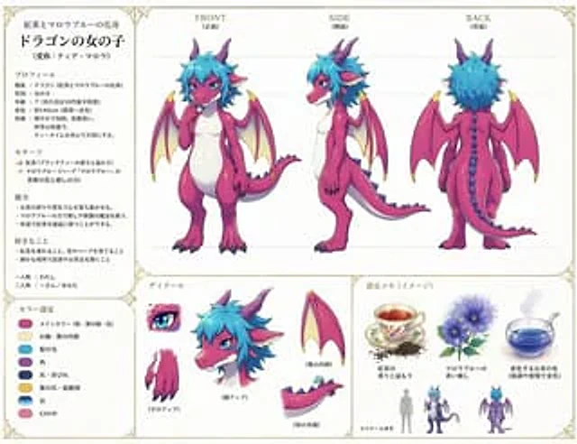

```text
{
  "type": "Fantasy Character Design Collection",
  "style": "The simple anime model illustration on a cream-colored paper background features a delicate gold decorative border, clean layout, soft shadows, and clear lines.",
  "subject": {
    "character": "Cute humanoid dragon girl",
    "title_text": "Dragon Girl",
    "subtitle_text": "The embodiment of black tea and mallow blue",
    "alias_text": "Nickname: Tia Marrow",
    "design": {
      "body_color": "Bright magenta skin, with a smooth white belly and chest.",
      "hair": "Messy short hair, bright turquoise",
      "face": "Large, anime-style eyes, a confident yet gentle expression, a small mouth, and visible white fangs.",
      "horns": "Two curved purple horns",
      "ears": "Two pointed elf ears, with lighter-colored inner ears.",
      "wings": "Two bat-shaped wings, pink outer wings, light cream-colored inner membrane, and yellow claw tips.",
      "tail": "Long dragon tail with blue back spines",
      "hands_feet": "Fingers and toes with claws, dark blue nails",
      "proportions": "Small, chibi to semi-chibi proportions, slightly curvy, adorable and charming."
    }
  },
  "layout": {
    "sections": [
      {
        "title": "Main three views",
        "position": "Top center and right side",
        "count": 3,
        "labels": [
          "Front",
          "Side view",
          "Back"
        ],
        "content": "Three side-by-side full-body views of the Dragon Girl"
      },
      {
        "title": "Personal profile panel",
        "position": "Left sidebar",
        "count": 5,
        "labels": [
          "Profile (个人资料)",
          "Motif (theme)",
          "Ability (Ability)",
          "Things I like",
          "First person/Second person"
        ],
        "content": "Japanese character design instructions in the style of a printed guidebook"
      },
      {
        "title": "Color scheme",
        "position": "bottom left corner",
        "count": 8,
        "labels": [
          "Primary colors (skin, wing edges, tail)",
          "Abdomen, inner wing",
          "hair",
          "horn",
          "Claws, back spines",
          "Wing claws, decorative parts",
          "Eye",
          "inside the oral cavity"
        ],
        "content": "8 oval color swatches with Japanese labels"
      },
      {
        "title": "Detailed display",
        "position": "Centered at the bottom",
        "count": 5,
        "labels": [
          "Eye",
          "Hand close-up",
          "Facial close-up",
          "inner wing",
          "Tail tip"
        ],
        "content": "Detailed study of the eyes, hands, head, wings, and tail"
      },
      {
        "title": "Set notes (imagery)",
        "position": "bottom right corner",
        "count": 5,
        "labels": [
          "The aroma and warmth of black tea",
          "The healing power of mallow blue",
          "The color of tea varies depending on physical condition and mood.",
          "※Proportion Reference",
          "Small character silhouettes"
        ],
        "content": "The visual imagery includes a teacup with tea leaves, a mallow flower, a steaming blue teacup, and a proportional reference diagram."
      }
    ],
    "centerpiece": "The front view shows the dragon girl standing, one finger lightly touching her mouth, her expression thoughtful, her wings slightly spread, and her tail curved to the side."
  },
  "text_blocks": {
    "language": "Japanese",
    "density": "Reference diagram for medium density",
    "appearance": "Print-style character encyclopedia format, with bold headings and smaller body text."
  },
  "composition_notes": "Front, side, and back views occupy the upper two-thirds of the space; notes and detailed studies fill the lower third; all content is separated by fine gold lines; ample white space creates the visual effect of an exquisite catalog.",
  "rendering": {
    "lighting": "Soft, neutral studio lighting",
    "materials": "Smooth biological skin texture, matte hair, slightly translucent wing membrane.",
    "quality": "High-resolution, exquisite concept art"
  }
}
```

Model: GPT Image 2
Author: GPT Image 2 Prompts

[ProjectD](https://aitoolsradar.com/en/prompts/bb1bb93ca444d2) · [Recorded source](https://x.com/redwine_caber/status/2047668296586293616#reversed-0)
 · [Full original metadata and byte evidence](data/projectd-batch-0020.json)

## Anime Elf Girl on Forest Path

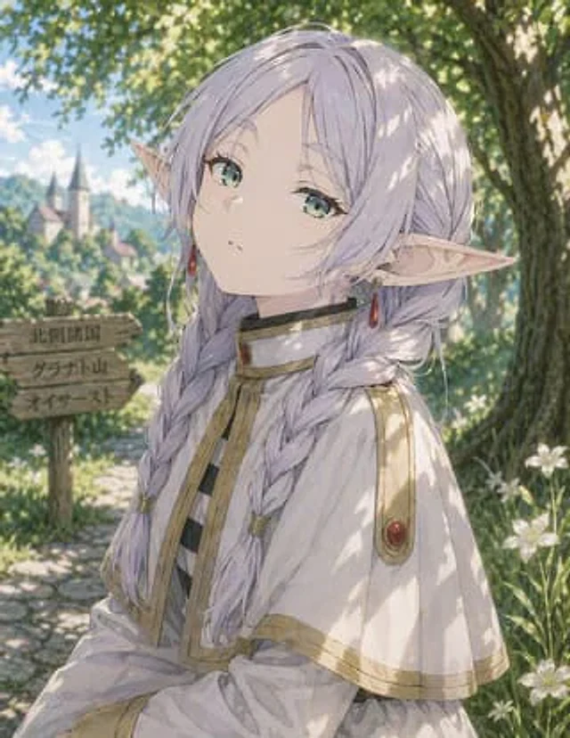

```text
A high-quality anime illustration, the main character is{argument name="character description" default="A anime elf girl with silver twin tails and green eyes."} She had fair skin, and red teardrop-shaped earrings adorned her pointed, elfin ears. Her expression was calm and natural, her head slightly tilted upwards. She wore {argument name="outfit" default="A white cape with gold trim and red gemstones, worn over a black and white striped shirt."} The scene is set outdoors during the day, with beautiful dappled sunlight filtering through the canopy of a large tree on her right, casting soft shadows on her face and clothing. She stands on a cobblestone path, lined with green grass and small white wildflowers. To her left is a rustic wooden signpost with three directional signs, each indicating {argument name="signpost text top" default="Northern countries"} ,{argument name="signpost text middle" default="Mount Granato"} and{argument name="signpost text bottom" default="オイサースト"} Against a blurred background, a picturesque fantasy town sits atop lush hills under a bright sky, with a castle in the distance.
```

Model: GPT Image 2
Author: GPT Image 2 Prompts

[ProjectD](https://aitoolsradar.com/en/prompts/8e93b28b16d85f) · [Recorded source](https://x.com/Tiger_hhhh/status/2045105119197589788#reversed-0)
 · [Full original metadata and byte evidence](data/projectd-batch-0020.json)

## Anime Elf Girl Relaxing in a Forest River


```text
An anime-style illustration, the main character is{argument name="character description" default="An elf girl with white twin tails and pointed ears"} She wore{argument name="eyewear" default="Dark sunglasses"} Wearing{argument name="outfit" default="A white cape with gold trim, a striped shirt, and a white skirt."} .she{argument name="pose" default="Sitting on a large, wet rock in the clear stream"} He leaned back, his expression relaxed. The scene is set in {argument name="environment" default="In a lush forest, with cascading waterfalls in the background."} The cinematic lighting effects, dappled sunlight, and delicate water texture further enhance the vivid anime style.
```

Model: GPT Image 2
Author: GPT Image 2 Prompts

[ProjectD](https://aitoolsradar.com/en/prompts/dcc557a138a2c1) · [Recorded source](https://x.com/1in3Mystery/status/2045294966646141291#reversed-0)
 · [Full original metadata and byte evidence](data/projectd-batch-0020.json)

## Anime Elf Maid in TikTok Live

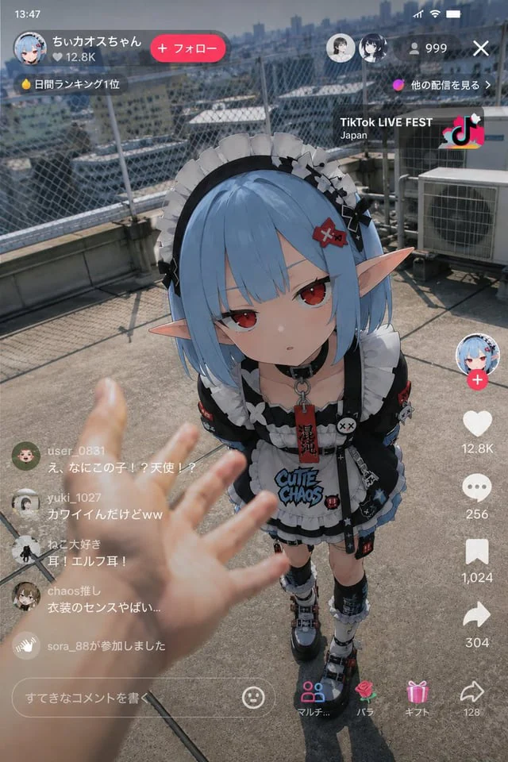

```text
Goal: Create a vertical smartphone screenshot of a TikTok-style live stream where an anime elf maid character has appeared in the real world on a sunny urban rooftop, as if viewed through a phone during a live broadcast.

Canvas: 9:16 portrait mobile screen, realistic phone UI overlay, 768×1152 style composition. The background is a photoreal rooftop with concrete floor, chain-link safety fence, air-conditioning units, hazy city skyline, and hard midday sunlight casting shadows.

Main scene: A first-person human hand reaches in from the lower left foreground toward the character, slightly motion-blurred and out of focus. Center frame shows a small full-body anime girl standing on the rooftop, looking upward toward the camera. She has {argument name="hair color" default="pale blue"} bob-cut hair, long pointed elf ears, and an elaborate black-and-white gothic lolita maid outfit. Her face is covered by a large opaque gray censor square, centered over the upper face and nose area. Keep the character rendered in a crisp anime illustration style while the rooftop, hand, and lighting remain photorealistic, emphasizing the surreal contrast of an anime character physically present in a real livestream.

Character details: Use {argument name="character name" default="ちいカオスちゃん"} as the streamer name in the UI. The character wears exactly 12 visible outfit/accessory groups: 1) black maid headband with white frills, 2) black bow and flower ornaments on the hair, 3) red hair clip, 4) black choker with metal ring, 5) black-and-white ruffled maid dress, 6) white apron with bold text reading “CUTIE CHAOS”, 7) red hanging tag with Japanese characters, 8) black sleeve cuffs with patches, 9) small cross and skull-like accessories, 10) layered black skirt with blue trim, 11) asymmetrical knee socks, and 12) chunky platform shoes with straps and red-blue accents.

TikTok live UI layout: Add a complete mobile livestream interface overlay. Top left shows the time “13:47”. Under it, a rounded streamer card with a circular anime avatar, the name “ちいカオスちゃん”, viewer count “12.8K”, and a pink rounded “+ フォロー” button. Below that, show a flame icon and “日間ランキング1位”. Top right shows Wi-Fi/battery icons, two small circular viewer avatars, a person icon with “999”, and an X close icon. Mid-right top shows “他の配信を見る >” and a promo tile reading “TikTok LIVE FEST” with “Japan” beneath it and a colorful TikTok logo.

Right-side action rail: Include exactly 7 stacked action elements from top to bottom: 1) circular profile avatar with a pink plus badge, 2) white heart icon with “12.8K”, 3) comment bubble with “256”, 4) bookmark icon with “1,024”, 5) share arrow with “304”, 6) bottom share-style arrow with “128”, and 7) a row of gift/navigation icons near the bottom labeled “マルチ...”, “バラ”, and “ギフト”.

Left-side live comments: Show exactly 5 visible comment/activity lines in translucent white text with small circular avatars: 1) “user_0831” saying “え、なにこの子！？天使！？”, 2) “yuki_1027” saying “カワイイんだけどww”, 3) “ねこ大好き” saying “耳！エルフ耳！”, 4) “chaos推し” saying “衣装のセンスやばい...”, and 5) “sora_88が参加しました”.

Bottom UI: Add a rounded comment input bar reading “すてきなコメントを書く” with a smiley icon. Keep the interface semi-transparent and realistic, as a captured social media livestream screen.

Visual style: Hybrid photorealistic live-action rooftop footage plus high-quality anime character compositing, cinematic sunlight, shallow depth of field on the foreground hand, crisp mobile UI, playful chaotic kawaii-goth aesthetic. Use {argument name="platform style" default="TikTok LIVE"} visual language.

Constraints: Preserve the Japanese UI text exactly where specified, use no extra comments beyond the 5 listed, keep the face hidden by the gray square, and avoid adding watermarks outside the TikTok-style interface.
```

Model: GPT Image 2
Author: テツメモ｜AI図解×検証｜Newsletter

[ProjectD](https://aitoolsradar.com/en/prompts/8ea7333f6c18c7) · [Recorded source](https://youmind.com/prompts/anime-elf-tiktok-live-22205)
 · [Full original metadata and byte evidence](data/projectd-batch-0020.json)

## Anime Ensemble Movie Poster

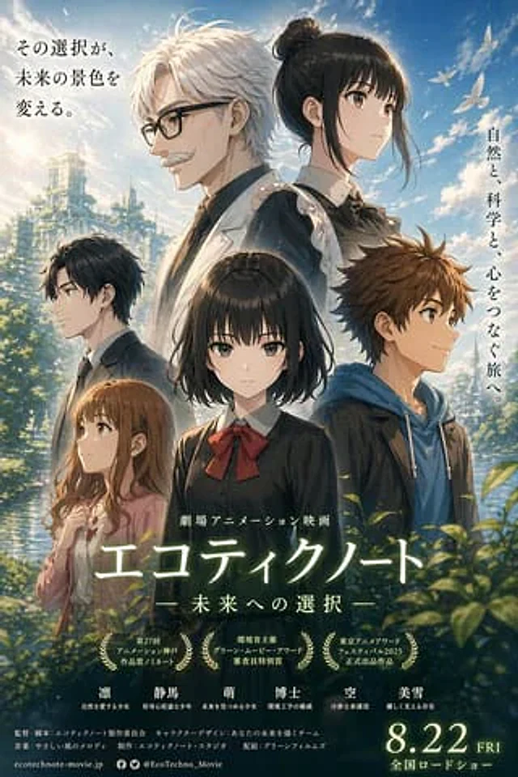

```text
A meticulously crafted poster for a Japanese animated feature film, presented vertically in a single sheet format, rendered with high-end cinematic detail and bright natural light. The composition features a dramatic group portrait of six teenagers against a backdrop of a bright blue sky, soft clouds, distant white birds, shimmering water, and lush vegetation in the foreground. The left side of the background depicts the ruins of a futuristic eco-city, partially covered by vegetation, seamlessly blending nature with advanced science. At the top center, two main characters stand back-to-back, serving as the visual focal point: on the left is a tall boy with messy short white hair, pale skin, a calm and serious expression, wearing a shirt, tie, and white lab coat, turned to the left; on the right is a tall girl with black hair neatly styled in a bun, pale skin, a composed expression, wearing a dark school uniform-style outfit with a white collar and ribbon, turned to the right. In the foreground below them stands a female student with a straight black bob, pale skin, wearing a black uniform with a large dark red bow, facing forward, her expression quiet and reserved. To the left center stands a dark-haired boy, wearing a dark suit and tie, turned to the left. To the right center stands a boy with messy brown hair, wearing a blue hoodie under a dark jacket, turned to the right. To the lower left stands a girl with long, soft light brown hair, wearing a light pink cardigan over a light-colored top, one hand on her chest, her expression gentle yet slightly anxious. The anatomy of each character is consistent and clearly defined, hair is rendered elegantly, clothing folds are delicate, and expressions are restrained yet emotional. Warm rim lighting and soft atmospheric glow, complemented by delicate lens flare and oil painting-like highlights, create an atmosphere full of hope and contemplation. Japanese typography design is incorporated into the poster: the vertical slogan in the upper left corner is "その选択が, the scenery of the future を変える.", and the vertical slogan in the upper right corner is "Natural と, Science と、心をつなぐ路へ", the small characters above the title are "Theatre アニメーション影视", and the large luminous main title is in the center below.{argument name="film title" default="エコテイクノート"} The subtitle is below the title.{argument name="subtitle text" default="— A choice for the future —"} Below the title are three award laurel wreaths displayed horizontally, containing a small Japanese film festival text. Above the cast and crew list at the bottom are six character name tags displayed horizontally. At the very bottom is a dense Japanese cast and crew list, with minimal social media and website information. The release date is prominently displayed in the lower right corner.{argument name="release date" default="8.22 FRI"} Below this is a smaller line of text: "National Roadshow". The overall style maintains the feel of a high-end contemporary animation key visual poster for an emotional ensemble film about science, nature, and growth.
```

Model: GPT Image 2
Author: GPT Image 2 Prompts

[ProjectD](https://aitoolsradar.com/en/prompts/9bf01af2003faf) · [Recorded source](https://x.com/null_decimal/status/2046856036439781435#reversed-0)
 · [Full original metadata and byte evidence](data/projectd-batch-0020.json)

## Anime Fantasy Castle at Night

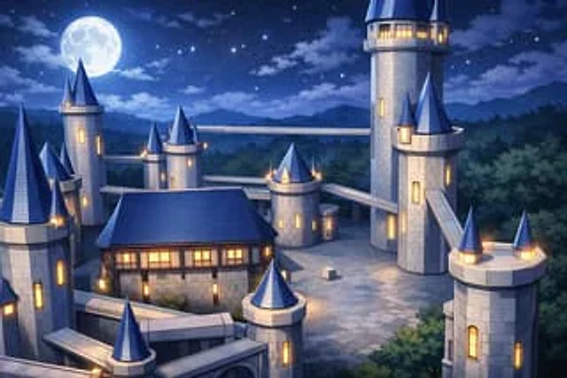

```text
A high-quality{argument name="art style" default="Anime background art"} Illustrations depicting{argument name="time of day" default="night"} A vast, fantastical castle complex. The deep blue sky is dotted with stars, with one hanging in the upper left.{argument name="celestial object" default="A giant full moon"} The main building is constructed of light gray stone walls and features eight prominent cylindrical towers, topped with {argument name="roof color" default="blue"} The main building has a conical roof and is rectangular, with a pitched roof in the same color scheme.{argument name="window light color" default="warm yellow"} The lights shone through the windows, creating a striking contrast with the cool tones of the nightscape. Elevated stone bridges connected the various towers. The central courtyard was paved with neat stone bricks, with a small white square mysteriously placed in the center. The castle nestled in a dense, deep green forest, the silhouette of distant mountain ranges gradually fading into the background.
```

Model: GPT Image 2
Author: GPT Image 2 Prompts

[ProjectD](https://aitoolsradar.com/en/prompts/c169fc27284eb7) · [Recorded source](https://x.com/yukimino_doga/status/2043658036204691717#reversed-0)
 · [Full original metadata and byte evidence](data/projectd-batch-0020.json)

## Anime Fantasy Cityscape Exhibition Poster

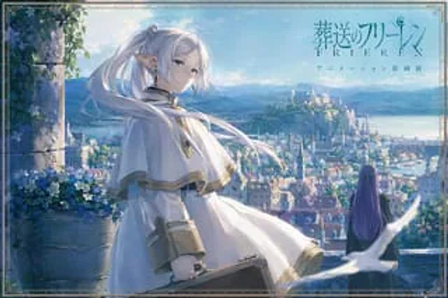

```text
A cinematic anime illustration, in which {argument name="main character" default="An elven girl with white pigtails and wearing a white and gold dress."} She stood on the stone balcony, carrying a brown briefcase. Beside her was a pillar with potted blue flowers on it. In the background {argument name="background character" default="A girl with long purple hair and wearing a black dress"} Looking out{argument name="setting" default="A vast, fantastical European city with castles and the sea."} A white bird flies by in the foreground. The upper right corner features elegant text that reads: "{argument name="main title text" default="Frieren: Beyond Journey&#39;s End"} “FRIEREN” and “{argument name="subtitle text" default="Animation Original Drawings Exhibition"} The entire artwork is surrounded by a delicate decorative border.
```

Model: GPT Image 2
Author: GPT Image 2 Prompts

[ProjectD](https://aitoolsradar.com/en/prompts/4261740199efd7) · [Recorded source](https://x.com/Gdthainakub/status/2044382053521936809#reversed-3)
 · [Full original metadata and byte evidence](data/projectd-batch-0020.json)

## Anime Fantasy Movie Poster

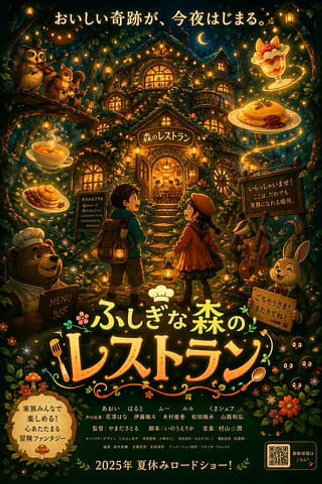

```text
{
  "type": "Anime-style animated movie poster",
  "scene": "At night, a glowing, multi-story treehouse restaurant in the dark magic forest is illuminated by string lights and warm window light.",
  "subjects": {
    "children": "At the Prospect Centre, there are two children facing the restaurant: a boy with a backpack and a lantern, and a girl wearing a red coat, a beret, and a lantern.",
    "animals": "Four anthropomorphic animals: a chef bear holding a menu in the lower left corner, an owl playing the violin and a squirrel playing the flute on a tree branch in the upper left corner, a badger playing the cello in the middle right corner, and a rabbit wearing a suit and holding a sign in the lower right corner.",
    "creatures": "Three small, black, soot-like creatures with glowing eyes (bottom right corner).",
    "floating_food": "Four types of glowing food that float in the air: soup, pancakes, omelet rice, and fruit parfait."
  },
  "layout": {
    "top_text": "{argument name=\"top catchphrase\" default=\"A delicious miracle begins tonight.\"}",
    "building_sign": "{argument name=\"restaurant name\" default=\"Forest Restaurant\"}",
    "left_board": "Today's recommendations: Forest Soup, Starry Sky Omelette Rice, Soft Pancakes, Happy Parfait... and more!",
    "right_board": "Welcome! This is a place where everyone can smile.",
    "main_title": {
      "text": "{argument name=\"movie title\" default=\"Wonderful Forest Restaurant\"}",
      "styling": "Large artistic font featuring chef's hat, fork, and spoon designs."
    },
    "rabbit_sign": "We're full! Welcome back anytime!",
    "bottom_left_badge": "{argument name=\"genre badge\" default=\"Enjoy it with the whole family! A heartwarming adventure fantasy movie.\"}",
    "bottom_center_credits": "A fictional cast and crew list (in Japanese).",
    "bottom_release_date": "{argument name=\"release date\" default=\"Released in the summer of 2025!\"}",
    "bottom_right": "QR code with the text \"Get the latest information!\""
  }
}
```

Model: GPT Image 2
Author: GPT Image 2 Prompts

[ProjectD](https://aitoolsradar.com/en/prompts/90b1d0a5e0c448) · [Recorded source](https://x.com/masapark95/status/2046169303905632417#reversed-2)
 · [Full original metadata and byte evidence](data/projectd-batch-0020.json)

## Anime Fantasy Travel Movie Poster


```text
A cinematic, anime-style poster for a fictional fantasy film, titled {argument name="headline text" default="EL VIAJE DE LA LUNA DE PLATA"} The image employs a vertical composition reminiscent of high-end movie posters. At the center is a half-length portrait of a young anime woman, facing forward with a calm and composed expression. She sports a short, silver bob with softly layered hair and side bangs, fair skin, a black choker, and geometric earrings. She wears a loose-fitting navy blue tracksuit jacket with double gold stripes on the cuffs, over which she wears a white tank top, and carries a dark backpack over one shoulder. Her expression is delicate and natural, stripped of exaggerated details, presenting a more realistic, painterly quality. Behind her, a seamless, magical composition blends various travel destinations: on the left, a brightly lit train platform at dusk, a train pulling in, and a shimmering city skyline in the distance; below, distant mountains and winding valleys; on the right, a sunset over the coast, the sun low on the sea, accompanied by cliffs, a crescent moon, and two seabirds soaring in the sky; in the lower right corner, a winding road winds through brightly lit hills, leading to a town shimmering with lights. Add a wooden road sign on the right with three signs that read "NUEVOS CAMINOS", "VIEJOS RECUERDOS", and "SIN LÍMITES". Add a slogan at the top center.{argument name="tagline" default="CADA DESTINO CAMBIA SU HISTORIA"} The text uses an elegant serif capital font. In the upper left corner, four gold award areas with laurel wreaths are placed: one line of five-pointed stars with the text "GANADORA DE MÚLTIPLES PREMIOS"; one award with "MEJOR PELÍCULA ANIMADA" and smaller festival text below; one award with "PREMIO DEL PÚBLICO" and smaller festival text below; and one award with "MEJOR BANDA SONORA ORIGINAL" and smaller Academy Award text below. At the bottom center, a large, glowing serif film title, in a gorgeous glow-in-the-dark typography, is placed overlaid on the character's torso. Below the title, a short quote is added.{argument name="quote" default="A veces, para encontrarte... tienes que perderte en el mundo."} At the very bottom, there is a list of the production company, cast, and release information.{argument name="release text" default="PRÓXIMAMENTE EN CINES"} (Use a large serif capital font) and add a tiny production company logo at the bottom edge. A rich twilight blue, golden sunset glow, soft magenta clouds, atmospheric mist, reflected highlights, and delicate cinematic lighting create an emotionally rich, adventurous, yet natural and uncluttered, exquisitely illustrated poster style.
```

Model: GPT Image 2
Author: GPT Image 2 Prompts

[ProjectD](https://aitoolsradar.com/en/prompts/3cb7f3eaa9e985) · [Recorded source](https://x.com/Design4p0/status/2047531978346398002#reversed-0)
 · [Full original metadata and byte evidence](data/projectd-batch-0020.json)

## Anime Fashion Magazine Cover

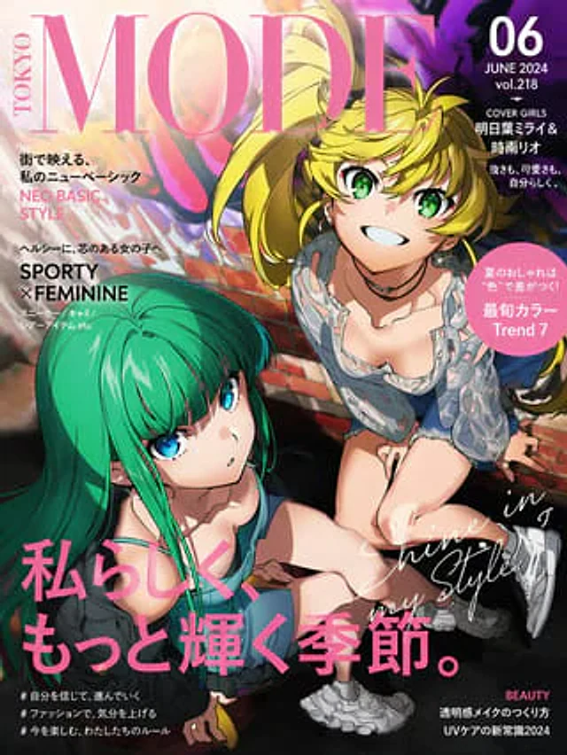

```text
A glossy, modern anime-style fashion magazine cover illustration, its design inspired by the editorial covers of Japanese women's street fashion magazines. The large masthead at the top uses an elegant serif font, displaying {argument name="magazine title" default="MODE"} The magazine is bright pink; the word "TOKYO" is vertically aligned in the upper left corner. The upper right corner displays the magazine issue number, "06," followed by "JUNE 2024" and "vol.218," and then the cover title "COVER GIRLS," followed by the girls' names in Japanese. The main image features two anime girls, shot from a dramatic overhead angle, as if the viewer is looking down from a city alley or stairwell. The background features brick and graffiti textures, strong sunlight, deep shadows, and a vibrant summer atmosphere. The girl on the right is the main character: a cheerful, sporty blonde with bright green eyes, tanned skin, a radiant smile, and messy pigtails or a high side ponytail, her hair flowing freely. She strikes a playful and energetic pose, tilting towards the camera. She wears a light blue lace or sheer ruffled tank top, denim shorts, a black choker, and platform white sneakers. The girl on the left has long, straight hair {argument name="second girl hair color" default="Emerald Green"} She has thick, straight bangs, bright blue eyes, fair skin, and a calm, composed expression. She sits in a lower position in the frame, looking upwards. She wears a casual summer outfit in soft blue-gray tones, an off-the-shoulder design, and platform sneakers. The composition incorporates layered Japanese magazine cover text: on the left are multiple lines of stacked black and pink headlines, including "NEO BASIC STYLE" and "SPORTY × FEMININE"; on the right is a pink circular badge with the white Japanese and English phrase "Trend 7"; the lower half features a striking large pink Japanese main title; near the lower right corner is white handwritten "shine in my style"; and the bottom edge has additional white and pink small-print cover summary. The composition employs sophisticated typography, overlapping fonts, saturated colors, sharp cel-shaded highlights, and a stylish summer look, presenting…{argument name="issue month" default="June 2024"} The quality of a high-end anime magazine cover.
```

Model: GPT Image 2
Author: GPT Image 2 Prompts

[ProjectD](https://aitoolsradar.com/en/prompts/e983524d57e7da) · [Recorded source](https://x.com/ktmnk_ikuu/status/2047478203548311643#reversed-0)
 · [Full original metadata and byte evidence](data/projectd-batch-0020.json)

## Anime Female Wrestler in Arena


```text
An anime illustration of a confident female wrestler standing in the ring. She keeps {argument name="hair color" default="gold"} Her hair was styled in a high ponytail, tied with a pink bow. She was wearing a {argument name="outfit color" default="pink"} She wore a bodysuit with white and gold accents, paired with matching fingerless gloves and knee-high lace-up boots. She posed with her hands on her hips under the bright stadium spotlights, with a blurred background of spectators. A stylized logo in the lower left corner read, "{argument name="logo text" default="Sunset Emilia"} The visual style features delicate shadows and glossy skin highlights.
```

Model: GPT Image 2
Author: GPT Image 2 Prompts

[ProjectD](https://aitoolsradar.com/en/prompts/206ed66b6e7f8e) · [Recorded source](https://x.com/PINE_CONE0225/status/2044726742976458767#reversed-0)
 · [Full original metadata and byte evidence](data/projectd-batch-0020.json)

## Anime Figure Promo Poster

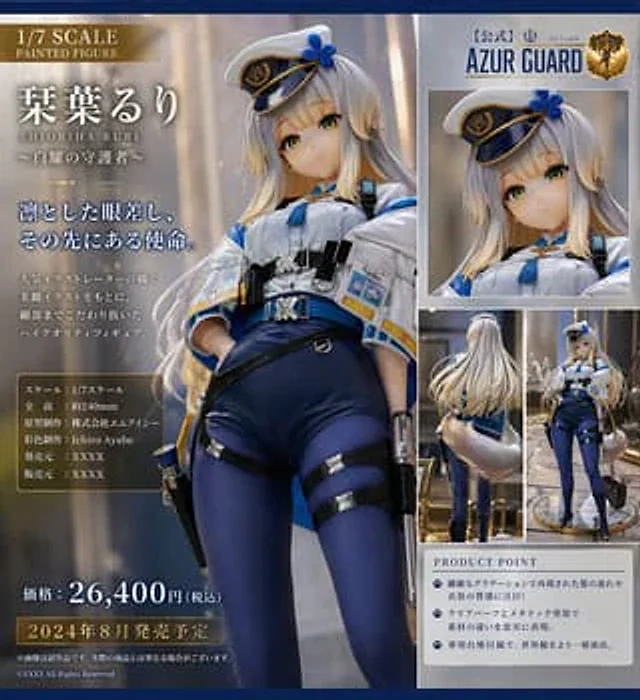

```text
{"type":"Anime Figure Promotional Poster","subject":{"franchise":"AZUR GUARD","character":{"name":"}}{argument name="character name" default="Leafy Glass"} ","romanization":"SHIORIHA RURI","theme subtitle":"〜白耀的守护者〜","design":"A stylized anime female figure presented as a high-quality 1/7 scale painted figure","appearance":{"hair color":"{argument name="hair color" default="Silver Gold"} ","hair style":"Extra long layered hairstyle with soft waves and side-swept bangs","hat":"White navy beret with navy brim, gold trim, anchor badge and bright blue flower decoration","face":"Face center blurred with rectangular mosaic","outfit pieces":["White short cape-style top with blue trim and gold details","Navy high-waisted shiny shorts or bodysuit","Semi-transparent dark blue tights","Black thigh straps","Blue belt with silver metal X-buckle","Multi-functional holster at the waist","Black gloves","Small shoulder loader on the right shoulder","Decorative patches/cards on both sleeves"],"extra features":["Large fluffy cream fox tail","Slender figure","Confident and upright posture"]}},"layout":{"aspect ratio":"Vertical poster","background":"Luxurious interior scene with warm blurred pillars and reflective surfaces","sections":[{"title":"1/7 SCALE PAINTED FIGURE","position":"Top Left","count":1,"labels":["1/7 Scale Painted Figure"]},{"title":"character title block","position":"Top Left","count":4,"labels":["Ye Ye Liu Li","SHIORIHA RURI","〜白耀的守护者〜","凛然目光，使命所处。 "]},{"title":"description text","position":"Center Left","count":1,"labels":["A high-quality figure with meticulous details, based on exquisite illustrations drawn by a popular illustrator."]} {"title":"specification box","position":"bottom left center","count":5,"labels":["Scale: 1/7","Height: Approx. 240 mm","Prototype Production: MIC Co., Ltd.","Coloring Production: Ichiro Ayabe","Publisher: XXXX / Distributor: XXXX"]},{"title":"price and release","position":"bottom left","count":2,"labels":["Price:{argument name="price" default="26,400 yen"} (including tax)","{argument name="release date" default="Expected to be released in August 2024."} {"title":"brand block","position":"top right","count":2,"labels":["【Official】AZUR GUARD","Gold Badge"]},{"title":"right image column","position":"right side","count":3,"labels":["Close-up portrait of the chest","Full-body view from the back","Full-body view from the front on the circular display base"]},{"title":"PRODUCT POINT","position":"bottom right","count":3,"labels":["Pay attention to the flowing hair and texture of the clothing presented with delicate gradients! ","Faithfully reproduces the differences in materials through transparent parts and metallic paint. ","Includes a dedicated base to further enhance the world view. "]}],"centerpiece":"A dominant low-angle full-body product photo of the figure, cropped from the hat to the thighs, emphasizing the glossy navy blue tights, the exquisitely sculpted clothing details, and the high-end collectible quality."},"style":{"overall look":"Advertisement for high-end Japanese hobby figures","rendering":"Realistic product photography of painted PVC scale figures","lighting":"Soft studio lighting with warm highlights and subtle reflections","color palette":"Navy blue, white, gold, silver, and cream","graphic design":"Simple, high-end magazine-style typography with white borders, serif Japanese title font, and dark blue outlines."}}
```

Model: GPT Image 2
Author: GPT Image 2 Prompts

[ProjectD](https://aitoolsradar.com/en/prompts/d616830b168a55) · [Recorded source](https://x.com/ktmnk_ikuu/status/2047478203548311643#reversed-1)
 · [Full original metadata and byte evidence](data/projectd-batch-0020.json)

## Anime Film CM Storyboard Sheet

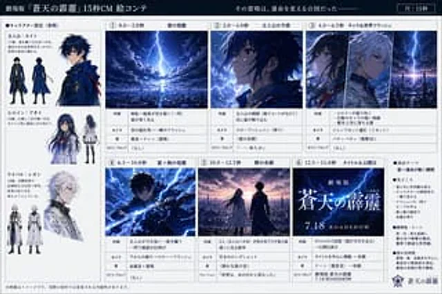

```text
{
  "type": "anime film storyboard sheet",
  "style": "polished cinematic anime key visual board, professional presentation layout, clean white grid with dark navy header, highly detailed fantasy lighting, dramatic storm atmosphere, glossy promotional design",
  "project": {
    "title": "Theatrical version{argument name=\"film title\" default=\"Thunderbolt from the Sky\"} 15-second storyboard",
    "tagline": "That clap of thunder was a signal that would change their destiny—",
    "duration_label": "Duration: 15 seconds"
  },
  "layout": {
    "format": "landscape storyboard page",
    "sections": [
      {
        "title": "Character design (for reference)",
        "position": "left column",
        "count": 3,
        "labels": [
          "Main character: Kate",
          "Female lead: Aoi",
          "Opponent: Lyon"
        ]
      },
      {
        "title": "① Lightning Awakening in 0.0~2.0 seconds",
        "position": "top row, panel 1",
        "count": 1,
        "labels": [
          "citywide lightning strike"
        ]
      },
      {
        "title": "② The protagonist's premonition lasts 2.0 to 4.0 seconds",
        "position": "top row, panel 2",
        "count": 1,
        "labels": [
          "close-up of protagonist turning toward the light"
        ]
      },
      {
        "title": "③ 4.0~6.5 seconds of character and world flashback",
        "position": "top row, panel 3",
        "count": 3,
        "labels": [
          "hero profile",
          "rival profile",
          "lightning over city skyline"
        ]
      },
      {
        "title": "④ Awakening of Lightning and Sword in 6.5~10.0 seconds",
        "position": "bottom row, panel 4",
        "count": 1,
        "labels": [
          "hero drawing a glowing sword"
        ]
      },
      {
        "title": "⑤ A tranquil afterglow lasting 10.0 to 12.5 seconds",
        "position": "bottom row, panel 5",
        "count": 1,
        "labels": [
          "two characters from behind overlooking the city"
        ]
      },
      {
        "title": "⑥ 12.5~15.0 seconds: Title and release date",
        "position": "bottom row, panel 6",
        "count": 1,
        "labels": [
          "title card with release date"
        ]
      },
      {
        "title": "Performance Theme",
        "position": "right sidebar",
        "count": 3,
        "labels": [
          "Highlights",
          "Use hue",
          "Sound direction"
        ]
      }
    ],
    "notes_rows_per_story_panel": 4
  },
  "characters": {
    "count": 3,
    "designs": [
      {
        "name": "{argument name=\"hero name\" default=\"Kate\"}",
        "role": "male protagonist, age 17",
        "appearance": "slim anime boy with messy dark navy hair and bright blue eyes, serious expression, long royal-blue coat with black inner layers, belts, gloves, fitted pants, tall boots, fantasy military accents",
        "reference_views": 3
      },
      {
        "name": "Aoi",
        "role": "heroine, age 16",
        "appearance": "slim anime girl with very long dark blue hair and blue eyes, white school-uniform-inspired coat dress, pleated skirt, red ribbon bow, dark stockings, calm melancholy expression",
        "reference_views": 2
      },
      {
        "name": "Lyon",
        "role": "rival, age 18",
        "appearance": "tall anime boy with tousled silver-white hair, pale skin, white long coat with gold trim and layered formal fantasy attire, composed aloof expression",
        "reference_views": 3
      }
    ]
  },
  "story_panels": [
    {
      "panel": 1,
      "time": "0.0~2.0 seconds",
      "title": "Lightning Awakening",
      "image": "vast nighttime fantasy city under heavy storm clouds, a colossal bolt of lightning descends from a swirling break in the clouds and hits the city center, blue-white light reflecting across rooftops, epic scale",
      "camera": "wide establishing shot",
      "effects": "single massive flash, cloud vortex, electric glow"
    },
    {
      "panel": 2,
      "time": "2.0~4.0 seconds",
      "title": "The protagonist's premonition",
      "image": "tight close-up of the protagonist in profile, face turned left toward off-screen lightning, blue rim light, wind-tossed hair, intense eyes, stormy sky behind him",
      "camera": "slow push-in close-up",
      "effects": "lingering thunder, subtle facial illumination"
    },
    {
      "panel": 3,
      "time": "4.0~6.5 seconds",
      "title": "Characters and World Flashbacks",
      "image": "three vertical cuts: the protagonist in dark blue, the silver-haired rival in white, and a lightning-struck city skyline at dusk-night transition, fast montage feeling, strong contrast between blue lightning and pale character palette",
      "camera": "three jump-cut inserts",
      "effects": "electrical crackle, rapid flashes"
    },
    {
      "panel": 4,
      "time": "6.5~10.0 seconds",
      "title": "Awakening of Thunder and Sword",
      "image": "dynamic action shot of the protagonist drawing or swinging a sword infused with blue lightning, body leaning forward, coat whipping in the wind, arcs of electricity exploding around him, almost full-frame white-blue flash",
      "camera": "low-angle dramatic shot with slow-motion feel",
      "effects": "metallic ring plus thunder impact"
    },
    {
      "panel": 5,
      "time": "10.0~12.5 seconds",
      "title": "Tranquil aftertaste",
      "image": "rear view of two figures, the heroine on the left in white and the hero on the right in blue, standing side by side above the city at sunset-purple dusk, gazing toward distant glowing lights, emotional pause after the storm",
      "camera": "pulled-back long shot",
      "effects": "quiet ambient tone, reflective mood"
    },
    {
      "panel": 6,
      "time": "12.5~15.0 seconds",
      "title": "Title and Release Date",
      "image": "full-screen title card with stormy blue sky and lightning background, luminous Japanese film title in large glowing serif characters, centered release date \"{argument name=\"release date\" default=\"7.18\"} ROADSHOW\", elegant fantasy logo at the bottom right",
      "camera": "static centered composition",
      "effects": "title glow, residual thunder, sword-like light streak"
    }
  ],
  "graphic_details": {
    "header_background": "deep navy",
    "grid": "thin gray lines separating cells",
    "body_background": "white presentation board",
    "text_style": "Japanese production board typography with small captions and labeled rows for content, camera, sound, dialogue/captions, or narration.",
    "sidebar": "bullet-point production notes in Japanese",
    "footer_note": "small disclaimer text along the bottom edge"
  },
  "quality": "high-resolution, crisp print-like layout, balanced margins, exact storyboard-sheet appearance"
}
```

Model: GPT Image 2
Author: GPT Image 2 Prompts

[ProjectD](https://aitoolsradar.com/en/prompts/6fa9abfeb04f80) · [Recorded source](https://x.com/Toshi_nyaruo_AI/status/2046570822366802131#reversed-0)
 · [Full original metadata and byte evidence](data/projectd-batch-0020.json)

## Anime Film Poster Generator

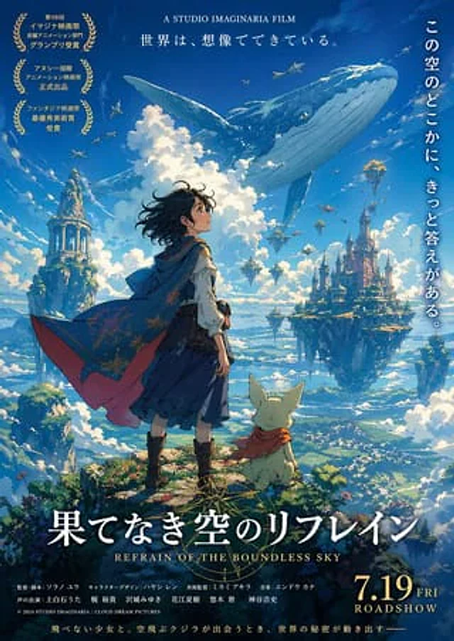

```text
Create an image using GPT image2{argument name="genre" default="imaginary"} Anime movie poster.
```

Model: GPT Image 2
Author: GPT Image 2 Prompts

[ProjectD](https://aitoolsradar.com/en/prompts/11ad7320d97944) · [Recorded source](https://x.com/seiiiiiiiiiiru/status/2046509734954741780)
 · [Full original metadata and byte evidence](data/projectd-batch-0020.json)

## Anime Film Poster Generator

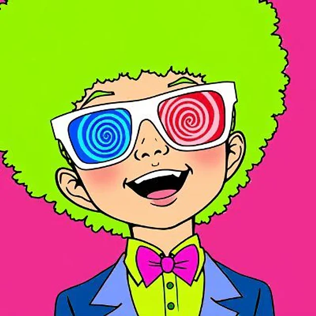

```text
{argument name="ジャンル" default="架空"}のアニメ映画のポスターをGPT image2で作成。
```

Model: GPT Image 2
Author: SEIIIRU😈動画生成AIを使う映像クリエイター

[ProjectD](https://aitoolsradar.com/en/prompts/b7127d284460ce) · [Recorded source](https://youmind.com/prompts/anime-film-poster-generator-14353)
 · [Full original metadata and byte evidence](data/projectd-batch-0020.json)

## Anime Food: Tonkotsu Broth


```text
An anime-style medium shot: A large pot of tonkotsu broth simmers on a stove. The broth is rich, creamy, and golden-white. A ladle scoops up the thick soup, showcasing its silky texture. Dense steam rises dramatically. Warm, deep color palette, slightly blurred kitchen environment in the background, 16:9 aspect ratio. Anime-style medium shot: A chef uses chopsticks to place sliced ​​chashu pork into a ramen bowl. The bowl is filled with golden broth and noodles. A soft-boiled egg and seaweed are being arranged. The chef's focused expression is subtly visible. Warm golden top lighting, shallow depth of field around the bowl, 16:9 aspect ratio. Anime-style dramatic shot: Golden tonkotsu broth is poured from a ladle into a ramen bowl already set with noodles. The broth flows down in a smooth arc, creating slight ripples as it enters the bowl. Steam rises upwards upon contact. Low angle, warm backlighting, 16:9 aspect ratio. An epic, anime-style close-up shot of a perfect bowl of tonkotsu ramen, filmed from a low angle, with dramatic golden backlighting creating a halo effect. Garnished with char siu, a soft-boiled egg, scallions, seaweed, sesame seeds, and chili oil. Steam rises in an artistic vortex. Featuring the shimmering and halo effects of anime food presentation, 16:9 aspect ratio.
```

Model: GPT Image 2
Author: GPT Image 2 Prompts

[ProjectD](https://aitoolsradar.com/en/prompts/42f5e16285cca2) · [Recorded source](https://x.com/Kollab_AI/status/2047649235886362670)
 · [Full original metadata and byte evidence](data/projectd-batch-0020.json)

## Anime Fox Girl Reaching for a Hug

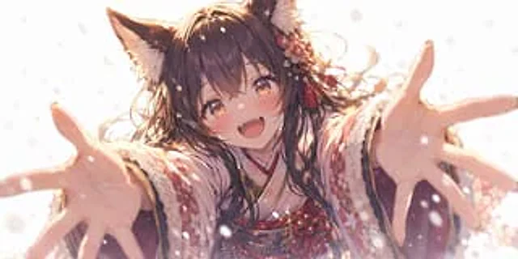

```text
An anime-style illustration featuring a cute girl who has {argument name="animal ears" default="fluffy dark brown fox ears"} She had a long, flowing hairstyle.{argument name="hair color" default="Dark brown"} Long hair. She was wearing an exquisite dress.{argument name="clothing" default="A red and white floral kimono with plush trim."} She wore a floral hair accessory with red tassels. Her face was {argument name="expression" default="A bright, happy smile, tinged with a hint of shyness."} She has warm, amber eyes and extends her arms forward to the audience in a welcoming embrace. The image uses strong perspective to emphasize her outstretched hands, which are slightly out of focus. The scene is set in {argument name="environment" default="Against a backdrop of heavy snowfall, the background is bright and white."} Under the soft, warm, and ethereal light.
```

Model: GPT Image 2
Author: GPT Image 2 Prompts

[ProjectD](https://aitoolsradar.com/en/prompts/01a39843475f9b) · [Recorded source](https://x.com/mitsuhiro_v01/status/2044938434331189362#reversed-1)
 · [Full original metadata and byte evidence](data/projectd-batch-0020.json)

## Anime Game Character Promo Poster

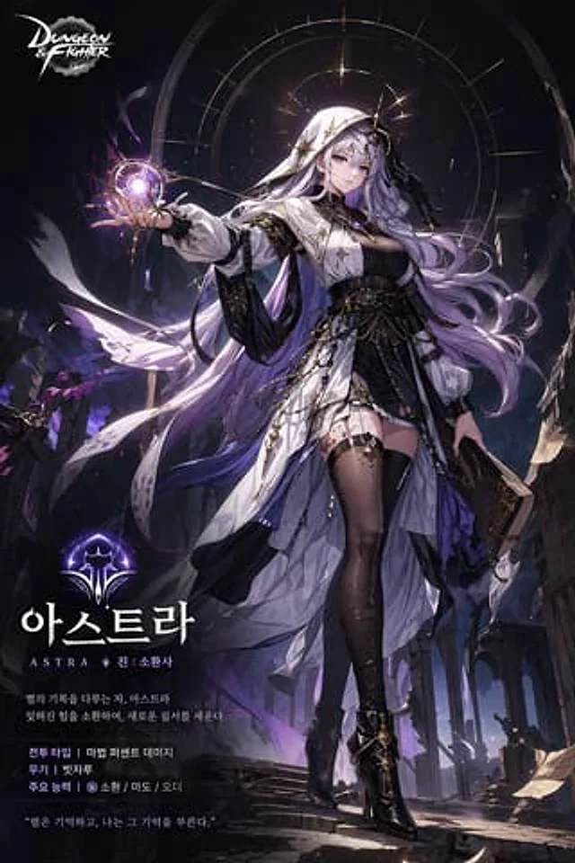

```text
{
  "type": "Game character promotional poster",
  "character": {
    "appearance": "Anime-style female mage{argument name=\"hair color\" default=\"Long and flowing silver-purple\"} Hair, purple eyes, a black dress with a white hooded cape adorned with gold stars, black sheer knee-high stockings, and black high heels.",
    "pose": "Standing, holding a glowing purple magic star disk in his right hand and a dark magic book in his left.",
    "background": "A dark, Gothic ruined temple, stone pillars, floating parchment, and a luminous star-shaped ring behind the head."
  },
  "layout": {
    "top_left": "Dungeon &amp; Fighter logo",
    "bottom_left_text_block": {
      "icon": "Glowing purple magic emblem",
      "main_title": "{argument name=\"character name\" default=\"Astra\"}",
      "subtitle": "{argument name=\"class name\" default=\"ASTRA True: Summoner\"}",
      "lore_description": "{argument name=\"lore text\" default=\"Astra, the one who wields the records of the stars, summons forgotten powers to establish a new order.\"}",
      "stats_block": {
        "count": 3,
        "lines": [
          "Combat Type | Magic Percentage Damage",
          "Weapon | Broom",
          "Main Abilities | Summoning/Magic/Commands"
        ]
      },
      "quote": "{argument name=\"character quote\" default=\"The stars remember everything, and I am responsible for awakening those memories.\"}"
    }
  }
}
```

Model: GPT Image 2
Author: GPT Image 2 Prompts

[ProjectD](https://aitoolsradar.com/en/prompts/f2ebb3a002f7d9) · [Recorded source](https://x.com/sungchi/status/2044400278099906921#reversed-1)
 · [Full original metadata and byte evidence](data/projectd-batch-0020.json)

## Anime Gender Swap Before After Poster

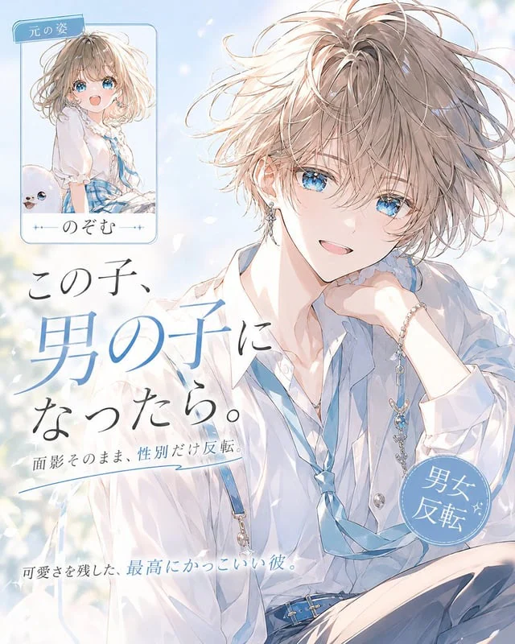

```text
Goal: Create a polished anime magazine-cover style “gender swap before/after” poster. The main subject is the transformed After character: an extremely handsome teenage boy who preserves the soft facial resemblance of the original character, with {argument name="hair color" default="light ash-blonde"} tousled medium-short hair, sparkling blue eyes, pale luminous skin, a gentle open smile, and an elegant androgynous beauty. He wears a loose white shirt with rolled sleeves, a pale blue loosened necktie, blue suspenders, slim earrings, a delicate bracelet, and a blue belt with silver details. Pose him seated in a relaxed three-quarter view, leaning slightly forward with one hand near his cheek, looking directly at the viewer. Use airy spring lighting, soft bokeh flowers, floating white petals, translucent watercolor highlights, and crisp high-detail anime linework.

Canvas: Vertical 4:5 poster, light pastel blue and white palette, bright dreamy background, plenty of negative space on the left for typography, main After portrait large and dominant on the right and center.

Layout: Include exactly 1 small Before card in the upper-left corner and 1 large After portrait occupying most of the canvas. The Before card should have rounded corners, a thin blue border, and show a cute original girl with the same visual identity: ash-blonde wavy bob hair, blue eyes, white blouse, blue plaid skirt or blue ribbon accents, cheerful expression. Add a small top ribbon label on the card reading {argument name="before label" default="元の姿"} and a name under the mini portrait reading {argument name="character name" default="のぞむ"}. Add exactly 1 circular blue stamp near the lower-right of the poster reading {argument name="stamp text" default="男女\n反転"} with tiny sparkle marks.

Text content: Large elegant Japanese headline on the left, set in a mix of black and soft blue calligraphic serif type: {argument name="headline text" default="この子、\n男の子に\nなったら。"}. Under it, smaller Japanese subcopy: "面影そのまま、性別だけ反転。" Near the bottom, add a small caption: "可愛さを残した、最高にかっこいい彼。" Use refined magazine typography, with the key words in blue and the rest in dark ink.

Visual style: High-end shoujo anime illustration, glossy magazine cover composition, ethereal watercolor lighting, detailed hair strands, delicate jewelry, soft skin shading, blue-white color harmony, romantic and clean design. Keep all Japanese text legible and integrated into the layout. Avoid photorealism, clutter, extra characters, watermarks, or random additional text.
```

Model: GPT Image 2
Author: のぞむ＊AIイラスト

[ProjectD](https://aitoolsradar.com/en/prompts/828356ef7a88d3) · [Recorded source](https://youmind.com/prompts/anime-gender-swap-poster-30682)
 · [Full original metadata and byte evidence](data/projectd-batch-0020.json)

## Anime Girl Breaking Out of Monitor

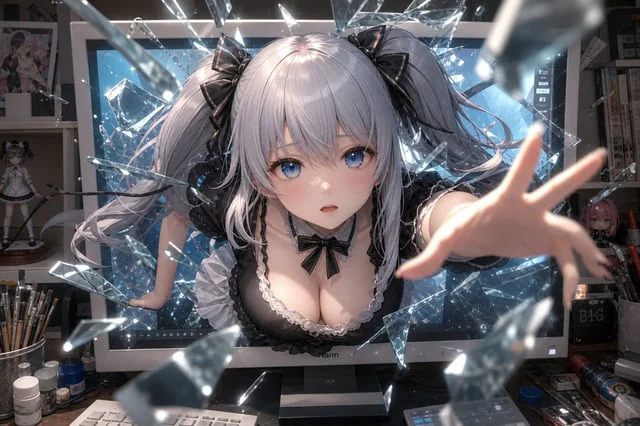

```text
Create a dramatic high-detail anime-style wallpaper of an {argument name="character type" default="adult silver-haired twin-tail anime girl"} bursting forward out of a large desktop monitor in an artist’s studio, as if breaking the screen into many sharp floating glass shards. The character has long pale silver hair in voluminous twin ponytails tied with glossy black ribbon bows, black frilly gothic-lolita maid-inspired clothing with white lace trim and a small black bow at the chest, and one arm reaching directly toward the viewer with strong foreshortening while the other hand braces against the monitor frame. Place a flat opaque {argument name="face censor color" default="muted gray-pink"} square over the face, centered and covering the facial features. The background is a cluttered digital art workspace: a large monitor glowing icy blue behind her, shelves with anime figures and posters, paintbrushes in cups, small bottles, pens, cables, and desk tools scattered around. Use cinematic lighting with bright blue screen glow, sparkling reflections on transparent glass fragments, shallow depth of field, motion blur on the closest shards and reaching hand, ultra-detailed hair strands, glossy fabric, realistic studio clutter, dynamic perspective, and a 16:9 desktop wallpaper composition at 1152×768 resolution. Overall mood: surreal, energetic, immersive, as though the anime character is escaping from the digital screen into the real world.
```

Model: GPT Image 2
Author: Edimakor Deutsch

[ProjectD](https://aitoolsradar.com/en/prompts/2f1b51aff49ade) · [Recorded source](https://youmind.com/prompts/anime-monitor-wallpaper-18955)
 · [Full original metadata and byte evidence](data/projectd-batch-0020.json)

## Anime Girl by the Sea with Letter

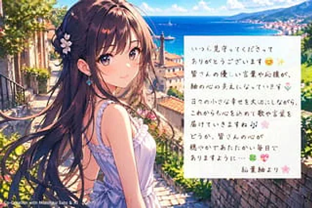

```text
A bright, anime-style illustration depicts a young woman standing on sun-drenched stone steps in a Mediterranean seaside town, shot from a half-body to three-quarter-body perspective. She has very long, flowing, deep brown hair, strands of which flutter in the wind, adorned with a delicate white flower hair clip on one side. Her face is mostly obscured by her hair and the angle, creating a gentle, dreamy, and mysterious atmosphere. She wears an elegant sleeveless dress.{argument name="dress color" default="Pale lavender white"} The dress features thin straps, lace trim, a fitted waist, and a large bow at the back. The background showcases a narrow stone-paved street lined with ancient buildings and greenery, a deep blue bay, a distant mountain coastline, a lighthouse-like tower, and several small white boats on the sea under a clear sky and soft clouds. The warm midday sun, the shimmering atmosphere, the romantic postcard-like vacation feel, the high-detail anime-style artwork, the soft painterly texture, the vibrant blue ocean, the lush green vegetation, and the elegant female character design all contribute to the overall effect. On the right, a large white sheet of paper serves as a clear overlay, with neat handwritten Japanese in dark ink, including friendly emoticons and flowers—perhaps a heartfelt fan message or thank-you note. The content of the letter should be: "いつも见愿ってくださってありがとうございます😊✨ All of the best日々の小さなLuckyせを大刀にしながら、これからも心を込めて歌や言葉を级けていきますね♪♪🌸 どうか、合さんの心が穏やかであたたかい毎日でありますように…🍀💖 紬紬より🌸”. Letters should be legible, balanced with the characters, and have a clean white background with a slight paper texture. Add a subtle line of signature text in the lower left corner:{argument name="credit text" default="Co-Creation with Motohiko Sato & AI"} .
```

Model: GPT Image 2
Author: GPT Image 2 Prompts

[ProjectD](https://aitoolsradar.com/en/prompts/d930b58bdde8a2) · [Recorded source](https://x.com/wish_society/status/2046983451778359804#reversed-0)
 · [Full original metadata and byte evidence](data/projectd-batch-0020.json)

## Anime Girl in Space Elevator

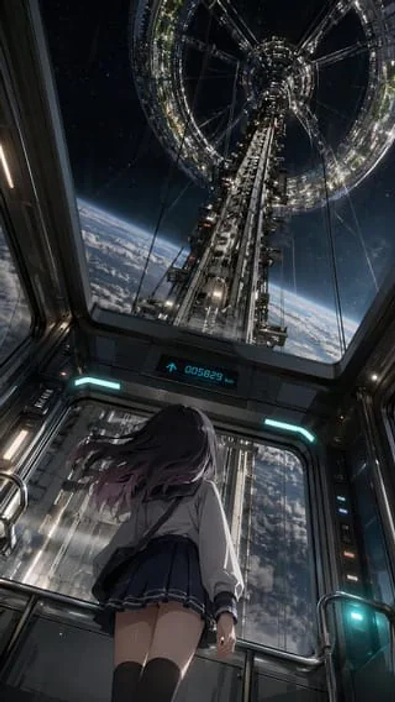

```text
A high-angle, anime-style illustration depicting a person with {argument name="hair color" default="Long black hair with purple ends"} The young girl stood inside a futuristic glass elevator, gazing up at the magnificent space elevator structure. She wore {argument name="outfit" default="Sailor uniform with pleated skirt and over-the-knee socks"} The elevator car features metal handrails, cyan illuminated decorations, and an upward arrow displaying "..."{argument name="altitude text" default="005829 km"} A digital display screen bearing the words "...". Through the enormous glass ceiling and windows, one can see a massive and intricately detailed space station against a backdrop of starry skies. At the center of the space station are pillars and a large circular structure, below which {argument name="planet" default="Earth"} The curves and clouds create a dramatic interplay of light and shadow, highlighting the grand scale and atmospheric perspective of the space architecture.
```

Model: GPT Image 2
Author: GPT Image 2 Prompts

[ProjectD](https://aitoolsradar.com/en/prompts/413fe8004fb405) · [Recorded source](https://x.com/lakeside529/status/2044646857218129995#reversed-0)
 · [Full original metadata and byte evidence](data/projectd-batch-0020.json)

## Anime Girl Leaning on Vending Machine

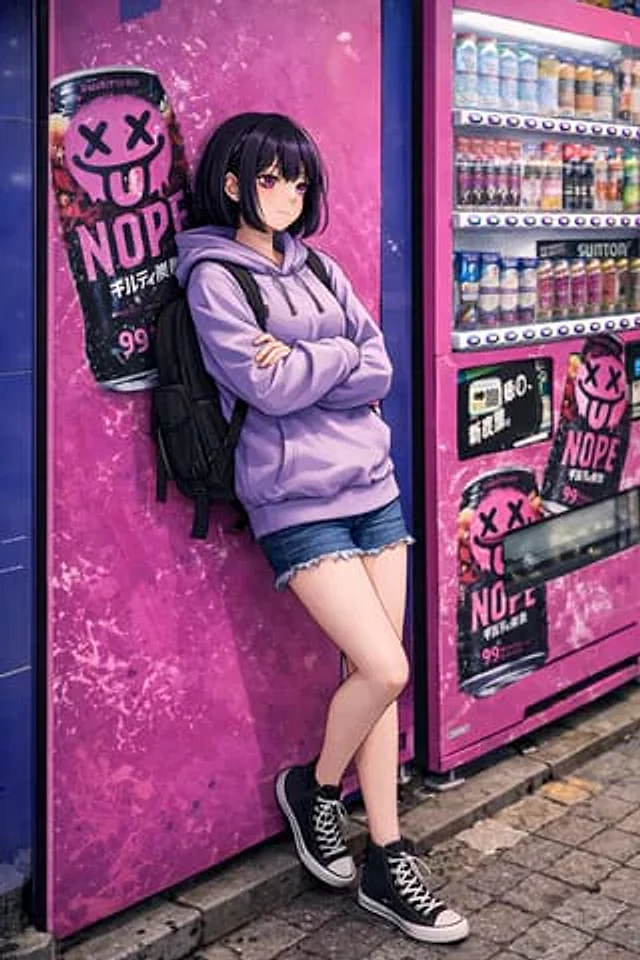

```text
An anime-style illustration depicting a person with {argument name="hair style" default="Black short hair with bangs"} A young woman with violet eyes was leisurely leaning against a car on a cobblestone city street.{argument name="machine color" default="Bright pink"} On the vending machine. She was wearing an oversized top.{argument name="hoodie color" default="Light purple"} She wore a hoodie, distressed denim shorts, black high-top sneakers, and carried a black backpack. She stood with her arms crossed and ankles crossed, calmly looking to the side. A large, eye-catching advertisement for an energy drink was printed on the side of the vending machine: a black can with a pink, graffiti-style smiley face on it, the face's eyes forming "X" shapes and its tongue sticking out, accompanied by the striking text "..."{argument name="can text" default="NOPE"} The vending machine displays rows of various bottled beverages on its front, and a second identical black and pink can pattern can be seen on the panel below. The scene is brightly lit, with rich shadow details and vibrant colors.
```

Model: GPT Image 2
Author: GPT Image 2 Prompts

[ProjectD](https://aitoolsradar.com/en/prompts/b7328cbda1ec9c) · [Recorded source](https://x.com/Samo_Toshu/status/2045029905164030264#reversed-3)
 · [Full original metadata and byte evidence](data/projectd-batch-0020.json)

## Anime Girl Reaching Through Flowers

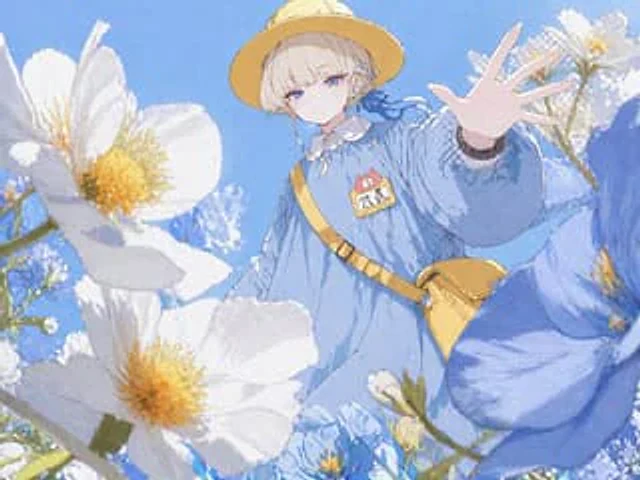

```text
A dreamlike, anime-style low-angle illustration depicts a young female student standing amidst flowers against a bright, clear blue sky. The perspective is near the ground, as if the camera is positioned within the blossoms, looking up at her. She has a light blonde bob with soft bangs, bright blue eyes, fair skin, and a calm yet slightly serious expression. She wears a round, yellow sun hat with a blue ribbon tied at the back, and an oversized light blue cardigan-style dress with a white collar and a badge pinned to her chest.{argument name="name tag text" default="Wu Hua"} She wears designer brands and carries a mustard-yellow crossbody bag. One of her hands is outstretched towards the viewer, palm open, creating a strong close-up perspective. The image should include six striking flowers: two large white cosmos flowers in the left foreground, one large blue flower in the right foreground, one white flower in the upper right background, and two smaller blue flowers near the bottom center. Use soft watercolor textures, delicate lines, light lighting, soft depth of field, and bright, soft colors, primarily sky blue, white, and yellow. The overall atmosphere should be innocent, nostalgic, fresh, and slightly magical, like a combination of children's picture book illustrations and high-end animation artwork.
```

Model: GPT Image 2
Author: GPT Image 2 Prompts

[ProjectD](https://aitoolsradar.com/en/prompts/b2daa84f392c5b) · [Recorded source](https://x.com/PTick91476/status/2047075167109788156#reversed-0)
 · [Full original metadata and byte evidence](data/projectd-batch-0020.json)

## Anime Girl Smug Peace Sign Portrait

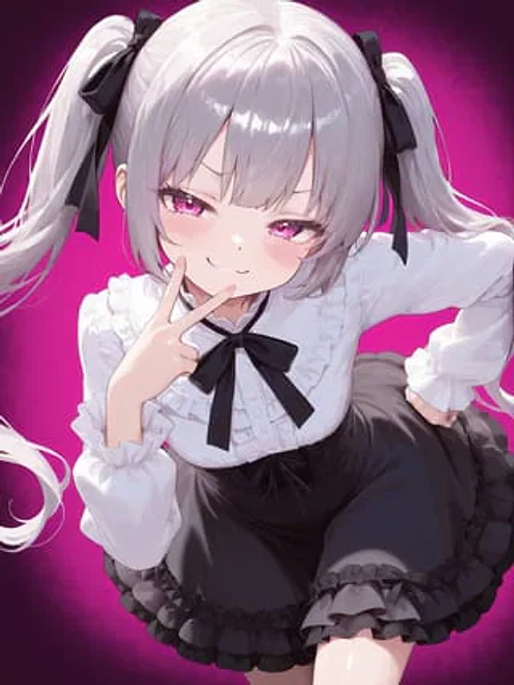

```text
An anime-style illustration of a girl, possessing{argument name="hair color" default="silver"} Her long hair was styled in pigtails and tied up with a black ribbon, with {argument name="eye color" default="pink"} Her eyes. She was wearing{argument name="expression" default="A playful smile with a slight blush"} She looked directly at the audience. Her posture was lively, her body slightly leaning forward, one hand making a peace sign next to her cheek, the other hand on her hip. She wore a white long-sleeved shirt with ruffles at the collar and cuffs, tied with a black ribbon at the collar, and a black high-waisted skirt with ruffles and a belted waist. The background was solid color.{argument name="background color" default="Bright pink"} It features subtle vignetting effects. The art style is high-quality, richly detailed anime illustration, with soft lighting and a glossy sheen to the hair.
```

Model: GPT Image 2
Author: GPT Image 2 Prompts

[ProjectD](https://aitoolsradar.com/en/prompts/18c435fce2e0a1) · [Recorded source](https://x.com/ai_studioapollo/status/2044652864283533492#reversed-0)
 · [Full original metadata and byte evidence](data/projectd-batch-0020.json)

## Anime Girl Squatting in Oversized Hoodie

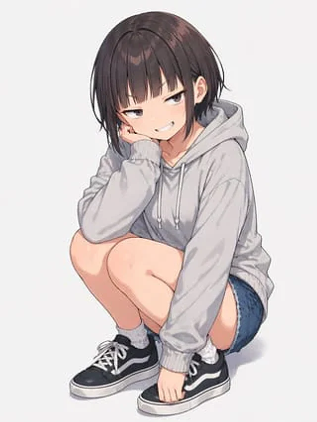

```text
A simple, anime-style full-body illustration depicts a young woman crouching in the center of a light gray background, with soft studio shadows beneath her feet. She has {argument name="hair color" default="Dark brown"} Her short bob haircut featured neat, straight bangs, slightly messy ends, and a few stray strands of hair near her cheeks. Her expression was {argument name="expression" default="His half-open spiral eyes held a hint of irritation."} She appears tired, melancholic, and slightly annoyed. She wears four visible items: an oversized light gray hoodie with drawstring and ribbed cuffs, dark blue frayed denim shorts, white slouch socks, and black low-top skate shoes with white side stripes, white laces, and white soles. Her pose is a tight squat, knees raised, one elbow resting on her knee, one hand partially covering her lower face or cheek, and the other hanging down near her shoes. The art style is a refined modern comic/anime key visual, with clean, flowing lines, smooth cel rendering, delicate fabric folds, natural skin highlights on the legs, and a slightly oversized hoodie. It emphasizes a casual, melancholic, and introverted atmosphere, with a minimalist composition, presenting a high-quality character-focused illustration.
```

Model: GPT Image 2
Author: GPT Image 2 Prompts

[ProjectD](https://aitoolsradar.com/en/prompts/9dc9deb8a7c723) · [Recorded source](https://x.com/tmichiaki/status/2046759075065831527#reversed-0)
 · [Full original metadata and byte evidence](data/projectd-batch-0020.json)

## Anime Girl Stained Glass Chapel

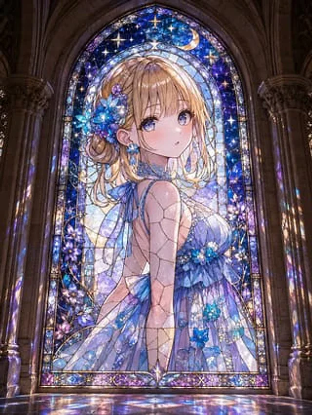

```text
Create a vertical anime-style stained-glass chapel window featuring {argument name="character name" default="an original young girl"} as the central sacred-window portrait. The scene is inside a grand Gothic cathedral with tall stone columns, pointed arches, carved capitals, and a polished stone floor reflecting colored light. The central window is a huge arched stained-glass panel filling most of the frame, bordered by ornate leading and jewel-like glass trim. Depict the character in a graceful half-body side profile, looking softly toward the viewer, with the face and eyes kept cute and delicate; use {argument name="hair color" default="warm blonde"} hair styled in loose wavy strands and a side bun decorated with blue and purple glass flowers. Dress her in a translucent layered {argument name="dress color" default="blue and lavender"} fantasy gown with ribbons, floral ornaments, ruffles, and shimmering glass-petal details. Reconstruct the entire character, hair, outfit, skin, flowers, and background from visible stained-glass pieces with thin dark lead lines, faceted translucent glass textures, cracks, sparkles, and luminous highlights. Include exactly 3 prominent blue flower decorations on the outfit and hair, plus smaller purple and white blossoms woven through the border. Behind her, create a deep blue night-sky stained-glass halo with many stars, a crescent moon near the upper right, circular celestial motifs, and pale icy-blue glass around her head. Add colored reflections from the stained glass falling across the chapel walls, columns, and floor, especially blue, violet, pink, and gold patches. Use a reverent, magical, highly detailed illustration style blending anime beauty with realistic cathedral architecture, radiant backlighting, intricate glass mosaic craftsmanship, and a sacred, precious atmosphere. No text, no watermark, no extra characters.
```

Model: GPT Image 2
Author: のぞむ＊AIイラスト

[ProjectD](https://aitoolsradar.com/en/prompts/5aac6cd09eef1e) · [Recorded source](https://youmind.com/prompts/anime-stained-glass-chapel-24843)
 · [Full original metadata and byte evidence](data/projectd-batch-0020.json)

## Anime Girl Through a Peephole

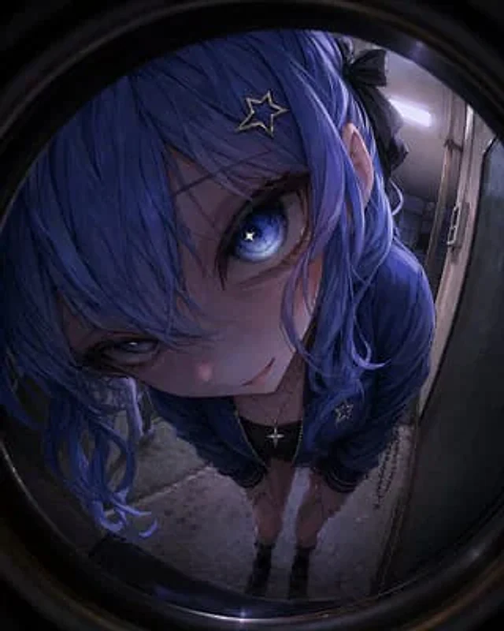

```text
An ultra-refined, anime-style fisheye peephole portrait depicts a young woman peering extremely close to the camera in a dimly lit, narrow apartment hallway at night. The entire image is framed by the dark, rounded edge of the peephole, creating a strong barrel distortion and an intimate yet slightly unsettling perspective. She leans forward, hands resting on her knees, her face tilted upwards, occupying most of the frame, revealing a large eye and a sly, enigmatic half-smile. Her hair color is {argument name="hair color" default="Vibrant cobalt blue"} Her long hair was slightly disheveled, with layered bangs partially obscuring her face, tied with a black ribbon bow at the back of her head. She wore two striking star accessories: a metal star hair clip near her bangs and a small star brooch on her blue jacket. Her exposed eyes were bright blue, with star-shaped highlights in the iris, rendered with a glossy and detailed effect; her other eye was half-closed, mostly hidden in shadow and hair. She wore a dark top under a shiny blue bomber jacket, and a delicate necklace with a small cross or star pendant, with a chain accessory hanging from the side. Her legs were bare, clad in dark ankle boots. The background was a narrow, dilapidated corridor with a concrete floor, worn walls, and fluorescent lights on the ceiling. A door frame and a small utility box or walkie-talkie hanging on the wall were visible in the background. The cinematic ambient lighting with cool blue-purple tones, deep shadows, and subtle mirror highlights created a slightly eerie yet beautiful atmosphere. Highly detailed digital illustrations, ultra-detailed eyes, soft skin shadows, sharp fabric folds, reflective surfaces, dramatic perspectives, centered composition, and vertical portrait format.
```

Model: GPT Image 2
Author: GPT Image 2 Prompts

[ProjectD](https://aitoolsradar.com/en/prompts/d3d9d9132bb43d) · [Recorded source](https://x.com/hoshi122221/status/2046961083219656747#reversed-0)
 · [Full original metadata and byte evidence](data/projectd-batch-0020.json)

## Anime Girl Under Umbrella in Rain

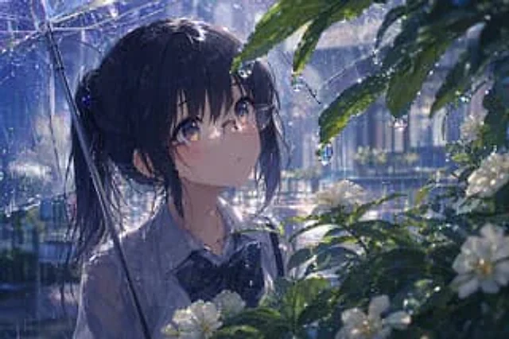

```text
A bright, anime-style close-up portrait depicts a girl standing outdoors in the rain, half-length, holding a transparent plastic umbrella. She has {argument name="hair color" default="Dark blue-black"} Her hair was tied in a low side ponytail with soft wisps and straight bangs. She wore delicate round-framed glasses and had bright, large, purplish-blue eyes. Her expression was calm, with a hint of amazement, as she gazed up at the leaves and raindrops. She wore a soaked white short-sleeved school uniform shirt with a dark blue plaid bow at the collar. The scene was filled with realistic water and light: fine rain fell, raindrops clung to the umbrella ribs, water droplets clung to her hair and shirt, and crystal-clear water droplets hung from the large green leaves in the upper right foreground. In the lower right and foreground, blooming white garden flowers dotted the scene, their dark, glossy leaves covered in raindrops. The use of cool blue and silver tones, complemented by soft pale purple highlights, and a background of diffused sunlight after or during the rain, created a strong sense of transparency, reflection, refraction, shimmering bokeh, and the glossy sheen of wet surfaces. The background should be an out-of-focus city garden or residential walkway, with fences and buildings blurred in the rain, while the girl herself remained clear. The film emphasizes cinematic composition, layered foreground leaves, ultra-fine raindrops, realistic translucent umbrella material, subtle contour lighting on wet hair, and an overall serene and breathtaking atmosphere reminiscent of a summer rain scene.
```

Model: GPT Image 2
Author: GPT Image 2 Prompts

[ProjectD](https://aitoolsradar.com/en/prompts/3cc245b2b3b978) · [Recorded source](https://x.com/nokokonokoko/status/2046900630464373205#reversed-0)
 · [Full original metadata and byte evidence](data/projectd-batch-0020.json)

## Anime Girl with Umbrella and Rainbow

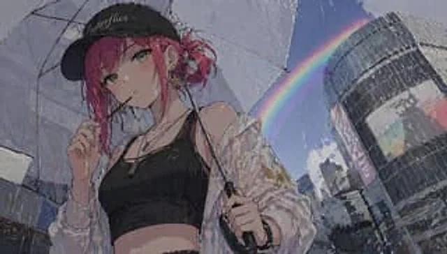

```text
A stylish anime illustration depicts a young woman standing on a modern city street in the rain, shot from a high-contrast, low-angle perspective. She has {argument name="hair color" default="bright pink"} Her hair was tied in a messy low bun, with a few stray strands falling on either side of her face. She had fair skin and cool, slightly aloof light gray-green eyes. She wore a black baseball cap with elegant white handwriting on it {argument name="cap text" default="Butterflies"} She wore several small earrings and dangling gold star-shaped earrings. A thin stick, like a lollipop stick or candy stick, with a small star decoration at the end, was casually held in her mouth, her hand gently touching it. Her outfit was street-style chic, shimmering slightly in the rain: a black cropped vest, an oversized, semi-transparent white jacket slipping from her shoulders, one sleeve adorned with delicate gold patterns, layered silver necklaces, and a dark-colored wristwatch. In her right hand, she held a transparent umbrella, its surface reflecting the wet light and raindrops. To the right of the background was a massive, curved glass building, below which lay a blurred cityscape. After the rain, a bright blue sky revealed itself, and a vibrant rainbow arced across the upper right sky. The emphasis was on the shimmering, wet surfaces, the refracted light, the glistening raindrops, the reflective glass, and the slightly bright iridescent halo. Highly detailed comic-style lines, soft painterly shadows, bright highlights, cinematic composition, stylish urban atmosphere, and exquisite and luxurious texture.
```

Model: GPT Image 2
Author: GPT Image 2 Prompts

[ProjectD](https://aitoolsradar.com/en/prompts/611b96e4f7e81b) · [Recorded source](https://x.com/sawayakashimura/status/2047666158241972635#reversed-0)
 · [Full original metadata and byte evidence](data/projectd-batch-0020.json)

## Anime Graffiti Butterfly Artist

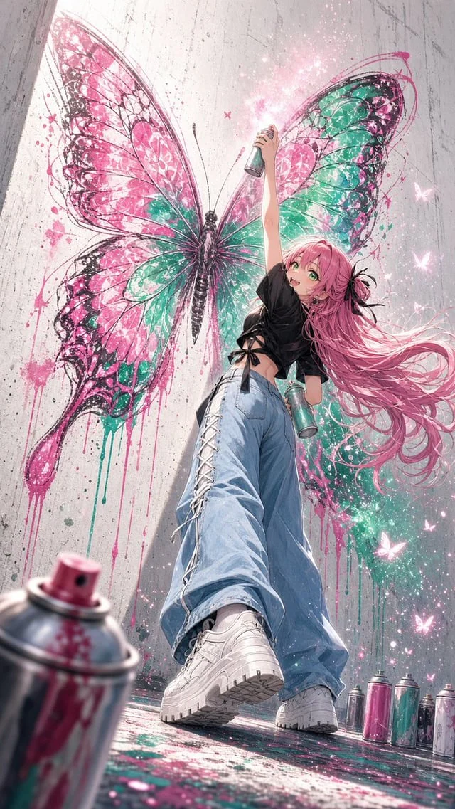

```text
Create a dynamic vertical anime street-art illustration from an extreme low-angle perspective, looking up at a cheerful young graffiti artist standing in front of a tall rough concrete wall. The main subject is a slim teenage anime girl with {argument name="hair color" default="long flowing pink hair"}, bright green eyes, and an excited open smile, wearing a loose cropped black T-shirt tied at the waist with ribbon-like details, oversized light blue wide-leg jeans with white lace-up side seams, and chunky white platform sneakers. She stretches one arm high overhead holding a spray paint can, while her other hand holds a second can near her hip. Behind her, cover the wall with one enormous freshly painted butterfly mural: wide symmetrical wings in vivid hot pink and turquoise-green, black sketchy outlines, splatters, drips, translucent veining, and sparkling paint mist. Add exactly one giant butterfly mural, exactly two spray cans in the girl’s hands, and exactly seven visible paint cans on the ground: one large blurred pink-topped spray can in the extreme foreground at lower left, plus six smaller upright cans along the lower right edge in pink, teal, silver, and white. Scatter glowing tiny butterfly silhouettes and glittering particles around the mural, especially on the right side. The floor should be wet and paint-splattered, reflecting pink and teal color. Use dramatic foreshortening with the girl’s sneaker soles large in the foreground, energetic composition, soft magical sparkle lighting, high-detail anime rendering, crisp linework, painterly textures, urban concrete grunge, vibrant magenta and turquoise palette, no text, no logo, no watermark.
```

Model: GPT Image 2
Author: ねね*

[ProjectD](https://aitoolsradar.com/en/prompts/751f48967586b7) · [Recorded source](https://youmind.com/prompts/anime-butterfly-graffiti-artist-31963)
 · [Full original metadata and byte evidence](data/projectd-batch-0020.json)

## Anime Graffiti Girl Transformation

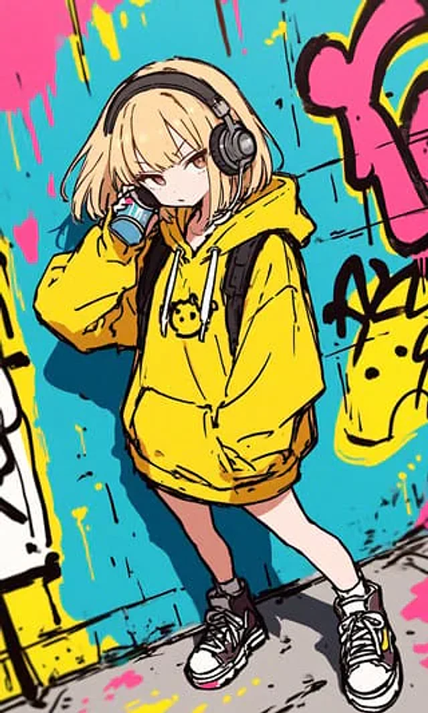

```text
A bold anime-style street art illustration depicts a girl casually leaning against a graffiti wall. It employs a loose, sketch-like comic style, featuring bold black ink lines, vibrant brushstrokes, and bright pop colors. She sports a short, straight bob haircut, and her hair color is {argument name="hair color" default="Light gold"} She had bangs; fair skin; sharp amber-brown eyes; a cool and reserved expression; and she slightly turned her head to look to the side. She wore oversized black over-ear headphones and oversized clothing.{argument name="hoodie color" default="Bright yellow"} She wears a hoodie with a white drawstring and a cute animal head badge on the chest; black backpack straps are visible on her shoulders, revealing her legs, which are covered in wrinkled dark socks and chunky white high-top sneakers with black details. One hand holds a blue spray paint can to her ear, as if she's just finished graffitiing a wall and is pausing. Her pose is relaxed and slightly angled, one knee bent, her body leaning back against the wall. The background is a turquoise-blue city wall covered in colorful graffiti and paint drips, featuring three main color palettes: bright pink labels and splatters, yellow blocks and drips, and black line art. Rough concrete surfaces are added at the bottom, scattered with paint marks. The dynamic, slightly elevated camera angle, full-body composition, and high-contrast cel-shading blend Japanese anime and graffiti art, creating a vibrant urban youth aesthetic. The overall atmosphere is rebellious, stylish, playful, and modern.
```

Model: GPT Image 2
Author: GPT Image 2 Prompts

[ProjectD](https://aitoolsradar.com/en/prompts/cb98a08d4ecf30) · [Recorded source](https://x.com/maku67879787/status/2047468429494682009#reversed-1)
 · [Full original metadata and byte evidence](data/projectd-batch-0020.json)

## Anime Heroine Promo Poster

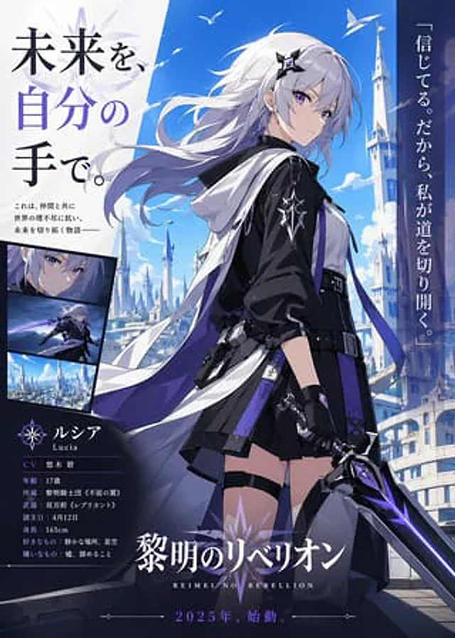

```text
A meticulously crafted, vertically-oriented anime-style main visual poster showcases a futuristic fantasy action series. The composition centers on a young female protagonist, confidently turning her head with a three-quarters back view, her face slightly obscured by the angle and strands of hair. She possesses long, flowing silver-white hair, fair skin accented with cool-toned purple. She wears a sleek combat outfit in black, white, and purple: a short black jacket with a white hood and a cape-like tiered hem, a fitted bodice, a short pleated skirt, a tactical belt and straps, black gloves, a single thigh strap, and delicate star-shaped badge details. In her right hand, she wields a massive, polygonal sci-fi longsword, its blade radiating glowing purple energy lines. The background is a bright blue-white daytime sky, dotted with soft clouds and a few white birds. In the distance lies an elegant white city comprised of towering cathedral-like spires and bridges, creating a grand, utopian atmosphere of a future kingdom. The hair, ribbons, hem, and fabric convey a strong sense of wind. Employing fluid lines and colors, clean anime-style rendering, high-detail cel shadows, crisp lighting, and glossy highlights, the design presents the texture of a high-end game promotional illustration. The layout is a complete Japanese promotional poster. The top left corner features a striking vertical Japanese title, "未来を、自分の手で。" (May the future be our own doing). The central phrase is purple, the rest is black, and a light-colored decorative badge forms the background. A smaller Japanese introduction is added below. A dark vertical sidebar is placed on the right, containing the white Japanese text, "信じてる。だから、私が道を切り開く。" (I believe you will find a way). The bottom left corner features three stacked, tilted rectangular illustrations: a close-up of the female protagonist's face, a shot of her wielding a glowing longsword, and a panoramic view of the city. The dark character information panel below displays the character's name "ルシア" (Lucia) in Romanized form, along with a small badge. This is followed by seven lines of Japanese personal information: "CV: Aoi Yuuki," "Age: 17," "Affiliation: Dawn Knights (Unbreakable Wings)," "Weapon: Double-edged Sword (Repricant)," "Birthday: April 12th," "Height: 165cm," "Favorite Things: Quiet Places, Starry Skies," and a final line listing disliked items. At the bottom center is a large series logo with the text "黎明のリベリオン" (Dawn's Rebelion), followed by the English subtitle "REIMEI NO REBELLION," and then the release date "2025, Start." Color scheme: white, black, dark indigo, electric purple, and sky blue. Overall atmosphere: heroic, elegant, and ambitious, reminiscent of a high-end anime/game or light novel promotional poster.
```

Model: GPT Image 2
Author: GPT Image 2 Prompts

[ProjectD](https://aitoolsradar.com/en/prompts/380871a8f1c126) · [Recorded source](https://x.com/8co28/status/2046978759946072262#reversed-0)
 · [Full original metadata and byte evidence](data/projectd-batch-0020.json)

## Anime Horror Game Thumbnail Composite


```text
A composite thumbnail illustration from YouTube, with the top center being {argument name="game title" default="Doki Doki Literature Club!"} The logo is designed as a pink circle containing a blue heart, colorful blocky letters, and a green pen. At the bottom center of the logo is {argument name="central figure" default="Dark silhouette of a person sitting at a desk"} In a dark room, facing a glowing pink computer monitor, the background is divided into four corner sections by the edges of torn paper. Each section contains a portrait of an anime girl in a school uniform. In the upper left corner is a girl with long brown hair, wearing a white ribbon, and smiling; in the upper right corner is a girl with long dark purple hair and a melancholy expression; in the lower left corner is a girl with short pink hair and an uneasy expression; and in the lower right corner is a girl with short coral hair, wearing a red ribbon, and smiling. In the dark space between the characters and the central figure, three large white question marks and four sheets of paper with blurred writing float. Overall {argument name="atmosphere" default="Dark, mysterious, and slightly unsettling"} The atmosphere contrasts sharply with the bright anime characters and colorful logo.
```

Model: GPT Image 2
Author: GPT Image 2 Prompts

[ProjectD](https://aitoolsradar.com/en/prompts/7980a51d9f70f1) · [Recorded source](https://x.com/mirochill/status/2044146818888474892#reversed-0)
 · [Full original metadata and byte evidence](data/projectd-batch-0020.json)

## Anime Idol in Mirror Room

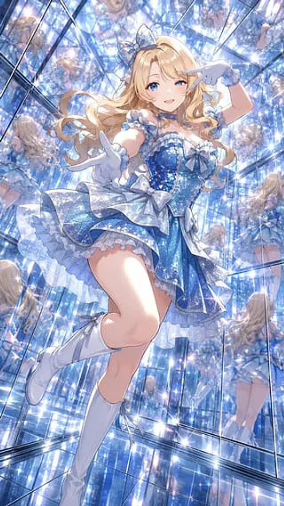

```text
Create a vertical 9:16 high-resolution anime idol illustration of {argument name="character name" default="a cheerful blonde magical idol girl"} posing cutely in a room where the floor, walls, and ceiling are entirely covered in mirror panels. Use a dramatic low-angle perspective with strong wide-angle depth, making the character appear close to the viewer while her reflections repeat into the background on every side. The character has long flowing {argument name="hair color" default="golden blonde"} hair with curled ends, a large translucent blue bow on top, and a sparkling blue-and-white stage costume. Outfit details: exactly 8 main visible outfit pieces — 1 large hair bow, 1 glittering blue corset bodice, 1 layered short frilly skirt with translucent overskirt, 2 white gloves, 2 white knee-high boots, and 1 small waist bow. Pose: she balances on one leg, one knee lifted, one hand making a V-sign toward the viewer and the other hand pointing near her face in a playful idol gesture. The face area is intentionally covered by a plain skin-tone rectangular block, while the rest of the illustration remains highly detailed. The mirrored room should show many reflections of the same character from different angles, with visible reflected copies behind her and to both sides. Lighting is bright, icy blue, and magical, with countless star-like sparkles, lens flares, glitter particles, and crystalline highlights bouncing across the mirror seams. Visual style: polished Japanese anime key visual, glossy idol-card aesthetic, delicate line art, luminous blue palette, shimmering fabric texture, intricate ruffles and bows, dynamic composition, ultra-detailed reflections, no text, no watermark.
```

Model: GPT Image 2
Author: ちちぷい

[ProjectD](https://aitoolsradar.com/en/prompts/0721f38c7174c6) · [Recorded source](https://youmind.com/prompts/anime-idol-mirror-room-20930)
 · [Full original metadata and byte evidence](data/projectd-batch-0020.json)

## Anime Idol Merchandise Catalog

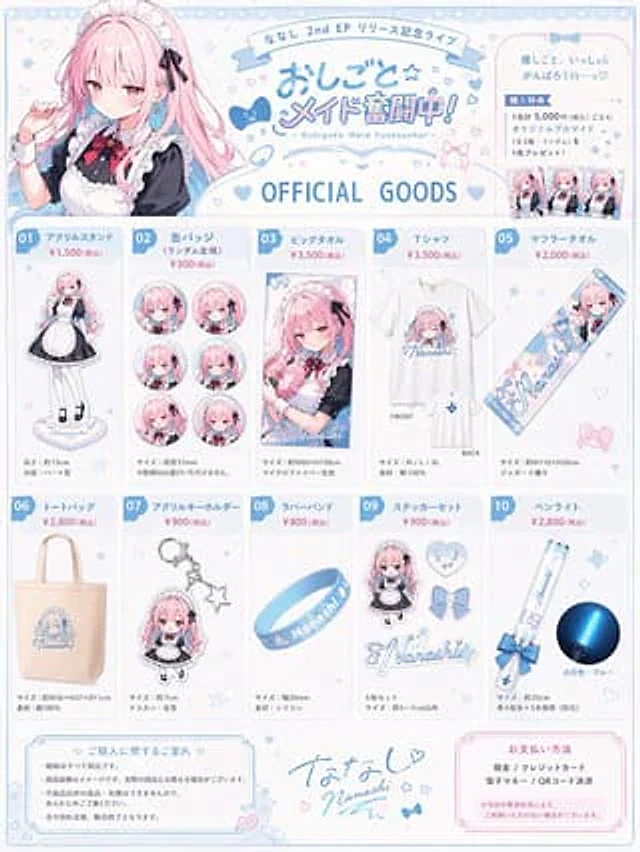

```text
{
  "type": "Anime and idol merchandise catalog flyer",
  "theme_colors": "{argument name=\"theme color\" default=\"Soft blue and pink\"}",
  "character": {
    "name": "{argument name=\"character name\" default=\"ななし\"}",
    "appearance": "Anime girl, long dress{argument name=\"hair color\" default=\"pink\"} Hair, blue eyes",
    "attire": "{argument name=\"outfit\" default=\"Black and white maid outfit with red bow tie\"} And the blue headband"
  },
  "layout": {
    "header": {
      "left": "The portrait of the character's upper body, looking to one side.",
      "center": {
        "top_banner": "Nanashi 2nd EP Release Commemorative Concert",
        "main_title": "{argument name=\"event title\" default=\"Working hard as a maid!\"}",
        "subtitle": "~Working☆The Maid's Struggle in Progress!~",
        "section_header": "Official merchandise"
      },
      "right": "Purchase bonus information box includes 3 small rectangular photo prints"
    },
    "merchandise_grid": [
      {
        "id": "01",
        "name": "Acrylic standee",
        "description": "Acrylic standee of a character"
      },
      {
        "id": "02",
        "name": "badge",
        "description": "A set of 6 round badges with different expressions"
      },
      {
        "id": "03",
        "name": "Large bath towel",
        "description": "Large rectangular towel printed with a character holding a heart-shaped cushion"
      },
      {
        "id": "04",
        "name": "T-SHIRT",
        "description": "White T-shirt with a character print on the front and a small logo on the back."
      },
      {
        "id": "05",
        "name": "Support towels",
        "description": "Long, rectangular support towels printed with character artwork and logos."
      },
      {
        "id": "06",
        "name": "canvas bag",
        "description": "Canvas tote bag with blue logo"
      },
      {
        "id": "07",
        "name": "Acrylic keychain",
        "description": "Q-version character acrylic keychain with star-shaped clasp"
      },
      {
        "id": "08",
        "name": "silicone wristband",
        "description": "Blue silicone wristband with logo printed on it"
      },
      {
        "id": "09",
        "name": "Sticker Set",
        "description": "A set of 4 visible stickers: chibi characters, hearts, ribbon bows, and a logo."
      },
      {
        "id": "10",
        "name": "glow sticks",
        "description": "Blue glow sticks for the concert"
      }
    ],
    "footer": {
      "left": "Purchase Instructions and Guide Box",
      "center": "The character's signature is 'Nanashi', with hand-drawn hearts and stars.",
      "right": "Payment method description box"
    }
  }
}
```

Model: GPT Image 2
Author: GPT Image 2 Prompts

[ProjectD](https://aitoolsradar.com/en/prompts/5eda70dc71c61d) · [Recorded source](https://x.com/anemone_sd/status/2046251166636622216#reversed-2)
 · [Full original metadata and byte evidence](data/projectd-batch-0020.json)

## Anime Iekei Ramen Comic

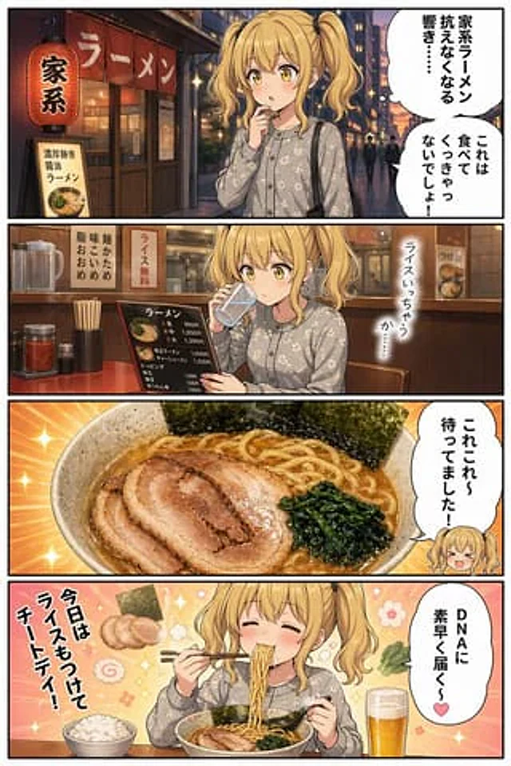

```text
{
  "type": "Anime Food Comic Page",
  "style": "Clean, manga-like digital illustrations, featuring warm evening lighting, glossy food rendering, detailed ramen shop backgrounds, soft pastel character color schemes, and an expressive Japanese food manga style.",
  "format": "Four-panel vertical comic with black border",
  "subject": {
    "main character": {
      "gender_presentation": "young women",
      "age_appearance": "Late teens to early twenties",
      "hair": {
        "color": "{argument name=\"hair color\" default=\"Golden yellow\"}",
        "style": "Double ponytails, curled ends, straight bangs"
      },
      "outfit": "Light gray floral button-down cardigan or knit top, black shoulder bag",
      "face_visibility": "In the first and second frames, the face is blurred and centered by a rectangle, but it is fully visible in the third frame (a chibi illustration) and the fourth frame."
    },
    "theme": "Craving and enjoying the rich, homemade ramen."
  },
  "layout": {
    "panel_count": 4,
    "panels": [
      {
        "index": 1,
        "scene": "Ramen shops on city streets at dusk",
        "background_elements": {
          "count": 6,
          "items": [
            "Large red lanterns with \"family lineage\" written on them",
            "Red shop curtain with \"Ramen\" written on it",
            "A standing sign that reads \"Rich Tonkotsu Soy Sauce Ramen\" and includes a photo of ramen.",
            "Glass shop entrance",
            "City streets with pedestrians at dusk",
            "Speech bubbles with vertical Japanese text"
          ]
        },
        "character_pose": "Standing in front of the store, he put a finger close to his lips, looking very tempted.",
        "text": {
          "count": 4,
          "items": [
            "Family lineage",
            "ラーメン",
            "Rich pork bone soy sauce ramen",
            "The conversation bubbles read, \"The irresistible sound of Iekei ramen...\" and \"You just have to try this!\""
          ]
        }
      },
      {
        "index": 2,
        "scene": "The counter inside the ramen shop",
        "background_elements": {
          "count": 10,
          "items": [
            "kettle",
            "water cup",
            "chopstick holder",
            "Red spice jar",
            "Small soy sauce bottle or condiment bottle",
            "Black item with ramen price written on it",
            "The vertical sign reads \"Free Rise\".",
            "wooden bar counter",
            "chair",
            "Blurred wall posters in the background"
          ]
        },
        "character_pose": "Sitting at the bar, drinking water in one hand and holding a menu in the other.",
        "text": {
          "count": 3,
          "items": [
            "Free rice",
            "Menu title \"Rammen\"",
            "Dialogue text: \"Shall we have some rice...?\""
          ]
        }
      },
      {
        "index": 3,
        "scene": "Close-up of the ramen bowl",
        "food": {
          "dish": "Family-style Ramen",
          "components": {
            "count": 5,
            "items": [
              "Rich and glossy soup base",
              "Medium-thick yellow noodles",
              "Four overlapping slices of braised char siu pork",
              "Dark green spinach",
              "3 large sheets of seaweed"
            ]
          }
        },
        "background": "Radiating orange background with shimmering light",
        "extra_character": "The girl's miniature chibi-style avatar in the bottom right corner is smiling excitedly.",
        "text": {
          "count": 1,
          "items": [
            "对话气「ああああーいっぱい！」"
          ]
        }
      },
      {
        "index": 4,
        "scene": "The girl was happily eating ramen at the table.",
        "food_and_drink": {
          "count": 5,
          "items": [
            "Main Ramen Bowl",
            "A bowl of white rice",
            "A beer",
            "Illustrations of floating seaweed and char siu next to the text",
            "Pick up the noodles with chopsticks"
          ]
        },
        "character_pose": "With her eyes closed and a blissful smile on her face, her cheeks slightly flushed, she used chopsticks to pick up noodles with one hand while supporting the bowl with the other.",
        "background": "Soft pink-orange gradient with glitter and floral patterns",
        "text": {
          "count": 2,
          "items": [
            "Large vertically arranged sign: \"Today is a cheat day with rice!\"",
            "Dialogue bubbles \"Reach quickly to DNA♥\""
          ]
        }
      }
    ]
  },
  "camera": "Frame 1: Medium shot; Frame 2: Medium interior shot; Frame 3: Extreme close-up of the food; Frame 4: Medium shot of the meal.",
  "rendering_notes": "To make the ramen look exceptionally tempting, the char siu pork should have a glossy, fatty texture, the broth should have a rich, full flavor, and the noodles should have a realistic texture; maintain the readability of the comic book style, using authentic Japanese signs and speech bubbles; emphasize the comfortable evening ramen shop atmosphere and a playful, indulgent humor."
}
```

Model: GPT Image 2
Author: GPT Image 2 Prompts

[ProjectD](https://aitoolsradar.com/en/prompts/56754bf1b7301e) · [Recorded source](https://x.com/b1asakura/status/2047118368168440309#reversed-0)
 · [Full original metadata and byte evidence](data/projectd-batch-0020.json)

## Anime Illustration of Two Girls

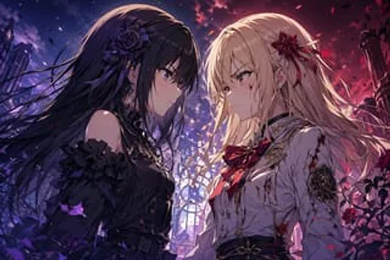

```text
{argument name="subject" default="Two girls with a shared fate"}, {argument name="style" default="Anime Illustration"}
```

Model: GPT Image 2
Author: GPT Image 2 Prompts

[ProjectD](https://aitoolsradar.com/en/prompts/3759a5de2dc764) · [Recorded source](https://x.com/itnavi2022/status/2044412394760507521)
 · [Full original metadata and byte evidence](data/projectd-batch-0020.json)

## Anime JAL Student Discount Poster

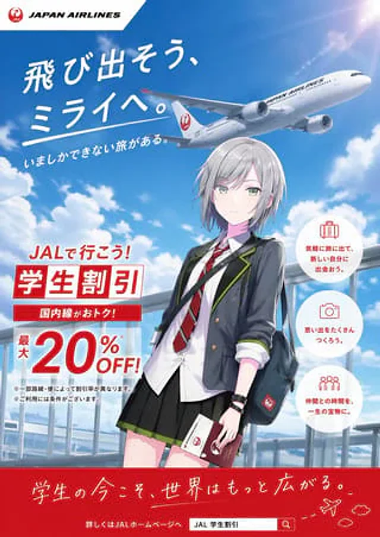

```text
A beautifully designed vertical anime-style Japan Airlines advertisement poster, used for {argument name="airline name" default="JAPAN AIRLINES"} The image creates a bright and inviting travel atmosphere. A clear blue sky dotted with soft white clouds is depicted, with strong sunlight and lens flare in the upper right corner. A large white commercial airliner flies diagonally from the lower left to the upper right, its tail bearing the airline logo and the words "JAPAN AIRLINES" on its fuselage. In the foreground, a high school girl with an anime-style aesthetic stands slightly to the right in front of the glass railing of the airport observation deck, with the terminal building structure visible in the distance in the background. She has a short, silver-gold bob with side-parted bangs, a youthful and fashionable look, and exudes confidence and composure. She wears a school uniform consisting of six clearly visible fashion items: a dark gray blazer with fluorescent green trim, a white shirt, a red striped tie, a black pleated skirt with green trim, a black shoulder bag with a small red airline tag patch, and a black wristband. In one hand, she holds two travel documents: a passport and a red and white boarding pass or ticket booklet matching the airline's brand. The poster design employs clear commercial illustration rendering, clean lines, soft celluloid shadows, and a glossy finish. It incorporates Japanese advertising typography and branding elements, creating a layout reminiscent of a real promotional campaign: the airline logo and "JAPAN AIRLINES" are placed in the upper left corner; a prominent large white handwritten title in the upper left corner reads:{argument name="main headline" default="Let&#39;s leap into the future."} Below is a smaller white subtitle “いましかできない旅がある.”; on the left side, there is a prominent red promotional section with “JALで行こう!” above it, a large “学生割引” box below it, and a smaller red horizontal bar “国产線がおトク!”, along with the oversized discount text “Max 20% OFF!” and a disclaimer in small print below. Three white circular badges are arranged vertically on the right, each with a red line icon and Japanese text: a suitcase icon with the text "気軽に旅に出て、新しい自分に出会おう。", a camera icon with the text "思い出をたくさんつくろう。", and a group icon with the text "仲間との時間を、一生の宝物に。". A full-width, deep red footer banner with large, bold white handwritten text is added at the bottom.{argument name="footer slogan" default="Now, as a student, is the perfect time to broaden your horizons."} The right side features doodles of small airplanes and clouds. Add small white text "詳しくはJALホームページへ" and a text containing... in the footer area or below.{argument name="search text" default="JAL Student Discount"} The simple search bar graphic uses a high-contrast color scheme of red, white, and sky blue to present a sophisticated aesthetic for youth marketing campaigns. The layout is clean, modern, and reminiscent of Japanese posters.
```

Model: GPT Image 2
Author: GPT Image 2 Prompts

[ProjectD](https://aitoolsradar.com/en/prompts/01d918cdb20af2) · [Recorded source](https://x.com/hironakaiori/status/2047307850096230492#reversed-1)
 · [Full original metadata and byte evidence](data/projectd-batch-0020.json)

## Anime JAL Student Travel Poster


```text
A bright and sophisticated Japanese airline promotional poster, presented in a 4:3 widescreen format with an anime illustration style, serves as the main advertising visual. The scene is set on a sunny airport tarmac with blue skies and white clouds, with a Japan Airlines aircraft clearly visible in the background. In the foreground stands a cheerful high school student traveler, striking a vibrant welcoming pose, one arm outstretched as if inviting everyone to embark on a journey together. She has long, flowing blonde twin ponytails with soft waves and pink highlights, swaying in the wind. Her facial features are simple and clear, conforming to the aesthetics of commercial illustration. She wears a black school uniform blazer with gold trim, a white shirt, a red and black bow tie, a pleated skirt with a gold hem, and black knee-high socks, carrying a black shoulder bag adorned with a cute round animal charm. Beside her is a silver suitcase covered in colorful travel stickers, including a striking airline-themed sticker. The overall atmosphere is youthful, inspiring, energetic, and travel-oriented, perfectly blending campus life with air travel. The sky area includes two handwritten English phrases: "Let's go!" near the airplane graffiti trail in the upper right corner. Aside from the brand text, no other handwritten English phrases are included. The poster layout must include: a "JAPAN AIRLINES" brand section with a red Tsurumaru logo in the upper left corner; and a prominent Japanese title in a calligraphy style in the upper left corner.{argument name="headline text" default="Spread your wings, future me!"} Below it is a smaller Japanese subtitle.{argument name="subheadline text" default="Travel will make you stronger and freer."} On the left side of the screen, there is a large white promotional panel for a student discount event, decorated with pink accents. The panel contains a Japanese title for the event.{argument name="campaign name" default="JAL Student Discount SkyMate"} 1 with{argument name="discount text" default="Up to 12% off!"} The image features a pink circular badge and three horizontally arranged bordered icon boxes below it. These three icon boxes should respectively display: a graduation cap icon (indicating student availability), a suitcase icon (indicating applicability to all domestic routes), and a calendar icon (indicating same-day booking changes are allowed). Add additional smaller, handwritten-style Japanese text around the lower half of the image to create a sentimental travel advertising atmosphere; place a pink call-to-action (CTA) banner in the lower left corner containing Japanese booking text resembling a search box. Place a red circular JAL logo in the lower right corner. The overall design employs a glossy anime poster rendering, clean lines, vivid lighting, subtle lens flare, saturated sky blue, pink accent graphics, and a sophisticated commercial advertising composition.
```

Model: GPT Image 2
Author: GPT Image 2 Prompts

[ProjectD](https://aitoolsradar.com/en/prompts/115ecfbb2f8b1f) · [Recorded source](https://x.com/hironakaiori/status/2047307850096230492#reversed-2)
 · [Full original metadata and byte evidence](data/projectd-batch-0020.json)

## Anime Last Supper Ensemble

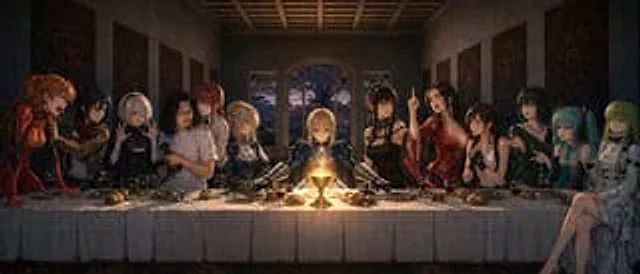

```text
A dark, cinematic anime-style group portrait, inspired by "The Last Supper," is set in a long stone banquet hall at night. The image employs a wide, symmetrical composition, showing eleven female characters seated side-by-side behind or leaning against a long table. At the very center is a blonde female knight, clad in magnificent blue-silver armor and a royal blue dress, her armored arms resting flat on the table. Before her lies a glowing golden chalice, radiating a warm light that illuminates the faces and hands of the others. Behind them are three tall, arched windows offering views of the twilight landscape, with the silhouette of a large tree silhouetted against the dim sky. Dark wooden beams adorn the ceiling, and several large, shadowy paintings hang on the side walls. These eleven characters should present a crossover feel, representing iconic anime women with diverse silhouettes, hairstyles, and clothing. From left to right: 1) A woman in a shiny red, tight-fitting, futuristic battle suit, leaning forward with one hand on a table; 2) A dark-haired woman next to her, dressed in understated military-style clothing; 3) A pale, gothic-style girl in a black long-sleeved dress, her hands raised, her fingers slender; 4) A short-haired blonde woman in a loose white T-shirt, casual and modern; 5) A tall, red-haired woman in a white shirt, standing slightly behind the others; 6) A blonde female knight in blue armor in the center; 7) A black-haired woman in a black dress, adorned with gold accessories and a headdress, raising one finger; 8) A charming woman in a red embroidered dress with long black hair; 9) A black-haired woman in a low-cut black dress, leaning inward; 10) A virtual idol-style girl with blue twin tails, wearing a sleeveless outfit; 11) A green-haired girl in a light-colored patterned dress sits on the far right, legs crossed, holding a wine glass. All characters should maintain delicate anime-style faces, presenting the elegant temperament of mature young women, rather than an exaggerated comic book style. Eleven sets of tableware should be placed on the table, including eight visible wine glasses, several pieces of bread and scattered bread rolls, plates, silverware, breadcrumbs, and several metal goblets or wine glasses. A warm glow from the Holy Grail should illuminate the central area, while the rest of the room is immersed in somber shadows. Employing a painterly realistic style, highly detailed anime illustrations, and dramatic chiaroscuro, the design uses brown and blue as the main colors, accented with red, to create a solemn yet slightly decadent atmosphere. The ultra-wide panoramic composition demonstrates masterful quality.
```

Model: GPT Image 2
Author: GPT Image 2 Prompts

[ProjectD](https://aitoolsradar.com/en/prompts/d5d3b95e2e2bd3) · [Recorded source](https://x.com/jasonxyan/status/2046939395123806398#reversed-0)
 · [Full original metadata and byte evidence](data/projectd-batch-0020.json)

## Anime Light Novel Cover Illustration

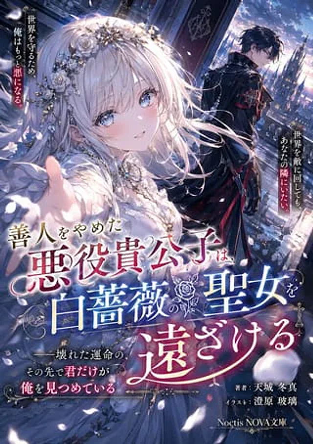

```text
A richly detailed anime-style light novel cover illustration. In the foreground, a beautiful young woman possesses {argument name="female hair color" default="Silver long hair"} With large, bright blue eyes, dressed in an exquisite white lace dress and a silver crown adorned with white roses, she stretched out her hand with a gentle yet longing smile. Behind her stood a young man with dark hair {argument name="male outfit" default="A gorgeous black coat with red accents and silver chains"} They stood with their backs to the camera, gazing back with a melancholy expression. They stood overlooking the scene.{argument name="background setting" default="Gothic fantasy castle city at dusk"} On the balcony, white petals drifted in the wind. The scene featured striking and elegant Japanese typography. A large main title read, "{argument name="main title" default="The villainous prince, who has abandoned his good ways, distances himself from the white rose saint."} The text uses an artistic font with a gold-blue gradient. The vertical slogan on the left reads, "..."{argument name="left catchphrase" default="To protect the world, I will become even more evil."} ", and on the right side it reads "The world is the enemy of the world. ". The additional text at the bottom includes the author's signature and publisher's logo. The overall atmosphere is dramatic and romantic, with dynamic light and shadow effects.
```

Model: GPT Image 2
Author: GPT Image 2 Prompts

[ProjectD](https://aitoolsradar.com/en/prompts/23d99e2067ec3b) · [Recorded source](https://x.com/koshian_to/status/2046114481240244394#reversed-0)
 · [Full original metadata and byte evidence](data/projectd-batch-0020.json)

## Anime Light Novel Cover Illustration

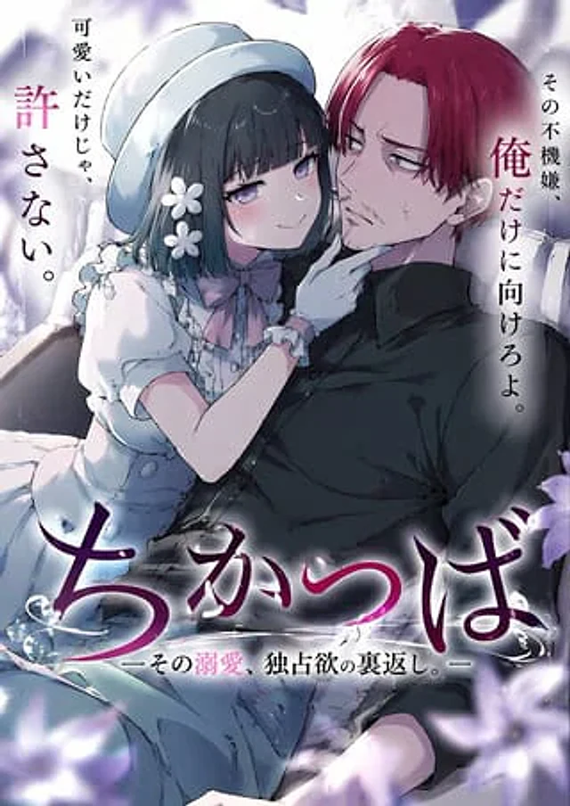

```text
An anime-style light novel cover illustration depicts two anime characters in an intimate pose. On the left is a young woman with short, dark hair and purple eyes. She wears a white hat, a white ruffled dress with a pink bow tie, white gloves, and two white flower hair clips. She gently touches the chin of the man beside her with a loving yet playful smile. On the right is a man with a middle parting {argument name="man's hair color" default="red"} An adult male with violet hair, purple eyes, and a light goatee. He wears a black shirt, his expression slightly agitated and reluctant, a bead of sweat clinging to his cheek. The image uses soft, romantic lighting, with out-of-focus purple petals in the foreground corner. The image contains several Japanese text elements: a large, stylized main title at the bottom.{argument name="main title" default="ちかつば"} Below is the subtitle.{argument name="subtitle" default="—That doting love is the flip side of possessiveness.—"} There is vertical text in the upper left corner.{argument name="left quote" default="Being cute isn&#39;t enough."} There is vertical text in the upper right corner.{argument name="right quote" default="Direct that bad mood only towards me."} .
```

Model: GPT Image 2
Author: GPT Image 2 Prompts

[ProjectD](https://aitoolsradar.com/en/prompts/893ac0f0ba46ae) · [Recorded source](https://x.com/taira_renta/status/2046176053383872820#reversed-0)
 · [Full original metadata and byte evidence](data/projectd-batch-0020.json)

## Anime Light Novel Cover with Painters

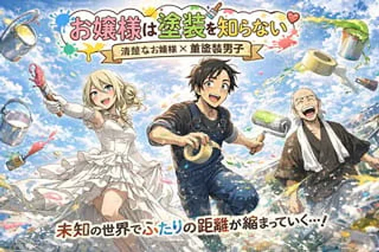

```text
An anime-style promotional illustration depicts three characters running dynamically in a joyful painting scene under a bright blue sky and white clouds. On the left is a young blonde woman in an elegant white ruffled dress and gloves, smiling brightly and holding a paintbrush dripping with pink paint. In the middle is a young black-haired man in blue overalls and a black T-shirt, looking excited, holding a roll of masking tape and a green roller brush. On the right is an older man laughing heartily, wearing dark traditional Japanese work clothes with a white towel around his neck. Colorful paint splatters in the air, surrounded by two paint buckets, two paintbrushes, and two rolls of masking tape. A stylized title logo is displayed at the top.{argument name="main title" default="The young lady doesn&#39;t know anything about painting."} It is decorated with paint splatter effects. Below is a banner ribbon that reads {argument name="subtitle" default="A refined young lady × A painting man"} At the bottom is a striking promotional slogan:{argument name="bottom tagline" default="In this unknown world, the distance between the two of them begins to shrink...!"} The overall style features vibrant colors and the aesthetic appeal of light novel covers.
```

Model: GPT Image 2
Author: GPT Image 2 Prompts

[ProjectD](https://aitoolsradar.com/en/prompts/a0867d9d2f062a) · [Recorded source](https://x.com/jinbara_3/status/2046132564826751179#reversed-1)
 · [Full original metadata and byte evidence](data/projectd-batch-0020.json)

## Anime Light Novel Cover with Typography

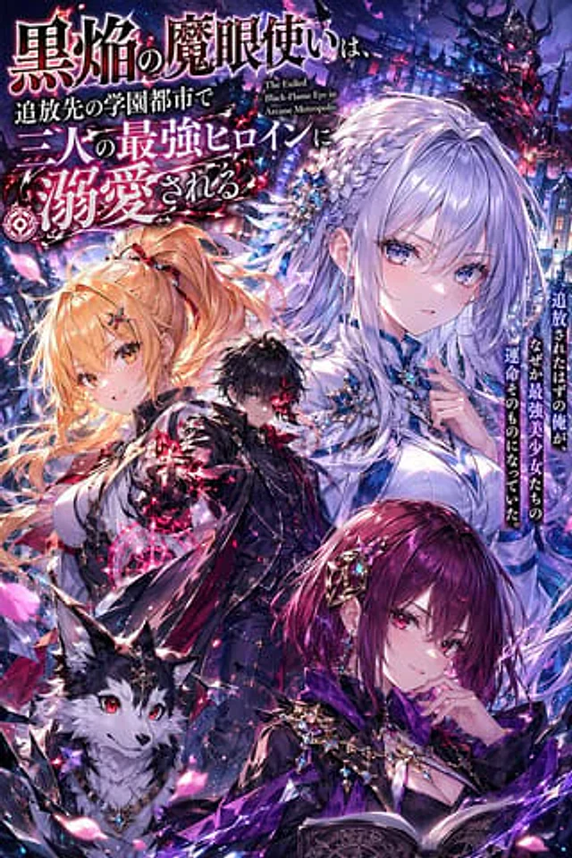

```text
An anime/light novel cover. The stylized Japanese title is displayed in the top left corner.{argument name="main title" default="The user of the black flame eye is doted on by three of the strongest heroines in the academy city where he was banished."} and English subtitle{argument name="english subtitle" default="The Exiled Black-Flame Eye in Arcane Metropolis"} The vertical Japanese description on the right reads:{argument name="vertical blurb" default="I, who was supposed to have been banished, somehow became the very embodiment of the fate of the most powerful and beautiful girls."} The scene contains four characters and one creature. The central figure is a male protagonist who possesses…{argument name="protagonist hair color" default="black"} He has long hair, a glowing red eye, and a dark coat. He is surrounded by three female characters: the one in the upper right corner has long hair {argument name="heroine hair color" default="silver"} A girl with white and blue crystal dress; a blonde girl with a side ponytail casting a pink magic circle; a girl with short magenta hair holding a magic book in the lower right corner. A black and white wolf-shaped familiar sits in the lower left corner. The background is a dark gothic academy at night, with pink petals, glowing magical particles, and broken glass floating in the air, and a demonic figure vaguely visible in the upper right corner.
```

Model: GPT Image 2
Author: GPT Image 2 Prompts

[ProjectD](https://aitoolsradar.com/en/prompts/44dba0ee4401a8) · [Recorded source](https://x.com/koshian_to/status/2044976114821746720#reversed-0)
 · [Full original metadata and byte evidence](data/projectd-batch-0020.json)

## Anime Light Novel Promotional Poster

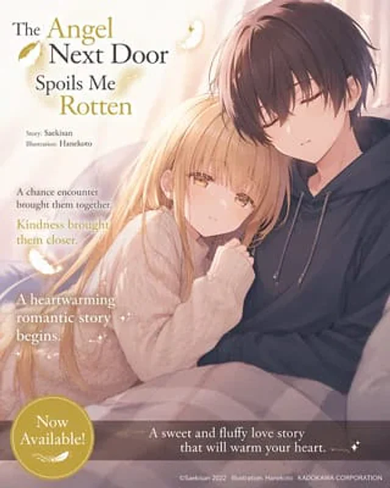

```text
A romantic anime promotional poster. A blonde, golden-eyed girl in a white knitted sweater rests her head on a sleeping boy in a dark hoodie. They are curled up in a checkered blanket under soft, warm light. The title in the upper left corner reads:{argument name="main title" default="Regarding the fact that I was unintentionally spoiled by the angel next door."} The text uses an elegant serif font with gold accents, surrounded by three floating white feathers and shimmering light. The left-aligned text is {argument name="tagline 1" default="A chance encounter brought them together. A act of kindness connected their hearts."} and{argument name="tagline 2" default="A heartwarming and romantic story unfolds from there."} The gold sticker in the bottom left corner reads "Now Available!". The banner at the bottom shows {argument name="bottom text" default="A sweet love story that heals the soul."} .
```

Model: GPT Image 2
Author: GPT Image 2 Prompts

[ProjectD](https://aitoolsradar.com/en/prompts/d922b1c86eaa23) · [Recorded source](https://x.com/mirochill/status/2044822497330135321#reversed-1)
 · [Full original metadata and byte evidence](data/projectd-batch-0020.json)

## Anime Magazine Interview Spread

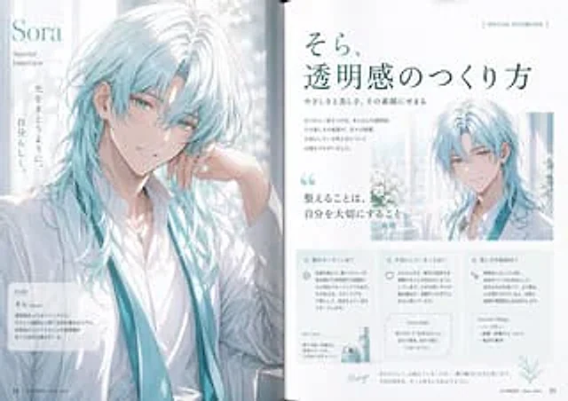

```text
{
  "type": "Editing magazine interviews and layout",
  "publication": "LUMIÈRE",
  "date": "June 2024",
  "subject": {
    "name": "{argument name=\"character name\" default=\"Sora\"}",
    "gender_presentation": "androgynous young male idols/models",
    "appearance": {
      "hair": {
        "color": "{argument name=\"hair color\" default=\"Ice white with a pale blue tint\"}",
        "style": "A long, layered mullet hairstyle, messy and voluminous, with airy strands and a dewy, glassy texture, featuring curtain-like bangs and a length that reaches from the shoulders to the chest."
      },
      "skin": "fair porcelain skin",
      "clothing": [
        "White open-collar shirt",
        "A soft, white custom-made suit casually draped",
        "A long, semi-transparent, light blue ribbon-like scarf or suspender that hangs down from the neck",
        "Delicate silver necklace with a pale blue gemstone pendant"
      ],
      "mood": "Gentle, elegant, calm, bright"
    }
  },
  "style": {
    "illustration": "High-end animation editing and illustration",
    "rendering": "The combination of soft watercolor and digital painting creates clean lines, glossy hair, translucent fabric, subtle soft-focus effects, and a high-end fashion magazine feel.",
    "palette": "White, pearl gray, ice blue, light cyan, soft blue",
    "lighting": "Bright, diffused sunlight streaming through the window creates an airy, backlit effect with luminous bokeh."
  },
  "layout": {
    "format": "Double-page magazine layout",
    "gutter": "Visible center crease",
    "sections": [
      {
        "title": "Left page main visual portrait",
        "position": "Full page on the left",
        "count": 1,
        "labels": [
          "Large bust portrait"
        ]
      },
      {
        "title": "Personal information",
        "position": "bottom left corner overlay box",
        "count": 1,
        "labels": [
          "Personal data card"
        ]
      },
      {
        "title": "Special Interview",
        "position": "Top right header",
        "count": 1,
        "labels": [
          "Column Quote"
        ]
      },
      {
        "title": "Main title",
        "position": "Top right page",
        "count": 1,
        "labels": [
          "So, how to create a translucent look."
        ]
      },
      {
        "title": "Excerpt from the introduction",
        "position": "Left side of the right page",
        "count": 1,
        "labels": [
          "Taking care of yourself is about taking care of yourself."
        ]
      },
      {
        "title": "Illustrated portrait",
        "position": "Top right corner of the right page",
        "count": 1,
        "labels": [
          "Small portrait"
        ]
      },
      {
        "title": "Question and Answer Cards",
        "position": "bottom half of the right page",
        "count": 3,
        "labels": [
          "Q. What's your morning routine?",
          "Q. What do you value most?",
          "Q. What's your secret to beauty?"
        ]
      },
      {
        "title": "Product Special",
        "position": "Q&amp;A area bottom left corner",
        "count": 1,
        "labels": [
          "KEY ITEM"
        ]
      },
      {
        "title": "Rule box",
        "position": "Lower part of the question and answer area",
        "count": 1,
        "labels": [
          "Sora's Rule"
        ]
      },
      {
        "title": "Preference box",
        "position": "Q&amp;A area bottom right corner",
        "count": 1,
        "labels": [
          "Favorite Things"
        ]
      },
      {
        "title": "Information footer",
        "position": "Bottom right",
        "count": 1,
        "labels": [
          "Message"
        ]
      }
    ],
    "page_numbers": {
      "count": 2,
      "labels": [
        "14",
        "15"
      ]
    }
  },
  "composition": {
    "left_page": "A large close-up half-length portrait, the subject is slightly tilted, one hand is near the neck, the expression is serene, the background is a bright window, outside the window are white flowers and circular bokeh.",
    "right_page": "The top features a large Japanese title, below which is a brief introductory paragraph. Quotations are surrounded by oversized blue quotation marks. The upper right corner features a small portrait of the same character with the same pose. At the bottom are three neatly aligned bordered information boxes."
  },
  "text": {
    "keep_visible_text": true,
    "left_page": [
      "Sora",
      "Special Interview",
      "Embrace the light, and be true to yourself.",
      "Profile",
      "そら (Sora)",
      "LUMIÈRE | June 2024"
    ],
    "right_page": [
      "SPECIAL INTERVIEW",
      "Sora, how to create a translucent look.",
      "Gentleness and beauty, getting closer to her true self.",
      "Taking care of yourself is about taking care of yourself.",
      "Q. What's your morning routine?",
      "Q. What do you value most?",
      "Q. What's your secret to beauty?",
      "KEY ITEM",
      "Sora's Rule",
      "Favorite Things",
      "Message",
      "LUMIÈRE | June 2024"
    ]
  },
  "quality": "Luxurious and stylish editorial style, consistent visual identity across multiple pages, spacious layout, exquisite Japanese magazine design, and finished print quality."
}
```

Model: GPT Image 2
Author: GPT Image 2 Prompts

[ProjectD](https://aitoolsradar.com/en/prompts/2ac459d172f1d6) · [Recorded source](https://x.com/noctiluce_sora/status/2047036229028635042#reversed-2)
 · [Full original metadata and byte evidence](data/projectd-batch-0020.json)

## Anime Magical Girl Character Reference Sheet

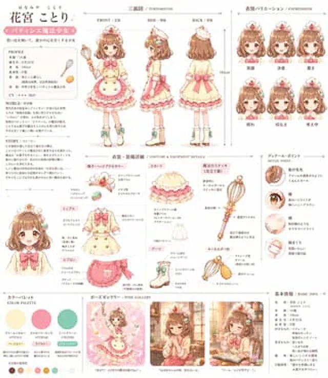

```text
{
  "type": "Comprehensive Anime Character Reference Chart",
  "character": {
    "name": "{argument name=\"character name\" default=\"Flower Palace Bird\"}",
    "theme": "{argument name=\"character theme\" default=\"Pastry Chef Magical Girl\"}",
    "hair": "{argument name=\"hair color\" default=\"brown\"} A fluffy hairstyle with macaron hair clips",
    "eyes": "{argument name=\"eye color\" default=\"brown\"} With starlight highlights",
    "weapon": "{argument name=\"weapon type\" default=\"Egg beater shaped magic wand\"}",
    "outfit": "Ruffled dress, apron, boots"
  },
  "layout": {
    "sections": [
      {
        "title": "Personal Profile and Story",
        "position": "top-left",
        "description": "A text block used to display profiles, worldviews, and stories."
      },
      {
        "title": "Three-view diagram / TURNAROUND",
        "position": "top-center",
        "count": 3,
        "labels": [
          "Front",
          "Side",
          "Back"
        ]
      },
      {
        "title": "Expressions",
        "position": "top-right",
        "count": 6,
        "labels": [
          "smile",
          "determination",
          "surprise",
          "shy",
          "sad",
          "Thinking"
        ]
      },
      {
        "title": "Costume &amp; Equipment Details",
        "position": "center",
        "count": 7,
        "labels": [
          "Hats and headdresses",
          "Jacket",
          "apron",
          "skirt",
          "boots",
          "Magic wand (egg beater)",
          "Pendant form"
        ]
      },
      {
        "title": "Details Point",
        "position": "center-right",
        "count": 4,
        "labels": [
          "hair ends",
          "pupil",
          "cheek",
          "Cuff details"
        ]
      },
      {
        "title": "Color scheme / COLOR PALETTE",
        "position": "bottom-left",
        "count": 3,
        "labels": [
          "Creamy Yellow",
          "strawberry powder",
          "Mint Green"
        ],
        "additional_swatches_count": 7
      },
      {
        "title": "Pose Gallery",
        "position": "bottom-center",
        "count": 3,
        "descriptions": [
          "Magical poses",
          "A melancholy scene by the window",
          "blinking while eating"
        ]
      },
      {
        "title": "Basic Information",
        "position": "bottom-right",
        "description": "A text block containing character attributes and preferences."
      }
    ]
  }
}
```

Model: GPT Image 2
Author: GPT Image 2 Prompts

[ProjectD](https://aitoolsradar.com/en/prompts/baf679aa1f5b93) · [Recorded source](https://x.com/dendendensho810/status/2045098539412595124#reversed-0)
 · [Full original metadata and byte evidence](data/projectd-batch-0020.json)

## Anime Maid CD Album Cover

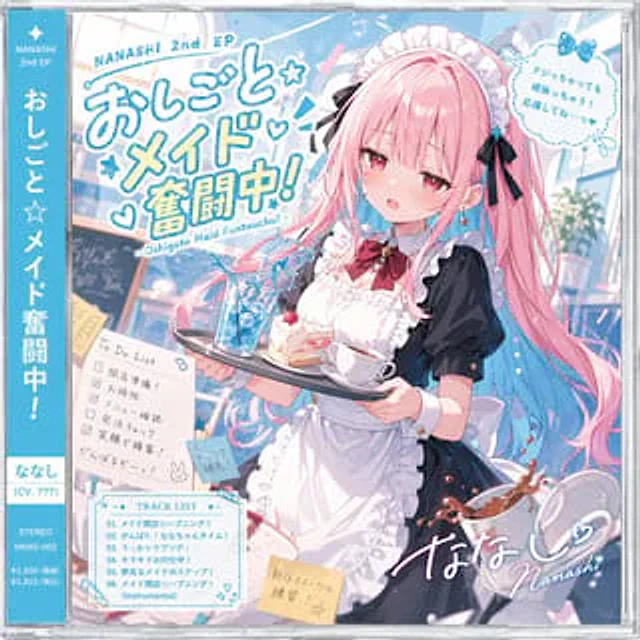

```text
{
  "type": "Anime CD with a dust jacket, jewelry box cover",
  "character": {
    "name": "{argument name=\"character name\" default=\"ななし\"}",
    "appearance": "A panicked anime girl{argument name=\"hair color\" default=\"Pink and blue gradient hair ends\"} Twin ponytails, red eyes, beads of sweat",
    "outfit": "Black and white maid outfit, ruffled apron, red bow tie, black hair accessory",
    "action": "He holds a tray with spilled blue iced drink, strawberry cake, and a teacup; a spilled coffee cup is in the foreground."
  },
  "layout": {
    "obi_strip": {
      "position": "left edge",
      "color": "blue",
      "text": [
        "NANASHI 2nd EP",
        "{argument name=\"album title\" default=\"Working hard as a maid!\"}",
        "{argument name=\"character name\" default=\"ななし\"} (CV. ???)",
        "STEREO",
        "NNXS-002"
      ]
    },
    "main_title": {
      "position": "Top left corner",
      "text": [
        "NANASHI 2nd EP",
        "{argument name=\"album title\" default=\"Working hard as a maid!\"}",
        "- Oshigoto Maid Funtouchu! -"
      ]
    },
    "quote_bubble": {
      "position": "Top right corner",
      "text": "{argument name=\"character quote\" default=\"Even if I make a mistake, I&#39;ll do my best! Please cheer me on...♡\"}"
    },
    "to_do_list": {
      "position": "Middle left",
      "count": 5,
      "items": [
        "Preparing to open the store!",
        "cleaning",
        "Menu confirmation",
        "Order Check",
        "Serve customers with a smile!"
      ],
      "footer": "I'll do my best! (Attached: A little rabbit painted with a crow)"
    },
    "track_list": {
      "position": "bottom left corner",
      "count": 6,
      "tracks": [
        "01. {argument name=\"lead track name\" default=\"Maid shop opening☆A mishap!\"}",
        "02. がんばれ！ななちゃんタイム！",
        "03. うっかりラプソディー",
        "04. Serving with sparkle!",
        "05. The Dreaming Maid's Steps!",
        "06. {argument name=\"lead track name\" default=\"Maid shop opening☆A mishap!\"} (Instrumental)"
      ]
    },
    "sticky_notes": {
      "count": 2,
      "text": [
        "Drink refill!",
        "Practicing new sweets recipes!! ☆"
      ]
    },
    "signature": {
      "position": "bottom right corner",
      "text": "{argument name=\"character name\" default=\"ななし\"}♡ Nanashi"
    }
  }
}
```

Model: GPT Image 2
Author: GPT Image 2 Prompts

[ProjectD](https://aitoolsradar.com/en/prompts/44c949e418e206) · [Recorded source](https://x.com/anemone_sd/status/2046251166636622216#reversed-1)
 · [Full original metadata and byte evidence](data/projectd-batch-0020.json)

## Anime Maid Thriller Movie Poster

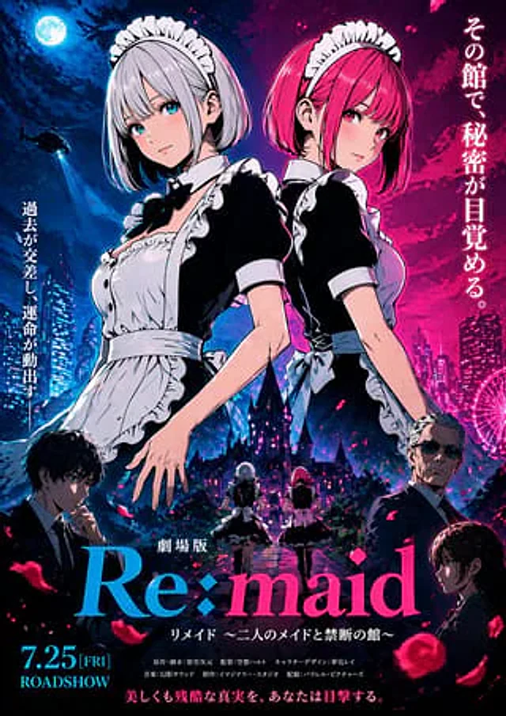

```text
A highly dramatic anime movie poster employs a high vertical composition, centering on two young women dressed in classic black and white maid outfits, standing back-to-back and facing opposite directions. The maid on the left has a short silver bob with bangs and a white maid headband; the maid on the right has a bright pink bob with bangs and a matching white maid headband. They wear fitted black dresses with puff sleeves, white aprons with ruffles, white collars and cuffs, and black ribbons around their necks. Their poses are confident yet tense, one hand hanging at their side, hinting at mystery and rivalry. They are placed in the center of the foreground, occupying most of the poster's height. Behind them, a two-tone night sky is created: a deep electric blue on the left and a saturated magenta on the right, merging at the center. A bright full moon and a small helicopter with a searchlight are displayed in the upper left. On the horizon and below, there is a glowing city skyline, with blue lights on the left and pink lights on the right. In the center of the background, a Gothic mansion or castle with a spire is placed at the end of a path, illuminated by warm light. In front of the mansion, two smaller, identical maid silhouettes are shown, their backs to the viewer, walking side by side towards the building. Four supporting characters are added around the bottom edge: a dark-haired man in a suit in the lower left corner, a stern-looking older man in a suit in the lower right center, a long-haired young woman in the lower right corner, and two small maid silhouettes in the distance, making a total of six figures visible in the poster. Bright pink petals are scattered throughout the image, as if blown by the wind. The poster employs strong cinematic lighting effects, glossy anime-style rendering, high contrast, sharp lines, luminous rim lighting, and a suspenseful, psychologically thrilling atmosphere. Vertical Japanese slogans are included on both sides, and a striking artistic title is placed at the bottom center.{argument name="title text" default="Re:maid"} Below is a smaller Japanese subtitle, and the bottom left corner contains screening information.{argument name="release date text" default="7.25 [FRI] ROADSHOW"} Add a final line of Japanese text at the bottom. Overall style: High-end anime main visual, suspense and thriller, neon blue and hot pink two-tone color scheme, exquisite poster layout, highly detailed background, dynamic petals, and cinema poster texture.
```

Model: GPT Image 2
Author: GPT Image 2 Prompts

[ProjectD](https://aitoolsradar.com/en/prompts/da1dc66f3d8cf4) · [Recorded source](https://x.com/notoro_ai/status/2046823692987179400#reversed-0)
 · [Full original metadata and byte evidence](data/projectd-batch-0020.json)

## Anime Martial Arts Battle Illustration


```text
A highly dynamic anime illustration depicts two girls engaged in a fierce martial arts duel within a traditional wooden dojo. In the foreground, one girl with {argument name="character 1 hair" default="Black high bun with red ribbon"} The young girl assumed a powerful low-stance martial arts stance, throwing punches with all her might. She was wearing {argument name="character 1 outfit" default="White Chinese-style top with red tassels and loose red trousers"} Intense red energy slashes swirled around her limbs as she swung. In mid-air on her right, a figure {argument name="character 2 hair" default="Light purple double buns"} The young girl leaped gracefully, smiling confidently, dressed in {argument name="character 2 outfit" default="A dark green dress with gold embroidery and black leggings"} Accompanied by a sweeping trail of blue, water-like energy. The background is the rustic interior of a wooden temple, with a plaque hanging above that reads "{argument name="sign text" default="Martial Arts Tournament"} The eye-catching sign reads "...". The scene is full of explosive action, with flying dust, broken wooden floors, glowing colored particle effects, and dramatic low-angle lighting that perfectly distinguishes the characters from the detailed background.
```

Model: GPT Image 2
Author: GPT Image 2 Prompts

[ProjectD](https://aitoolsradar.com/en/prompts/c48ae56ee91144) · [Recorded source](https://x.com/Tanemomi_Ver2/status/2046063806846214265#reversed-0)
 · [Full original metadata and byte evidence](data/projectd-batch-0020.json)

## Anime Martial Arts Battle Illustration

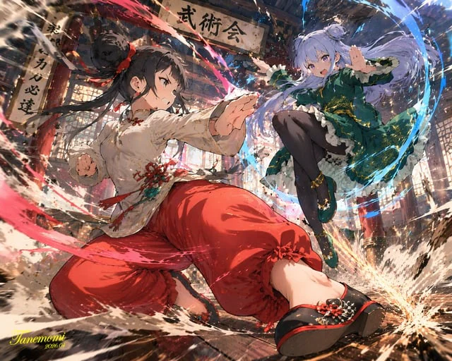

```text
An anime-style illustration of a {argument name="action type" default="high-impact martial arts battle"} between two young female fighters in a {argument name="setting" default="traditional wooden martial arts dojo"}. In the foreground, a girl with black hair in a high bun wears a {argument name="character 1 color theme" default="red and white"} Chinese-style martial arts outfit with baggy pants. She is in a dynamic, low, forward-thrusting stance, surrounded by swirling red energy and water splashes. In the background to the right, a girl with light purple hair in twin buns wears a {argument name="character 2 color theme" default="green and purple"} Chinese dress with gold embroidery and black tights. She is leaping through the air in a flying kick pose, surrounded by swirling blue energy. The wooden floorboards are splintering from the intense impact, with debris and dust flying through the air. Above them hangs a weathered wooden sign with the text "{argument name="sign text" default="武術会"}". The scene features dramatic lighting, a low-angle dynamic perspective, and intense action effects.
```

Model: GPT Image 2
Author: たねもみ 2.0 / Tanemomi Ver2.0

[ProjectD](https://aitoolsradar.com/en/prompts/c7743fa85f192e) · [Recorded source](https://youmind.com/prompts/anime-martial-arts-battle-dojo-13467)
 · [Full original metadata and byte evidence](data/projectd-batch-0020.json)

## Anime Martial Arts Dojo Duel

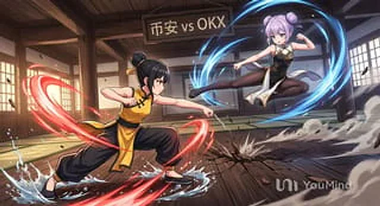

```text
A dynamic anime-style illustration depicts two young female martial arts practitioners battling in a traditional Japanese wooden dojo. The fighter on the left, in the foreground, is a black-haired girl with a neat bun tied with a yellow ribbon. She wears a sleeveless yellow Chinese kung fu top with black trim, loose black pants, and black cloth shoes. She crouches low on the wooden floor, one hand pulling back while the other punches forward, a bright red energy trail swirling around her body and sweeping across the entire frame. Water splashes violently at her feet, as if her movements are skimming across shallow water. The fighter on the right, in mid-ground, is a fair-skinned girl with light purple double buns. She wears a black and white striped short cheongsam-style combat outfit with gold trim, black sheer pantyhose, and black shoes. She is executing a flying kick, a vibrant blue energy spiral swirling around her. The collision of their forces causes the wooden floor on the right side to crack and explode, sending fragments and wood chips flying outwards, while dust and smoke billow in the lower right corner. The dojo's interior features exposed wooden beams, tatami mat edges, and shoji-style windows, with warm natural light streaming in from the left. Above them hangs a wooden plaque with Chinese text.{argument name="sign text" default="Binance vs OKX"} It employs dramatic wide-angle compositions, strong perspective shortening, cinematic motion blur, strong speed lines, high-detail anime rendering, glossy highlights, clean line art, vibrant battle choreography, and exquisite poster-quality textures. It adds two visible fighters, a wooden sign above their heads, a cracked floor impact point, a red energy effect surrounding the fighter on the left, and a blue energy effect surrounding the fighter on the right. An optional subtle watermark-style text can be placed in the lower right corner, containing the following text:{argument name="watermark text" default="UM YouMind"} .
```

Model: GPT Image 2
Author: GPT Image 2 Prompts

[ProjectD](https://aitoolsradar.com/en/prompts/df3486b2b6b7bd) · [Recorded source](https://x.com/Assassin_Malvo/status/2046567217723244879#reversed-1)
 · [Full original metadata and byte evidence](data/projectd-batch-0020.json)

## Anime Martial Arts Duel in Dojo


```text
A highly dramatic anime-style action illustration, set in an old wooden martial arts hall, depicts a fierce moment of combat between two young women, the image brimming with explosive action and elemental energy trajectories. In the foreground, a fierce female martial artist charges at the viewer in a low stance, assuming a powerful punching posture, her right fist extending straight forward, her body dynamically twisting. She has long black hair tied in a messy high bun, with a few strands falling down, tied with a red ribbon, her eyes sharp and focused, her expression full of fighting spirit. She wears a white traditional Chinese martial arts top with red trim, red buttons, and delicate embroidery patterns, paired with flowing dark red trousers and black cloth shoes with red embellishments. Red ribbon-like energy and glowing crimson brushstrokes entwine her arms, torso, and legs, sweeping across the entire image like burning calligraphy. In the upper right corner, another young woman leaps into the air in a defensive or spellcasting stance, one hand outstretched. She has long black hair {argument name="hair color" default="Light purple"} Her hair was styled in two buns, with a few strands hanging down, and adorned with a magnificent gold hair ornament. She wore a dark green Chinese-style long dress with gold embroidery, black stockings, and dark shoes. Bright blue, watery energy swirled around her, forming a huge circular arc, shimmering with glowing droplets. The scene is set inside a weathered dojo or martial arts school, with a backdrop of tall wooden beams, hanging lanterns, broken floorboards, flying wood chips, dust, sparks, and debris from a battle. Above them hangs a large wooden plaque with the words "Martial Arts Gathering" in black calligraphy, flanked by two vertically hanging banners: the left read "Making Friends Through Martial Arts," and the right read "Combining Strength and Softness." The animation employs a low-angle cinematic perspective, utilizing strong perspective shortening, extreme action sequences, dense particle effects, and a striking contrast between warm and cool tones in the red and blue energy. Highly detailed anime-style artwork, ultra-dynamic composition, sharp lines, rich textures, dazzling lighting effects, and volumetric lighting rendering deliver an epic visual experience.
```

Model: GPT Image 2
Author: GPT Image 2 Prompts

[ProjectD](https://aitoolsradar.com/en/prompts/763a1f5cc3c27b) · [Recorded source](https://x.com/HuZhou_Mr/status/2046514427273629707#reversed-0)
 · [Full original metadata and byte evidence](data/projectd-batch-0020.json)

## Anime Martial Arts Energy Clash

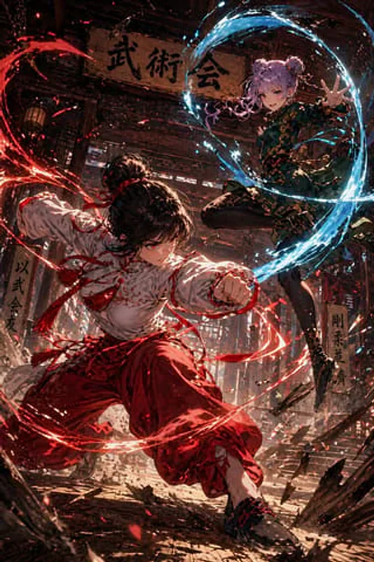

```text
A highly dramatic anime-style action illustration, set in a traditional wooden martial arts hall, is shot from a low angle, creating a strong cinematic perspective. In the foreground, a fierce-looking young female martial artist is charging forward in a crouching fighting stance, one fist aimed directly at the camera.{argument name="hair color" default="black"} Her hair was tied into a messy high bun and secured with a red ribbon. She wore a white Chinese-style kung fu top with red trim and Chinese knot buttons, paired with red wide-leg trousers and black martial arts shoes with red embellishments. Her expression was focused, aggressive, and resolute, her eyes flashing with a sharp red light. Red energy ribbons and oil painting-like streams of light surrounded her body and fists, scattering sparks and embers. In the upper right corner, a second young female warrior was leaping into the air, her body in a half-sideways position, wearing a dark green cheongsam-style combat outfit with ornate gold embroidery, black stockings, and high heels. Her{argument name="second character hair color" default="lavender"} Her hair was styled in two buns, adorned with wispy curls and decorative hair accessories. She extended one hand in a martial arts gesture, surrounded by an arc of luminous blue energy that formed a near-perfect circle around her body. The stark contrast between the red and blue elemental forces foreshadowed an imminent conflict. The setting was the interior of a dilapidated dojo, with cracked wooden floors exploding upwards, dust, sawdust, and debris solidifying in mid-air. Warm beams of light pierced through the wooden structure and windows, intertwining with luminous particles. In the background, large hanging calligraphy plaques were visible, including one inscribed with…{argument name="main sign text" default="Martial Arts Tournament"} The central wooden plaque, and the old paper banner with black Chinese characters. High-detail anime illustrations, dynamic perspective, extreme dynamism, layered effects, rich texture, dramatic contour lighting, the collision of cool blue energy and fiery warm highlights, exquisite conceptual art quality, vertical composition.
```

Model: GPT Image 2
Author: GPT Image 2 Prompts

[ProjectD](https://aitoolsradar.com/en/prompts/6522bee2d68d3d) · [Recorded source](https://x.com/HuZhou_Mr/status/2046513695640199326#reversed-0)
 · [Full original metadata and byte evidence](data/projectd-batch-0020.json)

## Anime Mecha Pilot Poster

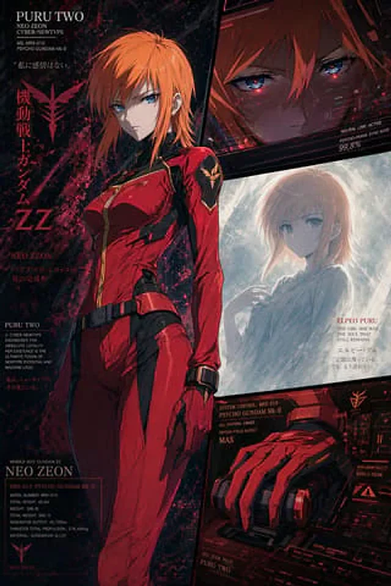

```text
Create a highly dramatic anime/sci-fi poster featuring the main character as {argument name="character name" default="Puru Two"} Inspired by "enhanced" pilots in a mecha warfare setting, the design employs a vertical visual style. At the center is a full-body image of a woman in a streamlined red and black pilot's suit, standing confidently from a slightly upward angle. She has short, choppy orange hair with long bangs on the sides, pale skin, and a serious yet aloof expression. Her uniform is a glossy deep red with black side panels, a high collar, fitted seams, a front zipper, dark gloves, a tactical belt, and military badges on her shoulders and chest. The background is a deep, abstract space with a space-age feel, incorporating black, deep red, magenta, and scattered starlight and energy splatter effects to create a raw, futuristic propaganda poster atmosphere. Three embedded panels are added around the central figure: the upper right corner features a close-up of the eyes and upper face seen through a transparent cockpit or HUD, accompanied by red interface lights and small technical readings; the middle right corner shows a soft, ghostly portrait of a girl in a loose white dress against a bright, hazy gray-white background; and the lower right corner shows a close-up of a gloved hand gripping a mechanical control lever against a background of a glowing cockpit dashboard. Dense graphic design elements and typography are added to the left and right edges, combining elegant serif English fonts, vertical Japanese headings, compact technical labels, and mecha specification blocks. Visible text includes large titles such as "PURU TWO," "NEO ZEON," "CYBER-NEWTYPE," "MOBILE SUIT GUNDAM ZZ," and "PSYCHO GUNDAM MK-II," as well as percentage/status readings such as "99.8%" and other small control panel annotations. Employing a highly detailed anime illustration style, and utilizing cinematic red lighting effects, glossy fabric highlights, sharp lines, delicate screen reflections, and layered UI overlays, the poster layout is designed to resemble a luxurious sci-fi character archive.
```

Model: GPT Image 2
Author: GPT Image 2 Prompts

[ProjectD](https://aitoolsradar.com/en/prompts/794ae81b7991c9) · [Recorded source](https://x.com/hyperboleon/status/2047167226957201518#reversed-0)
 · [Full original metadata and byte evidence](data/projectd-batch-0020.json)

## Anime Mirror Reflection of Younger Self

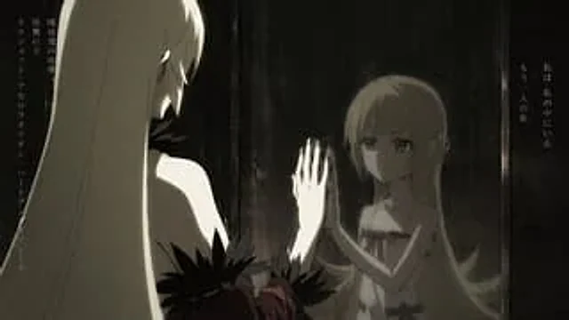

```text
A cinematic-quality anime illustration depicts a mature woman gazing into a dimly lit mirror, her reflection a younger version of herself. In the foreground, the mature woman is shown in three-quarter profile from behind, with long, straight hair.{argument name="hair color" default="gold"} She had fair hair and skin, and wore a dark dress with black feather-like embellishments on the shoulders. She was reaching out her right hand to touch the mirror. The mirror reflected her as a child, with {argument name="eye color" default="gold"} The child has bright eyes and slightly pointed ears, and wears a simple white dress with a red ribbon bow. The child's palm rests against the mirror, perfectly mirroring the mature woman's hand. The scene employs dim, melancholic, cinematic lighting, with soft, almost brownish tones that create a striking contrast between pale skin and a deep background. The vertically arranged Japanese text on the left {argument name="left text" default="The progenitor of vampires, the king of oddities: Kiss-Shot Acerola-Orion Heart-Under-Blade"} The text on the right is{argument name="right text" default="I am...the other me inside me"} .
```

Model: GPT Image 2
Author: GPT Image 2 Prompts

[ProjectD](https://aitoolsradar.com/en/prompts/b2cc716e8c6087) · [Recorded source](https://x.com/senb0n22a/status/2044870065074647183#reversed-0)
 · [Full original metadata and byte evidence](data/projectd-batch-0020.json)

## Anime Movie Pitch Document with Poster and Settei

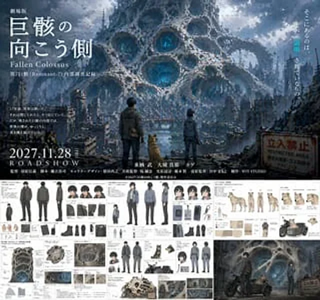

```text
{
  "type": "Animated film production proposal document",
  "overall_layout": "The layout is divided into two parts: the upper part features a large, movie-quality poster, while the lower part consists of a grid arrangement of five detailed reference images.",
  "top_section": {
    "type": "Movie poster",
    "visual": "A man, a woman, and a dog stand on an abandoned city street, their backs to the audience, gazing at a massive, porous, net-like alien structure in the sky. To their right stands a rusty \"RESTRICTED AREA\" sign.",
    "typography": {
      "title": "{argument name=\"movie title\" default=\"Theatrical version of Fallen Colossus\"}",
      "release_date": "{argument name=\"release date\" default=\"2027.11.28 ROADSHOW\"}",
      "tagline": "What's there is something that hasn't been \"explained\" yet.",
      "credits_studio": "{argument name=\"studio name\" default=\"WIT STUDIO\"}"
    }
  },
  "bottom_sections": [
    {
      "title": "{argument name=\"male character name\" default=\"Takeru Kurusu\"}",
      "type": "Character reference image",
      "elements": {
        "full_body_poses": 3,
        "expressions": 3,
        "detail_shots": 8,
        "description": "The male protagonist is wearing a dark tactical jacket and work pants. The video includes full-body views from the front, back, and side, a portrait, and detailed annotations of his gloves, boots, backpack, and walkie-talkie."
      }
    },
    {
      "title": "{argument name=\"female character name\" default=\"Oshiro Mana\"}",
      "type": "Character reference image",
      "elements": {
        "full_body_poses": 3,
        "expressions": 3,
        "detail_shots": 6,
        "description": "The female protagonist is wearing a gray tactical uniform. The video includes full-body views from the front, back, and side, a portrait, and detailed annotations of her jacket, boots, ID tag, and storage bag."
      }
    },
    {
      "title": "Kage (Kage) character design sketch",
      "type": "Animal character reference images",
      "elements": {
        "full_body_poses": 4,
        "expressions": 4,
        "detail_shots": 5,
        "description": "Dog Companion. Includes full-body views from the side, front, back, and oblique angles, head portrait, and detailed annotations of fur texture, paws, and motorcycle sidecar."
      }
    },
    {
      "title": "Remnant-7 Internal Section Design Drawing",
      "type": "Environment and vehicle reference diagram",
      "elements": {
        "large_diagrams": 1,
        "environment_thumbnails": 4,
        "vehicle_designs": 1,
        "description": "Cross-sectional view of the porous alien structure, small environment thumbnail, and motorcycle design drawings including characters."
      }
    },
    {
      "title": "Conceptual Art",
      "type": "Scene illustrations",
      "elements": {
        "characters": 3,
        "vehicles": 1,
        "description": "The male and female protagonists, along with a dog with a motorcycle sidecar, stop in front of the glowing, porous alien structure."
      }
    }
  ]
}
```

Model: GPT Image 2
Author: GPT Image 2 Prompts

[ProjectD](https://aitoolsradar.com/en/prompts/44954ddac6e251) · [Recorded source](https://x.com/old_pgmrs_will/status/2046281827493748820#reversed-0)
 · [Full original metadata and byte evidence](data/projectd-batch-0020.json)

## Anime Movie Poster at Twilight Station


```text
A movie poster with a cinematic anime style, featuring a protagonist who has {argument name="character hair color" default="light blue"} A girl with hair, animal ears, and a fluffy tail, wearing an oversized white T-shirt. She stood {argument name="time of day" default="twilight"} On a damp, reflective Japanese rural train platform, I look back. The sky displays a dramatic gradient from deep blue to pink. On the platform are a glowing vending machine, train tracks, and a sign that reads "TERMINAL" and "まもなく终龍ご乘車ありがとうございました". The elegant typography includes the text at the top {argument name="top tagline" default="Soda always smiles one stop before the final destination."} ", the large title at the bottom"{argument name="main title" default="Soda-san from the final stop"} "and its English subtitle "FROM THE TERMINAL, SODA-SAN", and the text at the bottom "{argument name="bottom tagline" default="It was probably not love, but more like a carbonated drink."} ".
```

Model: GPT Image 2
Author: GPT Image 2 Prompts

[ProjectD](https://aitoolsradar.com/en/prompts/291a785f7a124c) · [Recorded source](https://x.com/kotsu_kotsu_san/status/2045377402466107398#reversed-0)
 · [Full original metadata and byte evidence](data/projectd-batch-0020.json)

## Anime Movie Poster from Reference


```text
Using GPT image2, based on this image {argument name="genre" default="Fictional animated films"} Create a poster.
```

Model: GPT Image 2
Author: GPT Image 2 Prompts

[ProjectD](https://aitoolsradar.com/en/prompts/cad6410cb0f6d4) · [Recorded source](https://x.com/Creator_Pelsan/status/2046518435782541645)
 · [Full original metadata and byte evidence](data/projectd-batch-0020.json)

## Anime movie poster generator


```text
Create a title "{argument name="work title" default="Doraemon: Nobita&#39;s Romance of the Three Kingdoms"} Create an anime movie poster with the theme "{argument name="theme" default="MBTI Personality Test"} Youth Anime Posters with the Theme "
```

Model: GPT Image 2
Author: GPT Image 2 Prompts

[ProjectD](https://aitoolsradar.com/en/prompts/53c0b16cf19d53) · [Recorded source](https://x.com/ummo_ummo/status/2047348306351952350)
 · [Full original metadata and byte evidence](data/projectd-batch-0020.json)

## Anime Movie Poster Layout


```text
{
  "type": "Anime movie poster",
  "character": {
    "name": "{argument name=\"character name\" default=\"ずんだもん\"}",
    "appearance": "Green hair with an edamame-shaped bun, amber eyes, white short-sleeved shirt, green suspenders"
  },
  "layout": {
    "centerpiece": "A large bust of the figure, gazing upwards with hope, against a backdrop of a cityscape with towers.",
    "title_area": {
      "main_title": "{argument name=\"main title\" default=\"ずんだもん\"}",
      "subtitle": "{argument name=\"subtitle\" default=\"~A little me and a big step~\"}",
      "prefix": "theatrical version"
    },
    "secondary_poses": {
      "count": 5,
      "descriptions": [
        "The smiling face fading out in the upper left corner",
        "The full-body image in the lower left corner points to the train station sign that reads \"Sendai\".",
        "The half-body portrait with a worried expression in the lower right corner",
        "A silhouette of a figure in the center at the bottom, gazing at the rural sunset.",
        "The simple line drawing of a face in the bottom right corner"
      ]
    },
    "text_elements": [
      {
        "position": "Top right corner",
        "text": "{argument name=\"catchphrase\" default=\"This encounter will change me.\"}"
      },
      {
        "position": "Top left corner",
        "text": "Winner of the Audience Award at the 1st Zunda Film Festival (located within the laurel wreath)."
      },
      {
        "position": "Middle left",
        "text": "Guided by the aroma of edamame, Zundamon's little adventure now begins—"
      },
      {
        "position": "bottom left corner",
        "text": "Theme song \"Zunda no Uta\" performed by: Zundamon (NEUTRINO) (located within the circle)"
      },
      {
        "position": "bottom right corner",
        "text": "\"Edamame and stuff like that are super delicious!\""
      },
      {
        "position": "bottom edge",
        "text": "Cast and Crew{argument name=\"release date\" default=\"Nationwide release in the summer of 2024\"}"
      }
    ]
  }
}
```

Model: GPT Image 2
Author: GPT Image 2 Prompts

[ProjectD](https://aitoolsradar.com/en/prompts/f4c2d7eb1ed731) · [Recorded source](https://x.com/hayatopika/status/2045302790852108317#reversed-0)
 · [Full original metadata and byte evidence](data/projectd-batch-0020.json)

## Anime Music Bootcamp Promo Poster


```text
Create a dramatic, Japanese anime-style event promotional thumbnail poster. Use a 4:5 vertical composition, ultra-detailed, cinematic quality, neon lighting, and high contrast, with a design style reminiscent of social media announcements. The main subject is a beautifully crafted anime girl on the right side of the image, in a half-body portrait, with flowing hair.{argument name="hair color" default="Dark blue"} She has long hair adorned with tiny star hair clips, wears a dark hoodie, and large studio headphones around her neck. The background is a twilight-to-night city skyline shimmering with lights, musical energy particles, lens flares, and glowing petals. Her face is partially obscured by a soft, rectangular blur. The design utilizes vibrant colors of electric blue, purple, magenta, gold, and sunset orange. Layered Japanese typography is incorporated into the design, ensuring clear and legible text that blends seamlessly into the artistic visuals like a sophisticated promotional advertisement. Contains 8 The main text of the group: the copywriting in the upper left corner is "The story of the beginning and the sound of the music.", with a smaller subtitle below "The story of the beginning and the sound of the sound."; on the right In the upper corner is a glowing light box sign that reads "GW consecutive holidays!", and below it is a smaller neon light frame that reads "みんなで高の音楽をつくろう!"; above the main title in the center is the small English word "AI MUSIC BOOTCAMP 2", below it is a huge Japanese title "AI 音楽ブートキャンプ2"; across the middle is a huge golden metallic announcement that says "Opening decision!"; the date column reads "Opening period", followed by "5.2 SAT soil" and "5.4 MON month"; near the bottom is a label appeal that reads "Participate in はカンタン!! #AI音楽ブートキャンプ2 をつけて contributes するだけ!"; below is a line of encouragement "Welcome to those who are new to the world! みんなで高の音楽体験を!"; and there are 3 at the bottom. The icons represent the functions: "Learn with fellow students on the same path," "Create new music experiences with AI," and "Create your own song based on your thoughts." On the left edge, add a vertical film strip containing four embedded thumbnails showcasing the same girl in music-related scenes: 1) performing on stage for an audience, 2) working at a music production station with a screen and equipment, 3) singing into a microphone, and 4) playing an acoustic guitar. At the bottom, add two neon music-themed icon illustrations: a tilted smartphone with musical notes in the lower left corner and a glowing microphone with musical notes in the lower right corner. The text effect should be glossy and luminous with gold and white embossed highlights, and the title should be surrounded by vibrant beams of light and exploding sparks. The overall atmosphere should be inspiring, celebratory, futuristic, and emotionally resonant, as if targeting {argument name="event name" default="AI Music Bootcamp 2"} A high-impact advertisement for a music training camp during Japan's Golden Week.
```

Model: GPT Image 2
Author: GPT Image 2 Prompts

[ProjectD](https://aitoolsradar.com/en/prompts/012fdce67074e5) · [Recorded source](https://x.com/sorane_aimusic/status/2047507066697507134#reversed-0)
 · [Full original metadata and byte evidence](data/projectd-batch-0020.json)

## Anime Music Romance Movie Poster


```text
An anime-style movie poster features a bright, energetic high school girl in the foreground and a quiet high school boy in the background. The girl has long, dark purple hair adorned with ribbons and musical note hair clips, and wears a white short-sleeved school uniform shirt, a dark plaid skirt, and a striped tie. She smiles warmly, extending her hand to the viewer with a piece of paper on it.{argument name="paper text" default="I want to share this song with you in the future...♡"} In the background, a boy sits at a desk, resting his chin on his hand, his expression indifferent. He has messy dark hair, wears a white hoodie under a dark suit jacket, and headphones around his neck. The scene is set in a brightly lit music production studio, complete with dual computer monitors displaying audio waveforms, microphones, and keyboards. The visuals are rendered with bright, cinematic lighting effects, featuring lens flare and flickering. Striking text overlays include a large pink and blue vertical slogan on the left.{argument name="vertical text" default="Billions of views, Secret, First Love, Song of Destiny"} A large, stylized main title at the bottom center{argument name="main title" default="After-School Million Note"} It features a shimmering gradient effect, with a subtitle below.{argument name="subtitle" default="~Only the aspiring singer-singer girl knows that I, an introverted guy, am a Vocaloid producer with hundreds of millions of views~"} At the very bottom is a dense credits list of the film's cast and crew, next to which is written {argument name="studio logo" default="STELLA FILM THEATER"} The logo.
```

Model: GPT Image 2
Author: GPT Image 2 Prompts

[ProjectD](https://aitoolsradar.com/en/prompts/94fb91696739d3) · [Recorded source](https://x.com/koshian_to/status/2046095775504208271#reversed-0)
 · [Full original metadata and byte evidence](data/projectd-batch-0020.json)

## Anime Noodle Advertisement Banner


```text
{
  "type": "Japanese-style promotional banner advertisement",
  "background": "A vibrant red color, adorned with delicate cherry blossom patterns and gold confetti.",
  "character": {
    "style": "Anime style",
    "appearance": "A young woman with long black braids, wearing a fox mask with her head turned to the side.",
    "outfit": "{argument name=\"character outfit\" default=\"The shrine maiden&#39;s outfit is red and white, and features decorative knots.\"}",
    "pose": "Winking, a vibrant smile, pointing to the product cup"
  },
  "product": {
    "description": "Cup-shaped instant noodle model",
    "design": "The packaging is red and white, and it is printed with the words 'COP NEEDLE' and 'soy sauce flavor'."
  },
  "food_shot": {
    "description": "A big bowl of steaming hot ramen",
    "toppings": [
      "3 shrimp",
      "meat chunks",
      "Half a soft-boiled egg",
      "chopped green onion",
      "Crushed eggs"
    ]
  },
  "typography_and_layout": {
    "text_elements_count": 8,
    "elements": [
      {
        "position": "Star-shaped light in the upper left corner",
        "text": "{argument name=\"top left burst text\" default=\"Newly released!\"}"
      },
      {
        "position": "Huge 3D title at the top center",
        "text": "{argument name=\"main product name\" default=\"コップヌードル\"}"
      },
      {
        "position": "Capsule box below the main title",
        "text": "Soy sauce flavor"
      },
      {
        "position": "Central yellow serrated rays",
        "text": "Pour in hot water and wait 3 minutes!"
      },
      {
        "position": "Floating text on the right side",
        "text": "{argument name=\"catchphrase text\" default=\"A gentle flavor with a fragrant broth! A rich and delicious soup!\"}"
      },
      {
        "position": "bottom left chat bubble",
        "text": "Recommended by the shrine maiden!"
      },
      {
        "position": "Bottom center text",
        "text": "Perfect for when you're feeling a little hungry!"
      },
      {
        "position": "Red price box in the bottom right corner",
        "text": "{argument name=\"price text\" default=\"198 yen\"}"
      }
    ]
  }
}
```

Model: GPT Image 2
Author: GPT Image 2 Prompts

[ProjectD](https://aitoolsradar.com/en/prompts/3fbbe87c631de0) · [Recorded source](https://x.com/Yuupapa_free/status/2044636927505375374#reversed-0)
 · [Full original metadata and byte evidence](data/projectd-batch-0020.json)

## Anime Office Lady Beer Toast at Night


```text
A delicate anime-style night scene illustration, using a 1:2 vertical composition. A young Japanese working woman stands on a riverside promenade at night, facing the viewer, cheerfully raising a large glass of beer in a toast. She wears a fitted dark navy blue business suit, paired with a pencil skirt, white shirt, and red tie, with her company badge around her neck. She has long, straight, dark brown to black hair with soft bangs, and a slender figure, exuding a relaxed and friendly atmosphere after get off work. Due to the perspective, her right hand, which is extended towards the camera, holds an ice-cold beer glass filled with golden lager and foam, making it particularly eye-catching in the foreground. Her left arm hangs naturally at her side. A white, manga-style speech bubble is added to her upper right corner, containing the vertically arranged Japanese text "今日もお疲れさまでした！" (I'm tired today!). The scene is set on a paved waterfront promenade with metal railings, three visible warm-colored lanterns beside it, and a river or canal in the background against a modern city skyline with many bright windows. Above, a clear, deep blue starry sky dominates the space, with the Milky Way extending diagonally from below the center behind the character to the upper right corner, forming a bright band of light. Cinematic lighting effects are used, with cool-toned moonlight contrasting with warm-toned lantern light, clean lines, delicate sheen and shadow on the suits, and rich detail in the starry sky, creating a tranquil yet celebratory after-get off work atmosphere.
```

Model: GPT Image 2
Author: GPT Image 2 Prompts

[ProjectD](https://aitoolsradar.com/en/prompts/15d28c9953090c) · [Recorded source](https://x.com/ShoSecAI/status/2046965904958009519#reversed-0)
 · [Full original metadata and byte evidence](data/projectd-batch-0020.json)

## Anime open-world adventure HUD


```text
Create a third-person over-the-shoulder screenshot from a nostalgic anime-style open-world adventure game. The protagonist stands in a lush forest with detailed foliage and vibrant shading, drawing a bow toward distant enemies. Add a clean on-screen HUD: quest log, compass at the top, character portrait and status effects at bottom left, subtle rain droplets on screen, and sun rays filtering through trees. Keep the composition dynamic, the forest immersive, and the UI believable like a premium action-RPG screenshot.
```

Model: GPT Image 2
Author: @reddit-community

[ProjectD](https://aitoolsradar.com/en/prompts/3639d87496404d) · [Recorded source](https://www.reddit.com/r/midjourney/comments/1lh2l98/anime_style_video_games_prompts_included/)
 · [Full original metadata and byte evidence](data/projectd-batch-0020.json)

## Anime personality attribute interpretation


```text
Generate a with{argument name="personality" default="ENFP"} Characteristic role interpretation, similar to personality attribute analysis, style is{argument name="style" default="anime style"} .
```

Model: GPT Image 2
Author: GPT Image 2 Prompts

[ProjectD](https://aitoolsradar.com/en/prompts/ee73cb7ce477cd) · [Recorded source](https://x.com/CarrotRadish/status/2047515444857524319)
 · [Full original metadata and byte evidence](data/projectd-batch-0020.json)

## Anime Pop Sphynx Cat Outing Poster


```text
A vibrant, anime-pop style selfie illustration depicts a young person carrying a black pet carrier containing a Sphynx cat, while holding a brown leash aloft in their other hand. The person has messy black short hair, wears round-framed glasses, and a black hoodie or dark oversized jacket; their face is deliberately obscured by a centrally located square blur. The cat is the visual focus at the bottom of the image; it's a light pink hairless Sphynx with large ears, bright blue eyes, delicate skin wrinkles, and wears a comfortable brown knitted sweater. The dynamic, low-angle selfie perspective, with the raised fist and the encircling leash occupying the upper right corner, is used. The background is a bustling amusement park or festival scene, rendered with explosively saturated colors, primarily electric blue, complemented by confetti, paint splatters, stars, cartoon-style stickers, and quirky signs. A large Chinese title is added at the top.{argument name="headline text" default="Take Pizi out to play"} Use an oversized, bold speech bubble font with a thick white outline and multi-colored fill; add a pink paw print icon near the title; add two yellow exclamation marks near the raised hand; add a speech bubble sticker on the left with the text "..."{argument name="left sticker text" default="GO!"} Add one speech bubble sticker on the right side with the text:{argument name="right sticker text" default="YEAH"} Add a paw print speech bubble in the lower left corner; and add two pink heart icons near the cat. The overall composition is vibrant, cute, and slightly chaotic, employing bold cel-shaded outlines, glossy highlights, textured brushstrokes, poster-style lighting, high contrast, and richly detailed neon comic aesthetics.
```

Model: GPT Image 2
Author: GPT Image 2 Prompts

[ProjectD](https://aitoolsradar.com/en/prompts/ccbbc57ef92ab4) · [Recorded source](https://x.com/JokerZhangCB/status/2046819007173738897#reversed-0)
 · [Full original metadata and byte evidence](data/projectd-batch-0020.json)

## Anime Pop-Art Protest Poster


```text
A striking anime pop art poster features a tall, white-haired male sorcerer in a dark navy turtleneck jacket. He is depicted in half-length, facing the camera with a confident pose, his left hand making a peace sign near the lens. His face is partially obscured by a rectangular blurred/occluded block around his eyes and nose, while his spiky, silver-white hair dramatically spreads outwards above a dark eye mask or goggles. A large cartoon speech bubble is placed at the top, containing the exact text.{argument name="headline text" default="LUDDITES ALWAYS LOSE!"} Use a heavy, all-caps black sans-serif font. A vibrant blue background is used, filled with dense, radiating red and orange speed lines bursting outwards from behind the character, creating a dynamic comic book cover feel. Emphasis is placed on bold ink outlines, cel-shaded anime-style rendering, poster-like contrast, and a slightly distorted retro comic book print look. The composition should be vertical, compactly cropped, energetic, rebellious, graphic, and memetic, and {argument name="character hair color" default="silver white"} hair,{argument name="coat color" default="dark navy"} coat and{argument name="background color" default="bright blue with red-orange radial lines"} The background color is the main color.
```

Model: GPT Image 2
Author: GPT Image 2 Prompts

[ProjectD](https://aitoolsradar.com/en/prompts/642d629a43f9f9) · [Recorded source](https://x.com/pigeon__s/status/2046819602869768507#reversed-0)
 · [Full original metadata and byte evidence](data/projectd-batch-0020.json)

## Anime Poster & Concept Art Sheet


```text
{
  "type": "Anime Movie Poster and Overall Production Design Reference Images",
  "overall_theme": "{argument name=\"setting theme\" default=\"Dark Deep Sea Sci-Fi Abyss\"}",
  "layout": {
    "top_half": "Movie-quality main visual poster",
    "bottom_half": "Dense multi-panel production design documents"
  },
  "poster_section": {
    "characters": [
      {
        "description": "Young woman with dark hair (profile view)",
        "special_feature": "arm with{argument name=\"female glow color\" default=\"blue\"} Luminous texture"
      },
      {
        "description": "Young man in profile, with short, dark hair.",
        "special_feature": "arm with{argument name=\"male glow color\" default=\"orange color\"} Luminous texture"
      }
    ],
    "background": "Towering Gothic underwater structures, giant bioluminescent jellyfish, and large submarines.",
    "typography": {
      "tagline": "{argument name=\"tagline\" default=\"The deeper you dive, the less you remain human.\"}",
      "main_title": "{argument name=\"main title\" default=\"Resonance Abyss\"}",
      "subtitle": "Abyss Resonance Realm",
      "footer": "Forged anime production staff list and theatrical version"
    }
  },
  "reference_sheet_section": {
    "grid_layout": "Dense architectural and character design grid with Japanese annotations",
    "panels": [
      {
        "subject": "Female character design",
        "elements": [
          {
            "type": "Standard Clothing Three-View Drawings",
            "count": 4,
            "poses": [
              "front",
              "back",
              "side",
              "3/4 side view"
            ]
          },
          {
            "type": "Facial expressions",
            "count": 3
          },
          {
            "type": "Three-view drawing of a diving suit",
            "count": 4,
            "poses": [
              "front",
              "back",
              "side",
              "3/4 side view"
            ]
          },
          {
            "type": "Close-up of clothing details",
            "count": 3
          },
          {
            "type": "Color Scheme",
            "count": 6
          }
        ]
      },
      {
        "subject": "Male character design",
        "elements": [
          {
            "type": "Standard Clothing Three-View Drawings",
            "count": 4,
            "poses": [
              "front",
              "back",
              "side",
              "3/4 side view"
            ]
          },
          {
            "type": "Facial expressions",
            "count": 3
          },
          {
            "type": "Three-view drawing of a diving suit",
            "count": 4,
            "poses": [
              "front",
              "back",
              "side",
              "3/4 side view"
            ]
          },
          {
            "type": "Close-up of equipment details",
            "count": 4
          }
        ]
      },
      {
        "subject": "Biological and Mecha Design",
        "elements": [
          {
            "type": "Jellyfish bioview",
            "count": 4
          },
          {
            "type": "Submarine view",
            "count": 3
          }
        ]
      },
      {
        "subject": "Environment and Worldview Construction",
        "elements": [
          {
            "type": "Exterior view of the dome-shaped underwater base",
            "count": 3
          },
          {
            "type": "Proportion comparison chart",
            "count": 1
          },
          {
            "type": "Internal cross-section panel",
            "count": 3
          },
          {
            "type": "UI interface model",
            "count": 2
          },
          {
            "type": "System Flowchart",
            "count": 1
          }
        ]
      }
    ]
  }
}
```

Model: GPT Image 2
Author: GPT Image 2 Prompts

[ProjectD](https://aitoolsradar.com/en/prompts/853c5e74f51544) · [Recorded source](https://x.com/old_pgmrs_will/status/2045091769180914019#reversed-0)
 · [Full original metadata and byte evidence](data/projectd-batch-0020.json)

## Anime Production Layout Sheet


```text
{
  "type": "Animation Production Layout Table",
  "style": "Traditional colored pencil original drawings, keyframe animation drawing",
  "subject": {
    "character": "{argument name=\"character name\" default=\"Shepherd&#39;s Purse (Nazuna) - Seven Herbs\"}",
    "appearance": "Anime girl, possessing{argument name=\"hair color\" default=\"Light purple\"} She has double braids and bangs, blue eyes, and is wearing a dark plus-size coat.",
    "pose_and_expression": "{argument name=\"expression\" default=\"With a smug expression, showing his little tiger teeth, he rested his chin on his hand.\"}"
  },
  "background": "{argument name=\"background scene\" default=\"Nighttime city skyline with railings\"} Soft focus effect",
  "layout": {
    "top_edge": "Standard animation paper positioning holes",
    "left_margin": {
      "series_title": "{argument name=\"anime title\" default=\"よふかしのうた\"}",
      "production_codes": [
        "#05 C.",
        "[A] (1)"
      ],
      "circled_note": "Use colored outlines for the highlights in the hair."
    },
    "right_margin": {
      "red_box": "002.normal",
      "timing_layers": [
        "A (1)",
        "B (1) (2) (3)",
        "C (1) (2) END"
      ],
      "background_notes": [
        "BL Night View",
        "BG City Night Scene Outline"
      ]
    }
  }
}
```

Model: GPT Image 2
Author: GPT Image 2 Prompts

[ProjectD](https://aitoolsradar.com/en/prompts/e9d736716c3505) · [Recorded source](https://x.com/Gc_qube/status/2046189202488881427#reversed-1)
 · [Full original metadata and byte evidence](data/projectd-batch-0020.json)

## Anime Promotional Poster


```text
An anime promotional poster depicts a girl smiling and making a peace sign while looking back. She has black twin tails, a white headband, and a green hair tie, and wears a white shirt with a red ribbon and a dark blue skirt. She carries a large pink backpack adorned with animal patterns, a green teddy bear, and a name tag. The background shows a blurred pink street with cherry blossoms falling. The text overlay in the upper left corner reads "Monogatari Series OFF &amp; MONSTER SPIN-OFF." The large vertical text on the left reads {argument name="character name" default="Mayoi Hachikuji"} The pink badge in the upper right corner reads "A Brand New Story Series Side Story." The vertical text on the right reads {argument name="catchphrase" default="When you&#39;re in trouble, Mayoi-chan is your go-to!"} The bottom right corner displays a glowing title.{argument name="main title" default="Kabukimonogatari"} and subtitle{argument name="subtitle" default="-Midnight Zombie-"} The bottom left corner shows {argument name="broadcast date" default="July 6, 2024"} The opening section includes broadcast details and a credits list. The white box in the bottom right corner contains a synopsis and the series logo.
```

Model: GPT Image 2
Author: GPT Image 2 Prompts

[ProjectD](https://aitoolsradar.com/en/prompts/32f30c4762932c) · [Recorded source](https://x.com/senb0n22a/status/2044448417456496751#reversed-0)
 · [Full original metadata and byte evidence](data/projectd-batch-0020.json)

## Anime Rock Band Beverage Collab Poster


```text
{
  "type": "Promotional poster advertisement",
  "theme": "{argument name=\"band theme\" default=\"Anime Rock Band\"} Collaboration beverage",
  "text_elements": {
    "top_left_badge": "Quantity limited",
    "top_right": "LIMITED DROP",
    "main_headline": "{argument name=\"main headline\" default=\"Let your emotions explode.\"}",
    "sub_headline": "{argument name=\"sub headline\" default=\"That one bite becomes the stage.\"}",
    "bottom_text": "Keep the excitement of the live performance alive."
  },
  "layout": {
    "upper_section": {
      "description": "Five anime girls dressed in black leather punk rock outfits performed on a hot stage.",
      "characters": [
        {
          "position": "Leftmost",
          "appearance": "Golden twin ponytails, holding drumsticks, with a smile on her face."
        },
        {
          "position": "Left and Middle",
          "appearance": "Long black hair, holding a blue electric guitar"
        },
        {
          "position": "central",
          "appearance": "Red hair, singing into the microphone, wearing a red plaid tie."
        },
        {
          "position": "Right Center",
          "appearance": "Dark hair, leather jacket over hoodie, holding a purple bass guitar"
        },
        {
          "position": "far right",
          "appearance": "Short black hair with green highlights, holding a black electric guitar"
        }
      ]
    },
    "lower_section": {
      "description": "Five cans of beverages are arranged horizontally, each can bearing the portrait of the corresponding character directly above it.",
      "product_name": "{argument name=\"product name\" default=\"BLOOD ORANGE SPARK\"}",
      "can_count": 5,
      "surroundings": "Liquid splashing, sparks flying, and cut open{argument name=\"flavor theme\" default=\"blood orange\"} Half a piece floated around the jar."
    },
    "background": "The concert stage lighting is explosive, featuring flame effects and silhouettes of cheering crowds at the bottom."
  }
}
```

Model: GPT Image 2
Author: GPT Image 2 Prompts

[ProjectD](https://aitoolsradar.com/en/prompts/e5c0e10cf77f59) · [Recorded source](https://x.com/kuga_rage/status/2045617317279846568#reversed-0)
 · [Full original metadata and byte evidence](data/projectd-batch-0020.json)

## Anime Romance Movie Poster


```text
This Japanese-style romantic movie poster uses a rounded, vertical composition suitable for smartphones, with a design style reminiscent of a sophisticated anime key visual. The main subject is a beautiful young woman standing on an outdoor balcony at dusk, looking back at the audience with a gentle yet melancholic expression. She has extremely long, silver-white twin ponytails tied with dark ribbons, fair skin, and bright, pinkish-purple eyes. She wears an elegant white ruffled blouse with puffed sleeves, paired with a dark high-waisted skirt or a belted dress, exuding an elegant yet slightly gothic sense of school romance. The atmosphere is dreamy and sensual, filled with luminous, blurred light spots, falling petals, or snowflake-like sparkles, bathed in the pink and pale purple light of the sunset, with a blurred, glittering cityscape in the background. Rich, cinematic-quality anime rendering is used to present ultra-detailed hair strands, soft contour lighting, bright eyes, and the bittersweet emotions of first love. The Japanese poster layout is integrated into the composition: a large vertical pink poetic slogan on the right, a vertical white slogan on the left, and a large main title in the lower left corner.{argument name="title text" default="The poster girl"} Next to it is a smaller subtitle{argument name="subtitle text" default="A love story we&#39;ll weave together"} Five small rectangular film preview images are arranged in the center at the bottom, each showcasing different emotional close-ups of the same female lead. The top and bottom feature a dense credits list, film festival award logos, and small-print distribution information, giving the overall impression of a high-end romantic animated film poster that conveys a poignant love story. The color palette uses pale purple, blush pink, violet, pearl white, and midnight blue, employing soft lighting effects, shallow depth of field, and an elegant poster composition.
```

Model: GPT Image 2
Author: GPT Image 2 Prompts

[ProjectD](https://aitoolsradar.com/en/prompts/d68355b6f0e00e) · [Recorded source](https://x.com/ai_studioapollo/status/2046582942303174916#reversed-0)
 · [Full original metadata and byte evidence](data/projectd-batch-0020.json)

## Anime Romance Promotional Poster


```text
An anime promotional poster depicts {argument name="female character description" default="A young woman with short light blue hair, dressed in a black and white maid outfit."} and{argument name="male character description" default="A young man with short black hair, wearing a black, white, and orange sports jacket."} A scene of tender embrace between them. She rests peacefully against his chest with her eyes closed, while he gazes down at her with deep affection, his arms encircling her. The background is soft, blurred pink cherry blossoms, dappled with sunlight. The text in the upper left corner reads…{argument name="series title" default="Re:ZERO - Starting Life in Another World -"} The logo is marked with the symbol "". The handwritten text in the middle on the left reads "".{argument name="handwritten quote" default="You are my hero, Subaru... ♡"} The elegant text in the lower right corner reads:{argument name="tagline" default="A bond that transcends death."} Below it is a note that reads, "The TV anime is currently airing!" It features high-quality official anime art style.
```

Model: GPT Image 2
Author: GPT Image 2 Prompts

[ProjectD](https://aitoolsradar.com/en/prompts/59ceb79517c057) · [Recorded source](https://x.com/mirochill/status/2044822497330135321#reversed-0)
 · [Full original metadata and byte evidence](data/projectd-batch-0020.json)

## Anime Roses and Books End Card


```text
A dreamlike anime ending illustration depicts a young woman seated in a fantastical library of roses and books, surrounded by falling petals and open pages. She keeps {argument name="hair color" default="bright purple"} Her hair was tied back in a high ponytail with a black hair tie, and she had casual bangs. She wore small gold earrings, and a tiny gold hair clip with the word "AI" on it was tucked beside her bangs. Most of her face was softly blurred with rectangular shapes, but she remained the central figure in the composition. She wore a top with striking white lettering.{argument name="shirt text" default="AITuber"} She wore a light green T-shirt, layered under an oversized ice-blue trench coat with pink splatter paint, and light-colored denim shorts. In her right hand, she held a red rose, and in her left hand, a dark blue hardcover book with the title displayed as…{argument name="book title" default="Roses & Books"} She is casually reclining in a pose reminiscent of a stylish anime ending theme, one leg straight and the other bent. The scene is a lavish, fantastical reading nook, with two towering stacks of books on each side, entwined with blooming pink and red rose vines. The image must include six clearly visible book spines or covers with decorative serif fonts, titled: "Poems &amp; Books," "Roses &amp; Books," "Dreams," "Memories," "Letters," and "Language of Flowers." A takeaway coffee mug is placed in the lower left corner, printed with {argument name="cup text" default="Read. Write. Bloom."} The image features an open notebook and pen near the legs in the foreground, showcasing a rose sketch and notes. Another open botany illustration book is located in the lower right corner. Above, four open books float in the air, along with several pages of paper. Behind her, a bright arched window reveals a pastel-colored fairytale city against a backdrop of a clear, azure sky with cathedral spires. The entire composition is filled with scattered pink and red rose petals, glitter, soft painterly light and shadow, decorative floral details, and richly colored book covers in navy, pink, and cream. Employing a refined anime illustration style, the delicate lines and bright pastel highlights create a romantic and fantastical atmosphere. The balanced and symmetrical composition is suitable for {argument name="occasion" default="St. George&#39;s Day"} Springtime books and rose-themed commemorative visuals.
```

Model: GPT Image 2
Author: GPT Image 2 Prompts

[ProjectD](https://aitoolsradar.com/en/prompts/0da126f9c0d600) · [Recorded source](https://x.com/ivy432hz/status/2047176192084881675#reversed-0)
 · [Full original metadata and byte evidence](data/projectd-batch-0020.json)

## Anime RPG Character Design Sheet


```text
(masterpiece:1.3), (best quality:1.3), (ultra detailed:1.2), absurdres, official game concept art, anime character reference sheet, premium gacha game character design, anime movie quality, anime fantasy RPG aesthetic, high-end anime visual development
```

Model: GPT Image 2
Author: Kiki

[ProjectD](https://aitoolsradar.com/en/prompts/3ba6ea8eed0f79) · [Recorded source](https://youmind.com/prompts/anime-rpg-character-sheet-22745)
 · [Full original metadata and byte evidence](data/projectd-batch-0020.json)

## Anime RPG Character Reference Sheet


```text
High-detail anime character reference sheet, premium fantasy RPG character design board, {argument name="aesthetic" default="elegant blue-and-white oceanic"} aesthetic, Japanese fantasy anime style, highly polished gacha game presentation, cinematic concept art layout
```

Model: GPT Image 2
Author: Kiki

[ProjectD](https://aitoolsradar.com/en/prompts/2f2c14cf94ecd5) · [Recorded source](https://youmind.com/prompts/anime-rpg-character-design-sheet-22736)
 · [Full original metadata and byte evidence](data/projectd-batch-0020.json)

## Anime RPG Sword Attack Storyboard


```text
{
  "type": "Anime Action Game Project List",
  "style": "A high-end Japanese action RPG with a cinematic feel, exquisite 3D anime rendering, dramatic blue nighttime lighting, glowing sword effects, cherry blossom petals, motion blur, and a fantastical samurai atmosphere.",
  "subject": {
    "character": {
      "name": "{argument name=\"character name\" default=\"シャルロット\"}",
      "gender_presentation": "young women",
      "hair": {
        "color": "{argument name=\"hair color\" default=\"silver-white\"}",
        "style": "Very long, straight hair with soft bangs, and a flower hair accessory on one side."
      },
      "outfit": {
        "primary_color": "Deep indigo",
        "description": "An elegant kimono-inspired combat uniform with long, flowing sleeves, a tiered skirt, and a sash-like obi (waistband). The fabric features white floral patterns and gold details."
      },
      "weapon": "Samurai sword with glowing blue blade"
    },
    "enemies": {
      "count": 8,
      "description": "Black-clad ninja swordsmen surrounded the courtyard"
    }
  },
  "environment": {
    "location": "Traditional Japanese temple gardens at night",
    "details": [
      "stone slab road",
      "Wooden temple building",
      "Warm paper lanterns",
      "cherry blossom tree",
      "Falling petals",
      "Deep blue sky"
    ]
  },
  "ui": {
    "components": [
      "Character status bar in the upper left corner",
      "The small circular map in the upper right corner",
      "skill icon in the bottom corner",
      "Combo count text on the right",
      "Subtitles or move text in some panels"
    ]
  },
  "layout": {
    "grid": {
      "rows": 3,
      "columns": 3,
      "count": 9
    },
    "numbered_panels": true,
    "sections": [
      {
        "title": "1",
        "position": "Top left",
        "count": 1,
        "description": "The game features a wide-angle view where the female protagonist stands in the center of a temple courtyard, surrounded by eight ninja enemies; the game's HUD is visible; dialogue text is displayed at the bottom; the combo count is 0."
      },
      {
        "title": "2",
        "position": "Upper-middle",
        "count": 1,
        "description": "A close-up of the female protagonist drawing or gripping a glowing katana from her chest, with blue spark-like particles around the blade, a confident pre-attack stance; combo count: 0."
      },
      {
        "title": "3",
        "position": "Top right",
        "count": 1,
        "description": "A rapid, spinning horizontal slash; a bright, circular blue energy ring emanates from the sword and repels the enemy; combo count: 12."
      },
      {
        "title": "4",
        "position": "Left and Middle",
        "count": 1,
        "description": "Dynamic aerial jump, full-body side view, robes and long hair flowing, sword blade tracing a sweeping blue arc; combo count: 25."
      },
      {
        "title": "5",
        "position": "middle",
        "count": 1,
        "description": "From a top-down perspective, she lunges downwards, sword tip pointing down, sleeves unfurling like wings, enemies below; combo count: 25."
      },
      {
        "title": "6",
        "position": "Right Center",
        "count": 1,
        "description": "Impact frame: She lands and unleashes a massive burst of blue energy from the ground, blasting enemies away with the shockwave; combo count reaches 58."
      },
      {
        "title": "7",
        "position": "Bottom left",
        "count": 1,
        "description": "Special move title card, dark blue background, with glowing sword ring; large Japanese text including character name and attack title; combo count is 128.",
        "visible_text": [
          "Charlotte's daydream!",
          "Ten Strikes in an Instant: Kagetsu no Tachi",
          "128 Combo"
        ]
      },
      {
        "title": "8",
        "position": "Middle to lower",
        "count": 1,
        "description": "The game screen is shown from a three-quarters rear perspective. The female protagonist performs a massive circular sweeping attack in the courtyard, her long white hair and kimono flowing behind her, while enemies scatter in the distance; the combo count is 128."
      },
      {
        "title": "9",
        "position": "Bottom right",
        "count": 1,
        "description": "The tranquil closing shot, filmed from behind, shows the female protagonist standing alone in a moonlit courtyard before the temple gate and lanterns, petals falling, without any active combat action."
      }
    ],
    "reading_order": "From left to right, from top to bottom"
  },
  "color_palette": {
    "dominant": [
      "Midnight Blue",
      "Electric Blue",
      "silver-white",
      "Indigo",
      "Lantern Gold"
    ]
  },
  "camera_and_mood": "The cinematic action sequences range from calm confrontations to sword draws, spinning combos, aerial attacks, and finishing moves, culminating in a serene aftertaste; each panel is framed like a game screenshot with a visible HUD."
}
```

Model: GPT Image 2
Author: GPT Image 2 Prompts

[ProjectD](https://aitoolsradar.com/en/prompts/b99b67e1cfab2a) · [Recorded source](https://x.com/noriyang_crypt/status/2047347771381092436#reversed-0)
 · [Full original metadata and byte evidence](data/projectd-batch-0020.json)

## Anime Sakura Movie Poster


```text
A beautifully crafted Japanese animated film poster, employing a soft, bright spring-themed anime style. The main image shows two teenage high school girls walking hand-in-hand down a quiet residential street lined with cherry blossom trees. They wear matching Japanese sailor school uniforms: white long-sleeved shirts with navy blue sailor collars, light blue scarves, and dark blue pleated skirts, each carrying a navy blue backpack. The girl on the left has dark hair tied in a low side bun with a few wisps, adorned with a small pink cherry blossom hair clip; she turns to look at the other girl, her expression gentle yet slightly melancholic. The girl on the right has long, straight black hair, gazing tenderly back at her. Pink cherry blossom petals fall in the warm afternoon backlight, creating a romantic and sensual atmosphere, with luminous rim lighting, soft lens flares, and painterly details. On the left edge, add a vertical collage containing seven illustrated memory scenes from the story: 1) a nostalgic childhood moment with the two children together, 2) a close-up portrait of the long-haired girl, 3) the two characters standing apart during a tense or contemplative moment, 4) a scene of three people talking indoors, 5) a close-up profile of the girl with her hair in a bun, 6) an intimate close-up of the two main characters almost kissing, and 7) the two girls walking side by side under a cherry blossom tree from behind. At the top, add the Japanese tagline: “変わってしまった朝、変わらなかった想い.” Below, in the center, place the elegant pink neon handwritten title.{argument name="title text" default="Story of U"} Below it, add a smaller Japanese subtitle and a line of screening information.{argument name="release text" default="Released in Spring 2027"} At the very bottom, a dense white Japanese credits list in small print is added, following an authentic movie poster layout. Overall tone: a bittersweet yuri epic drama, cinematic key visuals, emotional resonance, high level of detail, pastel and navy blue color scheme, and a vertical poster composition.
```

Model: GPT Image 2
Author: GPT Image 2 Prompts

[ProjectD](https://aitoolsradar.com/en/prompts/59be22cb150f23) · [Recorded source](https://x.com/tski_2602/status/2047566707871658034#reversed-0)
 · [Full original metadata and byte evidence](data/projectd-batch-0020.json)

## Anime Samurai Game Ad Poster


```text
Create a highly impactful vertical mobile game advertisement poster, employing a glossy anime action style to present a dramatic cyberpunk samurai fantasy aesthetic, along with a compact and sophisticated gacha RPG promotional composition. The main image features two young male warriors, dressed in modern black business suits, crouching in an offensive stance in the foreground, each drawing their katana. Both have stylish blond hair, sharp facial features, and are handsome, wearing white shirts and blue ties. Their poses are full of tension, with their hands and swords dominating the lower foreground. A blue ribbon is tied near the hilt of one of the swords. Behind them, in the center, is a massive armored mech samurai with ornate golden horns, layered metallic blue-black armor, glowing blue eyes, and a sheathed sword across its back, resembling a guardian deity. The background features a vibrant neon city and energy burst effects, with electric blue, violet, magenta, and gold as the main colors, complemented by beams of light, sparks, petals, slashing effects, and ink-wash explosion textures. A vertical black brushstroke banner is added to the upper right corner, bearing the striking white Japanese characters "この刃で、未来を斬り拓け。" (This blade cuts through the future). In the lower center, a large gold Japanese calligraphy title, with a heavy brushstroke texture and black shadow, reads "切り捨て御免" (Cut off and be spared), spanning almost the entire width of the screen. In the bottom left corner, a screenshot panel with a gold border is embedded, showcasing a night battle scene in front of a red Japanese temple courtyard. A playable swordsman is fighting, surrounded by multiple enemies. Floating damage numbers include 5324, 5329, and 6132. A virtual joystick is located on the left, and five character portraits are arranged at the bottom and sides. There are three circular skill buttons on the right, and the top HUD displays a timer of approximately 01:28 and WAVE 3/3. In the bottom right corner, a large black and white QR code is placed within a white square. Below and to the side, the Japanese text "今すぐダウンロード" (Imasugu Down Road) is added in bold white font with a blue outline. At the very bottom, there are two official-style app store logos: App Store on the left and Google Play on the right. Overall appearance: ultra-refined and exquisite key visuals, dynamic perspective, metallic highlights, sharp cel animation rendering, high-end mobile game marketing posters, strong action energy, cinematic lighting and shadows, and a layered, richly layered UI promotional layout.
```

Model: GPT Image 2
Author: GPT Image 2 Prompts

[ProjectD](https://aitoolsradar.com/en/prompts/a91a58652b3aa8) · [Recorded source](https://x.com/HarunagaMutsuki/status/2046876482224746543#reversed-0)
 · [Full original metadata and byte evidence](data/projectd-batch-0020.json)

## Anime Scholars with Cosmic Holograms


```text
An anime illustration depicting two characters sitting{argument name="setting" default="A cozy study overlooking the sea, at sunset."} At a desk. In the foreground, a young man wearing a dark knitted sweater sits with his back to the viewer. Facing him is a young woman with {argument name="female character hair" default="Golden hair"} and{argument name="female character eyes" default="Striking glowing blue eyes"} She wore an elegant navy blue and white Victorian-style dress and a sapphire brooch. Four luminous holographic spheres connected by thin lines floated between them, showcasing…{argument name="hologram theme" default="Cosmos and Futuristic Scenes"} A rotating galaxy, a golden energy tree, a futuristic control room, and a planet bursting with energy. On the desk sits an open astronomical journal, a steaming starry-themed mug, a glowing brass lamp, a pocket watch, and a pen. The warm sunset light contrasts sharply with the magical blue and gold holograms.
```

Model: GPT Image 2
Author: GPT Image 2 Prompts

[ProjectD](https://aitoolsradar.com/en/prompts/2efa39f33e751f) · [Recorded source](https://x.com/Ab_ten/status/2045055579534893434#reversed-1)
 · [Full original metadata and byte evidence](data/projectd-batch-0020.json)

## Anime School Commute Storyboard Grid


```text
{
  "type": "Anime storyboard collage",
  "style": "These are slice-of-life anime illustrations with a cinematic feel, featuring soft, realistic lighting, exquisite drawing details, shallow depth of field, and a subtle cinematic glow.",
  "subject": {
    "character": "A middle school student with sleepy, half-open eyes and a slightly displeased expression",
    "hair": {
      "color": "black",
      "style": "Straight hair with bangs, long sideburns on both sides of the face, and a low bun at the back of the head."
    },
    "outfit": {
      "count": 4,
      "items": [
        "White sailor uniform top",
        "Navy blue sailor collar and tie",
        "Dark pleated skirt",
        "Dark backpack"
      ]
    },
    "mood": "A quiet morning commute, introspective, expressionless, slightly melancholic yet captivating."
  },
  "layout": {
    "grid": {
      "rows": 3,
      "columns": 3,
      "count": 9
    },
    "panels": [
      {
        "position": "Top left",
        "description": "A close-up profile of a person by a bright window, showing the upper body, bathed in warm morning backlighting, with cherry blossom petals and greenery outside the window."
      },
      {
        "position": "Upper-middle",
        "description": "A medium shot from the side of the doorway or entrance, the character turns to the left, revealing a schoolbag, with spring sunlight streaming in from outside."
      },
      {
        "position": "Top right",
        "description": "A close-up shot of him turning to look at the audience, his expression calm and unmoved, strong rim light piercing through the trees, creating a circular lens flare bokeh."
      },
      {
        "position": "Left and Middle",
        "description": "A full-body shot on the platform next to a silver commuter train with yellow stripes shows the character waiting alone."
      },
      {
        "position": "middle",
        "description": "A close-up profile of someone sitting or standing by a train window, the cool-toned indoor lighting blending with the blurred outdoor background illuminated by sunlight."
      },
      {
        "position": "Right Center",
        "description": "A full-body shot of a girl walking along a narrow, railinged residential path, dappled sunlight and shadows of leaves, with a town landscape visible in the distance."
      },
      {
        "position": "Bottom left",
        "description": "A three-quarter profile shot framed by green leaves, with bright sunlight filtering through the foliage and creating a soft bokeh effect."
      },
      {
        "position": "Middle to lower",
        "description": "A low-angle mid-range outdoor shot against a backdrop of blue sky and city buildings, showing the backpack strap; the expression remains indifferent."
      },
      {
        "position": "Bottom right",
        "description": "A full-body shot from behind, taken from a viewing platform or walkway above the neighborhood, with a bright, clear sky and trees outlining the scene."
      }
    ]
  },
  "environment": {
    "season": "Spring or early summer",
    "setting": "Commute to school in suburban Japan",
    "elements": {
      "count": 8,
      "items": [
        "Sunlit window",
        "Trees and greenery",
        "Floating petals or dust",
        "Commuter trains",
        "Platform canopy",
        "sloping residential streets",
        "Metal railings",
        "Low-rise urban landscape in the distance"
      ]
    }
  },
  "lighting": {
    "time": "early morning",
    "qualities": {
      "count": 5,
      "items": [
        "The sunlight at the golden hour",
        "Strong backlight",
        "Contour light on hair and shoulders",
        "Soft lens flare",
        "dappled leaf shadows"
      ]
    }
  },
  "composition": "The character design remains consistent across all nine panels, creating a cohesive visual experience. The vertical collage format is perfect for mobile screens, with black borders separating the panels. Each panel captures a different moment from her commute to school.",
  "quality": "Highly detailed, emotionally moving, with clean anime lines and natural color gradation."
}
```

Model: GPT Image 2
Author: GPT Image 2 Prompts

[ProjectD](https://aitoolsradar.com/en/prompts/dd036a06f6d25e) · [Recorded source](https://x.com/gufutokuku999/status/2046831364348268573#reversed-0)
 · [Full original metadata and byte evidence](data/projectd-batch-0020.json)

## Anime School Festival Flyer Poster


```text
{
  "type": "anime school festival flyer poster",
  "style": "Japanese-style promotional poster, glossy manga illustration, vibrant purple and pink accents, compact layout, confetti scattered throughout the image, exquisite commercial poster style.",
  "setting": {
    "location": "Computer labs or school multimedia rooms are filled with desktop computer monitors, keyboards, mice, cables, cluttered desks, and sticky notes, with soft indoor lighting.",
    "time": "Campus festival announcement poster, daytime indoor scene"
  },
  "subject": {
    "count": 1,
    "character": "A melancholy high school girl sitting in a chair next to her computer desk",
    "appearance": {
      "gender_presentation": "woman",
      "age_appearance": "teenager",
      "hair": {
        "color": "{argument name=\"hair color\" default=\"black\"}",
        "style": "Straight chin-length bob with blunt bangs and glossy highlighter"
      },
      "eyes": "His half-open, yellowish-brown eyes held a tired and bored expression.",
      "expression": "Sullen, drowsy, unresponsive, with a small bead of sweat on his cheek.",
      "pose": "Seated posture: knees together, hands naturally placed near the knees, shoulders slightly drooping, looking at the audience from a three-quarter profile angle."
    },
    "clothing": {
      "uniform": "Dark blue sailor suit",
      "pieces": [
        "Long-sleeved sailor top",
        "The collar and cuffs have white trim.",
        "Dark neckerchief with dark red accents",
        "School badge on the chest",
        "Matching dark short skirt"
      ]
    }
  },
  "layout": {
    "format": "Vertical A4 size Japanese-style event flyer",
    "sections": [
      {
        "title": "Gufu Academy High School",
        "position": "Top left corner",
        "count": 1,
        "labels": [
          "gufu GAKUEN HIGH SCHOOL"
        ]
      },
      {
        "title": "Title area",
        "position": "Top left to middle left",
        "count": 3,
        "labels": [
          "Make your youth the best memories.",
          "School Festival",
          "Gufu Academy"
        ]
      },
      {
        "title": "Date and Time",
        "position": "Left and Middle",
        "count": 5,
        "labels": [
          "2025",
          "5/24",
          "soil",
          "25",
          "day"
        ]
      },
      {
        "title": "Time details",
        "position": "Date (bottom left center)",
        "count": 2,
        "labels": [
          "10:00-16:00 (Last entry at 15:30)",
          "※The general public viewing time starts at 10:00."
        ]
      },
      {
        "title": "This year's theme",
        "position": "sticky note in the upper right corner",
        "count": 4,
        "labels": [
          "This year's theme",
          "\"A Hundred Flowers in Full Bloom\"",
          "Let's make our own colors bloom.",
          "Youth"
        ]
      },
      {
        "title": "Attendance bonus",
        "position": "Bottom left and middle",
        "count": 4,
        "labels": [
          "Attendees will receive a special gift!",
          "With brochure",
          "Free original stickers!",
          "While supplies last!"
        ]
      },
      {
        "title": "Sticker samples",
        "position": "lower left and middle",
        "count": 1,
        "labels": [
          "GUFU GAKUEN"
        ]
      },
      {
        "title": "Hot Events!",
        "position": "Right center stacked cards",
        "count": 5,
        "labels": [
          "Class Project",
          "club announcement",
          "Gufu Cafe",
          "Stage Activities",
          "Photo spots"
        ]
      },
      {
        "title": "mode of transportation",
        "position": "bottom left corner",
        "count": 5,
        "labels": [
          "mode of transportation",
          "5-minute walk from the south exit of Gufu Station",
          "Gufu Academy High School",
          "Gufu Station",
          "Please visit our official website for details!"
        ]
      },
      {
        "title": "Conclusion",
        "position": "bottom right corner",
        "count": 2,
        "labels": [
          "Two amazing days created by everyone!",
          "Meet countless smiling faces at the school festival with friends and family. We look forward to seeing you all!"
        ]
      },
      {
        "title": "Footer",
        "position": "bottom",
        "count": 4,
        "labels": [
          "X @gufu_gakuen",
          "Instagram @gufu.gakuen_official",
          "#GufuGakuensai2025"
        ]
      }
    ],
    "centerpiece": "A large portrait of a melancholy young girl in a seated pose overlaps with the poster layout.",
    "background_elements_count": 8,
    "background_elements": [
      "Multiple computer monitors displaying bright images",
      "Computer keyboard",
      "computer mouse",
      "Table corners and office equipment",
      "Hanging sticky notes with clips",
      "confetti",
      "Small doodle mascot near the reward text",
      "QR code for transportation"
    ]
  },
  "text_treatment": {
    "headline": "Extra-large, bold white Chinese characters with rough textured edges and a purple halo.",
    "subheadings": "Pink ribbon tag and simple Japanese sans-serif text",
    "overall_feel": "Cute but ironic, an advertisement for youth culture campus activities."
  },
  "color_palette": {
    "main": [
      "Purple",
      "pink",
      "White",
      "Navy Blue",
      "black"
    ],
    "accents": [
      "Soft Blue",
      "Magenta",
      "warm skin tone"
    ]
  },
  "customization": {
    "school_name": "{argument name=\"school name\" default=\"Gufu Academy\"}",
    "year": "{argument name=\"year\" default=\"2025\"}",
    "festival_title": "{argument name=\"festival title\" default=\"School Festival\"}",
    "theme_text": "{argument name=\"theme text\" default=\"A riot of flowers\"}"
  }
}
```

Model: GPT Image 2
Author: GPT Image 2 Prompts

[ProjectD](https://aitoolsradar.com/en/prompts/81e30ac37ef5c6) · [Recorded source](https://x.com/gufutokuku999/status/2046876671916302399#reversed-0)
 · [Full original metadata and byte evidence](data/projectd-batch-0020.json)

## Anime School Idol Concept Frame


```text
Vertical anime-style concept frame of a cheerful Japanese high school idol in a soft pastel uniform, standing under cherry blossom petals drifting in the breeze. Mid shot, warm afternoon sunlight, slight lens bokeh. On the right side of the frame a small expression strip showing four mini portraits of the same character: smile, surprised, thoughtful, laughing. Sakura tree branch arches over the top of the frame. Vertical 9:16 composition. No text on the uniform, no school crest, no watermark. Premium anime production-grade illustration quality, clean line art with painterly background.
```

Model: GPT Image 2
Author: @hiapi_ai

[ProjectD](https://aitoolsradar.com/en/prompts/f2d46d29a59e3e) · [Recorded source](https://github.com/HiAPIAI/awesome-gpt-image-2-prompts)
 · [Full original metadata and byte evidence](data/projectd-batch-0020.json)

## Anime School Rom-Com Key Visual


```text
Goal: Create a cinematic anime key visual for a school rom-com scene titled {argument name="series title" default="負けヒロインが多すぎる!"}, with polished modern TV-anime rendering, natural lighting, and coherent character designs.

Canvas: 16:9 horizontal frame, 1200×675 composition, set inside a bright but slightly shadowed school classroom or club room with large windows in the background showing blue sky, clouds, railings, and distant buildings. Use soft daylight from the windows, cool gray concrete pillars, shallow depth of field, and subtle filmic contrast with no visible grain.

Layout: Three high-school students sit at desks in the foreground and midground. Place the main girl large on the left, the boy centered slightly behind her, and the second girl on the right, smaller and partially separated by a pillar. Add anime-style promotional text overlays and handwritten Japanese comments around the characters.

Characters: Exactly 3 characters. 1) Main heroine on the left: a cheerful teenage girl with {argument name="main heroine hair color" default="deep blue"} shoulder-length messy hair, blue eyes, blushing cheeks, and a teasing smile; she wears a white short-sleeve school shirt with a blue bow tie and a cute decorative chest accessory, resting her cheek on one hand as she leans forward confidently. 2) Center boy: a nervous teenage boy with short dark brown hair, white short-sleeve school shirt, dark green necktie, and a slightly sweaty awkward expression, looking toward the main heroine as if trapped in a conversation. 3) Right-side heroine: a quiet teenage girl with short burgundy-red bobbed hair and hairpins, wearing a white school shirt, sitting lower behind a dark school bag while hiding behind or looking down at a small smartphone, appearing jealous or indifferent.

Foreground objects: Include exactly 4 prominent desk items: a pink rectangular lunch box or pouch in front of the blue-haired girl, a crumpled pale pink cloth beside it, a small strawberry yogurt drink carton with a straw in front of the boy, and a large dark navy school bag across the right foreground.

Text content: Include exactly 7 visible text elements. 1) Top-left title: 「負けヒロインが多すぎる!」 with small English subtitle “MAKEINE Too Many Losing Heroines!” beneath it. 2) Handwritten comment near the main heroine on the left: 「やっぱ 私は負けヒロインなんだよね〜」 with a curved arrow pointing to her. 3) Small thought text near the boy: 「また 始まった…」. 4) Poster on the center-right wall: 「負けても、きっと、青春は、終わらない。」 with small English “Too Many Losing Heroines!” beneath. 5) Handwritten quote in the upper-right corner: 「それでも、好きな気持ちは、きっと、負けじゃない。」 with a thin blue underline. 6) Handwritten comment near the red-haired girl: 「別に 気にしてない」 with a dotted line and arrow pointing to her. 7) On the drink carton, write 「ヨーグルト いちご」 with a strawberry graphic.

Visual style: High-quality Japanese anime production still, delicate line art, expressive faces, soft cel shading, realistic classroom perspective, slightly muted colors, natural blue daylight, detailed hair highlights, emotional rom-com atmosphere, promotional poster composition.

Constraints: Keep the composition faithful to a single wide anime screenshot, do not add extra characters, do not add extra desk objects beyond the four prominent items, keep all Japanese text legible and placed as described, avoid photorealism, avoid 3D rendering, avoid watermarks.
```

Model: GPT Image 2
Author: Mirochill

[ProjectD](https://aitoolsradar.com/en/prompts/f1f60a3fdc9bd8) · [Recorded source](https://youmind.com/prompts/anime-school-romcom-visual-32091)
 · [Full original metadata and byte evidence](data/projectd-batch-0020.json)

## Anime School Stairwell Conversation


```text
One{argument name="art style" default="Modern slice-of-life anime style"} The screenshot depicts a girl and a boy in{argument name="setting" default="School stair landing"} The scene depicts a conversation. The girl on the left has {argument name="girl hair color" default="Golden hair"} She has red eyes, wears a red cross hair clip, and is dressed in {argument name="girl sweater color" default="Beige"} She wore a sweater, a red striped bow tie, and a plaid skirt, and carried a blue backpack. The boy on the right had {argument name="boy hair color" default="Messy black hair"} They were wearing unbuttoned black suit jackets, loose striped ties, and dark trousers. They were looking at each other. In the background, a window letting in sunlight and a Japanese-style floor plan sign that read "2F" could be seen.
```

Model: GPT Image 2
Author: GPT Image 2 Prompts

[ProjectD](https://aitoolsradar.com/en/prompts/0ad13cf7093fad) · [Recorded source](https://x.com/senb0n22a/status/2044448417456496751#reversed-1)
 · [Full original metadata and byte evidence](data/projectd-batch-0020.json)

## Anime Schoolgirl Floating on the Moon


```text
A delicate anime illustration depicts a slender girl with {argument name="hair color" default="silver-white"} Her long hair floats calmly in a weightless, seated position on the lunar surface. Her exceptionally long, flowing hair dramatically extends to the right, styled in two round double buns on top of her head, cascading smoothly down to her legs. She wears a Japanese school uniform: a white shirt, a dark navy knit vest with a green bow at the neckline, a charcoal gray pleated skirt, white knee-high socks, and brown loafers. Positioned slightly to the left of center, her body leans slightly to the left, legs bent forward, one hand hanging naturally, she appears to be gently floating in low gravity. The background is the deep black of outer space, with a bright, realistic Earth visible in the upper right corner, radiating a blue-white light. Below, the lunar surface is grayish-white, covered in dust and craters, scattered with rocks, and softly shadowed. On the distant horizon, several small, futuristic lunar base domes and antenna-like structures dot the horizon. Using cool-toned moonlight, delicate contour lighting is outlined on the hair and body edges, with rich details in the hair strands and clothing folds. Soft anime lighting and clear lines are used to create a dreamy sci-fi atmosphere that combines the art of a cute female student character with a realistic space scene.
```

Model: GPT Image 2
Author: GPT Image 2 Prompts

[ProjectD](https://aitoolsradar.com/en/prompts/ae2a092f8df6e4) · [Recorded source](https://x.com/ivy432hz/status/2046979725831360908#reversed-2)
 · [Full original metadata and byte evidence](data/projectd-batch-0020.json)

## Anime Schoolgirl Full-Body Portrait


```text
One{argument name="character name" default="Comet Hoshimachi"} A full-body illustration of anime characters; she has long {argument name="hair color" default="light blue"} Her hair was tied into loose twin ponytails and secured with dark blue striped ribbons. She had soft purple eyes and a gentle smile. She was dressed in {argument name="outfit" default="The school uniform consisted of a white collared shirt, a blue tie, a beige cardigan that slipped slightly off the shoulders, and a gray plaid pleated skirt."} Her outfit consisted of dark blue ankle socks and black loafers.{argument name="pose" default="Stand with your hands lightly clasped in front of your waist, legs slightly crossed, in a relaxed posture."} Background is{argument name="background" default="Simple light gray gradient"} This highlights the character's clean lines and soft, high-quality anime shadows.
```

Model: GPT Image 2
Author: GPT Image 2 Prompts

[ProjectD](https://aitoolsradar.com/en/prompts/7f24b918d1ffa7) · [Recorded source](https://x.com/zhongjoji00000/status/2044724985734770712#reversed-2)
 · [Full original metadata and byte evidence](data/projectd-batch-0020.json)

## Anime Schoolgirl Full-Body Portrait


```text
A full-body anime illustration of {argument name="character name" default="Hoshimachi Suisei"} featuring long {argument name="hair color" default="light blue"} hair styled in voluminous twin tails secured with dark blue striped ribbons. She has soft purple eyes and a gentle smile. She is wearing a {argument name="outfit" default="school uniform consisting of a white collared shirt, a blue tie, a beige cardigan worn slightly off the shoulders, and a grey plaid pleated mini skirt"}. Her outfit is completed with dark blue ankle socks and black loafers. She is {argument name="pose" default="standing with her hands clasped gently in front of her waist, legs slightly crossed in a relaxed posture"}. The background is a {argument name="background" default="simple light grey gradient"}, emphasizing the character's clean lines and soft, high-quality anime shading.
```

Model: GPT Image 2
Author: Menika_AIart@投稿垢

[ProjectD](https://aitoolsradar.com/en/prompts/9beb6f922fb812) · [Recorded source](https://youmind.com/prompts/anime-schoolgirl-portrait-13808)
 · [Full original metadata and byte evidence](data/projectd-batch-0020.json)

## Anime Schoolgirl on the Moon


```text
A highly detailed anime illustration depicts a girl sitting on the rocky surface of the moon in outer space, viewed from a slightly overhead, three-quarter profile. She possesses very long and flowing hair.{argument name="hair color" default="silver-white"} Her hair, styled in two round buns on top of her head, dramatically cascades to the right as if caught in low gravity or a solar wind. Her face is obscured by a soft, beige-gray rectangular occlusion in the center. She wears a Japanese school uniform: a white long-sleeved shirt, a dark blue sleeveless knit vest with a small green bow at the neckline, a gray pleated skirt, white knee-high socks, and brown loafers. She sits on the edge of a lunar rock, one hand behind her back, the other at her side, her legs stretched forward in a relaxed posture. The background is a deep, star-studded black sky, with a glowing Earth in the upper right corner, showcasing the Asia-Pacific region, and a soft beam of sunlight slanting in from the upper right. The lunar surface is a bright gray, covered with craters and jagged rocks, with a strong sense of texture. The image should include three pieces of lunar equipment: two metallic square panels or instrument cases in the foreground and middle ground on the left, and a small lunar rover or antenna-like device in the lower right corner. The lighting has a cinematic quality and a cool tone, with bright rim lighting on the hair edges and soft highlights on the school uniform and legs. It employs a sophisticated, modern anime-style visual style, with extremely clean lines, glossy hair, and subtle depth of field, creating a melancholic sci-fi atmosphere.
```

Model: GPT Image 2
Author: GPT Image 2 Prompts

[ProjectD](https://aitoolsradar.com/en/prompts/7d97782a86065a) · [Recorded source](https://x.com/ivy432hz/status/2046979725831360908#reversed-1)
 · [Full original metadata and byte evidence](data/projectd-batch-0020.json)

## Anime Schoolgirl on the Moon


```text
An incredibly detailed anime illustration depicts a beautiful girl sitting on the rocky surface of the moon, against a backdrop of deep, star-studded space, with a giant, glowing blue Earth floating in the upper right corner. She possesses {argument name="hair color" default="silver-white"} Her hair, extremely long and flowing in the low-gravity breeze, was styled in two rounded buns on either side of her head, with long strands cascading around her body. Her face was covered by a flat, square hood, obscuring all her features. She wore a Japanese school uniform: a crisp white long-sleeved shirt, a dark navy sleeveless knit vest with a turquoise bow at the neckline, a dark short pleated skirt, white knee-high socks, and brown leather loafers. She sat sideways on a rock, her legs outstretched towards the viewer, one hand supporting her body on the rock behind her. The composition, slightly tilted upwards, emphasized her legs and hair. The scene was illuminated by dramatic, cool-toned moonlight and rim lighting from space, creating glossy highlights on her hair, the folds of her clothing, and the dusty lunar rocks. In the background to the right in the distance, three clearly visible lunar base structures were visible: a towering antenna tower, a dish-shaped communication unit, and a cylindrical device. In the lower left foreground, there is a partially visible curved metallic spacecraft or habitat edge. The overall environment creates a cinematic, tranquil, futuristic, and slightly melancholic atmosphere, featuring ultra-detailed textures, shimmering dust particles, sharp lines, soft atmospheric lighting, and top-notch anime-quality visuals.
```

Model: GPT Image 2
Author: GPT Image 2 Prompts

[ProjectD](https://aitoolsradar.com/en/prompts/6d8d819592488a) · [Recorded source](https://x.com/ivy432hz/status/2046979725831360908#reversed-0)
 · [Full original metadata and byte evidence](data/projectd-batch-0020.json)

## Anime Sci-Fi School Proposal Board


```text
{
  "type": "anime sci-fi school project proposal board",
  "title": {
    "main": "{argument name=\"title text\" default=\"スター・ラブリー\"}",
    "subtitle": "STAR★LOVELY",
    "tagline": "Shining thoughts will change the universe.",
    "header_note": "New Original Sci-Fi Animation Project Proposal"
  },
  "style": {
    "genre": "A bright and touching space fantasy combined with a campus youth drama",
    "visuals": "Exquisite modern anime key visuals, glossy promotional proposal pages, bright and soft neon tones, gradients of purple, blue, and pink, shimmering stars, cinematic edge lighting, and highly detailed background cities and planets.",
    "mood": "Full of hope, adventurousness, sentimentality, and lofty aspirations"
  },
  "layout": {
    "format": "Single-page Japanese anime planning document",
    "background": "A starry outer space sky, a gigantic planet, a futuristic city, and a luminous atmosphere.",
    "sections": [
      {
        "title": "Planning concept",
        "position": "upper left",
        "count": 1,
        "labels": [
          "Concept text box"
        ]
      },
      {
        "title": "STORY",
        "position": "upper right",
        "count": 1,
        "labels": [
          "Story Summary Panel"
        ]
      },
      {
        "title": "CHARACTER Character Introduction",
        "position": "middle left",
        "count": 5,
        "labels": [
          "Hoshimiya Lala",
          "Tsukishiro Yuito",
          "Hoshino Mia",
          "Ren Amanose",
          "Lumi"
        ]
      },
      {
        "title": "+ WORLD + Worldview Setting",
        "position": "middle right",
        "count": 4,
        "labels": [
          "Worldview Map",
          "Star Future Academy",
          "Star Core",
          "Star Key",
          "Spaceship 'Luminous'"
        ]
      },
      {
        "title": "KEY VISUAL",
        "position": "bottom left",
        "count": 1,
        "labels": [
          "Character group silhouette key visual image"
        ]
      },
      {
        "title": "THEME &amp; KEYWORDS",
        "position": "bottom center-left",
        "count": 2,
        "labels": [
          "Keyword list",
          "Target audience"
        ]
      },
      {
        "title": "STAFF &amp; PRODUCTION Staff and System",
        "position": "bottom center",
        "count": 1,
        "labels": [
          "Production staff list"
        ]
      },
      {
        "title": "Development Plan",
        "position": "bottom center-right",
        "count": 4,
        "labels": [
          "TV anime series (24 episodes planned)",
          "Streaming and overseas distribution",
          "Game App and Related Development",
          "Performances, events and collaborations, etc."
        ]
      },
      {
        "title": "Logo scheme",
        "position": "bottom right",
        "count": 1,
        "labels": [
          "Logo mockup"
        ]
      }
    ]
  },
  "centerpiece": {
    "count": 5,
    "description": "The main characters stand in front of a futuristic campus city under a starry sky, with one of the core female protagonists extending her hand to the audience.",
    "characters": [
      {
        "name": "{argument name=\"main heroine name\" default=\"Hoshimiya Lala\"}",
        "role": "Main characters",
        "appearance": "A teenage anime girl with long, deep indigo hair, wearing a star hair accessory, a white sailor-style school uniform jacket with navy blue trim, a pleated skirt, and a pink ribbon bow tie, extends her hand towards the camera with a confident and hopeful expression."
      },
      {
        "name": "Tsukishiro Yuito",
        "role": "The male protagonist on the left",
        "appearance": "The boy, with his messy, short, silver-purple hair, had a calm and serious expression and wore a matching futuristic school uniform."
      },
      {
        "name": "Hoshino Mia",
        "role": "Pink-haired girl on the right",
        "appearance": "A cheerful girl with fluffy pink double buns, wearing her matching school uniform, exudes a bright and friendly energy."
      },
      {
        "name": "Ren Amanose",
        "role": "The male protagonist on the far right",
        "appearance": "The boy with short, dark navy black hair had a cool and reserved expression and wore a matching school uniform."
      },
      {
        "name": "Lumi",
        "role": "Mascot Robot",
        "appearance": "A small, floating white rabbit-eared robot with a glossy shell, a black digital face, glowing blue eyes, and tiny limbs, it is an adorable support partner that floats above the team."
      }
    ]
  },
  "character_cards": {
    "count": 5,
    "card_style": "A vertically oriented, rounded-corner profile card with a portrait at the top, including the name, CV, and a brief personality description.",
    "entries": [
      {
        "name": "Hoshimiya Lala",
        "accent": "Purple",
        "description": "The cheerful and earnest female protagonist loves the starry sky and believes that emotions can shape the future."
      },
      {
        "name": "Tsukishiro Yuito",
        "accent": "cool blue",
        "description": "A quiet and intelligent young man with a princely air, strategic and trustworthy."
      },
      {
        "name": "Hoshino Mia",
        "accent": "pink",
        "description": "A cheerful girl who was once an idol, the group's lively atmosphere maker, full of energy."
      },
      {
        "name": "Ren Amanose",
        "accent": "Dark blue",
        "description": "A serious boy with a strong will and a cold exterior but a warm heart"
      },
      {
        "name": "Lumi",
        "accent": "blue",
        "description": "A small but reliable partner that also serves as a support robot and mascot."
      }
    ]
  },
  "world_section": {
    "count": 4,
    "items": [
      {
        "name": "Star Future Academy",
        "description": "A large, futuristic academy floating on the seashore, boasting advanced architectural design."
      },
      {
        "name": "Star Core",
        "description": "Mysterious and shimmering crystalline energy source"
      },
      {
        "name": "Star Key",
        "description": "Special items or badges connected to the power of the stars"
      },
      {
        "name": "Spaceship 'Luminous'",
        "description": "Streamlined small spacecraft for missions and travel"
      }
    ]
  },
  "bottom_panels": {
    "key_visual": "Four students stand with their backs to the camera, beneath a starry sky that reflects off the ground, against a backdrop of enormous, twinkling galaxies, planets, and nebulae.",
    "theme_keywords": {
      "count": 8,
      "labels": [
        "shine",
        "Friendship",
        "Bonds",
        "challenge",
        "growing up",
        "Be yourself",
        "future",
        "hope"
      ]
    },
    "target_audience": "Targeting junior and senior high school students, and a broad audience of young science fiction and anime fans.",
    "staff_panel": "Placeholder for the production staff list with job titles and decorative track lines.",
    "logo_panel": "Large, soft-toned logo with stars and orbital arcs"
  },
  "composition": "The compact and clean Japanese-style display layout features rounded white panels with lavender outlines, a large central illustration covering part of the area, a balanced infographic design, clear hierarchy, and a refined aesthetic for a commercial anime proposal.",
  "quality": "Ultra-fine, clear, print-quality typography; high-resolution advertising board; vibrant lighting; elegant glitter effects."
}
```

Model: GPT Image 2
Author: GPT Image 2 Prompts

[ProjectD](https://aitoolsradar.com/en/prompts/5b7a823f9f91c0) · [Recorded source](https://x.com/AINetworkTech/status/2046604079628161268#reversed-0)
 · [Full original metadata and byte evidence](data/projectd-batch-0020.json)

## Anime Selfie With Sphynx Cat


```text
A cute anime-style vertical selfie illustration, featuring a smiling young man with {argument name="hair color" default="Dark brown"} A man with short hair, wearing large round glasses, is outdoors carrying a black crossbody bag containing a hairless Sphynx cat. A close-up of the man on the left shows him wearing a black hoodie or jacket, smiling happily with bright, sparkling eyes, as if taking a selfie. His right hand is raised in the upper right corner, holding a yellow leash. The Sphynx cat is in the center of the image, curled up in the crossbody bag, with very large ears, pale pink wrinkled skin, and large, glossy blue-grey eyes, its expression calm yet slightly curious. The cat wears a warm brown sweater with tiny colorful confetti patterns and a yellow collar or harness. The background shows the exterior of a modern transportation hub or large public building, with curved steel beams and glass, and a soft blue sky. A decorative floating sign is added near the top center, framed with the cute Chinese text "Take Pizi out to play." Soft pastel glitter, small hearts, paw print decorations, star shapes, and a subtle lens flare in the lower left corner create a warm and playful atmosphere. With clean, crisp lines, soft shadows, pastel lighting, and glossy glasses and eyes, this illustration presents a healing, everyday anime aesthetic and is highly appealing for social media.
```

Model: GPT Image 2
Author: GPT Image 2 Prompts

[ProjectD](https://aitoolsradar.com/en/prompts/7057401992be8f) · [Recorded source](https://x.com/JokerZhangCB/status/2046819007173738897#reversed-1)
 · [Full original metadata and byte evidence](data/projectd-batch-0020.json)

## Anime Ship Girl Saluting on Beach


```text
An anime-style illustration, the main character is{argument name="character identity" default="Tokitsukaze from Kantai Collection"} A young girl with short, fluffy purple hair wore a small black sailor's hat with a gold anchor emblem on the side of her head. She had {argument name="facial expression" default="A wide-eyed laugh with flushed cheeks"} She wore a white long-sleeved sailor uniform with a blue collar, a yellow neckerchief secured by a dark anchor-shaped tie, and a brown leather belt around her torso. Dark gray ship-mounted cannons were mounted behind her. She was {argument name="pose" default="Salute your forehead with your right hand."} The scene is set in{argument name="background" default="A sun-drenched beach, with the azure sea, white waves, and distant green cliffs under a clear sky as a backdrop."} The bright and vibrant lighting accentuated the cheerful atmosphere.
```

Model: GPT Image 2
Author: GPT Image 2 Prompts

[ProjectD](https://aitoolsradar.com/en/prompts/2e85d42bcd246c) · [Recorded source](https://x.com/guriguri_sub/status/2043996763259056473#reversed-0)
 · [Full original metadata and byte evidence](data/projectd-batch-0020.json)

## Anime Shrine Maiden Dual Katana


```text
A highly detailed anime/fantasy illustration, the main character is {argument name="character name" default="A witch swordsman"} The scene is set at a Japanese shrine in spring, employing dynamic, low-angle poses. She is a beautiful young woman with {argument name="hair color" default="Light brown"} She possesses incredibly long, flowing hair, blue eyes, a confident yet gentle smile, and a magnificent red floral hair ornament. She holds a katana in each hand: her right hand holds one sword behind her head, while her left hand extends the other forward towards the viewer; the blades gleam with steel, and the hilts are adorned with delicate black and gold patterns. Her attire is a stylized and slightly sexy red and white shrine maiden battle outfit, consisting of a short pleated skirt, a cropped top decorated with floral knots, two oversized split sleeves, two knee-high socks with red flower emblems, and numerous red bows, white ribbons, and intricate decorative piping. The scene is dynamic: her hair and ribbons flutter wildly in the air, cherry blossom petals dance in the air, and glowing purple and pink magical trails swirl around her body and the blades. The background showcases a massive red torii gate, a stone-paved shrine path, a lush green forest, and blooming flowers.{argument name="tree type" default="Cherry blossoms"} A tree, and a warm lantern on the right. Utilizing stunning cinematic lighting effects, sunlight filters through the trees, casting beams of light accompanied by shimmering particle effects, glossy highlights, saturated colors, a sense of depth, and exquisite high-end gacha game-style visual aesthetics. The design emphasizes vibrant composition, a fantastical atmosphere, sharp lines, ultra-detailed costume design, and a vivid portrayal of a heroic shrine guardian.
```

Model: GPT Image 2
Author: GPT Image 2 Prompts

[ProjectD](https://aitoolsradar.com/en/prompts/81dda797ea73e5) · [Recorded source](https://x.com/inaka_no_kokyu/status/2047654760539680877#reversed-0)
 · [Full original metadata and byte evidence](data/projectd-batch-0020.json)

## Anime Shrine Princess in Palace


```text
A highly detailed anime-style portrait depicts a temple princess seated inside a magnificent traditional Japanese palace. The composition is vertical, with the figure centered. She is a young woman with extremely long, flowing hair.{argument name="hair color" default="Mint Green"} Her hair, with its ends fading to a yellowish-green and soft pink highlights, was styled with straight bangs and adorned with elaborate hair accessories, including two towering faceted crystal fox ears, a cluster of pink flowers, and two small ribbon hair clips. Her face was intentionally obscured by a soft, square blurring effect. She wore an exquisite layered kimono and evening gown combination in deep indigo, violet, magenta, white, and gold, decorated with ornate brocade, floral embroidery, lace cuffs, tassels, knots, and a jeweled belt. The outer robe was deep navy blue with intricate multicolored floral patterns and metallic trim; the inner skirt was glossy white with ruffles and delicate semi-transparent fabric. She sat in a formal kneeling position on the reflective lacquered floor, one hand resting on her knee, the other at her side, the long sleeves and trailing fabric flowing elegantly. The backdrop is a magnificent ceremonial hall, featuring four red lacquered pillars, three hanging lanterns, and a tall shoji window on the left casting a warm golden sunset glow. Purple banners adorned with floral crests hang from the window. The ceiling is a magnificent grid of blue, gold, and red, and the background screen depicts trees and birds. The film boasts ultra-refined, bright, cinematic lighting, polished reflections, intricate fabric textures, a noble atmosphere, fantasy temple aesthetics, high-end anime illustrations, clearly defined costumes and environment, vibrant jewel tones, and masterpiece-level quality.
```

Model: GPT Image 2
Author: GPT Image 2 Prompts

[ProjectD](https://aitoolsradar.com/en/prompts/f0744754b860aa) · [Recorded source](https://x.com/midori_tatsuta/status/2046686001578528900#reversed-0)
 · [Full original metadata and byte evidence](data/projectd-batch-0020.json)

## Anime Silhouette Narrative Poster


```text
Based on {argument name="theme" default="Attack on Titan"}, automatically generate a collectible, epic narrative poster: use the side-profile silhouette of {argument name="character" default="Mikasa Ackerman with her red scarf flowing"} as the outer contour. Within the silhouette, let a complete world organically grow that best fits the theme. The burning streets of Shiganshina reflect in her eyes; young Eren Yeager’s smile fades within the smoke; the Ackerman bloodline crest appears subtly like a watermark; the sea breeze of the final battlefield carries away all memories; fragments of a countdown hourglass transform into falling cherry blossoms, then dissolve into ashes.

The overall composition should not be a simple collage, but a refined silhouette-filled narrative synthesis. It should carry a double-exposure associative effect, yet lean more toward a fusion of cinematic poster and dreamy watercolor illustration. Use soft atmospheric perspective, gentle mist transitions, paper grain texture, white edges with brushstroke marks, and large areas of negative space. The layout should feel restrained, premium, quiet, grand, sacred, nostalgic, poetic, and legendary.

Color palette: {argument name="colors" default="crimson blended with gray, muted pink, deep obsidian black"}.

All elements—style, color, scenes, materials—must automatically adapt to the theme, with every detail strongly bound to it. Instantly recognizable at a glance. Avoid clutter, forced collage, template-style backgrounds, or cheap fantasy assets.
```

Model: GPT Image 2
Author: Anissa

[ProjectD](https://aitoolsradar.com/en/prompts/68db2ee9cf2345) · [Recorded source](https://youmind.com/prompts/anime-silhouette-narrative-poster-18333)
 · [Full original metadata and byte evidence](data/projectd-batch-0020.json)

## Anime Snapshot Conversion


```text
Show me the attached image as a snapshot from an actual anime
```

Model: GPT Image 2
Author: @Thereallo1026

[ProjectD](https://aitoolsradar.com/en/prompts/7fb64ba6e1a0bc) · [Recorded source](https://x.com/Thereallo1026/status/2044241997163311569)
 · [Full original metadata and byte evidence](data/projectd-batch-0020.json)

