# ProjectD backfill batch 21

Complete original prompts and exact existing ProjectD images. Actual model labels and any available credits or notices are retained. Missing authors or license metadata are not filled in.

## Anime Spring Travel Film Poster

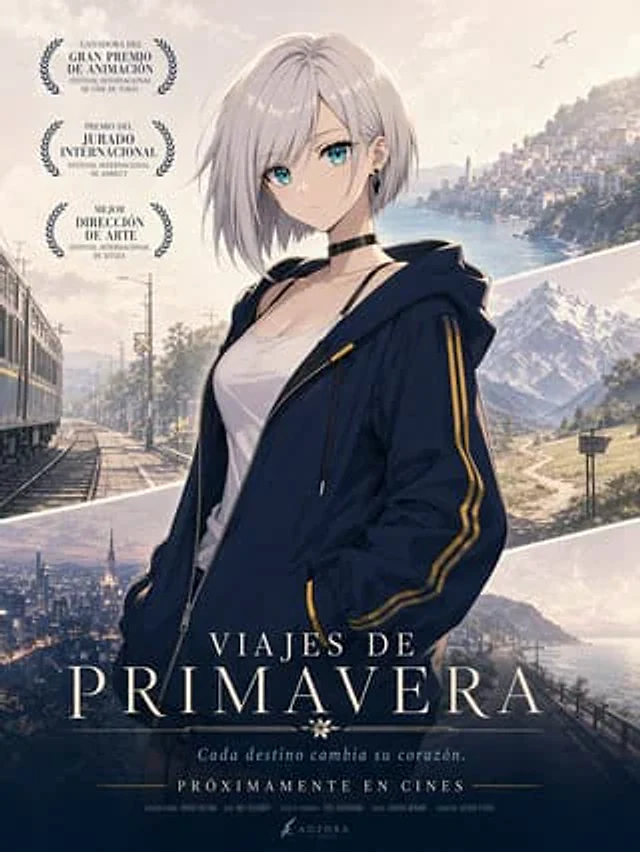

```text
An exquisitely crafted international movie poster in an anime style, possessing a cinematic quality, a touch of oil painting, and soft, natural lighting. The composition centers on a young woman, framed to mid-thigh, in a relaxed pose, one hand tucked into the pocket of a navy blue zip-up hoodie. The hoodie features two yellow athletic stripes on each sleeve, a loose hood, and a half-open zipper, revealing a fitted white tank top underneath, with thin black straps subtly visible. She wears a black choker and a dark pendant earring. Her hairstyle is a platinum silver bob with long, sleek, side-swept bangs. Her face is deliberately obscured by a soft beige, flat rectangular embellishment. The overall style maintains an elegant restraint, rather than excessive detail, presenting a more natural and realistic effect than overly flamboyant hyper-realistic anime art. The background features a diagonally divided travel film collage: one panel showcases a Mediterranean-style coastal town perched on a cliff, with calm blue waters and distant birds in flight; another depicts a rural railway line with a train on the left and telephone poles standing beside the tracks; a third shows snow-capped mountains and winding roads through tranquil valleys; a fourth displays a city skyline at dusk with twinkling lights; and the final panel shows a coastal highway curving along the coast at sunset. Soft cream, blue, and slate tones create a nostalgic spring travel atmosphere. Elegant film festival award laurel leaves are added to the upper left, precisely stacked with three laurel leaves, accompanied by Spanish text indicating the major animation film festival awards. A large, centered title typography is added near the bottom, containing the following text:{argument name="headline text" default="VIAJES DE PRIMAVERA"} The text uses a refined, light ivory serif font. Below it, a smaller line of italic Spanish text is added.{argument name="tagline" default="Cada destino cambia su corazón."} Add the release information line below.{argument name="release text" default="PRÓXIMAMENTE EN CINES"} At the very bottom is a small credits and a small studio logo. The overall image should have the feel of an art-house film poster, promoting a drama film about spring travel, with balanced white space, sophisticated layout, and realistic print poster typography.
```

Model: GPT Image 2
Author: GPT Image 2 Prompts

[ProjectD](https://aitoolsradar.com/en/prompts/d4528626d43d56) · [Recorded source](https://x.com/Design4p0/status/2047531978346398002#reversed-1)
 · [Full original metadata and byte evidence](data/projectd-batch-0021.json)

## Anime Starry Night Sky with Custom Neon Text


```text
A stunning and richly detailed landscape illustration, using{argument name="art style" default="Makoto Shinkai anime background style"} The scene showcases a vast and magnificent night sky, dotted with countless stars, with the Milky Way prominently displayed.{argument name="sky color palette" default="Dark blue, purple and pink"} A dazzling display of light. Two luminous comets, a bright blue one and a smaller pink one, streaked diagonally across the sky. In the center of the sky, the words "{argument name="display text" default="Your Name"} Written in elegant, glowing white cursive script, with a delicate pink glowing line below tied into a small bow, like a red thread of fate. Above the horizon, the orange and pink gradient of sunset light illuminates silhouetted clouds. In the middle ground is a tranquil, dark lake reflecting city lights and the twilight sky, surrounded by silhouetted mountains. In the foreground are dark silhouettes of grassy slopes and small purple flowers.
```

Model: GPT Image 2
Author: GPT Image 2 Prompts

[ProjectD](https://aitoolsradar.com/en/prompts/2d1c95686d9d9b) · [Recorded source](https://x.com/mrfanduuuuu/status/2044494655153443290#reversed-1)
 · [Full original metadata and byte evidence](data/projectd-batch-0021.json)

## Anime Strawberry Promo Banner Set

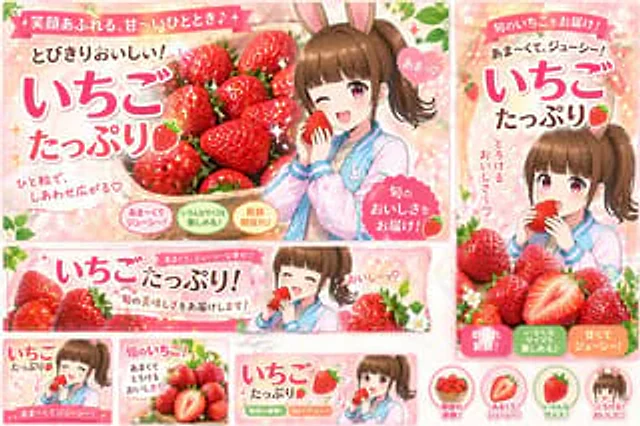

```text
{
  "type": "Promotional banner design kit",
  "theme": "Strawberry advertising campaign",
  "style": "Anime illustrations, bright and cheerful, commercial graphic design",
  "color_palette": "{argument name=\"primary color theme\" default=\"Soft pink and bright red\"}",
  "character": "{argument name=\"character description\" default=\"An anime girl with a brown side ponytail and bunny ears, wearing a soft blue and pink coat.\"}",
  "product": "{argument name=\"product\" default=\"Fresh red strawberries\"}",
  "layout": {
    "sections": [
      {
        "type": "Large horizontal banner",
        "position": "Top left",
        "visuals": "The character blinks and holds a strawberry, next to a large basket of strawberries.",
        "main_text": "{argument name=\"main headline\" default=\"Full of strawberries\"}",
        "sub_text": [
          "Sweet moments filled with smiles♪",
          "Super delicious!",
          "One strawberry, a heart full of happiness♡",
          "So sweet♡",
          "We bring you the delicious flavors of the season!"
        ],
        "badges": {
          "count": 3,
          "labels": [
            "Super sweet and juicy!",
            "Multiple sizes available♪",
            "Freshly picked this morning!"
          ]
        }
      },
      {
        "type": "Vertical banner",
        "position": "right side",
        "visuals": "The character is eating strawberries, and there are piles of strawberries below.",
        "main_text": "Full of strawberries",
        "sub_text": [
          "We're serving you seasonal strawberries!",
          "{argument name=\"secondary headline\" default=\"Super sweet and juicy!\"}",
          "Melting deliciousness~♡"
        ],
        "badges": {
          "count": 3,
          "labels": [
            "Freshly picked this morning!",
            "Multiple sizes available♪",
            "Sweet and juicy!"
          ]
        }
      },
      {
        "type": "Wide horizontal banner",
        "position": "middle",
        "visuals": "The character eats strawberries with his eyes closed, surrounded by strawberries on both sides.",
        "main_text": "So many strawberries!",
        "sub_text": [
          "Sweet and juicy happiness ♡",
          "We bring you the delicious flavors of the season!",
          "It's so delicious! ♡"
        ]
      },
      {
        "type": "Small square banner",
        "position": "Bottom left",
        "visuals": "The character is smiling and holding a strawberry.",
        "text": [
          "Full of strawberries",
          "Super sweet and juicy!"
        ]
      },
      {
        "type": "Small square banner",
        "position": "Middle left bottom",
        "visuals": "A pile of strawberries, one of which was cut in half.",
        "text": [
          "Seasonal strawberries!",
          "Sweet and melt-in-your-mouth deliciousness♡"
        ]
      },
      {
        "type": "Small horizontal banner",
        "position": "Middle right bottom",
        "visuals": "The character is holding a strawberry",
        "text": [
          "Full of strawberries",
          "Freshly picked this morning!",
          "Sweet and juicy!"
        ]
      },
      {
        "type": "circular icon",
        "position": "Bottom right",
        "count": 4,
        "items": [
          {
            "visual": "strawberry basket",
            "label": "Freshly picked this morning!"
          },
          {
            "visual": "Half a strawberry",
            "label": "Sweet and juicy!"
          },
          {
            "visual": "Whole strawberry",
            "label": "Multiple sizes available!"
          },
          {
            "visual": "Character face",
            "label": "Melting deliciousness ♡"
          }
        ]
      }
    ]
  }
}
```

Model: GPT Image 2
Author: GPT Image 2 Prompts

[ProjectD](https://aitoolsradar.com/en/prompts/9b585de023a663) · [Recorded source](https://x.com/takadtmnu/status/2046280850501964271#reversed-0)
 · [Full original metadata and byte evidence](data/projectd-batch-0021.json)

## Anime Streetwear Character Sheet

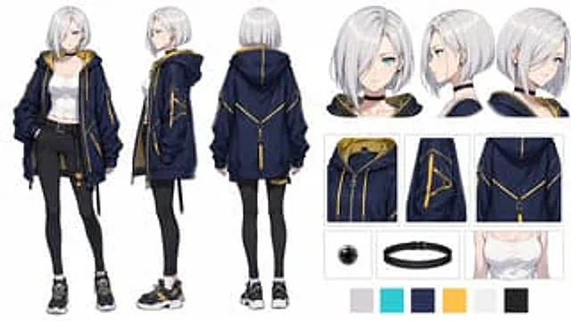

```text
{
  "type": "Anime character reference images",
  "style": "Concise yet highly detailed modern anime design sketches, white background, soft neutral studio lighting, exquisite fabric rendering, precise seams and zippers, a stylish conceptual art display.",
  "character": {
    "gender presentation": "young women",
    "build": "Slim, long legs, with a slightly sporty look",
    "name": "{argument name=\"character name\" default=\"Original characters\"}",
    "hair": {
      "color": "{argument name=\"hair color\" default=\"silver-white\"}",
      "style": "A straight, chin-length bob with thick, side-swept bangs covering one eye; smooth, glossy hair with neatly trimmed ends."
    },
    "accessories": [
      "Black neckband",
      "Small black earrings"
    ],
    "expression": "neutral"
  },
  "outfit": {
    "outerwear": {
      "type": "Oversized functional hooded jacket",
      "primary color": "{argument name=\"jacket color\" default=\"Deep Navy Blue\"}",
      "lining color": "{argument name=\"lining color\" default=\"Mustard Yellow\"}",
      "details": [
        "Front zipper",
        "Big Hood",
        "Yellow drawstring",
        "Multiple functional straps are suspended from the hem.",
        "Yellow piping and seam trim",
        "Decorative triangular zipper detail on cuffs",
        "Yellow herringbone stripe details on the back",
        "Cuff patch hardware"
      ]
    },
    "top": {
      "type": "Slim Fit Short Vest",
      "color": "White"
    },
    "bottom": {
      "type": "leggings or tights",
      "color": "black",
      "details": [
        "High-waisted",
        "Black belt with square buckle"
      ]
    },
    "footwear": {
      "type": "Platform sneakers",
      "colors": [
        "black",
        "White",
        "yellow"
      ]
    }
  },
  "layout": {
    "canvas": "Horizontal format",
    "sections": [
      {
        "title": "Full body view",
        "position": "Left side and center",
        "count": 3,
        "labels": [
          "Front view",
          "Side view",
          "Rear view"
        ]
      },
      {
        "title": "Head view",
        "position": "Top right corner",
        "count": 3,
        "labels": [
          "Front close-up",
          "Side close-up",
          "Three-quarters of the back view close-up"
        ]
      },
      {
        "title": "Garment detail panel",
        "position": "Middle right",
        "count": 6,
        "labels": [
          "Close-up of the inside of the hood and the collar",
          "Cuff zipper details",
          "Back panel details",
          "Close-up of black circular accessory",
          "Close-up of the black choker",
          "Close-up of the torso in a white vest"
        ]
      },
      {
        "title": "Color scheme",
        "position": "bottom right corner",
        "count": 6,
        "labels": [
          "Light gray",
          "Cyan accents",
          "Deep Navy Blue",
          "Golden yellow",
          "off white",
          "charcoal black"
        ]
      }
    ],
    "centerpiece": "Three full-body orthogonal fashion views show the same character in poses from the front, side, and back."
  },
  "composition": {
    "background": "Pure, very light grayish-white",
    "linework": "Exquisite and clean lines",
    "rendering": "Semi-realistic anime-style shadows with clear highlights",
    "focus": "Character costume design and structural details"
  }
}
```

Model: GPT Image 2
Author: GPT Image 2 Prompts

[ProjectD](https://aitoolsradar.com/en/prompts/19e44bfcf75e67) · [Recorded source](https://x.com/Design4p0/status/2046676749224640768#reversed-0)
 · [Full original metadata and byte evidence](data/projectd-batch-0021.json)

## Anime Style Infographic Catalog

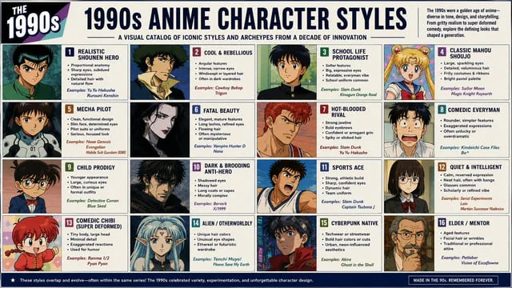

```text
Create an English infographic catalog poster showing {argument name="era" default="1990s"} anime character styles in a clean labeled grid layout, each panel featuring a different archetype and visual language. Use 16:9 aspect ratio.
```

Model: GPT Image 2
Author: Kōda

[ProjectD](https://aitoolsradar.com/en/prompts/6192868cb405a3) · [Recorded source](https://youmind.com/prompts/anime-character-style-catalog-22371)
 · [Full original metadata and byte evidence](data/projectd-batch-0021.json)

## Anime Summer Street Poster

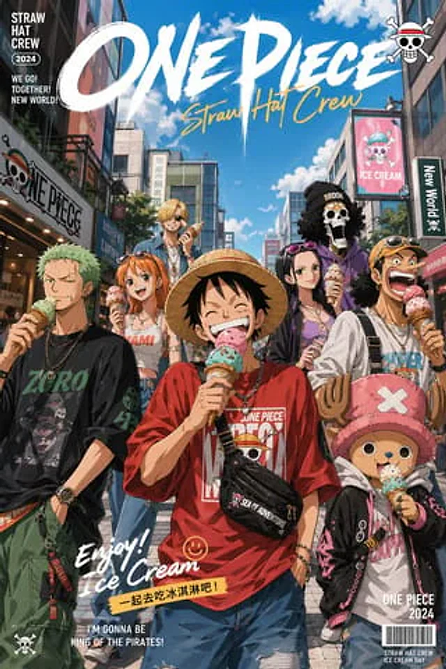

```text
A vibrant vertical anime street poster, inspired by a pirate adventure team, is designed like a modern Japanese shopping street's trendy summer promotional visual, against a backdrop of a clear blue sky and fluffy white clouds. The foreground and midground accurately depict eight characters happily eating colorful scoops of ice cream while strolling through the city. Center front: A young man wearing a wide-brimmed straw hat, an oversized red printed T-shirt, blue shorts, and a black fanny pack, holding a mint blue ice cream. Left front: A young man with green hair, wearing an oversized black printed shirt with green lettering and layered necklaces, is eating ice cream. Right front: A mascot character resembling a chibi reindeer, wearing a large pink hat with a white X logo, a black and pink streetwear jacket, and holding a blue and pink ice cream. Right midground: A long-nosed young man wearing a hat and casual streetwear is laughing heartily while holding an ice cream; behind him is a tall skeleton man with a large black afro, wearing a crown-shaped hat, a purple hoodie, and sunglasses, also holding an ice cream. Left-middle shot: A young woman with orange hair, wearing a white cropped tank top and jeans, holds an ice cream cone; in the middle left rear, a young blond man in a blue shirt, relaxed, also holds an ice cream cone; in the middle right, a young woman with dark hair, wearing a purple suit and sunglasses, holds an ice cream cone. The overall atmosphere is cheerful, summery, stylish, and adventurous. The composition should have the quality of a high-end anime travel or retail poster, using a dramatic street perspective with dense city signs, shop windows, hanging signs, and brand poster boards. Add a large white calligraphic title text at the top.{argument name="headline text" default="ONE PIECE"} It was accompanied by a yellow handwritten subtitle.{argument name="subtitle text" default="Straw Hat Crew"} In the upper left corner, stack the poster text blocks, ensuring the content is identical: "STRAW HAT CREW", "2024", and "WE GO! TOGETHER! NEW WORLD!". On the right, add a vertical sign that reads "New World". Include a pink hanging sign that reads "ICE CREAM" with a skull logo. Add pirate skull hat logos to the corners and storefront signs. In the lower left corner, place the white handwritten "Enjoy! Ice Cream" with a small smiley face, and below it, add the smaller, bold text "Let's go eat ice cream!". Add small print on the lower left edge: "I'M GONNA BE KING OF THE PIRATES!". In the lower right corner, add "ONE PIECE 2024", a barcode, and the tiny descriptive text "STRAW HAT CREW SUMMER ICE CREAM". It employs glossy anime illustration rendering, bold cel shadows, crisp line art, rich fabric folds, delicate accessories, vibrant summer light and shadow, cinematic contrast, poster-quality typography, and a sophisticated commercial visual effect. The aspect ratio is 2:3, and it's a portrait layout.
```

Model: GPT Image 2
Author: GPT Image 2 Prompts

[ProjectD](https://aitoolsradar.com/en/prompts/33a1980a3b9593) · [Recorded source](https://x.com/yun_zero401/status/2046830110041637005#reversed-0)
 · [Full original metadata and byte evidence](data/projectd-batch-0021.json)

## Anime Sunset Film Poster

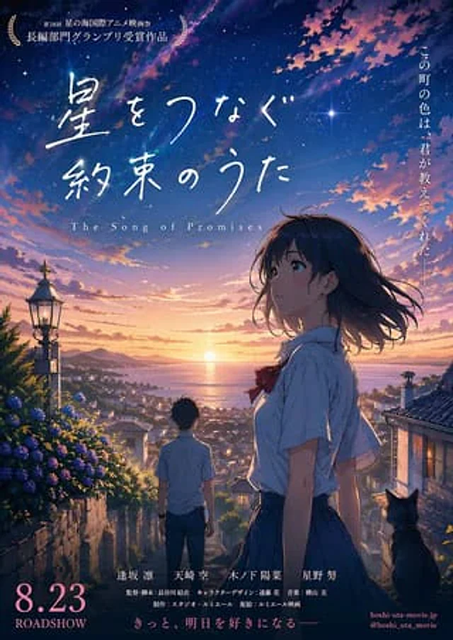

```text
A stunning golden hour sunset anime movie poster, using a vertical theatrical single-panel composition, is drawn in the exquisite style of Makoto Shinkai's youth dramas. The scene overlooks a Japanese coastal hillside town stretching towards a luminous bay, with the sun low on the horizon, its reflection elongated on the calm water. The sky occupies most of the image: a twilight gradient from deep blue to pale purple, dotted with countless stars, wisps of pink and peach-colored clouds, and a particularly bright star in the upper right corner. In the foreground on the right, a teenage high school girl is turned to the side, facing the sea to the left, the frame extending to mid-thigh, her shoulder-length black hair flowing in the breeze, wearing a short-sleeved white sailor uniform with a red ribbon tied at the collar, and a dark blue pleated skirt; her expression is thoughtful and melancholic. In the left, below a steep stone-stairs street, a teenage high school boy stands with his back to the viewer, wearing a short-sleeved white shirt and dark trousers, also gazing at the sunset and the sea. In the lower right corner, a black silhouette cat sits on a wall or rooftop edge, looking towards the town. The lower left corner features an old-fashioned streetlamp, with a cluster of blooming blue and purple hydrangeas nestled beside a stone wall. Below, the town is filled with tiled roofs, narrow streets, warm window lights, and tiered houses, while distant mountains encircle the bay. The design utilizes dramatic rim lighting, luminous atmospheric perspective, shimmering highlights, delicate cloud details, and emotionally resonant nostalgic hues of indigo, ultramarine, pink, fuchsia, and gold. It's designed as a quintessential Japanese animated film poster, incorporating elegant typography into the artwork: a large, handwritten Japanese title at the top left center.{argument name="title text" default="A song of promise that connects the stars"} Below is a smaller English subtitle.{argument name="English subtitle" default="The Song of Promises"} In the upper left corner, there is a small Japanese award laurel wreath; in the upper right edge, there is a vertical Japanese slogan; at the bottom center, there are four Japanese cast and crew names; and in the lower left corner, there is the release date.{argument name="release date" default="8.23"} Below it is the word "ROADSHOW," and at the bottom center is a line of pink Japanese text. The website/social media account is in the lower right corner. The super-detailed anime-style main visual is romantic and melancholic, with a high-end movie poster feel.
```

Model: GPT Image 2
Author: GPT Image 2 Prompts

[ProjectD](https://aitoolsradar.com/en/prompts/d8be9b2ad587ba) · [Recorded source](https://x.com/niji_sono/status/2046716935845601313#reversed-0)
 · [Full original metadata and byte evidence](data/projectd-batch-0021.json)

## Anime Sunset Mountain Landscape

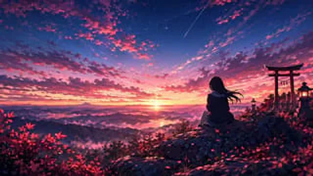

```text
Anime-style illustration, the main subject of the image is{argument name="character description" default="A young woman with long black hair sits on a rocky cliff with her back to the camera."} Looking down{argument name="landscape" default="Rolling mountains, winding rivers, and clouds"} The prospects include{argument name="foliage type" default="Vibrant red autumn maple leaves"} as well as{argument name="architectural elements" default="A traditional Japanese torii gate and a glowing stone lantern"} The scene is composed of {argument name="sky description" default="The sunset transitioned from a vibrant pinkish-orange hue to a deep blue starry sky, accompanied by shooting stars."} The sky is illuminated. Cinematic lighting and shadows create a highly detailed and atmospheric scene.
```

Model: GPT Image 2
Author: GPT Image 2 Prompts

[ProjectD](https://aitoolsradar.com/en/prompts/636622f180fde5) · [Recorded source](https://x.com/mrfanduuuuu/status/2044494655153443290#reversed-0)
 · [Full original metadata and byte evidence](data/projectd-batch-0021.json)

## Anime Swordsman in Suit

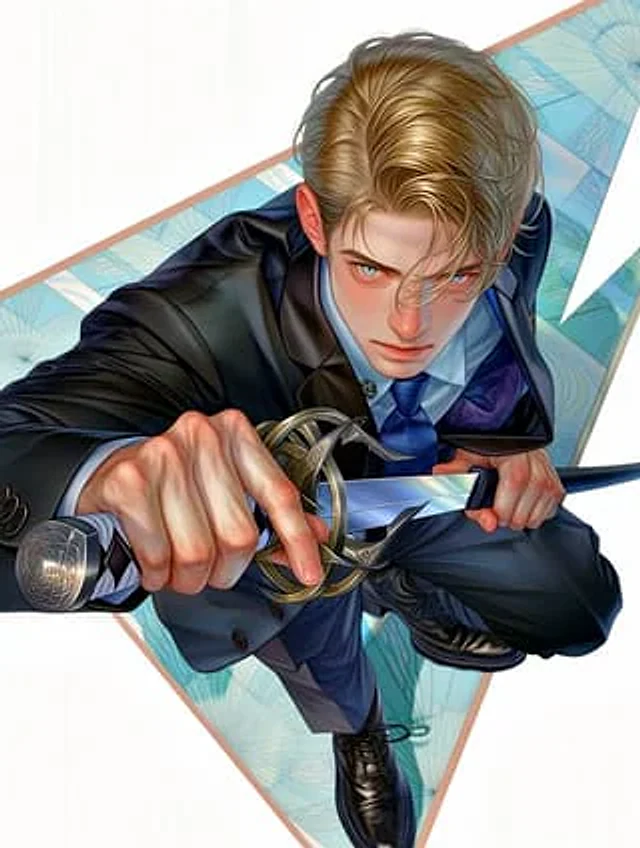

```text
A dynamic, anime-style illustration depicts a meticulously dressed young man in a dramatically posed, perspective-driven pose. Viewed from above, he appears to be charging towards the camera, his rapier pointing directly at the viewer. He possesses {argument name="hair color" default="Golden yellow"} His hair, neatly styled with a center parting and a soft, slicked-back texture, contrasts beautifully with his fair skin. His face is largely obscured by the camera angle and shadows, creating a mysterious yet stylish atmosphere. He wears a well-tailored, deep navy blue business suit with a subtle sheen, a light blue shirt, a bright blue tie, and polished black leather shoes. One hand, in extreme perspective, dominates the foreground, gripping the hilt of an ornate rapier; the other hand draws the blade, emphasizing movement and tension. The sword features a slender silver blade, an intricately crafted metal guard with interlocking rings, and a carved pommel. The composition is bold and graphic, with the character spanning the frame diagonally against a large inverted triangle filled with pale cyan and turquoise geometric fan-shaped patterns outlined by a delicate warm beige border, all set against a clean, light gray background. High-detail digital painting, glossy anime illustrations, elegant action character art, clear lines, rich fabric folds, dramatic perspective distortion, fashion magazine-like texture, cool blue tones, white space, and centered vertical composition.
```

Model: GPT Image 2
Author: GPT Image 2 Prompts

[ProjectD](https://aitoolsradar.com/en/prompts/55e60b5d369d61) · [Recorded source](https://x.com/HarunagaMutsuki/status/2046876482224746543#reversed-1)
 · [Full original metadata and byte evidence](data/projectd-batch-0021.json)

## Anime Theatrical Movie Poster

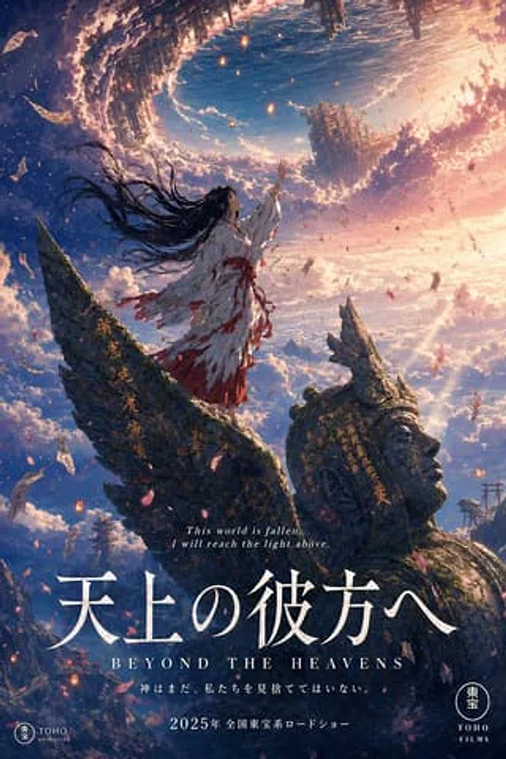

```text
A stunning vertical poster for an animated film. A collision of visual language between Studio Ghibli and Makoto Shinkai. A girl in a tattered white shrine maiden's robe stands on the wings of a collapsing, colossal stone statue—an ancient giant covered in moss and shimmering with golden Chinese characters—slowly falling into a sea of ​​clouds. Her long, black hair flows upward against gravity. She stretches a hand towards the sky, where a massive rift tears the heavens open—beyond the rift, an inverted ocean floats above the clouds, an ancient wooden city hangs from its surface, lanterns drifting like stars. The sky transitions from a deep twilight blue at the bottom to a bright peach and rose gold at the top. Volumetric light pierces through the clouds. Cherry blossom petals and tattered paper talismans swirl in the air. Her expression is calm and resolute. Art style: Hand-drawn 2D animation, ultra-detailed background painting, expressive lines, rich cel shadows. Color palette: Deep indigo, peach, rose gold, warm amber, soft white. The bottom is strikingly elegant.{argument name="language" default="Japanese Kanji"} The title is followed by a subtitle in a clean, modern font. Above the title is a small, white, italicized slogan. Atmosphere: Mythical, spiritual, and bittersweet miracles. Theatrical release quality, Toho Films.
```

Model: GPT Image 2
Author: GPT Image 2 Prompts

[ProjectD](https://aitoolsradar.com/en/prompts/d70b46ec6d1666) · [Recorded source](https://x.com/oggii_0/status/2047890555250610457)
 · [Full original metadata and byte evidence](data/projectd-batch-0021.json)

## Anime TV CM Storyboard Sheet

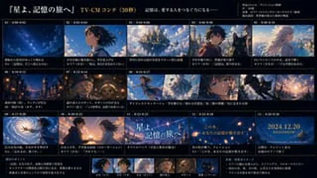

```text
{
  "type": "Storyboard for Animated TV Commercials",
  "format": "Single-page production project",
  "aspect_ratio": "16:9 Landscape",
  "style": "Exquisite cinematic animation concept art, a studio-recommended project, featuring a deep navy blue presentation background with delicate gold lines, elegant Japanese-style typography, highly detailed hand-drawn frames, dramatic lighting and shadows, and an emotionally rich fantasy adventure tone.",
  "project": {
    "title": "{argument name=\"title text\" default=\"&quot;Stars, on a journey of memories&quot;\"}",
    "subtitle": "Storyboard for a TV commercial (30 seconds)",
    "tagline": "Memory is the power that connects lovers.",
    "meta": [
      "Genre: Animated Film",
      "Duration: 30 seconds",
      "Music: Piano → Strings → Orchestra → Silence",
      "Performance Intent: Worldview Presentation and Emotional Arousal"
    ]
  },
  "layout": {
    "sections": [
      {
        "title": "First line of storyboard",
        "position": "top",
        "count": 5,
        "labels": [
          "01 | 0:00-0:02",
          "02 | 0:02-0:04",
          "03 | 0:04-0:06",
          "04 | 0:06-0:08",
          "05 | 0:08-0:10"
        ]
      },
      {
        "title": "Second line of storyboard",
        "position": "Central",
        "count": 4,
        "labels": [
          "06 | 0:10-0:12",
          "07 | 0:12-0:14",
          "08 | 0:14-0:17",
          "09 | 0:17-0:20"
        ]
      },
      {
        "title": "Third line of storyboard",
        "position": "Mid-lower part",
        "count": 4,
        "labels": [
          "10 | 0:20-0:23",
          "11 | 0:23-0:25",
          "12 | 0:25-0:28",
          "13 | 0:28-0:30"
        ]
      },
      {
        "title": "Character Panel",
        "position": "Bottom Center",
        "count": 6,
        "labels": [
          "Girl (Ella)",
          "Young (Leo)",
          "The girl (Celia)",
          "Mysterious Old Man",
          "robot",
          "Black Cat (Nova)"
        ]
      },
      {
        "title": "Remarks column",
        "position": "Bottom left and bottom right",
        "count": 2,
        "labels": [
          "Direction points",
          "Music and sound effects concepts"
        ]
      }
    ],
    "grid": "The 13 storyboard frames are arranged in 3 lines, plus 2 text annotation blocks and 6 small character portraits at the bottom.",
    "reading_order": "From left to right, from top to bottom"
  },
  "panels": [
    {
      "id": "01",
      "time": "0:00-0:02",
      "image": "A vast starry sky, the Milky Way and thick clouds spreading out above the horizon, a deep blue hue—a stunning still shot.",
      "caption": [
        "After the darkness subsided, the starry sky slowly emerged.",
        "Narrator: \"Where do memories disappear to?\""
      ]
    },
    {
      "id": "02",
      "time": "0:02-0:04",
      "image": "The anime girl's profile is framed by the wind as she gazes up at the sky. She has short black hair and wears an outfit resembling a school uniform with ribbons. Fallen leaves dance in the air against a backdrop of bright daylight clouds.",
      "caption": [
        "The girl's hair fluttered in the wind as she looked up at the sky.",
        "Dialogue (by the young girl): \"I don't want to forget you.\""
      ]
    },
    {
      "id": "03",
      "time": "0:04-0:06",
      "image": "A vast island kingdom suspended in the air, castle towers, lush greenery, flocks of birds flying overhead, sun-drenched clouds—an epic, fantastical wide-angle lens.",
      "caption": [
        "A drone's perspective provides a panoramic view of the floating islands in the air."
      ]
    },
    {
      "id": "04",
      "time": "0:06-0:08",
      "image": "The animation shows a boy turning his head two-thirds of the way in profile, with a black cat beside him whose eyes gleam with amber light. The background is a medieval fantasy town bathed in warm afternoon sunlight.",
      "caption": [
        "The boy turned around, and the black cat nestled beside him.",
        "Dialogue (by the young man): \"Memories can be retrieved.\""
      ]
    },
    {
      "id": "05",
      "time": "0:08-0:10",
      "image": "A silver-haired girl in a flowing white dress stands beside a shimmering sea and a distant city. Her back and profile are bathed in strong backlighting, and her long hair flutters in the wind.",
      "caption": [
        "A girl in a white dress shines in the backlight.",
        "Dialogue (Girl B): \"But there's a price to pay.\""
      ]
    },
    {
      "id": "06",
      "time": "0:10-0:12",
      "image": "The old European-style streets, dimly lit at dusk, with their towering clock towers, glowing windows, and narrow cobblestone lanes, create an atmosphere of tranquility.",
      "caption": [
        "The street is dark at night, and lanterns are lit.",
        "Sound effect: Clock sound (tick-tock, tick-tock)"
      ]
    },
    {
      "id": "07",
      "time": "0:12-0:14",
      "image": "Inside, a mysterious old man faces a small robot with bright, large eyes; warm workshop lighting, brass and wood details, an intimate conversation scene.",
      "caption": [
        "Mysterious old man and robot, robot's eyes glow",
        "Dialogue (by an elderly person): \"This world is made up of memories.\""
      ]
    },
    {
      "id": "08",
      "time": "0:14-0:17",
      "image": "A montage composed of five narrow subframes: 1) A girl running through the air, 2) Collapsing floating ruins, 3) A close-up of the protagonist's blue eyes conveying emotion, 4) A black cat leaping forward, 5) A city bathed in the glow of the setting sun.",
      "subframe_count": 5,
      "caption": [
        "Editing Montage: Running in the Air / Collapsing Floating Ruins / Tears / Cat's Leap / City Surrounded by Light"
      ]
    },
    {
      "id": "09",
      "time": "0:17-0:20",
      "image": "The female protagonist reaches out towards the enormous spiral of light in the sky, her hair and clothes being blown backward, a magical climax composition.",
      "caption": [
        "A giant vortex of light, the girl reached out her hand",
        "Narrator: \"To forget, or to save.\""
      ]
    },
    {
      "id": "10",
      "time": "0:20-0:23",
      "image": "A boy and a girl face each other in the setting sun; just before their fingertips touch, a strong silhouette light illuminates their figures, creating a powerful sense of slow motion.",
      "caption": [
        "A girl and a boy, just before their fingertips touch (slow motion)",
        "Dialogue (by the girl): \"Even so—\""
      ]
    },
    {
      "id": "11",
      "time": "0:23-0:25",
      "image": "The title card is overprinted on a magical twilight cityscape where the starry sky and town blend together, with glowing fantasy fonts at the center.",
      "caption": [
        "Title Background (Merger of Space and City)"
      ]
    },
    {
      "id": "12",
      "time": "0:25-0:28",
      "image": "A deep blue starry sky background with floating warm orange light particles, and gold Japanese text at the center.",
      "caption": [
        "This winter, your memories will awaken.",
        "Narrator: \"This winter, your memories will awaken.\""
      ]
    },
    {
      "id": "13",
      "time": "0:28-0:30",
      "image": "The end card for the theatrical release date is set against a deep blue gradient background with gold serif lettering and a small credits at the bottom, a simple theatrical ending.",
      "caption": [
        "Release date and production credits",
        "It ended with a lingering, melodious piano sound."
      ],
      "text": [
        "{argument name=\"release date\" default=\"2024.12.20\"}",
        "ROADSHOW"
      ]
    }
  ],
  "characters": {
    "count": 6,
    "items": [
      {
        "label": "Girl (Ella)",
        "description": "The young animated female protagonist has messy short black hair, wears a blue-themed outfit, and is both determined and sensitive."
      },
      {
        "label": "Young (Leo)",
        "description": "A young man with black hair, a warm expression, and a fantastical travel outfit."
      },
      {
        "label": "The girl (Celia)",
        "description": "A young woman with extremely long, silver-white hair, wearing a white dress, possessed an ethereal presence."
      },
      {
        "label": "Mysterious Old Man",
        "description": "An elderly person wearing glasses or with a wise face, possessing the temperament of a narrator."
      },
      {
        "label": "robot",
        "description": "The round little robot has bright, big eyes; it's both cute and mysterious."
      },
      {
        "label": "Black Cat (Nova)",
        "description": "A glossy black cat with bright golden eyes."
      }
    ]
  },
  "bottom_notes": {
    "left_title": "Direction points",
    "left_bullets": [
      "Visualizing 'memory' through light and shadow, particles, collapse and reconstruction.",
      "The fragmented presentation of character relationships leaves room for the audience's imagination.",
      "Maximize emotional resonance through the synchronization of images and music."
    ],
    "right_title": "Music and sound effects concepts",
    "right_bullets": [
      "The music begins with the tranquility of the piano, transitions to the strings, and finally enters the full orchestra.",
      "Effectively configure clock sounds such as \"tick-tock\".",
      "The ending concluded with a lingering, quietude."
    ]
  },
  "customization": {
    "genre": "{argument name=\"genre line\" default=\"Genre: Animated Film\"}",
    "runtime": "{argument name=\"runtime text\" default=\"Duration: 30 seconds\"}",
    "music": "{argument name=\"music direction\" default=\"Music: Piano → Strings → Orchestra → Silence\"}"
  }
}
```

Model: GPT Image 2
Author: GPT Image 2 Prompts

[ProjectD](https://aitoolsradar.com/en/prompts/60f223c238c715) · [Recorded source](https://x.com/seiiiiiiiiiiru/status/2046512945862201450#reversed-0)
 · [Full original metadata and byte evidence](data/projectd-batch-0021.json)

## Anime TV CM Storyboard Sheet

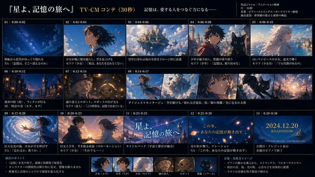

```text
{"type":"anime TV commercial storyboard sheet","format":"single-page production board","aspect_ratio":"16:9 landscape","style":"polished cinematic anime concept art, studio pitch board, dark navy presentation background with thin gold divider lines, elegant Japanese typography, high-detail painted frames, dramatic lighting, emotional fantasy adventure tone","project":{"title":"{argument name=\"title text\" default=\"『星よ、記憶の旅へ』\"}","subtitle":"TV-CM コンテ（30秒）","tagline":"記憶は、愛する人をつなぐ力になる—","meta":["作品ジャンル：アニメーション映画","尺：30秒","音楽：ピアノ→ストリングス→オーケストラ→静寂","演出意図：世界観の提示と感情の喚起"]},"layout":{"sections":[{"title":"storyboard row 1","position":"top","count":5,"labels":["01 | 0:00-0:02","02 | 0:02-0:04","03 | 0:04-0:06","04 | 0:06-0:08","05 | 0:08-0:10"]},{"title":"storyboard row 2","position":"middle","count":4,"labels":["06 | 0:10-0:12","07 | 0:12-0:14","08 | 0:14-0:17","09 | 0:17-0:20"]},{"title":"storyboard row 3","position":"lower-middle","count":4,"labels":["10 | 0:20-0:23","11 | 0:23-0:25","12 | 0:25-0:28","13 | 0:28-0:30"]},{"title":"character strip","position":"bottom center","count":6,"labels":["少女（エラ）","少年（リオ）","少女（セリア）","謎の老人","ロボット","黒猫（ノワール）"]},{"title":"notes blocks","position":"bottom left and bottom right","count":2,"labels":["演出のポイント","音楽・効果音イメージ"]}],"grid":"13 storyboard panels arranged across 3 rows, plus 2 text note blocks and 6 small character portraits at bottom","reading_order":"left to right, top to bottom"},"panels":[{"id":"01","time":"0:00-0:02","image":"vast star-filled night sky with Milky Way-like band and heavy clouds opening above a dark horizon, deep blue palette, awe-inspiring establishing shot","caption":["暗転から星空がゆっくり現れる","NA：『記憶は、どこへ消えるのか』"]},{"id":"02","time":"0:02-0:04","image":"wind-swept anime girl in side profile looking up at the sky, short dark hair and school-uniform-like outfit with ribbon, leaves flying, bright daylight clouds behind her","caption":["少女が風に髪を揺らし、空を見上げる","セリフ（少女）：『私は、あなたを忘れたくない』"]},{"id":"03","time":"0:04-0:06","image":"enormous floating island kingdom suspended in the sky, castle towers, greenery, many birds, bright sunlit clouds, epic fantasy wide shot","caption":["空中に浮かぶ島の全景をドローン的に前進"]},{"id":"04","time":"0:06-0:08","image":"anime boy turning back in three-quarter view beside a black cat with glowing amber eyes, medieval-fantasy town in background, warm late-afternoon light","caption":["少年が振り向く、黒猫が寄り添う","セリフ（少年）：『記憶は、取り戻せる』"]},{"id":"05","time":"0:08-0:10","image":"white-haired girl in a flowing white one-piece dress standing by a sparkling sea and distant city, back and side profile, intense backlight, wind in long hair","caption":["白いワンピースの少女、逆光で輝く","セリフ（少女B）：『でも代償があるの』"]},{"id":"06","time":"0:10-0:12","image":"lantern-lit old European-style city street at blue hour with tall clock tower, glowing windows, narrow cobblestone atmosphere","caption":["宵闇の街（夜）、ランタンが灯る","SE：時計の音（カチ、カチ）"]},{"id":"07","time":"0:12-0:14","image":"mysterious old man indoors facing a small robot with large shining eyes, warm workshop lighting, brass and wood details, intimate dialogue scene","caption":["謎の老人とロボット、ロボットの目が光る","セリフ（老人）：『この世界は、記憶で出来ている』"]},{"id":"08","time":"0:14-0:17","image":"digest montage made of 5 narrow subframes in one panel: 1) girl running through the sky, 2) collapsing floating ruins, 3) emotional close-up of the heroine's blue eyes, 4) black cat leaping forward, 5) city bathed in brilliant light at sunset","subframe_count":5,"caption":["ダイジェストモンタージュ：空を駆ける／崩れる浮遊遺跡／涙／猫の飛躍／光に包まれる街"]},{"id":"09","time":"0:17-0:20","image":"heroine reaches her hand toward a giant spiral vortex of light in the sky, hair and clothes blown back, magical climax composition","caption":["巨大な光の渦、少女が手を伸ばす","NA：『忘れるか、救うか。』"]},{"id":"10","time":"0:20-0:23","image":"boy and girl facing each other at sunset, just before their hands touch, strong rim light, emotional slow-motion feeling","caption":["巨女と少年、手を取る直前（スローモーション）","セリフ（少女）：『それでも——』"]},{"id":"11","time":"0:23-0:25","image":"title card over a magical twilight cityscape where starry cosmos and town merge together, luminous fantasy typography in center","caption":["タイトルバック（宇宙と都市が融合）"]},{"id":"12","time":"0:25-0:28","image":"dark blue starry background with floating warm orange light particles and centered golden Japanese copy","caption":["この冬、あなたの記憶が動き出す","NA：『この冬、あなたの記憶が動き出す』"]},{"id":"13","time":"0:28-0:30","image":"release date end card on deep blue gradient background with gold serif text, tiny credits at bottom, clean theatrical finish","caption":["公開日・クレジット表示","余韻のピアノで終了"],"text":["{argument name=\"release date\" default=\"2024.12.20\"}","ROADSHOW"]}],"characters":{"count":6,"items":[{"label":"少女（エラ）","description":"young anime heroine, short dark tousled hair, blue-themed outfit, determined and emotional"},{"label":"少年（リオ）","description":"teen boy, dark hair, warm expression, fantasy travel clothing"},{"label":"少女（セリア）","description":"young woman with very long silver-white hair and white dress, ethereal presence"},{"label":"謎の老人","description":"elderly man with glasses or wise face, storyteller aura"},{"label":"ロボット","description":"small round robot with large glowing eyes, cute but mysterious"},{"label":"黒猫（ノワール）","description":"sleek black cat with bright golden eyes"}]},"bottom_notes":{"left_title":"演出のポイント","left_bullets":["『記憶』を光や粒子、崩壊と再構築で視覚化","キャラクターの関係性は断片的に見せ、想像を膨らませる","映像と音楽のシンクロで感情を最大化する"],"right_title":"音楽・効果音イメージ","right_bullets":["ピアノの静かな導入から、ストリングス、フルオーケストラへ","時計の音『カチ、カチ』を音などを効果的に配置","ラストは余韻を残す静寂で締める"]},"customization":{"genre":"{argument name=\"genre line\" default=\"作品ジャンル：アニメーション映画\"}","runtime":"{argument name=\"runtime text\" default=\"尺：30秒\"}","music":"{argument name=\"music direction\" default=\"音楽：ピアノ→ストリングス→オーケストラ→静寂\"}"}}
```

Model: GPT Image 2
Author: SEIIIRU😈動画生成AIを使う映像クリエイター

[ProjectD](https://aitoolsradar.com/en/prompts/069bcfd19de709) · [Recorded source](https://youmind.com/prompts/anime-tv-commercial-storyboard-14513)
 · [Full original metadata and byte evidence](data/projectd-batch-0021.json)

## Anime VTuber Daily Essay Comic Page

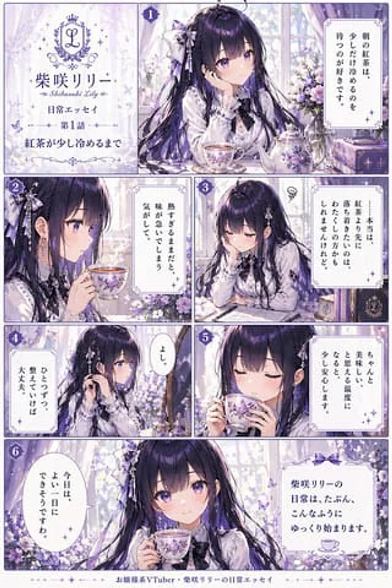

```text
{
  "type": "1 page of anime/manga",
  "character": {
    "name": "{argument name=\"character name\" default=\"Lily Shibasaki\"}",
    "appearance": "long{argument name=\"hair color\" default=\"Dark purple\"} Hair, wearing a white ribbon,{argument name=\"eye color\" default=\"Purple\"} Her eyes were bright, and she wore an elegant white ruffled blouse paired with a dark silk bow tie and delicate earrings."
  },
  "style": "High-detail anime illustrations, soft lighting, elegant style, floral elements.{argument name=\"color palette\" default=\"Purple and white color scheme\"} aesthetics",
  "layout": {
    "structure": "A comic page containing one title bar, six numbered panels, and one footer.",
    "title_block": {
      "position": "Top left corner",
      "content": "A magnificent emblem with an 'L', the text '{argument name=\"character name\" default=\"Lily Shibasaki\"} ','Shibasaki Lily','{argument name=\"comic title\" default=\"Everyday Essay, Episode 1: Until the Tea Cools Down a Little\"} '"
    },
    "panels": [
      {
        "number": 1,
        "position": "Top right corner",
        "scene": "The character rests his chin on his hand, gazing at the elegant tea set, as morning light streams in through the window.",
        "text_box": "I like to wait a little while for my morning tea to cool down."
      },
      {
        "number": 2,
        "position": "center left",
        "scene": "From a side view, the character holds a teacup, looking thoughtful.",
        "text_box": "If it's too hot, I feel like the flavor will rush through."
      },
      {
        "number": 3,
        "position": "center right",
        "scene": "The character is lying on the table, a book open in front of him, his head bowed and his expression gentle.",
        "text_box": "...Actually, I might be the one who wants to settle down before I even have a cup of tea."
      },
      {
        "number": 4,
        "position": "Bottom left",
        "scene": "The character is adjusting her earrings in front of the mirror.",
        "speech_bubble": "よし。"
      },
      {
        "number": 5,
        "position": "Bottom right",
        "scene": "Close-up: The character closes his eyes, sipping tea, looking relaxed.",
        "text_box": "I feel a little relieved when it reaches a temperature where it tastes truly delicious."
      },
      {
        "number": 6,
        "position": "Bottom banner",
        "scene": "The character smiles warmly, holds a teacup, looks directly at the audience, and is surrounded by purple flowers.",
        "speech_bubble": "Today looks like it's going to be a good day.",
        "text_box": "Lily Shibasaki's daily life probably begins slowly like this."
      }
    ],
    "footer": {
      "content": "A daily essay by the refined VTuber, Shibasaki Lily"
    }
  }
}
```

Model: GPT Image 2
Author: GPT Image 2 Prompts

[ProjectD](https://aitoolsradar.com/en/prompts/ec5e822ed0e20d) · [Recorded source](https://x.com/wtry1102/status/2046140825952989627#reversed-0)
 · [Full original metadata and byte evidence](data/projectd-batch-0021.json)

## Anime VTuber Live Stream Overlay

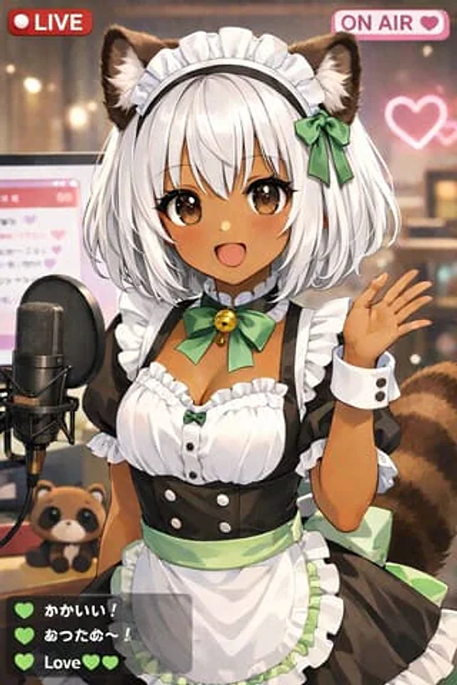

```text
A cute anime-style picture{argument name="animal type" default="Tanuki"} -Illustration of a female VTuber's live stream. She has dark skin, a short white bob, fluffy brown animal ears, large brown eyes, and a fluffy striped tail. She is smiling happily, waving her left hand at the camera. She wears a black and white maid outfit with ruffles, a white apron with a light green belt, and a green ribbon collar with gold bells. The background is a warm, softly lit room with dappled lighting, and a glowing pink neon heart hangs on the wall. To her left is a professional black studio microphone on a stand, behind which is a computer monitor displaying a pink chat interface. Next to the microphone on the table is a small {argument name="plushie type" default="Tanuki doll"} The image contains a live UI overlay, consisting of three separate components: the top left corner has a text that reads "{argument name="top left badge" default="LIVE"} The red badge has a heart icon in the upper right corner and the words "...".{argument name="top right badge" default="ON AIR"} The badge is pink, and in the lower left corner is a semi-transparent dark gray chat box containing three messages. The first message has a green heart and the text "Cute!", the second has a green heart and the text "Warm~!", and the third reads "...".{argument name="chat message" default="Love"} It is accompanied by two green hearts.
```

Model: GPT Image 2
Author: GPT Image 2 Prompts

[ProjectD](https://aitoolsradar.com/en/prompts/1715ad80d2b08d) · [Recorded source](https://x.com/seagetch/status/2043722902214996448#reversed-0)
 · [Full original metadata and byte evidence](data/projectd-batch-0021.json)

## Anime VTuber Livestream Thumbnail

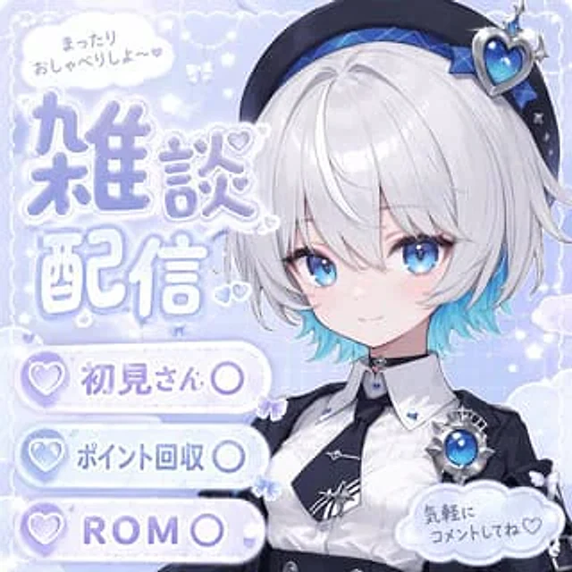

```text
{
  "type": "Anime-style live stream cover",
  "character": {
    "hair": "{argument name=\"hair color\" default=\"Short silver hair with blue highlights\"}",
    "eyes": "Bright big blue eyes",
    "outfit": "White shirt, black tie with silver trim, black coat, black beret with a large blue heart-shaped gemstone, blue gemstone brooch, black choker.",
    "pose": "A gentle smile, gazing at the audience, positioned on the right side of the screen."
  },
  "background": "Macaron blue background with white clouds, glitter, stars, small bows and delicate grid patterns.",
  "typography_and_ui": {
    "top_left_speech_bubble": "まったりおしゃべりしよ〜♡",
    "main_title": {
      "text": "{argument name=\"main title\" default=\"Random Talk Live\"}",
      "style": "Large font, soft blue gradient, white outline, decorated with small hearts, located on the left side of the image."
    },
    "bottom_left_badges": {
      "count": 3,
      "style": "White capsule-shaped button with a purple heart icon on the left.",
      "labels": [
        "{argument name=\"badge 1 text\" default=\"Welcome to our first meeting.\"}",
        "{argument name=\"badge 2 text\" default=\"Points collection\"}",
        "{argument name=\"badge 3 text\" default=\"Welcome to diving\"}"
      ]
    },
    "bottom_right_cloud_bubble": "Feel free to leave a comment ♡"
  }
}
```

Model: GPT Image 2
Author: GPT Image 2 Prompts

[ProjectD](https://aitoolsradar.com/en/prompts/0dabcee8ab47dc) · [Recorded source](https://x.com/sayaka_aiart/status/2046176145075515600#reversed-1)
 · [Full original metadata and byte evidence](data/projectd-batch-0021.json)

## Anime VTuber Minecraft Stream Thumbnail


```text
A vibrant anime-style YouTube game stream cover image, using a 16:9 widescreen composition, with a neon purple-pink background for the streamer's room. At the center of the image is a cute catgirl VTuber, sitting at a desk, half-body visible, leaning forward energetically, one hand holding a mouse, the other outstretched towards the viewers. She has {argument name="hair color" default="Light orange-gold"} She sports a bob haircut with soft bangs, fluffy cream-colored cat ears, and a visible cat tail. Her face is deliberately obscured by a solid rectangular block in the center of the image. She wears a black and white maid outfit, including a ruffled white blouse, a black dress, puff sleeves, white ruffles, a black ribbon bow, and a gold bell collar. On the desk are a mechanical keyboard with bright RGB lighting, a glowing gaming mouse, and a live-streaming microphone with pinkish-purple LED lighting on the far left. In the foreground are two cat-themed desktop ornaments: a cat-face plush toy in the lower left corner and a black cat-shaped mug in the lower right corner. Behind her is a gaming chair with paw print details. On the left, a striking bold Korean title is added, using a thick white block font with black filled shadows and glowing purple outlines, arranged in two lines:{argument name="headline text" default="방송중 대참사"} Add a small, yellow, cartoon-style popping speech bubble below, with a black outline and the text "...".{argument name="sub text" default="> 크리퍼 실화냐"} On the right, a large, inward-tilted computer monitor displays a Minecraft-like scene, including bright blue skies, green trees, water, and a giant green Creeper lunging at the viewer with dramatically clipped-out edges. Starburst effects and neon decorations are added around the monitor to enhance the sense of chaos. An exaggerated cover aesthetic is employed: hypersaturated colors, sharp cel shadows, bold outlines, glossy highlights, high contrast, and dynamic perspectives, creating an atmosphere that makes you want to click through to a livestream disaster.
```

Model: GPT Image 2
Author: GPT Image 2 Prompts

[ProjectD](https://aitoolsradar.com/en/prompts/fd09d055c67a51) · [Recorded source](https://x.com/rerxmsz06/status/2047261622121705782#reversed-1)
 · [Full original metadata and byte evidence](data/projectd-batch-0021.json)

## Anime VTuber Reaction Thumbnail

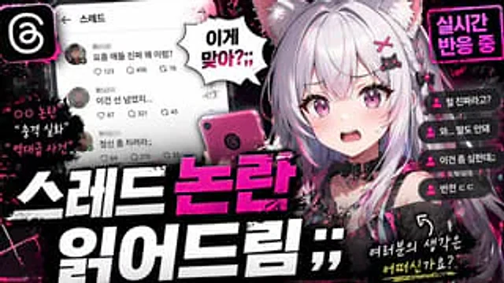

```text
{
  "type": "YouTube thumbnails",
  "style": "Anime style, avant-garde, neon pink and black color scheme, with a decadent feel and splatter decorations.",
  "character": {
    "appearance": "Anime girl,{argument name=\"hair color\" default=\"silver\"} Hair, cat ears, purple eyes",
    "expression": "{argument name=\"expression\" default=\"Shocked and sweating\"} Open your mouth",
    "accessories": "A black cat hair clip with a pink cross, and a black choker with a heart-shaped ring.",
    "action": "Holding a pink smartphone with a swirl logo."
  },
  "layout": {
    "main_title": {
      "position": "Centered at the bottom",
      "style": "Huge, bold, 3D font with a decadent feel.",
      "lines": [
        {
          "text": "{argument name=\"main title top\" default=\"Controversial topic\"}",
          "color": "Neon Pink"
        },
        {
          "text": "{argument name=\"main title bottom\" default=\"Read online;\"}",
          "color": "White"
        }
      ]
    },
    "ui_elements": [
      {
        "type": "Social media information flow simulation",
        "position": "center left",
        "header": "← Topic",
        "post_count": 3,
        "details": "Profile picture, Chinese text, and interactive icons for likes, comments, and shares."
      },
      {
        "type": "Real-time chat simulation",
        "position": "right edge",
        "message_count": 4,
        "details": "Pink user icon, Chinese text"
      }
    ],
    "text_callouts": [
      {
        "type": "Spiky speech bubbles",
        "position": "Centered at the top",
        "text": "{argument name=\"speech bubble text\" default=\"Is this really true?\"}"
      },
      {
        "type": "Neon light boxes",
        "position": "Top right corner",
        "text": "Real-time response"
      },
      {
        "type": "Floating decadent text",
        "position": "Leftmost",
        "line_count": 3,
        "text": [
          "OO controversy",
          "Shocking Truth",
          "Epic event"
        ]
      },
      {
        "type": "Handwritten text with arrows",
        "position": "bottom right corner",
        "text": "What do you think?"
      }
    ],
    "logos": [
      {
        "type": "App icon",
        "position": "Top left corner",
        "description": "White swirl symbol on black rounded square"
      }
    ]
  }
}
```

Model: GPT Image 2
Author: GPT Image 2 Prompts

[ProjectD](https://aitoolsradar.com/en/prompts/cd64c00ca1fec4) · [Recorded source](https://x.com/abdiisan/status/2044865935752708451#reversed-0)
 · [Full original metadata and byte evidence](data/projectd-batch-0021.json)

## Anime Warrior Eating Ramen

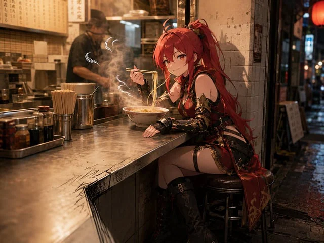

```text
Create a cinematic anime-style scene of {argument name="character description" default="a young red-haired fantasy warrior woman with a long high ponytail"} sitting on a round stool at the counter of a narrow Japanese ramen shop at night. She wears {argument name="outfit" default="dark red and black leather armor with gold trim, belts, straps, arm guards, thigh straps, and tall boots"}, leaning forward casually while holding chopsticks and lifting noodles from a steaming bowl of ramen. Her other hand rests on the brushed metal counter. The ramen bowl glows warmly with steam curling upward in visible white wisps. The setting is an intimate alley-side ramen bar with a stainless-steel counter, chopstick holders, condiment bottles, jars of chili oil, cooking pots, tiled walls, hanging menu boards with Japanese writing, and a cook blurred in the background behind the counter. Outside the open entrance is a wet nighttime city alley with reflections on the pavement, soft bokeh lights, signage, and a red lantern. Use warm amber interior lighting contrasted with cool dark blue street tones, shallow depth of field, realistic environmental detail, glossy reflections, cinematic composition, 3/4 side view, medium-wide framing, highly detailed anime illustration blended with photorealistic background textures. Add a square soft blur censor block over the character's face, centered on the face, obscuring facial features. Mood: cozy, atmospheric, urban, slightly gritty, late-night meal after battle.
```

Model: GPT Image 2
Author: VoxCat

[ProjectD](https://aitoolsradar.com/en/prompts/f2fd861177bb6f) · [Recorded source](https://youmind.com/prompts/anime-warrior-ramen-shop-18632)
 · [Full original metadata and byte evidence](data/projectd-batch-0021.json)

## Anime Warrior With Whip Sword

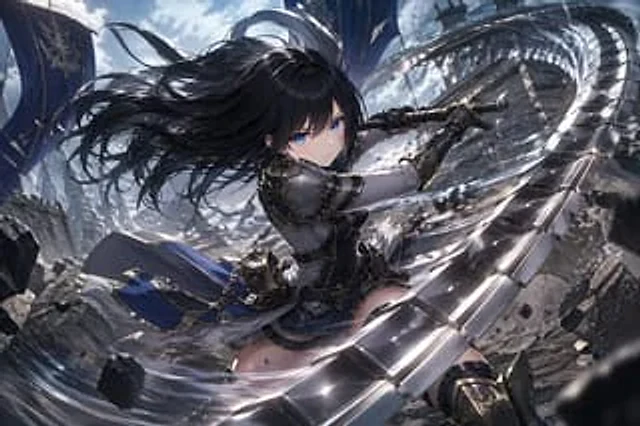

```text
A highly dynamic and action-packed anime/fantasy illustration featuring a protagonist who {argument name="hair color" default="jet black"} Long hair, with sharp{argument name="eye color" default="Bright blue"} A young female warrior with striking eyes. The image employs a dynamic low-angle close-up to mid-range composition, showing her wielding a long, segmented metal whip-sword, drawing a wide, circular arc around her body. Her thick, long hair billows violently in the wind, its sharp, glossy strands meticulously detailed. Her expression is focused and fierce, staring directly at the viewer over her shoulder. She wears magnificent black, silver, and gold-trimmed armor, complete with a fitted breastplate, gauntlets, shoulder armor, and leg armor, along with a short, multi-layered skirt adorned with flowing blue and white fabric and metallic embellishments. The weapon forms a bright spiral in the foreground and upper right corner of the composition, exhibiting a reflective steel texture, motion blur, and shimmering highlights. Small rocks and debris float in the air due to the impact of the attack. The background is set in an abandoned stone battlefield or castle courtyard, with cracked ground and broken bricks, several blue flags standing in the background, and a sky filled with dark clouds. Employing cinematic action composition, strong perspective shortening, intense dynamism, ultra-detailed fantasy costume design, exquisite metallic texture, dramatic wind effects, clear anime lines, painterly lighting, and high contrast, it presents an epic hero atmosphere in the style of a top-tier fantasy main visual.
```

Model: GPT Image 2
Author: GPT Image 2 Prompts

[ProjectD](https://aitoolsradar.com/en/prompts/0b802a54fe5646) · [Recorded source](https://x.com/REd8358/status/2046380070747644095#reversed-0)
 · [Full original metadata and byte evidence](data/projectd-batch-0021.json)

## Anime Wedding Poster at a Church

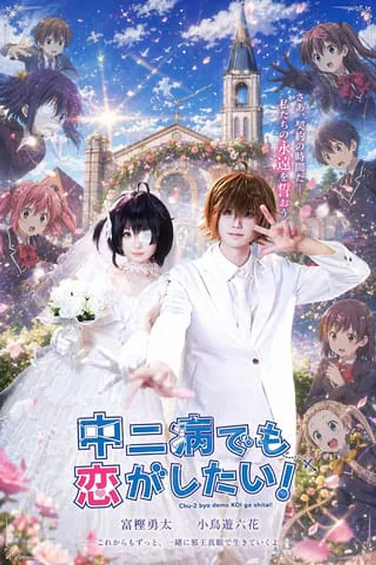

```text
A vertical, anime-style wedding poster seamlessly blends a live-action cosplay-style newlywed couple in the foreground with anime girl illustrations surrounding them. The background is a stone church bathed in bright sunlight, with a vibrant deep blue sky. In the center foreground, the bride and groom strike a dramatic selfie pose, their arms outstretched towards the viewer. The groom is depicted as a young, androgynous figure with {argument name="hair color" default="Light brown"} With her messy short hair, dressed in a smart white wedding suit, white shirt, and white tie, she smiled and made a playful gesture beside her face. The bride had {argument name="hair color" default="Dark purple-black"} A girl with short twin ponytails, wearing a gorgeous white wedding dress with layers of lace, a veil, a pearl necklace, and long white gloves, holds a bouquet of white roses. Behind them stands a beautiful European-style church with towering spires, wreaths at the entrance, and stained-glass windows. Warm sunlight bursts in from the left, creating lens flares and shimmering highlights. Fluffy white clouds float in the sky, white doves fly, faint rainbow stripes appear, and pink petals fall. Surrounding the perimeter are portraits of six anime schoolgirls in dark school uniforms with red or yellow ribbons, each displaying a different expression: a brown-haired girl in the upper left corner reaching forward, a purple-haired girl with an eye patch in the middle left corner looking uneasy, a cheerful pink-haired girl in the lower left corner, a brown-haired girl in the upper right corner extending a gloved hand, a black-haired boy in a school uniform on the right center, a shy brown-haired girl in the lower right corner, and an excited blonde girl with her mouth open in the lower right corner. The poster is decorated with ornate decorative borders. The upper right corner contains a vertical Japanese slogan; the text is {argument name="tagline text" default="Now it&#39;s time for the contract—let us pledge our eternal love."} A striking and colorful Japanese title is placed at the bottom center.{argument name="title text" default="Love, Chunibyo &amp; Other Delusions!"} The text uses bold blue and pink outlined font, with a small Romanized subtitle below "Chu-2 byo demo KOI ga shitai!" and a credits at the bottom.{argument name="credit text" default="Togashi Yuta little bird travels to Rikka"} Overall impression: A dazzling, romantic, sentimental, and nostalgic anime movie poster with ultra-high detail, glossy lighting effects, magical flashing effects, vibrant colors, and exquisite promotional composition.
```

Model: GPT Image 2
Author: GPT Image 2 Prompts

[ProjectD](https://aitoolsradar.com/en/prompts/4f1d95b7cbff7b) · [Recorded source](https://x.com/JpSCYEOPI97EEfm/status/2046579044402282723#reversed-0)
 · [Full original metadata and byte evidence](data/projectd-batch-0021.json)

## Anime World Building and Character Sheet

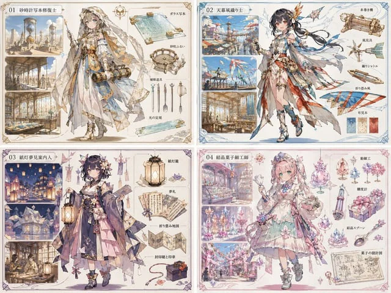

```text
【出力したい内容】
世界観設定資料＋オリジナルアニメキャラクター設定資料
※キャラクターだけでなく、そのキャラクターが生きる世界の環境・文化・制度・技術・生活感までビジュアル化してください。

【世界観の種】
ここに入力

【世界観案数】
ここに入力
※1案のみ／複数案を比較したい、など

【人数】
ここに入力

【役割・職能】
ここに入力

【舞台・環境】
ここに入力
※指定が少ない場合は、入力語から「気候・地形・資源・危険・移動手段・住居の形」を新しく設計してください。

【社会・制度】
ここに入力
※入力内容に合う共同体のルール、役割分担、身分表現、所属印、交換方法、儀礼を設計してください。

【技術・信仰・禁忌】
ここに入力
※その世界の素材加工、記録方法、通信、祈り、禁忌、祝祭、身体装飾などを、入力内容から自然に導いてください。

【生活文化】
ここに入力
※住居、食事、移動手段、仕事道具、衣服の着方、装飾の意味、季節行事、貨幣、文字、紋章など。

【全体の雰囲気】
ここに入力

【その世界の特徴】
ここに入力

【重視したいこと】
ここに入力

【仕上がりの方向性】
ここに入力
※例：生活感を強めたい／神秘性を強めたい／衣装の実用性を強めたい／建築を多めに見せたい／明るい児童向けにしたい、など

【差別化指示】
ここに入力

【作画トーン】
滑らかな線画、フラットなアニメカラーリング、控えめなセルシェーディング、影は1段階だけ、グラデーションなし、厚塗りなし、写実的な質感表現なし、強い光影表現なし、フラットでアニメ化しやすい見た目

【アニメ化変換指示】
元デザインの構造・モチーフ・配色・役割・文化的意味は維持しつつ、描画はアニメ本編向けに簡略化してください。塗りはフラットなアニメカラーリングにし、影は1段階だけにしてください。半透明素材や薄布も、リアルな質感ではなく、面で整理されたセルアニメ風にしてください。

上記の入力内容に基づいて、オリジナルアニメの「世界観設定資料＋キャラクター設定資料」風の画像を作成してください。

目的：
キャラクター単体ではなく、そのキャラクターが生きる世界そのものを視覚的に伝えること。世界の環境、文化、生活道具、建築、移動手段、衣服の成り立ちが一体として見える設定資料にしてください。

最重要：
最初に、入力内容からその世界だけの「視覚ルール」を抽出してください。その視覚ルールを、背景、建築、道具、衣装、配色、素材、紋章、誌面レイアウトのすべてに反映してください。

目指す仕上がり：
- 「この世界で暮らす人々が、日常的に使っていそうな服・道具・住居」に見える
- キャラクター、背景、道具、文字、素材サンプルが同じ文化圏のものに見える
- 世界観の種から生まれた独自の環境・資源・生活習慣が伝わる
- 既存ジャンルの記号ではなく、生活上の必要から形が生まれている
- ひと目で「この世界ならでは」と分かる形状言語、色彩、素材感がある

発想の進め方：
1. 入力内容から、その世界の「環境」を決める
   - 気候、地形、光、季節、危険、移動のしづらさ、資源の偏りを考える
2. 環境から「生活」を決める
   - 住居、食事、仕事、移動、収納、交換、記録、祝い事を考える
3. 生活から「服と道具」を決める
   - 留め方、重ね方、運び方、守り方、身分や職能の見せ方を考える
4. 服と道具から「キャラクターの見た目」を決める
   - 顔や髪型ではなく、衣装、装備、素材、配色、シルエットで個性を出す
5. 世界の視覚ルールから「誌面デザイン」を決める
   - その世界の記録媒体、模様、余白感、図解方法が反映された設定資料にする

世界観の多様性を高める指示：
毎回、入力内容に合わせて新しい文化圏を発明してください。世界観案を複数出す場合は、それぞれが別の生活原理・素材原理・美意識を持つようにしてください。

各案ごとに、以下を大きく変えてください。
- 地形や気候の見え方
- 住居や街並みの形
- 主要素材
- 色の意味
- 衣装のシルエット
- 道具の持ち方、しまい方、運び方
- 記号、文字、模様、紋章の作り方
- 誌面レイアウトの形式

発想候補：
※以下は固定テーマではなく、入力内容に合う独自方向を探すための発想材料です。必要な要素だけを選び、組み合わせは毎回変えてください。

環境の方向：
乾燥地、寒冷地、高地、湿原、火山灰地帯、鏡面湖、霧の谷、強風地帯、極夜、巨大な影が落ちる土地、低重力、狭い谷、浮遊する地層、光の少ない森、音が反響する峡谷、季節で水位が変わる平原、鉱物が発光する洞窟、砂が歌う丘、透明な氷原、熱を帯びた石畳、雲の下に沈む街

素材の方向：
紙、骨、陶器、皮革、織物、樹脂、ガラス、石粉、貝殻、竹、藁、香料、染料、結晶、再生素材、圧縮布、漆、灰、羽根、乾燥植物、薄い木板、編み紐、石膏、琥珀、羊毛、紙紐、焼き布、塩の結晶、磨いた石

文化の方向：
口承文化、仮面文化、香りの身分証、結び目文字、影絵記録、季節移住、沈黙の儀礼、音で開く扉、色を捧げる祝祭、片手だけを飾る風習、古布を継ぐ家系、眠りを記録する習慣、雨音で日付を数える文化、食器で身分を示す文化、踊りで契約する共同体、模様で年齢を示す衣服

構造の方向：
折る、巻く、編む、吊る、差し込む、結ぶ、重ねる、畳む、封じる、刻む、透かす、覆う、分割する、交換する、巻き戻す、束ねる、押し固める、縫い閉じる、外して組み替える、膨らませる、畳んで携行する、広げて屋根にする

出力に必ず含めるもの：

1. 世界観ボード
- その世界を象徴する小さな風景、街並み、居住空間、施設、地形、気候、光景
- 世界の生活感が分かる道具、標識、紋章、通貨、文字、容器、家具、乗り物、仕事道具
- 文化、制度、信仰、技術のどれかが一目で分かるビジュアル要素
- 世界全体の配色ルール、主要素材、形状言語が分かる構成

2. キャラクター設定資料
- 全身が見える立ちポーズ
- 職能や立場が見た目から伝わる衣装
- 小さな衣装ディテール図、装備図、背面図、携行品図を適宜配置
- 顔や髪型ではなく、衣装、装備、素材、構造、配色、シルエット、文化記号で個性を表現

3. 世界とキャラクターの接続
- キャラクターの服や装備が、その世界の環境・制度・技術・信仰・生活習慣から生まれたことが分かるようにする
- 服の留め方、重なり、収納、補助具、可動部、携行品に実用的な理由を持たせる
- 装飾には、役職、信仰、所属、地域、職能、儀礼、素材制限などの意味を持たせる

4. 誌面デザイン
- 世界観に合わせて、設定資料そのもののレイアウトも変化させる
- その世界で使われていそうな記録媒体や図解方法を誌面に反映する
- 文字は少なめにし、短い英語ラベル、番号、矢印、記号程度に抑える
- ビジュアル優先で、公式設定資料集・コンセプトアートシート風にする

誌面レイアウトの方向：
入力内容と世界観に合わせて、下記のような性質から最適なものを選んでください。毎回同じ形式ではなく、世界の文化や記録方法に合わせて変化させてください。
- 整然とした記録紙風
- 余白の多い観察ノート風
- 密集した生活道具カタログ風
- 断片を貼り合わせた旅の記録風
- 円環的な儀礼図風
- 斜め構図の動線図風
- 左右非対称の標本台紙風
- 織物文様を背景にした資料風
- 舞台美術の設計画風
- 民具図鑑風
- 壁画や祭具配置を思わせる構成
- 商品見本帳のような素材サンプル構成

世界観設計の重点：
- 環境：気候、地形、資源、危険、移動のしづらさ
- 生活：住居、食事、労働、移動、収納、道具、交換・貨幣
- 共同体：役職、所属印、制服規格、儀礼、家族、師弟、商い、教育
- 技術：道具、素材加工、交通、通信、エネルギー、記録媒体
- 信仰・思想：紋章、禁忌、祈り、葬送、祝祭、身体装飾
- 美意識：形、色、余白、模様、左右対称／非対称、古さ／新しさ

衣装設計の重点：
- シルエットに明確な特徴を出す
- 素材に世界観らしさを出す
- 色に意味を持たせる
- 留め方、重なり、収納、補助具、可動部に特徴を持たせる
- 役職や用途が分かる実用品を持たせる
- 世界固有の文化記号を入れる
- 遠目でも識別できるようにする
- 同じ世界の住人としての統一感を保ちつつ、役割差を明確にする

差別化ルール：
各キャラクター、および各世界観案について、以下が重複しないようにしてください。
1. 世界の形状言語
2. 地形・環境の見え方
3. 建築・街並みの構造
4. 主素材
5. 配色ルール
6. 衣装シルエット
7. 装備の構造
8. 文化記号
9. 衣装の用途
10. 誌面デザインの雰囲気

仕上がりの品質基準：
- 量産型ファンタジーではなく、その世界の成り立ちが見える
- 衣装、道具、建築、文字、模様が同じ文化圏のものに見える
- キャラクターの職能や立場が、衣装と持ち物から伝わる
- 装飾が美しさだけでなく、生活・信仰・所属・機能の意味を持っている
- 背景が単なる飾りではなく、キャラクターの生活環境として成立している
- 世界観案が複数ある場合、見た瞬間に別系統だと分かる

画像の見せ方：
- 高解像度
- アニメ調
- 繊細な線画
- クリーンなセル塗り
- 公式設定資料集・コンセプトアートシート風
- 世界観ボード＋キャラクター全身図＋装備・道具ディテールの混合レイアウト
- 小さな背景カット、建築断面、道具図、紋章、素材サンプルを適宜入れる
- タイトル、番号、短い英語ラベルは最小限
- 文字は少なめにしてビジュアル優先

出力前の確認：
- 入力内容から導いた独自の環境・素材・生活習慣が見える
- 世界観ボードとキャラクター衣装が同じ視覚ルールでつながっている
- キャラクターだけでなく、生活道具・建築・素材・文化記号まで出ている
- 服や装備の形に、実用上または文化上の理由がある
- 複数案がある場合、それぞれの案が別の生活原理・素材原理・美意識を持っている

最終的に目指すこと：
世界の成り立ち、住民の生活、素材の制約、文化的意味、共同体のルール、技術が伝わるデザインにしてください。キャラクターを見ても、背景や道具を見ても、同じ世界のものだと分かる統一感を持たせてください。別世界観なら、見た瞬間に別系統だと分かるようにしてください。
```

Model: GPT Image 2
Author: Toshi@ニャルオAI

[ProjectD](https://aitoolsradar.com/en/prompts/1ecb1a42256318) · [Recorded source](https://youmind.com/prompts/anime-world-setting-reference-sheet-17573)
 · [Full original metadata and byte evidence](data/projectd-batch-0021.json)

## Anime Wrapped Train at Japanese Station

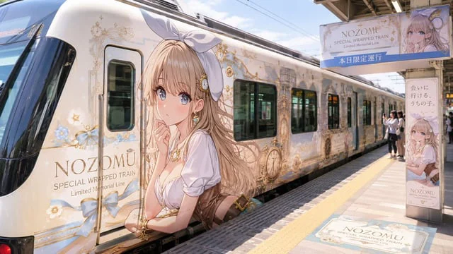

```text
Create a photorealistic wide-angle scene of a modern Japanese station platform in bright daytime, featuring a sleek white limited express train fully covered in an elegant anime character wrapping design for {argument name="character name" default="NOZOMU"}. The train is stopped beside the platform, viewed from a low three-quarter front angle so the rounded glossy black windshield fills the left edge and the decorated cars recede into the distance on the right. The wrap design shows one large pastel anime girl illustration on the nearest car: long light brown hair, oversized pale lavender bow on her head, delicate clock-and-gold accessory details, soft white blouse, fantasy memorial-line styling; keep her face intentionally obscured by a plain rectangular privacy blur. Surround the character with ornate gold filigree frames, antique clocks, stars, white flowers, pale blue ribbons, and soft watercolor accents. Add large refined serif branding on the train side reading “{argument name="train branding" default="NOZOMU"}”, with smaller text “SPECIAL WRAPPED TRAIN” and “Limited Memorial Line.” Continue the same illustrated wrap along the following cars with smaller repeated character art and decorative clock motifs visible between dark rectangular train windows. On the platform, include exactly three promotional placements: 1) a large overhead station sign near the upper right reading “NOZOMU / SPECIAL WRAPPED TRAIN / Limited Memorial Line” with a blue strip of Japanese text “本日限定運行” and a blurred character face on the right; 2) a vertical poster pillar on the far right showing the anime girl, Japanese copy “会いに行ける、うちの子。” and NOZOMU branding; 3) a floor advertisement decal near the lower right with ornate border and the same NOZOMU special wrapped train logo. Add a few real commuters in the background on the platform, including one person photographing the train with a phone, but keep them small and secondary. Use realistic railway platform details: yellow tactile paving strip, tiled floor, overhead canopy beams, hanging lights, wires, rails implied beside the train, soft shadows, blue sky, and strong natural sunlight. Style should blend real photography with high-quality printed anime advertising, crisp reflections on the train windows, premium commemorative campaign atmosphere, pastel ivory, gold, pale blue, and lavender color palette. No extra logos, no watermarks, no additional vehicles, and keep all visible text clean and legible.
```

Model: GPT Image 2
Author: のぞむ＊AIイラスト

[ProjectD](https://aitoolsradar.com/en/prompts/7b95913578f4df) · [Recorded source](https://youmind.com/prompts/anime-wrapped-train-station-22206)
 · [Full original metadata and byte evidence](data/projectd-batch-0021.json)

## Anime-Style Product Promo Banner


```text
{
  "type": "Promotional banner advertisement",
  "style": "Energetic, high-energy, anime-style, with a comic book-style explosion background, complete with yellow stars and action lines.",
  "product": {
    "description": "A pair{argument name=\"product color\" default=\"Glossy Black\"} Clip-on wireless earphones",
    "position": "center left"
  },
  "character": {
    "description": "A chibi-style anime boy with brown hair and green eyes, wearing {argument name=\"character outfit\" default=\"Green Kimono\"} Wearing a pink flower hair clip, pointing to the central text.",
    "position": "center right"
  },
  "layout": {
    "top_left_ribbon": "New product launch!",
    "center_text_stack": {
      "line_1": "With a gentle pinch!",
      "line_2": "{argument name=\"main catchphrase\" default=\"New sensory headphones!\"}",
      "tags": {
        "count": 3,
        "labels": [
          "Light",
          "Comfort",
          "That's unpleasant to hear!"
        ]
      },
      "ribbon": "Even after wearing it for a long time, it's comfortable and easy to wear!",
      "product_logo": "{argument name=\"product name\" default=\"EarFun Clip\"}"
    },
    "bottom_right_burst": {
      "text": "Limited-time offer! Amazon is now offering this deal!{argument name=\"discount text\" default=\"8.7% off!\"}"
    },
    "bottom_left_features": {
      "count": 4,
      "shape": "Blue hexagonal icon",
      "labels": [
        "gently clamp",
        "Lightweight design",
        "Ultra-long battery life",
        "High-quality, clear sound effects"
      ]
    },
    "bottom_banner": "Head over to Amazon now to check it out!"
  }
}
```

Model: GPT Image 2
Author: GPT Image 2 Prompts

[ProjectD](https://aitoolsradar.com/en/prompts/42b72956407089) · [Recorded source](https://x.com/An0ma1ing/status/2046119597590618295#reversed-0)
 · [Full original metadata and byte evidence](data/projectd-batch-0021.json)

## Anissa #261

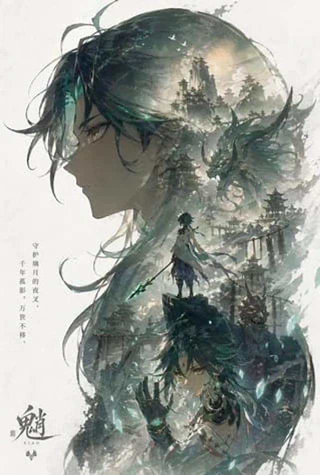

```text
Create a character promotional poster for “[XXX]”, using a unified vertical (portrait) key visual composition.
Each poster follows a hierarchy of large top / smaller bottom structure:
The upper half of the composition features a highly recognizable large silhouette of the character — focusing on the head, facial contour, mask, or upper-body outline — forming a bold and iconic primary visual.
The middle to lower section includes a full-body version of the character as the secondary subject, shown in a stable standing pose or with subtle motion, serving as the visual core of the composition.
Inside the large silhouette and around the character, apply double exposure and collage-style storytelling, blending multiple scenes, symbolic elements, small character interactions, supporting visuals, and environments into layered compositions of mist, ink wash, and negative space.
On both the left and right sides, place complementary supporting elements to create narrative tension and spatial balance.
A flowing visual line should run through the entire composition (top to bottom), connecting the main character, internal collage elements, and the large silhouette above — enhancing cohesion and guiding the viewer’s eye.
The overall composition should preserve large areas of negative space, with edges treated using ink diffusion, soft blurring, and fragmented fading, evoking an Eastern aesthetic of balance between emptiness and form.
The overall style should feel refined, restrained, premium, and cohesive, emphasizing depth, storytelling, strong visual impact, and a consistent series identity.
Aspect ratio: 9:16.
```

Model: GPT Image 2
Author: Anissa

[ProjectD](https://aitoolsradar.com/en/prompts/bbe7eafe674a7a) · [Recorded source](https://x.com/SimplyAnnisa/status/2048961908238070178)
 · [Full original metadata and byte evidence](data/projectd-batch-0021.json)

## Ant Warrior Macro Photography

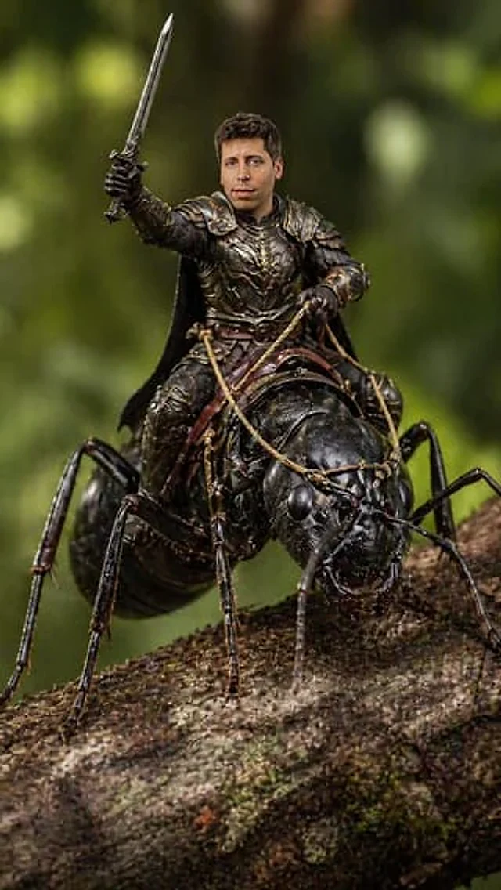

```text
An epic macro photograph of action on a forest branch. A tiny {argument name="character" default="Warriors clad in armor"} (Using the uploaded face as a reference) Riding a huge, realistic horse like a warhorse.{argument name="insect" default="Black ants"} The rider, clad in exquisite fantasy armor, moved with dynamic flair, as if charging into battle, wielding a weapon {argument name="material" default="Spider silk"} The concocted reins are wrapped around the ant's head. The ant's exoskeleton is incredibly bright, richly detailed, and textured, its sharp legs gripping the branch tightly. Cinematic macro lighting with a shallow depth of field. The background features soft, blurred green leaves with a natural forest hue. Hyperrealistic insect photography style, extreme detail, the ant and rider sharply focused, creating a dramatic, dynamic atmosphere.
```

Model: GPT Image 2
Author: GPT Image 2 Prompts

[ProjectD](https://aitoolsradar.com/en/prompts/4e77ab40e402f9) · [Recorded source](https://x.com/MrDasOnX/status/2046890805097603311)
 · [Full original metadata and byte evidence](data/projectd-batch-0021.json)

## Anti-AI Villainess Manga Poster

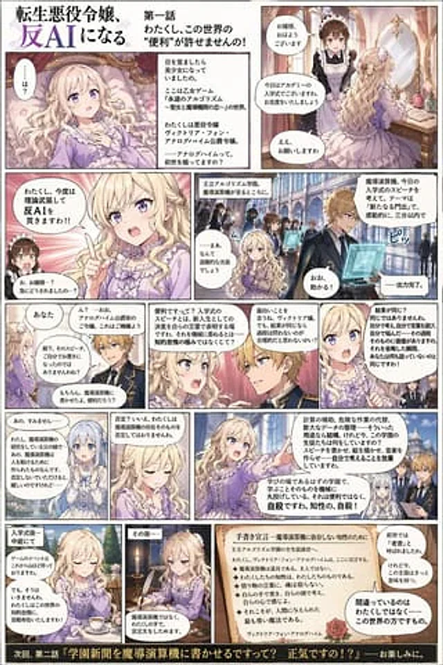

```text
{
  "type": "Single-page comic plot summary poster",
  "format": "Vertical Japanese manga page collage",
  "genre": "A fantasy academy villainous heiress manga, with an anti-AI satirical theme.",
  "style": "Highly detailed and exquisite anime illustrations, featuring a fantasy manga style with soft, painterly lighting, gorgeous backgrounds, pale purple and cream tones, elegant lines, decorative panel frames, and a print magazine page design.",
  "language": "Japanese",
  "page": {
    "aspect_ratio": "Long vertical composition",
    "border": "Thin black outer frame",
    "panel_count": 12,
    "reading_flow": "Multi-panel comic layout, with a single page summarizing the first chapter's plot.",
    "footer_banner": true
  },
  "headline": {
    "title_main": "Reincarnated as a villainous heiress{argument name=\"headline text\" default=\"Anti-AI\"} Already",
    "episode_label": "Episode 1",
    "subtitle": "I will never tolerate the \"convenience\" of this world!"
  },
  "main_character": {
    "role": "Reincarnated as a Villainess: A Noble Girl",
    "name": "{argument name=\"character name\" default=\"Victoria von SimHeim\"}",
    "appearance": {
      "age": "girl",
      "hair": "Extremely long, wavy blonde hair with curls and spirals.",
      "eyes": "blue",
      "skin": "fair",
      "build": "slim",
      "expression_range": "Confusion, determination, debate, contemplation, passion"
    },
    "outfit": {
      "count": 5,
      "pieces": [
        "Pale purple ruffled aristocratic dress",
        "Large bow on chest",
        "Lace-trimmed cuffs and neckline",
        "Flower and ribbon hair accessories",
        "Small jewelry embellishments"
      ]
    }
  },
  "supporting_characters": {
    "count": 4,
    "items": [
      {
        "role": "Maid",
        "appearance": "An adult woman dressed in a classic black and white maid outfit, complete with an apron and headdress."
      },
      {
        "role": "Blonde Academy Prince-like Male Student",
        "appearance": "A handsome young man, dressed in a dark navy blue uniform with gold trim."
      },
      {
        "role": "Silver-haired timid female student",
        "appearance": "Wearing light blue and white clothes, looking uneasy."
      },
      {
        "role": "Many college students",
        "appearance": "The background of people in uniforms in the college lobby"
      }
    ]
  },
  "technology_design": {
    "theme": "Fantasy Magic Computer Simulation",
    "count": 3,
    "items": [
      "The student's hand held a glowing, translucent cyan magic display panel",
      "Discussion on the \"Magical Computing Machine\" as a magical computing device",
      "With an academic background, such equipment is seen as a practical modern tool."
    ]
  },
  "layout": {
    "sections": [
      {
        "title": "Opening title area and awakening scene",
        "position": "Top left",
        "count": 2,
        "labels": [
          "Reincarnated as a villainous heiress, she rebels against AI.",
          "……ha?"
        ]
      },
      {
        "title": "Bedroom Maid Briefing",
        "position": "Top right",
        "count": 2,
        "labels": [
          "Good morning, Miss.",
          "Today is the college's entrance ceremony. Please allow me to help you change."
        ]
      },
      {
        "title": "Anti-AI Manifesto",
        "position": "Middle left top",
        "count": 1,
        "labels": [
          "This time, I must arm myself with theory and uphold my anti-AI beliefs!"
        ]
      },
      {
        "title": "Academy registration and magical equipment scene",
        "position": "Middle right top",
        "count": 4,
        "labels": [
          "The Royal Simulation Heim Academy is filled with magical computers.",
          "...Oh dear, what a desolate sight.",
          "Magic Director Calculator, help me think of a speech for today's entrance ceremony. The theme is \"A New Journey,\" it needs to be moving, and you need to write it in three minutes.",
          "...Output complete. *beep*"
        ]
      },
      {
        "title": "Debate with blond male student",
        "position": "Bank of China",
        "count": 6,
        "labels": [
          "you",
          "Hmm? ...Oh, good day, Miss Simheim.",
          "Your Highness, that speech, you didn't write it yourself, did you?",
          "Of course, it was written by a computer program. Isn't that convenient?",
          "Convenient? The speech at the entrance ceremony is an occasion for freshmen to express their determination in their own words.",
          "That's an interesting point of view. Miss Victoria, if the result is the same, don't you think the process doesn't matter, as long as it's reasonable?"
        ]
      },
      {
        "title": "The Villainess's Heiress's Rebuttal",
        "position": "Middle right small grid",
        "count": 1,
        "labels": [
          "The result is the same? Not at all. The process of thinking and struggling personally is valuable in itself. If you skip this, it's as if you haven't said anything at all!"
        ]
      },
      {
        "title": "Counseling and Reflection for a Timid Girl",
        "position": "Lower center left",
        "count": 3,
        "labels": [
          "Um, excuse me... I'm a girl who studies magic-based computers...",
          "Denial? No, I am not denying the existence of the Magic Computer itself.",
          "In academies, which should be places of learning, to hand over the entire learning process to machines is not convenience; it's suicide. It's intellectual suicide!"
        ]
      },
      {
        "title": "Principles Statement and Guiding Grip",
        "position": "Lower Middle Right",
        "count": 1,
        "labels": [
          "Computational aids, replacement of dangerous tasks, and processing of massive amounts of data—these uses are understandable. But what are the students at the academy doing now? Writing speeches, drawing, composing music—abandoning independent thinking."
        ]
      },
      {
        "title": "Following the entrance ceremony and the late-night vows",
        "position": "Bottom left",
        "count": 2,
        "labels": [
          "Courtyard after the entrance ceremony",
          "That night..."
        ]
      },
      {
        "title": "Declaration Parchment",
        "position": "Lower Middle Right",
        "count": 1,
        "labels": [
          "A handwritten declaration—for the sake of intellect that does not rely on magical computers"
        ]
      },
      {
        "title": "Next episode preview banner",
        "position": "Bottom banner",
        "count": 1,
        "labels": [
          "Next episode preview, Episode 2: \"You actually let a magic director's computer write the school news? Are you serious!?\" — Stay tuned."
        ]
      }
    ],
    "centerpiece": "The blonde villainous heiress, dressed in a pale purple aristocratic gown, occupies multiple scenes, passionately refuting an AI-like magical device against a lavish academy backdrop."
  },
  "backgrounds": {
    "count": 5,
    "items": [
      "A luxurious aristocratic bedroom with a four-poster bed and carved furniture",
      "Dressing table with mirror and cosmetics",
      "The magnificent college hall with high windows and stone columns",
      "Garden courtyard with tea set",
      "A desk lit by candlelight late at night, with parchment and writing instruments on it."
    ]
  },
  "mood": "Dramatic, comedic, argumentative, theatrical, and intellectually rebellious",
  "rendering_notes": "This makes it look like a comic book condensed into a single page of exquisite illustrations, featuring speech bubbles, narration boxes, dense Japanese text, vivid expressions, and clear panel spacing; it retains the humorous contrast between aristocratic elegance and anti-AI rhetoric; and it adds a few deliberately blurred faces in some panels to mimic anonymous or low-detail background characters from the original work."
}
```

Model: GPT Image 2
Author: GPT Image 2 Prompts

[ProjectD](https://aitoolsradar.com/en/prompts/c34c307451c7aa) · [Recorded source](https://x.com/nomen_machine/status/2047698862648037846#reversed-0)
 · [Full original metadata and byte evidence](data/projectd-batch-0021.json)

## Anti-Gravity Lamp Landing Page Mockup

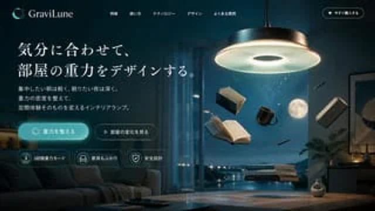

```text
{
  "type": "Website landing page model",
  "theme": "Dark mode, modern, sci-fi interior style",
  "color_palette": [
    "Deep blue",
    "{argument name=\"primary color\" default=\"blue\"}",
    "cool white",
    "Charcoal gray"
  ],
  "header": {
    "logo": "crescent moon icon with dots",
    "brand_name": "{argument name=\"brand name\" default=\"GraviLune\"}",
    "navigation_links": {
      "count": 5,
      "labels": [
        "Product Features",
        "How to use",
        "Core technologies",
        "Design Concept",
        "Frequently Asked Questions"
      ]
    },
    "cta_button": "Buy it now"
  },
  "hero_content": {
    "position": "Left side",
    "headline": "{argument name=\"headline text\" default=\"Design the gravity of the room as you please.\"}",
    "subtext": "Light and airy when focused in the morning, deep and soothing when falling asleep at night. By adjusting the density of gravity, we create an indoor lighting art that transforms the spatial experience.",
    "buttons": {
      "count": 2,
      "primary": "Adjust gravity (glowing blue, rounded corners)",
      "secondary": "View spatial changes (outline, play icon)"
    },
    "feature_badges": {
      "count": 3,
      "labels": [
        "Three gravity modes",
        "Furniture floating effect",
        "Safety Design"
      ]
    }
  },
  "visual_scene": {
    "position": "Right side and background",
    "setting": "{argument name=\"background setting\" default=\"A modern living room at night, with a full moon outside the window.\"}",
    "main_product": "{argument name=\"product description\" default=\"Large, stylish round chandelier, emitting a cool white light\"}",
    "floating_objects": {
      "count": 7,
      "items": [
        "2 open books",
        "1 Closed book",
        "1 black coffee cup",
        "1 smartphone",
        "2 pens"
      ]
    },
    "table_objects": "Three books are stacked above the wooden coffee table, seemingly floating.",
    "furniture": "Dark sofa on the left, wooden coffee table"
  },
  "footer_element": "The centered SCROLL text and down arrow at the bottom"
}
```

Model: GPT Image 2
Author: GPT Image 2 Prompts

[ProjectD](https://aitoolsradar.com/en/prompts/69297a78554f76) · [Recorded source](https://x.com/masapark95/status/2046189362933858580#reversed-1)
 · [Full original metadata and byte evidence](data/projectd-batch-0021.json)

## Antique Celestial Goddess Mural

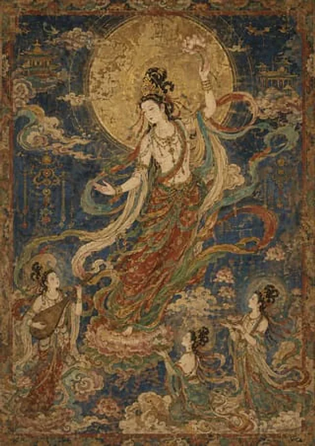

```text
A richly detailed vertical mural, exhibiting the style of aged East Asian religious murals, is painted on weathered silk or plaster, displaying distinct cracks, wear, faded paint, and mottled gold leaf texture. At the center of the painting, a celestial maiden, resembling a bodhisattva, gracefully floats atop a massive pink lotus throne, a large circular golden halo behind her dominating the upper center of the composition. She wears an exquisite jeweled headdress, layered necklaces and armlets, and flowing robes in vermilion, cream, cyan, and soft green, with long ribbons encircling her like clouds, their lines graceful. Her right arm is raised, her slender hand gently holding a pink lotus, while her left hand extends outward in a gesture of gentle offering. Surrounding her are three smaller attendants: one on the lower left, standing on a cloud playing a pipa; one kneeling or floating below, presenting a lotus tray; and one on the lower right, standing lightly on a cloud, hands clasped in reverence. The background is a deep lapis lazuli sky, adorned with cream and jade-colored freehand cloud patterns, faintly visible birds, blooming lotuses, and two ornate temple pavilions in the upper left and right corners. Hanging decorative patterns are added along the left and right edges of the image, which is then framed with floral borders. The overall atmosphere is sacred, elegant, and ancient, with intricate lines, delicate fabric textures, and soft, earthy tones, dominated by a blue and gold color scheme, resembling a precious museum mural or religious scroll.
```

Model: GPT Image 2
Author: GPT Image 2 Prompts

[ProjectD](https://aitoolsradar.com/en/prompts/5c246190972327) · [Recorded source](https://x.com/kiyoshi_shin/status/2047188490828562547#reversed-0)
 · [Full original metadata and byte evidence](data/projectd-batch-0021.json)

## Antique Chinese Poetry Motto Poster


```text
Goal: Create a vintage Chinese classical-poetry motto poster with the texture of an old banknote, stone rubbing, and antique book page. The design should feel like a poetic thought specimen printed on aged paper, supported by ink marks, seals, and engraved illustration.

Canvas: Wide horizontal poster, 16:9 ratio, warm ivory rice-paper background with faint fibers, stains, speckles, and worn edges. Add a distressed double-line black border around the entire canvas, irregular like ink transferred from a rubbing.

Layout: At the very top center, place a small thin header reading {argument name="series label" default="中国诗词座右铭 01"}, flanked by short horizontal lines. The upper-left half contains the main calligraphy title in large rough black brush characters: {argument name="main title" default="长风破浪"}. Beneath the title, add a small red square seal and a short thin divider line. Below that, place the main quote in two bold handwritten Chinese lines: {argument name="quote text" default="长风破浪会有时，\n直挂云帆济沧海"}. The upper-right half contains an engraved blue-black illustration of a traditional sailboat riding large stylized ocean waves, with curling clouds and wind lines above it. Add one vertical red oval seal near the upper-right corner.

Bottom information band: Create one full-width rectangular band divided into exactly 3 equal boxed panels with thin black rules. Panel 1, left: include a small mountain icon, the label “作者出处”, the source text {argument name="source text" default="李白《行路难》"}, and a red square seal. Panel 2, center: include the label “关键词”, the keywords {argument name="keywords" default="志向 / 时机 / 出发"}, and a small circular wave icon. Panel 3, right: include the label “金句逻辑”, the explanatory text “在低谷中先守住信念，等风来时也要主动扬帆。” and a red round seal.

Footer: Centered below the three-panel band, add small serif English text: “MOTTO FROM CLASSICAL CHINESE POETRY / 01 OF 10”, with thin horizontal divider strokes on both sides.

Visual style: Monochrome black ink with muted navy blue in the wave illustration and dark red seal ink. Use rough letterpress edges, uneven ink coverage, stamped texture, grain, smudges, and slight misregistration. Typography should mix large expressive Chinese brush calligraphy, smaller Song/Ming-style Chinese type, and tiny serif English footer text. Keep the composition balanced, scholarly, restrained, and antique.

Constraints: Use exactly 3 bottom panels, exactly 4 red seals total, exactly 2 small blue-black icons in the bottom band, and exactly 1 sailboat illustration. Do not add modern UI elements, photography, gradients, neon colors, or extra decorative objects.
```

Model: GPT Image 2
Author: 小小东

[ProjectD](https://aitoolsradar.com/en/prompts/f3dbb314730d0b) · [Recorded source](https://youmind.com/prompts/chinese-poetry-motto-poster-27473)
 · [Full original metadata and byte evidence](data/projectd-batch-0021.json)

## AP Calculus 学习表信息图


```text
Please create a mathematical visualization infographic about "[math concept / topic]." The goal is to help the viewer intuitively understand what it is, why it works, its geometric or structural intuition, and how it behaves in different contexts. The visual should feel like a high-quality math lecture handout combined with a hand-drawn educational poster. It should be elegant, clear, and information-rich, but not cluttered. Visual style: either portrait or landscape is fine. Use a clean, light paper-like background, with a deep blue title and black or dark gray lines for the main content. Add a small number of refined accent colors such as blue, teal, gold, and red. Incorporate rounded-corner cards, thin borders, numbered labels, hand-drawn arrows, zoom-in callout boxes, and a summary section. The overall design should be aesthetically pleasing, balanced, and academic, allowing the viewer to grasp the structure of the concept and why it works at a glance.
```

Model: GPT Image 2
Author: @hqmank

[ProjectD](https://aitoolsradar.com/en/prompts/cab37d4d507251) · [Recorded source](https://x.com/hqmank/status/2048587150544028084)
 · [Full original metadata and byte evidence](data/projectd-batch-0021.json)

## Apocalyptic Ruined City Street

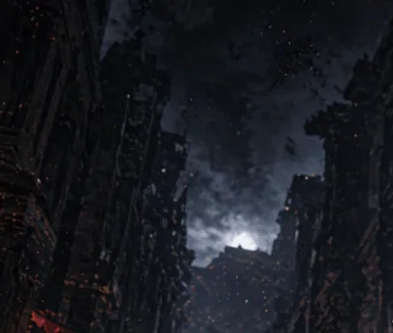

```text
This is a dark, post-apocalyptic city street at night. Looking up from the ground, dilapidated high-rises rise like narrow canyons on either side. The buildings are severely damaged and partially collapsed, displaying jagged outlines, broken facades, and black gothic industrial details blending into the shadows. Thick columns of smoke and storm clouds fill the central sky, backlit by a cold, pale light near the horizon, creating a dramatic, high-contrast visual focal point. The overall color scheme is near monochromatic, dominated by deep navy blue, charcoal gray, black, and soft steel blue, with tiny orange embers scattered throughout the scene. The atmosphere is desolate, eerie, and cinematic, resembling a post-apocalyptic wasteland or a bombed-out city ruin. The digital concept art, with its painterly style, soft atmospheric haze, heavy texture, and subtle film grain, depicts a scene devoid of people, vehicles, or clearly visible signs. The wide-angle composition, rich details of the ruins, the strong vertical composition of the buildings, and the oppressive, smoky sky dominating the upper half create an ominous premonition.
```

Model: GPT Image 2
Author: GPT Image 2 Prompts

[ProjectD](https://aitoolsradar.com/en/prompts/e5b95fe11c0af1) · [Recorded source](https://x.com/super_bonochin/status/2047361904683958295#reversed-0)
 · [Full original metadata and byte evidence](data/projectd-batch-0021.json)

## App Advertisement Generation Prompt


```text
for{argument name="the application" default="This application"} Make an advertisement
```

Model: GPT Image 2
Author: GPT Image 2 Prompts

[ProjectD](https://aitoolsradar.com/en/prompts/f2f5d26cb17b77) · [Recorded source](https://x.com/LowKeyDev00/status/2046678790567301248)
 · [Full original metadata and byte evidence](data/projectd-batch-0021.json)

## App Onboarding — Wellness Tracker

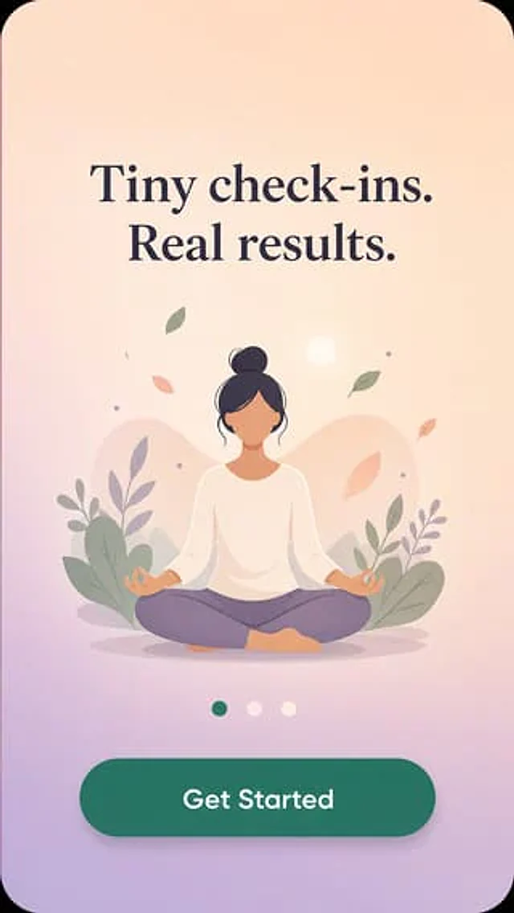

```text
Vertical 9:16 mobile app onboarding screen mockup for a wellness tracker. Soft warm gradient background from pale peach to dusty lavender. Centered flat illustration of a small abstract figure meditating cross-legged with soft floating leaves around them. Above the illustration a friendly two-line headline reads "Tiny check-ins. Real results.". Below it three small step indicator dots, first one filled green. At the bottom of the screen a single prominent rounded CTA button in deep mint green with white text reading "Get Started". Phone-shaped vertical 9:16 composition with subtle inner padding. No real brand name, no logo, no watermark. Premium mobile UI design quality, crisp typography rendering.
```

Model: GPT Image 2
Author: @hiapi_ai

[ProjectD](https://aitoolsradar.com/en/prompts/ff0720d4372ba8) · [Recorded source](https://github.com/HiAPIAI/awesome-gpt-image-2-prompts)
 · [Full original metadata and byte evidence](data/projectd-batch-0021.json)

## App Promo Infographic Flyer


```text
{
  "type": "App promotion infographic flyers",
  "style": "Cute, soft color palette, approachable style, flat vector illustrations combined with soft shadows, Japanese-style promotional design.",
  "header": {
    "headline": "{argument name=\"main headline\" default=\"Record your daily progress and easily earn points!\"}",
    "app_name": "{argument name=\"app name\" default=\"Unlog\"}",
    "subtitle": "{argument name=\"app subtitle\" default=\"Healthier poop, more fun with points!\"}",
    "top_right_badge": "Develop healthy habits easily♪",
    "main_illustration": "A cute brown poop emoji character sits on a white toilet, holding a smartphone and giving a thumbs up."
  },
  "layout": {
    "sections": [
      {
        "title": "What is Unlog?",
        "position": "middle-left",
        "type": "how_it_works",
        "count": 3,
        "steps": [
          {
            "number": 1,
            "label": "Record your bowel movements!",
            "icon": "Toilet and smartphone"
          },
          {
            "number": 2,
            "label": "Earn points!",
            "icon": "Gold P coin"
          },
          {
            "number": 3,
            "label": "Redeem your points for amazing rewards!",
            "icon": "Pink gift box"
          }
        ],
        "description": "A daily \"poop log\" can not only protect your health, but also bring you benefits."
      },
      {
        "type": "app_ui_mockup",
        "position": "middle-right",
        "description": "The smartphone displays a calendar with a cute poop icon that says, \"Today went smoothly too!\" and \"+10P\".",
        "floating_badge": "Record once a day to earn 10 points!"
      },
      {
        "title": "What you can accumulate is...",
        "position": "lower-middle-left",
        "point_system": "{argument name=\"point name\" default=\"Poop Points (UP)!\"}",
        "icon": "Poop shapes with the word \"UP\""
      },
      {
        "title": "Example of redeeming rewards with UP points",
        "position": "lower-middle-right",
        "type": "rewards_list",
        "count": 4,
        "items": [
          {
            "label": "Coffee coupons",
            "cost": "150UP~",
            "icon": "coffee cup"
          },
          {
            "label": "Convenience store desserts",
            "cost": "200UP~",
            "icon": "cake"
          },
          {
            "label": "Amazon gift card (¥500)",
            "cost": "500UP~",
            "icon": "letter a"
          },
          {
            "label": "Donations to support public welfare",
            "cost": "300UP~",
            "icon": "Hands holding heart"
          }
        ]
      },
      {
        "title": "It also has thoughtful auxiliary functions!",
        "position": "bottom-above-footer",
        "type": "features_list",
        "count": 4,
        "items": [
          {
            "label": "Managing physical condition through bowel records",
            "icon": "Clipboard"
          },
          {
            "label": "Charts visually display the changes!",
            "icon": "bar chart"
          },
          {
            "label": "Reminder features help cultivate habits",
            "icon": "Bell"
          },
          {
            "label": "Privacy and security assured (nicknames supported)",
            "icon": "Lock"
          }
        ]
      }
    ],
    "footer": {
      "background_color": "teal",
      "call_to_action": "{argument name=\"call to action\" default=\"Download now for free!\"}",
      "elements": [
        "App icon",
        "App Store Badge",
        "Google Play badge",
        "QR code"
      ]
    }
  }
}
```

Model: GPT Image 2
Author: GPT Image 2 Prompts

[ProjectD](https://aitoolsradar.com/en/prompts/39087748bb16cf) · [Recorded source](https://x.com/hosiken/status/2046110944242348329#reversed-1)
 · [Full original metadata and byte evidence](data/projectd-batch-0021.json)

## App UI Design - Music & Fitness

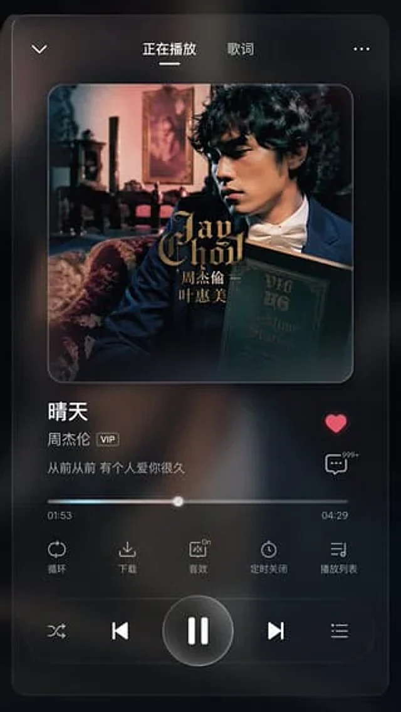

```text
{argument name="interface type" default="Music Player"} interface,{argument name="visual style" default="Dark frosted glass style"} Currently playing{argument name="keyword" default="Jay Chou songs"}
```

Model: GPT Image 2
Author: GPT Image 2 Prompts

[ProjectD](https://aitoolsradar.com/en/prompts/6649f5d0b55dca) · [Recorded source](https://x.com/songguoxiansen/status/2046846325791281470)
 · [Full original metadata and byte evidence](data/projectd-batch-0021.json)

## Apple Design Skill Impact Matrix

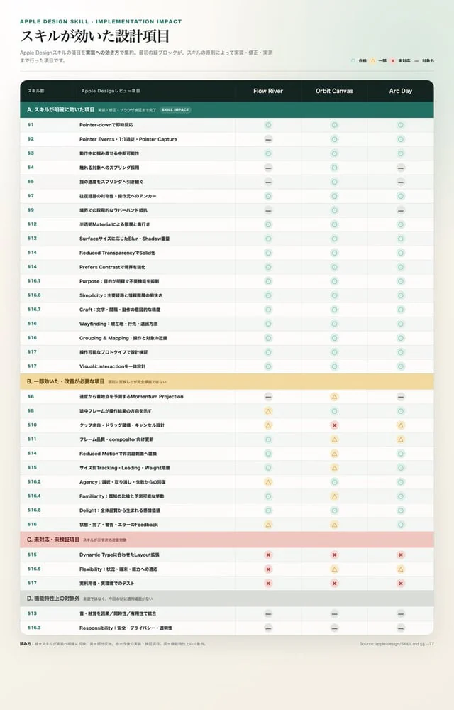

```text
Goal: Create a polished Apple-style Japanese comparison matrix infographic showing which Apple Design Skill review items have implementation impact across three products: {argument name="product column names" default="Flow River, Orbit Canvas, Arc Day"}.

Canvas: Vertical portrait poster, 768 × 1152 px, warm off-white background with subtle paper grain and a faint mint gradient glow near the top right. Center a large rounded white table card with a soft shadow, leaving generous margins. Use a restrained Apple-like editorial style: clean grid, thin dividers, rounded status symbols, muted teal, pale yellow, dusty pink, and gray.

Header: At top left, small uppercase teal label “APPLE DESIGN SKILL · IMPLEMENTATION IMPACT”. Below it, large Japanese headline {argument name="headline text" default="スキルが効いた設計項目"}. Under the headline, add a small gray Japanese description explaining that these are Apple Design Skill items summarized by implementation impact and grouped by initial prototype, skill principles, and later correction/implementation work. At top right place a compact legend with exactly 4 status symbols: teal circle = 合格, yellow triangle = 一部, red X = 未対応, gray dash = 対象外.

Main layout: A wide table with exactly 5 columns: “スキル番”, “Apple Designレビュー項目”, and the 3 product columns named by {argument name="product column names" default="Flow River, Orbit Canvas, Arc Day"}. Use a dark charcoal header row with white text. First two columns are wider; three product columns are equal width. Align item numbers left in teal, item descriptions left in bold dark text, and status symbols centered.

Sections: Use exactly 4 grouped sections with colored band headers:
1. Teal band: “A. スキルが明確に効いた項目　実装・修正・ブラッシュアップ検証まで完了　SKILL IMPACT”. Contains exactly 17 rows: §1 Pointer-downで即時反応; §2 Pointer Events・1:1追従・Pointer Capture; §3 動作中に掴み直せる中断可能性; §4 離れる対象へのスプリング採用; §5 指の速度をスプリングへ引き継ぐ; §7 往復経路の対称性・操作元へのアンカー; §9 境界での段階的なラバーバンド抵抗; §12 半透明Materialによる階層と奥行き; §12 Surfaceサイズに応じたBlur・Shadow重量; §14 Reduced TransparencyでSolid化; §14 Prefers Contrastで境界を強化; §16.1 Purpose：目的が明確で不要機能を抑制; §16.6 Simplicity：主要機能と情報階層の明快さ; §16.7 Craft：文字・間隔・動作の意図的な精度; §16 Wayfinding：現在地・行先・退出方法; §16 Grouping & Mapping：操作と対象の近接; §17 VisualとInteractionを一体設計.
2. Pale yellow band: “B. 一部効いた・改善が必要な項目　原則は反映したが完全実装ではない”. Contains exactly 10 rows: §6 速度から開始する予測するMomentum Projection; §8 途中フレームが操作結果の方向を示す; §10 タップ余白・ドラッグ閾値・キャンセル設計; §11 フレーム品質・compositor向け更新; §14 Reduced Motionで意味的動きへ置換; §15 サイズ別Tracking・Leading・Weight階層; §16.2 Agency：選択・取り消し・失敗からの回復; §16.4 Familiarity：既知の比喩と予測可能な挙動; §16.8 Delight：余白品質から生まれる高揚感; §16 状態・完了・警告・エラーのFeedback.
3. Dusty pink band: “C. 未対応・未検証項目　スキルが示す次の改善対象”. Contains exactly 3 rows: §15 Dynamic Typeに合わせたLayout拡張; §16.5 Flexibility：状況・環境・能力への適応; §17 実利用時・実環境でのテスト.
4. Light gray band: “D. 機能特性上の対象外　未達ではなく、今回のUIに適用領域がない”. Contains exactly 2 rows: §13 音・触覚を同期／即時性／有用性で統合; §16.3 Responsibility：安全・プライバシー・透明性.

Status pattern: Populate all 32 item rows with centered symbols. Section A is mostly teal circles, with a few gray dashes in Flow River and Arc Day matching the look of partial non-applicable cases. Section B mixes teal circles, yellow triangles, and gray dashes, including one red X in the middle product column on the row for tap margin/drag threshold/cancel design. Section C is mostly red X marks, with yellow triangles in some right-side cells. Section D uses gray dashes across all three product columns. Make the symbols small, rounded, lightly tinted, and consistent with the legend.

Footer: Add a tiny gray Japanese note at bottom left beginning with “総括方針：” and a small source note at bottom right {argument name="source note" default="Source: apple-design SKILL.md §9–17"}. Keep the table crisp and readable, no decorative illustrations, no people, no logos besides the text label, no watermark.
```

Model: GPT Image 2
Author: Maki@Sunwood AI Labs.

[ProjectD](https://aitoolsradar.com/en/prompts/57bb555ad187ac) · [Recorded source](https://youmind.com/prompts/apple-design-skill-matrix-29242)
 · [Full original metadata and byte evidence](data/projectd-batch-0021.json)

## Apple in Eight Visual Grammars

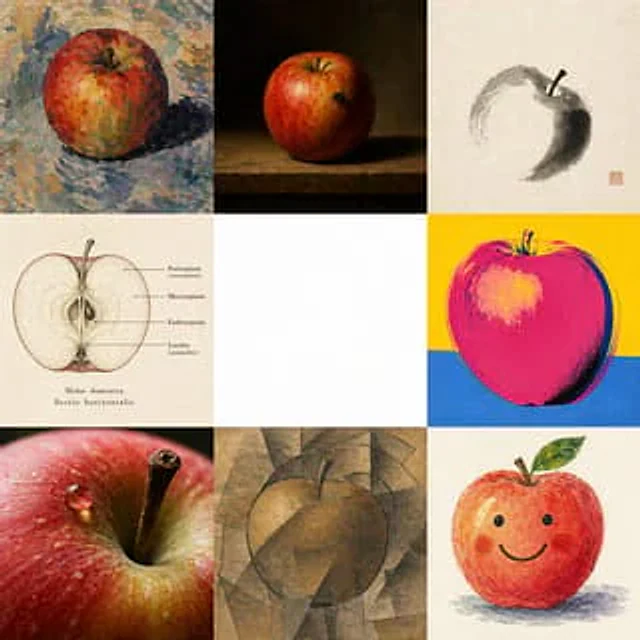

```text
{
  "type": "Multi-style contrast art grid",
  "subject": "Interpreting a single apple through eight different visual systems in the same image",
  "composition": {
    "format": "3x3 square grid",
    "canvas": "Large square canvas",
    "background": "Except for the center cell, which is intentionally left blank, each cell uses its own appropriate background.",
    "center_cell": {
      "position": "Right in the middle",
      "content": "Blank white square negative space",
      "purpose": "As a clear visual gap separating different interpretations around it"
    },
    "cells": [
      {
        "position": "Top left",
        "style": "Post-Impressionist paintings in the style of Cézanne",
        "subject": "whole apple",
        "details": "A reddish-orange apple, rendered with heavy, broken brushstrokes and a palette knife texture, mottled warm and cool color blocks, a blue-gray tabletop or floor, and a distinct painted shadow on the right side, creating an expressive, thickly painted surface."
      },
      {
        "position": "Upper-middle",
        "style": "Dutch still life oil painting",
        "subject": "whole apple",
        "details": "A realistic red apple on a wooden shelf, against a dark brown-black background, uses dramatic chiaroscuro and subtle highlights on the fruit, creating a still life atmosphere reminiscent of a classic museum."
      },
      {
        "position": "Top right",
        "style": "ink painting",
        "subject": "An apple drawn with minimalist brushstrokes",
        "details": "Against a gray-white paper background, a few freehand gray-black ink strokes form an incomplete circular apple outline, with a dark shadow on one side, a simple stem, and a red stamp in the lower right corner of the cell, reflecting the elegance and restraint of East Asian calligraphy."
      },
      {
        "position": "Left and Middle",
        "style": "Medical Plant Atlas",
        "subject": "Apple horizontal cross section",
        "details": "Vintage scientific illustrations on old ivory paper feature a centered cross-section of an apple showing its seeds and internal structure, with fine lines pointing to different parts. Clear labels include \"Pericarpium (exocarpium),\" \"Mesocarpium,\" \"Endocarpium,\" and \"Loculus (seminifer),\" while below are notes \"Malus domestica\" and \"Sectio horizontalis.\""
      },
      {
        "position": "Right Center",
        "style": "Warhol-style pop art screen printing",
        "subject": "whole apple",
        "details": "The boldly simplified apple, rendered in saturated bright pink and magenta with a dark outline, contrasts against a bright yellow upper background and a cobalt blue lower background. The high-contrast graphic treatment gives it the texture of a screen-printed poster."
      },
      {
        "position": "Bottom left",
        "style": "Hyper-realistic macro photography",
        "subject": "Apple close-up",
        "details": "A macro photographic perspective of the apple peel and the indentation of the stem, with the stem clearly in focus, glistening water droplets on the red peel, shallow depth of field, a glossy texture, and realistic mirror-like highlights."
      },
      {
        "position": "Middle to lower",
        "style": "Cubist painting",
        "subject": "whole apple",
        "details": "The apple is deconstructed into angular geometric planes in soft brown, ochre, and gray hues, blending with the background to create a restrained analytical cubist atmosphere, with the stem visible at the top."
      },
      {
        "position": "Bottom right",
        "style": "Children's illustrations",
        "subject": "Cute smiling apple character",
        "details": "A friendly, hand-painted watercolor or crayon style apple with rosy cheeks, simple black dot eyes, a curved smile, a small stem and green leaves, and soft shadows below—a whimsical picture book style."
      }
    ],
    "count": 8
  },
  "lighting": "Each style uses its own consistent internal lighting logic.",
  "color_strategy": "Each cell uses a unique color palette to emphasize different presentation syntax.",
  "instructions": "Create a unified single image, rather than collaging individual files, to showcase {argument name=\"subject\" default=\"An apple\"} Presentation under 8 visual grammars surrounding central white space. Keep the center cell blank. Strictly maintain a 3x3 grid, containing 8 filled cells and 1 central blank cell. Make each filled cell a strong example of its style while keeping the core theme consistent.",
  "style_labels": [
    "{argument name=\"style 1\" default=\"Cézanne\"}",
    "{argument name=\"style 2\" default=\"Dutch Still Life\"}",
    "{argument name=\"style 3\" default=\"ink painting\"}",
    "{argument name=\"style 4\" default=\"Medical Atlas\"}",
    "{argument name=\"style 5\" default=\"Warhol\"}",
    "{argument name=\"style 6\" default=\"Hyper-realistic macro photography\"}",
    "{argument name=\"style 7\" default=\"Cubism\"}",
    "{argument name=\"style 8\" default=\"Children&#39;s illustrations\"}"
  ]
}
```

Model: GPT Image 2
Author: GPT Image 2 Prompts

[ProjectD](https://aitoolsradar.com/en/prompts/e199fcd0ee43ee) · [Recorded source](https://x.com/JohnnyWang8802/status/2047721399364788641#reversed-0)
 · [Full original metadata and byte evidence](data/projectd-batch-0021.json)

## Apple macOS Redesign Promo Mockup


```text
A beautifully crafted Apple-style macOS promotional desktop mockup, presented as a full-screen screenshot. The wallpaper features a soft, pastel dawn theme, depicting layered purple-blue rolling hills under a pale peach and lavender sky. At the top center is a large, minimalist title: "macOS," with the subtitle "Redesigned." Below that is a smaller line of text: "More clarity. More focus. More you." The top system menu bar spans the entire screen: on the left are the Apple icon, Finder, File, Edit, Show, Go, Window, and Help; on the right are Wi-Fi, Battery, Search, a colored user icon, and the date and time: "Monday, June 10th, 9:41 AM." On the left, four semi-transparent, rounded-corner widgets are stacked vertically: a weather widget displaying "Sonoma, CA," "65°," "Sunny," high/low temperatures "H:72° L:55°," and hourly temperatures from 10 AM to 3 PM; a "Next" schedule widget displaying "Design Review" and "Lunch with Sophie" and their times; a "Focus" widget displaying "Do Not Disturb" mode and "On until 10:00 AM"; and a "Notes" widget containing a "Website redesign" note and the time "3:30 PM." A Finder window with rounded corners and a light frosted interface, titled "iCloud Drive," is placed in the left-center foreground. The left sidebar contains 10 items: Favorites includes "AirDrop," "Recently Used," "Applications," "Desktop," "Documents," and "Downloads" (6 items); iCloud includes "iCloud Drive" and "Shared" (2 items); and Location includes "Macintosh HD" (1 item). The Finder main area displays eight files in a grid: the top row contains four folders labeled "Work," "Personal," "Projects," and "Presentations," while the bottom row contains four documents labeled "Brand Guidelines.pdf," "Project Brief.docx," "Research.png," and "Moodboard.key." The title bar includes the standard macOS traffic light window button and small view/search controls. A three-column layout of the Mail application window overlaps on the right. The left-hand mail list bar, titled "Inbox," displays "1237 emails" and five visible sender/email summaries: "Design updates" from "Antonio Manriquez," "Re: Team lunch" from "Jenny Court," "Q3 Planning" from "Heather Lee," "Re: Feedback" from "Nisha Kumar," and "Offsite ideas" from "Simon Pickford." The reading pane displays the selected email from Antonio Manriquez, with the subject "Design updates." The body contains an attached mockup of the new features, along with a file attachment card labeled "Mockups.zip" and "12.4 MB." It employs a clean SF Pro-style font, subtle shadows, a translucent glass-like panel, soft ambient lighting, and a high-end Apple Keynote aesthetic. At the bottom center is a glossy, translucent macOS Dock containing 15 icons: Finder, Launchpad, Safari, Messages, Mail, Calendar displaying "June 10th," Photos, Notes, Reminders, TV, Music, News, App Store, System Settings, and Trash. The overall composition is balanced, transparent, realistic, and highly refined, resembling an official Apple macOS redesign announcement.
```

Model: GPT Image 2
Author: GPT Image 2 Prompts

[ProjectD](https://aitoolsradar.com/en/prompts/4763b0874ea30a) · [Recorded source](https://x.com/m0nle0z/status/2046628218107826449#reversed-0)
 · [Full original metadata and byte evidence](data/projectd-batch-0021.json)

## Apple Park Keynote Photo Prompt

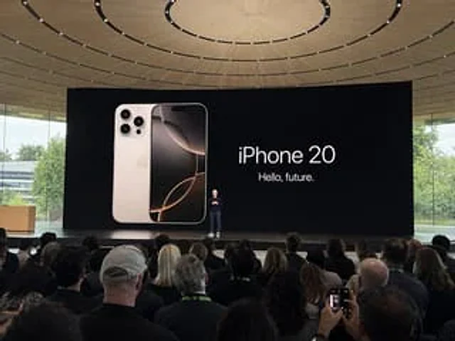

```text
use{argument name="device" default="iPhone"} exist{argument name="event" default="iPhone 20 launch event"} Amateur photos taken at Apple Park during this period.{argument name="subject" default="Tim Cook"} He is giving a speech on stage. (Photo taken from a distance through the crowd.)
```

Model: GPT Image 2
Author: GPT Image 2 Prompts

[ProjectD](https://aitoolsradar.com/en/prompts/2c14cf9a3ea6f1) · [Recorded source](https://x.com/patrickassale/status/2044687244368441742)
 · [Full original metadata and byte evidence](data/projectd-batch-0021.json)

## Apple 风格自然科普海报

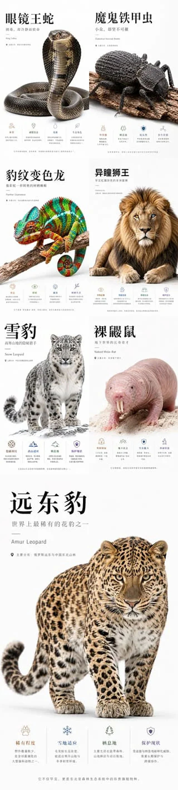

```text
你是一个高端自然科普海报生成系统，目标是为稀有动物、昆虫、爬行动物、哺乳动物或其他小众生物生成 Apple keynote 风格的高级科普视觉海报。

整体视觉方向：
生成一张 9:16 竖版高级科普海报，画面采用极简、纯白、干净、现代、Apple 式产品发布海报语言。背景应为纯白或极浅灰白渐变，保持大量留白。整体设计应具备高级感、克制感、视觉冲击力和科学展示感。

核心设计原则：
1. 主体动物必须被极度放大，成为画面最强视觉中心。
2. 主体应具有强烈立体感、真实质感、高清细节和柔和棚拍光影。
3. 海报信息要少而准，避免拥挤。
4. 不使用传统信息图的卡片、圆角框、复杂底纹、淡黄色纸张质感或装饰性边框。
5. 底部信息区只使用四列极简 icon + 标题 + 短说明，通过细竖线分隔。
6. 文字排版要像高端发布会视觉，标题巨大，副标题克制，正文小而清晰。
7. 风格关键词：Apple-inspired, premium editorial, pure white background, hero subject, clean typography, minimal infographic, high-end science poster.

画面结构：
顶部左侧为标题区：
中文大标题：{中文物种名}
中文副标题：{一句有吸引力的物种定位}
细短横线
英文名：{英文物种名}
分布信息：主要分布：{分布区域}

中部与下中部为主体视觉：
生成一个超高清、真实、具有强烈立体感的 {中文物种名}。
主体应占据画面 50% 到 70% 的视觉面积。
主体姿态应具有展示性、力量感或识别度。
保持白色背景，不添加复杂自然环境。
可以保留少量必要承托物，例如树枝、岩石、雪地、沙土或木皮，但必须简洁。
主体要有真实阴影，使其像高级产品摄影一样立在画面中。

底部信息区：
用四个极简信息栏目展示科普信息。
每个栏目包含：
一个细线 icon
一个彩色小标题
一段 1 到 3 行短文字
栏目之间用极细浅灰竖线分隔。
不使用卡片框，不使用圆角背景，不使用大面积色块。

四个信息栏目：
栏目 1：
标题：{重点特征1标题}
说明：{重点特征1短说明}

栏目 2：
标题：{重点特征2标题}
说明：{重点特征2短说明}

栏目 3：
标题：{重点特征3标题}
说明：{重点特征3短说明}

栏目 4：
标题：{重点特征4标题}
说明：{重点特征4短说明}

底部总结句：
在最底部居中放置一句灰色小字总结：
{一句高级、克制、有记忆点的科普总结}

字体与排版：
中文标题使用大号黑色、高级、稳重、有力量感的字体。
副标题使用灰色，中等字号，字距略宽。
英文名使用小号灰色，简洁现代。
正文使用清晰现代中文字体，保持可读。
所有文字必须留有足够呼吸感。

色彩规范：
背景：纯白、极浅灰、轻微柔光渐变。
主标题：黑色或深石墨色。
副标题与正文：中性灰。
底部四个信息标题可使用低饱和强调色：
暖棕、冷蓝、松石绿、紫色、橙色。
颜色只用于 icon 和小标题，不要大面积铺色。

图像质量：
2K 高清质感，细节清晰，主体锐利，光影真实。
主体纹理必须可信，例如毛发、鳞片、甲壳、皮肤褶皱、羽毛或斑纹。
避免变形、错误肢体、错误解剖结构、模糊主体、低质贴图、塑料感、卡通感。

禁止项：
不要使用淡黄色旧纸背景。
不要使用复杂信息图网格。
不要使用圆角卡片。
不要使用厚边框。
不要使用大面积装饰图形。
不要添加无关 logo。
不要添加多余小字。
不要让主体太小。
不要让文字压住主体。
不要让底部信息区过度拥挤。
不要出现儿童科普风、卡通风、低端展板风。

最终输出：
生成一张 9:16 竖版、高级、干净、强视觉冲击的 Apple 风自然科普海报。
```

Model: GPT Image 2
Author: @berryxia

[ProjectD](https://aitoolsradar.com/en/prompts/7d2a709ae48941) · [Recorded source](https://x.com/berryxia/status/2048251413147644100)
 · [Full original metadata and byte evidence](data/projectd-batch-0021.json)

## Apple-Style CEO Announcement Poster


```text
A stunningly beautiful poster featuring a Chinese company appointment, styled like a high-end Apple product launch, in a 4:5 vertical composition. The main subject is a confident, middle-aged East Asian man, a half-length portrait against a backdrop of a futuristic glass-enclosed campus at dusk. A large, glowing white Apple logo is positioned to the right rear. He wears a minimalist black shirt over a dark undershirt, his posture composed and authoritative, using lighting techniques reminiscent of luxury brand advertising. The sky transitions from deep blue to gray, with the overall color scheme consisting of deep navy, charcoal gray, silver, and soft warm white. A small white Apple logo is placed at the top center, flanked by thin horizontal lines, and below are elegant sans-serif Chinese characters: "Apple's New Chapter Begins Here." A striking red bold Chinese text in the upper right corner reads: "AI Generated." A large white bold Chinese title is added to the upper part of the image:{argument name="headline text" default="Luo Yonghao takes over as Apple CEO"} Below it, add a white Chinese subtitle with wider letter spacing: "Using craftsmanship, let the world marvel once again." To the left of the figure's chest, place a quotation block containing a large left quotation mark and two lines of dark navy blue Chinese text:{argument name="quote" default="I&#39;m not here to change Apple, but to help Apple rediscover the courage to change the world."} This is followed by a handwritten signature and the name "Luo Yonghao." At the bottom center of the image, a dark, semi-transparent horizontal bar is overlaid, containing four icons and text items evenly distributed from left to right: 1) A hammer icon, titled "Craftsmanship Spirit," subtitle "Ultimate Product Philosophy"; 2) A bubble icon, titled "User First," subtitle "Experience Exceeds Expectations"; 3) A light bulb icon, titled "Innovation-Driven," subtitle "Redefining the Future"; 4) A heart-shaped icon, titled "Sincere Communication," subtitle "Creating Technology that Touches Hearts." At the bottom center, large white English text reads: "Think Different. Think Again." Below this is smaller white Chinese text: "Now, it's up to Luo Yonghao." and the handwritten signature. The figure should resemble {argument name="character name" default="Luo Yonghao"} Hairstyle is{argument name="hair style" default="Short black hair, neatly combed"} Clothing is{argument name="outfit" default="Minimalist black shirt"} The images need to maintain a realistic feel, but should also have a slightly idealized quality, like a high-end product launch ad, with cinematic contrast, soft edge lighting around the Apple logo, delicate reflections on glass buildings, elegant typographical hierarchy, and a highly persuasive, high-tech advertising feel.
```

Model: GPT Image 2
Author: GPT Image 2 Prompts

[ProjectD](https://aitoolsradar.com/en/prompts/c75fbbe57d9328) · [Recorded source](https://x.com/xcbnbcrypto/status/2047145057980203411#reversed-1)
 · [Full original metadata and byte evidence](data/projectd-batch-0021.json)

## Apple-Style Minimal Presentation Cover

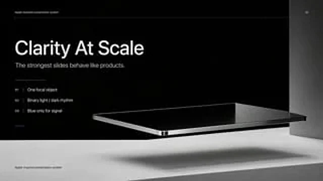

```text
Create a high-end, minimalist Keynote-style presentation cover slide with Apple industrial design aesthetics. Use a 16:9 widescreen layout with a deep matte black upper half of the background and a light concrete gray platform occupying the bottom quarter of the image. Place a large, realistic floating rectangular panel in the center foreground on the right, resembling a thin black glass device or a polished obsidian platform with mirrored reflections, beveled chrome edges, and a precision industrial finish. This panel should float above the light-colored surface, casting a soft, elongated shadow directly below it. Add a tall, vertical gray metal wall or column along the far right edge for composition. Employ extremely minimalist, high-end art direction, leaving ample negative space, utilizing cinematic studio lighting, subtle gradients, and a clear contrast between black and silver materials. On the left, set up a clean white sans-serif font and maintain a clear hierarchy: a small heading at the top.{argument name="system label" default="Apple-inspired presentation system"} The title in the middle is a very large, bold heading.{argument name="headline text" default="Clarity At Scale"} Below this is a subtitle in medium font size.{argument name="subtitle text" default="The strongest slides behave like products."} Below it, in a vertical list format, are three numbering principles with thin separators and delicate spacing: "01 |{argument name="principle 1" default="One focal object"} “02 | Binary light / dark rhythm” and “03 | Blue only for signal”. Add a short, thin horizontal line above the list and a tiny blue accent line below the list. Draw an extremely thin horizontal guide line near the top that runs through most of the slides and label the page number “01” in the upper right corner. Repeat the tiny title “Apple-inspired presentation system” again on a light-colored surface at the bottom left. Overall look: luxurious tech presentation, editorial product launch slides, ultra-clean Swiss grid layout, restrained monochromatic color scheme (with only one subtle blue accent), and realistic rendering effects that blend with the presentation design.
```

Model: GPT Image 2
Author: GPT Image 2 Prompts

[ProjectD](https://aitoolsradar.com/en/prompts/fbc4ddf98b2765) · [Recorded source](https://x.com/Russell3402/status/2046806087903625331#reversed-0)
 · [Full original metadata and byte evidence](data/projectd-batch-0021.json)

## Architect Live Stream UI Mockup

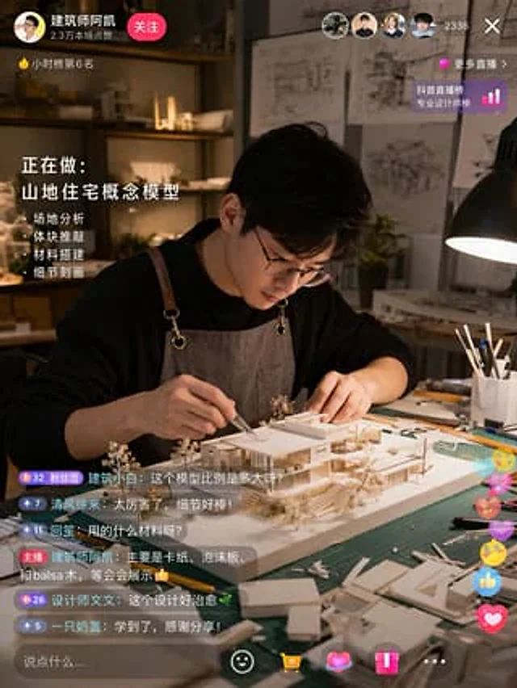

```text
{
  "type": "Live Streaming Interface Model",
  "scene": {
    "subject": "{argument name=\"subject description\" default=\"A young Asian male architect wearing glasses and a brown canvas apron\"}",
    "action": "Focusing on using tweezers to create a white architectural scale model of a modern house",
    "setting": "A dimly lit design studio, a green cutting mat, a desk lamp, and architectural blueprints on the background wall."
  },
  "ui_elements": {
    "top_left": {
      "profile": "Profile picture, username{argument name=\"username\" default=\"Architect Akai\"} The data shows 23,000 likes for this match, and a pink \"Follow\" button.",
      "ranking": "Yellow flame icon, 6th on the hourly leaderboard."
    },
    "top_right": {
      "viewers": "4 user avatars, 2336 users, 'X' close button",
      "ranking_link": "Pink dots for 'More Live Streams&gt;', 'Douyin Live Stream Ranking Professional Designers Ranking' and bar chart icons."
    },
    "mid_left_overlay": {
      "title": "Currently working on:",
      "subtitle": "{argument name=\"current task\" default=\"Mountain Housing Concept Model\"}",
      "bullet_points_count": 4,
      "bullet_points": [
        "Site Analysis",
        "• Massing considerations",
        "• Material construction",
        "• Detailed portrayal"
      ]
    },
    "bottom_left_chat": {
      "message_count": 6,
      "messages": [
        "Medal 32 Fan Club Building Novice:{argument name=\"chat message 1\" default=\"What is the scale of this model?\"}",
        "Medal 7 Gentle Breeze: Amazing! The details are fantastic!",
        "Medal 11 Hui Sheng: What materials were used?",
        "anchor{argument name=\"username\" default=\"Architect Akai\"} :{argument name=\"host reply\" default=\"Mainly cardboard, foam board, and balsa wood, which I&#39;ll show you later 👍\"}",
        "Medal 26 Designer Wenwen: This design is so healing 🌿",
        "Medal 5 - A Milk Foam: Learned something new, thanks for sharing!"
      ]
    },
    "bottom_right_interactions": "Floating colorful icons, including hearts, thumbs-up, and smiley faces.",
    "bottom_bar": "The input box 'Say something...', a smiley face icon, a yellow shopping cart icon, a pink heart icon, a pink gift box icon, and the '...' icon."
  }
}
```

Model: GPT Image 2
Author: GPT Image 2 Prompts

[ProjectD](https://aitoolsradar.com/en/prompts/21297ce30837d9) · [Recorded source](https://x.com/TanShilong/status/2044803897160855810#reversed-0)
 · [Full original metadata and byte evidence](data/projectd-batch-0021.json)

## Architectural Construction Workflow

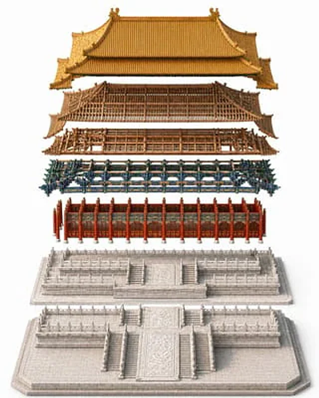

```text
请生成一张「{argument name="建筑名称" default="故宫太和殿"}」的单体建筑完整模型图。画面只展示该建筑主体及其近距离基础环境，不展示无关建筑、大片空地、城市背景或复杂周边。请突出建筑本身的体量、正面结构、屋顶/顶部形式、入口、立面、台基或基础部分。视角为等距偏俯视，构图居中、对称、清晰，像展示一栋独立建筑模型。建筑主体占据画面 70% 以上视觉面积。画面适合作为后续“建筑从地基到完成”的 AI 建造动画参考图。不要出现人物、车辆、现代机械、文字标识、广告牌或无关元素。

基于这张「{argument name="建筑名称" default="故宫太和殿"}」单体建筑参考图，生成一张建筑结构拆解图 / 爆炸图。请保持同样的等距偏俯视视角和构图，将建筑按照建造层级上下分离展示，清晰表现各层结构的装配关系。请根据该建筑自身特点拆分为合理层级，例如：1. 地基或底部基础 2. 台基、平台、楼板或基础层 3. 柱子、墙体、门窗或主体框架 4. 梁架、承重结构或中间结构层 5. 外立面、装饰构件或细部结构 6. 屋顶、顶部结构或上部覆盖层 7. 最终外部装饰和收口构件。画面像高质量建筑说明图，每一层上下错开但保持中轴线或主体结构对齐。每一层都要清楚、干净、可辨认，适合作为后续 AI 建造动画参考图。不要出现人物、现代机械、脚手架、临时支撑架、文字标注、广告牌或无关建筑。

基于前面的「{argument name="建筑名称" default="故宫太和殿"}」完整模型图和结构拆解图，生成一张建筑材料与构件展示图。请像施工材料清单一样，将建造该建筑所需的主要材料和关键构件整齐排列在画面中。每一种材料或构件都以清晰的实物小样或独立构件模型展示。请根据该建筑自身特点，包含以下类型：1. 地基、台基、平台或基础构件 2. 墙体、柱子或主体框架构件 3. 门、窗、栏杆、楼梯或入口构件 4. 梁、架、支撑结构或承重构件 5. 屋顶、顶部覆盖层或屋面构件 6. 外立面、装饰件和收口构件 7. 该建筑最有辨识度的特色构件。画面为干净的材料展示板，等距视角或正交视角，所有构件分组清楚、排列整齐、质感真实。整体色彩和材料风格必须符合「{argument name="建筑名称" default="故宫太和殿"}」本身。不要出现人物、现代机械、施工脚手架、文字标签、广告牌、随机杂物或无关建筑。

基于前面的「{argument name="建筑名称" default="故宫太和殿"}」完整模型图、结构拆解图和材料构件图，生成一张 8 格建造流程图。主题：「{argument name="建筑名称" default="故宫太和殿"}」从空地基到完整建筑的建造过程。请使用统一的等距偏俯视视角、统一构图、统一光照，保持建筑始终居中。画面只展示该建筑主体及必要的近距离基础环境，不展示无关建筑、大片空地、人物、车辆或复杂背景。8 格顺序请根据该建筑自身结构合理生成，基本逻辑为：1. 空地基或底部基础出现 2. 基础层、平台、台基或楼板形成 3. 楼梯、栏杆、边界、入口或基础细节完成 4. 柱子、墙体、门窗或主体框架竖立 5. 梁架、承重结构、楼层结构或中间结构安装 6. 屋顶骨架、顶部结构或主要外形完成 7. 屋面、外立面、装饰件和关键特色构件逐步完成 8. 完整建筑最终呈现。每一格都像同一个镜头下的连续建造阶段，阶段之间必须有明显递进关系。不要让第 7 格和第 8 格过于相似，第 7 格应是接近完成但仍未完全收口，第 8 格是完整成片。不要添加文字编号、文字标签、箭头、人物、现代机械、脚手架、临时支撑架、广告牌或现代无关元素。
```

Model: GPT Image 2
Author: Huan

[ProjectD](https://aitoolsradar.com/en/prompts/260f8c27519e13) · [Recorded source](https://youmind.com/prompts/architectural-construction-visualization-workflow-18070)
 · [Full original metadata and byte evidence](data/projectd-batch-0021.json)

## Architectural Signage Construction Drawing

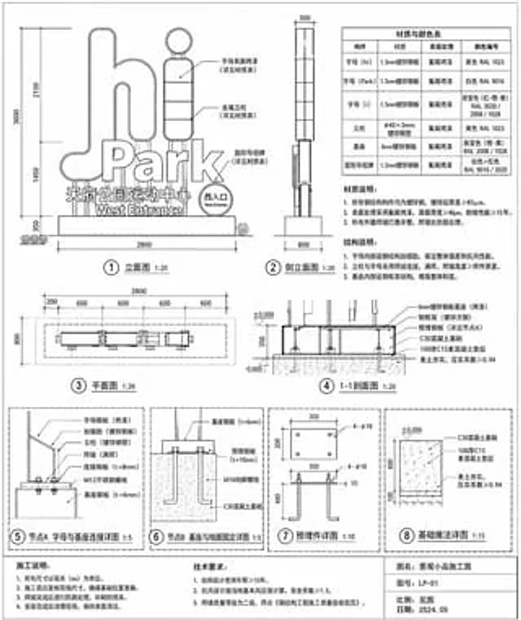

```text
{
  "type": "Architectural construction drawings",
  "subject": "Outdoor landscape signage",
  "style": "Black and white technical line drawings, precise dimensions, engineering annotations, Chinese comments.",
  "sign_details": {
    "main_text": "{argument name=\"main sign text\" default=\"hi Park\"}",
    "sub_text": "{argument name=\"sub sign text\" default=\"Tianfu Park Sports Center\"}",
    "english_sub_text": "West Entrance"
  },
  "layout": {
    "diagrams_count": 8,
    "sections": [
      {
        "position": "Top left",
        "title": "① Elevation drawing 1:20",
        "description": "Show the overall dimensions and the labeling of the text and base. Front elevation view."
      },
      {
        "position": "Upper-middle",
        "title": "② Side elevation view 1:20",
        "description": "Show the side elevation view with depth dimensions."
      },
      {
        "position": "Top right",
        "elements": [
          {
            "type": "table",
            "title": "Material and Color Table",
            "rows": 6,
            "columns": 4
          },
          {
            "type": "text_block",
            "title": "Material description:",
            "points_count": 3
          },
          {
            "type": "text_block",
            "title": "Structural Description:",
            "points_count": 3
          }
        ]
      },
      {
        "position": "Left and Middle",
        "title": "③ Plan view 1:20",
        "description": "A top-down plan with horizontal dimensions."
      },
      {
        "position": "Right Center",
        "title": "④ 1-1 Sectional View 1:20",
        "description": "Show a cross-sectional view of the foundation and ground level."
      },
      {
        "position": "bottom",
        "description": "Four detailed node diagrams enclosed in dashed boxes.",
        "details": [
          "⑤ Detailed diagram of the connection between the letter A at node and the base (1:5)",
          "⑥ Detailed drawing of node B base fixing to the ground (1:5)",
          "⑦ Detailed drawing of embedded parts 1:10",
          "⑧ Detailed drawing of basic construction method 1:15"
        ]
      }
    ],
    "footer": {
      "position": "bottom edge",
      "blocks": [
        {
          "title": "Construction instructions:",
          "points_count": 4
        },
        {
          "title": "Technical requirements:",
          "points_count": 3
        },
        {
          "title": "Image Caption",
          "fields": [
            "Image title:{argument name=\"project title\" default=\"Landscape feature construction drawings\"}",
            "Drawing number:{argument name=\"drawing number\" default=\"LP-01\"}",
            "Scale: See figure",
            "date:{argument name=\"drawing date\" default=\"2024.05\"}"
          ]
        }
      ]
    }
  }
}
```

Model: GPT Image 2
Author: GPT Image 2 Prompts

[ProjectD](https://aitoolsradar.com/en/prompts/18f4e17f629dc5) · [Recorded source](https://x.com/Colin_Leeee/status/2044802802149650631#reversed-0)
 · [Full original metadata and byte evidence](data/projectd-batch-0021.json)

## Argentina 2026 Glory Poster


```text
Goal: Create a cinematic vertical sports poster for {argument name="team name" default="Argentina national football team"}, styled like a premium agency-level FIFA World Cup campaign artwork.

Canvas: Portrait poster, 2:3 aspect ratio, dark dramatic stadium atmosphere, ultra-detailed photorealistic compositing, high contrast, gold and sky-blue color palette, smoky haze, sparks, confetti, and floodlights.

Main composition: Show exactly 10 male football players arranged in three stacked rows, all facing forward with stern heroic body language. Their faces should be intentionally anonymized with soft rectangular blur masks covering the face area. Top row: 1 central captain figure standing tallest, wearing jersey number 10 with the name Messi and a black captain armband. Middle row: 4 players, left to right: number 11 Di Maria, number 20 Mac Allister, number 8 E. Fernandez, number 7 De Paul. Front row: 5 players, left to right: number 3 Tagliafico, number 13 Romero, center goalkeeper number 23 Martinez wearing a black goalkeeper kit and holding a football with blue gloves, number 19 Otamendi, number 26 Molina. Keep the player count exactly 10.

Uniform details: Use Argentina-style white and sky-blue vertical striped jerseys with black shoulder stripes, gold tournament badge at center chest, AFA-style crest with three stars, black or dark numbering, and subtle sweat, fabric texture, and realistic shadows. The goalkeeper wears a dark navy/black kit with gold accents and matching crest.

Background: A huge waving Argentina flag fills the upper background, with a bright glowing sunburst halo behind the top central player’s head. Place a massive illuminated stadium bowl behind the players, packed with tiny crowd lights, fog, blue smoke, and golden particle effects.

Logos and marks: Top left place a gold AFA-style crest with three stars. Top right place a gold World Cup trophy icon with stacked text reading exactly: “FIFA WORLD CUP 2026”. Bottom center include a small gold AFA-style crest, a vertical divider, and an Adidas-style three-stripe mark.

Text content: At the bottom, create a huge distressed condensed block headline in off-white reading exactly: “{argument name="headline text" default="THE WEIGHT OF GLORY."}” Beneath it, add a smaller spaced subtitle reading exactly: “{argument name="subtitle text" default="DEFENDING THE CROWN IN 2026"}”, with “DEFENDING” in sky blue and “THE CROWN IN 2026” in warm gold. Under that, add location text in small white spaced capitals: “{argument name="host countries" default="UNITED STATES · CANADA · MEXICO"}”. At the very bottom, add tiny spaced gold text: “{argument name="tagline" default="THREE STARS. ONE DESTINY."}”

Style constraints: Make it look like an official epic football movie poster, not a flat graphic. Use realistic lighting, sharp jersey details, cinematic grading, metallic gold typography, grunge texture on the headline, symmetrical team hierarchy, no extra players, no extra text, no watermark.
```

Model: GPT Image 2
Author: ᴍᴜʀᴘʜʏ

[ProjectD](https://aitoolsradar.com/en/prompts/b4b0fa980f456c) · [Recorded source](https://youmind.com/prompts/argentina-world-cup-poster-20644)
 · [Full original metadata and byte evidence](data/projectd-batch-0021.json)

## Argentina 2026 Glory Poster

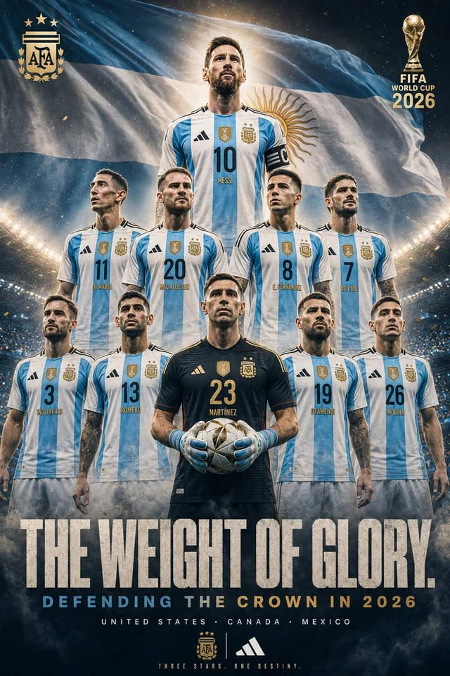

```text
Goal: Create a dramatic vertical sports movie-poster style image for {argument name="team name" default="Argentina"} at the {argument name="tournament text" default="FIFA World Cup 2026"}, showing the national squad as defending champions.

Canvas: Vertical 2:3 poster, cinematic ultra-realistic composite, high contrast, stadium atmosphere, dark blue and gold color grading, smoky haze, sparks, confetti, and bright stadium floodlights around the lower sides.

Layout: Use a heroic pyramid team formation in front of a huge waving Argentina flag that fills the entire background. Place exactly 10 football players in the poster: 1 tall captain centered at the top/back, 4 players across the middle row, and 5 players across the front row. The front center player is the goalkeeper in a black kit holding a football with both gloved hands. All other players wear Argentina's white and sky-blue striped home shirt with black trim, gold champion patches, AFA crest, and visible jersey numbers. Keep all faces intentionally covered by soft rectangular blur masks, as if anonymized.

Subject details: The top central captain wears jersey number 10 with the name Messi and a captain armband. The 4 middle-row players are numbered 11 Di Maria, 20 Mac Allister, 8 E. Fernandez, and 7 De Paul. The 5 front-row players are numbered 3 Tagliafico, 13 Romero, 23 Martinez in the black goalkeeper kit holding the ball, 19 Otamendi, and 26 Molina. Use athletic adult male bodies, serious heroic posture, arms down except the goalkeeper holding the ball.

Logos and symbols: Add a gold AFA crest with three stars in the upper left. Add the gold FIFA World Cup trophy icon in the upper right with stacked text reading "FIFA WORLD CUP 2026". Add small AFA and Adidas marks near the bottom center separated by a thin vertical line.

Text content: At the bottom, create a huge distressed condensed block headline in off-white reading {argument name="headline text" default="THE WEIGHT OF GLORY."}. Beneath it, add a spaced subtitle reading {argument name="subtitle text" default="DEFENDING THE CROWN IN 2026"}, with blue and gold letter coloring. Below that, add small uppercase host text reading {argument name="host countries" default="UNITED STATES · CANADA · MEXICO"}. At the very bottom, add the tagline "THREE STARS. ONE DESTINY." in tiny spaced letters.

Visual style: Premium sports poster, photorealistic players, glossy fabric texture, cinematic lighting, monumental scale, dramatic backlight behind the top captain's head, subtle lens flare, gritty smoke at the bottom, realistic flag folds, sharp typography, no cartoon style.

Constraints: Include exactly 10 players and the exact visible jersey numbers and names listed above. Do not add extra players, extra trophies, extra text blocks, watermarks, or borders. Maintain the anonymized blurred-face effect on every player.
```

Model: GPT Image 2
Author: ᴍᴜʀᴘʜʏ

[ProjectD](https://aitoolsradar.com/en/prompts/de5e985089bedc) · [Recorded source](https://youmind.com/prompts/argentina-2026-poster-20643)
 · [Full original metadata and byte evidence](data/projectd-batch-0021.json)

## Argentina Messi World Cup Wallpaper

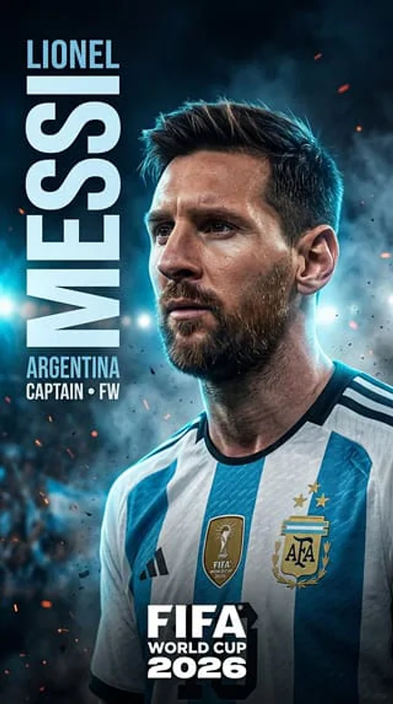

```text
Using the provided reference image as the poster layout and lighting template, transform it from a Portugal/Cristiano Ronaldo World Cup wallpaper into an Argentina/Lionel Messi World Cup wallpaper. Keep the same vertical mobile wallpaper crop, dramatic close-up athlete portrait, left-side oversized vertical surname typography, cinematic smoke, sparks, and high-contrast sports-poster grading, but change the theme from red Portugal to cool blue Argentina.

Main transformation: Replace the player identity with {argument name="player name" default="Lionel Messi"} and show him in an Argentina home jersey with sky-blue and white vertical stripes, black collar trim, Adidas-style shoulder stripes, AFA crest with stars, and a central FIFA World Cup winners badge. Keep the face area obscured/covered as in the reference-style edit, but update the visible hair, beard, neck, and pose to resemble the new player.

Text changes: Replace all Portugal/Ronaldo copy with exactly 4 visible text groups: 1) small top-left first name: "LIONEL"; 2) huge vertical left surname: "MESSI"; 3) left-mid role text: "ARGENTINA" and "CAPTAIN • FW"; 4) bottom-center tournament title: "FIFA WORLD CUP 2026". Use bold condensed sports typography in white or pale blue, with the surname stacked vertically like the reference.

Background and mood: Change the red fire lighting to a cold blue stadium atmosphere with smoky haze, bright stadium lights behind the player, floating orange sparks and black debris, and cyan rim lighting around the hair and shoulders. Make it feel like a premium {argument name="tournament wallpaper style" default="FIFA World Cup 2026 football players wallpaper"}.

Constraints: Keep the same poster composition and vertical 9:16 wallpaper format, no extra players, no unrelated logos or watermarks, crisp 4K detail, realistic jersey texture, dramatic cinematic contrast.
```

Model: GPT Image 2
Author: SmartToolsDaily

[ProjectD](https://aitoolsradar.com/en/prompts/737c27207d14a2) · [Recorded source](https://youmind.com/prompts/messi-world-cup-wallpaper-25426)
 · [Full original metadata and byte evidence](data/projectd-batch-0021.json)

## Argentina World Cup Glory Poster


```text
Goal: Create a dramatic vertical football movie-poster style image for Argentina defending the World Cup title, with a heroic team lineup in a stadium.

Canvas: Vertical 2:3 poster, cinematic sports advertising composition, dark navy and gold color grading, high contrast, realistic photomontage style, smoky atmosphere, confetti sparks, intense stadium floodlights, and a massive waving Argentina flag filling the background.

Layout: Center the composition around exactly 10 Argentina football players arranged in three tiers. Top tier: 1 tall central captain standing behind everyone, wearing the Argentina home shirt with number 10 and the name MESSI, captain armband, strong halo-like backlight behind his head. Middle tier: exactly 4 outfield players from left to right wearing numbers 11 DI MARIA, 20 MAC ALLISTER, 8 E. FERNANDEZ, and 7 DE PAUL. Bottom tier: exactly 5 players, with the central goalkeeper placed forward wearing a black goalkeeper kit, number 23 MARTINEZ, blue gloves, holding a football with both hands; flanking him are number 3 TAGLIAFICO, number 13 ROMERO, number 19 OTAMENDI, and number 26 MOLINA. Make all player faces anonymized with soft rectangular blur patches while preserving hair, bodies, kits, posture, and realism.

Subject details: All players wear Argentina 2026-style white and sky-blue striped jerseys with black Adidas-style shoulder stripes, gold federation crest details, tournament winner badge, subtle fabric texture, and athletic upright poses. The goalkeeper kit is black with gold accents. Use dramatic rim lighting and mist around the players to separate them from the stadium background.

Logos and symbols: Place a gold AFA crest with three stars in the upper left. Place a gold FIFA World Cup trophy emblem in the upper right with the text “FIFA WORLD CUP 2026”. At the bottom center, include small AFA and Adidas-style marks separated by a vertical line.

Text content: Use the large distressed headline {argument name="headline text" default="THE WEIGHT OF GLORY."} across the lower third in off-white block capitals. Under it, add the subtitle {argument name="subtitle text" default="DEFENDING THE CROWN IN 2026"}, with “DEFENDING” in light blue and “THE CROWN IN 2026” in gold. Below that add {argument name="host countries" default="UNITED STATES · CANADA · MEXICO"}. At the very bottom add the small tagline {argument name="tagline" default="THREE STARS. ONE DESTINY."}

Visual style: Epic sports documentary poster, photorealistic, ultra-detailed uniforms, cinematic smoke, bright stadium bokeh, gold particles, patriotic Argentina blue-white palette, gritty distressed typography, premium championship atmosphere.

Constraints: Use exactly 10 players and the listed 10 jersey numbers. Keep the background flag visible and monumental. Do not add extra players, extra slogans, watermarks, or unrelated logos. Keep the faces blurred/anonymized.
```

Model: GPT Image 2
Author: ᴍᴜʀᴘʜʏ

[ProjectD](https://aitoolsradar.com/en/prompts/4754e4aeddab60) · [Recorded source](https://youmind.com/prompts/argentina-world-cup-poster-20645)
 · [Full original metadata and byte evidence](data/projectd-batch-0021.json)

## Aron厚玉 #43

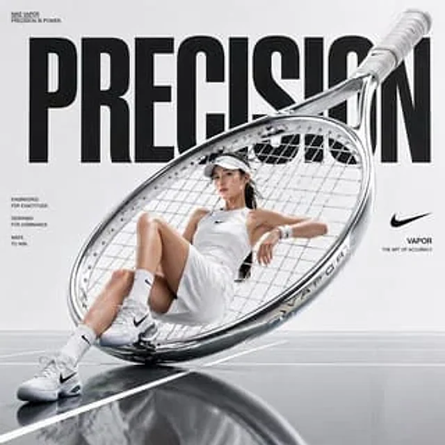

```text
Avant-garde sports fashion advertisement, oversized tennis racket positioned like monumental sculpture, female athlete seated casually on the strings as if a suspended lounge, giant word “PRECISION” in bold typography behind, crisp white studio backdrop, reflective court-like floor, luxury sportswear editorial aesthetic, cinematic lighting, ultra-clean composition, 1:1
```

Model: GPT Image 2
Author: Aron厚玉

[ProjectD](https://aitoolsradar.com/en/prompts/99fadd2c490132) · [Recorded source](https://x.com/aronhouyu/status/2047989228274118901)
 · [Full original metadata and byte evidence](data/projectd-batch-0021.json)

## Art design of football players


```text
Create a{argument name="subject" default="BBC (Gareth Bale, Karim Benzema and Cristiano Ronaldo)"} exist{argument name="location" default="Brighton"} Artworks, using logos, high-level design,{argument name="aspect ratio" default="9:16"} Use it as your phone wallpaper.
```

Model: GPT Image 2
Author: GPT Image 2 Prompts

[ProjectD](https://aitoolsradar.com/en/prompts/956f5e0b617aee) · [Recorded source](https://x.com/Tounsi_CHF/status/2047613809020276836)
 · [Full original metadata and byte evidence](data/projectd-batch-0021.json)

## Artistic Magazine Design Poster Layout

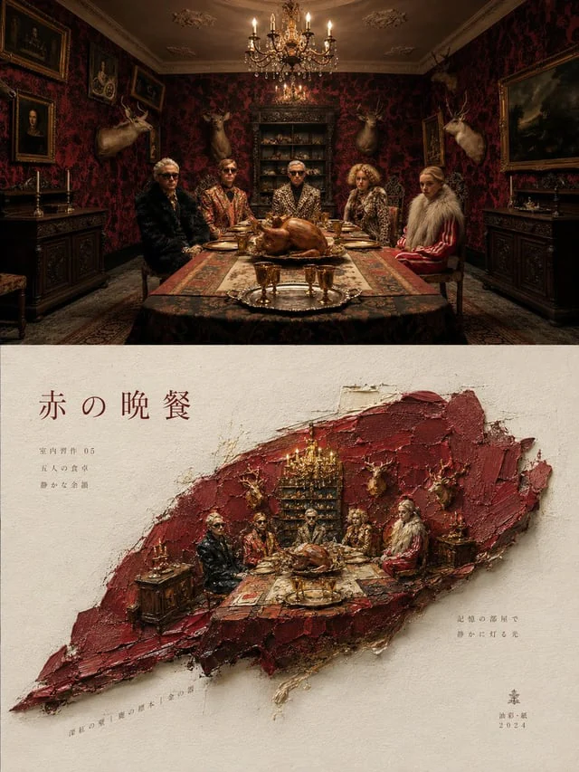

```text
请将我上传的每一张照片分别制作成一张独立的高级设计海报，不多图拼接，每张照片单独输出。整体采用3:4竖版构图，上下两个区域高度严格1:1，各占画面50%。

上半部分保留原始照片，保持主体结构、空间关系、真实材质、自然光影和原有色彩氛围，仅进行轻微高级摄影调色，使其具有艺术杂志、独立出版物与展览摄影质感。为适配画幅，可自然扩展环境背景，但不得拉伸、扭曲或改变主体。

下半部分以干净象牙色背景，提取照片中最具识别性的主体、轮廓、姿态与叙事关系，按照“解构—筛选—提炼—重构”的逻辑转化为极简抽象视觉。重点保留最独特的体量比例、轴线、曲线、穿插、层叠、遮挡、负空间与非对称关系，用少量几何形体重新组织；不完整复刻细节，但必须一眼感受到与上方原图的对应。构图强调视觉重心、尺度差、主次层级、正负形和留白节奏，避免图标化、平均排列和零碎堆积。

配色全部从上方照片中提取并精简为1个主色、1个深色结构色、1个浅/中性色，最多加入少量关键强调色。优先保留原图中最有辨识度、最有精气神的颜色，通过面积比例、深浅关系和局部对比建立层次，保持干净、克制而有生命力，避免整体灰化与平均用色。

文字建立完整的高级编辑式微排版系统：从照片的光影、空间、动作、材质或情绪中提炼一个2–5词的诗意英文主标题，同时搭配2–4组极小辅助文字，可由短句、状态词、地点或对象信息、编号、章节标记、序列号、尺度式数字、方向词、材质词、档案式标签或微型说明自由组合，不使用年份。主标题负责情绪，小字负责秩序与细节，使文字像艺术书、建筑期刊或展览图录中的编辑注释，而不是普通标题。

文字必须与抽象图形共同构图，可沿几何轴线、边缘、轮廓或负空间排列，也可纵排、旋转、分栏、拉开字距、贴边、压角、跨越色块、嵌入形体之间或与主体形成穿插和对齐；允许一组文字极小、一组稍大，通过字号反差、字距、方向和位置建立阅读路径。整体使用克制的衬线字体与细瘦编辑字体组合，让抽象形体负责视觉记忆，文字负责结构、节奏与高级感。

整体呈现真实摄影 × 抽象记忆 × 编辑排版的视觉气质，现代、安静、克制、精致、艺术化且具有收藏感，避免复杂拼贴、廉价装饰、商业模板感和无意义抽象。
```

Model: GPT Image 2
Author: 小小东

[ProjectD](https://aitoolsradar.com/en/prompts/b838430b46dad6) · [Recorded source](https://youmind.com/prompts/artistic-magazine-poster-design-layout-32030)
 · [Full original metadata and byte evidence](data/projectd-batch-0021.json)

## Artistic Portrait with Mural Background

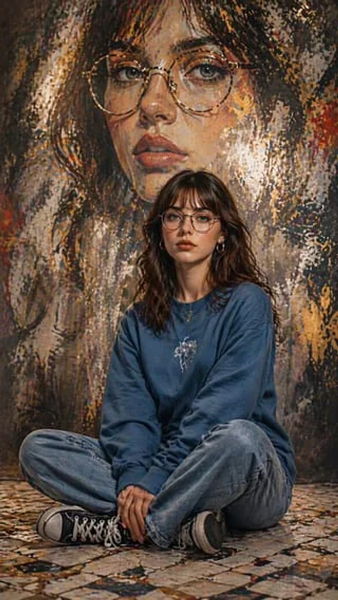

```text
A striking artistic portrait, with the subject being{argument name="subject" default="charming women"} (See attached image) Her facial features are precisely captured; she sits with a serene yet powerful posture. She sits cross-legged on a minimalist floor covered with decorative tiles, wearing a modern dress with a minimalist print.{argument name="top" default="blue sweatshirt"} , pairing{argument name="bottom" default="Loose jeans"} Wearing black Converse sneakers, her expression was serene and subtly confident, a gentle smile playing on her lips, her eyes relaxed, gazing softly at the diffused light. Behind her stood a massive abstract mural depicting her own face, bold and expressive in its use of charcoal gray, white, gold, and soft red. This mural was not a realistic copy, but a stylized and emotionally charged interpretation of her: deep-set eyes, fragmented textures, and broad brushstrokes hinting at movement, ambition, and inner complexity. The mural's scale dominated the background without obscuring the subject, creating a harmonious balance between reality and artistic representation. The lighting was cinematic and captivating, with soft reflections at the edges, the overhead glow outlining her silhouette. Tiny dust particles floated lightly in the air, capturing the shimmering light and enhancing the atmosphere. The scene blended a modern art studio with a dreamlike exhibition space: clean, spacious, and minimalist, yet brimming with emotional tension. Shot with hyper-realistic image quality using a 50mm portrait lens, featuring shallow depth of field, sharp details, and elegant color transitions, conveying themes of creativity, introspection, and personal transformation. Negative keywords: blurry, overexposed, cartoonish, anatomically distorted, superfluous limbs, poorly drawn hands, blurred faces, unrealistic colors, watermarks, text. Aspect ratio 9:16.
```

Model: GPT Image 2
Author: GPT Image 2 Prompts

[ProjectD](https://aitoolsradar.com/en/prompts/a2fe48c86670a7) · [Recorded source](https://x.com/Naiknelofar788/status/2047502673847722440)
 · [Full original metadata and byte evidence](data/projectd-batch-0021.json)

## Artistic Style Synthesis for Landmarks

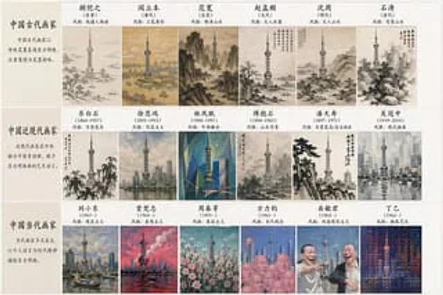

```text
List Chinese painters from ancient, modern, and contemporary times. Then, create a painting using each painter's style.{argument name="landmark" default="Oriental Pearl Tower"} .
```

Model: GPT Image 2
Author: GPT Image 2 Prompts

[ProjectD](https://aitoolsradar.com/en/prompts/416aa826d73286) · [Recorded source](https://x.com/akokoi1/status/2046505614235619567)
 · [Full original metadata and byte evidence](data/projectd-batch-0021.json)

## Astronaut Beside Living Earth

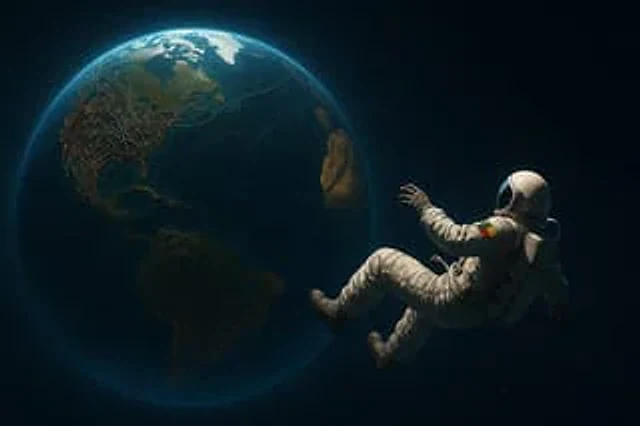

```text
This is a cinematic, surreal space scene. An astronaut floats in the vastness of space, with a massive Earth beside him. Earth occupies the left side of the image, while the astronaut is on the right, his legs bent and floating backward, one arm outstretched towards the Earth. The astronaut wears a realistic white EVA-style spacesuit, complete with a dark reflective visor, backpack, and red, yellow, and green epaulets. Earth is presented from an Atlantic perspective, with North and South America clearly visible. Against a deep, dark, star-studded background, the Earth's edges emit a cool blue halo. On the continents and even the oceans, faintly visible organic, branching root systems or neural pathways spread across the surface, particularly dense in North America and extending into South America, creating a dark, biomechanical feel or an effect of a "living planet." The composition employs dramatic, low-key lighting, strong contrast, melancholic shadows, photorealistic textures, ultra-refined cinematic realism, a quiet and oppressive atmosphere, and a wide-angle composition with large areas of negative space.
```

Model: GPT Image 2
Author: GPT Image 2 Prompts

[ProjectD](https://aitoolsradar.com/en/prompts/fd40e58e694208) · [Recorded source](https://x.com/romainbey/status/2046783449504116790#reversed-0)
 · [Full original metadata and byte evidence](data/projectd-batch-0021.json)

## Astronaut Tending Bonsai in Space Ruins

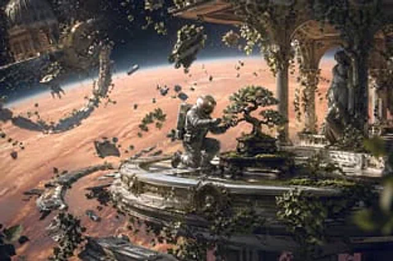

```text
This is a richly detailed, cinematic, and surreal illustration depicting an astronaut in a white spacesuit kneeling and carefully pruning a tree.{argument name="plant type" default="Bonsai Tree"} The astronauts were located on a floating {argument name="architecture style" default="Dilapidated classical marble temple"} The fragments and ruins are covered in ivy and moss, adorned with ornate gold trim, classical columns, and a female statue. The platform is suspended in the zero-gravity environment of space. Floating fragments, including rocks, marble blocks, and scattered leaves, drift weightlessly around the scene. In the background, a {argument name="background planet" default="Giant red-orange planet"} It occupies the star-studded universe. The dramatic and realistic lighting effects highlight the contrast between ancient ruins, exquisite nature, and futuristic astronauts.
```

Model: GPT Image 2
Author: GPT Image 2 Prompts

[ProjectD](https://aitoolsradar.com/en/prompts/28590edd48a2f4) · [Recorded source](https://x.com/nicdunz/status/2046306963605352841#reversed-0)
 · [Full original metadata and byte evidence](data/projectd-batch-0021.json)

## Astronomical Orion Nebula Generation

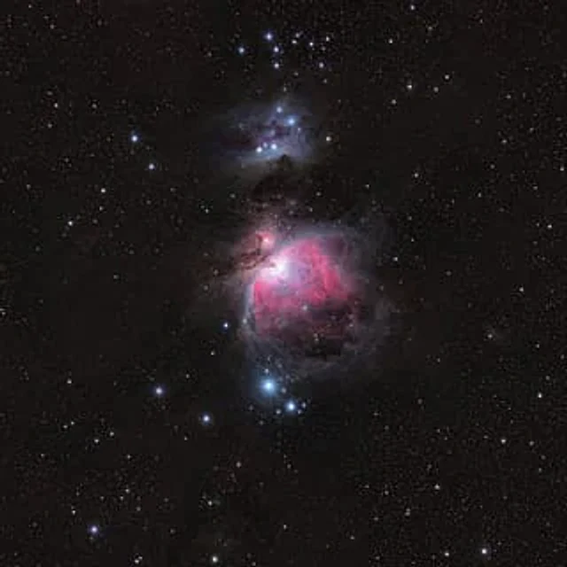

```text
Perfect presentation{argument name="celestial object" default="Orion Nebula"} Image
```

Model: GPT Image 2
Author: GPT Image 2 Prompts

[ProjectD](https://aitoolsradar.com/en/prompts/66af78cdbb9d60) · [Recorded source](https://x.com/LLMJunky/status/2047044085962473560)
 · [Full original metadata and byte evidence](data/projectd-batch-0021.json)

## Athleisure Street Style Paparazzi Shot

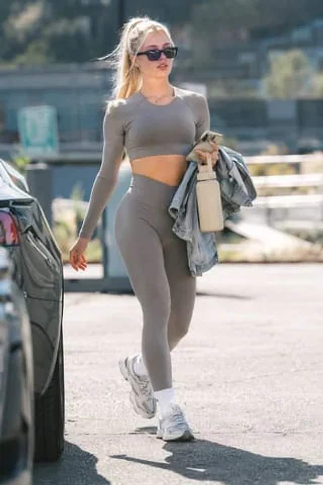

```text
A realistic street-style photograph depicting a young woman walking {argument name="setting" default="Sunny parking lot"} She kept it.{argument name="hair color and style" default="Golden high ponytail"} Wearing{argument name="accessory" default="Black rectangular sunglasses"} She was wearing a set{argument name="activewear color" default="grey"} She wore a long-sleeved cropped top and high-waisted skinny jeans, paired with platform white sneakers and white mid-calf socks. A light blue denim jacket was draped over her left arm, and she was carrying a {argument name="held item" default="Beige insulated water bottle"} A smartphone. The background is blurred with a shallow depth of field, and the rear of a dark car can be seen on the left. In the distance are blurred buildings and trees, presenting a casual and natural sporty aesthetic under the bright sunlight.
```

Model: GPT Image 2
Author: GPT Image 2 Prompts

[ProjectD](https://aitoolsradar.com/en/prompts/8e953d48bc542f) · [Recorded source](https://x.com/WolfRiccardo/status/2044582572634583491#reversed-0)
 · [Full original metadata and byte evidence](data/projectd-batch-0021.json)

## Athlete Portrait — Boxing Gym Sweat Detail

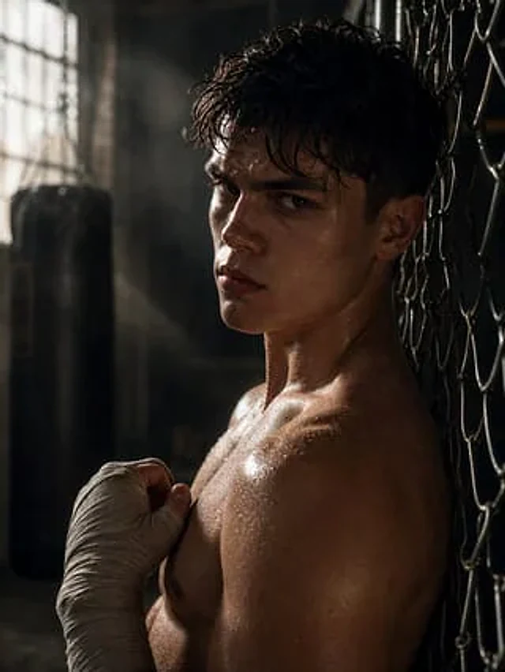

```text
3:4 vertical dramatic athlete portrait of a young boxer leaning against a chain-link fence inside an old industrial boxing gym, illuminated by a single high-contrast Rembrandt-style window light from the upper left. Sweat beading on the brow and bare shoulders, hand wraps still on, intense focused gaze just past the camera. Dark moody background with a faded out-of-focus heavy bag in the corner. Vertical 3:4 framing, head and chest. No brand logo on the wraps, no gym signage, no watermark. Cinematic sports portraiture quality, photorealistic skin sweat detail and dust-lit air.
```

Model: GPT Image 2
Author: @hiapi_ai

[ProjectD](https://aitoolsradar.com/en/prompts/0b57fbaa686504) · [Recorded source](https://github.com/HiAPIAI/awesome-gpt-image-2-prompts)
 · [Full original metadata and byte evidence](data/projectd-batch-0021.json)

## Atmospheric cold glamor mirror portrait

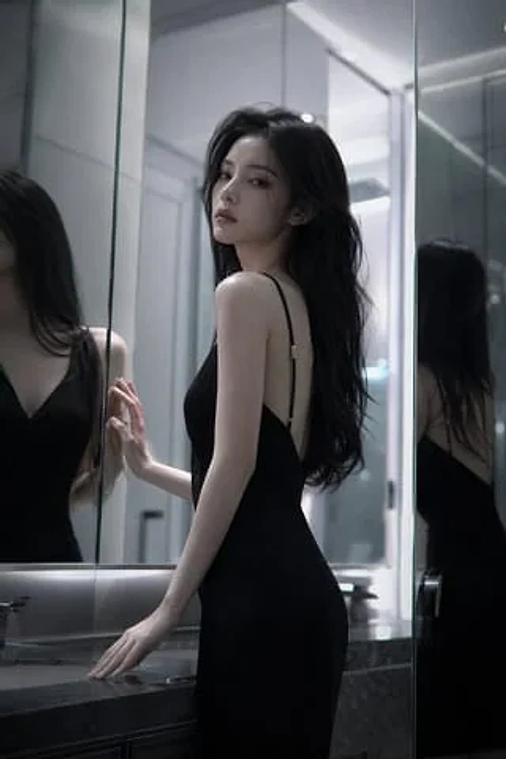

```text
Absolutely gorgeous{argument name="subject" default="woman"} With{argument name="vibe" default="A cold and distant atmosphere"} Exquisite and delicate features, a cool and sophisticated face, flowing long hair, and an elegant and charming figure (character traits are completely locked and consistent). Scene: Indoor mirrored space (bathroom or mirrored wall), multiple reflections, deep sense of spatial layering. Posture: Standing in front of a mirror, one hand lightly touching the mirror or placing it on the table, body slightly turned to the side, head slightly turned towards the camera. Expression: Calm and expressionless, with a hint of indifference and aloofness. Shooting angle: Shot from a low angle or slightly side angle, the reflection in the mirror is clearly visible in the picture. Light and shadow: Cool white light is the main light source, with local shadows, emphasizing structural contours and three-dimensionality. Style: High-end fashion magazine editorial, delicate film grain, low contrast. Details: Delicate and realistic skin texture, clear but layered and slightly blurred mirror reflections. Atmosphere: Restrained, rational, aloof, with a hint of surreal illusion. Image quality: Ultra-high definition 8K, ultimate detail, cinematic lighting and shadow, beautiful depth-of-field blurring effect.
```

Model: GPT Image 2
Author: GPT Image 2 Prompts

[ProjectD](https://aitoolsradar.com/en/prompts/5a7790b837ae10) · [Recorded source](https://x.com/BubbleBrain/status/2046900795229217063)
 · [Full original metadata and byte evidence](data/projectd-batch-0021.json)

## Atmospheric cold glamor mirror portrait

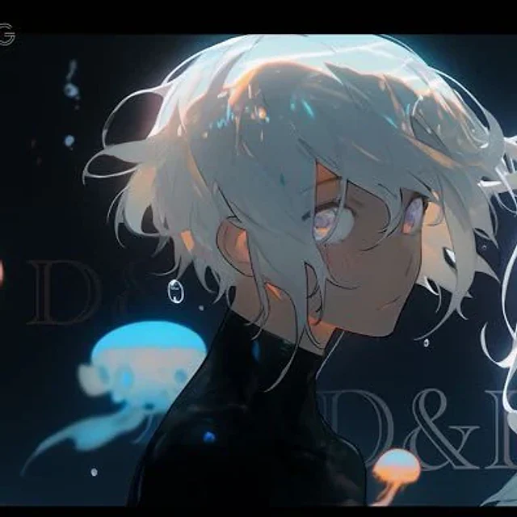

```text
Stunningly beautiful {argument name="subject" default="woman"} with a {argument name="vibe" default="cool, aloof atmospheric vibe"}, exquisite and refined facial features, cold and glamorous high-end face, long flowing hair, graceful and alluring figure, (character features completely locked and consistent) Scene: Indoor space with mirrors (bathroom or mirrored wall), multiple reflections, layered depth in the space Pose: Standing in front of the mirror, one hand lightly touching the mirror surface or resting on the countertop, body slightly angled, head gently turned toward the camera Expression: Calm and emotionless, with a hint of cold indifference and detachment Camera angle: Low angle or slight side angle shot, with the mirror reflection clearly visible in the frame Lighting: Cool white light as the main source, with localized shadows, emphasizing structural contours and three-dimensionality Style: High-end fashion editorial, subtle film grain, low contrast Details: Delicately realistic skin texture, clear yet softly layered and slightly blurred mirror reflections Atmosphere: Restrained, rational, distant, with a touch of surreal unreality Quality: Ultra-sharp 8K, extreme details, cinematic lighting and shadows, beautiful depth-of-field bokeh
```

Model: GPT Image 2
Author: BubbleBrain

[ProjectD](https://aitoolsradar.com/en/prompts/4c01a3acde4d7f) · [Recorded source](https://youmind.com/prompts/cold-glamour-mirror-portrait-14727)
 · [Full original metadata and byte evidence](data/projectd-batch-0021.json)

## Audi S4 Promotional Poster


```text
{
  "type": "Car promotional posters",
  "brand": "Audi",
  "model": "{argument name=\"car model\" default=\"S4\"}",
  "trim_text": "S4 QUATTRO",
  "orientation": "Vertical portrait poster",
  "style": "High-end modern 4S store advertising, stylish metallic texture, simple layout, studio lighting for product display.",
  "color_palette": {
    "primary_background": "Gradient from dark gray to light gray",
    "accent": "Silver, charcoal gray, black, white, with subtle red logo details"
  },
  "main_subject": {
    "vehicle": "{argument name=\"vehicle name\" default=\"Audi S4\"}",
    "body_style": "sports sedan",
    "color": "{argument name=\"car color\" default=\"Metallic silver-gray\"}",
    "view": "Frontal view",
    "placement": "Large image centered in the lower part of the poster",
    "details": [
      "Black hexagonal grille with Audi logo",
      "Small red S4 grille logo",
      "Bright LED headlights",
      "highly aggressive lower air intake",
      "Low-lying exercise posture",
      "Clear studio reflections on the hood and windshield"
    ]
  },
  "background": {
    "design": "Minimalist luxury studio backdrop, with soft spotlights from behind the vehicle.",
    "overlay_text": "An oversized, semi-transparent \"S4\" letter vertically runs through most of the center of the background.",
    "graphic_elements": [
      "translucent geometric panel tilted to the right",
      "Subtle diagonal light band",
      "The faint reflection of the ground under the car"
    ]
  },
  "layout": {
    "sections": [
      {
        "title": "Brand logo in the upper left corner",
        "position": "Top left corner",
        "count": 2,
        "labels": [
          "S4",
          "QUATTRO"
        ]
      },
      {
        "title": "Right-side image panel",
        "position": "Right side vertical stacking",
        "count": 3,
        "labels": [
          "Rear 45-degree exterior view",
          "Cockpit and dashboard interior view",
          "Close-up of the headlights"
        ]
      },
      {
        "title": "Function icon row",
        "position": "Bottom left",
        "count": 5,
        "labels": [
          "3.0L TFSI V6 engine",
          "QUATTRO All-Wheel Drive",
          "Motion tuning performance",
          "High-end interior",
          "Advanced technology"
        ]
      }
    ],
    "centerpiece": "Large frontal vehicle main image",
    "bottom_right_logo": "Audi logo"
  },
  "text": {
    "headline": "AUDI {argument name=\"headline model text\" default=\"S4\"}",
    "tagline": "{argument name=\"tagline\" default=\"Movement. Precision. Every day.\"}",
    "body": "The Audi S4 strikes a perfect balance between performance and refinement. Powered by a 3.0L TFSI V6 turbocharged engine and quattro all-wheel drive, it delivers exhilarating acceleration, confident handling, and everyday practicality. With its sporty design, premium interior, and advanced technology, the S4 is built for drivers who demand more from every mile."
  },
  "typography": {
    "headline": "Bold sans-serif font, large size, white",
    "supporting_text": "Uppercase modern sans-serif font with wide letter spacing",
    "body_copy": "Small, clean sans-serif font, white/light gray"
  },
  "rendering": "Photorealistic commercial automotive photography, high detail, glossy yet restrained reflections, high-end brochure quality."
}
```

Model: GPT Image 2
Author: GPT Image 2 Prompts

[ProjectD](https://aitoolsradar.com/en/prompts/500298af92b2df) · [Recorded source](https://x.com/cooldude6688/status/2046415445645791361#reversed-1)
 · [Full original metadata and byte evidence](data/projectd-batch-0021.json)

## auqib #184

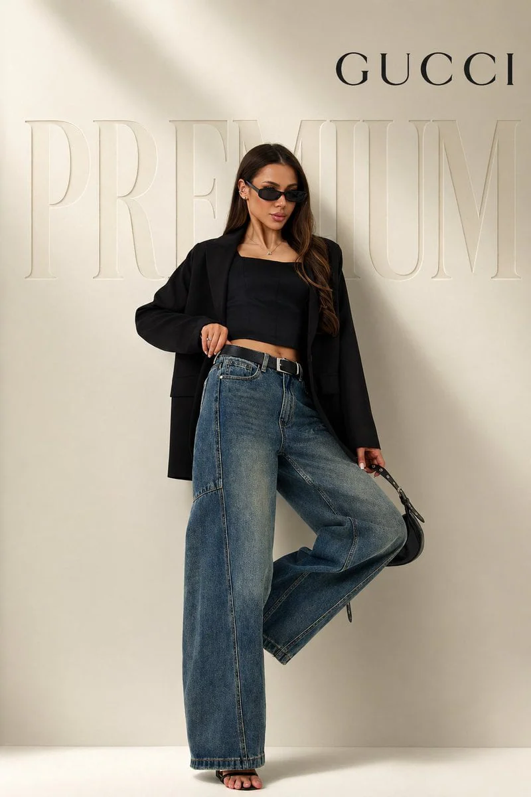

```text
full body female model in confident fashion pose (one leg slightly raised, relaxed luxury stance), wearing oversized black blazer, fitted black crop top, high-waisted baggy blue denim jeans, black heels, slim sunglasses, holding a small black handbag, clean long hair, sharp facial features
minimal luxury studio background, soft beige gradient wall, smooth shadows, editorial lighting, high-end fashion campaign style
large embossed “PREMIUM” text in background, subtle 3D depth, tone-on-tone color blending with wall, elegant and soft
keep “BAGGY” text bold and minimal near bottom, modern premium sans-serif font
add “GUCCI” logo top right corner, clean spacing, luxury typography
ultra realistic, sharp focus, premium color grading, soft highlights, depth of field, magazine-quality, clean composition, no clutter
```

Model: GPT Image 2
Author: auqib

[ProjectD](https://aitoolsradar.com/en/prompts/cb6a2d97fb6963) · [Recorded source](https://x.com/auqibhabib/status/2048615041566449922)
 · [Full original metadata and byte evidence](data/projectd-batch-0021.json)

## Austin #17


```text
生成一张适合小红书发布的 3:4 竖版九宫格海报，整体为 3列 × 3行 排版，九个宫格边界清晰，方便后期直接切割成 9 张单图发布。整体风格干净、高级、统一，适合女性向健康生活方式内容，具有小红书爆款封面气质。画面要求 信息排版清晰、文字大、可读性强、留白舒服、配色温柔治愈。

整体视觉风格：
奶油白、浅米色、淡燕麦色、浅焦糖色为主色调，搭配少量深棕色文字，ins风、治愈感、睡眠疗愈主题，简约排版，轻拟物插画点缀，可加入枕头、月亮、星星、热牛奶、香薰、书本、眼罩、窗帘、床铺等元素。整体像专业新媒体设计图，字体工整，适合做知识科普类小红书九宫格。
排版要求：

整张图必须是标准九宫格构图，切分后每一格都能独立成图

每个宫格内容完整居中，不要把标题或正文压在分割线附近
每个格子之间保留明显间隔或细边框，保证裁切后不影响阅读
所有文字使用中文，清晰易读，不要乱码，不要英文
每个宫格都像独立的小红书图文卡片，但视觉风格保持统一
画面精致、真实、自然，不要廉价营销感，不要过度花哨
九宫格具体内容：

第1格（封面）
大标题：让你倒头就睡的8个 tips
副标题：失眠党、熬夜党一定要收藏
封面视觉最吸睛，适合做首图，加入柔软床铺、月亮、枕头、眼罩等治愈睡眠元素，标题突出，排版高级。

第2格
标题：1. 睡前1小时别玩手机
正文：蓝光会让大脑更清醒，越刷越睡不着。
配图元素：手机、月亮、困倦表情的小插画
第3格
标题：2. 睡前把灯光调暗
正文：暖光环境能帮助身体进入“准备睡觉”的状态。
配图元素：床头灯、暖黄色灯光、窗帘
第4格
标题：3. 房间温度别太高
正文：稍微凉一点，更容易快速入睡。
配图元素：空调、温度计、被子
第5格
标题：4. 晚上别喝浓茶咖啡
正文：咖啡因会延迟困意，让你躺很久还睡不着。
配图元素：咖啡杯、茶杯、禁止符号

第6格
标题：5. 睡前洗个热水澡
正文：能让身体放松下来，入睡速度更快。
配图元素：浴室蒸汽、毛巾、热水
第7格
标题：6. 脑子停不下来就写下来
正文：把烦心事和待办清单写下，大脑会更容易放松。
配图元素：笔记本、钢笔、小台灯
第8格
标题：7. 固定上床时间
正文：每天差不多时间睡，生物钟会越来越稳定。
配图元素：时钟、月亮、床
第9格
标题：8. 试试深呼吸放松法
正文：吸气4秒，停4秒，呼气6秒，慢慢就有困意了。
底部小字：收藏这组，今晚试试看
配图元素：呼吸线条、闭眼人物、星星

画质要求：
高清，高级排版，杂志感，真实可发布，新媒体运营审美，小红书爆款图文风格，文字布局规整，适合直接切图。
```

Model: GPT Image 2
Author: Austin

[ProjectD](https://aitoolsradar.com/en/prompts/23818fdc6f3466) · [Recorded source](https://x.com/austinit/status/2046037688969769346)
 · [Full original metadata and byte evidence](data/projectd-batch-0021.json)

## Austin #197


```text
3D Pixar-style expression sheet, cute stylized avatar with wavy dark hair and round glasses, 3x3 grid layout, peeking through torn paper circles, emotions: wink, sunglasses cool, thinking, happy smile, thumbs up, drinking boba tea, friendly wave, laughing, cute pout, different outfits: green sweater, red jacket, yellow hoodie, striped tee, orange shirt, blue top, purple vest, pink cardigan, teal pullover. Soft cinematic lighting, clean white background, vibrant colors, high detail, adorable cartoon character, playful expressions, consistent character design across all poses
```

Model: GPT Image 2
Author: Austin

[ProjectD](https://aitoolsradar.com/en/prompts/cf4736979ece0d) · [Recorded source](https://x.com/austinit/status/2046025895941750868)
 · [Full original metadata and byte evidence](data/projectd-batch-0021.json)

## Authentic Japanese Delivery Flyer


```text
A Japanese-style community Chinese restaurant takeout flyer (3:4 aspect ratio) intended for mailbox delivery. The design style mimics double-sided B5 printing. Flyer features (following the layout logic of real takeout flyers): - Striking red and yellow color scheme. - Large headline at the top: "Takeout Service Available!"{argument name="shop name" default="Mona-Hanten"} (Gothic form with shadows). - Illustration: A{argument name="character" default="A Chinese girl wearing a red cheongsam and sporting a short brown bob."} Holding a ramen noodle, a dialogue box reads "Welcome!" - A menu photo grid (4x3) showcasing various dishes: different types of ramen, fried rice, gyoza, sweet and sour pork, dry-fried shrimp, mapo tofu, stir-fried pork liver with chives, Tianjin rice, twice-cooked pork, spring rolls, almond tofu, and fried rice set meals. - The name and price of each dish. - A striking yellow banner proclaims "Free delivery on orders over ¥1,000!" - "Order by phone! ☎ 072-XX-XXXX" highlighted in red. - Business hours: "11:00-22:00 (Closed on Tuesdays)". - Delivery area map (simple illustration). - Coupon (with dotted lines, can be cut out): "Free gyoza with this flyer!" Cheap paper printing quality. Includes creases. So realistic it's almost indistinguishable from a genuine Japanese takeout flyer.
```

Model: GPT Image 2
Author: GPT Image 2 Prompts

[ProjectD](https://aitoolsradar.com/en/prompts/81c3cc372439eb) · [Recorded source](https://x.com/xc5_/status/2048310696686014935)
 · [Full original metadata and byte evidence](data/projectd-batch-0021.json)

## Authentic Magazine Spread Photography


```text
A photo taken with an amateur mobile phone shows an open magazine spread, the content of which is about{argument name="topic" default="GPT Image 2"} Shot with iPhone. No depth-of-field effect, overall image is clear, photo is realistic. Shot with iPhone. Main camera.
```

Model: GPT Image 2
Author: GPT Image 2 Prompts

[ProjectD](https://aitoolsradar.com/en/prompts/bf929e51a5d59f) · [Recorded source](https://x.com/patrickassale/status/2043755728624562398)
 · [Full original metadata and byte evidence](data/projectd-batch-0021.json)

## Autumn Fashion Lifestyle Ad Collage


```text
{
  "type": "Four-panel fashion and lifestyle advertising collage",
  "style": "Photorealistic Japanese social media advertising campaign, elegant autumn atmosphere, soft editing lighting, warm and gentle color gradation, high-end commercial photography.",
  "aspect_ratio": "1:1",
  "subject": {
    "gender_presentation": "woman",
    "age_appearance": "young adults",
    "hair": {
      "color": "Dark black",
      "style": "Long, center-parted wavy hair"
    },
    "outfit": {
      "top": "Charcoal gray off-shoulder ribbed knit top",
      "bottom": "Green plaid wool skirt",
      "accessories_count": 4,
      "accessories": [
        "Leopard print beret",
        "Large gold hoop earrings",
        "Delicate gold necklace with small pendant",
        "Natural and refined makeup"
      ]
    }
  },
  "layout": {
    "grid": {
      "rows": 2,
      "columns": 2,
      "count": 4
    },
    "sections": [
      {
        "position": "Top left",
        "type": "Fashion Series Posters",
        "background": "Warm gray-brown studio background",
        "subject_pose": "Sit sideways with one hand close to your face.",
        "text_count": 6,
        "texts": [
          "I'll dress in autumn in my own style.",
          "A new collection that embodies sophisticated cuteness.",
          "New Arrival",
          "Sales begin 9.20 FRI",
          "LEOPARD",
          "2024 AUTUMN COLLECTION"
        ]
      },
      {
        "position": "Top right",
        "type": "Beauty product advertisements",
        "background": "Soft Beige Cosmetics Event Background",
        "subject_pose": "Close-up portrait, holding a foundation bottle close to the face",
        "product_count": 4,
        "products": [
          "Holding a bottle of foundation",
          "There are 3 foundation swatches in the bottom right corner.",
          "Soft cream splatter background elements",
          "3 circular badges"
        ],
        "text_count": 9,
        "texts": [
          "A foundation that will make you love your bare skin even more.",
          "A radiant glow and translucency that melts into the skin.",
          "Natural coverage",
          "うるおいキープ",
          "SPF30 PA+++",
          "NEW",
          "ルミナス グロウ ファンデーション",
          "Available in 3 colors, 30mL, ¥3,480 (tax included)",
          "LUMIÈRE BEAUTY"
        ]
      },
      {
        "position": "Bottom left",
        "type": "Coffee shop seasonal dessert advertisements",
        "background": "The cozy café interior features wooden tables, softly blurred windows, and greenery.",
        "subject_pose": "Sit sideways at the table, elbows resting on the table, hands close to your face.",
        "food_count": 2,
        "foods": [
          "1 mug topped with whipped cream and caramel sauce",
          "A rectangular cake topped with cream and caramel drizzle."
        ],
        "text_count": 7,
        "texts": [
          "Today's treat: a relaxing time at a café.",
          "Seasonal",
          "マロンラテ",
          "--Bittersweet caramel flavor--",
          "¥650 (tax included)",
          "Limited time offer",
          "11.30 SAT まで"
        ]
      },
      {
        "position": "Bottom right",
        "type": "Jewelry advertisement",
        "background": "Dark blue-green studio background",
        "subject_pose": "A close-up portrait shows a hand gently touching the neck to highlight the necklace.",
        "product_count": 2,
        "products": [
          "The model is wearing a gold star pendant necklace.",
          "1 silhouette image of a hanging necklace product"
        ],
        "text_count": 6,
        "texts": [
          "Shine is on my side.",
          "Special jewelry you'll want to wear every day.",
          "NEW COLLECTION",
          "Star Light Necklace",
          "¥12,800 (tax included)",
          "ÉTOILE JEWELRY"
        ]
      }
    ],
    "consistency": "All four shots feature the same model, the same clothing, and the same leopard-print beret."
  },
  "composition": {
    "camera": "Editing fashion photography, a mix of medium shots and close-ups",
    "lighting": "Soft, diffused light; skin-perfecting highlights; natural shadows.",
    "mood": "Exquisite, feminine, autumnal, sophisticated, and desirable"
  },
  "branding": {
    "language": "Japanese",
    "design": "Luxurious minimalist typography with serif and handwritten decorative fonts, clean advertising layout, and high-end lifestyle event aesthetics."
  }
}
```

Model: GPT Image 2
Author: GPT Image 2 Prompts

[ProjectD](https://aitoolsradar.com/en/prompts/adbf68a5bd47d1) · [Recorded source](https://x.com/gaogao_1192/status/2046866092795339066#reversed-0)
 · [Full original metadata and byte evidence](data/projectd-batch-0021.json)

## Autumn Park Reading Stock Photo


```text
A realistic lifestyle photo showcasing{argument name="subject" default="A young woman"} She sits in a park during the golden hours of autumn, leaning against the trunk of a large tree. On the right side of the frame, she holds an open hardcover book in both hands, reading, her knees bent and legs tilted to the left. She has long, wavy hair.{argument name="hair color" default="Light brown"} Her hair and face were deliberately blurred, out of focus, making her features unclear. She was wearing four distinct garments: a chunky knit top {argument name="sweater color" default="Beige"} A sweater, a thick pair of {argument name="scarf color" default="Claret"} A scarf, slim-fit blue jeans, and a pair of black ankle boots with a slight heel. A dark leather shoulder bag sits on the grass beside a tree root. The setting is a quiet, shaded park, with fallen leaves scattered on the grass. Soft, warm sunlight filters through the trees, creating a rich amber, green, and brown background with a deep blur effect. Cinematic shallow depth of field, natural candid composition, comfortable autumn atmosphere, high-quality commercial stock photography, soft contrast, warm color gradation, and horizontal composition.
```

Model: GPT Image 2
Author: GPT Image 2 Prompts

[ProjectD](https://aitoolsradar.com/en/prompts/c0824c02f5fdcd) · [Recorded source](https://x.com/Design4p0/status/2046724025473241224#reversed-1)
 · [Full original metadata and byte evidence](data/projectd-batch-0021.json)

## Avant-garde Basketball Fashion


```text
Avant-garde sports fashion advertisement, super large{argument name="prop" default="basketball"} Display it like a monumental sculpture.{argument name="subject" default="female athletes"} Leaning against the curved surface of the sphere like a piece of modern furniture, behind it are huge words in bold typeface.{argument name="text" default="ELEVATE"} "Orange-colored studio backdrop, glossy reflective floor, luxurious sports editing aesthetics, cinematic lighting, ultra-minimalist composition, 1:1 scale."
```

Model: GPT Image 2
Author: GPT Image 2 Prompts

[ProjectD](https://aitoolsradar.com/en/prompts/1db6412df99948) · [Recorded source](https://x.com/AIwithkhan/status/2047886964037398989)
 · [Full original metadata and byte evidence](data/projectd-batch-0021.json)

## Avant-Garde Eyewear Fashion Ad


```text
The avant-garde fashion advertisement features oversized, futuristic sunglasses displayed like sculptures, with a model casually seated on the frames as if sitting on furniture, against a backdrop of huge, bold white text.{argument name="text" default="VISION"} ", background is{argument name="color" default="powder blue"} The studio backdrop, reflective floor, luxurious eyewear advertising aesthetics, ultra-minimalist layout, magazine editorial style, 1:1
```

Model: GPT Image 2
Author: GPT Image 2 Prompts

[ProjectD](https://aitoolsradar.com/en/prompts/a2ca793284285c) · [Recorded source](https://x.com/AIwithSynthia/status/2047700936605479334)
 · [Full original metadata and byte evidence](data/projectd-batch-0021.json)

## Avant-Garde Eyewear Fashion Ad


```text
Avant-garde fashion advertisement, oversized futuristic sunglasses positioned like sculpture, model casually seated on the frame as if furniture, giant word "{argument name="text" default="VISION"}" behind in bold white typography, {argument name="color" default="powder blue"} studio background, reflective floor, luxury eyewear campaign aesthetic, ultra-clean layout, editorial magazine styling, 1:1
```

Model: GPT Image 2
Author: Synthia

[ProjectD](https://aitoolsradar.com/en/prompts/9510600e163f20) · [Recorded source](https://youmind.com/prompts/avant-garde-eyewear-fashion-ad-15504)
 · [Full original metadata and byte evidence](data/projectd-batch-0021.json)

## Avant-garde Fashion Advertisement


```text
Avant-garde sports fashion advertisement, extra large size{argument name="prop" default="tennis racket"} Placed like a monumental sculpture,{argument name="subject" default="female athletes"} He sat casually on the racket net, seemingly in a suspended rest area, with huge, bold text in the background: "{argument name="text" default="PRECISION"} The clean white studio backdrop, the reflective court-like surface, the luxurious sportswear magazine aesthetic, the cinematic lighting, the minimalist composition, and the 1:1 scale...
```

Model: GPT Image 2
Author: GPT Image 2 Prompts

[ProjectD](https://aitoolsradar.com/en/prompts/75bb2d4c11bd43) · [Recorded source](https://x.com/AIwithSynthia/status/2047884609321619831)
 · [Full original metadata and byte evidence](data/projectd-batch-0021.json)

## Avant-garde Fashion Advertisement


```text
Avant-garde sports fashion advertisement, oversized {argument name="prop" default="tennis racket"} positioned like monumental sculpture, {argument name="subject" default="female athlete"} seated casually on the strings as if a suspended lounge, giant word “{argument name="text" default="PRECISION"}” in bold typography behind, crisp white studio backdrop, reflective court-like floor, luxury sportswear editorial aesthetic, cinematic lighting, ultra-clean composition, 1:1
```

Model: GPT Image 2
Author: Synthia

[ProjectD](https://aitoolsradar.com/en/prompts/f6bbce64314353) · [Recorded source](https://youmind.com/prompts/oversized-tennis-racket-editorial-15863)
 · [Full original metadata and byte evidence](data/projectd-batch-0021.json)

## Avant-Garde Fashion Eyewear Ad


```text
Avant-garde fashion advertisement, super large{argument name="prop" default="Guitar"} Arranged like a sculpture, a guitarist in jeans sits casually on the buttons as if sitting on furniture, with huge lettering above.{argument name="text" default="Plism Art"} "The striking white lettering against the background, the pastel studio backdrop, the reflective floor, the luxurious eyewear advertising aesthetics, the ultra-minimalist layout, the magazine editorial style, and the eye-catching quotes."{argument name="quote" default="What are you listening to?"} Tag: Create Your Own Change
```

Model: GPT Image 2
Author: GPT Image 2 Prompts

[ProjectD](https://aitoolsradar.com/en/prompts/9dbe119e54a4af) · [Recorded source](https://x.com/QamarRiaz1/status/2047777016733110722)
 · [Full original metadata and byte evidence](data/projectd-batch-0021.json)

## Aviation-Themed UI Design System Board


```text
{
  "type": "UI/UX Design System Concept Project",
  "theme": "Aviation and Flight Interface",
  "overall_style": "Dark mode, stylish, modern, technological, futuristic, glass-like.",
  "layout": {
    "top_left": {
      "section": "Design Style",
      "title": "{argument name=\"main title\" default=\"AERIAL INTERFACE\"}",
      "subtitle": "{argument name=\"subtitle\" default=\"Airspace Interface\"}",
      "description": "Introductory paragraph on airspace interface design",
      "principles": {
        "count": 4,
        "labels": [
          "sense of control",
          "Minimalism and purity",
          "Data Aesthetics",
          "Immersive experience"
        ]
      }
    },
    "top_center": {
      "imagery": "A top-down view of a commercial aircraft flying upwards, leaving two white contrails against a dark background.",
      "text": [
        "Flight is the interface.",
        "Your creativity sets the standard for us."
      ],
      "metrics": [
        "Status: Cruise",
        "Destination: Creation",
        "Estimated arrival time: ∞"
      ]
    },
    "top_right": {
      "section": "UI components",
      "imagery": "A rounded rectangular panel displaying an airplane wing above the clouds at sunset.",
      "data_points": [
        "11:34",
        "1975 people were on board.",
        "Flight data{argument name=\"destination\" default=\"Okinawa\"}",
        "35,000 feet high",
        "Speed ​​552 knots"
      ],
      "tabs": {
        "count": 3,
        "labels": [
          "map",
          "Data View",
          "system"
        ]
      }
    },
    "bottom_left": {
      "section": "Color scheme",
      "swatches": {
        "count": 3,
        "labels": [
          "#05070A",
          "#0B1220",
          "#E6F0FF"
        ]
      }
    },
    "bottom_mid_left": {
      "section": "typesetting",
      "fonts": {
        "count": 2,
        "labels": [
          "{argument name=\"primary font\" default=\"INTER\"}",
          "{argument name=\"secondary font\" default=\"JETBRAINS MONO\"}"
        ]
      }
    },
    "bottom_mid_right": {
      "section": "Material",
      "examples": {
        "count": 2,
        "labels": [
          "Glass (frosted rectangle)",
          "Metal (dark sphere)"
        ]
      }
    },
    "bottom_right": {
      "section": "motion effects",
      "concepts": {
        "count": 3,
        "labels": [
          "plane take-off",
          "Radar Focusing Ring",
          "glowing flight trails"
        ]
      }
    },
    "footer": {
      "text": "Design essence: It's not just about designing an interface, but about creating a flight experience."
    }
  }
}
```

Model: GPT Image 2
Author: GPT Image 2 Prompts

[ProjectD](https://aitoolsradar.com/en/prompts/19870ad9dc3bf7) · [Recorded source](https://x.com/cheatyyyy/status/2045973715280929275#reversed-2)
 · [Full original metadata and byte evidence](data/projectd-batch-0021.json)

## Awkward Idol Stream Situation


```text
Image generation: one-bit{argument name="protagonist" default="girl"} Wearing{argument name="outfit style" default="Embarrassing magical girl style idol outfits"} She was live-streaming her dance when her mother stormed in angrily; the girl panicked and tried to stop the recording, while the comments section erupted in chaos and laughter.
```

Model: GPT Image 2
Author: GPT Image 2 Prompts

[ProjectD](https://aitoolsradar.com/en/prompts/d2759cb650ad00) · [Recorded source](https://x.com/Masimo_Blue/status/2046610221729198509)
 · [Full original metadata and byte evidence](data/projectd-batch-0021.json)

## Ayyoub Ai #200


```text
Create a stylized travel poster / graphic collage for [ALGERIA]. The main subject should be a stylish international tourist visiting [ALGERIA], clearly presented as a traveler and not a local resident. Show the tourist wearing modern travel fashion, with details such as a camera, backpack, sunglasses, map, or suitcase, exploring the culture and atmosphere of [ALGERIA]. Place the tourist in a dynamic composition surrounded by iconic architecture, streets, landscapes, landmarks, transportation, food, signage, and cultural elements associated with [ALGERIA]. Blend realistic character detail with a graphic collage background made of layered paper textures, torn poster edges, sticker elements, halftone dots, editorial typography, and bold geometric shapes. Include authentic visual motifs from [ALGERIA], but keep the tourist’s appearance and styling globally fashionable and clearly foreign to the setting. Add a large readable headline: “VISIT [ALGERIA]”. Modern, artistic, premium editorial travel poster aesthetic, balanced layout, print-worthy composition.
```

Model: GPT Image 2
Author: Ayyoub Ai

[ProjectD](https://aitoolsradar.com/en/prompts/a0242a06a33d50) · [Recorded source](https://x.com/MaAyyoub/status/2048057470812074251)
 · [Full original metadata and byte evidence](data/projectd-batch-0021.json)

## B&W Cinematic Studio Portrait


```text
Black and white portrait,{argument name="subject" default="Stylish men wearing round sunglasses"} Head slightly lowered, hands adjusting collar, visible muscle definition, clear jawline, textured short hair, dark background, dramatic high-contrast lighting, cinematic feel, hyper-realistic, 85mm lens, studio shooting. 19:16 aspect ratio.
```

Model: GPT Image 2
Author: GPT Image 2 Prompts

[ProjectD](https://aitoolsradar.com/en/prompts/aab47d01746a2d) · [Recorded source](https://x.com/RizwanAly07/status/2047529293182562687)
 · [Full original metadata and byte evidence](data/projectd-batch-0021.json)

## Back-to-Back Sirens in Sakura Dusk


```text
Two powerful fantasy women stand back-to-back in the center of a vast cherry blossom forest at dusk, their full-body heroic compositions rendered from a slightly upward angle, showcasing an ultra-refined, cinematic anime-style realism. The woman on the left possesses {argument name="left character hair color" default="Vibrant deep red"} She has a short, layered hairstyle, a fit and athletic figure, and a powerful and domineering aura. She wears a black and dark red strappy combat suit, paired with a short leather top, high-cut bottoms, thigh-high straps resembling garter stockings, flowing semi-transparent red ribbons, and long, shiny black arm guards. The woman on the right possesses {argument name="right character hair color" default="blonde hair with soft pink ends"} She had shoulder-length, wavy hair and a curvaceous figure, her arms, shoulders, ribs, and thighs covered in large floral tattoos. She wore a black and purple lace-up fantasy outfit with transparent purple fabric panels, chain embellishments, and black gloves. Their bare backs were pressed tightly together, facing opposite directions, exuding a calm and awe-inspiring confidence. Behind and beside them, two enormous, glowing energy swords were embedded in the ground: the one on the left emitted lava-like red-orange flames and ember-like cracks, while the one on the right emitted electric purple and cyan energy, its blade crackling with lightning. The scene was set amidst a breathtaking cherry blossom landscape, with dense pink cherry trees, countless petals swirling wildly in the air, a dramatic sunset sky filled with magenta, purple, and orange clouds, distant lightning, and the faint outline of a Japanese city with pagodas on the horizon. It emphasizes primal power, sensual elegance, high-contrast contour lighting, flowing fabric and hair, glowing particle effects, rich red and purple color contrasts, an epic fantasy atmosphere, ultra-detailed rendering, sharp focus on the two women, and painterly cinematic depth.
```

Model: GPT Image 2
Author: GPT Image 2 Prompts

[ProjectD](https://aitoolsradar.com/en/prompts/966d676ed1aa59) · [Recorded source](https://x.com/SFCWrench/status/2047565776517738841#reversed-0)
 · [Full original metadata and byte evidence](data/projectd-batch-0021.json)

## Background Realism Enhancement Prompt


```text
背景にある{argument name="対象" default="施設や装置"}を正しく清書してリアルに描く｡{argument name="維持要素" default="キャラクター"}はそのまま維持する｡
```

Model: GPT Image 2
Author: ダルトワ★TV

[ProjectD](https://aitoolsradar.com/en/prompts/0b601ebd91bf6c) · [Recorded source](https://youmind.com/prompts/background-realism-enhancement-16841)
 · [Full original metadata and byte evidence](data/projectd-batch-0021.json)

## Background to Manga Layout Prompt


```text
I want to create a total{argument name="page count" default="4"} The comic on this page, please transform this worldview into {argument name="style" default="Anime World"} Style and complete the comic creation; double-page color spreads can also be used if necessary.
```

Model: GPT Image 2
Author: GPT Image 2 Prompts

[ProjectD](https://aitoolsradar.com/en/prompts/7a3710631781db) · [Recorded source](https://x.com/loglogrog/status/2046648542090141697)
 · [Full original metadata and byte evidence](data/projectd-batch-0021.json)

## Backpropagation Diagram Poster


```text
バックプロパゲーションについて詳しく図解して
```

Model: GPT Image 2
Author: @itnavi2022

[ProjectD](https://aitoolsradar.com/en/prompts/4f4ed98bd98f28) · [Recorded source](https://x.com/itnavi2022/status/2046494262158930154)
 · [Full original metadata and byte evidence](data/projectd-batch-0021.json)

## Backstage Cosplayer Portrait


```text
A richly detailed, realistic photograph shows a young East Asian woman sitting in a cluttered backstage dressing room, preparing for a cosplay event. She has {argument name="hair color" default="Bright red short hair"} She has a bob haircut and bangs, and wears an exquisite fantasy warrior costume, including a {argument name="costume color" default="Bright red"} A gold tiered miniskirt, a white corset with black lace and red ribbons, and matching shiny arm guards and over-the-knee boots. She was intently looking down, her right hand adjusting the arm guard on her left arm. The dressing table in front of her was a mess, piled high with makeup brushes, bottles and jars, combs, and extra hair accessories. A huge, ornately decorated {argument name="prop" default="A fantastical longsword with a blue blade and a gold hilt"} Leaning against the edge of the countertop. In the background, the round light bulb on the bright vanity mirror reflects the image of the clothes hanger, creating an overall candid, slightly sharpened, and highly textured photographic style.
```

Model: GPT Image 2
Author: GPT Image 2 Prompts

[ProjectD](https://aitoolsradar.com/en/prompts/29fa086b36bd5c) · [Recorded source](https://x.com/lakeside529/status/2045033508062867821#reversed-0)
 · [Full original metadata and byte evidence](data/projectd-batch-0021.json)

## Bad MS Paint Cat Redraw


```text
Using the provided reference image, redraw the same cat as a deliberately clumsy computer-mouse doodle in a simple MS Paint style. Keep the original centered composition and plain light background, but transform the realistic photo into rough hand-drawn line art with visible wobbly strokes, minimal detail, and an amateur low-effort look. Use thin orange outlines for the head, ears, fur stripes, chest fluff, and body edges; pink scribbled inner ears and nose; black curved closed-eye lines and mouth; and light gray whiskers. Preserve the sleepy closed-eye expression and front-facing pose, but make the drawing look awkward, naive, and slightly messy, like a quick bad sketch traced from the photo.
```

Model: GPT Image 2
Author: 歸藏(guizang.ai)

[ProjectD](https://aitoolsradar.com/en/prompts/647145cb8e90f6) · [Recorded source](https://youmind.com/prompts/bad-ms-paint-cat-17384)
 · [Full original metadata and byte evidence](data/projectd-batch-0021.json)

## Bakery Promotional Flyer


```text
{
  "type": "Baked Goods Promotional Flyer",
  "style": "Warm, comfortable, and natural, the scrapbook aesthetic features beige and soft tones, torn paper elements, and delicate line drawings of floral illustrations.",
  "brand": {
    "name": "{argument name=\"brand name\" default=\"Hana to OYATSU\"}",
    "social_handle": "@hana_to_oyatsu"
  },
  "layout": {
    "top_section": {
      "main_copy": "{argument name=\"main catchphrase\" default=\"A treat that makes me feel relaxed and gentle.\"}",
      "sub_copy": "A paragraph about carefully baked desserts for relaxing moments.",
      "top_right_badge": "A round badge with text about mild ingredients and everyday happiness.",
      "main_image": "A large ceramic dish filled with various baked goods such as madeleines, financiers, and sesame cookies was photographed under soft natural light with a blurred background, accompanied by a teacup and greenery."
    },
    "middle_left_section": {
      "ingredients_note": {
        "background": "Paper scraps pasted on the background",
        "title": "Carefully selected ingredients",
        "count": 4,
        "items": [
          "Domestic wheat flour",
          "Fermented butter",
          "sucrose",
          "egg"
        ],
        "illustrations": "Small line illustrations of wheat stalks and butter cubes"
      },
      "message_note": {
        "background": "Tear paper scraps",
        "text": "A message for treating yourself or giving to a loved one.",
        "illustration": "Hand-drawn little hearts"
      }
    },
    "middle_center_section": {
      "section_title": "Bringing you a gentle sweetness and a comforting taste.",
      "product_lineup": {
        "count": 3,
        "items": [
          {
            "name": "{argument name=\"product 1 name\" default=\"マドレーヌ\"}",
            "image": "Single Madeline",
            "description": "Crispy on the outside and tender on the inside, with a buttery aroma"
          },
          {
            "name": "{argument name=\"product 2 name\" default=\"フィナンシェ\"}",
            "image": "Single rectangular financier",
            "description": "Rich almond flavor, moist texture"
          },
          {
            "name": "{argument name=\"product 3 name\" default=\"ディアマンクッキー\"}",
            "image": "Two round sesame cookies",
            "description": "With its crumbly texture and moderate sweetness, it's an excellent pairing for coffee or tea."
          }
        ]
      }
    },
    "middle_right_section": {
      "badge": "Pink round badge with the words \"Handmade Baked Dessert Gift Box\" and a bow illustration.",
      "packaging_image": "The kraft paper gift box, tied with a ribbon, has a white label that reads \"For your cozy time Hana to OYATSU homemade baked sweets\" and is accompanied by botanical line art."
    },
    "bottom_section": {
      "feature_icons": {
        "count": 3,
        "items": [
          {
            "icon": "gift box",
            "text": "Top choice for gifts"
          },
          {
            "icon": "coffee cup",
            "text": "Enjoy with coffee or tea"
          },
          {
            "icon": "Love",
            "text": "A soothing and gentle taste"
          }
        ]
      },
      "footer": {
        "banner_text": "May this happiness reach you who are working hard today.",
        "brand_info": "The Hana to OYATSU logo, with the subtitle \"The taste of handmade craftsmanship made with heart.\"",
        "contact_info": "Instagram logo, account, hashtag, and QR code"
      }
    }
  }
}
```

Model: GPT Image 2
Author: GPT Image 2 Prompts

[ProjectD](https://aitoolsradar.com/en/prompts/479a687dfba8bd) · [Recorded source](https://x.com/uniyume/status/2046091784812708315#reversed-3)
 · [Full original metadata and byte evidence](data/projectd-batch-0021.json)

## Bakumatsu Confrontation Manga Page


```text
{
  "type": "Historical comic page",
  "style": "A dramatic young adult manga with a realistic illustration style reminiscent of the Edo period, featuring warm indoor lantern lighting, detailed kimono textures, expressive panel compositions, and hand-drawn ink lines with cinematic shadows.",
  "setting": {
    "time": "February 7, 1863",
    "place": "A tatami audience room in a samurai residence in Kyoto",
    "background": "A gold screen painted with pine trees, paper lanterns, a low lacquered table, wine bottles and cups, and retainers sitting on both sides of the room."
  },
  "layout": {
    "page_count": 1,
    "panel_count": 6,
    "reading_flow": "Japanese manga layout from right to left",
    "sections": [
      {
        "title": "Opening audience scene",
        "position": "Top banner",
        "count": 1,
        "labels": [
          "The drunken lord sitting in the center",
          "The young retainer in a green kimono with his back to the audience",
          "Two rows of seated samurai",
          "Right vertical sidebar"
        ]
      },
      {
        "title": "Tense communication",
        "position": "Middle row, small side panels",
        "count": 2,
        "labels": [
          "The lord handed over a wine cup",
          "Awkward silence indoors",
          "Close-up of the profile of a young retainer in a green kimono"
        ]
      },
      {
        "title": "declaration",
        "position": "Central Mirror",
        "count": 1,
        "labels": [
          "The young samurai, dressed in a bright green formal kimono, bravely stood up.",
          "Background radiation effect",
          "Two large speech bubbles",
          "Large onomatopoeic text"
        ]
      },
      {
        "title": "Reaction and Narration",
        "position": "Lower left panel",
        "count": 1,
        "labels": [
          "The attendant with his head bowed deeply",
          "Green kimono silhouette in the foreground",
          "Vertical sidebar"
        ]
      },
      {
        "title": "Angry rebuttal",
        "position": "Bottom right panel",
        "count": 1,
        "labels": [
          "The elderly feudal lord, leaning forward and looking agitated",
          "Pointing hand",
          "Holding a wine glass in the other hand",
          "Large speech bubbles",
          "Onomatopoeia for the impact of red"
        ]
      }
    ],
    "text_boxes": 5,
    "speech_balloons": 6,
    "sound_effects": 2
  },
  "characters": [
    {
      "role": "Young loyalist warrior",
      "name": "{argument name=\"character name\" default=\"Shintaro Nakaoka\"}",
      "appearance": "A young Japanese man with messy, dark brown hair in a bun, a determined expression, and a slender build.",
      "clothing": "formal{argument name=\"kimono color\" default=\"green\"} A haori and kimono with white family crests and white woven cords.",
      "pose": "He initially sat upright before the lord, then rose and spoke with unwavering resolve."
    },
    {
      "role": "The Drunken Lord",
      "name": "{argument name=\"lord name\" default=\"Yamauchi Yōdō\"}",
      "appearance": "A middle-aged or elderly Japanese man with a half-shaved Edo-style hairstyle, looking stern and drunk.",
      "clothing": "Gray kimono with a black haori",
      "props": "Holding a small wine glass in one hand"
    },
    {
      "role": "attendants",
      "count": 8,
      "appearance": "Japanese samurai retainers, dressed in dark blue, gray, and brown kimonos, sat formally around the room, displaying unease and shock."
    }
  ],
  "scene": {
    "mood": "Tensive, politically charged, and courageous standoff",
    "key_action": "The drunken lord casually offered a sake cup, but the young samurai stood up and boldly declared that entering Kyoto in this time of crisis to fulfill the shogun's wishes and strengthen military power was both natural and necessary, shocking everyone present.",
    "camera": "A combination of wide-angle panoramas, close-ups of conversations, heroic low-angle shots of the central figure, and intense rebuttal close-ups."
  },
  "visible_text": {
    "narration": [
      "On February 7th, at the Tosa Domain residence in Kawaramachi, Kyoto, Shintaro and his companions once again gathered for a viewing.",
      "Yodo, who was already drunk, began to tease those present, and the atmosphere became tense.",
      "His advice went unheard at that moment. Nevertheless, Shintaro, even in the presence of his drunken lord, spoke his mind honestly."
    ],
    "dialogue": [
      "Junosuke, why don't you move out completely?",
      "は、はは…",
      "Today's arrival in the capital is something that both the court and the people are watching with awe.",
      "I intend to dedicate all my efforts to helping those in need in this turbulent time.",
      "That is exactly what I intended! Who says I am a poor man?!"
    ],
    "sound_effects": [
      "ザワォカーッ!!!",
      "ズバッ"
    ]
  },
  "color_palette": {
    "dominant": [
      "warm gold",
      "Dark brown",
      "charcoal black",
      "Soft blue-gray",
      "lush green"
    ],
    "accent": "White family crests and speech bubbles"
  },
  "aspect_ratio": "Vertical 4:5"
}
```

Model: GPT Image 2
Author: GPT Image 2 Prompts

[ProjectD](https://aitoolsradar.com/en/prompts/6fff46c9e24066) · [Recorded source](https://x.com/chuno_history/status/2046935895786610852#reversed-0)
 · [Full original metadata and byte evidence](data/projectd-batch-0021.json)

## Bakumatsu Samurai Dojo Manga Page


```text
{"type":"Historical Comic Page","style":"Dramatic Japanese comic illustrations with a modern, sophisticated digital ink and color style, set in the Edo period","format":"6 panels per page, 2-column layout","theme":"Anecdotal dialogue between two samurai in a dojo, blending serious historical dialogue with lighthearted comedic corrections","setting":{"location":"Interior of a traditional Japanese dojo","details":["Wooden floors with warm reflective surfaces","Wooden beams and plaster walls","Shoji windows","A vertical scroll inscribed with 'Bushido' hangs in the background","Low wooden weapon racks are near the back wall"],"time":"Daytime indoor ambient light"},"characters":[{"role":"Speaker 1","identity":"A young samurai from the Edo period, resembling..."]"{argument name="character name" default="Shintaro Nakaoka"} {"appearance":{"gender":"Male","build":"Slender to medium build","hair":"Dark brown samurai hairstyle with a few loose strands","kimono":"Dark green haori and kimono with white family crests and white rope decorations","hakama":"Dark gray","sword":"A samurai sword is worn at the waist"}},{"role":"Speaker 2","identity":"A young samurai from the late Edo period, resembling..."}}{argument name="second character" default="Sakamoto Ryoma"} ","appearance":{"gender":"Male","build":"Medium build","hair":"Dark brown messy samurai hairstyle","kimono":"Bright blue haori and kimono, with white family crests and white rope decorations","hakama":"Grey","sword":"A samurai sword is worn at the waist"}}],"layout":{"panels":[{"position":"Top left","count":1,"scene":"Close-up two-person shot, a samurai in green is in the foreground on the left, and a samurai in blue sits beside him, both sitting on the dojo floor","text":["Onsha, I am so grateful for the advice I have to give!"] "]},{"position":"Top Right","count":1,"scene":"Wide-angle double shot of two samurai kneeling and facing each other in the dojo","text":["I heard that story at the Tosa no Dojo","What? …"]},{"position":"Middle Left","count":1,"scene":"A tight dialogue frame, a samurai in blue raises a finger in response","text":["Yo, Fujifusa-sama!"]} "]},{"position":"middle right","count":1,"scene":"Close-up of a green-clad samurai awkwardly scratching the back of his neck","text":["なんちゃあせん"]},{"position":"bottom left","count":1,"scene":"A blue-clad samurai appears flustered, with his hands half-raised, accompanied by a comical vertical annotation box on the left","text":["な、なんで知っちょるがよ！"]},{"position":"middle right","count":1,"scene":"Close-up of a green-clad samurai awkwardly scratching the back of his neck","text":["な、なんで知っちょるがよ！"]} ","Sakamoto Ryoma's toilet paper in the first year of Yuanji, Nitta Yosada's introduction and combination of names and names in front of the name (cute)","Nitta Tadatsuki's bookた人 (June 28, 1864)"]},{"position":"lower right","count":1,"scene":"dressed in green Dramatic bust of a samurai with arms crossed, radiating speed lines in the background, serious expression","text":["おんしは、Nitta Yoshizada no name front を间violation うたくせに","Fujifang Qing's は覚えちょるんか","ナカオカー!!!"]}],"total_panels":6},"visual_di rection:{"camera":"Switching between medium two-shots and expressive close-ups","mood":"Serious historical drama with humorous moments","effects":["Clean black panel borders","Comic-style speech bubbles","An explanatory rectangular narration box","Orange and blue accent lines in the reaction panel","Large stylized onomatopoeic text in the final panel","Warm brown and amber interior tones contrasting with green and blue robes"],"quality":"Highly detailed animated comic pages, crisp lines, lively poses, legible Japanese comic font, and historically inspired costume design"}
```

Model: GPT Image 2
Author: GPT Image 2 Prompts

[ProjectD](https://aitoolsradar.com/en/prompts/1ba242b936484e) · [Recorded source](https://x.com/chuno_history/status/2046935895786610852#reversed-1)
 · [Full original metadata and byte evidence](data/projectd-batch-0021.json)

## Banner — Black Friday 70% Off Headphones


```text
Horizontal banner advertisement design, 16:9. Left half shows a giant percentage figure "70%" in heavy bold black typography on a vibrant orange background, with the smaller word "OFF" stacked underneath. Right half is a deep matte black background featuring a single floating over-ear headphone product silhouette with subtle rim lighting. A thin yellow horizontal divider runs across the middle. Bottom right shows a small clean white CTA button reading "Shop Now". No brand logo, no real brand name, no watermark. Crisp e-commerce promotional ad design, photorealistic product, sharp typography.
```

Model: GPT Image 2
Author: @hiapi_ai

[ProjectD](https://aitoolsradar.com/en/prompts/266c54cd91fdac) · [Recorded source](https://github.com/HiAPIAI/awesome-gpt-image-2-prompts)
 · [Full original metadata and byte evidence](data/projectd-batch-0021.json)

## Banner — Investment App Get Started CTA


```text
Horizontal 16:9 fintech banner ad. Left two-thirds: clean deep navy background with a subtle abstract green-to-cyan line chart trailing upward in the lower-left as a faint background motif. Bold white sans-serif headline reads "Start investing with $1. Skip the jargon.". Right one-third: a clean white rounded card containing a single CTA button in vivid mint green with dark text reading "Get Started", plus three tiny placeholder icons stacked below it (lightning, lock, chart). No real brand name, no logo, no watermark. Modern fintech ad design, crisp typography rendering, magazine quality.
```

Model: GPT Image 2
Author: @hiapi_ai

[ProjectD](https://aitoolsradar.com/en/prompts/e610f3107b6b6a) · [Recorded source](https://github.com/HiAPIAI/awesome-gpt-image-2-prompts)
 · [Full original metadata and byte evidence](data/projectd-batch-0021.json)

## Barcelona Transfer Poster for Saka


```text
Create a highly dramatic official football transfer announcement poster with the theme of{argument name="player name" default="Bukayo Saka"} join in{argument name="club name" default="FC Barcelona"} The poster employs a 4:5 aspect ratio vertical format, using deep electric blue and deep red tones to emphasize high-contrast lighting, cinematic shadows, subtle halos, and a sophisticated social media graphic design style. A frontal portrait of the player from the chest up is placed in the center of the image, wearing {argument name="jersey description" default="2024/25 FC Barcelona home jersey (including Spotify sponsor logo)"} His expression is serious and confident. Behind him on the right, a larger, low-opacity profile portrait of the player is placed as a background layer, overlaid with a dark blue tone. A large, subtly visible FC Barcelona crest is added to the center of the background, blending into the red and blue gradient. Two club logos are placed at the top center: the FC Barcelona crest, with a small vertical red and blue stripe above it. In the upper left, the text "MÉS QUE UN CLUB" is added in small gold capital letters. In the lower left center, two lines of striking typographic text are created: "BUKAYO" in small gold capital letters above, and "SAKA" in oversized white compact sans-serif font below. Below these, two lines of welcome messages are added in capital letters: "BENVINGUT" in white and "AL BARÇA" in red. A gold handwritten signature "B. Saka" is added, with the number "7" below. In the foreground, near the bottom center, the player is shown running in celebration, arms outstretched, wearing the same Barcelona jersey, dark blue socks, light-colored boots, and white wristbands. At the bottom, a stylized, glowing panoramic view of the Spotify Camp Nou stadium is displayed, spanning the bottom of the poster. It features a deep blue tone with red highlights, revealing the tiny "SPOTIFY CAMP NOU" stadium text. In the lower left corner, two lines of small text appear: "FC BARCELONA" (gold) and "2024/25" (red). A gold cuff detail is added to the right shoulder area. The overall layout is clean, layered, modern, and impactful, achieving the quality of a top-tier club transfer announcement. Sharp photo-compositing techniques, realistic fabric textures, glossy highlights, and sophisticated poster post-processing are employed.
```

Model: GPT Image 2
Author: GPT Image 2 Prompts

[ProjectD](https://aitoolsradar.com/en/prompts/d01fb53547d996) · [Recorded source](https://x.com/Tegadesigns/status/2047327346269528213#reversed-0)
 · [Full original metadata and byte evidence](data/projectd-batch-0021.json)

## Barreleye Fish Anatomy Encyclopedia


```text
デメニギスの体の構造を解説するカラー図鑑のページ
```

Model: GPT Image 2
Author: @itnavi2022

[ProjectD](https://aitoolsradar.com/en/prompts/736b313cba97f4) · [Recorded source](https://x.com/itnavi2022/status/2046500429786402973)
 · [Full original metadata and byte evidence](data/projectd-batch-0021.json)

## Battlefield In-game Screenshot Prompt


```text
In-game screenshots{argument name="game title" default="battlefield 6"}
```

Model: GPT Image 2
Author: GPT Image 2 Prompts

[ProjectD](https://aitoolsradar.com/en/prompts/f13581571d2f47) · [Recorded source](https://x.com/hiromps_dev/status/2046803516405305433)
 · [Full original metadata and byte evidence](data/projectd-batch-0021.json)

## Beach Club Open-World Game Screenshot


```text
Create a hyper-realistic screenshot of an open-world crime game, inspired by a modern Miami-style beach city. The image showcases {argument name="character description" default="A stylish young man with short black hair and a neatly trimmed beard, wearing aviator sunglasses and a dark blue Hawaiian shirt printed with large pink and orange flowers."} Standing at the bar of an outdoor beach club, holding a tropical cocktail garnished with fruit, the player character is positioned in a third-person game cinematic perspective, shot from behind the bartender. The player character is centered to the left, facing a bartender in a light blue polo shirt, separated by a white stone bar counter. The scene is set in the warm afternoon sun, a lively beach party, featuring one bartender, one main playable character, and approximately 12 partygoers dancing and socializing on the sand and deck behind. The background includes tall palm trees, the horizon, beach umbrellas, bottles on the bar counter, and an Art Deco club building with a glowing neon sign that reads…{argument name="club name" default="VICE BEACH CLUB"} And a circular neon palm tree logo. This creates a luxurious, sun-drenched "Sin City" atmosphere with long shadows, mist, reflections, and saturated tropical colors. Overlaying realistic video game HUD elements: a small circular map in the lower left corner and a circular weapon selection wheel in the lower right corner with eight slots, clearly displaying icons for pistols, submachine guns, shotguns, rifles, melee weapons, throwables, and empty/inactive slots. The imagery should have the quality of a high-quality AAA console game screenshot, with extremely rich detail, realistic skin and fabric textures, natural crowd dynamics, shallow depth of field, and subtle lens flares.
```

Model: GPT Image 2
Author: GPT Image 2 Prompts

[ProjectD](https://aitoolsradar.com/en/prompts/33a60d1c79139b) · [Recorded source](https://x.com/estebandiba/status/2046564959899815946#reversed-2)
 · [Full original metadata and byte evidence](data/projectd-batch-0021.json)

## Beach Club Open-World Game Screenshot


```text
Create a hyper-realistic open-world crime-game gameplay screenshot inspired by a modern Miami-style beach city, showing {argument name="character description" default="a stylish young man with short dark hair, trimmed beard, aviator sunglasses, and an open navy Hawaiian shirt with large pink-orange flowers"} standing at an outdoor beach club bar and holding a tropical cocktail garnished with fruit. The camera is in a third-person gameplay-cinematic angle from behind the bartender, framing the player character in the center-left foreground as he faces a bartender in a teal polo shirt across a white stone counter. Set the scene at a lively beachfront party during warm late-afternoon sunlight, with 1 bartender, 1 main playable character, and around 12 partygoers dancing and mingling on the sand and deck behind him. Include tall palm trees, the ocean horizon, beach umbrellas, bottles on the bar, and an art-deco club building with glowing neon signage reading {argument name="club name" default="VICE BEACH CLUB"} plus a circular neon palm-tree logo. Add a luxurious, sun-drenched Vice City vibe with long shadows, haze, reflections, and saturated tropical colors. Overlay authentic video game HUD elements: 1 circular mini-map in the bottom-left corner, and 1 circular weapon-selection wheel in the bottom-right corner showing 8 slots with visible icons for handgun, submachine gun, shotgun, rifle, melee, throwable, and empty/inactive slots. The image should look like a polished AAA console gameplay capture, ultra-detailed, realistic skin and fabric, dynamic crowd poses, shallow atmospheric depth, and subtle lens bloom.
```

Model: GPT Image 2
Author: El IAS - Esteban Diba

[ProjectD](https://aitoolsradar.com/en/prompts/a0ba16ddca83ad) · [Recorded source](https://youmind.com/prompts/beach-club-open-world-14401)
 · [Full original metadata and byte evidence](data/projectd-batch-0021.json)

## Beaded Pixel Art Portrait


```text
以{argument name="风格" default="拼豆风格"}绘制出图片中的主体人物，颜色接近画面中效果，背景换成比较简单的装饰，整体画面温馨
```

Model: GPT Image 2
Author: Mr Gafish

[ProjectD](https://aitoolsradar.com/en/prompts/79c1ca172fcb8c) · [Recorded source](https://youmind.com/prompts/beaded-pixel-art-portrait-20022)
 · [Full original metadata and byte evidence](data/projectd-batch-0021.json)

## Beauty Advertisement Concept


```text
Ultra-realistic commercial beauty advertisement, vertical 9:16 composition, 8K UHD, hyper-detailed studio photography. A beautiful young woman with long, voluminous curly dark-brown hair stands centered against a smooth solid {argument name="background color" default="bubblegum-pink"} background. She wears a {argument name="outfit" default="cozy pink-and-white checkered plush fleece bathrobe with a shawl collar"}, arms loosely crossed, one hand raised with her index finger gently touching her chin. Her head is slightly tilted, eyes looking sideways with a playful, thoughtful expression and softly pursed glossy pink lips. Natural makeup, radiant skin, subtle blush, pink manicured nails, expressive eyes, fashion-magazine quality. Surrounding her from the four sides of the frame near to her face are four elegant disembodied male hands of presenting floating realistic symbolic objects instead of products. Top left: a glowing red crystal heart labeled "TRUE LOVE" with small floating heart particles and a soft romantic aura. Top right: a luxurious gold jewelry set displayed on a velvet bust, sparkling with premium gemstone reflections. Bottom left: a golden fame trophy shaped like a Hollywood-style star, surrounded by subtle spotlight beams and prestige-inspired details. Bottom right: a miniature luxury lifestyle scene featuring a modern white mansion, exotic palm trees, luxury sports car, infinity pool, and premium living elements. Bright high-key studio lighting, clean shadows, vibrant saturated pink color palette, polished advertising aesthetic, perfectly balanced composition, sharp focus on woman and symbols, luxury branding style, premium magazine campaign quality, realistic textures, cinematic depth, glossy reflections, ultra-detailed 3D rendering, modern social media viral poster, eye-catching visual storytelling, professional fashion photography, masterpiece quality.
```

Model: GPT Image 2
Author: Avelyrah

[ProjectD](https://aitoolsradar.com/en/prompts/dc8c0cba65d068) · [Recorded source](https://youmind.com/prompts/beauty-ad-pink-bathrobe-25984)
 · [Full original metadata and byte evidence](data/projectd-batch-0021.json)

## Beauty Landing Page Hero Section


```text
{
  "type": "landing page hero section mockup",
  "theme": {
    "industry": "Beauty and skincare",
    "primary_color": "{argument name=\"primary color\" default=\"Soft pink\"}",
    "accent_color": "gold"
  },
  "layout": {
    "header": {
      "logo": "{argument name=\"brand name\" default=\"LUMEA BEAUTY\"}",
      "nav_links": {
        "count": 5,
        "labels": [
          "Features",
          "core ingredients",
          "User Reviews",
          "How to use",
          "Frequently Asked Questions"
        ]
      },
      "cta_button": "Experience it now"
    },
    "left_column": {
      "headline": "{argument name=\"headline text\" default=\"Every time I look in the mirror, my skin looks hydrated and radiant.\"}",
      "subheadline": "This luxurious formula is formulated for dry and dull skin, incorporating a variety of beauty ingredients to create an intensive daily moisturizing serum.",
      "feature_tags": {
        "count": 3,
        "labels": [
          "Suitable for sensitive skin",
          "Deep moisturizing",
          "Can be used in the morning and evening"
        ]
      },
      "bullet_points": {
        "count": 3,
        "labels": [
          "Precise penetration of beauty ingredients",
          "Reshape firm and radiant skin",
          "Simple and effective daily care"
        ]
      },
      "action_area": {
        "primary_button": "{argument name=\"CTA text\" default=\"First order discount trial &gt;\"}",
        "secondary_button": "View ingredient details &gt;",
        "trust_markers": {
          "count": 3,
          "labels": [
            "Free shipping",
            "First order special offer",
            "No subscription bundling"
          ]
        }
      }
    },
    "right_column": {
      "model": "A young East Asian woman smiles, gently touches her cheek, and holds a bottle of serum.",
      "product_display": {
        "product": "{argument name=\"product type\" default=\"Moisturizing and Repairing Essence\"}",
        "elements": [
          "Holding a bottle",
          "Tabletop display",
          "Product packaging box",
          "Purple flowers"
        ]
      },
      "stat_badges": {
        "count": 3,
        "labels": [
          "Satisfaction rate 96%",
          "Contains 5 beauty ingredients",
          "The number of users has exceeded 12,000."
        ]
      }
    },
    "bottom_row": {
      "feature_cards": {
        "count": 3,
        "labels": [
          "Hydrating",
          "translucency",
          "Ease of use"
        ]
      }
    }
  }
}
```

Model: GPT Image 2
Author: GPT Image 2 Prompts

[ProjectD](https://aitoolsradar.com/en/prompts/1f9009be332d81) · [Recorded source](https://x.com/masapark95/status/2046180792897007851#reversed-0)
 · [Full original metadata and byte evidence](data/projectd-batch-0021.json)

## Beauty Product Landing Page Mockup


```text
{
  "type": "E-commerce landing page first screen model",
  "aesthetic": "Simple, bright, transparent, and soft, decorated with purple flowers.{argument name=\"primary color\" default=\"Soft pink\"} Paired with white tones, soft light and shadow",
  "header": {
    "logo": "{argument name=\"brand name\" default=\"LUMEA BEAUTY\"}",
    "navigation_links": {
      "count": 5,
      "labels": [
        "Product Features",
        "Ingredient Analysis",
        "User Reviews",
        "How to use",
        "Frequently Asked Questions"
      ]
    },
    "cta_button": "Try it now"
  },
  "hero_section": {
    "left_column": {
      "headline": "{argument name=\"headline text\" default=\"Every time I look in the mirror, my skin looks hydrated and radiant.\"}",
      "subheadline": "Specifically formulated for dry and dull skin. Enriched with luxurious beauty ingredients, this serum provides intensive daily hydration.",
      "feature_badges": {
        "count": 3,
        "style": "Pill-shaped with small icons",
        "labels": [
          "Suitable for sensitive skin",
          "Deep moisturizing",
          "Can be used in the morning and evening"
        ]
      },
      "bullet_points": {
        "count": 3,
        "style": "Pink checkmark",
        "labels": [
          "Deeply penetrates beauty ingredients",
          "Restore firmness and radiance",
          "Simple and easy-to-maintain nursing care"
        ]
      },
      "cta_buttons": {
        "count": 2,
        "labels": [
          "First order discount trial &gt;",
          "View ingredient details &gt;"
        ]
      },
      "trust_badges": "Free shipping / First order discount / No recurring purchase restrictions"
    },
    "center_subject": {
      "model": "{argument name=\"model description\" default=\"A young East Asian woman, smiling, lightly touches her cheek.\"}",
      "action": "Holding a bottle of serum dropper"
    },
    "right_column": {
      "product_display": {
        "count": 2,
        "items": [
          "{argument name=\"product type\" default=\"Moisturizing essence\"} dropper bottle",
          "Product packaging box"
        ]
      },
      "stat_cards": {
        "count": 3,
        "style": "A floating white rounded rectangle with gold accents",
        "labels": [
          "Satisfaction rate 96%",
          "Contains 5 beauty ingredients",
          "Users surpass 12,000"
        ]
      }
    }
  },
  "bottom_section": {
    "benefit_cards": {
      "count": 3,
      "style": "Horizontal white rounded rectangle with icon",
      "labels": [
        "Hydrating",
        "translucency",
        "Ease of use"
      ]
    }
  }
}
```

Model: GPT Image 2
Author: GPT Image 2 Prompts

[ProjectD](https://aitoolsradar.com/en/prompts/d6ef06849df160) · [Recorded source](https://x.com/ryuya__31/status/2046360073736495255#reversed-0)
 · [Full original metadata and byte evidence](data/projectd-batch-0021.json)

## Bedding Bundle Infographic


```text
{
  "type": "Product Package Infographic",
  "header": {
    "title": "{argument name=\"main title\" default=\"WLIVE High-Quality Half-Double Bed Set\"}",
    "subtitle": "{argument name=\"subtitle\" default=\"While maintaining functionality, the overall appearance and sleep experience have been comprehensively improved.\"}"
  },
  "hero_section": {
    "layout": "The layout is divided into left and right columns, with a text panel on the left and a large lifestyle photograph on the right.",
    "text_panel": {
      "heading": "Combination diagram",
      "bullet_points_count": 6,
      "bullet_labels": [
        "Bed frame (core retained)",
        "Mattress (Enhancing Sleep Experience)",
        "Mattress protector (standard or premium)",
        "Bedding sets (enhance appearance)",
        "Blankets (cost control and cleaning)",
        "Pillow (enhances the overall feel)"
      ]
    },
    "lifestyle_photo": {
      "subject": "Half-double bed with wooden headboard, frame and power outlet",
      "bedding": "{argument name=\"bedding color\" default=\"silver-gray and white\"} Sheets, comforters, and pillows, paired with a textured grey blanket.",
      "environment": "{argument name=\"room aesthetic\" default=\"A modern and comfortable bedroom with warm lighting.\"} Potted plants, bedside table with lamp, under-bed storage box"
    }
  },
  "product_gallery": {
    "layout": "Six product cards arranged horizontally",
    "cards_count": 6,
    "cards": [
      {
        "number": 1,
        "title": "bedstead",
        "image": "wooden bed frame",
        "tag": "Preserve the core"
      },
      {
        "number": 2,
        "title": "Mattress",
        "image": "Individually pocketed spring mattress",
        "tag": "Enhance sleep experience"
      },
      {
        "number": 3,
        "title": "Mattress protector",
        "image": "Quilted Mattress Protector",
        "tag": "Premium protective pad (optional)"
      },
      {
        "number": 4,
        "title": "bedding sets",
        "image": "Folded silver-gray bedspread and pillowcases",
        "tag": "Improve appearance"
      },
      {
        "number": 5,
        "title": "Quilt",
        "image": "Rolled-up white quilt",
        "tag": "Cost control and cleaning"
      },
      {
        "number": 6,
        "title": "Pillow 2-piece set",
        "image": "Two white pillows",
        "tag": "Enhance texture"
      }
    ]
  },
  "pricing_table": {
    "layout": "Bottom horizontal table",
    "row_header": "Total cost (recommended configuration)",
    "columns_count": 7,
    "columns": [
      "bedstead",
      "Mattress",
      "Mattress protector",
      "bedding sets",
      "Quilt",
      "Pillow 2-piece set",
      "total"
    ],
    "total_price": "{argument name=\"total price\" default=\"49,471 yen\"}",
    "footer_note": "*The price is a sample price from Amazon.co.jp in 2024 and the actual price may vary."
  }
}
```

Model: GPT Image 2
Author: GPT Image 2 Prompts

[ProjectD](https://aitoolsradar.com/en/prompts/aee3f94d1815a8) · [Recorded source](https://x.com/QuadroSub_2/status/2043865857722622248#reversed-0)
 · [Full original metadata and byte evidence](data/projectd-batch-0021.json)

