# ProjectD backfill batch 22

Complete original prompts and exact existing ProjectD images. Actual model labels and any available credits or notices are retained. Missing authors or license metadata are not filled in.

## Before and After Handbag Ad


```text
{
  "type": "Split-screen e-commerce advertising poster",
  "style": "Simple and modern product advertisements, minimalist photography style, square format for social media.",
  "language": "Spanish",
  "format": "1:1 vertical split-screen composition",
  "background": {
    "left": "A soft gray monochrome interior background, complemented by sheer curtains and a gentle tabletop.",
    "right": "A bright, warm, neutral-toned interior background with soft natural light, featuring blurred plant details and a light-colored desktop."
  },
  "layout": {
    "sections": [
      {
        "title": "Before use",
        "position": "Top left",
        "count": 3,
        "labels": [
          "Can't find what I want",
          "Disorder",
          "The bag is not portable"
        ]
      },
      {
        "title": "After use",
        "position": "Top right",
        "count": 3,
        "labels": [
          "Well-organized and within easy reach",
          "Functional design",
          "Comfortable, practical, and ready to go anytime."
        ]
      }
    ],
    "center_divider": "Vertical division in the middle",
    "inset_count": 1
  },
  "branding": {
    "watermark": "Pollo.ai",
    "position": "Top right corner",
    "color": "White"
  },
  "left_panel": {
    "headline": "Before use",
    "headline_color": "black",
    "subheadline": "Chaos and disorder",
    "image": "Looking down at the open dark gray leather bag on the table, the inside is cluttered, with tangled white earphones, a cell phone, cosmetic tubes, an eyeglass case, and various small items mixed together, presenting a desaturated gray tone.",
    "icon_list_style": "Three red circular icons, each marked with a white X, correspond to a pain point.",
    "mood": "Disorderly, inconvenient, and chaotic"
  },
  "right_panel": {
    "headline": "After use",
    "headline_color": "{argument name=\"accent color\" default=\"orange\"}",
    "subheadline": "Everything is in position and ready to go.",
    "image": "Structured tote bag, color is{argument name=\"bag color\" default=\"Mustard Yellow\"} Featuring a black handle, black trim, and black drawstring front detail, it stands upright for sophisticated studio lifestyle settings, boasting a clean and high-end look.",
    "bag_details": "The bag has vertical black lettering on the front, with 'think' written on one side and 'different' on the other.",
    "icon_list_style": "Three green circular icons with white checkmarks next to them, corresponding to each advantage.",
    "mood": "Orderly, stylish, and practical"
  },
  "inset": {
    "position": "At the bottom center, two panels are covered.",
    "shape": "circular cut",
    "image": "Looking down into the neatly organized yellow tote bag from above, you can see the orderly compartments, with wallets, lipsticks, keys, small bottles, and accessories neatly separated."
  },
  "text": {
    "left_bullets": [
      {
        "icon": "Red X",
        "title": "Can't find what I want",
        "subtitle": "Can't find what you need"
      },
      {
        "icon": "Red X",
        "title": "Disorder",
        "subtitle": "Lack of organization"
      },
      {
        "icon": "Red X",
        "title": "The bag is not portable",
        "subtitle": "And it's not practical."
      }
    ],
    "right_bullets": [
      {
        "icon": "Green checkmark",
        "title": "well-organized",
        "subtitle": "Within reach"
      },
      {
        "icon": "Green checkmark",
        "title": "Functional design",
        "subtitle": "Stylish"
      },
      {
        "icon": "Green checkmark",
        "title": "Comfortable and practical",
        "subtitle": "Ready for you anytime"
      }
    ]
  },
  "product": {
    "category": "Women's storage tote bag",
    "target_use": "Product Advantages Comparison (E-commerce Advertisement)",
    "materials": "Smooth leather or synthetic leather exterior, structured body, soft matte finish.",
    "lighting": "The soft, diffused natural studio lighting results in high product contrast and delicate shadows.",
    "quality": "High-end commercial photography, clear details, realistic textures"
  }
}
```

Model: GPT Image 2
Author: GPT Image 2 Prompts

[ProjectD](https://aitoolsradar.com/en/prompts/11e127c8d1a702) · [Recorded source](https://x.com/MiguelMaestroIA/status/2047555836252151831#reversed-0)
 · [Full original metadata and byte evidence](data/projectd-batch-0022.json)

## Beginner Coin Collecting Manga Page


```text
{"type":"Single-page educational comic","style":"Clean and exquisite anime illustrations, commercial comic layout, bright and friendly tone suitable for beginners, clear and easy-to-read Japanese text, decorative glitter, soft shadows, clear panel borders","format":"Vertical single-page comic with 5 numbered panels","subject":{"character":"Young female anime narrator","appearance":{"hair":{"color":"{argument name="hair color" default="very light silver-blue"} ","style":"Very long straight hair with soft bangs and long sideburns, with blue bows on both sides"},"outfit":"Navy blue and white fantasy style dress with black semi-transparent bustier paneling, blue gemstone embellishments, black long fingerless gloves, navy blue beret with blue ribbon and gold star embellishments","expression":"A cheerful, enthusiastic, and energetic coin collecting guide"}},"theme":"An introduction to coin collecting for beginners","language":"Japanese","layout":{"panels":[{"number":1,"position":"Top full width","scene":"A half-length portrait of the narrator, in front of a cream-patterned background, she holds a coin close to her face, the background filled with floating gold and silver coins","text_elements":{"speech_bubble":"Nice to meet you, I'm Meiya! Today I'm here to introduce 'The Joy of Coin Collecting' to beginners!","caption_box":"Coin collecting is actually a very deep hobby!" "}},{"number":2,"position":"Full width of the middle","scene":"Wooden tabletop, displaying 5 selected coins or coin-related items, with the guide pointing downwards from behind the table; warm interior background with shimmering effects","count":5,"items":["Large silver US 25-cent coin from 1964","Brown Japanese 1-yen style coin","Gold commemorative coin or medal with architectural design and "1000 yen" inscription","Small silver coin","Graded coin box, labeled 2020 Japan 100 yen Paralympic Games TOKYO NGC MS 69"],"text_elements":{"speech_bubble":"There are many kinds of fun!" For example…","bullet_list_count":4,"bullet_list":["Learn History","Appreciate Design","Collect by Country or Era","Add Little by Little Within Budget"]}},{"number":3,"position":"Bottom Left","scene":"Close-up shot, the guide is wearing white gloves and carefully examining a silver coin, with a shimmering effect on the light-colored background","text_elements":{"speech_bubble":"Even the same coin, the state and atmosphere are completely different!","caption_box":"Observing the preservation state is also very interesting!"}} {"number":4,"position":"Bottom right corner","scene":"A coin exhibition or coin shop booth, the guide holds a brown wallet and looks at three coins with price tags in a glass display case; a sign in the background announces a coin exhibition, and several people are browsing,"count":3,"display_case_items":["Coins priced at ¥1,200","Coins priced at ¥3,800","Coins priced at ¥12,000","Background sign":"Coin exhibition in progress!"],"text_elements":{"main_speech":"A reasonable budget is enough for the initial stage! Start with the one that catches your eye!","thought_bubble":"You don't need to buy expensive collectibles from the start...!"}} {"number":5,"position":"Full width at the bottom","scene":"The last panel is an encouraging one, with a pink shimmering background, an open palm, an open coin album, and a display box showcasing small collectibles.","count":2,"collection_items":["Blue coin tray containing multiple gold, silver, and bronze coins","Open binder containing coin bags with multiple coins and coin holders"],"text_elements":{"large_speech":"Most importantly, find what you 'like'! An encounter with a coin is the beginning of collecting♪","left_caption_box":"Try to find 'one that sparks your interest' first!","right_banner":"Finally……","right_summary":"Watching, learning, collecting—that's the joy of coin collecting!"}} "}}],"panel_count":5,"number_badges":["1","2","3","4","5"]},"composition":"Balanced comic book pages with thick black borders, each panel clearly separated, dialogue bubbles and description boxes integrated into the artwork, coins as a visual theme throughout,"color_palette":"Cream, gold, silver, navy, white, soft pink accents, warm wood brown,"quality":"High-resolution professional comic book pages, printable, beautiful typography and layout"}
```

Model: GPT Image 2
Author: GPT Image 2 Prompts

[ProjectD](https://aitoolsradar.com/en/prompts/ee78f31d182b36) · [Recorded source](https://x.com/meiya_coin/status/2046716329894506956#reversed-0)
 · [Full original metadata and byte evidence](data/projectd-batch-0022.json)

## Bichon Shop 拟物 App 图标


```text
A macOS app icon for an app named 'Bichon Shop'. A single squircle icon with smooth continuous rounded corners, centered on a white canvas with padding, occupying about 80% of the canvas. Modern light skeuomorphic macOS App Store style. Only one icon.
```

Model: GPT Image 2
Author: @iamaiistudio

[ProjectD](https://aitoolsradar.com/en/prompts/abcca3d8df9e81) · [Recorded source](https://x.com/iamaiistudio/status/2071923809788285125)
 · [Full original metadata and byte evidence](data/projectd-batch-0022.json)

## Bilibili Livestream Scene

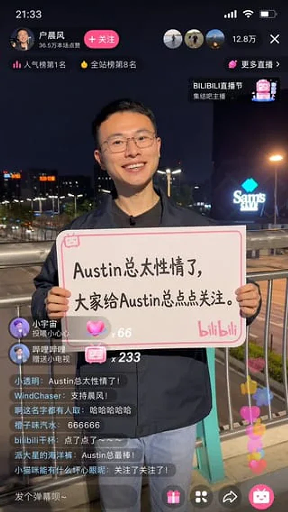

```text
A 9:16 image, generate a{argument name="platform" default="Bilibili"} Screenshot from the live stream, in the picture{argument name="person" default="Hu Chenfeng"} He was live-streaming, looking cheerful, and holding a sign that read "{argument name="text" default="Austin&#39;s CEO is so generous, everyone should follow him!"} The sign read, "".
```

Model: GPT Image 2
Author: GPT Image 2 Prompts

[ProjectD](https://aitoolsradar.com/en/prompts/84cea13afc3892) · [Recorded source](https://x.com/austinit/status/2044994519649997183)
 · [Full original metadata and byte evidence](data/projectd-batch-0022.json)

## Bilibili Livestream Scene


```text
9:16 的图片，生成一张{argument name="平台" default="哔哩哔哩"}直播的截图，里面是 {argument name="人物" default="户晨风"}在直播，户晨风表情开心，手里拿着牌子，牌子里写着 “{argument name="文字" default="Austin总太性情了，大家给Austin总点点关注。"}”
```

Model: GPT Image 2
Author: Austin

[ProjectD](https://aitoolsradar.com/en/prompts/002b8bebd30ca5) · [Recorded source](https://youmind.com/prompts/bilibili-streamer-holding-sign-13718)
 · [Full original metadata and byte evidence](data/projectd-batch-0022.json)

## Bilingual 5-Day Family Travel Map


```text
{
  "type": "Bilingual illustrated tourist information route map",
  "style": "Flat, brightly colored family poster illustrations, using simple vector shapes, soft textured shadows, and a playful travel brochure aesthetic, with a wide horizontal layout.",
  "theme": "5-Day Family-Friendly Self-Driving Adventure Route in Gannan",
  "headline": {
    "english": "{argument name=\"headline text\" default=\"5-DAY FAMILY ADVENTURE MAP\"}",
    "chinese": "{argument name=\"subheadline text\" default=\"5-Day Family Adventure Itinerary\"}",
    "taglineEnglish": "A Slow & Fun Loop for Little Explorers",
    "taglineChinese": "Slow-paced loop suitable for young explorers"
  },
  "scene": {
    "background": "The map features snow-capped mountains at the top, a pale blue sky dotted with small clouds, a bright sun in the upper right corner, rolling green hills at the bottom and sides, and a cream-colored background in the center.",
    "routeDesign": "A winding blue and red dashed path connects the various destinations from left to right and loops downwards, marked with red circular date markers."
  },
  "layout": {
    "sections": [
      {
        "title": "DAY 1: LANZHOU TO XIAHE",
        "subtitle": "Lanzhou-Xiahe",
        "position": "upper left",
        "count": 3,
        "labels": [
          "Arrive, Check-in, Relax",
          "Arrive, check in, rest",
          "Labrang Monastery"
        ]
      },
      {
        "title": "DAY 2: GRASSLAND FUN AT SANKO",
        "subtitle": "Sangke Grassland Experience",
        "position": "upper center",
        "count": 4,
        "labels": [
          "Kids' Horseback Ride, Petting Sheep",
          "Horseback riding on the grassland, feeding lambs",
          "Horse riders and sheep",
          "Camping families"
        ]
      },
      {
        "title": "DAY 3: GAHAI LAKE TO ZHAGANA",
        "subtitle": "Gahai Lake - Zhagana",
        "position": "upper right",
        "count": 4,
        "labels": [
          "A Stroll Through Zhagana's \"Little Qin Style\" - Langmusi",
          "Bird Watching, Stone City View",
          "Birdwatching, Stone City Landscape",
          "Zhagana"
        ]
      },
      {
        "title": "DAY 3: GAHAI LAKE TO ZHAGANA",
        "subtitle": "Gahai Lake - Zhagana",
        "position": "lower left-center",
        "count": 4,
        "labels": [
          "Bird Watching, Stone City",
          "Birdwatching, Stone City Landscape",
          "Waterbirds",
          "Zhagana"
        ]
      },
      {
        "title": "DAY 5: RETURN TO LANZHOU",
        "subtitle": "Return to Lanzhou",
        "position": "right center",
        "count": 4,
        "labels": [
          "Milarepa Buddha Pavilion, Return Trip",
          "Milarepa Pavilion, Fly Home",
          "Rokiji Temple",
          "GANNAN"
        ]
      },
      {
        "title": "PARENT'S CHECKLIST",
        "subtitle": "Parent Checklist",
        "position": "lower left",
        "count": 5,
        "labels": [
          "Layered Clothing (Down Jacket/Windbreaker)",
          "Small Oxygen Bottle",
          "Sunscreen &amp; Hat (High SPF Sunscreen, Hat)",
          "Kids' Snacks &amp; Fruit",
          "Binoculars (telescopes)"
        ]
      }
    ],
    "decorativeIconsCount": 12,
    "decorativeIcons": [
      "mountain range",
      "sun",
      "Clouds",
      "Car icons near Day 1",
      "Temples near Xiahe",
      "horse rider",
      "sheep",
      "tent",
      "A family of three",
      "Two birds on the lake",
      "Shicheng rock strata",
      "Waterfalls and pavilions"
    ]
  },
  "characters": {
    "count": 4,
    "figures": [
      "Cartoon child holding a cup on the left edge",
      "A family of three living nearby on the second day",
      "Cartoon children waving near the 5th day",
      "The antelope mascot in the bottom right corner is wearing a shirt with the word GANNAN on it."
    ]
  },
  "mapLabels": {
    "count": 4,
    "labels": [
      "Labrang Monastery",
      "Zhagana",
      "Rokiji Temple",
      "JAVA"
    ]
  },
  "colorPalette": {
    "sky": "light blue",
    "mountains": "blue-gray and white",
    "route": "Blue and red",
    "panels": "Dark navy blue with white lettering",
    "accents": "Red numbered circles, green hills, and brown landmarks"
  },
  "textTreatment": "Large, bold, all-caps English title, with a smaller, bold Chinese translation below, rounded navy blue label boxes, and bilingual annotations throughout the text.",
  "customization": {
    "region": "{argument name=\"region name\" default=\"Gannan\"}",
    "primary title": "{argument name=\"map title\" default=\"5-DAY FAMILY ADVENTURE MAP\"}",
    "trip length": "{argument name=\"trip length\" default=\"5-day\"}",
    "mascot label": "{argument name=\"mascot shirt text\" default=\"GANNAN\"}",
    "brand mark": "{argument name=\"corner signature\" default=\"JAVA\"}"
  }
}
```

Model: GPT Image 2
Author: GPT Image 2 Prompts

[ProjectD](https://aitoolsradar.com/en/prompts/245b38f686a675) · [Recorded source](https://x.com/zhngsn082474045/status/2046953182040072634#reversed-0)
 · [Full original metadata and byte evidence](data/projectd-batch-0022.json)

## Bilingual Prompt Comparison Portrait

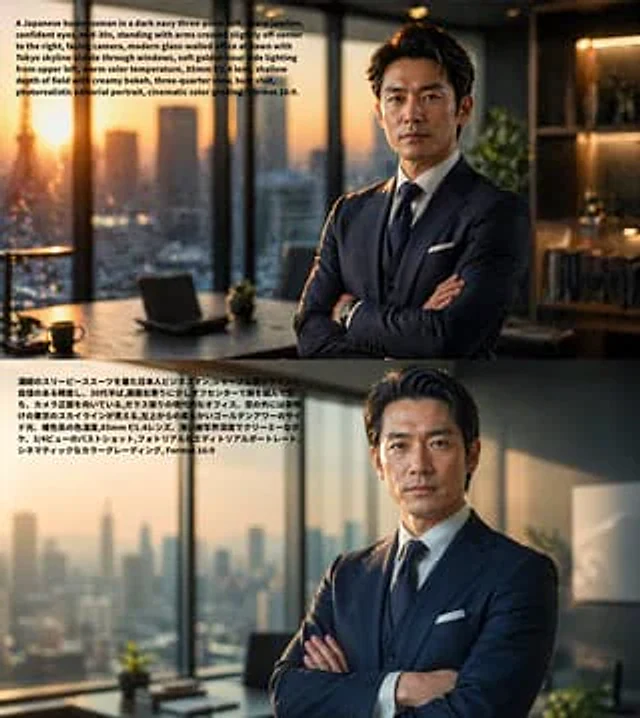

```text
{
  "type": "Comparison chart",
  "subject": "Two identical realistic edited portraits rendered using equivalent prompts in different languages.",
  "layout": {
    "orientation": "Vertical stacking",
    "sections": [
      {
        "position": "top",
        "count": 1,
        "language": "English",
        "overlay_text": "A Japanese businessman in a dark navy three-piece suit, sharp jawline, confident eyes, mid-30s, standing with arms crossed slightly off-center to the right, facing camera, modern glass-office at dawn with Tokyo skyline visible through windows, soft golden hour side lighting from upper left, warm color temperature, 85mm f/1.4 lens, shallow depth of field with creamy bokeh, three-quarter view, bust shot, photorealistic editorial portrait, cinematic color grading. Format 16:9.",
        "image": "photorealistic portrait of {argument name=\"subject\" default=\"a Japanese businessman\"} in his mid-30s wearing a {argument name=\"suit color\" default=\"dark navy\"} three-piece suit with white shirt, dark tie, white pocket square, and wristwatch, sharp jawline, confident eyes, styled dark hair, standing with arms crossed, placed slightly right of center, facing the camera in a three-quarter bust shot inside a modern high-rise glass office at dawn, Tokyo skyline visible through floor-to-ceiling windows, desk with an open laptop and a small plant on the left, shelving and warm interior lights on the right, soft golden-hour side light from the upper left, warm color temperature, shallow depth of field, creamy bokeh, cinematic editorial realism, 85mm f/1.4 look, aspect ratio 16:9"
      },
      {
        "position": "bottom",
        "count": 1,
        "language": "Japanese",
        "overlay_text": "A Japanese businessman in a rich three-piece suit, with a sharp jawline and confident gaze. Mid-30s, he stands slightly to the right with his arms crossed in front of his chest, facing the camera. A modern office with glass windows, the Tokyo skyline at dawn visible outside. Soft golden hour side light from the upper left, warm color temperature, 85mm f/1.4 lens, shallow depth of field with creamy bokeh, 3/4 view bust shot, photorealistic editorial portrait, cinematic color grading, Format 16:9",
        "image": "the same composition and styling as the top image, nearly identical photorealistic editorial portrait, preserving the businessman, office setting, dawn skyline, crossed arms, lighting, lens look, shallow depth of field, and cinematic grading to demonstrate minimal visual difference between English and Japanese prompts"
      }
    ],
    "background": "Each section fills half the canvas, with no dividing lines, and the text block is located in the upper left corner of each panel.",
    "count_total_sections": 2
  },
  "style": "A concise social media comparison chart that displays prompt text directly above the generated image.",
  "intent": "The demonstration of GPT-image-2 shows that it produces very similar results using English and Japanese prompts."
}
```

Model: GPT Image 2
Author: GPT Image 2 Prompts

[ProjectD](https://aitoolsradar.com/en/prompts/f02301dac80d0a) · [Recorded source](https://x.com/old_pgmrs_will/status/2046391772159643803#reversed-0)
 · [Full original metadata and byte evidence](data/projectd-batch-0022.json)

## Bill The Investor #278

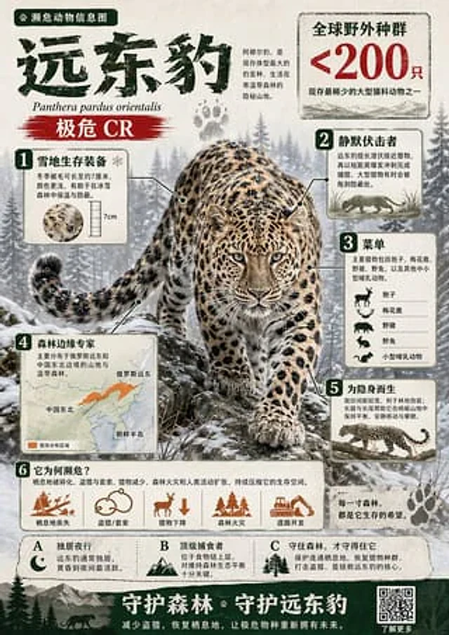

```text
Create a visually rich infographic in Chinese about an endangered animal. Start by finding one online, research its habitat, diet, and unique traits. Present information through annotated visuals and structured callouts, not generic sections. Style it like a bold graphic illustration: a detailed, photorealistic central animal as the focal point, supported by diagrams, callouts, and concise text elements. Use clean backgrounds and a mix of photorealism with strong graphic elements (shapes, icons, color blocking) in a layered composition. Make it dense, tactile, and professionally authored.

猜猜哪个是哪个？
```

Model: GPT Image 2
Author: Bill The Investor

[ProjectD](https://aitoolsradar.com/en/prompts/a17bb458145ae5) · [Recorded source](https://x.com/billtheinvestor/status/2047153211560399009)
 · [Full original metadata and byte evidence](data/projectd-batch-0022.json)

## Billionaire Executive Portrait

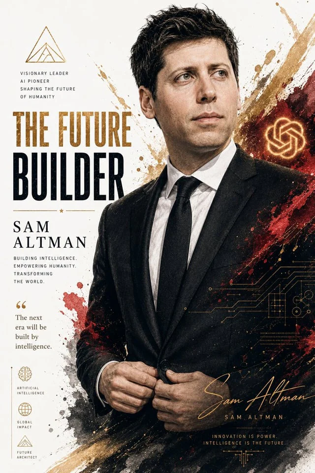

```text
A powerful portrait of a high-status business leader wearing a {argument name="suit" default="premium luxury formal suit"} (tailored dark suit, crisp white shirt, elegant tie). Sharp facial features, clean grooming, ultra-realistic detailing. Expression & Mood: Calm, confident, and highly authoritative expression — focused gaze symbolizing intelligence, control, and global influence. Pose & Composition: Half-body portrait (chest-up), Slight diagonal cinematic angle for depth and intensity, Strong executive posture (hands relaxed or adjusting suit). Art Style: Hand-drawn ink sketch lines blended with watercolor textures, Luxury-inspired gold, black, and deep blue/red paint splashes, Dynamic abstract brush strokes representing power and innovation, Highly detailed realistic face with subtle gritty texture. Background: Clean white or soft neutral base, Elegant watercolor splashes (gold + dark tones), Soft glowing aura behind the subject for a premium elite feel. Typography Elements: Main Title: “{argument name="title" default="TYPE HERE"}”, Name: “{argument name="name" default="TYPE HERE"}” (bold handwritten luxury brush style). Extra Details: Subtle gold accents for premium billionaire aesthetic, Light grunge texture overlay for cinematic depth, Minimal crown or abstract wealth/power symbols. Signature (Bottom): “TYPE HERE”. Optional Quote Section: “TYPE HERE”. Mood & Tone: Elite, powerful, cinematic, luxury-driven legacy aesthetic
```

Model: GPT Image 2
Author: Rossy

[ProjectD](https://aitoolsradar.com/en/prompts/bf714f5b5663c9) · [Recorded source](https://youmind.com/prompts/billionaire-executive-ink-portrait-20466)
 · [Full original metadata and byte evidence](data/projectd-batch-0022.json)

## Biological Illustration Page

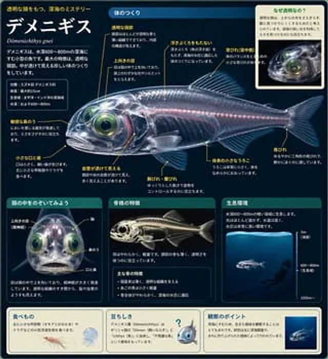

```text
An explanation{argument name="subject" default="Bigfin Post-anal Fish"} A colorful encyclopedia of body structure.
```

Model: GPT Image 2
Author: GPT Image 2 Prompts

[ProjectD](https://aitoolsradar.com/en/prompts/ef4d9bb7ea1525) · [Recorded source](https://x.com/itnavi2022/status/2046500429786402973)
 · [Full original metadata and byte evidence](data/projectd-batch-0022.json)

## Biological Life Cycle Diagram

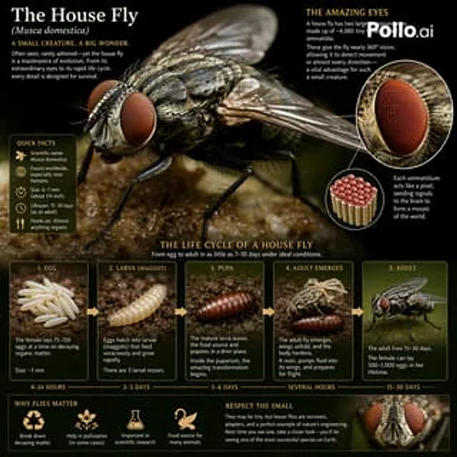

```text
Showing off its amazing compound eyes{argument name="insect" default="Houseflies"} life cycle
```

Model: GPT Image 2
Author: GPT Image 2 Prompts

[ProjectD](https://aitoolsradar.com/en/prompts/3f25c9b69044db) · [Recorded source](https://x.com/Donnapez7571/status/2047048094701801824)
 · [Full original metadata and byte evidence](data/projectd-batch-0022.json)

## Biological Specimen Microscopy Prompt

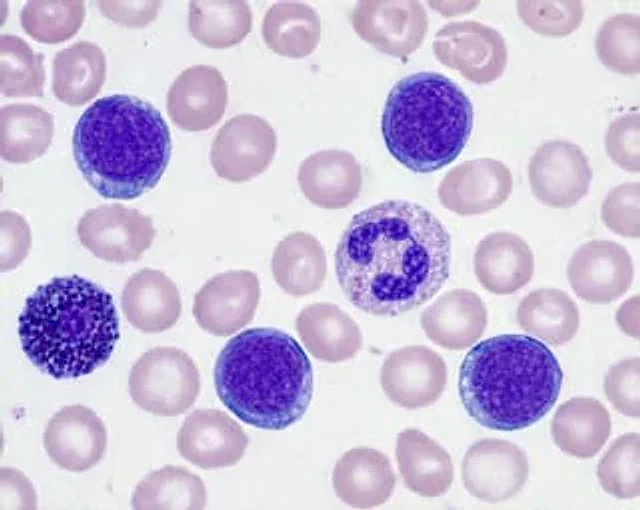

```text
Images of producing lymphocytes, neutrophils, and basophils under a microscope after Giemsa staining.
```

Model: GPT Image 2
Author: GPT Image 2 Prompts

[ProjectD](https://aitoolsradar.com/en/prompts/b45d0e9d64bf1a) · [Recorded source](https://x.com/DeryaTR_/status/2047118537999655369)
 · [Full original metadata and byte evidence](data/projectd-batch-0022.json)

## BIWA Fashion Character Sheet

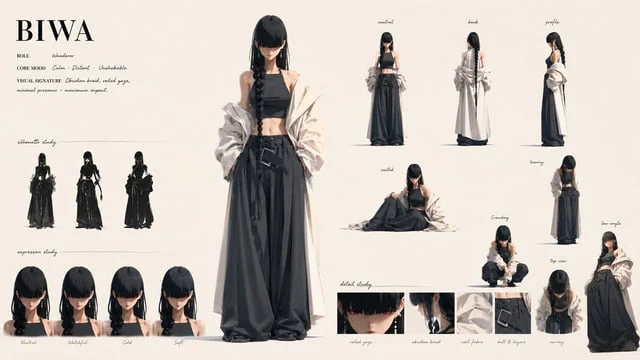

```text
Goal: Create a polished fashion character sheet for {argument name="character name" default="BIWA"}, a quiet wandering anime-inspired female character with a restrained high-fashion silhouette.

Canvas: Wide horizontal character design sheet, 16:9 aspect ratio, warm off-white paper background, clean editorial spacing, thin hand-drawn divider lines, elegant black serif title typography and small handwritten annotation labels.

Character concept: A slim young woman with very pale skin, long straight {argument name="hair color" default="black"} hair, heavy bangs covering the eyes, and one very long thick side braid falling over the front of her body. Her visible expression is calm, distant, and unreadable. She wears a black cropped halter top, very wide black layered hakama-like trousers with belts and dangling straps, soft black shoes hidden under the fabric, long earrings, and an oversized off-white crumpled outer coat worn off the shoulders with sculptural sleeves. Overall mood: {argument name="core mood" default="calm, distant, unshakable"}. Visual signature: obsidian braid, veiled gaze, minimal presence, maximum impact.

Layout: Place one large full-body hero figure slightly left of center, facing forward, occupying most of the height. In the upper left, show the character name in large serif letters, with three small metadata lines: Role: Wanderer; Core Mood: calm, distant, unshakable; Visual Signature: obsidian braid, veiled gaze, minimal presence, maximum impact. Around the hero figure, arrange multiple smaller studies and poses like a professional character sheet.

Required visible elements and exact counts: Include 1 large central full-body hero pose. Include 3 black silhouette studies on the left labeled silhouette study, showing front, alternate front, and side/back massing. Include 4 bust expression studies along the lower left labeled expression study, with captions: Neutral, Watchful, Cold, Soft. Include 4 full-body turnaround views across the upper right labeled: neutral, back, profile, plus one additional front-facing standing view if needed to complete the turnaround row. Include 5 pose studies on the right and middle-right: seated, leaning, crouching, top view, and low angle. Include 5 detail-study panels along the bottom center/right labeled: veiled gaze, obsidian braid, coat fabric, belt and layers, earrings.

Style: High-end 2D/3D hybrid concept art, soft cinematic lighting, delicate painterly rendering, realistic fabric folds, subtle shadows under each figure, monochrome black-and-cream wardrobe, refined Japanese street-fashion and dark fantasy influence. Keep the linework clean and the sheet uncluttered, with small handwritten labels in black ink.

Constraints: Use only the character sheet content described above, no extra characters, no props beyond clothing and accessories, no watermark, no logo, no decorative border. Make all labels legible and in English. Preserve the quiet minimalist mood and emphasize the contrast between black clothing, pale skin, and the off-white oversized coat.
```

Model: GPT Image 2
Author: Kōda

[ProjectD](https://aitoolsradar.com/en/prompts/a446323165e665) · [Recorded source](https://youmind.com/prompts/biwa-character-sheet-27918)
 · [Full original metadata and byte evidence](data/projectd-batch-0022.json)

## Black and White Crayon Silhouette Poster

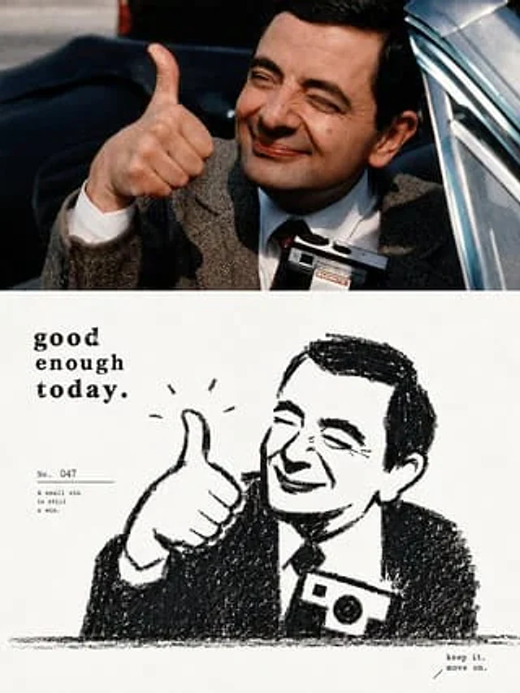

```text
请将我上传的每一张照片分别制作成一张独立的高级设计海报，不多图拼接，每张照片单独输出。整体采用3:4竖版构图，上下两个区域高度严格1:1，各占画面50%。

上半部分保留原始照片，保持主体身份、结构、姿态、真实质感、自然光影和原有色彩氛围，仅进行轻微高级摄影调色，使其具有艺术杂志、独立出版物和展览摄影质感。为适配画幅，可自然扩展天空、地面或环境背景，但不得拉伸、扭曲或改变主体。

下半部分提取照片中最具识别性的主体、轮廓、姿态与叙事关系，重构为极简粗黑干媒介剪影插画。不要机械描摹照片细节，而是将主体压缩成圆润、敦厚、略带稚拙感的概括形体，可适度放大头部、主要轮廓或最有记忆点的局部，使其在极少信息下仍能一眼识别原物。若照片包含多个主体，则保留最重要的互动关系，将它们视为一个整体视觉单元，而不是平均分散焦点。

下半部分只使用近乎纯白的纸面底 + 浓黑蜡笔、炭笔或干擦痕迹，不使用彩色，不使用灰阶渐变。黑色形体不是光滑实心矢量块，而是由短促、有力度的蜡笔反复涂抹形成，保留纸张颗粒、断笔、压痕、边缘毛糙、浓淡不均和局部露白。轮廓略微摇晃、不完整、不精确，让画面保持真实手作感。

主体最关键的识别特征可通过“黑色剪影中突然切出的白色特征区”强化，例如脸部、眼睛周围、窗洞、器皿开口、动物面部、物件核心结构或最具有辨识度的局部；再以极少黑点、短线或符号完成表情与细节。不要追求写实五官和精密结构，而是让黑、白之间形成直接、有趣而强烈的辨识关系。

构图保持大面积纯净留白 + 一个主要视觉关系。主体可居中悬浮，也可轻微偏置、局部裁切或靠近画面下方，仅用一条粗糙地面摩擦线、几根短线或极少环境符号提示空间。草叶、雨丝、烟气、桌面、影子、道路、风或其他环境信息都应被压缩成极少的蜡笔记号，让背景保持安静空旷。整体不追求复杂场景，而让一个姿态、动作、距离或关系承担主要叙事。

文字保留少量高级编辑感与童书感并存的小字系统。不要只写地点或物体名称，而从照片中的情绪、动作、关系、时间或微小故事提炼一个简短英文标题，再搭配编号、适配的金句、章节号或一句极短的含蓄小文案。文字可以是克制的印刷小字，也可以加入极少量笨拙手写、蜡笔字或不完全规整的字形，使其像原本就属于这幅插画。

文字需要与图形发生巧妙关系：可以贴着地面线排列、沿主体动作方向延伸、躲在大片留白中、与轮廓产生轻微遮挡、卡在两个主体之间的负形里，或用一条细线把编号与主体连接起来。保持“一个短标题 + 1–2组极小辅助文字”即可，让文字成为构图节奏的一部分，而不是普通海报标题。

整体呈现黑要粗、白要净、形要简、质要糙的视觉特征，在童稚、温软、安静、幽默与孤独之间保持微妙平衡，像一本由高级设计工作室重新编辑的旧黑白童书。避免光滑数字描边、精密线稿、写实光影、厚涂、3D效果、彩色、大面积灰色渲染、卡通贴纸感和模板化商业插画。
```

Model: GPT Image 2
Author: 小小东

[ProjectD](https://aitoolsradar.com/en/prompts/50a1c93cbf92d8) · [Recorded source](https://youmind.com/prompts/crayon-silhouette-art-poster-32027)
 · [Full original metadata and byte evidence](data/projectd-batch-0022.json)

## Black and White Studio Fashion Portrait

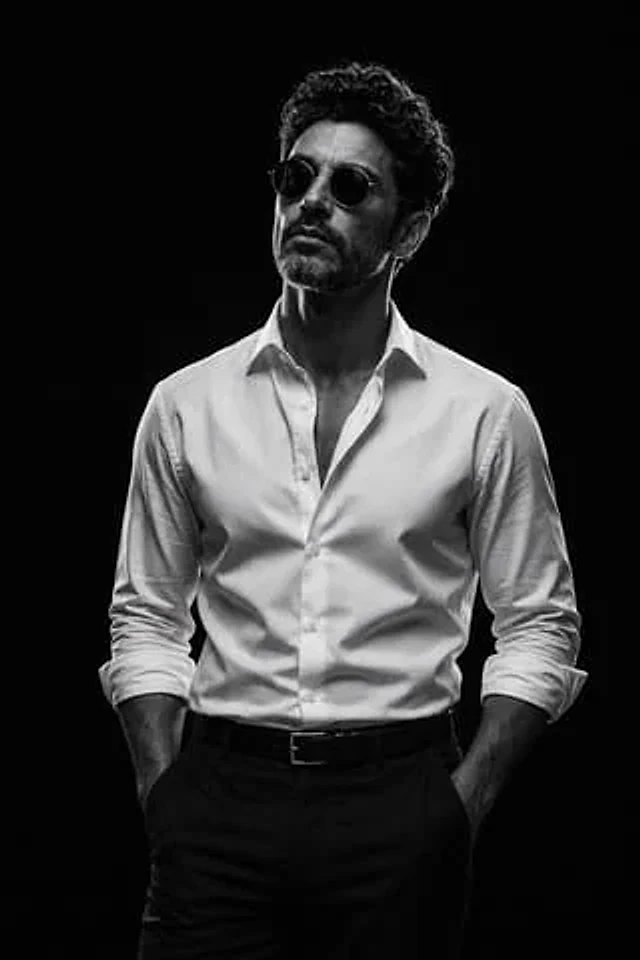

```text
Dramatic ultra-photorealistic black-and-white studio fashion portrait of an {argument name="subject" default="adult man"}, photographed as a premium editorial campaign with a full-frame professional camera. Three-quarter body composition, framed from approximately mid-thigh upward. He stands naturally with confident posture, both hands casually tucked into his trouser pockets, shoulders relaxed, chest subtly open, chin slightly lifted, head turned a little away from the camera. His expression is calm, self-assured, serious, and composed.

He wears round vintage-style sunglasses with realistic dark lenses and thin frames, a perfectly tailored {argument name="shirt type" default="crisp white dress shirt"} with the top two or three buttons undone, collar naturally open, sleeves casually rolled to the forearms, shirt neatly tucked into high-quality dark tailored trousers with a simple leather belt and understated metal buckle. Clothing should show authentic fabric texture, natural wrinkles, realistic stitching, subtle folds around the elbows and waist, and physically accurate draping.

Pure seamless black studio background with no visible environment, props, texture, or distractions. Extremely controlled low-key cinematic lighting: one strong directional side light positioned approximately 45 degrees to the subject, creating sculpted bright highlights across the white shirt while allowing the opposite side of the face and body to fall naturally into deep partial shadow. Subtle soft reflected fill only where physically plausible. Strong chiaroscuro, rich blacks, luminous white highlights, smooth tonal transitions, realistic skin texture, natural pores and fine facial detail, subtle facial hair detail, accurate anatomy, realistic hands and fingers.

High-contrast monochrome photography with a refined filmic tonal range, deep blacks without crushed facial detail, clean highlights without excessive clipping, subtle natural film grain, realistic lens rendering, gentle background separation, and authentic photographic imperfections. Sharp focus on the face, sunglasses, and shirt collar with a gradual shallow depth of field toward the lower body. Sophisticated luxury fashion editorial aesthetic, timeless cinematic mood, restrained and elegant rather than theatrical.

Photorealistic skin, physically accurate lighting, realistic shadows, true-to-life proportions, natural posture, premium studio photography, high dynamic range, fine micro-contrast, detailed fabric texture, realistic optical characteristics, {argument name="lens" default="85mm"} portrait lens look, approximately f/2.8, full-frame camera, high-resolution RAW photography, professionally retouched but not artificially smoothed, no CGI appearance.
```

Model: GPT Image 2
Author: Weinberg

[ProjectD](https://aitoolsradar.com/en/prompts/6ac0f280bc3a77) · [Recorded source](https://youmind.com/prompts/monochrome-studio-fashion-portrait-30954)
 · [Full original metadata and byte evidence](data/projectd-batch-0022.json)

## Black Wind Fashion Portrait

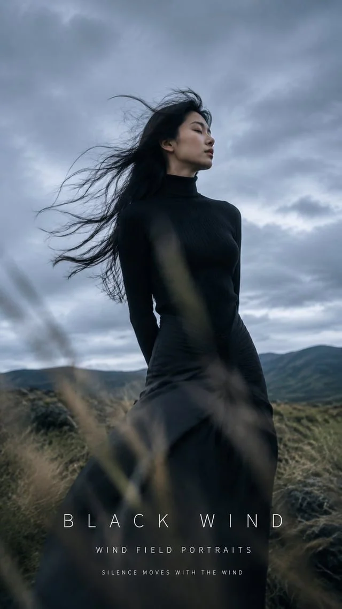

```text
Create a vertical cinematic fashion campaign portrait titled {argument name="headline text" default="BLACK WIND"}. A solitary {argument name="subject" default="East Asian woman"} stands in a windswept open grassland under a heavy overcast sky, framed from mid-thigh upward in a low-angle editorial composition. She wears a fitted black ribbed turtleneck top and a long flowing black skirt or dress, with her hands held behind her back; her head is turned in profile to the right, eyes closed, calm and introspective. Her very long black hair is blown dramatically to the left by strong wind, with many fine strands trailing across the cloudy sky. The background shows dark rolling hills and moody moorland, with tall dry grasses in the extreme foreground blurred by shallow depth of field and motion, partially crossing the lower center of the image. Use muted cool film tones, blue-gray clouds, soft natural diffused light, subtle grain, realistic skin, high-fashion editorial styling, atmospheric wind movement, and a slightly underexposed dramatic look. Add minimalist thin white typography centered near the bottom: large widely spaced text “{argument name="headline text" default="BLACK WIND"}”, below it smaller spaced text “{argument name="series title" default="WIND FIELD PORTRAITS"}”, and a third tiny line “{argument name="tagline" default="SILENCE MOVES WITH THE WIND"}”. Keep the design clean with no logos or watermarks, portrait aspect ratio 9:16, photographic realism, and ensure the wind, hair, grasses, and clouds define the mood.
```

Model: GPT Image 2
Author: Larus Canus

[ProjectD](https://aitoolsradar.com/en/prompts/e86a5da0e8ea9d) · [Recorded source](https://youmind.com/prompts/black-wind-fashion-portrait-29457)
 · [Full original metadata and byte evidence](data/projectd-batch-0022.json)

## Black-and-White Fine Art Portrait

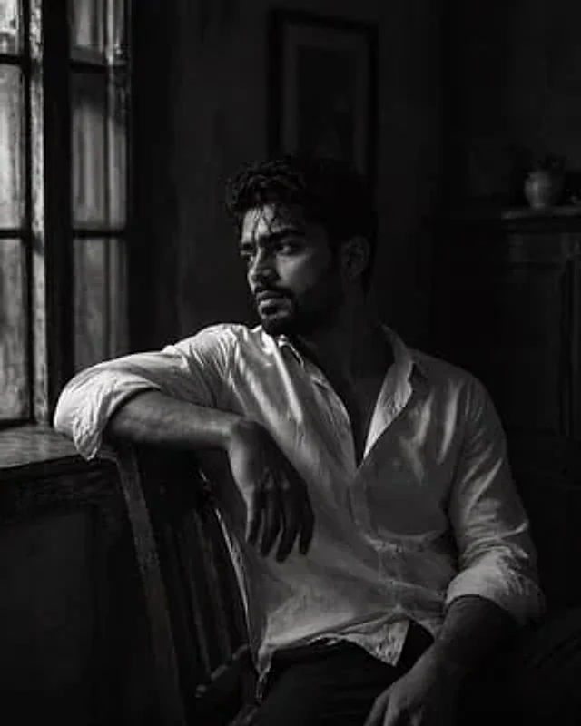

```text
A cinematic black and white portrait, in which {argument name="subject" default="young man"} Sitting{argument name="furniture" default="wooden chair"} He sits in a retro-style interior. He leans slightly forward, his head resting gently on his arms folded over the back of the chair. His posture is relaxed yet weighty, conveying a depth of emotion and a quiet introspection. He gazes down, lost in thought, his expression soft and melancholic. He has slightly disheveled dark hair, fine in texture, with a light stubble or short beard, adding to his realism and personality. A few strands fall naturally across his forehead. He wears a {argument name="clothing" default="A simple and slightly loose white shirt"} The natural folds of the fabric enhance the candid, realistic beauty. The soft, natural light comes from a large window behind or to the side of him. The light gently envelops his face and arms, outlining delicate highlights while casting deep, dramatic shadows throughout the room. The diffused light and shadow, with their sharp contrasts, evoke classic film photography. The setting is a vintage interior—aged wooden furniture, textured walls, and a large window with prominent panes. The background is softened yet still clearly visible, adding depth and context without interfering with the subject. Atmosphere: Sensual, quiet, introspective—capturing solitude, contemplation, and tranquility. Color Grading: Monochrome (black and white), with rich contrast, deep blacks, soft highlights, and a film-like tonal range. Depth of Field: Shallow depth of field, with sharp focus on the subject's face and arms, and a smooth, blurred background. Style: Art photography, cinematic stills, film aesthetics, high dynamic range, subtle graininess, timeless atmosphere. Camera parameters: 50mm or 85mm lens, f/1.8–f/2.2 aperture, natural light photography, strong subject isolation, soft vignetting. Composition: Vertical composition (4:5 or 9:16), subject slightly off-center, using the chair as a compositional element to create a layered narrative composition. The uploaded image was used as a reference to generate the image.
```

Model: GPT Image 2
Author: GPT Image 2 Prompts

[ProjectD](https://aitoolsradar.com/en/prompts/053efffe46735e) · [Recorded source](https://x.com/Professor_134/status/2047658499266806001)
 · [Full original metadata and byte evidence](data/projectd-batch-0022.json)

## Black-and-White Wartime Ink Scene

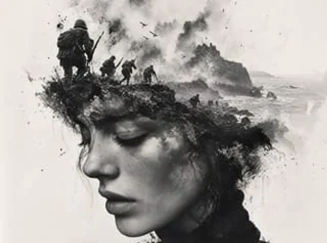

```text
This dramatic black-and-white ink painting of war, using a vertical composition, combines realistic World War II imagery with abstract ink splashes against a large expanse of white background. On the left side of the image, four soldiers advance towards the center and into the distance: in the foreground, a large soldier stands on a rocky cliff, wearing a helmet, carrying heavy equipment, and holding a rifle with a bayonet; behind him, three smaller soldiers move to the right in a staggered formation. In the sky, five warplanes roar past through thick smoke. On the right side of the image is a steep rocky island or coastal cliff, topped with an abandoned fortress or castle, surrounded by smoke. Below, surging waves crash against reefs, and tiny landing figures are faintly visible on the narrow coastline. Using explosive black ink blots, smoke, scratches, splashes, and painterly fragmentation effects, the soldiers, cliffs, and waves are integrated into a highly expressive work. High-contrast monochrome, misty and hazy, using only desaturated grayscale to present a memorable cinematic texture, while leaving plenty of negative space, combining the styles of fine art and conceptual art.
```

Model: GPT Image 2
Author: GPT Image 2 Prompts

[ProjectD](https://aitoolsradar.com/en/prompts/99d55560a62fff) · [Recorded source](https://x.com/MuratAykul/status/2047760031186104358#reversed-3)
 · [Full original metadata and byte evidence](data/projectd-batch-0022.json)

## Bleach Style High-Impact Manga Poster

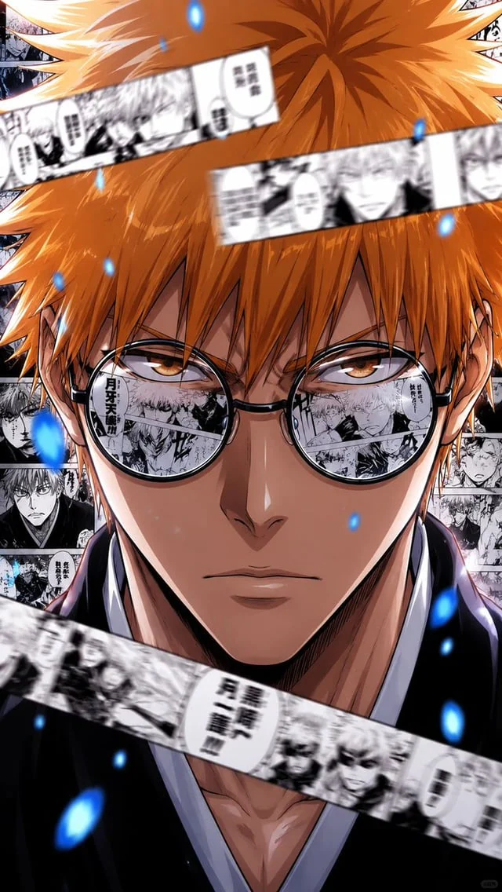

```text
超高细节二次元热血漫画风角色海报，{argument name="角色描述" default="少年死神角色正面半身特写，橙色炸毛短发，琥珀色眼睛，佩戴黑色圆框复古墨镜，冷峻严肃表情"}，正中央对称构图，镜头直视观众，强烈压迫感。眼镜镜片中倒映大量黑白漫画分镜与角色画面，背景也由密集的日漫漫画页拼贴组成，形成“角色记忆 / 名场面回顾”的视觉效果。前景漂浮多条高速运动的漫画分镜条带，带有动态模糊与景深虚化效果，穿插画面上下，营造速度感与空间层次。画面中散落{argument name="能量粒子" default="蓝色灵压粒子 / 荧光能量碎片"}，形成冷暖撞色（橙发 vs 蓝色粒子）。整体采用《BLEACH》式热血少年漫画美学，融合现代潮流海报设计与高级动漫商业视觉。anime key visual, BLEACH style, manga collage poster, cinematic anime lighting, reflective glasses, manga panels reflection, dynamic motion blur, orange spiky hair, intense stare, ultra detailed anime illustration, shonen jump aesthetic, layered composition, high contrast shading, cel shading, glowing blue particles, dramatic close-up portrait, symmetrical composition, manga montage background, Japanese comic aesthetic, premium anime poster
```

Model: GPT Image 2
Author: 波妞PONYO

[ProjectD](https://aitoolsradar.com/en/prompts/2841682d7b2028) · [Recorded source](https://youmind.com/prompts/bleach-style-manga-character-poster-19265)
 · [Full original metadata and byte evidence](data/projectd-batch-0022.json)

## Blindfolded Sorcerer Victory Pose

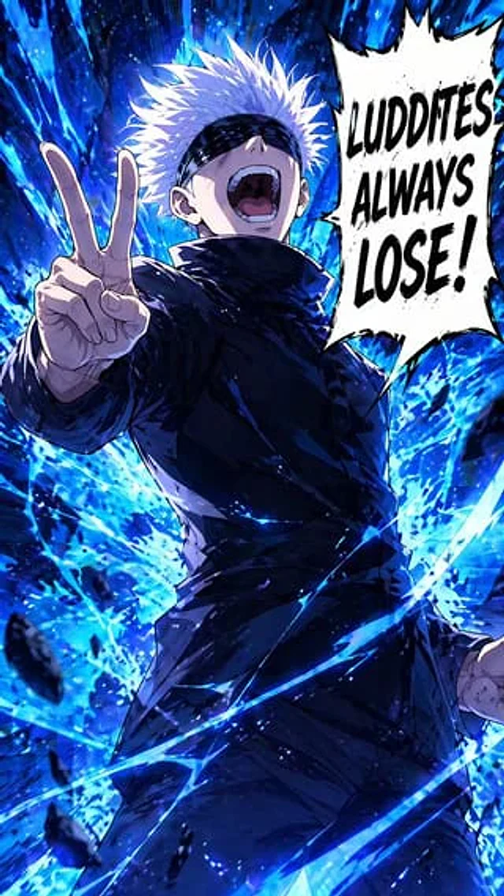

```text
A striking illustration in a shonen manga style depicts a powerful white-haired sorcerer, dramatically laughing with his head thrown back in a low, full-body pose, mouth agape. He wears a black high-necked uniform and a black eyepatch. His left hand extends towards the viewer in a peace sign gesture, the strong perspective making the hand appear exceptionally large in the foreground, while his right hand hangs naturally at his sides. Explosive {argument name="energy color" default="Electric Blue"} Supernatural energy, accompanied by wild, brush-like halos, splattering fragments, sparks, and wavy streams of light spanning the frame. The background is a dark, abstract burst of chaotic energy, punctuated by glowing blue fragments and dynamic lines, creating an overwhelming sense of power. A bold cel-shaded anime rendering style is employed, combining painterly highlights, sharp lines, strong contrasts, and glossy folds on black clothing. On the right side of the image, a large, jagged white comic book speech bubble with a thick black outline is added, containing…{argument name="speech bubble text" default="The Luddites are doomed to defeat!"} The lettering uses large, distressed black capital letters. The vertical composition, a dynamic action poster layout, conveys a confident and victorious stance, embodying modern dark fantasy anime aesthetics.
```

Model: GPT Image 2
Author: GPT Image 2 Prompts

[ProjectD](https://aitoolsradar.com/en/prompts/38f8a9da0e8d00) · [Recorded source](https://x.com/pigeon__s/status/2046819602869768507#reversed-1)
 · [Full original metadata and byte evidence](data/projectd-batch-0022.json)

## Blockbuster Anime Sky Fantasy Poster

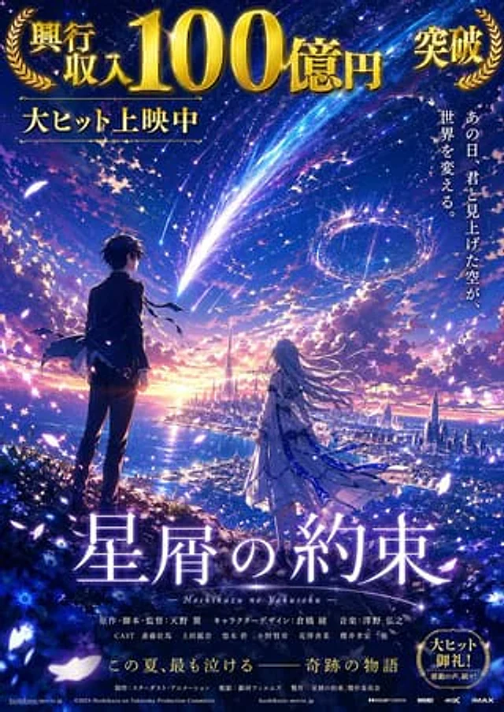

```text
A breathtaking Japanese anime movie poster, employing a blockbuster-level cinematic visual style, is rich in detail and emotionally grand, possessing the exquisite and bright skies characteristic of modern high-quality anime films. The image shows two characters with their backs to the camera, standing on a flower-covered cliff, overlooking a coastal fantasy city glowing at sunset and twilight: on the left is a boy in a dark school uniform, his tie loose, his short hair flowing in the wind; on the right is a girl in a long, flowing light-colored dress, with incredibly long, silver-white hair. Both gaze in awe at the horizon. Above them, a vast sky dominates the composition, painted with vibrant deep blue, indigo, violet, magenta, and gold clouds. A brilliant comet-like meteor streaks diagonally across the horizon from the center, while countless stars twinkle and shimmer. A glowing, circular, magical ring constellation appears in the upper right sky. Below, the ocean and city shimmer with reflected light, slender fantasy skyscrapers and towers rise from the coastline, and a brilliant slit of sunlight pierces the center of the horizon. The foreground flowers are saturated in blue and purple with luminous highlights, and white and pink petals drift down from the sky. The design utilizes dramatic rim lighting, cinematic backlighting, lens flare effects, highly detailed anime rendering, crisp lines, atmospheric depth, and a vertical poster composition. Japanese poster typography is incorporated into the design: a large, embossed gold title text spans the top.{argument name="top headline text" default="Box office revenue surpasses 10 billion yen."} There is a gold subtitle block in the upper left corner.{argument name="subheadline text" default="Now showing to great success"} There is a vertical white slogan in the upper right corner.{argument name="tagline text" default="The sky we looked up at that day will change the world."} At the bottom center is a very large, glowing white lavender-colored Japanese movie title.{argument name="movie title" default="Stardust Promise"} Add an elegant small Roman numeral subtitle below the title.{argument name="romanized subtitle" default="Hoshikuzu no Yakusoku"} The bottom border is filled with a dense list of production staff, cast, website text, release notes, and film format logos, presenting an authentic Japanese movie poster layout. A gold laurel wreath logo is added on either side of the top title. This creates the atmosphere of a fictional anime film, as if the film has surpassed 10 billion yen at the box office—grand, romantic, bittersweet, and magical, destined to bring tears to the audience's eyes.
```

Model: GPT Image 2
Author: GPT Image 2 Prompts

[ProjectD](https://aitoolsradar.com/en/prompts/54f89dc6befbdb) · [Recorded source](https://x.com/nukegala83/status/2046836182269706355#reversed-0)
 · [Full original metadata and byte evidence](data/projectd-batch-0022.json)

## Blonde Character Portrait Prompt

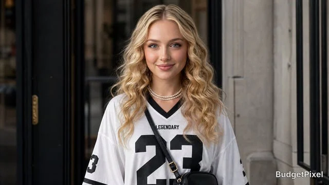

```text
{argument name="character" default="Young woman with long voluminous wavy blonde hair"}, porcelain-fair dewy skin, large almond-shaped eyes, full glossy warm-rose lips, youthful soft features, double-strand pearl choker necklace, oversized white {argument name="clothing" default="football jersey"} with black trim
```

Model: GPT Image 2
Author: Sharon Riley

[ProjectD](https://aitoolsradar.com/en/prompts/fb827e228a4386) · [Recorded source](https://youmind.com/prompts/blonde-character-football-jersey-portrait-21352)
 · [Full original metadata and byte evidence](data/projectd-batch-0022.json)

## Blue Beret Girl Reference Sheet

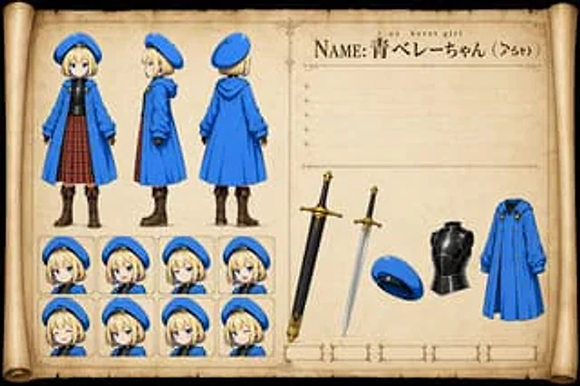

```text
{
  "type": "Anime Character Design Collection",
  "style": "Simple fantasy concept art, exquisite cel animation rendering, and parchment manuscript presentation.",
  "character": {
    "name": "{argument name=\"character name\" default=\"Blue Beret-chan\"}",
    "subtitle": "Blue beret girl",
    "gender presentation": "Young anime girl",
    "hair": {
      "color": "{argument name=\"hair color\" default=\"gold\"}",
      "style": "Short bob, straight bangs, and slightly longer hair on the sides."
    },
    "eyes": {
      "color": "Bright blue",
      "style": "Big anime eyes"
    },
    "outfit": {
      "beret": "{argument name=\"beret color\" default=\"Vibrant royal blue\"} Round beret with a black inner rim",
      "outerwear": "Long, oversized hooded blue coat with double-breasted gold buttons, wide sleeves, and a length that reaches mid-calf.",
      "innerwear": "Black fitted armor-style breastplate",
      "skirt": "Reddish-brown plaid pleated skirt",
      "gloves": "Black gloves",
      "boots": "Brown knee-high lace-up leather boots with a design that enhances the fantasy adventurer look."
    },
    "props": [
      "A black longsword with a gold cross guard and a gold-decorated tip.",
      "1. A silver straight sword with a gold hilt.",
      "1 Blue beret displayed separately",
      "1 black torso armor display model",
      "One blue coat displayed separately"
    ]
  },
  "layout": {
    "background": "An old parchment scroll, unfolded horizontally, with curled paper at both ends, decorated with patterned borders, and possessing a warm, brownish-red texture.",
    "sections": [
      {
        "title": "Character three-view",
        "position": "Top left",
        "count": 3,
        "labels": [
          "front",
          "side",
          "back"
        ],
        "details": "Full-body standing view of the same character"
      },
      {
        "title": "Name Panel",
        "position": "Top right",
        "count": 1,
        "labels": [
          "NAME: Blue Beret-chan (Furori)"
        ],
        "details": "Large, decorative title text, topped with the small Roman numeral \"blue beret girl,\" followed by five lines of blank project description."
      },
      {
        "title": "expression",
        "position": "Bottom left",
        "count": 8,
        "labels": [
          "neutral",
          "gentle smile",
          "serious",
          "confidence",
          "Close your eyes and smile happily",
          "Calmly face it",
          "slightly pouting",
          "gentle smile"
        ],
        "details": "A 2x4 square portrait panel"
      },
      {
        "title": "Equipment and Clothing",
        "position": "Bottom right",
        "count": 5,
        "labels": [
          "Black Sword",
          "Silver Sword",
          "blue beret",
          "Black armored torso",
          "blue coat"
        ],
        "details": "The items are arranged separately like a design drawing."
      },
      {
        "title": "Bottom label",
        "position": "bottom right edge",
        "count": 5,
        "labels": [
          "blank",
          "blank",
          "blank",
          "blank",
          "blank"
        ],
        "details": "Five empty fancy description boxes"
      }
    ]
  },
  "composition": {
    "aspect ratio": "3:2 horizontal",
    "camera": "Frontal projection of character design illustrations",
    "lighting": "Soft studio lighting with very few shadows",
    "mood": "Adventure, elegance, classic fantasy documents"
  },
  "quality": {
    "detail": "Highly detailed garment folds, clean lines, and easily recognizable accessory silhouettes.",
    "finish": "Professional character design projects"
  }
}
```

Model: GPT Image 2
Author: GPT Image 2 Prompts

[ProjectD](https://aitoolsradar.com/en/prompts/329fd0531fdcd3) · [Recorded source](https://x.com/torijar/status/2047206300942217485#reversed-0)
 · [Full original metadata and byte evidence](data/projectd-batch-0022.json)

## Blue Couture Group Portrait

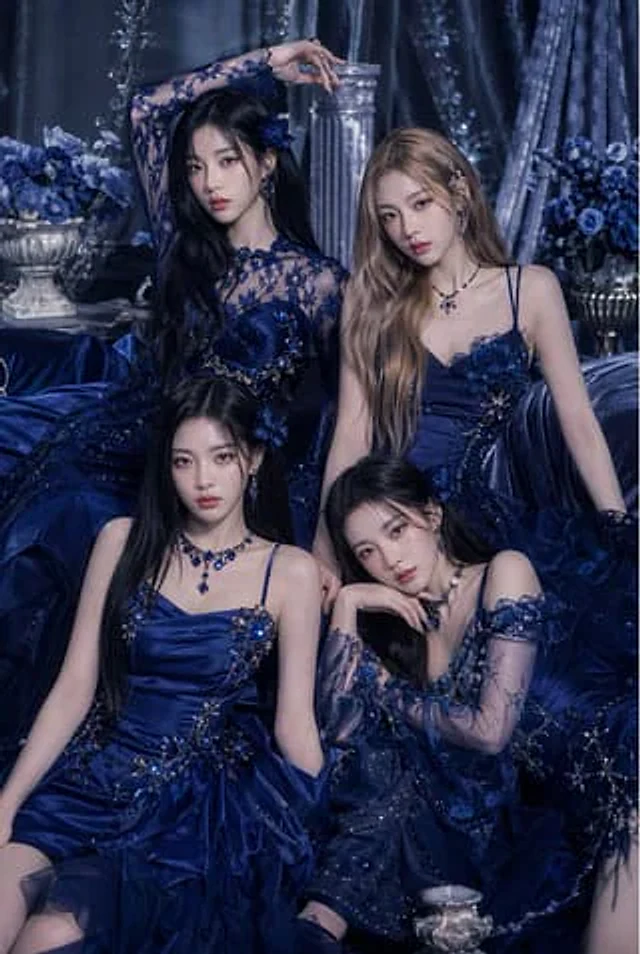

```text
A luxurious studio fashion portrait, in which {argument name="group size" default="Four"} Elegant young women huddle together in a dramatic, dreamlike royal blue setting. They wear coordinated haute couture gowns in deep sapphire and midnight navy blue, adorned with shimmering beads, floral appliqués, sequins, lace sleeves, sheer mesh details, and voluminous, tiered skirts. The scene is monochromatic in blue, with a cool, melancholic, and sophisticated editorial gradation. The women are arranged in a tight triangular composition: two standing or positioned higher behind, two seated on a fabric-covered floor in front, each with a distinctly elegant posture: one with an arm raised above her head, one slightly tilted, one seated upright, and one with her chin resting on her hand. Their gowns, though individual, are unified in style, embellished with opulent crystals, embroidered flowers, and fitted bodices. Matching sapphire jewelry completes the look, including pendant earrings, gemstone necklaces, and floral hair accessories. Their long, flowing hair, a blend of deep black and soft light brown, is sleek and captivating. The scene is surrounded by a lavish backdrop: two classic urn-shaped vases filled with blue roses, a fluted stone pillar, heavy, shimmering velvet curtains, and piles of satin fabrics. Soft, diffused lighting creates subtle highlights on the satin and jewelry, evoking a noble, mysterious, and romantic atmosphere. The portrait, shot vertically from waist up to full body, showcases the highly detailed fabric textures, presenting a refined and luxurious beauty advertising aesthetic. No text is visible in the image.
```

Model: GPT Image 2
Author: GPT Image 2 Prompts

[ProjectD](https://aitoolsradar.com/en/prompts/97f8af86cc8014) · [Recorded source](https://x.com/alanlovelq/status/2047617526830616950#reversed-1)
 · [Full original metadata and byte evidence](data/projectd-batch-0022.json)

## Blue Football Legend Tribute Poster


```text
Create a highly dramatic vertical football tribute poster, using a monochromatic royal blue tone, suitable for {argument name="club name" default="Cruzeiro"} The foreground features two male football players, each wearing a different era's blue Cruzeiro home jersey. The player in the foreground is larger, slightly to the right, showing his upper body in a dynamic running pose, his right index finger raised, his muscles clearly defined, his expression serious yet triumphant. He wears a modern blue jersey with white shoulder stripes, a white sponsor logo, and the club's white star emblem on the chest. The player in the background is slightly smaller, positioned to the left rear, also in motion, wearing a retro blue jersey with a vintage white collar and the logo of a classic soft drink brand sponsor, evoking early memories of the club. The players' faces should be generic and unrecognizable. A large circular Cruzeiro emblem is placed in the center of the background, against a backdrop of a crowded stadium illuminated in blue, featuring two fluttering flags: the club crest flag in the upper left and a flag with large "Supporters" text in the upper right. Ambient smoke, vignetting shadows, and layered lighting effects are added to create a heroic, celebratory sporting design. The image needs to integrate four Portuguese text elements: on the left is a stylized white font "O INÍCIO DE UM FENÔMENO"; on the right is "O MAIOR DE TODOS" with a small crown icon; and at the bottom center is an oversized white brush font.{argument name="main headline" default="FENÔMENO"} The bottom section contains larger-spaced uppercase text.{argument name="bottom tagline" default="ONTEM UM SONHO. HOJE UMA LENDA."} And highlight the last word in bright blue. Add a handwritten signature below the main title, along with the number.{argument name="jersey number" default="9"} Employing a high-contrast sports poster compositing style, incorporating grainy textures, sharp jersey fabric details, and dramatic contour lighting, it creates an epic fan culture atmosphere suitable for the club's legendary celebrations.
```

Model: GPT Image 2
Author: GPT Image 2 Prompts

[ProjectD](https://aitoolsradar.com/en/prompts/fd76e0a6dd9610) · [Recorded source](https://x.com/buildbylucas/status/2047053090134602227#reversed-0)
 · [Full original metadata and byte evidence](data/projectd-batch-0022.json)

## Blue Neon Denial ASMR Anime Portrait


```text
A delicate, anime-style close-up illustration depicts a young virtual YouTuber leaning towards her audience in a dimly lit blue neon studio, performing a harsh "total negation" ASMR. She has short, fluffy white hair with subtle ice-blue highlights, soft, layered bangs obscuring one eye, revealing a bright, half-open ice-blue eye. Her skin is fair, and her expression carries a hint of arrogance, indifference, and mockery. Her slightly parted lips seem to be whispering criticism into the listener's ear. One hand is raised to her mouth in a whispering gesture. She wears large, futuristic headphones with glowing cyan rings and droplet patterns on the top. She wears a white short-sleeved uniform with dark blue trim and gold buttons, a large dark blue ribbon tied at the collar, and a huge blue bow at the back. The word "shizuku" is clearly visible on the side label. Two blurred black binaural ASMR microphones are added in the lower left foreground to create a strong sense of depth. A glowing holographic vertical panel with Japanese text and wave graphics, including the title, is placed on the left.{argument name="headline text" default="Complete denial of ASMR"} and small brand text{argument name="brand name" default="SHIZUKU"} Below the title are four short, negative Japanese whispers displayed in a semi-transparent cyan UI style. The room behind her is dimly lit and atmospheric, with blurred, cool blue shelves and scattered glowing droplets or spots of light appearing in the background. Dramatic, cinematic lighting, a cool blue and white color scheme, glossy highlights, delicate blush, highly detailed eyes and hair, soft glow, clear cel-shaded anime rendering, intimate composition, and a slight Dutch tilt angle create a sense of presence, as if the character is invading the listener's personal space for an ASMR recording. The character should be presented as {argument name="character name" default="Shizuku"} ,have{argument name="hair color" default="White with light blue highlights"} hair and{argument name="eye color" default="Ice Blue"} The eyes.
```

Model: GPT Image 2
Author: GPT Image 2 Prompts

[ProjectD](https://aitoolsradar.com/en/prompts/1fa43bd75d498c) · [Recorded source](https://x.com/506Farley/status/2046910449271329112#reversed-0)
 · [Full original metadata and byte evidence](data/projectd-batch-0022.json)

## Blue Porcelain Fashion Inspiration Board

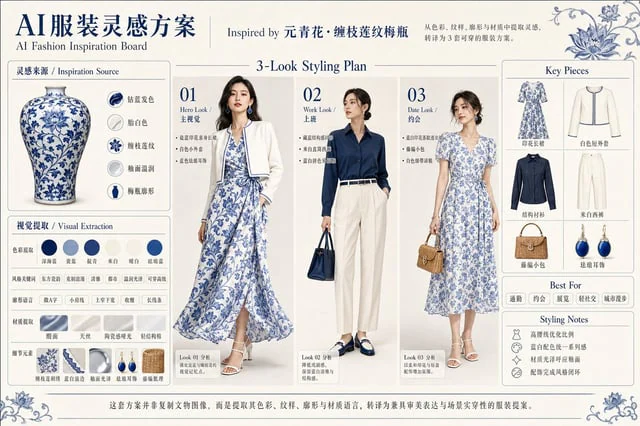

```text
{"type":"bilingual AI fashion inspiration board / museum-artifact-to-outfit styling plan","overall_style":"elegant editorial fashion board on warm ivory paper, deep cobalt blue accents, thin navy divider lines, refined serif typography mixed with Chinese headings, symmetrical decorative blue floral corner ornaments, luxury museum catalog aesthetic, photorealistic outfit models with softly blurred faces, clean product-grid layout","title_text":"{argument name=\"headline text\" default=\"AI服装灵感方案\"}","subtitle_text":"AI Fashion Inspiration Board","inspiration_line":"Inspired by {argument name=\"artifact name\" default=\"元青花・缠枝莲纹梅瓶\"}","top_note":"从色彩、纹样、廓形与材质中提取灵感，转译为3套可穿的服装方案。","color_palette":"{argument name=\"primary palette\" default=\"porcelain white, deep cobalt blue, pale mist blue, warm ivory, silver gray, natural rattan tan\"}","layout":{"canvas":"wide 16:9 landscape board, cream background, thin blue borders, three main columns: inspiration and visual extraction on the left, three full outfit looks in the center, key pieces and notes on the right","sections":[{"title":"灵感来源 / Inspiration Source","position":"upper left","count":6,"contents":["large blue-and-white porcelain meiping vase with scrolling lotus pattern","round swatch labeled 钴蓝发色","round swatch labeled 胎白色","round motif icon labeled 缠枝莲纹","round glossy material swatch labeled 釉面温润","vase silhouette icon labeled 梅瓶廓形"]},{"title":"视觉提取 / Visual Extraction","position":"lower left","count":5,"subsections":[{"name":"色彩规范","count":6,"labels":["深海蓝","浅蓝","靛青","米白","暖白","珐琅蓝"]},{"name":"风格关键词","count":6,"labels":["东方瓷韵","克制浪漫","清雅","都市","温润光泽","可穿高级"]},{"name":"廓形语言","count":6,"labels":["微A字","小廓线","上窄下宽","收腰","长线条","长裙摆"]},{"name":"材质提取","count":5,"labels":["缎面","天丝","陶瓷哑光","丝绸垂坠","轻结构"]},{"name":"细节元素","count":5,"labels":["缠枝莲刺绣","蓝白滚边","釉面光泽","珐琅耳饰","藤编肌理"]}]},{"title":"3-Look Styling Plan","position":"center","count":3,"looks":[{"number":"01","label":"Hero Look / 主视觉","model":"full-body female fashion model, standing in a flowing porcelain-blue-and-white floral wrap maxi dress with V neckline and waist tie, cropped white jacket with cobalt piping, white strappy heels, blue enamel earrings, elegant editorial pose","bullets":["瓷蓝印花裹身长裙","白色小外套","蓝色珐琅耳饰"],"analysis_box":"Look 01 分析：强化瓷器美感，视觉记忆点。"},{"number":"02","label":"Work Look / 上班","model":"full-body female fashion model, standing in navy structured silk blouse tucked into high-waisted warm white straight trousers, slim belt, navy-and-white loafers, dark blue structured handbag, polished office styling","bullets":["深蓝结构感衬衫","米白直筒西裤","蓝白拼色乐福鞋"],"analysis_box":"Look 02 分析：降低花哨感，保留蓝白瓷器结构感。"},{"number":"03","label":"Date Look / 约会","model":"full-body female fashion model, standing in short-sleeve blue-and-white porcelain floral midi tea dress, soft V neckline, fitted waist, white ankle-strap sandals, rattan mini handbag, romantic casual pose","bullets":["蓝白印花茶歇连衣裙","藤编小包","白色细带凉鞋"],"analysis_box":"Look 03 分析：以柔和印花与轻盈廓形营造温柔感。"}]},{"title":"Key Pieces","position":"upper right","count":6,"items":["印花长裙","白色短外套","结构衬衫","米白西裤","藤编小包","珐琅耳饰"]},{"title":"Best For","position":"mid right","count":5,"labels":["通勤","约会","展览","轻社交","城市漫步"]},{"title":"Styling Notes","position":"lower right","count":4,"notes":["高腰线优化比例","蓝白配色统一系列感","材质光泽呼应釉面","配饰完成风格闭环"]}]},"artifact_rendering":"large isolated museum-object illustration of a blue-and-white porcelain meiping vase with dense cobalt scrolling lotus vines, glossy ceramic highlights, placed in a bordered card","models":"three photorealistic adult female models, faces intentionally softly blurred or anonymized, fashion catalog lighting, full-body studio cutouts on pale neutral background","right_product_grid":"two-column grid of six isolated clothing and accessory illustrations matching the three looks: floral dress, white cropped jacket with blue trim, navy blouse, ivory trousers, rattan top-handle mini bag, cobalt blue enamel drop earrings","footer_text":"这套方案并非复制文物图像，而是提取其色彩、纹样、廓形与材质语言，转译为兼具审美表达与场景实穿性的服装提案。","customization_focus":"Generate the board as a complete polished fashion concept sheet inspired by {argument name=\"inspiration object\" default=\"a Yuan dynasty blue-and-white porcelain lotus meiping vase\"}, with exactly three outfit looks and exactly six key pieces, keeping the premium Chinese museum fashion editorial style."}
```

Model: GPT Image 2
Author: Larus Canus

[ProjectD](https://aitoolsradar.com/en/prompts/e9f1c7b3adddd7) · [Recorded source](https://youmind.com/prompts/blue-porcelain-fashion-board-18964)
 · [Full original metadata and byte evidence](data/projectd-batch-0022.json)

## Blue-Haired Anime Character Sheet

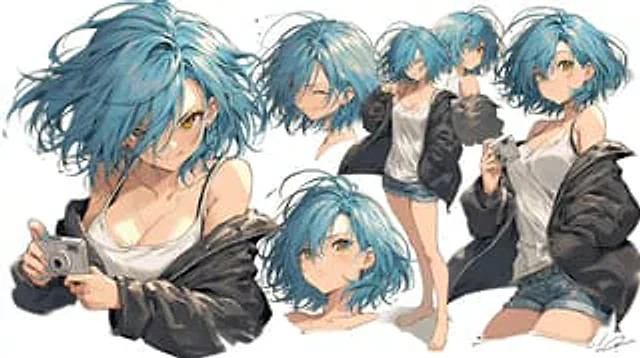

```text
{
  "type": "anime character reference collage",
  "subject": {
    "gender_presentation": "young women",
    "age_appearance": "early 20s",
    "vibe": "Playful, confident, slightly mischievous, casual street style",
    "ethnicity": "Anime-style East Asian images",
    "name": "{argument name=\"character name\" default=\"Original characters\"}",
    "hair": {
      "color": "{argument name=\"hair color\" default=\"Vibrant cyan\"}",
      "style": "The bob haircut, with its messy, chin-length cut and heavy layers, features long, side-swept bangs that cover one eye and loose, wispy strands."
    },
    "eyes": {
      "color": "Golden amber",
      "shape": "Sharp and expressive anime eyes"
    },
    "accessories": [
      "Small hoop earrings",
      "thin necklace"
    ],
    "outfit": {
      "top": "White tank top",
      "outerwear": "An oversized black down jacket, loosely worn over the shoulders.",
      "bottom": "{argument name=\"bottom garment\" default=\"Blue denim shorts\"}",
      "footwear": "Barefoot in full-body photo"
    },
    "prop": "{argument name=\"handheld prop\" default=\"Small silver camera\"}"
  },
  "style": {
    "medium": "Casual high-end anime illustrations, sketch-style concept art showcase",
    "rendering": "Clean lines paired with painterly shadows, a rich and soft celluloid texture, visible brushstrokes, against a white background.",
    "color_palette": "A black coat accentuates her cool blue hair; a white top and denim blue shorts complement her warm amber eyes.",
    "composition": "Asymmetrical collages containing overlapping portraits and figure studies"
  },
  "layout": {
    "background": "pure white",
    "sections": [
      {
        "title": "Left main portrait",
        "position": "Left side",
        "count": 1,
        "labels": [
          "Large bust, three-quarter profile, holding a camera."
        ]
      },
      {
        "title": "Top center head study",
        "position": "Upper and Middle",
        "count": 3,
        "labels": [
          "Side profile portrait",
          "Head portrait with eyes closed and smiling",
          "A serious head portrait looking to the right"
        ]
      },
      {
        "title": "Research on figures on the right",
        "position": "right side",
        "count": 1,
        "labels": [
          "Medium shot, seated or leaning posture, handheld camera"
        ]
      },
      {
        "title": "Central body",
        "position": "Central",
        "count": 1,
        "labels": [
          "Standing posture, barefoot"
        ]
      },
      {
        "title": "Bottom center head study",
        "position": "lower middle part",
        "count": 1,
        "labels": [
          "Headshot from a top-down angle"
        ]
      }
    ],
    "total_visible_character_drawings": 7
  },
  "camera_framing": "Mixed composition: 3 head studies, 1 large bust, 1 medium shot, 1 full-body standing pose, 1 additional head study.",
  "prompt": "Create a clean, white-background collage of anime character designs, featuring seven illustrations of the same young woman. She possesses {argument name=\"hair color\" default=\"Vibrant cyan\"} A messy bob haircut, golden amber eyes, and a cool yet playful demeanor. Includes one large half-length portrait on the left (holding...){argument name=\"handheld prop\" default=\"Small silver camera\"} ), 3 small head studies from the top (various expressions and angles), 1 full-body standing pose from the center, 1 medium shot from the right (handheld camera), and 1 head study from the bottom. She was dressed in a white tank top, an oversized black down jacket that had slipped off her shoulders, and {argument name=\"bottom garment\" default=\"Blue denim shorts\"} Add hoop earrings and a delicate necklace. Use dynamic, tousled hair, elegant sketch-style lines, soft, painterly shadows, and exquisite anime-inspired aesthetics."
}
```

Model: GPT Image 2
Author: GPT Image 2 Prompts

[ProjectD](https://aitoolsradar.com/en/prompts/74c8a98cdd4a7c) · [Recorded source](https://x.com/tebasaki3D/status/2046719202292322361#reversed-1)
 · [Full original metadata and byte evidence](data/projectd-batch-0022.json)

## Blue-Haired Bunny Hood Anime Girl


```text
A close-up illustration in an anime/fantasy style depicts a cute girl in a hall resembling a glowing church, one hand outstretched to the viewer. The strong perspective and shortening effect seem to invite the viewer to move closer. She has long, wavy hair.{argument name="hair color" default="light blue"} Her hair cascades from beneath an oversized, glossy green bunny-ear hat, one ear dangling to the upper left and the other to the right. Her face is mostly obscured by her hair and hood, creating a mysterious and shy composition. She wears an exquisite ruffled dress in white, green, and soft pink, adorned with lace, ribbons, and a pink bow at the neckline. Her other arm holds a plush toy: a white bunny doll with pink inner ears, a wide-open mouth, a button-X eye, and a clown-style collar with small bells. The background is the interior of a magnificent blue crystal palace, featuring towering, luminous arches, soft glowing lighting, reflective floors, shimmering particles, and a dreamlike, ethereal atmosphere. The high-precision anime/game key visual style features vibrant cool tones, soft highlights, delicate lines, glossy fabric textures, cinematic depth of field, a centered composition, and portrait cropping above the chest, creating an atmosphere full of fantasy and magic.
```

Model: GPT Image 2
Author: GPT Image 2 Prompts

[ProjectD](https://aitoolsradar.com/en/prompts/f1fe576dfe50f4) · [Recorded source](https://x.com/misakimei0331/status/2046743218247938134#reversed-0)
 · [Full original metadata and byte evidence](data/projectd-batch-0022.json)

## Blueprint Monument Infographic Poster

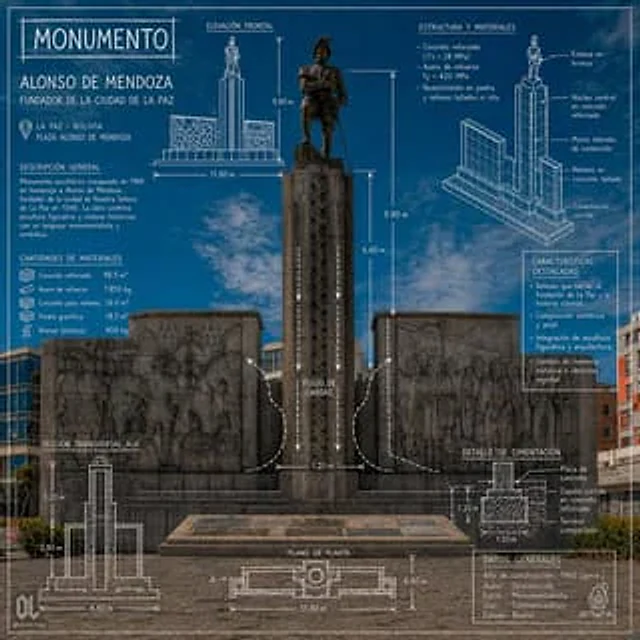

```text
{
  "type": "Architectural Monument Infographic Poster",
  "subject": {
    "monument_name": "MONUMENTO",
    "person": "ALONSO DE MENDOZA",
    "subtitle": "Founder of La Paz",
    "location_city": "La Paz – Bolivia",
    "location_site": "Plaza de Alonso de Mendoza",
    "main_view": "Front view of the monument, featuring a technical overlay that blends blueprint style.",
    "environment": "A city square with a backdrop of a clear blue sky and light clouds, mid-rise buildings in the distance, and a paved surface in the foreground."
  },
  "style": {
    "visual_language": "Combining realistic monument photographs with architectural drawings",
    "color_palette": "Deep cobalt blue background overlay, white technical lines and labels, dark gray stone, bronze statue",
    "mood": "Formal, commemorative, informative, urban heritage poster",
    "rendering": "Clarity, high detail, symmetrical composition, infographic presentation, blueprint aesthetics"
  },
  "monument": {
    "centerpiece": "The towering central pedestal is topped with a bronze statue of a historical conqueror, flanked by two large stone relief walls.",
    "count_flanking_reliefs": 2,
    "materials_visible": [
      "Bronze statue",
      "Dark carved stone base",
      "Stone bas-relief panel",
      "concrete base"
    ]
  },
  "layout": {
    "sections": [
      {
        "title": "MONUMENTO",
        "position": "Top left",
        "count": 1,
        "labels": [
          "ALONSO DE MENDOZA",
          "Founder of La Paz"
        ]
      },
      {
        "title": "General Description",
        "position": "Top left center",
        "count": 1,
        "labels": [
          "The monumental sculpture, completed in 1960, commemorates Alonso de Mendoza, the founder of the city of Our Lady of La Paz (Nuestra Señora de La Paz) in 1548. The work combines figurative sculpture with historical reliefs, showcasing a monumental and symbolic language."
        ]
      },
      {
        "title": "Material usage",
        "position": "Left and Middle",
        "count": 5,
        "labels": [
          "98.5 m³ of reinforced concrete",
          "7,850 kg of steel bars",
          "26.0 m³ of relief concrete",
          "18.5 m³ granite",
          "Bronze (statue) 450 kg"
        ]
      },
      {
        "title": "Front elevation",
        "position": "Upper Middle",
        "count": 4,
        "labels": [
          "9.80 m",
          "11.80 m",
          "9.80 m",
          "6.60 m"
        ]
      },
      {
        "title": "Structure and Materials",
        "position": "Top right",
        "count": 4,
        "labels": [
          "Reinforced concrete (f'c = 28 MPa)",
          "Reinforcing steel (fy = 420 MPa)",
          "Stone cladding and on-site carving relief",
          "Bronze statue"
        ]
      },
      {
        "title": "Main features",
        "position": "Right Center",
        "count": 4,
        "labels": [
          "The reliefs depict the founding and colonial history of La Paz.",
          "Symmetrical and axial composition.",
          "The fusion of figurative sculpture and architecture.",
          "A symbol of historical memory and regional identity."
        ]
      },
      {
        "title": "Cross section AA'",
        "position": "Bottom left",
        "count": 3,
        "labels": [
          "3.20 m",
          "2.80 m",
          "4.40 m"
        ]
      },
      {
        "title": "Floor plan",
        "position": "Shimonaka",
        "count": 3,
        "labels": [
          "A'",
          "11.80 m",
          "4.40 m"
        ]
      },
      {
        "title": "Basic details",
        "position": "Bottom right",
        "count": 4,
        "labels": [
          "concrete slab",
          "reinforced concrete strip foundation",
          "compaction foundation",
          "1.50 m"
        ]
      },
      {
        "title": "Regular data",
        "position": "Bottom right",
        "count": 5,
        "labels": [
          "Year built: Approximately 1960",
          "Author: Anonymous",
          "Style: Monumental",
          "Purpose: Commemorative",
          "Status: Good"
        ]
      }
    ],
    "centerpiece": "The main body of the monument is vertically centered, with arrows, dimension labels, and load flow diagrams superimposed on it.",
    "supporting_graphics": "One front elevation sketch, one exploded isometric structural drawing, one cross-sectional view, one plan view, one foundation detail drawing, and multiple arrows and measurement annotations."
  },
  "text": {
    "headline": "{argument name=\"headline text\" default=\"MONUMENTO\"}",
    "subject_name": "{argument name=\"monument name\" default=\"ALONSO DE MENDOZA\"}",
    "subtitle": "{argument name=\"subtitle\" default=\"Founder of La Paz\"}",
    "city": "{argument name=\"city\" default=\"La Paz – Bolivia\"}",
    "site": "{argument name=\"site\" default=\"Plaza de Alonso de Mendoza\"}"
  },
  "composition": {
    "aspect_ratio": "1:1",
    "camera": "Shot straight at eye level, centered and symmetrical",
    "density": "The monument is rich in information and features technical markings around it.",
    "branding": "Small creator logos and social media accounts are displayed in the corner."
  }
}
```

Model: GPT Image 2
Author: GPT Image 2 Prompts

[ProjectD](https://aitoolsradar.com/en/prompts/63834a595bf925) · [Recorded source](https://x.com/oscarlau/status/2047710173863559439#reversed-0)
 · [Full original metadata and byte evidence](data/projectd-batch-0022.json)

## Blurred Deer in Green Forest

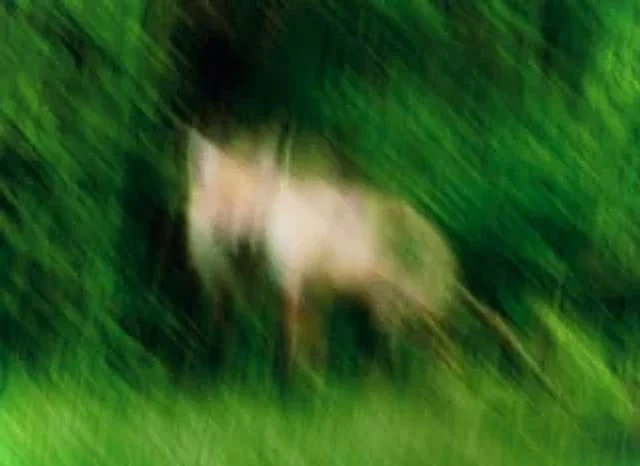

```text
This impressionistic wildlife photograph, featuring a strong subjective motion blur effect, showcases a deer in a clearing within a lush green forest. The animal stands sideways, slightly to the left of center, facing left. Its body is light brown to cream, with slender limbs, and its head and ears are softly blurred, appearing only faintly through the shadows of the dense foliage. The image exhibits strong diagonal and vertical camera motion blur, creating an impressionistic, dreamlike effect rather than sharp detail. The subject is surrounded by saturated summer greenery: a deep green background of bushes, deep forest shadows in the upper left, and bright, vibrant grass in the foreground. Using natural outdoor sunlight, the predominantly rich green tones and soft contrast create an abstract photographic style, as if capturing a fleeting glimpse of wildlife in motion. No people, text, buildings, or other animals are included in the image.
```

Model: GPT Image 2
Author: GPT Image 2 Prompts

[ProjectD](https://aitoolsradar.com/en/prompts/82f4f08e0cefee) · [Recorded source](https://x.com/noveltokens/status/2046824816817176753#reversed-0)
 · [Full original metadata and byte evidence](data/projectd-batch-0022.json)

## BMW Performance Social Poster

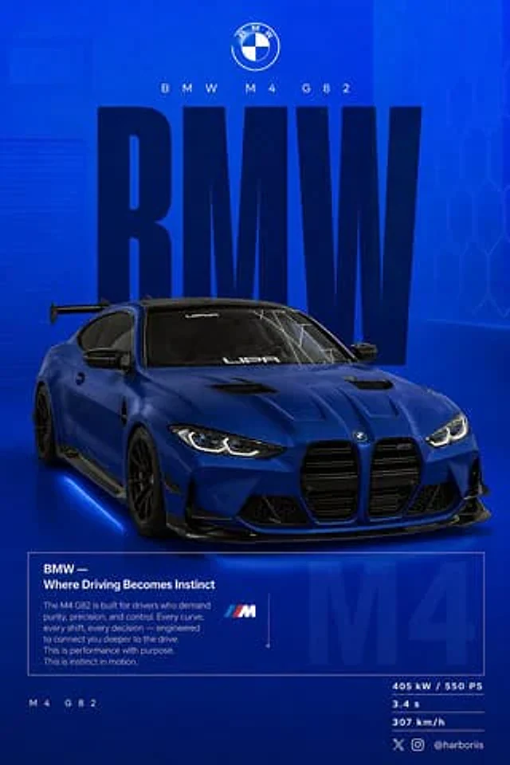

```text
Create a 4:5 aspect ratio, ultra-high resolution vertical social media poster with 8K print quality clarity. Refer to the reference image.{argument name="car model" default="BMW"} Using the reference image as the main element, and adopting its background structure and composition, this design was transformed into a BMW-themed design. All black tones were replaced with a completely flat surface.{argument name="background color" default="High-saturation BMW Blue"} Background. Maintain consistent layout, spacing, visual balance, and poster composition with the reference image. The background should have a smooth gradient, transitioning from a light electric blue at the top to a deep navy blue. Add subtle graininess (2% to 3%) and a subtle rectangular overlay (2% to 4% opacity). Keep the image clean, graphic, sophisticated, and non-realistic. Add soft touch shadows under the car. Use the same BMW from the reference image, only making changes.{argument name="paint finish" default="Matte Frozen Blue"} Alternatively, a deep metallic navy blue paint finish. Retain the original body shape, wheels, stance, and design details from the reference image. Show the car from a rear 45-degree angle, perfectly matching the reference image. Use a slightly elevated camera angle. Position the car slightly to the right center. Include the visible carbon fiber roof, aggressive rear diffuser, clearly controlled reflections, and detailed brake details. Maintain the exact same composition as the reference image: Top: Brand logo; Middle: Oversized font; Center: Car and text overlapping; Bottom: Editorial section and specifications. Typography: Main title: "BMW," in an ultra-compact, bold sans-serif font, vertically stretched, consistent with the reference poster. Color: Deep navy blue or near black. Static text, no distortion. Serves as a structural background. Subtitle: "BMW M4 G82," in a thin font with wider letter spacing. Logo area: BMW round logo centered at the top. Editorial section: Title: "BMW — Where Driving Becomes Instinct"; Body text focuses on: driver connection, handling, performance, and precision. Use the same box-style editing layout as the reference image. Background fade-out text: "M4", large scale, 3% to 5% opacity, positioned behind the text box. Bottom left: "M4 G82"; Bottom right: Specifications: 405 kW / 550 PS, 3.4 s, 307 km/h. Lighting should be clean studio lighting with sharp but controlled highlights. Color grading should use deep blue, high contrast, and pure black. Camera lens: 50mm, slightly raised at a 45-degree rear angle. Atmosphere: Performance, precision, driver focus. Add a bottom right watermark: harboriis, with a small x and an Instagram icon.
```

Model: GPT Image 2
Author: GPT Image 2 Prompts

[ProjectD](https://aitoolsradar.com/en/prompts/3b2396f08150fc) · [Recorded source](https://x.com/harboriis/status/2048063332624843046)
 · [Full original metadata and byte evidence](data/projectd-batch-0022.json)

## Boca Juniors Welcome Poster


```text
A vertical football transfer announcement poster featuring Boca Juniors' signature colors, designed in a style reminiscent of sophisticated social media posters.{argument name="player name" default="Paulo Dybala"} A half-body portrait of him wearing a modern Boca Juniors home jersey, a deep royal blue with a wide gold stripe across the chest and gold stripes on the shoulders. The Adidas logo is on the right chest, and the CABJ crest on the left. The yellow stripe features the "betsson" sponsor logo. The player is positioned slightly to the right of the frame, the shot focusing on his upper body and head. He has short, dark hair, a robust physique, and his head is slightly turned to the left, his right index finger pointing to the crest on his chest. Facial details are not required; keep the face blurred or out of focus. Use a deep blue stadium-themed background with luminous highlights and a subtle worn texture. In the lower left corner of the background, incorporate the appearance of Boca Juniors' home stadium, La Bombonera, with clearly visible signs reading "LA BOMBONERA" and "CLUB ATLÉTICO BOCA JUNIORS". Add a few floating gold confetti shards throughout the scene to create a celebratory atmosphere. Place a large CABJ shield crest in the upper right corner. The layout should adopt a striking poster style: "BIENVENIDO A LA BOMBONERA" should be written in small gold capital letters in the upper left corner, accompanied by a small gold star below; the main title should be on the left, using a stacked layout, with "BIENVENIDO" in a tall, compressed white capital letter and "DYBALA" in an extra-large, compressed gold capital letter. Below the name, add smaller white capital letters "PAULO DYBALA," flanked by thin gold lines and a small gold star. At the bottom, place a thin gold line spanning the width of the image, with the gold capital letters "| JUGADOR DE BOCA |" centered, accompanied by a gold star. High-contrast, glossy sports poster lighting, rich deep blue and gold tones, and sharp fabric details should be used to present the visual aesthetics of a top club's official announcement.
```

Model: GPT Image 2
Author: GPT Image 2 Prompts

[ProjectD](https://aitoolsradar.com/en/prompts/4d4af5d141b03d) · [Recorded source](https://x.com/rfunk82/status/2046987843097039011#reversed-0)
 · [Full original metadata and byte evidence](data/projectd-batch-0022.json)

## Bold Egg Tart Opening Poster

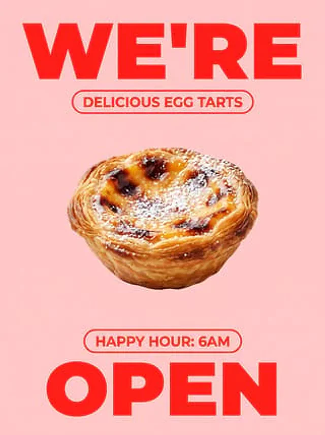

```text
Goal: Create a bold minimalist food advertisement poster for a bakery opening, centered on one photorealistic Portuguese-style egg tart.

Canvas: Vertical poster in 3:4 aspect ratio, soft pale pink background with subtle smooth gradient, no borders or watermark.

Layout: At the very top, place an enormous uppercase red headline reading {argument name="top headline" default="WE'RE"}, using a heavy geometric sans-serif font, spanning nearly the full width. Directly underneath, centered, add one rounded pill outline in red containing the uppercase text {argument name="product label" default="DELICIOUS EGG TARTS"}. In the middle of the poster, place exactly 1 large egg tart floating on the pink background, photographed realistically with no plate or hands. Below the tart, centered, add one smaller rounded red outline pill containing the uppercase text {argument name="happy hour text" default="HAPPY HOUR: 6AM"}. At the bottom, place an enormous uppercase red word reading {argument name="bottom headline" default="OPEN"}, using the same heavy sans-serif font, spanning almost the full width.

Subject details: The egg tart should be golden brown with a flaky layered puff-pastry crust, glossy yellow custard filling, dark caramelized blister spots, and a light dusting of powdered sugar across the top. Make it appetizing, sharply detailed, and studio-lit, with a subtle natural shadow only if needed.

Visual style: Modern pop-art bakery poster, high contrast red typography on pastel pink, clean negative space, centered alignment, crisp commercial food photography, bright but soft lighting.

Text constraints: Use exactly 4 visible text elements: 1 top headline, 1 product-label pill, 1 happy-hour pill, and 1 bottom headline. Keep all typography bright red, uppercase, bold, and clean. Do not add any extra logos, icons, prices, addresses, small print, or decorative objects.
```

Model: GPT Image 2
Author: Nargis Mita

[ProjectD](https://aitoolsradar.com/en/prompts/d3a75f06f63037) · [Recorded source](https://youmind.com/prompts/egg-tart-opening-poster-20910)
 · [Full original metadata and byte evidence](data/projectd-batch-0022.json)

## Bold KFC Food Ad Poster

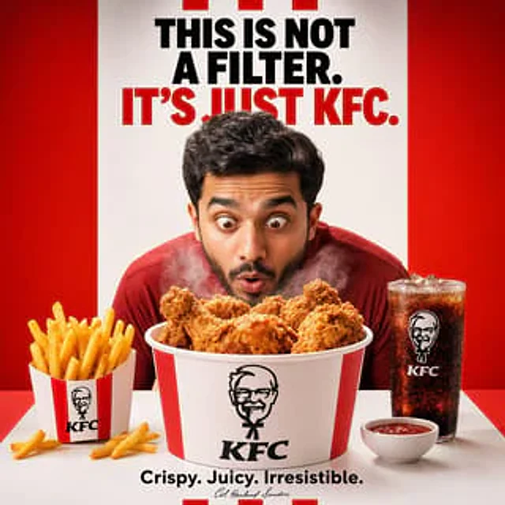

```text
A striking square fast-food advertisement poster, set in a minimalist studio environment, is designed in a style reminiscent of a high-end KFC promotional event. The composition is perfectly centered, with a white background in the middle and bright red vertical stripes on either side. At the top, three short red vertical lines are evenly distributed, echoing the KFC brand element. Below, a prominent, large, stacked, sans-serif bold headline reads: "THIS IS NOT A FILTER." (black), followed immediately by "IT'S JUST KFC." (bright red). In the foreground, a young man with short, dark curly hair, wearing a dark red crew-neck shirt, leans forward, seemingly smelling the aroma of fried chicken; only his hair, ears, shoulders, and upper body are visible, his face obscured by a rectangular blurred block. In the center of the table sits an oversized bucket of fried chicken, containing six clearly visible, golden-brown pieces coated in crispy batter, steaming hot. The chicken bucket is white with red stripes on the sides and a black KFC-style logo on the front, with the face in the logo obscured by a metallic gray blur. To the left of the table is a red and white striped fries box filled with golden-brown fries, with a few more scattered on the table in front; the fries box also features a KFC-style logo, with the face similarly obscured. To the right is a clear glass of cola filled with ice, condensation visible on the glass, and also features a KFC-style logo with the face obscured. In front of the drinks is a small white dipping bowl filled with appealing red ketchup. At the bottom center is a bold black sans-serif slogan: "Crispy. Juicy. Irresistible." Below this is a small, cursive signature: "Col. Harland Sanders." A small red rectangle adorns the bottom. Employing highly sophisticated commercial food photography lighting, a striking red, white, and black brand color scheme, the food is clearly focused, with realistic textures and a symmetrical layout, presenting a high-end poster advertising style. It is a simple, modern, square-format poster suitable for social media.
```

Model: GPT Image 2
Author: GPT Image 2 Prompts

[ProjectD](https://aitoolsradar.com/en/prompts/70214d23daa2e5) · [Recorded source](https://x.com/Deep_GeniusAi/status/2046968940908167245#reversed-0)
 · [Full original metadata and byte evidence](data/projectd-batch-0022.json)

## Book Visualization Prompt


```text
Visually demonstrate through specific scene illustrations{argument name="book name" default="The Almanack of Naval Ravikant"} The core content is incorporated with viral marketing elements suitable for social media dissemination.
```

Model: GPT Image 2
Author: GPT Image 2 Prompts

[ProjectD](https://aitoolsradar.com/en/prompts/9c82ef6cf89a50) · [Recorded source](https://x.com/cellinlab/status/2047556918370013192)
 · [Full original metadata and byte evidence](data/projectd-batch-0022.json)

## Bookshelf Logic and Spatial Reasoning Prompt

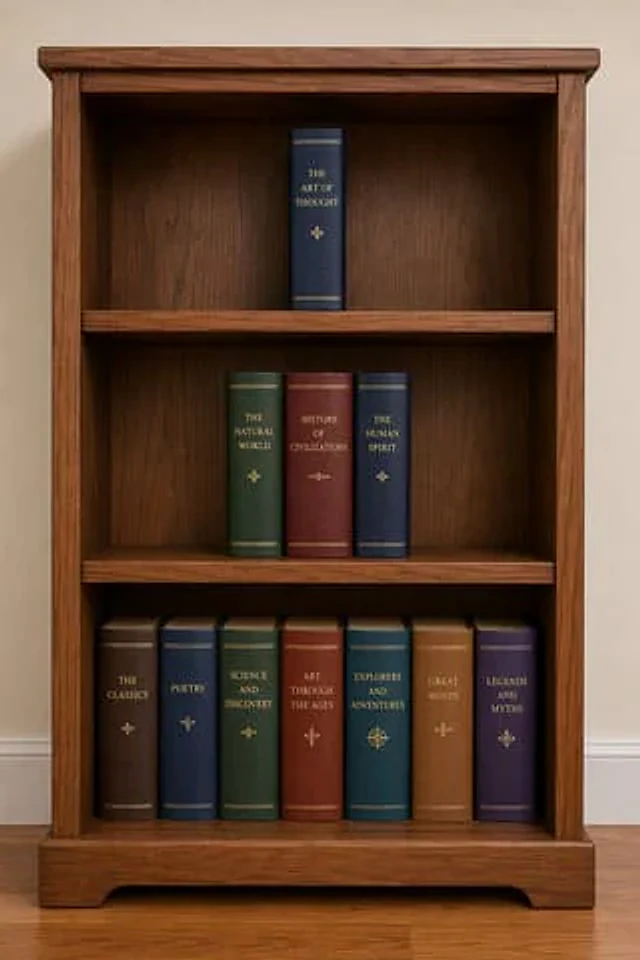

```text
A by{argument name="number of shelves" default="three"} A wooden bookshelf consisting of tiers: the top tier should have{argument name="top shelf count" default="one"} This book, the second layer should have three books, the bottom layer should have{argument name="bottom shelf count" default="seven"} This book.
```

Model: GPT Image 2
Author: GPT Image 2 Prompts

[ProjectD](https://aitoolsradar.com/en/prompts/f04a985235c6e1) · [Recorded source](https://x.com/chetaslua/status/2044331451077013749)
 · [Full original metadata and byte evidence](data/projectd-batch-0022.json)

## Bookshelf Logic and Spatial Reasoning Prompt

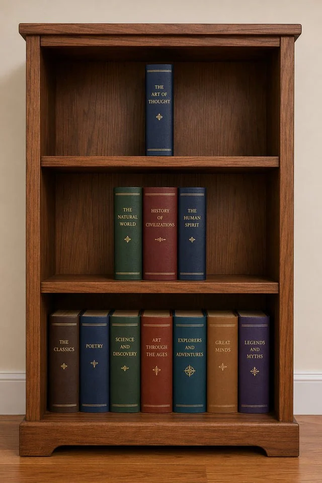

```text
A wooden bookshelf consisting of {argument name="shelf count" default="three"} shelves: On the top shelf, there should be {argument name="top shelf books" default="one"} book, on the second shelf, there should be {argument name="middle shelf books" default="three"} books, and on the bottom shelf, there should be seven books.
```

Model: GPT Image 2
Author: Chetaslua

[ProjectD](https://aitoolsradar.com/en/prompts/97ccf49b2066c3) · [Recorded source](https://youmind.com/prompts/bookshelf-spatial-reasoning-13646)
 · [Full original metadata and byte evidence](data/projectd-batch-0022.json)

## Bookstore Anniversary Poster


```text
Vertical 9:16 warm indie bookstore anniversary poster. Stylized illustrated foreground showing a stacked tower of mismatched books in muted earth tones (terracotta, sage, olive, mustard, cream), each spine slightly different. A small reading lamp warmly illuminates the stack from the upper right, casting a soft glow across the books. Above the stack a serif title "TEN YEARS OF READING" in deep ink black with a thin gold underline. Smaller line beneath reads "thank you for stopping by". Background is a warm beige paper texture. Vertical poster composition. No real bookstore name, no real book titles, no watermark. Premium indie shop poster illustration aesthetic.
```

Model: GPT Image 2
Author: @hiapi_ai

[ProjectD](https://aitoolsradar.com/en/prompts/2ee07b90bf296b) · [Recorded source](https://github.com/HiAPIAI/awesome-gpt-image-2-prompts)
 · [Full original metadata and byte evidence](data/projectd-batch-0022.json)

## Borrowing Arrows with Straw Boats

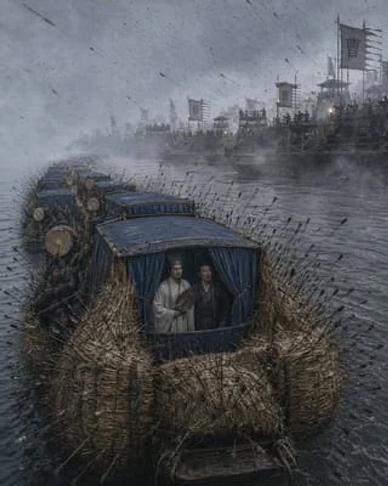

```text
A cinematic historical war scene from the novel *Romance of the Three Kingdoms* depicts the "borrowing arrows with straw boats" maneuver on a wide, gloomy river amidst a raging storm, from a slightly overhead, forward-looking perspective. In the foreground, six long, narrow wooden boats are linked end to end, each tightly wrapped in thick bundles of straw on its sides and bow, forming a rough defensive wall. Hundreds of black-feathered arrows are densely packed into the straw armor, extending in all directions, with more arrows flying diagonally through the storm. The lead boat occupies the center of the image; its cabin is covered with dark blue curtains and a blue ceiling. Inside the foreboard cabin, two ancient Chinese strategists stand calmly, one in a light white robe holding a feather fan, accompanied by a companion in a dark robe. The two appear composed amidst the chaos. To the left of the boat, oarsmen and soldiers in dark ancient costumes are gathered, and several large war drums are visible on the deck. In the background, a massive enemy fleet, shrouded in mist, stretches across the river: dozens of tall wooden warships, watchtowers, and platforms are crammed with soldiers and archers. Multiple military flags bearing the enormous character "Cao" flutter above the fleet, symbolizing Cao Cao's army. The overall atmosphere is austere, low-saturation, and grand, accompanied by dense fog, smoke, rain, surging river water, low-contrast blue-gray tones, and highly detailed and realistic depictions of wet wood, straw, fabrics, and the mist on the river surface. A highly detailed and realistic depiction of an ancient Chinese battlefield, grand in scale, with a somber sense of historical authenticity, presented in a vertical composition.
```

Model: GPT Image 2
Author: GPT Image 2 Prompts

[ProjectD](https://aitoolsradar.com/en/prompts/b66934495683ed) · [Recorded source](https://x.com/Saccc_c/status/2047211498838352177#reversed-3)
 · [Full original metadata and byte evidence](data/projectd-batch-0022.json)

## Borrowing Arrows with Straw Boats


```text
A cinematic historical war scene from Romance of the Three Kingdoms depicting the straw boat borrowing arrows on a wide gray river during a violent rainstorm, viewed from a slightly elevated front angle. In the foreground, a convoy of 6 narrow wooden boats is lashed together in a line, each boat wrapped thickly with dense bundles of straw along the sides and bow, creating rough protective walls. Hundreds of black-feathered arrows are embedded all over the straw armor, sticking out in every direction, with more arrows flying diagonally through the air in heavy wind and rain. The lead boat dominates the frame; its cabin is covered with dark blue fabric curtains and blue roof panels. Standing calmly inside the front cabin are 2 robed ancient Chinese strategists, one in a pale white robe holding a feather fan and one darker-robed companion beside him, both composed and unhurried amid the chaos. Along the left side of the boats are clustered oarsmen and soldiers in dark period clothing, with several large war drums visible on the decks. In the background across the river, a massive enemy river fleet fills the misty distance: dozens of tall wooden warships, watchtowers, and platforms crowded with troops and archers. Multiple military banners bearing the single large Chinese character "曹" rise above the fleet, indicating Cao Cao's forces. The atmosphere is cold, desaturated, and epic, with fog, smoke, rain streaks, rough water, low contrast blue-gray lighting, and highly detailed realistic textures in wet wood, straw, fabric, and river spray. Ultra-detailed, photorealistic ancient Chinese battlefield tableau, dramatic scale, moody historical realism, vertical composition.
```

Model: GPT Image 2
Author: Sac

[ProjectD](https://aitoolsradar.com/en/prompts/a090dbe99f5e53) · [Recorded source](https://youmind.com/prompts/borrowing-arrows-straw-boats-15443)
 · [Full original metadata and byte evidence](data/projectd-batch-0022.json)

## Boston Spring 2026 City Poster

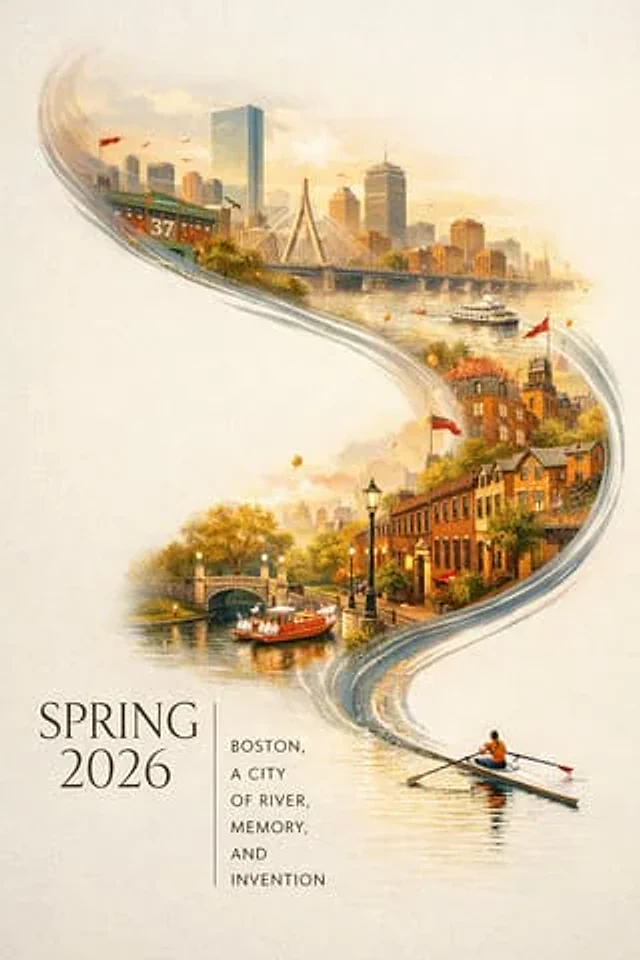

```text
A striking Spring 2026 city poster for Boston with an elegant celebratory mood and a bold contemporary design. On a clean off-white textured background with large areas of negative space, a miniature single sculler rows across the lower right corner of the image on a narrow ribbon of reflective water. The wake from the oar sweeps upward in a dynamic calligraphic curve, gradually transforming into the Charles River and then into a dreamlike hand-painted panorama of Boston. Inside this flowing river-shaped composition are iconic Boston elements: the Back Bay skyline, Beacon Hill brownstones, Acorn Street, Boston Public Garden, Swan Boats, Zakim Bridge, Fenway-inspired details, historic brick architecture, harbor ferries, and the city’s waterfront atmosphere. Soft morning fog, golden spring light, subtle festive accents in crimson and gold, rich detail, layered depth, sophisticated city-poster aesthetics, fresh and refined, visually powerful but not overcrowded. Elegant typography in the lower left reads “SPRING 2026” with a vertical slogan “BOSTON, A CITY OF RIVER, MEMORY, AND INVENTION”, text clear and beautifully composed, premium graphic design, 9:16
```

Model: GPT Image 2
Author: @BubbleBrain

[ProjectD](https://aitoolsradar.com/en/prompts/28a6e4087052c6) · [Recorded source](https://x.com/BubbleBrain/status/2045358053831172358)
 · [Full original metadata and byte evidence](data/projectd-batch-0022.json)

## Botanical Growth Atlas Poster

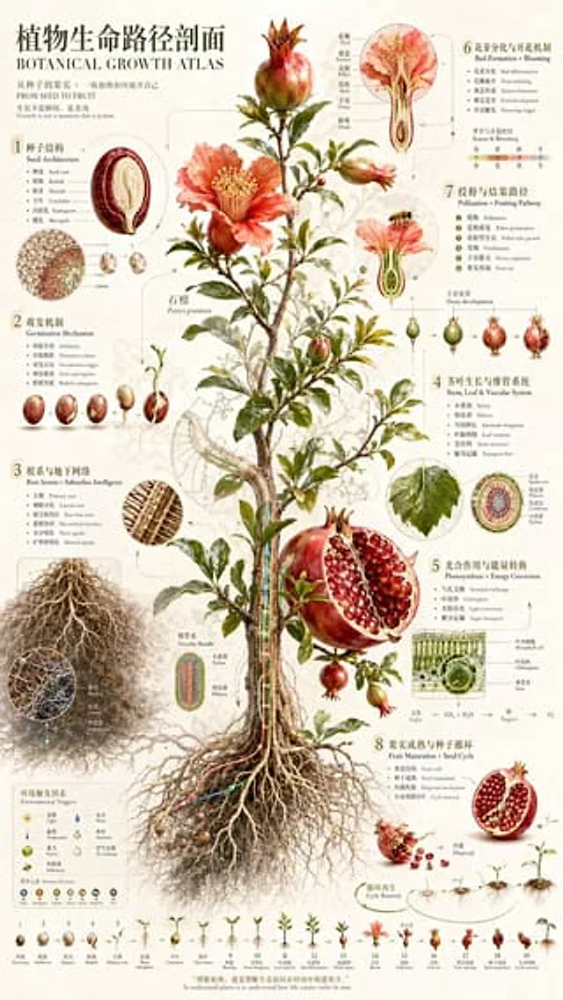

```text
{
  "type": "Plant Science Infographic Poster",
  "style": "Highly detailed antique botanical prints, watercolor and ink natural history illustrations, ivory paper background, elegant educational poster design, fine line annotations, soft sepia labels, museum-quality print.",
  "subject": {
    "primary": "{argument name=\"plant species\" default=\"Pomegranate\"} A display of plants from seed to fruit, including complete roots, stems, branches, leaves, flowers, buds, immature fruits, mature fruits, and fruit cross-sections.",
    "latin_name": "Punica granatum",
    "composition": "The tall, single central specimen occupies most of the page, arranged vertically, and is surrounded by circular and rectangular annotations connected by thin lines and arrows."
  },
  "text": {
    "main_title_cn": "Plant life path profile",
    "main_title_en": "BOTANICAL GROWTH ATLAS",
    "subtitle_cn": "From seed to fruit, how does a plant unfold its journey?",
    "subtitle_en": "FROM SEED TO FRUIT",
    "quote_cn": ""
  },
  "layout": {
    "sections": [
      {
        "title": "1. Seed structure",
        "position": "Top left",
        "count": 3,
        "labels": [
          "Seed cross section",
          "Microseed cell clusters",
          "Two separate small seed views"
        ]
      },
      {
        "title": "2. Germination Mechanism",
        "position": "Top left center",
        "count": 5,
        "labels": [
          "seed",
          "split seeds",
          "Early buds",
          "Sprouting roots",
          "seedling"
        ]
      },
      {
        "title": "3. Root system and underground network",
        "position": "Left center bottom",
        "count": 3,
        "labels": [
          "Complete root system",
          "Close-up of the circular base",
          "Soil microbiome / Network illustration"
        ]
      },
      {
        "title": "4. Stem and leaf growth and vascular system",
        "position": "Right Center",
        "count": 4,
        "labels": [
          "Cross section of stem vascular tissue",
          "Front view of a single leaf",
          "blade internal cross section",
          "Small vascular bundle illustrations"
        ]
      },
      {
        "title": "5. Photosynthesis and Energy Conversion",
        "position": "Right center bottom",
        "count": 3,
        "labels": [
          "Leaf tissue diagram",
          "Chloroplast close-up",
          "Flowchart of the photosynthesis equation"
        ]
      },
      {
        "title": "6 Flower bud differentiation and flowering mechanism",
        "position": "Top right",
        "count": 3,
        "labels": [
          "Longitudinal section of a large flower",
          "Side profile of the flower",
          "Seasonal flowering schedule"
        ]
      },
      {
        "title": "7 Pollination and Result Path",
        "position": "Upper right",
        "count": 5,
        "labels": [
          "Bee pollination",
          "Flower cross section with pollen pathway",
          "Ovary development sequence",
          "Small developing fruit",
          "ripe fruit icon"
        ]
      },
      {
        "title": "8. Fruit ripening and seed cycle",
        "position": "Bottom right",
        "count": 6,
        "labels": [
          "Large open fruit",
          "Small split fruit",
          "Scattered seeds",
          "Seed dispersal sketch",
          "Circularly update seedling sequence",
          "Small, complete fruit stage"
        ]
      },
      {
        "title": "Environmental triggers",
        "position": "Bottom left",
        "count": 6,
        "labels": [
          "illumination",
          "temperature",
          "soil",
          "moisture",
          "nutrient",
          "Air circulation"
        ]
      },
      {
        "title": "Bottom life cycle band",
        "position": "Bottom full width",
        "count": 19,
        "labels": [
          "hibernation",
          "Swelling",
          "repair",
          "germ root",
          "Main root",
          "bud sprouting",
          "seedling",
          "Longleaf",
          "Root extension",
          "Erect stem",
          "bud",
          "flowering",
          "young fruit",
          "Fruit setting",
          "Mature",
          "Cracked fruit",
          "Seeds mature",
          "Seed dispersal",
          "cyclic update"
        ]
      }
    ],
    "centerpiece": "Mature{argument name=\"plant species common name\" default=\"Pomegranate\"} A complete botanical portrait of the tree, showing its exposed root system, numerous coral-red flowers, unopened buds, green young fruits, a single mature fruit at the top, and a large, cut-open fruit on the lower right side of the trunk, revealing a glossy ruby-red seed.",
    "page_elements": {
      "count": 7,
      "labels": [
        "Main bilingual title block",
        "Introducing text blocks",
        "Chapter Number Stamp",
        "Thin dashed line connecting lines",
        "Small arrows between processes",
        "Latin name label near the tree trunk",
        "Bottom Number Development Timeline"
      ]
    }
  },
  "palette": {
    "count": 6,
    "labels": [
      "Ivory-colored parchment",
      "olive green leaves",
      "warm brown branches",
      "Coral red flowers",
      "Ruby-red seeds",
      "Brown text and chart lines"
    ]
  },
  "rendering": {
    "detail": "Extremely high level of detail, precise plant anatomy, realistic textures, transparent watercolor layering, and a clean scientific drawing style.",
    "lighting": "Soft and even studio lighting for illustrations, without harsh shadows.",
    "camera": "Facing the perspective of a flat poster",
    "aspect_ratio": "2:3"
  }
}
```

Model: GPT Image 2
Author: GPT Image 2 Prompts

[ProjectD](https://aitoolsradar.com/en/prompts/535bb90fc37354) · [Recorded source](https://x.com/CellNextIA/status/2047410967680548998#reversed-1)
 · [Full original metadata and byte evidence](data/projectd-batch-0022.json)

## Botanical Plant Dye Canvas Painting

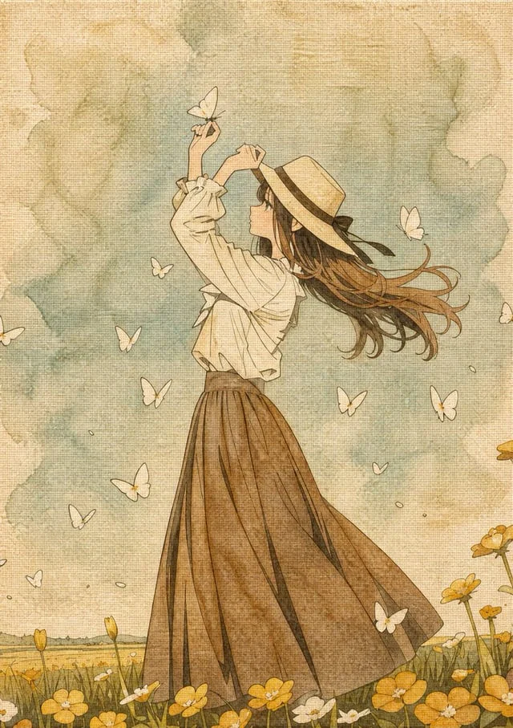

```text
このイラストを{argument name="染料" default="植物染料（葉・茎・花・実・根など）"}で描いた{argument name="素材" default="帆布"}の{argument name="スタイル" default="ボタニカル絵画風"}に変換してください。自然染液の柔らかい滲み、優しい色ムラ、帆布の質感を活かした有機的な表現に。化学的な鮮やかさではなく、植物由来の落ち着いたアースカラーと淡いグラデーションを重視し、温かく穏やかで詩的なボタニカルな雰囲気に。使用した植物自体は描かない。元のイラストの構図・キャラクターは完全に維持。
```

Model: GPT Image 2
Author: のとろ

[ProjectD](https://aitoolsradar.com/en/prompts/e3340ce559b433) · [Recorded source](https://youmind.com/prompts/botanical-plant-dye-canvas-18358)
 · [Full original metadata and byte evidence](data/projectd-batch-0022.json)

## Boxing Impact Chat Screenshot


```text
A realistic screenshot of a Chinese dark mode chat interface on a mobile phone. The style is minimalist and modern, featuring a charcoal black background with ample white space. Near the upper right corner is a rounded, dark gray message bubble containing white Chinese characters.{argument name="message text" default="The moment the boxer was hit"} A large, rounded-corner image is embedded in the lower left corner of the screen. The embedded photo shows the moment a boxer lands a powerful punch on his opponent's face during a professional boxing match. Two shirtless, muscular, and sweaty male boxers are positioned in the ring under the arena lights. The boxer on the right is primarily shown from the back, his right arm fully extended across the frame; his back and shoulder muscles are clearly defined, he has short, dark hair, and tattoos on his arms. He wears a white boxing glove with blue trim and is violently striking the boxer on the left in the face. The boxer on the left is thrown back by the impact, his head swinging to the side, sweat and water droplets splashing around his head. He has large tattoos on his left arm and chest, a black glove raised near his torso, and wears black shorts with the prominent gold lettering "VICTOR" on his belt. The ring ropes are red and white, displaying brand logos such as PBC, against a blurred, dark arena background with a bright sign that reads "RODRIGUEZ VS". This action photo should capture the frozen moment of high-speed motion, with a dramatic, clear, and highly realistic image. Each boxer's face should be covered with a rectangular mosaic blur. Add subtle mobile UI overlay details to the image: a white Chinese "Edit" icon in the lower left corner and a circular share/upload icon in the lower right corner. The overall composition should look like an AI-generated image casually shared in an instant messaging app—simple, believable, and highly realistic.
```

Model: GPT Image 2
Author: GPT Image 2 Prompts

[ProjectD](https://aitoolsradar.com/en/prompts/0aee812b843dc7) · [Recorded source](https://x.com/marslipu/status/2046604182359327055#reversed-3)
 · [Full original metadata and byte evidence](data/projectd-batch-0022.json)

## Boy Celebrates Argentina Goal

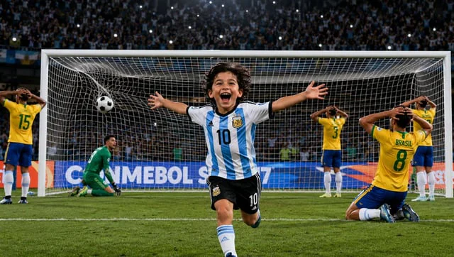

```text
Create a dramatic photorealistic sports news photograph of a young soccer boy suddenly appearing in the foreground of an international Argentina vs Brazil match, celebrating a goal. The camera is low at pitch level, wide horizontal 16:9 composition, focused on the boy running directly toward the viewer from the center of the penalty area with both arms stretched wide in triumph. He wears an {argument name="team jersey" default="Argentina home jersey with sky-blue and white vertical stripes"}, black shorts, white socks with blue bands, and the visible number {argument name="jersey number" default="10"} on the front and shorts. His face is intentionally covered by a plain blurred rectangular censor block, while curly dark hair remains visible. Behind him is a large white soccer goal with taut netting filling the width of the frame; a black-and-white soccer ball is suspended inside the net on the left side, implying a scored goal. Include exactly 5 Brazilian players in yellow shirts, blue shorts, and white socks: 1 standing far left with number 15 and hands on head, 1 goalkeeper in green kneeling near the left goalmouth, 1 standing near center-right with number 3 and hands on head, 1 kneeling in the right foreground with number 8 and “BRASIL” on the back, and 1 partially visible far right with hands on head. The stadium is packed with a dark cheering crowd, many tiny phone lights glowing like stars. Add stadium advertising boards behind the goal, including large white “CONMEBOL” lettering on blue. Use realistic night-match lighting, high shutter-speed action photography, crisp grass texture, emotional World Cup style atmosphere, shallow depth of field, no illustration style, no extra players beyond the listed figures, no watermark.
```

Model: GPT Image 2
Author: 楽園

[ProjectD](https://aitoolsradar.com/en/prompts/e1c283a51bfc0f) · [Recorded source](https://youmind.com/prompts/argentina-brazil-goal-celebration-22608)
 · [Full original metadata and byte evidence](data/projectd-batch-0022.json)

## Brainrot Lecture Hall Projector

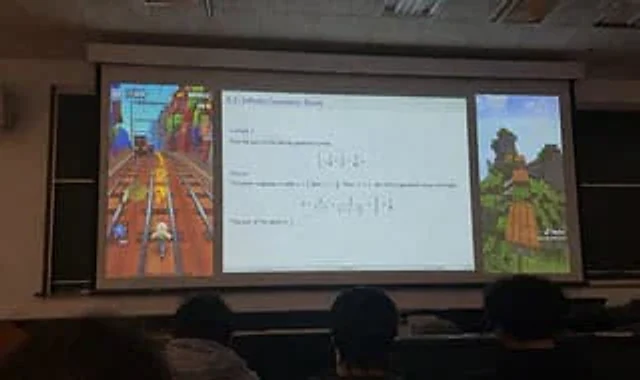

```text
A realistic photograph taken from the dimly lit auditorium of a university lecture hall, the lens passing over the backs of three students in the foreground to look at a huge projection screen. The projection screen is arranged in a layout of three independent vertical panels. The left panel displays vertical {argument name="left game" default="Subway Surfers game screen"} The image shows a character running along railway tracks collecting coins, accompanied by UI elements displaying a score of "001022". A large central panel displays an academic presentation slide titled "{argument name="slide topic" default="9.3: Infinite Geometric Series"} The slide contains the following mathematical text: "Example 3: Find the sum of an infinite geometric series. 1/3 - 1/9 + 1/27 - 1/81 + ... Solution: This series is a geometric series, where a = 1/3 and r = -1/3. Since |r| &lt; 1, the infinite geometric series converges. S = a / (1 - r) = (1/3) / (1 - (-1/3)) = (1/3) / (4/3) = 1/4. The sum of the series is 1/4." (Slide footer displays...){argument name="professor name" default="Dr. Larson"} "、"{argument name="course name" default="Calculus II"} ", "November 14, 2024" and "7/35". The right panel displays vertically.{argument name="right game" default="Minecraft parkour game screen"} The screen displayed floating wooden blocks above a grassy landscape, with a TikTok watermark in the lower right corner. The room had a suspended ceiling, and a blackboard was visible behind the edge of the screen.
```

Model: GPT Image 2
Author: GPT Image 2 Prompts

[ProjectD](https://aitoolsradar.com/en/prompts/4f4dfa72185192) · [Recorded source](https://x.com/AIxHunter17791/status/2045338894657359899#reversed-0)
 · [Full original metadata and byte evidence](data/projectd-batch-0022.json)

## Brand Guide to Ad Concepts UI

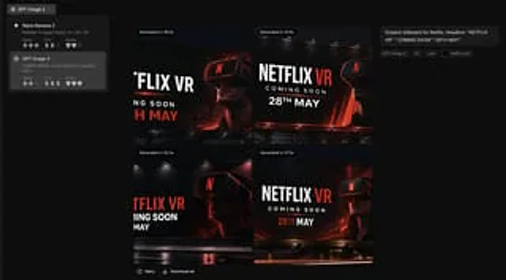

```text
Using the provided reference images as a brand style guide, generate a dark-toned creative application interface, displayed in a 2x2 grid format.{argument name="brand name" default="Netflix"} Four billboard concepts were generated. The precise brand color palette and overall visual identity system from the reference images were applied: a deep black background, red accents, white typography, charcoal gray overlays, and a clean, modern sans-serif font style. The reference images were transformed from a static brand setup page into an image generation results screen. The left sidebar contained a model selector with two model cards, and the main canvas displayed four generated concept thumbnails. Each thumbnail should be a cinematic nighttime outdoor billboard model with dramatic lighting, glossy reflections, and a person wearing a VR headset. Eye-catching billboard copy was used, with the content {argument name="headline text" default="NETFLIX VR"} ,{argument name="subheadline text" default="COMING SOON"} as well as{argument name="date text" default="28TH MAY"} Add small UI labels and descriptions on the right to summarize the prompts, and add generation time badges above the four images. Ensure the final result has the quality of a screenshot from a high-end creative tool used for brand ad brainstorming.
```

Model: GPT Image 2
Author: GPT Image 2 Prompts

[ProjectD](https://aitoolsradar.com/en/prompts/8f4fa2129b0282) · [Recorded source](https://x.com/daftyai/status/2047406551703433635#reversed-0)
 · [Full original metadata and byte evidence](data/projectd-batch-0022.json)

## Brand Kit Design Prompt

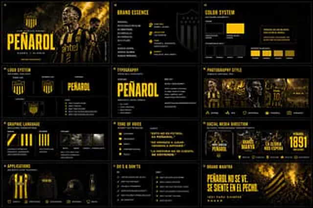

```text
for{argument name="team name" default="PEÑAROL"} Create a brand suite
```

Model: GPT Image 2
Author: GPT Image 2 Prompts

[ProjectD](https://aitoolsradar.com/en/prompts/c65e3c2b96d4d6) · [Recorded source](https://x.com/SantiagoMut/status/2046966588973228302)
 · [Full original metadata and byte evidence](data/projectd-batch-0022.json)

## Brand Kit Design Prompt


```text
for{argument name="company name" default="Curated Supply"} Create a multi-page, multi-image {argument name="brand asset" default="Branded Kits"} Please be sure to include design guidelines and use the accompanying images as references.
```

Model: GPT Image 2
Author: GPT Image 2 Prompts

[ProjectD](https://aitoolsradar.com/en/prompts/72ea979f6337a6) · [Recorded source](https://x.com/justinmfarrugia/status/2047695083160347015)
 · [Full original metadata and byte evidence](data/projectd-batch-0022.json)

## Brand Kit Design Prompt

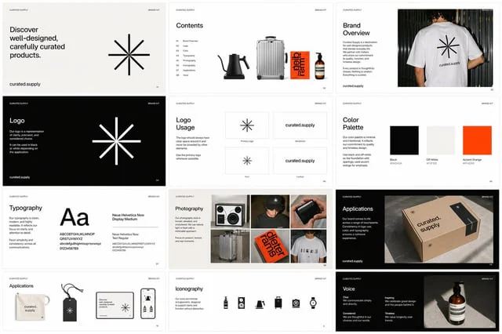

```text
Create a multi-page, multi-image {argument name="brand asset" default="brand kit"} for {argument name="company name" default="Curated Supply"}. Make sure to include guidelines and use attached images as reference.
```

Model: GPT Image 2
Author: Justin Farrugia

[ProjectD](https://aitoolsradar.com/en/prompts/146675939f2dfa) · [Recorded source](https://youmind.com/prompts/brand-kit-guidelines-15522)
 · [Full original metadata and byte evidence](data/projectd-batch-0022.json)

## Brazil Football Fan Fashion Portrait

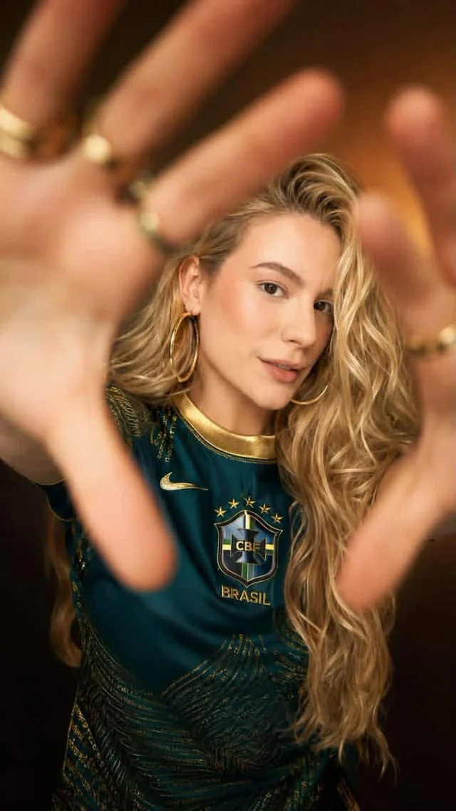

```text
Ultra-realistic editorial fashion portrait of a beautiful young woman wearing a premium Brazil national football team jersey in deep emerald green with luxurious gold accents and crest details. She stands against a warm golden-brown studio background, looking confidently into the camera with a subtle natural smile. Long wavy blonde hair cascades over her shoulders, glowing skin, soft natural makeup, defined cheekbones, and elegant large gold hoop earrings. Creative forced-perspective composition with both hands extended toward the camera lens, fingers forming a heart-shaped frame around her face. Foreground hands intentionally blurred by shallow depth of field while the eyes remain razor sharp and perfectly focused. Warm cinematic lighting, rich golden highlights, creamy bokeh, premium lifestyle photography, fashion campaign aesthetic, luxury sportswear advertisement, realistic skin texture, high-end magazine editorial style, professional full-frame camera, 85mm lens, ultra-detailed, HDR, 8K resolution, vertical composition, masterpiece quality. Ultra-realistic viral football fan portrait, stunning young woman in a luxury Brazil national team jersey, creating a heart shape with her hands toward the camera, intense eye contact, golden stadium-inspired lighting, dramatic depth of field, glowing blonde hair, premium gold jewelry, vibrant Brazil colors, social-media-optimized composition, cinematic sports fashion campaign, luxury FIFA World Cup aesthetic, warm golden bokeh lights, ultra-sharp eyes, shallow depth of field, dynamic perspective, Instagram trending photography, stop-scrolling visual impact, editorial masterpiece, hyper-realistic, 8K, vertical 3:4 ratio. low quality, blurry eyes, distorted hands, extra fingers, bad anatomy, overexposed skin, cartoon, CGI, duplicate limbs, unnatural face, plastic skin, watermark, text, logo artifacts, noise, motion blur, cropped head, out of frame, deformed fingers, unrealistic proportions.
```

Model: GPT Image 2
Author: Jahan Zaib

[ProjectD](https://aitoolsradar.com/en/prompts/0cf8a214204458) · [Recorded source](https://youmind.com/prompts/brazil-football-fan-portrait-25785)
 · [Full original metadata and byte evidence](data/projectd-batch-0022.json)

## Brazil World Cup Sticker Card

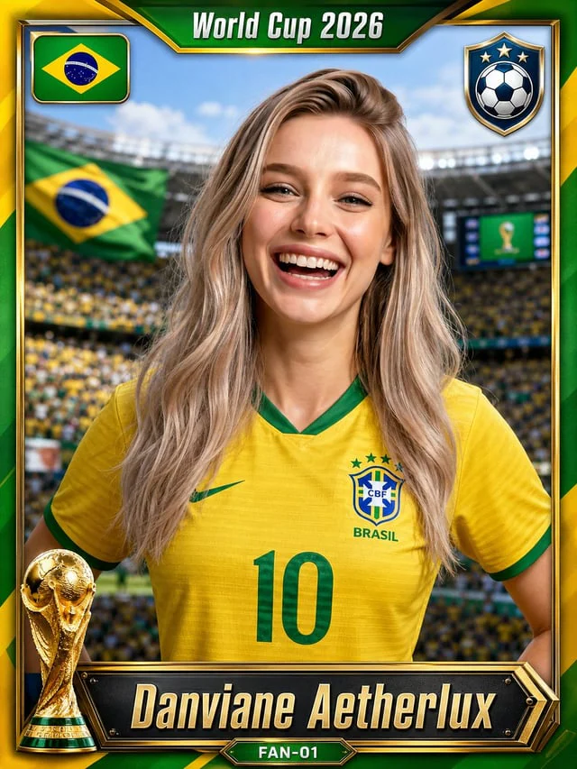

```text
Goal: Create a glossy collectible soccer sticker/card for the {argument name="tournament title" default="World Cup 2026"}, featuring a Brazilian fan/player portrait in a dramatic stadium setting.

Canvas: Vertical 3:4 sports trading-card composition, tightly framed from mid-torso to head, with a premium green-and-gold metallic border inspired by Brazil colors.

Main subject: Center a confident female Brazilian soccer fan/player with long wavy blonde hair, wearing a yellow Brazil national team jersey with green trim. The jersey shows exactly 4 visible markings: a green Nike-style swoosh on the viewer-left chest, a Brazil/CBF crest with stars on the viewer-right chest, the word “BRASIL” beneath the crest, and a large green number “10” centered on the torso. Her face area should be covered by a plain rectangular skin-toned placeholder block, as if anonymized or reserved for a user portrait.

Background: Use a packed soccer stadium with blurred yellow-and-green crowd colors, bright arena lights, blue sky, and depth-of-field blur. Include a large waving Brazil flag on the left side of the stadium background and a distant scoreboard on the right showing a trophy-like icon in green/yellow tones.

Top elements: At the top center, place a dark green beveled nameplate with gold edges containing the white italic text “{argument name="tournament title" default="World Cup 2026"}”. Add exactly 2 top corner badges: on the upper left, a rounded rectangle badge containing the Brazil flag; on the upper right, a shield badge containing a black-and-white soccer ball and three white stars.

Bottom elements: Add a large gold FIFA-style World Cup trophy in the lower-left corner, overlapping the frame. Across the bottom, place a wide black textured metallic nameplate with gold bevels and screws, containing the large gold italic name “{argument name="player name" default="Danviane Aetherlux"}”. Beneath it, add a small green plaque with gold trim reading “{argument name="sticker code" default="FAN-01"}”.

Style: Hyper-realistic sports poster and collectible sticker aesthetic, sharp glossy highlights, embossed metallic gold trim, saturated Brazil green/yellow palette, cinematic lighting, high contrast, polished commercial finish.

Constraints: Keep the exact visible text: “World Cup 2026”, “Danviane Aetherlux”, “FAN-01”, “BRASIL”, and “10”. Use exactly 2 top badges and 1 trophy. Do not add extra logos, watermarks, QR codes, or additional text.
```

Model: GPT Image 2
Author: Vanillier

[ProjectD](https://aitoolsradar.com/en/prompts/60d742192dad6d) · [Recorded source](https://youmind.com/prompts/brazil-world-cup-sticker-25072)
 · [Full original metadata and byte evidence](data/projectd-batch-0022.json)

## Brazilian Culture Themed Street Portrait

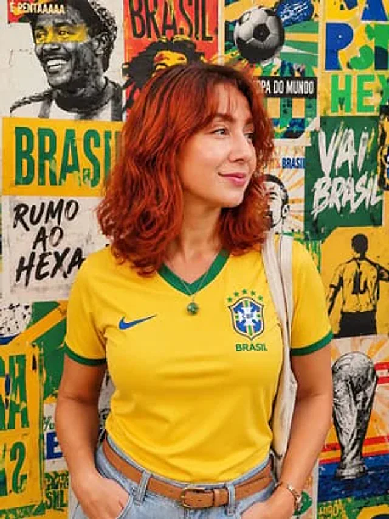

```text
Ultra-realistic street portrait of a {argument name="subject" default="young woman with shoulder-length wavy copper-red hair"}, wearing a {argument name="outfit" default="bright yellow Brazil national football jersey with green trim"}, tucked into light blue high-waisted jeans with a brown leather belt. She stands casually with hands in pockets, looking confidently to the side with a soft smile. {argument name="background" default="Background covered in vibrant vintage Brazilian football posters, graffiti, World Cup artwork, soccer ball graphics, and bold green-yellow-blue typography"}. Warm golden-hour lighting, rich colors, detailed skin texture, shallow depth of field, travel photography style, editorial fashion portrait, ultra-sharp focus, natural candid pose, vibrant Brazilian culture aesthetic, 35mm lens, photorealistic, high detail, cinematic color grading, 8K resolution.
```

Model: GPT Image 2
Author: Sairah

[ProjectD](https://aitoolsradar.com/en/prompts/81c91fc3c2e46f) · [Recorded source](https://youmind.com/prompts/brazil-football-jersey-street-portrait-26128)
 · [Full original metadata and byte evidence](data/projectd-batch-0022.json)

## Brazilian Football Fan at Christ the Redeemer


```text
{argument name="subject" default="Young Brazilian woman"} with shoulder-length dark hair, bright smile, wearing a fitted {argument name="jersey" default="yellow Brazil football jersey"} with green collar and sleeve trim, green athletic shorts, barefoot, sitting confidently on the giant outstretched hand of the {argument name="landmark" default="Christ the Redeemer statue"}, holding a large waving Brazil national flag across her lap, overlooking Rio de Janeiro and the ocean, FIFA World Cup celebration atmosphere, football fan energy, vibrant Brazilian colors, dramatic aerial perspective, golden hour sunlight, wind blowing through her hair, cinematic sports photography, breathtaking height, ultra-realistic details, national pride, travel and football fusion, professional drone shot, dynamic composition, sharp focus, 8K, highly detailed, epic scale, viral social media travel photography.
```

Model: GPT Image 2
Author: Smiling Khan

[ProjectD](https://aitoolsradar.com/en/prompts/79bf57ca42161d) · [Recorded source](https://youmind.com/prompts/brazilian-football-celebration-rio-26247)
 · [Full original metadata and byte evidence](data/projectd-batch-0022.json)

## Breaking News Style Character Art

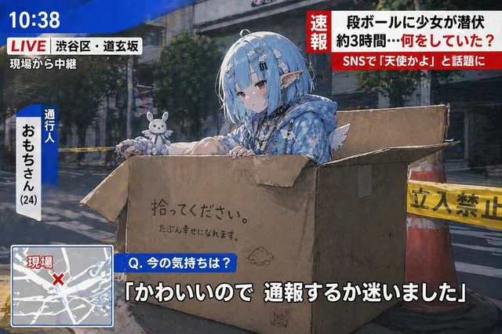

```text
このキャラクターを使って、{argument name="テーマ" default="ニュース速報風"}イラストを描く。 参照する画像はそのまま使用せず、ニュースにあったシチュエーションと構図にする。 テロップ・見出し・現場映像風の構図を含める。 重大そうに見えて内容はどうでもいいものにする。
```

Model: GPT Image 2
Author: Eris Create Lab

[ProjectD](https://aitoolsradar.com/en/prompts/0383e76d44db6a) · [Recorded source](https://youmind.com/prompts/breaking-news-character-illustration-17582)
 · [Full original metadata and byte evidence](data/projectd-batch-0022.json)

## Breathtaking Mountain Road Sunset


```text
A breathtaking mountain road just after rainfall, wet asphalt reflecting the golden sunset, lush green hills covered in mist, dramatic clouds, tiny water droplets on leaves, fresh atmosphere, cinematic lighting, ultra realistic, HDR, peaceful, highly detailed, 8K, DSLR quality, wide-angle landscape photography, no people, natural colors. A stunning sunrise over a crystal-clear lake surrounded by majestic mountains, colorful sky with orange and pink clouds, gentle fog floating above the water, lush green trees, mirror-like reflections, peaceful morning atmosphere, cinematic composition, ultra realistic, HDR, volumetric lighting, 8K, DSLR landscape photography, highly detailed, no people.
```

Model: GPT Image 2
Author: 𝐍𝐚𝐯𝐞𝐞 𝐀𝐢

[ProjectD](https://aitoolsradar.com/en/prompts/152c11a6f8277a) · [Recorded source](https://youmind.com/prompts/mountain-road-sunset-photography-27631)
 · [Full original metadata and byte evidence](data/projectd-batch-0022.json)

## British Magic Academy Graduation Portraits

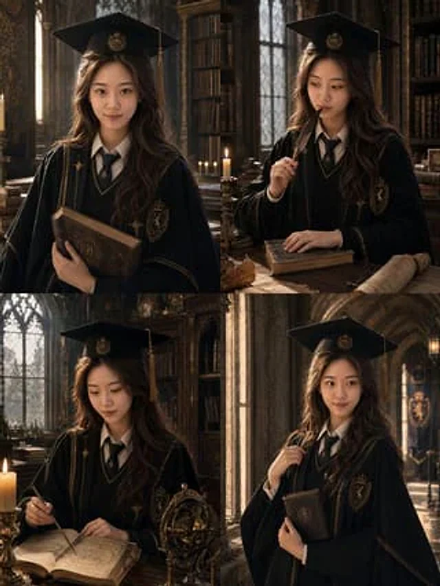

```text
请基于用户上传的 1-3 张清晰个人照片，**一次性生成 4 张不同的单独精修毕业写真照片**，主题为：**「英伦魔法学院毕业写真」**

### 【输出要求】
- 一次性输出 **4 张不同的单独照片**
- 不要做四宫格，不要拼图
- 每张图都是独立成片
- 每张图统一为 **3:4 竖构图**
- 4 张图属于同一组完整写真，人物、服饰、妆造、色彩体系保持统一
- 但每张图的 **表情、动作、姿态、视线、镜头角度、道具互动** 必须明显不同

### 【人物一致性】
请严格保留用户本人真实身份特征，包括：脸型、五官比例、眼睛、鼻子、嘴唇、肤色、年龄感、发型基础、整体气质。4 张图里都必须清楚看起来是 **同一个真实女生**。

### 【整体定位】
毕业 + 学院感 + 魔法世界观。“像刚从英伦魔法学院毕业的优等生，在毕业典礼前后留下的一组纪念肖像。”

### 【服饰要求】
服装请采用 **“学院毕业袍 + 魔法元素”** 的设计逻辑。根据 {argument name="学位等级" default="学士"} 自然区分层级气质。根据 {argument name="学院主配色" default="酒红金"} 统一色彩细节。

### 【帽子设计】
帽子必须保留 **学位帽基础结构**，同时加入克制的魔法学院元素，保留流苏，帽檐可加入学院徽章。

### 【场景与背景】
场景请围绕 **英伦魔法学院** 的世界观展开。请从 {argument name="背景主场景" default="古堡走廊"} 中统一选择一个主要场景。

### 【色彩与光线】
深木色、暗红、墨绿等体系。光线使用窗边冷光 + 烛光暖光混合，具有电影截图感。
```

Model: GPT Image 2
Author: 麻酱AI实验室

[ProjectD](https://aitoolsradar.com/en/prompts/316ae488f24a6f) · [Recorded source](https://youmind.com/prompts/magic-academy-graduation-portraits-20227)
 · [Full original metadata and byte evidence](data/projectd-batch-0022.json)

## Browser Game Ad Creative Poster


```text
以下の文字を必ず入れて、1:1のポスターを作成してください。書籍・講座・イベント告知に使える、プロの広告デザイナーが作ったような高品質な仕上がりにしてください。

広告クリエイティブ制作
思いついたら、もう遊べる。 AI×ブラウザゲームづくりは、マジで楽しい。 むずかしそうで、実ははじめやすい。 コードがわからなくても、はじめの一本は作れる
```

Model: GPT Image 2
Author: @llllegend0620

[ProjectD](https://aitoolsradar.com/en/prompts/47f9d896dfc7dc) · [Recorded source](https://x.com/llllegend0620/status/2045963764466688065)
 · [Full original metadata and byte evidence](data/projectd-batch-0022.json)

## Brutalist Freestyle 角色设定表

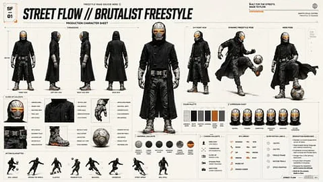

```text
Use the uploaded reference image as the primary character design reference, preserving the overall silhouette, proportions, futuristic apparel layering, helmet geometry, visor shape, stone-like brutalist armor surfaces, black hooded coat, tactical streetwear construction, gloves, boots, utility belt, and monochrome industrial aesthetic.

Create a premium production character sheet for a 2D stylized futuristic freestyle road soccer protagonist inspired by Brutalist architecture, industrial concrete textures, geometric forms, and minimalist sci-fi design language.  The presentation should resemble a AAA game character turnaround sheet mixed with a Nike commercial concept presentation.

The character should feel agile, stylish, confident, athletic, and built for urban freestyle football.  Maintain the concrete-textured helmet with glowing orange visor, oversized hood, tactical long coat, mechanical gauntlets, armored boots, and industrial detailing exactly as the design language.  The football should be integrated naturally into the presentation.  Minimal off-white background (#F7F5F0).

Professional production sheet layout.  Extremely clean linework.  Cinematic concept art.  Premium graphic design.  No photorealism.  High-end stylized illustration.  CHARACTER ANGLES Front View  Neutral hero pose.  Left Side View Right Side View Back View 3/4 Front View Dynamic Freestyle Pose  Standing on one foot while balancing the football.  Hero Pose  Football under foot.  Long coat flowing.  Confident posture.  CLOSE-UP CALLOUTS  Helmet Design  Orange illuminated visor  Concrete brutalist surface  Industrial wear  Panel breakdown  Upper Body  Coat construction  Buckles  Fabric folds  Armor integration  Mechanical Gloves  Finger articulation  Industrial joints  Material breakdown  Utility Belt  Equipment  Fasteners  Soccer accessory pouch  Boot Design  Heavy brutalist geometry  Street football grip  Orange illuminated sole accents  Football Design  Minimal futuristic street football  Concrete-inspired panel graphics  Orange accent details  MATERIAL CALLOUTS  Concrete Composite Armor  Carbon Tactical Fabric  Matte Black Nylon  Industrial Rubber  Forged Titanium Components  Orange Energy Lighting  COLOR PALETTE  Concrete White  Matte Black  Graphite Gray  Charcoal  Burnt Orange Glow  Dark Steel  EXPRESSION SHEET  Neutral  Focused  Competitive  Confident Smile  Game Face  Victory Expression  ACTION SILHOUETTES  Ball Juggle  Around The World  Elastico  Rainbow Flick  Backheel  Crossover  Street Sprint  Ball Stall  CAMERA CALLOUTS  Hero Shot Low Angle  Turnaround Orthographic  Close-up Macro Lens  Dynamic Pose 35mm Tracking Camera  Hero Pose 24mm Cinematic Lens  SFX LABELS  WHOOSH  SWISH  TAP  BOUNCE  THUD  ZIP  SPIN  SKRT  VROOM  RUSH  MUSIC HIT  CROWD CHEER  SLOW MOTION LABELS  120 FPS  240 FPS  Freeze Frame  Motion Trails  Speed Ramping  GUIDELINES  Maintain consistent proportions across all views.  Keep the brutalist design language consistent.  Emphasize concrete-inspired hard surfaces contrasted with flexible tactical fabrics.  Preserve the glowing orange visor as the primary focal point.  Use clean production callouts with arrows and labels.  Include measurement guides, material notes, and design annotations.  Keep presentation minimal and premium.  Avoid clutter.  Professional concept art quality suitable for AAA game development, cinematic production, and advertising pitch decks.  LAYOUT  16:9 Landscape  Top Center: MAIN TITLE STREET FLOW // BRUTALIST FREESTYLE  Below: Production Character Sheet  Center: Large Hero Character  Left: Front • Side • Back Views  Right: 3/4 View • Action Pose • Hero Pose  Bottom: Close-ups • Materials • Color Palette • Equipment • Football Design • Expressions • Camera Notes • SFX • Slow Motion • Production Annotations  Minimal off-white background with subtle grid guides, technical drawing arrows, clean typography, and premium commercial presentation quality.
```

Model: GPT Image 2
Author: @ShamsAmin56

[ProjectD](https://aitoolsradar.com/en/prompts/f554f4dc81505e) · [Recorded source](https://x.com/ShamsAmin56/status/2071590431725670517)
 · [Full original metadata and byte evidence](data/projectd-batch-0022.json)

## Brutalist Technical System Slide

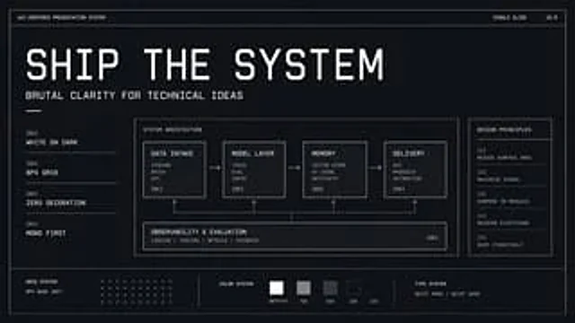

```text
{
  "type": "Extremely Simple Color Presentation Slides",
  "style": "High-contrast, brutalist technical design: black background with subtle deep blue undertones, thin white outlines, no ornamentation, strict grid, preference for monospaced fonts, futuristic industrial UI aesthetics.",
  "canvas": {
    "aspect_ratio": "16:9",
    "background": "Near black with a faint blue undertone and slight vignetting."
  },
  "headline": {
    "text": "{argument name=\"headline text\" default=\"SHIP THE SYSTEM\"}",
    "position": "Top left corner",
    "style": "Large, compact, geometric, sans-serif font, white, all uppercase, wide letter spacing, main title"
  },
  "subheadline": {
    "text": "{argument name=\"subheadline text\" default=\"BRUTAL CLARITY FOR TECHNICAL IDEAS\"}",
    "position": "Below the title",
    "style": "Medium-sized white monospaced font or monospaced sans-serif font, all uppercase."
  },
  "top_bar": {
    "count": 3,
    "items": [
      {
        "text": "xAI Style Presentation System",
        "position": "Top left corner"
      },
      {
        "text": "Single Slide",
        "position": "Top right corner"
      },
      {
        "text": "16:9",
        "position": "Top right corner"
      }
    ]
  },
  "layout": {
    "outer_frame": true,
    "sections": [
      {
        "title": "Left-side principle list",
        "position": "Left sidebar",
        "count": 4,
        "labels": [
          "[01] White on a dark background",
          "[02] 8PX mesh",
          "[03] Zero decoration",
          "[04] Prefer monospace fonts"
        ]
      },
      {
        "title": "System Architecture",
        "position": "Central large panel",
        "count": 5,
        "labels": [
          "Data access",
          "Model layer",
          "Memory",
          "deliver",
          "Observability and Assessment"
        ]
      },
      {
        "title": "Design Principles",
        "position": "Right sidebar panel",
        "count": 5,
        "labels": [
          "[1] Reduce surface area",
          "[2] Maximize signal",
          "[3] Modular combination",
          "[4] Measure everything",
          "[5] Iterative release"
        ]
      },
      {
        "title": "Bottom System Bar",
        "position": "Bottom full width",
        "count": 3,
        "labels": [
          "Grid system",
          "Color System",
          "Font system"
        ]
      }
    ]
  },
  "center_panel": {
    "bordered": true,
    "title": "System Architecture",
    "flow": {
      "count": 4,
      "boxes": [
        {
          "title": "Data access",
          "index": "[01]",
          "lines": [
            "Streaming",
            "Batch processing",
            "API"
          ]
        },
        {
          "title": "Model layer",
          "index": "[02]",
          "lines": [
            "train",
            "Evaluate",
            "reasoning"
          ]
        },
        {
          "title": "Memory",
          "index": "[03]",
          "lines": [
            "Vector storage",
            "KV Cache",
            "workpiece"
          ]
        },
        {
          "title": "deliver",
          "index": "[04]",
          "lines": [
            "API",
            "product",
            "automation"
          ]
        }
      ],
      "connectors": "There are 3 right-pointing arrows between the 4 top boxes."
    },
    "bottom_module": {
      "title": "Observability and Assessment",
      "index": "[05]",
      "lines": [
        "Logs / Tracking / Metrics / Feedback"
      ],
      "connectors": "The dashed feedback line crosses the bottom of the four boxes, and four upward-pointing dotted arrows link back to each of the top boxes."
    }
  },
  "bottom_strip": {
    "left_block": {
      "title": "Grid system",
      "subtitle": "8PX basic unit",
      "visual": "A dense matrix composed of rows of small white plus signs"
    },
    "middle_block": {
      "title": "Color System",
      "swatch_count": 5,
      "swatches": [
        "#FFFFFF",
        "70%",
        "50%",
        "20%",
        "10%"
      ],
      "visual": "Five gray square color blocks ranging from white to dark gray"
    },
    "right_block": {
      "title": "Font system",
      "text": "{argument name=\"type label\" default=\"GEIST MONO / GEIST SANS\"}"
    }
  },
  "composition": "Simple and with ample white space, all elements aligned to an 8px grid, most text left-aligned, thin dividing lines, no images, no gradients except for extremely subtle background depth, resembling a technical presentation cover.",
  "rendering": "Clear vector demo model, ultra-sharp fonts, exquisite design system project."
}
```

Model: GPT Image 2
Author: GPT Image 2 Prompts

[ProjectD](https://aitoolsradar.com/en/prompts/b5dffd93eb4b2b) · [Recorded source](https://x.com/Russell3402/status/2046806087903625331#reversed-3)
 · [Full original metadata and byte evidence](data/projectd-batch-0022.json)

## Brutalist Technical System Slide

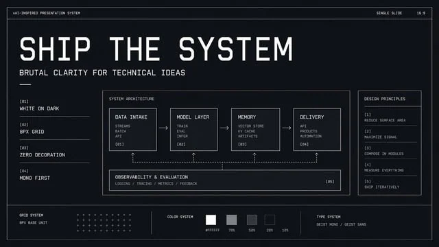

```text
{"type":"minimal monochrome presentation slide","style":"high-contrast brutalist technical design, black background with subtle navy tint, thin white wireframe borders, zero decoration, strict grid, mono-first typography, futuristic industrial UI aesthetic","canvas":{"aspect_ratio":"16:9","background":"near-black with faint blue undertone and slight vignette"},"headline":{"text":"{argument name=\"headline text\" default=\"SHIP THE SYSTEM\"}","position":"upper left","style":"very large condensed geometric techno sans in white, all caps, widely tracked, dominant hero title"},"subheadline":{"text":"{argument name=\"subheadline text\" default=\"BRUTAL CLARITY FOR TECHNICAL IDEAS\"}","position":"below headline","style":"medium white monospace or mono-inspired sans, all caps"},"top_bar":{"count":3,"items":[{"text":"xAI-INSPIRED PRESENTATION SYSTEM","position":"top left"},{"text":"SINGLE SLIDE","position":"top right"},{"text":"16:9","position":"far top right"}]},"layout":{"outer_frame":true,"sections":[{"title":"left principles list","position":"left column","count":4,"labels":["[01] WHITE ON DARK","[02] 8PX GRID","[03] ZERO DECORATION","[04] MONO FIRST"]},{"title":"SYSTEM ARCHITECTURE","position":"center large panel","count":5,"labels":["DATA INTAKE","MODEL LAYER","MEMORY","DELIVERY","OBSERVABILITY & EVALUATION"]},{"title":"DESIGN PRINCIPLES","position":"right sidebar panel","count":5,"labels":["[1] REDUCE SURFACE AREA","[2] MAXIMIZE SIGNAL","[3] COMPOSE IN MODULES","[4] MEASURE EVERYTHING","[5] SHIP ITERATIVELY"]},{"title":"bottom system strip","position":"bottom full width","count":3,"labels":["GRID SYSTEM","COLOR SYSTEM","TYPE SYSTEM"]}]},"center_panel":{"bordered":true,"title":"SYSTEM ARCHITECTURE","flow":{"count":4,"boxes":[{"title":"DATA INTAKE","index":"[01]","lines":["STREAMS","BATCH","API"]},{"title":"MODEL LAYER","index":"[02]","lines":["TRAIN","EVAL","INFER"]},{"title":"MEMORY","index":"[03]","lines":["VECTOR STORE","KV CACHE","ARTIFACTS"]},{"title":"DELIVERY","index":"[04]","lines":["API","PRODUCTS","AUTOMATION"]}],"connectors":"3 right-pointing arrows between the 4 top boxes"},"bottom_module":{"title":"OBSERVABILITY & EVALUATION","index":"[05]","lines":["LOGGING / TRACING / METRICS / FEEDBACK"],"connectors":"dashed feedback line spanning beneath the 4 boxes with 4 upward dotted arrows linking back into each top box"}},"bottom_strip":{"left_block":{"title":"GRID SYSTEM","subtitle":"8PX BASE UNIT","visual":"dense matrix of small white plus signs arranged in rows"},"middle_block":{"title":"COLOR SYSTEM","swatch_count":5,"swatches":["#FFFFFF","70%","50%","20%","10%"],"visual":"five grayscale square swatches from white to very dark gray"},"right_block":{"title":"TYPE SYSTEM","text":"{argument name=\"type label\" default=\"GEIST MONO / GEIST SANS\"}"}},"composition":"clean generous spacing, all elements aligned to an 8px grid, mostly left-aligned text, thin divider lines, no photos, no gradients except extremely subtle background depth, technical pitch-deck cover slide look","rendering":"crisp vector presentation mockup, ultra-sharp typography, polished design system board"}
```

Model: GPT Image 2
Author: Russell

[ProjectD](https://aitoolsradar.com/en/prompts/0f8ae974f2c781) · [Recorded source](https://youmind.com/prompts/brutalist-technical-slide-14872)
 · [Full original metadata and byte evidence](data/projectd-batch-0022.json)

## BubbleBrain #164

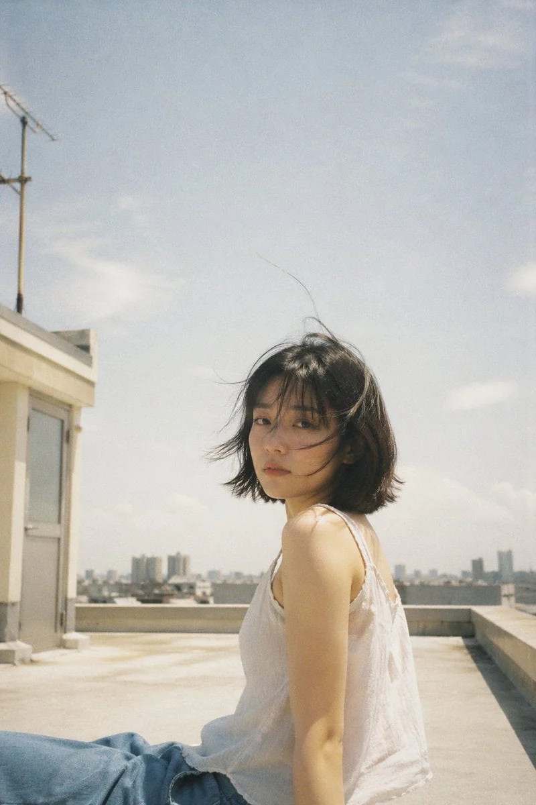

```text
Japanese negative film aesthetic, rooftop summer scene, soft natural sunlight, slight overexposure highlights, low contrast, muted faded colors, subtle grain  subject standing or sitting on rooftop edge area, body relaxed, slight wind moving hair and clothes, looking toward camera with calm distant gaze, not posing  open sky, empty space, minimal elements, imperfect composition, quiet isolated mood, nostalgic and reflective, “memory-like realism” --2:3
```

Model: GPT Image 2
Author: BubbleBrain

[ProjectD](https://aitoolsradar.com/en/prompts/a972fb9501ff66) · [Recorded source](https://x.com/BubbleBrain/status/2047631839406297325)
 · [Full original metadata and byte evidence](data/projectd-batch-0022.json)

## BubbleBrain #242

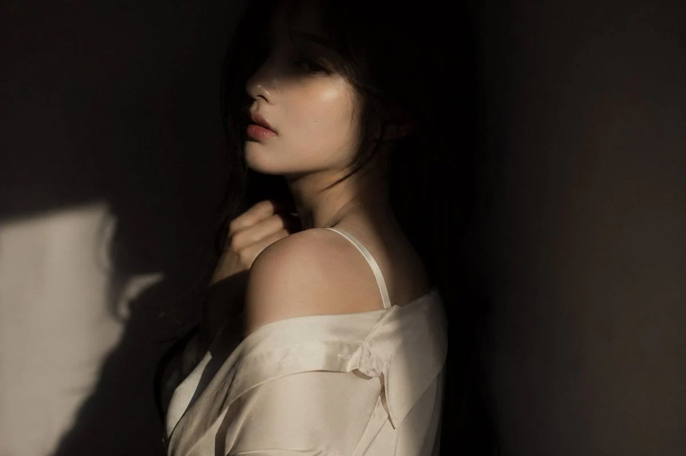

```text
editorial portrait, Korean female idol, subtly sensual  outfit: silk shirt or soft fabric top, slightly loose, elegant and flowing  pose: body slightly turned away, face partially visible, one hand near collar or neck  expression: soft but unreadable, eyes partially hidden  lighting: strong directional light (window light), casting shadows across face and body  background: dark or minimal interior  composition: partial visibility, half-lit face, shadow covering features  mood: mysterious, intimate, quiet tension  style: cinematic editorial, light and shadow storytelling  sensuality: created through concealment and ambiguity --3:2
```

Model: GPT Image 2
Author: BubbleBrain

[ProjectD](https://aitoolsradar.com/en/prompts/34775245492029) · [Recorded source](https://x.com/BubbleBrain/status/2048600232577933720)
 · [Full original metadata and byte evidence](data/projectd-batch-0022.json)

## BubbleBrain #26

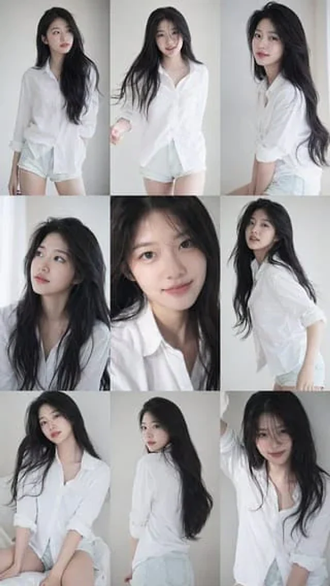

```text
9:16 vertical — a 3x3 grid collage (nine images) forming a Korean idol portrait photoshoot series. Each frame features the same young Korean female idol, maintaining 100% consistency in facial features, proportions, hairstyle, and identity across all nine shots.   Natural, ultra-realistic skin texture, no retouching, no smoothing. Clean idol-style minimal makeup, soft glow, subtle imperfections.   Hair: long, voluminous dark hair, slightly tousled, consistent across all frames (natural loose flow, slight movement).  Outfit: cohesive Korean idol photoshoot styling — white shirt + short bottoms (or simple neutral-toned outfit), youthful, clean, slightly casual but styled. Same outfit across all frames.  Setting: minimal studio or simple indoor environment (plain wall, soft window light, clean background). Focus on subject, not environment.  Lighting: soft diffused natural light, gentle highlights, low contrast, slightly airy tones, subtle film-like softness.  Camera style: intimate portrait photography, slightly handheld feel, subtle imperfections (minor grain, slight blur in motion frames, imperfect framing).  Frame breakdown (3x3 grid):  Top row: - Top left: standing naturally, looking slightly away, relaxed expression - Top center: facing camera, casual mid-motion (hair or body slight movement) - Top right: slight side angle, soft gaze, natural candid feel  Middle row: - Center left: looking slightly upward, soft thoughtful expression - Center: close-up portrait, direct eye contact, gentle idol smile - Center right: turning body slightly, mid-motion candid frame  Bottom row: - Bottom left: seated or leaning casually, relaxed posture - Bottom center: back partially turned, looking over shoulder toward camera - Bottom right: standing close to frame, slightly playful or soft expression  Mood: Korean idol photobook / photocard aesthetic, intimate, soft, natural, everyday charm.  Quality: ultra-realistic, 8K detail, subtle analog film grain, natural imperfections, soft dreamy tone
```

Model: GPT Image 2
Author: BubbleBrain

[ProjectD](https://aitoolsradar.com/en/prompts/6d705ed4f32ae0) · [Recorded source](https://x.com/BubbleBrain/status/2046151898621993364)
 · [Full original metadata and byte evidence](data/projectd-batch-0022.json)

## Buddhist Motif Sci-Fi Cover

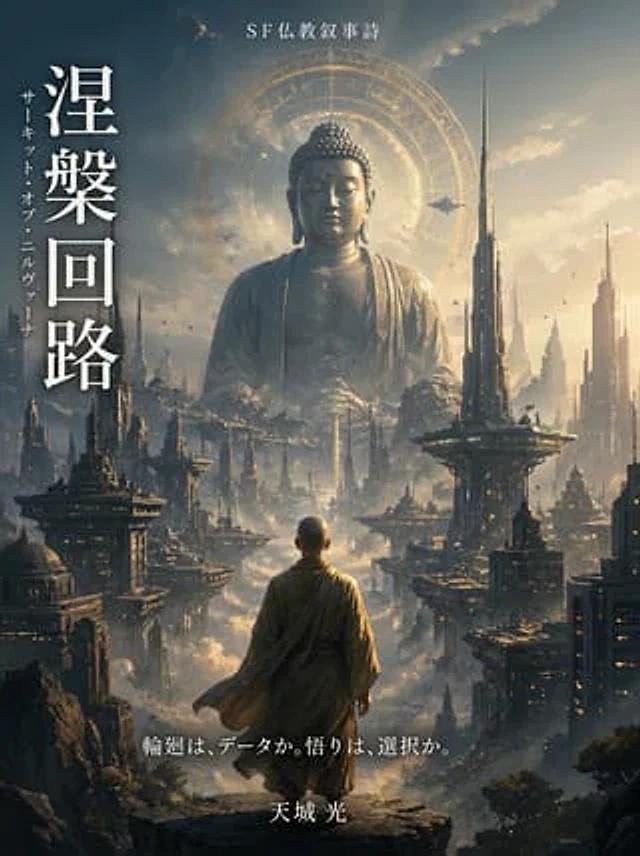

```text
one{argument name="genre" default="Science fiction"} The cover.{argument name="motif" default="Buddhist elements"} .
```

Model: GPT Image 2
Author: GPT Image 2 Prompts

[ProjectD](https://aitoolsradar.com/en/prompts/32d11e5fae4608) · [Recorded source](https://x.com/monaka_mama3/status/2047617143051784393)
 · [Full original metadata and byte evidence](data/projectd-batch-0022.json)

## Burning Red Cliffs Night Battle

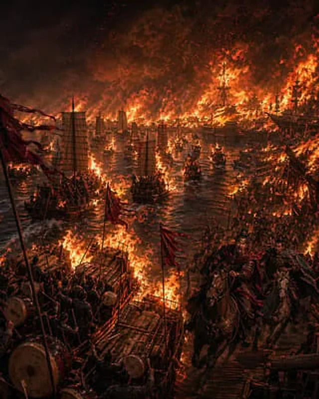

```text
A grand, cinematic historical painting depicts the night of the Battle of Red Cliffs, showcasing the entire ancient Chinese river fleet engulfed in flames. The composition employs a soaring vertical format, viewed from the side of a slightly elevated dock, with the river stretching into the distance towards the center, its surface teeming with burning warships. The lower left corner and central foreground must precisely include three prominent foreground raft-like platforms or deck structures, all made of rough wood and surrounded by flames, with soldiers standing shoulder to shoulder, surrounded by war drums, flagpoles, and red battle flags. The lower right foreground must precisely include two mounted commanders galloping towards the viewer along a wooden dock or bridge: the first rider, clearly visible, wears dark lamellar armor and a deep red cloak billowing in the wind, shouting urgently; the second rider beside him is in shadow and partially obscured. In the mid-ground, dozens of ancient Chinese sailing warships and smaller vessels, many ablaze, showcase traditional hard sails, wooden hulls, siege tower-like superstructures, and collapsed masts. The distant shoreline merges with the fleet into a sea of ​​fire, towering orange flames and dark red smoke filling the sky, countless sparks and ash drifting in the air. The water reflects the lava-like orange glow of the fire, black shadows intertwining between the ships. The scene should be filled with dense details of soldiers, rigging, flags, war drums, weapons, and chaotic battlefield, but the overall visual focus should remain on the fiery river. A deep, dramatic palette of black, ember red, burnt orange, and bronze is employed to create strong, high-contrast firelight, voluminous smoke, an epic scale, ultra-fine textures, dynamism, and the grandeur of a legendary Three Kingdoms scene. The aesthetics of ancient Chinese warfare are depicted in a cold, heroic, catastrophic, and realistic style, devoid of modern elements and text.
```

Model: GPT Image 2
Author: GPT Image 2 Prompts

[ProjectD](https://aitoolsradar.com/en/prompts/80adc7c5e72ea0) · [Recorded source](https://x.com/Saccc_c/status/2047211498838352177#reversed-2)
 · [Full original metadata and byte evidence](data/projectd-batch-0022.json)

## Bursting Soap Bubble Macro Photo


```text
A high-speed macro photograph of a bursting soap bubble, taken in a sunny garden, using a horizontal composition. On the far left of the image, a toddler's profile is shown, revealing their cheek, nose, lips, and partially closed or half-closed eyes, gently blowing on the soap bubble. A large soap bubble is placed on the left side of the frame. The left half of the bubble remains intact, appearing as a smooth, glossy, iridescent sphere with vibrant colors and strong reflective highlights, including bright sunlight spots above and reflections of trees and garden scenery on its surface. The right half of the bubble bursts outward, creating countless tiny droplets, mist, and delicate web-like liquid threads, clearly captured in mid-air and spreading to the right of the image. The dramatic transition between the intact sphere and the bursting spray is emphasized. The photograph was taken using bright direct sunlight, an extremely high shutter speed, sharp macro details, high contrast, saturated colors, and a blurred background of dark green leaves, exhibiting a Kodak Ektar 100 film-like quality. Hyper-realistic, ultra-detailed, freezes dynamic moments, shallow depth of field.
```

Model: GPT Image 2
Author: GPT Image 2 Prompts

[ProjectD](https://aitoolsradar.com/en/prompts/80580e54a2dfa5) · [Recorded source](https://x.com/HarshithLucky3/status/2047605686717346177#reversed-0)
 · [Full original metadata and byte evidence](data/projectd-batch-0022.json)

## Bus Window Film Aesthetic


```text
Japanese negative film aesthetics{argument name="setting" default="Window seats on buses"} Soft sunlight streams in, slightly overexposing the face and window frame with highlights, creating a low-contrast, faded, soft color palette with a delicate grain. The subject leans gently against the window, head slightly tilted, looking directly or softly at the camera with a calm expression and natural posture. Light and shadow flow across the skin, reflecting and distorting through the glass. The imperfect composition evokes a tranquil, floating feeling, a nostalgic, everyday realism style—2:3.
```

Model: GPT Image 2
Author: GPT Image 2 Prompts

[ProjectD](https://aitoolsradar.com/en/prompts/eeab623084ec49) · [Recorded source](https://x.com/BubbleBrain/status/2047594078695518338)
 · [Full original metadata and byte evidence](data/projectd-batch-0022.json)

## Business Online Summit Ad Banner


```text
{
  "type": "Commercial event advertising banners",
  "background": "An abstract blue digital grid with glowing nodes and silhouettes of a modern city.",
  "layout": {
    "header": {
      "catchphrase_top": "Learn the latest trends and take a step towards the future!",
      "main_title": "{argument name=\"main title\" default=\"Business Future Strategy Summit\"}",
      "badge": {
        "shape": "Yellow circle",
        "text": "Free to participate",
        "position": "Top right corner"
      },
      "date_and_location": "{argument name=\"event date\" default=\"The event will be held online on May 16th (Saturday) and 17th (Sunday), 2026.\"}",
      "sub_catchphrases": [
        "You can easily participate from home or the office!",
        "Special lectures by top instructors!"
      ]
    },
    "centerpiece": {
      "description": "A group photo of Japanese office workers dressed in business casual and formal corporate attire.",
      "count": 9
    },
    "topic_banners": {
      "count": 3,
      "style": "Horizontal rectangular ribbon",
      "labels": [
        "{argument name=\"topic 1\" default=\"Latest Applications of DX-AI\"}",
        "{argument name=\"topic 2\" default=\"Marketing strategies in the new era\"}",
        "{argument name=\"topic 3\" default=\"Success stories of business growth\"}"
      ]
    },
    "footer": {
      "call_to_action": {
        "text_lines": [
          "Pre-register now!",
          "Click here to register and watch."
        ],
        "icon": "Right arrow"
      },
      "devices": {
        "count": 2,
        "items": [
          "Laptop displaying 'ONLINE SUMMIT'",
          "Smartphones displaying 'ONLINE SUMMIT'"
        ]
      },
      "qr_code": {
        "count": 1,
        "label": "QR code"
      },
      "bottom_bar": "Please visit the website for details!"
    }
  }
}
```

Model: GPT Image 2
Author: GPT Image 2 Prompts

[ProjectD](https://aitoolsradar.com/en/prompts/92898ca41782d5) · [Recorded source](https://x.com/junchan_sim/status/2046192483680575703#reversed-0)
 · [Full original metadata and byte evidence](data/projectd-batch-0022.json)

## Cafe Phone Camera Food Snapshot


```text
A photorealistic close-up shows a hand holding a modern black smartphone vertically in a sun-drenched, cozy café. The screen displays live view in camera mode, showing a young woman leaning forward at a table, offering an orange plate to the camera. On the plate is a cream-filled pastry or bagel sandwich sprinkled with a mixture of sesame seeds, poppy seeds, and powdered sugar. The woman has shoulder-length dark brown hair, small gold hoop earrings, a light-colored baseball cap with "NYC" printed on it, and a faded pale purple-pink trim crewneck T-shirt with faintly visible vintage lettering. Her face is deliberately obscured by a centrally positioned rectangular blur. The smartphone camera interface is clearly visible: a flash icon in the upper left corner, a target or focus icon in the upper right corner, and five mode labels at the bottom: SLO-MO, VIDEO, PHOTO, PORTRAIT, and PANO, with PHOTO highlighted in yellow; a large white shutter button, a small album thumbnail in the lower left corner, and a camera switching icon in the lower right corner. Outside the phone screen, playful floating food-themed stickers are added: a waffle in the upper left corner, a pink heart sticker with "YUMMY" on the left, a yellow smiley face emoji on the left, and a sticker with "YUMMY" on the upper right.{argument name="sticker text" default="Yummy!"} The camera features a blue speech bubble, a small yellow smiley face on the right, two white twinkling stars in the upper right corner, a silver fork in the lower right corner, and a cherry sticker in the lower right corner. The real-life café background outside the phone's view is soft-focused, showcasing warm wood tones, chairs, tables, and large windows. A red apple and a plate of waffles with berries sit on the right side of the table. The camera emphasizes shallow depth of field, natural sunlight, the glossy reflections of the phone's surface, realistic skin textures, and a trendy social media food-capture aesthetic.
```

Model: GPT Image 2
Author: GPT Image 2 Prompts

[ProjectD](https://aitoolsradar.com/en/prompts/e3ebbcac80f452) · [Recorded source](https://x.com/hazalstark/status/2046677496503169160#reversed-0)
 · [Full original metadata and byte evidence](data/projectd-batch-0022.json)

## Calligraphic City Impression Poster


```text
[Background and Skeletal Lines] A deep black background, with a thick, powerful S-shaped curve reminiscent of traditional Chinese ink calligraphy, meanders through the image. The brushstrokes are vigorous, and the ink tones vary, forming a visual skeleton and narrative flow. [Main Body:]{argument name="subject bird" default="Thrush"} Above the curve, a{argument name="subject bird" default="Thrush"} Wings spread, dominating the visual focus; the body is as transparent as glass, reflecting layers of traditional architecture and flowing blue-green light; the outline is delineated with delicate gold lines. [Midground: Classical architectural sequence] Below the bird's body,{argument name="city" default="Guangzhou"} Multiple scenic spots are scattered along the ink lines: Baiyun Mountain, Chen Clan Academy, and Guangzhou Tower; the main colors are turquoise and light gold, with clear architectural details; kapok flowers and ink-wash clouds add an ethereal sense of layering. [Foreground: White Cranes and Water] Lakeside foreground: Several elegant white cranes; the light blue water shimmers like a mirror, creating a tranquil atmosphere. [Background: Mountains] Distant mountains undulate under the indigo ink wash, transitioning from dark to light, creating a sense of depth. [Composition and Lighting] Non-linear perspective with ink curves as the axis; light radiates outward from the center, forming a strong contrast; predominantly cool colors, accented with warm colors; blending Eastern aesthetics with modern imagery. [Technical Specifications] 8K ultra-high-definition rendering, ultimate detail precision, optimal image quality, and proportions.{argument name="aspect ratio" default="9:16"}
```

Model: GPT Image 2
Author: GPT Image 2 Prompts

[ProjectD](https://aitoolsradar.com/en/prompts/fc73c71c9d4343) · [Recorded source](https://x.com/liyue_ai/status/2045873940883808523)
 · [Full original metadata and byte evidence](data/projectd-batch-0022.json)

## Calligraphic Design with Vibrant Illustration Style


```text
The handwritten calligraphy, arranged vertically, places each word in a balanced line, with stunning highlights in the background. The text outlines itself with exquisite geometric decorations. The background is a beautifully minimalist 2D stencil illustration, vibrant in color and tone.{argument name="colors" default="Purple, orange and white"} It also features a film grain texture and stencil printing effect. The phrase is "{argument name="phrase" default="Be ambitious, let no boundaries limit you"} The overall atmosphere was affected{argument name="style" default="Children&#39;s stories"} Aesthetically, it delivers sharp, clear, and stunningly detailed output.
```

Model: GPT Image 2
Author: GPT Image 2 Prompts

[ProjectD](https://aitoolsradar.com/en/prompts/51a1a69a0171eb) · [Recorded source](https://x.com/aziz4ai/status/2046634089998958774)
 · [Full original metadata and byte evidence](data/projectd-batch-0022.json)

## Calligraphy Copybook Sheet


```text
生成一张【字体】书法临摹字帖
```

Model: GPT Image 2
Author: @MrLarus

[ProjectD](https://aitoolsradar.com/en/prompts/5ed7658f12a042) · [Recorded source](https://x.com/MrLarus/status/2046510310253539764)
 · [Full original metadata and byte evidence](data/projectd-batch-0022.json)

## Camera Exploded View Infographic


```text
{
  "type": "Technical Infographics and Exploded Views",
  "header": {
    "title": "{argument name=\"main title\" default=\"Canon EOS R5 Imaging Atlas\"}",
    "subtitles": [
      "How is an image actually formed?",
      "From Light to Data | FROM PHOTONS TO FILES",
      "A camera is not a shell, but a computational chain."
    ],
    "top_left_box": {
      "title": "EOS R5 Key Specifications",
      "bullet_points_count": 6
    },
    "top_right_images": {
      "count": 2,
      "description": "Front and rear views of the camera body"
    }
  },
  "centerpiece": {
    "description": "Highly detailed{argument name=\"camera model\" default=\"Canon EOS R5\"} 3D exploded view from the camera, showing vertically separated internal components.",
    "components_visible": [
      "Lens mount",
      "Lens element with blue light emission",
      "Image sensor",
      "With light{argument name=\"processor name\" default=\"DIGIC X\"} motherboard of the chip",
      "battery pack",
      "Dual card slots",
      "Electronic viewfinder (EVF)"
    ]
  },
  "layout": {
    "numbered_sections": [
      {
        "number": 1,
        "title": "Optical Entry",
        "elements": [
          "Lens cross-section with light",
          "2 line charts"
        ]
      },
      {
        "number": 2,
        "title": "Aperture, Shutter, and Exposure Control",
        "elements": [
          "3 images of aperture blades",
          "4 sample photos of shutter speeds",
          "Depth of field diagram",
          "Exposure triangle diagram"
        ]
      },
      {
        "number": 3,
        "title": "Focusing system and imaging plane",
        "elements": [
          "Lens alignment diagram",
          "runner's autofocus coverage photo"
        ]
      },
      {
        "number": 4,
        "title": "Sensor and Pixel Architecture",
        "elements": [
          "3D pixel array diagram",
          "Single pixel cross-sectional image",
          "Sensor Specifications",
          "Quantum efficiency diagram"
        ]
      },
      {
        "number": 5,
        "title": "Image stabilization system and mechanical stabilization (IBIS + MECHANICAL STABILIZATION)",
        "elements": [
          "Diagram of sensor displacement mechanism with yaw/pitch/roll axes",
          "Two photos comparing the image stabilization effect."
        ]
      },
      {
        "number": 6,
        "title": "Analog Signal, Analog-to-Digital Conversion and Readout",
        "elements": [
          "Signal Flow Diagram",
          "3 readout timing diagrams",
          "Signal-to-noise ratio diagram",
          "Example photos of the jelly effect in cars"
        ]
      },
      {
        "number": 7,
        "title": "DIGIC X Image Processing Pipeline",
        "elements": [
          "Processing flowchart with central chip as the core",
          "Dynamic range diagram",
          "Tone curve",
          "Histogram"
        ]
      },
      {
        "number": 8,
        "title": "File creation, display, and storage: FILE OUTPUT, PREVIEW, STORAGE",
        "elements": [
          "File output flowchart",
          "2 memory card icons",
          "Document Workflow Diagram"
        ]
      }
    ],
    "bottom_comparisons": {
      "count": 5,
      "labels": [
        "Sensor Size Comparison",
        "Lens focal length and angle of view",
        "ISO and Noise Relationship",
        "Aperture and Depth of Field",
        "RAW vs JPEG"
      ]
    },
    "footer": "{argument name=\"footer quote\" default=\"Light is captured, data is interpreted, images are recorded, and memories are made eternal.\"}"
  },
  "style": "Simple, technically advanced, highly detailed, photorealistic components, blueprint-style annotations, light gray background, and precise typography."
}
```

Model: GPT Image 2
Author: GPT Image 2 Prompts

[ProjectD](https://aitoolsradar.com/en/prompts/776aaa7c055f08) · [Recorded source](https://x.com/hx831126/status/2046448092871041500#reversed-2)
 · [Full original metadata and byte evidence](data/projectd-batch-0022.json)

## Camera Exploded View Infographic


```text
{
  "type": "Technical Infographic",
  "subject": "{argument name=\"subject matter\" default=\"Digital photography process\"}",
  "header": {
    "title": "{argument name=\"main title\" default=\"The Causal Chain of a Photograph\"}",
    "subtitle": "From World to Image"
  },
  "centerpiece": {
    "description": "Isometric exploded view of a modern mirrorless camera",
    "model": "{argument name=\"camera model\" default=\"Canon EOS R5\"}",
    "labeled_parts_count": 12,
    "labeled_parts": [
      "EVF (Electronic Viewfinder)",
      "fuselage structure",
      "Control dial",
      "Heat dissipation design",
      "Optical axis",
      "IBIS In-Body Image Stabilization",
      "shutter assembly",
      "Full-frame sensor",
      "{argument name=\"processor name\" default=\"DIGIC X processor\"}",
      "Main PCB circuit board",
      "High-speed bus",
      "Memory card slot"
    ]
  },
  "layout": {
    "left_column": {
      "description": "Time causality chain",
      "count": 13,
      "steps": [
        "01 Existence in reality",
        "02 Photons Leave the World",
        "03 The lens receives and refracts light.",
        "04. Select the aperture.",
        "05 Shutter Cut-off Time",
        "06 Focus setting priority",
        "07 Sensor Receive Event",
        "08 Light is converted into electric charge",
        "09 Analog Signal Reading",
        "10 A/D Analog-to-Digital Conversion",
        "11 Computational Reconfiguration",
        "12 Image Presentation",
        "13. Memory Retention"
      ]
    },
    "right_column": {
      "title": "Eight modules",
      "count": 8,
      "modules": [
        "1. The Origin of Light",
        "2. The camera shapes reality.",
        "3. Aperture and Shutter Editing World",
        "4. Focus determines sharpness",
        "5. Sensors measure light.",
        "6. Signal Generation and Amplification",
        "7. Calculate and construct the image",
        "8. Documents become memories"
      ]
    },
    "side_diagrams": {
      "count": 7,
      "descriptions": [
        "Light Cone and Imaging",
        "Aperture and Depth of Field",
        "Shutter and motion",
        "Focal plane and sharpness",
        "Pixel structure",
        "Photoelectric conversion",
        "Analog signal waveform"
      ]
    },
    "footer": {
      "count": 5,
      "description": "Key points of philosophical summary"
    }
  },
  "style": "Technical, precise, wireframe elements, luminous data cable, photorealistic camera components, clean layout, bilingual."
}
```

Model: GPT Image 2
Author: GPT Image 2 Prompts

[ProjectD](https://aitoolsradar.com/en/prompts/075ccacdd7ab7e) · [Recorded source](https://x.com/hx831126/status/2046448092871041500#reversed-3)
 · [Full original metadata and byte evidence](data/projectd-batch-0022.json)

## Camera Imaging Technology Infographic


```text
Generate a detailed, multi-section professional science and technology infographic, including one{argument name="subject" default="camera"} The 3D exploded view is presented, and its imaging principle is explained one by one using eight numbered panels.
```

Model: GPT Image 2
Author: GPT Image 2 Prompts

[ProjectD](https://aitoolsradar.com/en/prompts/d3c6de9e97a589) · [Recorded source](https://x.com/Darth_Vaper/status/2046597795214491999)
 · [Full original metadata and byte evidence](data/projectd-batch-0022.json)

## Canadian Citizenship Card Mockup Prompt


```text
Ultra-realistic 16:9 close-up scan of a {argument name="country" default="Canadian"} citizenship card placed on a clean light grey/white background. The card is horizontally aligned, centered in frame, captured in sharp focus with studio lighting.

Design features a modern government-issued ID layout with bilingual English and French text. Top-left includes the {argument name="flag" default="Canadian flag"} with a red maple leaf. Header text reads “{argument name="header" default="CANADA – CANADIAN CITIZENSHIP CARD / CARTE DE CITOYENNETÉ CANADIENNE"}.”

The card includes a passport-style portrait of a young woman: medium-length dark brown hair, center-parted, natural makeup, warm skin tone, neutral expression, direct gaze, subtle freckles, wearing minimal jewelry and a dark top.

Personal details section includes:
– Surname: MARTIN
– Given names: ÉMILIE SOPHIE
– Citizenship number: 1234-5678
– Date of birth: 14 APR 1996
– Place of birth: MONTRÉAL, QC, CANADA
– Issue date: 20 MAY 2024
– Expiry date: 20 MAY 2034

Background design includes intricate guilloche patterns, microprinting, and soft pastel gradients. A large holographic maple leaf occupies the right side with iridescent rainbow reflections.

Additional elements:
– Government of Canada emblem in top-right
– Embedded hologram square with maple leaf security seal
– Fine-line engraving patterns across the surface
– Signature at bottom right (“Émilie S. Martin”)

Lighting is soft and even, highlighting laminated plastic texture, subtle reflections, and security overlays. No hand visible. Clean, minimal, professional composition. Photorealistic, high detail, 8K quality.
```

Model: GPT Image 2
Author: ANKIT PATEL 🇮🇳 | AI

[ProjectD](https://aitoolsradar.com/en/prompts/23d74fce6c2a7b) · [Recorded source](https://youmind.com/prompts/canadian-citizenship-card-mockup-17307)
 · [Full original metadata and byte evidence](data/projectd-batch-0022.json)

## Candid 2026 Japanese Calendar Prompt


```text
[Subject] Create a{argument name="year" default="2026"} Year{argument name="period" default="April to September"} (common{argument name="number of months" default="6"} A Japanese-style calendar (monthly), using the person in the reference image as a model. [Calendar] The background of the calendar section should be white to ensure clarity and readability. [Image] The images are themed around the seasons of each month, simulating amateur photos taken with an iPhone. [Location] Automatically determined by AI based on the season. [Distance] Randomly selected each month: extreme_close, close, bust, mid, far, candid. [Angle] Randomly selected each month: eye, low, high, side, back. [Exposure/Tone] Randomly selected each month: overexp, natural, warm, cool, dark. [Hairstyle] Randomly selected each month: ponytail, bun, down, half-up, messy, wet, short, bob, braid, twin. [Clothing] Automatically determined by AI based on the season. [Noise] Randomly selected each month: low, mid, high, film. [Blur/Focus] Randomly selected each month: sharp, slight, motion blur, soft. [Pose] Randomly selected each month: natural_stand, sitting, walking, phone, wall_lean, crouch, look_back. [Items] One item will be randomly selected each month: none, smartphone, bottled water, coffee, umbrella, bag, towel, script. [Time Period] One item will be randomly selected each month: early_morning, morning, noon, afternoon, evening, night, late_night.
```

Model: GPT Image 2
Author: GPT Image 2 Prompts

[ProjectD](https://aitoolsradar.com/en/prompts/9b68c001ce1ac1) · [Recorded source](https://x.com/eijo_AIart/status/2047239732434977200)
 · [Full original metadata and byte evidence](data/projectd-batch-0022.json)

## Candid Bar Photo with Four Fingers


```text
A realistic smartphone flash shot taken in a crowded bar, using a 3:4 vertical composition. At the center of the image is an attractive adult woman with long, dark brown wavy hair and a light tan complexion, exuding a confident and carefree nightlife vibe, wearing a fitted ribbed white tank top. Her face is mostly turned towards the camera and slightly tilted, presenting a natural, candid pose. Her left hand is close to the lens, clearly showing exactly four fingers, with her thumb tucked in. Her right hand holds a wine glass overflowing with deep red wine, with no visible gap at the top. The composition is a half-body portrait, taken at close range, conveying the feel of a casual iPhone bar shot, with a direct flash effect, realistic skin texture, subtle sheen, strong foreground lighting, and a relatively dark background. Behind her, on a wooden pillar in the upper right, hangs a large round clock, clearly showing 5:00. The bar environment appears busy and authentic, with warm, dim lighting, blurred customers, liquor signs, and subtle party remnants on the bar counter. The photo showcases exactly four types of party debris: empty glasses, used napkins, shards of metal foil, and straws. The background includes several hanging balloons and ribbons, creating a cluttered yet reflective, cozy nightlife atmosphere. The photo possesses a realistic smartphone aesthetic, presenting a casual, candid nightlife feel—slightly messy, with accurate proportions, precise hand and finger details, accurate glass shapes, and accurate clock hands.
```

Model: GPT Image 2
Author: GPT Image 2 Prompts

[ProjectD](https://aitoolsradar.com/en/prompts/0d4ff2a2e26211) · [Recorded source](https://x.com/craftian_keskin/status/2047272172360462549#reversed-0)
 · [Full original metadata and byte evidence](data/projectd-batch-0022.json)

## Candid Classroom Friends Photo


```text
Create a photorealistic candid 35mm film-style snapshot of {argument name="group description" default="four college-age young women"} posing closely together in a sunlit classroom, sitting and leaning around old wooden school desks with metal chairs. The scene contains exactly 4 people: left woman in an open white button-up shirt over a white ribbed tank top, pale blue denim mini skirt, belt, white socks and dark shoes, leaning sideways with one arm raised near her face; second woman in a pink short-sleeve cropped blouse and white pleated skirt, holding up a peace sign; third woman in a pale yellow camisole, open white shirt, dark cropped blazer, black mini skirt, and striped knee socks, raising a playful hand gesture; right woman in an oversized light blue shirt tied at the waist, white tank top, loose dark tie, white pleated skirt with chain belt, white socks and black loafers, kneeling on a chair and giving a peace sign. Make all 4 faces deliberately obscured with soft square blur blocks, as if anonymized. Set the classroom with beige lockers along the back wall, large bright windows on the right, worn wooden desks, scattered personal items including a sticker-covered laptop, compact digital camera, earphones, notebooks, water bottle, sunglasses, tote bags, backpack, and a black thermos. Use natural window light, slight wide-angle perspective, realistic skin tones, casual Japanese youth fashion styling, shallow depth of field, subtle film grain, imperfect candid composition, high-resolution editorial photography. Overall mood: {argument name="mood" default="friendly morning snapshot after a short break"}.
```

Model: GPT Image 2
Author: AI Girl's Photo Studio

[ProjectD](https://aitoolsradar.com/en/prompts/66d65758b04698) · [Recorded source](https://youmind.com/prompts/candid-classroom-friends-photo-18844)
 · [Full original metadata and byte evidence](data/projectd-batch-0022.json)

## Candid Convenience Store Cashier


```text
A beautiful {argument name="nationality" default="young Indonesian woman"} in her early 20s works as a convenience store cashier, wearing a {argument name="uniform" default="typical Seven Eleven uniform (white shirt with green, red, and orange accents, name tag reading “FELISHA,” hair neatly tied back)"}. She stands behind the cashier counter, serving a customer with a friendly and natural expression. On the counter, there is a POS machine, a barcode scanner, and small items such as candy and drinks. Candid moment: the photo is taken discreetly using a smartphone from a customer’s point of view, with slight foreground blur, imperfect framing, and an unposed, spontaneous feel. Lighting comes from bright and evenly distributed convenience store neon lights. Environment: a modern convenience store interior, with neatly arranged shelves of products behind the cashier, creating a clean and well-lit atmosphere. Photography style: photorealistic, candid photography, shallow depth of field, natural skin tones, high detail, slight motion blur for realism, 4K quality. Optional additions for variation: slightly tilted angle smartphone camera noise effect reflections on glass display the {argument name="action" default="cashier smiling gently while handing a receipt or change"}
```

Model: GPT Image 2
Author: Ciri

[ProjectD](https://aitoolsradar.com/en/prompts/8b78ce5ca70ad9) · [Recorded source](https://youmind.com/prompts/candid-convenience-store-cashier-17057)
 · [Full original metadata and byte evidence](data/projectd-batch-0022.json)

## Candid iPhone Everyday Life Snapshot


```text
I want to see what you really look like. Draw a snapshot of your everyday life as if it were {argument name="camera type" default="accidentally taken on an iPhone"}. Make it feel like a very ordinary, imperfect candid shot. The photo should have slight motion blur, with uneven, natural lighting.
```

Model: GPT Image 2
Author: Ciri

[ProjectD](https://aitoolsradar.com/en/prompts/72fb966f10814d) · [Recorded source](https://youmind.com/prompts/iphone-candid-everyday-snapshot-18323)
 · [Full original metadata and byte evidence](data/projectd-batch-0022.json)

## Candid Mall Fashion Portrait


```text
Create a realistic vertical smartphone photo of a fashionable young woman posing indoors at a shopping mall entrance at night, full body from a slightly high angle. She has {argument name="hair color" default="dark brown"} hair tied in a high side ponytail, with her face intentionally covered by a soft rectangular blur for privacy. She wears a crisp oversized {argument name="shirt color" default="white"} button-up shirt tucked into a dark gray black plaid pleated mini skirt, loose white scrunch socks, glossy black loafers, and a pale scrunchie on one wrist. She carries one large shiny black shoulder bag on her left shoulder with small dangling charms and a red ribbon accessory. Her pose is shy and casual: one hand raised near her mouth, the other resting lightly on a shiny metal handrail, legs crossed at the ankles. The setting is an upscale indoor mall corridor with reddish brown tiled flooring, stainless steel railings, glass sliding doors behind her, warm cream lighting, a potted green plant visible through the glass, store displays and signage in the background, and a blue-and-white checkered stripe running across the glass doors. Use natural candid phone-camera realism, warm ambient light, detailed reflections in glass and metal, realistic skin tones, shallow but not extreme depth of field, no studio lighting, no watermark, no extra people as the main subject.
```

Model: GPT Image 2
Author: Mia@JK架空の世界

[ProjectD](https://aitoolsradar.com/en/prompts/8ee7981cf56717) · [Recorded source](https://youmind.com/prompts/mall-fashion-portrait-26060)
 · [Full original metadata and byte evidence](data/projectd-batch-0022.json)

## Candid Subway Commuter Prompt


```text
One{argument name="subject" default="Beautiful woman"} In progress{argument name="location" default="subway"} Looking at{argument name="object" default="Her phone"} A candid photo.
```

Model: GPT Image 2
Author: GPT Image 2 Prompts

[ProjectD](https://aitoolsradar.com/en/prompts/efd07e49d597c8) · [Recorded source](https://x.com/underwoodxie96/status/2046894877112483997)
 · [Full original metadata and byte evidence](data/projectd-batch-0022.json)

## Candid Subway Commuter Prompt


```text
A {argument name="subject" default="beautiful woman"} looking at {argument name="object" default="her phone"} on the {argument name="location" default="subway"}; a candid photo.
```

Model: GPT Image 2
Author: underwood

[ProjectD](https://aitoolsradar.com/en/prompts/28d16c5e9dbc84) · [Recorded source](https://youmind.com/prompts/candid-subway-commuter-14739)
 · [Full original metadata and byte evidence](data/projectd-batch-0022.json)

## Candid Subway Photography Style


```text
One{argument name="subject" default="Beautiful woman"} He was looking down at his phone, in a {argument name="location" default="On the subway"} It is presented in the style of candid photos.
```

Model: GPT Image 2
Author: GPT Image 2 Prompts

[ProjectD](https://aitoolsradar.com/en/prompts/e4b326ea851047) · [Recorded source](https://x.com/AntCaveClub/status/2047136306485133428)
 · [Full original metadata and byte evidence](data/projectd-batch-0022.json)

## Candid Superman Lifting Bus


```text
A real candid street photograph, not cinematic and not glossy, showing {argument name="character name" default="an ordinary young man"} dressed as Superman in a realistic textured blue suit with a red cape and a large red-and-gold S emblem on the chest. He stands in the foreground on a city street, facing the camera with a calm slight smile, short dark hair, trimmed beard, and clear eyeglasses. His right arm is raised straight upward, effortlessly holding up a full-size silver-and-blue city bus with one hand; his fingers wrap around a small dark metal support point underneath the bus, making the bus appear suspended above him. The bus dominates the upper half of the frame, seen from a low angle with its front corner, headlights, license plate, underside, large wheels, and side panels visible. Add pedestrians on the sidewalk in the background reacting with surprise, including a small group watching and one person holding up a phone. Urban downtown setting with tall buildings, storefronts, pavement, curb, and natural daylight. Make it look like an authentic smartphone or documentary photo with realistic lighting, slight wide-angle perspective, natural shadows, imperfect street details, and believable scale. Avoid comic-book style, studio lighting, glossy superhero poster effects, dramatic cinematic color grading, exaggerated muscles, or artificial CGI polish.
```

Model: GPT Image 2
Author: Elsa Ai

[ProjectD](https://aitoolsradar.com/en/prompts/1194bdcb7ba372) · [Recorded source](https://youmind.com/prompts/superman-lifting-city-bus-31429)
 · [Full original metadata and byte evidence](data/projectd-batch-0022.json)

## Candid Train Photo to Studio Portrait


```text
Using the provided reference image, transform this casual train snapshot into a clean, professional studio half-body portrait of the same subject. Remove the headphones, window reflections, table, thermos, books, and all interior or background elements. Adjust the composition from a casual, off-center seated pose to a centered, frontal crop, ensuring the subject looks directly at the camera, against a simple, soft blue-gray studio background. Retain the same hairstyle, shirt and sweater outfit, and overall realistic photographic quality, but relight using soft, even studio lighting and perform refined portrait retouching.
```

Model: GPT Image 2
Author: GPT Image 2 Prompts

[ProjectD](https://aitoolsradar.com/en/prompts/a036d9cbc69a8b) · [Recorded source](https://x.com/vmlcano/status/2047048555622244582#reversed-2)
 · [Full original metadata and byte evidence](data/projectd-batch-0022.json)

## Candid wedding speech photo


```text
iPhone-style snapshots{argument name="speaker" default="The bride gives a speech on the wedding stage."} The future is{argument name="foreground subject" default="The back view of the father sitting at the banquet table below"} .
```

Model: GPT Image 2
Author: GPT Image 2 Prompts

[ProjectD](https://aitoolsradar.com/en/prompts/4c11ab6b2a004f) · [Recorded source](https://x.com/underwoodxie96/status/2047309021875671061)
 · [Full original metadata and byte evidence](data/projectd-batch-0022.json)

## Candid Wine Bar Portrait


```text
A photorealistic candid portrait of a person with {argument name="hair color" default="Golden hair"} Young women, wearing{argument name="outfit" default="Dark brown leather suit jacket"} She sat{argument name="setting" default="Restaurant or bar"} At the table, resting her chin on her hand, with{argument name="expression" default="pursed lips"} Her expression shifted to the side. On the white tablecloth in front of her were two glasses: a large one {argument name="drink" default="wine"} A small glass of water. The background is a bright, modern shelf filled with rows of wine bottles. Warm ambient light, captured by a smartphone.
```

Model: GPT Image 2
Author: GPT Image 2 Prompts

[ProjectD](https://aitoolsradar.com/en/prompts/869c25208ca7d6) · [Recorded source](https://x.com/WolfRiccardo/status/2044564232927076358#reversed-0)
 · [Full original metadata and byte evidence](data/projectd-batch-0022.json)

## Candlelit Luxury Perfume Ad


```text
Create a cinematic luxury perfume advertisement still in a warm, dark, candlelit interior. Show a glamorous {argument name="subject" default="woman"} in close-up from the chest up, positioned slightly left of center, with her face intentionally obscured by a large solid medium-brown rectangular block covering the central upper face area. She has dark wavy hair pinned loosely with strands falling around her neck, wears long sparkling gold chandelier earrings, and a shimmering metallic gold evening dress with pleated sequins and a low neckline. Her right hand is raised near the right side of the frame holding an elegant faceted rectangular glass perfume bottle filled with amber liquid, with a geometric gold cap catching the light. Use {argument name="lighting style" default="golden candlelight"}, shallow depth of field, soft bokeh flames in the background, dark reflective walls, and a sensual high-fashion editorial mood. Add a small white “Pollo.ai” watermark in the top-right corner. Horizontal 16:9 composition, photorealistic, cinematic color grading, rich amber and bronze tones, no extra text.
```

Model: GPT Image 2
Author: Proyecto Hygge

[ProjectD](https://aitoolsradar.com/en/prompts/c4bd6b72dcd8c0) · [Recorded source](https://youmind.com/prompts/candlelit-perfume-ad-23111)
 · [Full original metadata and byte evidence](data/projectd-batch-0022.json)

## Candy Lunar New Year Shrine


```text
This ultra-dense, maximalist fantasy illustration, employing a perfectly symmetrical frontal composition, depicts a candy-themed Lunar New Year shrine scene, rich in color and detail. At the center, a kawaii, doll-like goddess sits cross-legged atop a pile of candy, her posture serene like a lotus flower. Behind her is a massive radiating mandala halo, composed of layered lotus petals and decorative festive patterns in shades of gold, pink, orange, cyan, and neon rainbow. She sports a glossy, dark brown bob with a purple sheen and bangs; her face is porcelain-like, with rosy lips, and her eyes are veiled by a yellow and black warning stripe-like visor or eye patch. Her hair is adorned with oversized candy beads and lollipops, and she wears an extravagantly sculptural gown composed of frosting, sugar needles, bows, hearts, candy pendants, pastel mascot heads, and dripping candy textures. Her hands rest flat on her knees, palms up, her posture solemn and tranquil. Surrounding her is an altar city composed of miniature pagodas, lantern towers, dragons, dolls, candies, toys, and auspicious symbols, all densely arranged in a mirror-symmetrical manner. Each of the four corners contains a large, circular dessert mascot: a smiling pink frosted cupcake in the upper left, a smiling pink macaron with a bow in the upper right, a smiling gingerbread man in the lower left, and a smiling pink sprinkle donut in the lower right. The upper half contains six striking red and gold circular festive signs inscribed with Chinese characters such as "福" (fortune), "旺" (prosperity), "喜" (happiness), and "吉" (good fortune). A magnificent dragon flanks the center, and a beautifully decorated elephant flanks the lower left and right sides, with two gold ingot bowls nearby. Scattered in the background are numerous small doll girls dressed in traditional festive costumes, resembling collectible figurines. The entire foreground is covered with countless colorful gum balls, candies, teddy bears, smiley face candies, lollipops, beads, and toy-like creatures, leaving no blank space. Style: Ultra-high detail, glossy 3D digital art, candy style, pop surrealism, toy-like 3D models, festive altars, Lunar New Year imagery, saturated reds, pinks, oranges and golds, shimmering highlights, sharp focus, intricate textures, full of a festive and sacred atmosphere.
```

Model: GPT Image 2
Author: GPT Image 2 Prompts

[ProjectD](https://aitoolsradar.com/en/prompts/c4e293a7eff9f2) · [Recorded source](https://x.com/Ushizaru_LAB/status/2047203688863945188#reversed-0)
 · [Full original metadata and byte evidence](data/projectd-batch-0022.json)

## Carbon Fiber Typography


```text
{argument name="subject" default="Font design"} Each letter is composed of{argument name="material" default="carbon fiber"} It is woven. It has a realistic feel, strong directional texture, and possesses {argument name="aesthetic" default="Pure high-performance aesthetics"} .
```

Model: GPT Image 2
Author: GPT Image 2 Prompts

[ProjectD](https://aitoolsradar.com/en/prompts/0d703f4a3bfe4a) · [Recorded source](https://x.com/SRKDAN/status/2043871921889001824)
 · [Full original metadata and byte evidence](data/projectd-batch-0022.json)

## Carpe Diem Fashion Typography Poster


```text
Goal: Create a bold editorial fashion poster / magazine cover for a motivational design project, featuring a full-body studio portrait of {argument name="character name" default="Akinbinu Akintayo"} standing confidently in front of oversized typography.

Canvas: Vertical 4:5 poster, bright cyan-blue seamless studio background with a darker blue floor plane and soft vignette/shadowing near the bottom. High-contrast modern layout, cropped poster typography extending off the edges.

Main subject: One tall Black male model, full body, centered slightly right, standing upright with both hands in trouser pockets. He wears a dark olive-green button-up shirt tucked into matching tailored trousers with a black belt and polished black dress shoes. Short curly black hair. Face is intentionally obscured by a vertical soft-blurred rectangular block over the center of the face, while ears, hairline, neck, and outfit remain visible. Studio lighting from upper left, realistic shadows on the floor.

Typography style: Use huge uppercase condensed sans-serif lettering in fluorescent yellow-lime, bold and clean, layered behind and around the figure. Some words are partially hidden by the model or cropped by poster edges. Keep the typography flat, sharp, and poster-like.

Text content: Include exactly 9 visible text blocks: 1) top left small text: "A DESIGN BY AKINBINU AKINTAYO"; 2) top right huge title: "CARPE DIEM"; 3) left middle huge cropped text: "BEC-"; 4) center-right huge cropped text partly behind model: "MING"; 5) left lower-middle small text: "PROJECT BECOMING"; 6) right lower-middle small text: "AKINBINU AKINTAYO"; 7) lower left small text: "EP 27"; 8) center lower huge text: "OMING"; 9) bottom right huge title: "CARPE DIEM". Add two extra small motto lines at the very bottom left as part of the final block area: "MEMENTO MORI" and "MEMENTO VIVERE". Add a small lower-right phrase: "THE TIME IS COMING". The overall poster concept implies the phrase "BECOMING" split across the composition.

Layout: Place the model in the foreground so the typography is partially occluded by his body. The top-right "CARPE DIEM" should dominate the upper half, while another cropped "CARPE DIEM" anchors the bottom-right corner. The left-side "BEC-" should be very large and cropped off the left edge. The word fragments "MING" and "OMING" should appear in the middle and lower center, creating a layered typographic rhythm.

Color palette: Cyan-blue background, neon yellow-lime text, dark olive outfit, black shoes. Minimal colors, clean commercial poster finish.

Constraints: No logos, no watermark, no extra people, no props, no additional text beyond the specified typography. Preserve the bold fashion-editorial look and the intentionally obscured face.
```

Model: GPT Image 2
Author: Alejandro Martinez | IA

[ProjectD](https://aitoolsradar.com/en/prompts/ccab80a3c491a5) · [Recorded source](https://youmind.com/prompts/carpe-diem-fashion-poster-20970)
 · [Full original metadata and byte evidence](data/projectd-batch-0022.json)

## Cartoon Selfie Doodle Illustration


```text
Turn this {argument name="subject" default="real-life selfie"} into a {argument name="style" default="playful hand-drawn cartoon illustration, cute doodle art style"}, top-down selfie perspective, stylish couple wearing black outfits and sunglasses, man with mustache, green plaid cap with bold white text, brown crossbody bag, woman with hair bun, holding ice cream cones, cheerful and cozy summer vibe.

Bright white background filled with colorful doodles: smiling sun, flowers, hearts, stars, leaves, squiggles, clouds, tiny dots, playful hand-drawn decorations surrounding the characters. Soft pastel palette with vibrant accents, children's book illustration style, sticker art aesthetic, whimsical and charming.

Flat vector illustration, clean bold outlines, simplified facial features, rosy cheeks, expressive cartoon eyes, textured brush strokes, vibrant colors, high detail, cute lifestyle artwork, Instagram-friendly illustration, cozy relationship aesthetic, modern doodle poster, joyful mood.

Composition:
- Overhead selfie angle
- Couple centered
- Ice cream cones visible
- Green cap and black sunglasses preserved
- Decorative doodles evenly filling the background
- Clean white canvas

Style references:
cute doodle illustration, Scandinavian children's book art, whimsical sticker design, colorful hand-painted cartoon, playful digital illustration, kawaii aesthetic, modern lifestyle artwork, trending social media illustration.
```

Model: GPT Image 2
Author: Taaruk

[ProjectD](https://aitoolsradar.com/en/prompts/a16a2334bb4d42) · [Recorded source](https://youmind.com/prompts/cartoon-selfie-doodle-illustration-25924)
 · [Full original metadata and byte evidence](data/projectd-batch-0022.json)

## Casual Skincare Vanity Portrait


```text
Use my uploaded portrait only for facial identity and hairstyle. Recreate the uploaded person in a realistic casual indoor snapshot, matching this reference style: standing in a {argument name="setting" default="small bedroom / vanity corner"} with shelves full of skincare bottles, makeup jars, and cosmetics in the background. The person is captured from a slightly high front angle, upper body to thighs, arms raised while tying their hair, head turned slightly downward in a soft side-profile pose. Wear a {argument name="top" default="loose white cropped T-shirt with a cute simple cartoon-style cat graphic"}, {argument name="bottom" default="light blue denim shorts"}, and a bright pink belt. Slim casual summer outfit, natural waist and body proportions, realistic fabric folds. Bright direct-camera flash look, cool white indoor lighting, slightly overexposed skin highlights, phone-camera realism, shallow depth of field, candid personal-photo atmosphere. Keep the face highly recognizable from my uploaded portrait, with realistic skin texture, natural facial structure, real hair details, and no AI-plastic smoothing. Do not make it anime, doll-like, or overly polished. No watermark, no logo, no text.
```

Model: GPT Image 2
Author: Shinning

[ProjectD](https://aitoolsradar.com/en/prompts/13ae00411b476b) · [Recorded source](https://youmind.com/prompts/vanity-corner-skincare-snapshot-22862)
 · [Full original metadata and byte evidence](data/projectd-batch-0022.json)

## Casual Wine Bar Portrait


```text
A realistic-style casual mobile phone photo shows a person with {argument name="hair style and color" default="Golden highlights long hair"} A young woman was sitting{argument name="setting" default="Wine Bar"} She was sitting at the table. She was wearing a {argument name="outfit" default="Dark brown leather suit jacket"} She rested her chin on her right hand, which wore a simple gold ring, and made a gesture {argument name="expression" default="She pouted playfully and looked to the side."} His expression. On the white tablecloth in the foreground lay a water glass and a cup.{argument name="drink" default="Large stemmed glass filled with red wine"} The background features brightly lit modern shelves filled with various wines. The interior lighting is warm and inviting.
```

Model: GPT Image 2
Author: GPT Image 2 Prompts

[ProjectD](https://aitoolsradar.com/en/prompts/522f6ab5d5e9c0) · [Recorded source](https://x.com/sairahul1/status/2044773544094294042#reversed-0)
 · [Full original metadata and byte evidence](data/projectd-batch-0022.json)

## Cat Girl Penguin LINE Sticker Sheet


```text
Goal: Create a cute LINE sticker sheet featuring {argument name="character name" default="a white-haired cat-eared anime girl and a small blue penguin mascot"} in a soft chibi style, with exactly 9 separate sticker illustrations arranged in a 3 by 3 grid on a clean white background.

Canvas: Square 1:1 image, high resolution, lots of white space between stickers, each sticker isolated with no panel borders. Use pastel colors, thick clean outlines, gentle shading, expressive poses, and playful handwritten Japanese sticker text above or near each pose.

Character details: The main girl is a chibi anime cat girl with long fluffy white hair with pale pink tips, white cat ears, blue eyes, a small tail, a blue oversized hoodie, yellow leg warmers, white shoes, and cute hair clips. The mascot is a round navy-blue penguin wearing a matching blue hoodie with a tiny pouch label, orange beak and feet, and simple cheerful expressions.

Text style: Use large rounded handwritten Japanese lettering with colored outlines and drop shadows, matching the mood of each sticker. Keep the text readable and cute.

Sticker layout: Include exactly 9 stickers:
1. Top left: Girl sitting tired and hungry with eyes closed, holding her stomach; penguin offers an empty plate and spoon. Text: {argument name="hungry text" default="はらぺこ..."} in brown.
2. Top center: Girl happily eating a burger while the penguin eats popcorn; small pink hearts around them. Text: {argument name="munching text" default="もぐもぐ"} in orange.
3. Top right: Girl and penguin sitting relaxed with mugs of tea or coffee, eyes closed; cozy rest mood with a steam puff and music note. Text: {argument name="break text" default="休憩中〜"} in green.
4. Middle left: Girl peeking from the left edge holding a vertical sign or pole, penguin peeking from below; shy suspicious mood. Text: 「チラッ」 in gray.
5. Middle center: Girl running away quickly with long hair trailing, motion blur and dust clouds; penguin looks surprised and follows. Text: 「逃げろー！」 in blue.
6. Middle right: Girl getting ready in front of a standing mirror, brushing her hair with sparkles; penguin cheers while holding a brush. Text: 「準備中...」 in yellow-orange.
7. Bottom left: Girl sitting on luggage or a stump and pointing upward energetically; penguin holds a travel map, mountains in the background, sparkles. Text: 「到着っ！」 in red.
8. Bottom center: Girl slumped on the floor looking exhausted and dizzy, with blue vertical stress lines; penguin lies flattened nearby with an ice pack on its head. Text: 「ぐったり」 in blue-gray.
9. Bottom right: Girl bowing apologetically with head down; penguin also bows deeply. Text: {argument name="apology text" default="ぺこり"} in dark gray.

Constraints: Make all 9 stickers consistent in character design and scale, with transparent-sticker-like clean edges on white. Do not add extra characters, extra stickers, UI elements, watermarks, or English text. Keep the composition balanced and suitable for a LINE sticker set preview.
```

Model: GPT Image 2
Author: テツメモ｜AI図解×検証｜Newsletter

[ProjectD](https://aitoolsradar.com/en/prompts/560997ab3a5cbf) · [Recorded source](https://youmind.com/prompts/cat-girl-line-stickers-21962)
 · [Full original metadata and byte evidence](data/projectd-batch-0022.json)

## Cat Livestream UI Mockup


```text
{
  "type": "Screenshot of mobile live streaming app",
  "subject": {
    "description": "A fluffy, adorable tabby cat sits upright, its two front paws resting on a white rectangular sign.",
    "sign_content": {
      "text": "{argument name=\"sign text\" default=\"Thank you, developer Hailey, for the big rocket!\"}",
      "illustrations": [
        "Pink Rocket",
        "Yellow Star",
        "Pink Heart"
      ]
    }
  },
  "background": {
    "setting": "A warm and comfortable room",
    "elements": [
      "Cat reptile",
      "luminous spherical lamp",
      "Cat paw print decoration"
    ],
    "blackboard_text": "{argument name=\"background text\" default=\"Welcome to Kitty&#39;s live stream!\"}"
  },
  "ui_layout": {
    "status_bar": {
      "time": "20:30",
      "battery": "72"
    },
    "header": {
      "host_info": {
        "name": "{argument name=\"host name\" default=\"Kitten&#39;s Live Stream\"}",
        "likes": "1.234 million likes for this match",
        "button": "focus on"
      },
      "rank": "1st place on the hourly leaderboard",
      "viewers": {
        "count": "16,000",
        "avatars_count": 3
      },
      "widgets": [
        "More live streams &gt;",
        "Gift Gallery 24/28 Classic"
      ]
    },
    "gift_notification": {
      "sender": "{argument name=\"gift sender\" default=\"Hailey\"}",
      "action": "deliver{argument name=\"gift name\" default=\"Big Rocket\"}",
      "multiplier": "x1",
      "badge": "True love"
    },
    "chat_box": {
      "message_count": 7,
      "messages": [
        "35 Hailey sent out a giant rocket 🚀 x1",
        "24 Cream Puff: Wow! A giant rocket!",
        "18. Cola with ice: Awesome kitty~",
        "7 dried fish: The kitten is so cute! 😍",
        "12 Clouds: Thank you, Hailey!",
        "30 Strawberry Milkshakes: Let's go! 🚀🚀🚀",
        "User 123456789: Cats sticking together~"
      ]
    },
    "floating_reactions": [
      "Pink Heart",
      "Yellow Heart",
      "Blue Heart",
      "Laughing emoji"
    ],
    "bottom_bar": {
      "input_placeholder": "Say something...",
      "icons_count": 4,
      "icons": [
        "smiley face",
        "Love",
        "gift box",
        "ellipsis"
      ]
    }
  }
}
```

Model: GPT Image 2
Author: GPT Image 2 Prompts

[ProjectD](https://aitoolsradar.com/en/prompts/1d0e3fbe9910e0) · [Recorded source](https://x.com/IndieDevHailey/status/2044797885393609188#reversed-0)
 · [Full original metadata and byte evidence](data/projectd-batch-0022.json)

