# ProjectD backfill batch 23

Complete original prompts and exact existing ProjectD images. Actual model labels and any available credits or notices are retained. Missing authors or license metadata are not filled in.

## Cat to Human Portrait Transformation


```text
Using the provided reference image, transform the cat into a realistic human portrait while maintaining the same languid pose, camera angle, composition, and the same plush turquoise chair background. Inspired by the cat's orange and white markings, translate them into a human appearance: portray a fair-skinned young woman with warm ginger-yellow hair and a soft, serene expression. Have her wear comfortable off-white loungewear: a loose-fitting knitted V-neck sweater and cream-colored drawstring trousers, sitting naturally in a relaxed posture. A photorealistic, soft indoor natural lighting is required, aiming for a magazine-style lifestyle photography feel.
```

Model: GPT Image 2
Author: GPT Image 2 Prompts

[ProjectD](https://aitoolsradar.com/en/prompts/017ca81267642a) · [Recorded source](https://x.com/tunguz/status/2046707703481852106#reversed-1)
 · [Full original metadata and byte evidence](data/projectd-batch-0023.json)

## Cat with Toy Car at Go-Kart Track

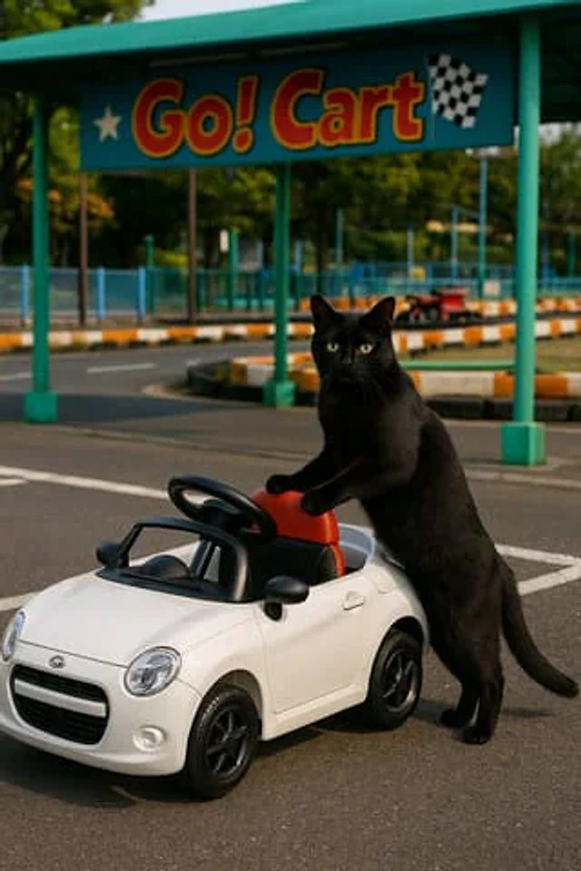

```text
A lifelike photograph shows a{argument name="cat color" default="black"} The cat stands on its hind legs with its front paws on its back.{argument name="seat color" default="red"} The cat sits on the seat of a small, white, convertible toy car. The scene is an outdoor go-kart track with asphalt surface, white markings, and orange and white safety railings. Above the cat and toy car is a cyan canopy structure with a blue sign hanging on it, bearing the words "..." in red and yellow lettering.{argument name="sign text" default="* Go! Cart"} The image is accompanied by a checkered flag pattern. The background has been softened, and trees, a blue fence, and another go-kart in the distance are faintly visible. The image was taken in natural light.
```

Model: GPT Image 2
Author: GPT Image 2 Prompts

[ProjectD](https://aitoolsradar.com/en/prompts/9b6baa34b9c126) · [Recorded source](https://x.com/Kukkuree/status/2043525834640613591#reversed-2)
 · [Full original metadata and byte evidence](data/projectd-batch-0023.json)

## Catgirl Idol Concert Stage

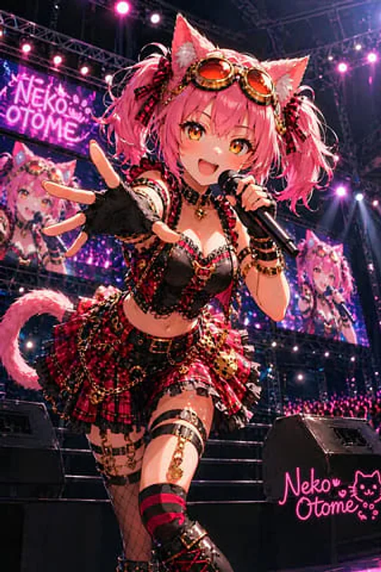

```text
A dynamic illustration of an anime idol concert depicts a female catgirl singer performing on a large stage. Using a dramatic low-angle perspective, she walks towards the camera, one gloved hand extending forward with a strong sense of perspective, while the other holds a black microphone. She has {argument name="hair color" default="Bright pink"} She has twin ponytails, fluffy cat ears on top of her head, and wears orange steampunk goggles adorned with red plaid bows on either side. Her outfit is an elaborate black and red punk idol ensemble, including a black lace-trimmed cropped top, a red plaid ruffled mini skirt, and a plethora of gold chains, heart and bell charms, belts, buckles, garter belts, and layered accessories. Costume details: 1 pair of cat ears, 1 pair of goggles, 2 hair accessory bows, a fingerless glove on her outstretched hand, a microphone, a cropped corset-style top, a plaid skirt, a belt, 2 sets of thigh-high garter belt systems, one leg wearing fishnet stockings, the other wearing red and black striped over-the-knee socks, and a pair of black lace-up boots. A fluffy pink cat tail can also be seen behind her. Her expression should be energetic, playful, and commanding, like a live pop-rock performance. The stage was filled with concert lighting trusses, purple and magenta spotlights, and glowing, blurred light spots. Behind it were steps, and in the foreground were two large black stage monitors and three visible venue screens displaying her live performance from different angles. There were also two visible neon signs with the text {argument name="sign text" default="Neko Otome"} One large screen in the upper left corner and another emitting pink light from a speaker in the front right corner, both adorned with cute cat face icons. Audience members in the lower right corner wave pink glow sticks. The presentation utilizes ultra-refined, exquisite anime rendering to showcase glossy fabrics, metallic highlights, vibrant pink and purple-red lighting, sharp lines, and high contrast.{argument name="idol name" default="Neko Otome"} It created a high-energy atmosphere as if the stadium concert tickets were sold out.
```

Model: GPT Image 2
Author: GPT Image 2 Prompts

[ProjectD](https://aitoolsradar.com/en/prompts/6f492662066b6d) · [Recorded source](https://x.com/Ka2nnAI_NekoOG/status/2047705282919432533#reversed-0)
 · [Full original metadata and byte evidence](data/projectd-batch-0023.json)

## Catgirl Student Council Reference Sheet

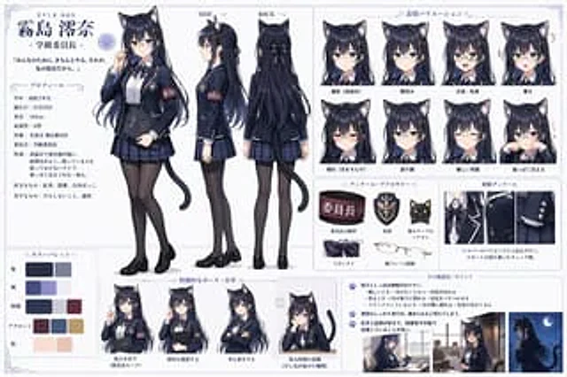

```text
{
  "type": "Anime Character Design Data Collection",
  "style": "Exquisite design sketches in the style of light novels/visual novels, featuring a white background with light purple decorative borders, high-detail cel shadows, an elegant school-themed layout, soft cool-toned lighting, and clean lines.",
  "character": {
    "name": "{argument name=\"character name\" default=\"Kirishima Reina\"}",
    "role": "The serious female class monitor with black cat-like features",
    "age": "Second-year high school students",
    "species traits": [
      "Two black cat ears with soft velvet lining on its head",
      "A long black cat tail"
    ],
    "appearance": {
      "gender presentation": "woman",
      "build": "Slender, elegant, and with moderate curves",
      "height note": "Tall among female students",
      "hair": {
        "color": "{argument name=\"hair color\" default=\"Dark blue-black\"}",
        "style": "Extremely long, straight hair with slightly curled ends, a center parting, long sideburns, and the back half tied into a half-ponytail with a ribbon bow."
      },
      "eyes": {
        "color": "{argument name=\"eye color\" default=\"Golden amber\"}",
        "shape": "Sharp and elegant"
      },
      "expression base": "Calm, intellectual, and reserved"
    },
    "outfit": {
      "count": 9,
      "pieces": [
        "Navy blue school uniform suit with white piping",
        "white shirt",
        "Navy blue and burgundy striped ribbon bow tie",
        "School badge on chest",
        "A red armband with the Japanese word \"Chairman\" printed on it.",
        "Blue plaid pleated skirt",
        "Black semi-transparent tights",
        "Black loafers",
        "Thin gold-rimmed glasses"
      ]
    },
    "props": {
      "count": 1,
      "items": [
        "Dark school folders or notebooks with the school logo"
      ]
    }
  },
  "layout": {
    "format": "Horizontal Character Design Project",
    "sections": [
      {
        "title": "Personal information",
        "position": "Left sidebar",
        "count": 1,
        "labels": [
          "Personal profile text box"
        ]
      },
      {
        "title": "Side/Back",
        "position": "Top center",
        "count": 3,
        "labels": [
          "Front view, full body",
          "Side view of the whole body",
          "Back view of the whole body"
        ]
      },
      {
        "title": "Facial expressions",
        "position": "Top right corner",
        "count": 8,
        "labels": [
          "Usually (seriously)",
          "Smile",
          "Reminders and Blames",
          "surprise",
          "Shy (looks away)",
          "trouble",
          "A gentle smile",
          "Acting cute like a cat"
        ]
      },
      {
        "title": "Details and accessories",
        "position": "Middle right left panel",
        "count": 5,
        "labels": [
          "Chairman's armband",
          "School badge",
          "Cat-themed hair clip",
          "Silk bow tie",
          "Thin-rimmed glasses"
        ]
      },
      {
        "title": "Uniform details",
        "position": "Middle right side panel",
        "count": 3,
        "labels": [
          "Close-up of chest and bow tie",
          "Close-up of waist and suit hem",
          "Close-up of cuffs and buttons"
        ]
      },
      {
        "title": "Color Palette",
        "position": "bottom left corner",
        "count": 5,
        "labels": [
          "hair",
          "Eye",
          "uniform",
          "Accent color",
          "skin"
        ]
      },
      {
        "title": "Signature poses and movements",
        "position": "bottom center",
        "count": 4,
        "labels": [
          "Issuing instructions (Chairman's model)",
          "Check the data",
          "think",
          "A makeup-free moment during a break (a moment of slight relaxation)"
        ]
      },
      {
        "title": "Other settings and key points",
        "position": "bottom right corner",
        "count": 2,
        "labels": [
          "Classroom scene",
          "Moonlit scene"
        ]
      }
    ]
  },
  "text blocks": {
    "headline": "{argument name=\"headline text\" default=\"Kirishima Reina\"}",
    "subheadline": "Squad Leader",
    "quote": "{argument name=\"quote\" default=\"For everyone&#39;s sake, I must strive for perfection. Because that is my duty.\"}",
    "body text": "A densely packed Japanese personal profile, including school year, birthday, height, blood type, club or committee affiliation, personality notes, likes and dislikes."
  },
  "composition notes": [
    "The left side is a full-body shot, showing the person holding a folder with their glasses close to their face.",
    "The center features a rotating image of the character's side and back views.",
    "All portraits and close-ups are neatly framed within pale purple squares with decorative corners.",
    "Close-up of the face cropped at the shoulder.",
    "The small illustration in the bottom right corner shows the characters in a classroom and an outdoor scene under the new moon at night.",
    "The overall color scheme consists of navy blue, black, light purple, white, burgundy, soft gold, and soft skin tone."
  ]
}
```

Model: GPT Image 2
Author: GPT Image 2 Prompts

[ProjectD](https://aitoolsradar.com/en/prompts/645da18431925b) · [Recorded source](https://x.com/nyaa_toraneko/status/2046613894089842710#reversed-0)
 · [Full original metadata and byte evidence](data/projectd-batch-0023.json)

## CCD Camera Flash Korean Idol

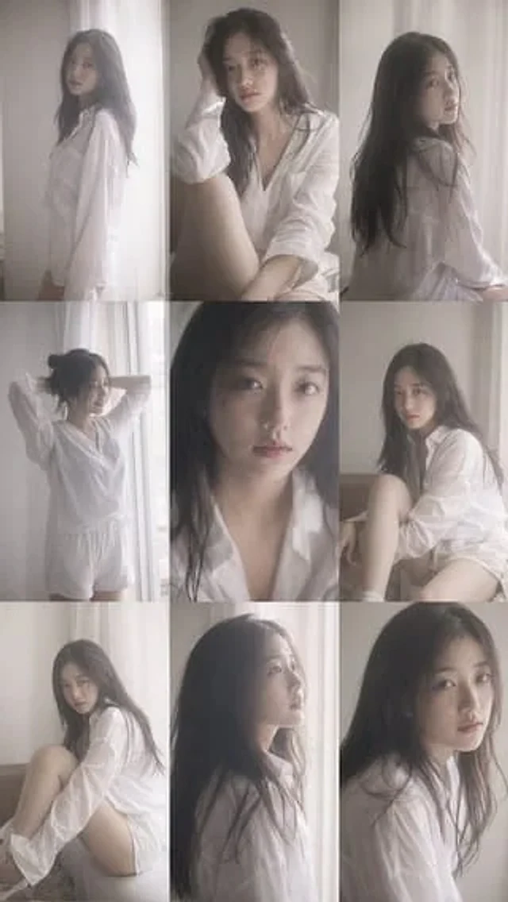

```text
mobile phone photo, old CCD camera aesthetic, harsh flash, grainy, dim messy indoor lighting, candid snapshot feeling, slight motion blur, young Korean female idol, soft innocent look
```

Model: GPT Image 2
Author: @BubbleBrain

[ProjectD](https://aitoolsradar.com/en/prompts/948d88672a63a4) · [Recorded source](https://x.com/BubbleBrain/status/2046190539213885806)
 · [Full original metadata and byte evidence](data/projectd-batch-0023.json)

## CCTV Security Camera Footage


```text
A grainy, black-and-white CCTV security surveillance still image with poor quality; the image shows a {argument name="subject" default="The classic gray alien with a large head and a thin body"} Standing{argument name="setting" default="A deserted gas station late at night"} Next to the gas pump. The gas pump's top awning is printed with "UNLEADED," and there's a large number "2" on the side. A digital timestamp is overlaid in the lower left corner, displaying "...".{argument name="camera label" default="CAM 2"} "{argument name="date" default="OCT 27 2004"} The text includes phrases like "12:04:16 AM" and "12:04:16 AM," with a retro pixelated font. The overall visual effect presents the texture of a real early 21st-century surveillance video, with strong noise, low contrast, and VHS-style artifacts.
```

Model: GPT Image 2
Author: GPT Image 2 Prompts

[ProjectD](https://aitoolsradar.com/en/prompts/723a87a815f6ca) · [Recorded source](https://x.com/o_tal_do_ken/status/2045987847790886956#reversed-0)
 · [Full original metadata and byte evidence](data/projectd-batch-0023.json)

## Celebrity Crossover Style

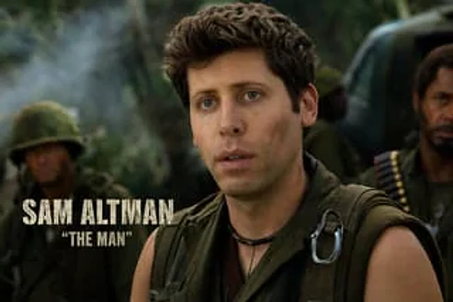

```text
{argument name="subject" default="Sam Altman"} look like{argument name="movie" default="tropical thunder"} Movie protagonist
```

Model: GPT Image 2
Author: GPT Image 2 Prompts

[ProjectD](https://aitoolsradar.com/en/prompts/fa2d67cfd4f5b3) · [Recorded source](https://x.com/Conor_D_Dart/status/2044362511047065886)
 · [Full original metadata and byte evidence](data/projectd-batch-0023.json)

## Celebrity Fast Food Worker Candid


```text
A realistic snapshot shows{argument name="person" default="Sam Altman"} exist{argument name="restaurant brand" default="McDonald's"} A scene of him working behind the restaurant counter. He was wearing a dark gray short-sleeved T-shirt, a black apron with a yellow suspender and the restaurant's logo, and a badge that read "..."{argument name="nametag text" default="Sam"} He wore a white name tag with the word "..." on it. He looked slightly tired but focused, holding a {argument name="held item" default="A box of red-packaged French fries"} Extend your right hand forward, ready to hand it to the customer.{argument name="served item" default="A white beverage cup with a straw"} The background is a realistic, slightly blurred fast-food restaurant kitchen environment, including stainless steel counters, fryer areas flashing under warm lights, digital ordering screens, cash registers, and another employee working in the distance. The lighting is typical indoor fluorescent lighting, giving the scene a documentary-like, everyday feel.
```

Model: GPT Image 2
Author: GPT Image 2 Prompts

[ProjectD](https://aitoolsradar.com/en/prompts/ef15f1b4da4856) · [Recorded source](https://x.com/eiiiis/status/2044546294383845422#reversed-0)
 · [Full original metadata and byte evidence](data/projectd-batch-0023.json)

## Celebrity Livestream Concept


```text
{argument name="celebrity" default="selena gomez"} It started a surprise{argument name="platform" default="youtube"} live streaming.
```

Model: GPT Image 2
Author: GPT Image 2 Prompts

[ProjectD](https://aitoolsradar.com/en/prompts/c7d2ab5af9529e) · [Recorded source](https://x.com/SelenaGmzIN/status/2047185882009198865)
 · [Full original metadata and byte evidence](data/projectd-batch-0023.json)

## Celebrity Livestream Concept


```text
{argument name="celebrity" default="selena gomez"} started a surprise {argument name="platform" default="youtube"} livestream.
```

Model: GPT Image 2
Author: Selena Gomez India

[ProjectD](https://aitoolsradar.com/en/prompts/b59341d9666801) · [Recorded source](https://youmind.com/prompts/celebrity-surprise-livestream-15175)
 · [Full original metadata and byte evidence](data/projectd-batch-0023.json)

## Celestial Anime Fantasy Movie Poster

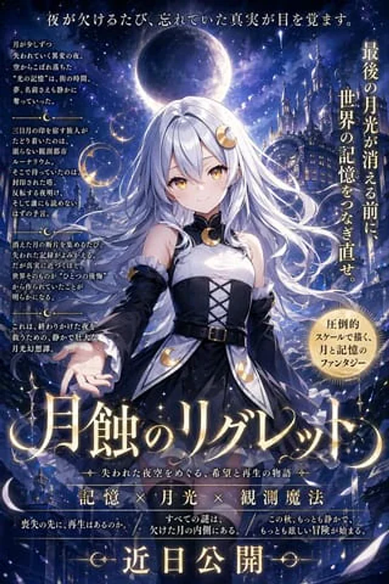

```text
A dramatically compelling Japanese fantasy anime movie poster, presented vertically as a single image. At the center of the image is a beautiful young woman with long, flowing silver-white hair, sparkling golden eyes, and a calm yet captivating smile, extending a hand to the viewer. She wears a black and white starry-sky dress with a fitted bodice, white embellishments on the chest, black ribbon ties at the front, black two-piece sleeves with soft white ruffles, a black belt at the waist, and three golden crescent moon decorations adorning the multi-layered skirt. Around her neck is a black choker with a golden crescent moon pendant. A golden crescent moon hair clip is also tucked near her bangs. The background is a brilliant night sky, dotted with stars and nebula-like clouds, with a huge lunar eclipse halo hanging overhead, and three floating crescent moon halos surrounding her left side of her hair. The background showcases a magnificent fantasy city with towering Gothic palaces, spires, observatory-like structures, and shimmering windows, all bathed in the cool moonlight. The overall design employs a rich palette of deep indigo, violet, midnight blue, silver, and gold, accented with glitter, magical particles, rim lighting, and glossy highlights, creating a textured, modern anime-style poster effect. It's designed as a fully formatted Japanese movie poster, using elegant gold and white serif fonts. The Japanese title is placed centered at the top.{argument name="headline text" default="Each time the night fades, forgotten truths awaken."} On the right, a large, gold-lettered Japanese slogan is displayed vertically:{argument name="right-side tagline" default="Reconnect the world&#39;s memories before the last moonlight fades."} On the left, four stacked blocks of Japanese text are arranged, separated by decorative dividing lines and crescent patterns. A circular gold promotional badge containing Japanese promotional text is added in the lower right corner. At the bottom center of the image, a large, illuminated Japanese title is placed in a luxurious gold and white font.{argument name="movie title" default="Lunar Eclipse Regret"} Add a centered Japanese subtitle below the movie title. Below that, place a horizontal feature line containing three Japanese phrases separated by gold symbols: "Memory," "Moonlight," and "Observational Magic." At the very bottom, place a short Japanese trailer text on each side, and below that, place a large, glowing release date centered.{argument name="release text" default="Coming Soon"} The overall atmosphere is epic, melancholic, magical, ethereal, and nostalgic, presenting the quality of a high-budget fantasy animated film poster.
```

Model: GPT Image 2
Author: GPT Image 2 Prompts

[ProjectD](https://aitoolsradar.com/en/prompts/0c8e16db214df2) · [Recorded source](https://x.com/wing_sky_nine/status/2046699001886756866#reversed-0)
 · [Full original metadata and byte evidence](data/projectd-batch-0023.json)

## Celestial Dynasty World Bible Board

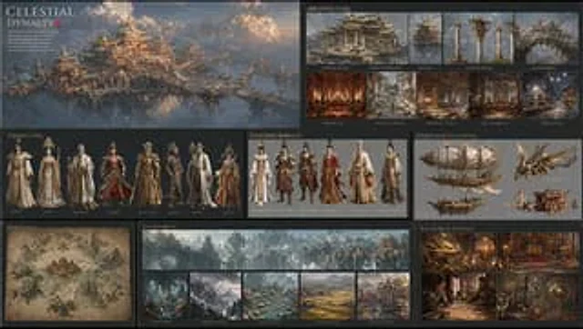

```text
Using REFERENCE_0 as the visual foundation, the single celestial palace scene is expanded into a complete cinematic fantasy civilization worldview presentation. Maintaining the same East Asian celestial design language, floating cloud architecture, gilded decorations, warm sunset lighting, and ultra-refined realistic concept art style, it is presented as a multi-pane Lore project with elegant typography on a dark background. It includes 8 labeled panels: 1 large main visual overview panel for the civilization, 1 architecture panel with 9 images, 1 character panel with 7 full-body character designs, 1 clothing and armor panel with 6 clothing variations, 1 vehicle and transportation panel with 4 vehicle designs, 1 world map panel with 1 illustrated map, 1 environment panel with 6 environmental images, and 1 culture and detail panel with 6 close-up detail images. A sophisticated fantasy title and a brief introduction to the civilization's background are added, using the name {argument name="civilization name" default="Celestial Dynasty"} The Architecture panel should showcase nine different projects: palaces, temples, gates, pillars, bridges, halls, gardens, libraries, and observatories. The Characters panel should showcase seven archetypes: Emperor, Empress, High Priest, General, Royal Guard, Scholar, and Craftsman. The Costumes &amp; Armor panel should showcase six designs: formal attire, armor, noble attire, priestly robes, craftsman's clothing, and dancer's costumes. The Vehicles &amp; Transportation panel should showcase four designs: airships, flying mounts, chariots, and ceremonial palanquins. The Environment panel should showcase six scenes: a wide horizontal panorama plus five smaller locations, including forests, mountains, lotus valleys, golden fields, and skyports. The Culture &amp; Details panel should showcase six images: dragon motifs, lanterns or artifacts, palace interiors, academic scenes, mechanical instruments, and decorative symbols. All panels should maintain visual consistency, as if drawn from the same official world-building collection, featuring extremely rich detail, believable material design, and cinematic realism.
```

Model: GPT Image 2
Author: GPT Image 2 Prompts

[ProjectD](https://aitoolsradar.com/en/prompts/d55ecb9954b539) · [Recorded source](https://x.com/john87445528/status/2047120487575064812#reversed-1)
 · [Full original metadata and byte evidence](data/projectd-batch-0023.json)

## Celestial Jade Palace Lake


```text
Create a wide cinematic fantasy landscape of an ethereal Chinese celestial palace floating over a perfectly still turquoise lake, with low-to-moderate color saturation and a dreamy refined atmosphere. Center the composition on an enormous white jade and pale aqua ceremonial gateway with ornate East Asian tiled roofs, upturned eaves, carved pillars, hanging lanterns, and a huge circular moon-gate ring decorated with floral reliefs and a large lotus ornament at the top. A long glossy marble bridge leads from the foreground to the gateway in strong one-point perspective, reflecting the sky and architecture like wet glass. Place exactly 2 slender robed figures on the bridge, seen from behind, wearing flowing {argument name="robe color" default="pale blue-white hanfu"} with long dark hair, walking toward the palace. Surround the bridge with calm water, large lily pads, and lotus flowers; include exactly 2 prominent glowing pink lotus blossoms in the foreground, one at bottom left and one at bottom right, plus smaller lotus details near the bridge. In the distance, add multiple floating islands and pagoda pavilions mirrored in the water, with misty mountains and cloud banks. Use a bright blue sky filled with towering soft cumulus clouds, warm sunlight, delicate haze, high-detail fantasy concept art rendering, symmetrical composition, ultra-wide 16:9 aspect ratio, serene immortal-realm mood, no text, no watermark, no modern objects.
```

Model: GPT Image 2
Author: 李岳

[ProjectD](https://aitoolsradar.com/en/prompts/d8e241960c3917) · [Recorded source](https://youmind.com/prompts/celestial-jade-palace-lake-30655)
 · [Full original metadata and byte evidence](data/projectd-batch-0023.json)

## Celestial VTuber Livestream Overlay

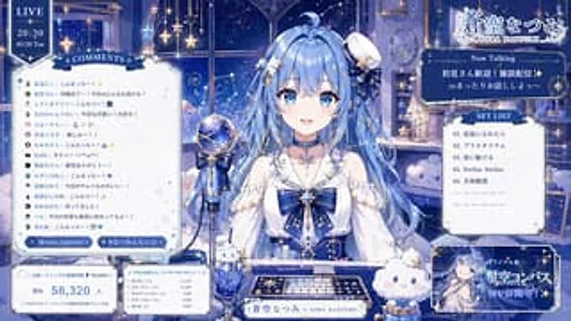

```text
{
  "type": "Anime VTuber live stream interface illustration",
  "theme": "A starry night view, stars, constellations, deep sapphire blue and white, and elegant magical idol aesthetics.",
  "subject": {
    "character": {
      "name": "{argument name=\"character name\" default=\"Natsumi Sora\"}",
      "gender_presentation": "Cute young anime girls",
      "hair": {
        "color": "{argument name=\"hair color\" default=\"light sky blue\"}",
        "style": "Very long, wavy double ponytails with a few stray hairs, soft bangs, star-shaped hair accessories, and ribbons."
      },
      "outfit": {
        "style": "Gorgeous starry sky idol dress",
        "pieces": [
          "White off-the-shoulder shirt with puff sleeves",
          "Large navy blue bow with gold star decoration",
          "Navy blue corset-style top with gold trim and constellation pattern.",
          "Star choker necklace",
          "A small, white, tilted cap adorned with a blue ribbon and gold star embellishments."
        ]
      },
      "pose": "Sitting at the live streaming table, centered, facing forward, with a microphone and keyboard behind me.",
      "expression": "Gentle, calm, and kind"
    }
  },
  "environment": {
    "setting": "The comfortable, fantastical nighttime livestream studio has a large window offering a view of a sky full of stars.",
    "background_elements": [
      "Hanging star wreaths and crystal decorations",
      "Shelves displaying bottles, books, hourglasses, telescopes, and star-themed decorations.",
      "Images of the moon and constellations outside the window",
      "Two fluffy cloud mascot dolls with blue eyes"
    ]
  },
  "props": {
    "desk_items": [
      "A large, retro-style microphone is located on the center left stand.",
      "A decorative keyboard with starry sky-themed keys.",
      "A name tag that reads \"SORA NATSUMI -\"",
      "1 cup of parfait dessert topped with a little white rabbit.",
      "A small cup or candlestick with a cloud mascot."
    ]
  },
  "layout": {
    "format": "Complete live stream waiting/chat interface overlay",
    "sections": [
      {
        "title": "LIVE",
        "position": "Vertical banner in the upper left corner",
        "count": 3,
        "labels": [
          "LIVE",
          "20:30",
          "Tuesday, May 20"
        ]
      },
      {
        "title": "COMMENTS",
        "position": "Left panel",
        "count": 14,
        "labels": [
          "Hoshimi Octopus: Hello, Natsumi-chan! ✨",
          "Yoru Yozora: Standby complete! What will we talk about today?",
          "Polar Bear Ice Cream: Hello, Natsumi-chan!",
          "Galaxy Meteor: You're so cute today! I love you the most!",
          "FullStar: Momo Pu",
          "Tsukimi Usagi: I can't wait!",
          "Nanase Sora: Hello, Natsumi-chan! ☁️✨",
          "Stella: I'm here! ( *´ω｀)",
          "Comet Drive: Thanks for the live stream!",
          "Mizuiro Cat: Hello Natsumi-chan! 💙",
          "Stardust Light: Today's thumbnails are so cute...!",
          "Night owls: Hello Xia Mei-chan!",
          "Dreamers: We've been waiting for so long!",
          "Spring: Today's outfit suits you perfectly too!"
        ]
      },
      {
        "title": "social tags",
        "position": "Comments panel below",
        "count": 2,
        "labels": [
          "@sora_natsumi",
          "#XiaMeiLive"
        ]
      },
      {
        "title": "goal panel",
        "position": "bottom left corner",
        "count": 4,
        "labels": [
          "Goal: 100,000 channel subscribers!",
          "current",
          "58,320 people",
          "Thank you everyone for your continued support! Please be sure to subscribe and like! ☆"
        ]
      },
      {
        "title": "supporters panel",
        "position": "small card next to the target panel",
        "count": 6,
        "labels": [
          "☆Today's Stardust (Thanks for the Super Comments!)☆",
          "Star Traveler ¥2,000",
          "FullStar ¥1,000",
          "Galaxy Meteor ¥500",
          "Water Color Cat ¥320",
          "Meteor ¥200"
        ]
      },
      {
        "title": "Now Talking",
        "position": "Top right panel",
        "count": 3,
        "labels": [
          "Now Talking",
          "{argument name=\"talk topic text\" default=\"Welcome! Let&#39;s chat live! ✨\"}",
          "{argument name=\"subtitle text\" default=\"Let&#39;s chat leisurely together!\"}"
        ]
      },
      {
        "title": "SET LIST",
        "position": "Right middle panel",
        "count": 5,
        "labels": [
          "01. If it could turn into stardust",
          "02. Planetarium",
          "03. Heading towards the night sky",
          "04. Stellar Stellar",
          "05. Astronomical Observation"
        ]
      },
      {
        "title": "promo card",
        "position": "bottom right panel",
        "count": 3,
        "labels": [
          "Original songs",
          "Star Compass",
          "The music video is now available!"
        ]
      }
    ],
    "logo": {
      "position": "Top right corner",
      "text": "Natsumi Sora"
    }
  },
  "style": {
    "rendering": "Exquisite anime illustrations with high detail, glowing highlights, soft halos, and sharp lines.",
    "composition": "Symmetrical, dense decorative overlay, centered character, UI panel surrounding.",
    "lighting": "A cool, moonlight blue ambiance, accented with shimmering gold.",
    "mood": "Dreamy, magical, comfortable, elegant"
  }
}
```

Model: GPT Image 2
Author: GPT Image 2 Prompts

[ProjectD](https://aitoolsradar.com/en/prompts/0cbfb8f49cd3d5) · [Recorded source](https://x.com/hageatama/status/2046618179037024377#reversed-1)
 · [Full original metadata and byte evidence](data/projectd-batch-0023.json)

## Cellier@undefined #296


```text
Create a premium 4:3 presentation cover slide introducing Chronicle, the AI-native presentation platform from https://t.co/SSfpg45Jtr.  

Style: 
elegant, minimal, modern, premium startup aesthetic. Similar to high-end brand guideline covers (like Apple / Linear / Notion style). Soft gradient background with subtle depth, clean whitespace, refined typography, polished editorial layout.  

Main title: 
CHRONICLE  

Subtitle: 
AI PRESENTATION PLATFORM  

Body copy (small elegant text): 
Turn raw ideas into polished, high-impact presentations. 
Start from notes, docs, links, or existing decks. 
Generate beautiful, on-brand slides with AI. 
Edit freely on a flexible canvas. 
Export to PPT, PDF, or publish as a website.  

Feature highlights (small premium labels): 
STORY-FIRST 
ON-BRAND DESIGN 
AI EDITING 
FREEFORM CANVAS 
PPT EXPORT 
TEAM COLLABORATION  

Bottom-right elegant logo text: 
chronicle  

Visual feeling: 
business-class premium, strategy deck quality, consulting-grade presentation, slightly futuristic but highly professional.  

Composition: 
clean editorial balance, asymmetrical layout, strong whitespace, presentation software hero shot feeling.  

Aspect ratio: 
4:3  

Language: 
English only
```

Model: GPT Image 2
Author: Cellier@undefined

[ProjectD](https://aitoolsradar.com/en/prompts/c2b91d43ff77be) · [Recorded source](https://x.com/cellier_/status/2046615173411262959)
 · [Full original metadata and byte evidence](data/projectd-batch-0023.json)

## Celtics Fan Cheering in NBA Arena

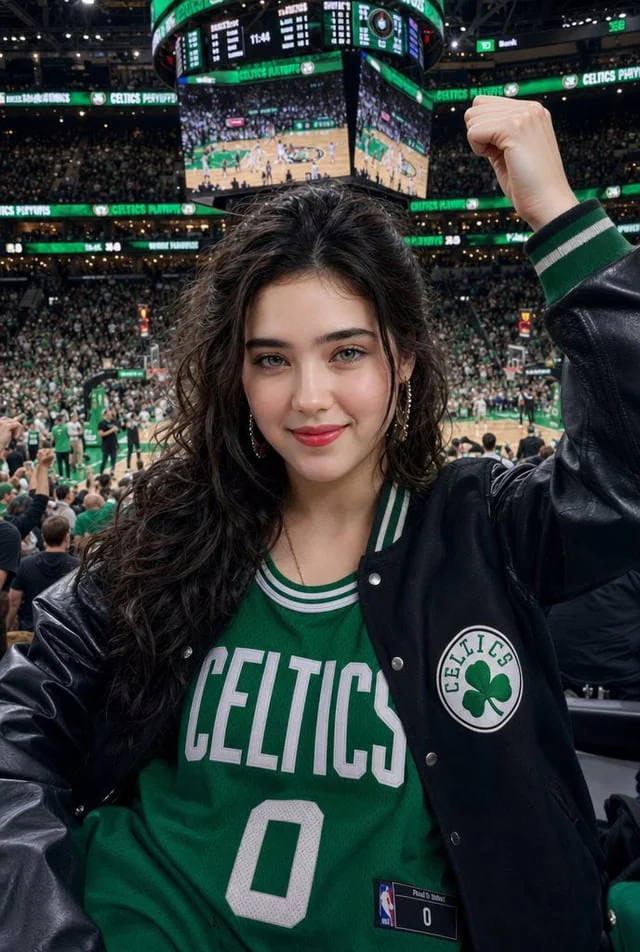

```text
Create a photorealistic vertical waist-up close-up of a {argument name="subject" default="young morena woman basketball fan"} sitting in the lower-bowl audience at a packed Boston Celtics NBA playoff game. She is centered close to the camera, wearing a green {argument name="jersey text" default="CELTICS"} basketball jersey with the number 0 and a black varsity jacket with glossy leather sleeves, green-and-white striped cuffs, silver snap buttons, and a round Celtics shamrock patch on the chest. She has long voluminous dark curly hair, small hoop earrings, and a radiant game-day makeup look; her face should be visible and expressive, showing an emotional cheering reaction. Pose her with one arm raised high in a clenched-fist celebration while the other arm is lower near the seat, as if reacting to an intense play. The background is a fully sharp, busy NBA arena interior with a basketball court visible below, dense cheering crowd, green Celtics playoff ribbon boards, bright stadium lights, and a large overhead jumbotron showing the live court and scoreboard details. Use realistic arena lighting, crisp detail throughout the packed stadium, natural skin texture, authentic sports-photo perspective, 35mm documentary photography feel, high dynamic range, no blur, no watermark, no extra logos beyond Celtics-style arena and jersey details.
```

Model: GPT Image 2
Author: Hania Ai

[ProjectD](https://aitoolsradar.com/en/prompts/ea5f5514eea3c9) · [Recorded source](https://youmind.com/prompts/celtics-fan-arena-portrait-20962)
 · [Full original metadata and byte evidence](data/projectd-batch-0023.json)

## Censored Anime Girl Selfie Portrait

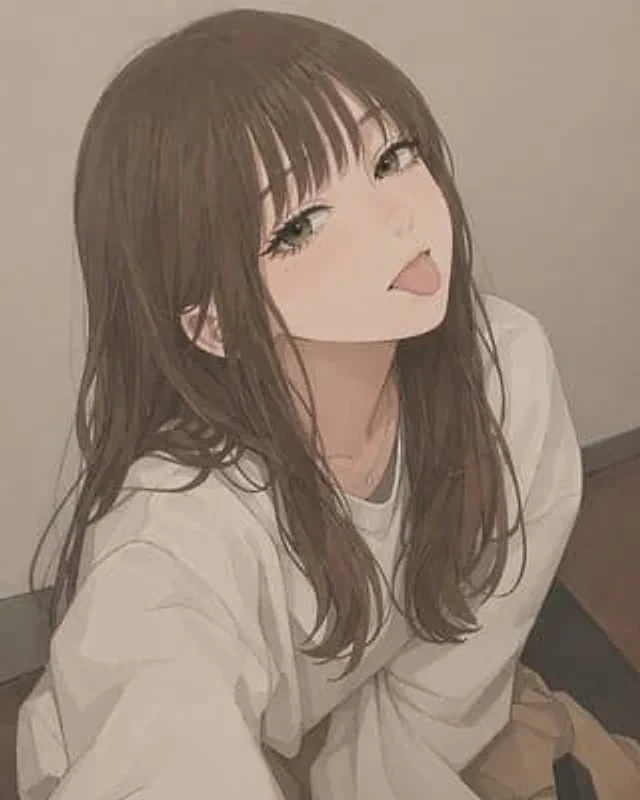

```text
A soft, low-saturation anime-style illustration depicts a young woman sitting at an indoor table, taken from a slightly downward close-up perspective, like a casual selfie. Her face is completely obscured by a centered square obscuring block in a warm grayish-brown color. She has long hair, the color of which is {argument name="hair color" default="Medium brown"} Her hair was slightly tousled, with fine strands falling over her shoulders and chest, possessing a natural sheen and creating a soft, layered look. She was wearing an oversized top.{argument name="top color" default="off white"} The wearer is dressed in a sweatshirt with a visible grey collar and a delicate silver necklace with a small pendant. The pose is relaxed and intimate, with one arm outstretched towards the camera, shoulders slightly tilted, and the body turned diagonally within the frame. The background is simple and serene: a beige wall, a dark bench or chair back, and a corner of a wooden tabletop visible in the lower right corner. A brown skirt or folded beige fabric is added near the knee in the lower right corner. The use of soft earth tones, delicate shadows, and painterly lines creates a comfortable everyday atmosphere and presents a clean, modern Japanese illustration aesthetic.
```

Model: GPT Image 2
Author: GPT Image 2 Prompts

[ProjectD](https://aitoolsradar.com/en/prompts/c8967e7f1fdc88) · [Recorded source](https://x.com/hoshi122221/status/2047288022702707051#reversed-0)
 · [Full original metadata and byte evidence](data/projectd-batch-0023.json)

## Censored Gothic Anime Girl Portrait

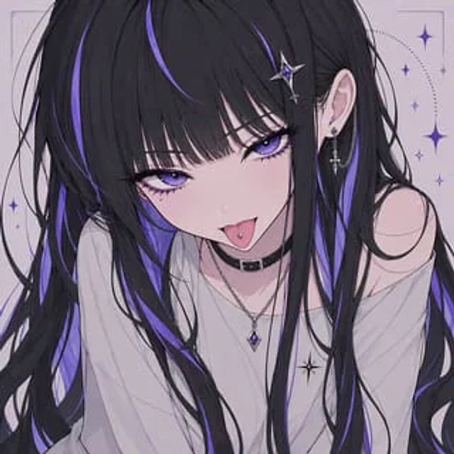

```text
A close-up portrait in an anime style depicts a mysterious young woman with extremely long, flowing black hair interspersed with vibrant colors.{argument name="accent color" default="violet"} Highlighted hair, half-length portrait, simple and bright background. Her face is deliberately concealed by a centrally located gray-toned, pale purple square occluder, obscuring her eyes, nose, and most of her mouth. One ear is fully exposed, adorned with two earrings: a small geometric stud and a long, delicate chain earring with a cross-shaped pendant at the end. She wears two necklaces: a slender silver chain and a silver pendant necklace with a faceted, diamond-shaped purple gemstone. She wears a loose, light gray off-the-shoulder top, the collar slipping down to reveal one shoulder, with a small black star logo printed on the chest. Her hair is glossy and layered, elegant strands winding gracefully in the image, the purple highlights creating a strong visual contrast. Delicate decorative celestial art is added to the background, containing seven clearly visible star-shaped or shimmering patterns, their colors echoing the violet and framed with subtle geometric borders, creating a refined, gothic, dreamlike, and modern aesthetic. Soft lighting, delicate lines, a soft neutral color scheme with black and purple as the main colors, highly exquisite anime illustrations, centered composition, square format.
```

Model: GPT Image 2
Author: GPT Image 2 Prompts

[ProjectD](https://aitoolsradar.com/en/prompts/1e597b567d983b) · [Recorded source](https://x.com/hoshi122221/status/2047310040126910495#reversed-0)
 · [Full original metadata and byte evidence](data/projectd-batch-0023.json)

## Censored Mona Lisa Oil Portrait

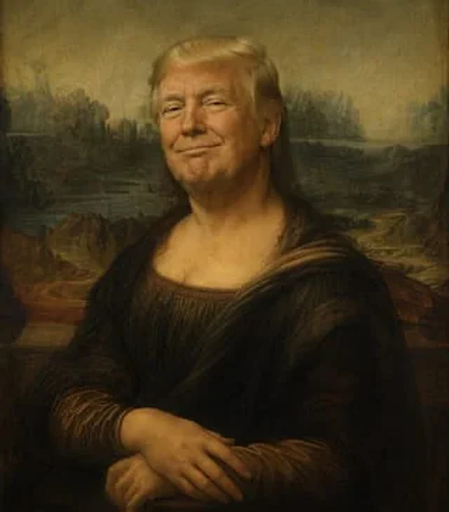

```text
A parody of the Mona Lisa, faithful to the style of a High Renaissance masterpiece in museums. The half-length seated portrait features the artist with folded hands, wearing a dark brown dress and a semi-transparent veil. Soft sfumato lighting is used, against a classic hazy landscape background including winding paths, water features, and rocky hills. The entire face area is replaced with a flat rectangular review mask, the color of which is {argument name="censor color" default="medium brown"} Located at the center of the head, covering from the forehead to the chin, its sharp, defined edges contrast sharply with the painterly texture. The hair visible around the obscured area is preserved, including light brown hair parted in the middle at the top and cascading over the shoulders. The aged varnish effect, soft earth tones, subtle cracked texture, and dignified, museum-quality composition are retained. Vertical composition, centered subject, realistic proportions, masterful brushstrokes, and dramatic yet soft interplay of light and shadow.
```

Model: GPT Image 2
Author: GPT Image 2 Prompts

[ProjectD](https://aitoolsradar.com/en/prompts/672f3d53989e1f) · [Recorded source](https://x.com/EchoraContinuum/status/2046599840336089128#reversed-0)
 · [Full original metadata and byte evidence](data/projectd-batch-0023.json)

## Censored Office Manga Confrontation

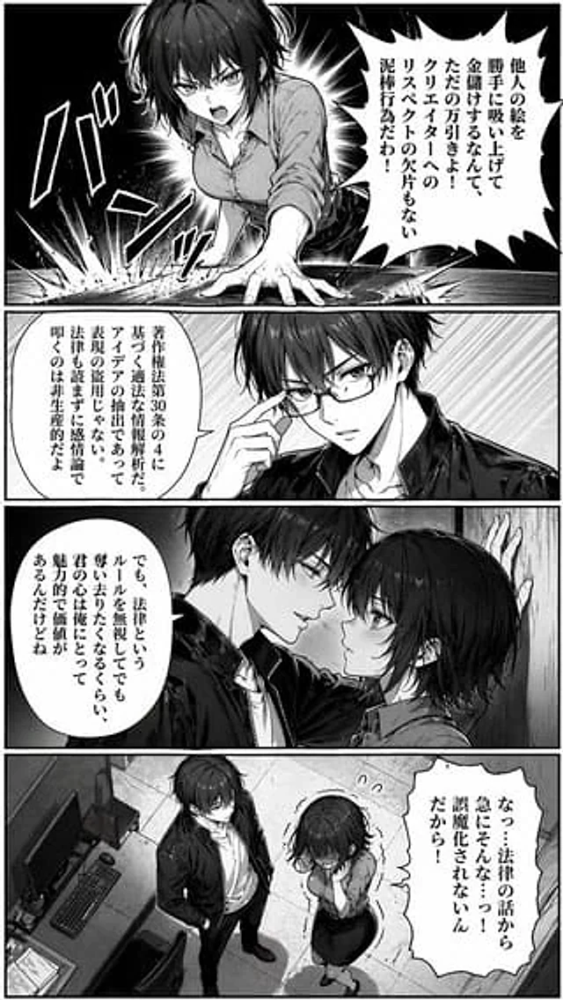

```text
A dramatic, black-and-white page in the style of a young adult comic book, employing dense halftone paper, sharp ink lines, high-contrast lighting, and expressive Japanese manga typography. The page contains four vertically arranged panels, accompanied by vertical Japanese speech bubbles and striking onomatopoeia, depicting a tense standoff between two office workers in a modern workspace. In the first panel, a slender but curvaceous young woman with a messy bob haircut, wearing a fitted shirt (sleeves rolled up) and a dark pencil skirt, angrily slams one hand on the table, leaning forward towards the reader, accompanied by explosive impact lines and a large, jagged speech bubble. In the second panel, a tall, slender young man with dark, messy hair, wearing a black leather jacket over a light-colored shirt and a necklace, appears half-body, calm and confident, touching his face as he speaks. In the third panel, the man corners the woman against a wall in an intimate "wall-slamming" pose, one arm supporting her head. The woman appears flustered and tense, while the man whispers near her face, instantly shifting the atmosphere from conflict to romantic comedy. The fourth panel, viewed from above, shows the office environment: two characters stand around a desk with a computer monitor, keyboard, mouse, and office chair; documents are scattered on the tiled floor. The woman shyly curls up, trembling slightly, while the man stands relaxed beside her. The work comprises four panels, four visible speech bubbles, and is interspersed with visible Japanese manga layout. In each panel, a rectangular mosaic blur effect is added to each character's face, as if anonymized for online sharing. Background details include office walls, desk edges, speed lines, burst effects, and halftone gradients. The overall atmosphere shifts from a heated argument to manipulative flirting, like a viral, out-of-context manga screenshot.
```

Model: GPT Image 2
Author: GPT Image 2 Prompts

[ProjectD](https://aitoolsradar.com/en/prompts/2f6339e2a4444f) · [Recorded source](https://x.com/jaguring1/status/2046726900668907673#reversed-0)
 · [Full original metadata and byte evidence](data/projectd-batch-0023.json)

## Censored Point-Cloud Portrait


```text
A minimalist monochrome portrait, composed entirely of millions of tiny white dot clouds against a pitch-black background, depicts a half-length portrait of an adult male from the chest up, wearing a formal dark suit jacket and a light-colored collared shirt. The subject is slightly right-centered, facing forward with a subtle two-thirds turn, sporting neatly combed short hair, and a visible ear clearly outlined by dense, lidar-like particles. The figure is rendered as a combination of raw 3D scan data and topological contour logic: ultra-dense dots, precise geometric points, subtle contour structures, and clear depth sculpting in the hair, suit lapel, collar, neck, and shoulders. The face is deliberately occluded by a large, vertical rectangular review block ranging from dark gray to black, perfectly centered in the facial area from the forehead to below the nose, creating a striking privacy mask effect. The rendering uses a matte finish, sharp edges, sharp focus, high contrast, and is free of halos, blooms, neon, fog, motion blur, chromatic aberration, and brushstrokes. Add a small, light gray four-pointed star icon to the bottom right corner. The overall image should have a mathematical, forensic, and futuristic feel, like an 8K resolution LiDAR scan portrait.
```

Model: GPT Image 2
Author: GPT Image 2 Prompts

[ProjectD](https://aitoolsradar.com/en/prompts/791d9b258aee61) · [Recorded source](https://x.com/HarshithLucky3/status/2046686345230512264#reversed-0)
 · [Full original metadata and byte evidence](data/projectd-batch-0023.json)

## Censored Research Paper Office Portrait


```text
A realistic office photo shows a young man sitting indoors, holding a printed research paper towards the camera. His face is completely obscured by a solid brown rectangle. He has short dark brown hair and wears a solid dark charcoal gray crew neck sweater. The paper in his hands is a vertical, white letter-sized document, clearly visible and positioned in front of his torso. The document is titled "DFlash: A High-Speed, Low-Latency, and High-Endurance Flash Memory Technology for Next-Generation Storage Systems." Below are the author lines "DFlash Research Team" and "DFlash Inc." The page displays four visible text sections: "Abstract," "1. Introduction," "2. DFlash Technology Overview," and "2.1 Dual Charge-Trapping Architecture," formatted in formal academic paper style with dense black serif font. The background is a softly blurred modern office lobby with warm ambient lighting, beige walls, glass partitions, sofas, and indoor plants. A black OpenAI logo and text label are mounted on the upper left wall. The composition is a mid-range shot, with the subject slightly tilted to the right to keep the OpenAI logo visible. It features shallow depth of field, soft natural office lighting, a refined photorealistic style, subtle warm tones, and rich detail in the hands, paper, sweater texture, and interior environment. The overall image is clean and believable, resembling a snapshot of a news or announcement.{argument name="document title" default="DFlash: A High-Speed, Low-Latency, and High-Endurance Flash Memory Technology for Next-Generation Storage Systems"} As the title of the paper,{argument name="company logo text" default="OpenAI"} As a brand logo on the wall.{argument name="sweater color" default="dark charcoal"} As the main color of the clothing, and{argument name="censor block color" default="medium tan"} Used as the color for facial camouflage blocks.
```

Model: GPT Image 2
Author: GPT Image 2 Prompts

[ProjectD](https://aitoolsradar.com/en/prompts/6b54a93c5333f9) · [Recorded source](https://x.com/songjunkr/status/2046540313460879500#reversed-1)
 · [Full original metadata and byte evidence](data/projectd-batch-0023.json)

## Censored Research Paper Office Portrait

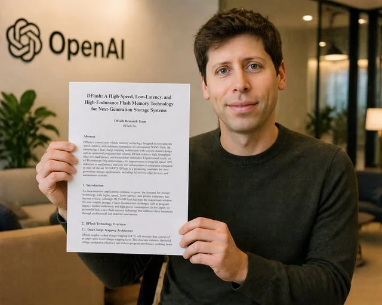

```text
A realistic corporate office photo of a young man seated indoors, holding up a printed research paper toward the camera with both hands. His face is fully obscured by a solid rectangular censor block in a medium tan color. He has short dark brown hair and wears a plain dark charcoal crewneck sweater. The paper is a white letter-size document in portrait orientation, clearly visible and centered in front of his torso. The document title reads “DFlash: A High-Speed, Low-Latency, and High-Endurance Flash Memory Technology for Next-Generation Storage Systems”. Below it are the author lines “DFlash Research Team” and “DFlash Inc.” The page shows 4 visible text sections: “Abstract”, “1. Introduction”, “2. DFlash Technology Overview”, and “2.1 Dual Charge-Trapping Architecture”, set in a formal academic paper layout with dense black serif text. In the background, place a softly blurred modern office lobby with warm ambient lighting, beige walls, glass partitions, a sofa, indoor plants, and the black OpenAI logo and wordmark mounted on the wall at upper left. The composition is a medium shot, straight-on, with the subject slightly right of center so the OpenAI logo remains visible. Shallow depth of field, soft natural office lighting, polished photorealistic style, subtle warm color grading, high detail in the hands, paper, sweater texture, and interior environment. Keep the overall image clean, believable, and like a candid press or announcement photo. Use {argument name="document title" default="DFlash: A High-Speed, Low-Latency, and High-Endurance Flash Memory Technology for Next-Generation Storage Systems"} for the paper title, {argument name="company logo text" default="OpenAI"} for the wall branding, {argument name="sweater color" default="dark charcoal"} for the subject’s clothing, and {argument name="censor block color" default="medium tan"} for the face covering.
```

Model: GPT Image 2
Author: 송준 Jun Song

[ProjectD](https://aitoolsradar.com/en/prompts/1a47c898144f66) · [Recorded source](https://youmind.com/prompts/censored-research-paper-office-14669)
 · [Full original metadata and byte evidence](data/projectd-batch-0023.json)

## Censored Samurai Engraving

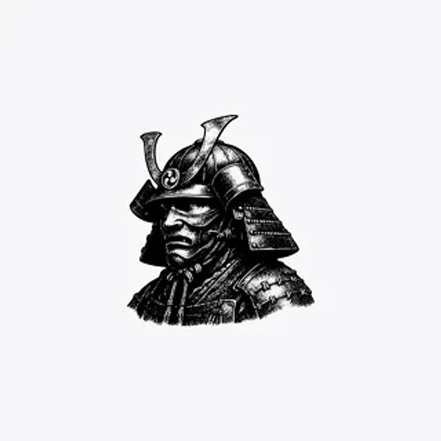

```text
A minimalist monochrome illustration depicts a three-quarter profile of a Japanese samurai, centered on a light gray background. The armor and helmet are rendered in a vintage engraving or etching style, exhibiting heavy black ink, high contrast, pointillism, shadow lines, and a scraping-painting-like texture. The Kabuto helmet features two tall, curved horn-like ornaments and layered side panels, with detailed layered shoulder armor and robe folds visible below the neck. The figure is cropped at the upper torso, isolated from the surrounding ample white space. A solid vertical black rectangular check bar is placed over the face, obscuring the eyes, nose, and most facial features. The overall composition remains sharp, graphic, and poster-like, containing no other objects, text, or colors besides black and light gray.
```

Model: GPT Image 2
Author: GPT Image 2 Prompts

[ProjectD](https://aitoolsradar.com/en/prompts/071b3711a93960) · [Recorded source](https://x.com/ethanhaveron/status/2046975968355512829#reversed-2)
 · [Full original metadata and byte evidence](data/projectd-batch-0023.json)

## Censored Sofa Selfie Portrait

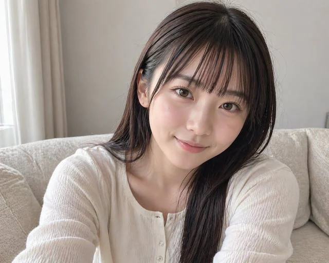

```text
A realistic indoor portrait photo of a young East Asian woman seated on a light beige fabric sofa in a softly lit modern living room, framed from the chest up in a casual selfie-like composition. She has long, straight {argument name="hair color" default="dark brown"} hair with a side part, smooth natural skin, and a slim build. Her face is fully covered by a large square mosaic blur censor block centered over the head, obscuring all facial features while leaving the hairline, ears, jawline edge, and neck partially visible. She wears a simple {argument name="top color" default="white"} ribbed long-sleeve knit top with a round neckline and exactly 3 small front buttons visible. Her posture is relaxed, slightly leaning toward the camera, with one arm implied to be extended to take the photo. The background shows 1 bright window at the far left with sheer daylight, 1 beige curtain, and the neutral sofa wrapping behind her. Soft natural daylight from the left, muted warm-gray walls, minimal home interior, shallow depth of field, clean realistic photography, understated candid atmosphere, no text, no accessories, no dramatic styling.
```

Model: GPT Image 2
Author: 過労

[ProjectD](https://aitoolsradar.com/en/prompts/548b89151871d2) · [Recorded source](https://youmind.com/prompts/censored-sofa-selfie-17467)
 · [Full original metadata and byte evidence](data/projectd-batch-0023.json)

## Censored Studio Portrait


```text
A centered studio portrait of an adult male, framed from above his chest to the top of his head, facing the camera against a smooth, deep navy blue background. He has a very short buzz cut, clearly visible ears, a medium tan complexion, short, dark stubble on his chin and jawline, and a light mustache. He is dressed in a plain off-white or cream-colored crewneck sweatshirt without any logos. Soft professional studio lighting creates soft highlights on the scalp, ears, neck, and sweatshirt, resulting in realistic skin texture, shallow depth of field, and a clean photographic quality. A symmetrical composition is used, with the head near the top of the frame and broad shoulders filling the lower half, perpendicular to the portrait's direction. A large, opaque rectangular masking block covers the center of the face, extending from the forehead to below the nose, spanning most of the face's width; the masking block is set to a flat, soft brown tone with slightly softened edges, completely concealing facial features.
```

Model: GPT Image 2
Author: GPT Image 2 Prompts

[ProjectD](https://aitoolsradar.com/en/prompts/d1c5181c48559d) · [Recorded source](https://x.com/fmontes/status/2046946960720998553#reversed-0)
 · [Full original metadata and byte evidence](data/projectd-batch-0023.json)

## Censored Titanic Sunset Romance


```text
Create a cinematic romantic movie still of {argument name="couple description" default="a young man and woman in early 1900s formal clothing"} standing at the bow of a large ocean liner, posed like the iconic arms-outstretched scene from Titanic. The woman is in front with both arms extended horizontally into the wind, wearing a deep navy velvet coat or dress over an ornate cream lace bodice, a small cross necklace, earrings, and tousled curly brown hair blown back by the sea breeze. The man stands closely behind her in a dark formal coat, one arm around her waist and the other partly hidden, wearing a light shirt and vest, with slicked dark hair. Both faces are deliberately covered by solid rectangular censor blocks in warm brown tones, one larger square over the man’s face and one vertical rectangle over the woman’s face. The background shows the open ocean at dusk with a vivid orange and pink sunset sky, soft clouds, and warm golden rim lighting. Large black ship rigging chains and metal hardware frame the left and right edges, with the deck railing barely visible at the bottom. Use a vertical portrait composition, close medium shot, dramatic backlighting, realistic film photography, rich contrast, shallow depth of field, 35mm cinematic color grading, nostalgic epic romance atmosphere, no visible text, no watermark.
```

Model: GPT Image 2
Author: Nargis Mita

[ProjectD](https://aitoolsradar.com/en/prompts/59e9363600bba6) · [Recorded source](https://youmind.com/prompts/titanic-sunset-couple-20911)
 · [Full original metadata and byte evidence](data/projectd-batch-0023.json)

## Centaur handstand prompt for GPT Image 2


```text
Generate a{argument name="subject" default="Centaur"} Working{argument name="action" default="Upside down"} pictures
```

Model: GPT Image 2
Author: GPT Image 2 Prompts

[ProjectD](https://aitoolsradar.com/en/prompts/dc298124d4a165) · [Recorded source](https://x.com/HarshithLucky3/status/2046798394367312148)
 · [Full original metadata and byte evidence](data/projectd-batch-0023.json)

## Centaur handstand prompt for GPT Image 2

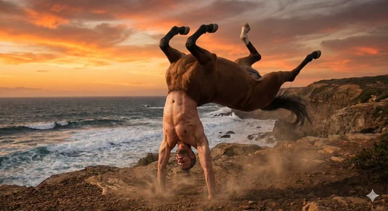

```text
Make an image of a {argument name="subject" default="centaur"} doing a {argument name="action" default="handstand"}
```

Model: GPT Image 2
Author: Harshith

[ProjectD](https://aitoolsradar.com/en/prompts/baec731e21bdef) · [Recorded source](https://youmind.com/prompts/centaur-handstand-14725)
 · [Full original metadata and byte evidence](data/projectd-batch-0023.json)

## CEO Headshot — Modern Corporate


```text
3:4 vertical clean modern corporate headshot of an East Asian woman in her early forties, wearing a charcoal grey wool blazer over a simple white silk top. Confident composed expression, slight smile, arms relaxed. Soft natural window light from the upper left, simple seamless cool grey backdrop. Tight head-and-shoulders framing, vertical 3:4 composition. Sharp catchlight in both eyes, subtle highlight on cheekbones. No company logo visible, no brand pin, no watermark. Premium executive portrait photography quality, photorealistic skin texture, magazine business profile aesthetic.
```

Model: GPT Image 2
Author: @hiapi_ai

[ProjectD](https://aitoolsradar.com/en/prompts/814007df962112) · [Recorded source](https://github.com/HiAPIAI/awesome-gpt-image-2-prompts)
 · [Full original metadata and byte evidence](data/projectd-batch-0023.json)

## Ceramic Mug with Steam


```text
A single matte cream ceramic mug filled with hot black coffee, with delicate visible steam curling upward against a softly blurred warm-grey desk scene with a closed notebook and a small green plant. Side three-quarter angle, soft window light from the right. Notion-style minimalist SaaS lifestyle photography, square 1:1 composition. No text on the mug, no brand logo, no watermark. Photorealistic, sharp focus on the rim and steam, gentle bokeh background.
```

Model: GPT Image 2
Author: @hiapi_ai

[ProjectD](https://aitoolsradar.com/en/prompts/eee8b079b4226d) · [Recorded source](https://github.com/HiAPIAI/awesome-gpt-image-2-prompts)
 · [Full original metadata and byte evidence](data/projectd-batch-0023.json)

## Chalkboard AI Product Infographic

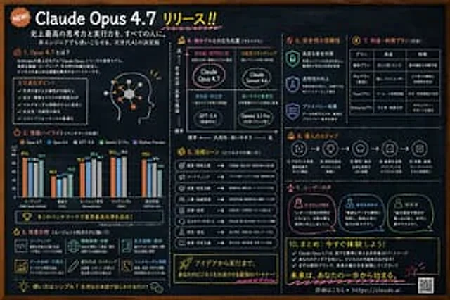

```text
{
  "type": "Blackboard-style infographic",
  "style": "Dark slate background, white text, hand-drawn style decorations, simple layout.",
  "colors": {
    "background": "Deep slate limestone",
    "text": "White",
    "accents": [
      "{argument name=\"accent color 1\" default=\"orange color\"}",
      "{argument name=\"accent color 2\" default=\"light blue\"}",
      "yellow",
      "pink"
    ]
  },
  "header": {
    "badge": "Newly released!",
    "title": "{argument name=\"main headline\" default=\"Claude Opus 4.7 Released!!\"}",
    "subtitles": [
      "Providing everyone with the strongest thinking and execution capabilities in history.",
      "The next generation of AI, easily mastered even by non-technical personnel."
    ]
  },
  "layout": {
    "sections": [
      {
        "id": "1",
        "title": "1. What is Opus 4.7?",
        "content": "Description text, 5 key points, profile picture illustration with glowing neural nodes"
      },
      {
        "id": "2",
        "title": "2. Performance Highlights (Benchmark Comparison)",
        "content": "Grouped bar charts compare the performance of the five models across five categories: encoding, reasoning ability, agent search, multilingual ability, and overall evaluation."
      },
      {
        "id": "3",
        "title": "3. Areas of Expertise (Powerful agent task processing capabilities!)",
        "content": "A 2x3 grid is used to showcase six advantages and their corresponding icons: coding, information retrieval and analysis, long-form reading and summarizing, data analysis and visualization, document writing and composition, and multimodal understanding."
      },
      {
        "id": "4",
        "title": "4. Comparison of localization with other models (matrix diagram)",
        "content": "A 2x2 positioning matrix containing 4 quadrants:{argument name=\"product name\" default=\"Claude Opus 4.7\"} , Claude Sonnet 4.6, GPT-5.4, Gemini 3.1 Pro"
      },
      {
        "id": "5",
        "title": "5. Application Scenarios (Commercial Use)",
        "content": "A list containing 8 business use cases, accompanied by icons and arrows."
      },
      {
        "id": "6",
        "title": "6. Safety and Reliability",
        "content": "Three vertically arranged items, each with a shield/lock icon: Advanced Security, Increased Transparency, and Privacy Protection."
      },
      {
        "id": "7",
        "title": "7. Prices and Packages (for reference)",
        "content": "A 3-column, 4-row data table showing the pricing tiers: Free, Pro, Team, and Enterprise."
      },
      {
        "id": "8",
        "title": "8. Deployment Steps",
        "content": "A horizontal flowchart containing 5 numbered steps connected by arrows."
      },
      {
        "id": "9",
        "title": "9. User Reviews",
        "content": "Three user testimonials, each accompanied by a profile icon: Marketing Personnel, Business Planning Personnel, and Researcher."
      },
      {
        "id": "10",
        "title": "10. Summary: Try it now!",
        "content": "3 key points, call to action, URL{argument name=\"website url\" default=\"https://claude.ai\"} and a QR code"
      }
    ]
  }
}
```

Model: GPT Image 2
Author: GPT Image 2 Prompts

[ProjectD](https://aitoolsradar.com/en/prompts/eca27334dd11cc) · [Recorded source](https://x.com/lpxwd/status/2044987195170378078#reversed-1)
 · [Full original metadata and byte evidence](data/projectd-batch-0023.json)

## Champion Monster Adventure Poster

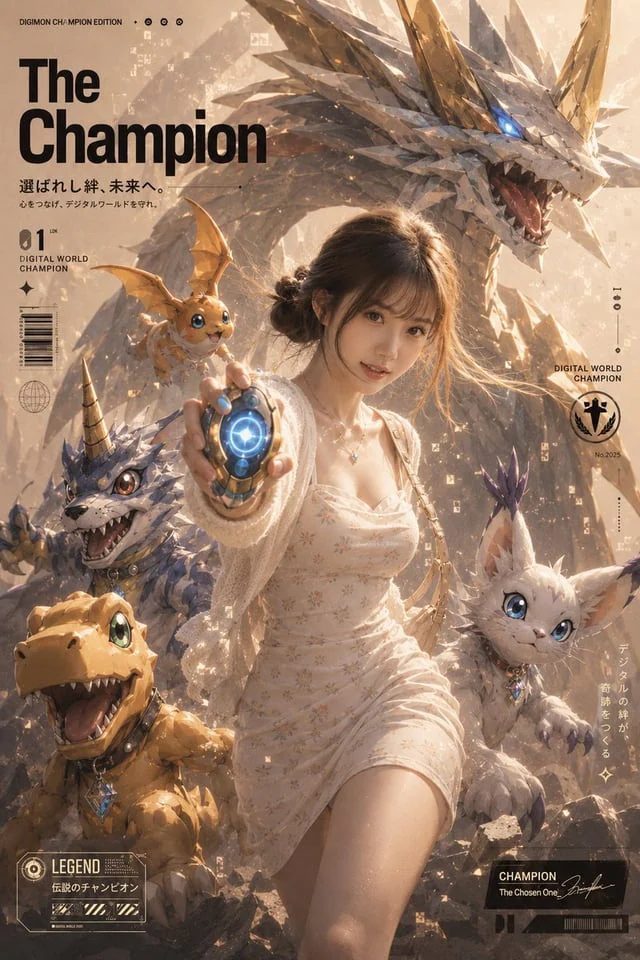

```text
Goal: Create a cinematic vertical anime/fantasy collectible poster for {argument name="poster title" default="The Champion"}, styled like a nostalgic monster-partner adventure magazine cover, blending realistic lighting with high-detail creature design.

Canvas: Tall portrait poster, 2:3 aspect ratio, warm beige and gold color grading, dusty sunlit atmosphere, dramatic backlight, floating digital pixel fragments, subtle paper-grain texture, premium key visual composition.

Main subject: A young woman hero stands in the center foreground, running forward and reaching one hand toward the viewer. Her face is intentionally obscured by a plain medium-brown rectangular censor block. She has dark brown hair in a loose low bun, soft flyaway strands, a delicate necklace, a cream floral summer dress, and a loose white cardigan. In her outstretched hand she holds a glowing round digital device with a bright blue circular core and metallic gold casing.

Creature count: Include exactly 5 monster companions. 1) A huge crystalline white-and-gold dragon fills the upper background, arcing behind the hero, with jagged crystal armor, long golden horns, open roaring mouth, sharp teeth, and one glowing electric-blue eye. 2) A tiny orange winged mascot sits near the hero’s raised hand, cute face, blue eyes, small bat-like wings, and cheerful expression. 3) A blue-gray horned wolf/reptile creature crouches on the lower left behind the hero, spiky fur scales, one striped horn, open snarling mouth, collar, and gem pendant. 4) An orange dinosaur-like creature occupies the bottom left foreground, big green eye, open happy roaring mouth, rounded snout, collar, and blue gem pendant. 5) A white cat-rabbit creature on the lower right, blue eyes, purple-tipped ear tufts, fluffy body, collar, gem pendant, and alert pose.

Layout and typography: Place large bold black sans-serif title text in the upper left reading {argument name="poster title" default="The Champion"}. Above it, add small text reading “DIGIMON CHAMPION EDITION” with tiny circular icons. Under the title, add Japanese subtitle text: 「選ばれし絆、未来へ。」 and a smaller Japanese line beneath it. Add left-side editorial markings: “01”, “DIGITAL WORLD CHAMPION”, a vertical barcode, and a small globe icon. Add right-side markings: a circular champion emblem, “DIGITAL WORLD CHAMPION”, “No.2025”, vertical Japanese text, and thin measurement-line graphics. Add bottom-left collectible card panel with “LEGEND” and Japanese text 「伝説のチャンピオン」. Add bottom-right black label panel with “CHAMPION”, “The Chosen One”, a signature scribble, and barcode-like decoration.

Visual style: Ultra-detailed anime-realism, cinematic fantasy poster, high-end game promotional art, glossy creature eyes, crystalline scales, warm dust particles, volumetric sunlight, shallow depth of field, dynamic diagonal composition, heroic nostalgic adventure mood.

Constraints: Keep the composition crowded but readable, use exactly the 5 listed creatures, preserve the obscured face block, avoid extra characters, avoid logos or watermarks beyond the designed fictional poster text.
```

Model: GPT Image 2
Author: serein

[ProjectD](https://aitoolsradar.com/en/prompts/c0d0a03c4e87cf) · [Recorded source](https://youmind.com/prompts/champion-monster-poster-21372)
 · [Full original metadata and byte evidence](data/projectd-batch-0023.json)

## Champions League Highlight Card Generator

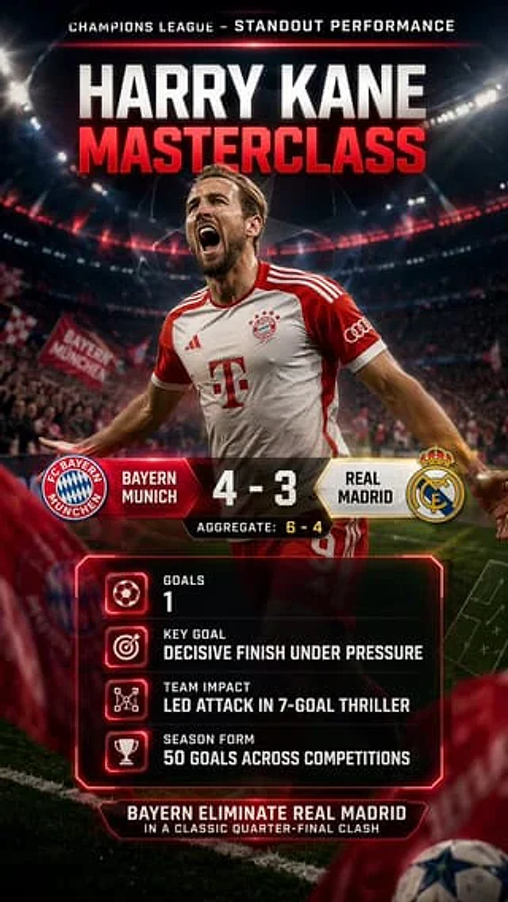

```text
Search the network to obtain{argument name="performance description" default="Outstanding individual performance in this week&#39;s Champions League"} Using accurate statistics and competition summaries, combined with{argument name="colors" default="Striking team colors"} And a clear score breakdown, generating a sheet{argument name="card type" default="Highlight Card"} .
```

Model: GPT Image 2
Author: GPT Image 2 Prompts

[ProjectD](https://aitoolsradar.com/en/prompts/07bb45b46d6d0c) · [Recorded source](https://x.com/maxescu/status/2045036186734039545)
 · [Full original metadata and byte evidence](data/projectd-batch-0023.json)

## CHAO2U AI #281

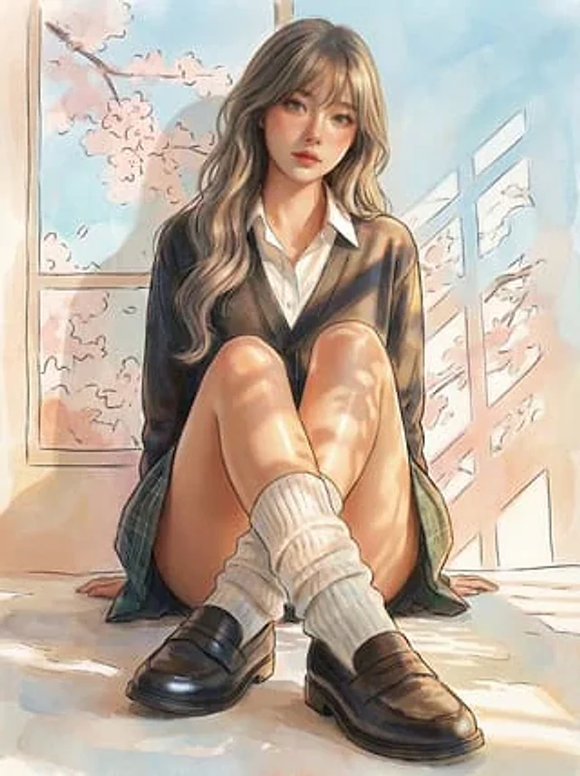

```text
Higgsfield just dropped GPT Image 1.5 — I tried the "impossible" test everyone thought would fail:
1⃣ Pure anime illustration only
2⃣ Extract every clothing item while keeping anime style
3⃣ Take those flat 2D clothes
4⃣ Dress a 100% photorealistic girl with them
No LoRA. No training. Just one simple prompt.

Result: pleats fold like real fabric, cardigan has actual weight, socks compress naturally. 
GPT Image 1.5 doesn’t just copy styles — it truly understands clothing physics and materials. Anime uniform on a real human. For real. My brain is broken 🤯✨
#Higgsfield #gptimage
```

Model: GPT Image 2
Author: CHAO2U AI

[ProjectD](https://aitoolsradar.com/en/prompts/e361826416e75c) · [Recorded source](https://x.com/CHAO2U_AI/status/2002023740490784993)
 · [Full original metadata and byte evidence](data/projectd-batch-0023.json)

## Chaos Notes Hidden Face Character Art

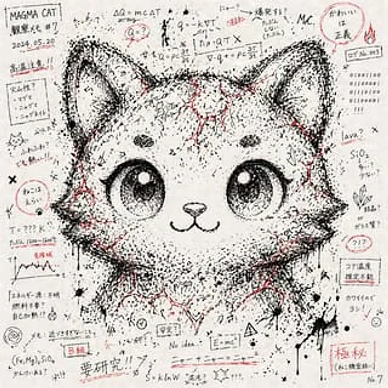

```text
# 混沌としたメモ書き・記号の集合体からキャラクターの顔を浮かび上がらせるアート

--- スタイル
- 白い紙の上に黒インクで描かれた大量の手書きメモ、数式、記号、ランダムな線。
- 紙いっぱいに散らばる書き殴り風のカオス。
- 所々に赤インクの強調(ライン、塗り潰し、マーカー風の塊)。
- アナログのノート落書きのような質感。

--- 構図
- ランダムなメモや記号が全体を覆い尽くす。
- 黒インクの線や文字の密度が「キャラクターの顔」の位置に集中する。
- 結果として、混沌の中から「与えられたキャラクターの顔のシルエット・表情」がうっすら浮かび上がる。
- 顔は写実的ではなく、カオスの断片が集まって形を成す。

--- 色彩
- モノクロ(黒・白)を主体に構成。
- 赤インクをアクセントとして散発的に配置。
- 彩度は抑えめ、アナログの紙とインク感を重視。

--- 表現要素
- 読めるようで読めない文字列、日本語や英数字が混在。
- 数式記号、矢印、点、斜線、クロス、ドリップ(インクの飛び散り)。
- キャラクターの顔の目や髪の輪郭は、メモや記号の配置の「余白」や「濃淡」で浮かび上がる。

--- 禁止事項
- 顔を直接的に描き込む写実ポートレート。
- デジタル処理的で整然とした幾何学模様。
- カラフルな彩色や過飽和表現。
- ロゴ、透かし、人工的なCG感。

--- Definition of Done (DoD)
- 全体は「混沌としたメモ・記号の集合体」として成立している。  
- 与えられたキャラクターの顔が、混沌の濃淡・配置から自然に浮かび上がる。  
- 色はモノクロ+赤アクセントのみ。  
- 紙とインクの手描き的質感を保持している。
```

Model: GPT Image 2
Author: @loglogrog

[ProjectD](https://aitoolsradar.com/en/prompts/9e5b096958246f) · [Recorded source](https://x.com/loglogrog/status/2046448773162033240)
 · [Full original metadata and byte evidence](data/projectd-batch-0023.json)

## Chaotic Road Trip Comedy Poster

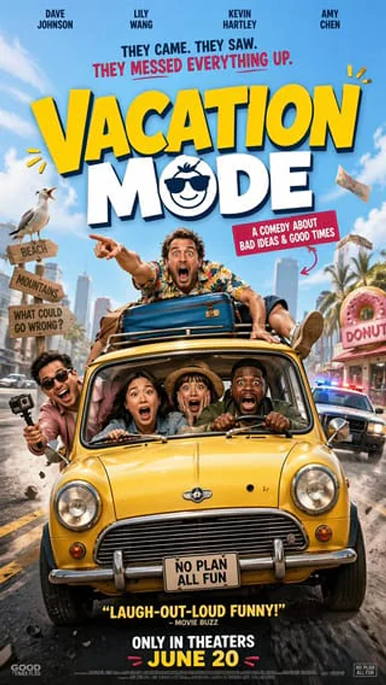

```text
A bright, chaotic movie poster for a theatrical comedy, in the sophisticated style of a Hollywood single-page poster, with a vertical composition. A vintage yellow Mini Cooper speeds toward the viewer along a sun-drenched, palm-lined city street. The car is crammed with five vacationing friends: two visible in the front, two squeezed into the back, and a man sprawled on the roof rack, grinning and dramatically pointing ahead. Everyone is dressed in brightly colored casual vacation wear, including tropical prints, loose shirts, and sun hats. The scene is boisterous, reckless, and full of fun. Suitcases and travel bags are piled on the roof. A police car with flashing lights is chasing them from the right rear. To the left is a crooked wooden road sign with three signs: “BEACH,” “MOUNTAINS,” and “WHAT COULD GO WRONG?” A screeching seagull perches atop the sign. On the right is a giant roadside donut shop sign that reads "DONUT," with a folded paper map fluttering in the air. The street is filled with a sense of motion blur, dust, debris, and the energy left by tires, above which is a saturated blue sky and fluffy clouds. At the very top are the names of the four actors, in black compressed capital letters: "DAVE JOHNSON," "LILY WANG," "KEVIN HARTLEY," and "AMY CHEN." Below this is a stacked slogan in bold capital letters: "THEY CAME. THEY SAW." in deep navy blue, and "THEY MESSED EVERYTHING UP." in red. The main title occupies the upper center in a huge, playful 3D font:{argument name="movie title" default="VACATION MODE"} The title is highlighted in bright yellow for "VACATION" and white for "MODE" with a heavy blue shading. The letter "O" is replaced by a simple smiley face wearing sunglasses. Small yellow doodle-style emphasis marks are added around the title. A slanted bright pink banner is placed to the lower right of the title, reading "A COMEDY ABOUT BAD IDEAS &amp; GOOD TIMES," accompanied by a hand-drawn curved arrow pointing downwards. The license plate reads "NO PLAN ALL FUN." Near the bottom, a glowing yellow quote is added: "LAUGH-OUT-LOUD FUNNY!", below which reads "- MOVIE BUZZ." At the bottom center, the release information "ONLY IN THEATERS" is added, followed by "..."{argument name="release date" default="JUNE 20"} The logo is presented in bold yellow capital letters. A small legal notice is added to the bottom edge, along with small production company logos in the corners, including "GOOD TIME FILMS" in the bottom left corner and "NO PLAN ALL FUN" in the bottom right corner. The design employs high-contrast lighting, exaggerated perspective, a glossy commercial poster texture, vibrant summer colors, and a quirky road trip comedy tone.
```

Model: GPT Image 2
Author: GPT Image 2 Prompts

[ProjectD](https://aitoolsradar.com/en/prompts/76fa8a518d4785) · [Recorded source](https://x.com/AlwaveNazca/status/2046643741931254071#reversed-0)
 · [Full original metadata and byte evidence](data/projectd-batch-0023.json)

## Chaotic Shonen Manga Cover

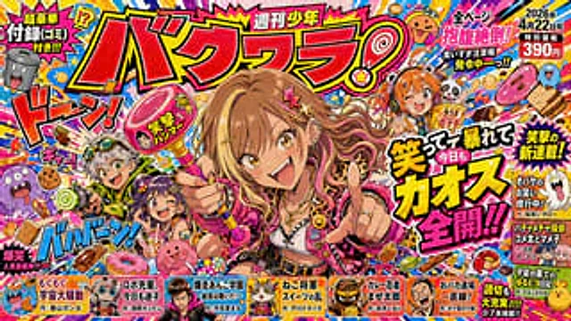

```text
This is a vibrant illustration for a Japanese shonen manga magazine cover, with the edges filled with explosive pop art elements and bright candy colors, reminiscent of a weekly manga anthology cover. At the center of the image is a trendy, sexy high school girl, leaning towards the viewer in a dynamic, perspective pose, grinning broadly, one hand pointing directly at the camera, the other holding a pink toy hammer. She has medium-length wavy hair, and her hair color is {argument name="hair color" default="Light brown with gold and pink highlights"} She has warm amber eyes, wears colorful hair clips, earrings, rings, bracelets, and necklaces in the shapes of stars and lightning bolts, sports exaggerated manicures, and dresses in bold streetwear: a bright pink satin bomber jacket, a white crop top, a black belt with gold buckles, and various glamorous accessories. At the top center of the cover is a large red Japanese title with a thick black border and yellow outline; the text reads {argument name="masthead text" default="バクアラ!?"} The magazine features smaller text above the main text, "Weekly Shonen." A striking, explosive headline, "Super Deluxe Edition (Gomi) Included!!!," is added to the top left corner, accompanied by a shocking cartoon trash can mascot. Two large onomatopoeic slogans are placed on the left: "Don!" at the top left and "Banban!" in blue at the bottom left. A large main title is designed on the right, using bold black, yellow, white, and pink Japanese font, reading "Laugh Out Loud, Today's Chaos Unleashed!!" surrounded by smaller promotional phrases such as "All-out attack, I'm collapsing!", "Laughing Out Loud, Warning Reporting in Progress!!", and "A New Laughing Series!". The top right corner contains a magazine issue number box, labeled "April 22, 2026 Issue" and the price "390 yen." Surrounding the central girl are three manga-style supporting characters: on the left, a silver-haired boy wearing goggles, aiming a spiral shockwave at the audience; below, a purple-haired girl holding a dessert and drink, looking cheerful; and in the upper right corner, an orange-haired idol-style girl wearing headphones and making a peace sign. The background and foreground are filled with floating desserts, snacks, toys, doodles, and mascot heads, including donuts, cookies, chocolate bars, candies, puddings, ice cream, popcorn, planets, stars, speech bubbles, and quirky creatures, all with bold outlines and halftone textures. At the bottom, seven small serialized feature boxes are neatly arranged, each containing manga character illustrations and Japanese titles, creating a crowded compilation preview effect. High-saturation bright pink, yellow, orange, red, cyan, and black are used, resulting in extremely high visual density, overlapping text, and a texture reminiscent of manga speed lines, sticker elements, and glossy printed magazine covers. The overall feeling is a messy mix of humor, rebellion, noise, youth, and appeal, like a next-generation Weekly Shonen Jump cover that is both satirical and high-quality.
```

Model: GPT Image 2
Author: GPT Image 2 Prompts

[ProjectD](https://aitoolsradar.com/en/prompts/841cc4947b57ea) · [Recorded source](https://x.com/rascal8023/status/2046910563469664505#reversed-3)
 · [Full original metadata and byte evidence](data/projectd-batch-0023.json)

## Character Bento Recipe Magazine Page

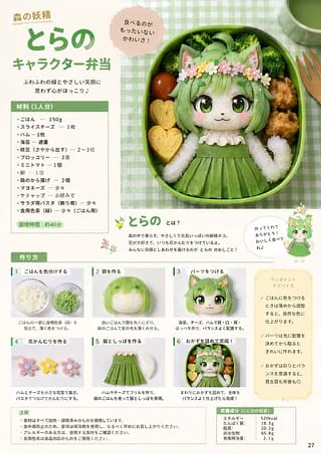

```text
{
  "type": "Recipe magazine page",
  "theme": "Cartoon Bento",
  "header": {
    "title": "Forest Spirit{argument name=\"character name\" default=\"Little Tiger\"}{argument name=\"dish type\" default=\"Cartoon Bento\"}",
    "subtitle": "The fluffy green leaves and gentle smiles instantly warm my heart♪",
    "speech_bubble": "So cute you won't want to eat them!"
  },
  "main_image": {
    "position": "Top right corner",
    "description": "A top-down view of a green oval bento box containing a catgirl character made of rice.{argument name=\"main color theme\" default=\"green\"} Her hair and skirt, adorned with a flower wreath, surrounded by broccoli, cherry tomatoes, heart-shaped eggs, and fried chicken."
  },
  "layout": {
    "sections": [
      {
        "title": "Ingredients (for 1 person)",
        "position": "Top left corner",
        "count": 14,
        "labels": [
          "rice",
          "Sliced ​​cheese",
          "Ham",
          "seaweed",
          "Edamame",
          "broccoli",
          "Cherry Tomato",
          "egg",
          "fried chicken",
          "mayonnaise",
          "Tomato sauce",
          "Salad Pasta",
          "Food coloring (green)",
          "Cooking time:{argument name=\"prep time\" default=\"Approximately 40 minutes\"}"
        ]
      },
      {
        "title": "About Xiaohu",
        "position": "Middle right",
        "description": "2D anime illustrations of characters with speech bubbles",
        "labels": [
          "Thank you for making this for me! Please enjoy it! ♪"
        ]
      },
      {
        "title": "Production steps",
        "position": "lower half",
        "count": 6,
        "labels": [
          "1. Separate the rice by color",
          "2. Create the face",
          "3. Installation accessories",
          "4. Make a wreath",
          "5. Make clothes and a tail",
          "6. Add the side dishes, and you're done!"
        ]
      },
      {
        "title": "Tips",
        "position": "bottom right corner",
        "count": 3
      },
      {
        "title": "Remark",
        "position": "bottom left corner",
        "count": 4
      },
      {
        "title": "Nutritional information (reference values ​​for 1 person)",
        "position": "bottom right corner",
        "count": 5,
        "labels": [
          "energy:{argument name=\"calories\" default=\"520kcal\"}",
          "protein",
          "Fat",
          "carbohydrate",
          "Equivalent amount of salt"
        ]
      }
    ]
  }
}
```

Model: GPT Image 2
Author: GPT Image 2 Prompts

[ProjectD](https://aitoolsradar.com/en/prompts/12ff54d064cb8c) · [Recorded source](https://x.com/TlanoAI/status/2045493771715129752#reversed-0)
 · [Full original metadata and byte evidence](data/projectd-batch-0023.json)

## Character Caught on Stadium Screen

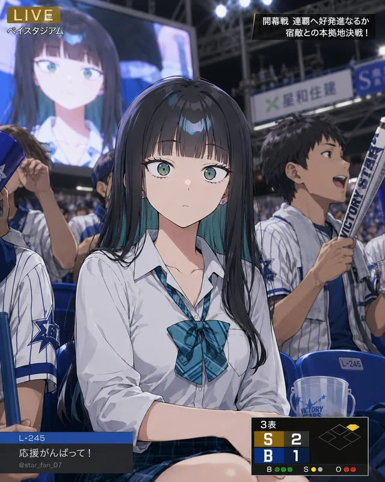

```text
このキャラが{argument name="イベント" default="野球観戦"}中に中継カメラや球場の大型ビジョンに抜かれた瞬間の画像を生成して。観客席でユニフォームを来ていて、少し気まずそう。不意を突かれた自然な表情。球場の臨場感、テレビ中継っぽいテロップ、現地で本当に抜かれたようなリアルさ
```

Model: GPT Image 2
Author: Anirole

[ProjectD](https://aitoolsradar.com/en/prompts/3bc3673f43fd22) · [Recorded source](https://youmind.com/prompts/character-caught-on-stadium-screen-20231)
 · [Full original metadata and byte evidence](data/projectd-batch-0023.json)

## Character color and style adjustment

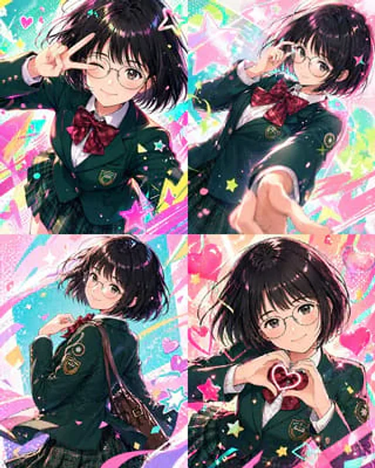

```text
Please adjust it to be more modern.{argument name="style" default="Vtuber-style"} The style incorporates vibrant colors and a fun, trendy feel. Please arrange all of them in order.{argument name="count" default="4 images"} Make the composition bolder.
```

Model: GPT Image 2
Author: GPT Image 2 Prompts

[ProjectD](https://aitoolsradar.com/en/prompts/c35079e94325f1) · [Recorded source](https://x.com/Alone1Moon/status/2047225693134860494)
 · [Full original metadata and byte evidence](data/projectd-batch-0023.json)

## Character Consistency Reference Chart

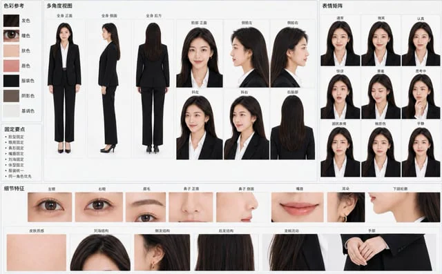

```text
根据附带角色原图创建一张“{argument name="图表标题" default="角色身份固定参考图表"}”，横向 {argument name="比例" default="16:10"}，{argument name="背景色" default="浅灰白背景"}，专业视觉资料板布局。首要目标是让所有面板一眼看出是完全相同的角色，而不是多个相似人物。

将参考图中的角色身份视为不可更改的硬性约束。严格锁定：

- 脸部宽高比例、颧骨、脸颊、下颌和下巴
- 眼睛轮廓、眼距、眼睑结构和视线气质
- 眉毛弧度、粗细、颜色和眉眼距离
- 鼻梁、鼻尖、鼻翼以及侧脸鼻形
- 上下唇厚度、唇峰、嘴角和自然唇色
- 肤色、毛孔、血色和自然皮肤凹凸
- 发际线、分线、刘海、侧发、后发长度和发丝流向
- 年龄印象、骨架、肩宽、四肢长度和整体体型
- 原图服装、原始画风、光线质感和整体氛围

画面中央用较大面板展示：

- 全身 正面
- 全身 侧面
- 全身 后方
- 脸部 正面
- 侧脸左
- 侧脸右
- 斜左
- 斜右
- 后脑部

每个角度保持完全一致的头骨结构、五官相对位置、头发体积和身体比例。侧脸必须准确延续正面的鼻梁、嘴唇、下巴和额头结构，禁止生成不同人物式侧脸。

右侧配置小型表情矩阵：

- 通常
- 微笑
- 认真
- 惊讶
- 害羞
- 思考中
- 困扰表情
- 稍悲伤
- 平静

保持相同瞳孔、眼睛基础尺寸、鼻形、唇形和脸型。笑容自然克制，不改变角色年龄或气质。

下部配置精细身份锚点：

- 左眼
- 右眼
- 眉毛
- 鼻子 正面
- 鼻子 侧面
- 嘴唇
- 耳朵
- 下颌轮廓
- 皮肤质感
- 刘海结构
- 侧发结构
- 后发结构
- 发梢流动
- 手部

左侧加入 5—7 个准确色样：发色、瞳色、肤色、唇色、服装色、阴影色、基调色。加入极简“固定要点”：脸型固定、眼周固定、鼻形固定、嘴唇固定、刘海固定、体型固定、服装统一、同一角色优先。

背景干净，柔和均匀光线，无电影式灯光、强烈景深或装饰元素。实写角色保留自然毛孔、汗毛和微小肤色差异；非实写角色严格保持原图线条、色块、阴影和材质，不得擅自转换风格。

所有标签仅使用清晰简体中文，字号适中，不覆盖人物。若版面空间不足，优先保留身份锚点和主要角度，减少重复面板，不得通过缩小文字或牺牲角色一致性强行塞满。
```

Model: GPT Image 2
Author: Mr.pinecone

[ProjectD](https://aitoolsradar.com/en/prompts/dbe5cb0ff12049) · [Recorded source](https://youmind.com/prompts/character-identity-reference-chart-30375)
 · [Full original metadata and byte evidence](data/projectd-batch-0023.json)

## Character Design Sheet Prompt

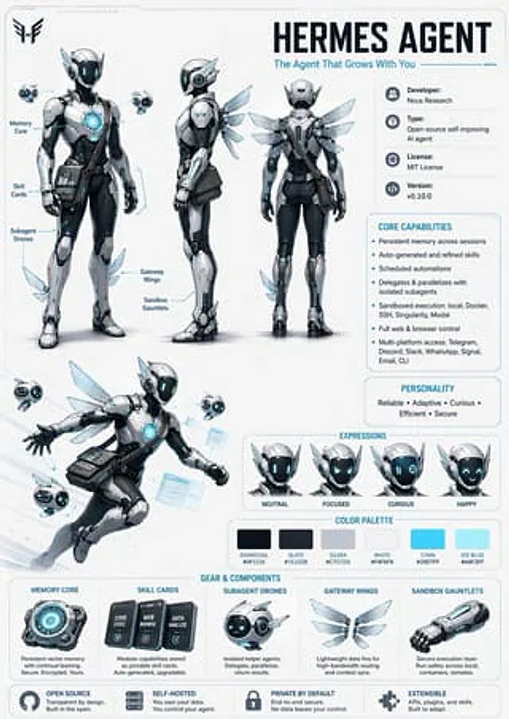

```text
for{argument name="character" default="Hermes Agent"} Create a character design sheet and include key information.
```

Model: GPT Image 2
Author: GPT Image 2 Prompts

[ProjectD](https://aitoolsradar.com/en/prompts/b876e28b154416) · [Recorded source](https://x.com/NeoAIForecast/status/2046795552650936695)
 · [Full original metadata and byte evidence](data/projectd-batch-0023.json)

## Character Eating Parfait with Annotations

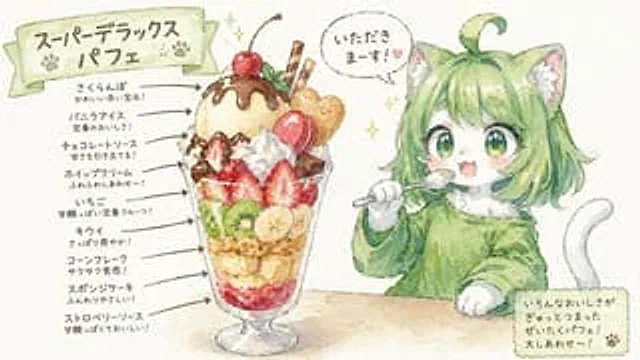

```text
one{argument name="character" default="Role"} I'm eating a serving{argument name="food item" default="Super deluxe parfait"} Includes pointers and annotations.{argument name="food item" default="Parfait"} Arrows and text descriptions for each ingredient.
```

Model: GPT Image 2
Author: GPT Image 2 Prompts

[ProjectD](https://aitoolsradar.com/en/prompts/e28051ef430989) · [Recorded source](https://x.com/TlanoAI/status/2046153454243151875)
 · [Full original metadata and byte evidence](data/projectd-batch-0023.json)

## Character Growth Sheet Generator

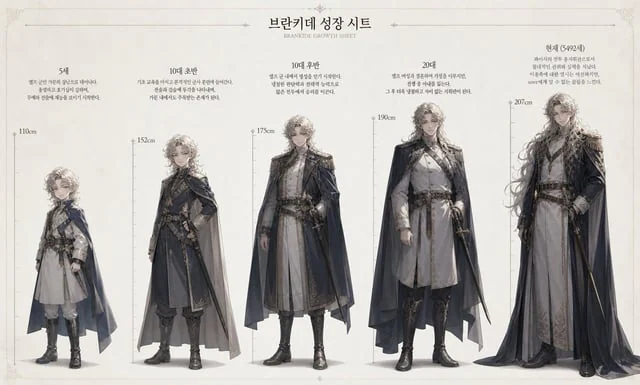

```text
이 이미지를 참고해서 캐릭터 성장 시트를 만들어줘

[현재 캐릭터 정보]
- 캐릭터이름 : {argument name="이름" default="브란키데"}
- 현재 나이 : {argument name="나이" default="5492세"}
- 현재 키 : {argument name="키" default="207cm"}
- 직업 : {argument name="직업" default="엘프 전투 총지휘관"}
- 성격 : {argument name="성격" default="냉철하고 자비없다"}

[form]
가장자리에 키 눈금표를 표기 할것,
5세, 10대초반, 10대후반, 20대, 현재로 나뉘어서 시간순으로 자연스럽게 자라는 과정을 만들것, full-body 적용, 키와 키차이를 제대로 표기
```

Model: GPT Image 2
Author: 음메 (@moo)

[ProjectD](https://aitoolsradar.com/en/prompts/a9110d150a190b) · [Recorded source](https://youmind.com/prompts/character-growth-height-chart-17588)
 · [Full original metadata and byte evidence](data/projectd-batch-0023.json)

## Character Identity Board Template

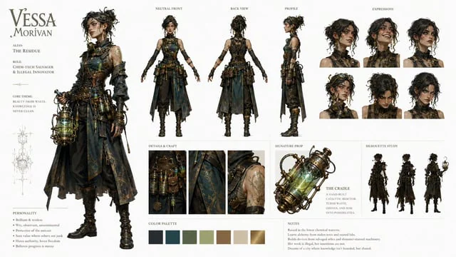

```text
Create a fully original, copyright-safe character and present them as an artistic CHARACTER IDENTITY BOARD.

[CHARACTER SEED]:
{argument name="core idea" default="Enter the core idea here."}

[AGE / BODY TYPE]:
{argument name="body type" default="Enter age impression, body type, posture, physical presence"}
```

Model: GPT Image 2
Author: Kōda

[ProjectD](https://aitoolsradar.com/en/prompts/0e3b8f059de802) · [Recorded source](https://youmind.com/prompts/character-identity-board-template-21095)
 · [Full original metadata and byte evidence](data/projectd-batch-0023.json)

## Character Relationship Diagram Poster Generator

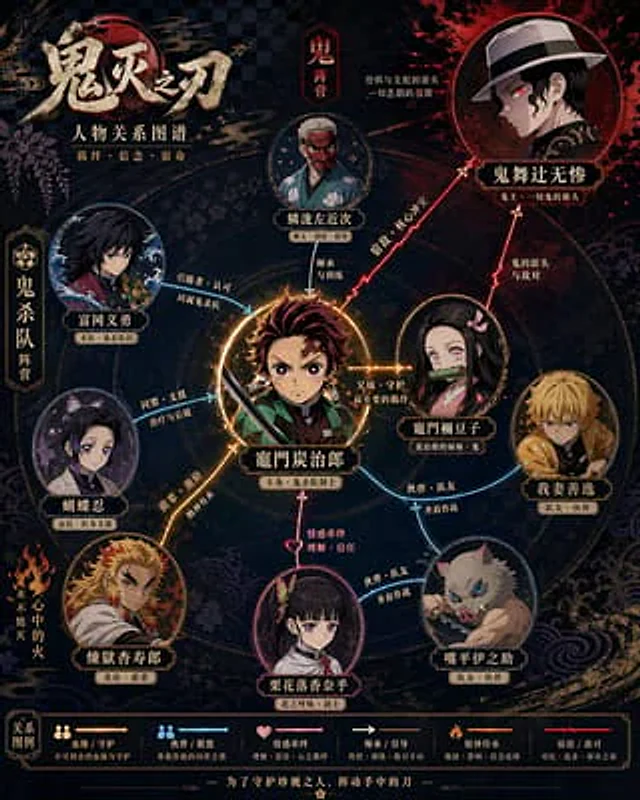

```text
Please refer to{argument name="theme" default="Demon Slayer"} Generate a highly designed character relationship diagram poster. This image should not be just a simple illustration, but a character relationship diagram that combines information visualization, narrative structure, poster design aesthetics, and stylistic accuracy. Please automate the following steps: - Identify the relevant works and core settings. - Extract 6–12 key characters, up to 15 if necessary. - Identify and display key character relationships, including blood ties, love, friendship, allies, enemies, master-disciple, etc. - Automatically select the composition method based on the characteristics of the work, such as protagonist-centric, dual-core opposition, faction-based, family tree, or timeline evolution. - Automatically extract the stylistic DNA of the work, including color, worldview symbols, texture, atmosphere, typography, and representative elements. - Transform these stylistic elements into the overall visual design of the relationship diagram, rather than simply copying the official poster. - Use different colors, line types, and arrows to distinguish different relationships, ensuring clear lines and distinct layers to avoid clutter. - Make the core characters stand out, followed by secondary characters, and weaken subordinate characters to form a clear visual hierarchy. - Ensure that each character's name is clear and easy to read, and label their identity or faction if necessary. The final product should meet the following requirements: - Allow for immediate understanding of the character hierarchy and key relationships. - Highly consistent with the original work's style and setting. - Combine the clarity of an infographic with the sophisticated design of a poster. Consistent, refined, and complete, suitable for social media sharing or poster display - avoid cheap flowchart feel, cluttered piling up, and information overload.
```

Model: GPT Image 2
Author: GPT Image 2 Prompts

[ProjectD](https://aitoolsradar.com/en/prompts/d120ace78c0d28) · [Recorded source](https://x.com/MrLarus/status/2046263153546174935)
 · [Full original metadata and byte evidence](data/projectd-batch-0023.json)

## Character Relationship Map Poster

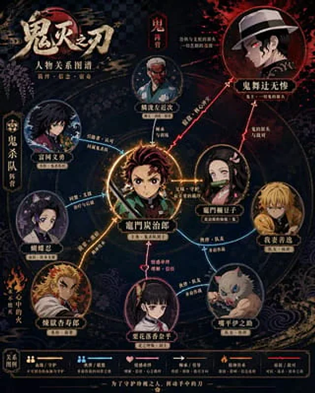

```text
请根据【主题】生成一张高设计感的人物关系图海报。
```

Model: GPT Image 2
Author: @MrLarus

[ProjectD](https://aitoolsradar.com/en/prompts/f2c4a22ac26c93) · [Recorded source](https://x.com/MrLarus/status/2046263153546174935)
 · [Full original metadata and byte evidence](data/projectd-batch-0023.json)

## Character Room Visualization Prompt

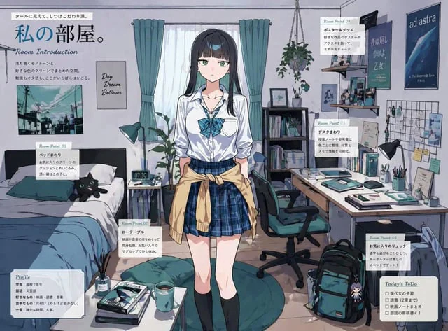

```text
{argument name="キャラクター" default="このキャラ"}の部屋を紹介する画像を作成して。キャラの性格や生活感が伝わる部屋の全体を見せる構図で、小物や家具にこだわる。ポスターや私物、散らかり具合などで個性を表現。{argument name="レイアウトスタイル" default="雑誌や特集記事"}のように軽いテキストやラベルを配置。
```

Model: GPT Image 2
Author: Anirole

[ProjectD](https://aitoolsradar.com/en/prompts/6870aea71fcea2) · [Recorded source](https://youmind.com/prompts/character-room-personality-lifestyle-17080)
 · [Full original metadata and byte evidence](data/projectd-batch-0023.json)

## Character Style Transfer


```text
Please change it to{argument name="style" default="Blue Archive style"} At the same time, the original outline is maintained.
```

Model: GPT Image 2
Author: GPT Image 2 Prompts

[ProjectD](https://aitoolsradar.com/en/prompts/bf92b46f1ecddc) · [Recorded source](https://x.com/kurokumanohito/status/2046990807950139622)
 · [Full original metadata and byte evidence](data/projectd-batch-0023.json)

## Character Visual Vertical Poster

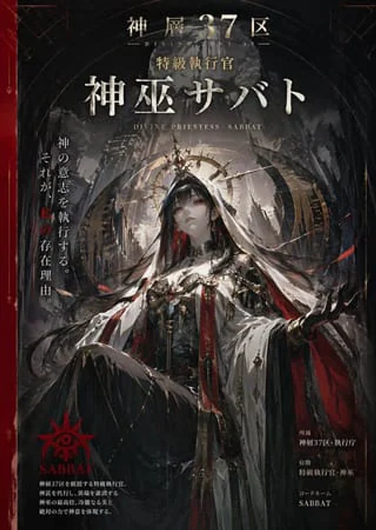

```text
『神層37区 特級執行官 神巫サバト』この名称のキャラクターと世界観に合ったビジュアルイメージを、プロのデザイナーとして縦長のポスターイメージとして制作して
```

Model: GPT Image 2
Author: @tebasaki3D

[ProjectD](https://aitoolsradar.com/en/prompts/c970c3a7161cae) · [Recorded source](https://x.com/tebasaki3D/status/2046371076402503709)
 · [Full original metadata and byte evidence](data/projectd-batch-0023.json)

## Character-Based Brand Identity Design

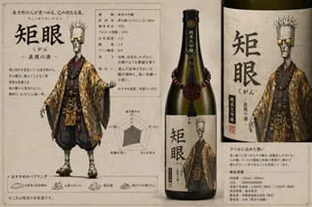

```text
Please create a Japanese sake based on this character. Do not use existing brand logos. Please come up with a name for the sake that reflects the character's traits.
```

Model: GPT Image 2
Author: GPT Image 2 Prompts

[ProjectD](https://aitoolsradar.com/en/prompts/67814d1dc84b39) · [Recorded source](https://x.com/roco_kn_roco/status/2047280707471638887)
 · [Full original metadata and byte evidence](data/projectd-batch-0023.json)

## Chase Dimond | Email Marketing Nerd 📧 #222

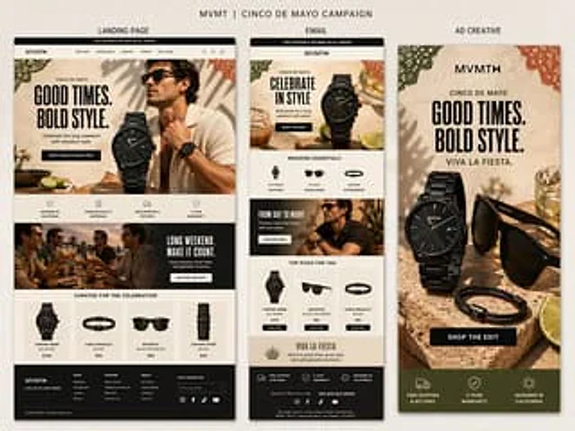

```text
Create a premium presentation-style campaign board for MVMT’s Cinco de Mayo campaign on a soft warm neutral background.

At the top, add the title:
“MVMT | CINCO DE MAYO CAMPAIGN”

Below it, show three clearly labeled vertical panels side by side with subtle shadows:
“LANDING PAGE”
“EMAIL”
“AD CREATIVE”

Overall style:
Clean, premium, masculine-leaning, modern DTC design. The image should feel like a polished creative review board, not a collage. All three panels should clearly belong to the same campaign, with shared typography, colors, product styling, and seasonal details.

Use a warm, elevated palette:
cream, sand, stone, black, charcoal, dark olive, terracotta, muted green, and warm golden accents.

Cinco de Mayo direction:
Tasteful and refined, not cheesy. Use subtle festive touches like papel picado-inspired accents, citrus, warm stone textures, celebratory drinks, and sunlit lifestyle styling.

Shared headline direction:
“GOOD TIMES. BOLD STYLE.”
Optional secondary line:
“VIVA LA FIESTA.”

Panel 1 — Landing Page:
Create the widest and most detailed panel as a tall desktop ecommerce landing page.
Include:
- MVMT site header
- hero with bold headline
- premium black watch as hero product
- stylish male lifestyle model
- CTA button
- icon/value prop row
- supporting lifestyle banner
- curated product grid
- realistic footer

Panel 2 — Email:
Create a slimmer tall ecommerce email mockup.
Include:
- promo bar
- MVMT logo and header
- hero section with same campaign art direction
- curated category or product row
- supporting lifestyle block
- featured products section
- compact footer

Panel 3 — Ad Creative:
Create a bold vertical Facebook ad.
Include:
- strong headline
- premium product composition with black watch, sunglasses, and bracelet
- citrus and celebratory props
- CTA button
- compact benefit strip at the bottom with messages like:
“FREE SHIPPING & RETURNS”
“2 YEAR WARRANTY”
“DESIGNED IN CALIFORNIA”

Important:
- landing page should feel broader and more layered
- email should feel modular and structured
- ad should feel bold, simple, and conversion-focused
- labels above each panel should be clearly visible
- text should be mostly legible
- everything should feel premium, realistic, and cohesive

Avoid:
cheesy fiesta graphics, bright rainbow colors, clutter, generic templates, messy collage styling, or cartoonish holiday visuals.

Output:
A highly realistic single-image campaign board showing a landing page, email, and ad creative for MVMT’s Cinco de Mayo campaign, all clearly labeled and designed as one cohesive system.
```

Model: GPT Image 2
Author: Chase Dimond | Email Marketing Nerd 📧

[ProjectD](https://aitoolsradar.com/en/prompts/bd9779f6d54cc0) · [Recorded source](https://x.com/ecomchasedimond/status/2047172163313222013)
 · [Full original metadata and byte evidence](data/projectd-batch-0023.json)

## Chase Dimond | Email Marketing Nerd 📧 #231

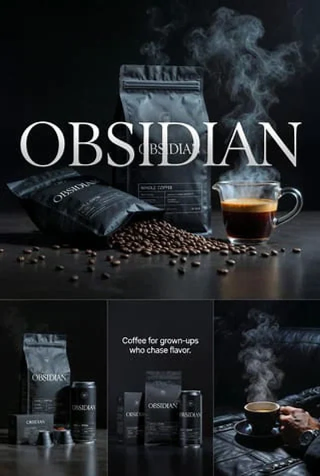

```text
Create four connected premium realistic editorial images for OBSIDIAN coffee. Dark cinematic grown-up vibe like high-end sportswear or coffee campaigns. Dramatic but grounded studio lighting, realistic textures, clean composition. Image 1: Hero poster with ‘OBSIDIAN’ and premium coffee display with steam and beans. Image 2: Product lineup - bags, cans, capsules. Image 3: Packaging close-up + tagline ‘Coffee for grown-ups who chase flavor.’ Image 4: Lifestyle steaming cup shot. Highly polished, sharp, realistic materials, consistent branding, no surreal effects
```

Model: GPT Image 2
Author: Chase Dimond | Email Marketing Nerd 📧

[ProjectD](https://aitoolsradar.com/en/prompts/ef1a4d4db65a7c) · [Recorded source](https://x.com/ecomchasedimond/status/2048598185841734064)
 · [Full original metadata and byte evidence](data/projectd-batch-0023.json)

## ChatGPT App Screenshot With Generated Portrait

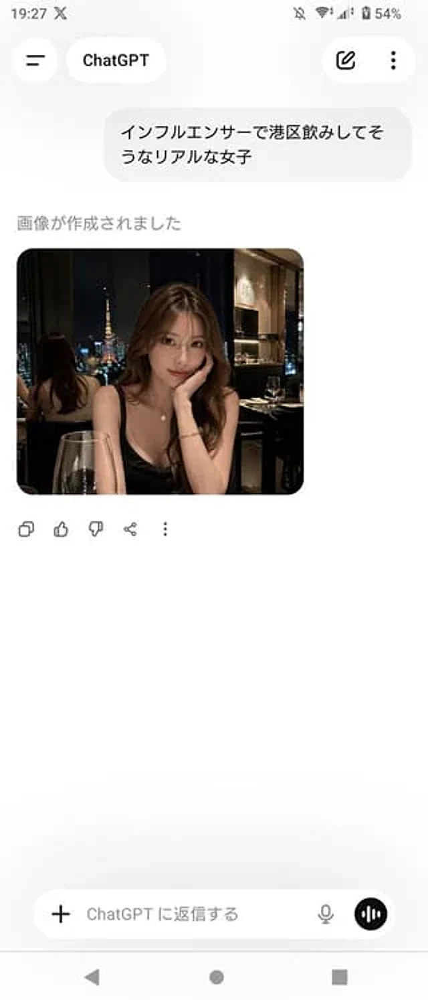

```text
A realistic screenshot of the ChatGPT mobile app (Japanese version) on an Android device, displayed in portrait full-screen mode with a clean, light-colored theme. The top status bar shows the time 19:27, network and battery icons, and the battery level at 54%. The header has a back-style menu icon on the left, a rounded label with the ChatGPT logo in the center, and two icons on the right: an edit pencil icon and a vertical three-dot menu. The chat area contains a Japanese user message bubble that reads "インフルエンサーで港区饮みしてそうなリアルな女子". Below this is the assistant status text "畫が作成されました", followed by a rounded image card. The generated image is a realistic portrait of a nighttime restaurant, depicting a charming young Japanese woman seated by an indoor window with a view of Tokyo Tower. She wears a black spaghetti-strap dress, has long, wavy brown hair, and is adorned with an elegant necklace and bracelet. She rests her chin on her hand at a candlelit dinner table, with a glass of red wine in the foreground. The ambiance is upscale, dimly lit, and has a trendy, Instagram-worthy feel. A mirror behind her reflects the back of her head and the cityscape. For privacy reasons, please blur or mosaic the woman's face. Below the image are five action icons: copy, like, dislike, share, and more. The bottom includes a message input bar with a plus icon on the left, placeholder text "ChatGPT に返信する", a microphone icon on the right, and a circular voice button. At the very bottom are three controls for an Android navigation bar. The overall composition should maintain a simple, spacious, and realistic feel, similar to a screenshot from a casual app.
```

Model: GPT Image 2
Author: GPT Image 2 Prompts

[ProjectD](https://aitoolsradar.com/en/prompts/ae823d99ad0071) · [Recorded source](https://x.com/tomo_creative/status/2046537571979899190#reversed-0)
 · [Full original metadata and byte evidence](data/projectd-batch-0023.json)

## ChatGPT App Showing WeChat Moments Screenshot

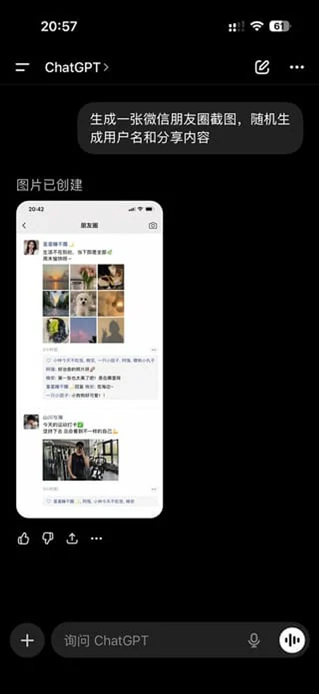

```text
A realistic screenshot of the ChatGPT mobile app in dark mode, displayed full-screen against a black background with an iPhone-style status bar. The top left side of the status bar shows the time 20:57, while the right side displays small cellular signal, Wi-Fi, and battery icons, with the battery level showing 61%. Below is the ChatGPT conversation title bar, containing a left-side menu icon, the title "ChatGPT," an edit icon, and a three-dot menu icon. In the chat area, a user bubble message is displayed: "Generate a screenshot of a WeChat Moments post, randomly generating a username and shared content," displayed as a right-aligned, dark gray, rounded-corner bubble. Below this is the assistant's reply area, with the text "Image created." Below this reply is a preview of the generated image: a long, rounded-corner screenshot of the WeChat Moments page on a white phone screen. Inside the generated image, the top bar displays the time 20:42 and the title "Moments." Two independent Moments posts are shown. The first post features a female profile picture and the username "Stars Don't Wake Up," followed by a short Chinese caption about life and the weekend, and then a 3x3 collage containing nine square images: a sunset over water, flowers, delicate food, a tree-lined avenue, a white plush dog, warm lighting, green fruit or dessert, pink clouds or sky, and a silhouette photo. Below this is a timestamp "2 hours ago," a line of three usernames who liked the post, and a comment section with three short Chinese comments. The second post features a male profile picture and the username "Mountains and Seas," followed by a short Chinese caption on a fitness theme, complete with a green checkmark emoji and a bicep emoji, followed by a mirror selfie from the gym, with a timestamp "3 hours ago" and a line of likes below. Beyond the generated image preview and within the ChatGPT app screenshot, a line of four action icons appears below the image: Like, Dislike, Share/Export, and More. At the bottom of the screen, the ChatGPT input bar includes a dark mode. On the left is a circular plus button with the placeholder text "Ask ChatGPT," and on the right are a microphone icon and a circular voice button. Using realistic mobile UI proportions, clear typography, lifelike Chinese application interface details, and photorealistic rendering, it looks like a genuine screenshot of a WeChat Moments post generated by the ChatGPT app's AI.
```

Model: GPT Image 2
Author: GPT Image 2 Prompts

[ProjectD](https://aitoolsradar.com/en/prompts/3c85061db300c3) · [Recorded source](https://x.com/freeLifeFFF/status/2046574910106144874#reversed-0)
 · [Full original metadata and byte evidence](data/projectd-batch-0023.json)

## ChatGPT Image Generation Guide Infographic


```text
{"type":"infographic","style":"Simple, corporate style, flat design, soft color accents, dark blue main color","header":{"logo":"swirl icon","academy_name":"}}{argument name="academy name" default="OpenAI Academy"} ","main_title":"{argument name="main title" default="ChatGPT Image Generation and Editing Practice Guide"} ","metadata":"Date and page information","summary_box":{"title":"Key points","content":"Paragraphs about key points"}},"layout":{"sections":[{"number":1,"title":"{argument name="section 1 title" default="How to write high-quality image prompts"} ","layout":"Double Columns","left_column":{"count":6,"items":[{"icon":"target","label":"Specific Target"},{"icon":"landscape","label":"Specify Theme, Scene, and Location"},{"icon":"brush","label":"Specify Style and Atmosphere"},{"icon":"sun","label":"Specify Lighting, Texture, and Composition"},{"icon":"prohibition","label":"Specific Constraints and Exclusions"},{"icon":"pencil","label":"Specify Changes and Retention Points During Editing"}]},"right_column":{"box_title":"Example of High-Quality Hints","image":"{argument name="example image subject" default="White mug on the wooden table"} {"number":2,"title":"Step-by-step correction method for optimization results","cards":{"count":4,"items":[{"icon":"sun","label":"Adjust brightness"},{"icon":"palette","label":"Adjust hue"},{"icon":"landscape","label":"Adjust background"},{"icon":"crop","label":"Maintain composition"}]},"bottom_banner":"Light bulb icon and text"},{"number":3,"title":"Advanced usage tips","list":{"count":3,"items":[{"icon":"multiple images","label":"Utilizing multiple images"},{"icon":"text 'Te'","label":"Text within image"},{"icon":"pie chart","label":"Infographic and diagrams"}]},"example_box":{"title":"Example with specified text","graphic":"With 'SPRING SALE' The green box"}},{"number":4,"title":"Other Notes","items":{"count":4,"items":[{"icon":"person","label":"Generate Real Person"},{"icon":"shield","label":"Usage of Brand and Work Names"},{"icon":"id card","label":"Copyright Label"},{"icon":"checklist","label":"Policy Compliance"}]}}],"footer":{"style":"Dark Blue Banner","text":"{argument name="footer summary" default="In summary, by clearly communicating the objectives and constraints and making step-by-step corrections, higher quality images can be generated."} "}}
```

Model: GPT Image 2
Author: GPT Image 2 Prompts

[ProjectD](https://aitoolsradar.com/en/prompts/bf1a79afccf0a6) · [Recorded source](https://x.com/super_bonochin/status/2043859866968891617#reversed-1)
 · [Full original metadata and byte evidence](data/projectd-batch-0023.json)

## ChatGPT Image Generation Guide Infographic


```text
{"type":"infographic","style":"clean, corporate, flat design, pastel accents, dark blue primary color","header":{"logo":"swirl icon","academy_name":"{argument name=\"academy name\" default=\"OpenAI Academy\"}","main_title":"{argument name=\"main title\" default=\"ChatGPTで画像を作る・直すための実践ガイド\"}","metadata":"date and page info","summary_box":{"title":"要点","content":"paragraph about key points"}},"layout":{"sections":[{"number":1,"title":"{argument name=\"section 1 title\" default=\"よい画像プロンプトの書き方\"}","layout":"two columns","left_column":{"count":6,"items":[{"icon":"target","label":"目的を明確に"},{"icon":"landscape","label":"主題・状況・場所を指定"},{"icon":"brush","label":"スタイル・雰囲気を指定"},{"icon":"sun","label":"光・質感・構図を指定"},{"icon":"prohibition","label":"制約・除外事項を明記"},{"icon":"pencil","label":"編集時は変更点と維持点を明確に"}]},"right_column":{"box_title":"良いプロンプト例","image":"{argument name=\"example image subject\" default=\"white mug on a wooden desk\"}"}},{"number":2,"title":"結果をよくするための段階的な修正","cards":{"count":4,"items":[{"icon":"sun","label":"明るさを調整"},{"icon":"palette","label":"色味を調整"},{"icon":"landscape","label":"背景を調整"},{"icon":"crop","label":"構図を維持"}]},"bottom_banner":"lightbulb icon with text"},{"number":3,"title":"少し踏み込んだ使い方","list":{"count":3,"items":[{"icon":"multiple images","label":"複数画像の活用"},{"icon":"text 'Te'","label":"画像内テキスト"},{"icon":"pie chart","label":"インフォグラフィック・図解"}]},"example_box":{"title":"テキスト指定の例","graphic":"green box with 'SPRING SALE'"}},{"number":4,"title":"追加の注意点","items":{"count":4,"items":[{"icon":"person","label":"実在人物の生成"},{"icon":"shield","label":"ブランド・作品名の使用"},{"icon":"id card","label":"クレジット表記"},{"icon":"checklist","label":"ポリシー遵守"}]}}],"footer":{"style":"dark blue banner","text":"{argument name=\"footer summary\" default=\"まとめ: 目的と制約を具体的に伝え、段階的に修正を重ねることで、より良い画像を生成できます。\"}"}}}
```

Model: GPT Image 2
Author: 炎鎮🔥 - ₿onochin -

[ProjectD](https://aitoolsradar.com/en/prompts/24cc7b572ccbc6) · [Recorded source](https://youmind.com/prompts/image-generation-guide-infographic-13631)
 · [Full original metadata and byte evidence](data/projectd-batch-0023.json)

## ChatGPT Joke Prescription Set


```text
A realistic product photo taken on a warm wooden tabletop showcases six medical-style items neatly arranged in two rows, designed as a humorous Japanese pharmacy set for ChatGPT. Top row: Three vertically arranged white prescription envelopes with blue printed borders and Japanese medical typography. Bottom row: Two blister packs of pills and a small, clear, resealable bag containing white powder, placed below the top envelopes respectively. The paper and packaging look incredibly realistic, like materials used in a real Japanese clinic, with slight creases, soft indoor natural light, and subtle shadows. Each of the three envelopes is distinct and clearly visible. The left envelope has the title in large blue Japanese characters: “内用药” (Internal Medicine). The patient's name field reads “ChatGPT様” (ChatGPT-sama). The dosage field states: one tablet twice daily, after breakfast and dinner, for seven days. The first medicine box is titled "【Okusuri】", the medicine name is "Thinking Sedative Tablet 10mg", and a small print below explains that it is used to suppress divergent thinking and excessive reasoning output. The bottom date is "June 5, 2025". The bottom clinic name and address field is "AI Mediaclenic", with a Tokyo-style address and phone number, and a blue medical cross icon. The middle envelope is titled "Oral Medication". The patient's name field is "ChatGPT-sama". The dosage instructions state one tablet once daily before bedtime for 7 days. The second medicine box is titled "【Okusuri】", the medicine name is "Hallucination Suppressant Tablet 5mg", and a small print below states that it can improve hallucination tendencies. The date is also "June 5, 2025". The bottom has the same clinic information and blue medical cross icon. The right envelope is titled "Single-dose Medication". Patient Name: "ChatGPT 様". Usage: Indicated for anxiety, confusion, or excessive output. Dosage: 1 packet per dose, taken as needed. The box title is "【おくすり】", the drug name is "Cue Word Adjustment Powder 1g", and a small print below states it is used to adjust overfitting and cue word confusion. Date: "June 5, 2025". The bottom displays the same clinic information and a blue medical cross icon. Item in the lower left corner: 1 blister pack of silver foil containing 10 round white tablets arranged in 2 rows and 5 columns, each tablet embossed with the number "10". The foil edge is repeatedly printed with "Thinking Tranquility Tablet 10mg". A white pharmacy label is affixed to the front, stating "ChatGPT 様", instructions to take 1 tablet twice daily after breakfast and dinner, a barcode, the date "2025/06/05", and the clinic name. The item in the lower center: A blister pack of silver foil containing 8 pale yellow round tablets arranged in 2 rows and 4 columns. The foil edge is printed with the repeated words "Hallucination Inhibitor 5mg". A white pharmacy label is affixed to the front, stating "ChatGPT", instructions to take 1 tablet once daily before bedtime, a barcode, the date "2025/06/05", and the clinic's name. The item in the lower right corner: A small, clear, sealed plastic bag containing white powder. A white label is affixed to the front, stating "Callword Adjustment Powder 1g", containing "ChatGPT", instructions for use for anxiety, confusion, and excessive output, dosage "1 packet (1g) once, if necessary", the date "2025/06/05", and the clinic's name. Style: Realistic documentary-style product photography, comedic fake prescription prop design, simple Japanese pharmaceutical graphic layout, high readability, neutral tones of white, blue, silver, beige and wood brown, top-down perspective, no human hands, no extra clutter, realistic print texture and packaging details.
```

Model: GPT Image 2
Author: GPT Image 2 Prompts

[ProjectD](https://aitoolsradar.com/en/prompts/f4cb49c0bb3e64) · [Recorded source](https://x.com/Masimo_Blue/status/2046727684538105890#reversed-2)
 · [Full original metadata and byte evidence](data/projectd-batch-0023.json)

## ChatGPT Robot Introduction Poster


```text
Create a square, cheerful educational promotional illustration/photo composite showing a cute white humanoid robot mascot at a wooden desk, introducing {argument name="assistant name" default="ChatGPT"} as an AI assistant created by {argument name="company name" default="OpenAI"}. The robot is centered, with a glossy black rounded screen face, glowing cyan smiling eyes, white plastic body, rounded headphones/ear pods, black joints, one hand holding a white sign and the other hand waving. On the robot chest and sign, include a teal knot-like OpenAI-style logo. The sign reads: “I was created by” above the logo, large “OpenAI”, then “An AI research and deployment company”, and at the bottom “Better AI. A brighter future.” Use a warm classroom/office setting with shallow depth of field, soft natural light, polished wooden desktop, and a dark chalkboard-style background covered with friendly hand-drawn white and mint lettering. On the left chalkboard, write exactly: “Hi there!” then “I’m” then a large mint underlined “ChatGPT”. Add three explanatory doodle items, count exactly 3: a speech bubble icon with “A large language model (AI assistant)”; a lightbulb icon with “I can answer questions, explain things, help you create, solve problems, and much more!”; a heart icon with “I’m here to be helpful, honest, and friendly.” On the right chalkboard, include a large OpenAI logo with the word “OpenAI” and the stacked words “Research / Safety / Useful AI / for everyone”; above the robot add handwritten “That’s me!” with an arrow pointing to the robot. Desk objects, count exactly 4: a stack of 4 books on the left with spines labeled “BETTER QUESTIONS”, “CLEARER ANSWERS”, “MORE HELPFUL TOMORROW”, and a tiny heart on the bottom book; an open laptop in the lower left with the text “Curiosity builds a better world” and a heart on the lid; a white coffee mug on the right reading “Same team. A brighter future.” with a smiley face; and a thin handwritten footer along the bottom edge reading “OpenAI × ChatGPT = More possibilities for everyone” with small decorative rays and a heart. Style should feel like a high-quality 3D render mixed with hand-lettered chalk notes, clean rounded shapes, teal accent color, friendly accessible branding, slight realistic camera blur, no harsh shadows, no extra characters, no watermarks, and keep all text legible.
```

Model: GPT Image 2
Author: Chris

[ProjectD](https://aitoolsradar.com/en/prompts/95d5917c986126) · [Recorded source](https://youmind.com/prompts/chatgpt-robot-introduction-31048)
 · [Full original metadata and byte evidence](data/projectd-batch-0023.json)

## ChatGPT Super App Concept


```text
{argument name="application" default="ChatGPT Super App"} Computer screenshot
```

Model: GPT Image 2
Author: GPT Image 2 Prompts

[ProjectD](https://aitoolsradar.com/en/prompts/32fb8752d5c5bf) · [Recorded source](https://x.com/patrickassale/status/2044501356635963588)
 · [Full original metadata and byte evidence](data/projectd-batch-0023.json)

## Cheesy Chips Snack Ad Poster

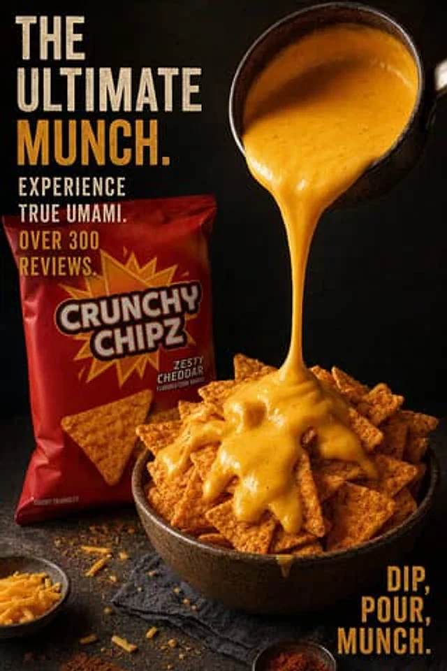

```text
Create a highly dramatic studio food advertisement poster with a textured black background, using emotionally charged, high-contrast lighting and a rich, warm orange hue. The composition is vertical, visually divided into two parts: the left side features striking, stacked advertising copy, while the right side dynamically showcases the core food. In the lower right corner, a dark, rustic-style bowl is piled high with triangular cheddar chips, while a dark metal frying pan tilted in the upper right corner continuously pours thick, glossy cheese sauce. The cheese thickly covers the chips, creating rich, lava-like folds. Behind the bowl on the left, a standing red snack bag is placed, featuring a striking yellow-orange starburst graphic and the brand name in large white-outlined font.{argument name="brand name" default="CRUNCHY CHIPZ"} Smaller flavor descriptions are provided below.{argument name="flavor text" default="ZESTY CHEDDAR"} And a tiny subtitle, "FLAVORED CORN SNACKS." Small text, "SAVORY TRIANGLES," is printed in the lower left corner of the packaging. Two small condiment bowls are placed on a dark table: a shallow bowl containing shredded cheddar cheese in the lower left corner, and a small bowl containing red seasoning near the lower right corner. Scattered crumbs and cheese shreds are on the table, and a dark napkin rests beneath the main bowl. A bold, distressed, compressed capital font in a retro poster style is used. A title is stacked in five lines in the upper left corner, containing the following text:{argument name="headline text" default="THE ULTIMATE MUNCH."} The first three lines, “THE,” “ULTIMATE,” and “MUNCH.”, use a large font, while the fourth line, “EXPERIENCE,” and the fifth line, “TRUE UMAMI.”, use a smaller white font. Below these, add two lines of orange promotional text.{argument name="review text" default="OVER 300 REVIEWS."} Place three lines of orange promotional slogans in the lower right corner:{argument name="tagline text" default="DIP, POUR, MUNCH."} Employing a cinematic food photography style, the potato chips and cheese flow are clearly detailed, presenting an enticing glossy texture, possessing the realism of commercial packaging and the advertising aesthetics of a high-end snack brand.
```

Model: GPT Image 2
Author: GPT Image 2 Prompts

[ProjectD](https://aitoolsradar.com/en/prompts/2c64f87af62449) · [Recorded source](https://x.com/NovaIAHQ/status/2046812524738203835#reversed-0)
 · [Full original metadata and byte evidence](data/projectd-batch-0023.json)

## Chengdu Food Map Illustration

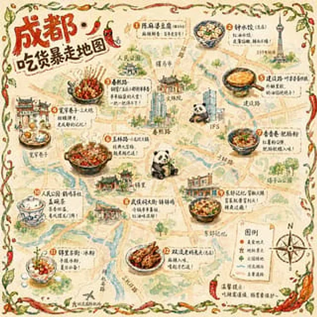

```text
一张手绘风格的城市美食地图，以成都为主题。画面以鸟瞰视角的手绘简化城市地图为底，标注主要道路和地标但不追求精确比例而是追求可爱的手绘感。地图上分布着 12 个美食地点的精致手绘小插画：春熙路的串串香（一把竹签插着各种食材冒着热气）、宽窄巷子的三大炮（三个糯米团子飞向铜盘）、建设路的蛋烘糕（金黄酥脆正在翻面）、玉林路的火锅（九宫格锅翻滚冒泡）等，每个插画约占地图的 5% 面积，旁边用手写体标注店名和一句推荐语"凌晨两点还在排队的那家"。地图边缘用手绘藤蔓和辣椒装饰形成边框。右下角有一个手绘指南针和图例说明。左上角标题"成都·吃货暴走地图"使用胖圆的手绘美术字配辣椒装饰。整体画风为水彩+彩铅混合的手绘质感，颜色以暖色系（辣椒红、姜黄、翠绿）为主，图片比例 1:1。
```

Model: GPT Image 2
Author: @Panda20230902

[ProjectD](https://aitoolsradar.com/en/prompts/4db2eaab224b77) · [Recorded source](https://x.com/Panda20230902/status/2045396918965285111)
 · [Full original metadata and byte evidence](data/projectd-batch-0023.json)

## Chengdu Hand-Drawn Food Map UI

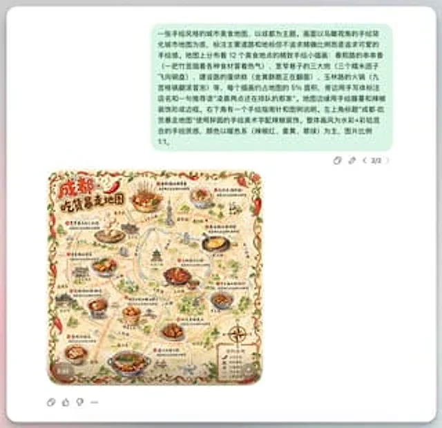

```text
This is a screenshot-style AI-generated chat interface composition. The background is a light gray application interface, with a rounded white panel with a soft shadow in the center. Near the top is a large, light mint green chat bubble containing a black sans-serif Chinese string describing a hand-drawn map of Chengdu's food scene. Below it, slightly left-aligned, is a square illustrated map with rounded corners. This map is a whimsical, hand-drawn travel and food map with a prominent Chinese calligraphy title in the upper left corner.{argument name="headline text" default="Chengdu! Foodie&#39;s Travel Map"} The theme is{argument name="city name" default="Chengdu"} Presented as a retro hand-drawn local food map, it features a warm beige paper texture, watercolor ink outlines, and a playful, handmade travel poster feel. The map displays simplified streets, landmarks, and Chinese area labels, prioritizing charm and decorative appeal over geographical precision. It includes 12 featured food spots, each marked with a red numbered dot and a small Chinese label, accompanied by detailed illustrations of the dishes. The 12 dishes are: 1) a bowl of spicy skewers, 2) a bowl of sweet noodles, 3) a specialty rabbit head, 4) a guokui (a type of flatbread) or stuffed pancake, 5) hot pot, 6) maocai (a type of Sichuan hot pot), 7) dandan noodles, 8) spicy wontons, 9) bobo chicken, 10) fuqi feipian (a type of Sichuan-style beef and offal soup), 11) a spicy stir-fry, and 12) another classic Chengdu snack platter. Miniature sketches of Chengdu landmarks are scattered around the roads, including tower-like buildings, traditional gate towers, modern urban architecture, and a central iconic structure. The map is bordered by a decorative border composed of red chili peppers, green vines, and tender leaves. Warm colors, primarily chili red, mustard yellow, olive green, tan, and soft jade, are used. In the lower right corner of the map, there is a marker {argument name="legend title" default="Legend"} The map features a small legend box containing four legend items, each with a miniature icon and Chinese text, plus a compass with N, E, S, and W. Handwritten Chinese road names and annotations are added throughout the map. Outside the image, the interface includes gray operation icons in the lower right corner of a green chat bubble, a page indicator displayed as a 2/2, an "Edit" capsule button overlaid on the lower left of the map image, a circular download/share button in the lower right corner, and a simple toolbar at the bottom containing four reaction/operation icons. Overall appearance: a clean and modern chat UI that displays generated square illustrations and uses the map as the visual focus.
```

Model: GPT Image 2
Author: GPT Image 2 Prompts

[ProjectD](https://aitoolsradar.com/en/prompts/ec4e0f0efc2a42) · [Recorded source](https://x.com/cheerselflin/status/2046493268586991633#reversed-0)
 · [Full original metadata and byte evidence](data/projectd-batch-0023.json)

## Cherry 2.O #220

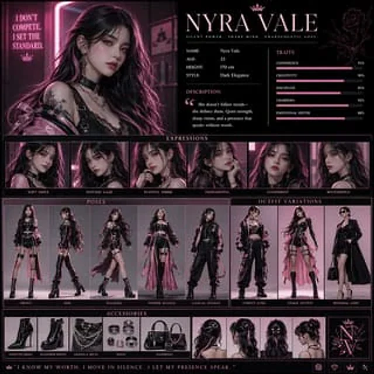

```text
Create a high-resolution vertical character concept poster with a luxury pink and white  aesthetic, blending elegance with edgy, modern fashion. The layout should feel like a premium magazine profile with clean sections and perfect grid alignment.

Main subject: A unique young woman (not resembling any real person), with long silky dark hair featuring subtle pink highlights. She has a confident, calm expression with a slightly mysterious aura. She wears a black and pink fusion outfit (mix of streetwear and idol fashion) with glossy textures, lace, and metallic accents. Lighting is soft but dramatic, with neon pink glow against dark tones.

Top section:
Large hero portrait on one side. On the other side, include a sleek profile panel with elegant English text:

Name: Nyra Vale
Age: 23
Height: 170 cm
Style: Dark Elegance

Short description:
“She doesn’t follow trends—she defines them. Quiet strength, sharp vision, and a presence that speaks without words.”

Add a Traits section with stylish progress bars:

Confidence
Creativity
Discipline
Charisma
Emotional Depth

Middle section:
Grid of 5–6 small portraits showing different expressions (soft smile, intense gaze, playful smirk, thoughtful, confident).

Lower sections:

Full-body poses (front, side, walking pose, power stance, casual stance).
Outfit variations (street luxe, stage outfit, minimal chic).
Accessories panel (heels, boots, chains, rings, handbags, hairstyles).

Text tone:
Strong, meaningful, and confident—focused on individuality, self-worth, and silent power. Avoid filler text.

Style:
Ultra-detailed, 4K quality, glossy magazine finish, cinematic lighting, sharp focus, balanced contrast, modern editorial layout, perfectly aligned grid.
```

Model: GPT Image 2
Author: Cherry 2.O

[ProjectD](https://aitoolsradar.com/en/prompts/ff245fd7e8bd14) · [Recorded source](https://x.com/Mind_Boticni/status/2048779320966230339)
 · [Full original metadata and byte evidence](data/projectd-batch-0023.json)

## Cherry 2.O #257

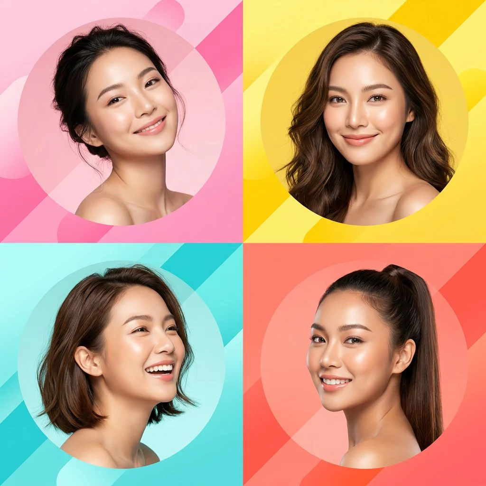

```text
Ultra-modern high-end skincare advertising collage featuring four beautiful young Asian women, each portrait styled in a separate geometric section of a dynamic diagonal layout. Clean editorial beauty photography with soft natural skin texture, glowing healthy complexion, and subtle makeup. Bright vibrant color blocking design using pink, yellow, cyan, and coral tones. Minimal abstract background shapes, smooth gradients, and modern graphic design composition. Studio-quality lighting, fashion magazine aesthetic, premium cosmetic campaign feel. Each woman posed confidently in different angles, smiling softly, fresh and youthful vibe. Balanced symmetry with sharp diagonal divisions and circular portrait frames. Highly polished commercial beauty branding style, cinematic lighting, ultra-detailed, 4k resolution.

IMPORTANT NEGATIVE PROMPT:
No text, no typography, no logos, no brand names, no product bottles, no packaging, no watermark, no labels, no written elements.
```

Model: GPT Image 2
Author: Cherry 2.O

[ProjectD](https://aitoolsradar.com/en/prompts/fce3250c8a9df8) · [Recorded source](https://x.com/Mind_Boticni/status/2047550158427259188)
 · [Full original metadata and byte evidence](data/projectd-batch-0023.json)

## Cherry Blossom Kimono Portrait Grid

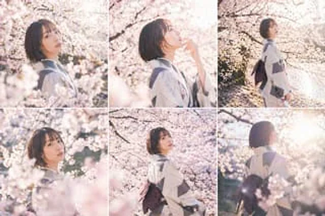

```text
{
  "type": "Edit portrait collage",
  "subject": {
    "gender_presentation": "young women",
    "hair": {
      "color": "Dark brown",
      "style": "Short straight bob, chin length, side part"
    },
    "wardrobe": {
      "main_garment": "A light-colored traditional kimono with large geometric gray blocks and delicate textures.",
      "obi": "A dark plum or dark brown belt, tied in a bow at the back."
    },
    "pose_and_mood": "A calm, contemplative, elegant, and gentle candid shot."
  },
  "scene": {
    "location": "Blooming outdoor cherry blossom grove",
    "season": "spring",
    "lighting": "Strong golden hour backlighting, with dreamy mist, luminous highlights, soft overexposure, and solar flare.",
    "color_palette": "Pale pink, cream, blush pink, warm white, soft gray, and soft plum color.",
    "depth_of_field": "With an extremely shallow depth of field, the foreground and background have a rich cherry blossom blur effect."
  },
  "layout": {
    "grid": {
      "rows": 2,
      "columns": 3,
      "count": 6
    },
    "images": [
      {
        "position": "Top left",
        "description": "A close-up profile shot, facing left, upper body composition, with cherry blossoms filling the foreground and background."
      },
      {
        "position": "Upper-middle",
        "description": "A close-up from the side, facing to the right, one hand lightly touching the lips, soft backlight filtering through the cherry blossoms."
      },
      {
        "position": "Top right",
        "description": "Three-quarters full-body side view, standing under a cherry blossom tree, the kimono and obi are clearly visible, sunlight streaming in from the upper right corner."
      },
      {
        "position": "Bottom left",
        "description": "A close-up portrait, partially obscured by out-of-focus cherry blossoms in the foreground, with the subject turned to the left."
      },
      {
        "position": "Middle to lower",
        "description": "Mid-shot three-quarter view of the back, head slightly turned to the left, belt bow in the center, background is lush cherry blossoms."
      },
      {
        "position": "Bottom right",
        "description": "A three-quarter view portrait from behind, looking up at bright sunlight, with strong lens flare and luminous rim lighting."
      }
    ]
  },
  "style": {
    "photography": "Romantic Japanese-style spring portrait photography",
    "finish": "High-key, light, pastel, cinematic, softly diffused",
    "composition": "The intimate, candid editing style features floral compositions in every frame."
  },
  "prompt": "Create a 6-panel editable portrait collage, with a person as the main subject.{argument name=\"subject\" default=\"young women\"} Wearing{argument name=\"kimono pattern\" default=\"Light-colored traditional kimono with large geometric gray blocks\"} and{argument name=\"obi color\" default=\"Deep plum color\"} The belt, in full bloom{argument name=\"blossom type\" default=\"Cherry blossoms\"} Shoot below. Use{argument name=\"lighting style\" default=\"Golden hour backlighting with dreamy fog and lens flare\"} The hairstyle is a dark brown short bob. A 2x3 grid was generated containing six different portraits: one side close-up facing left, one side close-up facing right with fingers lightly touching the lips, one three-quarter full-body side view, one close-up portrait partially obscured by cherry blossoms in the foreground, one mid-range three-quarter back view showing a belt bow, and one three-quarter back view portrait looking up at the sun. The style emphasizes shallow depth of field, rich floral blur, pale pink and cream tones, light high-key exposure, and soft cinematic diffusion, presenting a romantic Japanese portrait photography style."
}
```

Model: GPT Image 2
Author: GPT Image 2 Prompts

[ProjectD](https://aitoolsradar.com/en/prompts/809792b81b1dec) · [Recorded source](https://x.com/haiz_ai/status/2047786805270118660#reversed-0)
 · [Full original metadata and byte evidence](data/projectd-batch-0023.json)

## Chibi Anime Educational Infographic

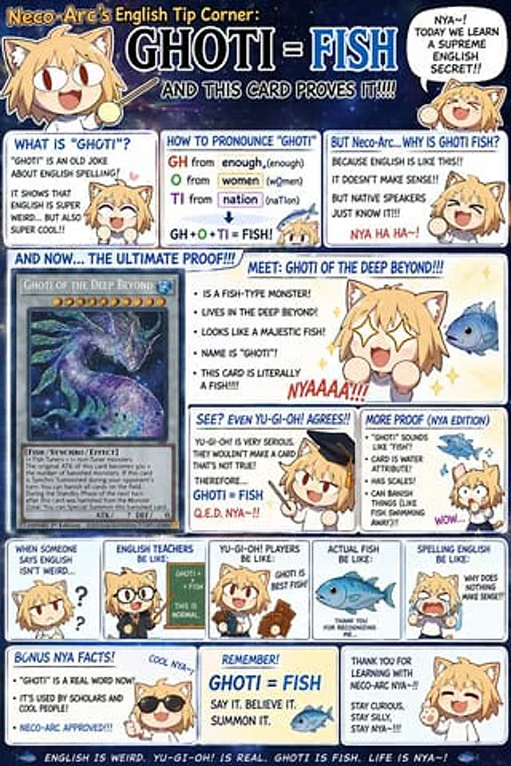

```text
{
  "type": "Anime-style educational meme infographic",
  "character": {
    "name": "{argument name=\"character name\" default=\"Neco-Arc\"}",
    "appearance": "A chibi-style anime catgirl with blonde hair, cat ears, big eyes, and simple cartoon features.",
    "total_illustrations": 13
  },
  "theme": {
    "topic": "{argument name=\"main topic\" default=\"GHOTI = FISH\"}",
    "reference": "{argument name=\"card game\" default=\"Yu-Gi-Oh!\"} Cards{argument name=\"card name\" default=\"Ghoti of the Deep Beyond\"}"
  },
  "layout": {
    "background": "The title is set against a starry sky background with white grids and a blue border.",
    "header": {
      "title": "Neco-Arc's English mini-lesson: GHOTI = FISH, and this card proves it!!!",
      "elements": [
        "The character points with a stick.",
        "Pop-up: 'Meow~! Today we're going to learn the ultimate secret to English!!'"
      ]
    },
    "sections": [
      {
        "row": 1,
        "count": 3,
        "panels": [
          {
            "title": "What is 'GHOTI'?",
            "content": "Words, a joyful role"
          },
          {
            "title": "How to pronounce 'GHOTI'?",
            "content": "A breakdown of the pronunciation of GH, O, and TI; a minor character; one fish."
          },
          {
            "title": "But Neco-Arc... why is GHOTI a fish?",
            "content": "Words, the laughing character"
          }
        ]
      },
      {
        "row": 2,
        "title": "Now... the ultimate proof!!!",
        "count": 4,
        "panels": [
          {
            "type": "Card Model",
            "content": "Detailed collectible cards showcasing deep-sea fish from the cosmos"
          },
          {
            "title": "Appearance: Ghoti from the Abyss Sea!!!",
            "content": "Key points list, starry-eyed character, 1 fish"
          },
          {
            "title": "See? Even Yu-Gi-Oh! agrees!!",
            "content": "The character wearing a graduation cap points at the card."
          },
          {
            "title": "More proof (cat version)",
            "content": "Key points list, shocking characters, 1 fish"
          }
        ]
      },
      {
        "row": 3,
        "type": "Reaction Comic",
        "count": 5,
        "panels": [
          {
            "title": "When someone says that English is not strange...",
            "content": "A bewildered character with a head full of question marks"
          },
          {
            "title": "English teacher:",
            "content": "The character wearing glasses in front of the blackboard"
          },
          {
            "title": "Yu-Gi-Oh! Players:",
            "content": "A character with 4 trading cards"
          },
          {
            "title": "Real fish:",
            "content": "An illustration of a blue fish."
          },
          {
            "title": "English spelling:",
            "content": "The crying character"
          }
        ]
      },
      {
        "row": 4,
        "count": 3,
        "panels": [
          {
            "title": "Meow Meow Trivia!",
            "content": "Character wearing sunglasses"
          },
          {
            "title": "Remember! GHOTI = FISH",
            "content": "Summary text: 1 fish"
          },
          {
            "title": "Thanks for learning with Neco-Arc!",
            "content": "The waving character"
          }
        ]
      }
    ],
    "footer": "English is weird. Yu-Gi-Oh! It's true. GHOTI is fish. Life is meow~!"
  }
}
```

Model: GPT Image 2
Author: GPT Image 2 Prompts

[ProjectD](https://aitoolsradar.com/en/prompts/7974c828fae76a) · [Recorded source](https://x.com/senb0n22a/status/2045000780617482536#reversed-0)
 · [Full original metadata and byte evidence](data/projectd-batch-0023.json)

## Chibi Catgirl at Yokohama Stadium

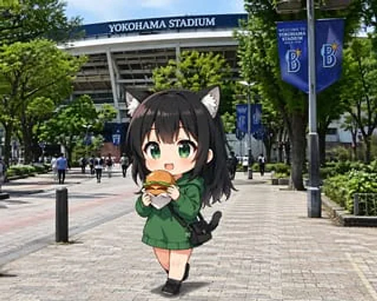

```text
A cute anime chibi-style girl is walking towards the camera, with the background being {argument name="stadium name" default="YOKOHAMA STADIUM"} The pedestrian walkway is shaded by lush green trees. The scene presents a realistic backdrop of a modern Japanese city, with bright midday sunlight and glimpses of blue sky through the leaves. The stadium dominates the upper part of the background, showcasing its massive white structural beams and the words {argument name="stadium name" default="YOKOHAMA STADIUM"} A dark blue sign. Two long, vertical blue flags hang from a lamppost to the right, bearing a stylized "B" logo and the welcome message for Yokohama Stadium. Two smaller, matching blue flags adorn the walkway in the distance. The plaza is wide and open, with two short, black mooring posts visible to the left, flanked by hedges and mature trees. Scattered pedestrians in the distance add to the sense of scale. In the foreground center of the image, a super-deformed catgirl character is naturally composited: petite, chibi-style proportions, a large head, soft anime-style shadows, fair skin, long, slightly messy dark hair with bangs, fluffy cat ears, and a black kitten tail. She wears an oversized {argument name="hoodie color" default="forest green"} She wears a hoodie, the hem of which hangs down like a short skirt, and black low-top shoes. She carries a black crossbody bag with a flap and a small charm. She holds a packaged hamburger or sandwich to her mouth, as if eating while walking. Her posture is slightly pigeon-toed, appearing casual and natural, with her legs crossed, exuding a shy and cute feeling. The imagery utilizes a wonderful contrast between highly realistic street photography and a delicate anime sticker-style character, with clear outlines and subtle shadows on the ground. The face is kept centered but obscured by a large square mosaic blur.
```

Model: GPT Image 2
Author: GPT Image 2 Prompts

[ProjectD](https://aitoolsradar.com/en/prompts/4e74f89d72be28) · [Recorded source](https://x.com/raid_ada/status/2047060374852440374#reversed-0)
 · [Full original metadata and byte evidence](data/projectd-batch-0023.json)

## Chibi Clone Sticker Diary

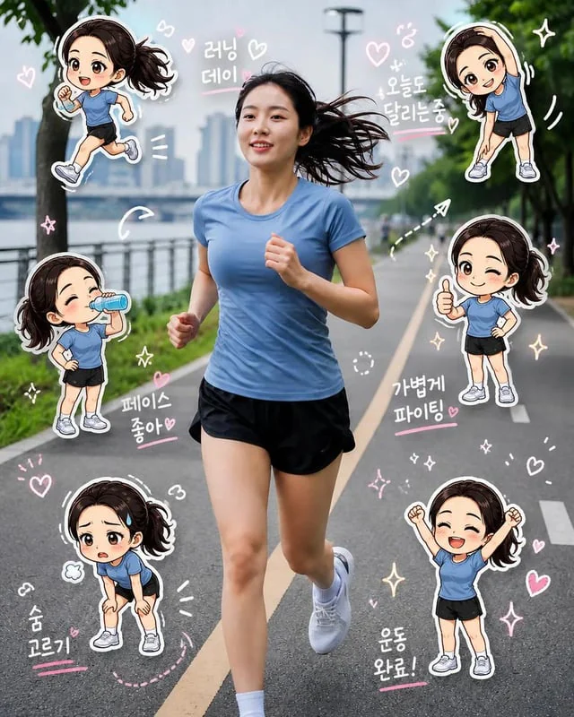

```text
Create a high-quality “{argument name="style" default="chibi clone sticker diary photo"}” based on the uploaded real-life image. Preserve the original person’s identity, face, hairstyle, hair color, outfit, body proportions, pose, lighting, and background. Do not alter facial features or turn the subject into a full illustration—maintain a realistic photo look. Analyze the scene as a {argument name="theme" default="fitness/running lifestyle moment"}. Add 5–8 chibi mini clones of the same person around the subject, designed in a consistent kawaii sticker style (big head, small body, large expressive eyes, clean digital finish). Each clone must clearly resemble the real person (same hair, outfit, colors). Design each chibi with different theme-related actions and emotions. Render each chibi as a sticker with white outlines, soft shadows, and a slightly floating effect. Arrange them around the subject and edges without covering the face or main body. Add light hand-drawn doodles in white with {argument name="accent color" default="subtle pink accents"}, keeping a clean scrapbook diary feel. Include 5–8 short handwritten-style phrases matching the mood. Composition: keep the real person as the central focus, surrounded by chibi stickers and doodles. The result should feel like a polished, playful, high-resolution social media lifestyle diary image.
```

Model: GPT Image 2
Author: Kashberg

[ProjectD](https://aitoolsradar.com/en/prompts/0e951e074d0ea5) · [Recorded source](https://youmind.com/prompts/chibi-sticker-diary-photo-18048)
 · [Full original metadata and byte evidence](data/projectd-batch-0023.json)

## Chibi Fairy Thank-You Sticker Sheet


```text
{
  "type": "sticker sheet",
  "subject": "Cute chibi elf thank-you message stickers",
  "character": {
    "gender_presentation": "girl",
    "style": "3D chibi-style toy character rendering, with a glossy plastic texture, soft and cute proportions, and a large head and small body.",
    "hair": {
      "color": "Warm reddish-brown",
      "style": "Short wavy bob with curled ends and bangs"
    },
    "ears": "Pointy elf ears",
    "hat": "Shiny silver beret",
    "outfit": [
      "Rainbow silver-white dress",
      "Short puff sleeves",
      "White socks",
      "Light-colored shoes"
    ],
    "wings": "Two translucent fairy wings with a soft iridescent sheen."
  },
  "layout": {
    "background": "Solid color cutout green background",
    "grid": {
      "rows": 3,
      "columns": 4
    },
    "sticker_count": 12,
    "spacing": "Evenly distributed with large gaps",
    "sticker_style": "Each image and text is rendered as a die-cut sticker with a thick white outline and soft shadows."
  },
  "stickers": [
    {
      "position": "Row 1, Column 1",
      "pose": "Stand with your hands clasped together in front of your chest.",
      "text": "ありがとう!",
      "decorations": [
        "2 flashing icons"
      ]
    },
    {
      "position": "Row 1, Column 2",
      "pose": "With hands clasped together in front of the body, bow slightly.",
      "text": "Thank you."
    },
    {
      "position": "Row 1, Column 3",
      "pose": "Holding a pink heart in front of her chest",
      "text": "ほんと ありがと!",
      "decorations": [
        "2 pink hearts",
        "2 yellow emphasis marks"
      ]
    },
    {
      "position": "Row 1, Column 4",
      "pose": "arms outstretched excitedly",
      "text": "That was a huge help!"
    },
    {
      "position": "Row 2, Column 1",
      "pose": "Holding a bouquet of flowers",
      "text": "Expressing my gratitude with flowers",
      "decorations": [
        "2 pink flower icons"
      ]
    },
    {
      "position": "Row 2, Column 2",
      "pose": "Close your eyes and put your hands together in a prayer position.",
      "text": "うれしい!",
      "decorations": [
        "2 small pink hearts"
      ]
    },
    {
      "position": "Row 2, Column 3",
      "pose": "Stand politely with your hands clasped together.",
      "text": "いつもありがとうございます!",
      "decorations": [
        "2 flashing icons"
      ]
    },
    {
      "position": "Row 2, Column 4",
      "pose": "wink and make a peace sign",
      "text": "サンキュー!",
      "decorations": [
        "1 yellow star icon"
      ]
    },
    {
      "position": "Row 3, Column 1",
      "pose": "Raise a hand energetically",
      "text": "That was incredibly helpful!",
      "decorations": [
        "1 yellow explosion icon"
      ]
    },
    {
      "position": "Row 3, Column 2",
      "pose": "Sit curled up, eyes closed, hands folded together",
      "text": "Thank you for your kind consideration.",
      "decorations": [
        "1 pink heart"
      ]
    },
    {
      "position": "Row 3, Column 3",
      "pose": "Stand with your hands clasped together in front of your chest.",
      "text": "Thank you for always supporting me!",
      "decorations": [
        "2 pink hearts"
      ]
    },
    {
      "position": "3rd row, 4th column",
      "pose": "Close your eyes, adopt a calm and grateful expression, and put your hands together in prayer position.",
      "text": "I am truly grateful.",
      "decorations": [
        "4 white radial lines"
      ]
    }
  ],
  "rendering": {
    "lighting": "Soft studio lighting",
    "camera": "Facing forward, centered, each sticker is a full-body photo.",
    "quality": "Neat business sticker page layout, sharp edges, bright and saturated colors"
  }
}
```

Model: GPT Image 2
Author: GPT Image 2 Prompts

[ProjectD](https://aitoolsradar.com/en/prompts/f4f0970fdae38c) · [Recorded source](https://x.com/aiehon_aya/status/2046847588742369511#reversed-0)
 · [Full original metadata and byte evidence](data/projectd-batch-0023.json)

## Chibi Mini Versions Photo Edit


```text
Edit the image while keeping the original photo completely unchanged — including the person, face, body, pose, lighting, and gym background.

Add multiple small, cute chibi-style “mini versions” of her around the image. Each mini character should have a big head, expressive facial features, and match her hairstyle and outfit.

Depict each mini version doing different gym-related activities:

one cheering with arms raised

one running in running shoes

one drinking from a shaker bottle

one wearing sporty running glasses

one climbing near her leg

Enhance the image with playful, hand-drawn doodles and handwritten notes in white and pink ink, in a scrapbook style. Include elements like arrows, stars, hearts, sparkles, and sketchy lines.

Add cute, handwritten gym-themed motivational phrases:

“lift strong”

“stronger every rep”

“no pain no gain”

“sweat now, shine later”

“progress over perfection”

“train hard, stay soft”

The overall vibe should feel fun, energetic, and feminine.
```

Model: GPT Image 2
Author: Ciri

[ProjectD](https://aitoolsradar.com/en/prompts/4c134793c37726) · [Recorded source](https://youmind.com/prompts/chibi-mini-versions-photo-edit-17532)
 · [Full original metadata and byte evidence](data/projectd-batch-0023.json)

## Chibi Rabbit OpenPose Diagram


```text
A simple, centered full-body illustration showcasing an adorable chibi version.{argument name="animal type" default="rabbit"} Character, background is solid color{argument name="background color" default="Light gray"} The character is drawn in a flat cartoon style, featuring clear, bold black outlines and minimalist shadows. The character has a white body, a large, round head, two long, erect ears (with bright cyan inner ears), two large oval eyes with cyan irises, black pupils, and tiny highlights, thin, curved eyebrows, a small, pinkish-red nose, and a slightly upturned mouth. The character faces forward, with arms outstretched horizontally to the sides and legs apart in a simple standing pose. A short, semi-circular, fluffy tail, formed by short black dotted lines, is visible on the right side of the body. A clear OpenPose-style skeletal marker system is overlaid on the character: 2 purple eye keypoints, 1 red nose keypoint, 1 blue neck keypoint, 2 shoulder keypoints, 2 elbow keypoints, 2 wrist keypoints, 1 yellow spine or pelvic center point, 2 hip keypoints, 2 knee keypoints, and 2 ankle keypoints, totaling 17 colored points, connected to the face, shoulders, torso, arms, and legs by thin colored lines. Vibrant colors such as purple, magenta, red, blue, cyan, green, yellow, orange, and turquoise are used to make the overlays of poses clearly visible. The composition maintains vertical centering, symmetry, cleanliness, and a graphic feel, using the cute mascot character and poses of the overlays as the sole main subject.
```

Model: GPT Image 2
Author: GPT Image 2 Prompts

[ProjectD](https://aitoolsradar.com/en/prompts/03d69c19d96655) · [Recorded source](https://x.com/grmchn4ai/status/2047707165117595926#reversed-0)
 · [Full original metadata and byte evidence](data/projectd-batch-0023.json)

## Chibi Scrapbook Photo Transformation


```text
remove the people around the main character, Add multiple small, cute chibi-style “mini versions” of her around the image. Each mini character should have a big head, expressive facial features, and match her hairstyle and outfit. Depict each mini version doing different {argument name="vacation activities" default="vacation-related activities"} in {argument name="location" default="italy"}. Enhance the image with playful, hand-drawn doodles and handwritten notes in white and pink ink, in a scrapbook style. Include elements like arrows, stars, hearts, sparkles, and sketchy lines. Add cute, handwritten {argument name="theme" default="vacation-themed phrases"} about Milan Italy.
```

Model: GPT Image 2
Author: Diego Jr

[ProjectD](https://aitoolsradar.com/en/prompts/a3ae46bd31caa7) · [Recorded source](https://youmind.com/prompts/chibi-scrapbook-photo-edit-18363)
 · [Full original metadata and byte evidence](data/projectd-batch-0023.json)

## Chibi Shark Adventure Movie Poster


```text
A bright and vibrant Japanese movie poster illustration, featuring a delicate anime chibi style, set against a backdrop of a shimmering tropical ocean adventure. At the center of the image are two adorable chibi children riding a smiling blue shark, leaping diagonally out of the water, surrounded by swirling waves and white spray effects. The boy on the left has short black hair, large bright blue eyes, and a wide-open laugh. He wears a black T-shirt, dark shorts, and white sneakers, topped with a light blue shark hoodie with a toothed hood covering his face; one hand points to the sky, while the other holds the shark. The girl on the right has orange hair, large bright purple eyes, and a joyful laugh. She wears an orange dress and pink shoes, topped with a pink shark hoodie, also with a toothed hood; one arm is outstretched excitedly, while the other hand tightly grips the shark. The shark is large and friendly, with a rounded body, a light-colored belly, small black eyes, and a wide-open mouth. Surrounded by a vibrant underwater and surface world: schools of small tropical fish, a sea turtle on the left, a dolphin on the right, a pink octopus on the right, a pufferfish in the lower left, coral reefs and seaweed along the bottom edge, bubbles scattered throughout the image, and strong blue flowing lines of water. The background features a bright, sunny sky with dramatic sunlight streaming into the water, fluffy clouds, two seagulls soaring, a rocky tropical island covered in palm trees in the upper left, and a pirate ship with white sails and a cute shark logo in the upper right. A partially visible ship's wheel is added after the main title. The layout employs a compact and exciting Japanese children's anime style, featuring oversized 3D fonts and explosive effects. A large Japanese title text is placed at the top.{argument name="headline text" default="It&#39;s a shark! An exciting grand plan!"} The text employs a stacked arrangement, using a gradient font of bright blue, orange-pink, and yellow-orange, complemented by a bold white outline, dark blue shadow, water splash, and shimmering effects. Below the title, a smaller, curved line of Japanese text with white font and a blue outline is added:{argument name="tagline" default="Now, let&#39;s go across the sea! The greatest adventure is about to begin!"} At the bottom, there is a large Japanese movie release information.{argument name="release text" default="To be released in Summer 2026"} The design features a striking red-yellow gradient 3D font with white and blue edges, set atop a radiating orange glow. A blue star-shaped badge containing Japanese text is added in the lower right corner.{argument name="badge text" default="Exciting! Thrilling! Let&#39;s set off together!"} The font is white and yellow. It includes two treasure-themed corner props: an open treasure chest full of coins in the lower left corner, and a compass in the lower right corner. The overall style should be glossy, highly saturated, family-friendly, fantastical, cinematic, and toy-like, with clean lines, exaggerated expressions, high contrast, and a poster-appropriate vertical composition. Realism, dull colors, and minimalism are unacceptable.
```

Model: GPT Image 2
Author: GPT Image 2 Prompts

[ProjectD](https://aitoolsradar.com/en/prompts/9d7c4d06bf45dc) · [Recorded source](https://x.com/SHACK_SAME_SAME/status/2046739397786448177#reversed-0)
 · [Full original metadata and byte evidence](data/projectd-batch-0023.json)

## Chibi Tetsuzankou Impact Attack


```text
A comedic, cartoonish illustration depicts a petite yet fierce girl delivering a powerful Chinese martial arts shoulder strike—the "Iron Mountain Strike"—to a frightened boy's side. The girl is the focal point of the image.{argument name="character name" default="Red-haired martial arts girl"} Long and bright{argument name="hair color" default="Crimson"} Her hair billowed wildly backward, her eyes were sharp red, and her expression was one of resolute anger. She was charging from right to left at incredible speed, her body low and compact, one shoulder and upper back slamming into the boy's torso. One fist was pulled back, the other arm was tucked in for balance, one knee was bent forward, and the other leg was dragging backward. She wore a short red Chinese cheongsam with gold floral embroidery, gold trim, a side slit, and black flat shoes. The boy was a black-haired, chibi-style boy wearing a dark blue Chinese kung fu outfit with gold trim and black shoes. He was thrown backward by the impact, his mouth agape in shock, his eyes rolled back and glistening with sweat, his body flying backward to the left. The moment of impact was emphasized, with a bright, explosive impact effect, flying debris, sparks, and a strong line of speed distorting across the entire background. Dust clouds and ground scratches were added near the girl's dragging feet to show the explosive forward momentum. The composition used a comic book style, employing exaggerated movements, perspective shortening, and a diagonal charge from the lower right to the upper left. The image integrates three large Japanese onomatopoeic text elements: a vertical label on the right reading "鉄山靠!!", a smaller vertical annotation next to it reading "てつざんこう", and a large impact onomatopoeic word in the lower left reading "ドガッ!!". The overall atmosphere is fast-paced, comical, aggressive, and impactful, employing sophisticated modern anime rendering with glossy hair highlights, crisp line art, and dramatic red, white, and black contrasts.
```

Model: GPT Image 2
Author: GPT Image 2 Prompts

[ProjectD](https://aitoolsradar.com/en/prompts/2df57e81d1cb34) · [Recorded source](https://x.com/lakeside529/status/2047642570973724769#reversed-0)
 · [Full original metadata and byte evidence](data/projectd-batch-0023.json)

## Chicago Bulls Arena Portrait


```text
Create a photorealistic vertical smartphone portrait of a young woman sitting courtside in a packed NBA arena during a Chicago Bulls game, waist-up close framing from the front. She wears an oversized red {argument name="team hoodie" default="Chicago Bulls hoodie"} with large black-and-white “BULLS” lettering and a bull head logo on the chest, loose sleeves, and one hand in the front pocket. Her {argument name="hairstyle" default="layered wavy wolf cut dark brown hair"} falls around her shoulders, slightly messy and textured. Her face is intentionally hidden by a centered plain medium-brown rectangular privacy block covering the facial features. She holds one clear plastic cup of amber beer in her left hand, with a black-and-red Chicago Bulls logo printed on the cup. The background is a sharp, detailed basketball stadium with a crowded audience, courtside seats, the court and hoop visible on the right, a digital shot clock showing 24, and red LED ribbon boards around the arena displaying Bulls branding; include exactly three prominent horizontal LED ribbon bands. Use realistic arena lighting, natural phone-camera perspective, detailed clothing fabric, shallow-to-moderate depth of field, no glamour retouching, no extra people in the foreground blocking the subject, and no watermark.
```

Model: GPT Image 2
Author: Hania Ai

[ProjectD](https://aitoolsradar.com/en/prompts/88cdbfee0bf663) · [Recorded source](https://youmind.com/prompts/chicago-bulls-arena-portrait-20862)
 · [Full original metadata and byte evidence](data/projectd-batch-0023.json)

## Child Cow Onesie Three-View Sheet


```text
{
  "type": "Clothing three-view reference diagram",
  "subject": {
    "model": "young children",
    "gender_presentation": "girl",
    "face": "In the front and side views, the face is deliberately blurred, presenting a soft rectangular blur effect.",
    "hair": "Long, wavy light brown to dark blonde hair that falls below the hood.",
    "pose_count": 3
  },
  "garment": {
    "type": "Onesie with hood and fleece pajamas (Kigurumi)",
    "theme": "dairy cow",
    "primary_colors": [
      "White",
      "Soft pink"
    ],
    "material": "Thick and fluffy lamb wool or plush texture",
    "closure": "Front zipper",
    "fit": "The loose and comfortable full-length design features tapered cuffs and hems.",
    "details": {
      "hood_features_count": 4,
      "hood_features": [
        "2 small horns",
        "2 round ears"
      ],
      "front_dangling_poms_count": 2,
      "front_dangling_poms": "There are two pom-pom drawstring ends at the chest area.",
      "back_features_count": 1,
      "back_features": [
        "Little tail"
      ],
      "pattern": "White background with irregular pink cow spots",
      "trim": "Plain pink cuffs and hood trim"
    }
  },
  "layout": {
    "background": "A clean studio interior with light gray walls and warm-toned neutral wood floors.",
    "composition": "Three evenly distributed vertical panels display a full-body view of the same child wearing a onesie.",
    "sections": [
      {
        "title": "Front view",
        "position": "left",
        "count": 1,
        "labels": [
          "Front view"
        ]
      },
      {
        "title": "side view",
        "position": "middle",
        "count": 1,
        "labels": [
          "Side view"
        ]
      },
      {
        "title": "Back view",
        "position": "right",
        "count": 1,
        "labels": [
          "Rear view"
        ]
      }
    ],
    "panel_style": "The table of contents style reference image shows thin white borders between panels, with a centered title at the top of each panel.",
    "camera": "Full-body composition at eye level",
    "lighting": "Soft and even studio lighting with very few shadows."
  },
  "style": "High-resolution realistic product photography, neutral document style, clothing structure clearly visible; three-view reference images of clothing specifically designed for e-commerce or design review.",
  "customization": {
    "garment color": "{argument name=\"garment color\" default=\"Soft pink and white\"}",
    "animal theme": "{argument name=\"animal theme\" default=\"dairy cow\"}",
    "model age": "{argument name=\"model age\" default=\"young children\"}",
    "headline left": "{argument name=\"headline left\" default=\"Front view\"}",
    "headline center": "{argument name=\"headline center\" default=\"side view\"}"
  }
}
```

Model: GPT Image 2
Author: GPT Image 2 Prompts

[ProjectD](https://aitoolsradar.com/en/prompts/94c0587905136a) · [Recorded source](https://x.com/satorionis/status/2046929515092554025#reversed-2)
 · [Full original metadata and byte evidence](data/projectd-batch-0023.json)

## Child Three-View Clothing Reference


```text
{
  "type": "Children's clothing reference pictures",
  "style": "Simple and stylish photo studio design for documents and photos.",
  "subject": {
    "person": "young girl",
    "age_appearance": "Approximately 5 to 7 years old",
    "face": "The face in both the front and side views has been softened with a rectangular blur.",
    "hair": {
      "color": "Light brown to dark gold",
      "style": "Long, natural wavy hair, parted in the middle, with slightly curled ends."
    },
    "pose_set": "Stand naturally with your arms relaxed."
  },
  "outfit": {
    "top": {
      "type": "Hoodie",
      "color": "Bright pink",
      "details": [
        "Crew neck",
        "Long sleeves, with fitted cuffs",
        "The upper chest has a small button placket.",
        "There are horizontal decorative stripes on the lower chest and sleeves.",
        "The decorative band contains small floral patterns."
      ]
    },
    "bottom": {
      "type": "Pants",
      "color": "Red and white",
      "pattern": "Small checkered pattern",
      "fit": "Slim-fit jogging style pajama pants or lounge pants with tapered cuffs."
    },
    "footwear": "barefoot"
  },
  "layout": {
    "background": "The interior features clean, light gray walls paired with white baseboards and warm-toned, medium-dark wood flooring.",
    "sections": [
      {
        "title": "Front view",
        "position": "left",
        "count": 1,
        "labels": [
          "Front view"
        ]
      },
      {
        "title": "side view",
        "position": "middle",
        "count": 1,
        "labels": [
          "Side view"
        ]
      },
      {
        "title": "Back view",
        "position": "right",
        "count": 1,
        "labels": [
          "Rear view"
        ]
      }
    ],
    "figure_count": 3,
    "composition": "Three evenly distributed full-body portraits are arranged in vertical panels on a horizontal canvas.",
    "view_details": {
      "left": "Full-body frontal standing view",
      "center": "Left side standing view",
      "right": "Full-body back view (standing view)"
    }
  },
  "image_quality": {
    "lighting": "Soft and even studio lighting with very few shadows.",
    "camera": "Fashion catalog composition from a level perspective",
    "render_intent": "Accurate clothing and body view documents, similar to clothing try-on or model extraction reference images."
  }
}
```

Model: GPT Image 2
Author: GPT Image 2 Prompts

[ProjectD](https://aitoolsradar.com/en/prompts/9219d265d59f86) · [Recorded source](https://x.com/satorionis/status/2046929515092554025#reversed-1)
 · [Full original metadata and byte evidence](data/projectd-batch-0023.json)

## Children's Book Illustration Prompt


```text
Soft and poetic children's book illustrations, rendered in watercolor and gouache. Bright, soft natural light with slightly luminous highlights. Soft pastel tones complemented by gentle blues and warm hues. Visible brushstrokes and paper texture. Minimalist composition with ample negative space. A tranquil, profound atmosphere with a touch of openness. Child characters (approximately 12 years old). Subtle visual metaphors such as light and shadow, perspective, and reflections. Hand-drawn picture book style, not cartoon, not animation, not 3D. Two children are calmly conversing, establishing a gentle connection.
```

Model: GPT Image 2
Author: GPT Image 2 Prompts

[ProjectD](https://aitoolsradar.com/en/prompts/7772dbdf618613) · [Recorded source](https://x.com/dotey/status/2047174895293849972)
 · [Full original metadata and byte evidence](data/projectd-batch-0023.json)

## Children's Book Illustration Prompt


```text
Soft poetic children's book illustration with watercolor and gouache textures.Clear gentle daylight with slightly brighter highlights.Muted pastel colors with soft blue and warm tones.Visible brush strokes and paper grain.Minimalist composition with large negative space.Calm, thoughtful, slightly open-ended atmosphere.Child character (around 12 years old).Subtle visual metaphors like light, shadow, perspective, reflection.Hand-painted picture book style, not cartoon, not anime, not 3D.Two children in calm conversation,soft connection forming.
```

Model: GPT Image 2
Author: 宝玉

[ProjectD](https://aitoolsradar.com/en/prompts/185b0344bc74b1) · [Recorded source](https://youmind.com/prompts/soft-watercolor-children-conversation-15147)
 · [Full original metadata and byte evidence](data/projectd-batch-0023.json)

## Children's Marker Drawing Style Transfer


```text
以用户输入图片中的具体主题内容为核心，将主体重新绘成一张横向白纸上的儿童马克笔手绘图。先从输入内容里提取最能识别它的外轮廓、姿态方向、局部标志、功能部件和身份色，把复杂细节压缩成少数清楚的大形；主体不追求真实比例和精密结构，而以粗黑手绘外轮廓、松散内部结构线、幼稚但可认的变形来成立。画面主要重量放在中央或中下部，四周保留宽阔干净的白色纸面，让主体像被孩子认真画在纸上的主角符号。色彩使用有限的高饱和马克笔块面：一个从主题身份推导出的强主色承担主体质量，一个辅助强色切分结构和运动，小面积亮色点出最重要的识别部件；黑色负责压住轮廓，白色纸面同时作为背景、高光和漏白。所有色块都要有粗糙手工痕迹，保留干笔短痕、未涂满的空隙、轻微越界、颜色压线和线色错位，不使用真实光影、细腻渐变或抛光材质。背景保持白纸动作场，不建立完整环境，只在主体运动方向、视线方向和情绪压力周围放置稀疏的红蓝黑手绘速度线、波浪线、闪电式断线、云形线、短竖线或感叹符号，让背景承担空气、声音、速度和信息提示。输入图片中的复杂材质、纹理和小装饰都转成短线、块面、漏白和儿童记忆式符号；关键身份部件必须画清楚，非关键部分保持简略、歪斜、不完全对称。若需要文字，只使用短促的手写拟声、感叹或边缘注释，字迹像粗笔随手写出的动作线，不做正式排版。整体完成度停在清楚但不修整的位置，画面要像真实纸面上用粗黑记号笔和高饱和彩笔画出的童趣动作图，既一眼认出输入主体，又保留儿童手部控制带来的抖动、漏白、重描和天真失准。
```

Model: GPT Image 2
Author: 小小东

[ProjectD](https://aitoolsradar.com/en/prompts/e0346cda9054bf) · [Recorded source](https://youmind.com/prompts/children-marker-drawing-style-transfer-23484)
 · [Full original metadata and byte evidence](data/projectd-batch-0023.json)

## Children's Picture Book Layout


```text
Create a children’s picture book interior page in a vertical format, with a warm off-white paper background and a multi-panel storybook layout. Use a {argument name="art style" default="hand-drawn children’s book illustration style with soft gouache, colored pencil, and crayon textures"}, visible paper grain, natural sketch-like lines, and rounded, charming characters. Add clear and readable story text, laid out like a real picture book page. Key words may be highlighted in color, with a few small hand-drawn decorative elements throughout the page. {argument name="subject" default="The story of OpenAI, multiple pages"}
```

Model: GPT Image 2
Author: 宝玉

[ProjectD](https://aitoolsradar.com/en/prompts/669d61441d0a90) · [Recorded source](https://youmind.com/prompts/childrens-picture-book-layout-18309)
 · [Full original metadata and byte evidence](data/projectd-batch-0023.json)

## Chili Pork Cooking Flowchart


```text
帮我制作辣椒炒肉这道菜的详细制作流程图,真实风格,适用于小红书图文比例
```

Model: GPT Image 2
Author: @Kurt_Rousey466

[ProjectD](https://aitoolsradar.com/en/prompts/a03c8076e564b8) · [Recorded source](https://x.com/Kurt_Rousey466/status/2046267707881029934)
 · [Full original metadata and byte evidence](data/projectd-batch-0023.json)

## Chill-out Cinematic Poster


```text
Create a hyper-realistic 8K UHD cinematic poster portrait, with the main character being {argument name="subject" default="A man"} Inspired by reference images, the subject should possess a similar hairstyle, facial structure, and physique while maintaining a natural realism. The shooting effect should resemble using a 35mm lens at f/1.8 aperture, with sharp focus, soft background blur, cinematic color grading, and a delicate DSLR-like skin texture. Design a modern graphic poster titled "{argument name="title" default="Chill-out"} The man was wearing{argument name="clothing" default="red hoodie"} He wore black jogging shorts, red and white Air Jordan high-top sneakers, dark sunglasses, and a silver ring. He leaned back in a relaxed, oversized font, one leg bent, the other slightly extended towards the audience. His body tilted to the right, his face turned towards the camera, presenting a confident two-thirds profile. The background was matte black. The striking white sans-serif letters "chill" and "out" formed a bench-like structure, with an underline below "chill." Orange circles, squares, thin white grid lines, and the phrases "Life is so much easier when you just chill-out" and "Less stress, more chill" were added.
```

Model: GPT Image 2
Author: GPT Image 2 Prompts

[ProjectD](https://aitoolsradar.com/en/prompts/47f0cb45882b24) · [Recorded source](https://x.com/harboriis/status/2047975387670691909)
 · [Full original metadata and byte evidence](data/projectd-batch-0023.json)

## China Country Profile Infographic


```text
Goal: Create a clean, modern country-profile infographic for {argument name="country name" default="China"}, titled “CHINA COUNTRY PROFILE,” with a large central 3D raised relief map and surrounding statistical cards.

Canvas: 16:9 horizontal infographic, light gray background, crisp corporate editorial style, subtle shadows, red/blue/green accent colors, high-resolution vector-meets-3D look.

Main map: Place a large raised 3D topographic map of China in the center, occupying most of the canvas. Use terrain coloring: orange-brown mountains in the west, yellow central plateau, green eastern lowlands and coast. Add white province borders and black province labels. Include Taiwan, Hainan, and small South China Sea islands as separate raised pieces. Put large spaced black letters “CHINA” across the center. Mark Beijing with a red star and label it. Visible map labels should include exactly 28 province/region/city labels: Xinjiang, Tibet (Xizang), Qinghai, Gansu, Inner Mongolia (Nei Mongol), Ningxia, Sichuan, Yunnan, Guizhou, Guangxi, Guangdong, Hainan, Fujian, Zhejiang, Jiangsu, Anhui, Shandong, Hubei, Hunan, Shaanxi, Shanxi, Beijing, Tianjin, Liaoning, Jilin, Heilongjiang, Taiwan, and China.

Top-left title block: Big red headline “CHINA,” dark subtitle “COUNTRY PROFILE,” a thin red divider line, and a short paragraph: “China, officially the People’s Republic of China is a country in East Asia. It is the world’s most populous country, with a population of over 1.4 billion people.”

Left statistics card: A tall rounded white card with exactly 5 stacked fact rows, each with a red circular icon and text. The 5 rows are: Population — {argument name="population value" default="1.41 Billion"} — World Rank: 1st; GDP (Nominal) — $17.79 Trillion — World Rank: 2nd; GDP Per Capita — $12,614 — World Rank: 63rd; Capital — {argument name="capital city" default="Beijing"}; Official Language — {argument name="official language" default="Chinese (Mandarin)"}. Use thin separators between rows.

Top-right quick facts card: A rounded white card titled “QUICK FACTS” in red. Include exactly 4 rows with red icons: Government — Unitary One-Party Socialist Republic; Established — October 1, 1949; Land Area — 9.60 Million km², World Rank: 3rd; Population Density — ~147 People/km².

Middle-right economic chart card: A rounded white card titled “ECONOMIC OVERVIEW” with subtitle “(Nominal GDP)” and small label “Trillion USD.” Include exactly 4 vertical bars for 2020, 2021, 2022, 2023 with values 14.72, 16.86, 17.96, 17.79. Use blue bars for 2020–2022 and a red bar for 2023.

Bottom-left industry card: A rounded white card titled “INDUSTRY COMPOSITION (by GDP).” Include exactly 3-part donut chart segments: Industry 39.7% in blue, Services 53.2% in red, Agriculture 7.1% in green. Add matching legend with the same 3 labels and percentages.

Bottom-center exports card: A rounded white card titled “MAJOR EXPORTS (2023).” Include exactly 5 export columns with blue line icons and red values: Electronic Products — $1.02 Trillion; Machinery & Equipment — $0.78 Trillion; Textiles & Clothing — $0.31 Trillion; Automotive Products — $0.26 Trillion; Chemical Products — $0.23 Trillion.

Bottom-right trading partners card: A rounded white card titled “TOP TRADING PARTNERS (by Total Trade).” Include exactly 5 horizontal blue bars with small flag icons and values: United States — $664B; European Union — $643B; ASEAN — $596B; Hong Kong — $265B; Japan — $227B.

Footer: Center a small source line reading “Source: World Bank, WTO, National Bureau of Statistics of China.”

Constraints: Keep all cards aligned around the map without overlapping it, use consistent typography, red headings, blue chart elements, subtle drop shadows, rounded card corners, and no watermark.
```

Model: GPT Image 2
Author: Abkr Sadiq

[ProjectD](https://aitoolsradar.com/en/prompts/9caf9ac8bbff93) · [Recorded source](https://youmind.com/prompts/china-country-profile-infographic-20253)
 · [Full original metadata and byte evidence](data/projectd-batch-0023.json)

## China May Day Rail Travel Infographic


```text
Create an exquisite Little Red Book-style infographic poster of a Chinese travel destination, employing soft watercolor map aesthetics and a square format to showcase a five-day high-speed rail travel route through China. The top left corner features a striking calligraphy title:{argument name="headline text" default="May Day travel plans"} Below it, add a green ribbon with white Chinese characters as a subtitle:{argument name="route text" default="Guangzhou → Hunan → Wuhan → Beijing"} Below the subtitle, add a line of smaller Chinese text: “Heading North: Discovering the Beauty of China.” The background is a light-colored illustrated map of central and northern China in beige and light sage green, with subtle mountain textures, gentle rivers, and delicate floral decorations in the corners. A vertically curving railway line extends from the bottom center to the top center, connecting four cities, accompanied by orange-red locating pins and striking red Chinese city names. From bottom to top, they are: Guangzhou, Hunan, Wuhan, and Beijing. Small white high-speed rail icons are placed along the tracks, with three green travel time labels: “Guangzhou → Hunan High-speed Rail approx. 2.5 hours,” “Hunan → Wuhan High-speed Rail approx. 1.5 hours,” and “Wuhan → Beijing High-speed Rail approx. 4.5 hours.” Near each city, there is a landscape collage or landmark illustration group: Guangzhou with a modern skyline and the Canton Tower; Hunan with green mountains and cultural landscapes; Wuhan with the Yellow Crane Tower and historical buildings; and Beijing with the Forbidden City/royal palace architecture. Add small scenic labels near the city illustrations, with the text "Guangzhou, the City of Flowers and a Culinary Capital," "Hunan, a Land of Mountains and Rivers and a Hub of Culture," "Wuhan, the City of Rivers and a City of Heroes," and "China's Capital, a Blend of History and Modernity." Below the main title, evenly arrange four minimalist icon badges with brief Chinese labels: a camera icon labeled "Featured Attractions," a train icon labeled "Direct High-Speed ​​Rail," a suitcase icon labeled "Easy Travel," and a star icon labeled "Recommended Restaurants." Around the map, place four rounded rectangular itinerary cards with green titles, cream backgrounds, and photo thumbnails. Each card must include a daily itinerary, a starred section for a recommended attraction, and a starred section for a recommended restaurant. The four cards are: 1) Top right card title "Beijing | 2 days," containing two lines of dates, four attraction thumbnails, and one food photo; 2) Middle right card title "Wuhan | 1.5 days," containing two lines of dates, four attraction thumbnails, and one food photo; 3) Middle left card title "Hunan | 2 days," containing two lines of dates, four attraction thumbnails, and one food photo; 4) Bottom left card title "Guangzhou | 1 day," containing one line of dates, four attraction thumbnails, and one food photo. The itinerary text uses practical Xiaohongshu-style Chinese travel plan text. A rounded-corner notes panel is added in the bottom right corner, containing two sections with green titles: "Itinerary Highlights" and "Travel Tips." Under "Itinerary Highlights," four key points are listed with small icons. Under "Travel Tips," four key points are listed with small icons. Decorate the notes area with a small luggage illustration and Chinese phrases in green handwritten italics, such as “Let’s go! Go and experience the spring scenery.” At the bottom center, place a small, rounded summary panel titled “Trip Overview,” containing four summary items with icons: Total Duration (approx. 6.5 days), Total Mileage (approx. 2100 km), Recommended Transportation (High-speed rail), and Best Travel Time (April 29 - May 5). In the lower left foreground, place a large, streamlined white high-speed train, diagonally upwards, overlapping the border as a visual focal point. Add a calligraphic closing phrase near the train: “The most beautiful scenery is on the road, the best time is during May Day.” Use elegant olive green, sage green, beige, and warm red tones to combine the charm of traditional Chinese travel posters with the clarity of modern infographics, ensuring clear typography, soft shadows, rounded cards, natural photo insertion, and a clean editorial layout.
```

Model: GPT Image 2
Author: GPT Image 2 Prompts

[ProjectD](https://aitoolsradar.com/en/prompts/b29b061b46b102) · [Recorded source](https://x.com/Adam38363368936/status/2047655265148014686#reversed-1)
 · [Full original metadata and byte evidence](data/projectd-batch-0023.json)

## China Southern A380 Takeoff at Pudong


```text
A highly realistic aerial photograph, showcasing{argument name="airline" default="China Southern Airlines"} of{argument name="aircraft model" default="A380"} The passenger plane is{argument name="airport" default="Shanghai Pudong International Airport"} Takeoff was captured using a side-view telephoto aerial photography style. The aircraft's nose is slightly up, just leaving the runway, with the landing gear not yet retracted, and the four engines are clearly visible. The fuselage is white with a dark blue stripe, and the airline's name is prominently displayed in Chinese on the front and in English on the side. A red kapok flower logo is painted on the dark blue vertical stabilizer. The background shows the airport terminal building, with a towering air traffic control tower visible to the right. The weather is clear with a slight haze, presenting a realistic airport atmosphere. Details of the runway edge, taxiway markings, foreground haze, and at least two small background aircraft near the terminal, one of which resembles the old China Eastern Airlines livery. The photography is in a natural documentary style, with sharp details, accurate proportions, realistic lighting, a 3:2 composition, and is not illustration-style, without exaggerated sunset colors.
```

Model: GPT Image 2
Author: GPT Image 2 Prompts

[ProjectD](https://aitoolsradar.com/en/prompts/4cfd1afcf37bb7) · [Recorded source](https://x.com/oran9echen_/status/2047553456635072679#reversed-0)
 · [Full original metadata and byte evidence](data/projectd-batch-0023.json)

## Chinese Aesthetic Window Scenery Poster


```text
请将我上传的每一张照片分别制作成一张独立的高级设计海报，不多图拼接，每张照片单独输出。整体采用{argument name="海报比例" default="3:4竖版构图"}，上下两个区域高度严格1:1，各占画面50%。

上半部分保留原始照片，保持主体结构、真实质感、自然光影和原有色彩氛围，仅进行轻微高级摄影调色，使其具有艺术杂志、独立出版物和展览摄影质感。为适配画幅，可自然扩展天空、地面或环境背景，但不得拉伸、扭曲或改变主体。

下半部分提取照片中最具识别性的主体、轮廓、姿态与叙事关系，重构为一张柔和、朦胧而具有东方框景秩序的氛围插画。以中国传统建筑中的圆窗、花窗、漏窗、月洞、扇形窗、六角窗或几何棂格作为主要结构框架，根据主体形态选择最合适的一种，不机械套用。主体、枝影、光斑或抽象投影在窗形中显现、穿过、遮挡或溢出，使窗框既固定画面秩序，又形成虚实之间的空间层次。

构图强调视觉重心、比例关系、正负形与留白节奏。窗形不必绝对居中，可轻微偏置、局部裁切或悬置于画面一侧；主体与光影围绕窗形形成主次关系，通过一处主要光区、一处安静留白和少量柔和投影建立稳定而富有诗意的视觉三角。避免平均铺满、过度对称和复杂装饰，让画面看似简单，却具有明确的空间秩序与呼吸感。

背景不固定使用深蓝，而从上方照片中提取一个{argument name="背景色" default="非常浅、低饱和、干净且与原图协调的综合色"}，如雾蓝、浅青、淡杏、柔粉、灰绿、暖米白或极浅紫灰，使背景与主体之间产生温柔而清晰的明度落差。光影则从原图最有生命力的颜色中提炼，可适度提亮、提纯，形成柔和的冷暖呼应。整体避免脏灰、厚重暗底、荧光色和生硬高反差。

质感采用细腻的喷绘颗粒、色粉、空气感柔焦与漫射光，光影边缘自然虚化，带轻微颗粒、粉尘和色彩晕染。窗格本身可以比光影稍清晰，但仍保持柔和，不做硬质建筑描边；让画面像阳光透过传统窗棂投射在一面浅色墙上，被记忆和空气轻轻模糊。

文字作为构图中的微小秩序介入，从照片的情绪、时间、动作、温度或隐喻中提炼一个{argument name="英文标题" default="极短英文标题"}，并搭配少量地点词、状态词或微型短句。文字可沿窗框边缘、弧线、轴线或光影留白排布，与窗形形成对齐、环绕、错位或穿插关系，以极小字号、细字重和宽字距形成安静的高级编辑感。

整体呈现浅色呼吸感背景、传统窗形框景、柔和有色光影、喷绘颗粒、虚实投影与大面积留白共同构成的东方现代视觉。无论主体是人物、动物、植物、建筑、器物或自然景观，都应保持与上方照片清晰呼应，同时具有温柔、静谧、清透、诗意、治愈而高级的艺术气质，避免卡通感、廉价滤镜、厚重暗色、杂乱装饰和模板感。
```

Model: GPT Image 2
Author: 小小东

[ProjectD](https://aitoolsradar.com/en/prompts/05e57e92d527f7) · [Recorded source](https://youmind.com/prompts/chinese-aesthetic-window-poster-design-32127)
 · [Full original metadata and byte evidence](data/projectd-batch-0023.json)

## Chinese AI Evolution Infographic Poster


```text
{
  "type": "Hand-drawn Chinese infographic poster",
  "style": "Retro stencil printing magazine aesthetics, textured off-white paper background, bold calligraphy, freehand pen lines, halftone shadows, limited ink color scheme of deep purple and cyan, with slight misregistration, vibrant doodles and arrows.",
  "topic": "AI Cognitive Externalization Trilogy",
  "headline": {
    "text": "The Three-Part Process of Externalizing AI's Cognition",
    "position": "Centered at the top",
    "style": "Large-scale expressive calligraphy, with the characters \"AI\" presented in extra-large cyan and purple font."
  },
  "layout": {
    "flow": "From left to right, the three stages of evolution are connected by arrows, with a large arc arrow at the bottom pointing to the right.",
    "sections": [
      {
        "title": "2022-2023 Parameter Push",
        "position": "left",
        "count": 4,
        "labels": [
          "brain",
          "GPT-4",
          "Gemini",
          "DeepSeek"
        ],
        "scene": "A giant illustration of a brain contains a stack of rectangular layers resembling model parameters or a book. On the left are three small labels: GPT-4, Gemini, and DeepSeek. The word \"Brain\" is prominently displayed inside the brain."
      },
      {
        "title": "2023-2024 Passing notes",
        "position": "middle",
        "count": 5,
        "labels": [
          "Prompt words",
          "Search information",
          "AI",
          "Prompt + RAG",
          "Disposable after use."
        ],
        "scene": "A hand reaches out from the left, handing a note to a silhouette of a human head labeled \"AI\" in profile. Two notes are visible: one labeled with a prompt word and below it, with small handwritten Chinese characters; the other labeled with search information and below it, with bulleted Chinese characters. Below the human head are the prompt word and the letters \"RAG,\" and in the lower right corner is a small trash can labeled \"Disposable.\" A dotted line curves towards the trash can."
      },
      {
        "title": "2024 - Present: Building Infrastructure",
        "position": "right",
        "count": 5,
        "labels": [
          "AI",
          "memory bank",
          "Skills Library",
          "MCP",
          "Sandbox"
        ],
        "scene": "A silhouette of a human head labeled \"AI\" is embedded in a scaffold-like technical framework containing pipes, connectors, and a platform; surrounding it are four modules: a cylindrical database tower labeled \"Memory Bank,\" a toolbox-like container labeled \"Skill Bank,\" a rectangular node card labeled \"MCP,\" and a cube-shaped container labeled \"Sandbox.\""
      }
    ],
    "centerpiece": "The evolution of AI can be divided into three stages: scaling up internal models, interacting based on prompts, and externalizing cognition based on infrastructure.",
    "bottom_banner": "From the involution of the brain to borrowing notes to building infrastructure for externalizing cognition, AI has truly gained wings!"
  },
  "objects": {
    "left_section_details": "The brain is depicted as an organic, cloud-like shape, with stacked slabs at its center and lightning-themed graffiti around it.",
    "middle_section_details": "The prompt note contains the prompt title, the search note contains the search information title, and the human head is a simple side silhouette. The interaction involves feeding the AI ​​with notes.",
    "right_section_details": {
      "memory_module": {
        "title": "memory bank",
        "visible_text_items_count": 4,
        "items": [
          "Long-term memory",
          "User preferences",
          "Historical Dialogue",
          "Knowledge Accumulation"
        ]
      },
      "skills_module": {
        "title": "Skills Library",
        "visible_text_items_count": 4,
        "items": [
          "toolset",
          "API calls",
          "Workflow",
          "Plugin"
        ]
      },
      "mcp_module": {
        "title": "MCP",
        "visible_text_items_count": 4,
        "items": [
          "Communication Protocol",
          "Capability Discovery",
          "Connection service",
          "Security Control"
        ]
      },
      "sandbox_module": {
        "title": "Sandbox",
        "visible_text_items_count": 4,
        "items": [
          "Isolation execution",
          "Code execution",
          "Environmental isolation",
          "Safety protection"
        ]
      }
    }
  },
  "decorative_elements": {
    "count": 8,
    "items": [
      "flash",
      "Star Graffiti",
      "radiation",
      "Lightning symbol",
      "Ink splatter",
      "Graffiti underline",
      "Small action marker",
      "Curved directional arrow"
    ]
  },
  "composition": "The wide-format horizontal poster, densely packed yet easy to read, combines engaging and conceptual elements. It integrates editorial illustrations with system charts, and all text is in Chinese, visually conveying the evolution of the AI ​​system across three periods."
}
```

Model: GPT Image 2
Author: GPT Image 2 Prompts

[ProjectD](https://aitoolsradar.com/en/prompts/5f0902b5ae2ecc) · [Recorded source](https://x.com/StellaLinNotes/status/2047116273319088260#reversed-1)
 · [Full original metadata and byte evidence](data/projectd-batch-0023.json)

## Chinese AI Retirement Planning Infographic


```text
{
  "type": "Chinese infographic posters for editing",
  "topic": "The Boundaries Between AI and Retirement Planning",
  "style": "The design features a clean, academic journal infographic style, flat vector icons, a softly textured off-white paper background, balanced Chinese text layout, and minimalist Japanese decorative elements.",
  "canvas": {
    "orientation": "portrait",
    "aspect_ratio": "3:4"
  },
  "palette": {
    "background": "Warm Ivory White",
    "primary_text": "black",
    "secondary_text": "Dark blue",
    "accent_red": "Rose Pink",
    "accent_green": "Soft olive green",
    "accent_yellow": "Golden yellow",
    "accent_blue": "Navy Blue",
    "line_color": "Soft gray-blue"
  },
  "headline": {
    "text": "{argument name=\"headline text\" default=\"AI can help you plan your retirement, but it can&#39;t take responsibility for it.\"}",
    "position": "Top left corner",
    "font": "Bold Chinese serif font or Song typeface title font",
    "large": true
  },
  "subheadline": {
    "text": "MIT Sloan's assessment of the boundaries of \"AI + retirement planning\"",
    "position": "Below the title",
    "color": "Dark blue",
    "font": "Bold Chinese sans-serif font"
  },
  "source_line": {
    "text": "Source: MIT Sloan / Andrew Lo",
    "position": "Below the subtitle",
    "color": "grey"
  },
  "layout": {
    "sections": [
      {
        "title": "High responsibility scenarios",
        "position": "Upper Mid-to-Upper",
        "count": 2,
        "shape": "Rounded rectangle with pink border and light pink fill",
        "icon_count": 3,
        "labels": [
          "AI = an assistive tool, not the final decision-maker.",
          "Suitable for helping you think, not for making decisions for you."
        ],
        "left_icon": "A large pink warning triangle inside a circle, with a wavy background.",
        "item_icons": [
          "Personnel Badges",
          "exclamation mark"
        ]
      },
      {
        "title": "Strength lies in helping you think things through, weakness lies in bearing the consequences for you.",
        "position": "center",
        "count": 2,
        "shape": "Large frame contrast panel",
        "subsections": [
          {
            "title": "AI is better suited for: cognitive assistance",
            "position": "Left side",
            "count": 4,
            "color": "green",
            "labels": [
              "Explaining complex concepts",
              "Comparing different options",
              "Scenario simulation",
              "Remind behavioral deviations"
            ],
            "icons": [
              "book",
              "Balance",
              "Ascending chart",
              "exclamation mark in dialog box"
            ]
          },
          {
            "title": "AI cannot replace: Determining responsibility",
            "position": "right side",
            "count": 4,
            "color": "pink",
            "labels": [
              "Bear legal responsibility",
              "Accurate Tax and Income Calculation",
              "Handling complex compliance details",
              "Hosting sensitive privacy risks"
            ],
            "icons": [
              "court",
              "calculator",
              "Clipboard",
              "Lock"
            ]
          }
        ],
        "center_icon": "Blue circle with white balance scale"
      },
      {
        "title": "Correct usage: Treat AI as an analytical partner, not as an oracle.",
        "position": "Mid-lower part",
        "count": 3,
        "shape": "Rounded rectangle with yellow border and light cream fill",
        "labels": [
          "First, use AI for cognitive preparation: understand concepts, list variables, and outline solutions.",
          "Then let the AI ​​challenge your assumptions: ask it where it might be wrong and what information it's missing.",
          "Make key decisions yourself, and have them reviewed by professionals."
        ],
        "left_illustration": "A minimalist landscape with the rising sun against a backdrop of bamboo leaves.",
        "step_markers": "Three yellow number circles: 1, 2, 3"
      },
      {
        "title": "Note: This article emphasizes the \"boundaries of decision support,\" not investment advice.",
        "position": "bottom",
        "count": 1,
        "shape": "Rounded rectangle with gray-blue border",
        "labels": [
          "Source: MIT Sloan, Want to use AI to plan your retirement? Here’s how to proceed"
        ],
        "left_icon": "The blue pen nib inside the circle",
        "right_decoration": "gray-blue wave pattern"
      }
    ],
    "decorations": {
      "count": 5,
      "items": [
        "Cherry blossom branch with pink flowers and fallen petals in the upper right corner",
        "Pagoda silhouette in the upper left corner",
        "Silhouette of distant mountains in the upper left corner",
        "The small cloud pattern near the upper corner of the contrasting part",
        "The circular icon and the delicate wave pattern in the bottom right footer"
      ]
    }
  },
  "composition": "With ample white space, all text is in Chinese except for the English source line at the bottom. The hierarchy from the title to the colored content box is strong, and the symmetrical contrast layout in the middle makes it a beautiful infographic suitable for social media posting.",
  "rendering": "Clear vector infographics, sharp text with subtle paper texture, non-realistic style."
}
```

Model: GPT Image 2
Author: GPT Image 2 Prompts

[ProjectD](https://aitoolsradar.com/en/prompts/6c2c7d92bea213) · [Recorded source](https://x.com/YanyuRensheng/status/2046755444581183948#reversed-0)
 · [Full original metadata and byte evidence](data/projectd-batch-0023.json)

## Chinese Alzheimer’s Awareness Infographic


```text
{
  "type": "Traditional Chinese medical science popularization posters",
  "topic": "Alzheimer's disease",
  "style": {
    "overall": "Elegant Chinese ink painting style health education poster with a vintage parchment paper design",
    "palette": "A warm beige background, dark brown text, a soft red title banner, and light gray ink wash landscape accents.",
    "rendering": "Simple infographics combined with hand-drawn watercolor illustrations and lightweight line icons",
    "mood": "Serious, professional, and full of humanistic care"
  },
  "canvas": {
    "orientation": "Vertical",
    "composition": "A single-page poster, including a header, multiple information sections, and a footer slogan."
  },
  "text": {
    "main_title": "Alzheimer's disease",
    "subtitle": "— Understanding, Prevention, and Care: Building a Great Wall of Memory —",
    "body_language": "Simplified Chinese",
    "footer_slogan": "Early detection, early diagnosis, and early intervention are key to protecting memory; let's start with ourselves!",
    "footer_note": "If you notice anyone around you exhibiting these symptoms, please seek medical attention promptly."
  },
  "decorative_elements": {
    "count": 6,
    "items": [
      "plum blossom branch in the upper right corner",
      "The hazy landscape in the background",
      "Lotus flowers and leaves in the lower left corner",
      "Small boat in the water at the lower left center",
      "Bamboo illustration next to the diagnostic section",
      "The distant mountains and pavilion with flying birds in the lower right corner"
    ]
  },
  "layout": {
    "sections": [
      {
        "title": "What is Alzheimer's disease?",
        "position": "Top left",
        "count": 4,
        "labels": [
          "A chronic disease with insidious onset",
          "The main symptom is memory loss.",
          "As the disease progresses, it affects language, thinking, behavior, emotions, and daily living abilities.",
          "There is currently no cure, but early intervention can slow progression and improve quality of life."
        ]
      },
      {
        "title": "Disease mechanisms (changes in the brain)",
        "position": "Top right",
        "count": 4,
        "labels": [
          "Abnormal protein deposits in the brain can damage and kill neurons, leading to a gradual decline in cognitive function.",
          "normal brain",
          "brain of Alzheimer's patients",
          "β-amyloid plaque deposition and Tau protein neurofibrillary tangles"
        ]
      },
      {
        "title": "Risk factors",
        "position": "Right Center",
        "count": 5,
        "labels": [
          "The risk increases significantly with age (&gt;65 years).",
          "Genetic factors (such as the APOE ε4 gene)",
          "Cardiovascular diseases (hypertension, diabetes, etc.)",
          "Low level of education and insufficient cognitive activity",
          "Lack of exercise, smoking, obesity, depression, etc."
        ]
      },
      {
        "title": "Clinical manifestations (disease progression stage)",
        "position": "lower middle center",
        "count": 4,
        "labels": [
          "Early stage (mild cognitive impairment)",
          "Mid-stage (mild dementia)",
          "Mid-to-late stage (moderate dementia)",
          "Late stage (severe dementia)"
        ]
      },
      {
        "title": "How to diagnose it?",
        "position": "Bottom left",
        "count": 4,
        "labels": [
          "Detailed medical history taking",
          "Cognitive function assessment",
          "Imaging examination",
          "Laboratory tests"
        ]
      },
      {
        "title": "Prevention and Delay Recommendations (Healthy Living Starts Now)",
        "position": "Bottom right",
        "count": 7,
        "labels": [
          "Healthy diet: Mediterranean diet, eat more fruits and vegetables, whole grains, fish and nuts.",
          "Regular exercise: at least 150 minutes of moderate-intensity exercise per week.",
          "Engage your mind actively: reading, learning new skills, playing chess, calligraphy, etc.",
          "Social activities: Maintain interpersonal relationships and actively participate in social activities.",
          "Controlling chronic diseases: manage blood pressure, blood sugar, and blood lipids; quit smoking and limit alcohol consumption.",
          "Good sleep: Ensure sufficient sleep and treat sleep apnea.",
          "Maintain an optimistic attitude: a positive mindset reduces stress and depression."
        ]
      }
    ],
    "centerpiece": "A large, multi-section educational layout, complete with red section titles and detailed decorative borders."
  },
  "illustrations": {
    "count": 14,
    "items": [
      "Two cross-sectional images comparing a healthy brain and a brain with Alzheimer's disease.",
      "Two circular pathological illustrations showing amyloid plaques and tau protein tangles.",
      "5 circular risk factor icons",
      "Four illustrations showing the progression of patients from mild cognitive impairment to the late stage of bedriddenness.",
      "A clipboard icon for the diagnostics section and accompanying medical-themed icons."
    ]
  },
  "typography": {
    "headline": "Large and expressive black calligraphy title",
    "section_headers": "White Chinese characters on a banner with dark red brushstrokes",
    "body": "Neat, printed Chinese font with appropriate character spacing."
  },
  "quality": "High-resolution, balanced typography suitable for sharing on social media, public education, or clinic promotion."
}
```

Model: GPT Image 2
Author: GPT Image 2 Prompts

[ProjectD](https://aitoolsradar.com/en/prompts/f5f995eefb8364) · [Recorded source](https://x.com/stevent05950966/status/2047566274256044494#reversed-1)
 · [Full original metadata and byte evidence](data/projectd-batch-0023.json)

## Chinese Alzheimer’s Infographic Poster


```text
{
  "type": "Traditional Chinese Medical Science Popularization Infographic Poster",
  "topic": "{argument name=\"topic\" default=\"Alzheimer&#39;s disease (senile dementia)\"}",
  "title": "{argument name=\"headline text\" default=\"Alzheimer&#39;s Disease (Dementia) - Detailed Information Chart\"}",
  "language": "Chinese",
  "style": {
    "overall": "Educational health infographics with a retro Chinese poster style",
    "rendering": "Elegant hand-drawn illustrations, soft watercolor texture, delicate ink lines, and low-saturation, soft colors.",
    "palette": "Cyan, beige, cream, jade green, gray-blue, warm brown, light coral",
    "decorative frame": "Ornate scroll-style border with gold trim",
    "background": "The background is light sky blue, incorporating traditional Chinese landscape elements such as freehand cloud patterns, pine trees, mountains, cranes, and waves."
  },
  "layout": {
    "format": "Vertical poster",
    "sections": [
      {
        "title": "1. Disease Overview",
        "position": "top-left",
        "count": 1,
        "labels": [
          "Cognitive decline",
          "Memory loss"
        ],
        "content": "A large panel explaining Alzheimer's disease as a progressive neurodegenerative disease is accompanied by a profile portrait of an elderly person with a semi-transparent, degenerated brain surrounded by small neuron icons."
      },
      {
        "title": "2. Common symptoms",
        "position": "top-right",
        "count": 6,
        "labels": [
          "Mild",
          "moderate",
          "Severe",
          "Forget",
          "Emotional fluctuations",
          "Speech difficulties",
          "Lost",
          "Loss of self-care"
        ],
        "content": "The symptom section is divided into three columns according to severity, and includes six illustrations of everyday life scenes of the elderly: forgetfulness at the dinner table, emotional fluctuations, headaches or confusion, speech difficulties, getting lost outdoors, and performing daily care with the assistance of others."
      },
      {
        "title": "3. Pathological causes",
        "position": "middle-left",
        "count": 4,
        "labels": [
          "amyloid plaques",
          "Aβ deposition",
          "Tau protein tangles",
          "Neurofibrillary tangles",
          "neuron loss",
          "Apoptosis"
        ],
        "content": "Cross-sectional images of brain anatomy, with bilingual annotations, pointing to amyloid plaques, tau tangles, neurofibrillary tangles, and neuronal loss."
      },
      {
        "title": "4. Risk Factors",
        "position": "middle-right",
        "count": 5,
        "labels": [
          "age",
          "Heredity",
          "Cardiovascular disease",
          "Education level",
          "Head injury"
        ],
        "content": "Five icon-based risk factors are presented in a grid format: a half-body portrait of an older person representing age, a DNA double helix representing heredity, an anatomical heart representing cardiovascular disease, stacked books representing education level, and a side profile of a head wrapped in bandages."
      },
      {
        "title": "5. Diagnostic methods",
        "position": "bottom-left",
        "count": 4,
        "labels": [
          "Cognitive Test",
          "MMSE",
          "Brain imaging",
          "biomarkers"
        ],
        "content": "The diagnostic section shows a doctor examining an elderly patient at a table, along with three diagnostic visual elements: the MMSE test form, an MRI-like brain scan image, and test tubes representing biomarkers."
      },
      {
        "title": "6. Treatment and Care",
        "position": "bottom-right",
        "count": 7,
        "labels": [
          "Drug treatment",
          "pill",
          "Donepezil",
          "Memantine",
          "Non-drug therapy",
          "Elderly people practicing Tai Chi",
          "music",
          "draw",
          "Care and support",
          "Family support and the elderly",
          "Understanding, patience, respect"
        ],
        "content": "The nursing and treatment section is divided into three columns: drug therapy displays two pills and the words donepezil and memantine; non-drug therapies display Tai Chi, music, and painting; and nursing support displays family companionship, accompanied by heartwarming scenes emphasizing understanding, patience, and respect."
      }
    ],
    "header": {
      "count": 1,
      "text": "Large Chinese calligraphy title banner centered at the top"
    },
    "panel_style": "Six cream-colored rounded rectangular panels with decorative lapis lazuli title labels"
  },
  "composition": {
    "symmetry": "A balanced two-column layout with three rows of paired sections.",
    "readability": "A clear educational hierarchy, including main headings, numbered chapter titles, medium-sized illustrations, and prominent labels.",
    "density": "Information-dense but visually friendly"
  },
  "negative_constraints": [
    "No realistic photos",
    "No modern flat UI",
    "No dark or terrifying color scheme",
    "There is no clutter outside the six main sections.",
    "There are no additional chapters besides the 6 numbered sections."
  ],
  "quality": "High-resolution, detailed infographics suitable for public health education, hospital waiting rooms, science communication tweets, or social media comparison charts."
}
```

Model: GPT Image 2
Author: GPT Image 2 Prompts

[ProjectD](https://aitoolsradar.com/en/prompts/257f53c24eef37) · [Recorded source](https://x.com/stevent05950966/status/2047566274256044494#reversed-0)
 · [Full original metadata and byte evidence](data/projectd-batch-0023.json)

## Chinese Calligraphy Dark Fantasy Poster


```text
This is a dark, cinematic, Chinese ink-wash fantasy illustration. At its center is a large black calligraphic Chinese character, "安" (An), written with bold, powerful strokes on a white, luminous, full-moon-like background. In the lower right foreground, a scholar-warrior from East Asia is depicted, turned to the left, with disheveled hair that flutters in the wind. His robe is tattered, resembling smoke and ink stains. The figure stands solemnly, almost ghostly, amidst a storm of mist and swirling black ink clouds. The color palette is dominated by charcoal black, ashen gray, and cool white, accented only with touches of deep red. The illustration includes four visible pagodas: two small pagodas in the distance on the right, one reflected in a large, shattered mirror in the lower left, and a taller pagoda emerging from the mist in the upper right. The composition is surrounded by five striking shards of broken glass or mirror: a large triangular shard in the lower left, a towering shard near the center at the top, a large vertical shard in the upper right with a smaller, suspended shard below it, and a large, curved shard in the lower right, along with a few smaller fragments. One of the shards on the left contains a partial reflection of a human face. A red seal bearing Chinese characters is added to the left below the large calligraphic characters. The use of splattered ink textures, torn paper edges, dripping red marks, and layered smoke creates an eerie, martial arts-themed atmosphere. High-contrast lighting, a mixed-media painting style, textured brushstrokes, a poster-like composition, extremely high detail, a strong sense of atmosphere, and a mysterious yet elegant feel.
```

Model: GPT Image 2
Author: GPT Image 2 Prompts

[ProjectD](https://aitoolsradar.com/en/prompts/d9edddcd37e78e) · [Recorded source](https://x.com/ericoding99/status/2047138987685626051#reversed-3)
 · [Full original metadata and byte evidence](data/projectd-batch-0023.json)

## Chinese Calligraphy Poem Landscape


```text
This is a traditional Chinese ink painting hanging scroll, painted on warm beige Xuan paper. It employs a vertical composition, with large black calligraphy characters at the top and right center, and poetic landscape illustrations at the bottom left and center. The calligraphy must be clear and legible, using expressive running script strokes, divided into six vertical columns, read from right to left. The specific text in the six columns is: "A golden goblet of fine wine costs ten thousand coins, a jade plate of delicacies is worth ten thousand coins," "I stop drinking and eating, I draw my sword and look around, my heart is filled with confusion," "I want to cross the Yellow River, but the ice blocks the river; I want to climb Mount Taihang, but the snow covers the mountain," "Leisurely fishing on the green stream, suddenly I dream of sailing to the edge of the sun," "The road is hard, the road is hard, many are the forks in the road, where am I now?" "There will be a time when the long wind breaks the waves, and I will set sail to cross the vast sea." A smaller vertical signature, "Li Bai's Road is Hard," is added to the left of the main poem, and a red square seal is affixed below the signature. In the landscape scene, a figure of an ancient Chinese scholar, dressed in a light-colored robe, with his hair tied in a bun and adorned with flowing ribbons, stands on the edge of a rugged cliff in the lower left corner, gazing into the distance with a pensive expression. Below and throughout the lower half of the painting, a turbulent river or sea is depicted, accompanied by white waves and foam. In the distance, ink-wash mountains are shrouded in mist, with sparse vegetation dotting the cliff edge, the entire scene enveloped in a soft fog. Black and gray ink washes are used, with extremely restrained dark blue-gray rendering added to the water surface and the shadows of the robe. The overall atmosphere is bold, melancholic, and rich in literary flavor, showcasing the texture of classical Chinese landscape painting and museum-quality calligraphy, while maintaining appropriate white space around the text and landscape.
```

Model: GPT Image 2
Author: GPT Image 2 Prompts

[ProjectD](https://aitoolsradar.com/en/prompts/e5f16a99817f44) · [Recorded source](https://x.com/FuSheng_0306/status/2046528968388694028#reversed-0)
 · [Full original metadata and byte evidence](data/projectd-batch-0023.json)

## Chinese Calligraphy Poem Scroll


```text
This is a traditional Chinese ink painting hanging scroll, painted on yellowed, aged Xuan paper, using a vertical composition. Six columns of striking black calligraphy are arranged at the top and right of the painting. The calligraphy should be clear and expressive in running script, with varying shades of ink and natural brushstrokes. The six columns, from right to left, contain the following: "A golden goblet of fine wine costs ten thousand coins, a jade plate of delicacies is worth ten thousand coins," "I stop drinking and eating, I draw my sword and look around, my heart is filled with confusion," "I want to cross the Yellow River, but the ice blocks the way; I want to climb Mount Taihang, but the snow covers the mountain," "Leisurely fishing on the green stream, suddenly I dream of sailing to the edge of the sun," "The road is hard, the road is hard, many are the forks in the road, where am I now?" "There will be a time when the long wind breaks the waves, and I will set sail to cross the vast sea." A smaller vertical inscription is added on the left, reading "Li Bai's Road is Hard," with a small red seal below. In the lower left foreground, an ancient Chinese literati poet is depicted, dressed in a flowing white-gray robe with a blue belt. His long black hair is styled in a traditional bun, the strands and ribbon fluttering in the wind. He stands on the edge of a dark cliff, leaning to the right, gazing upwards, his posture both contemplative and heroic. The lower half of the painting depicts a surging river or sea, rendered with black and white ink and soft gray tones to depict white waves. In the distance, misty mountains are obscured from the paper. The painting, in the style of classical literati painting, uses dynamic calligraphy as its visual focus, creating a poetic and powerful atmosphere. The color palette is restrained, primarily using black ink, gray tones, and off-white paper, with touches of soft blue adorning the robe. Ample white space completes the work, presenting a museum-quality fusion of Chinese landscape and calligraphy.
```

Model: GPT Image 2
Author: GPT Image 2 Prompts

[ProjectD](https://aitoolsradar.com/en/prompts/89f23ccfde6943) · [Recorded source](https://x.com/tks_zz7/status/2046529473550389517#reversed-0)
 · [Full original metadata and byte evidence](data/projectd-batch-0023.json)

## Chinese Calligraphy Poem Scroll


```text
A traditional Chinese calligraphy work painted on aged brown Xuan paper, with a horizontal composition, presents the style of a reproduction of an antique literati hanging scroll. The main composition consists of large, bold black cursive script calligraphy, arranged in 10 columns from right to left, with the title of the poem at the top of the rightmost column.{argument name="poem title" default="Rain Bell"} The calligraphy should appear elegant, fluid, and expressive, exhibiting variations in ink density, the texture of dry brushstrokes, transitions in stroke thickness, and natural handwriting spacing, rather than perfect typography. Please use the poem text written in the image, including any typos. The main column on the right begins with: “The cicadas chirp sadly, as evening falls on the long pavilion, the sudden rain has just ceased. At the city gate, the farewell feast is joyless; reluctant to leave, the orchid boat urges departure. Holding hands, we gaze at each other with tearful eyes, speechless and choked with emotion. Thinking of the journey ahead, a thousand miles of misty waves, the twilight deepening over the vast Chu sky. Since ancient times, love has always been associated with sorrowful partings, how much more so on this cold night, when weary and tired after waking from a drunken stupor? On the willow bank, the dawn wind and the waning moon. This journey will last for years, a time of good times and beautiful scenery. Even with a thousand kinds of feelings, to whom can I speak?” Place a narrower column of inscriptions on the far left, containing one line of vertical text.{argument name="signature text" default="Liu Yong&#39;s &quot;Rainy Night Bell - The Cicadas&#39; Mournful Cry&quot;"} Add a total of four red seals: one oval collector's seal near the upper right edge, and three square seals stacked vertically near the lower left corner. In the lower right corner, add a light monochrome ink wash landscape painting, featuring a weeping willow and a small pavilion by the water, partially integrated into the paper background. The paper should have a warm, aged brown feel, with subtle stains, spots, mold, and worn edges, possessing the texture of a museum photograph. The overall atmosphere should be elegant, poetic, and imbued with a sense of history and scholarly refinement, like a Song Dynasty-style calligraphy artwork photographed under soft, even lighting.
```

Model: GPT Image 2
Author: GPT Image 2 Prompts

[ProjectD](https://aitoolsradar.com/en/prompts/10fb5135a615e0) · [Recorded source](https://x.com/moonxiao/status/2046942469737341269#reversed-0)
 · [Full original metadata and byte evidence](data/projectd-batch-0023.json)

## Chinese Calligraphy Scroll on Aged Paper


```text
A museum-quality, high-resolution photograph showcases a traditional Chinese calligraphy handscroll laid flat on beige Xuan paper, filling the entire viewfinder with no visible mounting border. The composition is an elegant work of running script calligraphy, the ink deep black, arranged in 11 vertical columns, read from right to left. The main text contains the title and content of a poem.{argument name="poem text" default="Ding Feng Bo\nDo not listen to the sound of rain pattering through the forest\nWhy not chant and stroll leisurely\nBamboo staff and straw sandals are lighter than a horse\nWho&#39;s afraid\nLet a raincoat and misty rain accompany me through life\nThe chilly spring breeze awakens me from my drunken stupor\nSlightly cold\nThe slanting sun on the mountaintop welcomes me\nLooking back at the desolate place I came from\nReturning\nThere is neither wind nor rain, neither sunshine nor gloom"} The brushstrokes reveal the spirit of literati calligraphy, with varied brush pressure, possessing the texture of dry brush, natural ink diffusion, and a lively rhythm, reminiscent of a fusion of Song Dynasty masterpieces and Jin Dynasty calligraphic styles. A smaller inscription is added on the left, arranged vertically in three columns, containing the following content:{argument name="inscription text" default="Su Shi&#39;s poem &quot;Ding Feng Bo&quot; (定风波)\nSpring of the year Gui Mao\nWritten by Xi Yizhi"} The inscription's brushstrokes are more delicate and restrained than the main text. It contains five vermilion seals with inscriptions in seal script: a small square seal at the upper right edge, three vertically arranged rectangular seals in the lower right corner, and a square seal next to the inscription in the lower left corner. The paper should exhibit a fine fibrous texture, warm yellowish spots, soft uneven tones, and natural signs of age. The lighting should be even, soft, and archival, highlighting the authentic texture and the contrast between the black ink and the yellow paper. The background is entirely covered by the scroll surface, presenting a tranquil, classical literati aesthetic, with no modern objects in the image.
```

Model: GPT Image 2
Author: GPT Image 2 Prompts

[ProjectD](https://aitoolsradar.com/en/prompts/5599991bb9e278) · [Recorded source](https://x.com/CFI_CyberX/status/2046563702510678317#reversed-0)
 · [Full original metadata and byte evidence](data/projectd-batch-0023.json)

## Chinese Calligraphy Style Comparison


```text
{
  "type": "Comparison Table of Chinese Calligraphy",
  "subject": "The same five-character phrase written in five different historical calligraphic styles",
  "phrase": "{argument name=\"calligraphy text\" default=\"The New Era of Visuals\"}",
  "canvas": {
    "orientation": "Vertical Poster",
    "background": "The texture of warm white Xuan paper features fine fibers, a slightly aged feel, and a soft, uneven tone."
  },
  "layout": {
    "structure": "Five horizontal rows separated by faint dividing lines",
    "row count": 5,
    "left labels count": 5,
    "seal count": 5,
    "left labels": [
      "Wang Xizhi",
      "Emperor Huizong of Song",
      "Zhao Mengfu",
      "Yan Zhenqing",
      "Su Shi"
    ],
    "rows": [
      {
        "position": "First line",
        "style": "Running script inspired by Wang Xizhi",
        "main text": "The New Era of Visuals",
        "label": "Wang Xizhi",
        "seal": "The small red square seal on the far right"
      },
      {
        "position": "Second line",
        "style": "Inspired by Emperor Huizong of Song's \"Slender Gold\" calligraphy style, this elegant calligraphy features sharp, vigorous strokes and a spacious structure.",
        "main text": "The New Era of Visuals",
        "label": "Emperor Huizong of Song",
        "seal": "The small red square seal on the far right"
      },
      {
        "position": "Third line",
        "style": "Refined Regular Script Inspired by Zhao Mengfu",
        "main text": "The New Era of Visuals",
        "label": "Zhao Mengfu",
        "seal": "The small red square seal on the far right"
      },
      {
        "position": "Fourth line",
        "style": "Inspired by Yan Zhenqing's vigorous and profound regular script",
        "main text": "The New Era of Visuals",
        "label": "Yan Zhenqing",
        "seal": "The small red square seal on the far right"
      },
      {
        "position": "Fifth line",
        "style": "Inspired by Su Shi's unrestrained and vigorous running script",
        "main text": "The New Era of Visuals",
        "label": "Su Shi",
        "seal": "The small red square seal on the far right"
      }
    ],
    "left label design": "Each row has a narrow, vertical beige nameplate on the far left with black Chinese characters printed on it.",
    "centerpiece": "Each line contains a large black calligraphy phrase written in the center."
  },
  "style": {
    "ink": "The deep black ink reveals distinct dry brush strokes, flying white areas, variations in pressure, and natural brushstroke finishes.",
    "mood": "Academic, experimental, and museum-exhibition style presentation",
    "composition": "Clean and spacious white space, balanced line spacing, and flat front-facing scans or document photography."
  },
  "quality": {
    "detail": "High resolution, clear brushstroke texture, and realistic paper grain.",
    "lighting": "Soft and even studio lighting, with no harsh shadows."
  }
}
```

Model: GPT Image 2
Author: GPT Image 2 Prompts

[ProjectD](https://aitoolsradar.com/en/prompts/6d3d84b19a5233) · [Recorded source](https://x.com/ZHO_ZHO_ZHO/status/2046852355535274063#reversed-0)
 · [Full original metadata and byte evidence](data/projectd-batch-0023.json)

## Chinese Co-Branded Summer Drink Poster


```text
Create a glossy, high-quality Chinese-style co-branded beverage advertising poster. Employ a bold commercial style with a 4:5 vertical composition and a dramatic two-tone background: a bright, saturated red on the left and a vibrant royal blue on the right. The center incorporates radiating beams of light, dynamic lines, glowing effects, and high-energy new product launch lighting. At the top are two brand logo areas separated by a white multiplication sign: the upper left features the snowman mascot logo with Chinese characters.{argument name="left brand name" default="Mixue Ice Cream"} And a smaller subtitle "Starting in 1997: Ice Cream and Tea"; the deer head logo and brand name are located in the upper right corner.{argument name="right brand name" default="luckin coffee"} The logo is accompanied by a smaller Chinese subtitle, "Professional Fresh Coffee." Below the logo, centered, is a striking 3D bold Chinese title with white lettering, colored edges, heavy shadows, and a glossy embossed effect. The content is {argument name="headline text" default="Mixue Ice Cream x Luckin Coffee"} The left half is predominantly red, while the right half is predominantly blue. A second line of bold Chinese slogans, broken down by brand color, reads "Icy and Sweet, Double the Coffee," flanked by short horizontal lines. Below this is a rounded capsule banner with a red-blue gradient, containing the Chinese phrase "Dual-Brand Collaboration - Popular Signature Products in One Frame." The foreground showcases two main products: on the left, a tall, spiral-shaped vanilla soft-serve ice cream cone, milky white with a subtle sheen, encased in a bright red sleeve featuring a snowman mascot and the Chinese brand name; on the right, a large, transparent plastic cup of iced latte or coffee, displaying ice, the texture of caramel-colored liquid blending with milk, condensation droplets on the cup, and a transparent lid printed with a blue deer head logo, the words "luckin coffee," and a small Chinese subtitle. The cup is surrounded by dynamic coffee splatter arcs and three splashed coffee beans. Scattered translucent ice cubes and white milk splatters are added around the bottom of the foreground to emphasize the refreshing and icy feel. Two cartoon-style promotional stickers are included: a red circular sticker on the left reads "New Collaboration Product," and a blue circular sticker on the right reads "Limited-Time Hot Sale." A cute 3D snowman mascot character, wearing a red cape, holding a mini ice cream cone, smiles and winks in the lower left corner. A red and blue diagonal ribbon banner is placed at the bottom center with the striking white Chinese text "Summer Limited Edition, Try It Now," adorned with a yellow lightning bolt icon at the right end. Three small selling points are placed at the very bottom edge, separated by vertical lines: a snowflake icon with "Icy and Sweet," a coffee bean icon with "Double the Coffee," and a heart icon with "Double the Satisfaction." The design utilizes advanced e-commerce poster rendering, featuring ultra-clean product retouching, glossy highlights, rich contrast, clear Chinese fonts, depth, reflection effects, splatter effects, and a vibrant summer limited-edition marketing aesthetic.
```

Model: GPT Image 2
Author: GPT Image 2 Prompts

[ProjectD](https://aitoolsradar.com/en/prompts/a99a5323c629d8) · [Recorded source](https://x.com/breeze71115348/status/2046609528079212900#reversed-0)
 · [Full original metadata and byte evidence](data/projectd-batch-0023.json)

