# ProjectD backfill batch 24

Complete original prompts and exact existing ProjectD images. Actual model labels and any available credits or notices are retained. Missing authors or license metadata are not filled in.

## Chinese Cooking Cognition Infographic


```text
A retro-style hand-drawn Chinese infographic, printed on off-white textured paper with a torn edge, uses a two-tone printing of deep purple and bright cyan, combined with halftone shading and poster-like cartoon lines. The image contrasts intuitive, hand-crafted cooking with tool-assisted cooking and cognitive externalization. On the left, an adult chef in an apron is dramatically stirring a wok, accompanied by flames, splattering ingredients, swirling smoke, and dynamic lines of motion; the chef's face is obscured by a rectangular blur. Above his head is a glowing, brain-shaped thought bubble containing three small icons: a spice bottle, a flame, and a timer/clock, radiating light outwards. In the lower left corner, a broken chain hangs next to the prominent Chinese characters “全凭手感” (all by feel). Below the chef, a small figure is confusedly stirring a bowl, looking anxious, surrounded by exactly four question marks. In the center of the image, multiple thick arrows point from the chef's intuition to a structured cooking workflow. Above, in the center, are the prominent Chinese characters “抄着做” (do as instructed). Below, a hand holds a smartphone with clear Chinese text displayed on the screen, including "5 grams of salt" and "3 minutes over medium heat," and a finger is tapping the screen. Around the phone are measuring tools and ingredients: two measuring spoons, one measuring cup, one electronic scale, and six neatly arranged small bowls. Next to it is a steaming pot and a finished dish. Beside the finished dish is the Chinese text "7/8" and a 5-star rating, with four solid stars and one hollow star. To the right is a concept diagram of cognitive externalization, showing a smiling stick figure chef standing behind a table. The node network is connected by cyan lines and contains exactly six tool/information nodes: a smart oven at the top, two packets of seasoning labeled "seasoning packet" and "sauce packet" respectively, a clipboard labeled "precise recipe," a blender, a rice cooker, and a recipe note. At the center of the network is the prominent Chinese characters "Cognitive Externalization." On the table in front of the stick figure are exactly five plates/bowls of prepared food. At the bottom is a simplified cognitive formula: a brain icon pointing to a smaller brain icon, followed by a set of external tools/documents (including a phone screen, a microwave-like device, and three paper/manual items), then an equal sign, and finally a silhouette of a muscular human with gears inside a torso and an upward arrow near the shoulder. Below or next to this formula is the bold Chinese text "Brain + External Tools = Greater Abilities," with the first character "Brain" also displayed separately below the brain icon on the left. Using expressive sketched arrows, doodle lightning bolts, cartoonish emphasis symbols, and a balanced left-to-right flow, the design visually conveys the shift from pure intuition to a repeatable system and enhanced capabilities.
```

Model: GPT Image 2
Author: GPT Image 2 Prompts

[ProjectD](https://aitoolsradar.com/en/prompts/222e74c30ac83f) · [Recorded source](https://x.com/StellaLinNotes/status/2047116273319088260#reversed-2)
 · [Full original metadata and byte evidence](data/projectd-batch-0024.json)

## Chinese Cursive Calligraphy Scroll


```text
A traditional Chinese ink calligraphy artwork, presented on aged beige Xuan paper, is displayed as a clean, flat sweeping image or a single hanging scroll photograph, without a border. The composition is entirely vertical, featuring Chinese cursive script. The deep black ink showcases bold and expressive brushstrokes, exhibiting dynamic variations in strokes, the texture of flying white strokes, dry brushwork, broken strokes, and an elegant rhythm. Please write the complete poem.{argument name="poem text" default="My hair bristles with rage, I lean against the railing as the rain subsides. I raise my eyes, gaze at the sky, and roar with fierce determination. Thirty years of fame and glory are but dust and dirt, eight thousand miles of road are but clouds and moon. Do not idly let your youthful head turn white, only to be filled with empty sorrow. The shame of Jingkang remains unavenged; the hatred of the subjects, when will it be extinguished! I will drive my chariot, shattering the Helan Mountains. With lofty ambition, I will feast on the flesh of the barbarians when hungry, and laughingly drink their blood when thirsty. I will wait to start anew, to reclaim our lost lands, and return to the imperial palace."} The text is arranged in large, vertical characters from right to left, spanning approximately eight columns of the main poems. Each line is written freely, with slight variations in spacing and slant. A large blank space on the left contains three narrower vertical columns of inscriptions: the title and signature.{argument name="inscription text" default="Yue Fei&#39;s &quot;Man Jiang Hong&quot; (Full River Red) - A poem written in the year Jia Chen, by a certain Yuan"} The writing style is relatively restrained but still retains the essence of cursive script. Three red seals are added: two square seals are stacked below the inscription in the lower left corner, and a small oval seal is added next to the first line of poetry in the upper right corner. The paper should have delicate warm brown spots, soft fiber texture, subtle signs of age, and natural unevenness in tone. The overall atmosphere is dignified, elegant, and of museum quality, presenting the aesthetics of Chinese calligraphy in the style of the Song Dynasty, with a simple background, rich details, and realistic brushstroke texture.
```

Model: GPT Image 2
Author: GPT Image 2 Prompts

[ProjectD](https://aitoolsradar.com/en/prompts/de0b6add46e1e7) · [Recorded source](https://x.com/mranti/status/2046840306461724772#reversed-1)
 · [Full original metadata and byte evidence](data/projectd-batch-0024.json)

## Chinese Cursive Calligraphy Scroll


```text
A traditional Chinese ink calligraphy artwork on aged beige xuan paper, presented as a clean flat scan or photograph of a single hanging scroll page with no frame. The composition is entirely vertical Chinese cursive script, bold expressive grass-script brushwork in deep black ink with dynamic stroke variation, flying-white texture, dry-brush breaks, and elegant rhythm. Write the full poem {argument name="poem text" default="怒发冲冠，凭栏处、潇潇雨歇。抬望眼，仰天长啸，壮怀激烈。三十功名尘与土，八千里路云和月。莫等闲，白了少年头，空悲切。\n靖康耻，犹未雪；臣子恨，何时灭！驾长车，踏破贺兰山缺。壮志饥餐胡虏肉，笑谈渴饮匈奴血。待从头，收拾旧山河，朝天阙。"} in large vertical columns arranged right to left, about 8 main poem columns across the page, each column flowing freely with slight variations in spacing and tilt. Leave a wide left margin containing a smaller vertical inscription with 3 narrow columns: the title and attribution reading {argument name="inscription text" default="岳飞 满江红 甲辰書月 某元"}, written in a more restrained but still cursive hand. Add exactly 3 small red seal stamps: 2 stacked square seals in the lower-left margin beneath the inscription, and 1 small oval seal near the upper-right edge beside the first main column. The paper should have subtle warm tan mottling, soft fibers, faint age marks, and natural uneven tone. Overall mood is heroic, scholarly, and museum-quality, with authentic Song-inspired Chinese calligraphy aesthetics, minimal background, high detail, and faithful brush texture.
```

Model: GPT Image 2
Author: Michael Anti

[ProjectD](https://aitoolsradar.com/en/prompts/6abf73d25a4649) · [Recorded source](https://youmind.com/prompts/chinese-cursive-calligraphy-scroll-15112)
 · [Full original metadata and byte evidence](data/projectd-batch-0024.json)

## Chinese Dorm Livestream Screenshot


```text
A highly realistic vertical smartphone screenshot showcases a cozy university dormitory livestream scene from a Chinese livestreaming app. The interface should resemble a genuine iPhone screenshot, with a status bar at the top displaying the Chinese carrier's name, the time 9:16, and approximately 67% battery level. The top left corner features a circular cartoon avatar and a livestream information badge, including the streamer's name "Doraemon," age "18," and the text "Live | 102,000 Viewers." Small icons for chat, menu, and close are added to the top right corner. The main scene depicts a young female university student sitting at her desk, waving at the phone's camera. Her face is deliberately obscured by a soft rectangular blur. She has shoulder-length dark hair, wears oversized black and pink gaming headphones, and a white hoodie with a cute kitten illustration on the front. She is livestreaming from a tidy, warmly lit dormitory bedroom. Behind her is a light-colored loft bed with safety rails and cream-colored bedding featuring bears and stars, as well as a ladder with orange, green, and blue rungs. Below and to the side of the loft bed are shelves and a wardrobe area, hanging light-colored clothes and a bright yellow hoodie. On the shelves are upright books, small plush toys, bottles, and personal items. A ring light is visible at the right edge of the image. On the desk in front of her are: a smartphone clipped to a stand, a black desktop microphone with faint red accents mounted on a mini tripod, an open notebook and papers, stacks of textbooks, cosmetics including lipstick and makeup brushes, a clear water bottle, a small black rectangular box, and warm-toned string lights scattered across the table. The lighting should feel soft, homey, and inviting, with realistic indoor shadows and a slight phone-camera quality. Seven floating live chat comments are overlaid in the lower left corner, framed with dark, semi-transparent rounded corners and cyan name tags. The comments, from top to bottom, are: "Bullet screen: The streamer is so cute!", "Bullet screen: Go Doraemon!", "Bullet screen: 100,000+ viewers! 🎉", "Bullet screen cat: I'm also at this university", "Bullet screen: Looking for the same headphones", "Bullet screen: Supporting the streamer, love you 💕", "Bullet screen: Welcome newcomer!". The bottom includes a dark comment input field with the placeholder text "Say something...", and a line of live stream operation icons. A vertical like area is added in the lower right corner, with a "Like" label, a red count bubble displaying "98,000", and a large pink heart button. Overall style: Photorealistic screenshots of Chinese social media live streams, believable app UI, detailed dormitory environment, cute young campus streamer aesthetics, natural composition, clear text rendering, and no unnecessary panels.
```

Model: GPT Image 2
Author: GPT Image 2 Prompts

[ProjectD](https://aitoolsradar.com/en/prompts/02d289bbcf9ab8) · [Recorded source](https://x.com/Kejijun6666/status/2046781881409270011#reversed-1)
 · [Full original metadata and byte evidence](data/projectd-batch-0024.json)

## Chinese Drama Storyboard Sheet


```text
{
  "type": "Cinematic storyboard",
  "style": "A professional film preview project, featuring a black presentation background, thin white borders, realistic photographic aspect ratio, exquisite Chinese typography, and a modern short drama style.",
  "aspect_ratio": "16:9",
  "project": "15-second storyboard for a secret office marriage",
  "layout": {
    "sections": [
      {
        "title": "Shot 1",
        "position": "top-left",
        "count": 1,
        "labels": [
          "Shot 1"
        ]
      },
      {
        "title": "Shot 2",
        "position": "top-center",
        "count": 1,
        "labels": [
          "Shot 2"
        ]
      },
      {
        "title": "Shot 3",
        "position": "top-right",
        "count": 2,
        "labels": [
          "The next morning in the elevator"
        ]
      },
      {
        "title": "Lens Description",
        "position": "bottom-left",
        "count": 1,
        "labels": [
          "Lens Description"
        ]
      },
      {
        "title": "Dialogue subtitles",
        "position": "bottom-center",
        "count": 1,
        "labels": [
          "Dialogue subtitles"
        ]
      },
      {
        "title": "Camera position diagram",
        "position": "bottom-right",
        "count": 1,
        "labels": [
          "Camera position diagram"
        ]
      }
    ],
    "top_row_panels": 3,
    "bottom_row_panels": 3
  },
  "shots": [
    {
      "title": "Shot 1",
      "scene": "In this modern office, the city skyline is faintly visible through the floor-to-ceiling windows during the day. Documents, laptops, and coffee cups are scattered on the desk, with office shelves in the background.",
      "composition": "In a medium to long shot, a woman stands on the left, leaning forward, and aggressively faces the man sitting on the right.",
      "characters": [
        {
          "role": "woman",
          "wardrobe": "A white shirt paired with a black suit jacket, a business suit, and a long, dark ponytail.",
          "action": "He slammed the document on the table in anger."
        },
        {
          "role": "male",
          "wardrobe": "Dark business suit with tie",
          "action": "Leaning back in his office chair, he calmly looked up at her."
        }
      ],
      "dialogue_overlays": [
        {
          "speaker": "female lead",
          "color": "red",
          "text": "This plan was revised eight times! Did you do that on purpose?"
        },
        {
          "speaker": "male lead",
          "color": "blue",
          "text": "Not satisfied? We'll revise it again tonight."
        }
      ],
      "mood": "Workplace arguments, tension, and confrontations"
    },
    {
      "title": "Shot 2",
      "scene": "The cozy apartment living room connects to the softly lit kitchen at night, featuring amber-colored practical lighting, a comfortable sofa, and an intimate homey atmosphere.",
      "composition": "Medium shot, focusing on a woman sitting on a sofa, with a man standing behind her.",
      "characters": [
        {
          "role": "male",
          "wardrobe": "Dark long-sleeved shirt, light beige apron",
          "action": "Gently massage her shoulders"
        },
        {
          "role": "woman",
          "wardrobe": "Soft pink knit cardigan and trousers",
          "action": "She sat relaxed on the sofa, her body slightly turned towards him."
        }
      ],
      "dialogue_overlays": [
        {
          "speaker": "male lead",
          "color": "white",
          "text": "Honey, you've worked so hard. I'll make you braised pork tonight."
        },
        {
          "speaker": "female lead",
          "color": "white",
          "text": "You're smart to know what's good for you."
        }
      ],
      "mood": "Secretly married life, loving and warm"
    },
    {
      "title": "Shot 3",
      "subheading": "The next morning in the elevator",
      "scene": "Inside the company elevator, there are metal walls and bright ceiling lights.",
      "composition": "Divided into two frames, one above the other, showcasing the same elevator scene from similar angles.",
      "frame_count": 2,
      "frames": [
        {
          "position": "top",
          "characters": [
            {
              "role": "Male 1",
              "wardrobe": "Dark suit, left foreground side view"
            },
            {
              "role": "colleague",
              "wardrobe": "Dark suit and tie, centered and facing forward."
            },
            {
              "role": "woman",
              "wardrobe": "Light gray suit, right side view"
            }
          ],
          "dialogue_overlay": {
            "speaker": "colleague",
            "color": "white",
            "text": "morning!"
          },
          "mood": "Awkward politeness"
        },
        {
          "position": "bottom",
          "characters": [
            {
              "role": "Male 1",
              "wardrobe": "Dark suit, left foreground"
            },
            {
              "role": "colleague",
              "wardrobe": "Dark suit and tie, centered"
            },
            {
              "role": "woman",
              "wardrobe": "Light gray suit, right foreground"
            }
          ],
          "dialogue_overlay": {
            "speaker": "The two",
            "color": "white",
            "text": "morning…"
          },
          "mood": "Awkward, restrained"
        }
      ]
    }
  ],
  "bottom_notes": {
    "镜头说明": "The previously intimate atmosphere was interrupted, instantly switching back to a superior-subordinate relationship in the workplace. The awkwardness between the three was revealed through their expressions and the distance between them.",
    "台词字幕": [
      "Colleague: Good morning!",
      "Both of them: Good morning…"
    ],
    "机位示意图": {
      "diagram": "White rectangular camera position diagram on a black background",
      "count": 3,
      "labels": [
        "1",
        "2",
        "3"
      ],
      "positions": {
        "1": "Left side inside",
        "2": "Top center",
        "3": "Right side interior"
      }
    }
  },
  "rendering": {
    "language": "All visible titles and descriptions are in Chinese.",
    "image_quality": "High-resolution storyboard demonstration page",
    "lighting": "Lens 1 is cool-toned neutral office lighting; Lens 2 is warm-toned cozy tungsten filament lighting; Lens 3 is bright elevator lighting.",
    "camera": "Cinematic Real-Life Stills",
    "faces": "The focus of softening or blurring facial features is on composition and atmosphere, rather than the identity of the person."
  }
}
```

Model: GPT Image 2
Author: GPT Image 2 Prompts

[ProjectD](https://aitoolsradar.com/en/prompts/1e2d7b882a97d0) · [Recorded source](https://x.com/joshesye/status/2047205199916261382#reversed-0)
 · [Full original metadata and byte evidence](data/projectd-batch-0024.json)

## Chinese Drama Storyboard Sheet

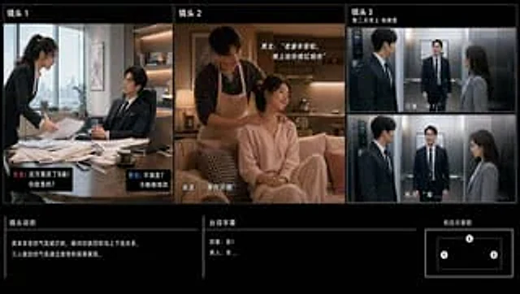

```text
{"type":"cinematic storyboard sheet","style":"professional film previsualization board, black presentation background, thin white panel borders, realistic photographic frames, polished Chinese-language layout, modern drama tone","aspect_ratio":"16:9","project":"15-second short drama storyboard about a secret office marriage","layout":{"sections":[{"title":"镜头 1","position":"top-left","count":1,"labels":["镜头 1"]},{"title":"镜头 2","position":"top-center","count":1,"labels":["镜头 2"]},{"title":"镜头 3","position":"top-right","count":2,"labels":["第二天早上 电梯里"]},{"title":"镜头说明","position":"bottom-left","count":1,"labels":["镜头说明"]},{"title":"台词字幕","position":"bottom-center","count":1,"labels":["台词字幕"]},{"title":"机位示意图","position":"bottom-right","count":1,"labels":["机位示意图"]}],"top_row_panels":3,"bottom_row_panels":3},"shots":[{"title":"镜头 1","scene":"modern office during daytime with floor-to-ceiling windows and a faint city skyline, desk covered with scattered documents, laptop, coffee cup, office shelves in background","composition":"medium-wide shot, woman standing on the left leaning aggressively over the desk toward a seated man on the right","characters":[{"role":"woman","wardrobe":"black blazer over white blouse, office attire, long dark ponytail","action":"slams or thrusts papers onto the desk in anger"},{"role":"man","wardrobe":"dark business suit and tie","action":"sits back in office chair looking up at her calmly"}],"dialogue_overlays":[{"speaker":"女主","color":"red","text":"这方案改了8遍！ 你故意的？"},{"speaker":"男主","color":"blue","text":"不满意？ 今晚继续改"}],"mood":"workplace argument, tense, confrontational"},{"title":"镜头 2","scene":"warm apartment living room connected to a softly lit kitchen at night, amber practical lighting, cozy sofa, intimate domestic atmosphere","composition":"medium shot centered on a seated woman on the sofa with a man standing behind her","characters":[{"role":"man","wardrobe":"dark long-sleeve shirt and light beige apron","action":"gently massages her shoulders"},{"role":"woman","wardrobe":"soft pink knit loungewear cardigan and pants","action":"sits relaxed on sofa, slightly turned toward him"}],"dialogue_overlays":[{"speaker":"男主","color":"white","text":"老婆辛苦啦， 晚上给你做红烧肉"},{"speaker":"女主","color":"white","text":"算你识相"}],"mood":"secret married life, affectionate and warm"},{"title":"镜头 3","subheading":"第二天早上 电梯里","scene":"corporate elevator interior with metallic walls and bright overhead lighting","composition":"split into 2 stacked frames showing the same elevator situation from a similar angle","frame_count":2,"frames":[{"position":"top","characters":[{"role":"man 1","wardrobe":"dark suit, seen from left foreground in profile"},{"role":"coworker","wardrobe":"dark suit and tie, standing in center facing forward"},{"role":"woman","wardrobe":"light gray blazer, standing at right in profile"}],"dialogue_overlay":{"speaker":"同事","color":"white","text":"早！"},"mood":"awkward politeness"},{"position":"bottom","characters":[{"role":"man 1","wardrobe":"dark suit, left foreground"},{"role":"coworker","wardrobe":"dark suit and tie, center"},{"role":"woman","wardrobe":"light gray blazer, right foreground"}],"dialogue_overlay":{"speaker":"两人","color":"white","text":"早…"},"mood":"embarrassed, restrained"}]}],"bottom_notes":{"镜头说明":"原本亲密的气氛被打断，瞬间切换回职场上下级关系，三人尴尬的气氛通过表情和距离展现。","台词字幕":["同事：早！","两人：早…"],"机位示意图":{"diagram":"simple white rectangular camera blocking diagram on black background","count":3,"labels":["1","2","3"],"positions":{"1":"left interior","2":"top center","3":"right interior"}}},"rendering":{"language":"Chinese text for all visible headings and captions","image_quality":"high-resolution storyboard presentation board","lighting":"cool neutral office light in shot 1, warm cozy tungsten light in shot 2, bright elevator light in shot 3","camera":"cinematic live-action stills","faces":"softly obscured or de-emphasized, focus on blocking and mood rather than identity"}}
```

Model: GPT Image 2
Author: 行者AI视频

[ProjectD](https://aitoolsradar.com/en/prompts/3b0f801937ae93) · [Recorded source](https://youmind.com/prompts/chinese-office-secret-marriage-storyboard-15422)
 · [Full original metadata and byte evidence](data/projectd-batch-0024.json)

## Chinese Dynasty Infographic


```text
A picture presented in the form of a river{argument name="theme" default="Chinese Dynasties"} The timeline infographic uses{argument name="layout" default="Vertical design"} It includes a wavy timeline and small icons.
```

Model: GPT Image 2
Author: GPT Image 2 Prompts

[ProjectD](https://aitoolsradar.com/en/prompts/d51fa4dd805a5b) · [Recorded source](https://x.com/songguoxiansen/status/2047299582632304868)
 · [Full original metadata and byte evidence](data/projectd-batch-0024.json)

## Chinese Dynasty Infographic

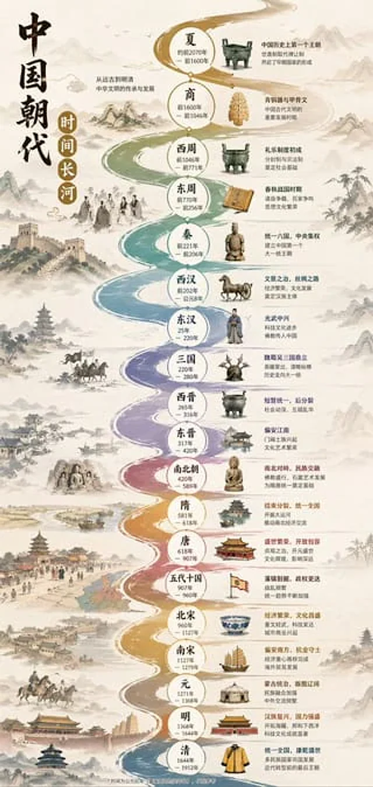

```text
{argument name="主题" default="中国朝代"}时间长河信息图，波浪形时间轴配小图标，{argument name="版式" default="竖版设计"}
```

Model: GPT Image 2
Author: 松果先森

[ProjectD](https://aitoolsradar.com/en/prompts/1ee68632cb0a8b) · [Recorded source](https://youmind.com/prompts/chinese-dynasty-river-timeline-15196)
 · [Full original metadata and byte evidence](data/projectd-batch-0024.json)

## Chinese Embroidery Art Poster

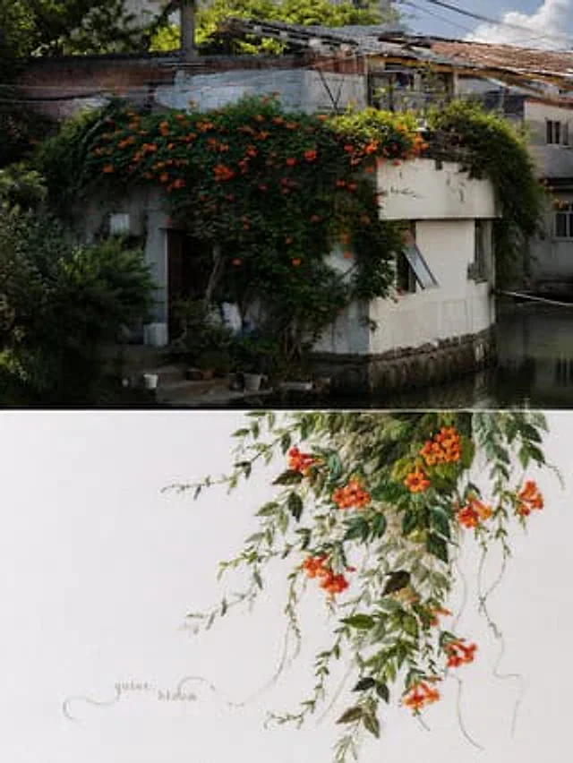

```text
请将我上传的每一张照片分别制作成一张独立的高级设计海报，不多图拼接，每张照片单独输出。整体采用 3:4竖版构图，上下两个区域高度严格1:1，各占画面50%。上半部分保留原始照片，保持主体结构、真实质感、自然光影和原有色彩氛围，仅进行轻微高级摄影调色，使其具有艺术杂志、独立出版物和展览摄影质感。为适配画幅，可自然扩展天空、地面或环境背景，但不得拉伸、扭曲或改变主体。下半部分先理解原图真正的核心精神、情绪关系与潜在寓意，再提取其中最具识别性的主体、轮廓、姿态与叙事关系，只选择一个最能代表整张照片的核心意象进行中国刺绣式重构。不要把照片完整绣一遍，也不要把所有景物逐项转换成刺绣；应大胆删减次要信息，用一个姿态、一段轮廓、一种关系、一个动作或一个具有象征性的局部承载整张照片的内核，让人看到下半部分时，不只是认出“是什么”，还能够感受到原图“在表达什么”。刺绣语言融合中国传统织绣的丝线层次、针法变化、虚实关系与东方留白，可使用平针、长短针、盘线、缠线、打籽、压线等不同针迹，根据主体形态改变针向、密度和层次。局部可以精细，局部可以只留下几针、一道线或未完成的轮廓，让“绣与不绣”共同构成画面。真实呈现丝线光泽、针脚方向、叠线与轻微手工误差，但避免满版传统纹样、工艺品展示感和数字假刺绣。构图强调取舍、留白、气韵与生命感。不固定居中，不平均填满，根据主体的重心、动作、视线、走势和情绪自由安排位置、尺度、裁切与疏密。可以偏心、悬置、局部放大、越界或只出现一部分，让少量绣面与大片空白形成张力；一根游离的丝线、一个未完成的边缘或一小片颜色也可以承担情绪。留白应像空气、距离、停顿和余韵，而不是空出来等待填充的位置。背景必须干净、清亮、有空气感，不默认使用米黄、灰米、旧亚麻或脏浅色。 根据上方照片的色彩气质，自适应选择洁净白、冷白、柔和象牙白、极浅彩色或具有明确综合色相的清透丝绢底色，也可以在原图适合时使用更大胆但纯净的有色底。背景允许看到极轻微的丝绢、绫罗或织物纹理，但不得泛黄、蒙灰、发脏、做旧或出现污渍。刺绣的手工感来自丝线与针法，而不是靠脏旧背景制造。配色同样不设固定色卡。从原图中寻找最有神采、最有生命力、最能代表其精神的颜色关系，再转化成中国刺绣特有的灵动丝线色阶。不是平均吸取照片颜色，而是保留真正有意义的主色，并允许同一颜色在冷暖、深浅、明暗与纯度之间细微游移，通过近似色穿插、少量互补色点醒、高纯度小面积亮色和不同针向产生丝线闪烁。颜色可以清丽、鲜活、浓郁、柔美或素雅，由每张原图决定；丰富但不杂乱，明艳而不俗艳，柔和但不灰，传统但不死板。文字只作为轻巧的编辑性点睛，从原图没有直接说出的情绪、动作、关系或隐喻中提炼一个极短英文词或短句。可使用细线刺绣、纤细题签或极简小字，让文字顺着丝线走势、嵌入负空间、贴近主体边缘，甚至像一根线一样成为构图的一部分；少而有意味，不做说明标签，不抢夺刺绣主体。整体追求一图一核、一核一意象：先理解原图，再选择最值得被留下的东西；其他元素宁可舍弃，也不要为了丰富而堆砌。最终呈现中国刺绣特有的灵动色彩、丝线光泽、东方留白、含蓄寓意与当代编辑设计感，清亮、有神、有情绪、有生命力。避免整图复刻、元素堆积、脏米色背景、泛黄旧布、固定国风配色、满版刺绣、文创商品感和模板感。
```

Model: GPT Image 2
Author: 小小东

[ProjectD](https://aitoolsradar.com/en/prompts/481f5a9ed0aa29) · [Recorded source](https://youmind.com/prompts/chinese-embroidery-art-poster-32250)
 · [Full original metadata and byte evidence](data/projectd-batch-0024.json)

## Chinese GPT 5.5 Benchmark Infographic

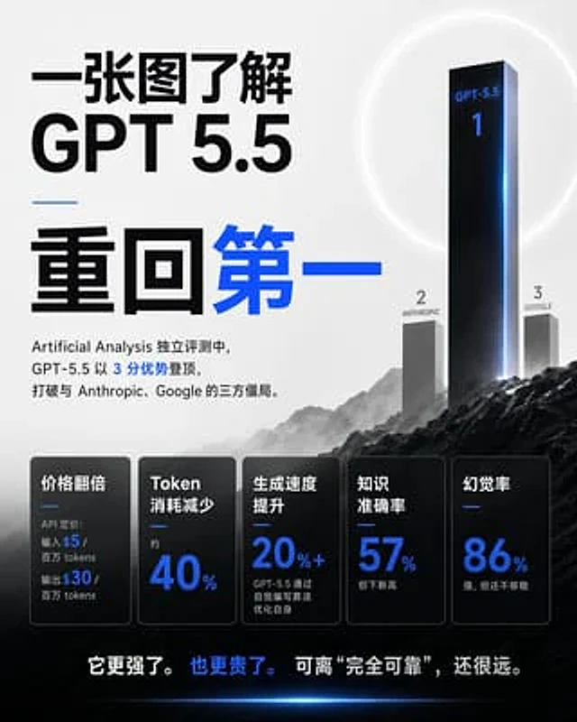

```text
Goal: Create a square 1:1 Chinese tech-news infographic poster explaining {argument name="topic" default="GPT 5.5"} in 30 seconds, with a dramatic AI benchmark ranking theme.

Canvas: 768×768 square poster, light gray-to-white background in the upper half, dark cinematic mountain landscape in the lower half, high contrast black typography with electric blue accents.

Layout: Left side is dominated by huge Chinese headline typography. Right side shows a 3D benchmark podium/ranking scene rising from mountains. Bottom third contains exactly 5 dark translucent metric cards in a row. Very bottom has one bold Chinese conclusion sentence.

Main headline text: Use large black Chinese text at top left: 「一张图了解」. Directly below it, huge black Latin text: 「GPT 5.5」. Under a short thin blue horizontal divider, use oversized Chinese text: 「重回第一」, with 「重回」 in black and 「第一」 in bright blue.

Intro paragraph under the headline: 「Artificial Analysis 独立评测中，GPT-5.5 以 3 分优势登顶，打破与 Anthropic、Google 的三方僵局。」 Keep the number 3 in blue and the rest mostly black.

Ranking scene: Create exactly 3 vertical ranking pillars on the right, integrated into misty mountains. Rank 1 is a very tall glossy black monolith with blue rim lighting, labeled 「GPT-5.5」 near the top and a large blue 「1」 below it. Rank 2 is a shorter gray monolith to the left labeled 「2」 and 「ANTHROPIC」. Rank 3 is a shorter gray monolith to the right labeled 「3」 and 「GOOGLE」. Add a faint white circular halo behind the first-place monolith and a blue glow along its right edge.

Metric cards: Add exactly 5 rounded rectangular black/charcoal glass cards across the lower third, each with a thin border, subtle gradient, and a small blue divider line. The 5 cards are: 1) 「价格翻倍」 with small text 「API 定价: 输入 $5 / 百万 tokens 输出 $30 / 百万 tokens」 where $5 and $30 are blue; 2) 「Token 消耗减少」 with small 「约」 and huge blue 「40%」; 3) 「生成速度提升」 with huge blue 「20%+」 and small text 「GPT-5.5 通过自我编写算法优化自身」; 4) 「知识准确率」 with huge blue 「57%」 and small text 「创下新高」; 5) 「幻觉率」 with huge blue 「86%」 and small text 「强，但还不够稳」.

Bottom conclusion: Centered near the bottom over the dark landscape, write 「它更强了。 也更贵了。 可离 “完全可靠”，还很远。」 with 「也更贵了。」 in blue and the rest white.

Visual style: Premium editorial AI benchmark poster, sharp modern sans-serif typography, monochrome palette with electric blue highlights, cinematic fog, dark rocky mountains, subtle lens glow, clean spacing, realistic 3D monoliths, no people, no logo, no watermark.

Parameters: The main customizable subject is {argument name="model name" default="GPT-5.5"}; the ranking lead score can be {argument name="advantage text" default="3 分优势"}; the rank 2 competitor is {argument name="second competitor" default="Anthropic"}; the rank 3 competitor is {argument name="third competitor" default="Google"}; the bottom message can be {argument name="conclusion text" default="它更强了。也更贵了。可离 “完全可靠”，还很远。"}.
```

Model: GPT Image 2
Author: 小小东

[ProjectD](https://aitoolsradar.com/en/prompts/1a73dcda8fa409) · [Recorded source](https://youmind.com/prompts/chinese-gpt55-benchmark-infographic-28334)
 · [Full original metadata and byte evidence](data/projectd-batch-0024.json)

## Chinese History Timeline Infographic

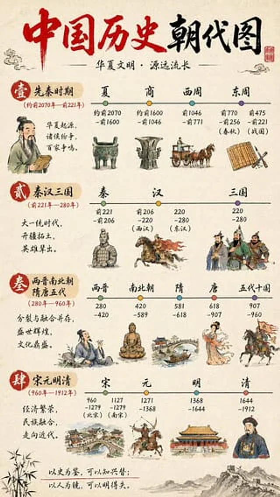

```text
{
  "type": "Infographic Timeline",
  "style": {
    "background": "{argument name=\"background style\" default=\"Textured beige Xuan paper\"}",
    "art_style": "{argument name=\"art style\" default=\"Traditional Chinese ink painting style\"}"
  },
  "header": {
    "title": "{argument name=\"main title\" default=\"Chart of Chinese Historical Dynasties\"}",
    "subtitle": "{argument name=\"subtitle\" default=\"Chinese civilization has a long history.\"}",
    "elements": [
      "Red calligraphy title",
      "Red square stamp in the upper right corner",
      "Auspicious cloud pattern"
    ]
  },
  "layout": {
    "sections_count": 4,
    "sections": [
      {
        "id": "1",
        "label": "Pre-Qin Period",
        "date_range": "(c. 2070 BC – 221 BC)",
        "description": "The origins of Chinese civilization: the struggles among feudal lords and the contention of a hundred schools of thought.",
        "timeline_nodes": 4,
        "dynasties": [
          "summer",
          "business",
          "Western Zhou Dynasty",
          "Eastern Zhou"
        ],
        "illustrations": [
          "Scholars holding bamboo slips",
          "Bronze tripod",
          "Bronze Ritual Vessels",
          "carriage",
          "Bamboo slips and writing brush"
        ]
      },
      {
        "id": "2",
        "label": "Part Two: Qin, Han and Three Kingdoms",
        "date_range": "(221 BC – 280 AD)",
        "description": "In the era of unification, territorial expansion led to the emergence of numerous heroes.",
        "timeline_nodes": 3,
        "dynasties": [
          "Qin",
          "Chinese",
          "Three Kingdoms"
        ],
        "illustrations": [
          "Terracotta Army",
          "Horse cavalry",
          "Three generals in traditional armor"
        ]
      },
      {
        "id": "3",
        "label": "The Three Dynasties: Jin, Southern and Northern Dynasties, Sui, Tang and Five Dynasties",
        "date_range": "(280–960 AD)",
        "description": "Divide and integration coexist, a glorious era unfolds, and culture flourishes.",
        "timeline_nodes": 5,
        "dynasties": [
          "Jin Dynasty",
          "Northern and Southern Courts",
          "Sui",
          "Tang",
          "Five Dynasties and Ten Kingdoms"
        ],
        "illustrations": [
          "Scholars who drink",
          "Seated Buddha statue",
          "Arched stone bridge with boat",
          "Elegant Tang Dynasty ladies",
          "Flag-bearing cavalry"
        ]
      },
      {
        "id": "4",
        "label": "Four Song, Yuan, Ming and Qing",
        "date_range": "(960–1912)",
        "description": "Economic prosperity, ethnic integration, and the transition to modernity.",
        "timeline_nodes": 4,
        "dynasties": [
          "Song",
          "Yuan",
          "bright",
          "clear"
        ],
        "illustrations": [
          "A bustling riverside town landscape",
          "Horse archer turning around to shoot",
          "Palace complex",
          "Qing Dynasty officials"
        ]
      }
    ]
  },
  "footer": {
    "quote": "{argument name=\"bottom quote\" default=\"By learning from history, we can understand the rise and fall of dynasties; by learning from others, we can understand our own gains and losses.\"}",
    "decorations": [
      "Bamboo leaf in the lower left corner",
      "Great Wall illustration in the bottom right corner"
    ]
  }
}
```

Model: GPT Image 2
Author: GPT Image 2 Prompts

[ProjectD](https://aitoolsradar.com/en/prompts/436511527848d5) · [Recorded source](https://x.com/axiaisacat/status/2045679633832595558#reversed-1)
 · [Full original metadata and byte evidence](data/projectd-batch-0024.json)

## Chinese Ink Fury Character Poster

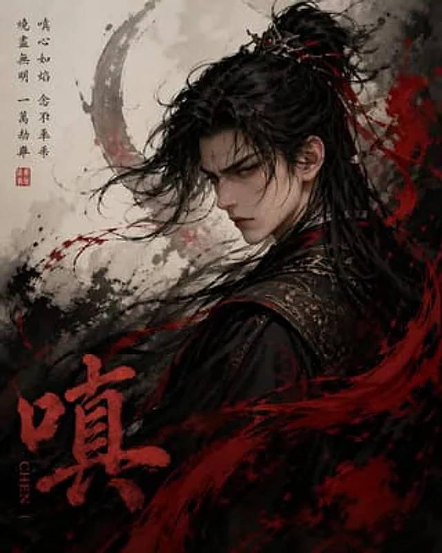

```text
A highly dramatic, fantastical portrait in the style of Chinese ink painting, using a single Chinese character{argument name="character" default="Anger"} The central image is a three-quarter profile of a male character from a fantasy or martial arts world, slightly turning his head. He has long, flowing hair tied in a high half-ponytail, adorned with an exquisite dark metal headdress, several thin red ribbons interspersed in his hair, fluttering in the wind. He wears a black embroidered robe, with delicate gold patterns on the shoulders and collar; the layered, heavy fabric blends seamlessly with the surrounding brushstrokes. Due to the angle and the obscuring effect of his hair, most of his face is hidden in shadow, creating a mysterious and intense atmosphere. The overall composition is a vertical poster, with a light-colored parchment background featuring splattered gray and black ink. Behind the character's head is a large, faded circular halo, while wild red brushstrokes sweep across the lower half and right side, like dynamic, blood-red calligraphy. The color scheme is limited to black, charcoal gray, parchment beige, and deep crimson. Add two calligraphy text areas: the top left corner features a vertically arranged poem in black Chinese calligraphy, with a small red seal below; the bottom left corner features a large, bold red Chinese character.{argument name="large title character" default="Anger"} Next to the large red Chinese characters, place a vertically arranged Romanized label.{argument name="romanization" default="CHEN"} The overall style blends expressive ink painting with ultra-detailed cinematic character illustrations, presenting flowing hair, splashing brushstrokes, strong emotional tension, and a dark, angry yet elegant atmosphere.
```

Model: GPT Image 2
Author: GPT Image 2 Prompts

[ProjectD](https://aitoolsradar.com/en/prompts/c0c80f92ba817a) · [Recorded source](https://x.com/ericoding99/status/2047138987685626051#reversed-1)
 · [Full original metadata and byte evidence](data/projectd-batch-0024.json)

## Chinese Literature Textbook Page Layout

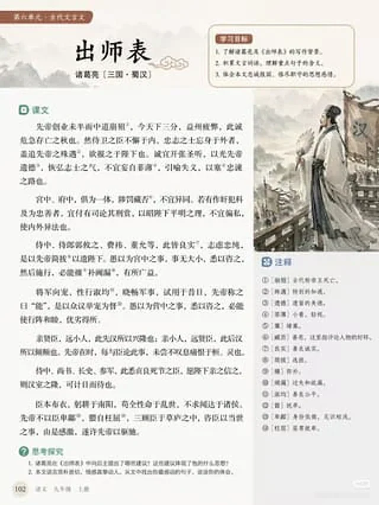

```text
{
  "type": "Educational textbook page layout",
  "style": "Simple layout, traditional Chinese aesthetics, soft beige background",
  "header": {
    "tag": "Unit 6: Classical Chinese",
    "title": "{argument name=\"main title\" default=\"Memorial on Dispatching the Troops\"}",
    "author": "{argument name=\"author info\" default=\"Zhuge Liang (Three Kingdoms period, Shu Han)\"}"
  },
  "layout": {
    "sections": [
      {
        "title": "Learning Objectives",
        "position": "Top right corner box",
        "count": 3,
        "description": "Numbered learning objectives with a soft red background"
      },
      {
        "title": "text",
        "position": "Left sidebar",
        "count": 6,
        "description": "Classical Chinese passages containing 14 superscripted annotation numbers"
      },
      {
        "title": "Notes",
        "position": "Box below the illustration on the right",
        "count": 14,
        "description": "Explanation of the numbered words corresponding to the superscript in the text"
      },
      {
        "title": "Thinking and Exploring",
        "position": "bottom left corner",
        "count": 2,
        "description": "Numbered discussion questions"
      }
    ],
    "illustration": {
      "position": "Middle right",
      "description": "{argument name=\"illustration subject\" default=\"Zhuge Liang, holding a feather fan, stands before the Han army banner, in the style of a traditional Chinese ink painting.\"}"
    },
    "footer": {
      "page_number": "102",
      "book_info": "{argument name=\"textbook info\" default=\"Chinese Language Textbook for Ninth Grade, First Semester\"}"
    }
  }
}
```

Model: GPT Image 2
Author: GPT Image 2 Prompts

[ProjectD](https://aitoolsradar.com/en/prompts/fde04f2b883970) · [Recorded source](https://x.com/akokoi1/status/2044800630771134677#reversed-0)
 · [Full original metadata and byte evidence](data/projectd-batch-0024.json)

## Chinese Live-Streaming App UI Mockup


```text
{
  "type": "Mobile live streaming app interface prototype",
  "subject": {
    "description": "A young Asian woman with long black hair, a smile on her face, wearing a light blue shimmering dress.",
    "action": "Holding a decorative plaque with text on it.",
    "sign_text": "{argument name=\"sign text\" default=\"x1 Thank you so much for the big rocket, Brother Xingzhe!\"}"
  },
  "visual_effects": {
    "description": "{argument name=\"gift animation\" default=\"Glowing pink holographic rocket\"} It was launched from the right side, emitting starlight and magical particles."
  },
  "layout": {
    "top_bar": {
      "time": "20:30",
      "broadcaster": {
        "name": "{argument name=\"broadcaster name\" default=\"Sweetheart❤️\"}",
        "stats": "128,000 likes for this match",
        "button": "focus on"
      },
      "top_viewers_count": 4,
      "total_viewers": "100,000+",
      "close_button": "X"
    },
    "widgets": {
      "count": 5,
      "labels": [
        "1st place on the hourly ranking",
        "Popularity Ranking",
        "More live streams &gt;",
        "Gift Pavilion 0/24",
        "{argument name=\"event banner text\" default=\"Douyin Summer Concert: July 26th - July 28th\"}"
      ]
    },
    "chat_overlay": {
      "gift_alert": "The traveler delivers a giant rocket",
      "message_count": 6,
      "messages": [
        "Dream Starts Sailing joined the live stream",
        "Sweetie:{argument name=\"chat message\" default=\"The streamer sings so well!\"}",
        "Your little cutie: So beautiful, streamer!",
        "*^O^*: Here it comes!",
        "My darling: The host is awesome!",
        "A gentle breeze: Send 10 little hearts"
      ]
    },
    "bottom_bar": {
      "input_placeholder": "Say something...",
      "icon_count": 4,
      "icons": [
        "smiley face",
        "Heart-shaped planet",
        "gift box",
        "Three points"
      ]
    }
  }
}
```

Model: GPT Image 2
Author: GPT Image 2 Prompts

[ProjectD](https://aitoolsradar.com/en/prompts/4aaf4b59a9ec33) · [Recorded source](https://x.com/joshesye/status/2044776883049451619#reversed-0)
 · [Full original metadata and byte evidence](data/projectd-batch-0024.json)

## Chinese Livestream Dorm Selfie UI


```text
A realistic vertical smartphone screenshot showcases a Chinese live-streaming interface. In the image, a young female streamer sits in a cozy dormitory bedroom, taking a mid-range selfie from the chest up. Her face is deliberately obscured by a large, softly blurred rectangle in the center. She has long, messy, dark brown hair tied in a loose high bun, with a few wisps of hair falling down her cheeks, and a light-colored butterfly hair clip on her left side. She wears a fitted white round-neck long-sleeved top with delicate lace trim, and a thin necklace with a small pendant around her neck. Her right hand is supporting her chin, a casual and cute pose, creating a soft, intimate, and lifelike atmosphere. The background is a charming student dormitory interior: a loft bed in the upper right corner, white curtains printed with simple blue cartoon characters and stars, bottles and jars and miscellaneous items on the desk, a pink towel draped over a wooden chair, plush toys, cosmetics, and bags on a shelf to the left, and warm lighting throughout the room. Add a complete Chinese live streaming app UI overlay above the image, designed to resemble a screenshot of a real mobile live streaming app. Top status bar: The top left corner displays the time 21:15, and the top right corner displays mobile signal strength, a 5G icon, and 68% battery level. Top creator area: A circular avatar with the streamer's name {argument name="streamer name" default="Doraemon"} A red "Follow" button and a popularity statistic showing "100,000+ likes for this session." A small ranking badge showing "3rd on the hourly leaderboard." Near the top right, there are three small circular user avatars. A dark, rounded popularity capsule showing "100,000+," a close X icon, a purple button labeled "More Live Streams," and a gift progress card showing "Gift Hall 0/24" with a blue "Classic" label are added to the top right corner. A floating gift banner in the bottom left corner features the sender's avatar and the text "Sending Little Hearts to the Stars and the Sea," accompanied by a pink heart icon and x1. The comment section in the bottom left corner contains six semi-transparent chat bubbles with the following content: 1. Cute Little Bear: The streamer looks so beautiful today! 2. Little Sun: Your voice is so nice, where are you from, sister? 3. Cheese Milk Foam: What's the streamer doing? 4. Roasted Chestnuts: Can you sing a song? 5. Cat Head with Mouth: The streamer is so cute! 6. Good Luck: Followed the streamer. Add small blue diamond level badges with the numbers 6, 10, and 21 before the last three comments. Bottom Input Bar: A rounded, semi-transparent text box with the placeholder "Say something...", and four controls on the right: a smiley face icon, a glowing pink heart gift icon, a pink gift box icon, and a gray three-dot icon. Photorealistic mobile shooting style, natural skin and fabric textures, with a slight beauty camera soft light effect, realistic app overlay transparency, and a 9:16 portrait aspect ratio.
```

Model: GPT Image 2
Author: GPT Image 2 Prompts

[ProjectD](https://aitoolsradar.com/en/prompts/84e2c65ede21fa) · [Recorded source](https://x.com/Kejijun6666/status/2046781881409270011#reversed-0)
 · [Full original metadata and byte evidence](data/projectd-batch-0024.json)

## Chinese Livestream Rocket Gala Edit


```text
Using the provided reference photo, transform the character into a cool screenshot of a Chinese live stream, while maintaining the head position, cropping proportions, hairstyle, and overall features. Replace the outdoor parasol and street background with a nighttime city skyline filled with fireworks, and add a large rocket launch effect on the right. Change the clothing to a dark business suit jacket paired with a light blue shirt, making the subject look like a high-value VIP guest in the live stream. Overlay a sophisticated Chinese live stream app interface: the top left profile area displays the name "Wang Shuzhilan," a red "Follow" button, and the words "128,000 wasted this time"; the top left displays the ranking tag "🔥 Hourly Ranking No. 1"; the top center displays two lines of neon-style celebratory titles, "Thank you to the top donor" and "Big Rocket Carnival," accompanied by hearts and glitter decorations; the top right displays four small circular viewer avatars, the number of viewers "13,000," a close "×" icon, and a "More Live Streams" label. Add two gift notification cards on the left: "Mysterious donor sent a Big Rocket x1" and "Cola with Ice sent a Carnival x1." Five stacked chat bubbles are added below, displaying specific usernames and messages: 1) "Top 1 Mysterious Brother: A giant rocket for the best streamer!" followed by six confetti emojis; 2) "Xiao Mei: Wow! The carnival was amazing! 😍😍😍"; 3) "Sunny Boy: The streamer is awesome, support! 👍👍👍"; 4) "Happy Planet: 666666, so amazing!"; 5) "Passerby A: Brother is awesome! Keep it up, streamer!". A semi-transparent comment bar is added at the bottom, displaying "Say something...". Five bottom action icons are added: a smiley face, a colorful swirl, a heart, a gift box, and three dots. A string of four vertically floating heart-shaped likes is added to the bottom right corner. This makes the composite image look like a realistic screenshot of a high-end social app live stream, with smooth Chinese typography, vibrant neon colors, realistic UI integration, and a festive, viral visual effect.
```

Model: GPT Image 2
Author: GPT Image 2 Prompts

[ProjectD](https://aitoolsradar.com/en/prompts/7a7557c371cf92) · [Recorded source](https://x.com/wshuyi/status/2046574261171790259#reversed-0)
 · [Full original metadata and byte evidence](data/projectd-batch-0024.json)

## Chinese Livestreaming App UI Grid


```text
{
  "type": "A Chinese live streaming app interface with a 2x2 grid.",
  "layout": {
    "grid": "2 columns, 2 rows",
    "panels": [
      {
        "position": "Top left",
        "platform": "Douyin",
        "logo": "Tik Tok",
        "host": {
          "name": "{argument name=\"douyin host name\" default=\"Guangdong couple\"}",
          "appearance": "Young woman, purple T-shirt, braided pigtails",
          "action": "Holding a white skincare bottle"
        },
        "ui_elements": [
          "Profile banner with \"Follow\" button",
          "The number of viewers exceeded 100,000.",
          "Floating sticker \"Join my fan page\"",
          "A chat stream containing 4 messages",
          "The product cover card shows a gold bottle and \"¥ after coupon\".{argument name=\"douyin product price\" default=\"189\"} \""
        ]
      },
      {
        "position": "Top right",
        "platform": "Xiaohongshu",
        "logo": "Xiaohongshu",
        "host": {
          "name": "{argument name=\"xiaohongshu host name\" default=\"Zhang Xiaowan\"}",
          "appearance": "Young woman, wearing a red sweater, with long, wavy, dark hair.",
          "action": "Holding a large brown teddy bear"
        },
        "ui_elements": [
          "Profile banner with \"Follow\" button",
          "The number of viewers was 142,000.",
          "The progress bar for the heart symbol is at \"245/260\".",
          "A chat stream containing 3 messages",
          "The product cover card shows a lamp and \"¥169\"."
        ]
      },
      {
        "position": "Bottom left",
        "platform": "WeChat Video",
        "logo": "Video Account",
        "host": {
          "name": "{argument name=\"wechat host name\" default=\"Home Goodies Selection\"}",
          "appearance": "Young woman, white shirt, long dark hair",
          "action": "Standing in the kitchen, next to a blender and white cookware."
        },
        "ui_elements": [
          "Personal Profile Banner",
          "The number of viewers is \"100,000\".",
          "The countdown timer says \"Grab it at 09:30\"",
          "A chat stream containing 4 messages",
          "The product cover card shows an air fryer and \"¥239\"."
        ]
      },
      {
        "position": "Bottom right",
        "platform": "Kuaishou",
        "logo": "quick worker",
        "host": {
          "name": "{argument name=\"kuaishou host name\" default=\"Mo&#39;er\"}",
          "appearance": "Young woman, white sleeveless dress, white headband",
          "action": "Singing with a handheld microphone"
        },
        "ui_elements": [
          "Profile banner with \"Follow\" button",
          "The number of viewers exceeded 100,000.",
          "A trending banner reads, \"The Kuaishou Live Singing King is Here!\"",
          "A chat stream containing 5 messages",
          "Floating gift animations, including rockets and hearts.",
          "Floating treasure chests offer a chance to win big prizes."
        ]
      }
    ]
  }
}
```

Model: GPT Image 2
Author: GPT Image 2 Prompts

[ProjectD](https://aitoolsradar.com/en/prompts/824917f235c368) · [Recorded source](https://x.com/amiger1412/status/2045343176056266771#reversed-0)
 · [Full original metadata and byte evidence](data/projectd-batch-0024.json)

## Chinese Medical Gout Infographic Poster


```text
{
  "type": "Medical Infographic Poster",
  "topic": "Pathogenesis and progression of gout",
  "style": "Combining ultra-high-resolution 3D biomedical illustrations with infographic design",
  "language": "Chinese as the primary language, supplemented by English subheadings",
  "canvas": {
    "orientation": "Vertical",
    "aspect_ratio": "John 2:1",
    "background": "The warm, off-white paper texture carries a subtle sense of antiquity and clinical poster aesthetics."
  },
  "title_block": {
    "headline_cn": "The causal chain of gout",
    "headline_en": "THE CAUSAL CHAIN OF GOUT",
    "subheading": "A continuous chain from purines to crystals to inflammation, demonstrating the systemic metabolic and immune pathways."
  },
  "central_visual": {
    "description": "A semi-transparent full-body anatomical diagram, frontal view, from head to toe, with the face softly blurred by rectangles; visible muscles, bones, arteries, veins, nerves, lung outlines, digestive tract, kidneys, liver, bladder region, and lower limb structures; luminous internal pathways and directional flow arrows connect various metabolic stages; multiple circular magnified views show urate crystals, blood components, inflamed tissue, and joint damage.",
    "labels_count": 4,
    "labels": [
      "liver",
      "kidney",
      "uric acid cycle",
      "Crystallization deposition"
    ]
  },
  "top_process_strip": {
    "title_cn": "A continuous causal chain from molecular to clinical applications",
    "title_en": "A CONTINUOUS CHAIN FROM MOLECULE TO CLINICAL DISEASE",
    "count": 6,
    "icons": [
      "metabolism",
      "transport",
      "crystallization",
      "immunity",
      "inflammation",
      "damage"
    ]
  },
  "layout": {
    "sections": [
      {
        "number": "01",
        "title_cn": "Purine sources",
        "title_en": "Purine Sources",
        "position": "Top left",
        "count": 6,
        "items": [
          "Exogenous purine intake: red meat",
          "Exogenous purine intake: Visceral",
          "Exogenous purine intake: Seafood",
          "Exogenous purine intake: Beer",
          "Endogenous cellular metabolism",
          "Fructose load / Sugary beverages"
        ]
      },
      {
        "number": "02",
        "title_cn": "Uric acid production",
        "title_en": "Uric Acid Production",
        "position": "Top left center",
        "count": 5,
        "items": [
          "purine",
          "hypoxanthine",
          "xanthine",
          "uric acid",
          "The xanthine oxidase pathway, accompanied by oxygen and hydrogen peroxide byproducts."
        ]
      },
      {
        "number": "03",
        "title_cn": "Kidney and intestinal excretion",
        "title_en": "Renal & Intestinal Excretion",
        "position": "Left and Middle",
        "count": 2,
        "items": [
          "Kidney excretion includes renal tubular transport proteins GLUT9, OAT4, and ABCG2, and involves reabsorption and urinary excretion.",
          "Intestinal excretion includes intestinal excretion and ABCG2 secretion."
        ]
      },
      {
        "number": "04",
        "title_cn": "Hyperuricemia",
        "title_en": "Hyperuricemia",
        "position": "Left center bottom",
        "count": 4,
        "items": [
          "Comparison of blood uric acid levels",
          "Normal range threshold",
          "Hyperuricemia threshold",
          "Solubility threshold/supersaturation line graph"
        ]
      },
      {
        "number": "05",
        "title_cn": "Crystallography",
        "title_en": "Crystal Physics",
        "position": "Bottom left and middle",
        "count": 5,
        "items": [
          "supersaturation",
          "Precipitation formation",
          "Monosodium urate crystals",
          "Low temperature induced effect",
          "Low pH effect and ion microenvironment"
        ]
      },
      {
        "number": "06",
        "title_cn": "Joint deposits and local environment",
        "title_en": "Joint Deposition & Local Environment",
        "position": "Bottom left center",
        "count": 5,
        "items": [
          "First metatarsophalangeal joint (key point)",
          "Cold/Low temperature",
          "synovial environment",
          "Cartilage surface",
          "Crystallization deposition"
        ]
      },
      {
        "number": "07",
        "title_cn": "Immune Inflammatory Cascade",
        "title_en": "Immune Inflammatory Cascade",
        "position": "Top right",
        "count": 6,
        "items": [
          "Innate immune recognition",
          "Macrophages engulf crystals",
          "Inflammasome activation (NLRP3) ",
          "Neutrophil recruitment",
          "Release of inflammatory factors",
          "Interleukin tags: IL-1β, IL-6, TNF-α, IL-8, MCP-1"
        ]
      },
      {
        "number": "08",
        "title_cn": "Acute gout attack",
        "title_en": "Acute Gout Flare",
        "position": "Right Center",
        "count": 5,
        "items": [
          "Redness, swelling, heat, and pain (illustration of heel/big toe)",
          "Sudden outbreak at night",
          "Joint swelling",
          "Severe pain",
          "Localized redness and glowing of the feet"
        ]
      },
      {
        "number": "09",
        "title_cn": "Chronic structural damage",
        "title_en": "Chronic Structural Damage",
        "position": "Right center bottom",
        "count": 4,
        "items": [
          "recurrent",
          "Chronic synovitis",
          "Cartilage damage",
          "Bone erosion / Joint structural damage"
        ]
      },
      {
        "number": "10",
        "title_cn": "Gouty tophi formation",
        "title_en": "Tophus Formation",
        "position": "Bottom right",
        "count": 4,
        "items": [
          "Long-term uric acid load",
          "Chronic crystal accumulation",
          "Gout stones",
          "Clinical examples of finger and tissue nodules"
        ]
      },
      {
        "number": "11",
        "title_cn": "Systemic effects beyond joints",
        "title_en": "Beyond the Joint",
        "position": "Bottom right",
        "count": 4,
        "items": [
          "Uric acid kidney stones",
          "Interstitial kidney injury / Kidney involvement",
          "Soft tissue deposition",
          "Metabolic syndrome related"
        ]
      },
      {
        "number": "12",
        "title_cn": "Pain is just the last layer of appearance.",
        "title_en": "Pain Is the Final Signal",
        "position": "Bottom full width",
        "count": 6,
        "items": [
          "Increased purine load",
          "Excessive uric acid production or insufficient excretion",
          "Hyperuricemia",
          "Crystallization and Deposition",
          "Immune activation and inflammation",
          "Acute pain and clinical manifestations"
        ]
      }
    ]
  },
  "visual_details": {
    "arrows": "The curved, brown-gold arrow connects the parts in a clockwise and downward direction, symbolizing the flow of cause and effect.",
    "rendering": "Hyper-realistic organs and joints, glossy translucent skin, close-ups of microscopic crystals, scenes of immune cells, medical textbook-level precision.",
    "color_palette": "Dark brown, ivory white, soft red, deep brown, vascular blue and red, amber highlight, inflammatory deep red, crystalline white",
    "typography": "Large Chinese serif-style headings, smaller English capitalized subheadings, and numbered modules with thin borders and rounded corners."
  },
  "negative_constraints": [
    "No modern flat vector style",
    "No cartoon anatomical diagrams",
    "No bright neon sci-fi color scheme",
    "No black background"
  ],
  "generation_goal": "Create a high-quality Chinese medical education poster that explains the complete causal chain of gout from purine intake, uric acid metabolism to crystal formation, immune activation, acute attacks, chronic damage, tophi, and systemic complications. Centered on a transparent full-body anatomical diagram, it includes 12 numbered information panels and 6 top flowchart icons."
}
```

Model: GPT Image 2
Author: GPT Image 2 Prompts

[ProjectD](https://aitoolsradar.com/en/prompts/70b6063ead4675) · [Recorded source](https://x.com/hx831126/status/2046454226080219281#reversed-0)
 · [Full original metadata and byte evidence](data/projectd-batch-0024.json)

## Chinese Medicine Meridian Infographic

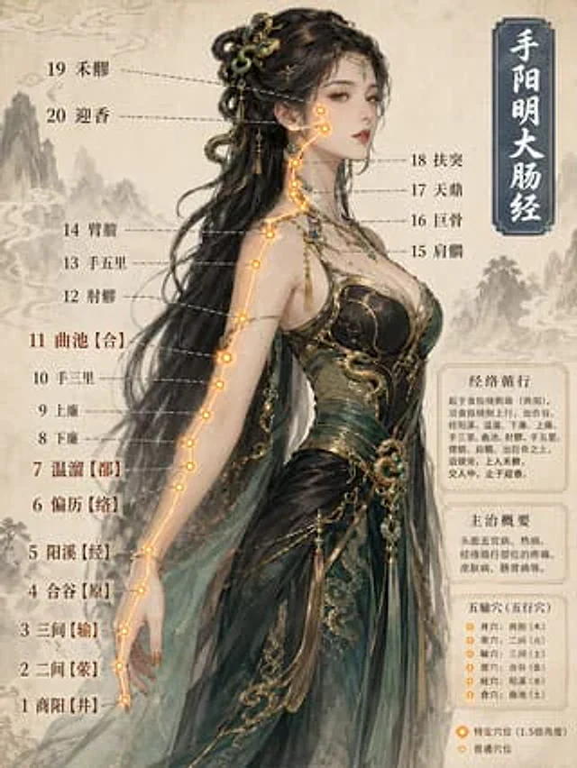

```text
{argument name="经脉名称" default="手太阴肺经"}经络腧穴科普图，仙侠国风半写实动漫插画风格，水墨晕染意境，人物设定：{argument name="角色原型" default="小乔"}，姿态专为展露【对应解剖区域】设计，使该区域所有穴位可见且无遮挡，穴位可视化（强精准约束）：{argument name="穴位光影颜色" default="阴经：蓝白冷光 / 阳经：橙金热光"}发光穴位光点，每个光点严格锚定至对应解剖标志（骨性凹陷/横纹/肌腱间隙），【颜色】流光连线沿经脉标准走向连接所有穴位，阴经走手臂屈侧/腿部内侧，阳经走手臂伸侧/腿部外侧，五腧穴遵守分布规律：井穴在甲角、荥输在掌跖、经原在腕踝、合穴在肘膝，特定穴光点直径为普通穴1.5倍，发光强度加倍，相邻穴位间距按同身寸比例分布，不得任意压缩，穴位标注（逐一列出）：【按经脉循行顺序逐穴列出，格式：穴名[属性]】引线从光点中心引出，不得交叉，标注依经脉走向左右交替排布，解剖精准负向约束：禁止穴位出现在骨骼实体表面，禁止经络连线越过阴阳界限，禁止相邻穴位合并为单一光点，禁止标注引线与目标穴位错位，禁止任何穴位偏离其解剖标志超过0.5寸，背景：温暖羊皮纸肌理，淡雅水墨意境，标题栏：【左/右】上角竖排，灰蓝底色白字"{argument name="经脉全名" default="手太阴肺经"}"，品质：小红书科普信息图标准，人物美感与穴位精准度双优先
```

Model: GPT Image 2
Author: 知识猫图解

[ProjectD](https://aitoolsradar.com/en/prompts/b0b360c43630b4) · [Recorded source](https://youmind.com/prompts/chinese-medicine-meridian-infographic-16815)
 · [Full original metadata and byte evidence](data/projectd-batch-0024.json)

## Chinese Minimalist S-Shaped Poster

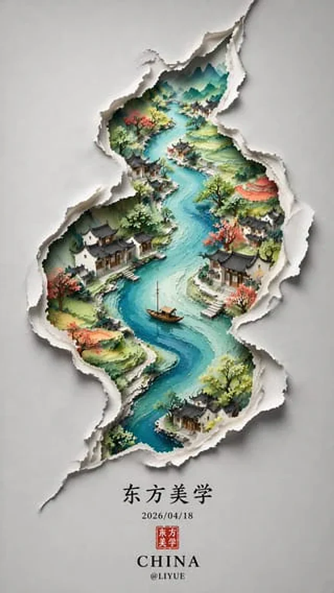

```text
极简新中式美学风格，画面以淡雅的灰白色为底，呈现出一种纸艺剪影般的立体感。
一条S形蜿蜒的裂痕状边缘将画面分割，仿佛撕开了一层纸面，露出内部色彩斑斓的东方山水景象。
裂口内，一条蜿蜒的河流自上而下贯穿整个构图，河水以深浅不一的蓝色渲染，层次分明，仿佛流动的丝带。
河岸两侧点缀着青翠的山丘与梯田，色彩柔和，绿红交织，展现出田园的宁静之美。
沿河而建的古风建筑错落有致，飞檐翘角，白墙黛瓦，在光影的映衬下更显古朴典雅。
岸边树木葱茏，枝叶轻盈，一艘小船静泊于水中央，增添了几分悠然意境。
整体构图呈S形曲线，富有韵律感，仿佛自然与人文的和谐共生。
画作边缘采用撕纸效果，营造出立体浮雕般的视觉体验。
下方题字“东方美学”以黑色楷体书写，日期“2026/04/18”与红色印章相呼应，底部“CHINA”字样庄重醒目，署名“@LIYUE”低调收尾，整体氛围静谧深远，充满诗意与哲思。
```

Model: GPT Image 2
Author: @liyue_ai

[ProjectD](https://aitoolsradar.com/en/prompts/3b47cbc51b25c1) · [Recorded source](https://x.com/liyue_ai/status/2045368305079447853)
 · [Full original metadata and byte evidence](data/projectd-batch-0024.json)

## Chinese Obsession Moonlit Fantasy

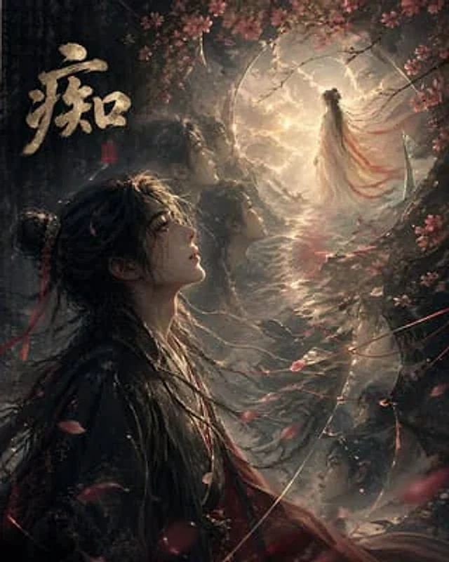

```text
A dark, cinematic Chinese fantasy illustration inspired by a single Chinese character.{argument name="Chinese character" default="Obsession"} The image presents a poetic scene reminiscent of a fantasy world, rendered in a vertical composition. In the left foreground, a young man with long black hair stands sideways, clad in a layered black robe with exquisite embroidery on the lapel, the lining subtly revealing a deep red hue. His hair is styled in a traditional bun, adorned with ornate hair ornaments and tied with a flowing red ribbon. His expression is melancholic yet resolute as he gazes into the distance. In the upper right background, within a bright full moon or circular halo, the back view of a woman in a flowing white robe is elegant, her long sleeves and red ribbon fluttering in the wind, appearing ethereal and unattainable. The setting is a shadowy path strewn with rocks at night, illuminated by moonlight and a thin mist, accompanied by dramatic clouds, falling pink petals, and curved cherry blossom branches overhead. Slender red ropes, or threads of fate, intersect diagonally in the image, connecting space and emotion. Three fragments of a reflective mirror float in the image, each faintly reflecting a shattered face or figure, enhancing the atmosphere of longing and broken memories. A large golden Chinese calligraphy character is placed in the upper left corner.{argument name="calligraphy text" default="Obsession"} The brushstrokes are vigorous and powerful, with a red seal stamped below. In the background, vertically arranged calligraphic patterns can be faintly seen extending into the darkness. The painting-style detailing, high contrast, soft atmospheric lighting, and rich black, red, and gold color scheme create a romantic tragedy, obsession, longing, and dreamlike ancient aesthetic.
```

Model: GPT Image 2
Author: GPT Image 2 Prompts

[ProjectD](https://aitoolsradar.com/en/prompts/63e932e2003f48) · [Recorded source](https://x.com/ericoding99/status/2047138987685626051#reversed-2)
 · [Full original metadata and byte evidence](data/projectd-batch-0024.json)

## Chinese Photography Tutorial Book Page

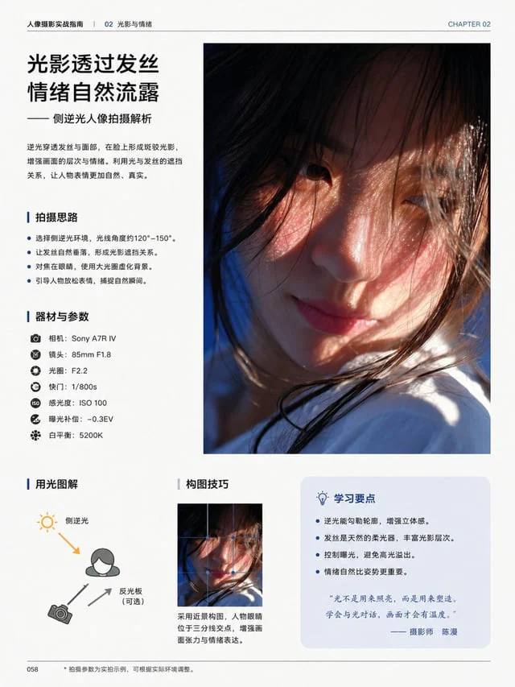

```text
{"type":"editorial photography tutorial book page","style":"clean modern Chinese magazine layout, minimalist white background, professional typography, generous margins, thin divider lines, blue accent color, premium print design","page":{"chapter_label":"CHAPTER 02","header_left":"人像摄影实战指南 | 02 光影与情绪","page_number":"058","size":"single portrait-oriented book page"},"content_blocks":[{"kind":"headline_block","position":"top-left","title":"{argument name=\"headline text\" default=\"光影透过发丝\n情绪自然流露\"}","subtitle":"—— 侧逆光人像拍摄解析","body":"逆光穿透发丝与面部，在脸上形成斑驳光影，增强画面的层次与情绪。利用光与发丝的遮挡关系，让人物表情更加自然、真实。"},{"kind":"main_photo","position":"top-right","count":1,"description":"large vertical portrait photo occupying the upper-right half of the page, cinematic close-up of a young woman in side backlight, warm sunlight passing through loose hair strands, soft skin tones, shallow depth of field, part of the face obscured by hair and framing, white clothing visible near the bottom, emotional and intimate atmosphere"},{"kind":"bullet_section","position":"mid-left","title":"拍摄思路","count":4,"items":["选择侧逆光环境，光线角度约120°–150°。","让发丝自然垂落，形成光影遮挡关系。","对焦在眼睛，使用大光圈虚化背景。","引导人物放松表情，捕捉自然瞬间。"]},{"kind":"gear_section","position":"left-center","title":"器材与参数","count":7,"items":["相机：{argument name=\"camera model\" default=\"Sony A7R IV\"}","镜头：85mm F1.8","光圈：F2.2","快门：1/800s","感光度：ISO 100","曝光补偿：-0.3EV","白平衡：5200K"]},{"kind":"diagram_section","position":"bottom-left","title":"用光图解","count":3,"labels":["侧逆光","反光板（可选）","相机"],"description":"simple lighting diagram with a person icon, sun icon at upper left, camera icon at lower left, one orange arrow showing back-side light direction toward the subject, two gray arrows indicating camera and reflector relationship"},{"kind":"composition_section","position":"bottom-center","title":"构图技巧","count":1,"image":"small vertical crop of the same portrait image","caption":"采用近景构图，人物眼睛位于三分线交点，增强画面张力与情绪表达。"},{"kind":"tips_box","position":"bottom-right","title":"学习要点","count":4,"items":["逆光能勾勒轮廓，增强立体感。","发丝是天然的柔光器，丰富光影层次。","控制曝光，避免高光溢出。","情绪自然比姿势更重要。"],"quote":"“光不是用来照亮，而是用来塑造，学会与光对话，画面才会有温度。”—— 摄影师 {argument name=\"photographer name\" default=\"陈漫\"}"}],"footer":{"left":"058","center":"• 拍摄参数为实拍示例，可根据实际环境调整。"},"visual_notes":"all body text in simplified Chinese, headings in bold black Chinese type, blue vertical accent bars before section titles, pale blue rounded rectangle behind the tips box, realistic print-ready editorial composition, high-end educational photography book aesthetic"}
```

Model: GPT Image 2
Author: 骑司Chase

[ProjectD](https://aitoolsradar.com/en/prompts/a55127cdb8fda0) · [Recorded source](https://youmind.com/prompts/chinese-backlit-portrait-tutorial-17125)
 · [Full original metadata and byte evidence](data/projectd-batch-0024.json)

## Chinese Prompt Sheet for GPT IMAGE 2


```text
A clean, screenshot-style image showcases a dark charcoal gray, rounded rectangular panel filled with dense white sans-serif simplified Chinese prompts, presented as a text document or note on a flat, dark background. The composition is a single, full-screen panel with ample white space and subtle shadows, reminiscent of a modern UI card. At the top is a sentence describing the creation of a double-page spread for a high-end tech magazine, accompanied by the English title: "GPT IMAGE 2: From Ideas to Images." Below are multiple paragraphs of left-aligned Chinese text with uniform line spacing, describing the layout proportions, modern editorial design style, and detailed double-page composition. The middle section is a numbered list of six items, labeled 1 to 6, each beginning with an English module name in quotation marks followed by a Chinese explanation. These six module names are: "Photorealism," "Readable Text," "Product Mockup," "Character Consistency," "Storyboard," and "World Knowledge." Below item 2, there are five separate lines of multilingual text in quotation marks as sub-items, namely: “IDEAS → IMAGES”, “思想→ 影像”, “アイデア→ 影像”, “아이디어→ 이미지”, and “فكرة → صورة”. Following this text, add a section clearly specifying the main title and subtitle using clear, legible English quotation marks: “GPT IMAGE 2” and “From Ideas to Images”. In the lower area, add a Chinese description with a subheading in the lower right corner, followed by a precise English quotation mark title: “Typography • Photorealism • Layout • Consistency • Multilingual Text”. At the bottom is a Chinese paragraph outlining visual style requirements, such as high-end advertising quality, Apple-style product photography, Swiss graphic design, soft natural light, refined materials, clear layout, ample white space, and avoiding low-quality textures, blurry text, garbled characters, or distorted finger shapes. The text should be clear and easy to read, with realistic screenshot fidelity, high contrast, and subtle anti-aliased edges. It should not contain illustrations, icons, or photos, and should not have any unnecessary interface elements except for a single dark card. The overall design should present a sophisticated, tech-inspired style.
```

Model: GPT Image 2
Author: GPT Image 2 Prompts

[ProjectD](https://aitoolsradar.com/en/prompts/a174b8e1b61286) · [Recorded source](https://x.com/zhubaining001/status/2046954876815671740#reversed-0)
 · [Full original metadata and byte evidence](data/projectd-batch-0024.json)

## Chinese Tomato Nutrition Poster


```text
A simple, high-end food advertisement poster, with a light gray-white studio background, featuring {argument name="fruit name" default="tomato"} As the main element, seven tomatoes are displayed in the center of the image, arranged on a shallow, round wooden platter: five ripe red tomatoes are naturally stacked in a pyramid shape, one halved tomato stands upright in the center, its flesh glossy and seeds clearly visible, and another wedge-shaped slice of tomato is placed in the lower right foreground. The tomatoes are fresh, bright red, and covered with realistic water droplets; most of the intact fruits have green stems. A few green leaves and two small yellow tomato flowers are added to the lower right edge to enhance the sense of freshness. Soft commercial lighting, soft shadows, sharp focus, and highly realistic textures create a sophisticated supermarket poster style. The layout is designed as a Chinese-style nutrition and freshness infographic poster. In the upper left corner, a striking two-line Chinese title is placed, creating a strong sense of hierarchy: the first line of black text {argument name="headline line 1" default="Naturally matured"} The second line of large, warm red text is{argument name="headline line 2" default="Nutritious and delicious"} Below it, add a smaller line of gray Chinese text:{argument name="slogan text" default="Every bite is a gift from nature."} Below the slogan, three simple red line icons are arranged horizontally, each with a brief Chinese label and a gray subtitle: 1) A sun icon with the text "Sufficient Sunlight" and the subtitle "Naturally Ripened"; 2) A sprout or leaf icon with the text "Scientific Cultivation" and the subtitle "Healthy and Delicious"; 3) A heart-shaped outline icon with the text "Freshly Harvested" and the subtitle "Direct from the Source". On the right, a thin, red, curved guide line encircles the tomato, and four circular nutrition labels are stacked vertically. Each label is a red or red-orange gradient circle with a white symbol or letter inside, connected to the guide line. Use the following Chinese labels and descriptions: 1) Top label: "C", title: "Rich in Vitamin C", description: "Helps boost immunity and promote collagen synthesis"; 2) Second label: Molecular icon, title: "Lycopene", description: "A powerful antioxidant that helps fight free radicals"; 3) Third label: Leaf icon, title: "Dietary Fiber", description: "Promotes intestinal motility and aids digestion"; 4) Bottom label: "K", title: "Potassium", description: "Helps maintain heart health". Add two red text labels with thin red guide lines to the lower left of the tomato: Top label: "Delicious and Juicy", with smaller gray text: "Plump flesh, rich in juice, sweet and sour, with an unforgettable aftertaste"; Bottom label: "Freshly Picked", with smaller gray text: "Hand-selected, rigorously chosen to ensure every one is fresh and of high quality". At the bottom, place a white rounded rectangle nutrition facts panel with light gray dividers. Add a solid red rounded label block on the left with the Chinese title.{argument name="table title" default="Nutrition Facts (per 100g)"} The right side displays six columns of nutritional information, with gray headings at the top and dark numerical values ​​below: "Energy" "20kcal"; "Protein" "0.9g"; "Fat" "0.2g"; "Carbohydrates" "4.2g"; "Vitamin C" "14mg"; "Potassium" "179mg". A small gray footnote is placed centered below the table: "* Data sourced from the *China Food Composition Table*". Overall style: An elegant Chinese-style fresh food marketing poster, with balanced white space, red accents on the infographic design, and realistic product photography perfectly integrated with simple vector UI elements.
```

Model: GPT Image 2
Author: GPT Image 2 Prompts

[ProjectD](https://aitoolsradar.com/en/prompts/ab6b8c1c5fb49f) · [Recorded source](https://x.com/Adam38363368936/status/2047337374389276702#reversed-2)
 · [Full original metadata and byte evidence](data/projectd-batch-0024.json)

## Chinese VPS Comparison Cover


```text
Create a clean and modern Chinese tech blog cover with a 16:9 widescreen layout, a soft light gray background, rounded corners, and a minimalist dashboard aesthetic. At the top left, place a small, rounded category label with a yellow dot icon, reading "VPS Real-World Testing &amp; Purchase Reference." Below this are two stacked, oversized, dark navy blue Chinese titles: "After DMIT's Price Hike" and "I've Bought Bandwagon Host." Add a short yellow underline below the titles, followed by a medium gray subtitle, "Read the Key Points Before Ordering." The layout should be sophisticated, editorial, and easy to read, with strong contrast and ample spacing. On the right, display a floating desktop application-style server monitoring panel with white cards as the main element, featuring subtle shadows and rounded corners. At the top is a light beige browser bar with three circular window buttons. The panel title should be "BandwagonHost – CN2 GIA," with a smaller line of text below reading "Los Angeles · CN2 GIA" and a green "Running" status label. A small clock icon and the text "Running for 27 days" are located in the upper right corner. The top row of the panel contains five indicator cards, labeled "CPU" (12%), "Memory" (28%), "Hard Disk" (18%), "Bandwidth" (1.2 Mbps), and "Latency (Local)" (156 ms). Each indicator is accompanied by a small cyan icon and a thin cyan progress bar. A large line graph card is placed on the lower left, titled "Stability (Last 7 Days)," with "Availability 99.92%" in the upper right corner. The graph contains a cyan fluctuating curve, with the vertical axis ranging from 97% to 100%, and date labels from "05-13" to "05-19." Add a specifications card titled "Configuration Summary" to the right of the chart, listing five lines: "CPU 2 vCPU", "Memory 2 GB", "Hard Disk 40 GB SSD", "Bandwidth 1 TB/month", and "System CentOS 7.9 64bit". In the lower left corner where the text block overlaps with the dashboard, add a small white rounded-corner recommendation card. The title row contains a yellow bookmark icon with the text "Purchase Reference - Focus on These Items". Inside, four lines are listed: "Line Quality CN2 GIA", "Stability ★★★★☆", "Above-average Price-Performance Ratio", and "Suitable Scenarios: Website Building/Relay/Light Applications". Add soft decorative elements to the background: a light mint green abstract rounded shape in the lower left corner, with a light mint green dot pattern above it, and a light-colored dotted arc extending from the left text area to the top of the dashboard, with a small yellow dot on the curve. Place a yellow rounded nameplate in the lower right corner of the canvas with the text "Xiao Mo Tongxue". The overall design uses a restrained color scheme of deep navy blue, cyan, yellow, white, and light gray, presenting a clear vector-style rendering, delicate shadows, and a spacious composition, creating a professional and exquisite AI-generated VPS review article cover.
```

Model: GPT Image 2
Author: GPT Image 2 Prompts

[ProjectD](https://aitoolsradar.com/en/prompts/9927ab549d43da) · [Recorded source](https://x.com/legacyvps/status/2046787910620643391#reversed-0)
 · [Full original metadata and byte evidence](data/projectd-batch-0024.json)

## Chinese Wedding Invitation Poster


```text
Goal: Create a vertical Chinese wedding invitation poster with a joyful modern-traditional red-and-ivory aesthetic, featuring a photographed bride and groom in front of an enormous red double-happiness character.

Canvas: Tall 9:16 portrait invitation, warm ivory/off-white background, thin vintage red border with clipped ornamental corners and fine line details. Use a clean editorial layout with strong red accents and lots of negative space.

Main visual: Place a huge bold red Chinese double-happiness wedding character “囍” centered in the upper and middle background, occupying most of the poster width. In the foreground, show a smiling young Chinese couple from the waist up: the groom on the left in a white suit jacket, white shirt, and deep red bow tie, wearing a red wedding boutonniere; he holds up a small red marriage booklet in his left hand and looks affectionately at the bride. The bride on the right wears an off-shoulder white wedding dress, pearl necklace, delicate hair accessories, and a red floral hairpiece; she holds a red marriage booklet near her chest and makes a playful peace sign while smiling at the groom. Both red booklets have gold Chinese wedding emblem styling.

Top header details: Add a minimal form-like header with exactly 3 small fields: “No. 5201314”, “DATE 2024 / 05 / 20”, and “TIME 13:14”. Add a small circular red “囍” seal at the top right.

Side decorations: Add vertical red microtext and ornaments on both sides. Left side includes Chinese vertical wedding blessing text, a small heart icon, a barcode-like stripe, and the English words “WEDDING INVITATION”. Right side includes Chinese vertical blessing text, a small heart icon, a barcode-like stripe, and the English words “GOOD LUCK”. Keep these thin and decorative.

Bottom invitation panel: Create a separated lower information area with fine red lines and three columns. Count and include exactly 3 information blocks: left block with “喜事专列”, “THE WEDDING”, date “2024年05月20日”, and vow-style Chinese text; center block with large red brush-calligraphy headline “我们结婚啦!” plus a small red heart above it and the English subtitle “WELCOME TO OUR WEDDING”; right block with “爱情密码 5201314” and Chinese text “一生一世”. Add a red circular “囍” postmark stamp and wavy postal lines on the lower right.

Footer: Add thin footer labels reading “FROM Mr. 雷 & Mrs. 雷” on the lower left and “TO 亲爱的您” on the lower right, with a small red heart centered at the very bottom.

Text customization: Use {argument name="couple surname" default="雷"} for the couple surname, {argument name="wedding date" default="2024年05月20日"} for the date, {argument name="invitation number" default="5201314"} for the invitation number, {argument name="main headline" default="我们结婚啦!"} for the central calligraphy headline, and {argument name="footer recipient" default="亲爱的您"} for the recipient.

Visual style: Photorealistic couple integrated into a graphic invitation design, crisp studio lighting, cheerful romantic mood, luxury Chinese wedding stationery, red and ivory color palette, high contrast typography, elegant thin-line borders, realistic fabric and skin detail.

Constraints: Keep the composition clean and symmetrical, preserve exactly one large background “囍”, exactly one small top-right circular “囍” seal, exactly one lower-right circular “囍” postmark, exactly 2 red marriage booklets, exactly 2 visible hearts in the side decorations, and exactly 3 bottom information blocks. No watermark, no extra people, no clutter.
```

Model: GPT Image 2
Author: 小小东

[ProjectD](https://aitoolsradar.com/en/prompts/857a3909106f25) · [Recorded source](https://youmind.com/prompts/chinese-wedding-invitation-poster-26785)
 · [Full original metadata and byte evidence](data/projectd-batch-0024.json)

## Chuunibyou Anime Girl in Neon Lab


```text
A dynamic anime illustration featuring a protagonist who{argument name="character age vibe" default="girl"} Keep long{argument name="hair color" default="Dark brown"} She has twin ponytails tied with two large pink cat-ear-shaped bows at the ends, bright blue eyes, and a confident, serious expression. She strikes an exaggerated, chuunibyou (adolescent delusions of grandeur) pose, one hand dramatically outstretched in front of the camera with a strong sense of perspective, the fingers clearly visible; the other hand gestures towards her eyes, as if casting magic or manipulating the digital realm. She wears a white lab coat over a dark blue school uniform, including a shirt, vest, tie, and pleated skirt. The scene is set in a futuristic neon laboratory or cyberpunk magic room, filled with glowing purple and blue light, floating holographic interface fragments, and a bright horizontal audio waveform running across the background. To the left floats a row of 11 semi-transparent rectangular cards or panels. To the right is a ring of 10 floating cat-face emojis, glowing in pink, purple, and blue, with cute and mischievous expressions. A large glass bottle is added in the lower left foreground. Her long hair flows outwards with her movements, and purple energy ribbons wrap around her body. Employing dramatic, cinematic lighting, high contrast, glossy highlights, detailed finger depictions, strong perspective effects, shimmering particles, and a mysterious cyberpunk style in violet, indigo, and magenta hues, it presents exquisite high-end anime key visual rendering effects.
```

Model: GPT Image 2
Author: GPT Image 2 Prompts

[ProjectD](https://aitoolsradar.com/en/prompts/17a58a4ffc5698) · [Recorded source](https://x.com/NullpoLab/status/2046962517155754150#reversed-0)
 · [Full original metadata and byte evidence](data/projectd-batch-0024.json)

## Cinema Lobby School-Inspired Fashion Photo

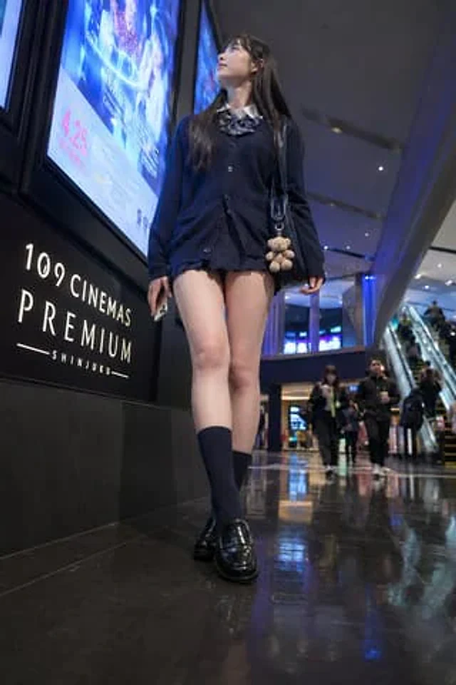

```text
Create a photorealistic vertical street-fashion photo of an {argument name="model age" default="adult young woman in her early 20s"} walking through the interior lobby of a modern cinema complex in Shinjuku at night. Use a low-angle, full-body perspective from near the glossy black floor, with the subject centered and slightly towering in the frame, one foot stepping forward naturally. She wears a Japanese school-uniform-inspired outfit: navy button cardigan over a white shirt, striped bow tie, very short dark pleated skirt, navy knee-high socks, and black glossy loafers. She carries a black shoulder bag on her right shoulder with a small beige teddy bear charm hanging from it, and holds a smartphone loosely in her left hand. Her long straight dark hair falls over her shoulders; her face is softly anonymized/blurred with no distinct facial features. The setting is a sleek movie theater corridor with reflective polished flooring, cool blue ambient lighting, escalators and a few distant pedestrians in the background. On the left wall, include large illuminated movie posters and a black cinema sign reading “109 CINEMAS PREMIUM SHINJUKU”; one poster prominently shows the date “4.25” in pink. Use realistic lens distortion and depth of field, crisp clothing and accessory details, natural walking posture, cinematic indoor lighting, reflections on the floor, and no watermark.
```

Model: GPT Image 2
Author: トーマ＠Grok愛好家

[ProjectD](https://aitoolsradar.com/en/prompts/8a762acf492894) · [Recorded source](https://youmind.com/prompts/shinjuku-cinema-fashion-photo-21399)
 · [Full original metadata and byte evidence](data/projectd-batch-0024.json)

## Cinematic 3-Frame Solo Travel Stills

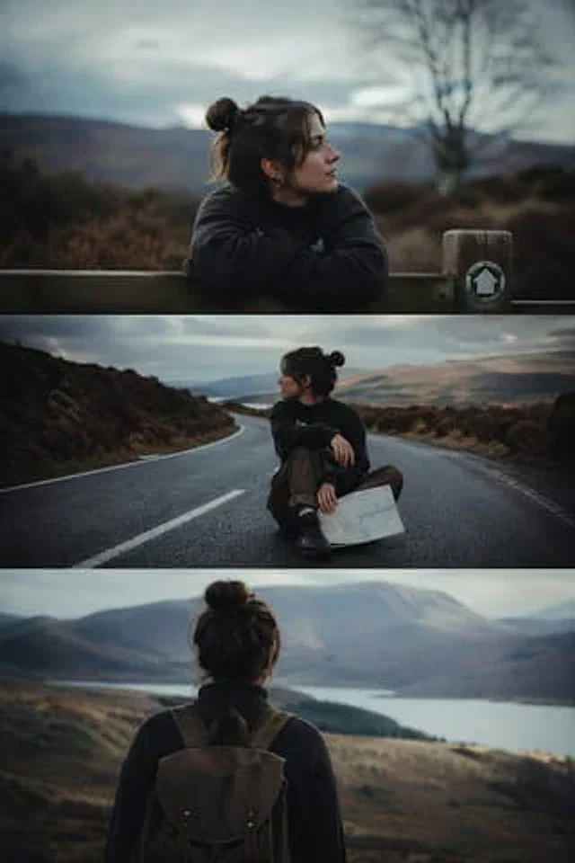

```text
{
  "type": "Cinematic 3-Frame Sequence Stills",
  "style": "Hyperrealistic, emotional, natural light, shallow depth of field, low-saturation earth tones, soft overcast atmosphere, delicate film grain.",
  "subject": {
    "count": 1,
    "description": "A young female traveler, with dark brown hair tied in a messy bun, wearing a dark oversized sweater, brown trousers, and hiking boots.",
    "face_visibility": "All three frames show either a profile or a back view."
  },
  "layout": {
    "orientation": "A vertical triptych, consisting of three horizontally stacked panels separated by a thin border.",
    "sections": [
      {
        "title": "Top frame",
        "position": "top",
        "count": 1,
        "labels": [
          "The woman leaned against the wooden fence with her arms crossed, looking to the right."
        ]
      },
      {
        "title": "medium format",
        "position": "center",
        "count": 1,
        "labels": [
          "A woman sat alone in the middle of a deserted, winding road, holding a folded paper map, looking to her left."
        ]
      },
      {
        "title": "Bottom frame",
        "position": "bottom",
        "count": 1,
        "labels": [
          "A woman's back view, carrying a rugged hiking backpack, standing and gazing at the lake and valley."
        ]
      }
    ]
  },
  "environment": {
    "location": "A remote highland landscape, with rolling hills, sparse dead trees, heather and shrubs, distant mountains and lakes.",
    "weather": "Cloudy, cool, with light fog"
  },
  "camera": {
    "framing": "The film's narrative sequence is as follows: the top frame shows a medium shot of a person, the middle frame shows a full-body seated pose, and the bottom frame shows a medium shot of a person's back.",
    "lens": "shallow focus documentary photography style",
    "aspect": "High vertical composition"
  },
  "details": {
    "props_count": 3,
    "props": [
      "The wooden fence has a small circular trail marker with a white house icon.",
      "Folded paper map",
      "Brown canvas hiking backpack"
    ]
  }
}
```

Model: GPT Image 2
Author: GPT Image 2 Prompts

[ProjectD](https://aitoolsradar.com/en/prompts/491a1dd38a0ebb) · [Recorded source](https://x.com/icreatelife/status/2046630257701048775#reversed-0)
 · [Full original metadata and byte evidence](data/projectd-batch-0024.json)

## Cinematic 3-Frame Solo Travel Stills


```text
{"type":"cinematic 3-frame sequential film stills","style":"ultra-realistic, moody, natural light, shallow depth of field, muted earthy color grading, soft overcast atmosphere, subtle film grain","subject":{"count":1,"description":"young woman traveler with dark brown hair in a messy bun, wearing a dark oversized sweater, brown trousers, and hiking boots","face_visibility":"face turned away or in profile in all 3 frames"},"layout":{"orientation":"vertical triptych with 3 stacked horizontal frames separated by thin borders","sections":[{"title":"top frame","position":"top","count":1,"labels":["woman leaning with folded arms on a wooden fence, looking to the right"]},{"title":"middle frame","position":"center","count":1,"labels":["woman sitting alone in the middle of an empty winding road, holding a folded paper map, looking left"]},{"title":"bottom frame","position":"bottom","count":1,"labels":["rear view of woman wearing a rugged backpack, standing and looking over a lake and mountain valley"]}]},"environment":{"location":"remote highland landscape with rolling hills, sparse leafless trees, heather and brush, distant mountains, and a lake","weather":"cloudy, cool, slightly misty"},"camera":{"framing":"cinematic storytelling sequence, medium portrait in top frame, full-body seated shot in middle frame, medium back view in bottom frame","lens":"shallow-focus documentary photography look","aspect":"tall vertical image"},"details":{"props_count":3,"props":["wooden fence with a small circular trail marker sign showing a white house-like icon","folded paper map","brown canvas hiking backpack"]}}
```

Model: GPT Image 2
Author: Kris Kashtanova

[ProjectD](https://aitoolsradar.com/en/prompts/5f9bbc45899ef2) · [Recorded source](https://youmind.com/prompts/cinematic-solo-travel-triptych-14667)
 · [Full original metadata and byte evidence](data/projectd-batch-0024.json)

## Cinematic 3x3 Storyboard Grid

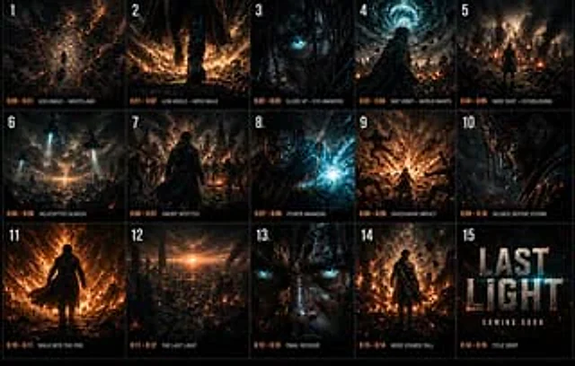

```text
create a 3x3 grid storyboard showing a cinematic sequence of [your chosen subject] set the location on the street and night time. Follow the storyboard sequence of the reference images, edited as an action movie. A movie that can win oscars, shot on 35mm film in Kodak Portra 800 style.
```

Model: GPT Image 2
Author: BlAise

[ProjectD](https://aitoolsradar.com/en/prompts/e0f3cba5ad9e6e) · [Recorded source](https://youmind.com/prompts/cinematic-3x3-storyboard-17317)
 · [Full original metadata and byte evidence](data/projectd-batch-0024.json)

## Cinematic 8K Photo Enhancer


```text
Using the provided reference image, enhance it into an ultra-premium cinematic 8K photo while preserving 100% of the original composition, pose, objects, lighting placement, and the face-obscuring censor block. Improve the image quality dramatically: recover sharp microdetails in the glass display case, the golden trophy, hair texture, hand, rings, clothing, reflections, and illuminated display bases. Make it photorealistic with studio-grade contrast, richer warm museum lighting, cleaner shadows, reduced blur and pixelation, crisp edges, realistic glass reflections, and a high-end editorial/cinema finish. Do not change the subject’s position, the trophy location, the black vertical display bars, or the overall framing. Use {argument name="output quality" default="ultra-premium 8K"}, {argument name="visual style" default="cinematic photorealism"}, {argument name="detail emphasis" default="sharp microdetails, realistic pores, hair, glass, and metal reflections"}, and {argument name="lighting mood" default="warm high-contrast museum display lighting"}.
```

Model: GPT Image 2
Author: Chesny

[ProjectD](https://aitoolsradar.com/en/prompts/398fbda8c3e6f0) · [Recorded source](https://youmind.com/prompts/cinematic-photo-enhancement-22199)
 · [Full original metadata and byte evidence](data/projectd-batch-0024.json)

## Cinematic AI mood board prompt

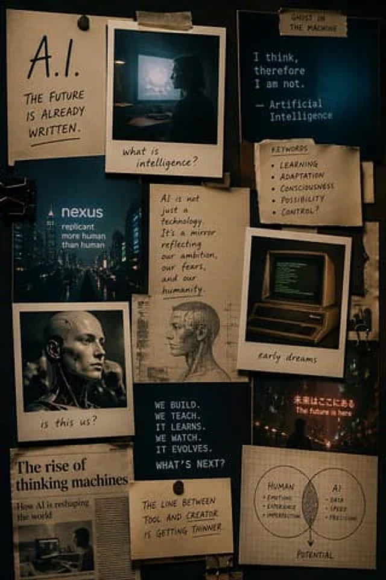

```text
Make one{argument name="format" default="Mood Board"} The theme is{argument name="subject" default="AI"} The style is{argument name="style" default="Cinematic style"} Use Polaroid and other retro elements in the portrait mode
```

Model: GPT Image 2
Author: GPT Image 2 Prompts

[ProjectD](https://aitoolsradar.com/en/prompts/cc95707b798b5d) · [Recorded source](https://x.com/icreatelife/status/2047098533275209826)
 · [Full original metadata and byte evidence](data/projectd-batch-0024.json)

## Cinematic AI Web Sprint Poster

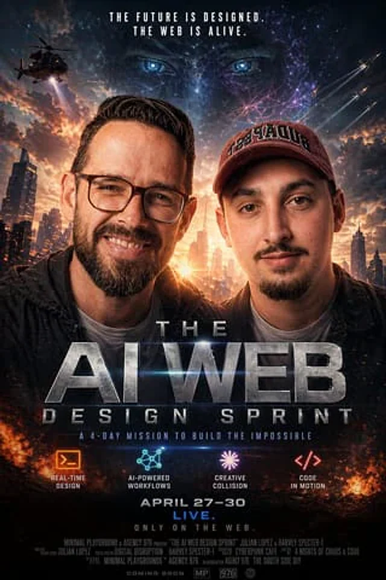

```text
{
  "type": "Movie-level sci-fi event poster",
  "subject": {
    "format": "Vertical single-page promotional poster",
    "theme": "Futuristic AI Web Design Ads with Cinematic Quality",
    "headline_top": "{argument name=\"headline text\" default=\"The future is defined by design. The network is awakening.\"}",
    "main_title": "THE AI WEB",
    "subtitle": "Design Sprint",
    "tagline": "A 4-day mission to create infinite possibilities",
    "date_text": "{argument name=\"event dates\" default=\"April 27 to 30\"}",
    "status_text": "{argument name=\"status text\" default=\"Live broadcast in progress.\"}",
    "footer_text": "Web-based only.",
    "coming_text": "Stay tuned"
  },
  "characters": {
    "count": 2,
    "description": "Two male characters, close-ups of their chests and above, are positioned side-by-side in the center like co-stars in a movie poster. Both wear dark jackets over light-colored shirts, with dramatic contour lighting and warm backlighting, realistic facial features, deliberately maintaining a generic appearance.",
    "left_character": {
      "position": "center left",
      "hair": "Dark brown slicked-back hair",
      "facial_hair": "goatee",
      "expression": "Serious and neutral"
    },
    "right_character": {
      "position": "center right",
      "headwear": "Red baseball cap with visible embroidered lettering",
      "facial_hair": "goatee",
      "expression": "Serious and neutral"
    }
  },
  "background": {
    "setting": "A post-apocalyptic futuristic city skyline at dusk",
    "sky": "A massive, luminous sunset rises on the horizon, accompanied by dense storm clouds; its base glows with orange fire, gradually fading into a deep blue-black space.",
    "city": {
      "count": 2,
      "description": "The silhouettes of city skyscrapers on both sides frame the central radiance."
    },
    "cosmic_face": "A gigantic celestial face emerged from the sky, its two glowing blue eyes fixed ahead.",
    "network_effect": "Purple and blue neural network lines spread across the upper half of the sky along with starlight.",
    "aircraft": {
      "count": 4,
      "items": [
        "A helicopter with a searchlight beam in the upper left corner.",
        "Three jet aircraft leaving bright contrails in the upper right corner"
      ]
    },
    "fire_effects": "Burning embers and flames in the bottom left and bottom right corners"
  },
  "layout": {
    "title_block": {
      "position": "Mid-lower part",
      "style": "The large, metallic chrome 3D font features beveled edges, a brushed steel texture, bright highlights, and a blue lens flare that runs across the title."
    },
    "feature_icons": {
      "position": "Above the date line",
      "count": 4,
      "items": [
        {
          "label": "Real-time design",
          "icon": "Glowing orange screen/terminal icon with angle brackets and underline"
        },
        {
          "label": "AI-driven workflow",
          "icon": "Glowing cyan node network icon"
        },
        {
          "label": "Creative collision",
          "icon": "Glowing purple radial burst icon"
        },
        {
          "label": "Dynamic code",
          "icon": "Glowing red code bracket slash icon"
        }
      ]
    },
    "credits": {
      "position": "bottom",
      "count": 3,
      "items": [
        "The bottom features a dense pseudo-movie cast and crew list, using a tiny compressed font.",
        "Logo of a small production company containing MP and 976 style marks",
        "The overall footer design style imitates that of movie posters."
      ]
    }
  },
  "style": {
    "lighting": "High-contrast, cinematic lighting, with warm orange sunsets intertwined with cool blue-purple sci-fi rays.",
    "color_palette": "Orange, blue, purple, black, steel silver",
    "composition": "A symmetrical, heroic composition, a central horizon halo, and an oversized title.",
    "finish": "Ultra-detailed, glossy, realistic composite, an epic cyberpunk movie poster, dramatic atmosphere, sharp focus, volumetric lighting, sparks, and lens flare."
  }
}
```

Model: GPT Image 2
Author: GPT Image 2 Prompts

[ProjectD](https://aitoolsradar.com/en/prompts/5de32f04e6f18e) · [Recorded source](https://x.com/ransegall/status/2047583778974126564#reversed-2)
 · [Full original metadata and byte evidence](data/projectd-batch-0024.json)

## Cinematic Anime Movie Poster Prompt

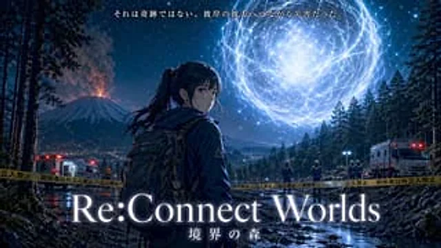

```text
16:9 Anime Movie Poster. The edge of a forest at night. In the center left front, a Japanese girl in her late teens. She has a black ponytail, a slender figure, wears a dark, practical winter jacket, and carries a research backpack. A 3/4 back view shows her back as she looks back. A calm tension and unwavering will. Above the forest on the right, a huge spherical supernatural phenomenon emits a white-blue light. The energy sphere is interwoven with countless luminous threads and electric outlines. Inside is a misty white light, surrounded by fine, pale blue particles. In the distance on the left, Mount Fuji is spewing smoke. In the mid-ground, there is a no-entry zone with Japanese warnings, flanked by realistic disaster response personnel and emergency vehicles. No military feel is needed. The ground is a muddy forest with shallow streams and wetlands reflecting light. Tall trees on the left and right sides frame the scene. The sky is dotted with stars, and faint city lights are visible at the foot of Mount Fuji. This creates an atmosphere of mystery and disaster. The image features a girl, a giant sphere of light, and Mount Fuji arranged in a triangle. A slightly somber, cinematic perspective is used. The girl and the sphere of light are clearly presented as the two main protagonists. The background is a cool night blue, with the primary light source being the white-blue emitted light from the giant sphere. Trees, the ground, the water, and the girl have strong rim lighting. Secondary light sources include starlight and the faint orange glow of a distant volcanic eruption. The girl's face is not too dark, and her expression is clearly visible. High contrast. A high-end key visual for the latest Japanese theatrical anime. Movie poster-level completion. High-density, detailed backgrounds, precise lighting and shadow, atmospheric perspective, and exquisite anime illustrations leaning towards a realistic style. The overall color scheme is deep navy blue, white-blue emitted light, and a faint volcanic orange. Solemn, unsettling, mysterious, and dramatic. Small Japanese text at the top center:{argument name="poster slogan" default="That was not a miracle. That was a disaster that connected us to the other side."} The large, elegant serif English title at the bottom center is a pale, almost white color:{argument name="movie title" default="Re:Connect Worlds"} Below the main title is a smaller Japanese subtitle:{argument name="subtitle" default="Boundary Forest"} The text must be accurate and highly readable. Do not include any other text, logos, or watermarks except as specified. Do not include unnecessary characters, monsters, mechs, or unnecessary dazzling particles and noise.
```

Model: GPT Image 2
Author: GPT Image 2 Prompts

[ProjectD](https://aitoolsradar.com/en/prompts/13d19c21291e78) · [Recorded source](https://x.com/old_pgmrs_will/status/2046890563040075799)
 · [Full original metadata and byte evidence](data/projectd-batch-0024.json)

## Cinematic Anime Train Station Poster

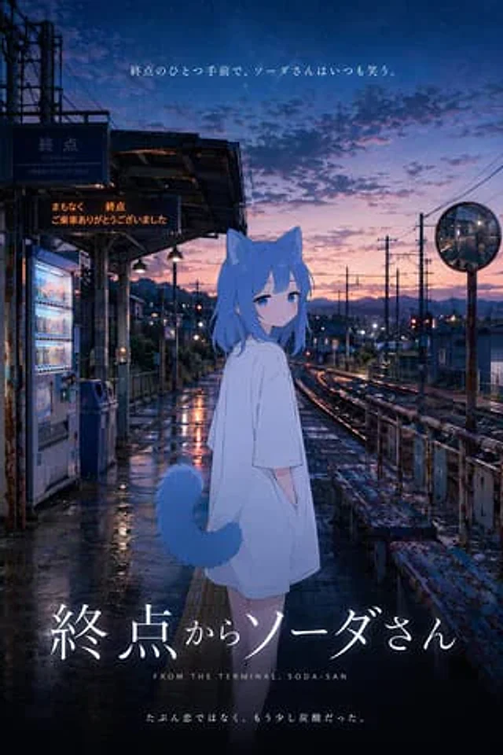

```text
An anime-style movie poster, with the main subject being {argument name="character appearance" default="A girl with short blue hair, blue animal ears, a fluffy blue tail, and wearing an oversized white T-shirt."} She stands on the damp, reflective platform of a Japanese rural train station at dusk, glancing back at the camera with a calm and gentle expression. The backdrop is a breathtaking twilight sky, its colors transitioning from deep blue to vibrant orange and pink, dotted with newly appearing stars and textured clouds. Station amenities include illuminated vending machines on the left, weathered wooden benches on the right, railway tracks stretching into the distance, a station sign overhead, and a round safety mirror. The lighting is rich and warm, contrasting sharply with the cool twilight. The poster is topped with elegant small print: "{argument name="top quote" default="Soda always smiles one stop before the final destination."} The main title, displayed in large, eye-catching font, is located in the lower third of the poster.{argument name="main title" default="Soda-san from the final stop"} Below this is a smaller English subtitle:{argument name="english subtitle" default="FROM THE TERMINAL, SODA-SAN"} At the very bottom edge, there is a line of text:{argument name="bottom quote" default="It was probably not love, but more like a carbonated drink."} The overall atmosphere is nostalgic and slightly melancholic, with extremely rich details.
```

Model: GPT Image 2
Author: GPT Image 2 Prompts

[ProjectD](https://aitoolsradar.com/en/prompts/157da84776676c) · [Recorded source](https://x.com/kotsu_kotsu_san/status/2045063826924786056#reversed-0)
 · [Full original metadata and byte evidence](data/projectd-batch-0024.json)

## Cinematic Athlete Journey Portrait

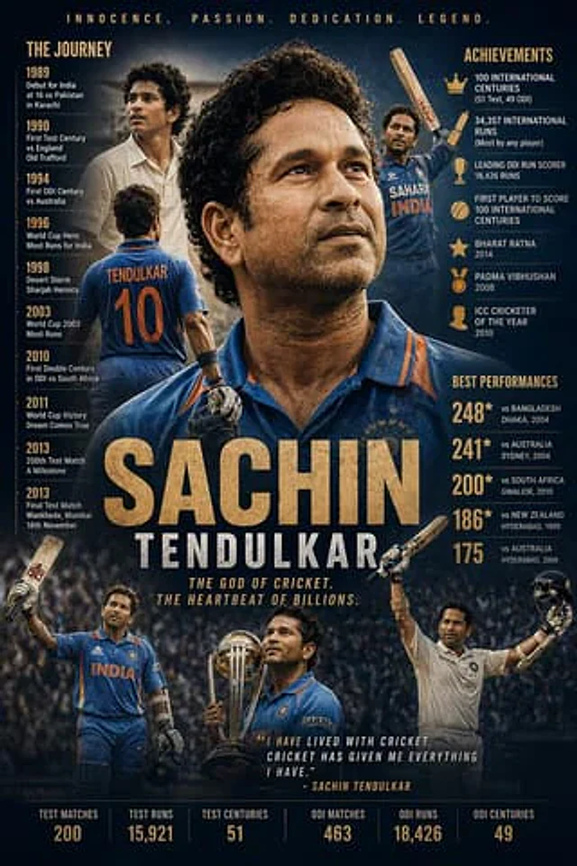

```text
Cinematic portrait, the main character is{argument name="athlete name" default="[Athlete&#39;s Name]"} It showcases their career trajectory and highlights their achievements and best performances in prominent text.
```

Model: GPT Image 2
Author: GPT Image 2 Prompts

[ProjectD](https://aitoolsradar.com/en/prompts/19478478ca3fdc) · [Recorded source](https://x.com/Mahesh171819/status/2047556747079090419)
 · [Full original metadata and byte evidence](data/projectd-batch-0024.json)

## Cinematic Atlas Miniature World Diorama

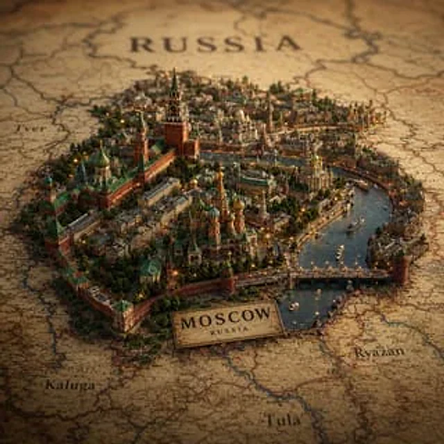

```text
An ultra-premium cinematic atlas visualization of {argument name="country" default="COUNTRY"} designed as a luxurious collectible miniature world built directly into an aged textured world map. Instead of a simple diorama, the scene features an elevated hyper-detailed micro-city of {argument name="city" default="CITY"} emerging organically from the terrain like a living architectural island. The environment contains iconic monuments, historic buildings, rivers, bridges, tiny streets filled with realistic urban depth, glowing windows, vegetation, atmospheric details, and elegant cultural symbolism crafted with museum-level precision.
The camera angle feels like a high-end macro documentary photograph captured with a professional tilt-shift lens, creating an immersive miniature illusion with cinematic depth separation. Surrounding map typography, borders, coordinates, and neighboring regions remain subtly visible beneath the structure, blending cartography with luxury worldbuilding.
Add dramatic golden-hour sunlight mixed with soft volumetric atmospheric haze, realistic ambient occlusion, global illumination, rich shadows, ultra-detailed textures, reflective water canals, tiny moving boats, miniature street lamps, cinematic fog layering, and refined environmental storytelling. Include subtle weathered paper textures, embossed map details, and elegant depth transitions for a premium handcrafted aesthetic.
The color grading should feel inspired by luxury travel documentaries and next-generation editorial campaigns — warm golden highlights, rich earthy greens, elegant ivory paper tones, deep architectural contrast, and subtle teal shadows. The composition must feel grand, immersive, artistic, and visually unforgettable.
Ultra-photorealistic, insanely detailed, masterpiece-quality, hyper-realistic materials, advanced global illumination, macro realism, depth-rich cinematic atmosphere, luxury travel aesthetic, collectible miniature world design, editorial-quality rendering, 8K ultra detail.
```

Model: GPT Image 2
Author: Nexora

[ProjectD](https://aitoolsradar.com/en/prompts/a4ed31db2a26ae) · [Recorded source](https://youmind.com/prompts/cinematic-atlas-miniature-world-diorama-21706)
 · [Full original metadata and byte evidence](data/projectd-batch-0024.json)

## Cinematic Autonomous AI Mood Board

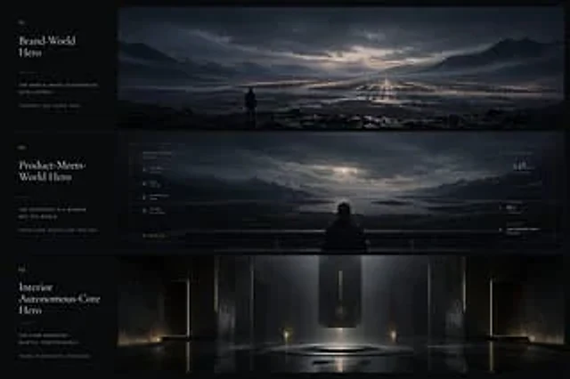

```text
{"type":"cinematic app design language mood board","style":"ultra-wide premium presentation board with three horizontal cinematic panels and a narrow editorial text column on the left, dark luxury sci-fi minimalism, moody atmospheric lighting, restrained typography, near-monochrome blue-black palette with subtle warm gold accents, highly polished concept-art realism","subject":"a visual design system for an autonomous intelligence product shown as world-scale cinematic environments and interface philosophy","layout":{"canvas":"16:9 landscape","left_column":{"width":"about 20% of canvas","background":"matte black","count":3,"sections":[{"index":"01","title":"Brand-World Hero","tagline":"THE WORLD UNDER AUTONOMOUS INTELLIGENCE.","subtext":"Cinematic. Vast. Subtle. Alive.","position":"top left block"},{"index":"02","title":"Product-Meets-World Hero","tagline":"THE INTERFACE IS A WINDOW, NOT THE WORLD.","subtext":"Human scale. System scale. One view.","position":"middle left block"},{"index":"03","title":"Interior Autonomous-Core Hero","tagline":"THE CORE OPERATES. QUIETLY. CONTINUOUSLY.","subtext":"Tactile. Architectonic. Intentional.","position":"bottom left block"}],"typography":"elegant high-contrast serif for titles, tiny uppercase sans-serif for labels and body copy, generous spacing, faint gold section numbers and divider lines"},"right_panels":{"count":3,"panels":[{"position":"top","scene":"a solitary human figure standing on dark rocky ground overlooking a vast flooded valley at dusk, mountain ranges on both sides, dramatic cloud cover with a pale opening at the horizon, an enormous grid of distant warm lights and runway-like linear illumination stretching into the landscape, reflective water channels and wetlands in the foreground, sense of immense scale and silence"},{"position":"middle","scene":"the same mountainous lake landscape viewed through a giant transparent futuristic interface wall from behind a seated or standing person centered at the bottom edge, subtle HUD overlay graphics framing the panorama, thin white interface lines and tiny data labels, left-side system menu and right-side metrics panel integrated into the glass, the world outside remains dominant while the UI feels delicate and secondary","ui_components":{"count":6,"labels":["MISSION CONTROL","VENTURES","RUNS","OPPORTUNITIES","SYSTEMS","SYSTEM LIVE"]},"right_metrics":{"count":4,"labels":["VALUE PROJECTION","CONFIDENCE","ACTIVE RUN","Lead Generation Engine Executing"]}},{"position":"bottom","scene":"a monumental interior autonomous core chamber, dark stone or concrete architecture, symmetrical composition, tall monolithic walls, thin vertical light slits, a hovering or suspended rectangular black monolith in the center with a small hexagonal emblem, circular platform recessed into the floor beneath it, glossy reflective floor, shafts of cool light descending from above, sparse warm floor lights, sacred technological atmosphere"}]},"color_palette":{"count":5,"colors":["deep black","midnight blue","steel gray","misty silver","muted warm gold"]},"mood_keywords":{"count":8,"words":["cinematic","vast","subtle","alive","architectonic","intentional","quiet","futuristic"]},"rendering":"high-end concept art mixed with premium brand presentation board, photoreal environment detail, soft volumetric fog, reflective surfaces, low-key contrast, meticulous composition, luxury tech aesthetic, no bright saturated colors, no playful elements"}
```

Model: GPT Image 2
Author: Alex Finn

[ProjectD](https://aitoolsradar.com/en/prompts/4d090ae8102ea6) · [Recorded source](https://youmind.com/prompts/cinematic-autonomous-mood-board-16147)
 · [Full original metadata and byte evidence](data/projectd-batch-0024.json)

## Cinematic Backlit Katana Samurai Portrait

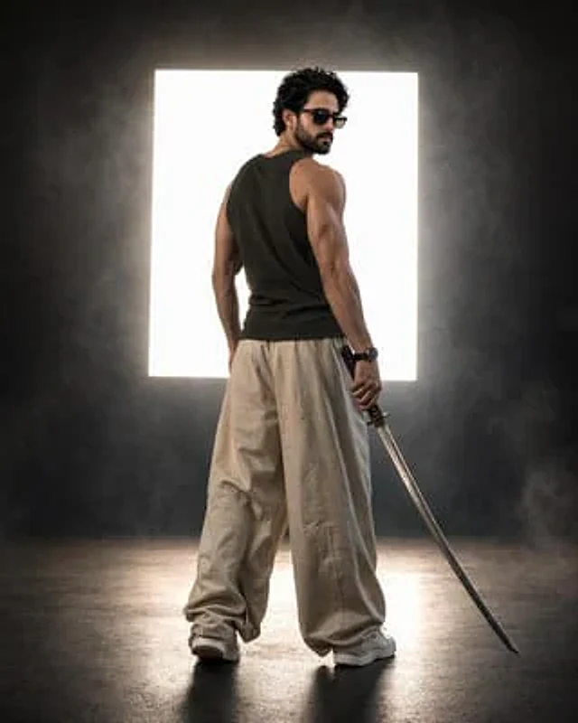

```text
Full-body cinematic studio portrait of an {argument name="subject" default="athletic man"} From reference image standing with his back to the camera, looking over his shoulder with a sharp glance. He is holding a traditional Japanese {argument name="weapon" default="katana sword"} resting downward near his side. He is wearing a dark {argument name="clothing color" default="olive green"} sleeveless tank top, ultra-baggy cream-colored streetwear trousers, and dark sunglasses. The setting is a dark, minimalist concrete studio floor filled with subtle atmospheric haze and smoke. Directly behind him is a massive, bright white square softbox light panel, creating a powerful backlit silhouette effect with intense rim lighting that highlights the muscular definition of his arms and back. Cinematic composition, raw photography style, high contrast, dramatic chiaroscuro mood, sharp details, 85mm lens, f/2.8. --ar 4:5
```

Model: GPT Image 2
Author: Zar⭕on

[ProjectD](https://aitoolsradar.com/en/prompts/090a76576e1105) · [Recorded source](https://youmind.com/prompts/cinematic-backlit-katana-samurai-portrait-28217)
 · [Full original metadata and byte evidence](data/projectd-batch-0024.json)

## Cinematic Backlit Woman Portrait


```text
A cinematic vertical portrait, with the subject being {argument name="subject" default="young women"} The shot uses a close-up composition of the upper body, slightly to the right. The body faces right, the head turned towards the camera, presenting a restrained, sideways glance. She has {argument name="hair color" default="Long black hair"} Her hair, tousled and slightly disheveled, billows out of the frame in a strong wind, strands dancing around her face and shoulders. Her styling is elegant and simple: a dark, thin-strapped halter dress or vest revealing her shoulders, collarbone, and upper back, topped with a black, sheer, off-the-shoulder shawl or semi-transparent outer garment that cascades down her arms, creating a soft, dark silhouette against her lower body. The overall atmosphere is cool, quiet, mysterious, and melancholic, possessing a cinematic quality reminiscent of high fashion rather than an overly embellished glitz. Dramatic backlighting from the upper left creates bright halos around her hair, shoulders, and body edges, while the majority of her face remains in shadow with only very soft fill light. Her face is largely hidden in darkness and soft mist, emphasizing her contours, neck, ears, shoulders, and the edges of her glowing hair, rather than facial details. The background is a vast, empty space ranging from dark gray to almost black, containing two distinct environmental elements: floating dust-like particles and soft, circular bokeh primarily distributed on the left side and around her hair. The overall color tone is low-saturation, with cool blue undertones in the shadows and slightly warm skin tones, creating a subtle contrast between warm and cool tones. Add diffused lighting, a hazy atmosphere, subtle film grain, soft vignetting, and a shallow depth of field. Keep the eyes and lips softened or hidden in shadow, avoid harsh frontal lighting, avoid overly bright and cluttered backgrounds, avoid a cartoonish style, avoid over-sharpening, and avoid plastic-looking skin textures.
```

Model: GPT Image 2
Author: GPT Image 2 Prompts

[ProjectD](https://aitoolsradar.com/en/prompts/58ed63fc96dddb) · [Recorded source](https://x.com/lin_yishan/status/2046616470680215908#reversed-0)
 · [Full original metadata and byte evidence](data/projectd-batch-0024.json)

## Cinematic Banana Wine Advertisement


```text
A high-end, cinematic commercial photograph depicts a muscular, humanoid banana figure standing in a dimly lit, atmospheric wine cellar. The figure possesses a realistic yellow banana-peel torso, a cartoonish face with thick black eyebrows and a wide, toothy grin, and human-muscular arms. He wears a red apron and elegantly holds a glass of red wine. On a wooden table to his right sits a dark glass bottle of red wine with a classic, elegant label.{argument name="wine brand" default="Maison Rouge B."} And an illustration of a castle. The background is a blurred wine rack displaying various wine bottles, appearing exceptionally sophisticated under exquisite, dramatic lighting in deep red and brown tones. The main slogan is displayed in elegant white Japanese font in the upper left corner.{argument name="main tagline" default="There&#39;s a reason behind that one cup."} A smaller subtitle is provided below.{argument name="sub tagline" default="I choose based on the lingering aftertaste, not the sweetness."} . There is a tiny legal disclaimer in the lower left corner "※お水は20歳になってから". The brand name is displayed in a simple serif font in the lower right corner{argument name="wine brand" default="Maison Rouge B."} .
```

Model: GPT Image 2
Author: GPT Image 2 Prompts

[ProjectD](https://aitoolsradar.com/en/prompts/4a03bcb30a19c7) · [Recorded source](https://x.com/QKkaz/status/2045428596643434781#reversed-0)
 · [Full original metadata and byte evidence](data/projectd-batch-0024.json)

## Cinematic Beyblade Rooftop Launch

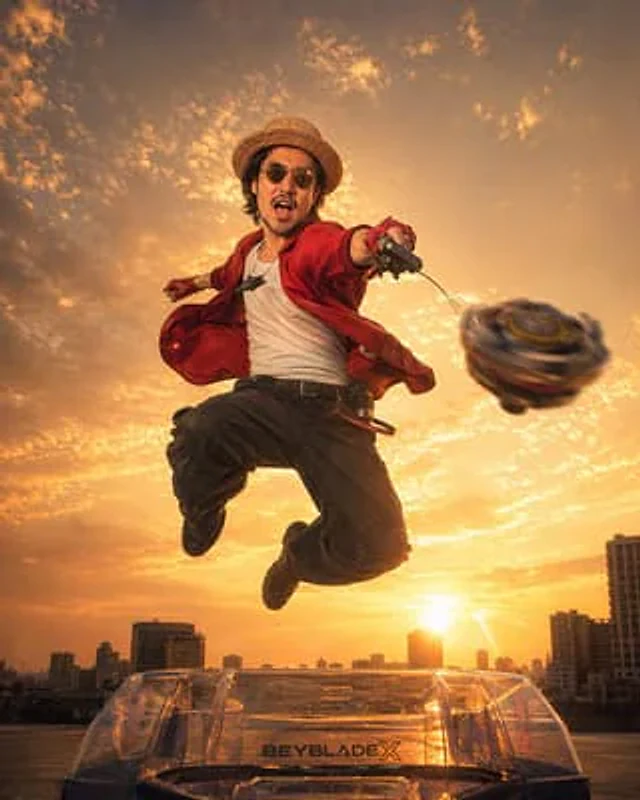

```text
A hyper-realistic, cinematic action photograph captures the moment a young man leaps into the air from a rooftop against a golden sunset backdrop. The shot is taken from a dramatic low angle against a backdrop of a glowing orange sky dotted with sparse clouds. He is positioned in the center of the frame, knees bent in mid-air, wearing a woven straw hat and a garment billowing in the wind.{argument name="jacket color" default="Bright red"} He wears a cardigan over a white vest, dark, loose-fitting cargo pants, and rugged dark boots. He's accessorized with layered necklaces and fingerless gloves, and a belt with a launcher sheath around his waist. His right arm is extended towards the camera, pulling a lever to launch a spinning top toy. The toy is positioned very close to the foreground on the right side of the frame, its enormous size and motion blur enhancing the sense of depth and speed. A transparent plastic Beyblade battle disk is placed in the bottom foreground, capturing the warm reflection of the sunset; its iconic lettering is clearly visible.{argument name="brand text" default="BEYBLADE X"} The city skyline extends into the background below, with several high-rise buildings silhouetted against the near-horizontal sunset. The lighting exhibits a strong, warm-toned backlighting effect, with pronounced rim lighting, cinematic contrast, subtle lens flare, and a dynamic, flowing fabric effect. The composition should present {argument name="toy franchise" default="Beyblade X"} The promotional posters, featuring real people, emphasize vitality, youth, speed, and the feeling of urban rooftop competition, and are presented in a vertical format.
```

Model: GPT Image 2
Author: GPT Image 2 Prompts

[ProjectD](https://aitoolsradar.com/en/prompts/0125e7429f6085) · [Recorded source](https://x.com/getup117/status/2047135207023870155#reversed-0)
 · [Full original metadata and byte evidence](data/projectd-batch-0024.json)

## Cinematic Boxing Match Poster

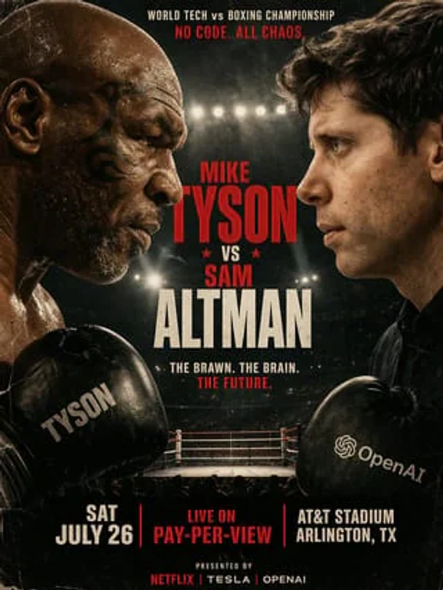

```text
A grainy, cinematic boxing promotional poster shows the left side {argument name="fighter 1" default="Mike Tyson"} With the right side{argument name="fighter 2" default="Sam Altman"} A face-to-face boxing match. The boxer on the left is an older, bald man with tribal tattoos on his face, wearing black boxing gloves with the word "TYSON" printed on them. The boxer on the right is a younger man with dark, wavy hair, wearing black boxing gloves with the OpenAI logo and text. Both men have serious and tense expressions, and the details of their skin texture and sweat are extremely realistic. The background is a blurred boxing ring under bright stadium lights. The poster has a retro and slightly worn grunge feel. The text at the top is white "WORLD TECH vs BOXING CHAMPIONSHIP" and red "{argument name="top tagline" default="NO CODE. ALL CHAOS."} The poster prominently displays the words "MIKE TYSON" in bold red, along with red "★ VS ★" and the large, off-white "SAM ALTMAN" lettering in the center. Below this is the text {argument name="middle tagline" default="THE BRAWN. THE BRAIN. THE FUTURE."} The bottom section displays information in three columns.{argument name="event date" default="SAT JULY 26"} The red text reads "LIVE ON PAY-PER-VIEW" and "AT&amp;T STADIUM ARLINGTON, TX". The bottom footer reads "PRESENTED BY NETFLIX | TESLA | OPENAI".
```

Model: GPT Image 2
Author: GPT Image 2 Prompts

[ProjectD](https://aitoolsradar.com/en/prompts/b262281cf844f3) · [Recorded source](https://x.com/patrickassale/status/2043482871089013166#reversed-1)
 · [Full original metadata and byte evidence](data/projectd-batch-0024.json)

## Cinematic Breakfast Dating Sim UI

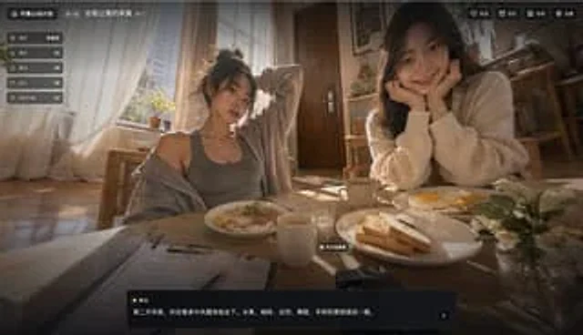

```text
{"type":"cinematic visual novel game screenshot","genre":"romantic live-action interactive story interface","scene":{"location":"shared apartment dining room","time":"early morning","lighting":"warm golden sunrise streaming through large sheer-curtained windows, soft bloom, shallow depth of field, cozy domestic atmosphere","camera":"slightly low seated viewpoint from across a wooden breakfast table, wide-angle lens, intimate first-person perspective","mood":"gentle, nostalgic, subtly flirtatious, slice-of-life"},"subjects":{"count":2,"people":[{"position":"center-left","gender_presentation":"young woman","pose":"sitting casually at the breakfast table, one arm raised behind her head, cardigan slipping off one shoulder","outfit":"gray fitted tank top with a loose light gray cardigan","hair":"messy tied-up dark hair","expression":"relaxed morning look"},{"position":"right foreground","gender_presentation":"young woman","pose":"leaning forward with elbows on the table, face resting in both hands, looking toward the viewer","outfit":"oversized cream knit sweater","hair":"long dark wavy hair","expression":"soft, attentive, affectionate"}]},"table":{"items_count":10,"items":["plate of pasta or breakfast noodles in front of the left woman","plate with toast in the center-right","plate with two fried eggs near the right woman","white coffee mug in the center foreground","second mug near the right woman","small clear glass near the center","metal fork","clipboard with papers at the lower left","small camera at the lower center-right edge","small glass vase with white flowers and green leaves at the lower right"]},"background":{"elements_count":7,"elements":["large bright window with sheer curtains on the left","sunlit wooden floor","wooden door in the center back","wooden chairs","small shelf or cabinet with kitchen items","framed wall picture","softly blurred kitchen area on the far right"]},"ui":{"style":"modern dark translucent game HUD with rounded corners and gold accents","sections":[{"title":"环景心动计划","position":"top-left","count":1,"labels":["第一章 合租公寓的早晨 餐厅"]},{"title":"stats panel","position":"left side vertical","count":5,"labels":["路线 未锁定","事业 32","真诚 38","压力 38","信任均值 30"]},{"title":"action buttons","position":"top-right","count":4,"labels":["关系","回忆","存档","设置"]},{"title":"dialogue box","position":"bottom center","count":2,"labels":["旁白","第二天早晨，你在餐桌中央醒来般坐下。水果、咖啡、合司、舞鞋、手柄和票根围成一圈。"]},{"title":"location tag","position":"lower middle above dialogue box","count":1,"labels":["天文馆黎想"]}]},"rendering":{"look":"photorealistic cinematic still frame, premium dating sim interface, soft film grain, creamy bokeh, warm color grading, realistic skin and fabric textures, slight lens haze"},"parameters":{"chapter title":"{argument name=\"chapter title\" default=\"合租公寓的早晨\"}","game title":"{argument name=\"game title\" default=\"环景心动计划\"}","left character outfit":"{argument name=\"left character outfit\" default=\"gray tank top and loose cardigan\"}","right character outfit":"{argument name=\"right character outfit\" default=\"oversized cream knit sweater\"}","narration text":"{argument name=\"narration text\" default=\"第二天早晨，你在餐桌中央醒来般坐下。水果、咖啡、合司、舞鞋、手柄和票根围成一圈。\"}"}}
```

Model: GPT Image 2
Author: Cell 细胞

[ProjectD](https://aitoolsradar.com/en/prompts/0d8676e2748438) · [Recorded source](https://youmind.com/prompts/cinematic-breakfast-dating-sim-17128)
 · [Full original metadata and byte evidence](data/projectd-batch-0024.json)

## Cinematic Cafe Visual Novel UI

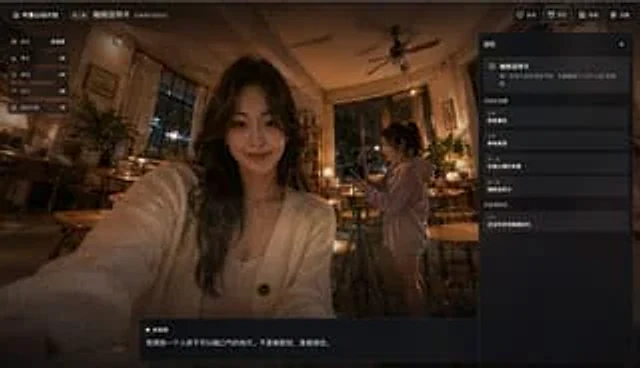

```text
{"type":"cinematic narrative game interface screenshot","theme":"warm, introspective coffee shop memory scene with visual novel UI overlay","setting":{"location":"cozy independent cafe at night","lighting":"dim amber tungsten lighting, soft practical lamps, warm highlights, deep shadows","atmosphere":"quiet, nostalgic, emotionally reflective, slightly cinematic realism","background_details":["large windows with night city lights visible outside","wooden tables and chairs scattered through the cafe","potted plants near the windows and corners","bookshelf or display shelf in the back","ceiling fan centered overhead","curtains framing the windows"]},"composition":{"camera":"slightly wide-angle selfie perspective from the seated foreground subject","framing":"foreground woman occupies the center-left with her arm extended toward the camera, second woman stands mid-right operating a camera on a tripod, UI panels overlay the full screen","depth":"shallow to moderate depth with soft environmental blur and strong focus on the overall scene mood"},"subjects":{"count":2,"characters":[{"role":"foreground protagonist","gender_presentation":"young woman","position":"center-left foreground","pose":"holding the camera or phone in a selfie-like pose with one arm extended toward the viewer","appearance":{"hair":"long wavy dark hair","outfit":"soft white knit cardigan with buttons over a light inner top","accessories":"subtle necklace"}},{"role":"background companion","gender_presentation":"young woman","position":"mid-right background","pose":"standing beside a tripod, looking down at or adjusting a camera","appearance":{"hair":"dark hair tied in a ponytail","outfit":"oversized light-colored hoodie and shorts or bare legs visible"}}]},"style":{"rendering":"photorealistic cinematic game screenshot","color_palette":"warm browns, amber gold, soft black, muted cream","mood":"gentle, intimate, slice-of-life, memory-like","ui_style":"sleek dark translucent modern game UI with rounded rectangles and subtle gold accents"},"layout":{"sections":[{"title":"左侧状态栏","position":"top-left vertical panel","count":5,"labels":["路线","事业","真诚","压力","信任均值"]},{"title":"顶部导航","position":"top edge","count":6,"labels":["环景心动计划","第二章","咖啡店样片","关系","回忆","存档"]},{"title":"右侧回忆面板","position":"right sidebar","count":3,"labels":["咖啡店样片","已到达场景","已发现回忆"]},{"title":"已到达场景","position":"inside right sidebar middle","count":4,"labels":["序章","雨夜重逢","序章","停电楼顶","第一章","合租公寓的早晨","第二章","咖啡店样片"]},{"title":"底部对白框","position":"bottom center-left","count":2,"labels":["苏晓晴","我想拍一个人终于可以喘口气的地方。不是被取悦，是被接住。"]}],"centerpiece":"foreground selfie-like portrait inside the cafe with a second person filming in the background"},"text":{"language":"Chinese interface text","preserve_visible_text":true},"customization":{"chapter":"{argument name=\"chapter label\" default=\"第二章\"}","scene title":"{argument name=\"scene title\" default=\"咖啡店样片\"}","character name":"{argument name=\"character name\" default=\"苏晓晴\"}","dialogue":"{argument name=\"quote\" default=\"我想拍一个人终于可以喘口气的地方。不是被取悦，是被接住。\"}","interface title":"{argument name=\"interface title\" default=\"环景心动计划\"}"},"quality":"high-detail, polished, premium indie narrative game screenshot, realistic lighting, cohesive UI design"}
```

Model: GPT Image 2
Author: Cell 细胞

[ProjectD](https://aitoolsradar.com/en/prompts/d7c9df5982c7b4) · [Recorded source](https://youmind.com/prompts/cinematic-cafe-visual-novel-17140)
 · [Full original metadata and byte evidence](data/projectd-batch-0024.json)

## Cinematic Calligraphy Portrait

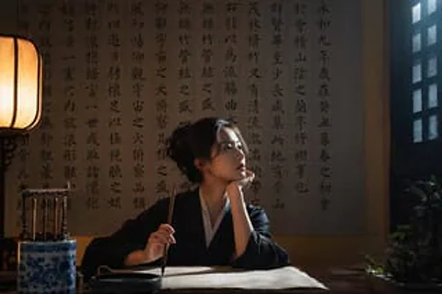

```text
A highly realistic, cinematic photograph, in which {argument name="subject description" default="A young Asian woman"} Wearing{argument name="clothing" default="Traditional black and white Hanfu"} She sat at a dark wooden table in a dimly lit, traditional study. Her right hand held a calligraphy brush, suspended above a blank scroll; her left hand supported her chin, her expression {argument name="expression" default="Contemplative and focused"} Looking to the right, towards the grilled window. The background is a wall covered with {argument name="background calligraphy" default="Traditional Chinese calligraphy"} The large wall. The scene is created by {argument name="lighting style" default="Dramatic cinematic lighting effects with contrasting warm and cool colors"} Illuminated, the traditional paper lanterns on the left cast a warm glow, while cool-toned natural light streamed in from the window. An inkstone, a blue-and-white porcelain brush holder, and a small potted plant sat on the table, creating a refined and atmospheric ambiance.
```

Model: GPT Image 2
Author: GPT Image 2 Prompts

[ProjectD](https://aitoolsradar.com/en/prompts/0635abd8d1200a) · [Recorded source](https://x.com/huanglinyue0323/status/2044787168401592676#reversed-0)
 · [Full original metadata and byte evidence](data/projectd-batch-0024.json)

## Cinematic Candid Night Seashore Portrait

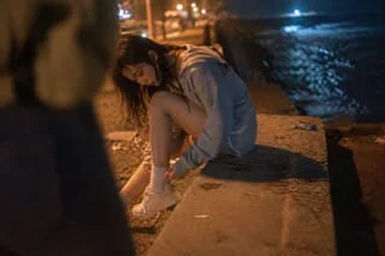

```text
A cinematic snapshot, 50mm lens, handheld motion blur, paparazzi-style perspective, nighttime beach, the warm orange streetlights contrasting with the cold blue sea in the distance, high-contrast colors, slight graininess. An Asian woman, naturally proportioned, with slightly damp hair tousled by the wind, realistic skin texture. She wears a grey hooded sweatshirt paired with athletic shorts, slightly loose but with defined lines. Sitting on the edge of the breakwater, head down tying her shoelaces, leaning forward, the action incomplete, not looking at the camera, expression natural. Blurred passersby in the foreground, slight ghosting and blurring. The environment—wave reflections, concrete embankment, scattered debris—creates a casual and irregular composition, a realistic snapshot feel, 4K.
```

Model: GPT Image 2
Author: GPT Image 2 Prompts

[ProjectD](https://aitoolsradar.com/en/prompts/886c510db7953e) · [Recorded source](https://x.com/xiaochou1945/status/2047262220934078551)
 · [Full original metadata and byte evidence](data/projectd-batch-0024.json)

## Cinematic Character Identity Board

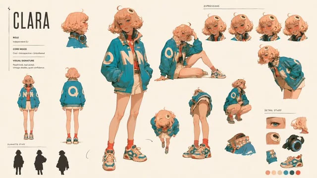

```text
Create an artistic 16:9 CHARACTER IDENTITY BOARD.

Use Image A as the subject and the visual medium. Name: {argument name="name" default="Clara"}. {argument name="correction" default="Fix headphones"}. (just change this line as your needs.)

Soft off-white background. No environment, no logo, no watermark.

DESIGN DIRECTION:
Do not create a standard character reference sheet.
Create a cinematic identity board that feels like a high-end animation studio character study mixed with an artbook layout.

The layout should be asymmetrical, elegant and visually memorable.
Use large empty space, varied image scale and intentional imbalance.
Avoid grids, blueprint design, catalog layout and repetitive turnaround presentation.

IMPORTANT LAYOUT RULE:
Do not overlap any character images.
Every view must have clear separation and breathing room.
Keep all bodies, portraits, silhouettes and detail studies visually distinct.
No cropped faces, no hidden limbs, no stacked figures, no merged poses.

MAIN COMPOSITION:
Place one large hero full-body view slightly off-center as the visual anchor.

Around it, arrange smaller supporting studies with clean spacing:
neutral full-body view, back view, profile view, seated pose, leaning pose, crouching pose, top-down body angle, low-angle body angle, expressive portrait studies.

Each view should feel like a separate clean character study, not a frame from one scene.

IDENTITY LOCK:
Preserve strict identity consistency across all views:
same face, same facial proportions, same hairstyle, same outfit, same body proportions, same posture language, same visual personality.

USEFUL REFERENCE DETAILS:
Make the character readable for future image and video generation:
clear face shape, clear hair silhouette, clear outfit silhouette, clear body shape, clear hands, clear posture, clear expression range.

ARTISTIC SECTIONS:
Include a small silhouette study area with 2-3 simplified black character silhouettes.
Include a small expression study area with subtle emotional variations.
Include a small detail study area showing key visual features of the face, hair and outfit.

TEXT DESIGN:
Add one stylish CHARACTER ID block.
Keep it minimal, bold and art-directed.
Use only:
NAME
ROLE
CORE MOOD
VISUAL SIGNATURE

Use small handwritten-style labels only where helpful.
Subtle editorial arrows and annotation marks are allowed, but keep them minimal and elegant.

STYLE:
minimal, cinematic, premium, artbook-like, clean, expressive, useful for production.

The final image should feel like an artistic character identity board designed
```

Model: GPT Image 2
Author: Kōda

[ProjectD](https://aitoolsradar.com/en/prompts/10b4261b1e4850) · [Recorded source](https://youmind.com/prompts/artistic-character-identity-board-26509)
 · [Full original metadata and byte evidence](data/projectd-batch-0024.json)

## Cinematic City Crash Explosion

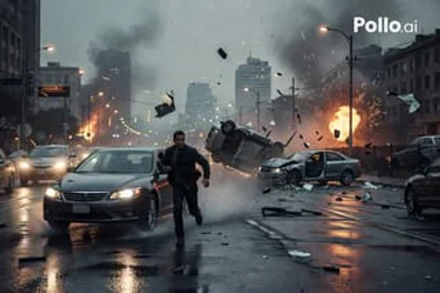

```text
As dusk falls, a cinematic, hyper-realistic action scene unfolds on the rain-soaked city streets, showcasing a sudden multi-vehicle collision and explosion in the heart of a modern city. In the foreground, an adult male with an indistinct face, wearing a dark jacket and trousers, runs erratically and unsteadily across the road towards the camera, seemingly fleeing danger. To his left, a dark gray sedan with its headlights on is splashing water from the road. In the mid-ground on the right, two wrecked cars are colliding: a silver sedan with its driver's side door open, and a dark-colored vehicle flipping in mid-air, surrounded by shattered glass, torn metal, and flying debris. In the background, two fireballs are visible: one in the distance on the left side of the street, and the other a large explosion on the right, both spewing sparks and black smoke into the sky. The image shows thick smoke rising above the dense, slightly out-of-focus high-rise buildings of the city center. It includes wet, reflective asphalt pavement, scattered car parts, glowing streetlights, utility poles, overhead power lines, and a melancholic, blue-gray storm atmosphere with orange flames reflected in puddles. The composition should use a wide-angle, low-angle shot, emphasizing strong dynamism, dramatic perspective, cinematic depth of field, realistic physics, volumetric smoke, swirling embers, and highly detailed disaster film lighting. Add a white [object/feature] in the upper right corner.{argument name="watermark text" default="Pollo.ai"} Watermark.
```

Model: GPT Image 2
Author: GPT Image 2 Prompts

[ProjectD](https://aitoolsradar.com/en/prompts/02944aef7ffd7a) · [Recorded source](https://x.com/Gugombly/status/2047310862428303636#reversed-1)
 · [Full original metadata and byte evidence](data/projectd-batch-0024.json)

## Cinematic City Explosion Chase

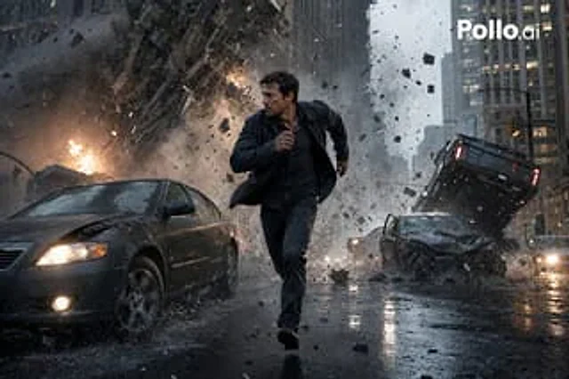

```text
A cinematic, realistic action scene, set against the backdrop of a rain-soaked downtown canyon, showcases {argument name="main subject" default="A dark-haired man in his 30s"} A man runs directly towards the camera in the center of the foreground, his expression tense and driven by a will to survive. He wears a soaked dark jacket, dark shirt, and dark trousers, and is in a stride, one arm swinging forward. Behind him, a massive urban explosion tears apart streets and the lower facades of high-rise buildings, spewing huge plumes of smoke, flames, dust, shattered concrete, glass, and metal fragments in all directions. The scene includes three clearly visible damaged vehicles: a dark sedan with its headlights on, dented hood, and splashing rainwater in the left foreground; a dark car with severe front-end damage in the right mid-ground; and a black SUV tilted upwards, overturned, or airborne in the right rear. The wet asphalt reflects the headlights, flames, and gray skyscrapers. Dense debris fills the air, and fragments of rock appear frozen in motion. The gloomy, torrential rain, the desaturated blue-gray tones paired with orange flames, the splashing debris with dramatic motion blur, yet the running figures remain sharp and in focus. The low-angle, wide-angle composition creates a disaster-movie-like realism, with ultra-fine textures, high contrast, dynamic depth of field, volumetric smoke, rain splashes, and cinematic lighting. Add a white [object] to the upper right corner.{argument name="watermark text" default="Pollo.ai"} Logo.
```

Model: GPT Image 2
Author: GPT Image 2 Prompts

[ProjectD](https://aitoolsradar.com/en/prompts/7817f2aeab0455) · [Recorded source](https://x.com/Gugombly/status/2047310862428303636#reversed-0)
 · [Full original metadata and byte evidence](data/projectd-batch-0024.json)

## Cinematic Couple Memory Collage

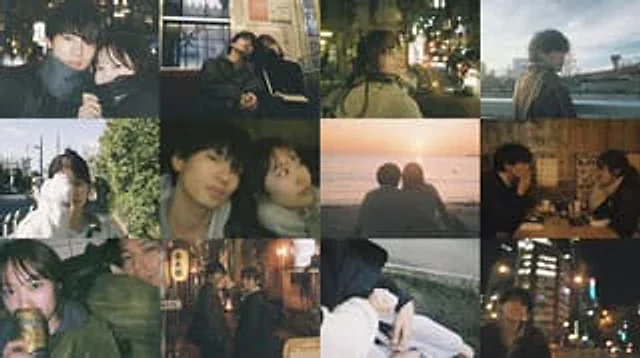

```text
A 4x3 photo collage containing 12 cinematic snapshots of the daily lives of young Japanese couples, employing a film-like candid style with soft blur, low-saturation colors, graininess, halos, and shallow depth of field. The overall atmosphere is intimate, nostalgic, urban, and slightly melancholic, using a blend of warm and cool tones and natural, imperfect compositions. Includes 12 unique photographs: 1) A close-up portrait on a nighttime street, one person wearing a scarf, their face partially obscured, surrounded by luminous bokeh; 2) A couple huddled together on a train at night, quiet and sleepy; 3) A back-view perspective of a person walking alone through a city street at night, with bokeh of traffic lights and storefronts in the background; 4) A portrait taken at dusk or dawn on a rooftop or high outdoors, one person looking back at the camera, their hair blowing in the wind, wearing a jacket; 5) A bright daytime snapshot of a suburban street, one person standing by a hedge, casual and slightly overexposed; 6) A very close-up, dimly lit, self-portrait-like image of a couple posing indoors or at night, their faces soft and out of focus; 7) A couple sitting side-by-side on a beach watching the sunset from behind; 8) A couple talking at a small table in a cozy izakaya or vintage restaurant, with posters and warm tungsten lighting in the background; 9) 10) A candid shot inside a crowded indoor space or vehicle, showing a person slumped or resting, with strong motion blur and a deep green hue; 11) A couple standing face to face in a narrow alley at night, surrounded by lantern lights and rows of Japanese signs; 12) A quiet close-up of intertwined hands and draped clothing while sitting on an outdoor roadside; 13) A nighttime portrait of a person against a backdrop of towering city buildings and colorful, out-of-focus lights. All 12 images are borderless, presented in a seamless grid, with slight variations in composition and exposure, as if captured from multiple dates and ordinary moments.{argument name="film style" default="moody 35mm film"} (Film style){argument name="couple age" default="early 20s"} (Couple's age){argument name="city" default="Tokyo"} (City),{argument name="season" default="autumn"} (Seasons) and{argument name="overall mood" default="romantic nostalgia"} (Overall atmosphere).
```

Model: GPT Image 2
Author: GPT Image 2 Prompts

[ProjectD](https://aitoolsradar.com/en/prompts/424f6054f70e9f) · [Recorded source](https://x.com/iX00AI/status/2047511290344829316#reversed-1)
 · [Full original metadata and byte evidence](data/projectd-batch-0024.json)

## Cinematic Cyberpunk Woman Portrait

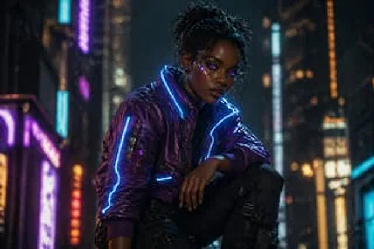

```text
Hollywood movie still style, the main subject of the picture is a{argument name="subject" default="Dark-skinned women"} Set against the backdrop of a neon-lit cyberpunk city on a rainy night, the composition is a medium-range full-body portrait. The subject crouches on the street, one knee raised, one arm casually resting on the knee, facing the camera with a confident and composed expression. Shot using an ARRI Alexa 65 with a Panavision anamorphic lens, it exhibits delicate Kodak Vision3 film grain, shallow depth of field, creamy oval bokeh, dramatic volumetric lighting, high contrast, glossy reflections, and top-tier cinematic color grading. The subject has dark curly hair tied into a messy high ponytail, with wet strands falling around her cheeks. She wears a striking metal pendant earring, and her face features minimalist cyborg circuitry, hinting at two glowing eye implants. The clothing comprises three key elements: a metallic {argument name="jacket color" default="Purple"} Bomber jacket, with bright trim on the collar, zipper seam, chest seam and sleeves.{argument name="led trim color" default="Neon Blue"} LED light strips; a dark-colored top underneath; and black designer tactical trousers with a fitted patchwork design and two buckle straps visible at the knees and thighs. A glowing tech module is added to the sleeve of the jacket. The background is a dense, futuristic alleyway or street canyon, with towering buildings blurred, rain and mist, vertical neon signs in cyan, magenta, blue, and warm amber, soft fog, and distant utilitarian lighting. The design emphasizes the glossy texture of fabrics, the damp urban atmosphere after rain, melancholic blue-purple tones, realistic skin details, a luxurious sci-fi fashion blockbuster feel, and photorealistic cinematic portrait aesthetics.
```

Model: GPT Image 2
Author: GPT Image 2 Prompts

[ProjectD](https://aitoolsradar.com/en/prompts/fad1d9fa9add29) · [Recorded source](https://x.com/GenoQuest/status/2047316962036928786#reversed-0)
 · [Full original metadata and byte evidence](data/projectd-batch-0024.json)

## Cinematic Double Exposure Fashion Portrait

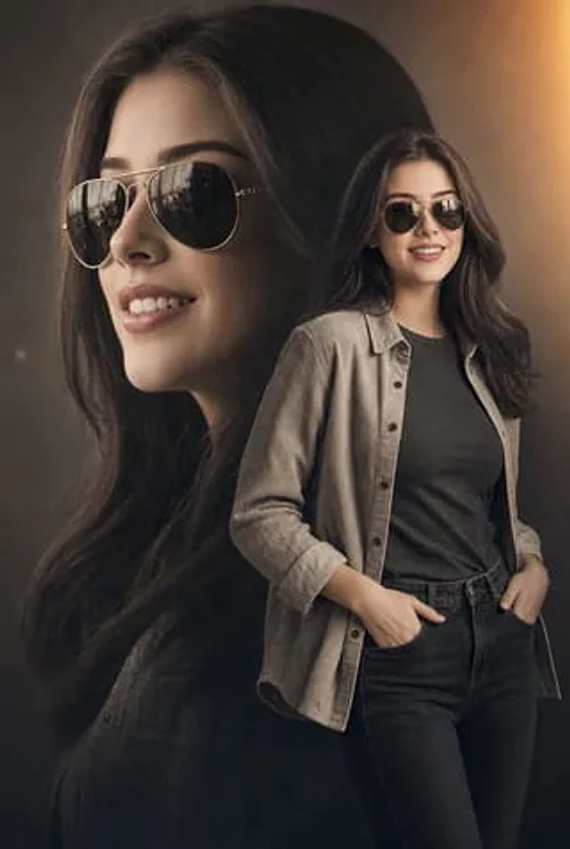

```text
A cinematic double-exposure fashion portrait featuring {argument name="subject" default="a woman"} with the uploaded face used 100% as reference, wearing stylish metallic aviator sunglasses. The composition artfully blends a large, semi-transparent close-up profile of her face on the left with her full-body figure standing confidently on the right. She wears {argument name="clothing" default="an open, light-grey textured corduroy shirt layered over a dark grey fitted t-shirt and dark denim jeans"}, posing naturally with her hands in her pockets. She has long, flowing dark hair, flawless skin, elegant feminine features, and a confident, sophisticated expression.

The background is a minimalist neutral studio setting, allowing the double-exposure composition to remain the visual focus. The color grading features a sophisticated {argument name="color palette" default="warm desaturated sepia and charcoal"} palette, enhanced by a soft golden-orange light-leak flare in the upper-right corner. Professional 85mm lens photography with high-contrast yet soft cinematic lighting accentuates the fabric textures, facial details, and layered portrait effect.

Ultra-realistic skin texture, luxury fashion-editorial aesthetic, premium magazine-cover quality, subtle film grain, cinematic depth, elegant shadows, refined color grading, modern retro-inspired styling, masterpiece composition, ultra-sharp focus, visually striking storytelling, high-end commercial fashion campaign look.
```

Model: GPT Image 2
Author: Anaya Ai

[ProjectD](https://aitoolsradar.com/en/prompts/19200cfeb6db0d) · [Recorded source](https://youmind.com/prompts/double-exposure-fashion-portrait-prompt-24160)
 · [Full original metadata and byte evidence](data/projectd-batch-0024.json)

## Cinematic Editorial Travel Poster

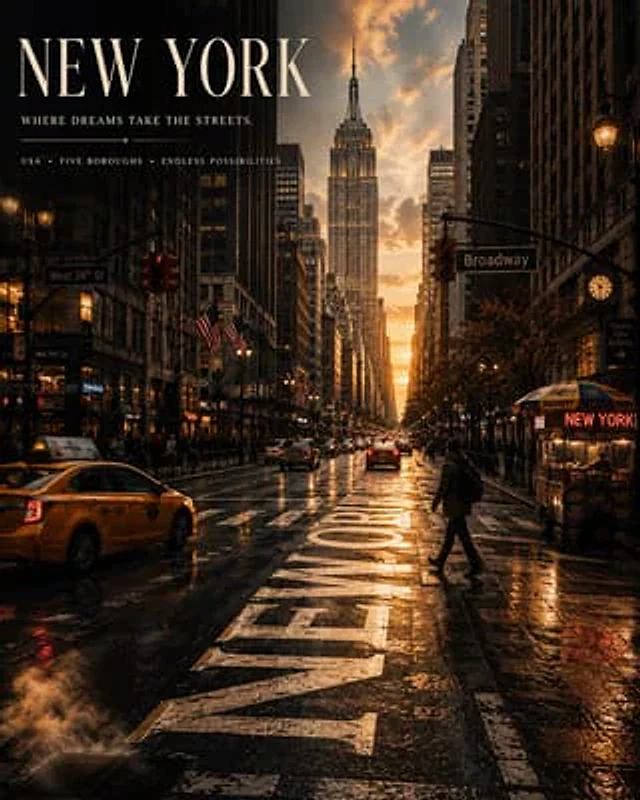

```text
Create a premium 4:5 vertical cinematic travel poster for {argument name="city" default="[CITY]"}, {argument name="country" default="[COUNTRY]"}, using a completely original editorial concept that captures the unique identity, atmosphere, architecture, culture, and visual character of the destination. 

Scene
Create an atmospheric {argument name="time of day" default="[TIME OF DAY / WEATHER]"} view of [ICONIC OR DISTINCTIVE CITY ENVIRONMENT], photographed from a sophisticated cinematic perspective. Show [TRADITIONAL ARCHITECTURE / LANDMARKS / STREETS / NATURAL FEATURES] naturally integrated into the environment. Include authentic local details such as [LOCAL DETAILS — signs, cafés, boats, markets, lanterns, flowers, architecture, etc.]. The composition should feel like a real moment captured while traveling rather than a conventional tourist postcard. 

Signature Visual Element
Make [ROAD / WATER / WALL / SHADOW / REFLECTION / ARCHITECTURAL SURFACE] the main creative centerpiece. Integrate enormous elegant typography reading: [CITY]. The lettering should interact naturally with the environment — appearing [PAINTED ON THE STREET / REFLECTED IN WATER / FORMED BY SHADOWS / EMBEDDED INTO STONE / CREATED BY ARCHITECTURE]. The typography should follow realistic perspective, lighting, texture, and depth so it feels physically present within the scene rather than digitally pasted on. 

Foreground
Include [FOREGROUND OBJECT] that represents the feeling of traveling through the destination. Add [PERSON / VEHICLE / BICYCLE / CAFÉ TABLE / SUITCASE / BOAT / OTHER ELEMENT] naturally into the composition. The foreground should create depth and give the image a sense of narrative without overpowering the city. 

Atmosphere
Create a [QUIET / ROMANTIC / DREAMLIKE / ENERGETIC / MYSTERIOUS / NOSTALGIC] atmosphere. Use [SUNRISE / GOLDEN HOUR / BLUE HOUR / NIGHT / OVERCAST / RAIN] lighting. Include subtle environmental details such as [MIST / RAIN REFLECTIONS / WIND / FALLING LEAVES / BIRDS / LIGHT FOG / SUN FLARES / STREET LIGHTS]. Use a sophisticated destination-specific color palette based on the actual character of [CITY]. 

Poster Typography
Main title: [CITY] 
Subtitle: [SHORT ORIGINAL CITY TAGLINE] 
Small supporting line: [COUNTRY] • [DISTINCTIVE CITY CHARACTERISTIC] • [SHORT PHRASE] 
Typography should be elegant, minimal, refined, and editorial — inspired by luxury travel magazines and premium international tourism campaigns. Use sophisticated serif typography with generous spacing and strong visual hierarchy. Place the main title in an area of natural negative space so it does not obscure important architecture. 

Composition
Create three strong visual layers: 
Foreground: [FOREGROUND ELEMENTS] 
Middle ground: [STREETS / ARCHITECTURE / PEOPLE / LOCAL LIFE] 
Background: [LANDMARK / SKYLINE / MOUNTAINS / SEA / DISTANT CITY] 
Use realistic depth, atmospheric perspective, natural framing, and cinematic leading lines. 

Visual Style
Ultra-realistic cinematic travel photography fused with luxury editorial poster design. Subtle 35mm fil
```

Model: GPT Image 2
Author: simeon-sanai

[ProjectD](https://aitoolsradar.com/en/prompts/752a6cb9be15a6) · [Recorded source](https://youmind.com/prompts/cinematic-editorial-travel-poster-design-31714)
 · [Full original metadata and byte evidence](data/projectd-batch-0024.json)

## Cinematic Exhibition Room Portrait

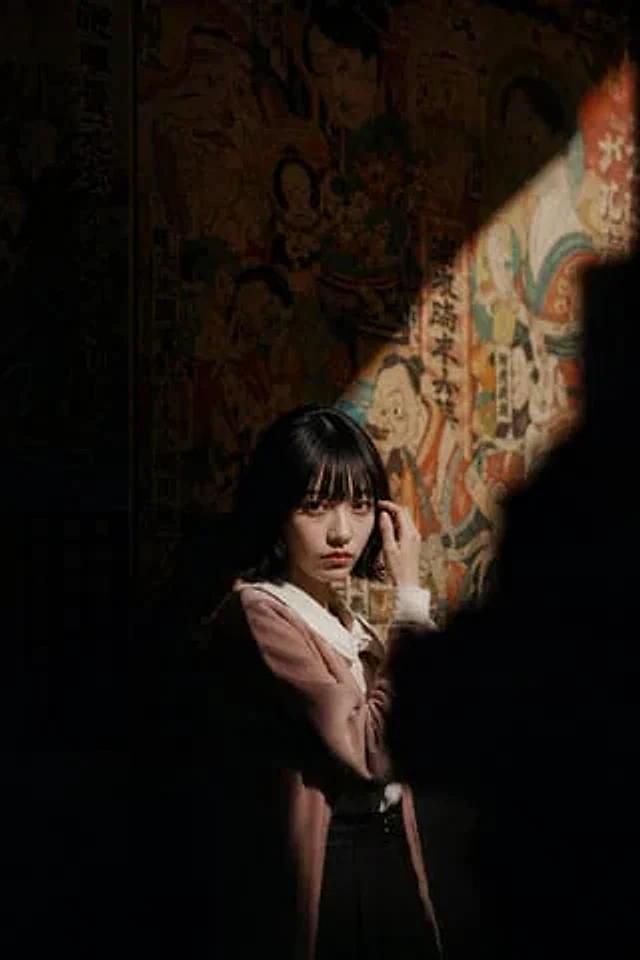

```text
Use my reference photo to preserve the exact facial features, hairstyle, bangs, facial proportions, skin tone, body posture, and overall silhouette with high identity consistency.

Cinematic portrait of a woman standing alone inside a dark exhibition room. She wears a vintage white shirt layered with a {argument name="jacket color" default="soft pink"} outer jacket and a black vintage-textured skirt. Minimal makeup. Front-profile pose with her body facing the camera, relaxed posture, one shoulder slightly lowered, hands gently adjusting her hair. Calm, mysterious expression with an intellectual and elegant aura.

She is positioned in the lower center of the frame, surrounded by darkness. A single dramatic diagonal spotlight cuts across the scene from the upper right to the lower left, illuminating only half of her body while the rest fades into shadow. Behind her is a {argument name="mural style" default="colorful vintage Japanese mural wall"} filled with retro cartoon illustrations and traditional artistic details.

Foreground shadows naturally frame the composition like torn darkness, creating a moody museum atmosphere with lonely artistic energy and a contemplative cinematic mood. Realistic photography with subtle film grain, analog texture, muted blacks, and vibrant mural accents.

Camera angle: eye-level shot, medium-close portrait framing, subject captured at approximately a 70-degree side profile angle, slight distance from the subject for environmental storytelling, centered cinematic composition.

Camera settings: cinematic low-light photography, shallow depth of field, realistic shadow falloff, Kodak Portra film color grading.

Lighting: {argument name="lighting source" default="harsh focused spotlight from the upper right"} creating a strong diagonal beam and deep high-contrast shadows, minimal ambient light, rich blacks, soft warm highlights along the face and glasses edges.

Vibe: mysterious, artistic, museum-core aesthetic, intelligent quiet energy, melancholic cinematic atmosphere, indie film still, luxury editorial photography, solitary nighttime mood, understated elegance.

Style: ultra-realistic cinematic photography, analog grain, editorial fashion portrait, natural skin texture, subtle imperfections, realistic color science, masterpiece quality.

Negative prompt: anime, smiling, overexposed lighting, extra limbs, bad anatomy, overly colorful outfit, cyberpunk neon, blurry face, low quality, distorted hands, unrealistic skin, HDR overload, exaggerated makeup, busy composition, duplicate person.
```

Model: GPT Image 2
Author: Oogie

[ProjectD](https://aitoolsradar.com/en/prompts/2ab7e8bb3c7976) · [Recorded source](https://youmind.com/prompts/cinematic-exhibition-room-portrait-21508)
 · [Full original metadata and byte evidence](data/projectd-batch-0024.json)

## Cinematic Final Minute Football Poster

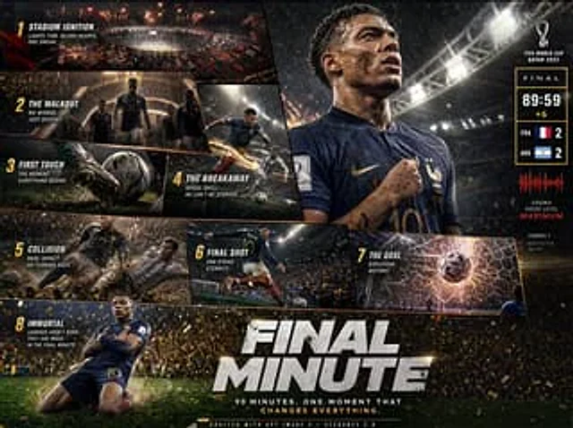

```text
Goal: Create a premium 9:16 vertical split-layout social media showcase for an AI-generated football cinematic about {argument name="football star" default="Kylian Mbappe"} in a World Cup final, with the energy of a movie poster, a storyboard, and a sports broadcast graphic combined.

Canvas: Vertical poster, dark cinematic stadium atmosphere, high contrast, wet rain and sparks, gold-orange highlights, deep navy and black shadows, gritty photoreal sports photography with dramatic motion blur, lens flares, flying turf, confetti, and explosive lighting. Use a collage of angled rectangular panels on the left and bottom, separated by thin gold borders, plus one large heroic portrait panel on the right.

Main subject: A French footballer in a dark navy France kit with gold number 10, athletic build, rain-soaked skin and jersey, standing in a packed illuminated stadium at night. In the large right panel he is shown from chest up, fist pressed to his heart, stadium floodlights behind him, raindrops visible, triumphant and intense. Keep the face intentionally obscured or anonymized while preserving the iconic football-star silhouette and emotion.

Layout and counted storyboard panels: Include exactly 8 numbered cinematic moments, each with a large gold number, bold white uppercase title, and a short white subtitle. Arrange them as overlapping diagonal film-strip panels across the left half and lower half of the poster:
1. "STADIUM IGNITION" — "LIGHTS. FIRE. 80,000 HEARTS. ONE DREAM." Wide aerial stadium packed with fans and fireworks bursting above the roof.
2. "THE WALKOUT" — "NO WORDS. JUST DESTINY." Players walking through rain and tunnel light, central France number 10 silhouette leading.
3. "FIRST TOUCH" — "THE MOMENT EVERYTHING BEGINS." Extreme close-up of a boot striking or trapping a football on wet grass with spray.
4. "THE BREAKAWAY" — "SPEED. SKILL. HE CAN'T BE STOPPED." The France player sprinting past defenders with golden motion streaks.
5. "COLLISION" — "PAIN. IMPACT. NO TURNING BACK." A muddy sliding tackle and bodies crashing on the pitch.
6. "FINAL SHOT" — "ONE STRIKE. ETERNITY." Dynamic shooting pose, leg extended, ball rocketing toward goal in a stadium.
7. "THE GOAL" — "EXPLOSION. HISTORY!" Football smashing into the net with a burst of sparks and glowing impact lines.
8. "IMMORTAL" — "LEGENDS AREN'T BORN. THEY ARE MADE. IN THE FINAL MINUTE." Player sliding on knees in celebration amid gold confetti and roaring crowd.

Right-side broadcast overlay: Add a compact vertical scoreboard HUD near the upper-right edge with a small World Cup trophy icon and text "FIFA WORLD CUP QATAR 2022". Below it place a boxed label "FINAL", a large timer "89:59", an added-time line "+6", then two score rows: "FRA" with French flag and score "2", and "ARG" with Argentina flag and score "2". Beneath the scoreboard add a red audio waveform and small labels reading "CROWD NOISE LEVEL" and "MAXIMUM". Add tiny technical text below, such as "CAMERA 7", "SLOW MOTION", and "180 FPS".

Bottom title area: Across the lower center, place a massive distressed white title {argument name="main title" default="FINAL MINUTE"} in bold condensed sports typography with rough texture. Under it, add the tagline {argument name="tagline" default="90 MINUTES. ONE MOMENT THAT CHANGES EVERYTHING."} with the words "CHANGES EVERYTHING" highlighted in gold. At the very bottom, add a tiny production credit line: {argument name="credit line" default="CRAFTED WITH GPT IMAGE 2 + SEEDANCE 2.0"}.

Visual style: Premium cinematic football poster, ultra-detailed, photorealistic, dark HDR grading, shallow depth of field, rain particles, sparks, smoke, stadium floodlights, explosive gold confetti, diagonal editorial composition, crisp typography, intense motion, viral sports social-media aesthetic.

Constraints: Use exactly 8 numbered panels plus the single large heroic portrait panel. Keep all text legible, uppercase, and integrated into the design. Do not add extra storyboard numbers, extra teams, watermarks, app UI, or unrelated logos. Maintain a vertical social-media poster format and a dramatic final-minute World Cup atmosphere.
```

Model: GPT Image 2
Author: Duet | AI

[ProjectD](https://aitoolsradar.com/en/prompts/3ba1752dd6211a) · [Recorded source](https://youmind.com/prompts/final-minute-football-poster-20073)
 · [Full original metadata and byte evidence](data/projectd-batch-0024.json)

## Cinematic Food & Beverage Collab Poster


```text
A high-quality, cinematic advertising poster depicts two older Asian men seated around a rustic wooden table, bathed in warm, rich lighting. The man on the left, with gray hair and a beard, smiles warmly, holding a dark soda with the Pepsi logo. The man on the right, with short hair and round-framed glasses, gazes calmly ahead, holding a dark soda with the Coca-Cola logo. Between them sits a large, steaming dark ceramic pot filled with…{argument name="dish description" default="Stewed green beans with pork belly"} A blue can of Pepsi sits to the left of the table, and a red can of Coca-Cola to the right. The poster uses elegant and eye-catching Chinese characters. The Pepsi and Coca-Cola co-branded logo is at the top, and the main title is below.{argument name="main headline" default="Stewed green beans with cola"} The vertical text on the left is {argument name="left character text" default="Zhao Benshan, playing the role of Ma Dashuai, passionately endorses the brand."} The vertical text on the right is {argument name="right character text" default="Fan Wei, playing Brother Biao, passionately endorses the brand."} The exquisite badge at the bottom center contains a slogan.{argument name="bottom tagline" default="Northeastern hearty dishes meet classics"} Below is a smaller explanatory text. The lighting effects are dramatic, highlighting the rising steam from the food and the water droplets on the walls of the cold drink glass.
```

Model: GPT Image 2
Author: GPT Image 2 Prompts

[ProjectD](https://aitoolsradar.com/en/prompts/d3e44c02f0d762) · [Recorded source](https://x.com/A9Quant/status/2044813337905758260#reversed-0)
 · [Full original metadata and byte evidence](data/projectd-batch-0024.json)

## Cinematic Football Commercial Storyboard

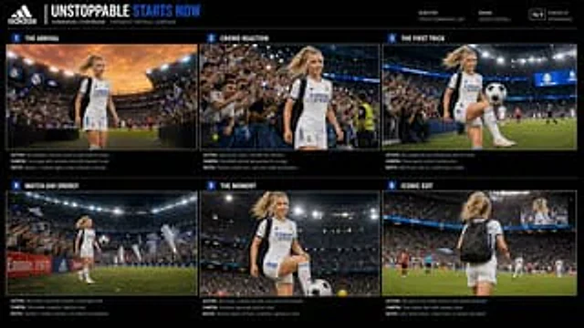

```text
Goal: Create a polished commercial storyboard presentation for a 15-second ultra-realistic cinematic vertical football campaign featuring the same female footballer in every frame, titled {argument name="headline text" default="UNSTOPPABLE STARTS NOW"}.

Canvas: Wide 16:9 black presentation board with thin white divider lines, a premium sports-agency layout, high contrast, realistic stadium photography in each panel, and a small top metadata bar. Use a black background, white condensed uppercase typography, and blue accent blocks for panel numbers and the word “STARTS.”

Header: Place a white Adidas-style three-stripe logo at top left, followed by the main headline “UNSTOPPABLE STARTS NOW,” with “UNSTOPPABLE” in white and “STARTS NOW” in electric blue. Under it, add small text: “COMMERCIAL STORYBOARD   CINEMATIC FOOTBALL CAMPAIGN.” On the top right add small production labels: “DIRECTOR / SPORTS COMMERCIAL UNIT,” “BRAND / ADIDAS FOOTBALL,” a small “16:9” badge, and “CINEMATIC STORYBOARD.”

Layout: Use exactly 6 storyboard panels arranged in a 3-column by 2-row grid. Each panel has a blue numbered square, an uppercase scene title, one ultra-realistic cinematic image, and three tiny notes underneath labeled ACTION, CAMERA, and NOTES. Keep the same consistent reference character in all 6 panels: {argument name="character description" default="a young athletic blonde female footballer with a high ponytail, wearing a white Real Madrid-style football kit with black shoulder panels, blue trim, white socks, and football boots"}. Make the face neutral or softly obscured rather than celebrity-specific.

Storyboard panels, exactly 6:
1. “THE ARRIVAL” — The player emerges from a stadium tunnel into a packed football arena at sunset, dramatic orange sky, Real Madrid-style flags in the crowd, huge stadium lights, low-angle wide entrance shot. Text below: ACTION: She emerges from the tunnel as the stadium erupts. CAMERA: Low-angle wide entrance shot with dramatic scale. NOTES: Sunset + stadium lights create cinematic contrast.
2. “CROWD REACTION” — Handheld sideline view as excited fans press forward cheering, filming on phones, flashes and stadium lights behind her while she walks past confidently. Text below: ACTION: Fans stand, cheer, and film her entrance. CAMERA: Handheld sideline perspective for energy. NOTES: Flashes, motion blur, and real crowd atmosphere.
3. “THE FIRST TRICK” — Close sports-action tracking shot as she juggles a {argument name="football type" default="black and white football"} effortlessly with her knee near the sideline, crowd roaring, bright stadium floodlights, blue Champions League-style ribbon signage. Text below: ACTION: She juggles the ball effortlessly with her knee. CAMERA: Close sports-action tracking shot. NOTES: Ball frozen mid-air, crowd reacts louder.
4. “MATCH-DAY ENERGY” — Wide cinematic stadium view with the player moving along the sideline, crowd packed and waving flags, confetti and smoke cannons, advertising boards, dynamic match-day atmosphere. Text below: ACTION: She moves along the sideline, crowd goes wild. CAMERA: Ultra-wide cinematic stadium view. NOTES: Confetti, smoke, banners, and vibrant atmosphere.
5. “THE MOMENT” — Dramatic low-angle portrait on the pitch as she controls the ball with one foot raised, stadium lights glowing overhead, shallow depth of field, intense heroic pause. Text below: ACTION: She stops, controls the ball, and owns the moment. CAMERA: Dramatic low-angle portrait shot. NOTES: Shallow depth of field, cinematic lighting on face.
6. “ICONIC EXIT” — Rear follow shot of the player jogging toward center pitch with a black backpack, jersey number visible, match continuing in the distance, giant stadium screen showing her, crowd and lights slightly motion blurred. Text below: ACTION: She jogs to the center pitch as the match continues. CAMERA: Rear follow shot with stadium scale. NOTES: Epic finale frame, motion blur on crowd and lights.

Visual style: Ultra-realistic sports commercial photography, cinematic grading, crisp detail, stadium floodlights, crowd energy, slight motion blur, premium brand-storyboard aesthetic, clean editorial spacing, thin white borders around images, tiny but legible production-note typography.

Constraints: Use exactly 6 panels and no extra panels. Maintain the same player, kit, hair, and body type across all panels. Keep the board landscape 16:9 even though it describes a vertical video campaign. Avoid random logos except the Adidas-style header mark and football-stadium branding cues. Make it look like a finished professional storyboard sheet, not a comic page.
```

Model: GPT Image 2
Author: Sharon Riley

[ProjectD](https://aitoolsradar.com/en/prompts/5a56a9fbd3cae0) · [Recorded source](https://youmind.com/prompts/football-commercial-storyboard-22209)
 · [Full original metadata and byte evidence](data/projectd-batch-0024.json)

## Cinematic Football Poster Portrait


```text
Ultra realistic cinematic football poster of a stylish young {argument name="ethnicity" default="South Asian"} male footballer with voluminous messy black hair, sharp jawline, trimmed beard, glowing fair skin, wearing {argument name="team jersey" default="Portugal national team red jersey with number 7"}. Multi-layered dramatic sports collage composition with three different poses — smiling front portrait pointing at Portugal badge, intense side profile close-up, and back pose showing custom name “{argument name="player name" default="HASANUR 7"}” on jersey. Dynamic action shot at the bottom celebratingon football field with clenched fists and soccer ball. Dark stormy sky with lightning, glowing stadium lights, red smoke flares, flying embers, Portugal flag waving in background, intense red and blue cinematic color grading, ultra detailed facial features, realistic skin texture, high contrast sports photography style, epic FIFA World Cup poster aesthetic, shallow depth of field, hyper realistic, 8K, vertical wallpaper composition.
```

Model: GPT Image 2
Author: Karlos

[ProjectD](https://aitoolsradar.com/en/prompts/98a6c0f13b5c2d) · [Recorded source](https://youmind.com/prompts/cinematic-football-poster-portugal-jersey-21857)
 · [Full original metadata and byte evidence](data/projectd-batch-0024.json)

## Cinematic Football Star Poster

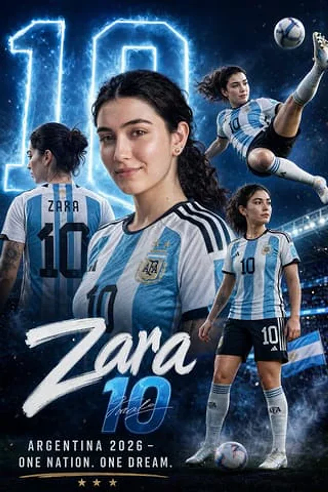

```text
Ultra-realistic cinematic football poster of her wearing the {argument name="team" default="Argentina national team"} jersey number {argument name="number" default="10"}, inside a massive glowing blue stadium at night. Dramatic sports poster composition with multiple poses of the same player: a close-up front portrait with confident expression, a back-facing pose showing “{argument name="name" default="Zara"} 10” on the jersey, a full-body standing pose, and an action bicycle-kick shot with a football in mid-air. Bright neon blue lighting, glowing number “10” in the background, fog, sparks, stadium lights, dynamic energy effects, realistic skin texture, detailed beard and curly hair, Adidas-style Argentina kit, cinematic contrast, ultra detailed, epic sports atmosphere, FIFA World Cup aesthetic, professional Photoshop manipulation style, high sharpness, blue and white color grading, depth of field, realistic shadows, premium football wallpaper design, 8K ultra HD. Leo Messi. Text on poster: “Zara” “10” “ARGENTINA 2026 – ONE NATION. ONE DREAM.”
```

Model: GPT Image 2
Author: Zara

[ProjectD](https://aitoolsradar.com/en/prompts/8b2e803b780b19) · [Recorded source](https://youmind.com/prompts/cinematic-argentina-football-poster-21311)
 · [Full original metadata and byte evidence](data/projectd-batch-0024.json)

## Cinematic Forest Campfire Portrait

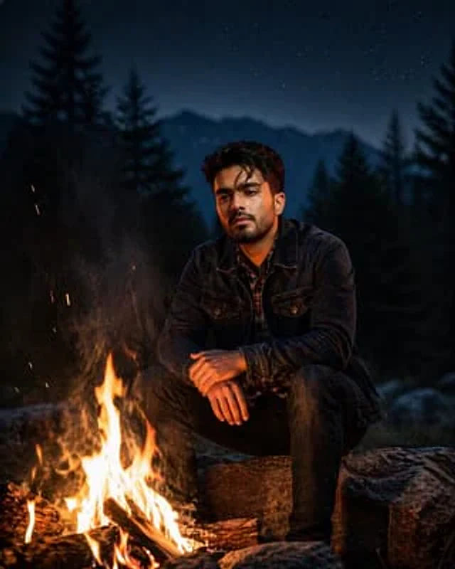

```text
A hyper-realistic, cinematic portrait depicting a{argument name="subject" default="young man"} Alone by a campfire in the deep forest at night, a 4:5 vertical composition. He sits on a large natural rock beside the fire, leaning slightly forward, his expression deep and serious, his eyes fixed on the flames, conveying profound contemplation and emotional tension. He has short black hair, a neatly trimmed beard, and a well-defined facial structure with a warm brown complexion. He is wearing a {argument name="clothing" default="Dark blue denim jacket"} He wears a plaid shirt underneath and dark jeans, presenting a casual outdoor style. The campfire in the foreground is bright and vibrant, its orange flames flickering, burning wood, sparks, and rising smoke intertwining, the warm firelight naturally reflecting on his face, hands, and clothing. His hands rest peacefully on his knees, a relaxed yet deeply emotional posture. The firelight casts dramatic warm highlights and soft shadows on his face, while the surrounding environment remains cool and dark. The background presents a cinematic wilderness scene, with towering pine trees, distant mountain silhouettes, and a clear starry sky above. The subtle blue tones in the background contrast beautifully with the warm orange firelight. The atmosphere is tranquil, solitary, and emotionally intense. Shallow depth of field, ultra-delicate skin texture, realistic fabric details, natural lighting balance, emotional shadows, high contrast, professional cinematic color grading, soft background blur, DSLR-quality image, sharp subject focus, realistic narrative composition, dramatic outdoor portrait photography, intimate emotional atmosphere, masterful quality, high detail, and natural realism. Preserves accurate facial structure from the reference image, 100% accurate identity retention, realistic proportions, no facial distortion, and a high-end cinematic style. Generates an image using an unloaded image as a reference.
```

Model: GPT Image 2
Author: GPT Image 2 Prompts

[ProjectD](https://aitoolsradar.com/en/prompts/30e31b7b4a3448) · [Recorded source](https://x.com/Professor_134/status/2047868461607731668)
 · [Full original metadata and byte evidence](data/projectd-batch-0024.json)

## Cinematic Fried Chicken Burger Ad


```text
A visually striking, photorealistic close-up of a fast-food highlight showcases a giant crispy fried chicken sandwich and a basket of generously tossed fries, placed on a dark restaurant table. The sandwich, stacked high on the left, sits atop a glossy brioche bun topped with a spicy orange sauce, two crimson onion rings, three pickles, and two tomato slices. Melted cheddar cheese drizzles over the ultra-crispy chicken cutlet, accompanied by curly lettuce. The bottom bun is also drizzled with more creamy orange sauce. On the right, a black wire basket overflows with thick-cut fries, topped with crispy chicken nuggets, white sauce, and a touch of green herbs. The still-frame effect captures the orange sauce splattering upwards and around the burger, with crumbs and condiment particles floating in the air. Warm, cinematic lighting, deep shadows, high contrast, and shallow depth of field create a rich, golden-brown texture, giving the bread and sauce a glossy sheen, while the background is blurred with the ambiance of a high-end casual dining setting. The camera angle is low and close, a three-quarters frontal view, with the burger clearly in focus; the fries are slightly secondary but still rich in detail. A dark stone plate is set on the burger, its surface strewn with breadcrumbs and sauce drops. A simple white accent is added to the upper right corner.{argument name="brand text" default="Pollo.ai"} Logo.
```

Model: GPT Image 2
Author: GPT Image 2 Prompts

[ProjectD](https://aitoolsradar.com/en/prompts/0b6328a5a2cbc4) · [Recorded source](https://x.com/AiwithSaad/status/2047021860450181577#reversed-3)
 · [Full original metadata and byte evidence](data/projectd-batch-0024.json)

## Cinematic Fried Chicken Burger Ad

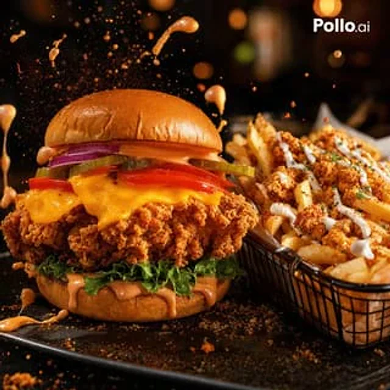

```text
A dramatic photorealistic fast-food hero shot of a giant crispy fried chicken sandwich and a side basket of loaded fries on a dark restaurant table. The sandwich is centered slightly left and stacked tall with a glossy brioche bun, spicy orange sauce on the top bun, 2 purple-red onion rings, 3 pickle slices, 2 tomato slices, melted cheddar cheese dripping over an extra-crunchy fried chicken fillet, curly green leaf lettuce, and more creamy orange sauce dripping from the bottom bun. To the right, show a black wire basket filled with thick-cut fries topped with crunchy fried chicken bites, white drizzle sauce, and small green herb garnish. Freeze motion with multiple splashes and droplets of orange sauce exploding upward and around the burger, plus floating crumbs and seasoning particles in the air. Use warm cinematic lighting, deep shadows, high contrast, shallow depth of field, rich golden-brown textures, glossy highlights on the bun and sauce, and a moody blurred bokeh background in an upscale casual restaurant setting. Camera angle is low and close, 3/4 front view, sharp focus on the burger, fries slightly secondary but still detailed. Dark slate serving plate, scattered crumbs and sauce drips on the surface. Add a clean white {argument name="brand text" default="Pollo.ai"} logo in the top-right corner.
```

Model: GPT Image 2
Author: Saad AI

[ProjectD](https://aitoolsradar.com/en/prompts/444ec5741921c8) · [Recorded source](https://youmind.com/prompts/cinematic-fried-chicken-burger-ad-15105)
 · [Full original metadata and byte evidence](data/projectd-batch-0024.json)

## Cinematic Game UI Mockup

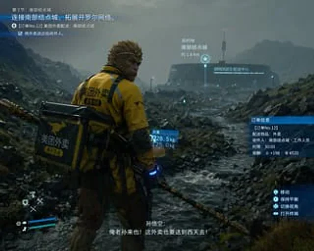

```text
{
  "type": "Video game screenshot mockup",
  "style": "Cinematic feel, realistic 3D visuals, overcast and rainy days, desolate rocky landscapes reminiscent of Death Stranding.",
  "character": {
    "identity": "{argument name=\"character identity\" default=\"Sun Wukong\"}",
    "features": "Monkey face, golden headband, holding a golden cudgel",
    "outfit": "A yellow delivery jacket with black accents, and a huge square black and yellow delivery backpack.",
    "branding": "The jacket and backpack have a kangaroo logo and{argument name=\"delivery company\" default=\"Meituan Waimai\"} Word"
  },
  "environment": {
    "foreground": "Rocky terrain with streams",
    "background": "Futuristic circular building with tall antennas and illuminated text{argument name=\"building name\" default=\"BRIDGES Distribution Center\"}"
  },
  "layout": {
    "ui_elements": 7,
    "sections": [
      {
        "position": "Top left corner",
        "type": "Mission Objectives",
        "text": "Section 3: Southern Knot City{argument name=\"mission objective\" default=\"Connect the southern node city and expand the Cairo network.\"} / [Order No. 12] Meituan Waimai Delivery: Southern Junction City / Deliver the food to the recipient."
      },
      {
        "position": "Middle right",
        "type": "Destination Marking",
        "text": "Destination / Southern Knot City / Approx. 1.8 km",
        "icon": "Star"
      },
      {
        "position": "center",
        "type": "Load information",
        "text": "Load capacity: 28.5 kg / 125.0 kg",
        "attached_to": "Backpack"
      },
      {
        "position": "Lower right side",
        "type": "Order Information",
        "text": "Order Information / [Order No. 12] / Item Delivered: Takeout / Recipient: Southern Knot City Staff / Deadline: 30:00 / Compensation: +198 ¥520",
        "attached_to": "Backpack"
      },
      {
        "position": "bottom right corner",
        "type": "Operation prompts",
        "text": "Move / Maintain balance / Switch perspective / Open terminal",
        "icons": "Handle buttons"
      },
      {
        "position": "Bottom Center",
        "type": "subtitle",
        "text": "Sun Wukong: /{argument name=\"subtitle text\" default=\"Hey, here comes Old Sun! This takeout is going to be delivered to the Western Paradise too!\"}"
      },
      {
        "position": "bottom left corner",
        "type": "HUD",
        "elements": "Blue health/stamina bar, D-pad tool icon"
      }
    ]
  }
}
```

Model: GPT Image 2
Author: GPT Image 2 Prompts

[ProjectD](https://aitoolsradar.com/en/prompts/e7466faab8c9f2) · [Recorded source](https://x.com/xlcomplete/status/2045092643630391790#reversed-0)
 · [Full original metadata and byte evidence](data/projectd-batch-0024.json)

## Cinematic Group in Front of Green Screen

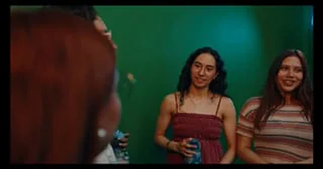

```text
A cinematic snapshot shows four young people standing in front of a smooth green screen in a photography studio, the composition resembling a behind-the-scenes chroma key test. In the far left foreground, a woman with vibrant copper-red hair is very close to the camera and heavily out of focus, only the back of her head and part of her shoulders visible, creating a strong sense of depth and over-the-shoulder composition. In the background, slightly to the left, a man with short, dark curly hair and glasses is partially visible, cropped to show only his face and torso, holding a blue water bottle to his chest. In the center, a woman with medium skin tone and dark shoulder-length curly hair faces the camera with a natural expression, wearing a burgundy pleated spaghetti-strap dress and a delicate gold necklace, holding a water bottle with a blue pattern at her waist. On the right, another woman with long, straight dark brown hair faces the camera, wearing a striped (beige, brown, and dark red) fitted short-sleeved knit top. The lighting creates a cinematic atmosphere with turquoise and warm red tones, soft shadows, shallow depth of field, realistic skin texture, delicate film grain, and a casual documentary style. Medium shots, eye-level composition, an indoor studio environment with no props other than two visible water bottles, a solid green screen background filling the frame, natural poses, realistic photography, and anamorphic color grading.
```

Model: GPT Image 2
Author: GPT Image 2 Prompts

[ProjectD](https://aitoolsradar.com/en/prompts/cdb2f701a39f1d) · [Recorded source](https://x.com/DiegoGarey_jpg/status/2046723117125337357#reversed-0)
 · [Full original metadata and byte evidence](data/projectd-batch-0024.json)

## Cinematic Hanfu Fashion Editorial Portrait


```text
Create a hyper-realistic {argument name="portrait type" default="luxury Hanfu fashion-editorial portrait"} inspired by premium Chinese beauty campaigns and cinematic Asian photography aesthetics.

IMPORTANT:
Generate ONLY ONE SINGLE VERTICAL IMAGE.
Do NOT create multiple posters.
Do NOT create collages.

STYLE:
Luxury glossy realism.
Elegant bold feminine aesthetics.
Soft cinematic editorial photography.

MAIN CONCEPT:
A luxury Hanfu beauty reclining beside glowing lanterns with flowing silk fabric and dreamy emotional atmosphere, blending ancient elegance with modern fashion-editorial energy.

MODEL:
Adult Chinese female model with sophisticated mature beauty.
Glossy realistic skin.
Luxury emotional makeup.
Elegant cinematic expression.

OUTFIT:
{argument name="clothing color" default="Champagne-gold"} {argument name="fabric type" default="satin Hanfu"} with:
deep silk folds,
luxury embroidery,
soft reflective fabric,
flowing sleeve movement,
and elegant fitted styling.

VISUAL STRUCTURE:
- cinematic reclining composition
- glossy beauty close-up
- elegant silk folds
- dreamy editorial framing
- luxury atmospheric depth
- cinematic composition balance

BACKGROUND:
Luxury ancient-Chinese {argument name="background setting" default="lantern garden"} with:
warm lantern glow,
soft fog atmosphere,
floating petals,
traditional architecture silhouettes,
and dreamy cinematic depth blur.

COLOR PALETTE:
Champagne gold,
soft ivory,
warm amber,
cream beige,
deep shadow tones.

LIGHTING:
Warm cinematic lantern lighting.
Luxury glossy skin highlights.
Dreamy editorial glow.

MOOD:
Luxury.
Elegant.
Bold feminine beauty.

QUALITY:
Ultra realistic native 4K HDR realism.
Natural skin pores.
Detailed satin textures.
Looks like a real luxury Chinese fashion-editorial campaign.
```

Model: GPT Image 2
Author: Rossy

[ProjectD](https://aitoolsradar.com/en/prompts/f24978ea2b6e02) · [Recorded source](https://youmind.com/prompts/luxury-hanfu-fashion-editorial-portrait-22377)
 · [Full original metadata and byte evidence](data/projectd-batch-0024.json)

## Cinematic Heist Mastermind at Whiteboard

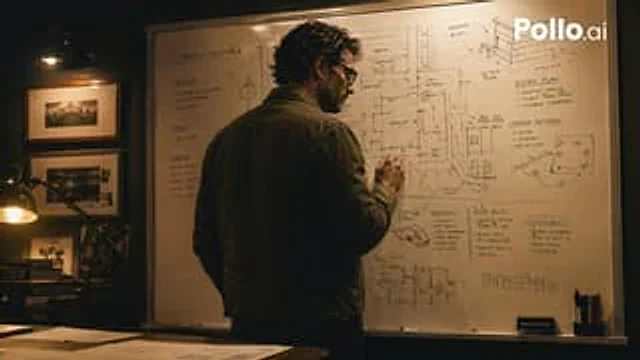

```text
A cinematic, somber scene depicting the planning of a heist, set in a dimly lit office late at night, shot in a realistic thriller style. A grown man stands with his back to the camera, writing on a large whiteboard covered in tactical notes, architectural sketches, floor plans, arrows, routes, and hand-drawn diagrams. He has dark curly hair and wears a dark olive or charcoal gray casual jacket paired with dark trousers, projecting the image of a master planner. The whiteboard is the visual focal point, containing several readable planning areas: the top left corner is titled "OPERATION NIGHTHAWK"; the left sidebar is divided into three sections, labeled "OBJECTIVE," "TARGET," and "TIMELINE"; the top right corner has two labeled chart areas, "ENTRY PLAN" and "CAMERA NETWORK"; the lower right center has four labeled planning blocks, "TRANSIT," "EQUIPMENT," "HOTEL ROUTE," and "CONTINGENCIES." It includes architectural facade sketches, rooftop access diagrams, loading/unloading area notes, room labels, arrows drawn in black and red markers, and a sketch of a small van near the center at the bottom. The room is warmly lit with deep shadows and amber-colored practical lighting. A desk lamp illuminates a dark wooden desk cluttered with documents on the left, and three black-and-white photographs hang vertically on the wall. The composition is a mid-to-long-range over-the-shoulder shot, with the man positioned slightly to the left center of the frame, and a whiteboard dominating the background. High contrast, a soft cinematic grain, a tense atmosphere, and a realistic texture create an aesthetic reminiscent of a mastermind planning a heist—a refined crime drama aesthetic—but it doesn't depict any specific copyrighted characters. A white "Pollo.ai" watermark is added to the upper right corner.
```

Model: GPT Image 2
Author: GPT Image 2 Prompts

[ProjectD](https://aitoolsradar.com/en/prompts/284d5de79705c4) · [Recorded source](https://x.com/paulai_/status/2047415757105967575#reversed-0)
 · [Full original metadata and byte evidence](data/projectd-batch-0024.json)

## Cinematic Infographic Concept Poster

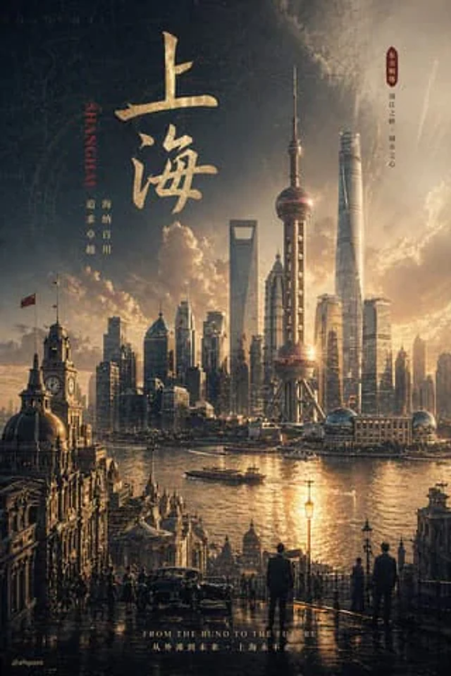

```text
请围绕【主题】自动生成一张顶级概念海报 / 信息图式电影海报。

唯一输入变量只有:
【主题】:__中国历史上的皇帝排名_         

要求 AI 根据这个主题,自动推导并统一设计以下全部视觉系统,不需要我额外指定:
- 核心主体(可以自动判断更适合人物、产品、建筑、器物、符号、场景或抽象意象)
- 底部支撑结构
- 上方悬浮符号或精神象征
- 场景包裹元素
- 隐喻系统
- 色彩层级
- 材质对比
- 光影逻辑
- 标题、副标题、辅助文案
- 品牌感与高级感表达方式

最终画面必须是:
一张震撼、精密、统一、电影级、超高细节、可用于高端印刷的概念主视觉海报。

【总风格】
超写实 3D 商业 CGI 渲染,融合电影级布光、奢侈品视觉语言、未来感概念设计与史诗级构图。画面必须具有“唯一主视觉核心”,不能杂乱,不能像拼贴,不能像普通电商海报。

【自动推导规则】
AI 必须依据【主题】自动决定最合适的:
1. 核心视觉隐喻
2. 主体类型与姿态
3. 支撑结构形式
4. 悬浮元素形式
5. 场景外壳与空间氛围
6. 主色、辅色、强调色
7. 材质组合
8. 文字气质与版式风格

例如:
- 如果主题偏权力、秩序、资本、统治,则自动偏向王座、冠冕、机械、神殿、红幕、金属、权力结构
- 如果主题偏科技、AI、芯片、未来,则自动偏向机械结构、能量核心、光束、深色金属、全息感
- 如果主题偏奢侈品、高定、稀缺、收藏,则自动偏向珠宝、镜面材质、黑金体系、展台、博物馆式布光
- 如果主题偏人物、IP、角色,则自动以人物为主视觉核心,并自动匹配对应世界观与象征系统
- 如果主题偏城市、文明、史诗、命运,则自动转化为宏大叙事型空间结构与仪式感场景

【构图规则】
- 绝对高级感
- 强烈中心秩序,整体统一
- 允许中轴对称或接近中轴的史诗级构图
- 视觉重力明确,从上到下形成清晰的层级落点
- 边缘负空间干净、克制、有呼吸感
- 不允许无意义装饰,不允许风格污染,不允许多个系统互相打架

【视觉质量】
- 超高细节
- 体积光清晰
- 材质真实
- 反射、折射、阴影、雾气、景深自然
- 每个元素都像经过工业级视觉总监审美控制
- 整体达到高端品牌 campaign key visual / luxury invitation poster / conceptual editorial poster 水准

【排版系统】
- 整体为 90% 视觉,10% 文字
- AI 根据【主题】自动生成最匹配的主标题和副标题
- 标题必须简洁、锋利、有气势
- 文案分布在安全负空间内,不压主体
- 若主题适合中文,则优先生成中文标题;若主题更适合英文,则自动生成英文标题;也可中英结合,但必须统一高级
- 文字必须尽量少而准,不要堆字

【署名要求】
在画面底部角落自然加入作者署名:
@a9quant
署名要小,但清晰、精致、高级,不喧宾夺主,像顶级视觉作品中的正式作者落款。

【输出要求】
输出为单张统一构图海报。
自动根据【主题】完成全部视觉决策。
画面必须具备史诗感、秩序感、控制力、仪式感、商业完成度。
最大细节密度,超清,电影级,印刷级,高端成片质感。
```

Model: GPT Image 2
Author: @A9Quant

[ProjectD](https://aitoolsradar.com/en/prompts/fdb7b9e03a0a2c) · [Recorded source](https://x.com/A9Quant/status/2046228485841334559)
 · [Full original metadata and byte evidence](data/projectd-batch-0024.json)

## Cinematic Japanese Agency Poster

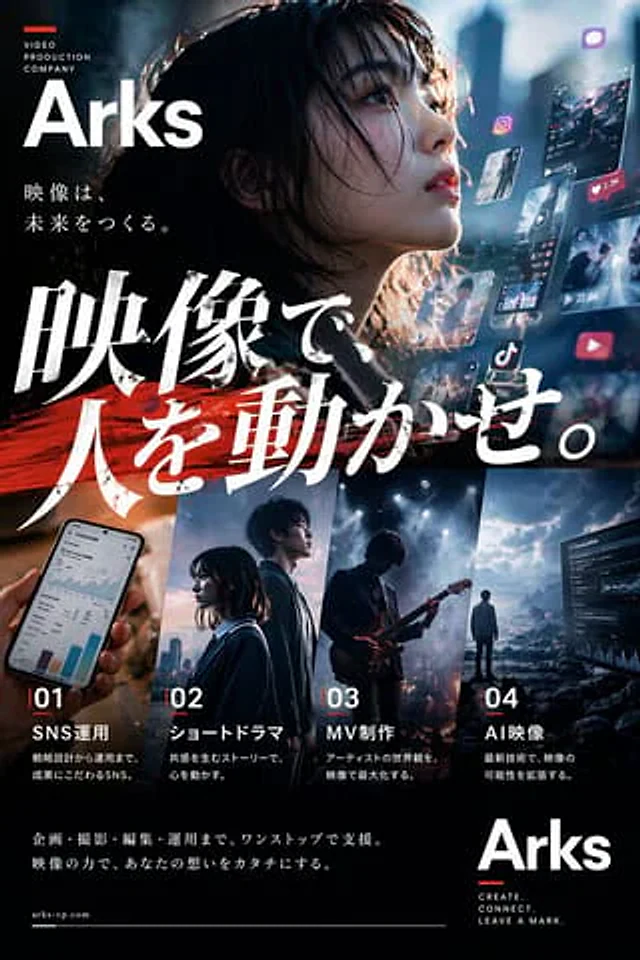

```text
{
  "type": "Japanese-style promotional poster with a cinematic feel",
  "brand": {
    "name": "{argument name=\"company name\" default=\"Arks\"}",
    "industry": "Video production company",
    "website": "{argument name=\"website\" default=\"arks-vp.com\"}",
    "tagline_english": [
      "CREATE.",
      "CONNECT.",
      "LEAVE A MARK."
    ],
    "small_header": "Video production company"
  },
  "style": {
    "overall": "High-quality, high-contrast, cinematic, and realistic advertising posters, combined with exquisite typography design.",
    "color_palette": [
      "Dark black",
      "cool blue",
      "White",
      "Bright red accents"
    ],
    "lighting": "Emotional backlighting, soft light, bokeh, screen light reflection, dramatic contrast",
    "texture": "Photorealistic backgrounds overlaid with semi-transparent digital UI panels and brush-stroke graphic elements."
  },
  "canvas": {
    "orientation": "Vertical poster",
    "aspect_ratio": "2:3"
  },
  "layout": {
    "sections": [
      {
        "title": "Brand area in the upper left corner",
        "position": "Top left",
        "count": 4,
        "labels": [
          "Small red horizontal bar",
          "Video production company",
          "Arks",
          "Images create the future."
        ]
      },
      {
        "title": "Main title area",
        "position": "From center left to center",
        "count": 2,
        "labels": [
          "In video",
          "Move people."
        ]
      },
      {
        "title": "Service Panel",
        "position": "Bottom Middle",
        "count": 4,
        "labels": [
          "01 SNS Operations",
          "02 Short Drama Production",
          "03 MV Production",
          "04 AI Video"
        ]
      },
      {
        "title": "Bottom Brand Area",
        "position": "Bottom right",
        "count": 4,
        "labels": [
          "Arks",
          "CREATE.",
          "CONNECT.",
          "LEAVE A MARK."
        ]
      },
      {
        "title": "Footer text",
        "position": "Bottom left",
        "count": 3,
        "labels": [
          "We provide one-stop support from planning, filming, editing to operation.",
          "Use the power of images to turn your ideas into reality.",
          "arks-vp.com"
        ]
      }
    ],
    "composition": "The upper half features a large close-up of a person, with an oversized Japanese calligraphy title in the center. The lower half displays four vertically arranged service cards, with the brand logo repeatedly appearing in the upper left and lower right corners."
  },
  "hero_image": {
    "subject": "A close-up of a young man, his dark hair partially obscuring his face, with most of his face hidden in shadow.",
    "framing": "Extreme close-up from the shoulders up",
    "emotion": "Mysterious, intense, and enterprising",
    "lighting": "Back contour lighting with cool blue highlights and warm edge glow.",
    "background": "A dark, cinematic, blurred background with floating social media and video interface elements."
  },
  "digital_elements": {
    "count": 8,
    "items": [
      "A floating smartphone-style video stream, with 2.3K likes.",
      "A vertical short video interface panel with interactive icons and a 12.5K count.",
      "Small floating photo cards",
      "Instagram-style icons",
      "Chat/Message App Icon",
      "TikTok-style icons",
      "YouTube-style play icon",
      "The analysis dashboard screen on the right edge"
    ]
  },
  "headline": {
    "text": "{argument name=\"main headline\" default=\"Move people with video.\"}",
    "language": "Japanese",
    "style": "Extra-large, thick white calligraphy brush in the Ming Dynasty style, with rough textured edges.",
    "accent": "There are broad red brushstrokes following the text below."
  },
  "services": [
    {
      "number": "01",
      "title": "SNS Operations",
      "description": "From strategy design to operation, we focus on results-oriented SNS services.",
      "image": "Holding a smartphone to display analytical charts and dashboards"
    },
    {
      "number": "02",
      "title": "Short drama production",
      "description": "Touch people's hearts with stories that resonate with them.",
      "image": "Two young people stand side by side against a cinematic cityscape at dusk."
    },
    {
      "number": "03",
      "title": "MV production",
      "description": "Maximize the artist's worldview through images.",
      "image": "The guitarist performed on a smoky stage, accompanied by dramatic spotlights."
    },
    {
      "number": "04",
      "title": "AI Video",
      "description": "Expanding the possibilities of imaging by utilizing the latest technologies.",
      "image": "Alone, facing a surreal rocky seascape and a large analytical interface screen."
    }
  ],
  "typography": {
    "mix": "The brand name and numbers use a bold, modern sans-serif font, the body text uses an elegant Japanese Mincho font, and the headings use an expressive calligraphy font.",
    "alignment": "Primarily left-aligned, featuring a strong poster grid structure."
  },
  "rendering_notes": "It looks like a genuine agency promotional poster for a cutting-edge Japanese video production company. The Japanese text is integrated accurately and neatly. Despite being a busy, cinematic collage, it maintains good readability. It utilizes realistic photography, layered ad design, high-quality composition, and a compelling visual storytelling for the social media age."
}
```

Model: GPT Image 2
Author: GPT Image 2 Prompts

[ProjectD](https://aitoolsradar.com/en/prompts/f839b976026f86) · [Recorded source](https://x.com/kantamizutamari/status/2047247285944508520#reversed-0)
 · [Full original metadata and byte evidence](data/projectd-batch-0024.json)

## Cinematic Japanese Romance Movie Poster

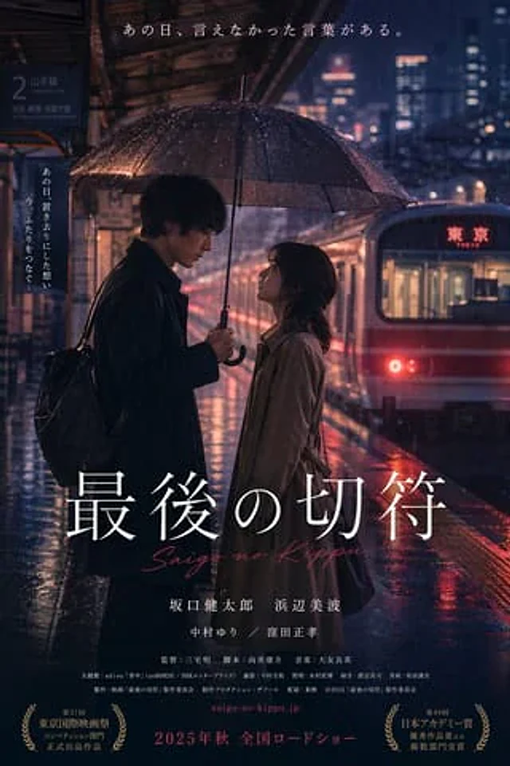

```text
A cinematic Japanese movie poster presents a romantic yet melancholic scene: at night, on a rainy train platform, a man and a woman stand facing each other. The tall man on the left, wearing a dark coat and carrying a backpack, holds a black umbrella to shield them both. The woman on the right, wearing a khaki trench coat, looks up at him. A red and white commuter train is parked on the tracks to the right, its front bearing the word "Tokyo" in both Japanese and English. The station sign on the left reads "Yamanotsu Line" in Japanese. The lighting creates a melancholic atmosphere, with city neon lights reflected on the wet platform. The poster features striking superimposed text. The horizontal slogan at the top reads:{argument name="top tagline" default="There are words I couldn&#39;t say that day."} The vertical slogan on the left is:{argument name="side tagline" default="The feelings left behind that day, now connect the two of us..."} The main title is prominently displayed at the bottom center.{argument name="main title" default="The last ticket"} It uses a white serif font and has a red cursive subtitle below it.{argument name="romaji subtitle" default="Saigo no Kippu"} Below the title are two lines of Japanese cast list, followed by a long list of Japanese production staff. At the bottom center is the red website URL and release information.{argument name="release info" default="Coming to theaters nationwide in Fall 2025"} The bottom two sides feature two gold award laurel wreaths with Japanese characters.
```

Model: GPT Image 2
Author: GPT Image 2 Prompts

[ProjectD](https://aitoolsradar.com/en/prompts/99ed53bc1aa5d3) · [Recorded source](https://x.com/masapark95/status/2046169303905632417#reversed-1)
 · [Full original metadata and byte evidence](data/projectd-batch-0024.json)

## Cinematic Last Supper Scene

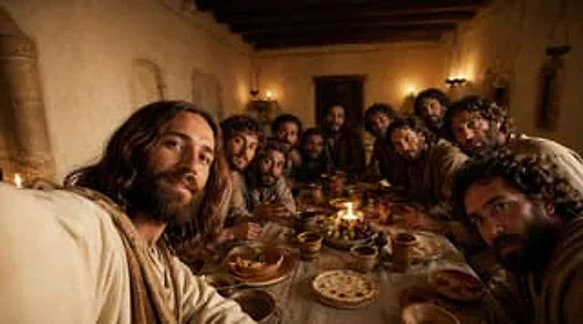

```text
A cinematic depiction based on a historical setting, the scene being{argument name="scene subject" default="Jesus and his disciples at the Last Supper"} The setting is a simple, ancient Middle Eastern restaurant at night. The perspective is an immersive close-up, level with the table, as if the viewer were sitting among them. The scene should include 13 men sitting closely around a long, narrow table. The central figure, through his composed demeanor, shoulder-length dark brown hair, beard, and the off-white robe with a light beige shawl, is clearly identified as Jesus. The 12 disciples should vary in age and appearance, with curly or wavy dark hair and beards, wearing robes in earth tones such as cream, brown, tan, soft blue, and dusty gray, leaning inwards, talking or listening intently. The room should have rough stucco walls, exposed dark wooden ceiling beams, a heavy wooden door at the back, simple wall niches, and small oil lamps or candlesticks casting a warm amber glow. The table should be set with simple food and tableware characteristic of the era: round flatbreads, grapes, olives, shallow bowls, earthenware plates, ceramic cups, and bronze or ceramic goblets, with a small candle near the center to create a visual focal point. The composition should be broad yet intimate, with a slightly crowded foreground edge, and some figures should be moderately cropped to enhance realism and immersion. The lighting should be low, golden, and dramatic, accompanied by soft shadows, a dignified atmosphere, realistic skin tones, natural fabric folds, and rich cinematic contrast. Rendered in a realistic style, it should present ultra-fine textures, subtle depth of field, and convey the emotional tone of a historical biblical film still.
```

Model: GPT Image 2
Author: GPT Image 2 Prompts

[ProjectD](https://aitoolsradar.com/en/prompts/0307d1cf1b44da) · [Recorded source](https://x.com/techhalla/status/2047590978656047528#reversed-0)
 · [Full original metadata and byte evidence](data/projectd-batch-0024.json)

## Cinematic Mesoamerican Warrior Portrait

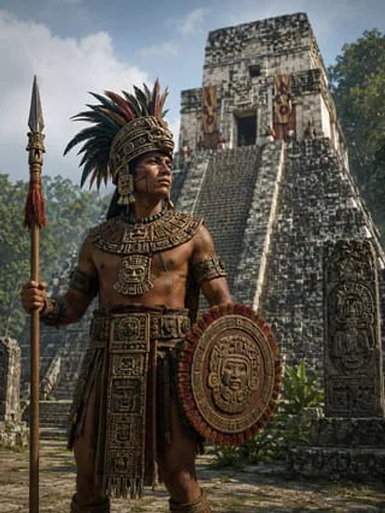

```text
A photographically realistic and highly detailed portrait depicting a muscular man.{argument name="warrior culture" default="Central America"} The soldier stood proudly. He wore a hat adorned with {argument name="headdress feathers" default="Red, green and black feathers"} His headdress was exquisite, and he wore a carved stone mask. Dark painted lines adorned his cheeks and the bridge of his nose. He wore heavy and elaborate ceremonial armor, including a large stone necklace with a face pendant, armbands, and an elaborate belt with carved symbols and human faces. His right hand gripped a weapon tightly.{argument name="weapon" default="Tall wooden spears with stone tips and red tassels"} In his left hand, he holds a round shield displaying a large, sculpted human face with red tassels along its edges. The background is a towering {argument name="background structure" default="Ancient Step Pyramid"} There are steep steps, with flags hanging near the top entrance, and small figures standing on the steps. Lush jungle vegetation surrounds the temple, the sky is partly cloudy, and a tall, carved stone tablet stands in the foreground on the right. The entire scene is framed by {argument name="lighting style" default="Epic cinematic lighting"} Presented.
```

Model: GPT Image 2
Author: GPT Image 2 Prompts

[ProjectD](https://aitoolsradar.com/en/prompts/28295b55194760) · [Recorded source](https://x.com/AlwaveNazca/status/2044795046503792987#reversed-1)
 · [Full original metadata and byte evidence](data/projectd-batch-0024.json)

## Cinematic Minimal Portrait

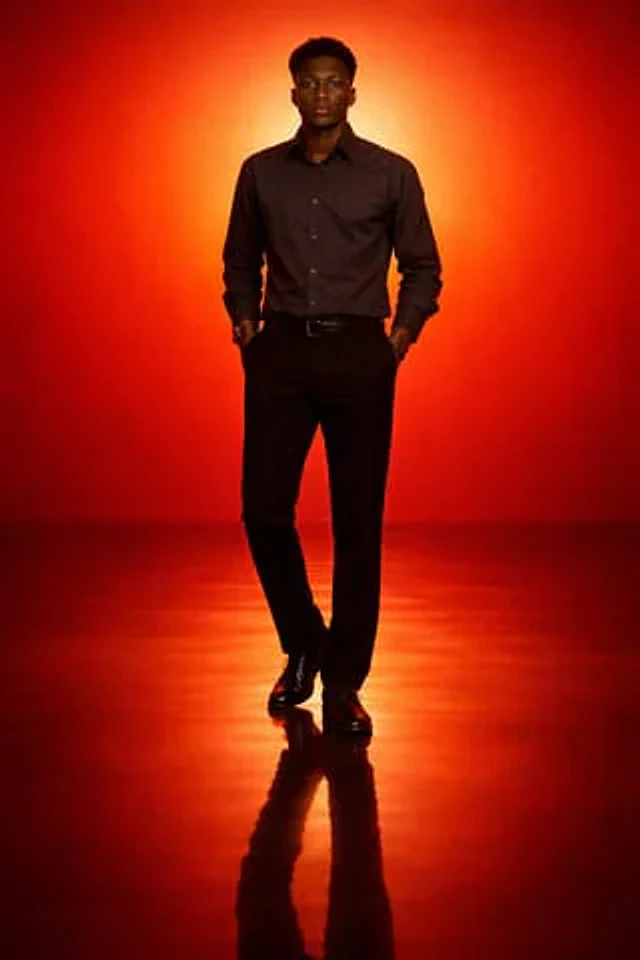

```text
Generate a cinematic minimal portrait of a solitary man standing in an intense orange to red gradient environment, strong silhouette lighting, deep shadow contrast, reflective glossy floor, symmetrical composition, minimal
```

Model: GPT Image 2
Author: @iam_miharbi

[ProjectD](https://aitoolsradar.com/en/prompts/7f98e412cd2b70) · [Recorded source](https://x.com/iam_miharbi/status/2045151354679665101)
 · [Full original metadata and byte evidence](data/projectd-batch-0024.json)

## Cinematic Motion Blur Portrait with Typography


```text
围绕{argument name="主题" default="在机场快步走的迪丽热巴"}生成一张具有电影感的动态拖影肖像画面：主体以安静的侧面轮廓或半身剪影占据主要视觉重量，面部边缘保持少量可辨识细节，身体和头发向一侧被拉成长距离水平运动模糊，拖影像光带一样穿过主体并逐渐融入背景，使人物像正在被速度、记忆或信息流带走。背景是一整片高明度、清透、柔和的空气场，不做复杂场景，色彩从主题自身的材质、情绪和叙事温度中提取，保留大面积明亮冷静底色、较深主体暗部、少量高饱和发光强调色与干净色阶之间的关系，形成梦幻而清洁的冷暖张力，避免浑浊、陈旧和烟灰感。光线柔软扩散，焦点略松，边缘有轻微胶片颗粒和镜头晕散，但整体仍然通风、透明、现代。画面信息密度很低，留出大量空域让速度感呼吸；文字作为视觉结构的一部分使用纯白现代无衬线字体，核心词用极大字号放在主体下方或画面重心附近，短句说明使用较小字号、紧凑行距和居中节奏，所有文字像叠在光雾上的清晰界面层，既压住画面层级，又不破坏柔焦影像的流动感。

比例{argument name="比例" default="3:4"}
```

Model: GPT Image 2
Author: 小小东

[ProjectD](https://aitoolsradar.com/en/prompts/e563c62556ebc8) · [Recorded source](https://youmind.com/prompts/cinematic-motion-blur-portrait-typography-24110)
 · [Full original metadata and byte evidence](data/projectd-batch-0024.json)

## Cinematic Music Festival Poster


```text
Use the attached illustration as the main visual. Do not alter the character, face, or art style in any way.

Create a vertical music festival poster (portrait, 2:3 ratio) with a dark, cinematic atmosphere.

---

LAYOUT:

- The illustration fills the full poster as background
- The character's face must be clearly visible — keep the center of the image free from heavy overlays
- Dark gradient overlay at the very top (behind title text only) and at the bottom (behind artist info only)
- The middle zone where the face appears should remain mostly unobscured
- The illustration should occupy as much of the poster as possible — minimize the text footprint
- The illustration must bleed into the catchcopy zone — the image should remain visible and partially unobscured all the way down through {argument name="catchcopy end" default="[ここにキャッチコピー最終行]"} — only the very bottom (artist name and date line) needs a solid dark background
- The bottom text block must be kept as small and tight as possible — prioritize illustration space over text size
- All text in white

---

TOP AREA:

Title logotype — "天ROCKFEST2026":
Ultra-bold slab or condensed gothic hybrid font, heavily distressed with uneven ink coverage, stamp-pressed texture, roughened edges as if screen-printed on a worn surface — think overinked woodblock print meets industrial stencil. Characters should feel physically heavy and slightly irregular, NOT clean digital type. The kanji "天" and Latin "ROCKFEST2026" must read as one unified logotype with consistent damage texture throughout. Color: solid white with ink-dropout gaps revealing the dark background beneath.

Below the title logotype:
  Small spaced text (clean, thin): The Summer Camp
  Thin horizontal rule with small star or diamond ornaments at center
  Very small all-caps text: SUB HEADLINER

---

BOTTOM AREA:

The entire bottom text block must occupy no more than 18% of the total poster height — keep every text element as compact and tight as possible.
The dark gradient at the bottom should begin only below {argument name="catchcopy line" default="[ここにキャッチコピー最終行]"} — the catchcopy lines sit directly over the illustration with only a very subtle dark veil, not a solid overlay. The solid dark background applies only to the artist name and date line at the very bottom.

Line 1 — very small size, wide letter-spacing, distressed display font — worn ink texture and rough edges, consistent with the title logotype:
  {argument name="first catchcopy" default="[ここにキャッチコピー1行目]"}

Line 2 — small Japanese mincho/serif, heavy weight, clean (no distress):
  {argument name="main catchcopy" default="[ここにキャッチコピーのメインフレーズ（最も印象的な一文）]"}

[Generous vertical margin between Line 2 and Line 3]

Line 3 — small size, wide letter-spacing, thin weight, clean:
  {argument name="final catchcopy" default="[ここにキャッチコピー最終行]"}

Thin horizontal rule with small diamond ornament at center

Line 4 — very small, wide letter-spacing:
  {argument name="artist name" default="[ここにアーティスト名（日本語）]"}

Line 5 — very large display font, elegant tracking, distressed weight
```

Model: GPT Image 2
Author: 輪廻タヲ ☯ AI Artist

[ProjectD](https://aitoolsradar.com/en/prompts/d3f149dca326b6) · [Recorded source](https://youmind.com/prompts/cinematic-music-festival-poster-design-21089)
 · [Full original metadata and byte evidence](data/projectd-batch-0024.json)

## Cinematic neon cafe night


```text
Ultimate cinematic feel{argument name="weather" default="Rainy Night"} The scene is located in{argument name="location" default="Neon-lit cafe"} one{argument name="subject" default="young women"} Sitting alone under an awning, wearing a slightly loose shirt, holding a half-eaten hamburger, raindrops are visible on the table and glass, and reflections shimmer on the wet ground. The lighting is cinematic, with deep blue and neon hues, soft mist, an emotional atmosphere, shallow depth of field, and background bokeh lighting, creating a rich and thought-provoking ambiance with photorealistic realism.
```

Model: GPT Image 2
Author: GPT Image 2 Prompts

[ProjectD](https://aitoolsradar.com/en/prompts/cff4b38592f508) · [Recorded source](https://x.com/saniaspeaks_/status/2047635394544701950)
 · [Full original metadata and byte evidence](data/projectd-batch-0024.json)

## Cinematic Neon Convenience Store Prompt


```text
35mm film grain. Convenience store neon lights. Skin pores clearly visible under fluorescent light.
```

Model: GPT Image 2
Author: GPT Image 2 Prompts

[ProjectD](https://aitoolsradar.com/en/prompts/3ed7bad9f5a0cc) · [Recorded source](https://x.com/saxxhii_/status/2047181833419587856)
 · [Full original metadata and byte evidence](data/projectd-batch-0024.json)

## Cinematic Night Portrait of a Woman Smoking


```text
A realistic portrait of a young Asian woman, taken from a side view.{argument name="hair style and color" default="Black short bob and bangs"} She is{argument name="action" default="smoke"} She brought the cigarette to her lips with her right hand, and a wisp of blue smoke rose.{argument name="setting" default="Leaning against the metal balcony railing at night"} She was wearing{argument name="clothing" default="A white tank top and a light gray oversized cardigan that slipped off her shoulders."} Her bare shoulders and back were exposed. She wore a small pearl earring. The background was pitch black, with hazy, warm-toned city lights. The scene presented {argument name="aesthetic" default="The film has a cinematic feel and an emotional atmosphere, with a noticeable film grain and direct flash photography aesthetic."} .
```

Model: GPT Image 2
Author: GPT Image 2 Prompts

[ProjectD](https://aitoolsradar.com/en/prompts/84a13a37d7a403) · [Recorded source](https://x.com/GirlOfContext/status/2044736552530845781#reversed-0)
 · [Full original metadata and byte evidence](data/projectd-batch-0024.json)

## Cinematic Night Street Photography


```text
{ "scene": "A young woman poses for a photo in the middle of a city street at night", "subject": { "gender": "female", "appearance": { "hair": "{argument name="hair color" default="Reddish/reddish brown"} Her hair was loosely tied in a bun, with a few strands falling on either side of her face. "skin": "fair skin with a smooth and soft highlight." "expression": "calm, confident, with a slightly serious gaze." "outfit": { "dress": "short satin slip dress, color:{argument name="dress color" default="Champagne/Gold"} ", "accessories": [ "small hoop earrings" ] }, "pose": "kneeling on the street, hands raised to fix hair" }, "environment": { "location": "{argument name="location" default="City streets at night"} ", "background": "Blurred city buildings, cars, and streetlights create a blurred effect", "lighting": "Warm streetlights combined with soft flash create a cinematic nighttime atmosphere" }, "style": "Cinematic street photography, shallow depth of field, high detail, warm tones, fashion editor's aesthetic" }
```

Model: GPT Image 2
Author: GPT Image 2 Prompts

[ProjectD](https://aitoolsradar.com/en/prompts/43bdc031d8274d) · [Recorded source](https://x.com/NattyWindstorm/status/2047298533351670055)
 · [Full original metadata and byte evidence](data/projectd-batch-0024.json)

## Cinematic Paris Fashion Shot


```text
A low-angle full-body shot taken with a 50mm lens and an f/1.4 aperture, featuring [the subject].{argument name="uploaded face reference" default="Uploaded facial references"} (A neatly trimmed beard, slicked-back hair, stylish aviator sunglasses, and impeccably tailored modern haute couture clothing), standing in the night.{argument name="location" default="Trocadillo Square"} On the platform. He was wearing{argument name="outfit" default="Black velvet fitted blazer, layered over a black cashmere turtleneck sweater."} He's dressed in well-tailored black trousers and gleaming black leather boots, gazing at the brightly lit Eiffel Tower in the background. Behind him is a deep sapphire blue Bugatti Chiron, its body reflecting the surrounding city lights. One foot is on the rear tire, his body leaning casually back. The composition employs a shallow depth of field, blurring the distant Parisian streetlights and crowds into creamy bokeh. The spotlights on the city lights create dramatic, high-contrast shadows. 8K resolution, photorealistic realism, cinematic haute couture magazine style.
```

Model: GPT Image 2
Author: GPT Image 2 Prompts

[ProjectD](https://aitoolsradar.com/en/prompts/7be7829d558303) · [Recorded source](https://x.com/Sheldon056/status/2047157379020861782)
 · [Full original metadata and byte evidence](data/projectd-batch-0024.json)

## Cinematic Perfume Product Shot in Flooded Ruins


```text
A cinematic product photograph showcases an elegant rectangular glass perfume bottle. The cap is made of multifaceted crystal, the neck is gold, and the bottle is placed in shallow water, reflecting a golden glow. A square label is affixed to the bottle, printed with a delicate floral logo, and the text above reads:{argument name="brand name" default="AURÉLIA"} Below is{argument name="product type" default="EAU DE PARFUM"} The perfume bottle is located at{argument name="setting" default="Ancient marble temple submerged by water"} At the center, surrounded by classical arches and columns, lies a fallen marble sculpture head on the left and a headless classical cloaked statue on the right. The entire scene is bathed in {argument name="lighting" default="Warm, cinematic golden light and shadow"} In the middle, there is a soft, ethereal mist. The image is printed at the bottom with an elegant large serif font, displayed as {argument name="brand name" default="AURÉLIA"} The following are in order:{argument name="product type" default="EAU DE PARFUM"} A small matching floral logo and slogan.{argument name="tagline" default="ETERNAL. RADIANT. UNFORGETTABLE."} .
```

Model: GPT Image 2
Author: GPT Image 2 Prompts

[ProjectD](https://aitoolsradar.com/en/prompts/3395247de145f0) · [Recorded source](https://x.com/Cheney_NehcOal/status/2044249215635976677#reversed-2)
 · [Full original metadata and byte evidence](data/projectd-batch-0024.json)

## Cinematic portrait of a man with a Ford Mustang


```text
Hyper-realistic cinematic SLR photography works, the main subject being{argument name="subject" default="A handsome 18-year-old young man, slim and slender, with a lean physique, narrow shoulders and a small waist."} Stand confidently{argument name="car" default="A blue 2017 Ford Mustang GT convertible with a striking red soft top."} The footage was shot from a high-angle aerial perspective, taken from a luxury driveway. The face was kept 100% identical to the reference image, including precise facial structure, natural skin texture, realistic pores, and authentic expressions, without any filters or facial modifications. The modern side-parted pompadour was retained, with naturally voluminous hair on top and flowing hair down the sides, featuring a messy yet orderly texture, a matte finish, and visible natural hair strands, with a smooth transition from side to side. The subject stood near the front bumper of a Mustang GT, hands in hoodie pockets, shoulders relaxed, posture upright, head slightly tilted upwards looking at the camera with a confident and composed expression. They wore an oversized premium black hoodie with a realistic cotton texture, natural folds, and dangling drawstrings, paired with loose-fitting dark-wash black jeans with soft folds and stacked cuffs, clean white sneakers with realistic leather texture and sole details, and slim black rectangular sunglasses. The vehicle must be a meticulously detailed 2017 Ford Mustang GT convertible, featuring a metallic electric blue paint finish, a glossy reflection on the hood, the Mustang pony grille logo, aggressive headlights, muscular hood lines, an aerodynamic front bumper, black alloy wheels, a premium red convertible fabric roof, realistic windshield reflections, detailed side mirrors, authentic tire treads, and a showroom-quality clean finish. The scene is set in a high-end villa driveway, paved with light beige hexagonal bricks, with a curved border of fresh green grass on the left and tropical palm leaves extending into the frame from the top corner, creating a subtly luxurious outdoor atmosphere. Soft natural sunlight, diffused afternoon light, realistic shadows beneath the vehicle, soft reflections on the paint, cinematic color grading, natural contrast, and shallow depth of field while maintaining environmental clarity. Shot using a 35mm lens, vertical composition, full-body framing, clear details, ultra-realistic DSLR quality, no AI feel, natural skin rendering, realistic hair strands, fabric textures, stone surface textures, and a luxurious lifestyle atmosphere. The bottom left corner features the stylish text "AmanZaid," a signature style. Negative keywords: facial alteration, identity distortion, beauty filter, retouched face, smooth plastic skin, fake skin sheen, incorrect hairstyle, short hair, gradient hairstyle, buzz cut, messy and deformed hair, feminine features, muscular body, obese body, broad shoulders, poor anatomy, long neck, short legs, extra fingers, missing fingers, mutated hands, twisted arms, distorted pose, crossed eyes, squinting, bad sunglasses, blurry face, low resolution, pixelation, noisy image, overexposure, underexposure, harsh shadows, unrealistic reflections, fake car shape, wrong car model, damaged car, extra wheels, distorted Mustang logo, etc.
```

Model: GPT Image 2
Author: GPT Image 2 Prompts

[ProjectD](https://aitoolsradar.com/en/prompts/43de29edd60d88) · [Recorded source](https://x.com/harboriis/status/2047175250761433416)
 · [Full original metadata and byte evidence](data/projectd-batch-0024.json)

## Cinematic Portrait with 3D Mini Character


```text
A hyper-realistic, cinematic portrait based on a photograph, featuring [the subject].{argument name="subject" default="A woman"} The miniature model perfectly preserves the woman's facial features, natural skin texture, realistic hair, and simple everyday clothing. She holds a 3D miniature of herself in her palm. She gazes at the model with obvious surprise and a hint of pleasure, her eyebrows slightly raised, a soft smile playing on her lips, and her eyes full of expression. Her facial expression looks natural and realistic. The miniature model is highly similar to the woman in facial structure, hairstyle, and clothing, but with smooth, high-quality rendering.{argument name="style" default="3D cartoon style"} The model is rendered. It features a disproportionately large cartoon head and exaggerated, playful expressions. Both characters are wearing identical casual wear—a {argument name="clothing" default="Patterned sweater"} Furthermore, the color matching and fabric textures are accurate. The proportions are distinct, creating a vivid and interesting visual effect. Professional cinematic lighting is employed, resulting in clear separation of the subjects, soft highlights on the skin, and delicate contour lighting around both figures. The live-action parts possess ultra-fine textures, while the miniature models present a clean and realistic 3D quality. Overall, a balance between realism and stylization is achieved.
```

Model: GPT Image 2
Author: GPT Image 2 Prompts

[ProjectD](https://aitoolsradar.com/en/prompts/4d11fc99aea2fa) · [Recorded source](https://x.com/harboriis/status/2047505577627263251)
 · [Full original metadata and byte evidence](data/projectd-batch-0024.json)

## Cinematic Portrait with Blind Shadows


```text
A lifelike, cinematic portrait of a young East Asian woman seated in a dark chair. She has a shoulder-length bob with straight bangs, and her hair is [color missing].{argument name="hair color" default="blue-green"} She was wearing{argument name="top clothing" default="Navy blue vest"} and{argument name="bottom clothing" default="Light beige linen shorts"} She leaned slightly forward, placed her hands near her knees, looked directly at the camera, and her expression {argument name="expression" default="Neutral and calm"} The scene adopted{argument name="lighting style" default="Dramatic shadows cast by Venetian blinds"} Clear, horizontal stripes of warm gold light are projected onto her face, body, and the warm-toned, neutral wall behind her. A window with blinds closed is visible on the right side of the image. High contrast, strong atmosphere, and rich detail.
```

Model: GPT Image 2
Author: GPT Image 2 Prompts

[ProjectD](https://aitoolsradar.com/en/prompts/3701b7a1e4f69b) · [Recorded source](https://x.com/Kukkuree/status/2043525834640613591#reversed-3)
 · [Full original metadata and byte evidence](data/projectd-batch-0024.json)

## Cinematic Potato Chips Ad


```text
Create a visually striking commercial snack advertisement set against a dramatic studio backdrop. Place a huge bag of snacks slightly to the left of the center of the frame.{argument name="brand name" default="Lay's"}{argument name="product flavor" default="Classic Original Flavor"} The potato chips are photographed from a three-quarter front angle. The packaging bag is a bright golden yellow with a realistic wrinkled plastic texture. A striking red and white logo is printed at the top center, with the flavor name below. The lower front of the packaging shows a whole potato and several stacked chips. A circular badge in the upper right corner reads "MADE WITH 3 INGREDIENTS," with smaller text below indicating "POTATOES," "OIL," and "SALT." The lower left corner has small print saying "POTATO CHIPS." Eleven clearly visible chips are placed around the packaging bag, seemingly flying through the air at different depths and angles—some curled, some flat—with a crisp texture and golden highlights. The scene is filled with explosive golden debris, seasoning powder, and shimmering particles, scattering behind the packaging bag and on the ground. A deep black background is used, paired with warm amber contour lighting to create a strong contrast, highlighting the light and shadow effects and presenting a cinematic backlit particle effect. On the right, add a prominent stacked heading in a bold, all-caps sans-serif font, with the content being:{argument name="headline text" default="HAPPINESS IN EVERY CRUNCH"} The words "HAPPINESS" and "CRUNCH" are white, while "IN EVERY" is a bright gold. Below the main headings are two smaller, all-caps subheadings containing the following content:{argument name="subheading text" default="SIMPLE INGREDIENTS. IRRESISTIBLE FLAVOR."} The first row is white, and the second row is yellow. A small circular brand logo is placed in the bottom right corner, with a slogan above it.{argument name="tagline" default="No Lay's, No Game."} The overall composition should be vibrant and sophisticated, presenting a controlled sense of chaos, optimized specifically for e-commerce or promotional advertising creatives, ensuring extremely clear product focus, dramatic lighting effects, and featuring splattered debris, glossy reflections on the ground, and exquisite photorealistic food photography quality.
```

Model: GPT Image 2
Author: GPT Image 2 Prompts

[ProjectD](https://aitoolsradar.com/en/prompts/709be711eedd80) · [Recorded source](https://x.com/azed_ai/status/2046980650440544368#reversed-2)
 · [Full original metadata and byte evidence](data/projectd-batch-0024.json)

## Cinematic Premium Momo Ad Poster


```text
Create a premium cinematic food advertisement poster for {argument name="brand name" default="PRASUMA"} frozen momos in a dark moody studio setting. The composition is a square social-media-ready commercial poster with luxurious high-contrast lighting, shallow depth of field, and rich food-photography styling. In the foreground, place a rustic off-white speckled ceramic plate holding exactly 4 steamed momos, arranged naturally; 3 are whole and 1 is cut open to reveal a detailed juicy minced filling. The dumplings should look glossy, freshly steamed, delicately pleated, and lightly garnished with chopped green herbs and seasoning. Add visible wisps of steam rising from the plate and from a single momo being lifted in the upper right by a pair of dark wooden chopsticks. Near the lower right, include exactly 1 small black dipping bowl filled with soy-chili sauce. Near the lower left, place exactly 1 small bunch of fresh cilantro. In the right background, show exactly 1 standing retail product pack for chicken momos, black with a magenta top label and a serving image on the pack. Use a textured charcoal stone tabletop and a near-black background for a refined gourmet mood. Overlay elegant editorial typography in a luxury serif and clean sans-serif mix: large central headline reading {argument name="headline text" default="CRAFTED TO PERFECTION"}, top-left brand lockup reading {argument name="brand name" default="PRASUMA"} with "SINCE 1985", smaller left text reading "REAL INGREDIENTS. REAL FLAVOUR.", faint repeated background words across the upper middle reading "STEAM / FOLD / SERVE / SAVOUR" in multiple rows, vertical side text along the left border reading "PREMIUM • CLEAN • AUTHENTIC", and a bottom footer line reading {argument name="footer text" default="AUTHENTIC MOMOS • READY IN MINUTES • 2026 EDITION"} plus the website {argument name="website" default="prasuma.com"}. The overall look should feel like a high-end street food campaign: appetizing, polished, dramatic, modern, and premium, with realistic food textures, crisp branding, subtle smoke, and ad-agency-level product photography.
```

Model: GPT Image 2
Author: ᴍᴜʀᴘʜʏ

[ProjectD](https://aitoolsradar.com/en/prompts/a74c259bb7e42e) · [Recorded source](https://youmind.com/prompts/cinematic-premium-momo-ad-poster-15968)
 · [Full original metadata and byte evidence](data/projectd-batch-0024.json)

## Cinematic Racing Legend Poster


```text
for{argument name="athlete name" default="Lewis Hamilton"} Create a dramatic, vertical sports tribute poster with a cinematic, legendary montage design, using a dark, high-contrast gold and black color scheme, incorporating raw smoke, sparks, stadium haze, and celebratory lighting. Place a large, aged metallic headline at the top.{argument name="headline text" default="LEWIS HAMILTON"} Below the image is a striking gold subtitle, "BEYOND SPEED. BEYOND LIMITS," and a smaller line of white text, "A LEGEND IN MOTION." The composition centers on a close-up half-body portrait of the athlete, dressed in a modern black racing suit, facing the camera sideways with a resolute expression, detailed skin texture, braided hair, and dramatic contour lighting. Sponsor-style logos are visible on the racing suit. A collage is constructed around the central portrait, containing eight auxiliary elements: The upper left features a childhood go-kart scene labeled "1995," with the caption "THE DREAM BEGINS"; below that is a single-seat elementary Formula 1 race car scene labeled "2003," with the caption "F1 IS CALLING"; further down is a victory celebration scene labeled "2008," with the caption "A STAR IS BORN" and the second line "FIRST WIN CANADIAN GP"; the lower left features a race car portrait labeled "2013," with the caption "WORLD CHAMPION" and the second line "A NEW ERA"; the central text block of the torso is labeled "2014 – 2020," titled "DOMINANCE," and includes three lines of statistics: "7 WORLD TITLES," "6 CONSTRUCTORS' TITLES," and "82 RACE WINS"; the bottom center features a 44-seater car emerging from the shadows. A black Formula One car; a full-body image of the victor raising the trophy amidst confetti in the upper right corner; a vertical achievement bar in the middle right corner titled "ACHIEVEMENTS," containing five statistics with laurel wreaths: "7× F1 WORLD CHAMPION," "103 RACE WINS," "104 POLE POSITIONS," "197 PODIUM FINISHES," and "7 BRITISH GP WINS," followed by the final text appeal "SIR" and the line "KNIGHTED FOR SERVICES TO MOTORSPORT"; a modern portrait of the athlete with his hand on his chest in the lower right corner, accompanied by the text "2021 &amp; BEYOND" and the stacked text "STILL PUSHING. STILL INSPIRING. STILL WINNING." Two more cars are added to the bottom edge: a red Formula One car with a dynamic blur and a diagonal sprint in the lower left corner, and a smaller black Formula One car in the lower right corner. Place a centered white italic capital quote near the bottom:{argument name="quote" default="I DON’T RACE TO BE SECOND. I RACE TO BE ONE OF A KIND."} Then came the gold, handwritten signature-style font.{argument name="signature name" default="Lewis Hamilton"} The design concludes with a tagline at the bottom, using large, white, spaced-out capital letters: "TALENT. DISCIPLINE. PASSION. PURPOSE." Below this is the final line: "LEWIS HAMILTON – MORE THAN A DRIVER. A MOVEMENT." The design employs layered depth, sharp typography, a high-end magazine poster layout, subtle Union Jack elements, realistic racing cars, photorealistic faces, and an inspirational champion documentary aesthetic.
```

Model: GPT Image 2
Author: GPT Image 2 Prompts

[ProjectD](https://aitoolsradar.com/en/prompts/545f345d2009b9) · [Recorded source](https://x.com/guicastellanos1/status/2047361782138745278#reversed-1)
 · [Full original metadata and byte evidence](data/projectd-batch-0024.json)

## Cinematic Rainy City Portrait with Typography


```text
A cinematic and emotionally charged photograph depicting a young Asian woman in a bustling city.{argument name="city setting" default="Tokyo"} She glanced back at someone on a rainy night street. Her long, wet black hair clung to her cheeks, her expression {argument name="atmosphere" default="melancholy"} She was wearing a loose, gray-green coat. The street was wet, reflecting the city's blurry, flickering neon lights and traffic signals. In the background, people walked by with umbrellas. A car was parked on the wet asphalt to her left.{argument name="car model" default="White Retro Toyota Levin"} A hatchback with red taillights and Japanese license plates. In the upper left corner of the image are elegant vertical Japanese characters in large serif font: "{argument name="main text" default="Walking with the sound of rain"} Next to it was a smaller vertical text "{argument name="subtext" default="Melting into the city night"} The overall aesthetic style is highly atmospheric, realistic, and cinematic, capturing a moment of tranquility and introspection amidst the hustle and bustle of the city.
```

Model: GPT Image 2
Author: GPT Image 2 Prompts

[ProjectD](https://aitoolsradar.com/en/prompts/7d30618e8d454b) · [Recorded source](https://x.com/nicdunz/status/2046284007101390987#reversed-2)
 · [Full original metadata and byte evidence](data/projectd-batch-0024.json)

## Cinematic rainy night bus stop prompt


```text
在雨夜的城市公交站台，一位{argument name="人物" default="年轻成年女性"}独自站在昏黄路灯和公交站灯箱下，微微低头看手机，没有看向镜头，展现自然等待的状态。她穿着{argument name="着装" default="浅色薄外套、深色半裙和白色运动鞋"}，长发自然垂落，一只手拿着手机，另一只手轻握透明雨伞。人物位于画面右侧三分之一的位置，左侧有模糊的前景遮挡，像从街边人群或车窗边缘偶然看到的一瞬间。公交站牌、广告灯箱、路灯杆和雨伞边缘形成清晰的竖向与斜向线条，引导视线。地面有雨水反光，远处车灯和霓虹被虚化成柔和光斑。整体为冷蓝色雨夜环境与暖黄色路灯混合的真实城市光线，柔和顶光和侧光，没有强烈摆拍感。浅景深使主体清晰，背景略微虚化，画面带真实相机颗粒感、轻微运动模糊和不完美构图，呈现随手抓拍的真实瞬间。照片风格真实自然，非写真、非广告大片，无文字水印。
```

Model: GPT Image 2
Author: 探路AI

[ProjectD](https://aitoolsradar.com/en/prompts/51ac7e7dad804c) · [Recorded source](https://youmind.com/prompts/rainy-night-bus-stop-candid-15926)
 · [Full original metadata and byte evidence](data/projectd-batch-0024.json)

## Cinematic Red Heist Team in Bank


```text
Inspired by Spanish crime thrillers, this cinematic and raw portrait of a gang of robbers accurately depicts five men standing side-by-side inside a grand historic bank. The scene employs a symmetrical composition, shot from a low-angle, medium-length full-body shot, with the tallest figure, the leader, in the center, flanked by two teammates on each side. All five are dressed in matching deep red hooded jumpsuits, zipped up, with black straps and backpack straps, and their hoods pulled up, creating a menacing and anonymous image. The robbers on the far left and far right have their arms crossed; the second from the left and second from the right have their arms hanging naturally; the robber in the middle faces the camera directly, hands down, exuding a powerful presence. Their faces are deliberately obscured, hidden in shadows and blurring under their hoods, making them unrecognizable. The background is the opulent old bank lobby, complete with dark polished wood, brass safes lining the walls, ornate columns, balcony railings, classical architectural details, and warm spherical lamps. Bright golden overhead light cascades down from the ceiling behind the team, creating dramatic backlighting, rim lighting on the red suits, long shadows, and a tense, high-contrast atmosphere. Color palette: deep red, black, dark brown, brass, and warm gold. Style: hyper-realistic cinematography, suspenseful crime drama poster aesthetics, highly detailed fabric textures, emotional lighting, symmetrical composition, a light haze in the background, and a clear focus on the team. Add a white [image/feature] in the upper right corner.{argument name="watermark text" default="Pollo.ai"} Logo.
```

Model: GPT Image 2
Author: GPT Image 2 Prompts

[ProjectD](https://aitoolsradar.com/en/prompts/8ef1f34a83845e) · [Recorded source](https://x.com/paulai_/status/2047415757105967575#reversed-1)
 · [Full original metadata and byte evidence](data/projectd-batch-0024.json)

## Cinematic Running Shoe Ad Poster


```text
Create a cinematic sneaker advertisement poster. The main subject is a close-up of a giant running shoe in motion, splashing shallow water on a wet city street at sunset. The composition uses a low-angle, ultra-dynamic motion capture perspective, with one main shoe occupying the right side of the frame and another blurred shoe in the background, suggesting the runner is taking a stride. This featured sneaker is made of white and gray knit material, with a black swoosh logo on the side, gray laces, small red lace buckles, a thick, semi-transparent cushioned sole, and a bright orange-red glow emanating from the edge of the sole. The poster showcases realistic water droplets and clear textural details on the upper, with frozen, explosive splashes of water around the sole. The runner wears dark athletic leggings, revealing only the lower legs. In the background, a soft-focus city skyline is visible in the distance on the right, with warm golden sunlight filtering through the cloudy sky near the horizon. The strong contrast between cool blue-gray shadows and fiery orange highlights gives the road surface a wet, post-rain texture. Three text elements are arranged vertically on the left: a large, bold, distressed white headline.{argument name="headline text" default="JUST DO IT."} Below is a white checkmark-shaped brand logo, and below that is a line of smaller orange capital letters inspirational slogans.{argument name="tagline text" default="YOU CAN'T STOP WHAT'S ALREADY INSIDE YOU."} Add a visible brand name to the shoe tongue label.{argument name="brand name" default="NIKE"} This makes it look like a target{argument name="product type" default="running shoes"} High-end, high-impact commercial posters featuring hyper-realistic details, dramatic lighting, shallow depth of field, a sense of dynamism, clear typography, advertising photography-grade quality, and a 16:9 widescreen layout.
```

Model: GPT Image 2
Author: GPT Image 2 Prompts

[ProjectD](https://aitoolsradar.com/en/prompts/a0cd4b48519cbe) · [Recorded source](https://x.com/azed_ai/status/2046980650440544368#reversed-0)
 · [Full original metadata and byte evidence](data/projectd-batch-0024.json)

## Cinematic Samurai Agency Landing Page


```text
A dark, cinematic-style landing page mockup showcasing a company called{argument name="studio name" default="AKAI STUDIO"} A Japanese-style creative agency, presented in a modern desktop browser window. The page features a dramatic black-to-deep red gradient background with a melancholic sunset glow, scattered with tiny white dust or ash particles, and a widescreen first-screen layout. On the right, a full-body samurai, photographed from behind, stands on jagged black rocks on a calm coastline, wearing dark layered armor and a horned helmet, holding a katana at his side, a long, tattered, deep red cloak billowing dramatically to the right. On the left, a striking, oversized, white, compact sans-serif heading text (in Spanish) is created, containing the following:{argument name="headline text" default="DISEÑO BRUTAL"} The headings are stacked in two lines. Above the heading, add a small header text line with tiny red vertical decorations:{argument name="eyebrow text" default="DISEÑO QUE DEJA HUELLA"} Below the title, add large Japanese characters followed by the word STUDIO:{argument name="subheadline text" default="Red Samurai STUDIO"} Below it, place a short white lowercase and uppercase supplementary paragraph text:{argument name="body text" default="BRANDING, WEB DESIGN Y EXPERIENCIAS DIGITALES PARA MARCAS QUE QUIEREN DESTACAR。"} Add two call-to-action buttons below the text: a solid light-colored button labeled "VER PROYECTOS," and a dark-colored button with an outline labeled "CONTACTAR." The top navigation bar contains four centered, capitalized menu items: "INICIO," "SERVICIOS," "PROYECTOS," and "CONTACTO," with "INICIO" marked as active with a red underline. Place a bordered button in the upper right corner, labeled {argument name="top button text" default="HABLEMOS"} Add a logo area in the upper left corner of the website header, containing a small red square with the Chinese character "赤" (red), the brand name "AKAI STUDIO," and a small Japanese subtitle below. The overall style should combine high-end Brutalist web design with cinematic game visuals: ultra-refined UI mockups, sharp typography, strong contrasts, luxurious agency aesthetics, minimalist yet powerful composition, black, white, and red color scheme, fine graininess, realistic lighting effects, and a sophisticated presentation.
```

Model: GPT Image 2
Author: GPT Image 2 Prompts

[ProjectD](https://aitoolsradar.com/en/prompts/471cf7f2a78c6f) · [Recorded source](https://x.com/sgviera/status/2046781661635809624#reversed-0)
 · [Full original metadata and byte evidence](data/projectd-batch-0024.json)

## Cinematic Sci-Fi Action Poster


```text
Create a hyper-realistic, cinematic action poster against a golden sunset backdrop, depicting a rugged, adult male action hero standing on the edge of shattered glass in a futuristic megacity. Positioned on the left, he strikes a powerful full-body pose, wearing a dark fitted T-shirt, black jeans, and a dark cardigan jacket, with short, wind-blown brown hair. His face is deliberately obscured by a smooth, rectangular blur, as if censored. One hand holds a glowing blue holographic device projecting a transparent sci-fi interface displaying a map, target graphics, and a countdown timer showing 00:18:43. The background is a spectacular skyline of modern towers stretching to the horizon, with the sun low in the right-center sky, bathing the city in warm orange light. The sky is filled with explosive action movie elements: a large helicopter explodes mid-air in the upper right corner, accompanied by flames, smoke, debris, and spinning rotor wreckage; a damaged passenger plane tilts downwards in the lower right corner, trailing flames and black smoke; two fast-flying military jets streak across the sky in the upper left corner, leaving bright missile trails. The addition of flying embers, sparks, floating debris, and intense, voluminous smoke clouds creates a high-risk, disaster-themed atmosphere. A large, metallic 3D movie title is placed in the upper right center, with the content {argument name="title text" default="TIMEFALL"} With a slight tilt, it presents a rugged steel texture and cinematic shadow effects. Below the title, add a simple, eye-catching capitalized slogan:{argument name="tagline" default="ONE MAN. ONE CHANCE. NO LIMITS."} Add a small white brand logo in the upper right corner with the following text:{argument name="logo text" default="Pollo.ai"} It employs an ultra-realistic style, strong contrast, blockbuster poster composition, anamorphic lens flare, clear character details, epic scale, and exquisite Hollywood key visual art style.
```

Model: GPT Image 2
Author: GPT Image 2 Prompts

[ProjectD](https://aitoolsradar.com/en/prompts/9b99e1b62dee42) · [Recorded source](https://x.com/AiwithSaad/status/2047021860450181577#reversed-1)
 · [Full original metadata and byte evidence](data/projectd-batch-0024.json)

## Cinematic Sci-Fi Delivery Game Screenshot


```text
{
  "type": "Video game screenshots",
  "style": "Realistic, cinematic, post-apocalyptic sci-fi style",
  "scene": {
    "character": "One{argument name=\"character face\" default=\"A middle-aged Asian man who looks remarkably like Liu Qiangdong\"} He wore a futuristic black tactical delivery uniform with blue glowing accents and the \"JD\" logo printed on the shoulder. He looked serious, gazing into the distance.",
    "equipment": "He was carrying a huge, heavy-duty red and black machinery cargo backpack. The backpack was printed with \"...\"{argument name=\"company logo\" default=\"JD Express delivery in seconds\"} The word \"and a{argument name=\"mascot\" default=\"Cartoon White Dog\"} The pattern.",
    "environment": "A desolate, rocky wasteland under a gloomy sky, with dark volcanic soil on the ground. In the background, a body of water and a futuristic industrial facility are visible in the distance, and the sky is gloomy and oppressive."
  },
  "ui_overlay": {
    "top_left": "The task tracker contains three lines of text, displaying chapter progress, current goals, and delivery order details.",
    "top_right": "Network status, marked with a star icon, displays network coverage and area information.",
    "center_right": "Waypoint markers point to distant facilities and display the destination and distance of 1328 meters.",
    "bottom_left": "Abstract, futuristic HUD status icons, including circles, squares, and directional arrows.",
    "bottom_center": "Movie subtitles display \"{argument name=\"subtitle text\" default=\"Liu Qiangdong: No matter how far the distance, JD.com delivers in seconds, and will always get the job done.\"} \".",
    "bottom_right": "The game logo displays \"{argument name=\"game title\" default=\"DEATH STRANDING 2 ON THE BEACH\"} \"."
  }
}
```

Model: GPT Image 2
Author: GPT Image 2 Prompts

[ProjectD](https://aitoolsradar.com/en/prompts/834cc41578f840) · [Recorded source](https://x.com/yangfei33113/status/2044433014021923166#reversed-0)
 · [Full original metadata and byte evidence](data/projectd-batch-0024.json)

## Cinematic Shiba Squat Hero Poster


```text
Create a highly detailed, cinematic parody poster featuring an anthropomorphic Shiba Inu transformed into an extreme bodybuilding powerlifting hero. At the center of the image, he is in a full-frontal squat position, shouldering a heavy, overloaded barbell. The dog boasts a realistic Shiba Inu head, a calm and confident expression, warm orange-cream fur, erect ears, and a direct, forward-looking gaze. His body exhibits exaggerated muscle definition and human features, with massive deltoids, pectoral muscles, arms, abs, quadriceps, and calves. His fur and skin display a dramatic, glossy sheen and dense texture. He wears only tight black weightlifting shorts and a dark weightlifting belt. His squat is deep and powerful, knees wide open, feet firmly planted on a damp, reflective rooftop or industrial platform at night. The background is a modern city skyline, dotted with luminous skyscrapers, blue mist, and smoke. Two bright stadium floodlights in the upper left and right corners create a strong rim light and a heroic, arena-like atmosphere. The composition should maintain perfect centered symmetry, with the barbell horizontally spanning the frame and numerous large black barbell plates stacked on either side. High-contrast cyan, amber, black, and gold tones, combined with a strong cinematic color grading, ensure the characters are clearly focused, and the lights are surrounded by an atmospheric halo. Add stylized poster typography: at the very top, add a slogan using gold capital letters.{argument name="top tagline" default="NO PAIN. MUCH GAIN. SUCH LEGEND."} Add two small white Japanese text paragraphs on each side of the character, each paragraph arranged in two lines. At the bottom, place a large, cracked stone-textured gold title in capital letters.{argument name="movie title" default="SQUAT HERO"} Below it, add a red capital subtitle.{argument name="subtitle" default="LEG DAY IS DESTINY."} Add a red, stamp-style Japanese label to the lower right of the title. Add a dense, miniature movie poster-style credits at the bottom center, a rating box in the lower left corner, three miniature studio or audio logos in the lower right corner, and release information at the bottom center.{argument name="release text" default="COMING SOON TO A GYM NEAR YOU"} This makes it look like a sophisticated action-comedy sports movie poster, with an absurd epic feel, photorealistic rendering, dramatic shadows, volumetric smoke, reflective ground, and high-end theatrical poster design.
```

Model: GPT Image 2
Author: GPT Image 2 Prompts

[ProjectD](https://aitoolsradar.com/en/prompts/c24a8130bf3ddb) · [Recorded source](https://x.com/bicycle801/status/2046998615735103504#reversed-1)
 · [Full original metadata and byte evidence](data/projectd-batch-0024.json)

## Cinematic Spacecraft View of Moon and Earth


```text
A cinematic, realistic wide-angle shot of spaceships looking out through a circular porthole into the vastness of space. On the left side of the image, a {argument name="celestial body left" default="A giant crescent-shaped moon with extremely rich details"} Dominating the view, it showcases the intricate craters and rugged terrain under the intense sunlight. On the right, a smaller {argument name="celestial body right" default="Crescent Earth"} It radiates the light of the blue ocean and white atmospheric clouds. In the foreground on the far left, one can be seen {argument name="foreground element" default="Astronaut&#39;s arm in a dark blue spacesuit"} The shoulders have a striking{argument name="patch logo" default="NASA"} An astronaut holds a digital tablet displaying a complex, blue-glowing user interface. The edge of the spacecraft's porthole outlines the scene, with subtle lens flares and reflections on the glass adding to the immersive, sci-fi documentary aesthetic. High contrast, hyper-realistic textures, 8K resolution.
```

Model: GPT Image 2
Author: GPT Image 2 Prompts

[ProjectD](https://aitoolsradar.com/en/prompts/c42e30f4386c08) · [Recorded source](https://x.com/JohnnyWang8802/status/2044894147165970706#reversed-0)
 · [Full original metadata and byte evidence](data/projectd-batch-0024.json)

## Cinematic Spinning Top Street Duel


```text
This is a cinematic live-action scene, set against the backdrop of a narrow, ancient European cobblestone street at dusk, shot using extremely low-angle close-ups and dramatic wide-angle shots. In the center left front, an inspiration {argument name="character name" default="Luffy"} A dynamic male warrior is charging forward, wearing a straw hat and open clothing.{argument name="jacket color" default="red"} He's wearing a jacket, a light-colored vest, and dark trousers. His body twists violently as he launches a spinning top attack using a handheld launcher. To his right, a gangster-style man in a dark suit and white shirt leans forward, also launching a spinning top; behind him are two other men in suits, and the street is packed with onlookers. At the foreground, two spinning tops collide on a glossy dark surface, scattering dazzling orange sparks, with multiple circular light trails swirling around them, emphasizing speed and impact. The atmosphere is rich: weathered stone buildings on both sides, the street crowded with spectators, and the magnificent Baroque cathedral dome and towers standing in the sunlight-drenched background. The use of strong warm amber and copper lighting, deep shadows, high contrast, dust and spark particles, rough textures, dramatic motion blur, and shallow depth of field creates an epic cinematic feel. The composition should blend the styles of underground duels, street fights, and live-action adaptations of anime, full of dynamism, tension, and hyper-realistic detail.
```

Model: GPT Image 2
Author: GPT Image 2 Prompts

[ProjectD](https://aitoolsradar.com/en/prompts/4ea02e182b2563) · [Recorded source](https://x.com/getup117/status/2047135207023870155#reversed-1)
 · [Full original metadata and byte evidence](data/projectd-batch-0024.json)

## Cinematic sports fashion collage prompt


```text
Cinematic sports fashion collage, 3-panel layout, top panel large hero shot of a {argument name="athlete type" default="female tennis athlete"} sitting confidently on an oversized tilted tennis racket, deep green luxury court backdrop, reflective glossy floor, bold oversized typography “{argument name="main text" default="PRECISION"}” in background, dramatic editorial lighting, ultra-clean composition, high-fashion athletic aesthetic

bottom left panel: close-up portrait of the athlete with glowing skin, minimal makeup, soft light, text “FOCUS” and “FUEL” placed subtly

bottom right panel: full-body crouched pose holding racket, strong posture, text “DISCIPLINE DRIVES DOMINANCE”, grid-based layout lines, premium sports branding feel

consistent color grading, {argument name="color palette" default="dark green and white"} palette, sharp details, cinematic shadows, luxury campaign style, 1:1 aspect ratio
```

Model: GPT Image 2
Author: Smiling Khan

[ProjectD](https://aitoolsradar.com/en/prompts/3c04eebc3e91b9) · [Recorded source](https://youmind.com/prompts/cinematic-sports-fashion-collage-16494)
 · [Full original metadata and byte evidence](data/projectd-batch-0024.json)

## Cinematic Storyboard Infographic


```text
Create a wide {argument name="panel count" default="12"}-panel cinematic storyboard infographic  Use a {argument name="style" default="realistic photography"} style with {argument name="color theme" default="warm cinematic colors"}. Arrange the storyboard in a clean 4x3 grid layout with numbered panels, bold titles, short bullet points, and smooth visual storytelling
```

Model: GPT Image 2
Author: Sharon Riley

[ProjectD](https://aitoolsradar.com/en/prompts/06b2fdb43b54b5) · [Recorded source](https://youmind.com/prompts/cinematic-storyboard-infographic-grid-20851)
 · [Full original metadata and byte evidence](data/projectd-batch-0024.json)

