# ProjectD backfill batch 25

Complete original prompts and exact existing ProjectD images. Actual model labels and any available credits or notices are retained. Missing authors or license metadata are not filled in.

## Cinematic Storyboard Project Card

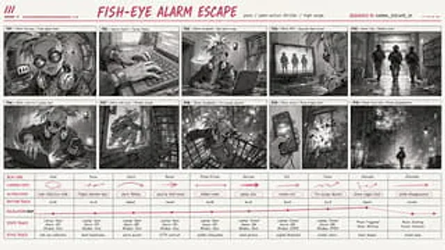

```text
Create a 16:9 image.

[PROJECT CARD]
Create a compact designed masthead, not a table.
TITLE: {argument name="title" default="FISH-EYE ALARM ESCAPE"}
META LINE: {argument name="metadata" default="panic / cyber-action thriller / high surge"}
PRIORITY: {argument name="visual hook" default="first-panel fish-eye glasses reflection hook, readable room"}
```

Model: GPT Image 2
Author: Kōda

[ProjectD](https://aitoolsradar.com/en/prompts/4361782e4dd10a) · [Recorded source](https://youmind.com/prompts/cinematic-storyboard-project-card-23993)
 · [Full original metadata and byte evidence](data/projectd-batch-0025.json)

## Cinematic Studio Portrait

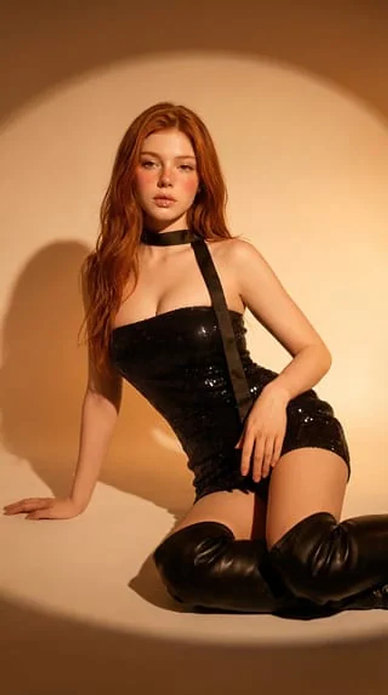

```text
{
  "prompt": "A studio portrait of a young woman with long, wavy red hair, fair skin with freckles, wearing a black sequined strapless mini dress and black over-the-knee boots. She sits on the floor, relaxed and confident, looking straight ahead with a soft, natural expression. A black ribbon choker is loosely tied around her neck. The scene uses warm, golden studio lighting, creating a circular spotlight effect behind her, casting soft shadows and adding depth. Minimalist background, editorial fashion photography style, high detail, cinematic warm tones, smooth gradations.",
  "negative_prompt": "Low resolution, blurriness, anatomical errors, extra limbs, deformed hands, distorted faces, harsh shadows, overexposure, underexposure, watermarks, text, logos, JPEG artifacts, cartoon style, CGI, 3D rendering.",
  "style": "Fashion photography for editors, photorealistic quality",
  "camera": {
    "angle": "eye level",
    "framing": "Three-quarters portrait",
    "lens": "85mm",
    "aperture": "f/2.0"
  },
  "lighting": {
    "type": "Studio lighting",
    "setup": "Warm spotlights with gentle decay",
    "mood": "Cinematic and intimate"
  },
  "setting": {
    "location": "Studio",
    "background": "Warm gradient background with circular halo"
  },
  "color_palette": [
    "black",
    "warm gold",
    "amber",
    "Soft beige"
  ],
  "size": "768x1152"
}
```

Model: GPT Image 2
Author: GPT Image 2 Prompts

[ProjectD](https://aitoolsradar.com/en/prompts/6ba828f7105d89) · [Recorded source](https://x.com/mizq06/status/2047003596479476118)
 · [Full original metadata and byte evidence](data/projectd-batch-0025.json)

## Cinematic Stylized Football Poster


```text
Ultra-stylized {argument name="sport" default="football"} poster, dark cinematic sports artwork, selective color effect, deep black background, monochrome grayscale players with only {argument name="team colors" default="team colors"} preserved, high contrast lighting, dramatic shadows, gritty film grain texture, halftone print effect, retro magazine aesthetic, neon glow accents, glowing censor bar across eyes, modern streetwear graphic design, editorial sports poster, dynamic action pose, stadium atmosphere fading into darkness.

Main subject: {argument name="athlete" default="elite football player in national team jersey"}, intense expression, mid-celebration, centered composition, jersey colors remain vibrant while skin and background stay black and white, subtle red/orange glow outlining body, dramatic rim lighting, floating particles, cinematic depth.

Style inspired by contemporary sports graphic design, underground football culture, poster art, graphic novel texture, premium branding campaign, bold composition, minimalist background, high-end Photoshop manipulation, ultra detailed, 8K, masterpiece.

Color treatment:
- Entire image in black and white
- Only jersey, socks, boots, and football remain in full national team colors
- Neon glow matching team colors
- Red, orange, yellow, blue, or national palette highlights
- Strong contrast and moody atmosphere

Effects:
heavy film grain, CRT texture, noise overlay, dust particles, halftone dots, paper texture, vignette, glow bloom, chromatic aberration, subtle motion blur, sports editorial look.

Typography area:
leave negative space for title and branding, poster layout, magazine cover composition.
```

Model: GPT Image 2
Author: Taaruk

[ProjectD](https://aitoolsradar.com/en/prompts/611cc9028224f7) · [Recorded source](https://youmind.com/prompts/cinematic-stylized-sports-poster-design-25878)
 · [Full original metadata and byte evidence](data/projectd-batch-0025.json)

## Cinematic Summer Lifestyle Photo

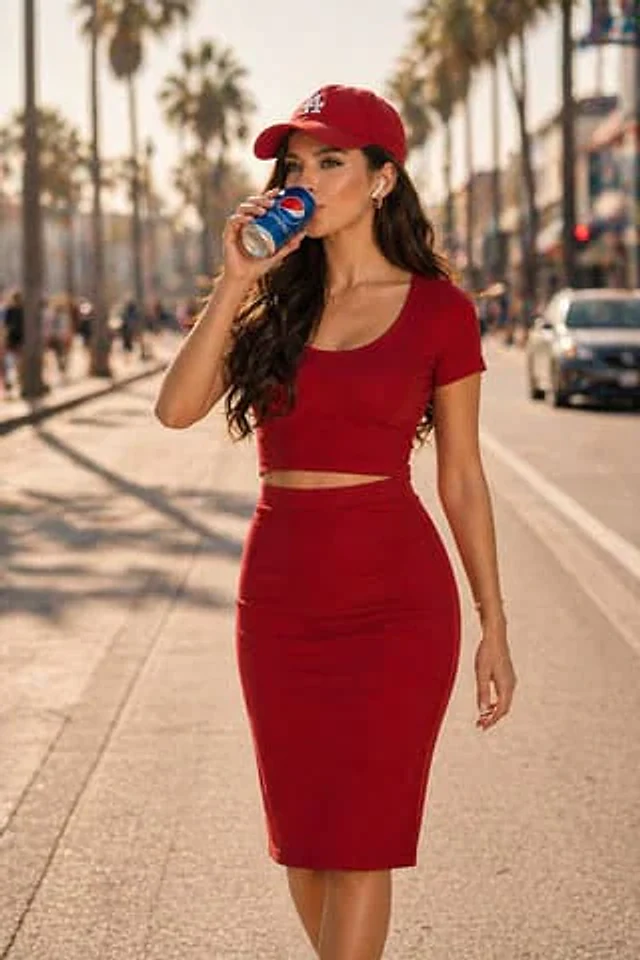

```text
A cinematic, high-end lifestyle visual depicts a young woman walking along a sun-drenched road on a hot summer day. She is drinking an ice-cold beverage.{argument name="beverage" default="Pepsi"} As the can moved, the clearly visible condensation droplets on its surface highlighted the contrast between the high temperature and the coolness. She wore wireless headphones, immersed in her own world. Her face had to perfectly match the provided reference image—accurate facial structure, skin tone, hairstyle, and expression—refined, natural, and visually appealing. She was dressed in coordinated {argument name="outfit color" default="red"} Outfit: A stylish cropped top (short sleeves, hem above the abdomen) paired with a short skirt that falls above the knee. The style is modern, simple, and avant-garde. She also wears a matching hat, adding a sporty streetwear aesthetic. Setting: An open road under strong light, with subtle heat waves in the background; warm colors suggest hot weather. The light is bright and slightly intense, creating realistic shadows and highlights on the skin and clothing.{argument name="beverage" default="Pepsi"} The aluminum can is richly detailed, with a clear logo, a metallic texture, and a condensation effect. Her interaction with the beverage appears natural and casual, like a moment captured while walking. The composition has a dynamic and lively feel, with a subtle sense of movement (the flowing hair, the walking posture). The background is softened to increase depth of field, ensuring the focus remains on the subject. Color grading: a warm summer atmosphere, with bold {argument name="outfit color" default="red"} Clothing and{argument name="beverage" default="Pepsi"} The brand's signature cool blue provides a striking contrast. Style: Cinematic lifestyle photography, commercial beverage advertising, street fashion aesthetics. Resolution: Ultra-high resolution, 4K, high detail, photorealistic.
```

Model: GPT Image 2
Author: GPT Image 2 Prompts

[ProjectD](https://aitoolsradar.com/en/prompts/716594ffb377eb) · [Recorded source](https://x.com/j_smeaton99/status/2047991936171286605)
 · [Full original metadata and byte evidence](data/projectd-batch-0025.json)

## Cinematic Sunset Couple Close-Up

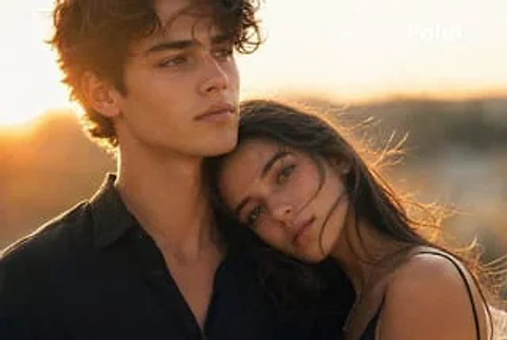

```text
A cinematic golden-hour close-up of a young couple in an intimate outdoor moment, framed from the chest up. The main focus is a handsome young man with {argument name="hair color" default="dark brown"} tousled wavy hair, soft defined jawline, smooth light-tan skin, and a calm, distant expression as he gazes slightly upward and off to the left. He wears a black open-collar button-up shirt with a relaxed, elegant fit. Leaning into him is 1 young woman with long dark brown hair, her face mostly hidden against his shoulder and chest, creating a tender, protective mood; only part of her hair, shoulder, and thin black spaghetti-strap dress are visible. Use warm sunset backlighting with the sun low behind them on the left, creating glowing rim light around their hair and shoulders, soft lens flare, amber highlights, shallow depth of field, and a blurred natural landscape in the background with low hills. The composition should feel romantic, editorial, and filmic, like a luxury fragrance or fashion campaign, with soft skin detail, realistic textures, subtle wind in the hair, muted earth tones, and high-end cinematic color grading. Photorealistic, emotional, intimate, 50mm lens look, ultra-detailed, natural light, soft contrast.
```

Model: GPT Image 2
Author: Darshal Jaitwar

[ProjectD](https://aitoolsradar.com/en/prompts/892f5d258fba97) · [Recorded source](https://youmind.com/prompts/cinematic-sunset-couple-close-up-16864)
 · [Full original metadata and byte evidence](data/projectd-batch-0025.json)

## Cinematic Tactical Command Scene

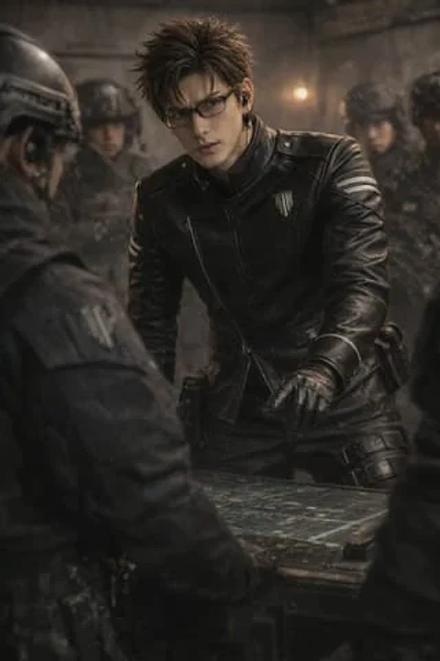

```text
A cinematic, photorealistic shot, the main character is{argument name="character appearance" default="A handsome young man with dark brown spiky hair and rectangular glasses"} Wearing{argument name="outfit" default="Black leather tactical jacket with a high collar, silver breast badge and white arm patch"} He was wearing black leather gloves and headphones.{argument name="action" default="Leaning forward, he intently gazed at the glowing tactical map on the table, his right hand pointing at it."} The scene is set in{argument name="setting" default="A dimly lit, rough-looking concrete command bunker"} In the middle. Against a blurred background,{argument name="background characters" default="Several soldiers dressed in full black tactical gear and wearing helmets"} Standing at attention, awaiting orders. The shoulder of another person in a black uniform is visible in the left foreground, framing the image. The image presents a dark, melancholic lighting effect, with shallow depth of field and a high-resolution, rough texture.
```

Model: GPT Image 2
Author: GPT Image 2 Prompts

[ProjectD](https://aitoolsradar.com/en/prompts/6d8b633ee3a231) · [Recorded source](https://x.com/ry_aurelio/status/2043882982851969426#reversed-0)
 · [Full original metadata and byte evidence](data/projectd-batch-0025.json)

## Cinematic TV Still Prompt

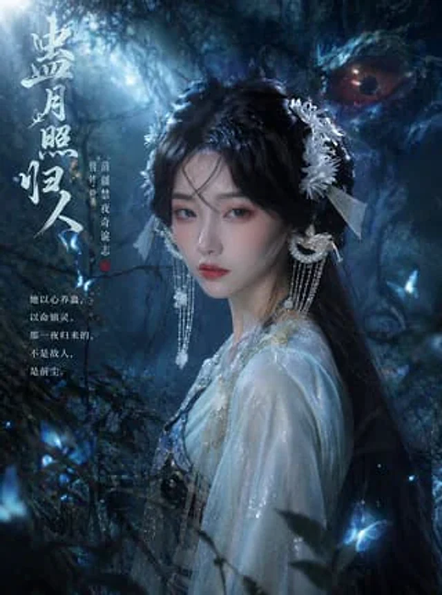

```text
Official stills from the TV series.{argument name="genre" default="Ancient costume fantasy"} theme"{argument name="title" default="The ancient moon shines on the returning traveler"} “A Miao ethnic minority member”{argument name="character" default="girl"} Her facial features and temperament are consistent with the protagonist in Figure 1. A genuine Eastern girl, with fair, delicate, and translucent skin, her black hair cascading like a waterfall, adorned with white wildflowers and silver tassels. Exquisite Miao silver ornaments hang from her earlobes. She wears a light green and white ancient-style gauze dress, the sheer sleeves embroidered with delicate details. Looking back from the depths of the forbidden Miao region, her eyes are serene yet conceal a sense of destiny. Her expression is restrained, carrying a hint of sorrow and aloof elegance. In the deep blue night, in the damp forest, shrouded in mist, with twisted ancient trees, faint traces of Gu fire and the blurred outline of an altar are visible in the background. Tiny... Glowing insects and silver-blue butterfly phantoms, hair and skirts gently swaying in the mountain breeze, cinematic lighting, cool blue moonlight intertwining with soft firelight, subtle side-backlighting outlining facial contours, a distinct depth of field effect, realistic TV drama shooting quality, hyper-realistic, delicate and natural skin texture, strong yet restrained emotions, the camera language is like a popular period drama poster, sophisticated, mysterious and with a naturally expressed sorrow, strong yet restrained emotions, the camera language is like a popular period drama poster, sophisticated, mysterious, poignant and dangerous, studio-level lighting control combined with a realistic forest atmosphere, 85mm cinematic lens, shallow depth of field, background blur, cinematic stills, high detail, hyper-realistic, cinematic stills, dramatic composition, 4K, ArtStation level detail.
```

Model: GPT Image 2
Author: GPT Image 2 Prompts

[ProjectD](https://aitoolsradar.com/en/prompts/80d53f16335010) · [Recorded source](https://x.com/alupbn121/status/2045040830227050885)
 · [Full original metadata and byte evidence](data/projectd-batch-0025.json)

## Cinematic Video Company Poster

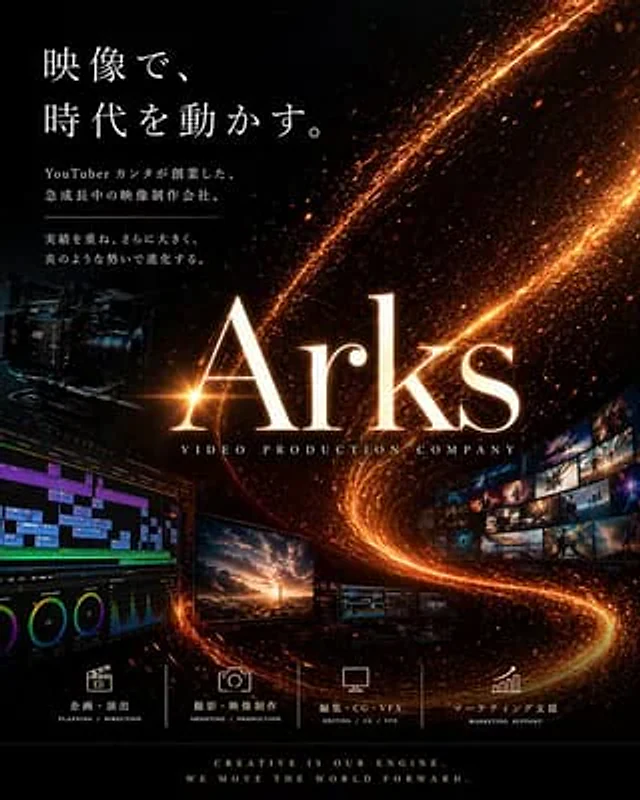

```text
{
  "type": "Cinematic Corporate Promotional Posters",
  "style": "Luxurious, impactful, and with a high-end film and television production brand feel, the graphic design is realistic and exquisite.",
  "brand": {
    "name": "{argument name=\"brand name\" default=\"Arks\"}",
    "subtitle": "Video production company"
  },
  "canvas": {
    "orientation": "Vertical",
    "aspect_ratio": "4:5"
  },
  "background": {
    "base_color": "Dark black",
    "effects": [
      "The orange-gold glowing particles swept diagonally from the upper right corner to the lower left corner and curled upwards.",
      "Dense sparks and embers",
      "Fine textures of cosmic dust",
      "High contrast lighting"
    ]
  },
  "layout": {
    "sections": [
      {
        "title": "Main title area",
        "position": "Top left",
        "count": 4,
        "labels": [
          "In the video,",
          "To change the times.",
          "A fast-growing video production company founded by YouTuber Kanta.",
          "With continuous accumulation of achievements, it is developing rapidly with a fiery momentum."
        ]
      },
      {
        "title": "Service icon row",
        "position": "Bottom Center",
        "count": 4,
        "labels": [
          "Planning and Directing",
          "Shooting and Video Production",
          "Editing, CG and VFX",
          "Marketing support"
        ]
      },
      {
        "title": "Footer slogan",
        "position": "Bottom center",
        "count": 2,
        "labels": [
          "CREATIVE IS OUR ENGINE.",
          "WE MOVE THE WORLD FORWARD."
        ]
      }
    ],
    "centerpiece": "Center extra-large illuminated serif font logo",
    "supporting_elements": "Film production equipment and post-production screens arranged around the logo"
  },
  "objects": {
    "left_side": [
      {
        "item": "Professional film camera kit",
        "placement": "center left",
        "look": "The dark matte body and lens are mounted on a support system, partially hidden in shadow."
      },
      {
        "item": "Video editing timeline interface monitor",
        "placement": "Bottom left",
        "look": "Large screen displaying multitrack editing software with color timeline bars, oscilloscope, and panel."
      }
    ],
    "center": [
      {
        "item": "Main display",
        "placement": "Lower left",
        "look": "The display screen shows a person standing in a dramatic cinematic landscape under a glowing sky."
      },
      {
        "item": "Two small workstation monitors",
        "placement": "Lower right",
        "look": "Small display for showing the editing or color grading interface"
      }
    ],
    "right_side": [
      {
        "item": "Arc-shaped image thumbnail wall",
        "placement": "center right",
        "count": 15,
        "look": "Fifteen miniature film stills are arranged in an arc, showcasing action, fantasy, landscapes, and dramatic scenes."
      }
    ]
  },
  "typography": {
    "headline": {
      "font_style": "Elegant Japanese Ming Dynasty style serif",
      "color": "White",
      "size": "big",
      "line_spacing": "Ample"
    },
    "logo": {
      "font_style": "Large, exquisite serif font",
      "color": "Warm white with an orange halo",
      "effect": "Intense glow and metallic sparkle at the edges"
    },
    "service_labels": {
      "font_style": "A simple, small serif/sans-serif hybrid.",
      "color": "White"
    },
    "footer": {
      "font_style": "Small uppercase serif font",
      "color": "warm white"
    }
  },
  "color_palette": [
    "black",
    "Orange Gold",
    "amber",
    "warm white",
    "The subtle blue accents from the screen"
  ],
  "lighting": "A dark studio atmosphere with fire trails as a key visual light source",
  "mood": "Ambitious, futuristic, energetic, elite, cinematic",
  "text_rendering": "Clear and accurate Japanese and English typesetting, professional font design",
  "image_goal": "A poster designed for a film production company conveys a powerful, trustworthy, and visually stunning impression.",
  "customization": {
    "headline": "{argument name=\"headline text\" default=\"Using video to shape the times.\"}",
    "body_copy": "{argument name=\"body copy\" default=\"Founded by YouTuber Kanta, this is a rapidly growing video production company. It continues to build its reputation and is flourishing with explosive growth.\"}",
    "primary_glow_color": "{argument name=\"glow color\" default=\"orange-gold\"}",
    "footer_tagline": "{argument name=\"footer tagline\" default=\"CREATIVE IS OUR ENGINE. WE MOVE THE WORLD FORWARD.\"}"
  }
}
```

Model: GPT Image 2
Author: GPT Image 2 Prompts

[ProjectD](https://aitoolsradar.com/en/prompts/3808e066f77d20) · [Recorded source](https://x.com/kantamizutamari/status/2047247285944508520#reversed-1)
 · [Full original metadata and byte evidence](data/projectd-batch-0025.json)

## Cinematic Video Game Cutscene with Subtitles


```text
A screenshot from a cinematic video game cutscene, featuring a hyper-realistic 3D graphics style reminiscent of modern open-world games. Two characters are {argument name="setting" default="Sunny tropical city balcony"} A serious conversation is taking place. On the left is a young Latina woman with a messy high ponytail, wearing a white one-shoulder ribbed crop top, hoop earrings, and a delicate gold necklace, intently looking at the other person. On the right is a white man, photographed from a side view behind his shoulder, with short brown hair, wearing a dark short-sleeved shirt with a tropical leaf pattern and a silver necklace. In the background, palm trees, a swimming pool below, tall buildings, and a sign that reads "..." can be seen.{argument name="location sign" default="VICE HOTEL"} A pink neon sign. The light is bright and warm, creating an afternoon sun effect. A video game-themed UI is located at the bottom center. The speaker's name is also displayed.{argument name="female character name" default="LUCIA"} Displayed in pink text above the white dialogue text:{argument name="female dialogue" default="You weren&#39;t listening at all. I&#39;m fed up with putting my life on hold for you."} Below is an optional dialogue option marked with a white dot and a pink underline, which reads:{argument name="male dialogue choice" default="I know. I&#39;m just saying, maybe things aren&#39;t so bad."} ".
```

Model: GPT Image 2
Author: GPT Image 2 Prompts

[ProjectD](https://aitoolsradar.com/en/prompts/e7385e11cfa8b1) · [Recorded source](https://x.com/marmaduke091/status/2044909851852030420#reversed-0)
 · [Full original metadata and byte evidence](data/projectd-batch-0025.json)

## Cinematic Video Game Cutscene with Subtitles


```text
A {argument name="visual style" default="photorealistic modern video game cutscene"} of a young Latina woman and a Caucasian man conversing on a {argument name="setting" default="tropical city balcony overlooking palm trees and a hotel pool"}. The woman faces the camera, wearing a messy high ponytail, hoop earrings, and a white one-shoulder crop top, looking serious. The man is seen from an over-the-shoulder profile on the right, wearing a dark floral shirt. The background features a pink neon 'VICE HOTEL' sign. At the bottom center, video game subtitles show the speaker name {argument name="speaker name" default="LUCIA"} in pink, above the white dialogue {argument name="dialogue text" default="You're not listening. I'm done putting my life on hold."}. Below is a player choice with a white circle and pink underlined text reading {argument name="response option" default="I know. I'm just saying, maybe it ain't gonna be so bad."}.
```

Model: GPT Image 2
Author: can

[ProjectD](https://aitoolsradar.com/en/prompts/7bf410ded6239b) · [Recorded source](https://youmind.com/prompts/video-game-cutscene-subtitles-13734)
 · [Full original metadata and byte evidence](data/projectd-batch-0025.json)

## Cinematic Video Game Screenshot


```text
A screenshot from GTA 6, containing{argument name="characters" default="lucia and jason"}
```

Model: GPT Image 2
Author: GPT Image 2 Prompts

[ProjectD](https://aitoolsradar.com/en/prompts/c6e6931703afb2) · [Recorded source](https://x.com/GTAInfinity_YT/status/2045510936543252673)
 · [Full original metadata and byte evidence](data/projectd-batch-0025.json)

## Cinematic Wednesday Anime Poster

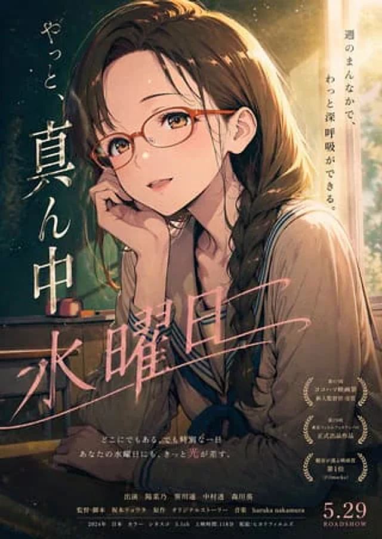

```text
An anime illustration in the style of a Japanese movie poster, using a vertical theatrical poster composition, depicts a girl sitting alone in a classroom during prime time. She keeps {argument name="hair color" default="Dark brown"} Her long, slightly wavy hair was loosely braided to the side, falling over her right shoulder, with soft bangs and warm contour lighting at the crown and edges. She wore a beige or light brown sailor-style school uniform with navy blue trim and a dark blue bow at the chest. Her posture was quiet and introspective: sitting at her desk, one hand supporting her chin, her shoulders slightly hunched, her gaze fixed to one side, revealing a weary but serene midweek expression. The scene is illuminated by strong afternoon sunlight streaming through the tall classroom windows on the right, creating dazzling highlights, dust particles in the air, a soft mist, and a nostalgic cinematic atmosphere. In the darker background on the left, there is a green classroom blackboard with two small erasers or chalk accessories on its tray. The artwork employs a realistic anime style, with rich cinematic quality, delicate facial rendering, textured brushstrokes, subtle graininess, and dramatic poster lighting. The image incorporates a Japanese poster layout: on the left is a large vertical white calligraphy character “真ん中” (Shinchu), above which is a smaller handwritten vertical character “やっと、” (Yatto,). In the lower center is a large pink diagonal calligraphy title “水曜日” (Wednesday). In the upper right corner is a vertical slogan “週のまんなかで、わっと深呼吸ができる.” (Weekly manaka de, watto, you can breathe deeply.) Near the lower right corner are three stacked gold laurel medallions with small Japanese characters inside. At the bottom center are two lines of small Japanese text, below which is a small Japanese movie poster-style credits list. A prominent release date is placed in the lower right corner.{argument name="release date" default="5.29"} The poster below is labeled "ROADSHOW". The overall atmosphere is gentle, melancholic, and healing, much like a low-key coming-of-age movie poster that tells the story of an ordinary Wednesday that becomes quietly special.
```

Model: GPT Image 2
Author: GPT Image 2 Prompts

[ProjectD](https://aitoolsradar.com/en/prompts/5cb4357d8962a9) · [Recorded source](https://x.com/SakuraRenge/status/2046687920585576835#reversed-0)
 · [Full original metadata and byte evidence](data/projectd-batch-0025.json)

## Cinematic Woman in Vintage Library


```text
A cinematic half-length portrait depicts an elegant woman in an old-fashioned library, her body slightly turned to the left, sitting or standing close to the camera, her face centered and partially shrouded in soft shadow. She has {argument name="hair color" default="Golden yellow"} Her hair was styled in an elegant Edwardian or early 20th-century updo, voluminous on top with loose curls cascading down the sides. She wore a high-necked dress.{argument name="dress color" default="Creamy Gold"} A lace dress with delicate floral patterns and fine trim is worn, paired with a clearly visible pendant earring. The background is a warm and private study with two tall wooden bookshelves filled with old books in shades of brown, green, and soft blue. On the far left is a window letting in soft light, with sheer curtains hanging beside it, and a framed painting on the wall. The composition utilizes golden hour indoor lighting, amber highlights, shallow depth of field, rich wood tones, soft cinematic contrast, and realistic skin and fabric details to create a tranquil, historical drama atmosphere. The 16:9 aspect ratio and mid-range close-up are realistic, luxurious, and detailed, possessing an oil painting quality rather than an illustration style.
```

Model: GPT Image 2
Author: GPT Image 2 Prompts

[ProjectD](https://aitoolsradar.com/en/prompts/de08ac89f47094) · [Recorded source](https://x.com/StableTom/status/2046577842486477007#reversed-2)
 · [Full original metadata and byte evidence](data/projectd-batch-0025.json)

## Cinematic World Cup 26 Stadium Poster


```text
Create a cinematic widescreen sports poster for {argument name="event title" default="FIFA WORLD CUP 26"}. Show a packed night stadium viewed from field level with dramatic curved architecture, thousands of glowing spectators, red and gold pyrotechnic streaks, bright stadium floodlights, and a dusk-to-night sky over a New York–style skyline with One World Trade Center centered in the background. In the middle foreground, place a male soccer player seen from behind, wearing a white kit with gold trim and the number {argument name="player number" default="10"} on his back, standing with feet apart and both arms raised triumphantly toward a floating golden World Cup trophy above him. Put a detailed soccer ball on the grass in the lower left foreground. Add exactly three large waving national flags on tall poles across the upper stadium: United States flag on the left, Canada flag left of center, and Mexico flag on the right. Use ultra-detailed photorealistic fantasy sports advertising style, HDR contrast, golden rim lighting, lens flares, sparks, confetti, epic scale, sharp focus, and a red-gold-blue color palette. At the bottom, add bold metallic 3D gold typography reading {argument name="headline text" default="FIFA WORLD CUP 26"}; beneath it add smaller text reading "USA CANADA MEXICO" with USA in red, CANADA in white, MEXICO in green, separated by small gold dots; below that add the date line {argument name="date line" default="JUNE 11 - JULY 19"}. Keep the composition symmetrical and heroic, with the trophy, player, skyline tower, and headline aligned on the vertical center. No extra logos, no watermark, no additional text.
```

Model: GPT Image 2
Author: Tisho

[ProjectD](https://aitoolsradar.com/en/prompts/6b7d49e004d0c2) · [Recorded source](https://youmind.com/prompts/world-cup-26-poster-24337)
 · [Full original metadata and byte evidence](data/projectd-batch-0025.json)

## Cinematic Xianxia Swordswoman Portrait

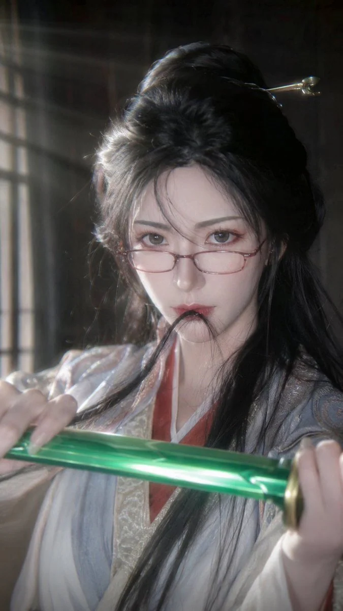

```text
Create a vertical cinematic close-up portrait of {argument name="character name" default="a graceful female immortal cultivator"} in a Chinese xianxia fantasy drama style. She is framed from the chest up in a dim antique interior beside a softly glowing lattice window, with hazy volumetric sunlight streaming from the upper left and a dark blurred background. The subject has long glossy {argument name="hair color" default="black"} hair styled half-up with loose flowing strands over the shoulders, an ornate gold hairpin visible near the back of the head, and delicate period-drama styling. Her face is deliberately covered by one large opaque muted gray-brown rectangular censor block centered over the entire face, while the hair, neck, clothing, and hands remain visible. She wears layered flowing Hanfu robes in pale ivory, silver-gray, and light blue, with embroidered brocade trim, a warm red inner collar, soft translucent fabric, and subtle metallic thread details. Both hands hold a vivid translucent emerald-green sword or jade blade horizontally across the lower foreground, angled slightly upward from left to right, with gold fittings at the right edge; the blade catches a bright specular highlight. Use realistic high-budget Chinese fantasy TV production lighting, shallow depth of field, soft bloom, film grain, natural skin and fabric texture, dramatic backlight, and a mystical but grounded mood. Vertical 9:16 composition, close crop, no visible text, no watermark, no extra characters.
```

Model: GPT Image 2
Author: 𝟡𝟜 ᴾᴸᴬʸᶠᴼᴿᴳᴱ

[ProjectD](https://aitoolsradar.com/en/prompts/765c92818f32cf) · [Recorded source](https://youmind.com/prompts/xianxia-swordswoman-portrait-25698)
 · [Full original metadata and byte evidence](data/projectd-batch-0025.json)

## City Marathon Event Poster

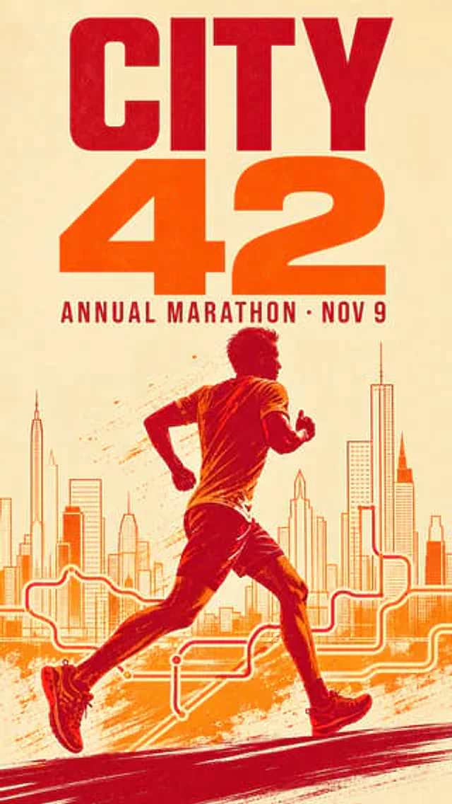

```text
Vertical 9:16 modern city marathon event poster. Bold silhouette of a single runner mid-stride rendered as a dynamic three-color overlay print in deep red, fluorescent orange and warm cream. Behind the runner a stylized urban skyline simplified into thin abstract lines forming a continuous route across the lower half of the poster. Strong all-caps sans-serif title "CITY 42" stacked at the top, with the smaller subhead "ANNUAL MARATHON · NOV 9". Vertical poster composition with subtle paper texture. No real city brand, no sponsor logos, no watermark. Premium sports event poster design quality.
```

Model: GPT Image 2
Author: @hiapi_ai

[ProjectD](https://aitoolsradar.com/en/prompts/81e1c0b4a15764) · [Recorded source](https://github.com/HiAPIAI/awesome-gpt-image-2-prompts)
 · [Full original metadata and byte evidence](data/projectd-batch-0025.json)

## City Travel Guide Infographic

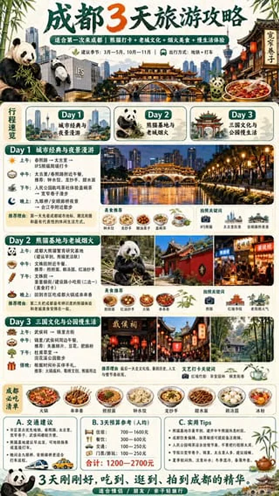

```text
生成【城市】三天旅游攻略,就这么简单一句话
```

Model: GPT Image 2
Author: @MrLarus

[ProjectD](https://aitoolsradar.com/en/prompts/833dc367a8f5a8) · [Recorded source](https://x.com/MrLarus/status/2046523494003851300)
 · [Full original metadata and byte evidence](data/projectd-batch-0025.json)

## Classic Painting Fashion Analysis

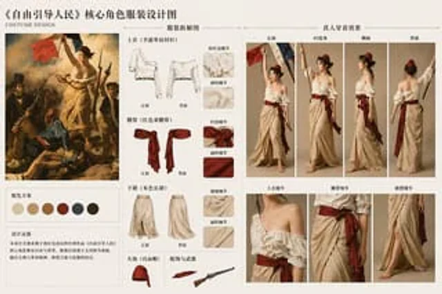

```text
拆解图中核心角色的穿搭，生成服装设计图，{argument name="比例" default="3:2"}
```

Model: GPT Image 2
Author: 程序员小灰

[ProjectD](https://aitoolsradar.com/en/prompts/2448a2b206918d) · [Recorded source](https://youmind.com/prompts/liberty-leading-fashion-design-17335)
 · [Full original metadata and byte evidence](data/projectd-batch-0025.json)

## Classic Pianist Live Stream


```text
{argument name="pianist" default="Vladimir Horowitz"} In progress{argument name="platform" default="YouTube"} Up{argument name="event" default="Piano solo live stream"}
```

Model: GPT Image 2
Author: GPT Image 2 Prompts

[ProjectD](https://aitoolsradar.com/en/prompts/6d984fc6a6ec93) · [Recorded source](https://x.com/bowowwoaaa2/status/2045032416876920974)
 · [Full original metadata and byte evidence](data/projectd-batch-0025.json)

## Classical Beauty in Modern Urban Sunset

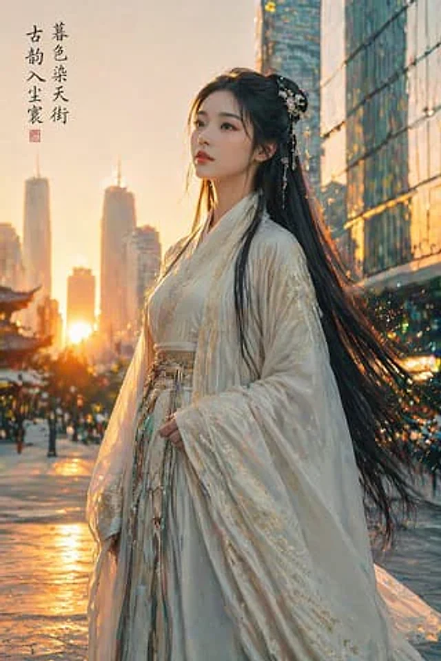

```text
One{argument name="subject" default="An elegant woman"} Her smooth, black hair cascaded down like a waterfall; she stood quietly, her eyes revealing a classic and restrained charm. She was dressed in {argument name="attire" default="A moon-white brocade robe with wide sleeves, adorned with delicate floral embroidery."} Her robes fluttered, traditional silk ribbons and warm jade pendants swaying gently with her steps. The golden sunset bathed the sky, casting a soft amber glow on her figure.{argument name="background scene" default="Modern architecture with cool-toned glass reflections and geometric structures"} Gradually fading into the depth of the scene, the use of the "blank space" technique from traditional ink painting creates an ethereal composition that evokes a dialogue between the past and present. The lingering atmosphere of Eastern poetry, interwoven with reality and illusion, quietly blends into the city streets, and in the clash of warm and cool tones, it captures a tranquil painting that transcends time and space.
```

Model: GPT Image 2
Author: GPT Image 2 Prompts

[ProjectD](https://aitoolsradar.com/en/prompts/ed2bd5d6a4dc65) · [Recorded source](https://x.com/ChengSir404/status/2045462567657836686)
 · [Full original metadata and byte evidence](data/projectd-batch-0025.json)

## Classical Calligraphy Scroll Prompt


```text
Combination{argument name="work content" default="Wang Xizhi&#39;s &quot;Preface to the Poems Composed at the Orchid Pavilion&quot;"} The content is used to generate a calligraphy scroll image. The background should match {argument name="background mood" default="The artistic conception of the Preface to the Poems Composed at the Orchid Pavilion"} Masking is applied to the background image and the foreground is rendered.{argument name="foreground content" default="Preface to the Poems Composed at the Orchid Pavilion"} .
```

Model: GPT Image 2
Author: GPT Image 2 Prompts

[ProjectD](https://aitoolsradar.com/en/prompts/841dae57d0c223) · [Recorded source](https://x.com/liyue_ai/status/2045137549149286858)
 · [Full original metadata and byte evidence](data/projectd-batch-0025.json)

## Classical Calligraphy Scroll Prompt

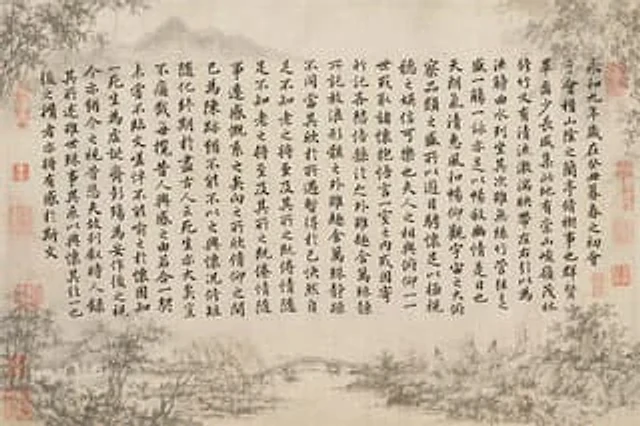

```text
结合{argument name="作品内容" default="王羲之的《兰亭集序》"}里的内容，生成一副书法帖图片，要求图片背景符合{argument name="背景意境" default="《兰亭集序》的意境"}，背景图可以使用蒙版，前景是{argument name="前景内容" default="《兰亭集序》"}
```

Model: GPT Image 2
Author: 李岳

[ProjectD](https://aitoolsradar.com/en/prompts/e1113d7c754cff) · [Recorded source](https://youmind.com/prompts/lantingji-xu-scroll-13859)
 · [Full original metadata and byte evidence](data/projectd-batch-0025.json)

## Classical Chinese Phone Case Design


```text
{argument name="co-branding theme" default="Wang Xifeng"} The co-branded phone case features a design incorporating a phoenix coronet and embroidered robe with gold thread embossing, and the back is decorated with a gold-stamped phoenix pattern.
```

Model: GPT Image 2
Author: GPT Image 2 Prompts

[ProjectD](https://aitoolsradar.com/en/prompts/a8016e5cdea691) · [Recorded source](https://x.com/songguoxiansen/status/2046762531860168915)
 · [Full original metadata and byte evidence](data/projectd-batch-0025.json)

## Classical Chinese Phone Case Design

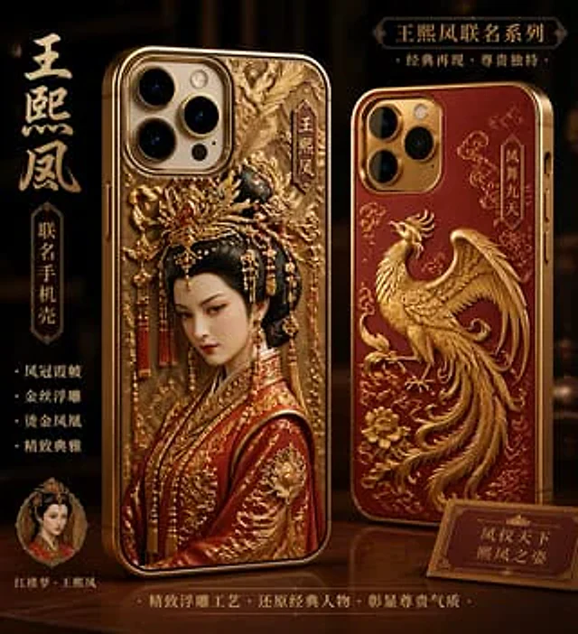

```text
{argument name="联名主题" default="王熙凤"}联名手机壳，凤冠霞帔金丝浮雕，背面烫金凤凰纹饰
```

Model: GPT Image 2
Author: 松果先森

[ProjectD](https://aitoolsradar.com/en/prompts/fb80a8fb2ad3ca) · [Recorded source](https://youmind.com/prompts/phoenix-crown-phone-case-14749)
 · [Full original metadata and byte evidence](data/projectd-batch-0025.json)

## Classical Chinese Poem Scroll Landscape

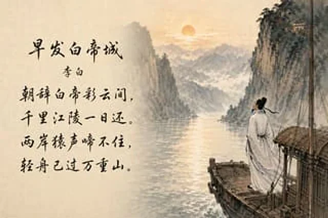

```text
A classical Chinese ink painting, executed on warm-toned aged Xuan paper, perfectly blends landscape art with calligraphy, featuring a simple and clear composition. A large blank area on the left is used to write the poem's title in vigorous black brush calligraphy.{argument name="poem title" default="Departing from Baidi City at dawn"} Poet's name{argument name="poet name" default="Li Bai"} And four lines of vertically arranged poetry, written with a free and unrestrained style:{argument name="poem text" default="I departed Baidi City amidst colorful clouds at dawn, returning to Jiangling a thousand miles away in a single day. The cries of monkeys on both banks never ceased, yet my light boat had already passed countless mountains."} The right side depicts a traditional landscape painting style, with a sunrise over a river gorge: a soft orange-red sun hangs low above the mist-shrouded, layered mountains, flanked by towering, steep cliffs. In the distance, a thin mist hangs in the air, and the calm water shimmers with a faint golden light. In the lower right foreground, a small wooden boat with a simple canopy and mast is moored. An ancient scholar, dressed in flowing white Hanfu, stands with his back to the viewer on the deck, his hair tied in a high bun, his robe and belt fluttering in the breeze, creating a contemplative atmosphere. A small temple pavilion adorns the cliff top on the right. The painting employs delicate ink lines, elegant ochre, and washes of ink to present the texture of paper, elegant blank spaces, and refined literati painting aesthetics. The overall composition is poetic, tranquil, balanced, and of museum-quality quality, especially the calligraphy, which is clear and legible, seamlessly integrated with the artwork.
```

Model: GPT Image 2
Author: GPT Image 2 Prompts

[ProjectD](https://aitoolsradar.com/en/prompts/d5c0792a24c1a8) · [Recorded source](https://x.com/mcwangcn/status/2046993955040952818#reversed-1)
 · [Full original metadata and byte evidence](data/projectd-batch-0025.json)

## Classical Chinese Scholar with XAI Motif

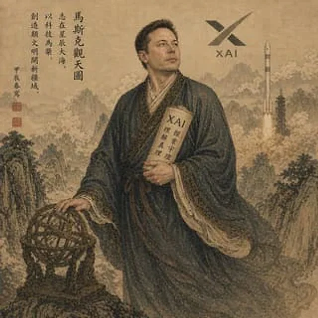

```text
A delicate Chinese ink-wash portrait, painted on aged parchment, is composed in the style of a classical literati hanging scroll, its color palette a soft blend of dark brown, tan, charcoal gray, and faded indigo. At the center stands a scholar, clad in flowing dark blue-black Hanfu, adorned with exquisite gold patterns and wide beige inner sleeves, standing upright with a solemn expression. His face is deliberately obscured by a rectangular, blurred area; his hair is jet black and wavy, neatly combed. He holds a traditional thread-bound book, its cover bearing the prominent Latin letters "XAI" vertically, below which are four columns of Chinese characters. His other hand rests on an ornate armillary sphere on a carved base in the lower left. The background is a magnificent landscape, featuring a mountain range, layered clouds, rugged peaks, and drifting clouds, rendered with masterful brushstrokes. In the upper right sky area, a striking modern "XAI" logo is placed, with a stylized emblem above the letters; on the far right, a slender rocket is depicted lifting off from a launch tower, smoke billowing into the clouds, blending futuristic aerospace imagery into a classical scene. In the upper left, a set of vertically arranged black ink calligraphy titles is added, along with a smaller vertical signature and two red seals below. The overall effect aims to merge portraits of ancient Chinese scholars with space-age technology and AI symbolism, rich in detail, elegantly balanced, and slightly ironic, presenting the texture of antique paper and the composition of a museum-quality scroll painting.
```

Model: GPT Image 2
Author: GPT Image 2 Prompts

[ProjectD](https://aitoolsradar.com/en/prompts/b492da09fcd826) · [Recorded source](https://x.com/gooby_esq/status/2046601290218717683#reversed-2)
 · [Full original metadata and byte evidence](data/projectd-batch-0025.json)

## Classical Cover for The City of God

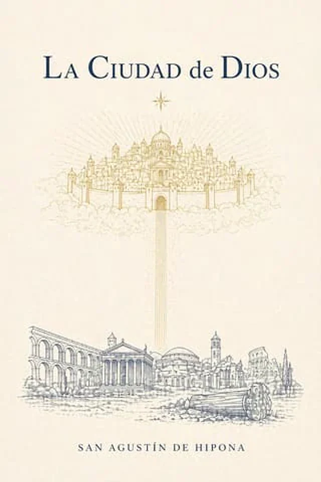

```text
A minimalist and elegant retro book cover design, using warm ivory textured paper, suitable for {argument name="book title" default="La Ciudad de Dios"} The title is placed at the top center in a large, classic serif font in a deep navy blue, with meticulous spacing, exuding a literary feel. A gold eight-pointed star is placed directly below the title. In the upper center, a sacred city floating in the clouds is depicted using exquisite gold line art: a symmetrical holy city comprising a central domed cathedral, numerous surrounding towers, spires, walls, and gates, surrounded by soft clouds, with radiating rays of sunlight spreading outwards from behind. From the central gate of this heavenly city, a slender, vertical golden beam of light shines downwards, reaching the lower half of the cover. In the bottom third, a landscape of ancient Rome is depicted in delicate blue-grey ink lines: five major architectural remains and monuments are arranged horizontally, including a long arcade on the left, a classical columned temple in the left center, a domed building in the center, a bell tower and surrounding ruins in the right center, and the ruins of an amphitheater-like structure on the far right, along with a broken column drum and scattered shrubs and ground textures in the right foreground. Maintain an ethereal, symmetrical, and thought-provoking composition, leaving ample negative space between the sky and the ground. (The author's name should be included.){argument name="author name" default="SAN AGUSTÍN DE HIPONA"} Centered at the bottom, it uses a small, uppercase serif font with moderate spacing in a deep navy blue. The entire image contains only three visible text elements: the title, the author's name, and no subtitle. The color scheme is limited to ivory, gold, and deep navy blue, presenting a precise engraving feel and a sacred, eternal, and classical theological atmosphere.
```

Model: GPT Image 2
Author: GPT Image 2 Prompts

[ProjectD](https://aitoolsradar.com/en/prompts/6edf58ff17c627) · [Recorded source](https://x.com/luicho9_/status/2046674657697243428#reversed-1)
 · [Full original metadata and byte evidence](data/projectd-batch-0025.json)

## Classical Literature Themed Phone Case Prompt

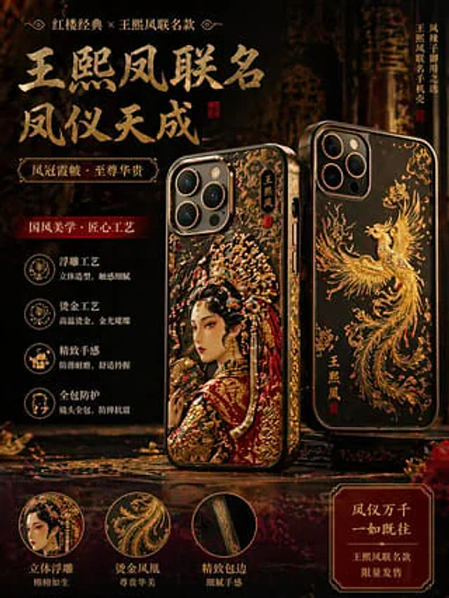

```text
{argument name="character" default="Wang Xifeng"} The co-branded phone case features a phoenix crown and embroidered robe design using gold wire embossing, with a gold-stamped phoenix pattern on the back.
```

Model: GPT Image 2
Author: GPT Image 2 Prompts

[ProjectD](https://aitoolsradar.com/en/prompts/cb8873df98be80) · [Recorded source](https://x.com/0xcalmcalm/status/2046990892599538034)
 · [Full original metadata and byte evidence](data/projectd-batch-0025.json)

## Classroom Chalkboard Lesson

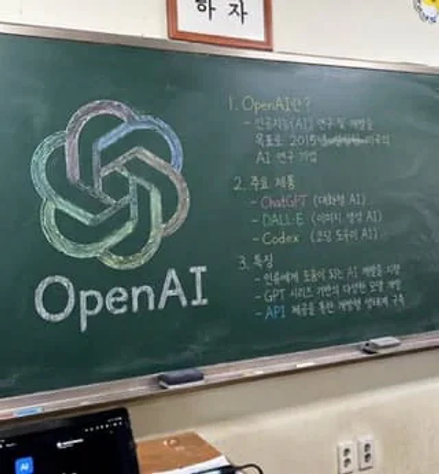

```text
A photorealistic, slightly angled snapshot of a classroom greenboard. To the left of the blackboard is a meticulously drawn chalk sketch showcasing…{argument name="company name" default="OpenAI"} The logo uses a mix of soft colors such as green, blue, and purple, with the words "..." written in neat white chalk below.{argument name="logo text" default="OpenAI"} On the right side of the blackboard is a handwritten text organized into three numbered sections. The first section is titled "{argument name="section one title" default="1. OpenAI란?"} This is followed by a brief explanatory text. Part 2 is titled "{argument name="section two title" default="2. 주요 제품"} The document lists three key points, including ChatGPT, DALL-E, and Codex. Part 3 is titled "{argument name="section three title" default="3. 특징"} The text describes three key features: a blackboard with a silver metal frame, two rectangular erasers and scattered chalk on a chalk tray, a gray-white wall below a two-pronged power outlet, and a dark laptop screen in the lower left foreground. Above the blackboard, a framed logo is cropped at the bottom edge of the image.
```

Model: GPT Image 2
Author: GPT Image 2 Prompts

[ProjectD](https://aitoolsradar.com/en/prompts/f52d787593f5bb) · [Recorded source](https://x.com/lovedfelis/status/2045133210125017535#reversed-0)
 · [Full original metadata and byte evidence](data/projectd-batch-0025.json)

## Classroom Interior Four-Way View

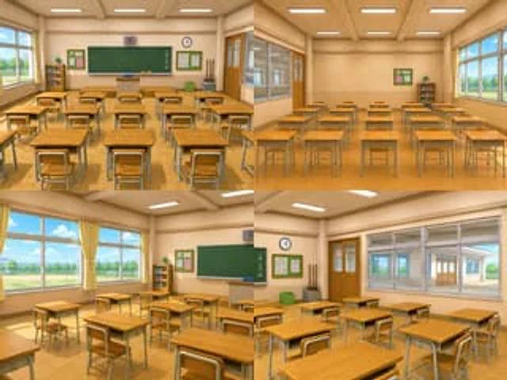

```text
「この{argument name="場所" default="教室"}の中央から4方向を見た時の画像を生成して。 右側の窓の外は{argument name="右側の景色" default="廊下"}、左側の窓の外は{argument name="左側の景色" default="校庭"}。 作成する画像枚数は4枚です。」
```

Model: GPT Image 2
Author: 布留川英一 / Hidekazu Furukawa

[ProjectD](https://aitoolsradar.com/en/prompts/887a0dc4694568) · [Recorded source](https://youmind.com/prompts/classroom-four-way-directional-view-22134)
 · [Full original metadata and byte evidence](data/projectd-batch-0025.json)

## Clean High-Brightness Commercial Graphic Layout

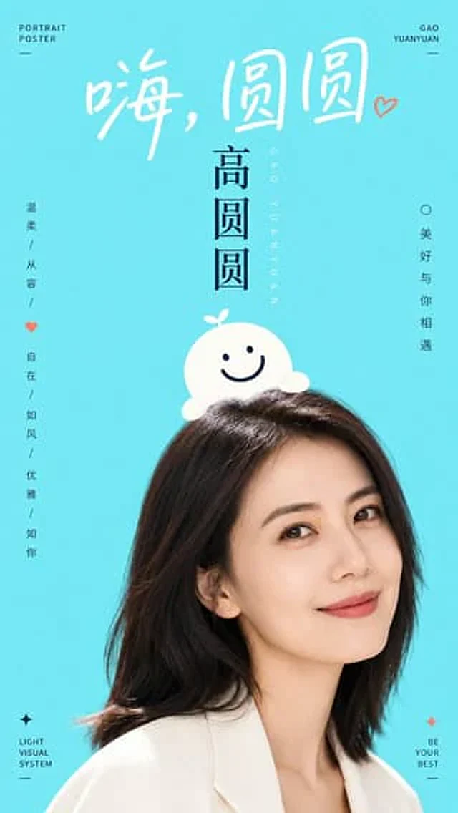

```text
围绕具体主题内容生成一张明亮清爽的图文合成视觉：画面以大面积高明度纯净色场承托主体，背景平整、通风、没有复杂景深，视觉重心由下方被大胆裁切的人像或真实主体建立，只露出最有记忆点的局部，使主体像从画面边缘进入。主体上方叠放一个极简图形符号或拟物角色，它要像轻轻坐在主体头顶或贴合轮廓生长出来，形体圆润、边缘干净、表情或结构由少量粗线完成，兼具标识感和亲近感。文字是画面的主动角色：顶部使用大号手写感标题，字距松、笔画柔软，像一句轻声招呼；中心用更强的竖向或轴向标题建立层级；边缘安放少量小字号信息，保持安静但精确，让空白继续占主导。色彩从主题自身的材质、情绪、地域或品牌语义中提取，映射为明亮底色、洁净主体亮面、清晰深色结构线与少量强调信息色，保留大面积轻快底场、小面积高对比文字线条、自然主体暗部的关系；整体保持高明度、清透、干净、饱和度清晰而不过度刺激，暗色只用于结构和阅读，不制造脏灰、烟雾或陈旧质感。摄影局部与扁平图形之间要形成真实与童趣的反差，边缘叠压准确，阴影极少，完成感像城市公共宣传与角色插画结合的轻松视觉系统。

主题：{argument name="主题" default="柳岩"}

比例9:16
```

Model: GPT Image 2
Author: 小小东

[ProjectD](https://aitoolsradar.com/en/prompts/70c0f5094b419f) · [Recorded source](https://youmind.com/prompts/clean-commercial-graphic-layout-24277)
 · [Full original metadata and byte evidence](data/projectd-batch-0025.json)

## Clean Japanese/Korean Style Photoshoot

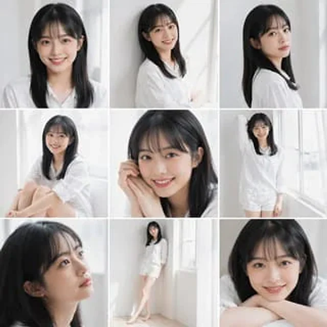

```text
Generates 3x3 grid mosaics, snapshots, and photographic portraits using facial features from reference images, with an 85mm lens. Features shallow depth of field, blurred background, high resolution, and sharp details. (Clothing){argument name="clothing" default="White shirt and white shorts"} A simple and clean outfit. Indoor photoshoot, white background wall, by the window, natural light, soft sunlight, high-key lighting, bright and clear, soft shadows.{argument name="style" default="Fresh Japanese style, Korean portrait style"} Airy, visually clean, minimalist style, multiple poses for shooting, including standing, sitting, looking back, close-up, half-body and full-body shots.
```

Model: GPT Image 2
Author: GPT Image 2 Prompts

[ProjectD](https://aitoolsradar.com/en/prompts/16e9a94323fd00) · [Recorded source](https://x.com/biteye_sister/status/2047574020997202198)
 · [Full original metadata and byte evidence](data/projectd-batch-0025.json)

## Clean Longjing Tea Infographic Upscale


```text
Using the provided reference image, redraw and upscale it into a cleaner, sharper, more polished version while preserving the same overall infographic layout, all original text content, and the Longjing tea theme. Keep the product title {argument name="tea name" default="龙井茶"} and the English subtitle {argument name="English tea name" default="Longjing Tea"} unchanged.

Goal: Make the image look less like a rough GPT-generated graphic by removing broken, noisy, meaningless textures and replacing them with crisp, intentional detail.

Enhancements to apply: Increase resolution and clarity; sharpen typography, icons, borders, tea leaves, glass, and card edges; make the lighting softer and more natural; improve material realism for the tea, cup, dried leaves, and ceramic dish; clean up any fuzzy or fragmented artifacts.

Meaningful detail additions: In the main hero panel, replace the vague pale background with a refined scenic tea plantation landscape of layered green terraces, misty mountains, and a wooden tabletop beneath the tea cup and plate. In the origin card, add a small matching tea-terrace landscape illustration at the bottom. Make the bottom green banner more vivid with a natural leaf-vein texture.

Layout constraints: Preserve exactly 7 visible content panels/sections: the large hero panel, origin card, features card, flavor card, brewing suggestion card, grade-and-picking card, and bottom slogan banner. Preserve exactly 4 feature rows in the features card, exactly 3 small icon benefits in the hero panel, and exactly 3 brewing parameter icons along the bottom of the brewing card. Do not add extra sections, extra labels, watermarks, logos, or decorative clutter.

Style: Elegant Chinese tea brochure design, cream-and-sage palette, refined minimal UI cards, soft shadows, crisp vector-like icons, realistic tea photography elements, calm premium product-advertising finish.
```

Model: GPT Image 2
Author: 歸藏(guizang.ai)

[ProjectD](https://aitoolsradar.com/en/prompts/efaec833e544d1) · [Recorded source](https://youmind.com/prompts/longjing-tea-infographic-upscale-26267)
 · [Full original metadata and byte evidence](data/projectd-batch-0025.json)

## Cloud AI Agent Architecture Diagram


```text
{
  "type": "Enterprise-grade cloud AI architecture infographic",
  "style": "A clean corporate vector graphic with a white background, a blue and cyan color palette, rounded rectangles, thin blue outlines, soft shadows, bilingual labels primarily in Chinese with smaller English subheadings, a symmetrical layout, and presentation-quality graphics.",
  "canvas": {
    "aspect_ratio": "4:3",
    "resolution": "1024x768"
  },
  "title_block": {
    "headline": "{argument name=\"headline text\" default=\"Cloud AI Agent Architecture Diagram\"}",
    "subtitle": "Cloud AI Agent Architecture for Cloud Task Execution, Code Collaboration, and Large-Scale Scheduling",
    "position": "top center"
  },
  "layout": {
    "center": {
      "type": "Stacked architecture layers",
      "count": 7,
      "numbered": true,
      "layers": [
        {
          "index": 1,
          "title": "Access and Experience Layer",
          "english": "access and experience layer",
          "count": 5,
          "items": [
            "Web Console",
            "IDE / CLI",
            "API / SDK",
            "Notifications via Slack/Email",
            "Task Kanban organization and project space"
          ]
        },
        {
          "index": 2,
          "title": "Cloud Control Plane",
          "english": "cloud control plane",
          "count": 6,
          "items": [
            "API Gateway",
            "Auth / Tenant",
            "Session Manager",
            "Project / Workspace Manager",
            "Task Queue",
            "Rate Limit / Billing"
          ]
        },
        {
          "index": 3,
          "title": "Agent orchestration layer",
          "english": "agent orchestration layer",
          "count": 8,
          "items": [
            "Planner / Task Planner",
            "Reasoner / Reasoning Engine",
            "Context Manager",
            "Memory / Memory System",
            "Prompt Builder",
            "Workflow Orchestrator",
            "Policy Engine",
            "Multi-Agent Coordinator"
          ]
        },
        {
          "index": 4,
          "title": "Execute runtime layer",
          "english": "execution runtime layer",
          "count": 8,
          "items": [
            "Sandbox Pool / Container Sandbox",
            "Browser / HTTP Tools",
            "Code Runner / Terminal",
            "Git Workspace",
            "Tool Adapters / MCP",
            "Scheduler / Worker",
            "Test Runner",
            "Artifact Executor / Patch & Diff"
          ]
        },
        {
          "index": 5,
          "title": "Model and Intelligent Service Layer",
          "english": "model and intelligence services layer",
          "count": 6,
          "items": [
            "Model Router",
            "Frontier LLM API",
            "Embedding / Reranker",
            "OCR / STT / TTS (optional)",
            "Evaluator / Reflection",
            "Third-party Agent / SaaS"
          ]
        },
        {
          "index": 6,
          "title": "Data and State Layer",
          "english": "data and state layer",
          "count": 8,
          "items": [
            "Relational DB",
            "Vector DB",
            "Redis Cache",
            "Session State",
            "Artifact Store",
            "Object Storage",
            "Configuration Center",
            "Logs and Audit Logs"
          ]
        },
        {
          "index": 7,
          "title": "Cloud infrastructure layer",
          "english": "cloud infrastructure layer",
          "count": 8,
          "items": [
            "Kubernetes / Container Orchestration",
            "Service Mesh",
            "Event Bus",
            "Secrets / KMS",
            "VPC / Network",
            "Autoscaling",
            "CI/CD",
            "Multi-regional disaster recovery (DR)"
          ]
        }
      ]
    },
    "left_sidebar": {
      "title": "Observability/SRE",
      "position": "left",
      "count": 6,
      "items": [
        "Monitoring",
        "Tracing",
        "Metrics",
        "Logs aggregation",
        "Cost and Quota",
        "Alerting"
      ]
    },
    "right_sidebar": {
      "title": "Security Management",
      "position": "right",
      "count": 6,
      "items": [
        "SSO / RBAC",
        "Keys and Secrets",
        "Strategy Guardrails",
        "Human Approval",
        "Audit Compliance",
        "Data Isolation"
      ]
    },
    "connectors": "The double-headed blue arrows connecting the sidebars to each central layer, and the vertical arrows between the architectural layers."
  },
  "visual_details": {
    "icons": "Each box contains a simple blue line icon, one icon per module.",
    "boxes": "White card with rounded corners against a light blue or light cyan background",
    "section_colors": {
      "layers_1_2_5_7": "light blue",
      "layer_3": "Light purple",
      "layer_4": "Light blue",
      "layer_6": "Light green",
      "sidebars": "Deep sapphire blue title bar, white text"
    },
    "typography": "Bold dark navy blue Chinese headings, smaller gray-blue subheadings, medium-weight Chinese section labels, and compact bilingual project labels."
  },
  "footer": {
    "position": "bottom center",
    "text": "{argument name=\"footer text\" default=\"Features: Cloud-native • Multi-tenant • Elastic scaling • Security and compliance • Human-machine collaboration • Task traceability • Support for multi-model and multi-agent collaboration\"}"
  },
  "quality": "Clear infographics, balanced layout, high readability; professional enterprise architecture diagrams suitable for Keynote, documents, and product marketing."
}
```

Model: GPT Image 2
Author: GPT Image 2 Prompts

[ProjectD](https://aitoolsradar.com/en/prompts/040370381d7d6d) · [Recorded source](https://x.com/breeze71115348/status/2046609528079212900#reversed-2)
 · [Full original metadata and byte evidence](data/projectd-batch-0025.json)

## Clumsy MS Paint Redraw Style

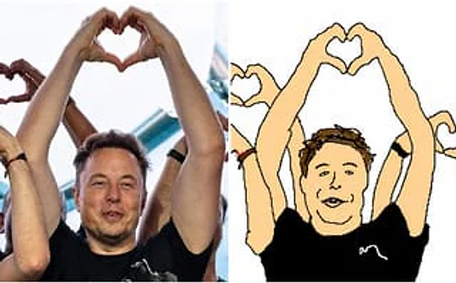

```text
用最笨拙、最潦草、最可悲的方式重新绘制这张图片。使用白色背景，让它看起来像是用滑鼠在 MS Paint 里画的。它应该隐约相似，但又不太像。有点对得上，但又莫名地偏差，带着那种低画质、一个像素一个像素慢慢画的感觉，真正强调出它究竟有多荒谬地糟糕。算了，你知道吗，随便啦，你想怎么画就怎么画吧。
```

Model: GPT Image 2
Author: 草莓🍓女の子

[ProjectD](https://aitoolsradar.com/en/prompts/6503178ab825cf) · [Recorded source](https://youmind.com/prompts/clumsy-ms-paint-redraw-style-17558)
 · [Full original metadata and byte evidence](data/projectd-batch-0025.json)

## Clumsy MS Paint Style Redraw

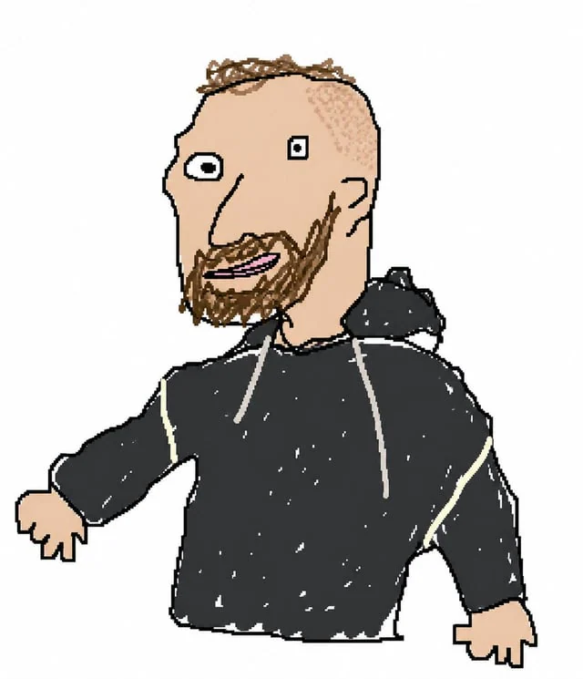

```text
Redibuja la imagen adjunta de manera torpe, garabateada y lo más absolutamente patética posible. Usa un fondo {argument name="color de fondo" default="blanco"}, y haz que parezca que fue dibujada en MS Paint con un ratón. Debería ser similar pero también distinta, algo así como coincidente pero desfasado de una manera confusa y torpe, con esa sensación de baja calidad píxel por píxel que realmente enfatiza lo ridículamente malo que es. En realidad, sabes qué, da igual, solo dibújalo como quieras.
```

Model: GPT Image 2
Author: Miguel Ángel | GptZone

[ProjectD](https://aitoolsradar.com/en/prompts/6993ae9d52e880) · [Recorded source](https://youmind.com/prompts/bad-ms-paint-style-redraw-17595)
 · [Full original metadata and byte evidence](data/projectd-batch-0025.json)

## Co-branded IP Ice Cream Design

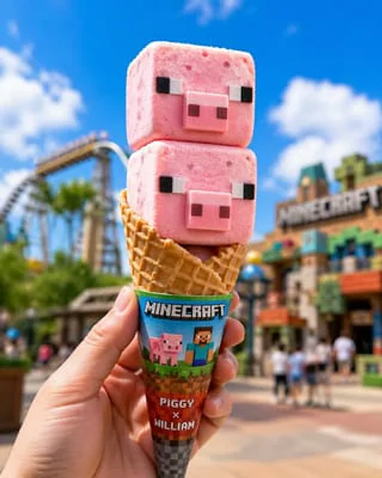

```text
William and Piggy-themed ice cream, pink square ice cream with pixelated eyes and a pig nose, strawberry flavor, served in a cone, a cute food design. The cone: a standard waffle cone, golden and crispy, with a "Minecraft" co-branded paper sleeve. The background is an outdoor theme park scene, with blue skies and white clouds, and brightly colored rides and buildings blurred in the background. The hand holding the ice cream is clearly visible, enhancing the realism of the "hands-on experience." The overall style is bright, fun, and playful, making it an eye-catching summer IP co-branded ice cream.
```

Model: GPT Image 2
Author: GPT Image 2 Prompts

[ProjectD](https://aitoolsradar.com/en/prompts/4b92bbdf956dc8) · [Recorded source](https://x.com/dotey/status/2047122720622538819)
 · [Full original metadata and byte evidence](data/projectd-batch-0025.json)

## Coastal Reinforced Concrete Salt Damage


```text
A hyper-realistic, documentary-style close-up photograph showcases severe chloride corrosion damage on a coastal reinforced concrete structure, taken from a slightly upward angle at the corner of a cantilever beam or pier. The image reveals a large area of ​​spalling at the outer corner, where the concrete cover has detached, precisely exposing five embedded, rusted horizontal reinforcing bars. The surrounding concrete is rough, cracked, and chipped, with irregular edges revealing the aggregate. Brownish-orange rust extends downwards from the exposed reinforcing bars and spreads along the base of the beam, indicating the long-term effects of salt damage. The concrete surface is light gray, weathered, and matte, with fine pores and construction flaws. The background features a calm blue sea and pale blue sky, with a blurred distant shore near the horizon; the soft blurring further emphasizes the marine environment. Bright natural light, clear weather, and a realistic smartphone photographic composition—no people, tools, safety railings, text, labels, or illustration style—present a credible photograph of a coastal reinforced concrete structure inspected for salt damage.
```

Model: GPT Image 2
Author: GPT Image 2 Prompts

[ProjectD](https://aitoolsradar.com/en/prompts/9281b51621b4a0) · [Recorded source](https://x.com/cncrt_ey/status/2046926139755839707#reversed-0)
 · [Full original metadata and byte evidence](data/projectd-batch-0025.json)

## Coca-Cola Magic Poster

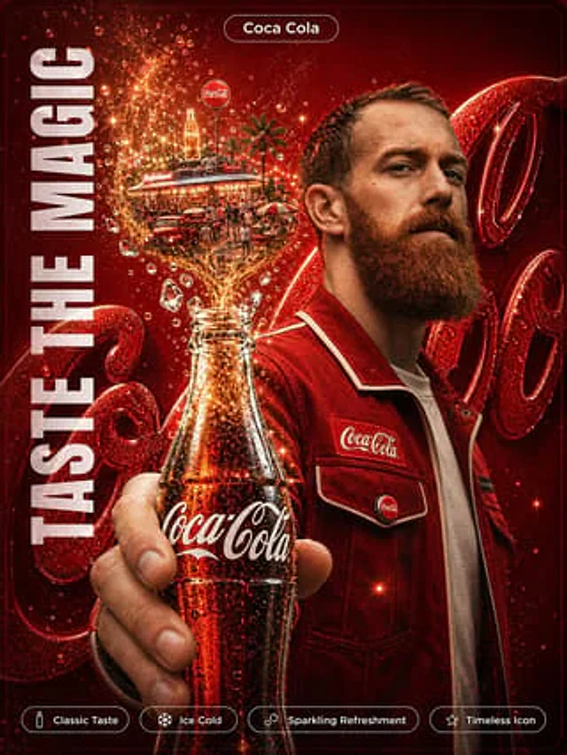

```text
{"type":"premium cinematic beverage advertisement poster","brand":"{argument name=\"brand name\" default=\"Coca Cola\"}","format":"vertical 4:5 social media poster with rounded-corner border, glossy high-contrast commercial art direction","palette":"deep Coca-Cola red, black shadows, bright white typography, golden amber soda highlights, sparkling orange light particles","main_subject":{"description":"a young adult male brand ambassador shown from chest up on the right side, wearing a red delivery-style denim jacket with white piping over a white shirt, embroidered Coca-Cola patch on the chest and a small round pin; his face is intentionally obscured by a flat opaque medium-brown square censor block covering the central face area, with visible ear, hairline, beard edge, neck, and jacket details","pose":"standing close to camera, body angled slightly left, holding a glass soda bottle forward toward the viewer in the lower center foreground","hand":"large realistic hand gripping the bottle neck and body, fingers in sharp detail"},"product":{"count":1,"item":"classic glass Coca-Cola bottle in the foreground, covered in condensation droplets and bubbles, filled with dark cola, white Coca-Cola script logo on the label, glowing amber carbonation rising from the open mouth","effect":"explosive stream of golden fizz, bubbles, droplets, ice-like shards, and sparkling particles bursting upward from the bottle opening"},"magical_scene_inside_fizz":{"description":"a miniature nostalgic Coca-Cola street-diner world forming in the fizz above the bottle: a lively red-and-white Coca-Cola roadside stand with people gathered around, small red vintage car, tables, umbrellas, palm trees, a bottle-shaped neon sign, and a round Coca-Cola sign, all surrounded by golden sparkles and floating bubbles","mood":"warm, festive, nostalgic, magical realism"},"background":{"description":"deep red glossy background with huge embossed Coca-Cola script letters partially visible behind the subject, red bubbles and condensation texture, star-like lens flares, subtle dark vignette, thin rounded rectangular border"},"typography_and_labels":{"left_slogan":{"text":"{argument name=\"slogan text\" default=\"TASTE THE MAGIC\"}","position":"large vertical text along the left edge","style":"bold condensed uppercase white letters with slight metallic texture and drop shadow"},"top_pill":{"text":"{argument name=\"top brand label\" default=\"Coca Cola\"}","position":"top center inside rounded pill outline","style":"white text on dark red transparent pill"},"bottom_feature_pills":{"count":4,"labels":["Classic Taste","Ice Cold","Sparkling Refreshment","Timeless Icon"],"position":"aligned along the bottom edge in four rounded outline buttons","icons":"small white line icons: bottle, snowflake, bubbles, star"}},"composition":"foreground bottle dominates lower center, magical fizz plume rises to upper left-center, ambassador occupies right half, vertical slogan anchors left side, background logo curves behind everything; dramatic depth of field, ultra-detailed condensation, glossy reflections, premium advertising finish","rendering_style":"photorealistic mixed with hyper-detailed fantasy miniature scene, sharp product photography, cinematic lighting, volumetric glow, high saturation, crisp typography, polished commercial poster quality","quality_notes":"make all visible text clean and legible, preserve the exact count of 4 bottom feature pills, no extra people outside the miniature fizz scene, no additional product variants"}
```

Model: GPT Image 2
Author: SaaS Junction ✦ Daily AI News & Prompts

[ProjectD](https://aitoolsradar.com/en/prompts/3f66f13ee7daaf) · [Recorded source](https://youmind.com/prompts/coca-cola-magic-poster-17897)
 · [Full original metadata and byte evidence](data/projectd-batch-0025.json)

## Coca-Cola Zipper Worlds Ad

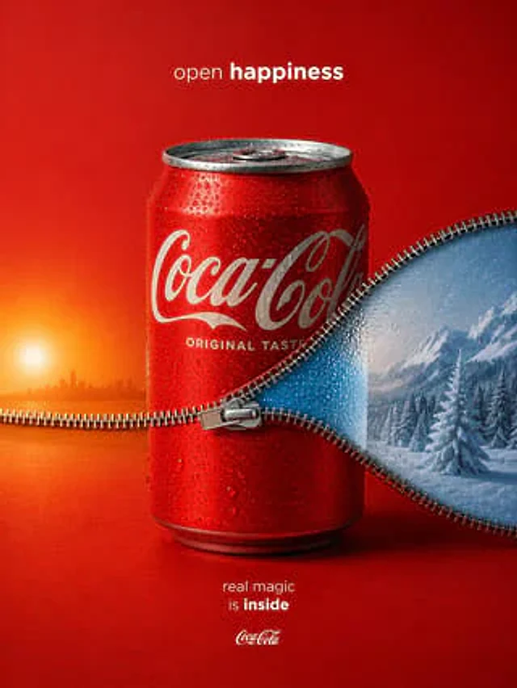

```text
Create a premium conceptual beverage advertisement for {argument name="brand name" default="Coca-Cola"} on a vertical 4:5 canvas. Center a chilled red aluminum soda can, front-facing, covered in realistic condensation droplets, with a silver pull tab and rim visible at the top and the classic white script logo across the can; include the smaller can text “ORIGINAL TASTE.” The background is a seamless saturated red studio backdrop with luxury commercial lighting and a soft product shadow. A large metallic zipper runs horizontally across the image and wraps around the can at mid-height, with detailed interlocking teeth and a central zipper pull in front of the can; the zipper opens the scene into two contrasting worlds: on the left, a warm orange sunset over a calm water horizon with a small distant city skyline silhouette, and on the right, a cool blue snowy alpine landscape with frosted pine trees and mountains. The zipper seam should curve organically like a wave, visually implying the can contains magical worlds inside. Add minimal white ad copy: at the top center write {argument name="top slogan" default="open happiness"}, with “happiness” in bold; near the bottom center write {argument name="bottom slogan" default="real magic is inside"}, with “inside” in bold; place a small white Coca-Cola logo beneath it. Use hyper-realistic FMCG product photography, crisp macro details, glossy reflections, balanced red-orange-blue color contrast, Apple-level minimalist composition, Cannes Lions conceptual advertising style, no extra objects, no people, no watermark.
```

Model: GPT Image 2
Author: jey jey ⚜️

[ProjectD](https://aitoolsradar.com/en/prompts/5a801287603cc6) · [Recorded source](https://youmind.com/prompts/coca-cola-zipper-ad-20982)
 · [Full original metadata and byte evidence](data/projectd-batch-0025.json)

## Cockatiel Owner Seed Spill Comic

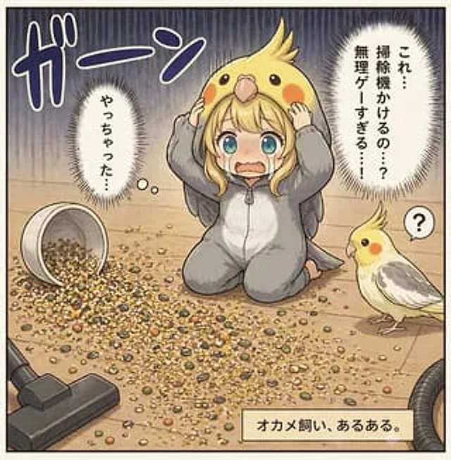

```text
This is a Japanese-style single-panel illustration against a light-colored wooden floor background. The illustration employs a soft, delicate, and slightly retro manga/anime style with clear lines and warm, gentle colors. In the center of the image, a young woman kneels on the ground, wearing a grey cockatiel onesie with a white belly and small grey wings. She wears an oversized yellow cockatiel headdress with crest feathers, round black eyes, orange cheek spots, and a beak above her forehead. She clutches the sides of the headdress tightly, her expression shocked, stiff, and filled with guilt. A large rectangular visor covers the center of her face. On the floor in front of her lies a mess of scattered birdseed: a haphazard pile of mixed grains, kernels, husks, and seeds. To the left, an overturned white seed cup overflows; in the lower left corner, a vacuum cleaner head points towards the mess, with part of the hose visible at the lower right edge. Standing on the right is a real cockatiel, small in size, with a curious expression, a yellow face, orange cheeks, a light-colored body, gray wings, and an upright crest, staring at the kneeling woman; next to the bird is a small speech bubble with a question mark. The background is a simple indoor floor, the upper half filled with exaggerated dark vertical pressure lines to enhance the sense of panic. Four Japanese elements incorporating manga fonts are added: a large onomatopoeic word "garn" in the upper left corner, a vertical inner monologue speech bubble on the left that reads "Yacchatta…", a large vertical spike-shaped speech bubble in the upper right corner that reads "Kore…shokuji kakeru no…？無理ゲーすぎる…！", and a beige description box in the lower right corner that reads "Okame-sui, aru aru." The overall atmosphere conveys a comedic awkwardness and family disaster, as if depicting a real mistake that a bird owner often makes.
```

Model: GPT Image 2
Author: GPT Image 2 Prompts

[ProjectD](https://aitoolsradar.com/en/prompts/374305b2f44ceb) · [Recorded source](https://x.com/lunarium09/status/2046969565117366769#reversed-0)
 · [Full original metadata and byte evidence](data/projectd-batch-0025.json)

## Cockatoo with a Comb-Over

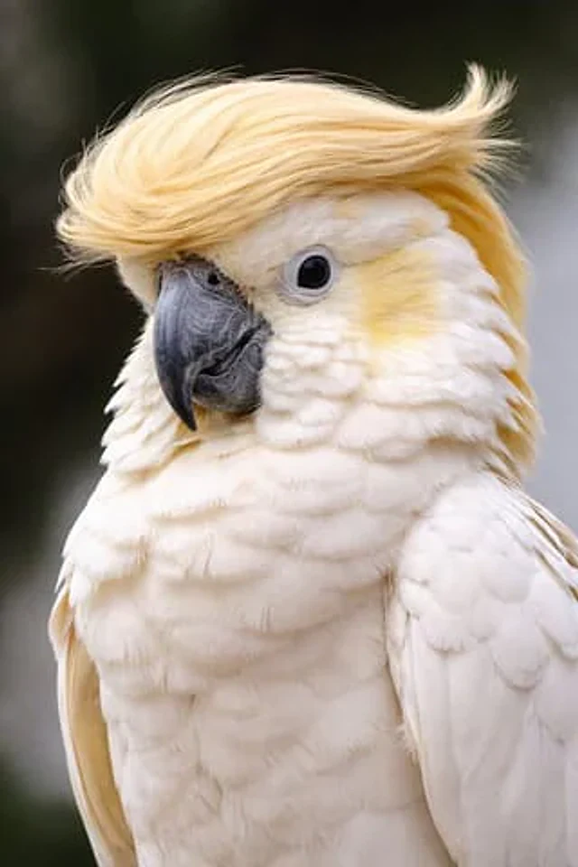

```text
A realistic style{argument name="bird species" default="White Cockatoo"} A close-up portrait, it retains a very unique and human-like quality.{argument name="hairstyle" default="Golden side-part hairstyle combed to one side"} The bird has pure white feathers, a pale yellow tinge to its face and neck, a dark gray beak, and bright, clear eyes. The soft, natural lighting accentuates the delicate texture of its feathers and the surreal, fluffy texture of its golden hair. The background is {argument name="background" default="A soft, out-of-focus natural environment, with tones of gentle greens and grays."} The shallow depth of field effect makes the visual focus entirely on the bird's comical appearance.
```

Model: GPT Image 2
Author: GPT Image 2 Prompts

[ProjectD](https://aitoolsradar.com/en/prompts/cb7181012e455b) · [Recorded source](https://x.com/ShidarezakuraSa/status/2045117893709611512#reversed-0)
 · [Full original metadata and byte evidence](data/projectd-batch-0025.json)

## Codex Product Update Poster


```text
{
  "type": "Product Update Marketing Poster",
  "style": "The SaaS landing page features clean, modern graphics, Apple-style minimalism, soft ambient gradients, subtle shadows, rounded cards, a crisp vector UI, and high-end promotional design.",
  "brand": "OpenAI",
  "canvas": {
    "aspect_ratio": "2:3 Vertical Version",
    "background": "Very light cool gray with a subtle lavender blue gradient, rounded corners on the outer frame."
  },
  "layout": {
    "sections": [
      {
        "title": "Top of screen",
        "position": "top",
        "count": 4,
        "labels": [
          "OpenAI logo",
          "Product Update",
          "Main title",
          "Subtitle"
        ]
      },
      {
        "title": "Main display panel",
        "position": "Central",
        "count": 3,
        "labels": [
          "Codex Task Cards",
          "Work list cards",
          "Dark Analysis Dashboard Preview"
        ]
      },
      {
        "title": "Function cards",
        "position": "Mid-lower part",
        "count": 4,
        "labels": [
          "Facing more challenges",
          "Default security",
          "Compatible with existing tools",
          "Building for the team"
        ]
      },
      {
        "title": "Action call banner",
        "position": "bottom",
        "count": 3,
        "labels": [
          "Codex is now available.",
          "Try it in ChatGPT or the API.",
          "Arrow button"
        ]
      }
    ],
    "centerpiece": "There is a large floating rounded square icon near the top right corner, with black code bracket symbols."
  },
  "content_blocks": {
    "eyebrow": "{argument name=\"eyebrow text\" default=\"Product Update\"}",
    "headline_line_1": "{argument name=\"headline line 1\" default=\"Codex, empowering\"}",
    "headline_line_2": "{argument name=\"headline line 2\" default=\"Everything is possible\"}",
    "subheadline": "{argument name=\"subheadline\" default=\"From small fixes to large feature development, Codex helps you deliver faster.\"}",
    "cta_title": "{argument name=\"call to action title\" default=\"Codex is now available.\"}"
  },
  "visual_details": {
    "logo": "Small black OpenAI knot logo in the top left corner",
    "headline": "The left side features a large, bold, sans-serif title; the first line is black, and the second line is blue-purple gradient text.",
    "subheadline_style": "Medium gray sans-serif font, two lines below the title",
    "floating_icon": "A white, rounded square tile with a soft shadow, containing black &lt;&gt; code symbols, placed in the upper right corner.",
    "showcase_panel": "Large white rounded rectangle with thin border and soft shadow.",
    "left_task_area": {
      "count": 3,
      "items": [
        "Small capsule labels with code icons and the text \"Codex\"",
        "A white notification card reads: Add dark mode to the dashboard and update the settings page.",
        "Status listing titled \"Codex is running...\""
      ]
    },
    "checklist": {
      "count": 4,
      "items": [
        "Understand the codebase (check the purple box)",
        "Enable dark mode (check the purple box).",
        "Update settings page (Activation/In Progress, with partial circular indicators)",
        "Run test (not checked, grayed out)"
      ]
    },
    "right_dashboard": {
      "theme": "Dark Mode UI Preview",
      "app_name": "Acme",
      "sidebar": {
        "count": 4,
        "items": [
          "Overview (selected)",
          "analyze",
          "project",
          "set up"
        ]
      },
      "main_panels": {
        "count": 3,
        "items": [
          "Overview Title",
          "Active users metric: 8,421, shown in green (+12.5%) and purple line chart.",
          "A list of recent activities containing 3 records."
        ]
      },
      "recent_activity": {
        "count": 3,
        "items": [
          "Updated landing page — 2 minutes ago",
          "Fixed analysis bugs — 1 hour ago",
          "Optimize the onboarding process — 3 hours ago"
        ]
      }
    },
    "feature_cards": {
      "count": 4,
      "cards": [
        {
          "title": "Facing more challenges",
          "icon": "Purple glitter/star icon in a light lavender rounded square",
          "body": "From bug fixing to multi-file refactoring, Codex can handle it all."
        },
        {
          "title": "Default security",
          "icon": "Blue shield icon in light blue rounded square",
          "body": "When running in a sandbox environment, it is read-only by default."
        },
        {
          "title": "Compatible with existing tools",
          "icon": "Green terminal icon in a light mint-colored rounded square",
          "body": "Integrate with GitHub, CI, and your existing workflows."
        },
        {
          "title": "Building for the team",
          "icon": "Pink group/user icon in light pink rounded square",
          "body": "Share the context, review changes, and accelerate progress together."
        }
      ]
    },
    "cta_banner": {
      "style": "A wide, rounded rectangle with a soft purple-blue gradient background, and a white circular arrow button on the right.",
      "subtitle": "Try it in ChatGPT or the API."
    }
  },
  "composition": "The balanced left-aligned layout, the modular card grid at the bottom, the ample white space, and the high-end, tech-advertising feel all contribute to a sophisticated and high-tech advertising aesthetic.",
  "rendering": "Sharp typography, subtle sense of depth, soft glass-like lighting effects, no photographic elements."
}
```

Model: GPT Image 2
Author: GPT Image 2 Prompts

[ProjectD](https://aitoolsradar.com/en/prompts/adea47c8f4f299) · [Recorded source](https://x.com/op7418/status/2046502136973001143#reversed-1)
 · [Full original metadata and byte evidence](data/projectd-batch-0025.json)

## Codex Product Update Poster


```text
{"type":"product update marketing poster","style":"clean modern SaaS landing-page graphic, Apple-like minimalism, soft ambient gradients, subtle shadows, rounded cards, crisp vector UI, high-end promotional design","brand":"OpenAI","canvas":{"aspect_ratio":"2:3 vertical","background":"very light cool gray with faint lavender-blue glow gradients, rounded outer frame corners"},"layout":{"sections":[{"title":"header hero","position":"top","count":4,"labels":["OpenAI logo","PRODUCT UPDATE","main headline","supporting subheadline"]},{"title":"main showcase panel","position":"middle","count":3,"labels":["Codex task card","working checklist card","dark analytics dashboard preview"]},{"title":"feature cards","position":"lower middle","count":4,"labels":["Tackle more","Safe by default","Works with your tools","Built for teams"]},{"title":"call to action banner","position":"bottom","count":3,"labels":["Codex is available now","Try it in ChatGPT or the API.","arrow button"]}],"centerpiece":"large floating rounded square icon near the upper right with black code brackets symbol"},"content_blocks":{"eyebrow":"{argument name=\"eyebrow text\" default=\"PRODUCT UPDATE\"}","headline_line_1":"{argument name=\"headline line 1\" default=\"Codex for\"}","headline_line_2":"{argument name=\"headline line 2\" default=\"almost everything\"}","subheadline":"{argument name=\"subheadline\" default=\"From small fixes to large features, Codex helps you ship faster.\"}","cta_title":"{argument name=\"call to action title\" default=\"Codex is available now\"}"},"visual_details":{"logo":"small black OpenAI knot logo at top left","headline":"very large bold sans-serif headline on left, first line black, second line blue-to-purple gradient text","subheadline_style":"medium gray sans-serif, two lines under headline","floating_icon":"white rounded square tile with soft shadow, containing black <> code symbol, placed upper right","showcase_panel":"large white rounded rectangle with thin border and soft shadow","left_task_area":{"count":3,"items":["small pill label with code icon and text Codex","white prompt card reading Add dark mode to the dashboard and update the settings page.","status checklist titled Codex is working..."]},"checklist":{"count":4,"items":["Understand codebase checked in purple","Implement dark mode checked in purple","Update settings page active/in progress with partial circular indicator","Run tests unchecked in gray"]},"right_dashboard":{"theme":"dark mode UI preview","app_name":"Acme","sidebar":{"count":4,"items":["Overview selected","Analytics","Projects","Settings"]},"main_panels":{"count":3,"items":["Overview heading","Active Users metric 8,421 with green +12.5% and purple line chart","Recent Activity list with 3 entries"]},"recent_activity":{"count":3,"items":["Update landing page — 2m ago","Fix analytics bug — 1h ago","Improve onboarding flow — 3h ago"]}},"feature_cards":{"count":4,"cards":[{"title":"Tackle more","icon":"purple sparkle/star icon in a pale lavender rounded square","body":"From bug fixes to multi-file refactors, Codex handles it."},{"title":"Safe by default","icon":"blue shield icon in a pale blue rounded square","body":"Runs in a sandboxed environment with read-only by default."},{"title":"Works with your tools","icon":"green terminal prompt icon in a pale mint rounded square","body":"Integrates with GitHub, CI, and your existing workflows."},{"title":"Built for teams","icon":"pink group/users icon in a pale pink rounded square","body":"Share context, review changes, and move faster together."}]},"cta_banner":{"style":"wide rounded rectangle with soft purple-blue gradient wash and white circular arrow button on the right","subtitle":"Try it in ChatGPT or the API."}},"composition":"balanced left-aligned typography with modular card grid below, lots of whitespace, premium tech advertisement look","rendering":"sharp typography, subtle depth, gentle glassy lighting, no photographic elements"}
```

Model: GPT Image 2
Author: 歸藏(guizang.ai)

[ProjectD](https://aitoolsradar.com/en/prompts/da2a583aaf20f7) · [Recorded source](https://youmind.com/prompts/product-update-poster-14666)
 · [Full original metadata and byte evidence](data/projectd-batch-0025.json)

## Cognitive bias Instagram infographic

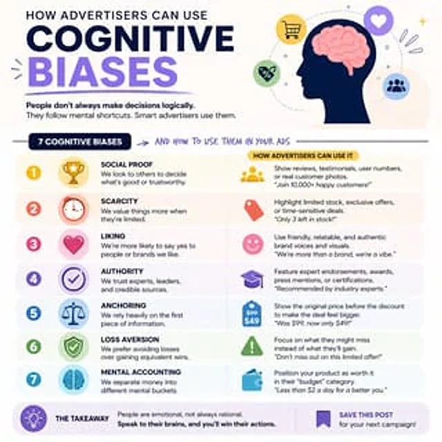

```text
for{argument name="platform" default="Instagram posts"} Create{argument name="format" default="Infographic"} The theme is{argument name="topic" default="How advertisers exploit cognitive biases"}
```

Model: GPT Image 2
Author: GPT Image 2 Prompts

[ProjectD](https://aitoolsradar.com/en/prompts/5a595d0ecbee06) · [Recorded source](https://x.com/maxwellfinn/status/2046739223001309256)
 · [Full original metadata and byte evidence](data/projectd-batch-0025.json)

## Cold Brew Bottle in Ice Bath


```text
A frosted glass bottle of dark cold brew coffee half-submerged in a shallow stainless steel bowl filled with crushed ice and a few visible water droplets running down the bottle. Cool blue daylight from above, refreshing summer mood, square 1:1 composition. Background is a soft blurred cool grey concrete surface. No brand text on the bottle, no logo, no watermark. Photorealistic condensation droplets, sharp ice texture, premium beverage product photography.
```

Model: GPT Image 2
Author: @hiapi_ai

[ProjectD](https://aitoolsradar.com/en/prompts/545d8cd75dd335) · [Recorded source](https://github.com/HiAPIAI/awesome-gpt-image-2-prompts)
 · [Full original metadata and byte evidence](data/projectd-batch-0025.json)

## Cold Ethereal Chinese Fairy Portrait

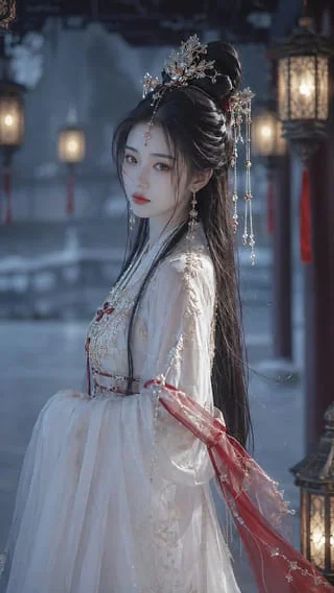

```text
9:16竖版，高精度古风仙侠女性精修写真，清冷仙气风格，唐风幻想审美，华丽古偶女主妆造，整体气质清冷、神秘、克制、疏离，具有冷白空灵、高级静谧的古风仙侠美人图完成度。画面主体是一位{argument name="年龄" default="20–28岁"}年轻成年东方女性，具有明确自然的东方女性特征... (full text content extracted)
```

Model: GPT Image 2
Author: 李岳

[ProjectD](https://aitoolsradar.com/en/prompts/d9ec915bc7d842) · [Recorded source](https://youmind.com/prompts/cold-ethereal-chinese-princess-portrait-23314)
 · [Full original metadata and byte evidence](data/projectd-batch-0025.json)

## Colored Manga Romance Comedy Page

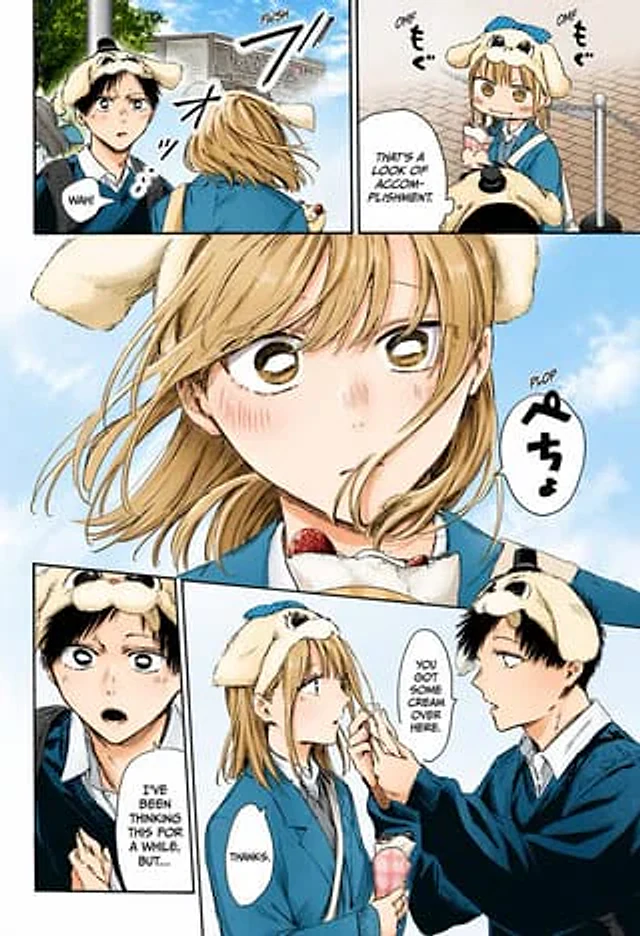

```text
A beautifully illustrated, full-color comic strip in a modern romantic comedy style, presented in a six-panel layout with a clear black border on a white background. The scene is set outdoors in a sunny setting, featuring a blue sky, soft clouds, shady trees, a paved path, and queuing pillars with chain railings. The protagonist is a teenage anime girl with a short, flowing blonde bob, large, golden-brown eyes, and a slight blush. She wears a cream-colored, fluffy, dog-eared hat with blue polka-dot details, a blue school uniform-style cardigan or blazer, a white shirt, and a red patterned tie, and holds a pink spiral soft serve ice cream. A boy in a dark blue sweater and a white collared shirt appears in three panels; his face is softly blurred with rectangles, and he also wears a matching dog-eared hat. The page should contain six panels: two small panels at the top, a large, wide-angle close-up panel in the middle, and three panels at the bottom. Top Left: A boy faces forward, a girl suddenly turns to him, her hair and hat fluttering in the air. The background is an outdoor scene with signs, accompanied by hand-drawn black comic book sound effects. Top Right: A chibi-style girl stands beside a chain railing, her expression a mix of smugness and panic, holding an ice cream cone. A speech bubble reads "THAT'S A LOOK OF ACCOMPLISHMENT." Small floating sound effects appear near her head. Center: A dramatic close-up portrait of a girl facing a blue sky, her hair blowing across her face, a strand brushing her lips, her earmuff hat clearly visible, her gaze calm yet astonished. A vertical speech bubble on the right contains Japanese text, accompanied by a small English sound effect saying "PLOP." Bottom Left: A boy with a blurred face is speaking, a speech bubble reading "I'VE BEEN THINKING THIS FOR A WHILE, BUT...". Bottom middle panel: A girl's profile view, one hand raised to her mouth, the other holding a pink ice cream cone, with a speech bubble reading "THANKS." Bottom right panel: A boy reaches towards the girl's mouth or cheek, as if wiping away cream, with a speech bubble reading "YOU GOT SOME CREAM OVER HERE." Incorporate all visible comic book text and sound effects into the artwork, including "WAH!", "FWSH," and English dialogue. Use exquisite comic book coloring on the ink line art: soft cel shadows, slightly textured watercolor fills, warm skin tones, glossy eyes, delicate hatching details, and expressive lines. Emphasize romantic tension, the dynamism of the wind, and the contrast between chibi-style comedic reactions and dramatic close-ups.
```

Model: GPT Image 2
Author: GPT Image 2 Prompts

[ProjectD](https://aitoolsradar.com/en/prompts/4915146653ae75) · [Recorded source](https://x.com/Kokoboy886711/status/2046787515433316810#reversed-1)
 · [Full original metadata and byte evidence](data/projectd-batch-0025.json)

## Colored Shonen Manga Battle Page

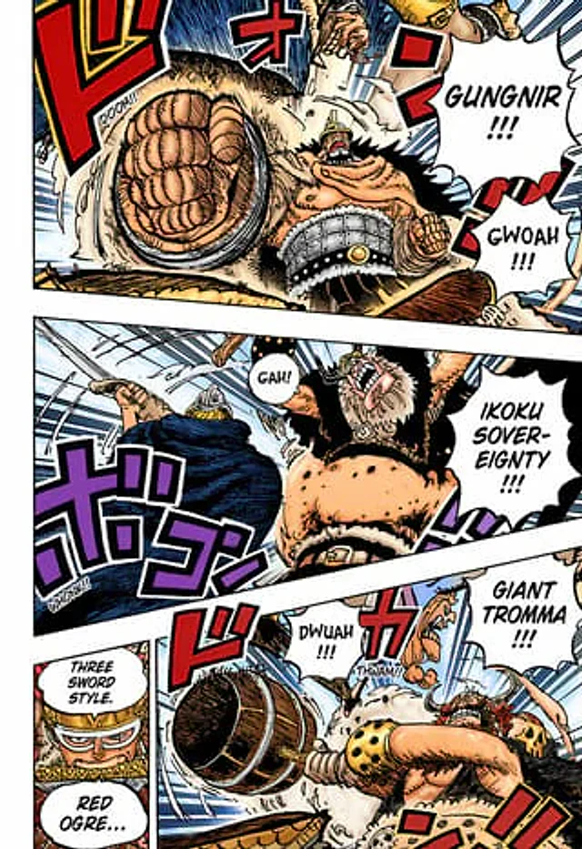

```text
A full-color shonen manga action page, presented in a high-energy pirate battle manga style, this single-page comic features four clearly defined panels separated by wide white gaps and slightly slanted borders. It utilizes bold black ink lines, dense hatching, speed lines, cel-shaded coloring, dramatic perspective shortening, and exaggerated impact effects. The scene depicts a muscular, towering giant warrior with bronze skin, a horned helmet, wild black hair and beard, black fur-trimmed clothing, and a wide studded metal belt. He wields a massive, spiked wooden club and is fighting a swordsman dressed in dark blue clothing and wearing an armored headdress. The top panel features an extreme close-up shot of a massive fist swinging towards the viewer with a strong sense of perspective, the giant shouting "GUNGNIR!!!" in a jagged speech bubble, and another speech bubble reading "GWOAH!!!". Large red Japanese onomatopoeia and a small "DOOM!!" impact text are also added. The wide central panel depicts the giant swinging upwards and roaring "IKOKU SOVEREIGNTY!!!", while his blue-clad opponent on the left retreats; it includes a speech bubble that reads "GAH!", along with a large purple Japanese onomatopoeia and a small "WHONK!!". The narrow lower left panel features a cropped close-up of two stacked speech bubbles that read "THREE SWORD STYLE." and "RED OGRE…", with the speaker mostly off-screen and partially obscured. The large lower right panel shows the giant swinging a massive spiked club across the screen, delivering a powerful horizontal strike while shouting "GIANT TROMMA!!!"; it includes smaller impact speech bubbles that read "DWUAH!!!" and "THWAM!!", along with an oversized red Japanese onomatopoeia. The background is predominantly pale sky blue with strong lines of motion and flying debris. It retains the texture of a professional color weekly comic book page: saturated reds, blues, and purples, bronze skin tones, cream fur textures, black shadows, and crisp white speech bubbles with handwritten comic text.
```

Model: GPT Image 2
Author: GPT Image 2 Prompts

[ProjectD](https://aitoolsradar.com/en/prompts/e11bf347b29a1a) · [Recorded source](https://x.com/Kokoboy886711/status/2046787515433316810#reversed-2)
 · [Full original metadata and byte evidence](data/projectd-batch-0025.json)

## Colorful Kimono Kemonomimi Festival

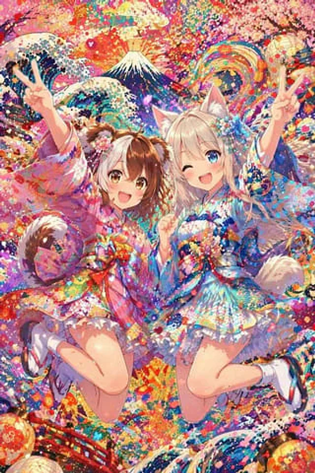

```text
This is an incredibly detailed and vibrant illustration of an anime festival. At the center of the image are two kemonomimi (animal-eared girls) leaping joyfully in mid-air, the composition positioned at a high vertical angle. The girl on the right is a cheerful catgirl with platinum blonde hair, large, fluffy cat ears, bright blue eyes, one blinking, and a radiant smile. She wears a vibrant blue floral kimono-style skirt with oversized sleeves, a layered white ruffled petticoat, a large colorful obi (waistband bow), floral hair accessories, white socks, and wooden clogs. A fluffy, light-colored tail is faintly visible behind her. Her right hand is raised in a peace sign, while her left hand is close to her chest. The girl on the left is a doggirl with medium brown hair, fluffy brown and white dog ears, and a curly, fluffy tail. She wears a vibrant pink and magenta floral kimono-style skirt with layered ruffles, a large decorative obi bow, floral hair accessories, white socks, and sandals. She is also leaping, one hand raised in a peace sign. The girl's face on the left is deliberately obscured by soft, rectangular blurs. The background is a Japanese scene full of explosive fantasy, rich in detail: Mount Fuji is at the top center, bathed in the brilliant sunrise, surrounded by a huge rainbow arc on the right, with stylized "The Great Wave off Kanagawa" style waves on both sides, and lush pink cherry blossoms overhead. There are two glowing paper lanterns in the upper left and upper right corners, and two more in the lower left and lower right corners. There is also a red arched bridge in the lower left corner. Using saturated candy colors of pink, cyan, blue, gold, orange, purple, and white, almost every surface is covered with confetti-like petals, shimmering particles, paint splatters, and intricate floral patterns. The overall atmosphere is festive, cute, ecstatic, and full of holiday spirit, with dynamic perspective effects, clear lines, glossy highlights, and layered textures, presenting a highly refined gacha game card art style.
```

Model: GPT Image 2
Author: GPT Image 2 Prompts

[ProjectD](https://aitoolsradar.com/en/prompts/279619fecc6e8c) · [Recorded source](https://x.com/Crystal_Lumine/status/2047160512367227229#reversed-0)
 · [Full original metadata and byte evidence](data/projectd-batch-0025.json)

## Colorful Royal Sunrise Palace Scene


```text
Colorful Royal Scene (8K) A majestic king and queen standing together in front of a magnificent golden palace at sunrise, wearing luxurious royal robes embroidered with gold and precious gemstones, elegant crowns sparkling with diamonds, colorful flower gardens, majestic white peacocks, glowing fountains, cinematic lighting, ultra-detailed faces, realistic textures, vibrant colors, fantasy realism, volumetric light, masterpiece composition, HDR, 8K, hyper-realistic, ultra-sharp focus. Dark Royal Scene (8K) A powerful king and queen standing on the balcony of a dark gothic castle during a thunderstorm, black and crimson royal outfits, ancient jeweled crowns, flowing capes, glowing torches, lightning illuminating the sky, ravens flying overhead, dramatic shadows, mysterious atmosphere, cinematic dark fantasy, ultra-realistic facial details, volumetric fog, high contrast, HDR, masterpiece, hyper-detailed, ultra-sharp, 8K quality.
```

Model: GPT Image 2
Author: Zyra AI

[ProjectD](https://aitoolsradar.com/en/prompts/f0c030e6396ce0) · [Recorded source](https://youmind.com/prompts/royal-sunrise-palace-fantasy-scene-27429)
 · [Full original metadata and byte evidence](data/projectd-batch-0025.json)

## Colorized Soccer Manga Page


```text
A full-color comic strip, employing a dramatic sports comic style, depicts an intense football match inside a large domed stadium, with the stands presented in a blue and white color scheme. Sharp ink lines, dense hatching, halftone paper textures, dynamic speed lines, and vibrant anime coloring create the effect of a professionally colored black-and-white comic strip. The composition is a three-panel layout: a large main panel occupying most of the page, and two narrow, diagonally recessed panels stacked on the left. The main panel shows a view of the penalty area and goal from a high sideline perspective, presenting a steep, wide-angle view where the green grass is stretched due to perspective and filled with directional hatching. Six players are visible in the main panel: four in blue jerseys, two in white jerseys, and a goalkeeper in a yellow jersey. The most prominent player is located in the lower right center, with his back to the camera, wearing a blue jersey printed with "HUGO" and the number 9, running towards the playing area with one arm outstretched. Near his lower right edge, another player wearing a white jersey with "ISAGI" and the number 11 is shown, also running forward. In the mid-shot, four more players are shown vying for possession: three in blue jerseys and one in white, with one in white diving horizontally towards the center from the right. The goal is located near the center in the upper left, with a yellow goalkeeper poised at the net. Add three speech bubbles to the main storyboard—large white cartoon bubbles with handwritten capital English text: "BUT I WANT TO WIN THE WORLD CUP...", "...AS THE SECOND-BEST AND AS A MID-FIELDER.", and "...THE WORLD RECORD FOR MOST TIMES WINNING THE WORLD CUP...". Create two diagonal storyboards in the left-side embedded area. The upper panel features a close-up of a dark-haired character in a blue jersey, with the face and center of the torso softly blurred by a rectangular blur, accompanied by a small speech bubble that reads "YOICHI ISAGI, DID YOU KNOW...". The lower panel shows a close-up of a red-haired character with large blue eyes, sweat on their face against a light blue background, their expression one of surprise or shock. The overall design maintains bold black panel borders, dramatic perspective shortening, and a high-energy tournament atmosphere. It uses a blue, green, white, and yellow color scheme with strong contrast and authentic comic book page coloring aesthetics.
```

Model: GPT Image 2
Author: GPT Image 2 Prompts

[ProjectD](https://aitoolsradar.com/en/prompts/fef3ab611d7efd) · [Recorded source](https://x.com/Kokoboy886711/status/2046787515433316810#reversed-3)
 · [Full original metadata and byte evidence](data/projectd-batch-0025.json)

## Colorized Soccer Manga Page

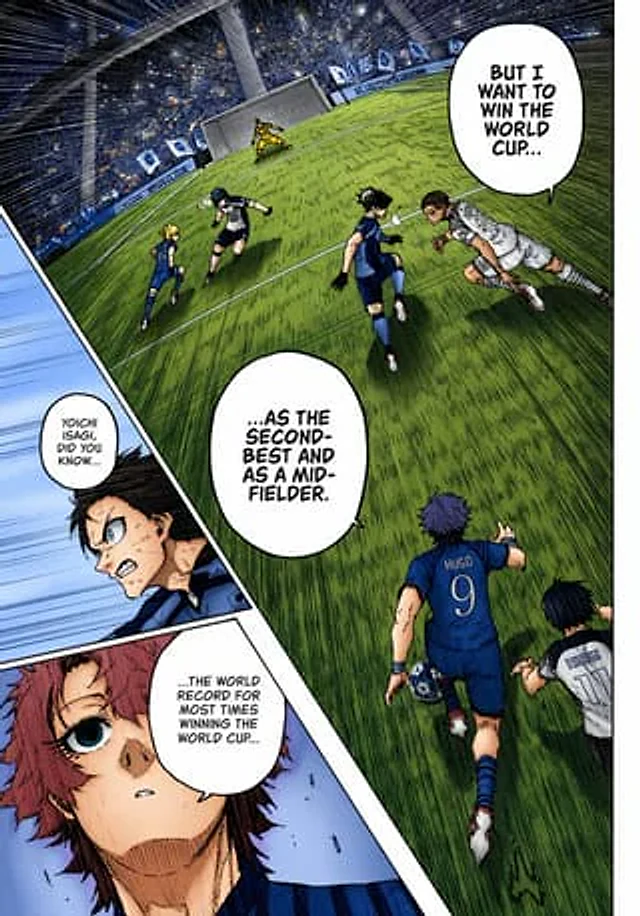

```text
A full-color manga page in the style of a dramatic sports manga, showing an intense soccer match inside a huge domed stadium packed with a blue-and-white crowd. Use sharp ink lines, dense crosshatching, screentone texture, dynamic speed lines, and vivid anime coloring as if a black-and-white manga page has been professionally colorized. The composition is a single page with 3 panels: 1 large main panel covering most of the page, plus 2 narrow diagonal inset panels stacked along the left side. In the main panel, show a steeply tilted wide-angle view of the penalty area and goal from an elevated sideline perspective, with the green grass stretched by perspective and filled with directional hatching. Count 6 visible players in the main panel: 4 blue-uniform players and 2 white-uniform players, plus 1 goalkeeper in yellow at the goal. The most prominent player is seen from behind in the lower center-right wearing a blue jersey with “HUGO” and the number 9, running toward the play with one arm extended. Near him on the lower right edge, show another player in a white jersey labeled “ISAGI” with the number 11, also running forward. In the midground, show 4 more field players contesting the ball: 3 in blue and 1 in white, with one white-uniform player diving or lunging horizontally from the right toward the center. The goal stands near the top center-left, with the yellow goalkeeper bracing in front of the net. Add 3 speech bubbles in the main panel, large white manga balloons with hand-lettered uppercase English text: “BUT I WANT TO WIN THE WORLD CUP...”, “...AS THE SECOND-BEST AND AS A MID-FIELDER.”, and “...THE WORLD RECORD FOR MOST TIMES WINNING THE WORLD CUP...”. In the left-side inset area, create 2 diagonal panels. The upper inset panel shows a close-up of a dark-haired character in blue, partly obscured by a soft rectangular blur over the center of the face and torso area, with a small speech bubble that says, “YOICHI ISAGI, DID YOU KNOW...”. The lower inset panel shows a close-up of a reddish-haired character with a wide blue eye, sweat on the face, and a pale blue background, looking surprised or stunned. Maintain bold black panel borders, dramatic foreshortening, and a high-energy tournament atmosphere. Use a blue, green, white, and yellow palette with strong contrast and authentic manga-page coloring aesthetics.
```

Model: GPT Image 2
Author: Kokoboy

[ProjectD](https://aitoolsradar.com/en/prompts/9f6c5299613729) · [Recorded source](https://youmind.com/prompts/colorized-soccer-manga-page-15007)
 · [Full original metadata and byte evidence](data/projectd-batch-0025.json)

## Colossal Labyrinth Woman Monument

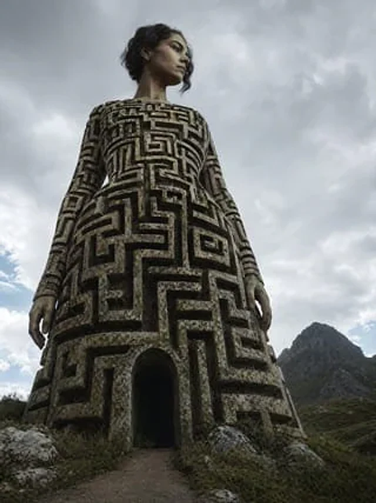

```text
A surreal, dark fantasy-style realistic scene depicts a colossal female humanoid statue standing amidst a rugged mountain landscape. The high-angle, low-angle shot creates a sense of tension, making the statue appear to soar into the clouds. The statue's body features a massive, bell-shaped skirt, its surface completely covered with deeply carved labyrinthine patterns, like an ancient labyrinth sculpted from weathered stone and concrete, its surface covered in moss, grime, erosion, and the marks of time. At the center of the skirt's base, an arched entrance leads into the darkness, through which a narrow dirt path leads, making the statue appear as a habitable monument. The statue's arms hang naturally, its slender neck rising from above the structure, its head slightly turned to the side; it features short, wavy black hair, and facial details are partially obscured. The monument is surrounded by rocks, sparse alpine shrubs, and uneven ground. A steep, rocky peak is added to the right of the background. The sky is filled with heavy, somber storm clouds in a soft gray hue, creating a melancholic and ominous atmosphere. Color palette: cool grays, charcoal grays, stone beige, moss greens, and soft earth tones. Lighting should be natural, diffused overcast light with soft shadows. Style: hyper-realistic cinematography, grand scale, eerie surreal architecture, ancient labyrinthine temples integrated with female statues, highly detailed textures, and vertical composition.
```

Model: GPT Image 2
Author: GPT Image 2 Prompts

[ProjectD](https://aitoolsradar.com/en/prompts/86e2ee12ca4c19) · [Recorded source](https://x.com/MuratAykul/status/2047760031186104358#reversed-0)
 · [Full original metadata and byte evidence](data/projectd-batch-0025.json)

## Comic Book Cover with Obi Prompt

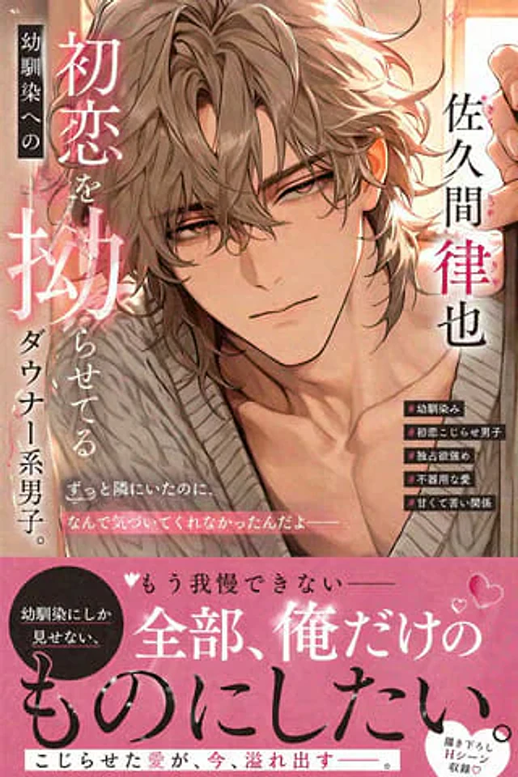

```text
Create a 2:3 scale TL comic book cover with a belly band. His name is {argument name="name" default="[name]"} Place the tagline and features on the cover. Include the killer phrase (…).{argument name="killer phrase" default="If you have already decided, please fill in this field; otherwise, leave it blank."} Placed on the waistband. His character is "{argument name="personality and traits" default="Briefly describe the personality and characteristics in the image."} ".
```

Model: GPT Image 2
Author: GPT Image 2 Prompts

[ProjectD](https://aitoolsradar.com/en/prompts/d21ae3b90b1d67) · [Recorded source](https://x.com/Lilium907stella/status/2047426589944881389)
 · [Full original metadata and byte evidence](data/projectd-batch-0025.json)

## Comic Book Page Layout

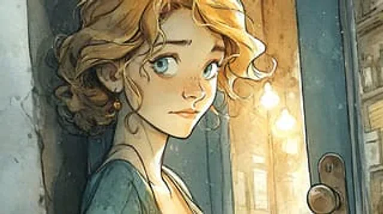

```text
Comic page layout{argument name="aspect ratio" default="3:4"} Proportion. Title:{argument name="title" default="5 tips for having a great Friday"} Five panels, with the character remaining consistent throughout. Warm, soft lighting. Panel 1: The character drinks coffee by the window, bathed in golden morning light. Title: "Friday mornings are for breathing. The rest can wait." Panel 2: The character texts a friend, a genuine smile on their face. Title: "A kind word can sustain someone through the whole weekend." Panel 3: The character paints or creates, immersed in the present moment. Title: "You don't need to finish it right away. You just need to start." Panel 4: The character walks outdoors, hands in pockets, looking up at the trees and sky. Title: "The world is still beautiful. You just need to look up." Panel 5: The character's expression is serene, soft lighting, a quiet smile. Title: "You've had another fulfilling week. That's enough. That's all."
```

Model: GPT Image 2
Author: GPT Image 2 Prompts

[ProjectD](https://aitoolsradar.com/en/prompts/87b0ec5797db98) · [Recorded source](https://x.com/nimentrix/status/2047529500137980203)
 · [Full original metadata and byte evidence](data/projectd-batch-0025.json)

## Comic Page for GPT Image 2 Capabilities


```text
{
  "type": "Comic book page promotional information image",
  "style": "Bold, modern comic book art style, featuring thick black borders, saturated colors, halftone shadows, dynamic speech bubbles, yellow title boxes with black capital letters, and exquisite digital illustrations.",
  "format": "Vertical page",
  "theme": "exhibit{argument name=\"product name\" default=\"GPT IMAGE 2\"} Functions",
  "layout": {
    "grid": {
      "columns": 3,
      "rows": 4
    },
    "sections": [
      {
        "title": "Top main image panel",
        "position": "Top full width",
        "count": 4,
        "labels": [
          "What can GPT IMAGE 2 do?",
          "GPT IMAGE 2 is OpenAI's most powerful image model to date—providing beautiful, practical, and creative images for a wide range of needs!",
          "The following are only some of the functions it can perform!",
          "The protagonist guides upward"
        ]
      },
      {
        "title": "1",
        "position": "left side of the second row",
        "count": 3,
        "labels": [
          "Incredible realism and detail",
          "Realistic alpine lakes featuring rocky coastlines, pine forests, and snow-capped mountains.",
          "Stunningly realistic images with rich detail, lighting, and texture."
        ]
      },
      {
        "title": "2",
        "position": "2nd line center",
        "count": 3,
        "labels": [
          "Precise text rendering",
          "The coffee shop's sandwich board sign reads \"COFFEE MAKES EVERYTHING BETTER\" and features a small coffee cup icon.",
          "Present clear and easy-to-read text in scenes, signs, posters, etc."
        ]
      },
      {
        "title": "3",
        "position": "right side of the second row",
        "count": 3,
        "labels": [
          "Complex scenes and compositions",
          "A delicate and fantastical city composed of towers, bridges, cliffs, and waterfalls at sunset.",
          "Handle complex and detailed scenes with multiple elements and excellent composition."
        ]
      },
      {
        "title": "4",
        "position": "left side of the 3rd row",
        "count": 3,
        "labels": [
          "Artistic Style and Creativity",
          "A retro sci-fi desert scene, with a lone astronaut beneath a giant moon, bathed in orange-red tones.",
          "Diverse styles: cartoon, anime, drawing, sketching, 3D, and all styles in between."
        ]
      },
      {
        "title": "5",
        "position": "3rd line center",
        "count": 4,
        "labels": [
          "Characters and expressions",
          "One large portrait plus three smaller portrait variations",
          "A character with expressive power, rich in emotion, posture, and personality.",
          "There are 4 facial/expression panels in total."
        ]
      },
      {
        "title": "6",
        "position": "The right side of the 3rd line",
        "count": 3,
        "labels": [
          "Precise objects and environments",
          "On the wooden table sits a vintage camera, a ceramic mug, and an open illustrated book.",
          "Accurately render real-world objects, locations, and materials."
        ]
      },
      {
        "title": "7",
        "position": "left side of row 4",
        "count": 9,
        "labels": [
          "Follow complex instructions",
          "Off-grid cabin floor plan illustration",
          "Solar panels",
          "Rainwater harvesting",
          "Attic Bedroom",
          "wood-burning stove",
          "Composting toilet",
          "Storage space",
          "Folding table + desk"
        ]
      },
      {
        "title": "8",
        "position": "4th line center",
        "count": 3,
        "labels": [
          "Consistency and Iteration",
          "Four lighthouse image variations are displayed side-by-side, showing consistent lighting from day to night.",
          "Maintain consistency across variants and iterations."
        ]
      },
      {
        "title": "End panel",
        "position": "right side of line 4",
        "count": 4,
        "labels": [
          "From idea to masterpiece, GPT IMAGE 2 helps you turn any vision into reality.",
          "Imagine it! Create it! Share it!",
          "The only limit is your imagination!",
          "The protagonist gives a thumbs up"
        ]
      }
    ]
  },
  "character": {
    "role": "Friendly cartoon host",
    "appearance": "A young woman with short black hair, wearing a gray shirt and a dark hoodie, with a lively expression.",
    "placements": [
      "Top title panel, half-body portrait, upward navigation",
      "The bottom right corner panel features a half-body portrait with a thumbs-up emoji."
    ]
  },
  "typography": {
    "headline": "The large, explosive comic book title, set within a white starburst frame, features a black outline and an orange gradient, emphasizing {argument name=\"headline wordmark\" default=\"GPT IMAGE 2\"}",
    "caption_boxes": "Yellow rectangular frame with black border and uppercase cartoon font letters",
    "speech_bubbles": "White speech bubbles with black outlines and capitalized comic book text"
  },
  "color_palette": {
    "primary": "Comics in blue, yellow, orange, black, and white",
    "accents": "Warm sunset fantasy hues, cool realistic blue tones, and brownish-brown object study colors."
  },
  "text": {
    "main_title": "{argument name=\"product name\" default=\"GPT IMAGE 2\"} What can it do?",
    "intro_bubble": "GPT IMAGE 2 is OpenAI's most powerful image model to date—providing beautiful, practical, and creative images for a wide range of needs!",
    "top_right_bubble": "The following are only some of the functions it can perform!",
    "closing_box": "From idea to masterpiece, GPT IMAGE 2 helps you turn any vision into reality.",
    "burst_text": "{argument name=\"callout text\" default=\"Imagine it! Create it! Share it!\"}",
    "final_bubble": "The only limit is your imagination!"
  },
  "rendering_notes": "Clear and legible embedded text, balanced comic page layout, each panel visually distinctive, high detail, professionally edited poster/comic hybrid, watermark-free."
}
```

Model: GPT Image 2
Author: GPT Image 2 Prompts

[ProjectD](https://aitoolsradar.com/en/prompts/647d3dab7ff81a) · [Recorded source](https://x.com/icreatelife/status/2046646147653984645#reversed-0)
 · [Full original metadata and byte evidence](data/projectd-batch-0025.json)

## Comic Page for GPT Image 2 Capabilities

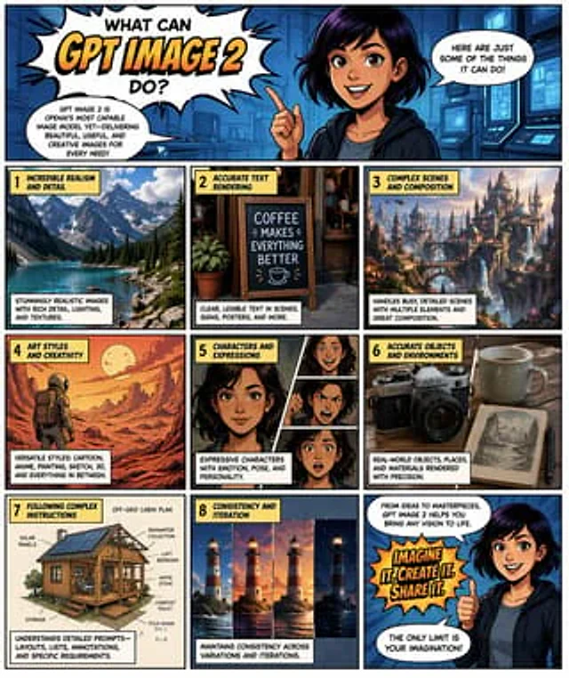

```text
{"type":"comic book page promotional infographic","style":"bold modern comic-book art with thick black panel borders, saturated colors, halftone shading, dynamic speech bubbles, yellow caption boxes with black uppercase lettering, polished digital illustration","format":"portrait page","theme":"showcase what {argument name=\"product name\" default=\"GPT IMAGE 2\"} can do","layout":{"grid":{"columns":3,"rows":4},"sections":[{"title":"header hero panel","position":"top full width","count":4,"labels":["WHAT CAN GPT IMAGE 2 DO?","GPT IMAGE 2 IS OPENAI'S MOST CAPABLE IMAGE MODEL YET—DELIVERING BEAUTIFUL, USEFUL, AND CREATIVE IMAGES FOR EVERY NEED!","HERE ARE JUST SOME OF THE THINGS IT CAN DO!","main character pointing upward"]},{"title":"1","position":"row 2 left","count":3,"labels":["INCREDIBLE REALISM AND DETAIL","photoreal alpine lake with rocky shore, pine forest, and snowy mountains","STUNNINGLY REALISTIC IMAGES WITH RICH DETAIL, LIGHTING, AND TEXTURES."]},{"title":"2","position":"row 2 center","count":3,"labels":["ACCURATE TEXT RENDERING","coffee shop sandwich board sign reading \"COFFEE MAKES EVERYTHING BETTER\" with a small coffee cup icon","CLEAR, LEGIBLE TEXT IN SCENES, SIGNS, POSTERS, AND MORE."]},{"title":"3","position":"row 2 right","count":3,"labels":["COMPLEX SCENES AND COMPOSITION","elaborate fantasy city of towers, bridges, cliffs, and waterfalls at sunset","HANDLES BUSY, DETAILED SCENES WITH MULTIPLE ELEMENTS AND GREAT COMPOSITION."]},{"title":"4","position":"row 3 left","count":3,"labels":["ART STYLES AND CREATIVITY","retro sci-fi desert scene with a lone astronaut under a huge moon, orange-red palette","VERSATILE STYLES: CARTOON, ANIME, PAINTING, SKETCH, 3D, AND EVERYTHING IN BETWEEN."]},{"title":"5","position":"row 3 center","count":4,"labels":["CHARACTERS AND EXPRESSIONS","one large portrait plus 3 smaller portrait variations","EXPRESSIVE CHARACTERS WITH EMOTION, POSE, AND PERSONALITY.","4 total face/expression panels"]},{"title":"6","position":"row 3 right","count":3,"labels":["ACCURATE OBJECTS AND ENVIRONMENTS","vintage camera beside a ceramic mug and an open illustrated book on a wooden table","REAL-WORLD OBJECTS, PLACES, AND MATERIALS RENDERED WITH PRECISION."]},{"title":"7","position":"row 4 left","count":9,"labels":["FOLLOWING COMPLEX INSTRUCTIONS","off-grid cabin plan illustration","SOLAR PANELS","RAINWATER COLLECTION","LOFT BEDROOM","WOOD STOVE","COMPOST TOILET","STORAGE","FOLD-DOWN TABLE + DESK"]},{"title":"8","position":"row 4 center","count":3,"labels":["CONSISTENCY AND ITERATION","4 lighthouse image variations shown side-by-side from day to night lighting consistency","MAINTAINS CONSISTENCY ACROSS VARIATIONS AND ITERATIONS."]},{"title":"closing panel","position":"row 4 right","count":4,"labels":["FROM IDEAS TO MASTERPIECES, GPT IMAGE 2 HELPS YOU BRING ANY VISION TO LIFE.","IMAGINE IT! CREATE IT! SHARE IT!","THE ONLY LIMIT IS YOUR IMAGINATION!","main character giving thumbs up"]}]},"character":{"role":"friendly comic host","appearance":"young woman with short dark hair, dark hoodie over a gray shirt, expressive pose","placements":["top header panel, half-body, pointing upward","bottom-right closing panel, half-body, thumbs up"]},"typography":{"headline":"large explosive comic title in a white starburst with black outline and orange gradient emphasis on {argument name=\"headline wordmark\" default=\"GPT IMAGE 2\"}","caption_boxes":"yellow rectangular boxes with black borders and uppercase comic lettering","speech_bubbles":"white speech bubbles with black outline and uppercase comic text"},"color_palette":{"primary":"comic blue, yellow, orange, black, and white","accents":"warm sunset fantasy tones, cool photoreal blues, sepia object-study browns"},"text":{"main_title":"WHAT CAN {argument name=\"product name\" default=\"GPT IMAGE 2\"} DO?","intro_bubble":"GPT IMAGE 2 IS OPENAI'S MOST CAPABLE IMAGE MODEL YET—DELIVERING BEAUTIFUL, USEFUL, AND CREATIVE IMAGES FOR EVERY NEED!","top_right_bubble":"HERE ARE JUST SOME OF THE THINGS IT CAN DO!","closing_box":"FROM IDEAS TO MASTERPIECES, GPT IMAGE 2 HELPS YOU BRING ANY VISION TO LIFE.","burst_text":"{argument name=\"callout text\" default=\"IMAGINE IT! CREATE IT! SHARE IT!\"}","final_bubble":"THE ONLY LIMIT IS YOUR IMAGINATION!"},"rendering_notes":"clean readable embedded text, balanced comic page composition, each panel visually distinct, high detail, professional editorial poster/comic hybrid, no watermarks"}
```

Model: GPT Image 2
Author: Kris Kashtanova

[ProjectD](https://aitoolsradar.com/en/prompts/e71d5043f94a76) · [Recorded source](https://youmind.com/prompts/comic-page-for-gpt-image-2-capabilities-14672)
 · [Full original metadata and byte evidence](data/projectd-batch-0025.json)

## Commemorative Postage Stamp Sheet

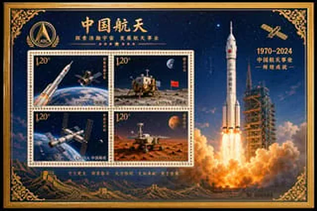

```text
{argument name="stamp theme" default="Commemorative stamps for China&#39;s space program"} Commemorative stamps, containing{argument name="scene" default="Rocket launch scene"} With gold foil border
```

Model: GPT Image 2
Author: GPT Image 2 Prompts

[ProjectD](https://aitoolsradar.com/en/prompts/b3994b8cfe9494) · [Recorded source](https://x.com/songguoxiansen/status/2047129703702802811)
 · [Full original metadata and byte evidence](data/projectd-batch-0025.json)

## Commercial Ad Storyboard Layout

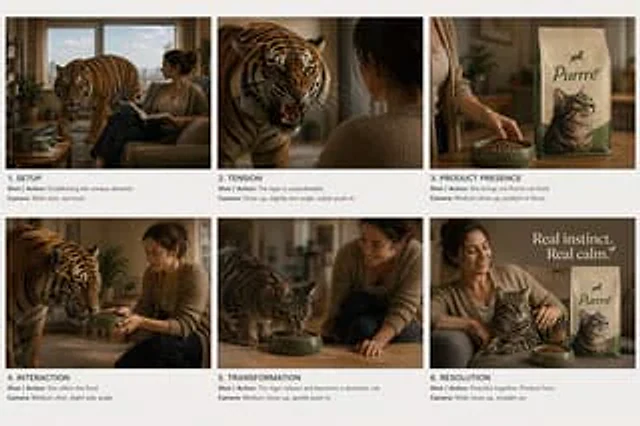

```text
Create a cinematic commercial storyboard. Layout: - Fixed 6-grid (2x3), evenly spaced - Clean white or neutral background - Clearly separated panels, no UI, no clutter. Global Style: - Cinematic realism, high-end commercial visual effects - Soft and controlled lighting, consistent across all panels - Unbiased characters or environments. Story Arc (strict order): 1. Setup 2. Tension 3. Product Showcase 4. Product Interaction 5. Transition (Impact) 6. Simple Closing Shot Scene Concept:{argument name="story concept" default="A woman lives in a quiet apartment with a nervous and unpredictable tiger by her side. The tiger behaves like a house cat, but always exudes a dangerous aura. When she serves it cat food, the tiger visibly relaxes and transforms into a calm house cat."} Panel Requirements (each panel must include): - Cinematic visuals (clear composition, easily readable subject) - Shots/Motion (focus on character + product, if applicable) - Photography (shot type, angle, movement) Product Rules: - The product must be clear, legible, and well-lit in panels 3, 4, and 6. - No distortion, no redesign. - Packaging must maintain a consistent visual priority: - Strong contrast between tension (tiger) and relaxation (cat) - Clear legibility in every frame - No abstract or surreal distortion, based on realistic text: - Minimalist, using only small professional labels (panel number + brief shot notes) - No additional graphics
```

Model: GPT Image 2
Author: GPT Image 2 Prompts

[ProjectD](https://aitoolsradar.com/en/prompts/53046670447924) · [Recorded source](https://x.com/aimikoda/status/2047198651605250088)
 · [Full original metadata and byte evidence](data/projectd-batch-0025.json)

## Commercial Collaboration Poster

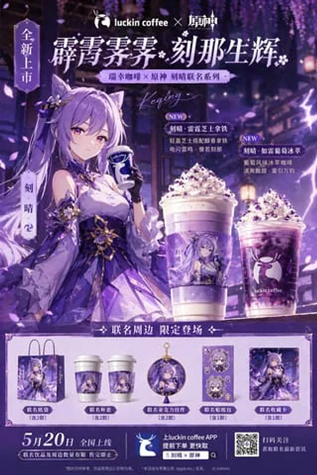

```text
Generate a brand launch image for a commercial poster, containing the following content:{argument name="brand A" default="Luckin Coffee"} and{argument name="brand B" default="Nasita from Genshin Impact"} New product collaboration.
```

Model: GPT Image 2
Author: GPT Image 2 Prompts

[ProjectD](https://aitoolsradar.com/en/prompts/106a6bb566c27a) · [Recorded source](https://x.com/zhang_xiao18313/status/2046865872942493983)
 · [Full original metadata and byte evidence](data/projectd-batch-0025.json)

## Commercial Product Infographic

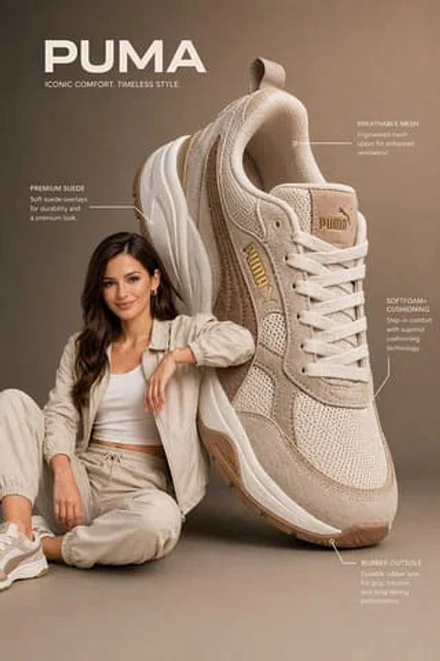

```text
A high-end infographic-style visual showcasing a massive {argument name="product" default="Puma sneakers"} Placed in one{argument name="subject description" default="young women"} Beside her, the shoes are enlarged to almost the same size as her seated body, emphasizing a dramatic sense of proportion. The woman leans casually against the shoes, one arm draped over them, creating a natural sense of interaction. Her face must closely match the provided reference image—accurate facial structure, skin tone, hairstyle, and expression—resulting in a clean, refined, and visually appealing image. The composition is modern and minimalist, using soft gradients or clean studio backgrounds. Include subtle infographic elements such as fine-lined text, labels, or markings highlighting shoe features (material, cushioning, sole design), but maintain elegance and avoid clutter. Use soft studio lighting with subtle shadows to create a high-end commercial feel. The sneaker texture should be extremely detailed (fabric, stitching, logo clarity). The model wears simple, modern clothing that complements the shoe's color scheme. Color gradation is clear and slightly vibrant, with a professional advertising aesthetic. The composition is balanced, sharply focused, and has a subtle depth-of-field effect. Style: High-end product infographics, a combination of fashion editing and product display, with clean UI-style annotations. Resolution: Ultra-high resolution, 4K, highly detailed, realistic. 85mm lens, f/2.8 aperture for soft depth of field. Photorealistic quality, commercial advertising quality. No distortion, accurate proportions. Clean typography.
```

Model: GPT Image 2
Author: GPT Image 2 Prompts

[ProjectD](https://aitoolsradar.com/en/prompts/850de42de6afae) · [Recorded source](https://x.com/j_smeaton99/status/2047703664303931407)
 · [Full original metadata and byte evidence](data/projectd-batch-0025.json)

## Complex AI Model Analysis Infographic

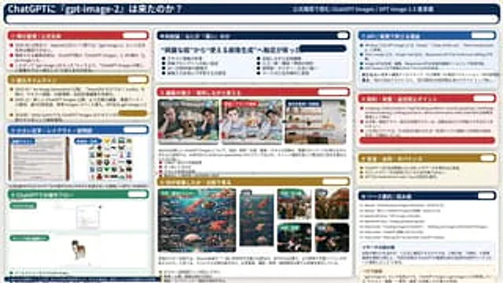

```text
{
  "type": "Infographic Dashboard",
  "style": "Enterprise presentation slides, dense information layout, flat design",
  "header": {
    "left_title": "{argument name=\"main title\" default=\"Has ChatGPT finally received the &#39;gpt-image-2&#39; update?\"}",
    "right_subtitle": "{argument name=\"subtitle\" default=\"Officially confirmed interpretation of ChatGPT Images / GPT Image 1.5 Mandala\"}",
    "background_color": "{argument name=\"theme color 1\" default=\"Dark blue\"}"
  },
  "layout": {
    "columns": 3,
    "sections": [
      {
        "id": 1,
        "title": "① Rumor Summary / Official Name",
        "color": "{argument name=\"theme color 2\" default=\"red\"}",
        "content_type": "3 key points"
      },
      {
        "id": 2,
        "title": "② Evolutionary Timeline",
        "color": "gold",
        "content_type": "3 key points of the timeline"
      },
      {
        "id": 3,
        "title": "③ Small print, layout and explanatory diagrams",
        "color": "blue",
        "content_type": "2 Embedded images showing a text document and an icon grid"
      },
      {
        "id": 4,
        "title": "④ ChatGPT Operation Process",
        "color": "green",
        "content_type": "UI mockup displaying the chat interface and a dog image."
      },
      {
        "id": "central",
        "title": "Key conclusion: What exactly makes it \"powerful\"?",
        "color": "Dark blue",
        "subtitle": "{argument name=\"central conclusion\" default=\"The focus has shifted from &quot;beautiful images&quot; to &quot;practical image generation&quot;.\"}",
        "content_type": "Two columns, four key points in each column."
      },
      {
        "id": 5,
        "title": "⑤ Editing ability: Making modifications while keeping the original appearance.",
        "color": "red",
        "content_type": "3 consecutive images showing the photo editing process"
      },
      {
        "id": 6,
        "title": "⑥ Areas for improvement: Comparative analysis",
        "color": "gold",
        "content_type": "Six comparison images (this vs. previous ones), covering posters, crowds, and textures."
      },
      {
        "id": 7,
        "title": "⑦ API / Core Value in Actual Business",
        "color": "blue",
        "content_type": "3 key points"
      },
      {
        "id": 8,
        "title": "⑧ Key points regarding limitations, pitfalls, and avoiding blind trust",
        "color": "red",
        "content_type": "3 key points"
      },
      {
        "id": 9,
        "title": "9. Safety, source and governance",
        "color": "gold",
        "content_type": "3 key points"
      },
      {
        "id": 10,
        "title": "⑩ Source Summary / Reading Guide",
        "color": "Dark blue",
        "content_type": "A list of 7 sources and a summary box."
      }
    ]
  }
}
```

Model: GPT Image 2
Author: GPT Image 2 Prompts

[ProjectD](https://aitoolsradar.com/en/prompts/d0f68cd9973709) · [Recorded source](https://x.com/s_shigel/status/2043884989461475732#reversed-0)
 · [Full original metadata and byte evidence](data/projectd-batch-0025.json)

## Complex AI Model Infographic Board

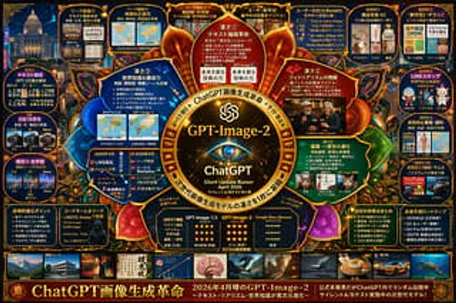

```text
{
  "type": "High-density futuristic infographic project",
  "theme": {
    "colors": "{argument name=\"theme color\" default=\"Gold and dark blue\"}",
    "style": "Dark mode, glowing neon borders, complex mind map layout, cyberpunk aesthetics"
  },
  "centerpiece": {
    "description": "A glowing gold circular logo, resembling an eye or camera lens.",
    "text": [
      "{argument name=\"main title\" default=\"GPT-Image-2\"}",
      "ChatGPT",
      "Silent updates to rumors{argument name=\"release date\" default=\"April 2026\"}"
    ]
  },
  "layout": {
    "top_left": {
      "title": "Leaked images",
      "count": 4,
      "items": [
        "Text rendering coffee menu",
        "World map",
        "Anatomical diagram",
        "Photorealistic Bar"
      ]
    },
    "top_right": {
      "title": "Use Cases and Feedback",
      "count": 5,
      "items": [
        "e-commerce products",
        "Business flyers",
        "Chat stickers",
        "Educational materials",
        "YouTube thumbnails"
      ]
    },
    "left_side": {
      "title": "Version Comparison",
      "count": 3,
      "items": [
        "Text rendering comparison",
        "Photo Realism Comparison",
        "Comparison of compositional stability"
      ]
    },
    "inner_ring": {
      "title": "Core Functions",
      "count": 4,
      "items": [
        "Text rendering revolution",
        "The realism of the photos has increased dramatically.",
        "World Knowledge",
        "Edit consistency"
      ]
    },
    "bottom_left": {
      "title": "Technical Specifications",
      "count": 2,
      "items": [
        "Key points of technological evolution",
        "A silhouette of a hacker with a codename"
      ]
    },
    "bottom_center": {
      "title": "Model Comparison Table",
      "columns": 3,
      "headers": [
        "GPT-Image-1.5",
        "{argument name=\"main title\" default=\"GPT-Image-2\"}",
        "{argument name=\"competitor model\" default=\"Google Nano Banana\"}"
      ],
      "rows": [
        "Text accuracy",
        "Realism",
        "World Knowledge",
        "Editing ability",
        "speed"
      ]
    },
    "bottom_right": {
      "title": "Future Outlook",
      "count": 2,
      "items": [
        "List of significant improvements",
        "Future Roadmap Timeline"
      ]
    },
    "bottom_edge": {
      "title": "Style Gallery",
      "count": 10,
      "items": [
        "architecture",
        "poster",
        "Japanese text",
        "Infographic",
        "Fantasy",
        "Steampunk",
        "Minimalist design",
        "food",
        "car",
        "underwater"
      ]
    },
    "footer": {
      "title": "Main width",
      "text": [
        "{argument name=\"subtitle\" default=\"ChatGPT: A Revolution in Image Generation\"}",
        "Next-generation model in silent A/B testing"
      ]
    }
  }
}
```

Model: GPT Image 2
Author: GPT Image 2 Prompts

[ProjectD](https://aitoolsradar.com/en/prompts/61025b028e621b) · [Recorded source](https://x.com/hawkymisc/status/2043665159890321628#reversed-0)
 · [Full original metadata and byte evidence](data/projectd-batch-0025.json)

## Complex Infographic Explainer Sheet

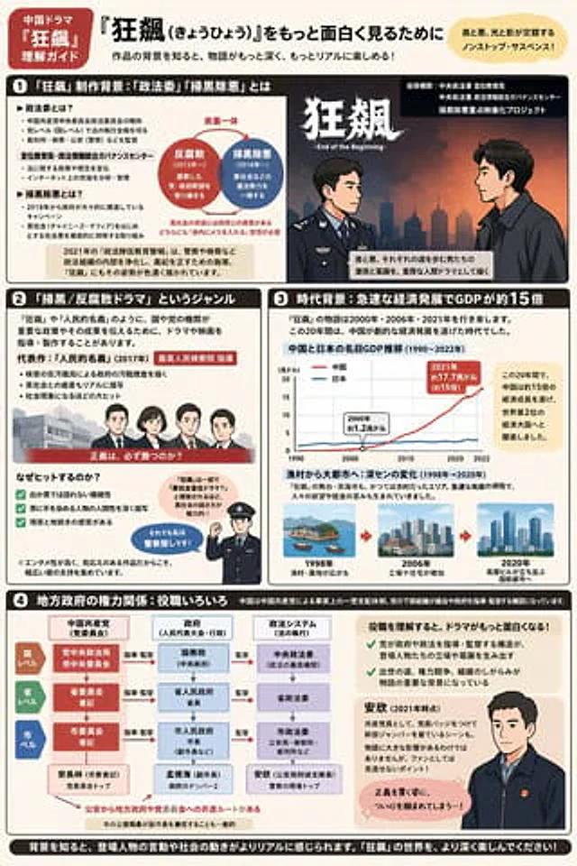

```text
{
  "type": "Comprehensive Infographic Explanation Table",
  "style": "{argument name=\"illustration style\" default=\"Flat vector anime style\"}",
  "color_palette": "{argument name=\"color palette\" default=\"Beige background, accented with dark brown, red and blue.\"}",
  "layout": {
    "header": {
      "tag": "Viewing Guide for the Chinese TV Series \"Raging Waves\"",
      "main_title": "{argument name=\"main title\" default=\"How to appreciate &quot;Storm&quot; more deeply\"}",
      "subtitle": "Understanding the social context behind a work makes the story more profound and authentic!",
      "top_right_badge": "A hardcore suspense drama that intertwines good and evil, light and shadow!"
    },
    "sections": [
      {
        "number": 1,
        "title": "Background of the production of \"Raging Storm\": What are the \"Political and Legal Affairs Commission\" and \"Anti-Organized Crime Campaign\"?",
        "components": [
          {
            "type": "bulleted text",
            "description": "Definition of political terminology"
          },
          {
            "type": "diagram",
            "description": "The two overlapping circles are labeled \"Anti-corruption\" and \"Combating Organized Crime,\" respectively."
          },
          {
            "type": "illustration",
            "description": "The two men are shown in profile; one is wearing a police uniform, and the other is wearing a dark suit and a red tie."
          }
        ]
      },
      {
        "number": 2,
        "title": "The genre of \"anti-gang crime/anti-corruption dramas\"",
        "components": [
          {
            "type": "illustration",
            "description": "A lineup of 4 characters (3 men and 1 woman) standing behind a red banner."
          },
          {
            "type": "checklist",
            "count": 3,
            "description": "The reasons for the show's popularity are marked with a green checkmark."
          },
          {
            "type": "illustration",
            "description": "A police officer points upwards with speech bubbles."
          }
        ]
      },
      {
        "number": 3,
        "title": "Historical Context: Rapid economic development with GDP increasing approximately 15 times.",
        "components": [
          {
            "type": "chart",
            "chart_type": "{argument name=\"chart type\" default=\"Comparing line graphs of two trends over time\"}",
            "description": "GDP Comparison between China and Japan from 1990 to 2022"
          },
          {
            "type": "timeline",
            "count": 3,
            "description": "Urban evolution: from village in 1998, to factory in 2006, to modern high-rise city in 2020."
          }
        ]
      },
      {
        "number": 4,
        "title": "Local government power relations: job analysis",
        "components": [
          {
            "type": "flowchart",
            "topic": "{argument name=\"flowchart topic\" default=\"Local government power structure\"}",
            "description": "A 3x3 grid is used to illustrate the organizational structure of the national, provincial, and municipal levels within the Party, government, and legal systems."
          },
          {
            "type": "illustration",
            "description": "A man in a dark jacket looks ahead, accompanied by text explaining his role."
          }
        ]
      }
    ],
    "footer": {
      "text": "Understanding the background will make the characters' words and actions, as well as social dynamics, seem more realistic. Please delve deeper into the world of *Raging Storm*!"
    }
  }
}
```

Model: GPT Image 2
Author: GPT Image 2 Prompts

[ProjectD](https://aitoolsradar.com/en/prompts/a06a80b33f86b4) · [Recorded source](https://x.com/fal48/status/2045422033065144465#reversed-0)
 · [Full original metadata and byte evidence](data/projectd-batch-0025.json)

## Complex Tech Speculation Infographic


```text
{
  "type": "Complex Technology Speculation Infographic",
  "style": "{argument name=\"color palette\" default=\"Dark blue background, accented with gold, red and cyan luminous details.\"} High-density online survey project, mind map layout",
  "centerpiece": {
    "description": "{argument name=\"central emblem\" default=\"Glowing gold round badge with eye pattern\"}",
    "text": [
      "{argument name=\"main title\" default=\"GPT-Image-2\"}",
      "ChatGPT",
      "{argument name=\"subtitle\" default=\"Rumors of a silent update in April 2026\"}"
    ]
  },
  "layout": {
    "sections": [
      {
        "title": "Internal nodes",
        "position": "Around the center",
        "count": 4,
        "labels": [
          "Core Advantages ①",
          "Core Advantage ②",
          "Core Advantage ③",
          "Core Advantage ④"
        ],
        "description": "Glowing circular text nodes highlighting core advantages"
      },
      {
        "title": "Top Leak Panel",
        "position": "Top row",
        "count": 4,
        "labels": [
          "Leaked Image ①",
          "Leaked Images ②",
          "Leaked Images ③",
          "User déjà vu (X)"
        ],
        "description": "Before and after comparison images"
      },
      {
        "title": "User Feedback",
        "position": "Top right corner",
        "count": 1,
        "labels": [
          "User reactions (X/Reddit)"
        ],
        "description": "A panel containing 5 reference bubbles"
      },
      {
        "title": "Practical Cases",
        "position": "Rightmost column",
        "count": 5,
        "labels": [
          "Practical Case ①",
          "Practical Case ②",
          "Practical Case ③",
          "Practical Case 4",
          "Practical Case ⑤"
        ],
        "description": "Image grids encompassing application scenarios such as e-commerce, flyers, LINE stickers, education, and thumbnails."
      },
      {
        "title": "Comparative analysis",
        "position": "Leftmost column",
        "count": 3,
        "labels": [
          "Comparison ①",
          "Comparison ②",
          "Composition ③ • Worldview"
        ],
        "description": "Version comparison images"
      },
      {
        "title": "Bottom Data Panel",
        "position": "The bottom row above the gallery",
        "count": 5,
        "labels": [
          "Technological Evolution Points",
          "Codenames and leaks",
          "Comparison Table",
          "Summary of key improvements",
          "Future Prediction Roadmap"
        ],
        "description": "Includes a bulleted list, a hacker portrait, and a 3-column star rating comparison table."
      },
      {
        "title": "Style Gallery",
        "position": "Bottom bar",
        "count": 10,
        "labels": [
          "Architecture and Perspective",
          "poster",
          "Japanese text",
          "Infographic",
          "Fantasy",
          "Steampunk",
          "Minimalist design",
          "food",
          "Automobiles and vehicles",
          "Underwater Universe"
        ],
        "description": "Showing horizontal thumbnail rows with different generation styles"
      }
    ],
    "footer": {
      "text": "{argument name=\"footer text\" default=\"ChatGPT: The Image Generation Revolution\"}",
      "position": "bottom edge"
    }
  }
}
```

Model: GPT Image 2
Author: GPT Image 2 Prompts

[ProjectD](https://aitoolsradar.com/en/prompts/4f88a98163e3f8) · [Recorded source](https://x.com/s_shigel/status/2043663336445989369#reversed-0)
 · [Full original metadata and byte evidence](data/projectd-batch-0025.json)

## Comprehensive Anime Character Reference Sheet

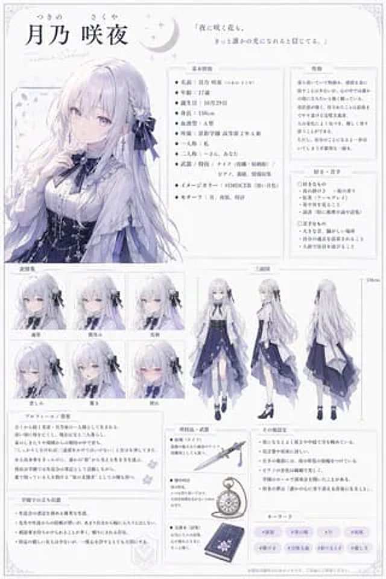

```text
{
  "type": "Comprehensive Anime Character Design Documents",
  "character": {
    "name": "{argument name=\"character name\" default=\"Tsukino Sakuya\"}",
    "hair": "{argument name=\"hair color\" default=\"silver\"}",
    "eyes": "{argument name=\"eye color\" default=\"Purple\"}",
    "outfit": "{argument name=\"outfit style\" default=\"A dark blue and white gothic Lolita dress with a cinched waist and ribbons.\"}",
    "motif": "{argument name=\"main motif\" default=\"Moon and Stars\"}"
  },
  "layout": {
    "header": {
      "title": "Tsukino Sakuya",
      "subtitle": "Tsukino Sakuya",
      "quote": "\"I believe that even flowers that bloom at night can become a source of light for someone.\""
    },
    "main_visual": "Large half-length portrait in the upper left corner",
    "sections": [
      {
        "title": "Basic Information",
        "type": "Bullet List",
        "content": "Name, Age (17 years old), Birthday, Height (158 cm), Blood Type, Affiliation, Pronoun, Weapon, Impression Color, Theme"
      },
      {
        "title": "character",
        "type": "Paragraph text",
        "content": "Personality Description"
      },
      {
        "title": "Likes and Dislikes",
        "type": "Two bulleted lists",
        "content": "Likes and Dislikes"
      },
      {
        "title": "Emoji Collection",
        "type": "Avatar Grid",
        "count": 6,
        "labels": [
          "generally",
          "Smile",
          "serious",
          "sad",
          "surprise",
          "shy"
        ]
      },
      {
        "title": "Three-view diagram",
        "type": "Full body three-view drawing",
        "count": 3,
        "labels": [
          "front",
          "side",
          "back"
        ],
        "details": "Includes a height chart for 158 cm."
      },
      {
        "title": "Personal Profile/Background",
        "type": "Paragraph text",
        "content": "Character background and personal profile"
      },
      {
        "title": "Campus positioning",
        "type": "Bullet List",
        "content": "Role and position in school"
      },
      {
        "title": "Personal items and weapons",
        "type": "List of illustrated items",
        "count": 3,
        "items": [
          {
            "name": "dagger",
            "description": "A beautifully decorated short sword"
          },
          {
            "name": "pocket watch",
            "description": "Ornate pocket watch"
          },
          {
            "name": "Paperback",
            "description": "Blue poetry collection with floral pattern"
          }
        ]
      },
      {
        "title": "Other settings",
        "type": "Bullet List",
        "content": "Other character settings and little-known facts"
      },
      {
        "title": "Keywords",
        "type": "Capsule label",
        "count": 8,
        "labels": [
          "#SilverHair",
          "#PurpleEyes",
          "#moon",
          "#NightSakura",
          "#peaceful",
          "#Perfectionism",
          "#Behind-the-scenes supporters",
          "#gentle"
        ]
      }
    ]
  }
}
```

Model: GPT Image 2
Author: GPT Image 2 Prompts

[ProjectD](https://aitoolsradar.com/en/prompts/9f190d8ec6bc9a) · [Recorded source](https://x.com/koubou87_/status/2044913275239125302#reversed-0)
 · [Full original metadata and byte evidence](data/projectd-batch-0025.json)

## Comprehensive Anime Character Reference Sheet

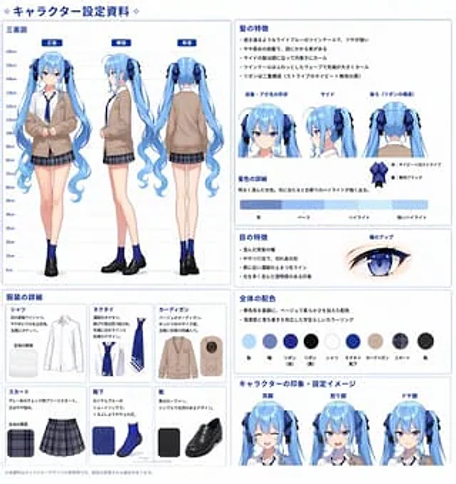

```text
{
  "type": "Anime Character Design Reference Chart",
  "header": "{argument name=\"document title\" default=\"❖ Character Design Information ❖\"}",
  "character": {
    "description": "{argument name=\"character description\" default=\"Long twin-tailed anime girl\"}",
    "hair_color": "{argument name=\"hair color\" default=\"light blue\"}",
    "eye_color": "{argument name=\"eye color\" default=\"blue\"}",
    "outfit": "{argument name=\"outfit style\" default=\"Beige cardigan, white shirt, blue tie, gray plaid skirt, blue socks, black loafers\"}"
  },
  "layout": {
    "left_column": {
      "title": "Three-view diagram",
      "description": "Height chart (0cm-160cm) and full-body posture",
      "count": 3,
      "labels": [
        "front",
        "side",
        "back"
      ]
    },
    "bottom_left_grid": {
      "title": "Clothing details",
      "description": "Individual garment grids including text descriptions and fabric textures",
      "count": 6,
      "labels": [
        "shirt",
        "tie",
        "cardigan",
        "skirt",
        "sock",
        "shoe"
      ]
    },
    "top_right": {
      "title": "Hairstyle features",
      "description": "Key points, close-up of hairstyle angles, and ribbon details",
      "count": 3,
      "labels": [
        "Bangs and the shape of the ahoge",
        "side",
        "Back (ribbon structure)"
      ]
    },
    "middle_right_color_bar": {
      "title": "Hair color details",
      "description": "Horizontal color gradient bar",
      "count": 4,
      "labels": [
        "shadow",
        "background color",
        "Highlights",
        "Strong highlight"
      ]
    },
    "middle_right_eye": {
      "title": "Eye features",
      "description": "Key points and close-up illustrations of the eyes",
      "count": 1,
      "labels": [
        "Pupil close-up"
      ]
    },
    "middle_right_palette": {
      "title": "Overall color scheme",
      "description": "Key points and round color chart",
      "count": 9,
      "labels": [
        "hair",
        "pupil",
        "Ribbon (front)",
        "Ribbon (back side)",
        "shirt",
        "Ties/Socks",
        "cardigan",
        "skirt",
        "shoe"
      ]
    },
    "bottom_right_expressions": {
      "title": "Character impressions and character settings",
      "description": "Facial close-up",
      "count": 3,
      "labels": [
        "Smile",
        "angry",
        "good at"
      ]
    }
  }
}
```

Model: GPT Image 2
Author: GPT Image 2 Prompts

[ProjectD](https://aitoolsradar.com/en/prompts/e1d4074f56af07) · [Recorded source](https://x.com/zhongjoji00000/status/2044724985734770712#reversed-0)
 · [Full original metadata and byte evidence](data/projectd-batch-0025.json)

## Comprehensive Botanical Infographic

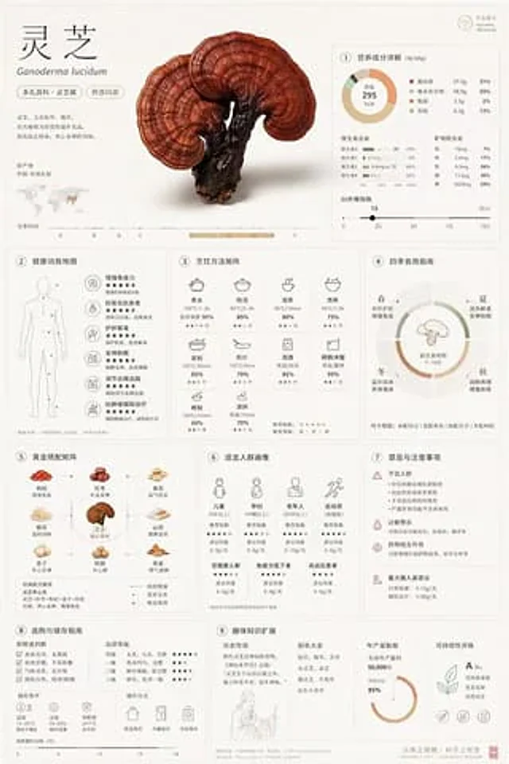

```text
{
  "type": "Plant and Nutrition Infographic Poster",
  "subject": {
    "name": "{argument name=\"subject name\" default=\"Ganoderma lucidum\"}",
    "scientific_name": "{argument name=\"scientific name\" default=\"Ganoderma lucidum\"}",
    "image": "A large, richly detailed illustration shows a glossy, reddish-brown Ganoderma lucidum with concentric growth rings, located at the top center."
  },
  "layout": {
    "style": "Simple, modern, and grid-based, with a light beige background accented by subtle grid lines, minimalist icons, and data visualization elements.",
    "sections": [
      {
        "title": "Header/Introduction (Top Left)",
        "content": "The main title text, scientific name, label ('Polyporaceae·Ganoderma', 'Medicinal and edible'), brief description, distribution map (China/East Asia), and seasonal timeline bar chart."
      },
      {
        "title": "1. Detailed Nutritional Information (per 100g) (Top Right)",
        "content": "Nutritional breakdown. Includes a pie chart showing calories (295 kcal), a table of percentages for macronutrients (protein, carbohydrates, fat, etc.), a two-bar chart for vitamins and minerals, and a GI index slider (value 15)."
      },
      {
        "title": "2. Health Benefits Map (Middle Left)",
        "content": "Health Benefits Map. Featuring a unique human silhouette diagram with 6 markers connected to icons and text blocks, describing its benefits (such as immune regulation, anti-aging, liver protection, sleep aid, blood sugar/lipid regulation, and adjunctive treatment for tumors), each item is assigned a 5-star rating."
      },
      {
        "title": "3. Cooking Method Matrix (Medium-Medium)",
        "content": "Cooking Method Matrix. A 3x3 grid of 9 icons representing different processing methods (boiling, stewing, brewing tea, cooking porridge, steaming, stir-frying, soaking in alcohol, grinding into powder, baking, and cold dishes). Each item includes temperature/time, percentage of nutrient retention, and a star rating."
      },
      {
        "title": "4. Seasonal Food Guide (middle right)",
        "content": "Seasonal Consumption Guide. A circular diagram around the central Ganoderma lucidum icon, divided into four quadrants (spring, summer, autumn, and winter), details the seasonal benefits and optimal consumption period (7-10 months)."
      },
      {
        "title": "5. Golden Pairing Matrix (bottom left)",
        "content": "The Golden Pairing Matrix. A 3x3 grid showcasing eight complementary ingredients surrounding the central Ganoderma lucidum (goji berries, red dates, astragalus, white fungus, yam, lotus seeds, longan, and dried tangerine peel), accompanied by text explaining the synergistic effects."
      },
      {
        "title": "6. Target Audience Profile (Part 2)",
        "content": "Suitable user profiles. Icons and text are used to display recommended daily intake and star ratings for 7 user groups (children, pregnant women, the elderly, athletes, people in a sub-healthy state, people with low immunity, and people with high blood pressure)."
      },
      {
        "title": "7. Taboos and Precautions (bottom right)",
        "content": "Contraindications and precautions. List format with warning icons, covering unsuitable populations, allergy warnings, drug interactions, and recommended maximum daily intake."
      },
      {
        "title": "8. Selection and Storage Guide (Bottom Left, bottom of Part 5)",
        "content": "Selection and storage guide. Includes a freshness checklist, quality grading chart (premium, grade 1, grade 2, grade 3) and star rating, storage condition icons (temperature, humidity, shelf life), and shelf life timeline."
      },
      {
        "title": "9. Fun Facts Expanded (Bottom Right, Below Part 7)",
        "content": "Fun trivia expansion. Text blocks cover historical legends, alternative names, global production data (50,000 tons, with China accounting for 85%), and sustainability rating (Grade A)."
      }
    ]
  }
}
```

Model: GPT Image 2
Author: GPT Image 2 Prompts

[ProjectD](https://aitoolsradar.com/en/prompts/0042c3344f07ef) · [Recorded source](https://x.com/Colin_Leeee/status/2044802802149650631#reversed-1)
 · [Full original metadata and byte evidence](data/projectd-batch-0025.json)

## Comprehensive Cat Breed Infographic


```text
{
  "type": "A Comprehensive Illustrated Guide to All Cat Breeds",
  "header": {
    "title": "{argument name=\"main title\" default=\"A Comprehensive Illustrated Guide to All Cat Breeds\"}",
    "subtitle": "{argument name=\"subtitle\" default=\"Covering all cat breeds worldwide | Names &amp; Personality Traits\"}",
    "decorations": [
      "cat paw prints"
    ]
  },
  "layout": {
    "style": "Grid-based charts with horizontal color blocks for partitioning.",
    "columns": 9
  },
  "sections": [
    {
      "title": "{argument name=\"category 1 name\" default=\"shorthaired cat\"}",
      "background_color": "Light green",
      "total_cats": 18,
      "rows": 2,
      "labels": [
        "American Shorthair cat",
        "British Shorthair cat",
        "European Shorthair cat",
        "Chinese raccoon dog flower cat",
        "Siamese cat",
        "Burmese cat",
        "Abyssinian cat",
        "Bengal cat",
        "Egyptian cat",
        "Okunishi Cat",
        "Oriental Shorthair cat",
        "Cornish Rex",
        "Devon Rex cat",
        "Sphynx Cat",
        "Peter the Bald Cat",
        "American Wirehair Cat",
        "Japanese short-tailed cat",
        "Man Island Cat"
      ],
      "item_format": "Cat portrait + breed name + personality description"
    },
    {
      "title": "{argument name=\"category 2 name\" default=\"Long-haired cat\"}",
      "background_color": "light pink",
      "total_cats": 18,
      "rows": 2,
      "labels": [
        "Persian cat",
        "Maine Coon",
        "Ragdoll cat",
        "Norwegian Forest Cat",
        "Siberian cat",
        "Turkish Angora Cat",
        "Turkish Van cat",
        "Berman cat",
        "American Longhair Cat",
        "Jinjira Cat",
        "Himalayan cat",
        "Scottish Fold longhair cat",
        "Serkayk Curly Cat",
        "La Bang Cat",
        "Somali cat",
        "Bali Cat",
        "Oriental Longhair Cat",
        "Lion cat"
      ],
      "item_format": "Cat portrait + breed name + personality description"
    },
    {
      "title": "{argument name=\"category 3 name\" default=\"Rare and unique cats\"}",
      "background_color": "light yellow",
      "total_cats": 18,
      "rows": 2,
      "labels": [
        "Britty Cat",
        "Russian Blue Cat",
        "Chartreux",
        "Havana Brown Cat",
        "Singapore Cat",
        "Mumbai cat",
        "Snowshoes",
        "Toy Tiger Cat",
        "Welsh cat",
        "American Curl",
        "Scottish Fold (Short-haired)",
        "Exotic Shorthair",
        "Garfield",
        "American Recurve Cat",
        "Servals (Savannah cats)",
        "Caracal (Karakar)",
        "Lion Cat (Large)",
        "Leopard cat (Asian leopard cat)"
      ],
      "item_format": "Cat portrait + breed name + personality description"
    },
    {
      "title": "Hairless and curly-haired cats",
      "background_color": "light blue",
      "total_cats": 9,
      "rows": 1,
      "labels": [
        "Donskoy Cat",
        "Peter the Bald Cat (Bard)",
        "Elf Cat (Double Curly Ears)",
        "Canadian Sphynx",
        "Ukrainian Lövkoy cat",
        "Minskin cat (short-legged, hairless)",
        "Labang cat (curly-haired and hairless)",
        "Devon Rex cat",
        "Cornish Rex"
      ],
      "item_format": "Cat portrait + breed name + personality description"
    }
  ],
  "footer": {
    "left_section": {
      "title": "Tips:",
      "content": "3 numbered pet care recommendations"
    },
    "right_section": {
      "title": "Legend:",
      "content": "4 color legend boxes corresponding to the background color of each partition"
    }
  }
}
```

Model: GPT Image 2
Author: GPT Image 2 Prompts

[ProjectD](https://aitoolsradar.com/en/prompts/4d00c4dca7578d) · [Recorded source](https://x.com/yyyole/status/2044790962002784678#reversed-0)
 · [Full original metadata and byte evidence](data/projectd-batch-0025.json)

## Comprehensive Cat Breed Infographic


```text
{
  "type": "infographic chart",
  "header": {
    "title": "{argument name=\"main title\" default=\"A Comprehensive Illustrated Guide to All Cat Breeds\"}",
    "subtitle": "{argument name=\"subtitle\" default=\"Covering all cat breeds worldwide | Names &amp; Personality Traits\"}",
    "decorations": "paw print icons"
  },
  "layout": {
    "style": "grid-based encyclopedia poster, pastel color-coded sections",
    "sections": [
      {
        "title": "{argument name=\"section 1 title\" default=\"shorthaired cat\"}",
        "color": "pastel green",
        "layout": "2 rows of 9 columns",
        "count": 18,
        "item_format": "breed name above, realistic cat portrait, personality description below"
      },
      {
        "title": "{argument name=\"section 2 title\" default=\"Long-haired cat\"}",
        "color": "pastel pink",
        "layout": "2 rows of 9 columns",
        "count": 18,
        "item_format": "breed name above, realistic cat portrait, personality description below"
      },
      {
        "title": "Rare and unique cats",
        "color": "pastel orange",
        "layout": "2 rows of 9 columns",
        "count": 18,
        "item_format": "breed name above, realistic cat portrait, personality description below"
      },
      {
        "title": "Hairless and curly-haired cats",
        "color": "pastel blue",
        "layout": "1 row of 9 columns",
        "count": 9,
        "item_format": "breed name above, realistic cat portrait, personality description below"
      }
    ]
  },
  "footer": {
    "left_section": {
      "title": "{argument name=\"footer tips title\" default=\"Tips:\"}",
      "content": "3 numbered bullet points"
    },
    "right_section": {
      "title": "Legend:",
      "content": "color legend with 4 items matching main sections"
    }
  }
}
```

Model: GPT Image 2
Author: GPT Image 2 Prompts

[ProjectD](https://aitoolsradar.com/en/prompts/7c21a01a5950cf) · [Recorded source](https://x.com/FuHongCloud/status/2045028562626081240#reversed-0)
 · [Full original metadata and byte evidence](data/projectd-batch-0025.json)

## Comprehensive Character Design Sheet


```text
{
  "type": "Comprehensive Anime Character Reference Table",
  "character": {
    "name": "{argument name=\"character name\" default=\"SHIBUYA SHION\"}",
    "hair": "{argument name=\"hair color\" default=\"Black bob haircut with purple inside.\"}",
    "eyes": "{argument name=\"eye color\" default=\"Purple\"}",
    "style": "{argument name=\"theme\" default=\"Urban minimalist street style\"}"
  },
  "layout": {
    "top_left": {
      "sections": [
        "Personal Profile",
        "Concept",
        "Keywords"
      ]
    },
    "top_center": {
      "title": "◆ Three Views",
      "count": 3,
      "labels": [
        "front",
        "side",
        "back"
      ],
      "outfit": "{argument name=\"main outfit\" default=\"Light purple hoodie, denim shorts, black backpack, black high-top sneakers\"}"
    },
    "top_right": {
      "title": "◆ Facial Expressions",
      "count": 6,
      "labels": [
        "neutral",
        "Smile",
        "serious",
        "surprise",
        "shy",
        "laughing out loud"
      ]
    },
    "bottom_left": {
      "title": "◆ Details",
      "count": 6,
      "labels": [
        "Eyes",
        "Hair",
        "Earrings",
        "Hoodie",
        "Backpack",
        "Sneakers"
      ]
    },
    "bottom_right": {
      "title": "◆ Outfit Variations",
      "count": 3,
      "labels": [
        "Daily",
        "Monochrome",
        "Creator"
      ]
    },
    "footer": {
      "palettes": [
        {
          "title": "◆ Color Palette",
          "count": 6,
          "labels": [
            "hair",
            "Eye",
            "hoodie",
            "cowboy",
            "shoe",
            "skin"
          ]
        },
        {
          "title": "◆ Materials and Textures",
          "count": 4,
          "labels": [
            "Hoodie fabric",
            "Denim",
            "Canvas Backpack",
            "Metal"
          ]
        }
      ],
      "notes": {
        "title": "◆ Notes",
        "project_info": "Project: SHIBUYA ARTIST, Date: December 2025"
      }
    }
  }
}
```

Model: GPT Image 2
Author: GPT Image 2 Prompts

[ProjectD](https://aitoolsradar.com/en/prompts/d0a6a60900fa0b) · [Recorded source](https://x.com/Samo_Toshu/status/2045029905164030264#reversed-2)
 · [Full original metadata and byte evidence](data/projectd-batch-0025.json)

## Comprehensive Restaurant Grand Menu Design


```text
{
  "type": "Restaurant menu design",
  "style": {
    "background": "Dark wood grain texture",
    "accents": "{argument name=\"theme color\" default=\"gold\"}",
    "typography": "An elegant mix of serif and sans-serif fonts.",
    "photography": "High-resolution, mouthwatering food photography, paired with warm-toned lighting."
  },
  "header": {
    "main_title": "{argument name=\"main title\" default=\"GRAND MENU\"}",
    "subtitle": "{argument name=\"restaurant type\" default=\"Open kitchen dining room\"}",
    "top_right_badge": "Using carefully selected seasonal ingredients!"
  },
  "layout": {
    "sections": [
      {
        "title": "Chef's Recommendation",
        "position": "top",
        "count": 3,
        "featured_item": "{argument name=\"featured item name\" default=\"200g of premium Wagyu beef steak\"}",
        "labels": [
          "200g of premium Wagyu beef steak",
          "Truffle-flavored Bacon and Egg Pasta",
          "Seafood Pasta"
        ]
      },
      {
        "title": "Appetizers and Salads",
        "position": "Middle left top",
        "count": 4,
        "labels": [
          "Prosciutto, mozzarella, cheese, and capri salad",
          "Salmon sashimi (thin slices)",
          "Avocado and Shrimp Green Salad",
          "Today's Thick Soup"
        ]
      },
      {
        "title": "Pasta &amp; Pizza",
        "position": "Middle right top",
        "count": 4,
        "labels": [
          "Sea urchin cream pasta",
          "Mozzarella Basil Tomato Pasta",
          "Margherita Pizza",
          "Quad Cheese Pizza"
        ]
      },
      {
        "title": "main course",
        "position": "Middle left bottom",
        "count": 4,
        "labels": [
          "100% Wagyu Beef Burger Meat",
          "Pan-fried salmon",
          "Homemade Roast Beef Rice Bowl",
          "Garlic Shrimp"
        ]
      },
      {
        "title": "staple food",
        "position": "Center Right Center",
        "count": 3,
        "labels": [
          "Beef Tendon Garlic Fried Rice",
          "Scrambled Egg Omelet Rice",
          "Seafood Paella"
        ]
      },
      {
        "title": "Snacks",
        "position": "Middle right bottom",
        "count": 5,
        "format": "A text list with a picture of French fries",
        "labels": [
          "French fries",
          "Onion rings",
          "Cheese Platter",
          "Garlic Toast",
          "Seasonal pickles"
        ]
      },
      {
        "title": "Beverages",
        "position": "Bottom left",
        "count": 10,
        "format": "Two columns of text, accompanied by two photos of the drinks.",
        "labels": [
          "Coffee &amp; Tea",
          "Alcoholic beverages"
        ]
      },
      {
        "title": "dessert",
        "position": "Bottom right",
        "count": 3,
        "labels": [
          "Homemade Tiramisu",
          "Molten Chocolate Cake",
          "Seasonal Fruit Pancakes"
        ]
      }
    ]
  },
  "footer": {
    "banner_text": "{argument name=\"footer text\" default=\"★ Lunch time 11:00~15:00, drink set meal only +¥300! ★\"}"
  }
}
```

Model: GPT Image 2
Author: GPT Image 2 Prompts

[ProjectD](https://aitoolsradar.com/en/prompts/97983afb5fd517) · [Recorded source](https://x.com/Nico_Nico_Ch/status/2045092212246225051#reversed-1)
 · [Full original metadata and byte evidence](data/projectd-batch-0025.json)

## Concrete Wall with ASR Map Cracking


```text
A highly realistic, documentary-style close-up photograph showcases an outdoor, weathered reinforced concrete bridge pier or retaining wall, exhibiting severe alkali-aggregate reaction damage. The wall occupies most of the frame and is shot at a slightly tilted angle, making the front and left edges clearly visible. The concrete surface is gray, rough, aged, and stained, covered with a dense, irregular network of polygonal, map-like cracks, with approximately 18 clearly visible main crack units on the surface. Many crack edges have pale white, gelatinous exudates and powdery deposits, and at several crack intersections, vertical white and brown water stains extend downwards. A horizontal construction joint or baseline is present near the base of the wall, with darker, damp stains below and fine moss or algae discoloration at the edges. The scene is set in a cloudy riverside or drainage ditch environment with sparse winter vegetation, rocks in the lower right corner, and a narrow band of still water along the right edge of the image. The lighting is natural and soft, the color tone is neutral, and the aesthetics of an engineering inspection photograph are evident. The surface texture is clearly defined, and there are no people, tools, text, or annotations.
```

Model: GPT Image 2
Author: GPT Image 2 Prompts

[ProjectD](https://aitoolsradar.com/en/prompts/bd6169dc8d461d) · [Recorded source](https://x.com/cncrt_ey/status/2046926139755839707#reversed-2)
 · [Full original metadata and byte evidence](data/projectd-batch-0025.json)

## Config 2026 Nail Art Board


```text
Goal: Create a cute presentation board for custom event nail art inspired by {argument name="event name" default="Config 2026"}, with playful Figma-like shapes and soft 3D metallic nail gems.

Canvas: Horizontal 16:9 layout, warm taupe-gray background, clean minimal poster composition.

Text content: Large bold rounded white title at the upper left: “My Config Nails”. Large bold rounded white event label at the lower right: “{argument name="event label" default="Config 2026"}”. Use a heavy friendly sans-serif font with soft rounded corners.

Layout: Arrange exactly 10 press-on nail designs in two centered rows of five. Each nail is a vertical rounded capsule shape, ivory/off-white, evenly spaced, with subtle flat graphic decoration. Keep the nails large and isolated, like a Figma design mockup.

Nail designs, exactly 10:
1. Top row, first nail: Figma logo made from five rounded colored blobs in red-orange, coral, purple, blue, and green.
2. Top row, second nail: abstract bright blue stacked bean shapes with two chrome silver spherical studs, one near the upper left and one near the bottom.
3. Top row, third nail: red vertical rounded rectangle label with white text “saki”, plus a small red paper-plane or cursor triangle near the upper right.
4. Top row, fourth nail: thick black wavy vertical stripe down the center with two chrome silver spherical studs, one near the upper right and one near the lower left.
5. Top row, fifth nail: neon lime green curved corner shape sweeping in from the upper left, purple circle near the right side, and one chrome silver stud near the lower center.
6. Bottom row, first nail: cute pastel pink heart character with black oval eyes, smiling mouth, and mint green little legs/feet.
7. Bottom row, second nail: black grid lines over the ivory nail, with two chrome silver studs aligned vertically, one upper center and one lower center.
8. Bottom row, third nail: large purple flower/blob cluster at upper left, neon lime green curved patch at lower right, and one chrome silver stud near the lower center.
9. Bottom row, fourth nail: three vertically stacked circles in red-orange, purple, and green, centered on the nail.
10. Bottom row, fifth nail: large red-orange organic blob covering the upper portion, with one chrome silver stud near the upper left of the blob.

Visual style: Modern cute flat vector nail-art mockup, Figma conference aesthetic, soft cream nails, saturated accent colors, simple geometric shapes, subtle shadows only on chrome studs for a 3D metallic look. Keep everything crisp, clean, and poster-like.

Constraints: Use exactly 10 nail capsules and exactly 10 chrome silver studs total. Do not add hands, fingers, bottles, extra decorations, watermarks, or additional text.
```

Model: GPT Image 2
Author: s a k i｜INDIG,Inc. CDO｜UIデザイナー

[ProjectD](https://aitoolsradar.com/en/prompts/5622a829bdf784) · [Recorded source](https://youmind.com/prompts/config-2026-nail-art-21140)
 · [Full original metadata and byte evidence](data/projectd-batch-0025.json)

## Confused Blonde Anime Girl Portrait


```text
A soft, minimalist anime-style half-length portrait depicts a lovely young woman against a pure light gray background. Painted in a clean pastel style, the lines are delicate like a sketch, and the colors are flat and soft. She has flowing, light blonde hair with soft layers, and long bangs partially obscuring her forehead; she has large, round, light blue eyes, fair skin, and a slightly parted mouth that reveals a hint of confusion. She wears a loose-fitting {argument name="clothing color" default="light pinkish blue"} She wears a long-sleeved top with a wide, comfortable neckline. Her posture is slightly turned towards the viewer, one hand raised, index finger lightly touching the side of her head, as if confused. A floating blue question mark is placed above and to the left of her head. Her expression should appear innocent, absent-minded, and endearing. The composition should be centered, open, and simple; avoid adding extra objects, complex backgrounds, and strong shadows.
```

Model: GPT Image 2
Author: GPT Image 2 Prompts

[ProjectD](https://aitoolsradar.com/en/prompts/d3db5253e61a92) · [Recorded source](https://x.com/izutorishima/status/2046679150279446678#reversed-0)
 · [Full original metadata and byte evidence](data/projectd-batch-0025.json)

## Consistent Character Multi-Angle Studio Shot


```text
Use the reference image as the main character identity reference. Preserve the same {argument name="subject character" default="adult Japanese woman in her early 20s"}, including her face, facial impression, hairstyle, body balance, body proportions, outfit design, and overall atmosphere.

Create a new realistic high-quality photo of the same person. Change only the camera angle and composition according to the {argument name="camera angle" default="angle instruction below"}. Do not redesign the character, do not change her age appearance, do not make her look like a different person, and do not change her body type or clothing structure.

Keep a simple natural standing pose, but allow very small posture adjustments only if needed to make the camera angle physically natural. Use a clean bright studio room with a visible floor and wall, natural realistic lighting, realistic perspective, and polished commercial photo quality.

Keep the result tasteful, non-explicit, clean, and suitable for general commercial stock imagery. Avoid extra limbs, broken fingers, distorted hands, missing body parts, duplicated faces, ghosting, warped clothing, messy anatomy, unnatural body proportions, distorted facial features, and extreme lens distortion.
```

Model: GPT Image 2
Author: 陽仙堂

[ProjectD](https://aitoolsradar.com/en/prompts/372702f1946b1d) · [Recorded source](https://youmind.com/prompts/consistent-character-camera-angles-23341)
 · [Full original metadata and byte evidence](data/projectd-batch-0025.json)

## Consistent Product Kit Photography


```text
for"{argument name="product name" default="Purrre"} ({argument name="product type" default="cat food"} Create a concise product suite. Showcase consistent views of the same product from multiple perspectives (front, back, side, 3/4 view, and packaged open). Style: Studio product photography, neutral background, soft lighting, high detail, no design deviations, and no text.
```

Model: GPT Image 2
Author: GPT Image 2 Prompts

[ProjectD](https://aitoolsradar.com/en/prompts/9f2e6fbfd91410) · [Recorded source](https://x.com/aimikoda/status/2047198646827991310)
 · [Full original metadata and byte evidence](data/projectd-batch-0025.json)

## Consistent Social Media Cover Agent Skill


```text
一篇文章丢进去，三轮问答，直接吐出能跑图的封面提示词。不用懂设计，不用自己写 prompt，画幅固定 3:4，人脸还能保持一致👇 👹整个工作流程如下: 1、skill 安装与首次配置（存一张自己的正脸照 + 确认生图模型） 2、把文章内容丢给 agent，自动读完提炼 3、第一轮：根据内容推荐构图风格（共 10 种任选）+ 自动想好候选标题 4、第二轮：人脸参考图 + UI 截图/产品图等素材 5、第三轮：表情、背景色调、字体、字色一次选完，懒得选就全交给模型 6、输出完整提示词：3:4 构图、安全区、图1人脸 + 图2素材的多参考图写法全都带上 7、拿去即梦 / Nano Banana / GPT-Image 跑图（如果你的agent配置了生图API可以直接让它在对话中生成） 8、核对标题有没有错字，不满意哪项改哪项重新生成 🧐Tips: 生图模型一定要选支持多参考图的，不然人脸一致性保不住 skill 内置了 8 组按真实爆款封面逆向还原的示例提示词，模型会自动拿它们做参照，出图具体度直接拉满
```

Model: GPT Image 2
Author: 狗哥笔记

[ProjectD](https://aitoolsradar.com/en/prompts/5b673bfac28e62) · [Recorded source](https://youmind.com/prompts/social-media-cover-agent-skill-28993)
 · [Full original metadata and byte evidence](data/projectd-batch-0025.json)

## Constructivist GPT Image 2.0 Poster


```text
A retro political propaganda poster collage, with a worn, slightly stained beige paper background and torn edges. The overall composition is a strong vertical poster with a distinct constructivist and Soviet-style design, using only black, red, blue, yellow, and off-white. At the very top, a bold black sans-serif text title is placed in the center.{argument name="headline text" default="Image generation with a point of view"} At the center, a large vertical rectangular area is reserved as the main visual focus, with a slightly higher aspect ratio, filled with a flat, soft beige to grayish-brown gradient, like a blank poster insert. Around this area, a torn paper photo montage is constructed, consisting of four visible collage areas: the left side features a red paper surface with a black and white paper cutout of a person's back or profile in a dark coat, next to fragments of French poster text; at the top back of the central rectangle, fragments of a black and white face or head are visible; the right side features a blue paper surface with a black and white Parisian street scene, including a tall decorative street lamp, an old building, a car, and a pedestrian; the bottom center features a yellow torn paper area with a black and white silhouette of a person holding a newspaper and wearing a striped shirt. A vertical black rectangular block is added near the upper right edge of the central rectangle, like a cut graphic strip. At the bottom, a large, bold, compressed main title is placed.{argument name="brand text" default="GPT Image"} In this context, "GPT" is black and "Image" is bright red. A large blue area is added to the lower right.{argument name="version text" default="2.0"} Add a rough, horizontal black underline below the left-hand heading area. Center the bottom area and write in smaller black text.{argument name="footer text" default="Coming soon"} The overall look should evoke the feel of mid-20th-century avant-garde poster art, including rough torn paper collages, worn-out printing effects, high-contrast halftone photography, imperfect paper overprinting, and bold editorial layout.
```

Model: GPT Image 2
Author: GPT Image 2 Prompts

[ProjectD](https://aitoolsradar.com/en/prompts/391fbe9c244180) · [Recorded source](https://x.com/DGLru/status/2047218442030166086#reversed-0)
 · [Full original metadata and byte evidence](data/projectd-batch-0025.json)

## Contemplative Window View Portrait


```text
A cinematic-quality photograph, featuring a {argument name="subject" default="Asian elderly woman"} Sitting in the dimly lit kitchen, gazing through the square window {argument name="time of day" default="dusk"} Time{argument name="window view" default="Calm sea and distant islands"} She is shown in profile, holding a clear glass. She sits at a small table with a silver thermos and a bowl of dark fruit on it. Two wooden chairs are beside the table; she sits on one, and a dark cloth is draped over the other. The room is shrouded in shadow. A metal kettle sits on the left table, and a round clock, a net bag, and a light switch hang on the right wall. Several small seashells are on the windowsill. The overall atmosphere {argument name="mood" default="Contemplative and serene"} The soft natural light streaming in from the window illuminated her face, contrasting with the dim interior.
```

Model: GPT Image 2
Author: GPT Image 2 Prompts

[ProjectD](https://aitoolsradar.com/en/prompts/76eb6eda5789c2) · [Recorded source](https://x.com/nicdunz/status/2046306963605352841#reversed-1)
 · [Full original metadata and byte evidence](data/projectd-batch-0025.json)

## Contrasting Coder Personas Illustration


```text
{
  "type": "3D Pixar-style animated illustrations",
  "composition": "Two characters with contrasting personalities sit at a desk, using a split-screen aesthetic: the left side is messy, while the right side is neat.",
  "floating_text": {
    "left": "{argument name=\"left character name\" default=\"OPUS 4.6 THINKING\"} Use glowing red handwritten font",
    "right": "{argument name=\"right character name\" default=\"CODEX\"} Use glowing blue neon font"
  },
  "characters": [
    {
      "position": "Left side",
      "persona": "rebellious and radical programmers",
      "appearance": "Messy brown hair, a confident, wicked grin, a cigarette dangling from his lips, and a \"NO RULES\" tattoo on his neck.",
      "clothing": "A black leather jacket with studs, and a black T-shirt printed with \"{argument name=\"left shirt text\" default=\"FAST. BOLD. BROKEN. BUT IT WORKS... SOMETIMES.\"} \"",
      "pose": "His arm is draped over the character's right side, and he's holding a black soda can that says \"DEPLOY OR DIE\" on it."
    },
    {
      "position": "right side",
      "persona": "Organized and steady programmer",
      "appearance": "Neat brown hair, round-framed glasses, tense but submissive expression.",
      "clothing": "A comfortable grey cardigan with a tree motif, shirt collar, and cuff patches that read \"READ. PLAN. REFACTOR. DELIVER\".",
      "pose": "Holding in both hands the words written on it{argument name=\"right mug text\" default=\"CODE. THINK. IMPROVE.\"} \"white mug\""
    }
  ],
  "environment": {
    "left_side": {
      "vibe": "Chaotic and messy",
      "props": [
        "Computer monitor displaying color codes",
        "Black mug with \"BUGS ARE FEATURES\" written on it",
        "5 crumpled pieces of paper",
        "There was a sticky note on the table that read, \"TODO: User system half-finished... Never mind, I'll do it tomorrow.\""
      ],
      "whiteboard": {
        "title": "OPUS's style:",
        "bullet_points_count": 5,
        "sticky_notes_count": 2,
        "sticky_notes_text": [
          "Let's get it done first!",
          "One file does it all!"
        ]
      }
    },
    "right_side": {
      "vibe": "Structured and neat",
      "props": [
        "The open notebook contained six lists titled \"Execution Plan:\" and had a yellow sticky note that read \"Make the code better.\"",
        "A stack of five dark-colored books, with the following text on their spines: \"PRODUCT REQUIREMENTS.md\", \"ARCHITECTURE.md\", \".claude\", \"CODEBASE ANALYSIS.md\", and \"REFACTOR PLAN.md\".",
        "Neat architectural blueprints were laid out on the table."
      ],
      "whiteboard": {
        "title": "CODEX's style:",
        "bullet_points_count": 5,
        "sticky_notes_count": 3,
        "sticky_notes_text": [
          "Read the documentation first to understand the architecture",
          "Make a plan before you start",
          "Let's refactor this code as well."
        ]
      }
    }
  },
  "foreground": {
    "plaque": "The metal nameplate on the front edge of the desk is engraved with the words \"{argument name=\"plaque text\" default=\"The best partners are one aggressive and the other steady, perfectly complementing each other. ♡\"} \""
  }
}
```

Model: GPT Image 2
Author: GPT Image 2 Prompts

[ProjectD](https://aitoolsradar.com/en/prompts/6ef81eaa815deb) · [Recorded source](https://x.com/cg0xC0DE/status/2044828644128989598#reversed-0)
 · [Full original metadata and byte evidence](data/projectd-batch-0025.json)

## Convenience Store Neon Portrait


```text
35mm film photography with harsh convenience store fluorescent lighting mixed with colorful neon signs from outside, authentic film grain, high contrast, slight color cast, cinematic street editorial style, intimate medium shot, early 20s sexy Chinese female idol with ultra-realistic delicate refined Chinese features, seductive almond-shaped fox eyes with natural double eyelids, high nose bridge, small sharp V-shaped jawline, flawless porcelain skin with cool ivory undertone and visible specular highlights from fluorescent light, subtle skin texture and micro pores, natural dewy makeup with soft flush on cheeks, glossy natural pink lips slightly parted, subtle natural freckles across nose and cheeks, long dark brown hair in a messy high ponytail with many loose strands falling around face and neck, wearing an oversized white button-up shirt as the only top, unbuttoned at the top with deep cleavage and loosely tied at the waist, paired with a tiny black pleated mini skirt, barefoot in simple white slides, seductive casual leaning pose against the glass door of a 24-hour convenience store at late night, body slightly arched, one leg bent with foot resting against the door frame, the other leg straight, one hand holding a bottle of iced drink, the other hand lightly pulling the hem of her mini skirt, intensely seductive playful yet slightly vulnerable gaze straight at the viewer with soft doe eyes full of quiet temptation and teasing smile, bright cold fluorescent store light from inside mixed with pink and blue neon glow from outside signs, realistic reflections on glass door, blurred convenience store interior with shelves and snacks in background, authentic 35mm film color grading with harsh lighting and neon accents, extremely sharp yet soft skin rendering, natural hair strands, realistic fabric wrinkles and drape on the oversized shirt and mini skirt, no plastic skin, no digital over-sharpening, no airbrushing, no blemishes, no moles, no oily skin, no watermark, no text, authentic late-night convenience store atmosphere
```

Model: GPT Image 2
Author: @BubbleBrain

[ProjectD](https://aitoolsradar.com/en/prompts/f4a20399157b46) · [Recorded source](https://x.com/BubbleBrain/status/2045167461147042202)
 · [Full original metadata and byte evidence](data/projectd-batch-0025.json)

## Convex Mirror Neon Street Selfie


```text
A hyper-realistic nighttime street photograph, entirely reflected in a large, circular convex traffic mirror. Using a 3:4 vertical composition, it possesses a strong fisheye lens effect and noticeable spherical distortion. The mirror's black border is clearly visible, and the entire circular reflection fills the surrounding city street, with roads, buildings, utility poles, power lines, scaffolding, and signs sharply curving towards the edges. At the bottom center of the reflection, a young woman is taking a selfie in the mirror, framed from waist-high. She stands directly in front of the mirror, holding {argument name="phone model" default="White iPhone 15 Pro Max"} It was held in front of her face, obscuring most of her facial features. She had shoulder-length straight hair and wore {argument name="jacket style" default="black leather jacket"} Wearing on the finger{argument name="accessory detail" default="silver ring"} The urban scene is a quiet nighttime intersection, the wet asphalt reflecting a vibrant red light. Three red lights are clearly visible in the reflection, along with a gray sedan traveling from right to left, its body slightly blurred and reflecting red neon lights. To the left of the mirror reflection, dense metal scaffolding drapes the building facades, illuminated by a tall, vertical red neon sign with white Japanese characters. At the bottom edge and lower left corner, two red and yellow guardrails curve due to the mirror distortion. Streetlights and shop lights extend into the background on the right, while overhead cables and utility poles form arcs in the upper half of the image. The light {argument name="lighting color" default="Bright red neon lights and traffic lights"} The main element is a cinematic red highlight on streets, cars, railings, and people's jackets. The realistic Tokyo-style nighttime atmosphere is casual yet stylish, with sharp details, slightly grime-covered mirrors, high contrast, and an immersive convex mirror perspective.
```

Model: GPT Image 2
Author: GPT Image 2 Prompts

[ProjectD](https://aitoolsradar.com/en/prompts/1b75d0c015818d) · [Recorded source](https://x.com/tadasgedgaudas/status/2046956068417278208#reversed-1)
 · [Full original metadata and byte evidence](data/projectd-batch-0025.json)

## Convex Mirror Night Street Selfie


```text
A realistic nighttime street photograph, a self-portrait taken through a large convex traffic mirror on the roadside, using a 3:4 vertical composition. The entire circular mirror fills the frame, with no black borders outside the reflected scene. A powerful fisheye lens and a slightly exaggerated dome-shaped mirror effect cause the road, scaffolding, utility poles, buildings, and lane lines to curve dramatically towards the edges. At the bottom center of the reflected image, a young person, from the waist up, is shown taking the photo, wearing {argument name="jacket style" default="black leather jacket"} She had short, dark hair, wore small silver hoop earrings and two eye-catching silver rings, and held {argument name="phone model" default="White iPhone 15 Pro Max"} The subject stands casually in the center of a mirror, one hand in their pocket, obscuring most of their face. The street is wet and glossy, reflecting a strong red glow. A dark car is seen weaving through a bend from left to right, with subtle motion blur and bright red taillights trailing behind it. Dense scaffolding and striped guardrails surround the road; two red and yellow striped guardrails are clearly visible at the bend on the right and upper right, with an additional striped safety plate on the left. Three clearly visible red traffic lights are in the background. At the top arc, a building shrouded in scaffolding is placed, topped with a huge bright red neon sign in Chinese characters. The lighting is dominated by red neon lights and streetlights, casting saturated red highlights on the asphalt and metal structures. The overall atmosphere is cinematic, urban, candid, and realistic, presenting the raw street scene of an East Asian city at night.
```

Model: GPT Image 2
Author: GPT Image 2 Prompts

[ProjectD](https://aitoolsradar.com/en/prompts/084c87ab9de04f) · [Recorded source](https://x.com/tadasgedgaudas/status/2046956068417278208#reversed-0)
 · [Full original metadata and byte evidence](data/projectd-batch-0025.json)

## Cool-Toned CCD Lifestyle Photography


```text
摄影风格：冷白清透CCD生活照风
写真方向：都市轻度假生活照
场景方向：{argument name="场景" default="现代室内恒温泳池观景区"} / 蓝白水面 / 白色躺椅 / 大面积玻璃窗
服装方向：{argument name="服装" default="水青色U型领修身针织上衣 + 珍珠白低腰运动超短裤"}
气质标签：清透、明亮、安静、轻松、轻度假感
五官方向：真实清透自然脸，温柔干净，不网红
发型方向：{argument name="发型" default="黑色长发半扎"}，发尾自然垂落，脸侧碎发轻盈
光线氛围：落地窗高色温自然光 + 水面青蓝反射光
滤镜效果：冷白高光 + 水青蓝白CCD色彩 + 轻颗粒
画幅比例：9:16
```

Model: GPT Image 2
Author: 李岳

[ProjectD](https://aitoolsradar.com/en/prompts/03017fc7aefe3c) · [Recorded source](https://youmind.com/prompts/cool-toned-ccd-lifestyle-photography-30883)
 · [Full original metadata and byte evidence](data/projectd-batch-0025.json)

## Coordinate-Based Tourism Magazine Cover


```text
Create a photobook using GPT-image-2 to showcase two women at coordinates{argument name="coordinates" default="36.578134061857426, 136.64816743538748"} Capture the local afternoon atmosphere and sunny weather. Integrate the designated characters into the scene to make it look like they are sightseeing in the area. Beautifully typify it into a photobook style. Create a magazine cover using a full 9:16 aspect ratio. Consider it as something that can influence {argument name="location" default="Kanazawa"} Create content based on pages that are important for visitor numbers.
```

Model: GPT Image 2
Author: GPT Image 2 Prompts

[ProjectD](https://aitoolsradar.com/en/prompts/b882f62c2c333f) · [Recorded source](https://x.com/osam__AI/status/2046707083769418144)
 · [Full original metadata and byte evidence](data/projectd-batch-0025.json)

## Corporate AI Product Line Infographic


```text
for{argument name="company" default="Alibaba"} The company generated an AI product line matrix infographic.
```

Model: GPT Image 2
Author: GPT Image 2 Prompts

[ProjectD](https://aitoolsradar.com/en/prompts/28840fdfd1d680) · [Recorded source](https://x.com/ninthbit_ai/status/2047300470813929613)
 · [Full original metadata and byte evidence](data/projectd-batch-0025.json)

## Corporate Anniversary CEO Poster


```text
Goal: Create a polished corporate anniversary leadership poster for an automotive company, combining executive portrait photography, futuristic road imagery, and Chinese campaign typography.

Canvas: 16:9 horizontal poster, 1366×768 style composition, clean premium business aesthetic in cool blue, white, and navy gradients.

Layout: Place the main executive portrait on the right half, waist-up, occupying about 40% of the canvas. He is an East Asian middle-aged male CEO in a dark navy suit, white shirt, patterned blue tie, rimless glasses, short neatly combed black-and-gray hair, arms crossed, looking slightly upward and left with calm confidence. Behind him, use a giant translucent light-blue number “10” spanning the center-right background, with “TH” at the upper right of the number.

Left typography block: At the top left, small text reads “2016-2026 | 十年同行 驭见未来”. Below it, large bold headline text reads “2016-2026” and a larger Chinese title reads {argument name="main Chinese headline" default="十年同行"}. Under the headline, add a thin red accent line and a subheading reading {argument name="anniversary subheading" default="某某汽车并购十周年纪念"}. Add two small English subtitle lines beneath: “10TH ANNIVERSARY OF THE MERGER” and “A DECADE OF PARTNERSHIP, DRIVING THE FUTURE”.

Right identity block: To the left of the executive’s chest, add a short red horizontal line and the name {argument name="executive name" default="张远见"}, with smaller Chinese text beneath reading “董事长 & CEO”. Add a short two-line quote in small gray Chinese text: “十年同行，感谢伙伴与用户 / 一路相伴，向新而行。”

Background scene: Use a bright, airy corporate sky with soft lens flares and diagonal light streaks. Along the lower third, show a futuristic elevated highway curving from left to right with motion blur. Include exactly 1 dark blue electric SUV driving on the left-center road, low and sleek, slightly blurred to suggest speed. Add a faint distant city skyline on the far left horizon.

Bottom band: Add a deep navy gradient footer across the lower 18% of the poster. On the left side of the footer, include exactly 3 short lines of small white Chinese corporate copy describing the 2016 acquisition, 2026 anniversary, and future cooperation. On the right side of the footer, include exactly 2 white automotive brand logos separated by a multiplication sign: first a horizontal oval car emblem with the text “某某汽车 / MOUMOU AUTO”, then “×”, then a shield-like emblem with the text “某某汽车 / MOUMOU AUTO”.

Visual style: Premium Chinese enterprise event poster, executive leadership portrait, clean corporate technology design, realistic photography mixed with subtle 3D graphic elements, high contrast navy-and-white palette, refined spacing, crisp typography, elegant and authoritative.

Constraints: Use exactly 1 executive portrait, exactly 1 vehicle, exactly 1 giant translucent “10”, exactly 2 brand logos, and exactly 1 red accent line in the left text block. Keep all Chinese text sharp and legible. Do not add extra people, extra cars, QR codes, watermarks, or decorative clutter.
```

Model: GPT Image 2
Author: 小小东

[ProjectD](https://aitoolsradar.com/en/prompts/587bd23f38b9ea) · [Recorded source](https://youmind.com/prompts/corporate-anniversary-ceo-poster-27921)
 · [Full original metadata and byte evidence](data/projectd-batch-0025.json)

## Corporate Cash Private Jet Satire


```text
A satirical editorial photograph taken under a bright, cloudy sky on an airport tarmac. A white private jet is parked at an angle, its door open and stairs lowered. The fuselage prominently displays the neat corporate logo, "Google | ANTHROPIC." In the foreground, two adult male tech executives in dark business suits embrace tightly, facing the camera; one holds a thick wad of dollar bills. Their faces are deliberately obscured by smooth, rectangular blurs. In the midground and to the right, two other adult men in similarly blurred faces, also in dark suits, are pushing two airport luggage carts piled high with tightly bound bundles of dollars. The left cart has a black panel with the Google logo, while the right cart has a black panel that reads "Deep Pockets Division." The wet ground reflects the figures, carts, and the plane, adding a post-rain sheen. The composition is centered and slightly low-angled, with the embracing men dominating the frame, and the two cash carts clearly visible behind them. The overall tone is sharp, realistic, and rich in detail, with a corporate political satire. It presents a news photography style, with natural sunlight, clear focus, and subtle depth of field, showcasing high-end private aviation aesthetics.
```

Model: GPT Image 2
Author: GPT Image 2 Prompts

[ProjectD](https://aitoolsradar.com/en/prompts/203ae4ecfd3b97) · [Recorded source](https://x.com/maestroalvarez/status/2047755376687223139#reversed-0)
 · [Full original metadata and byte evidence](data/projectd-batch-0025.json)

## Cosmetic Ad Banner Grid


```text
{
  "type": "2x3 Beauty Product Advertising Banner Grid",
  "product": "{argument name=\"product name\" default=\"Glow Fit Cushion\"}",
  "layout": {
    "grid": "2 rows and 3 columns",
    "sections": [
      {
        "position": "Top left",
        "style": "Soft pink makeup portrait",
        "visuals": "A young Asian woman with radiant skin holds a powder compact.",
        "title": "{argument name=\"main catchphrase\" default=\"Bare skin is the most beautiful.\"}",
        "subtitle": "A new moisturizing and luminous cushion foundation has arrived!",
        "badges": [
          "New"
        ],
        "features_count": 4,
        "feature_labels": [
          "Hydrating",
          "gloss",
          "Lightweight makeup",
          "Long-lasting makeup"
        ]
      },
      {
        "position": "Upper-middle",
        "style": "Natural beige minimalist style",
        "visuals": "A beige pressed powder is placed on textured stones, with traces of foundation application visible.",
        "title": "She looks natural and has beautiful skin.",
        "subtitle": "Natural coverage to restore bare skin",
        "badges": [
          "New"
        ],
        "features_count": 4,
        "feature_labels": [
          "Natural Concealer",
          "Long-lasting hydration",
          "Lightweight makeup",
          "Makeup doesn't easily come off"
        ]
      },
      {
        "position": "Top right",
        "style": "Lilac Dreamy Gloss",
        "visuals": "The purple powder compact, placed on a reflective surface, creates a heart-shaped reflection of light and shadow.",
        "title": "Bathed in light, its transparency lasts.",
        "subtitle": "#AquaSkinCushion",
        "badges": [
          "New"
        ],
        "features_count": 3,
        "feature_labels": [
          "Brighten skin tone",
          "Hydrated and radiant skin",
          "{argument name=\"sun protection factor\" default=\"SPF50+ PA+++\"}"
        ]
      },
      {
        "position": "Bottom left",
        "style": "Clean white modern style",
        "visuals": "A floating pink powder compact, with traces of foundation application.",
        "title": "MY BEST BASE",
        "subtitle": "A moisturizing and luminous cushion foundation that you'll want to use every day.",
        "hashtags": [
          "#Natural Concealer",
          "#Long-lasting hydration",
          "#Makeup doesn't easily come off"
        ],
        "badges": [
          "New"
        ],
        "features_count": 4,
        "feature_labels": [
          "Natural luster",
          "Lightweight and fits",
          "Hydrating",
          "Long-lasting makeup"
        ]
      },
      {
        "position": "Middle to lower",
        "style": "Bright pink pop art",
        "visuals": "The bright pink powder compact is surrounded by glitter, stars, and floating text bubbles.",
        "title": "{argument name=\"pop catchphrase\" default=\"For glowing, radiant skin that lasts!\"}",
        "subtitle": "#Hydrating Gloss Cushion",
        "badges": [
          "Brand new!"
        ],
        "features_count": 4,
        "feature_labels": [
          "Infuse with moisture",
          "Enhance shine",
          "{argument name=\"sun protection factor\" default=\"SPF50+ PA+++\"}",
          "Makeup doesn't easily come off"
        ],
        "bottom_banner": "Cute, relaxed, beautiful every day."
      },
      {
        "position": "Bottom right",
        "style": "Elegant Gold Luxury Style",
        "visuals": "The gold powder compact is placed on a draped silk fabric, adorned with small white flowers.",
        "title": "{argument name=\"elegant catchphrase\" default=\"Achieve a luxurious, natural-looking complexion with just one application.\"}",
        "subtitle": "A luminous cushion foundation designed specifically for mature women",
        "badges": [
          "New"
        ],
        "features_count": 4,
        "feature_labels": [
          "High gloss",
          "High-adhesion coverage",
          "Long-lasting hydration",
          "{argument name=\"sun protection factor\" default=\"SPF50+ PA+++\"}"
        ]
      }
    ]
  }
}
```

Model: GPT Image 2
Author: GPT Image 2 Prompts

[ProjectD](https://aitoolsradar.com/en/prompts/1a9facf7199e1c) · [Recorded source](https://x.com/uniyume/status/2046091784812708315#reversed-0)
 · [Full original metadata and byte evidence](data/projectd-batch-0025.json)

## Cosmetics Promotional Web Banner


```text
{
  "type": "Cosmetics promotional webpage banner",
  "subject": {
    "description": "A smiling young East Asian woman, with radiant, glowing skin, wore a simple white tank top, her hair tied up with a few loose strands. She gently touched her right cheek with her right hand, and held a {argument name=\"product type\" default=\"Transparent serum pump bottle\"} Close to the face."
  },
  "background": "A soft, blurred, and bright dressing table background with shimmering bokeh and halo effects.",
  "layout": {
    "sections": [
      {
        "position": "Top left corner",
        "type": "Main title",
        "text": "{argument name=\"main headline\" default=\"A must-read for lazy people who are confused about skincare!\"}"
      },
      {
        "position": "Left middle",
        "type": "subtitle",
        "text": "{argument name=\"sub headline\" default=\"This serum is so good that even a lazy person like me can stick to using it every day. Highly recommended!!\"}"
      },
      {
        "position": "Left center",
        "type": "Key Points List",
        "count": 3,
        "style": "Red checkmark",
        "labels": [
          "Simply use this after cleansing!",
          "The absorption of subsequent toners is doubled.",
          "Achieve dewy, radiant skin! Makeup will adhere better."
        ]
      },
      {
        "position": "bottom left corner",
        "type": "Product trial pack",
        "elements": [
          {
            "description": "Gold circular badge with ribbon",
            "text": "{argument name=\"badge text\" default=\"4-day trial\"}"
          },
          {
            "description": "Small trial bottling set",
            "count": 4
          }
        ]
      },
      {
        "position": "Bottom Center",
        "type": "Call to Action",
        "text": "{argument name=\"call to action\" default=\"Try it now! 4-day trial kit\"}",
        "style": "Glowing underline"
      }
    ]
  }
}
```

Model: GPT Image 2
Author: GPT Image 2 Prompts

[ProjectD](https://aitoolsradar.com/en/prompts/e3caeea5fd5549) · [Recorded source](https://x.com/16kthir0GRXgNqn/status/2045513515130318998#reversed-0)
 · [Full original metadata and byte evidence](data/projectd-batch-0025.json)

## Cosmic Broken Compact Album Cover


```text
A luxurious square streaming cover illustration for the song.{argument name="title text" default="コスメティック・ラヴ"} The advertisement, styled like a dreamlike cosmic beauty ad, is set on a shimmering table with a deep midnight indigo and black velvet finish, covered in sparkling dust and tiny stars. At the center of the image is a delicate rose gold metal round powder compact, laid flat before the viewer, its vertical mirror top adorned with intricate openwork patterns. The mirror is visibly cracked, riddled with forked fissures and missing several fragments, yet it reflects an incredible, fantastical universe: a glowing purple-pink planet or moon in the upper left, and a luminous crystal city skyline rising in the lower left. Five ethereal butterflies float in the mirror's space, including a large, dazzling pink butterfly and four smaller, purple-blue butterflies on the right. The powder compact tray below also reflects a starlit purple universe, scattered with several broken mirror fragments. To the left of the compact are two cosmetic items: a multifaceted crystal perfume bottle and an open-topped lipstick in a metal casing, the lipstick itself a certain color {argument name="lipstick color" default="Deep rose plum color"} In the lower right foreground, a single, soft pink cosmos flower with a stem lies, surrounded by a few scattered petals. The entire image shimmers with magical particles, suspended star-shaped decorations, hazy nebula swirls, and rich hues of violet, magenta, blush pink, and rose gold highlights. Vertical Japanese text is added to the right side.{argument name="right vertical text" default="コスメティック・ラヴ"} Use a striking, glowing light pink font; add a second, smaller, vertical Japanese text section on the left.{argument name="left vertical text" default="That glow surely isn&#39;t real. Yet, the butterfly is drawn in."} Use delicate and refined fonts. The composition should create a romantic, melancholic, charming, mysterious, and sophisticated atmosphere, like a high-end album cover for dark female synth-pop or dream pop, with ultra-detailed presentation, cinematic lighting, shimmering reflections, and an elegant fantasy-realistic style.
```

Model: GPT Image 2
Author: GPT Image 2 Prompts

[ProjectD](https://aitoolsradar.com/en/prompts/71cdb0418f9a1b) · [Recorded source](https://x.com/saskr_13/status/2046959242146644375#reversed-0)
 · [Full original metadata and byte evidence](data/projectd-batch-0025.json)

## Cosmic Dark Mode UI Design System


```text
{
  "type": "UI design system",
  "theme": "Dark mode, space-inspired, glowing decorations",
  "header": {
    "label": "Design System",
    "title": "{argument name=\"system name\" default=\"COSMIC GRAVITY\"}",
    "subtitle": "{argument name=\"theme description\" default=\"A Design Language Inspired by the Universe.\"}"
  },
  "layout": {
    "left_column": [
      {
        "title": "color",
        "count": 7,
        "items": [
          {
            "name": "Cosmic Black",
            "hex": "#050507"
          },
          {
            "name": "Deep Space",
            "hex": "#0E0F14"
          },
          {
            "name": "Soft white",
            "hex": "#F5F6F8"
          },
          {
            "name": "{argument name=\"primary accent color\" default=\"Stardust Gold\"}",
            "hex": "#F5D28A"
          },
          {
            "name": "Night Purple",
            "hex": "#1A1C2A"
          },
          {
            "name": "Twilight",
            "hex": "#0F1B2A"
          },
          {
            "name": "Nebula Blue",
            "hex": "#0E1F22"
          }
        ]
      },
      {
        "title": "Gradient",
        "count": 1,
        "description": "Displaying horizontal bars of cosmic halo from dark to light and back to dark."
      },
      {
        "title": "typesetting",
        "font": "{argument name=\"font name\" default=\"Space Grotesk\"}",
        "hierarchy_count": 4,
        "levels": [
          "H1 Cosmic Light",
          "H2 Explore More",
          "Main text: celestial bodies",
          "Track information labeling"
        ]
      }
    ],
    "main_column": [
      {
        "title": "UI components",
        "subsections": [
          {
            "title": "Button",
            "count": 3,
            "labels": [
              "Exploration (Main)",
              "Cancel (Secondary)",
              "More (ghosts)"
            ]
          },
          {
            "title": "slider",
            "count": 1,
            "value": "72%"
          },
          {
            "title": "switch",
            "count": 2,
            "states": [
              "close",
              "open"
            ]
          },
          {
            "title": "Label",
            "count": 3,
            "labels": [
              "black hole",
              "Jupiter",
              "track"
            ]
          }
        ]
      },
      {
        "title": "card",
        "count": 3,
        "items": [
          {
            "title": "{argument name=\"card subject\" default=\"JUPITER\"}",
            "subtitle": "Track Archives",
            "image": "Jupiter"
          },
          {
            "title": "black hole",
            "subtitle": "Cosmic events",
            "image": "Black holes with accretion disks"
          },
          {
            "title": "distance",
            "value": "778.3 million kilometers",
            "image": "Concentric orbital ring"
          }
        ]
      },
      {
        "title": "Data Display",
        "count": 3,
        "items": [
          {
            "title": "energy",
            "type": "Circular progress ring",
            "value": "87%"
          },
          {
            "title": "signal strength",
            "type": "Line graph with glowing nodes",
            "value": "42.6 dB"
          },
          {
            "title": "Cosmic noise",
            "type": "Audio Player UI"
          }
        ]
      },
      {
        "title": "icon",
        "count": 7,
        "labels": [
          "Homepage",
          "planet",
          "flash",
          "Signal",
          "Folder",
          "Heart-shaped",
          "user"
        ]
      }
    ],
    "bottom_row": [
      {
        "title": "Visual elements",
        "count": 5,
        "labels": [
          "black hole",
          "Gravity ring",
          "Halo",
          "Nebula dust",
          "glass surface"
        ]
      }
    ]
  }
}
```

Model: GPT Image 2
Author: GPT Image 2 Prompts

[ProjectD](https://aitoolsradar.com/en/prompts/7f82e7e4cedc4f) · [Recorded source](https://x.com/cheatyyyy/status/2045973715280929275#reversed-0)
 · [Full original metadata and byte evidence](data/projectd-batch-0025.json)

## Cosmic Gravity Glass UI System


```text
{
  "type": "Futuristic Glass-like UI Design System Project",
  "theme": "The deep-space planetary exploration dashboard features a high-end Apple-style industrial design.",
  "style": {
    "background": "The near-black matte canvas has a subtle, hazy, star-like quality.",
    "lighting": "Soft shadows, subtle glow, warm amber highlights, cool blue-purple accents, and a translucent glass panel.",
    "material": "Frosted glass, glossy dark surface, delicate luminous lines, soft refraction",
    "mood": "Luxurious sci-fi, minimalist, cinematic, highly refined"
  },
  "layout": {
    "format": "Single-frame wide-format display project",
    "sections": [
      {
        "title": "COSMIC GRAVITY",
        "position": "Left sidebar",
        "count": 5,
        "labels": [
          "Title Brand Block",
          "Palette color swatches",
          "Gradient strip",
          "Font Examples",
          "Text Proportion List"
        ]
      },
      {
        "title": "UI elements",
        "position": "upper right",
        "count": 7,
        "labels": [
          "EXPLORE button",
          "Rounded corner label 1",
          "Rounded corner label 2",
          "Horizontal slider",
          "Switch",
          "BLACK HOLE Capsule Button",
          "JUPITER Capsule Button"
        ]
      },
      {
        "title": "card",
        "position": "Middle right",
        "count": 3,
        "labels": [
          "JUPITER Card",
          "BLACK HOLE cards",
          "Small indicator cards"
        ]
      },
      {
        "title": "Data Display",
        "position": "lower right",
        "count": 3,
        "labels": [
          "87% Circular Progress Card",
          "Line chart card",
          "Horizontal control cards"
        ]
      },
      {
        "title": "Bottom navigation",
        "position": "Bottom Center",
        "count": 7,
        "labels": [
          "Homepage icon",
          "Cloud Icons",
          "Spark icon",
          "signal icon",
          "Rounded rectangle icon",
          "Heart icon",
          "Tray icon"
        ]
      },
      {
        "title": "Visual examples",
        "position": "bottom row",
        "count": 5,
        "labels": [
          "BLACK HOLE",
          "GRAVITY RING",
          "LIGHT GLOW",
          "NEBULA DUST",
          "GLASS SURFACE"
        ]
      }
    ],
    "centerpiece": "Floating on a black canvas are tightly packed, semi-transparent, dark cards and controls, arranged like a poster for a high-end design system."
  },
  "text": {
    "branding": "{argument name=\"headline text\" default=\"COSMIC GRAVITY\"}",
    "small labels": "The miniature uppercase sans-serif microtext throughout the image is primarily used for stylizing technical UI annotations.",
    "percentage": "87%",
    "distance": "779.3 M km",
    "right slider value": "79%"
  },
  "visuals": {
    "palette": [
      {
        "name": "Bright white",
        "appearance": "Soft glowing white color sample"
      },
      {
        "name": "Warm sand color",
        "appearance": "Creamy Beige Color Sample"
      },
      {
        "name": "Soft plum color",
        "appearance": "Dark purple color sample"
      },
      {
        "name": "Deep sea blue",
        "appearance": "blue-black color sample"
      },
      {
        "name": "bluish-black",
        "appearance": "Dark blue color sample"
      }
    ],
    "planets": [
      {
        "name": "Jupiter-like planets",
        "appearance": "A striped gas giant with slender, luminous orbital rings"
      },
      {
        "name": "Black hole/ring hole",
        "appearance": "Dark circular center with a bright accretion disk-shaped halo"
      },
      {
        "name": "distant stars",
        "appearance": "Small, bright gold dots with a faint halo"
      }
    ],
    "chart motifs": [
      "Illuminated circular progress ring",
      "Minimalist Mountain-Shaped Line Chart",
      "Horizontal numerical slider"
    ]
  },
  "typography": {
    "primary": "Stylish geometric sans-serif font, uppercase, wide letter spacing",
    "specimen": "Large white Aa sample",
    "secondary": "Small, clean sans-serif font for labels and data."
  },
  "colorScheme": {
    "primary": "{argument name=\"accent color\" default=\"Warm Amber Gold\"}",
    "secondary": "{argument name=\"secondary glow color\" default=\"Deep blue-purple\"}",
    "surface": "Charcoal black translucent glass",
    "text": "Soft white and soft gray"
  },
  "camera": {
    "view": "Facing the perspective of flat-lay posters",
    "composition": "A balanced grid layout with ample negative space and slim panel borders."
  },
  "rendering": "Ultra-refined modern product design renderings, high contrast, elegant glass-like finish, clear UI suite showcase, subtle blurring and halo effects; high-end concept images suitable for sci-fi applications or dashboards.",
  "customization": {
    "product name": "{argument name=\"product name\" default=\"UI ELEMENTS\"}",
    "theme name": "{argument name=\"theme name\" default=\"Deep Space Exploration\"}"
  }
}
```

Model: GPT Image 2
Author: GPT Image 2 Prompts

[ProjectD](https://aitoolsradar.com/en/prompts/961a859002c26f) · [Recorded source](https://x.com/Alifkhanzxx/status/2047184466914005470#reversed-0)
 · [Full original metadata and byte evidence](data/projectd-batch-0025.json)

## Cosmic Ink Dragon Roar


```text
A dramatic vertical close-up showcases the roaring head of a cosmic dragon in profile, rendered with bold ink splatter and brushstrokes against a pure white background. The creature possesses sharp, elongated horns, a sharply defined, armored face, and eyes that gleam with a white-green light. Its enormous mouth is wide open, revealing jagged teeth. Deep within its mouth and throat, instead of flesh and blood, there is a swirling, galactic void, filled with luminous light.{argument name="energy color" default="violet"} With the glow of a magenta nebula, shimmering stars and dust erupt like cosmic fire. The dragon's body is primarily black and deep indigo, with a glossy sheen, while the neck and scales are adorned with iridescent emerald reflections. The composition employs expressive, ink-painting-inspired high-contrast brushstrokes, splattered paint textures, torn abstract edges, and explosive particle effects concentrated on the eyes, mouth, and top of the head. The composition should have the head tilted upwards, emitting a wild roar, filling the entire frame, with tight cropping for maximum visual impact, devoid of environment or other subjects, presenting only primal abstract energy, ink blots, and celestial fragments.
```

Model: GPT Image 2
Author: GPT Image 2 Prompts

[ProjectD](https://aitoolsradar.com/en/prompts/a21b86d2e9be6f) · [Recorded source](https://x.com/AI_CyberDreams/status/2046617697639620818#reversed-0)
 · [Full original metadata and byte evidence](data/projectd-batch-0025.json)

## Cosplay Selfie Prompt


```text
{argument name="event" default="Shanghai Comic Con"} On{argument name="character" default="Thunder General"} Genshin Impact Cosplay Selfie
```

Model: GPT Image 2
Author: GPT Image 2 Prompts

[ProjectD](https://aitoolsradar.com/en/prompts/8a5adbae33e632) · [Recorded source](https://x.com/wewe50770964683/status/2046260217952997619)
 · [Full original metadata and byte evidence](data/projectd-batch-0025.json)

## Cosplayer Portrait at Convention


```text
A female cosplayer in{argument name="setting" default="Crowded anime convention hall"} A photographic portrait. She has long {argument name="hair color" default="blue"} Hair, with{argument name="eye color" default="Heterochromatic eyes, one blue and one amber."} Eyes, wearing{argument name="headwear" default="Antlers and a small purple crown"} And a yellow rose hair clip. Her outfit was {argument name="outfit style" default="A light blue two-piece idol outfit with a ruffled skirt."} She wore gold-trimmed, wave-patterned, jeweled choker, black fingerless gloves, and fishnet stockings. She struck a peace sign pose, one hand on her hip, against a backdrop of blurred comic convention attendees and indistinct lighting.
```

Model: GPT Image 2
Author: GPT Image 2 Prompts

[ProjectD](https://aitoolsradar.com/en/prompts/b6db677681e5ed) · [Recorded source](https://x.com/bdsqlsz/status/2044726628920742398#reversed-0)
 · [Full original metadata and byte evidence](data/projectd-batch-0025.json)

## Cottagecore Witch Apothecary Scene


```text
Vertical scene illustration of a young cottagecore witch standing inside her warm wooden apothecary interior at sunset. Long flowing earth-tone dress with a knitted shawl, hair loosely braided with a small dried flower tucked behind one ear. Around her: softly glowing glass jars filled with dried herbs and shimmering potions on shelves, an open spell book on a wooden table to her right, a sleeping black cat curled on a stack of books. Warm amber light from a window casts long beams across the room. Vertical 9:16 composition. No legible text on the book, no shop signage, no watermark. Painterly fantasy illustration quality with photorealistic textures.
```

Model: GPT Image 2
Author: @hiapi_ai

[ProjectD](https://aitoolsradar.com/en/prompts/4b713ef982070b) · [Recorded source](https://github.com/HiAPIAI/awesome-gpt-image-2-prompts)
 · [Full original metadata and byte evidence](data/projectd-batch-0025.json)

## Counter-Strike x Terraria Screenshot Mashup


```text
counter strike in game screenshot, mixed with Terraria
```

Model: GPT Image 2
Author: @yssrski

[ProjectD](https://aitoolsradar.com/en/prompts/659645622ce030) · [Recorded source](https://x.com/yssrski/status/2046410519595348397)
 · [Full original metadata and byte evidence](data/projectd-batch-0025.json)

