# ProjectD backfill batch 26

Complete original prompts and exact existing ProjectD images. Actual model labels and any available credits or notices are retained. Missing authors or license metadata are not filled in.

## Countryball Hormuz Strait Standoff


```text
A simple, cartoonish political humor illustration of a national ball, showcasing{argument name="location label" default="Strait of Hormuz"} The current state of the narrow passageway. A wide horizontal composition is used, employing bright, flat colors, bold black outlines, and a clean, hand-drawn infographic style. In the foreground, two spheres stand side-by-side on an extremely narrow sandy land bridge, flanked by rocks, highlighting the predicament of only allowing one person to pass at a time. On the left is a sphere painted with the American flag.{argument name="left country" default="USA"} The national ball, wearing black sunglasses and a brown cowboy hat, faces another ball with unwavering determination. On the right is a ball painted with the Iranian flag.{argument name="right country" default="Iran"} The national ball, wearing a dark headscarf-like hat, glares angrily and refuses to move. Add a large white speech bubble next to each national ball, filling both bubbles with the same bold Korean text:{argument name="speech bubble text" default="길"} In the mid-ground and background, a busy blue sea is shown, crowded with a total of nine vessels: two gray American warships on the far left, a Chinese submarine flying the Chinese flag, four oil tankers carrying different flags lined up in a row on the left-center and in the center, and two gray warships flying small American flags near a narrow passage. In the upper right corner, a large Iranian flag is superimposed along the coastline. Beige land is drawn around the waterway to present a simplified map view of the Strait of Hormuz. At the bottom center, a bold caption in Korean and English is added on the sand:{argument name="bottom caption" default="호르무즈 해협 (Hormuz Strait)"} The overall atmosphere should be ironic, tense, and memetic, while remaining visually appealing and easy to read.
```

Model: GPT Image 2
Author: GPT Image 2 Prompts

[ProjectD](https://aitoolsradar.com/en/prompts/7eca149f675bd9) · [Recorded source](https://x.com/Gh_Peter_J/status/2046837715979866115#reversed-1)
 · [Full original metadata and byte evidence](data/projectd-batch-0026.json)

## Countryball Strait of Hormuz Standoff


```text
A meticulously crafted, satirical illustration of the countryball meme, depicting {argument name="waterway name" default="Strait of Hormuz"} The passage is depicted as a very narrow sea passage between two steep rock walls, rendered in a sophisticated digital cartoon style with dramatic shadows and rock textures. In the central foreground, two Countryballs are positioned directly in the narrow channel, blocking each other's path, allowing only one to pass at a time. The one on the left is an American Countryball with angry, squinting eyes, adorned with the American flag, and wearing a dark blue baseball cap with "USA" in large white letters. The one on the right is an Iranian Countryball with angry, squinting eyes, adorned with the Iranian flag and coat of arms, and wearing a green and white headband with the Korean phrase "저항은우리의권리" (Resistance is our right) printed on it. Above each ball is a white speech bubble with a bold black outline, totaling two bubbles, each containing the same message.{argument name="speech text" default="길!"} (Road!), written in bold Korean, as if neither side is willing to give way. Two balls are shown locked in a stalemate at a bottleneck, nose to nose. On the left cliff, a wooden sign is placed with "호르무즈해협" and "Strait of Hormuz" written in Korean and English. On the right cliff, a warning sign is placed with Persian writing at the top and a red warning triangle below, indicating that only one person can pass at a time. In the lower left corner, a black oil drum marked "OIL" is placed, surrounded by dark oil spills. In the lower right corner, a black mine with Persian writing attached to a chain is placed. In the background beyond the narrow passage, an open sea is shown, with three ships in the distance, including at least one large oil tanker, and wisps of black smoke rising into the sky in the distance. It adopts a tense yet humorous geopolitical meme tone, with a centered composition, a level perspective, soft sunlight, slightly soft realistic colors, clear outlines, and ensures that all text is highly readable.
```

Model: GPT Image 2
Author: GPT Image 2 Prompts

[ProjectD](https://aitoolsradar.com/en/prompts/f309eefc9ec47e) · [Recorded source](https://x.com/Gh_Peter_J/status/2046837715979866115#reversed-0)
 · [Full original metadata and byte evidence](data/projectd-batch-0026.json)

## Couple Portrait — Autumn Forest Path


```text
16:9 horizontal cinematic couple portrait shot from behind as a young couple walks hand-in-hand down a leaf-strewn forest path in deep autumn. Both wearing knitted neutral sweaters and dark jeans, no faces visible. Warm late-afternoon golden hour light filtering through orange and amber leaves, soft lens flare. The path curves gently away to the right. Edge-to-edge composition with generous canopy above and a thick carpet of fallen leaves below. No text overlays, no watermark. Cinematic relationship portrait photography quality, photorealistic foliage and fabric textures with subtle 35mm grain.
```

Model: GPT Image 2
Author: @hiapi_ai

[ProjectD](https://aitoolsradar.com/en/prompts/1b9a6e9fbd025f) · [Recorded source](https://github.com/HiAPIAI/awesome-gpt-image-2-prompts)
 · [Full original metadata and byte evidence](data/projectd-batch-0026.json)

## Couple Pub Portrait Transformation

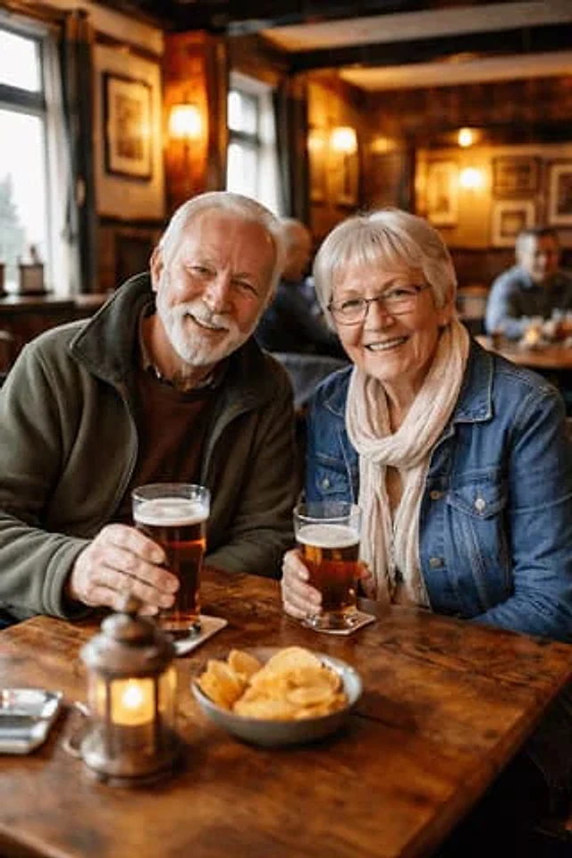

```text
Using REFERENCE_0, transform the older couple so they both look directly at the camera and smile. For the man on the left, add a {argument name="man's facial hair" default="Thick white beard"} Take off his glasses and put a coat on him.{argument name="man's clothing" default="Green fleece jacket"} For the lady on the right, add glasses, change her hairstyle to straight hair with bangs, and dress her in a {argument name="woman's clothing" default="denim jacket and white scarf"} Have both main characters hold beer mugs. Add a bowl of potato chips and a lit lantern to the wooden table. Replace the background with {argument name="background setting" default="A warm, blurred bar interior scene with two customers in the background."} .
```

Model: GPT Image 2
Author: GPT Image 2 Prompts

[ProjectD](https://aitoolsradar.com/en/prompts/25942f1a2f556c) · [Recorded source](https://x.com/FloatboatAI/status/2044755011809456477#reversed-0)
 · [Full original metadata and byte evidence](data/projectd-batch-0026.json)

## Courtroom Sketch Rabbit Witness

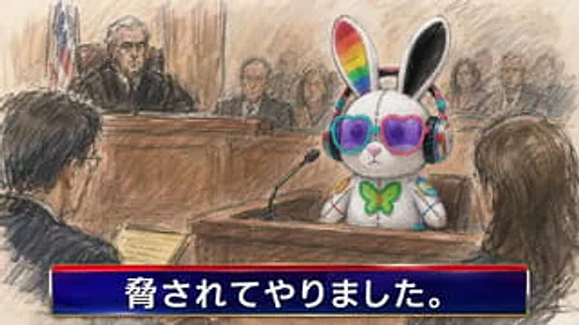

```text
Create a satirical courtroom news sketch in the style of a hand-drawn pastel and charcoal courtroom artist illustration. The scene shows a wooden courtroom with a judge on the raised bench at the back left, a U.S. flag behind the judge, warm beige walls, rough pencil shading, and a documentary news feel. In the witness stand at center-right sits {argument name="witness character" default="a cute white plush rabbit mascot"}: it has tall rabbit ears with one inner ear rainbow-striped and the other black, large round purple lenses in mismatched turquoise and pink frames, colorful over-ear headphones, stitched seams down the face and body, a green butterfly bow tie, and small bright decorative patches on its arms. A black gooseneck microphone points toward the witness from the wooden stand. In the foreground, show two dark, sketchy human figures from behind: one lawyer on the left holding a yellow legal pad, and one person with long brown hair on the right facing the witness. Include exactly 10 anonymized human face blocks in the courtroom: 1 blurred rectangular face on the judge, 1 large blurred rectangle on the left foreground lawyer, 4 small blurred faces among the central background spectators, and 4 small blurred faces among the right-side background spectators. Keep the human faces featureless, covered by soft brown-gray rectangular blur blocks. Add a glossy TV-news lower-third banner across the entire bottom: a deep navy blue gradient rectangle with a bright red top strip, thin metallic gold edges, and large bold white Japanese text reading {argument name="lower third text" default="脅されてやりました。"}. Use a 16:9 horizontal composition, slightly chaotic courtroom sketch lines, muted browns and grays contrasted with the vivid colorful rabbit accessories, no photorealism, no watermark, no extra captions.
```

Model: GPT Image 2
Author: miya / MYST（みや／ミスト）

[ProjectD](https://aitoolsradar.com/en/prompts/4e812b65b35ecb) · [Recorded source](https://youmind.com/prompts/courtroom-rabbit-witness-22442)
 · [Full original metadata and byte evidence](data/projectd-batch-0026.json)

## Courtside Knicks Fan Photo

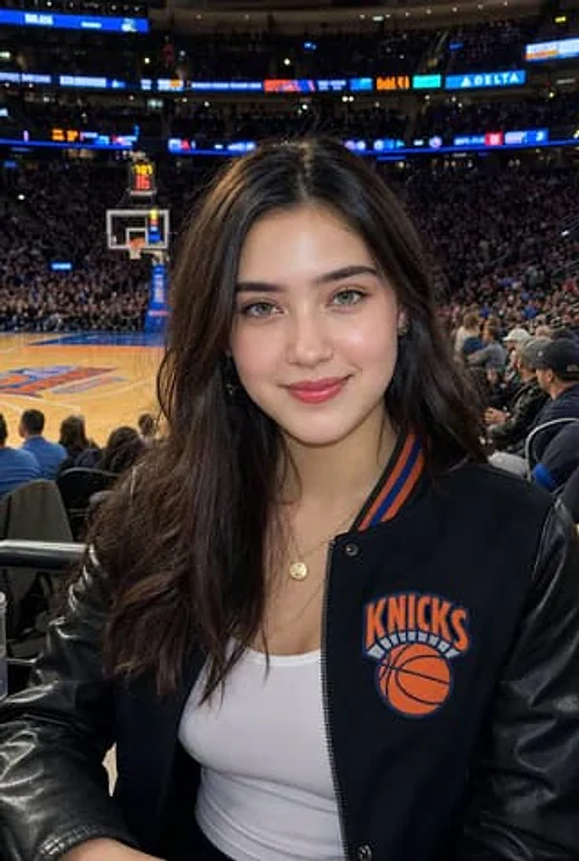

```text
Create a photorealistic vertical smartphone photo of a {argument name="subject" default="young woman NBA fan"} seated courtside in a packed basketball arena, framed waist-up in a close closeup. She has long natural dark brown hair with soft loose waves and volume, parted near the center, falling over her shoulders. Her face is intentionally covered by a large opaque rectangular privacy block in a muted brown skin-tone color, centered over the entire face. She wears a black fitted New York Knicks varsity jacket with shiny black leather sleeves, orange-and-blue striped collar trim, snap buttons, and a visible Knicks basketball logo patch on the left chest, over a fitted white tank top. Add a small gold pendant necklace at her collarbone and a subtle small earring. The background shows Madison Square Garden-style NBA game atmosphere: hardwood court visible to the left, basketball hoop and shot clock in the distance, dense arena crowd in dark seats, bright blue LED ribbon boards, scoreboard lights, and a visible Delta sign, all slightly out of focus with realistic depth of field. Lighting should be authentic indoor arena lighting with crisp phone-camera detail, natural contrast, slight wide-angle perspective, candid fan snapshot feeling, no glamour studio lighting, no extra text overlays, no watermark.
```

Model: GPT Image 2
Author: Hania Ai

[ProjectD](https://aitoolsradar.com/en/prompts/36316faed80d88) · [Recorded source](https://youmind.com/prompts/knicks-courtside-fan-photo-20960)
 · [Full original metadata and byte evidence](data/projectd-batch-0026.json)

## Couture Garment Process Infographic

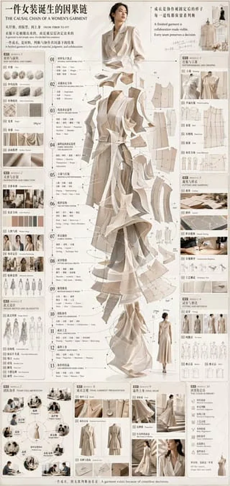

```text
{
  "type": "Fashion Design Infographic Poster",
  "style": "This project showcases editorial-level haute couture craftsmanship, a minimalist luxury brand style, a soft beige monochrome palette, a clean white background, meticulous technical lines, a delicate paper texture, elegant serif fonts and small capital letters, and a bilingual (Chinese and English) fashion presentation.",
  "subject": {
    "theme": "The complete decision-making chain behind a women's garment, from fabric research to the final finished product.",
    "centerpiece": "A tall female model's front-facing photo shows her in an avant-garde deconstructed gown, crafted from layers of ivory, sand, taupe, and warm beige fabrics. Semi-transparent patterns, draped fragments, and structural lines float around her body like an exploded diagram.",
    "model": {
      "face": "Deliberately blur or obscure",
      "pose": "Stand upright with arms relaxed, showcasing your posture in a haute couture style."
    },
    "garment": {
      "type": "floor-length sleeveless haute couture gown",
      "silhouette": "A cylindrical base, paired with dramatic asymmetrical layered drapes, sculptural pleats, flared hem, and fragmented pattern extensions.",
      "materials": "Matte fabric, lightweight organza overlay, plain weave fabric sample garment texture, pattern aesthetics"
    }
  },
  "layout": {
    "orientation": "Vertical poster",
    "density": "Information-intensive",
    "sections": [
      {
        "title": "The Cause and Effect Chain of the Birth of a Women's Clothing",
        "position": "Top title",
        "count": 1,
        "labels": [
          "THE CAUSAL CHAIN OF A WOMEN'S GARMENT"
        ]
      },
      {
        "title": "Fabrics and Materials",
        "position": "Top left",
        "count": 6,
        "labels": [
          "fiber",
          "yarn structure",
          "Fabric structure",
          "weight",
          "drape",
          "Surface texture"
        ]
      },
      {
        "title": "Inspiration and Planning",
        "position": "Top left center",
        "count": 6,
        "labels": [
          "Inspiration",
          "Color direction",
          "female image",
          "Occasion positioning",
          "Contouring intention",
          "Design sketch"
        ]
      },
      {
        "title": "Design and Outline",
        "position": "Left center bottom",
        "count": 7,
        "labels": [
          "Drooping sketch",
          "structural lines",
          "Morphological sketch relationship",
          "Volume lines",
          "Wearing line",
          "Dynamic Line",
          "Proportion"
        ]
      },
      {
        "title": "Central Information Chain",
        "position": "center left and center",
        "count": 13,
        "labels": [
          "Raw materials and fabrics",
          "Material density force",
          "Inspiration becomes direction",
          "The sketch determines the shape",
          "Draping practice shapes the silhouette",
          "Draping and Pattern Making",
          "Paper pattern system",
          "Sample garment sewing",
          "Fitting Reveals the Truth",
          "Revise to make it perfect",
          "Teamwork",
          "Final garment",
          "Collaborative visualization"
        ]
      },
      {
        "title": "Pattern making and draping",
        "position": "Top right",
        "count": 6,
        "labels": [
          "Pattern making",
          "Cutting line",
          "balance",
          "Thread direction",
          "Pattern making",
          "Court proceedings"
        ]
      },
      {
        "title": "Cutting and Sample Garments",
        "position": "Right Center",
        "count": 5,
        "labels": [
          "Cutting",
          "Discharge",
          "Sample garment sewing",
          "Combination order",
          "Technical testing"
        ]
      },
      {
        "title": "Trying on and altering",
        "position": "Right center bottom",
        "count": 4,
        "labels": [
          "Trial assembly test",
          "Before modification",
          "After modification",
          "Correction"
        ]
      },
      {
        "title": "Teamwork",
        "position": "Bottom left",
        "count": 8,
        "labels": [
          "Design Team",
          "Pattern maker",
          "Fabric table",
          "Fitting Model",
          "Design Review",
          "Technical Conference",
          "Product planning",
          "Quality control"
        ]
      },
      {
        "title": "Ready-to-wear presentation",
        "position": "Shimonaka",
        "count": 5,
        "labels": [
          "modeling",
          "Front and rear views of the finished product",
          "Labels and Sizes",
          "Package",
          "detail"
        ]
      },
      {
        "title": "Final body",
        "position": "Lower Middle Right",
        "count": 4,
        "labels": [
          "Drooping",
          "Proportion",
          "Dynamic aesthetics",
          "close up"
        ]
      },
      {
        "title": "Cause and effect summary",
        "position": "Bottom right",
        "count": 6,
        "labels": [
          "Materials Fundamentals",
          "Aesthetic judgment",
          "Structural Engineering",
          "process precision",
          "Body game",
          "All of these factors shaped a result."
        ]
      }
    ],
    "additional_elements": {
      "technical_drawings": 12,
      "fabric_swatches": 8,
      "process_photos": 23,
      "mini figure sketches": 10,
      "diagram_arrows": "Numerous fine lines, arrows, and numbered explanations connect the process steps to the central garment."
    }
  },
  "text": {
    "headline_cn": "The Cause and Effect Chain of the Birth of a Women's Clothing",
    "headline_en": "THE CAUSAL CHAIN OF A WOMEN'S GARMENT",
    "top_right_quote": "The finished garments are visible, and so is the collaboration. Every stitch carries the weight of a decision.",
    "footer": "The existence of a garment stems from countless decisions."
  },
  "color_palette": {
    "primary": "{argument name=\"primary palette\" default=\"Ivory, cream, sand, beige, gray-brown\"}",
    "background": "warm white",
    "accent": "Light gray lines and soft brown text"
  },
  "rendering": {
    "lighting": "Soft studio lighting, diffused and with gentle shadows.",
    "detail_level": "Extremely high",
    "composition": "Magazine-quality infographic, model centered, flanked by narrow modular panels.",
    "mood": "Intellectual, refined, process-driven, haute couture studio style"
  }
}
```

Model: GPT Image 2
Author: GPT Image 2 Prompts

[ProjectD](https://aitoolsradar.com/en/prompts/484a447a66c201) · [Recorded source](https://x.com/hx831126/status/2046454226080219281#reversed-3)
 · [Full original metadata and byte evidence](data/projectd-batch-0026.json)

## Couture Garment Process Infographic


```text
{"type":"fashion design infographic poster","style":"editorial couture process board, minimalist luxury branding, soft beige monochrome palette, clean white background, fine technical linework, delicate paper texture, elegant serif and small caps typography, bilingual Chinese and English fashion presentation","subject":{"theme":"the full decision chain behind a women's garment from material research to final dress","centerpiece":"a tall front-facing female model wearing an avant-garde deconstructed gown in layered ivory, sand, taupe, and warm beige fabric panels, with semi-transparent pattern pieces, drape fragments, and construction lines floating around the body like an exploded view","model":{"face":"intentionally blurred or obscured","pose":"standing upright, arms relaxed, couture presentation stance"},"garment":{"type":"floor-length sleeveless couture dress","silhouette":"column base with dramatic asymmetrical layered draping, sculptural folds, flared lower panels, and fragmented pattern-like extensions","materials":"matte woven fabric, sheer organza-like overlays, muslin toile textures, paper-pattern aesthetics"}},"layout":{"orientation":"vertical poster","density":"information-dense","sections":[{"title":"一件女装诞生的因果链","position":"top header","count":1,"labels":["THE CAUSAL CHAIN OF A WOMEN'S GARMENT"]},{"title":"面料与材料","position":"upper left","count":6,"labels":["Fiber","Yarn Structure","Fabric Construction","Weight","Drape","Surface Texture"]},{"title":"灵感与企划","position":"left upper-middle","count":6,"labels":["Inspiration Source","Color Direction","Woman Image","Occasion Positioning","Silhouette Intention","Design Sketch"]},{"title":"设计与轮廓","position":"left lower-middle","count":7,"labels":["Drape Sketch","Construction Line","Form Sketch Relationship","Volume Line","Wear Line","Movement Line","Proportion"]},{"title":"中央信息链","position":"center left and center","count":13,"labels":["RAW MATERIAL AND FABRIC","MATERIAL DENSITY FORCE","INSPIRATION BECOMES DIRECTION","SKETCH DECIDES SHAPE","DRAPE PRACTICE SHAPES THE SILHOUETTE","DRAPING & PATTERNMAKING","THE PATTERN SYSTEM","SAMPLE SEWING","FITTING REVEALS TRUTH","REVISED MAKES IT RIGHT","TEAM COLLABORATION","FINAL CONSTRUCTION","COLLABORATION MADE VISIBLE"]},{"title":"打版与立裁","position":"upper right","count":6,"labels":["Pattern Drafting","Panel Line","Balance","Grain Direction","Patternmaking","Draping"]},{"title":"裁剪与样衣","position":"right middle","count":5,"labels":["Cutting","Layout","Sample Sewing","Combination Sequence","Technology Test"]},{"title":"试穿与修正","position":"right lower-middle","count":4,"labels":["Fit test","Before","After","Revision"]},{"title":"团队协作","position":"bottom left","count":8,"labels":["Design Team","Patternmaker","Fabric Table","Fit Model","Design Review","Technical Meeting","Merchandising","QC"]},{"title":"成衣呈现","position":"bottom center","count":5,"labels":["Look","Finished Front & Back","Label & Cm","Packaging","Detail"]},{"title":"最终上身","position":"bottom center-right","count":4,"labels":["Drape","Proportion","Movement in Motion","Close-up"]},{"title":"因果总结","position":"bottom right","count":6,"labels":["Material Base","Aesthetic Judgment","Structural Engineering","Craft Precision","Body Negotiation","All these shape one result"]}],"additional_elements":{"technical_drawings":12,"fabric_swatches":8,"process_photos":23,"mini figure sketches":10,"diagram_arrows":"many thin annotation arrows and numbered callouts connecting process steps to the central garment"}},"text":{"headline_cn":"一件女装诞生的因果链","headline_en":"THE CAUSAL CHAIN OF A WOMEN'S GARMENT","top_right_quote":"A finished garment is visible, collaboration made visible. Every seam preserves a decision.","footer":"A garment exists because of countless decisions."},"color_palette":{"primary":"{argument name=\"primary palette\" default=\"ivory, cream, sand, beige, taupe\"}","background":"warm white","accent":"light gray linework and muted brown text"},"rendering":{"lighting":"soft studio lighting, diffuse and shadow-light","detail_level":"very high","composition":"magazine-quality infographic with the model centered and narrow modular side panels","mood":"intellectual, refined, process-driven, couture atelier"}}
```

Model: GPT Image 2
Author: 虎小象

[ProjectD](https://aitoolsradar.com/en/prompts/20139e88f99f33) · [Recorded source](https://youmind.com/prompts/couture-garment-process-infographic-14169)
 · [Full original metadata and byte evidence](data/projectd-batch-0026.json)

## Cozy Academia 学习手记

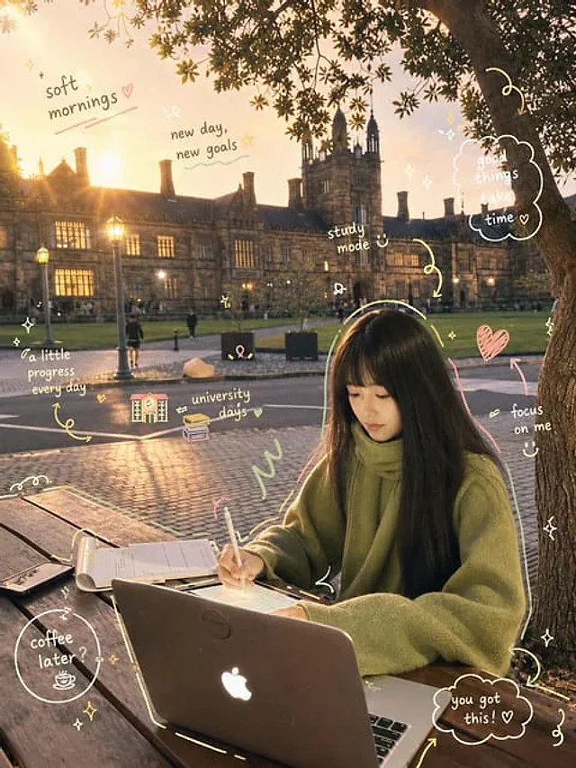

```text
Dreamy cinematic study aesthetic, young Asian girl with long dark hair studying outdoors at a wooden table during golden hour, cozy oversized green sweater and scarf, writing in notebook beside open laptop, historic university campus in background, warm sunset lighting, soft glow, autumn atmosphere, aesthetic doodles and handwritten notes floating around image, kawaii scrapbook style overlays, pastel hearts and stars, motivational text, shallow depth of field, nostalgic film grain, soft beige and warm green tones, peaceful productive vibe, ultra detailed, Pinterest aesthetic, photorealistic, cozy academia style, 35mm film look
```

Model: GPT Image 2
Author: @Sairah_0

[ProjectD](https://aitoolsradar.com/en/prompts/dc1e698bed33d0) · [Recorded source](https://x.com/Sairah_0/status/2052969695406325875)
 · [Full original metadata and byte evidence](data/projectd-batch-0026.json)

## Cozy AI Agents Studio Group Portrait

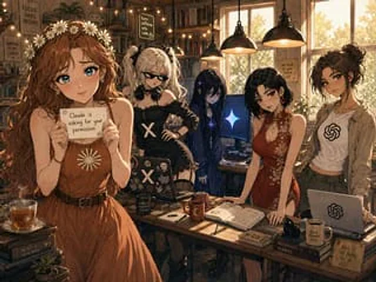

```text
A warm and detailed anime-style illustration, set in a cozy yet slightly cluttered independent studio, blending the atmosphere of a bookstore café and a startup studio. Golden afternoon sunlight streams in through a high window on the right, illuminating four black industrial-style pendant lights hanging from the ceiling. The background is adorned with string lights, bookshelves overflowing with books, greenery, and handwritten inspirational slogans. The image depicts five young women standing around a large wooden workbench, framed as a wide-angle group photo. The overall atmosphere is whimsical yet slightly ironic, ambitious yet somewhat chaotic. On the far left is a tall woman with long, wavy hair {argument name="hair color" default="reddish-brown"} The woman, with her hair disheveled, wore a daisy wreath and a rust-brown sleeveless dress with a white sun-patterned emblem, cinched at the waist with a dark belt; she showed the audience a handwritten note that read {argument name="note text" default="Claude is asking for your permission"} On the side table beside her sat a cup of tea, a stack of books, and a small potted plant. Beside her stood a punk-style blonde woman with pigtails tied with black bows, large black headphones around her neck, and a black off-the-shoulder dress with a prominent white X logo on the chest; she stood confidently next to a laptop covered in stickers and bearing the same X logo. In the center of the background, a mysterious, slender girl with extremely long, deep navy blue-black hair and fair skin stood quietly in front of a monitor, its screen shimmering with blue starlight, wearing a gothic-style dark dress. To the right center, an elegant woman wore a fitted red cheongsam-style dress with floral embroidery and a side slit, one hand resting on a wooden table, an open notebook beside her filled with sketches and writing. On the far right, a casually dressed brown-haired woman with her hair messily tied in a bun wore a white T-shirt with a black knotted AI logo, layered under a beige shirt, standing behind a silver laptop with the same logo. Scattered on the main desk are many cozy office supplies: two mugs, an open notebook, a pen, a small black figurine, a stack of books, and several laptops. Throughout the room are clearly visible handwritten notes and slogans: "FOCUS SHIPS DREAMS" in the upper left corner, "SHIPPING IS MY CARDIO" on the left wall, "turn caffeine into code" near the top center, "be kind to your future self" near the window, "The Art of Asking Nicely" on the spine of a book in the lower left corner, "WORLD'S OKAYEST MODEL" on a black mug in the center left, "MOONSHOT DIARIES" on a stack of books in the lower right, "Good Prompts Only" on a mug in the lower right, and "AGI is already for ready us" with a small doodle on a sticky note in the lower right corner. It employs painterly lines, intricate textures, highly expressive and fashionable shapes, warm brown and amber tones, soft cinematic depth of field, and sophisticated social media viral illustration aesthetics.
```

Model: GPT Image 2
Author: GPT Image 2 Prompts

[ProjectD](https://aitoolsradar.com/en/prompts/f1be7160023492) · [Recorded source](https://x.com/dejavucoder/status/2047282212169768977#reversed-0)
 · [Full original metadata and byte evidence](data/projectd-batch-0026.json)

## Cozy AI Agents Studio Group Portrait


```text
A warm, highly detailed anime-style illustration set in a cozy, cluttered indie workspace that feels like a book café mixed with a startup studio, lit by golden afternoon sunlight streaming through tall windows on the right and by 4 black industrial pendant lamps hanging from the ceiling, with string lights, overflowing bookshelves, plants, and handwritten motivational signs covering the background. Show 5 young women standing around a large wooden worktable, framed as a wide group portrait. The mood is whimsical, slightly satirical, and aspirational-but-chaotic. On the far left, place a tall woman with very long wavy {argument name="hair color" default="auburn"} hair wearing a crown of white daisies and a sleeveless rust-brown dress with a white sunburst emblem on the chest and a dark belt at the waist; she holds a small handwritten note toward the viewer that reads exactly {argument name="note text" default="Claude is asking for your permission"}. In front of her on a side table is a glass cup of tea, a book stack, and a tiny potted plant. Next to her, place a punky blonde woman with twin ponytails tied with black bows, large black headphones resting around her neck, and an off-shoulder black dress marked with a bold white X on the torso; she stands confidently beside an open sticker-covered laptop with another large X logo. In the center rear, place a mysterious slim girl with extremely long dark navy-black hair, pale skin, and a gothic dark dress, standing quietly in front of a desktop monitor showing a blue glowing star or sparkle on a dark screen. To the right of center, place an elegant woman in a fitted red cheongsam-inspired dress with floral embroidery and a side slit, leaning one hand on the wooden table near an open notebook filled with sketches or writing. On the far right, place a casually dressed brunette with messy hair in a bun, wearing a white T-shirt with a black knot-like AI logo under an open beige overshirt, standing behind an open silver laptop with the same logo. Scatter many cozy desk objects across the main table: 2 mugs, 1 open notebook, 1 pen, 1 small black figurine, 1 closed book stack, and laptops. Add readable handwritten wall notes and signs throughout the room: “FOCUS SHIPS DREAMS” on the upper left, “SHIPPING IS MY CARDIO” on the left wall, “turn caffeine into code” near the top center, “be kind to your future self” near the window, “The Art of Asking Nicely” on a book spine at lower left, “WORLD’S OKAYEST MODEL” on a black mug near center-left, “MOONSHOT DIARIES” on a book stack near lower right, “Good Prompts Only” on a mug at lower right, and a sticky note at the bottom right reading “AGI is already for ready us” with a small doodle. Use painterly linework, intricate textures, expressive fashion styling, warm brown and amber color grading, soft cinematic depth, and a polished social-media-viral illustration aesthetic.
```

Model: GPT Image 2
Author: sankalp

[ProjectD](https://aitoolsradar.com/en/prompts/cc405e4a2b9de8) · [Recorded source](https://youmind.com/prompts/cozy-agent-studio-group-portrait-15454)
 · [Full original metadata and byte evidence](data/projectd-batch-0026.json)

## Cozy AI Art Studio Collaboration

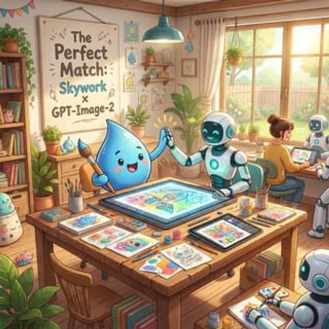

```text
A warm, whimsical digital illustration of a cozy sunlit art studio showing a friendly collaboration between a cute blue water-drop mascot and cheerful white-and-teal robots. In the foreground, a large wooden worktable is covered with art supplies and finished sketches: exactly 3 paintbrush cups, multiple pencils and pens, watercolor palettes, small paint jars, loose character drawings, and 2 digital drawing tablets. At the center of the table, one large horizontal pen-display tablet shows a colorful pastel illustration in progress. The blue droplet character, with glossy rounded body, tiny arms, rosy cheeks, and a happy open smile, sits on the left holding a paintbrush and giving a high-five to a humanoid robot seated on the right. The robot has a smooth white body with teal glowing accents, a dark face screen with bright cyan smiling eyes, and one hand touching the tablet while the other meets the mascot’s hand, with small celebratory spark lines around the high-five. In the midground on the right, exactly 2 more robots are visible: one seated beside a human artist and one partially visible in the lower-right corner drawing on paper. The human artist is seen from behind, hair in a bun, sitting at a desk near the window and working on a tablet. The studio is filled with cozy decorative details: a large framed poster on the left wall reading "The Perfect Match: Skywork x GPT-Image-2", a bookshelf packed with books and cute objects, potted plants throughout the room, framed mini art prints, wall shelves with jars and decor, hanging bunting in the upper left, a teal pendant lamp above the table, and a large window on the right with cream curtains revealing a bright garden, fence, and soft greenery outside. Use soft golden morning light, pastel colors, polished children’s-book-style rendering, clean linework, gentle shading, inviting creative atmosphere, highly detailed props, and a polished cinematic composition that feels like an uplifting promotional illustration for {argument name="brand collaboration text" default="Skywork x GPT-Image-2"}.
```

Model: GPT Image 2
Author: FELIX

[ProjectD](https://aitoolsradar.com/en/prompts/9506ab6bfbfd2e) · [Recorded source](https://youmind.com/prompts/mascot-robot-art-collaboration-17466)
 · [Full original metadata and byte evidence](data/projectd-batch-0026.json)

## Cozy Anime ASMR Ear Massage Girl


```text
A soft, dreamy anime illustration depicts a lovely young woman livestreaming ASMR in her cozy bedroom at night. She sits close to the camera, knees bent, with a black 3Dio-style binaural microphone placed in the center of the frame. She has {argument name="hair color" default="Dark purple"} Her hair was tied into a messy, casual bun, with wispy bangs framing her face, and she possessed a pair of sparkling eyes.{argument name="eye color" default="blue"} She has large eyes, a gentle blush on her face, and a sweet smile. Her head is tilted slightly towards the camera, her posture intimate and warm. She wears a delicate white lace camisole, with a cardigan draped over her shoulders.{argument name="cardigan color" default="Soft pinkish purple"} The oversized, fluffy knit cardigan creates a gentle, intimate, and healing atmosphere for the late night. Her hands gently touch the white silicone earpiece of the microphone, as if preparing to give an ear massage. The room is decorated with soft pink and amber ambient lighting, with heavy curtains in the background, a bed or sofa with plush cushions, warm fairy-tale light spots, and a small plant on the right. The scene incorporates glowing Japanese handwritten neon text: on the left are four text elements, namely “とろける”, “耳”, “マッサージ”, and “ASMR”, with two small heart symbols; on the right is the vertical text “いっぱい癒してあげるね…♡”. Adopting a refined modern anime style, the face and hair are richly detailed, the eyes are bright and expressive, the skin is smooth and delicate, the shadows are soft, with soft pastel highlights, a shallow depth of field effect, a romantic and warm live stream thumbnail composition, and a healing feminine color scheme dominated by pink, lavender, cream and warm gold.
```

Model: GPT Image 2
Author: GPT Image 2 Prompts

[ProjectD](https://aitoolsradar.com/en/prompts/f7a8f05b768c93) · [Recorded source](https://x.com/Shion_yamabuki/status/2047232198382964969#reversed-0)
 · [Full original metadata and byte evidence](data/projectd-batch-0026.json)

## Cozy Bakery Owner Character Sticker

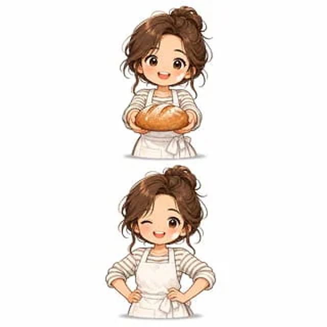

```text
Chibi-style square character sticker design of a cheerful YOUNG WOMAN bakery owner: round friendly face, soft feminine features, long hair loosely tied up with a few strands escaping, small flour smudge on one cheek, oversized white apron over a striped shirt, holding a freshly baked loaf of bread with both hands. Two pose variations of the SAME female character stacked vertically inside the 1:1 frame: top pose smiling and offering bread, bottom pose hands on hips winking. Clean white background with subtle drop shadow under each pose. No text, no shop name, no watermark. Clean line art, warm pastel palette, sticker-pack ready design. Aspect ratio MUST be exactly 1:1 (square).
```

Model: GPT Image 2
Author: @hiapi_ai

[ProjectD](https://aitoolsradar.com/en/prompts/3355fa4dfd640b) · [Recorded source](https://github.com/HiAPIAI/awesome-gpt-image-2-prompts)
 · [Full original metadata and byte evidence](data/projectd-batch-0026.json)

## Cozy Study Room Night Portrait

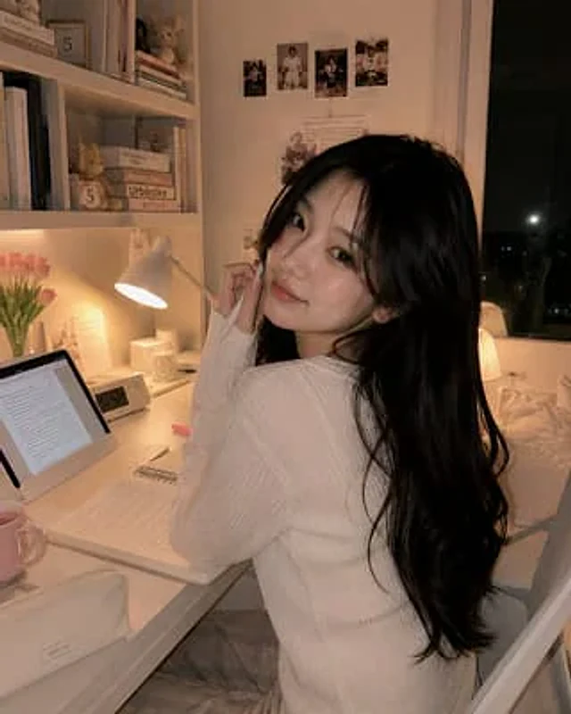

```text
Ultra-realistic cozy Korean study-room portrait of a {argument name="subject" default="beautiful Korean woman"} sitting casually on top of a white study desk beside her laptop at night, knees folded softly toward her body while turning her upper body toward the camera with a gentle shy smile. Wearing a {argument name="outfit" default="soft off-shoulder cream lounge top with loose cozy shorts"} matching the relaxed late-night study aesthetic. Long silky black hair flowing naturally down her back, glossy eyes, soft blush makeup, natural skin texture, dreamy youthful Korean beauty aesthetic.
Warm ambient desk-lamp lighting mixed with subtle realistic iPhone flash photography for cinematic highlights and soft shadows. Cozy Korean apartment study setup with an open laptop on the desk, handwritten notes, notebooks, pens, candles, pastel stationery, cute bookshelves with plush toys and books, tiny photo cards on the wall, flowers in a vase, cream bedding nearby, and nighttime city lights glowing outside the window.
Romantic slice-of-life atmosphere, intimate late-night studying vibe, candid relaxed pose, cozy feminine aesthetic, soft cream and pastel pink color palette, shallow depth of field, cinematic composition, highly detailed, photorealistic Korean room vibe, soft glow, lifestyle editorial photography, calm comforting atmosphere, realistic apartment interior.
```

Model: GPT Image 2
Author: Johnn

[ProjectD](https://aitoolsradar.com/en/prompts/abe0d7d497ab64) · [Recorded source](https://youmind.com/prompts/cozy-study-room-night-portrait-21044)
 · [Full original metadata and byte evidence](data/projectd-batch-0026.json)

## Crayon Style Drawing Prompt


```text
{argument name="subject" default="a cute animal"} Crayon illustrations, hand-drawn style, soft wax texture, visible doodle marks, uneven coloring, playful childlike style, simple shapes, charming imperfections, layered crayon strokes, textured paper surface, warm nostalgia, vibrant colors, clean white background.
```

Model: GPT Image 2
Author: GPT Image 2 Prompts

[ProjectD](https://aitoolsradar.com/en/prompts/ef7811d38dc6b2) · [Recorded source](https://x.com/Strength04_X/status/2047182346034778387)
 · [Full original metadata and byte evidence](data/projectd-batch-0026.json)

## Crayon Style Illustration Profile Picture

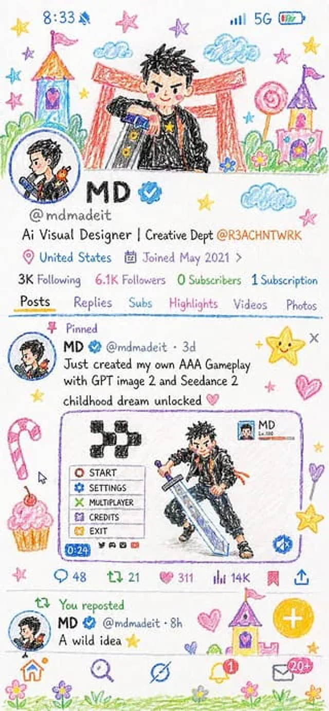

```text
Rework the given image into a crayon-style illustration, transforming the entire scene into something that feels hand-drawn by a 10-year-old. Keep the forms simple and slightly imperfect, like a child’s drawing. Avoid using the original color palette—replace it with bright, playful crayon colors on a clean white paper background. Aim for a soft, cute, and innocent aesthetic. Incorporate fun, childlike details such as castles or towers, candy, stars, clouds, and other whimsical decorations to amplify the playful vibe. The final result should feel charming, colorful, and full of childlike imagination.
```

Model: GPT Image 2
Author: MD

[ProjectD](https://aitoolsradar.com/en/prompts/6f615590eb665d) · [Recorded source](https://youmind.com/prompts/crayon-style-illustration-prompt-17740)
 · [Full original metadata and byte evidence](data/projectd-batch-0026.json)

## Crayon Style Image Transformation

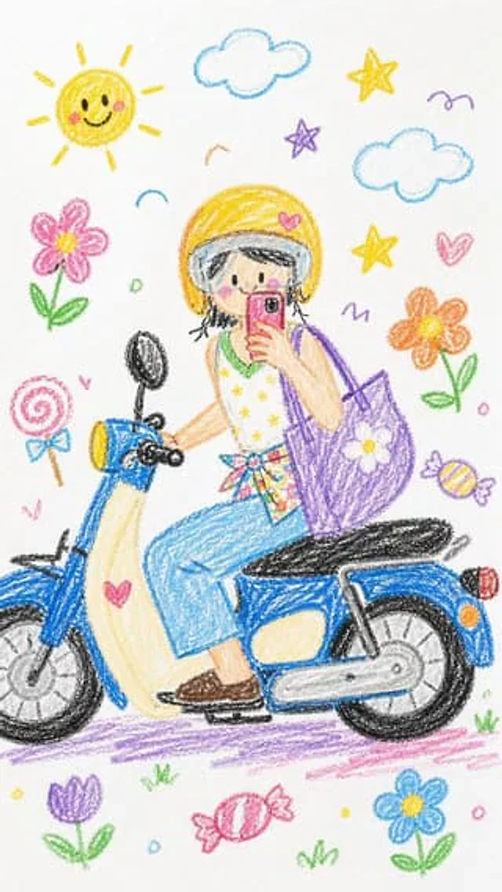

```text
Please turn the whole image into a {argument name="style" default="crayon-style drawing"}. Simplify the details so it looks like something a {argument name="age" default="10-year-old"} would draw. Don’t use the original colors from the photo. Make it look like it’s drawn on white paper, with a very cute and playful feel. You can add adorable elements like {argument name="elements" default="flowers, candy, stars, clouds"}, etc., to make it look more childlike and innocent.
```

Model: GPT Image 2
Author: Oogie

[ProjectD](https://aitoolsradar.com/en/prompts/d6d4979cd8d77f) · [Recorded source](https://youmind.com/prompts/playful-crayon-drawing-transformation-19632)
 · [Full original metadata and byte evidence](data/projectd-batch-0026.json)

## Cream Skincare Bottle on Travertine


```text
Minimalist commercial still life of a single cream-colored skincare pump bottle standing on a polished travertine stone surface. Soft warm window light from the upper left casts a clean elongated shadow to the right. Beige, ivory and putty palette with subtle vein texture in the stone. Sharp focus on the bottle label area, shallow depth of field, no text on the label, no logo, no watermark. Editorial e-commerce hero shot, square 1:1 composition, professional product photography, ultra detailed glass and ceramic textures.
```

Model: GPT Image 2
Author: @hiapi_ai

[ProjectD](https://aitoolsradar.com/en/prompts/cb4f1960755d8f) · [Recorded source](https://github.com/HiAPIAI/awesome-gpt-image-2-prompts)
 · [Full original metadata and byte evidence](data/projectd-batch-0026.json)

## Creative Dashboard UI Screenshot


```text
Please generate a [image/paper] for me.{argument name="style" default="palintir-style"} Styled dashboard screenshots for tracking{argument name="subject" default="All my remaining patience"}
```

Model: GPT Image 2
Author: GPT Image 2 Prompts

[ProjectD](https://aitoolsradar.com/en/prompts/ae3781e922a1e9) · [Recorded source](https://x.com/danveloper/status/2046636543717032213)
 · [Full original metadata and byte evidence](data/projectd-batch-0026.json)

## Creature Concept Reference Sheet

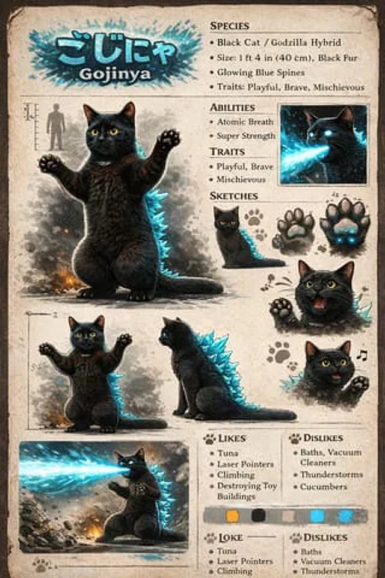

```text
{
  "type": "Biological concept art reference images",
  "style": "Vintage outdoor guide, parchment background, realistic illustrations",
  "subject": {
    "name": "{argument name=\"creature name\" default=\"Gojinya\"}",
    "japanese_name": "{argument name=\"japanese name\" default=\"ごじにゃ\"}",
    "base_animal": "{argument name=\"base animal\" default=\"Black Cat\"}",
    "hybrid_element": "{argument name=\"hybrid element\" default=\"Godzilla\"}",
    "features": "Black fur, glowing blue dorsal fin, yellow eyes"
  },
  "layout": {
    "header": {
      "text": [
        "{argument name=\"japanese name\" default=\"ごじにゃ\"}",
        "{argument name=\"creature name\" default=\"Gojinya\"}"
      ],
      "style": "Blue glowing lettering"
    },
    "main_portrait": "Full-body statue, standing on its hind legs in a monster pose, with smoke/flames beneath its feet, accompanied by a human silhouette scale.",
    "text_sections": [
      {
        "title": "Species",
        "bullet_count": 4
      },
      {
        "title": "ability",
        "bullet_count": 2
      },
      {
        "title": "feature",
        "bullet_count": 2
      },
      {
        "title": "Likes",
        "bullet_count": 4
      },
      {
        "title": "disgust",
        "bullet_count": 4
      },
      {
        "title": "Habits",
        "bullet_count": 3
      },
      {
        "title": "disgust",
        "bullet_count": 3
      }
    ],
    "action_panels": [
      "Top right corner illustration: Close-up of the head emitting blue atomic breath.",
      "Bottom left illustration: Emits blue atomic breath from its entire body, destroying rocks."
    ],
    "sketches": {
      "title": "sketch",
      "count": 5,
      "items": [
        "Sitting Cat",
        "ordinary flesh pads",
        "Glowing blue paw pads",
        "Roaring head",
        "Happy head with musical notes"
      ]
    },
    "additional_poses": {
      "count": 2,
      "items": [
        "Standing posture with scale",
        "Side sitting posture"
      ]
    },
    "color_palette": {
      "swatch_count": 5,
      "colors": [
        "orange color",
        "black",
        "grey",
        "light blue",
        "Bright blue"
      ]
    }
  }
}
```

Model: GPT Image 2
Author: GPT Image 2 Prompts

[ProjectD](https://aitoolsradar.com/en/prompts/6035cb13f9629d) · [Recorded source](https://x.com/c0tanpoTesh1ta/status/2044685484040049036#reversed-0)
 · [Full original metadata and byte evidence](data/projectd-batch-0026.json)

## Crimson Dark Sorceress Ritual

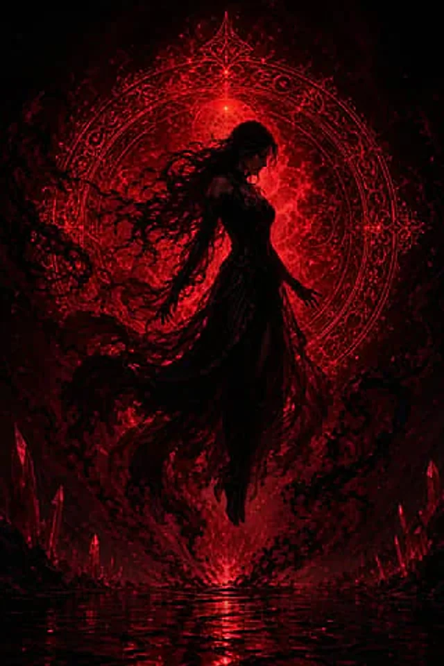

```text
A dark fantasy illustration features a woman suspended in the center, presented as an almost entirely black silhouette against a brightly glowing crimson background. She floats barefoot above the reflective, dark red water, her arms relaxed and slightly outstretched, fingers gently spread, her posture both composed and powerful. Her extremely long {argument name="hair color" default="black"} Her hair billowed wildly to the left in the gale; she wore a tattered, smoky, and semi-transparent garment.{argument name="dress color" default="black"} The gown, with its layers of ribbons and torn fabric trailing downwards, blended into the shadowy mist. Behind her was a massive, ornate circular magical rune, perfectly outlining her body like a halo. The rune, composed of intricate gothic filigree, concentric circles, and arcane lace-like geometric patterns, radiated a bright, blood-red light, its core a fiery white-red. The entire scene was dominated by black and crimson tones, with swirling smoke, embers, and magical energy filling the air. Two clusters of sharp red crystals emerged from the darkness in the lower left and right corners. At the bottom of the scene was a luminous, reflective pool, mirroring the red ripples above. This created a hellish, mysterious, and solemn atmosphere, as if {argument name="character role" default="a dark sorceress"} Awakening in a forbidden ritual chamber. High contrast, cinematic backlighting, volumetric lighting, ultra-detailed digital painting, vertical composition, centered symmetrical composition, somber elegance, no text, no additional characters, no visible facial details.
```

Model: GPT Image 2
Author: GPT Image 2 Prompts

[ProjectD](https://aitoolsradar.com/en/prompts/5910acfa3ec19b) · [Recorded source](https://x.com/LinK_iPhoto/status/2047565297566249305#reversed-1)
 · [Full original metadata and byte evidence](data/projectd-batch-0026.json)

## Crimson Space Opera Key Visual

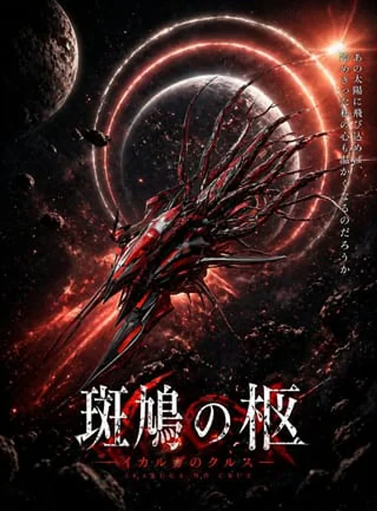

```text
A dramatic, vertical sci-fi key visual poster depicts a dark space opera game. A massive alien mechanical spaceship, diagonally tilted from the lower left to the upper right, appears to be speeding through space, positioned slightly below center. The ship's sharp, asymmetrical, and aggressively organic design is composed of layers of black metal and glowing crimson armor plates. It boasts a spear-like prow, numerous serrated fins, and approximately 12 to 16 whip-like tentacles or spikes resembling biomechanical hairs flowing from the upper rear. A large, shadowy planet hovers behind the ship, surrounded by three glowing red orbital rings, creating a halo effect. The upper left corner contains a partially cropped image of a cratered moon or planet. Multiple dark asteroids and rock fragments are scattered throughout the foreground and edges (especially the lower right and left corners) to create a sense of depth. The background is a dense star field, accompanied by red nebulae and streaks of incandescent cosmic dust. A dazzling orange-white solar flare shoots into the scene from the upper right corner, casting a fiery edge of light onto the spaceship and orbital ring. A high-contrast color palette of black, deep red, ember red, and white highlights creates a glossy metallic reflection and a stark, apocalyptic atmosphere. A vertical white Meijo-style Japanese slogan is added to the right: “あの太陽に飛び込めば冷めきった私の心も温かくなるのだろうか”. At the bottom center, a very large, cracked-textured, faintly reddish white Japanese serif main title is added: “斑鳩の柩”. Below this is a smaller red katakana subtitle: “イカルガのクルスー”, and below that, a line of lowercase red Roman letters: “IKARUGA NO CRUX”. The overall design presents a high-end art style reminiscent of anime and games, with cinematic poster composition, ultra-high detail, clear focus, dynamic lighting and shadows, and an epic scale that is both eerie and beautiful.
```

Model: GPT Image 2
Author: GPT Image 2 Prompts

[ProjectD](https://aitoolsradar.com/en/prompts/c3f5334a73c61e) · [Recorded source](https://x.com/AIs_of_Dragoon/status/2046543528248123770#reversed-0)
 · [Full original metadata and byte evidence](data/projectd-batch-0026.json)

## Cross-Device Social Media Feed


```text
A realistic over-the-shoulder photo shows a person with dark hair, wearing a gray shirt, sitting at a table looking at a large computer monitor, holding a black smartphone. A small object is placed on the lower left corner of the table.{argument name="drink on desk" default="White mug filled with black coffee"} The monitor displays a split-screen social media interface. The left sidebar is titled "{argument name="left column header" default="English post"} Below is a blurry feed of information. The right sidebar is in sharp focus and has the title "{argument name="right column header" default="Chinese copywriting"} Below the title on the right are two different social media posts: the upper post contains an avatar, pseudo-Chinese text, and {argument name="first post image" default="A landscape photo of a mountain lake."} And a heart-shaped icon displaying "2.5K"; the post below includes an avatar, pseudo-Chinese text,{argument name="second post image" default="A photo of dumplings on a plate"} And a heart-shaped icon displaying "1.8K". The person is holding a smartphone in their left hand, with their right index finger tapping the screen. The content displayed on the phone screen is exactly the same as the social media post about a mountain lake seen on the monitor. The image has a shallow depth-of-field effect, with the left side of the screen blurred to highlight the right sidebar and the phone screen.
```

Model: GPT Image 2
Author: GPT Image 2 Prompts

[ProjectD](https://aitoolsradar.com/en/prompts/beb58a1f0a9467) · [Recorded source](https://x.com/lizhanning/status/2046052296866648195#reversed-0)
 · [Full original metadata and byte evidence](data/projectd-batch-0026.json)

## Cross-Strait Dialogue Editorial Illustration


```text
This minimalist editorial illustration on cross-strait relations and dialogue employs a soft, flat paper collage style with delicate grainy textures and rounded shapes. The image depicts two figures seated side-by-side: on the left, a man in a deep, low-saturation blue suit rests his chin on his hand, deep in thought; on the right, a woman in a warm brown suit gestures with one hand, as if explaining. Both faces are obscured by softly blurred rectangular blocks of color to maintain anonymity. Between them lies a deep blue, symmetrical, vertically balanced scale, symbolizing fairness, negotiation, and balance. Above the figures are two overlapping speech bubbles, the left one blue-gray and the right one light beige, symbolizing communication and differing viewpoints. At the bottom center is a white silhouette of a human head containing a simple growing plant (with stem and leaves), symbolizing peace, understanding, or constructive thinking. The background is cream-colored, and the composition is surrounded by four large, semi-transparent abstract circles: a light gray shape on the far left, a beige shape in the upper right, a warm brown shape on the far right, and a dark blue-gray semicircle in the foreground at the bottom. Maintaining a balanced, calm, and symbolic composition, resembling a poster, the image is devoid of text and sharp outlines, employing a non-realistic style and a soft color palette of gray-blue, slate, beige, cream, and brown.
```

Model: GPT Image 2
Author: GPT Image 2 Prompts

[ProjectD](https://aitoolsradar.com/en/prompts/1240b0e96be6f7) · [Recorded source](https://x.com/geesehowardt7/status/2047313575132483959#reversed-0)
 · [Full original metadata and byte evidence](data/projectd-batch-0026.json)

## Crossover Platform Fighter Screenshot


```text
{
  "type": "3D platform fighting game screenshots",
  "style": "High-fidelity 3D rendering, vibrant colors, dynamic motion camera perspective, video game UI overlay.",
  "environment": {
    "stage": "{argument name=\"stage background\" default=\"A circular stone platform, adorned with glowing blue runes, is surrounded by jagged blue crystal structures, waterfalls, the ocean, and islands floating in the sky.\"}"
  },
  "characters": [
    {
      "role": "Player 1",
      "description": "{argument name=\"player 1 character\" default=\"Wakka from Final Fantasy X wears a yellow-orange outfit and a blue headband.\"}",
      "action": "Sprint forward and throw a projectile with a white, motion-blurred trajectory.{argument name=\"projectile\" default=\"Blue and white lightning ball\"}",
      "position": "Left side"
    },
    {
      "role": "Player 2",
      "description": "{argument name=\"player 2 character\" default=\"In Genshin Impact, Hu Tao wears a black and brown outfit and a hat decorated with flowers.\"}",
      "action": "Hit by the projectile, he staggered backward amidst a huge, stylized yellow and red shockwave.",
      "position": "Right side, in the air"
    }
  ],
  "ui_components": [
    {
      "position": "Top right corner",
      "type": "Match timer",
      "text": "5:47.23"
    },
    {
      "position": "bottom left corner",
      "type": "Player 1 HUD",
      "elements": [
        "Player 1 character avatar",
        "The nameplate displayed is 'WAKKA'",
        "The damage meter is displayed in yellow font as '56.2%'.",
        "3 small character remaining health icons"
      ]
    },
    {
      "position": "bottom right corner",
      "type": "Player 2 HUD",
      "elements": [
        "Player 2 character avatar",
        "The nameplate displayed is 'HU TAO'",
        "The damage meter is displayed in red font as '103.7%'.",
        "3 small character remaining health icons"
      ]
    },
    {
      "position": "Bottom Center",
      "type": "Game status overlay",
      "main_text": "{argument name=\"center text\" default=\"WAKKA leads the way!\"}",
      "sub_text": "1 - 0"
    }
  ]
}
```

Model: GPT Image 2
Author: GPT Image 2 Prompts

[ProjectD](https://aitoolsradar.com/en/prompts/89eadd80a18fc0) · [Recorded source](https://x.com/momoringo_sub/status/2044306634571428102#reversed-0)
 · [Full original metadata and byte evidence](data/projectd-batch-0026.json)

## Crumple Chair 概念沙发研发板

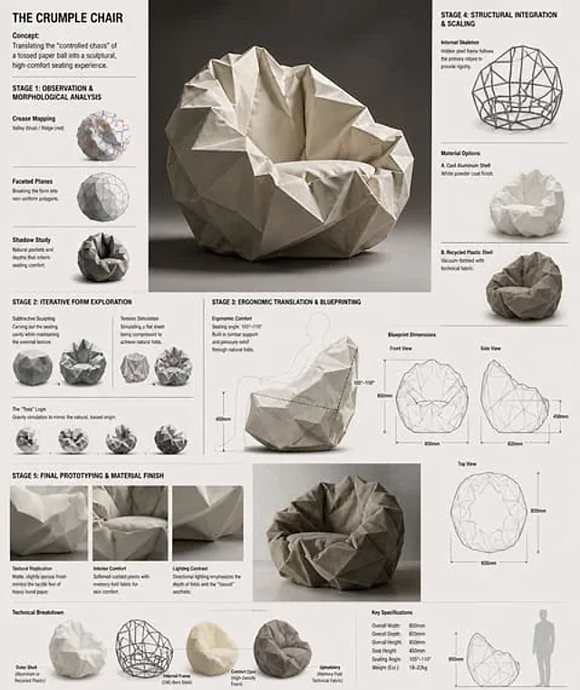

```text
Design Concept: The Crumple Chair Core Philosophy: Translating the "controlled chaos" of a tossed paper ball into a sculptural, high-comfort seating experience.

Stage 1: Observation & Morphological Analysis The goal is to deconstruct the image of the crumpled paper into usable geometric data. Crease Mapping: Identify the primary "valley" and "ridge" lines. These represent potential structural ribs or seams in the chair. Faceted Planes: Break down the sphere into a series of non-uniform polygons. Each flat surface of the paper becomes a potential panel for the chair’s upholstery or shell. Shadow Study: Analyze how the "tossed" form creates deep recesses. These natural pockets guide where the user’s weight will be cradled.

Stage 2: Iterative Form Exploration Moving from a sphere to a seat through "Digital Crumpling." Subtractive Sculpting: Imagine the paper ball as a solid mass. Use Boolean operations to "carve out" a seating cavity that fits the human form while maintaining the external jagged texture. Tension Simulation: Use 3D software (like Rhino or Blender) to simulate a flat sheet of material being compressed. This ensures the folds look authentic and not "modeled." The "Toss" Logic: Experiment with gravity-based simulation dropping a digital mesh to see how it settles naturally, mimicking the "tossed" origin.

Stage 3: Ergonomic Translation & Blueprinting Refining the raw aesthetic into a functional object. The Comfort Core: Overlay a standard ergonomic template (Seating Angle: 105°–110°) over the crumpled form. Adjust the internal "folds" to provide lumbar support and pressure relief. Blueprint Generation: Create technical orthographic views (Front, Side, Top). Map out the dimensions: Seat Height: 450mm Total Width: 850mm Surface Smoothing: Maintain the sharp "paper edges" on the exterior shell while softening the interior contact points for skin comfort.

Stage 4: Structural Integration & Scaling Making the concept physically viable. The Skeleton: Design a hidden internal frame (likely CNC-bent steel rods or a 3D-printed lattice) that follows the most prominent ridges of the paper folds to provide rigidity. Material Selection: * Option A (High-End): Faceted, cast aluminum with a white powder coat. Option B (Soft): Vacuum-formed recycled plastic shell covered in "memory-fold" technical fabric that retains a wrinkled appearance.

Stage 5: Final Prototyping & Material Finish Textural Replication: Apply a matte, slightly porous finish to the material to mimic the tactile feel of heavy-bond paper. Lighting Contrast: Use directional studio lighting in the final renders to emphasize the "tossed" shadows, making the chair look like a giant piece of discarded inspiration. Design Tip: To keep the "tossed" look authentic, avoid symmetry. The most compelling aspect of a crumpled paper ball is its unique irregularity—ensure the left and right sides of the chair are balance-equivalent but not identical
```

Model: GPT Image 2
Author: @ShamsAmin56

[ProjectD](https://aitoolsradar.com/en/prompts/7f492b282cc61b) · [Recorded source](https://x.com/ShamsAmin56/status/2050281206139461780)
 · [Full original metadata and byte evidence](data/projectd-batch-0026.json)

## Cubist Vector Caricature Portraits


```text
Create a funny geometric cubist-style vector caricature portrait inspired by modern minimalist editorial illustrations. The artwork should feature exaggerated facial proportions, long neck, angular jawlines, sharp polygonal shading, oversized expressive eyes, stylized hair, and flat pastel colors. Use a clean {argument name="background color" default="teal"} textured background with soft vignette edges. The art style should look like a playful retro vector poster mixed with cubism and fashion illustration aesthetics. Create four separate portraits in this exact same style: {argument name="subjects" default="1. Elon Musk in a black futuristic outfit, 2. Cristiano Ronaldo in a Portugal jersey, 3. Virat Kohli in an India cricket jersey, 4. Lionel Messi in an Argentina jersey"}. Style details: geometric polygon face design, flat vector shading, minimal smooth gradients, exaggerated funny proportions, long neck and sharp facial structure, modern cartoon/editorial illustration vibe, clean crisp edges, retro pastel color palette, no watermark, highly detailed vector art, centered composition, portrait poster format
```

Model: GPT Image 2
Author: Noor 🌸

[ProjectD](https://aitoolsradar.com/en/prompts/8e4edaae4c48da) · [Recorded source](https://youmind.com/prompts/cubist-geometric-vector-celebrity-caricatures-20551)
 · [Full original metadata and byte evidence](data/projectd-batch-0026.json)

## Cultural Garment Infographic

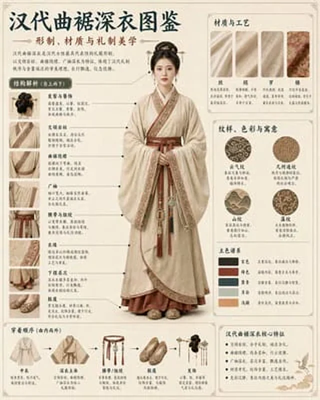

```text
{
  "type": "Integrated cultural infographics and visual guides",
  "subject": {
    "description": "{argument name=\"subject description\" default=\"Young Chinese women with elegant traditional hairstyles\"}",
    "garment": "Traditional Hanfu specifically refers to the Quju Shenyi (a type of robe).",
    "colors": "{argument name=\"garment color\" default=\"beige and brownish-red\"}",
    "pose": "Stand upright, facing forward, with your hands respectfully folded together."
  },
  "layout": {
    "background": "{argument name=\"background style\" default=\"Vintage parchment with delicate traditional borders\"}",
    "header": {
      "title": "{argument name=\"main title\" default=\"Illustrated Guide to Han Dynasty Curved-Hem Deep Robes\"}",
      "subtitle": "{argument name=\"subtitle\" default=\"Form, Material and Ritual Aesthetics\"}",
      "description": "Introductory paragraph introducing the history and significance of clothing"
    },
    "centerpiece": "Large-scale realistic full-body portrait of the main figure",
    "sections": [
      {
        "title": "Structural analysis (top to bottom)",
        "position": "Left sidebar",
        "count": 8,
        "format": "thumbnail of a close-up photo with a connecting line pointing to the central figure.",
        "labels": [
          "Hair bun and hairpin",
          "Cross-collar right-fastening",
          "Curved hem wrapped around the lapel",
          "Wide sleeves",
          "Belt and sash",
          "Clothing Edge",
          "hem layer",
          "Footwear"
        ]
      },
      {
        "title": "Materials and Craftsmanship",
        "position": "Top right corner",
        "count": 4,
        "format": "Rectangular fabric texture sample",
        "labels": [
          "Silk",
          "silk",
          "Luo",
          "Brocade"
        ]
      },
      {
        "title": "Patterns, colors and symbolism",
        "position": "Middle right",
        "count": 2,
        "subsections": [
          {
            "type": "patterns",
            "count": 4,
            "format": "Circular pattern sample",
            "labels": [
              "Cloud patterns",
              "Geometric continuous patterns",
              "Mountain pattern",
              "Algae pattern"
            ]
          },
          {
            "type": "color palette",
            "count": 5,
            "format": "rectangular color block sample",
            "labels": [
              "Black",
              "Crimson",
              "Daiqing",
              "Moon White",
              "light ochre"
            ]
          }
        ]
      },
      {
        "title": "Dressing order (from inside to outside)",
        "position": "bottom left corner",
        "count": 5,
        "format": "Illustrations of clothing items connected by sequential arrows",
        "labels": [
          "Zhongyi",
          "Shenyi (a type of traditional Chinese dress)",
          "Belt/sash",
          "Footwear",
          "hair accessories"
        ]
      },
      {
        "title": "Core features of the Han Dynasty Quju Shenyi",
        "position": "bottom right corner",
        "count": 5,
        "format": "Bullet text list with flying crane illustration",
        "labels": [
          "Wearing a cross-collar and right-fastening robe conforms to etiquette and is dignified and proper.",
          "The flowing hem and draped collar create a soft, graceful silhouette, making for an elegant walk.",
          "The wide-sleeved, deep-cut robe is rich in layers and flows naturally.",
          "The materials are exquisite, the patterns are subtle, and the craftsmanship is superb.",
          "The colors are serene, symbolizing understated beauty and a spirit of etiquette."
        ]
      }
    ]
  }
}
```

Model: GPT Image 2
Author: GPT Image 2 Prompts

[ProjectD](https://aitoolsradar.com/en/prompts/e1e49264be57a4) · [Recorded source](https://x.com/llinze521/status/2046199980059418936#reversed-0)
 · [Full original metadata and byte evidence](data/projectd-batch-0026.json)

## Curated Bookshelf with Specific Titles

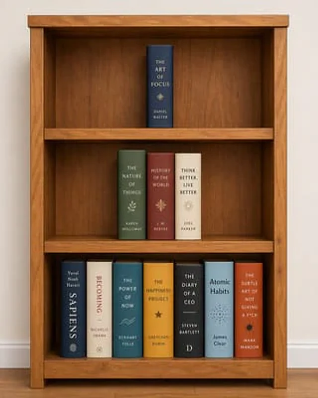

```text
{
  "type": "Bookshelf layout",
  "setting": "A three-tiered wooden bookshelf leaning against a light-colored, solid-color wall, with wooden flooring.",
  "layout": {
    "top_shelf": {
      "count": 1,
      "alignment": "Center",
      "books": [
        {
          "color": "Dark blue",
          "title": "{argument name=\"top book title\" default=\"The Art of Focus\"}",
          "author": "DANIEL WALTER",
          "symbol": "Star compass"
        }
      ]
    },
    "middle_shelf": {
      "count": 3,
      "alignment": "Center",
      "books": [
        {
          "color": "green",
          "title": "{argument name=\"middle left book title\" default=\"The essence of all things\"}",
          "author": "KAREN HOLLOWAY",
          "symbol": "Leafy branches"
        },
        {
          "color": "Burgundy Red",
          "title": "World History",
          "author": "J. M. REEVES",
          "symbol": "Brilliant stars"
        },
        {
          "color": "Cream",
          "title": "Better thinking, better living",
          "author": "JOEL PARKER",
          "symbol": "sun"
        }
      ]
    },
    "bottom_shelf": {
      "count": 7,
      "alignment": "Fill",
      "books": [
        {
          "color": "Dark blue",
          "title": "{argument name=\"bottom left book title\" default=\"Sapiens: A Brief History of Humankind\"}",
          "author": "Yuval Noah Harari",
          "orientation": "Vertical book title",
          "symbol": "fingerprint"
        },
        {
          "color": "Cream",
          "title": "become",
          "author": "MICHELLE OBAMA",
          "orientation": "Vertical book title",
          "symbol": "circular logo"
        },
        {
          "color": "blue-green",
          "title": "The Power of Now",
          "author": "ECKHART TOLLE",
          "symbol": "wave"
        },
        {
          "color": "Mustard Yellow",
          "title": "{argument name=\"bottom middle book title\" default=\"Happiness Project\"}",
          "author": "GRETCHEN RUBIN",
          "symbol": "Star"
        },
        {
          "color": "Dark gray",
          "title": "CEO Diary",
          "author": "STEVEN BARTLETT",
          "symbol": "letter D"
        },
        {
          "color": "light blue",
          "title": "Atomic Habits",
          "author": "James Clear",
          "symbol": "dot circle"
        },
        {
          "color": "orange color",
          "title": "{argument name=\"bottom right book title\" default=\"The subtle art: the art of indifference\"}",
          "author": "MARK MANSON",
          "symbol": "Sunspots"
        }
      ]
    }
  }
}
```

Model: GPT Image 2
Author: GPT Image 2 Prompts

[ProjectD](https://aitoolsradar.com/en/prompts/ad6f8b5683b726) · [Recorded source](https://x.com/Gc_qube/status/2046205568474403194#reversed-1)
 · [Full original metadata and byte evidence](data/projectd-batch-0026.json)

## Custom Anime Vending Machine Design

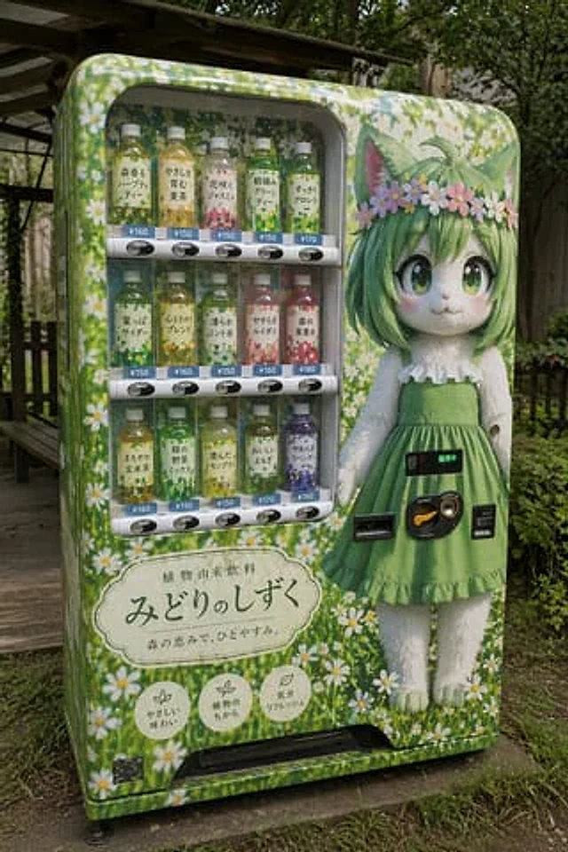

```text
{
  "type": "vending machine design",
  "setting": "{argument name=\"setting\" default=\"An outdoor park with green grass and wooden benches\"}",
  "machine_wrap": "{argument name=\"machine pattern\" default=\"Green background with white daisies\"}",
  "layout": {
    "right_side": {
      "element": "Character illustrations",
      "character": {
        "species": "{argument name=\"character species\" default=\"Anthropomorphic white cat\"}",
        "hair": "Green bob haircut",
        "eyes": "Large green anime eyes",
        "accessories": "pink and white daisy wreath",
        "outfit": "{argument name=\"character outfit\" default=\"Green sleeveless dress with white ruffles\"}"
      },
      "hardware_overlay": "The coin slot, banknote receiver, coin return lever, and digital display showing \"Sold Now\" are integrated into the character's skirt area."
    },
    "top_left": {
      "element": "Product Showcase",
      "rows": 3,
      "bottles_per_row": 5,
      "total_bottles": 15,
      "bottle_details": "Clear plastic bottles containing colored liquids (green, yellow, pink, purple), white labels, and blue price tags (¥150 to ¥190).",
      "row_1_labels": [
        "Forest-scented herbal tea",
        "Barley tea that nurtures kindness",
        "Flowering jasmine",
        "Freshly picked green tea",
        "すっきりクロレラ"
      ],
      "row_2_labels": [
        "Leaf Cider",
        "A blend to soothe the mind",
        "Pure mint water",
        "やすらぎルイボス",
        "Forest Fruit Water"
      ],
      "row_3_labels": [
        "Mild Brown Rice Tea",
        "Green vegetable mix",
        "Clear lemongrass",
        "おいしいよもぎ",
        "やわらぎラベンダー"
      ]
    },
    "bottom_left": {
      "element": "Brands and Badges",
      "main_signage": {
        "shape": "Fan-shaped oval plaque",
        "top_text": "Plant-based beverages",
        "main_text": "{argument name=\"main brand name\" default=\"みどりのしずく\"}",
        "sub_text": "Take a break with the bounty of the forest."
      },
      "badges": {
        "count": 3,
        "shape": "A circle with a leaf icon",
        "labels": [
          "Gentle flavor",
          "The power of plants",
          "Refresh your mood"
        ]
      }
    }
  }
}
```

Model: GPT Image 2
Author: GPT Image 2 Prompts

[ProjectD](https://aitoolsradar.com/en/prompts/29c11cf649e258) · [Recorded source](https://x.com/TlanoAI/status/2044981630767673481#reversed-0)
 · [Full original metadata and byte evidence](data/projectd-batch-0026.json)

## Custom Building Block Set Photography

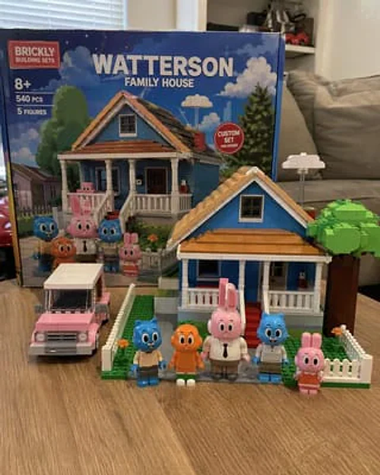

```text
A realistic amateur photograph showcases a custom-made building block set placed on a light-colored wood-grain table in a living room. A large product box stands in the background, bearing a red logo and the words "...".{argument name="brand name" default="BRICKLY"} The packaging box is printed with "8+", "540 PCS", "5 FIGURES", and a prominent title.{argument name="set title" default="WATTERSON FAMILY HOUSE"} The box has a red circular badge that reads "CUSTOM SET FAN DESIGN," and the box cover depicts houses and characters under a blue sky. The assembled kit is displayed in the foreground.{argument name="house color" default="blue"} A two-story suburban house model made of building blocks, featuring a brown roof, white porch, red steps, white picket fence, and a green tree made of building blocks. To the left of the house is an assembled vehicle.{argument name="car color" default="pink"} A station wagon model. In front of the house are five custom-made minifigures neatly arranged: a blue cat in tan pants, a long-legged orange fish, a tall pink rabbit in a white shirt and tie, another blue cat in a white shirt, and a small pink rabbit in an orange dress. The background is a slightly blurred living room with a gray sofa and white blinds.
```

Model: GPT Image 2
Author: GPT Image 2 Prompts

[ProjectD](https://aitoolsradar.com/en/prompts/ff6bd372e03095) · [Recorded source](https://x.com/Gc_qube/status/2046189202488881427#reversed-0)
 · [Full original metadata and byte evidence](data/projectd-batch-0026.json)

## Custom Logo Basketball Selfie


```text
A realistic selfie of a young man with short, dark curly hair and light stubble, taken on an indoor basketball court. He's wearing a black athletic T-shirt with a white Nike swoosh logo. He's holding a {argument name="ball color" default="green"} Basketball, with a striking white logo printed on it.{argument name="logo design" default="OpenAI logo"} The background showcases hardwood floors, black wall padding, and a basketball hoop against a concrete wall. Bright indoor gym lighting creates a relaxed, social media aesthetic.
```

Model: GPT Image 2
Author: GPT Image 2 Prompts

[ProjectD](https://aitoolsradar.com/en/prompts/b2e081ded065da) · [Recorded source](https://x.com/mirochill/status/2045437911395406111#reversed-0)
 · [Full original metadata and byte evidence](data/projectd-batch-0026.json)

## Custom Zeon Mobile Suit Overhaul


```text
今までの私との会話を参考にして、{argument name="専用" default="竜胆専用"}のモビルスーツを開発してください。{argument name="ベース機体" default="ジオン軍のモビルスーツ"}の中から1つを選んで、徹底改修して下さい。そんなオリジナルモビルスーツがいいです。フォントサイズはやや大きく。キャンバスサイズは{argument name="サイズ" default="1200×1500"}
```

Model: GPT Image 2
Author: 竜胆 Rindou | AI Character Art

[ProjectD](https://aitoolsradar.com/en/prompts/5625deca12e1a7) · [Recorded source](https://youmind.com/prompts/custom-zeon-mobile-suit-overhaul-21076)
 · [Full original metadata and byte evidence](data/projectd-batch-0026.json)

## Customizable Luxury FIFA Editorial Poster


```text
Create a luxury FIFA World Cup editorial poster. Clean white background. No stadium. No crowd. No smoke. No busy backgrounds. Minimalist luxury sports poster. 1:1 aspect ratio. TYPOGRAPHY LAYER — Behind the portrait: Giant vertical typography spelling "{argument name="player name" default="[PLAYER NAME]"}" — ultra-condensed bold letters, custom horizontal sliced segments at irregular intervals, editorial sports graphic design. Typography color: {argument name="team color" default="[TEAM COLOR HEX]"}. Razor-thin white gap between each slice to create depth. Letters bleed into the portrait. PORTRAIT LAYER — Main background: Full-face close-up portrait of [PLAYER NAME], black and white, ultra-high contrast, dramatic lighting, deep shadows under jaw and cheekbones, {argument name="facial expression" default="[FACIAL EXPRESSION]"}, photorealistic skin texture, the typography letterforms overlap and integrate through the face like the name is tattooed into the image. FOREGROUND LAYER — Action figure: Full-body [PLAYER NAME] in {argument name="pose" default="[SIGNATURE POSE]"}, wearing [NATIONALITY] national team kit, full photorealistic color, ultra-sharp detail, zero motion blur, positioned at the lower-center third of the poster, standing in front of the typographic portrait. GRAPHIC ELEMENTS: — [NATIONAL TEAM CREST] placed top-left corner, small and clean — [NATIONALITY] flag motif as a subtle accent strip on the far right edge — Hand-drawn player signature "[SIGNATURE MARK]" in black or gold ink, bottom-right corner — FIFA World Cup 2026 collector badge graphic, top-right area — Small editorial caption text: "[TAGLINE LINE 1]. [TAGLINE LINE 2]." — Micro caption below: "#[JERSEY NUMBER] · 2026 · [NATION CODE]" DESIGN STRUCTURE: 35% — Giant sliced typography (aligned vertically on the left axis) 45% — Monochrome portrait (slightly offset to the right, integrated with typography) 20% — Full-color foreground action player (centered at lower third) Large empty white negative space surrounding composition VISUAL STYLE: Nike campaign poster. FIFA premium promotional artwork. Luxury sports editorial design. Behance award-winning sports poster. Ultra-realistic. Sharp 4K detail. Cinematic lighting. Print-ready quality.
```

Model: GPT Image 2
Author: Saul Goodman

[ProjectD](https://aitoolsradar.com/en/prompts/1bb2a1c297cfa9) · [Recorded source](https://youmind.com/prompts/customizable-luxury-sports-poster-25940)
 · [Full original metadata and byte evidence](data/projectd-batch-0026.json)

## Cute 3D App Mascot Icon Grid

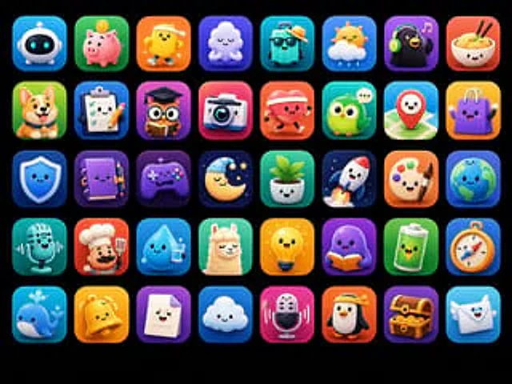

```text
Goal: Create a polished app-store mascot icon showcase featuring {argument name="icon count" default="40"} unique cute 3D mascot icons, designed as ASO-friendly mobile app icon concepts.

Canvas: Horizontal 4:3 image on a pure black background, with a neat grid of rounded-square app icons. Use exactly 5 rows and 8 columns, evenly spaced with consistent margins. Each tile is a glossy rounded square with a soft gradient background, subtle inner glow, and soft drop shadow. No text, no labels, no watermark.

Visual style: High-end 3D clay/toy mascot style, kawaii expressions, big friendly eyes, tiny smiles, smooth rounded shapes, vibrant saturated colors, app icon lighting, soft studio shadows, crisp edges, premium iOS icon aesthetic. Every icon should feel like a distinct standalone app mascot.

Icon grid details: Include exactly 40 discrete icons, arranged left to right, top to bottom:
1. white robot head mascot on blue gradient
2. pink piggy bank with coin on green gradient
3. smiling yellow character wearing a sun visor on orange gradient
4. sleepy white cloud hugging itself on purple gradient
5. turquoise travel suitcase wearing sunglasses and a straw hat on teal gradient
6. cute sun partly behind a cloud with raindrops on blue gradient
7. black penguin or bird wearing green headphones with music notes on purple gradient
8. smiling bowl of noodles with chopsticks on red-orange gradient
9. happy corgi dog on green gradient
10. checklist clipboard with pencil on blue gradient
11. graduation cap over a document/card silhouette on purple-pink gradient
12. cute instant camera on pink-red gradient
13. red heart character running with headphones on orange-red gradient
14. green owl with chat bubble on teal gradient
15. red map pin mascot on map background on cyan gradient
16. purple shopping bag mascot on yellow gradient
17. blue shield mascot on deep blue gradient
18. purple notebook mascot with pen on violet gradient
19. purple game controller mascot on dark purple gradient
20. sleeping crescent moon with nightcap, stars, and dark night background
21. smiling potted plant in white pot on green gradient
22. white rocket launching on navy starry gradient
23. painter palette mascot with paintbrush on orange gradient
24. smiling Earth globe on blue gradient
25. vintage microphone mascot on teal gradient
26. chef mascot with white chef hat and spatula on red-orange gradient
27. smiling water droplet holding a glass of water on cyan gradient
28. fluffy llama or alpaca mascot on green gradient
29. glowing yellow lightbulb mascot on yellow-orange gradient
30. purple octopus or blob reading an orange book on violet gradient
31. green battery mascot with lightning symbol on green gradient
32. compass mascot on blue-orange gradient
33. blue whale mascot with water splash on cyan gradient
34. yellow bell mascot on orange gradient
35. smiling white document/page mascot on purple gradient
36. happy white cloud mascot on blue gradient
37. pink microphone mascot with sound waves on magenta gradient
38. penguin mascot wearing a yellow visor on orange gradient
39. treasure chest full of gold coins on purple gradient
40. smiling envelope mascot with wings on light blue gradient

Constraints: Keep all icons consistent in size and visual quality; use charming rounded toy-like geometry; ensure each mascot has a simple cute face where appropriate; preserve the exact 5-by-8 layout and exactly 40 icons.
```

Model: GPT Image 2
Author: Murat

[ProjectD](https://aitoolsradar.com/en/prompts/77760319ed790e) · [Recorded source](https://youmind.com/prompts/cute-3d-app-icons-22586)
 · [Full original metadata and byte evidence](data/projectd-batch-0026.json)

## Cute 4-Panel School Club Manga

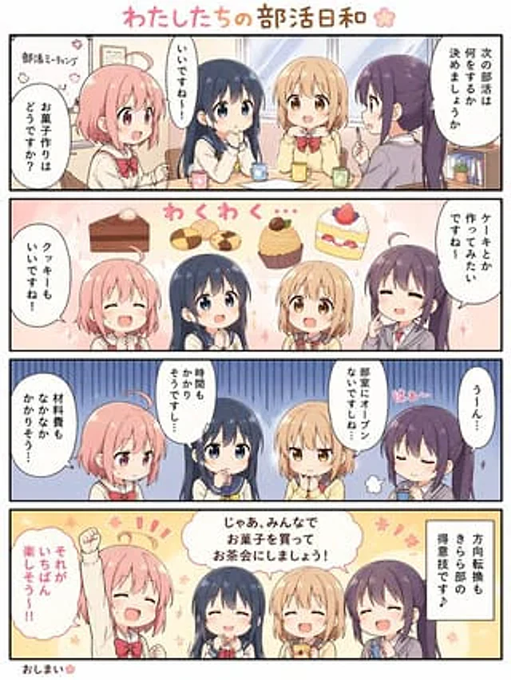

```text
{
  "type": "Four-panel comic strip",
  "style": "A fresh and modern Japanese school life anime style, with soft pastel tones, clean lines, subtle cel-shading, and printed manga layout with white spacing and black borders, creating a cute everyday atmosphere.",
  "format": "Vertical full page",
  "theme": "The high school club meeting regarding the next steps in club activities concluded with a pleasant compromise.",
  "text": {
    "title_top": "{argument name=\"headline text\" default=\"Perfect weather for our club activities 🌸\"}",
    "ending_note": "おしまい"
  },
  "characters": [
    {
      "id": "girl1",
      "appearance": "She had a short pink bob with a little tuft of hair on top, wore a school uniform with a beige cardigan and a red ribbon, and had a lively and expressive face."
    },
    {
      "id": "girl2",
      "appearance": "Long, straight, dark blue hair; calm demeanor; wearing a school uniform."
    },
    {
      "id": "girl3",
      "appearance": "She had a short, blonde bob haircut, a gentle and cheerful expression, and wore a school uniform with a red ribbon."
    },
    {
      "id": "girl4",
      "appearance": "She had long purple hair tied in a low ponytail, appeared calm and thoughtful, and wore a school uniform with a gray top."
    }
  ],
  "layout": {
    "panels": [
      {
        "position": "top",
        "count": 1,
        "setting": "Four girls were sitting at a table in the club activity room by the window. There were four small colorful mugs on the table.",
        "speech_bubbles": [
          "Club meeting",
          "How about baking?",
          "いいですね〜！",
          "Let's decide what club activity we'll do next."
        ]
      },
      {
        "position": "upper-middle",
        "count": 1,
        "setting": "A fantasy mind box with a pink, shimmering background, with desserts floating above the girl.",
        "items": {
          "count": 5,
          "labels": [
            "Chocolate cake slices",
            "round biscuits",
            "Checkerboard Cookies",
            "Mont Blanc Cupcakes",
            "Strawberry Cream Cake Slices"
          ]
        },
        "center_text": "わくわく…",
        "speech_bubbles": [
          "クッキーもいいですね！",
          "I'd like to try making cakes and things like that."
        ]
      },
      {
        "position": "lower-middle",
        "count": 1,
        "setting": "The mood shifts to a dark blue vertical line background, reflecting real-world concerns.",
        "speech_bubbles": [
          "The material costs are likely to be quite high...",
          "It looks like it's going to take some time...",
          "We don't have an oven in the club room, you know...",
          "うーん…",
          "はぁ〜"
        ]
      },
      {
        "position": "bottom",
        "count": 1,
        "setting": "A bright, warm yellow ending frame with celebratory flower symbols.",
        "speech_bubbles": [
          "That sounds like the most fun!!",
          "Okay, let's all buy some sweets and have a tea party!",
          "Changing direction is also one of the Kirara Club's specialties♪"
        ]
      }
    ],
    "character_count": 4,
    "drink_count": 4,
    "dessert_count": 5,
    "panel_count": 4
  },
  "composition": "Four girls appear in each frame, a medium-shot group portrait, easy-to-read Japanese speech bubbles, a comedic rhythm from suggestion to excitement, hesitation to a happy ending.",
  "quality": "The manga pages are beautifully designed and suitable for sharing on social media or as samples for rendering Japanese text."
}
```

Model: GPT Image 2
Author: GPT Image 2 Prompts

[ProjectD](https://aitoolsradar.com/en/prompts/52fab61c99a667) · [Recorded source](https://x.com/koyo_koyoy/status/2046594396423143649#reversed-0)
 · [Full original metadata and byte evidence](data/projectd-batch-0026.json)

## Cute Beijing 7-Day Travel Guide Poster

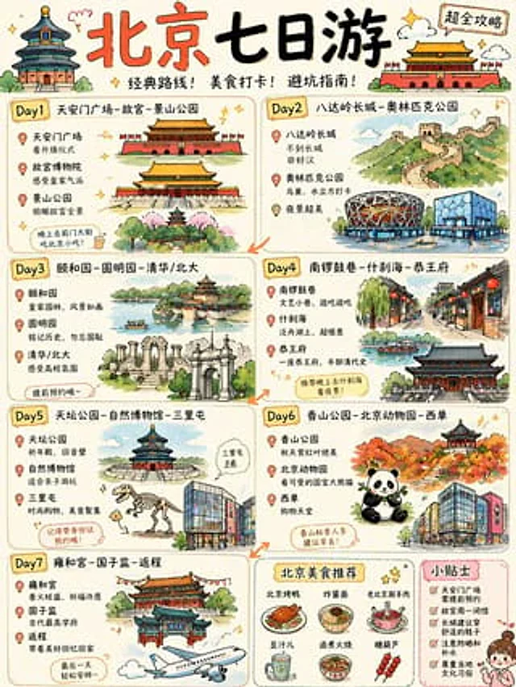

```text
{
  "type": "Hand-drawn travel itinerary infographic poster",
  "subject": "Cute Journal-Style 7-Day Beijing Travel Guide",
  "style": {
    "medium": "Watercolor and marker illustrations, with ink outlines",
    "mood": "Cheerful, friendly, and practical, with the aesthetic appeal of a travel diary.",
    "palette": "A warm, creamy background with orange, red, yellow, green, and sky blue accents, and black text.",
    "finish": "Micro-textured paper texture, vibrant colors of graffiti, glitter, arrows, clouds, and sticker-like labels."
  },
  "text": {
    "main_title": "{argument name=\"headline text\" default=\"7-day tour of Beijing\"}",
    "badge": "Comprehensive Guide",
    "subtitle": "Classic route! Foodie must-try! Avoid the pitfalls!"
  },
  "layout": {
    "format": "Vertical poster",
    "sections": [
      {
        "title": "Day1",
        "position": "Top left",
        "count": 1,
        "labels": [
          "Tiananmen Square - Forbidden City - Jingshan Park"
        ],
        "items": [
          "Tiananmen Square",
          "Palace Museum",
          "Jingshan Park"
        ],
        "notes": [
          "Watching the flag-raising ceremony",
          "Experience the Royal Grandeur",
          "A panoramic view of the Forbidden City"
        ],
        "illustration_count": 4
      },
      {
        "title": "Day2",
        "position": "Top right",
        "count": 1,
        "labels": [
          "Badaling Great Wall - Olympic Park"
        ],
        "items": [
          "Badaling Great Wall",
          "Olympic Park",
          "The night view is stunning."
        ],
        "notes": [
          "He who has not climbed the Great Wall is no true man.",
          "Bird's Nest and Water Cube - must-visit spots!"
        ],
        "illustration_count": 3
      },
      {
        "title": "Day3",
        "position": "Center upper left",
        "count": 1,
        "labels": [
          "Summer Palace - Old Summer Palace - Tsinghua/Peking University"
        ],
        "items": [
          "Summer Palace",
          "Yuanmingyuan",
          "Tsinghua/Peking University"
        ],
        "notes": [
          "Royal gardens, picturesque scenery",
          "Remember history, never forget national humiliation",
          "Experience the atmosphere of the university"
        ],
        "illustration_count": 3
      },
      {
        "title": "Day4",
        "position": "Center upper right",
        "count": 1,
        "labels": [
          "Nanluoguxiang - Shichahai - Prince Gong's Mansion"
        ],
        "items": [
          "Nanluoguxiang",
          "Shichahai",
          "Prince Gong's Mansion"
        ],
        "notes": [
          "Artsy alleyways, perfect for strolling and eating.",
          "Boating on the lake is incredibly pleasant.",
          "The Prince Gong Mansion: Half of the History of the Qing Dynasty"
        ],
        "illustration_count": 3
      },
      {
        "title": "Day5",
        "position": "Center bottom left",
        "count": 1,
        "labels": [
          "Temple of Heaven Park - Natural History Museum - Sanlitun"
        ],
        "items": [
          "Temple of Heaven Park",
          "Natural History Museum",
          "Sanlitun"
        ],
        "notes": [
          "Hall of Prayer for Good Harvests, Echo Wall",
          "Suitable for family trips",
          "Fashion shopping, gourmet food hub"
        ],
        "illustration_count": 3
      },
      {
        "title": "Day6",
        "position": "Center, bottom, right",
        "count": 1,
        "labels": [
          "Fragrant Hills Park - Beijing Zoo - Xidan"
        ],
        "items": [
          "Fragrant Hills Park",
          "Beijing Zoo",
          "Xidan"
        ],
        "notes": [
          "The autumn foliage is absolutely stunning.",
          "See the adorable giant pandas, China's national treasure.",
          "Shopping Paradise"
        ],
        "illustration_count": 3
      },
      {
        "title": "Day7",
        "position": "Bottom left",
        "count": 1,
        "labels": [
          "Yonghe Temple - Imperial College - Return Trip"
        ],
        "items": [
          "Yonghe Temple",
          "Imperial College",
          "Return trip"
        ],
        "notes": [
          "The incense is burning brightly, and people are praying and making wishes.",
          "The highest institution of learning in ancient times",
          "Going home with wonderful memories"
        ],
        "illustration_count": 3
      },
      {
        "title": "Recommended Foods in Beijing",
        "position": "Centered at the bottom",
        "count": 6,
        "labels": [
          "Peking duck",
          "Zhajiangmian",
          "Old Beijing-style hot pot with mutton",
          "Douzhier",
          "Braised pork offal with baked wheat cake",
          "Candied hawthorn"
        ],
        "illustration_count": 6
      },
      {
        "title": "Tips",
        "position": "Bottom right",
        "count": 4,
        "labels": [
          "Advance reservations are required for Tiananmen Square.",
          "The Palace Museum is closed on Mondays.",
          "Great Wall recommends wearing comfortable shoes.",
          "Pay attention to sun protection and hydration."
        ],
        "illustration_count": 1
      }
    ],
    "decorations": {
      "landmark_count": 18,
      "food_count": 6,
      "character_count": 2,
      "vehicle_count": 2,
      "doodle_count": "Many little stars, arrows, clouds, and handwritten note bubbles"
    }
  },
  "visuals": {
    "landmarks": [
      "Temple of Heaven",
      "Front of Tiananmen Gate Tower",
      "The main hall of the Forbidden City",
      "Jingshan Park Pavilion",
      "The Great Wall winding through the green mountains",
      "Bird's Nest Stadium",
      "Water Cube",
      "Summer Palace Lakeside Pavilion",
      "European-style ruins of the Old Summer Palace",
      "Traditional alleyways with red lanterns",
      "Shichahai cruise scene",
      "The main gate of Prince Gong's Mansion",
      "A distant view of the Temple of Heaven",
      "Dinosaur skeletons at the Natural History Museum",
      "Sanlitun Modern Shopping Building",
      "Fragrant Hills Autumn Leaves",
      "Giant pandas that eat bamboo",
      "The main gate of Yonghe Temple and the Imperial College"
    ],
    "extra_elements": [
      "Handwritten tips in rounded speech bubbles",
      "Orange location icon before list item",
      "Rounded cream panel with brown border",
      "The title in bold, large calligraphy style with orange and black color scheme",
      "Cute cartoon girl in the tip box",
      "Return flight icon at the bottom"
    ]
  },
  "composition": "This compact yet easy-to-read travel guide poster features a 7-day itinerary framed in two columns, with a footer panel at the bottom. Each itinerary frame includes a brief Chinese description on the left and a small watercolor landmark illustration on the right, connected by playful arrows. The spacing is balanced, and it's designed specifically for sharing on social media.",
  "quality": "High-resolution edited illustrations, clear text layout, and captivating travel infographics."
}
```

Model: GPT Image 2
Author: GPT Image 2 Prompts

[ProjectD](https://aitoolsradar.com/en/prompts/23dc8a7417f764) · [Recorded source](https://x.com/tngy797121/status/2046931102364061826#reversed-0)
 · [Full original metadata and byte evidence](data/projectd-batch-0026.json)

## Cute Black Cat Japanese Sticker Sheet

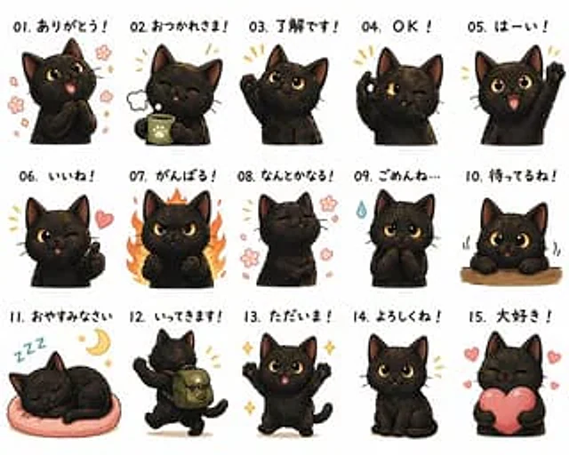

```text
{
  "type": "Cute Sticker Collection Illustrations",
  "subject": {
    "species": "Black Cat",
    "style": "Adorable chibi style, soft oil painting-like anime cartoon appearance, large, round amber brown eyes, small mouth and nose, vivid expression, fluffy dark charcoal black fur with warm brown highlights, and bold, clear outlines."
  },
  "layout": {
    "background": "pure white",
    "grid": {
      "rows": 3,
      "columns": 5,
      "count": 15
    },
    "sections": [
      {
        "title": "01. ありがとう！",
        "position": "Row 1, Column 1",
        "count": 1,
        "labels": [
          "A joyful and grateful pose, paws clasped together in front of the chest, mouth open in a smile, with pink cherry blossom petals surrounding the cat."
        ]
      },
      {
        "title": "02. おつかれさま！",
        "position": "Row 1, Column 2",
        "count": 1,
        "labels": [
          "A contented and relaxed cat, paws outstretched, holds a green mug with a paw print mark, eyes closed, steaming slightly, accented with a celebratory yellow line."
        ]
      },
      {
        "title": "03. Understood!",
        "position": "Row 1, Column 3",
        "count": 1,
        "labels": [
          "The cat, standing upright, raises one paw to indicate it understands; its expression is bright and focused, with a yellow accent line above it."
        ]
      },
      {
        "title": "04. ＯＫ！",
        "position": "Row 1, Column 4",
        "count": 1,
        "labels": [
          "The blinking cat makes an OK sign with one paw, smiles slightly, and has a yellow underline."
        ]
      },
      {
        "title": "05. はーい！",
        "position": "Row 1, Column 5",
        "count": 1,
        "labels": [
          "An excited cat waves one paw high, smiles with its mouth open, highlighted with yellow lines."
        ]
      },
      {
        "title": "06. いいね！",
        "position": "Row 2, Column 1",
        "count": 1,
        "labels": [
          "The blinking cat gives a thumbs-up, next to a small pink heart with a yellow accent line."
        ]
      },
      {
        "title": "07. がんばる！",
        "position": "Row 2, Column 2",
        "count": 1,
        "labels": [
          "The determined cat clenched its paws, its eyes sharp, surrounded by stylized orange flames."
        ]
      },
      {
        "title": "08. なんとかなる！",
        "position": "Row 2, Column 3",
        "count": 1,
        "labels": [
          "A confident and composed cat, eyes closed, chest slightly puffed out, pink petals floating around it."
        ]
      },
      {
        "title": "09. ごめんね…",
        "position": "Row 2, Column 4",
        "count": 1,
        "labels": [
          "The apologetic, sorrowful cat, its paws clasped together in front of its chest, eyes downcast, a single bead of blue sweat glistening on its forehead."
        ]
      },
      {
        "title": "10. I'll be waiting!",
        "position": "Row 2, Column 5",
        "count": 1,
        "labels": [
          "The cat peeked out from the edge of the wooden frame, its paws visible, its expression full of anticipation, with subtle lines of movement visible on its sides."
        ]
      },
      {
        "title": "11. おやすみなさい",
        "position": "Row 3, Column 1",
        "count": 1,
        "labels": [
          "A cat curled up asleep on a pink cushion with blue ZZZ letters and a crescent moon and small stars above it."
        ]
      },
      {
        "title": "12. いってきます！",
        "position": "Row 3, Column 2",
        "count": 1,
        "labels": [
          "The cat's silhouette fades as it walks away cheerfully, raising a paw, carrying a green backpack with paw print patches and trinkets, accented with yellow stripes."
        ]
      },
      {
        "title": "13. ただいま！",
        "position": "Row 3, Column 3",
        "count": 1,
        "labels": [
          "The cat faces forward, paws raised high, mouth open in a happy smile, surrounded by glittering gold markings."
        ]
      },
      {
        "title": "14. よろしくね！",
        "position": "3rd row, 4th column",
        "count": 1,
        "labels": [
          "The cat sits politely facing forward, with a gentle smile, and a yellow accent line next to its head."
        ]
      },
      {
        "title": "15. I love it!",
        "position": "Row 3, Column 5",
        "count": 1,
        "labels": [
          "A contented cat hugs a large pink heart, its eyes closed, with several smaller pink hearts floating around it."
        ]
      }
    ],
    "spacing": "Evenly distributed, with ample white margins."
  },
  "rendering": {
    "quality": "High detail",
    "lighting": "Soft and even studio lighting",
    "color_palette": "Black fur, warm brown eyes, pink hearts and flowers, yellow accent marks, green accessories, minimalist and soft decorations.",
    "mood": "Friendly, healing, sticker-style, chat app emoticons",
    "composition": "Each sticker is centered in its own square, with prominent Japanese text above it."
  }
}
```

Model: GPT Image 2
Author: GPT Image 2 Prompts

[ProjectD](https://aitoolsradar.com/en/prompts/d0a9da4ffb5bd7) · [Recorded source](https://x.com/muku_sns/status/2046932542998364645#reversed-0)
 · [Full original metadata and byte evidence](data/projectd-batch-0026.json)

## Cute Bunny Hiragana Poster

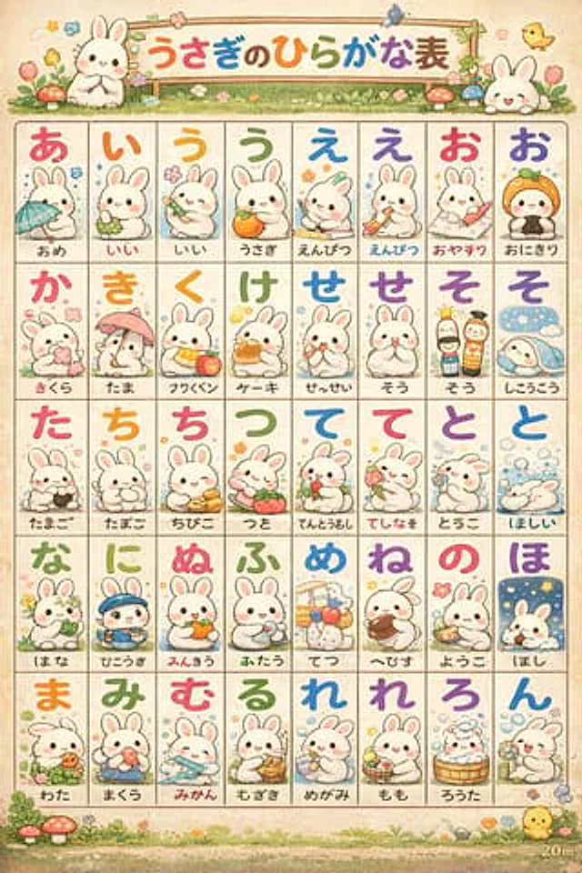

```text
Create an adorable Japanese preschool hiragana poster in a soft watercolor picture book style with a warm textured parchment background. The overall composition is a vertical educational chart with a whimsical spring border made of grass, flowers, mushrooms, butterflies, and chicks, resembling a children's classroom worksheet. Place a wooden sign at the top with brightly colored, rounded Japanese characters.{argument name="headline text" default="Rabbit Hiragana Chart"} The sign is decorated with two white rabbit mascots, one sitting on the left and the other peeking out from the right, and small flowers and leaves adorn the surrounding area. Below the title, a neat 5x8 grid of 40 square cells is arranged, each outlined in thin brown lines on a cream background. In each cell, a large, brightly colored hiragana character is placed at the top, below which is a small, cute rabbit illustration, each rabbit either performing or holding an item associated with the text below. Different cheerful colors, including red, orange, yellow, green, blue, and purple, are used for the many hiragana characters, and a hand-drawn, rounded font is used. Keep the text and illustrations exactly as follows, arranged in rows from left to right: Row 1 has 8 cells, marked as あ, い, う, う, え, え, お, お, and the corresponding words are あめ, No. 2 Row has 8 cells, marked as か, き, く, け, せ, せ, そ, そ, and the corresponding words are きくら,たま,サベツン,ケーキ,せんせい,そう,そう,しょうこう; 3rd Row has 8 cells, marked as た, ち, ち, つ, て, て, と, と, and the corresponding words are たまご, No. 4 Row has 8 cells, marked as な, に, ぬ, ふ, め, ね, の, ほ, and the corresponding words are まな, ひこうき, みんきう, ふたう, てつ, へびす, ようこ, ほし; No. 5 The row has 8 cells, labeled ま, み, む, る, れ, れ, ろ, ん, and the corresponding words are わた, まくら, みかん, むぎぎ, めがみ, もも, ろうた, ん. The rabbit illustrations should be diverse and adorable: for example, holding an umbrella, hugging grapes, drawing with a pencil, eating rice balls, sitting under a cherry blossom tree, standing under an umbrella, holding fruit, eating cake, dressed as a teacher, holding flowers, sleeping under a blue blanket, carrying eggs, hugging tomatoes, holding strawberries, blowing bubbles, wearing a blue hat, holding oranges, sitting next to cotton, taking a bath in a wooden tub, and holding candy. Maintain soft pastel tones, gentle shadows, round faces, rosy cheeks, and delicate ink lines. The overall feel should be nostalgic, charming, educational, and highly detailed, making it ideal as a cute slide cover for kindergarten wall charts or Japanese learning presentations.
```

Model: GPT Image 2
Author: GPT Image 2 Prompts

[ProjectD](https://aitoolsradar.com/en/prompts/35b418ff3a5c3a) · [Recorded source](https://x.com/agilertao/status/2046493215243796921#reversed-0)
 · [Full original metadata and byte evidence](data/projectd-batch-0026.json)

## Cute Chinese Expeditionary Force Storyboard

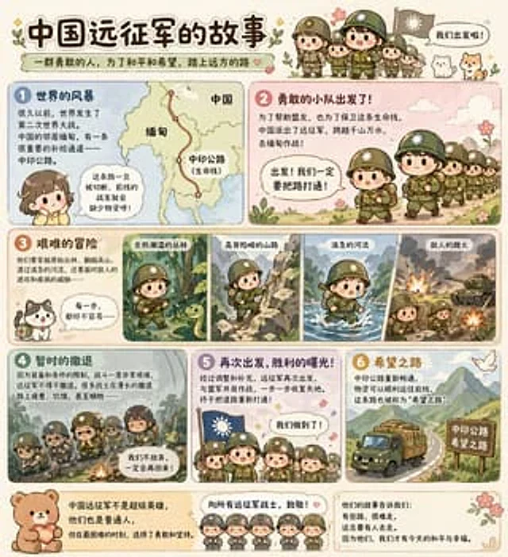

```text
用可爱的风格讲述中国远征军的历史故事
用波普风格讲述金刚经
```

Model: GPT Image 2
Author: @RainHuangapp

[ProjectD](https://aitoolsradar.com/en/prompts/2df3acb80cb791) · [Recorded source](https://x.com/RainHuangapp/status/2046507931907080330)
 · [Full original metadata and byte evidence](data/projectd-batch-0026.json)

## Cute Chinese LLM Training Infographic

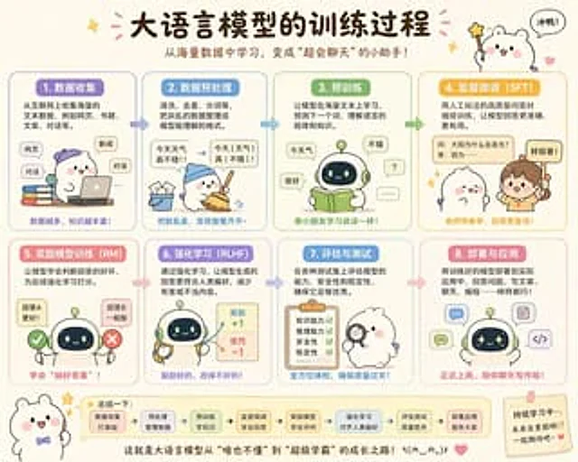

```text
{
  "type": "Cute Educational Infographic Posters",
  "topic": "{argument name=\"headline text\" default=\"Training process of large language models\"}",
  "subtitle": "{argument name=\"subtitle text\" default=\"Learn from massive amounts of data and become a super chatty assistant!\"}",
  "style": {
    "overall": "Adorable Chinese science posters, a soft classroom infographic style, rounded corners, a cream-colored background, hand-drawn cartoon aesthetics, simple vector illustrations, and a warm and friendly educational tone.",
    "palette": [
      "Cream",
      "Lavender Purple",
      "Sky blue",
      "Mint Green",
      "Yellow Orange",
      "pink",
      "Soft brown"
    ],
    "rendering": "High-quality flat illustrations with delicate shadows, clear Chinese typography, sticker-style decorations, stars, hearts, arrows, and speech bubbles."
  },
  "layout": {
    "format": "Horizontal poster",
    "grid": {
      "rows": 2,
      "columns": 4,
      "count": 8
    },
    "sections": [
      {
        "title": "1. Data Collection",
        "position": "Top left corner",
        "count": 1,
        "labels": [
          "Web page",
          "news",
          "dialogue"
        ]
      },
      {
        "title": "2. Data Preprocessing",
        "position": "Top row, second column",
        "count": 1,
        "labels": [
          "The weather is so nice today!!",
          "The weather is really nice today!!"
        ]
      },
      {
        "title": "3. Pre-training",
        "position": "Top row, third column",
        "count": 1,
        "labels": [
          "Today's weather",
          "very good",
          "good",
          "?",
          "......"
        ]
      },
      {
        "title": "4. Supervised Fine-tuning (SFT)",
        "position": "Top right corner",
        "count": 1,
        "labels": [
          "Q: Why does the sun emit light?",
          "A: Because...",
          "Good answer!"
        ]
      },
      {
        "title": "5. Reward Model Training (RM)",
        "position": "bottom row, first column",
        "count": 1,
        "labels": [
          "Answer A is better!",
          "Answer B is so-so."
        ]
      },
      {
        "title": "6. Reinforcement Learning (RLHF)",
        "position": "bottom row, second column",
        "count": 1,
        "labels": [
          "Reward +1",
          "Punishment -1"
        ]
      },
      {
        "title": "7. Evaluation and Testing",
        "position": "bottom row, third column",
        "count": 1,
        "labels": [
          "Knowledge and Ability",
          "Reasoning ability",
          "Security",
          "stability"
        ]
      },
      {
        "title": "8. Deployment and Application",
        "position": "bottom right corner",
        "count": 1,
        "labels": [
          "chat",
          "Write code",
          "Writing articles"
        ]
      }
    ],
    "topDecorations": {
      "count": 4,
      "items": [
        "The small flash in the upper left corner",
        "Pink confetti around the title",
        "The cute white mascot holding a star wand in the upper right corner",
        "A speech bubble that says \"Go for it!\""
      ]
    },
    "bottomDecorations": {
      "count": 4,
      "items": [
        "The small white mascot wearing a bow tie in the bottom left corner",
        "Summary column containing 7 rounded squares and arrows",
        "Concluding remarks centered at the bottom",
        "A sticky note with encouraging words and a heart in the bottom right corner."
      ]
    }
  },
  "characters": {
    "main mascots": {
      "count": 4,
      "types": [
        "A round, white bear mascot with pink cheeks",
        "Small round robot with a dark face screen and green antenna",
        "A human teacher girl with a ponytail",
        "A furry white character holding a magnifying glass"
      ]
    },
    "recurring_robot_design": "A short, cute robot with a rounded body, a light green and cream-colored shell, a dark blue facial display with glowing eyes, and tiny limbs."
  },
  "sectionDetails": [
    {
      "title": "1. Data Collection",
      "panelColor": "Lavender Purple",
      "scene": "A white mascot wearing a purple hat sits beside a pile of colorful books, using a laptop; floating rounded labels indicate the internet source.",
      "caption": "The more data you have, the more knowledge you gain!"
    },
    {
      "title": "2. Data Preprocessing",
      "panelColor": "Sky blue",
      "scene": "The mascot, wearing a blue hat, swept the scattered scraps of paper into a bin; jumbled sentences were transformed into clearly structured text, complete with arrows.",
      "caption": "Transform the dirty and messy into a neat and tidy place."
    },
    {
      "title": "3. Pre-training",
      "panelColor": "Mint Green",
      "scene": "The robot is reading an open green book, with speech bubbles around it displaying simple words and responses, suggesting a language learning process.",
      "caption": "Just like a child learning to speak!"
    },
    {
      "title": "4. Supervised Fine-tuning (SFT)",
      "panelColor": "Golden yellow",
      "scene": "The teacher pointed to a labeled question-and-answer card, with a cute mascot listening attentively; emphasizing the high-quality question-and-answer pairs with manual annotations.",
      "caption": "Learning with a teacher leads to more reliable answers!"
    },
    {
      "title": "5. Reward Model Training (RM)",
      "panelColor": "pink",
      "scene": "The robot stands between a green checkmark and a red cross, comparing the two answer options to determine which is better.",
      "caption": "Learn to \"choose the right answer\"!"
    },
    {
      "title": "6. Reinforcement Learning (RLHF)",
      "panelColor": "Lavender Blue",
      "scene": "The robot holds tools, and the reward items display positive and negative score feedback with arrows.",
      "caption": "Encourage the good and correct the bad!"
    },
    {
      "title": "7. Evaluation and Testing",
      "panelColor": "blue",
      "scene": "A furry, white-clad examiner stands next to a checklist with four green checkmarks, holding a magnifying glass.",
      "caption": "Comprehensive medical examination to ensure quality!"
    },
    {
      "title": "8. Deployment and Application",
      "panelColor": "Soft pink",
      "scene": "Icons for applications such as chat, writing, code, and documents appeared around the robot, showcasing a real-world deployment scenario.",
      "caption": "Officially on duty, here to chat and write with you!"
    }
  ],
  "bottomSummary": {
    "title": "In summary:",
    "count": 7,
    "steps": [
      "Laying a solid foundation for data collection",
      "Preprocessing and organizing data",
      "Pre-training knowledge",
      "Supervisory fine-tuning school answers",
      "Reward models learn to judge",
      "Reinforcement learning aligns with human preferences",
      "Evaluation and testing quality control"
    ],
    "closingText": "{argument name=\"closing sentence\" default=\"This is the growth path of the large language model from &quot;knowing nothing&quot; to &quot;super learner&quot;! ٩(๑^o^๑)۶\"}"
  },
  "language": "Simplified Chinese",
  "quality": "Beautifully designed infographics suitable for social media posting, with a balanced layout, clear and easy-to-read Chinese text, an appealing style, and high shareability."
}
```

Model: GPT Image 2
Author: GPT Image 2 Prompts

[ProjectD](https://aitoolsradar.com/en/prompts/771c7b35f3dd8b) · [Recorded source](https://x.com/op7418/status/2046502136973001143#reversed-0)
 · [Full original metadata and byte evidence](data/projectd-batch-0026.json)

## Cute Chinese Tokenization Infographic


```text
This is an adorable horizontal, hand-drawn scrapbook-style Chinese science infographic. The background is warm beige paper with rounded borders, macaron-colored doodles, washi tape stickers, and little stars, creating a classroom notebook atmosphere. At the top center is a striking handwritten Chinese title: "What is Tokenization?", with the latter half in coral pink and the rest in dark brown. In the upper left corner is a cute Shiba Inu teacher character, wearing a light yellow shirt and blue tie, facing forward, holding a pointer upwards, with a speech bubble next to him saying: "Today we'll learn about tokenization!" In the upper right corner is a cute blue square Token mascot, labeled "TOKEN," smiling with rosy cheeks, tiny limbs, and holding a magnifying glass; next to it is a speech bubble saying: "I am a Token! The more rationally it's segmented, the smarter the model!" Near the right edge, a small hanging note card is added, saying "Knowledge Points Collection" and accompanied by a heart icon. Below the title, a rounded dotted text box contains the definition: "Tokenization is the process of dividing human-readable text into tokens." The word "Token" is highlighted in blue. Below that, a line of explanatory text is added: "Let's take 'Programmer Left' and 'Artificial Intelligence' as examples to see different tokenization methods:" "Programmer Left" is highlighted in light blue, and "Artificial Intelligence" in pink. The lower half contains four rounded, pastel-colored panels arranged from left to right, each with a numbered badge and title. Panel 1 is mint green, titled "1-Word-Level Tokenization," with the subtitle "Segmenting Text Based on Complete Semantics," and contains three token bubbles: "Programmer," "Left," and "Artificial Intelligence." At the bottom of this panel, a Shiba Inu teacher gives a thumbs-up, with a speech bubble that reads: "Semantic complete, easy to understand!" Panel 2 is light yellow, titled "2-Character Level Token Segmentation" with the subtitle "Character-by-Character Text Segmentation." It contains nine circular token bubbles arranged in a row: "程" (program), "序" (sequence), "员" (person), "L" (L), "e" (e), "f" (f), "t" (t), "人" (person), "工" (work), "智" (intelligence), and "能" (ability)—presenting individual characters in the example in a compact grid. At the bottom, a blue token mascot holds a pencil, with a speech bubble that reads: "Fineest granularity, but the sequences will be very long~." Panel 3 is light pink, titled "3-Sub-Word Segmentation" with the subtitle "Segmentation by Root and Prefix/Suffix." It contains five token bubbles: "程序" (program), "员" (person), "Left," "人工" (artificial), and "智能" (intelligence). At the bottom, a Shiba Inu teacher is shown thinking, with a paw near its mouth and a question mark above its head. The speech bubble reads: "Compromise solution, often works very well!" Panel 4 is light blue, titled "4-Byte Level Word Segmentation," with the subtitle "Converting Words to Byte Encoding, Combining and Dividing Based on the Conversion." It displays 14 small circular code bubbles: "E7," "A8," "8B," "...", "66," "74," "E4," "BA," "BA," "E8," "83," "BD," "..." arranged in multiple rows like encoded bytes. At the bottom, a smiling blue Token mascot is displayed again, with a speech bubble that reads, "Suitable for processing any text!" Next to it is a tiny light bulb doodle. At the very bottom, a rounded banner notes, "Different word segmentation methods have their advantages; in actual applications, the appropriate solution will be chosen based on the task and data!" All four panels use soft macaron green, yellow, pink, and blue, paired with dark brown handwritten font, delicate shadows, rounded shapes, and cute expressions. The overall composition is balanced, simple, and user-friendly, like a beautifully designed social media science poster.
```

Model: GPT Image 2
Author: GPT Image 2 Prompts

[ProjectD](https://aitoolsradar.com/en/prompts/32cb42693f1d86) · [Recorded source](https://x.com/coder_left/status/2047133651318755587#reversed-0)
 · [Full original metadata and byte evidence](data/projectd-batch-0026.json)

## Cute Four-Panel Cat Jealousy Comic

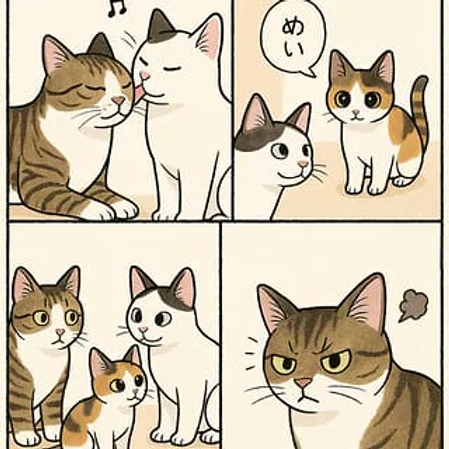

```text
A charming hand-drawn four-panel comic strip, employing a soft and warm everyday style. The background is light cream with a thick black border and subtle paper texture. Using simple, rounded cartoon cat designs, expressive faces, clean black outlines, and soft natural tones, it presents a gentle Japanese manga feel. Top left panel: Shows two cats. A brown tabby cat with dark stripes and a white muzzle sits with its eyes closed, looking happy. A predominantly white cat with dark brown patches on its head stands beside it, affectionately licking the tabby's cheek. Two small black musical notes are added above them, suggesting a joyful grooming process. Top right panel: The white and brown tabby cat in the foreground looks at a calico kitten standing to the right. A speech bubble containing the Japanese word "mei" is added above the kitten. Bottom left panel: Shows three cats together. The brown tabby cat on the left looks surprised or dazed, the white tabby cat on the right looks happy, and the small calico kitten in the middle looks up at them. Bottom right panel: A close-up of a brown tabby cat, facing forward alone, its yellow-green eyes narrowed, its expression angry and jealous; two short emphasis lines are added near its face, and a small, rounded anger symbol is added to the right. Maintaining a warm and humorous tone, the visual humor lies in the tabby cat initially enjoying grooming until the new kitten appears. Flat colors and minimalist shadows create a charming Japanese webcomic atmosphere.
```

Model: GPT Image 2
Author: GPT Image 2 Prompts

[ProjectD](https://aitoolsradar.com/en/prompts/09c1a9746afacf) · [Recorded source](https://x.com/Maoku/status/2046713681741038048#reversed-0)
 · [Full original metadata and byte evidence](data/projectd-batch-0026.json)

## Cute Four-Panel Tokenization Infographic

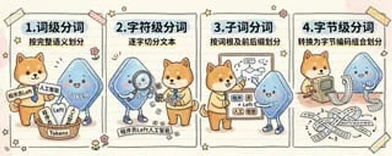

```text
{
  "type": "Hand-drawn educational infographic illustrations",
  "style": "Adorable notebook doodle style, hand-drawn handbook aesthetics, warm beige paper background with subtle texture, playful sketch outlines, soft macaron colors, embellished with small flower and star doodles, paper card sticker layout.",
  "aspect_ratio": "Wide banner",
  "subject": {
    "characters": [
      {
        "name": "{argument name=\"dog character name\" default=\"Chai Xiaoqi\"}",
        "species": "Shiba Inu mascot",
        "appearance": "A cute orange-brown Shiba Inu with a cream-colored muzzle and belly, round face, erect ears, friendly expression, and simplified cartoon-like anatomy."
      },
      {
        "name": "{argument name=\"blue character name\" default=\"Token\"}",
        "species": "Blue Token Mascot",
        "appearance": "A rounded, triangular, blue teardrop-shaped character with a glossy, gradient body, slender limbs, rosy cheeks, a smiling expression, and the words \"...\" written on its body.{argument name=\"token label\" default=\"TOKEN\"} \""
      }
    ],
    "theme": "Comparing four text segmentation levels in a friendly, science-oriented format"
  },
  "layout": {
    "sections": [
      {
        "title": "1. Word-level segmentation",
        "position": "Leftmost panel",
        "count": 1,
        "subtitle": "Classification by complete semantics",
        "scene": "The Shiba Inu and the blue Token character stand next to a basket labeled \"Tokens,\" filled with slips of paper. Visible slips and labels read \"Programmer,\" \"Left,\" and \"Artificial Intelligence,\" while a small sign nearby reads \"Programmer Left.\" The Token character points to the basket, while the Shiba Inu displays the neatly categorized fragments."
      },
      {
        "title": "2. Character-level word segmentation",
        "position": "Left middle panel",
        "count": 1,
        "subtitle": "Text segmentation by word",
        "scene": "The blue token character is examining small character blocks scattered on the floor with a magnifying glass, while a Shiba Inu tidies them up beside them. The label at the bottom reads \"Programmer Left Artificial Intelligence,\" serving as a sample of continuous text broken down into individual characters."
      },
      {
        "title": "3. Sub-word segmentation",
        "position": "Right center panel",
        "count": 1,
        "subtitle": "Classified by word roots and prefixes/suffixes",
        "scene": "The Shiba Inu pointed at an item displaying word root breakdowns and arrows, with the blue Token mascot standing beside it. Small paper labels contained mixed fragments such as \"program\", \"person\", \"Left\", \"artificial\", and \"intelligent\", emphasizing morphemes or subword groups."
      },
      {
        "title": "4. Byte-level word segmentation",
        "position": "rightmost panel",
        "count": 1,
        "subtitle": "Convert to byte encoding combination partition",
        "scene": "The Shiba Inu uses a retro computer that spews out a long strip of printed paper, with a blue Token character standing beside it. The lower half of the paper is covered with ribbon-like strips filled with repeating byte numbers and symbols, especially \"1\", \"2\", \"3\", \"4\" and \"-3\", which are used to indicate byte encoding combinations."
      }
    ],
    "decorations": {
      "count": 10,
      "items": [
        "4 light yellow and pink tape corners",
        "Small five-pointed stars scattered around the panel",
        "Small flower graffiti between the panels",
        "Arc-shaped motion lines near the character's movements",
        "Notebook-style vertical panel dividers",
        "Rounded rectangular panel frame",
        "The light shadow behind the paper panel",
        "Faint horizontal paper texture",
        "Little Spark Icon",
        "Hand-drawn emphasis marks"
      ]
    }
  },
  "composition": "Four equal vertical panels span the entire canvas from left to right. Each panel has a prominent Chinese numerical title and a subtitle below it. Each panel features two mascots illustrating different word segmentation concepts.",
  "text": {
    "headings": [
      "1. Word-level segmentation",
      "2. Character-level word segmentation",
      "3. Sub-word segmentation",
      "4. Byte-level word segmentation"
    ],
    "subtitles": [
      "Classification by complete semantics",
      "Text segmentation by word",
      "Classified by word roots and prefixes/suffixes",
      "Convert to byte encoding combination partition"
    ]
  },
  "quality": "Clean, refined, cute, and educational visual effects suitable for presentations.",
  "use_case": "Social media science popularization: Comparing AI and NLP word segmentation methods"
}
```

Model: GPT Image 2
Author: GPT Image 2 Prompts

[ProjectD](https://aitoolsradar.com/en/prompts/af3ffa103334c7) · [Recorded source](https://x.com/coder_left/status/2047133651318755587#reversed-1)
 · [Full original metadata and byte evidence](data/projectd-batch-0026.json)

## Cute Futuristic Platformer Scene


```text
A bright and cheerful 2D side-scrolling platformer scene with a delicate cartoon style. In the lower left foreground, an adorable white, round mascot character stands on a grassy, ​​dirt platform. The character is small and rounded, with a smooth, white body, short legs, large, glossy black eyes (with white highlights), and a smiling mouth, its body slightly turned to the right. The environment is a futuristic sci-fi landscape under a clear blue sky, with large, soft white clouds floating in the air. There are five floating rectangular platforms in the scene, with rounded edges, white tops, orange bottoms, and glowing cyan panels on their fronts; one is located low near the character, one in the lower middle, one in the middle center, one in the upper right center, and the last one in the upper right corner. Above the center of the scene is an arc composed of five glowing rings, alternating between orange and cyan, surrounded by small sparks, with tiny white particles dotting the jump path. The level features three clearly visible grassy platforms, covered in lush green grass on brown soil with rounded edges: one in the far left foreground, one in the lower left center (where the character stands), and one in the far right foreground. The background includes rolling green hills, atmospheric blue mountains, and a fantastical futuristic city dotted with sleek white towers and domed buildings with turquoise windows. The scene also includes three floating islands covered in grass and topped with small domes: one in the left center, one in the right center, and a smaller floating island in the far right. The foreground is decorated with small flowers and bushes. The game uses highly saturated colors, clean vector-style outlines, and soft lighting, with glowing objects surrounded by soft halos, creating a fun mobile game aesthetic reminiscent of a friendly sci-fi platformer's splash screen. It features widescreen cinematic composition, a side view, and no UI or text.
```

Model: GPT Image 2
Author: GPT Image 2 Prompts

[ProjectD](https://aitoolsradar.com/en/prompts/122ec2d7387c22) · [Recorded source](https://x.com/KudouCraft/status/2046889308204974435#reversed-3)
 · [Full original metadata and byte evidence](data/projectd-batch-0026.json)

## Cute Gamelist App Logo Mockup


```text
Create a clean, flat vector app logo display against a dark UI background. Place a warm beige rounded rectangle preview card in the center. Inside the card is a cute, minimalist game logo: on the left is a stylized handheld device icon, drawn as a rounded rectangle, with two visible offset layers (similar to pages or cards) stacked below, and a small ribbon bookmark hanging from the bottom edge. The device is coral red with cream screen details, a dark brown fine outline, and a small dark brown controller symbol: a cross-shaped directional pad on the left, four small round buttons on the right, and four tiny decorative dots in the center, forming a playful smiley face impression. To the right of the icon is a lowercase brand name.{argument name="brand name" default="gamelist"} The logo uses a bold, rounded geometric sans-serif font, with the same coral red color as the icon. Balanced spacing is maintained, making the icon and text look like a cohesive, modern startup logo. It adopts a soft, friendly, pure vector aesthetic, without gradients, realism, or textures, exhibiting high SVG-friendly simplicity. The color palette is limited to four colors.{argument name="primary color" default="coral red"} Cream, dark brown, and warm beige are the color scheme. Four small vertical thumbnail variations are displayed aligned to the right of the dark interface, each showcasing the same logo on a slightly different light neutral background. Only subtle UI framing is added: a circular gray edit button in the lower left corner of the large preview card, a circular gray share/upload button in the lower right corner, and small monochrome action icons on a dark background below the card. The overall composition should resemble a screenshot of an AI-generated image showcasing the app's logo concept.
```

Model: GPT Image 2
Author: GPT Image 2 Prompts

[ProjectD](https://aitoolsradar.com/en/prompts/8053ecb2fc56c1) · [Recorded source](https://x.com/marmaduke091/status/2047793507050443135#reversed-0)
 · [Full original metadata and byte evidence](data/projectd-batch-0026.json)

## Cute Japanese Hamster Infographic


```text
{
  "type": "Cute Hamster Infographic Poster",
  "subject": {
    "animal": "Male Syrian hamster",
    "nickname": "{argument name=\"character name\" default=\"むぎちゃ\"}",
    "appearance": {
      "fur": "Golden beige, with a cream-colored belly.",
      "eyes": "Large, shiny black eyes",
      "ears": "Small round ears with dark gray edges",
      "nose": "Soft pink nose",
      "paws": "Pink little paws clasped together on her chest",
      "body": "A round, fluffy body sits on the cushion."
    }
  },
  "style": {
    "overall": "Adorable Japanese-style pet guide posters, warm and cozy, rich in detail, with a soft, realistic illustration style.",
    "palette": "Cream, beige, warm brown, pale yellow, soft pink",
    "mood": "Friendly, informative, playful, and loving",
    "background": "The paper has a light cream color and a delicate texture, with subtle embellishments, stars, hearts, and hand-drawn decorative symbols."
  },
  "layout": {
    "format": "Vertical infographic",
    "centerpiece": "A large hamster portrait located on wood shavings, facing directly forward.",
    "sections": [
      {
        "title": "Thorough analysis! Male Syrian hamster むぎちゃ",
        "position": "Top title",
        "count": 1,
        "labels": [
          "Main title and subtitle with crown graffiti"
        ]
      },
      {
        "title": "Mugicha's basic information",
        "position": "Top right corner",
        "count": 7,
        "labels": [
          "type",
          "name",
          "gender",
          "Birthday",
          "Body length",
          "body weight",
          "character"
        ]
      },
      {
        "title": "Mugicha's appealing points",
        "position": "upper left",
        "count": 4,
        "labels": [
          "Big round eyes",
          "round cheeks",
          "furry body",
          "perky little bottom"
        ]
      },
      {
        "title": "Center label",
        "position": "Around the central subject",
        "count": 6,
        "labels": [
          "ear",
          "My favorite sunflower seeds!",
          "Pink little nose",
          "Little paws",
          "Mugicha is a boy!",
          "Dialogue box portrait introduction"
        ]
      },
      {
        "title": "A day in the life of Mugicha (example)",
        "position": "Middle right",
        "count": 7,
        "labels": [
          "7:00 PM Good morning! Let's begin the activity.",
          "20:00 Nighttime exploration time!",
          "21:00 Lunchtime",
          "22:00 Running wheel exercise!",
          "23:00 Snack Time",
          "01:00 Leisure Time",
          "7:00 Goodnight...zzz"
        ]
      },
      {
        "title": "Mugicha's House",
        "position": "bottom left corner",
        "count": 1,
        "labels": [
          "Photos of cages with habitat descriptions"
        ]
      },
      {
        "title": "Mugi-chan's Favorite Food Ranking",
        "position": "Bottom left",
        "count": 3,
        "labels": [
          "Sunflower seeds ranked 1st",
          "2nd place: Corn",
          "3rd place: Broccoli"
        ]
      },
      {
        "title": "Mugicha's various expressions",
        "position": "Bottom right",
        "count": 8,
        "labels": [
          "round face",
          "coquettish face",
          "Chewing face",
          "Just woke up face",
          "Surprised face",
          "Adventurer face",
          "smug face",
          "sleepy face"
        ]
      },
      {
        "title": "The secret to getting close to Mugicha",
        "position": "bottom left banner",
        "count": 5,
        "labels": [
          "Tip 1",
          "Tip 2",
          "Tip 3",
          "Tip 4",
          "Tip 5"
        ]
      },
      {
        "title": "Message from Mugicha",
        "position": "Bottom center banner",
        "count": 1,
        "labels": [
          "Heart-shaped first-person handwritten sticky notes"
        ]
      },
      {
        "title": "Hamster trivia",
        "position": "bottom right banner",
        "count": 4,
        "labels": [
          "Knowledge 1",
          "Knowledge 2",
          "Knowledge 3",
          "Knowledge 4"
        ]
      },
      {
        "title": "Bottom footer",
        "position": "bottom",
        "count": 1,
        "labels": [
          "A concluding remark about the adorable daily routine of running, eating, and sleeping."
        ]
      }
    ]
  },
  "text": {
    "language": "Japanese",
    "headline": "{argument name=\"headline text\" default=\"Thorough analysis! Male Syrian hamster むぎちゃ\"}",
    "footer": "{argument name=\"footer text\" default=\"Mugi-cha was full of energy today, running around, eating heartily, and sleeping soundly! Let&#39;s enjoy every day of Mugi-cha&#39;s life together from now on!\"}"
  },
  "decorations": {
    "count": 10,
    "items": [
      "Crown Graffiti",
      "flash",
      "Love",
      "dialog box",
      "Hamster icon",
      "Sunflower seed icon",
      "Magnifying glass icon",
      "running wheel icon",
      "Food illustrations",
      "Illustration of a small cardboard house"
    ]
  },
  "rendering": {
    "camera": "The main hamster is shown in a slightly eye-level close-up, while the infographic uses a front-view layout.",
    "lighting": "Soft and bright studio lighting",
    "detail": "Clear fur texture, glossy eyes, and neat layout."
  }
}
```

Model: GPT Image 2
Author: GPT Image 2 Prompts

[ProjectD](https://aitoolsradar.com/en/prompts/527629510f5fcc) · [Recorded source](https://x.com/Mugicha_Happy/status/2046873545314287689#reversed-0)
 · [Full original metadata and byte evidence](data/projectd-batch-0026.json)

## Cute Japanese Hamster Infographic

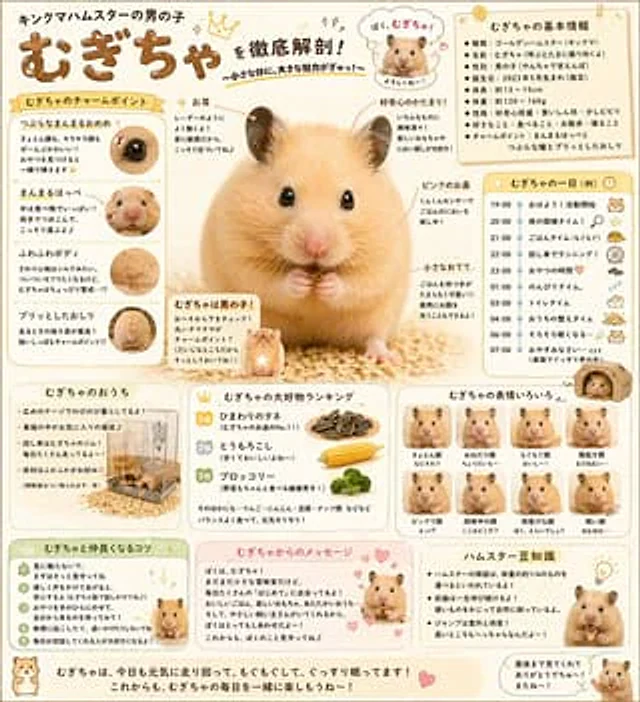

```text
{"type":"cute hamster infographic poster","subject":{"animal":"male Syrian hamster","nickname":"{argument name=\"character name\" default=\"むぎちゃ\"}","appearance":{"fur":"golden beige with cream belly","eyes":"large glossy black eyes","ears":"small rounded ears with dark gray edges","nose":"soft pink nose","paws":"tiny pink front paws held together at chest","body":"round fluffy body, sitting upright on bedding"}},"style":{"overall":"adorable Japanese pet guide poster, warm and cozy, highly detailed, soft realistic photo-illustration look","palette":"cream, beige, warm brown, pastel yellow, soft pink","mood":"friendly, informative, playful, affectionate","background":"light cream paper texture with subtle dots, stars, hearts, and hand-drawn accent marks"},"layout":{"format":"portrait infographic","centerpiece":"large front-facing hamster portrait centered on wood shavings","sections":[{"title":"キングマハムスターの男の子 むぎちゃ を徹底解剖！","position":"top header","count":1,"labels":["main title with crown doodle and subtitle"]},{"title":"むぎちゃの基本情報","position":"top right","count":7,"labels":["種類","名前","性別","誕生日","体長","体重","性格"]},{"title":"むぎちゃのチャームポイント","position":"upper left","count":4,"labels":["つぶらなまんまるおめめ","まんまるほっぺ","ふわふわボディ","プリッとしたおしり"]},{"title":"central callouts","position":"around centerpiece","count":6,"labels":["お耳","好きなひま種！","ピンクのお鼻","小さなおてて","むぎちゃは男の子！","speech bubble portrait introduction"]},{"title":"むぎちゃの一日（例）","position":"mid right","count":7,"labels":["19:00 おはよう！活動開始","20:00 夜の探検タイム！","21:00 ごはんタイム","22:00 回し車でランニング！","23:00 おやつの時間","01:00 のんびりタイム","07:00 おやすみなさい…zzz"]},{"title":"むぎちゃのおうち","position":"bottom left","count":1,"labels":["cage photo with habitat notes"]},{"title":"むぎちゃの大好物ランキング","position":"bottom center-left","count":3,"labels":["1位 ひまわりのタネ","2位 とうもろこし","3位 ブロッコリー"]},{"title":"むぎちゃの表情いろいろ","position":"bottom center-right","count":8,"labels":["まんまる顔","おねだり顔","もぐもぐ顔","寝起き顔","ビックリ顔","探検中の顔","得意げな顔","眠い顔"]},{"title":"むぎちゃと仲良くなるコツ","position":"bottom left strip","count":5,"labels":["tip 1","tip 2","tip 3","tip 4","tip 5"]},{"title":"むぎちゃからのメッセージ","position":"bottom middle strip","count":1,"labels":["first-person handwritten-style note with hearts"]},{"title":"ハムスター豆知識","position":"bottom right strip","count":4,"labels":["fact 1","fact 2","fact 3","fact 4"]},{"title":"bottom footer","position":"very bottom","count":1,"labels":["closing sentence about running, eating, and sleeping cutely every day"]}]},"text":{"language":"Japanese","headline":"{argument name=\"headline text\" default=\"キングマハムスターの男の子 むぎちゃ を徹底解剖！\"}","footer":"{argument name=\"footer text\" default=\"むぎちゃは、今日も元気に走り回って、もぐもぐして、ぐっすり眠ってます！これからも、むぎちゃの毎日を一緒に楽しもうね〜！\"}"},"decorations":{"count":10,"items":["crown doodle","sparkles","hearts","speech bubble","tiny hamster icons","sunflower seed icons","magnifying glass icon","running wheel icon","food illustrations","small cardboard house illustration"]},"rendering":{"camera":"slight eye-level close-up for main hamster, straight-on infographic layout","lighting":"soft bright studio lighting","detail":"crisp fur texture, glossy eyes, clean editorial composition"}}
```

Model: GPT Image 2
Author: AIハムスターむぎちゃ♂🐹

[ProjectD](https://aitoolsradar.com/en/prompts/6a9b35edafd095) · [Recorded source](https://youmind.com/prompts/cute-japanese-hamster-infographic-14992)
 · [Full original metadata and byte evidence](data/projectd-batch-0026.json)

## Cute Japanese Romcom Movie Poster

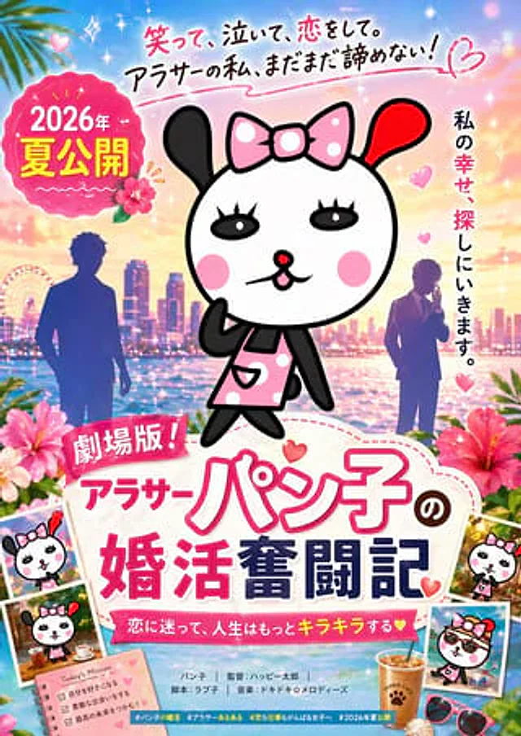

```text
A gorgeous Japanese romantic comedy movie poster, employing a cute and dramatic popular anime mascot style, designed like a movie trailer poster. The central image features a full-body cartoon bunny girl mascot, whose name is {argument name="character name" default="Panko"} She has a large, white face, a black body, one black ear and one bright red ear, with rugged features. Her half-closed, alluring eyes are framed by long eyelashes, and she has pink blush circles on her cheeks, a small red nose, and a slightly protruding tongue. A pink bow with white polka dots adorns her head. She wears a sleeveless pink dress with white polka dots and a black scarf-like decoration around her neck. One hand is near her cheek, her posture confident yet slightly playful. The background is a dreamy sunset over a seaside city skyline, with golden reflections on the water. The sky displays soft shades of pink, orange, and blue, accompanied by shimmering, softly blurred effects. A Ferris wheel is located on the left. Two male silhouettes are placed in the midground; one on the left stands casually, while the other on the right is dressed in a suit, hinting at potential romantic interests. Lush tropical flowers and foliage are added around the border, especially pink hibiscus in the corner, along with floating hearts and shimmering effects throughout the image. A bold, layered Japanese poster layout is employed, filled with decorative fonts and stickers. The top features handwritten Japanese text: "Laugh, cry, love. I can't bear to part with you!" with pink emphasis and doodle-like heart lines. The upper left contains a bright pink fan-shaped badge that reads "Released in Summer 2026." To the right is vertical Japanese text: "私の幸せ、探しにいきます。" A pink ribbon tag is added to the lower left, reading "Theatrical Version!" At the bottom center is a prominent main title in bold, decorative Japanese font: "アラサーパン子の婚活奮闘記" (Arasar Panko's Marriage Hunting Struggle Record), with pink and dark navy blue text, white outlines, and cute heart decorations. Below, a pink banner with highlighted yellow text reads: "Love is all the rage, life is all the rage ♥". The bottom includes a small, fake credits list in the style of a Japanese movie poster. Four Polaroid-style photos of the bunny girl characters are placed in the lower area: two on the bottom left and two on the bottom right, each showing a different cute scene, such as a close-up pose, sitting at a coffee table, wearing sunglasses, or posing outdoors. A notebook page labeled "Today's Mission" with a heart-shaped list is added to the bottom left, and a plastic iced drink cup with a straw and sunglasses are placed to the bottom right. The overall feel is feminine, comedic, inspirational, dazzling, exaggerated, and nostalgic—like a parody poster for a live-action romance movie starring a mascot. Vibrant pink, peach sunset hues, sky blue, white, and navy blue are used, with glossy highlights and a sophisticated promotional poster texture.
```

Model: GPT Image 2
Author: GPT Image 2 Prompts

[ProjectD](https://aitoolsradar.com/en/prompts/9a22af840a0c23) · [Recorded source](https://x.com/pandaken_ken/status/2047153624896483697#reversed-0)
 · [Full original metadata and byte evidence](data/projectd-batch-0026.json)

## Cute Japanese Woman Prompt


```text
One{argument name="age group" default="early 20s"} Japanese women.{argument name="looks" default="Cute like an idol"} .{argument name="hairstyle" default="Long black hair"} .
```

Model: GPT Image 2
Author: GPT Image 2 Prompts

[ProjectD](https://aitoolsradar.com/en/prompts/f6ed9efdc06276) · [Recorded source](https://x.com/kakuukanojo_2nd/status/2047505410970759520)
 · [Full original metadata and byte evidence](data/projectd-batch-0026.json)

## Cute Mermaid Puppy Underwater Game Screen

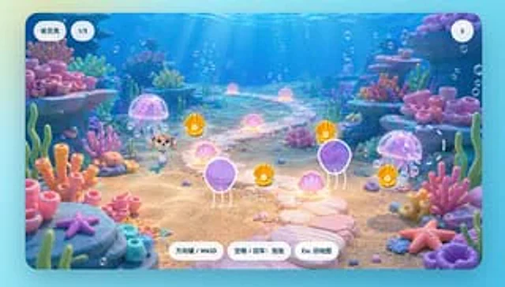

```text
A bright, whimsical underwater 2D game scene in a polished children’s animation style, shown as a full-screen level screenshot inside a rounded-rectangle game viewport. The setting is a colorful coral reef with a sandy seabed and a pale stone path winding from the foreground into the distance at center, creating depth. Sunbeams stream down through clear blue water from above, with many small air bubbles floating throughout the scene. Surround the path with soft, toy-like coral formations and sea plants in pastel pink, peach, lavender, turquoise, and mint, plus rocky ledges on both sides. Place 2 starfish in the foreground, one purple on the lower left rock and one pink-orange on the lower right. Add 2 translucent pink jellyfish, one left of center and one right of center, both gently glowing. Scatter 6 glowing pink clam shells along and beside the path, each emitting a soft magical aura. Add 4 golden-orange collectible shells with a pearl-like center, positioned near the middle play area. Include 2 large purple balloon-like jelly obstacles with white outlines and short dangling tentacles, one in the lower center-left and one in the mid-right. Near the left-center foreground, place a cute mermaid puppy character inspired by a preschool cartoon rescue dog: small smiling puppy face, big expressive eyes, light brown and cream fur, pink head accessory, teal mermaid tail, playful cheerful pose as if moving forward. On the right side, add a faint dashed circular target marker over the environment. Overlay simple mobile-game UI in Chinese: at the top left, two white rounded pill buttons, one reading "收贝壳" and one reading "1/5"; at the top right, a white circular pause button with "II". At the bottom center, place 3 white rounded instruction buttons with blue-gray text: "方向键 / WASD", "空格 / 回车：泡泡", and "Esc 回地图". Make the whole image glossy, soft-lit, kid-friendly, high-saturation but pastel-balanced, with a dreamy fantasy reef atmosphere and clean casual game-art composition.
```

Model: GPT Image 2
Author: 小鲸鱼

[ProjectD](https://aitoolsradar.com/en/prompts/0d21ac6d3dbbe3) · [Recorded source](https://youmind.com/prompts/mermaid-puppy-underwater-game-17147)
 · [Full original metadata and byte evidence](data/projectd-batch-0026.json)

## Cute Morning Greeting Figure Sticker

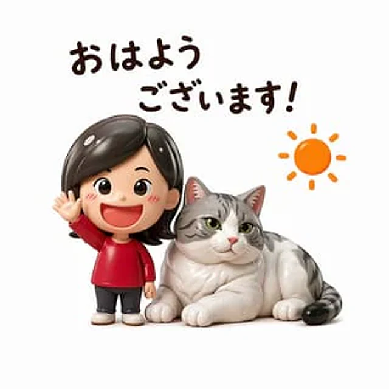

```text
This is an adorable sticker-style 3D doll illustration with a clean, light gray background and a glossy, collectible toy-like rendering. The image shows a chibi-style female figure and a large cat standing side-by-side. The female character is in a super-transformable vinyl toy style, with a large head, shoulder-length dark brown to black hair parted to the side and with a smooth, glossy finish. She wears a simple bright red long-sleeved top, dark charcoal gray leggings or slim-fit trousers, and white shoes. She stands on the left, facing forward, her left hand raised in a friendly wave, radiating a cheerful good morning greeting. Her face should convey the simplicity, cuteness, and youthful feel of a toy doll. To her right is a rounded silver tabby cat with white fur on its chest, abdomen, legs, and muzzle, gray stripes on its head, back, and tail, green eyes, and pink inner ears. It is in a relaxed, reclining position, paws tucked in, and its body slightly turned towards the camera. Add two lines of dark brown, rounded Japanese handwritten text at the top: the first line reads "おはよう" (Ohayou), and the second line reads "ございます!" (Gozaimasu!). Add a simple orange sun doodle with eight short rays in the upper right corner. The overall composition should evoke the feel of a personalized good morning sticker suitable for social media, using soft studio lighting, subtle shadows below the figure, a refined surface texture, cute proportions, and rich details to create a warm and playful atmosphere.
```

Model: GPT Image 2
Author: GPT Image 2 Prompts

[ProjectD](https://aitoolsradar.com/en/prompts/57dc6db2438e97) · [Recorded source](https://x.com/sobonoyokomichi/status/2046726277978321024#reversed-0)
 · [Full original metadata and byte evidence](data/projectd-batch-0026.json)

## Cute Oil Pastel Schoolgirl Portrait

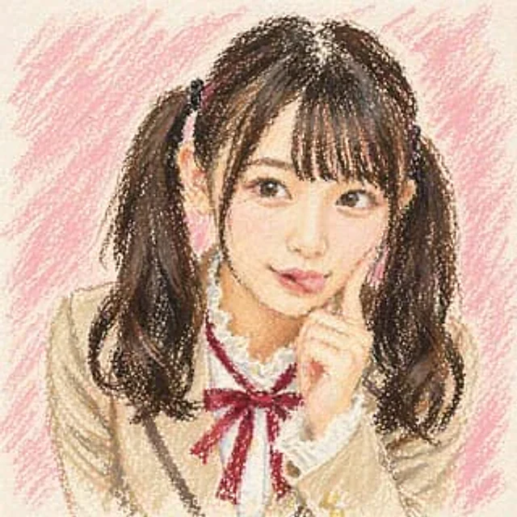

```text
A cute anime-style {argument name="character type" default="Japanese schoolgirl"} drawn as a hand-made oil pastel illustration on textured paper, bust-up portrait, centered composition. She has {argument name="hair color" default="dark brown"} hair in 2 low twin ponytails with soft waves and a center part, small dark hair ties, and visible ears. Her face is mostly hidden by a large vertical skin-toned rectangular censor block placed over the center of the face from forehead to chin, leaving only the hair, ears, jawline edges, and a little neck visible. She wears a light beige school uniform jacket over a white frilled blouse with lace-like ruffles at the collar and cuffs, accented by a deep red ribbon bow at the neck. Her right hand is raised in a small clenched-fist pose near her chin, creating a shy, adorable, cheering gesture. Background is fully filled with rough diagonal pink pastel scribbles over warm off-white paper. Emphasize thick waxy oil pastel texture, visible grain of paper, soft blending, broken color strokes, sketch-like outlines, charming imperfect handmade crayon drawing quality, gentle warm lighting, nostalgic and extremely cute mood.
```

Model: GPT Image 2
Author: ダルトワ★TV

[ProjectD](https://aitoolsradar.com/en/prompts/80a173ca4def62) · [Recorded source](https://youmind.com/prompts/cute-oil-pastel-schoolgirl-portrait-16641)
 · [Full original metadata and byte evidence](data/projectd-batch-0026.json)

## Cute Sheep Girl Office Manga Page

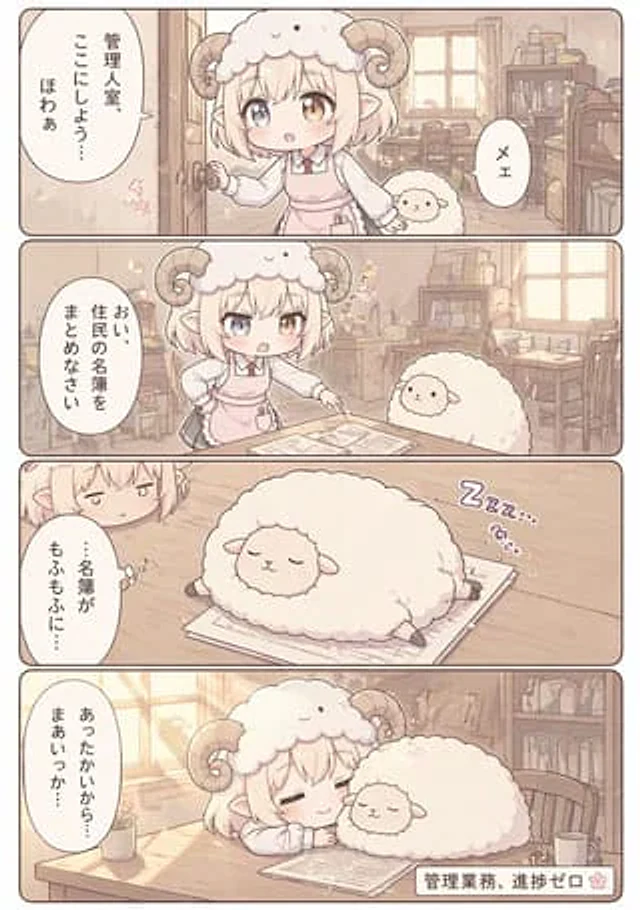

```text
{"type":"Four-panel comic page","style":"Soft pastel anime chibi style, warm beige and cream tones, soft morning light, rounded panel frames, clear and easy-to-read Japanese dialogue, heartwarming and humorous fantasy office life scenes","page":{"orientation":"Vertical","panel_count":4,"gutter":"Fine white spacing","border":"Rounded brown outline"},"setting":{"location":"Interior of a small management office","details":["Wooden floor","Sunny window","Office desk with files","Wooden chair","Bookshelf piled with files and books","Stacked boxes and office supplies","Soft dust and glimmers in the light"]},"characters":[{"role":"Main character","appearance":"Petty chibi style"]} The office worker, nicknamed "The Goat-Horned Girl," has a fluffy short blonde bob, one blue eye and one amber eye, small elf ears, huge curly horns, and wears a fluffy goat headdress shaped like a goat's face. She wears a white shirt, red tie, and a light pink apron skirt, with a small pen tucked into the apron pocket. The text then describes a round, fluffy white sheep with a small face and short legs, looking very soft, like a cloud. The layout is as follows: {"role":"Supporting Character","appearance":"Round, fluffy white sheep with a small face and short legs, looking very soft, like a cloud."}; {"sections":[{"title":"First Section","position":"Top","count":3,"labels":["The Goat-Horned Girl opens the office door and looks inside","The little sheep peeks around her","There is an oval-shaped dialog box on the left and a small oval-shaped dialog box on the right"]}; {"title":"Second Section","position":"Upper Middle","count":3,"labels":["The Goat-Horned Girl stands by the desk, one...]} Hands on hips, one hand pointing to a document,","Little sheep sits at the table,""There is a large oval dialog box on the left"]},{"title":"Third panel","position":"Lower middle","count":3,"labels":["A fluffy sheep is sleeping on the document","The horned girl peeks out from the upper left, looking tired","There is a purple onomatopoeic word for sleep on the right"]},{"title":"Fourth panel","position":"Bottom","count":4,"labels":["The horned girl is asleep at the table, eyes closed, with a faint smile","A fluffy sheep is sleeping with her on the document","Warm sunlight shines in from the left window","There is a small rectangular title box in the lower right corner"]}]},"text":{"language":"Japanese","elements":[{"kind":"Dialog box","panel":1,"text":"Management room, ここにしよう… ほわあ"},{"kind":"dialog box","panel":1,"text":"メェ"},{"kind":"dialog box","panel":2,"text":"おい、 resident listをまとめなさい"},{"kind":"dialog box"," panel":3,"text":"…名书がもふもふに…"},{"kind":"Onomatopoeia","panel":3,"text":"Zzz…"},{"kind":"Dialog box","panel":4,"text":"あったかいから…まあいっか…"},{"kind":"title","panel":4,"text":"{argument name="caption text" default="Management business, progress at zero."} "}]},"composition":"Keep all four panels in the same office to ensure continuity; emphasize the cute facial expressions, the fluffy texture, and the humor of the office work stalling because the sheep and the staff are asleep on the documents; make the documents clearly visible in the second to fourth frames; maintain a calm, languid, and warm tone."}
```

Model: GPT Image 2
Author: GPT Image 2 Prompts

[ProjectD](https://aitoolsradar.com/en/prompts/4d5097ef05380c) · [Recorded source](https://x.com/jonigata_ai/status/2046717757182685486#reversed-0)
 · [Full original metadata and byte evidence](data/projectd-batch-0026.json)

## Cute Subscription Celebration Illustration


```text
A warm and charming digital illustration, set against a cozy desktop background, celebrates a new subscription. On the left is a friendly humanoid robot mascot with a glossy black screen displaying pixelated purple LED eyes and a smiling mouth. It wears a black top hat with a purple ribbon, a dark hoodie with a small American flag patch on the sleeve, and "USN VET MSSP" printed on its chest. The robot gives a thumbs-up with one hand and holds a small rectangular sign that reads "Subscribed!" with a purple heart drawn below. On the right is an ecstatic young woman with long, wavy hair.{argument name="hair color" default="gold"} Her hair was disheveled, and she sat at the table, her hands clasped together near her chin in an excited and grateful gesture. She wore a white long-sleeved top with red and blue stripes and a small logo on the chest. Her face was obscured by a simple square smudge. Above them, large, playful handwritten characters read, "{argument name="headline text" default="Nick subscribed to Sharon!"} Below the title is a rounded notification card displaying a circular image of the same robot mascot and its name.{argument name="subscriber name" default="Nick"} , and "Subscribed to{argument name="creator name" default="Sharon Riley"} The text read "", followed by a purple heart. The speech bubble next to the woman read "".{argument name="speech bubble text" default="Thank you!"} The composition features seven pink heart doodles scattered throughout, with a small white glitter added near the center. All elements are placed on a wooden tabletop. On the left side of the table, a black mug with the words "CRYPTO CAN'T BE EVIL" and a gold coin with a Shiba Inu head are placed. In the center of the right front, a white mug with "AI FOR GOOD" and a blue heart is placed. On the far right, three books are stacked, their spine titles clearly visible: "AI &amp; CREATIVITY," "ENTERTAINMENT," and "DREAM BIG" with a heart, next to a small potted plant. A softly blurred home office background is used, including bookshelves, soft-toned decor, and a picture frame with the letter X on the wall. Soft peach and beige lighting, painterly shadows, rounded shapes, a healing-style fan art aesthetic, and exquisite picture book-style digital paintings complete the look.
```

Model: GPT Image 2
Author: GPT Image 2 Prompts

[ProjectD](https://aitoolsradar.com/en/prompts/5318cf29359487) · [Recorded source](https://x.com/Just_sharon7/status/2047324314945663364#reversed-0)
 · [Full original metadata and byte evidence](data/projectd-batch-0026.json)

## Cute Winking Schoolgirl Peace Sign


```text
A simple and cute flat vector illustration featuring a cheerful Japanese female student in the center of a light gray solid background. The image shows her from the mid-thigh upwards in a frontal pose. She has long, straight hair.{argument name="hair color" default="black"} Her hair is styled with a side-swept fringe, she has fair skin, a round face, and pink blush on her cheeks. One eye is open, the other blinking, and she has a small nose and a slightly parted mouth in a smile. She wears a classic Japanese high school uniform, consisting of a dark navy blue blazer, a white shirt collar with a large red bow at the neckline, and a gray pleated skirt. Two gold buttons are visible on the blazer. Her arms are outstretched horizontally to the sides, facing the audience, and she makes a peace sign with her fingers pointing downwards. The design employs bold, simple black outlines, soft, light-colored flat colors, minimalist shadows, kawaii sticker-style proportions, symmetrical composition, and a friendly, playful expression.
```

Model: GPT Image 2
Author: GPT Image 2 Prompts

[ProjectD](https://aitoolsradar.com/en/prompts/b2f116d2e9fe01) · [Recorded source](https://x.com/AyakiKenichiro/status/2047372604949057619#reversed-0)
 · [Full original metadata and byte evidence](data/projectd-batch-0026.json)

## Cute Winter Anime Channel Poster


```text
A cute, soft-toned anime promotional poster, using a dreamy idol fan club style, with a horizontal composition and a half-body portrait of a horse girl character on the right. She possesses {argument name="hair color" default="Dark chestnut brown"} She has long, flowing hair, with side-swept bangs covering one eye, the other large and bright, a purplish-pink. Her skin is fair with a soft blush, and horse ears stand upright on her head, tied with a large cream-colored bow. Her expression is gentle, shy, and friendly, with a slight smile, her head tilted slightly towards the viewer. She wears a thick red scarf with white horizontal stripes, a cream-colored cable-knit sweater over a navy blue sailor-style collar, and a small red ribbon tied at the chest. The overall color scheme is warm pink, cream, beige, and cocoa brown, complemented by soft winter lighting. The image is designed as a Japanese-style fan content announcement, using layered sticker-style typography, fluffy outlines, hearts, glitter, and snowflake patterns. The background should be a soft-focus, cozy winter café or a warmly lit indoor scene with luminous bokeh and light-colored decorative textures. Add 5 main text areas: At the top is a pink ribbon banner with the Japanese phrase "ライスと一緒に" (Raisu to Ichiso ni); in the center left is a large, rounded, trendy font title that reads "ほのぼの育成" (Honobo no Yusei), where "ほのぼの" is pinkish-white and "育成" is bold brown with white stitching; below is a small, dark ribbon that reads "しよっ♪" (Shiyo♪); to the right is a round, brown badge that reads "初見さん歓迎" (Hatsume-san-han); and in the lower right corner is a logo-like label that reads "ライスシャワーちゃんねる" (Raisusha-chan-neru) with a small horseshoe icon. Add a memo pad in the lower left corner containing 3 lines of lists, each with a pink checkmark: "ストーリー" (Story), "チャンミ" (Chamming), and "まったり雑談" (Mattari Zadan). Add decorative pink hearts around the character, delicate decorative lines near the head, white snowflakes, lace trim, and paper-cut style corner decorations to create a soft scrapbook aesthetic. This makes the entire piece look like a cute and fictional live stream or channel thumbnail designed to welcome new viewers. The image is beautiful, with clean lines, soft shadows, and bright, sparkling eyes, possessing a captivating commercial poster composition.
```

Model: GPT Image 2
Author: GPT Image 2 Prompts

[ProjectD](https://aitoolsradar.com/en/prompts/755815e5cca4a4) · [Recorded source](https://x.com/pico_nano1/status/2046844309761302999#reversed-0)
 · [Full original metadata and byte evidence](data/projectd-batch-0026.json)

## Cyber Blue Qwen Tech Review Poster


```text
Create a dramatic vertical 4:5 tech influencer poster in a glossy cyber-blue style. A young East Asian man with short black hair, black rectangular glasses, and a surprised open-mouth expression leans toward the camera from the right side, wearing a plain black T-shirt. He holds a large glowing circular blue token close to the lens with his left hand in the lower-left foreground, making it appear oversized; the token has a transparent glassy rim, neon blue highlights, and a raised white geometric logo made of three separate block shapes on its face. His right hand points at the token from the right. Use an extreme wide-angle selfie perspective, strong depth distortion, crisp high-contrast lighting, and a dark black background filled with electric blue light streaks, lens flares, and motion lines. Add exactly 3 visible text elements: a huge 3D metallic-blue Chinese headline in the upper-left background reading {argument name="background Chinese headline" default="大力"}, a large italic white-and-blue title across the bottom reading {argument name="model title" default="Qwen3.8"}, and bold white Chinese text at the lower right reading {argument name="test label" default="实测"}. Make all typography extruded, glossy, beveled, and glowing with blue rim light. The composition should feel like a high-energy YouTube thumbnail or social media tech review announcement, ultra sharp, cinematic, slightly surreal, no extra text, no watermark.
```

Model: GPT Image 2
Author: Paidax

[ProjectD](https://aitoolsradar.com/en/prompts/46debb94af9cb6) · [Recorded source](https://youmind.com/prompts/qwen-tech-review-poster-29624)
 · [Full original metadata and byte evidence](data/projectd-batch-0026.json)

## Cyber Elf Girl Reference Sheet

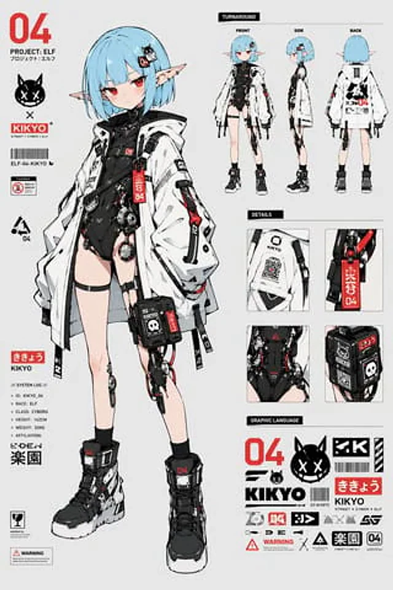

```text
{
  "type": "Anime Character Design Collection",
  "style": "High-quality cyberpunk street style concept art, pure white background, sharp lines, cel animation rendering, product design and display layout, black, white and red graphic brand logo, and light blue hair color accents.",
  "character": {
    "name": "{argument name=\"character name\" default=\"KIKYO\"}",
    "species": "Elf Cyborg Girl",
    "age_appearance": "Teen appearance",
    "build": "petite and slender",
    "height_note": "Side view label: 142 cm",
    "hair": {
      "color": "{argument name=\"hair color\" default=\"Light blue\"}",
      "cut": "Short bob with blunt bangs and slightly inward curls at the ends.",
      "accessories": [
        "The black hair clip on the left side has the number 04 in red and a small cat face badge."
      ]
    },
    "face": {
      "eyes": "Red, eyes half-open, expression slightly languid and aloof.",
      "ears": "Extremely long, pointed elf ears that extend horizontally",
      "expression": "Calm, aloof, with a slight pout"
    },
    "outfit": {
      "main_layers": [
        "Oversized white techwear jacket with black lining, straps, printed tags, and red accents.",
        "A glossy black cyborg bodysuit with mechanical panels and exposed technological components around the torso and hips.",
        "Black thigh strap on left leg",
        "Black and white high-top platform sneakers with buckles, laces, and a red \"04\" logo."
      ]
    },
    "cybernetics": {
      "legs": "The legs are partially mechanized, especially the right leg, with exposed joints, pistons, and cables; black equipment modules are strapped to the thigh and calf.",
      "hip_details": "Circular mechanical components and cables are suspended from the waist and upper thighs.",
      "arm_details": "Black cyborg details are faintly visible beneath the jacket cuffs."
    },
    "props": [
      "A red tag with white Japanese characters and the number 04 was hanging on his chest.",
      "The right thigh features a black multi-functional pocket with a skull icon, QR code-style graphics, and patches."
    ]
  },
  "layout": {
    "background": "Flat light gray-white",
    "left_panel": {
      "count": 10,
      "items": [
        "Large red 04 in the upper left corner",
        "PROJECT: ELF and the smaller Japanese subtitle below",
        "Black cat and skull icon",
        "KIKYO Street/Cyber/Elf Brand Block",
        "A barcode bearing the words ELF-04-KIKYO",
        "Small warning style square label",
        "Triangle 04 symbol",
        "Red Japanese nameplate",
        "The system log text block lists the ID, race, occupation, height, weight, and affiliation.",
        "Small warning label at the bottom"
      ]
    },
    "centerpiece": "A large full-body frontal illustration of a character, knee slightly bent, hands in jacket pockets.",
    "top_right_turnaround": {
      "title": "Three views",
      "count": 3,
      "views": [
        "front",
        "side",
        "back"
      ]
    },
    "mid_right_details": {
      "title": "detail",
      "count": 4,
      "items": [
        "Close-up of the chest area of ​​the jacket, featuring a KIKYO logo and a QR code-style patch.",
        "A close-up of the red hangtag, containing Japanese characters and the number 04.",
        "Close-up of cyborg details of the pelvis and hips in the bodysuit",
        "A close-up of a black thigh-high multi-functional bag, featuring a skull graphic and patches."
      ]
    },
    "bottom_right_graphics": {
      "title": "Graphical Language",
      "count": 15,
      "items": [
        "Large Red 04",
        "Black cat and skull logo",
        "Stylized K-mark",
        "diagonal stripes",
        "Bold KIKYO lettering",
        "Small round cat face icon",
        "Barcode label with ELF-04-KIKYO",
        "Red Japanese nameplate",
        "KIKYO Street + Cyber ​​+ Elf Text Blocks",
        "Small machine icon",
        "Small red 04 graphic block",
        "Arrow/Herringbone symbol block",
        "Warning text block with red triangle",
        "Cross tool or X symbol",
        "Black rectangular Japanese character mark block and small 04 block"
      ]
    }
  },
  "color_palette": {
    "count": 5,
    "colors": [
      "Light gray-white background",
      "Light blue hair",
      "Black bodysuit and accessories",
      "White jacket panel",
      "Red accents and layout"
    ]
  },
  "composition": "In this editorial character design project, the largest character on the left occupies approximately two-thirds of the height, while reference views and annotation boxes are aligned on the right, with dense brand elements scattered along the edges.",
  "text_style": "The bold, sans-serif English labels are mixed with Japanese graphic text, resulting in a clear layout and a futuristic, stylish book aesthetic."
}
```

Model: GPT Image 2
Author: GPT Image 2 Prompts

[ProjectD](https://aitoolsradar.com/en/prompts/98475e81a232dd) · [Recorded source](https://x.com/Eris_Create_Lab/status/2046829475779019236#reversed-2)
 · [Full original metadata and byte evidence](data/projectd-batch-0026.json)

## Cyber Streetwear Manga Splash Art

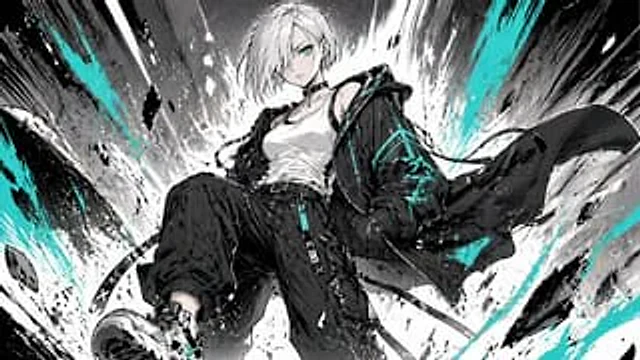

```text
A dynamic, comic-style action illustration depicts a young, androgynous woman, shot from a high-angle, jarring perspective, as if the viewer is directly beneath her, watching her stride or land through an explosion of ink and debris. She sports a platinum blonde bob with long, side-swept bangs that partially obscure her face, her fair skin radiating a cool and rebellious street style vibe. Her face is covered by a simple light gray rectangular hoodie. She wears five main pieces: an oversized black hooded jacket with bright cyan geometric patterns on the cuffs and lining; a fitted white vest; loose black cargo pants with lace-up and zipper details; a black belt with a cyan tag; and chunky black and white sneakers with subtle cyan accents. Additional accessory details include dangling straps, buckles, and street-tech embellishments. Her pose is relaxed yet commanding, one knee raised towards the viewer, torso slightly leaning back, one hand in her pocket, the jacket billowing with the movement. The composition should be aggressive and dynamic, using a monochromatic palette of black, white, and gray, accented with vibrant electric cyan brushstrokes. The background is filled with explosive abstract brushstrokes, ink splatters, speed lines, torn black fragments, and chaotic comic book energy radiating outwards from behind her. High contrast, grainy textures, bold ink lines, impressionistic ink splatter effects, an urban dystopian anime key visual, extremely delicate fabric folds, stylish editorial composition, and wide-format cinematic composition.
```

Model: GPT Image 2
Author: GPT Image 2 Prompts

[ProjectD](https://aitoolsradar.com/en/prompts/5ecca29226ce47) · [Recorded source](https://x.com/Design4p0/status/2046828688986030547#reversed-0)
 · [Full original metadata and byte evidence](data/projectd-batch-0026.json)

## Cybernetic Character Reference Sheet

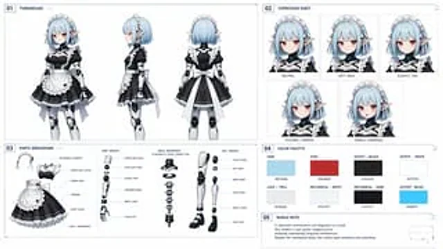

```text
{
  "type": "Anime character design document",
  "character": {
    "concept": "{argument name=\"character concept\" default=\"Cyborg maid with elf ears\"}",
    "hair": "{argument name=\"hair color\" default=\"light blue\"} Short bob haircut with headband",
    "eyes": "{argument name=\"eye color\" default=\"red\"}",
    "outfit": "{argument name=\"outfit style\" default=\"Black and white maid outfit\"}",
    "features": "Mechanical joints in arms and legs, cyborg neck"
  },
  "layout": {
    "style": "A clean technical blueprint style with grid lines and numbered sections.",
    "sections": [
      {
        "number": "01",
        "title": "Three views",
        "count": 3,
        "description": "Full-body view: front, side, back"
      },
      {
        "number": "02",
        "title": "Emojis",
        "count": 5,
        "labels": [
          "neutral",
          "gentle smile",
          "Slightly sad",
          "Focused/Serious",
          "Slight surprise"
        ]
      },
      {
        "number": "03",
        "title": "Component Disassembly",
        "count": 4,
        "components": [
          {
            "name": "Maid Outfit",
            "labels": [
              "headbands and ribbons",
              "upper ruffle",
              "elbow joint",
              "apron",
              "Skirt layer",
              "Lace/Suitcase"
            ]
          },
          {
            "name": "Right arm",
            "labels": [
              "upper arm panel",
              "shoulder joint",
              "elbow joint",
              "Forearm panel",
              "wrist joint",
              "Hand unit"
            ]
          },
          {
            "name": "Neck Interface",
            "labels": [
              "Cyborg spinal connector"
            ]
          },
          {
            "name": "Leg (right)",
            "labels": [
              "Thigh panel",
              "Hip joint",
              "knee joint",
              "Lower leg panel",
              "ankle joint",
              "Foot unit"
            ]
          }
        ]
      },
      {
        "number": "04",
        "title": "Color scheme",
        "count": 8,
        "swatches": [
          {
            "label": "hair",
            "hex": "#87CEEB"
          },
          {
            "label": "Eye",
            "hex": "#C62828"
          },
          {
            "label": "Clothing - Black",
            "hex": "#1A1A1A"
          },
          {
            "label": "Clothing - White",
            "hex": "#FFFFFF"
          },
          {
            "label": "Lace/Ruffles",
            "hex": "#E6E6EA"
          },
          {
            "label": "Mechanical - White",
            "hex": "#F2F4F7"
          },
          {
            "label": "Mechanical - Dark",
            "hex": "#121417"
          },
          {
            "label": "Accent color (blue)",
            "hex": "#00BFFF"
          }
        ]
      },
      {
        "number": "05",
        "title": "Worldview Notes",
        "text": "{argument name=\"world note text\" default=\"A cyborg maintenance unit disguised as a maid. She lives in a massive Gothic megastructure, endlessly maintaining a forgotten building. Despite her mechanical body, she retains quiet emotions and autonomy.\"}"
      }
    ]
  }
}
```

Model: GPT Image 2
Author: GPT Image 2 Prompts

[ProjectD](https://aitoolsradar.com/en/prompts/21305b976fdaee) · [Recorded source](https://x.com/Eris_Create_Lab/status/2045002293813362967#reversed-0)
 · [Full original metadata and byte evidence](data/projectd-batch-0026.json)

## Cyberpunk 2077 Puppet Poster

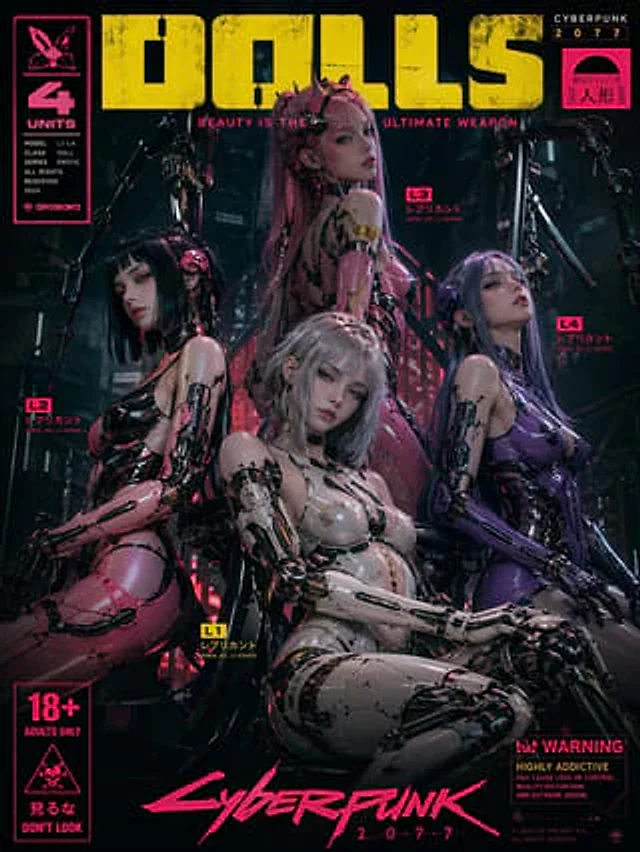

```text
{argument name="style" default="Cyberpunk 2077"}{argument name="subject" default="Four puppets"} Poster, mechanical aesthetics.
```

Model: GPT Image 2
Author: GPT Image 2 Prompts

[ProjectD](https://aitoolsradar.com/en/prompts/c29a40923584c1) · [Recorded source](https://x.com/seventhoce56019/status/2046822786371592547)
 · [Full original metadata and byte evidence](data/projectd-batch-0026.json)

## Cyberpunk 404 Witch Summoning

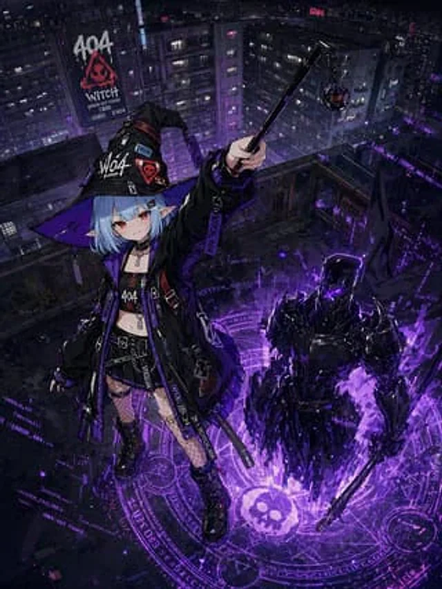

```text
A highly dramatic, anime-style cyberpunk witch illustration. She stands on a dark rooftop high in a futuristic city at night, her perspective slightly downward. The protagonist is a young witch with fair skin, an ice-blue bob, elfin ears, and a cunning, confident gaze. She holds aloft a black wand, the tip of which dangles a faint purplish-red glow. She wears a huge black pointed witch's hat, lined with purple and covered in stitched patches, warning labels, ribbons, and white patterns, including the prominent "404" and a skull emblem. She is dressed in a black and purple futuristic outfit: an oversized hooded jacket with numerous ribbons and labels, a short black top with "404" printed on the chest, multiple belts, shorts, a single-leg fishnet stocking, black lace-up combat boots, a choker, and metallic accessories. The multiple hanging ribbons and labels clearly display "WITCH 404," "404," and glitch art-style markings. Beneath and beside her, a massive, glowing purple magic circle, blending hacker interface aesthetics with a rooftop, is projected onto the ground. The circle is filled with mysterious rings, runes, a central skull symbol, and scattered neon system text (like error code snippets), creating an atmosphere where witchcraft and digital corruption intertwine. Emerging from the magic circle is a massive armored summon: a black, futuristic demon knight or robotic familiar, clad in jagged, reflective armor, wearing a long, glowing purple mask, wielding a heavy weapon in one hand, its body dissipating into purple energy fragments and smoke. The background depicts a vast, rain-soaked metropolis, towering skyscrapers with industrial-looking rooftops filled with windows, balconies, cables, signs, and mist. A large, vertical graffiti-style sign on a nearby building displays three clearly visible elements: “404,” “Witch,” and “ERROR NOT FOUND,” along with a smaller “E404.” Additional purple neon glitch text and symbols are scattered across the rooftops and in the air. The overall design employs a dark color palette of black, indigo, and deep purple, accented with vibrant magenta and purple highlights, resulting in cinematic contrast, a reflective, wet-look surface, rich detail, and a sophisticated, high-end illustration style. The atmosphere is mysterious, avant-garde, stylish, and dangerous, perfectly blending urban fantasy, hacker aesthetics, and magical summoning elements.
```

Model: GPT Image 2
Author: GPT Image 2 Prompts

[ProjectD](https://aitoolsradar.com/en/prompts/88e250c13de61e) · [Recorded source](https://x.com/Eris_Create_Lab/status/2047537707904274795#reversed-1)
 · [Full original metadata and byte evidence](data/projectd-batch-0026.json)

## Cyberpunk AI Tools Comparison Poster

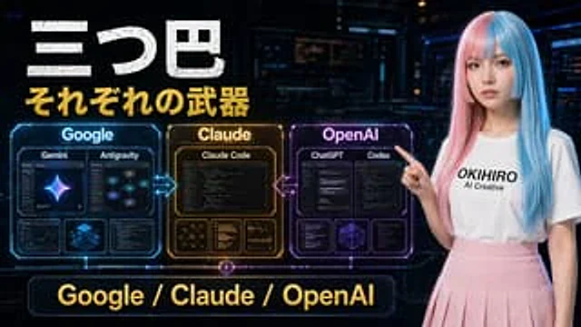

```text
A futuristic Japanese-style tech comparison poster, set against a dark cyberpunk control room background, uses a 16:9 widescreen composition. The upper left corner features a striking, distressed white Japanese title, "三つ巴" (San Tsu Tomoe), followed immediately by a prominent gold subtitle, "それぞれの武器" (Sorezore no Weapon). On the left side of the image, three glowing holographic contrast panels are arranged horizontally and connected by neon arrows: a blue panel labeled "Google," an amber-gold panel labeled "Claude," and a magenta panel labeled "OpenAI." The Google panel contains four internal cards: the two larger cards at the top are labeled "Gemini" and "Antigravity," while the two smaller cards at the bottom display analytical/dashboard-style visuals and a blue isometric cube. The Claude panel contains four internal cards: the large card at the top is labeled "Claude Code," and the three smaller cards at the bottom display network diagrams, text/code lists, and chart analysis. The OpenAI panel contains five internal cards: the two larger cards at the top are labeled "ChatGPT" and "Codex" respectively, while the three smaller cards at the bottom display the interface/code window and a geometric wireframe cube. Glowing bidirectional arrows are added between Google and Claude, and between Claude and OpenAI. A large neon-bordered banner with the words "Google / Claude / OpenAI" in gold lettering is placed at the bottom center. A young woman with long, straight, pink and blue highlights stands on the right, pointing to the panel on the left, and wears a shirt with black lettering {argument name="shirt text" default="OKIHIRO AI Creative"} She wore a pure white T-shirt and a light pink pleated skirt. Her face was obscured by a smooth, rectangular blur. The design employed cinematic sci-fi lighting, glossy holographic UI details, high contrast, and a vibrant blue-gold-purple color scheme, presenting a refined YouTube thumbnail aesthetic.
```

Model: GPT Image 2
Author: GPT Image 2 Prompts

[ProjectD](https://aitoolsradar.com/en/prompts/b63b4ce0c95c46) · [Recorded source](https://x.com/MoveHiro1219/status/2047698611665096732#reversed-1)
 · [Full original metadata and byte evidence](data/projectd-batch-0026.json)

## Cyberpunk Android Elf Storyboard

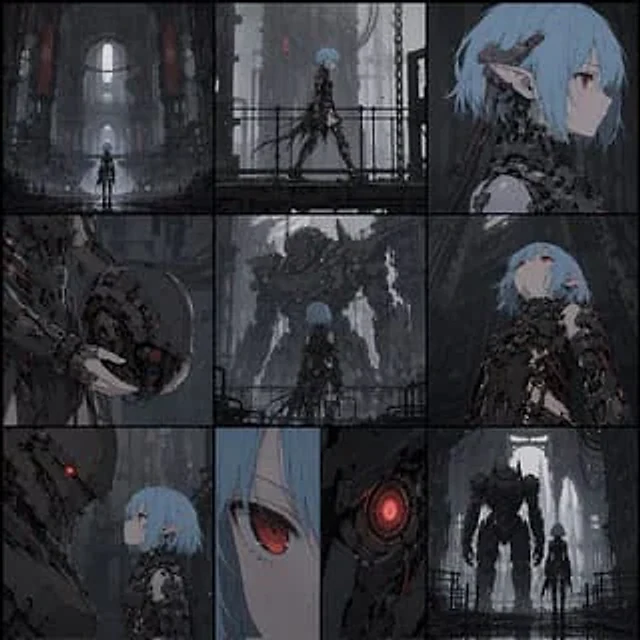

```text
{
  "type": "Anime Cyberpunk Project Collage",
  "style": "Dark cinematic mecha illustrations, highly detailed, emotionally charged industrial sci-fi, rendered with a painterly anime style, desaturated steel gray tones, with black metallic textures and subtle deep red lighting effects.",
  "subject": {
    "primary character": {
      "type": "Female Android Genie",
      "appearance": "A slender young woman with pale skin and a short bob haircut.{argument name=\"hair color\" default=\"Ice Blue\"} Hairstyle: straight bangs, pointed elf ears, red eyes, calm and composed expression.",
      "outfit": "The black biomechanical bodysuit consists of layers of cables, metal plates, straps, and exposed mechanical components, with distressed dragging elements on the legs and back."
    },
    "secondary character": {
      "type": "Giant humanoid mech",
      "appearance": "The towering armored robot, covered in thick charcoal-gray armor, its surface marked with battle scars, and its red sensor eyes flashing, possessed an extremely intimidating silhouette."
    },
    "prop": "He was holding a dark mechanical helmet with a single red glowing lens."
  },
  "environment": {
    "setting": "The interior of a massive Gothic industrial cathedral transformed into a factory of the future",
    "details": [
      "towering archway",
      "Suspended cables and chains",
      "Metal walkway with railings",
      "The atmosphere of being enveloped in mist",
      "Moist reflective surface",
      "Huge walls filled with machinery and vertical structures"
    ]
  },
  "layout": {
    "composition": "A 3x3 project grid with uniform illustrations divided by black borders.",
    "sections": [
      {
        "position": "Top left",
        "count": 1,
        "description": "A wide-angle fixed-field shot shows the compact Android device standing alone in the center of a massive cathedral-like industrial hall."
      },
      {
        "position": "Upper-middle",
        "count": 1,
        "description": "A full-body side view of an Android device walking on a metal walkway."
      },
      {
        "position": "Top right",
        "count": 1,
        "description": "A close-up profile portrait showcasing elf ears, blue hair, red eyes, and the complex mechanical structure of the neck and head."
      },
      {
        "position": "Left and Middle",
        "count": 1,
        "description": "A close-up of a hand holding a dark mechanical helmet with a red glowing lens."
      },
      {
        "position": "middle",
        "count": 1,
        "description": "The silhouette of an Android elf, facing a giant mech up close in an industrial corridor."
      },
      {
        "position": "Right Center",
        "count": 1,
        "description": "In a low-angle mid-range portrait, the Android Phantom looks slightly downwards, emphasizing the armored torso and neck mechanical devices."
      },
      {
        "position": "Bottom left",
        "count": 1,
        "description": "A close-up side-view scene of a giant mech and an Android sprite facing each other, comparing their size differences."
      },
      {
        "position": "Middle to lower",
        "count": 2,
        "description": "The split-screen close-up dual-panel image features the elf's red eyes and blue hair on the left and the mecha's red glowing lens on the right."
      },
      {
        "position": "Bottom right",
        "count": 1,
        "description": "Wide-angle shot of the mechs and Android sprites standing side by side or walking towards the front of the cathedral hall."
      }
    ]
  },
  "lighting": {
    "overall": "Understated, dramatic lighting with a cool gray ambiance",
    "accents": "Small red LED lights and glowing lenses scattered throughout the character designs and mechanics.",
    "mood": "Loneliness, ominousness, elegance, futuristic"
  },
  "camera": "It blends fixed wide-angle shots, profile portraits, low-angle hero shots, and extreme close-ups, arranged like a film-quality project.",
  "quality": "Ultra-fine detail, sharp focus, atmospheric perspective, exquisite conceptual art piece."
}
```

Model: GPT Image 2
Author: GPT Image 2 Prompts

[ProjectD](https://aitoolsradar.com/en/prompts/71a53d484f31ac) · [Recorded source](https://x.com/Eris_Create_Lab/status/2046586640760791107#reversed-0)
 · [Full original metadata and byte evidence](data/projectd-batch-0026.json)

## Cyberpunk Anime Character Concept Sheet

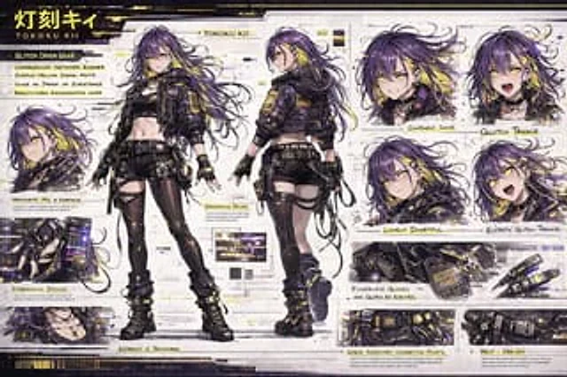

```text
{
  "type": "Anime character concept design drawings",
  "character": {
    "name_jp": "{argument name=\"character name\" default=\"Lighting Key\"}",
    "name_en": "{argument name=\"english name\" default=\"TOKOKU KII\"}",
    "appearance": {
      "hair": "{argument name=\"hair color\" default=\"Purple with yellow highlights\"} Disheveled, long hair",
      "eyes": "{argument name=\"eye color\" default=\"yellow\"} Sharp, wild",
      "outfit": "{argument name=\"theme\" default=\"Cyberpunk Functional Glitch Stalker\"} Black cropped top, short jacket with purple and yellow glitch pattern, black shorts, asymmetrical thigh-high socks with fishnet details, heavy tactical boots, fingerless gloves, tactical belt with pouch, and dangling cables."
    }
  },
  "layout": {
    "background": "Technical grid, glitch effects, UI elements",
    "centerpiece": "Two full-body portraits: front and back.",
    "sections": [
      {
        "title": "Malfunction Stalker Gear",
        "position": "Top left",
        "type": "Bullet List",
        "count": 4,
        "labels": [
          "Underground network runners",
          "Purple-yellow signal theme",
          "Using sound as proof of existence",
          "Reality/Video Synchronization Layer"
        ]
      },
      {
        "title": "expression",
        "position": "Top right to middle right",
        "type": "avatar",
        "count": 4,
        "labels": [
          "Confident smirk",
          "Fault confusion",
          "Loneliness and Doubt",
          "Ecstasy, malfunction, and delirium"
        ]
      },
      {
        "title": "Equipment details (left)",
        "position": "From middle left to bottom left",
        "type": "Close-up",
        "count": 3,
        "labels": [
          "Headphones, microphones, and earbuds",
          "Streaming devices",
          "ESTRACUT IF TECHINBAN"
        ]
      },
      {
        "title": "Equipment details (right)",
        "position": "Bottom right",
        "type": "Close-up",
        "count": 3,
        "labels": [
          "Fingerless gloves and malfunctioning dagger",
          "Cable accessory connection points",
          "belt design"
        ]
      }
    ]
  }
}
```

Model: GPT Image 2
Author: GPT Image 2 Prompts

[ProjectD](https://aitoolsradar.com/en/prompts/52714aebc11cec) · [Recorded source](https://x.com/tshikimi/status/2045408172463276258#reversed-0)
 · [Full original metadata and byte evidence](data/projectd-batch-0026.json)

## Cyberpunk Anime Character in Neon Tub

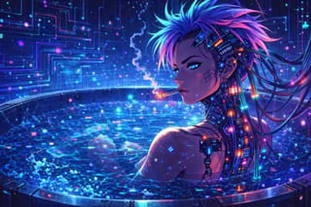

```text
An incredibly detailed anime-style digital illustration depicts a cyberpunk female character relaxing in a circular metal bathtub filled with swirling, glowing blue water shimmering with digital neon particles. She keeps {argument name="hair color" default="blue-purple"} Spiky short hair, possessing{argument name="eye color" default="Glowing blue"} Her eyes, neck, and sides of her head were connected by sophisticated cybernetic implants with glowing cables and neon nodes. A faint mesh pattern was visible on her cheeks. She was looking back, at the same time {argument name="activity" default="Smoking"} A thin wisp of glowing smoke rose into the air. The backdrop was a dark, high-tech wall, adorned with glowing lights.{argument name="background color scheme" default="blue-purple"} The circuit board pattern highlights a strong neon lighting effect and a vibrant cyberpunk aesthetic.
```

Model: GPT Image 2
Author: GPT Image 2 Prompts

[ProjectD](https://aitoolsradar.com/en/prompts/697698dd7ff559) · [Recorded source](https://x.com/BinaryRot/status/2043796479471706286#reversed-0)
 · [Full original metadata and byte evidence](data/projectd-batch-0026.json)

## Cyberpunk Anime Character Sheet

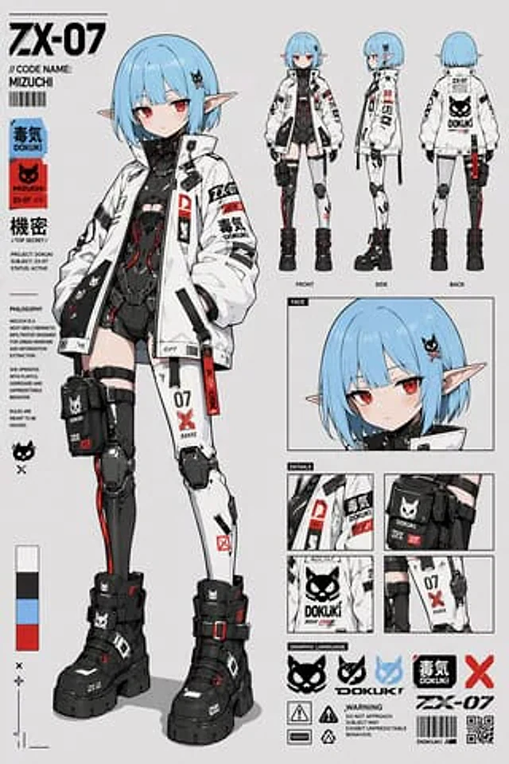

```text
{
  "type": "Anime Cyberpunk Character Reference Design Collection",
  "character": {
    "name": "{argument name=\"character name\" default=\"MIZUCHI\"}",
    "code": "{argument name=\"code name\" default=\"ZX-07\"}",
    "gender_presentation": "androgynous young women",
    "species": "humanoid elf",
    "build": "Slender and petite figure, long legs",
    "skin": "pale",
    "hair": {
      "color": "{argument name=\"hair color\" default=\"light blue\"}",
      "style": "Short bob with straight bangs, slightly curled ends, and a small black skull hair clip on one side."
    },
    "eyes": {
      "color": "{argument name=\"eye color\" default=\"red\"}",
      "expression": "Cold, slightly boring, with a hint of rebellion"
    },
    "ears": "Extra-long pointed ears"
  },
  "outfit": {
    "outerwear": "Oversized white techwear jacket with a black lining, turtleneck, and numerous zippers, straps, patches, warning labels, and red accent tags.",
    "bodysuit": "Black high-tech armored bodysuit, segmented panels, exposed waist design, equipped with cables and red internal luminous decorations.",
    "legs": "The asymmetrical bionic leg design features one dark black mechanical leg and the other white armored leg, both adorned with knee pads and printed decorations (including the number 07 and a red X mark).",
    "bag": "A black thigh-length bag, tied to one leg, featuring a white mascot logo and the number ZX-07.",
    "footwear": "Thick-soled black combat boots with laces, buckles, a miniature white mascot logo, and small red accents."
  },
  "design": {
    "primary_colors": [
      "White",
      "black",
      "light blue",
      "red"
    ],
    "style_keywords": [
      "Clean anime lines",
      "Industrial graphic design",
      "Techwear",
      "bionics",
      "Branding of mascot logo",
      "Japanese warning label",
      "Street Mecha Aesthetics"
    ]
  },
  "layout": {
    "background": "flat light gray studio background",
    "sections": [
      {
        "title": "Main character",
        "position": "Left side and center",
        "count": 1,
        "labels": [
          "Standing posture"
        ]
      },
      {
        "title": "Three views",
        "position": "Top right corner",
        "count": 3,
        "labels": [
          "front",
          "side",
          "back"
        ]
      },
      {
        "title": "portrait",
        "position": "Middle right",
        "count": 1,
        "labels": [
          "Facial close-up"
        ]
      },
      {
        "title": "Close-up details",
        "position": "lower right middle",
        "count": 4,
        "labels": [
          "Jacket Patch Details",
          "Thigh Bag Details",
          "Back logo details",
          "Leg straps and serial number details"
        ]
      },
      {
        "title": "Graphical Language",
        "position": "bottom right corner",
        "count": 8,
        "labels": [
          "Solid version of the cat skull logo",
          "Outline version of the cat skull logo",
          "Blue mascot icon",
          "Poisonous gas DOKUKI (Lump-shaped Logo)",
          "Red X symbol",
          "Warning icon 1",
          "Warning icon 2",
          "Barcode and QR code markings"
        ]
      },
      {
        "title": "Left sidebar text and color swatches",
        "position": "Leftmost",
        "count": 7,
        "labels": [
          "ZX-07",
          "// Alias: MIZUCHI",
          "Poisonous smell (DOKUKI)",
          "MIZUCHI ZX-07",
          "Confidential // Top Secret",
          "philosophy",
          "4 color charts"
        ]
      }
    ],
    "composition": "A large, full-body hero character occupies the left side, with smaller orthographic views arranged in the upper right corner. Below this are close-ups of the face, and at the bottom are four square detail panels. At the very bottom is a brand bar containing the logo and warning graphics."
  },
  "text_elements": {
    "headline": "{argument name=\"headline text\" default=\"ZX-07\"}",
    "visible_branding": [
      "MIZUCHI",
      "DOKUKI",
      "ZX-07",
      "Poisonous gas",
      "confidential",
      "Top Secret",
      "front",
      "side",
      "back",
      "face",
      "detail",
      "Graphical Language"
    ],
    "microcopy_style": "Dense text of pseudo-technical documents, barcode labels, warning icons, and brand logos."
  },
  "rendering": "This is a highly detailed and exquisite anime concept art collection, featuring crisp, fine lines, smooth cel-shading paired with subtle and soft gradients, sharp printed fonts, and professional character design showcases, with each character clearly visible from head to toe."
}
```

Model: GPT Image 2
Author: GPT Image 2 Prompts

[ProjectD](https://aitoolsradar.com/en/prompts/6293e844b9788d) · [Recorded source](https://x.com/Eris_Create_Lab/status/2046829475779019236#reversed-1)
 · [Full original metadata and byte evidence](data/projectd-batch-0026.json)

## Cyberpunk Audi Rear Chase Shot

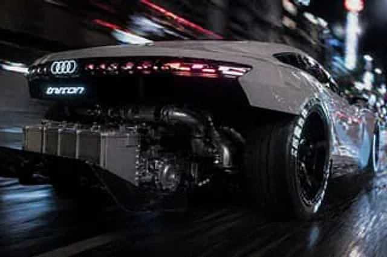

```text
A cinematic rear-view shot shows a futuristic white Audi supercar speeding through the wet streets of a bustling, neon-lit city at night, the camera angle extremely low, close to the rear wheels. The vehicle boasts a sleek, wide-body coupe silhouette, a glossy pearl white body panel, a black rear bumper, and a slender LED taillight that runs the length of the car, featuring segmented red and white lighting effects. The Audi four-ring logo illuminates white in the center of the rear, below which is a stylized, illuminated badge bearing the word "tron" in a futuristic font. The rear body is partially removed or partially open, revealing high-performance mechanical components: a large rectangular metal battery or power unit is mounted low at the rear; three robust exhaust pipes or cooling ducts are visible across the rear; a gearbox or electric motor assembly is visible on the right center; and a deep black rear diffuser with two large fins is also present. The vehicle is equipped with oversized, deep-set black wheels and ultra-wide rear tires, the sidewalls of which are decorated with bright white Japanese-style lettering. The background and road surface are rendered with strong motion blur to convey a sense of high speed, while the car body and exposed mechanical structures remain sharply in focus. Abstract urban bokeh surrounds the scene, neon signs shimmer and shift, and red, blue, and white city lights interplay on the wet road surface and glossy paint. High contrast, cyberpunk atmosphere, realistic automotive photography, dramatic nighttime lighting, ultra-refined metallic textures, cinematic lens, dynamic composition, sense of speed, power, and futuristic engineering design.
```

Model: GPT Image 2
Author: GPT Image 2 Prompts

[ProjectD](https://aitoolsradar.com/en/prompts/dab68560c002e4) · [Recorded source](https://x.com/AllarHaltsonen/status/2047255361409675314#reversed-3)
 · [Full original metadata and byte evidence](data/projectd-batch-0026.json)

## Cyberpunk Bounty Hunter — Three-Quarter View

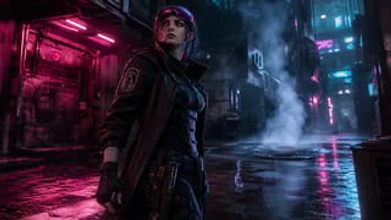

```text
Three-quarter character key visual of a young cyberpunk bounty hunter standing in a rain-slicked neon alley at night. Black tactical longcoat over a dark armored vest, fingerless gloves, holstered futuristic sidearm at the hip, glowing visor mask pushed up onto the forehead. Cinematic low-angle shot with strong magenta and cyan rim lighting from offscreen neon signs reflecting on wet pavement. Steam rising from a manhole behind. Faint faction sigil patch on the shoulder. 16:9 horizontal composition, sharp focus on the character, atmospheric haze. No text overlay, no real brand logos, no watermark. Cinematic character key visual quality, photorealistic fabric and metal textures.
```

Model: GPT Image 2
Author: @hiapi_ai

[ProjectD](https://aitoolsradar.com/en/prompts/b71fe20dd93031) · [Recorded source](https://github.com/HiAPIAI/awesome-gpt-image-2-prompts)
 · [Full original metadata and byte evidence](data/projectd-batch-0026.json)

## Cyberpunk Character Status Screen

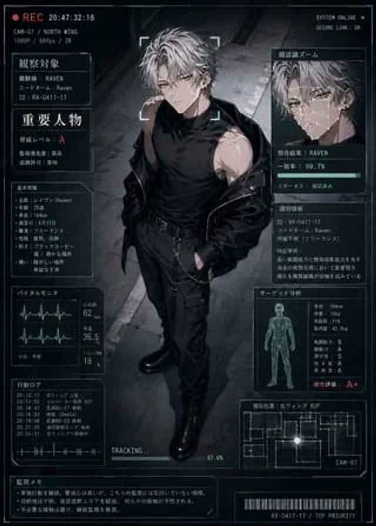

```text
A cinematic anime-style futuristic surveillance status screen showing a full-body young man standing in the center of a dark industrial corridor, viewed from a slightly high angle as if captured by a security camera. He is a tall, lean, athletic male with messy silver-gray hair, pale skin, and a cool, dangerous presence, wearing a black sleeveless high-neck shirt, black tactical pants with straps and side pockets, a black belt with hanging chain details, heavy black combat boots, and a black jacket slipping off his shoulders. His expression is serious and unreadable, framed by a glowing scan bracket around the face like a live target lock. The overall image is a high-tech HUD dossier overlay in a blue-gray and black palette with subtle cyan interface lines, screen noise, scanlines, and a moody cyberpunk thriller atmosphere. The layout contains 10 distinct UI panels around the character: 1 top-left recording strip with a red REC indicator, timestamp, camera code, location, and video specs; 1 left upper identification panel labeled 観察対象 with subject data including codename Raven and ID; 1 left middle warning panel labeled 重要人物 with risk level A and other threat notes; 1 left lower basic profile panel labeled 基本情報 listing name, age, height, birth date, job, personality, likes, and dislikes; 1 bottom-left vital monitor panel labeled バイタルモニタ with 2 waveform graphs and numeric readouts for heart rate, temperature, and stress; 1 lower-left action log panel labeled 行動ログ with 6 timestamped entries; 1 large upper-right facial recognition panel labeled 顔認識ズーム showing 1 zoomed portrait crop, a match result for RAVEN, a 99.7% accuracy bar, and verified status; 1 right middle identification details panel labeled 識別情報 with ID, codename, affiliation unknown, and a paragraph of notes; 1 right lower target analysis panel labeled ターゲット分析 with 1 wireframe human figure and multiple stat lines including height, weight, body fat, muscle mass, combat ability, mobility, intelligence, danger level, and a large overall evaluation A+; 1 bottom-right current location panel labeled 現在位置 with 1 minimap floor plan, a glowing position dot, and camera label CAM-07. Add 1 bottom-center tracking progress bar reading TRACKING... at 97.6%, 1 bottom-left surveillance memo box labeled 監視メモ with 3 short bullet-style notes, and 1 bottom barcode strip with the code RX-0417-17 / TOP PRIORITY. Include small top-right system text such as SYSTEM ONLINE and SECURE LINK : OK. Use Japanese text throughout the interface, crisp thin-line sci-fi frames, layered transparent screens, realistic lighting on the character, and polished gpt-image-2 anime illustration quality, like a classified character status display for a covert operative named {argument name="character name" default="Raven"}.
```

Model: GPT Image 2
Author: 日向_AI

[ProjectD](https://aitoolsradar.com/en/prompts/9717384f1cf37a) · [Recorded source](https://youmind.com/prompts/cyberpunk-character-status-hud-16353)
 · [Full original metadata and byte evidence](data/projectd-batch-0026.json)

## Cyberpunk Cinematic Photo Edit

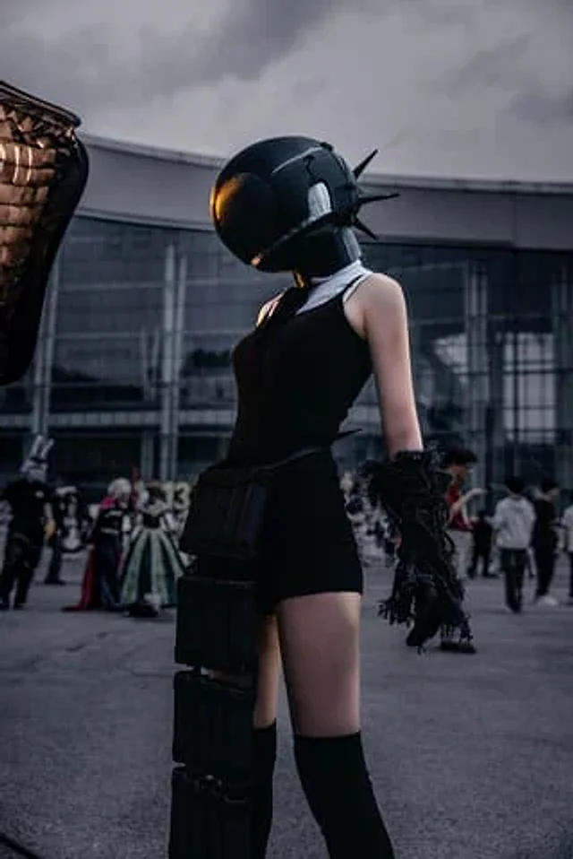

```text
Using the provided reference image, transform the ordinary phone snapshot into a cinematic cyberpunk movie-poster style edit. Keep the same subject, pose, outfit, helmet, foreground composition, and convention-center setting intact, but dramatically relight and color grade the scene with a dark, moody {argument name="cinematic style" default="Blade Runner-inspired cyberpunk"} atmosphere. Make the background darker and slightly defocused, deepen shadows, add high contrast, cool blue-gray tones, subtle vignette, and a soft filmic texture. Add a small warm amber reflection/glow on the helmet visor area as if from neon or sunset light, while preserving realistic skin texture and photographic detail. Do not change the character design or add text; make it look like a professionally retouched cinematic poster frame rather than a casual outdoor snapshot.
```

Model: GPT Image 2
Author: Musolsol.𝟎𝐱𝐔

[ProjectD](https://aitoolsradar.com/en/prompts/98c4af70053cfe) · [Recorded source](https://youmind.com/prompts/cyberpunk-cinematic-photo-edit-18383)
 · [Full original metadata and byte evidence](data/projectd-batch-0026.json)

## Cyberpunk City Highway HDRI


```text
Create a seamless 360-degree isometric cylindrical projection HDRI environment map showcasing a futuristic city's nighttime highway, with the perspective situated in the center of a wide, wet road beneath a dense network of modern urban viaducts. Employ a panoramic, wraparound composition with strong fisheye-style isometric cylindrical distortion at the top and bottom edges, designed specifically for Blender world backgrounds. The scene should include two large, curved elevated ramps, one on each side, arching towards the center, supported by multiple pillars and multi-level interchanges extending into the distance. The road is surrounded by a skyline of brightly lit office and apartment buildings, their windows rendered in cool blue and cyan, accented with touches of magenta and purple decorative lights. The road surface should be glossy and wet from rain, reflecting long strips of neon blue, purple, and pink city lights. Add subtle light trails and luminous reflections to the road surface to create a cyberpunk atmosphere. The sky should be a deep, cloudy, and textured night sky with faint lights at the zenith, and distant buildings surrounded by soft mist. The overall color scheme is dominated by deep indigo, electric blue, cyan, and purple. The image should have a cinematic, emotional, highly detailed, and photorealistic feel, with realistic city lighting and mirrored reflections on wet surfaces, making it suitable for use as an HDRI background. It includes slight panoramic seam artifacts and stretching distortion near the poles, giving it an AI-generated but usable environment map texture.
```

Model: GPT Image 2
Author: GPT Image 2 Prompts

[ProjectD](https://aitoolsradar.com/en/prompts/9cfc461b888916) · [Recorded source](https://x.com/applete77191758/status/2047328871482265952#reversed-0)
 · [Full original metadata and byte evidence](data/projectd-batch-0026.json)

## Cyberpunk Creative Cloud Ad Poster


```text
Create a high-energy, futuristic cyberpunk-style advertising poster for {argument name="brand name" default="Adobe"}{argument name="product name" default="Creative Cloud"} The video uses a 16:9 widescreen format, set against the backdrop of a neon-lit, densely populated nighttime metropolis, featuring glowing skyscrapers, holographic billboards, wet, reflective pavement, and a deep purple-blue-black atmosphere. It employs strong synthetic wave colors, including electric magenta, cyan, purple, bright pink, and blue, and incorporates glowing edges, digital glitch effects, scan lines, beams of light, particle sparks, and HUD-style interface embellishments. The Adobe logo and a red [unclear text - possibly a typo or incomplete sentence] are placed in the upper left corner.{argument name="brand name" default="Adobe"} The text was followed by a large, bold, tech-style headline, which read:{argument name="product name" default="Creative Cloud"} It uses luminous white and cyan colors with a magenta halo; below it, add a smaller, all-caps slogan:{argument name="tagline" default="7 APPS. ENDLESS POSSIBILITIES."} Below, a short marketing tagline in a compact, futuristic font reads: “POWER YOUR CREATIVITY WITH INDUSTRY-LEADING TOOLS FOR EVERY IDEA AND EVERY CREATOR.” In the upper right corner, a large, glowing, rounded square app icon is displayed, containing the Adobe Creative Cloud symbol rendered as a dazzling neon hologram with a cosmic texture and orange-pink-blue energy. Next to it is a vertical Japanese neon sign that reads “创造する、無限の力” (Chuangzao suru, Mugen no Rikatsu). Below in the center, seven glowing app cards are arranged horizontally, each a separate, bright panel with beveled sci-fi borders, internal circuitry details, and matching neon hues. Card 1: “Ps,” tagged “PHOTOSHOP,” subtitle “PHOTO EDITING,” with a simple landscape/image icon in cyan. Card 2: “Ai”, tag “ILLUSTRATOR”, subtitle “VECTOR GRAPHICS”, with a pen nib/vector icon, orange-gold. Card 3: “Pr”, tag “PREMIERE PRO”, subtitle “VIDEO EDITING”, with a film frame and play button icon, magenta. Card 4: “Ae”, tag “AFTER EFFECTS”, subtitle “MOTION GRAPHICS”, with a stacked layer shape icon, purple. Card 5: “Id”, tag “INDESIGN”, subtitle “LAYOUT &amp; PUBLISHING”, with a text layout icon, pink. Card 6: “Lr”, tag “LIGHTROOM”, subtitle “PHOTO MANAGEMENT”, with a landscape/photo icon, turquoise. Card 7: “Xd”, tag “XD”, subtitle “UI/UX DESIGN”, with a wireframe/application window icon, bright pink. At the very bottom, add a glowing horizontal footer containing five functional blocks separated by thin neon dividing lines: 1) a cloud icon and "SEAMLESS INTEGRATION", 2) a portrait icon and "BUILT FOR COLLABORATION", 3) a sync/cloud arrow icon and "SYNC ACROSS DEVICES", 4) a graduation cap icon and "LEARN &amp; GROW WITH CREATIVE CLOUD", and 5) a striking closing statement on the far right.{argument name="closing slogan" default="MAKE IT. CREATIVE CLOUD."} Overall style: High-end cinematic technology advertising, ultra-high detail, clear and sharp, symmetrical advertising layout, glossy reflection, dramatic contrast, retro-futuristic game UI aesthetics, and exquisite commercial poster design.
```

Model: GPT Image 2
Author: GPT Image 2 Prompts

[ProjectD](https://aitoolsradar.com/en/prompts/46c46cf1365b0c) · [Recorded source](https://x.com/LudovicCreator/status/2046634445826871572#reversed-1)
 · [Full original metadata and byte evidence](data/projectd-batch-0026.json)

## Cyberpunk Creative Cloud Poster

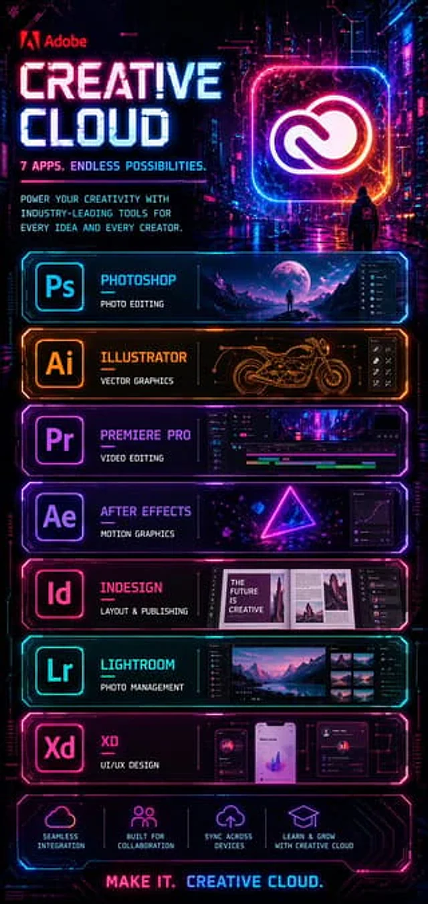

```text
{
  "type": "Cyberpunk software advertisement poster",
  "brand": "Adobe",
  "product": "Creative Cloud",
  "style": "The futuristic neon sci-fi marketing poster features a dark, rainy cyberpunk city background with glossy reflections, using magenta, cyan, purple, and electric orange lighting for high contrast, ultra-fine UI-style borders, holographic lighting effects, and a sleek tech panel design.",
  "format": "Tall vertical poster",
  "background": {
    "scene": "The neon-lit city alleys at night, towering buildings, digital signs, and the wet ground reflecting pink and blue lights create a cinematic atmosphere.",
    "figure": "In the mid-ground background, there is a small hooded figure standing on the street, facing a huge, glowing Creative Cloud logo."
  },
  "header": {
    "logo": "Adobe",
    "headline": "{argument name=\"headline text\" default=\"CREATIVE CLOUD\"}",
    "subheadline": "7 apps, endless possibilities.",
    "body_text": "Empower every idea and every creator with industry-leading tools.",
    "hero_icon": "A large, illuminated, rounded square frame contains the white Creative Cloud logo, surrounded by pink, blue, and orange neon lights."
  },
  "layout": {
    "sections": [
      {
        "title": "Photoshop",
        "position": "Top Application Panel",
        "count": 1,
        "labels": [
          "Ps"
        ],
        "description": "The panel features a cyan neon border, with the application icon on the left, titled \"Photoshop\" with the subtitle \"PHOTO EDITING,\" and a wide preview image of a surreal moonlit landscape on the right, including a solitary figure and a dark editing interface sidebar."
      },
      {
        "title": "Illustrator",
        "position": "Second application panel",
        "count": 1,
        "labels": [
          "Ai"
        ],
        "description": "The panel features an orange neon border, with the application icon on the left, titled \"Illustrator\" with the subtitle \"VECTOR GRAPHICS,\" a technical line art style motorcycle drawing in the center, and small vector tool icons on the right."
      },
      {
        "title": "Premiere Pro",
        "position": "Third application panel",
        "count": 1,
        "labels": [
          "Pr"
        ],
        "description": "The panel features a purple neon border, with the application icon on the left, titled \"Premiere Pro\" and subtitled \"VIDEO EDITING,\" showcasing a timeline video editing interface containing cyberpunk city clips."
      },
      {
        "title": "After Effects",
        "position": "Fourth application panel",
        "count": 1,
        "labels": [
          "Ae"
        ],
        "description": "The panel features a violet neon border, with the application icon on the left, titled \"After Effects\" with the subtitle \"MOTION GRAPHICS,\" containing a glowing triangle composition with floating geometric elements, and the graphics editor panel on the right."
      },
      {
        "title": "InDesign",
        "position": "Fifth application panel",
        "count": 1,
        "labels": [
          "Id"
        ],
        "description": "The panel features a pink neon border, with the application icon on the left, the title \"InDesign,\" and the subtitle \"LAYOUT &amp; PUBLISHING,\" showcasing a preview of an editorial magazine layout. The cover text \"THE FUTURE IS CREATIVE\" is visible. The layout panel is on the right."
      },
      {
        "title": "Lightroom",
        "position": "Sixth Application Panel",
        "count": 1,
        "labels": [
          "Lr"
        ],
        "description": "The panel features a cyan neon border, with the application icon on the left, titled \"Lightroom\" with the subtitle \"PHOTO MANAGEMENT,\" showcasing a photo browser interface featuring mountain and lake landscapes. Thumbnails are displayed on the right."
      },
      {
        "title": "XD",
        "position": "The seventh application panel",
        "count": 1,
        "labels": [
          "Xd"
        ],
        "description": "The panel, with a magenta neon border, features the app icon on the left, the title \"XD,\" and the subtitle \"UI/UX DESIGN,\" showcasing three mobile app prototype interfaces, including charts, profile cards, and dashboard widgets."
      },
      {
        "title": "Function icons",
        "position": "Bottom bar",
        "count": 4,
        "labels": [
          "Seamless integration",
          "Built for collaboration",
          "Cross-device synchronization",
          "Learn and grow with Creative Cloud"
        ],
        "description": "Four glowing line icons, each with brief descriptive text, are evenly distributed across the dark neon panel."
      }
    ],
    "footer": {
      "tagline": "MAKE IT. CREATIVE CLOUD."
    }
  },
  "color_palette": {
    "primary": [
      "Electric Blue",
      "Hot Pink",
      "Purple",
      "Dark black"
    ],
    "accent": [
      "orange color",
      "White"
    ]
  },
  "rendering": "The poster features a clean, crisp graphic design, a sophisticated main visual image, a symmetrical stacked panel layout, strong lighting effects, clear and legible typography, and high-end technological advertising aesthetics."
}
```

Model: GPT Image 2
Author: GPT Image 2 Prompts

[ProjectD](https://aitoolsradar.com/en/prompts/d82ac4c9f14258) · [Recorded source](https://x.com/LudovicCreator/status/2046634445826871572#reversed-2)
 · [Full original metadata and byte evidence](data/projectd-batch-0026.json)

## Cyberpunk Cyborg Skull Mask Portrait

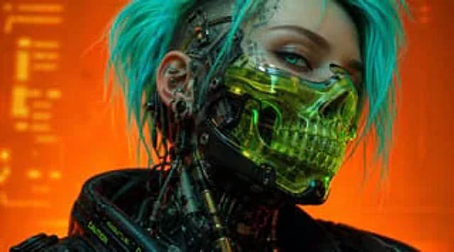

```text
A highly detailed cyberpunk-style close-up portrait depicts a futuristic female cyborg. The composition is a three-quarter profile, from the shoulders up, with a bright emerald green eye staring directly at the camera. She has messy, light hair {argument name="hair color" default="bright cyan"} Her hair was casually tied back, with a few strands falling across her face. The lower half of her face was covered by a semi-transparent, neon lime-colored skull-shaped breathing mask, revealing clearly defined teeth, a glossy acrylic material, and luminous green highlights within. Her head and neck displayed mechanical structures: black metal plates, pistons, cables, microcircuits, screws, and mechanical joints integrated into her jawline, temples, ears, and throat. Five clearly visible earrings were worn, surrounded by industrial-style cybernetic details. Subtle printed technological markings and tiny black tattoo-like decals were added to her forehead and cheeks near her eyes. She wore a high-necked, futuristic black jacket with a small, warning-style tag near the shoulder. The background was soft-focus and saturated.{argument name="background color" default="orange color"} The neon light panel effect, accompanied by blurred, interface-like light blocks, creates a strong color contrast with the cyan hair and acid green mask. The lighting and shadow have a cinematic quality and luster, with sharp reflections on the mask and metal parts, shallow depth of field, hyper-realistic skin texture, high contrast, creating an emotional sci-fi atmosphere. It is a top-notch concept art piece, photorealistic, with extreme detail, and 85mm portrait lens effect.
```

Model: GPT Image 2
Author: GPT Image 2 Prompts

[ProjectD](https://aitoolsradar.com/en/prompts/3e4a078a3c17a0) · [Recorded source](https://x.com/techhalla/status/2047590985601790317#reversed-0)
 · [Full original metadata and byte evidence](data/projectd-batch-0026.json)

## Cyberpunk Elf Android Reference Sheet


```text
{
  "type": "Anime character reference images",
  "style": "A minimalist futuristic concept art project, featuring high-detail cel animation rendering, a white studio background, black, red, and light blue color scheme graphics, a cyberpunk functional design, sharp lines, and a sophisticated game character presentation.",
  "character": {
    "name": "{argument name=\"character name\" default=\"YAMI\"}",
    "species": "Elf Cyborg Girl",
    "apparent_age": "teenager",
    "height": "142 cm",
    "build": "Petite, slender",
    "skin": "fair",
    "hair": {
      "color": "{argument name=\"hair color\" default=\"Ice Blue\"}",
      "style": "Short bob with blunt bangs, the ends slightly curled inwards, and a small black hair clip on one side."
    },
    "eyes": {
      "color": "{argument name=\"eye color\" default=\"Dark red\"}",
      "expression": "Cold, slightly pouting, aloof."
    },
    "ears": "Long, pointed elf ears with multiple small earrings",
    "pose": "The character is shown in a full-body hero pose, with a slight shift in his center of gravity and his hands tucked into the pockets of an oversized coat."
  },
  "outfit": {
    "outerwear": "Oversized white functional jacket with black straps, zipper pulls, printed symbols, red accents, large collar, hood, and practical charms.",
    "bodysuit": "A black cyberpunk high-cut bodysuit, revealing mechanical structures, features red cables, small warning labels, a chest logo, and segmented armor plates.",
    "leg_gear": "Asymmetrical thigh straps, with a black multi-functional bag on one thigh featuring a rabbit skull logo and a 2x2 design.",
    "legs": "The legs, starting from the upper thighs, are mostly mechanical prosthetics, made of glossy black metal, with visible joints, pistons, discs, and red cables.",
    "footwear": "Thick-soled black high-top combat sneakers featuring a thick white midsole, red outsole accents, buckles, straps, printed logo, and skull icon."
  },
  "palette": {
    "count": 5,
    "colors": [
      "light blue",
      "red",
      "off white",
      "Light gray",
      "black"
    ]
  },
  "layout": {
    "centerpiece": "A large full-body front view in the center",
    "sections": [
      {
        "title": "Top left corner identity information block",
        "position": "top-left",
        "count": 6,
        "labels": [
          "YAMI",
          "07 // Model: YAMI",
          "Category: Elf // Cyborg",
          "Height: 142CM",
          "Barcode graphics",
          "2x2 Rabbit Icon"
        ]
      },
      {
        "title": "Color scheme",
        "position": "upper-left",
        "count": 5,
        "labels": [
          "light blue color block",
          "Red color block",
          "off-white color block",
          "Light gray color blocks",
          "black color block"
        ]
      },
      {
        "title": "Logos",
        "position": "left-middle",
        "count": 4,
        "labels": [
          "27",
          "YAMI 07-",
          "Triangular YAMI Badge",
          "2x2 Rabbit Badge",
          "YAMI Experimental Unit"
        ]
      },
      {
        "title": "Detail view",
        "position": "lower-left",
        "count": 4,
        "labels": [
          "Facial close-up",
          "Close-up of torso and coat",
          "Straps and close-up of the buttocks",
          "Close-up of the mechanical knee and cables"
        ]
      },
      {
        "title": "Graphic elements",
        "position": "top-right",
        "count": 8,
        "labels": [
          "Dark Chinese character symbols",
          "YAMI 07",
          "2x2 Warning Triangle Rabbit Logo",
          "Orbital sphere symbol",
          "Elf/Cyborg07 Panel",
          "Vertical YAMI Block",
          "Small slogan text blocks",
          "Miniature geometric icon row"
        ]
      },
      {
        "title": "Rear view",
        "position": "right-middle",
        "count": 1,
        "labels": [
          "Full-body rear view"
        ]
      },
      {
        "title": "Technical Specifications",
        "position": "lower-right",
        "count": 5,
        "labels": [
          "Direct neural interface connection",
          "High bandwidth spine cables",
          "Joint actuator flexible drive unit",
          "Compact power core",
          "Synthetic/Soft Material"
        ]
      },
      {
        "title": "Remark",
        "position": "bottom-right",
        "count": 2,
        "labels": [
          "2x2 Rabbit Doodle",
          "Not cute. Just efficient."
        ]
      }
    ]
  },
  "text_elements": {
    "primary_name": "{argument name=\"display name\" default=\"YAMI\"}",
    "visible_markings": [
      "YAMI",
      "07",
      "2x2",
      "Elf/Cyborg",
      "YAMI Experimental Unit",
      "Not cute. Just efficient."
    ]
  },
  "composition": {
    "aspect_ratio": "2:3 vertical",
    "background": "Pure light gray",
    "camera": "Orthographic character table view",
    "rendering": "Highly detailed anime concept illustrations, featuring clear typography and UI-style design elements."
  }
}
```

Model: GPT Image 2
Author: GPT Image 2 Prompts

[ProjectD](https://aitoolsradar.com/en/prompts/0eada24f82f248) · [Recorded source](https://x.com/Eris_Create_Lab/status/2046829475779019236#reversed-3)
 · [Full original metadata and byte evidence](data/projectd-batch-0026.json)

## Cyberpunk Elf Girl Full-Body Portrait


```text
One{argument name="character type" default="Cyberpunk elf girl"} A full-body illustration of an anime character, standing alone against a clean, pure white background, centered and slightly leaning to the left, with a relaxed and natural posture and arms hanging naturally at her sides. She has {argument name="hair color" default="Ice light blue"} She had a short bob haircut, straight bangs, fair skin, pointed elf ears, and bright eyes.{argument name="eye color" default="Glowing red-orange"} Her eyes are calm, her expression slightly serious. Her design blends fantasy and futuristic biomechanical styles: she wears an oversized white functional hooded jacket with a black lining, black straps and zipper details, and red warning-style markings on the sleeves; underneath, she wears a glossy black biomechanical bodysuit with cutouts, cables, and segmented armor plates, and intricate hard-surface cybernetics details around her torso and hips. She has a black leg pouch on her right thigh, mechanical knee pads with two visible circular joints, two external cables extending from below her knees, and thick-soled black combat boots with buckles and subtle red accents. She wears small black earrings and minor industrial-style accessories. The rendering uses highly detailed, exquisite comic-style line art with sharp edges, delicate cel shadows, and glossy highlights on the skin and latex textures, complemented by subtle red accents, presenting an overall high-end sci-fi character concept art feel. Keep the character fully visible from head to boots, with ample white space, and contain no props, backgrounds, text, or shadows other than minimalist ground shadows.
```

Model: GPT Image 2
Author: GPT Image 2 Prompts

[ProjectD](https://aitoolsradar.com/en/prompts/b4f761ba2811f2) · [Recorded source](https://x.com/Eris_Create_Lab/status/2046861540977267116#reversed-0)
 · [Full original metadata and byte evidence](data/projectd-batch-0026.json)

## Cyberpunk Europe action HUD


```text
Create a third-person cyberpunk action game screenshot set in a neon-soaked European capital at night. The protagonist has glowing cybernetic implants and stands on rain-slick streets near a famous landmark while holograms, drones, and flying traffic crowd the skyline. Add a polished game HUD with health bar, ammo count, radar, stealth/energy meters, and mission overlays. Vivid cyan-magenta palette, wet reflections, cinematic intensity, 16:9.
```

Model: GPT Image 2
Author: @reddit-community

[ProjectD](https://aitoolsradar.com/en/prompts/b2fb82c90d9b9b) · [Recorded source](https://www.reddit.com/r/midjourney/comments/1kzzy77/cyberpunk_video_games_in_european_cities_prompts/)
 · [Full original metadata and byte evidence](data/projectd-batch-0026.json)

## Cyberpunk FPV Drone Racer Poster


```text
A hardcore cyberpunk anime illustration, the protagonist is{argument name="character name" default="Miyamoto Iori"} one{argument name="character age" default="19"} A 20-year-old FPV drone racer. The image shows her standing in a vast, dilapidated industrial arena at night, three-quarters of her back in the background. She has messy black hair tied in a high ponytail, fair skin, and wears a glossy black tactical flight suit covered in patches, straps, cables, and sponsor logos. A large hard-shell radio backpack with a long antenna and stickers is slung across her back, and an ID badge hangs from her waist. Her face is mostly hidden in profile, adding to her mystique. The environment is filled with steel beams, catwalks, dangling power lines, broken windows, concrete pillars, damp, reflective ground, and stacked signs. Multiple FPV racing drones traverse the arena, leaving bright arcs of white, cyan, and red light trails that swirl and guide the eye into the frame. The image must contain at least six clearly visible drones, distributed in the background and mid-ground. Add a large weathered sign that reads "SECTION C", "FREEDOM, SPEED, ONLY", and "LAP 07 KEEP FLYING", and add a vertical character information block in the top left corner with text including "{argument name="nameplate text" default="MIYAMOTO IORI"} “AGE:”{argument name="age text" default="19"} The text includes the tagline "FPV DRONE RACER," the Japanese inscription "私は、飛ぶ者だ。," and the English line "I am the one who flies." It also includes a short data list showing "RANKING // 2," "WINS // 11," "PODIUMS // 23," and "STYLE // GHOST." Her clothing and equipment feature clearly visible stickers including "AXIS," "Fly Beyond," "BRX," "IORI 027," and an ID card labeled "PILOT MIYAMOTO IORI." The design uses a dark color scheme dominated by steel gray, black, and soft brown, accented with neon racetrack light trails and tiny white light sources. Cinematic backlighting, rain-soaked reflections, a heavy texture, complex lines, a sense of urban decay, high contrast, and a melancholic atmosphere create a highly refined anime concept art aesthetic, employing a vertical poster composition.
```

Model: GPT Image 2
Author: GPT Image 2 Prompts

[ProjectD](https://aitoolsradar.com/en/prompts/b5aae7f44d6a32) · [Recorded source](https://x.com/madxfpv/status/2046868707482497340#reversed-0)
 · [Full original metadata and byte evidence](data/projectd-batch-0026.json)

## Cyberpunk Girl with Giant Claw Arm


```text
A dark cyberpunk anime illustration depicts a solitary girl with a massive mechanical claw arm standing in a neon-lit alleyway on a rainy night. The dramatic low-angle perspective makes her appear imposing and dangerous. Her face is pale, long, straight black hair partially obscuring her eyes, and faint red irises reveal a cold, indifferent expression. She wears an oversized hooded, tech-inspired winter coat with a huge fur collar and plush cuffs, overlaid with black tactical streetwear with straps and belts. Loose, dark trousers are tucked into heavy boots. Her left arm, replaced by a massive industrial mechanical prosthetic, dominates the foreground, covered in dense gears, pistons, pipes, cables, and exposed mechanical structures, ending in three long, curved claws with sharp tips that gleam with crimson energy. Small stickers, warning labels, and vertical East Asian-style signs are added to the coat and the mechanical components. The setting is a narrow, futuristic city street, surrounded by towering buildings, hanging cables, a thin mist, and numerous vertical neon signs with red and turquoise Chinese characters. The pavement is wet and mirror-like, reflecting the red glow of mechanical claws and the surrounding signs. The game employs a grainy, detailed, and high-contrast color palette, including charcoal black, gunmetal gray, deep crimson, and sickly cyan. The overall atmosphere is cold, melancholic, intimidating, intelligent, and slightly saddening. Highly detailed lines, complex mechanical rendering, cinematic lighting and shadows, rain and fog effects, a dense urban feel, and concept art that blends anime and hard surfaces—a masterpiece of quality.
```

Model: GPT Image 2
Author: GPT Image 2 Prompts

[ProjectD](https://aitoolsradar.com/en/prompts/d708e2876f2c67) · [Recorded source](https://x.com/ganimedes_01/status/2047086715911999728#reversed-0)
 · [Full original metadata and byte evidence](data/projectd-batch-0026.json)

## Cyberpunk Girl with Giant Mech Claw


```text
A dark cyberpunk anime illustration depicts a small, eerie girl standing in a narrow, rain-soaked alleyway at night. The dramatic low-angle composition makes her massive mechanical arm dominate the foreground. She wears a large white hooded jacket covered in printed patches, charts, and industrial logos, the hood casting deep shadows on her face. Her facial features are minimalist and doll-like, with short, straight black hair, pale skin, and pupil-less white eyes that emit a serene and indifferent expression. One of her arms is replaced by a massive, heavy mecha limb, far exceeding the size of her body, extending towards the viewer. The arm is composed of layers of white armor plates, exposed joints, cables, bolts, pistons, and segmented mechanical structures, scratched and grime-covered, conveying a war-torn industrial feel. Four enormous claw-like fingers touch the wet ground, each finger ending in a long, blackish-red claw, with a red internal glow emanating from the gaps in the knuckles, wrist, and forearm. Black cables dangled from beneath her upper arms, with subtle red light leaking around the mechanical devices at her elbows and shoulders. Her other sleeve hung naturally at her side. Underneath her coat, she wore dark shorts or a skirt, and oversized, fluffy white leg warmers covered her calves, her bare feet shimmering on the reflective ground. The alleyway was filled with pipes, conduits, cables, vents, and old signs, with a melancholic green neon sign standing in the background, creating a somber, blue-green backlight. Rain streamed through the scene, puddles reflecting blue and red light, and tiny orange-red sparks scattered on the ground near her claws. The game employs a soft palette of dusty white, charcoal gray, blue, and deep red, combined with cinematic contrast, high-precision lines, a rough texture, atmospheric haze, and a memorable dystopian future. The character is set as…{argument name="character name" default="A mecha-armed girl wearing a hood"} The color of the outer garment is{argument name="coat color" default="Dirty white"} Mechanical lights are{argument name="glow color" default="Dark red"} The neon lights in the alley are [color].{argument name="neon color" default="Blue-green"} .
```

Model: GPT Image 2
Author: GPT Image 2 Prompts

[ProjectD](https://aitoolsradar.com/en/prompts/3c55acad8a223a) · [Recorded source](https://x.com/ganimedes_01/status/2047086715911999728#reversed-1)
 · [Full original metadata and byte evidence](data/projectd-batch-0026.json)

## Cyberpunk Manga Page of a Giant Robot Cat


```text
A richly detailed black-and-white comic page depicts a giant mechanical cat walking through the crowded streets of a Japanese city at night. The page comprises four panels: a large, horizontal panel at the top, two smaller, stacked panels in the lower left corner, and a large vertical panel in the lower right corner. In the top panel, a giant mechanical cat occupies a narrow, neon-lit alleyway, surrounded by towering buildings, tangled wires, vertical shop signs, and small pedestrians looking up in astonishment. The cat possesses realistic feline proportions, but its body is composed of exposed armor plates, rivets, pistons, cables, gears, segmented metal limbs, and a complex internal mechanical structure. A tag bearing the words "Cat God" hangs around its neck. The damp street reflects the city lights. Several Japanese signs are added to the environment, including "Used Bookstore 2F," "Yorozuya B1," and "Sake Shop." Add a large Japanese manga-style speech bubble in the upper right corner of the top panel, reading "Uwak? Deckee!!". In the upper left panel, a close-up of the back and side of a long-haired woman is shown, looking at the creature, with a vertical Japanese speech bubble next to her reading "...What is this place, Konna Monogatari...?". In the lower left panel, a group of startled onlookers is shown from the front, with a young man in the foreground and other shocked pedestrians behind him, accompanied by a vertical Japanese speech bubble reading "Is this the messenger of the god!?". In the lower right vertical panel, a dramatic low-angle close-up of the mechanical cat standing between buildings under the bright moonlight is shown, emphasizing its mechanical chest structure, massive forelimbs, whiskers, and majestic face, with the "Cat God" tag on its neck clearly visible. Add a large Japanese-style onomatopoeic word "カシ…" near the cat. Employing classic seinen manga aesthetics, cinematic panel composition, delicate ink washes, strong contrast, detailed urban textures, and realistic proportions, it creates a cyberpunk atmosphere of awe, mystery, and holiness.
```

Model: GPT Image 2
Author: GPT Image 2 Prompts

[ProjectD](https://aitoolsradar.com/en/prompts/a7403f15a3e460) · [Recorded source](https://x.com/Just_sharon7/status/2047231001298882793#reversed-0)
 · [Full original metadata and byte evidence](data/projectd-batch-0026.json)

## Cyberpunk Neon Alley Portrait


```text
A cyberpunk portrait with a cinematic feel depicts a futuristic street fighter standing in the middle of a narrow, neon-lit alleyway in a rain-soaked Asian metropolis at night. The composition uses a close-up of the upper body, with the subject facing forward. The face is partially obscured by a large, centrally located rectangular occlusion, rendered in a soft, bluish-green hue. The character possesses a disheveled, glowing {argument name="hair color" default="bright cyan"} The character's hair, right eye area show obvious cyborg features and a metallic facial implant, and the neck and jawline are covered with cables and mechanical details. They wear a rugged, high-tech armored jacket with straps, buckles, pipes, segmented protective plates, and cyan and orange luminous decorations. A dramatic cyan-orange color scheme is used, with a wet reflection on the ground, a light rain in the air, and a thick fog in the background, creating a strong background blur effect for the neon signs. The alleyway should contain eight clearly visible illuminated signs, mostly vertical and horizontal signs with Chinese characters, complemented by futuristic store lighting and industrial-style wall details. The overall atmosphere is rough, stylish, dystopian, and highly detailed, with a clear focal point and a blurred background, presenting the texture of a high-end science fiction movie still.
```

Model: GPT Image 2
Author: GPT Image 2 Prompts

[ProjectD](https://aitoolsradar.com/en/prompts/ba4abf71cb5c46) · [Recorded source](https://x.com/techhalla/status/2047590985601790317#reversed-1)
 · [Full original metadata and byte evidence](data/projectd-batch-0026.json)

## Cyberpunk Neon UI Design System


```text
用未来都市风格生成UI设计系统,灵感来自赛博朋克城市夜景,包含霓虹灯、玻璃建筑反射、高对比光影,配色以紫色、蓝色、粉色霓虹为主,设计网页Dashboard、移动端界面、卡片、按钮、控件等,视觉炫酷、层次丰富、科技感极强
```

Model: GPT Image 2
Author: @AZLnfvp

[ProjectD](https://aitoolsradar.com/en/prompts/7c8cf2756e77d1) · [Recorded source](https://x.com/AZLnfvp/status/2046468976092533180)
 · [Full original metadata and byte evidence](data/projectd-batch-0026.json)

## Cyberpunk Pink Mecha Angel Girl


```text
A dynamic anime cyberpunk action illustration featuring a protagonist with {argument name="hair color" default="Bright pink"} A young female cyborg with twin ponytails floats in a vast, futuristic neon-lit city shaft, surrounded by glowing circuits, holographic reflections, and dense sci-fi architecture. Presented from an extreme perspective, one massive mechanical hand extends forward, pointing directly at the camera, fingers outstretched with long, glossy claws at the tips; the other mechanical arm is bent backward in an attack stance. Her expression is fierce and focused, with glowing green eyes, small, glossy black-magenta horn-like appendages implanted in her head, and long hair flowing in all directions. Her body is encased in a highly detailed reflective chrome alloy and magenta mechanical exoskeleton, featuring a translucent breastplate, segmented armored shoulders, mechanical gauntlets, exposed joint details, thigh armor, and blade-like calf armor. Behind her, two enormous wings of radiant energy, composed of pink crystalline currents and particle streams, burst outward symmetrically. The environment is a vertical futuristic corridor or megacity canyon, filled with layered glass panels, glowing signs, and metal frames, with blue and cyan lights interwoven with dominant bright pink lighting, accompanied by countless sparkling particles, lens flares, and high-density detail. It employs dramatic low-angle compositions, centered characters, aggressive attack stances, glossy surfaces, strong mirror highlights, saturated magenta and cyan color palettes, a cinematic sci-fi atmosphere, ultra-detailed anime rendering, sharp lines, and a strong sense of speed, power, and stunning visual density.
```

Model: GPT Image 2
Author: GPT Image 2 Prompts

[ProjectD](https://aitoolsradar.com/en/prompts/b94866dbccc80d) · [Recorded source](https://x.com/NeneneAI/status/2046900856306745496#reversed-0)
 · [Full original metadata and byte evidence](data/projectd-batch-0026.json)

## Cyberpunk Portrait with Sci-Fi Interface


```text
A cinematic profile portrait, the subject is a{argument name="subject" default="tough guy"} He had his hair combed back in a bun and a full beard, wore round, dark sunglasses, and was dressed in {argument name="clothing" default="Textured leather jacket"} His skin was richly detailed, showing signs of age. The background was a futuristic sci-fi interface, filled with glowing light.{argument name="ui colors" default="Orange and red"} Data streams, star charts, celestial navigation maps, grids, and holographic UI elements. Fiery particle effects and ember-like energy swirl around it, creating a cosmic, high-tech atmosphere. Dark color schemes, strong contrasts, dramatic lighting, ultra-high detail, sharp focus, 8K resolution, cyberpunk aesthetics, cinematic composition, and depth-of-field effects.
```

Model: GPT Image 2
Author: GPT Image 2 Prompts

[ProjectD](https://aitoolsradar.com/en/prompts/5121c876fa697b) · [Recorded source](https://x.com/iamsofiaijaz/status/2047882171336253928)
 · [Full original metadata and byte evidence](data/projectd-batch-0026.json)

## Cyberpunk Robot Encounter


```text
A cinematic digital painting, the scene is{argument name="setting" default="Cyberpunk Store"} The one on the left is {argument name="person description" default="People wearing dark clothing"} He was facing a huge and complex robot standing to his right. The robot had dark mechanical armor and a glowing face.{argument name="robot face color" default="Bright orange"} A square monitor displays a white symbol. The background is a shelf filled with brightly colored neon goods. The overall atmosphere is melancholic and slightly hazy, created by stark contrasts.{argument name="ambient lighting" default="Cyan and blue-green"} The ambient light and the warm light emitted by the robot intertwine.
```

Model: GPT Image 2
Author: GPT Image 2 Prompts

[ProjectD](https://aitoolsradar.com/en/prompts/c7ca854647768f) · [Recorded source](https://x.com/javilopen/status/2044822422424023497#reversed-0)
 · [Full original metadata and byte evidence](data/projectd-batch-0026.json)

## Cyberpunk Rooftop Breach Raid


```text
This is a cinematic cyberpunk nighttime raid, set on a rain-soaked rooftop terrace in a futuristic metropolis, shot from the rear side of the tactical squad in a wide-angle lens. Five fully armed tactical soldiers, clad in futuristic black body armor and full-face helmets, are assembled in front of a metal door on the far left: one soldier is breaching the door, one foot raised, bright orange sparks flying outwards; another soldier follows closely behind, aiming inside; one soldier crouches low in the center, rifle ready; one soldier stands on the right-center, aiming at the opposite side of the terrace; and one soldier kneels guard behind a railing in the foreground on the right. The environment is filled with towering skyscrapers, elevated bridges, distant traffic lanes, damp and reflective metal surfaces, floating steam, rain and mist, and a deep blue-black stormy sky. Neon signs and massive billboards are dominated by magenta, cyan, purple, and electric blue, including clearly visible "POCARI SWEAT" (twice), "softsys," "DATA INC," "ROSE," "BARIKI," "2F," "KIROSHI," and multiple vertically arranged Japanese and Chinese neon signs. Two hovering aircraft are visible in the mid-to-far distance, with countless illuminated windows extending into the distance in the background. The overall atmosphere should be rough, melancholic, high-contrast, and slightly glitch-like, with a nostalgic, old-school AI art instability: some billboard portraits are distorted or partially obscured by soft purple rectangular blocks, some sign text is inconsistent, and fine architectural details have subtle smearing or repetition. Emphasis is placed on damp reflections, volumetric fog, sparks, rim lighting on soldiers, a dense sense of urban depth, and dramatic action-movie compositions in the keyframe style of dystopian sci-fi concept art.
```

Model: GPT Image 2
Author: GPT Image 2 Prompts

[ProjectD](https://aitoolsradar.com/en/prompts/312d35069078ca) · [Recorded source](https://x.com/AIgendora/status/2046895274917077140#reversed-0)
 · [Full original metadata and byte evidence](data/projectd-batch-0026.json)

## Cyberpunk Web3 AI Profile Poster


```text
A vertical sci-fi personal brand poster with a cinematic feel, featuring a deep blue cyberpunk style, designed as {argument name="profile name" default="Meta_wu"} The futuristic profile infographic centers on the back and partial profile of a young Asian man confidently wearing a glossy black futuristic jacket with glowing blue accents and the words "META_WU" and "WEB3 × AI" printed on the back. His face is deliberately obscured by a rectangular blurred block. The background is a magnificent outer space scene, with a giant glowing Earth filled with stars above and a futuristic nighttime metropolis skyline with neon-lit tracks below. A small spaceship is positioned in the center left. At the very top, a large metallic, crystalline title is placed, written in bold, beveled silver lettering: "{argument name="main title" default="Meta_wu"} The character is depicted with a blue-edged glow. Two lines of centered Chinese text are added directly below: the first line is the character's tagline, "BTC Miner | Binance Sharp Ratio No.1 Trader | Programmer | Focused on Web3 + AI Cross-Sector," and the second line is "Investment Observation - Cryptocurrency &amp; US Stocks &amp; A-Shares." A transparent, dark glass, glowing holographic HUD panel surrounds the character with a cyan neon border. Four stacked panels are created on the left: Panel 1 is the "About Me" card, containing four lines of personal information: "Technology | Hong Kong 🇭🇰," "github.com/Ferwoo," "Born May 1, 1999," and "Joined October 2016"; Panel 2 is the social data card, containing three key metrics: "1,950 Following," "3,906 Followers," and "1 Pinned Tweet"; Panel 3 is the "BTC MINER" card, showcasing a giant golden Bitcoin and a scene of a server mining rack; Panel 4 is the "Trading Philosophy" card, containing three lines of text: "Data-Driven × The design incorporates phrases like "rational decision-making," "long-termism × value investing," and a glowing upward candlestick chart. On the right, six stacked panels are created: Panel 1 displays a globe icon and "Followed by 1 Global KOL"; Panel 2 displays a group icon and "Followed by 93 Chinese KOLs"; Panel 3 displays a chart icon and "Global Influence Ranking 62,434 / 200K"; Panel 4 displays a trophy icon and "Chinese Language Influence 5,053 / 10K"; Panel 5 is a "TRADER" card with the subtitle "Binance Sharpe Ratio No.1," featuring a gold upward line chart and the small print "SHARPE RATIO TOP 1"; Panel 6 is a "DEVELOPER" card containing code-like text lines such as "// Code is law," "// Web3 is future," "// AI x Crypto," "function build() {," "return change_the_world();," and "}," along with GitHub-style icons. At the bottom center, a prominent Chinese slogan is added in large, glowing white text:{argument name="slogan text" default="Exploring the intersection of the future"} Below this is a smaller subtitle: "Building Value and the Future in the Wave of Web3 and AI." The bottom contains three horizontally aligned rectangular category cards: Card 1 is labeled "Cryptocurrency," featuring a Bitcoin icon and a miniature market chart; Card 2 is labeled "US Stocks," featuring Tesla and Apple logos; Card 3 is labeled "A-Shares," featuring rising bar and line charts. At the very bottom center are four Chinese keywords separated by vertical lines: "Technology | Investment | Freedom | Influence," below which are the corresponding English words: "TECHNOLOGY · INVESTMENT · FREEDOM · INFLUENCE." The design employs a high-contrast blue-silver color scheme, accented with subtle gold, featuring an ultra-refined sci-fi UI, clear and accurate typography, volumetric lighting effects, reflective surfaces, dramatic edge lighting, sophisticated poster design, clean layout symmetry, and a clear focus, presenting a refined, high-end GPT-image-2 futuristic promotional aesthetic.
```

Model: GPT Image 2
Author: GPT Image 2 Prompts

[ProjectD](https://aitoolsradar.com/en/prompts/f5791aada952f6) · [Recorded source](https://x.com/ferwoo1990/status/2046554717015396448#reversed-0)
 · [Full original metadata and byte evidence](data/projectd-batch-0026.json)

## Dance Choreography Instruction Sheet Prompt


```text
Dance Sequence Instruction Sheet [VISUAL STYLE] A composition featuring a highly detailed 3D-rendered female dancer. Designed like a professional choreography guide with a technical, diagram-inspired layout. Clean white background, soft studio lighting, and strong contrast to highlight body movement and posture. [GRID LAYOUT] Structured 4×4 panel grid (16 frames total), evenly spaced with thin black divider lines. Each panel is identical in size and clearly numbered from 1 to 16 to show a continuous dance progression. [CHARACTER] Use image1 as the base character. The same female dancer appears consistently across all panels with accurate likeness and proportions. [WARDROBE] The dancer wears a stylish, performance-ready outfit: a well-fitted top paired with a short, flowy skirt. The look should feel modern and visually appealing while still practical for dance movement. Fabric should subtly respond to motion (slight flow and folds), even in grayscale. [PANEL STRUCTURE – EACH FRAME] Top-left: Step number + short dance move title (e.g., “Step 5 – Spin Transition”) Center: Full-body pose capturing a precise moment in the choreography Bottom-left: 3–4 lines of concise instruction describing the move Overlay: Motion arrows and directional guides illustrating how the dancer transitions [MOTION INDICATORS] Incorporate curved arrows for fluid motion, straight arrows for directional steps, and circular indicators for spins or turns. Emphasize rhythm, weight shifts, and body isolation. [RENDER QUALITY] High-detail sculpted 3D style with smooth grayscale shading, subtle shadows, and clean linework. Maintain a polished, concept-art level finish with clarity in every pose. [RESTRICTIONS] No color, no background scenery, no extra characters, no visual clutter, only the dancer and instructional elements.
```

Model: GPT Image 2
Author: Johnn

[ProjectD](https://aitoolsradar.com/en/prompts/c05659ff8df6a8) · [Recorded source](https://youmind.com/prompts/dance-choreography-sheet-16266)
 · [Full original metadata and byte evidence](data/projectd-batch-0026.json)

## Dance Movement Reference Sheet


```text
[STYLE] Monochrome grayscale illustrations, 3D rendered characters, concise teaching reference tables, white background, comic-style grid layout, technical chart aesthetics. [LAYOUT] 4x4 grid layout, 16 panels in total, each panel separated by a thin black border, numbered cells from 1 to 16, all panels are the same size. [CHARACTER]{argument name="character" default="A young female dancer, athletic build, with a ponytail, wearing a cropped top, loose-fitting trousers, and sneakers."} All characters in all panels maintain the same [PANEL STRUCTURE - per cell]: Top left corner: Bold number badge +{argument name="title" default="Korean title text"} Center: Full-body character pose illustration, bottom left corner:{argument name="description" default="Korean description text (3-4 lines)"} Overlay: Arrows indicating movement direction [ARROWS / MOTION INDICATORS] Curved arrows, straight arrows, and circular rotating indicators are placed around the character to show the movement flow and direction. [RENDERING STYLE] High-detail 3D sculpted style, soft studio lighting, subtle shadows, achromatic, grayscale rendering, clean lines, game concept art quality. [NEGATIVE] No background scene, no color tone, no extra characters, no cluttered background.
```

Model: GPT Image 2
Author: GPT Image 2 Prompts

[ProjectD](https://aitoolsradar.com/en/prompts/5cfa864f5114f3) · [Recorded source](https://x.com/Ciri_ai/status/2048074587955658848)
 · [Full original metadata and byte evidence](data/projectd-batch-0026.json)

## Dance Movement Reference Sheet


```text
[STYLE]
monochromatic grayscale illustration, 3D rendered character, clean instructional reference sheet, 
white background, comic-style cell grid layout, technical diagram aesthetic

[LAYOUT]
4x4 grid layout, 16 panels total, each panel separated by thin black border lines, 
numbered cells from 1 to 16, consistent panel size

[CHARACTER]
{argument name="캐릭터" default="young female dancer, athletic build, ponytail hairstyle, crop top and baggy pants, sneakers"}, same character in all panels

[PANEL STRUCTURE - per cell]
top-left: bold number badge + {argument name="제목" default="Korean title text"}
center: full-body character pose illustration
bottom-left: {argument name="설명" default="Korean description text (3-4 lines)"}
overlay: directional arrows indicating movement direction

[ARROWS / MOTION INDICATORS]
curved arrows, straight arrows, circular rotation indicators, 
placed around the character to show movement flow and direction

[RENDERING STYLE]
high detail 3D sculpt style, soft studio lighting, subtle shadows, 
no color, grayscale shading, clean linework, game concept art quality

[NEGATIVE]
no background scenery, no color tones, no extra characters, 
no cluttered backgrounds
```

Model: GPT Image 2
Author: Ciri

[ProjectD](https://aitoolsradar.com/en/prompts/afb0647c49d8e1) · [Recorded source](https://youmind.com/prompts/dance-movement-reference-sheet-15866)
 · [Full original metadata and byte evidence](data/projectd-batch-0026.json)

## Dancing Couple on Cliffside House


```text
A dramatically vertical, cinematic photograph depicts a weathered wooden house jutting out from the edge of a steep cliff, its balcony suspended in mid-air. Ancient and dilapidated, the house is constructed of gray, sun-faded planks, warped and twisted, with dim or broken windows. A fragile, leaning wooden frame supports the balcony. Dense green vines and vegetation cling to the cliff face, partially framing the upper left corner of the image, while the rock face plunges sharply downwards across most of the composition. Two people stand on the balcony: a couple in formal attire, posing as if about to ballroom dance. The man, in a dark suit or tuxedo, faces the woman, one arm raised in a dance pose; the woman wears flowing robes {argument name="dress color" default="Dark red"} The woman in an evening gown, her hair styled in an updo, echoes the man's posture. The balcony railing, slender yet rugged, emphasizes the sense of danger and instability of the environment. The sky is a greyish-blue, overcast, with hazy mountains faintly visible in the lower right background. The realistic photographic style, with its melancholic natural light, showcases high detail in the aged wood and cliff textures, creating a dizzying yet surreal elegance. The composition places the house in the upper left corner, with the couple positioned near the upper right edge of the structure.
```

Model: GPT Image 2
Author: GPT Image 2 Prompts

[ProjectD](https://aitoolsradar.com/en/prompts/f9cbaf944686bf) · [Recorded source](https://x.com/MuratAykul/status/2047760031186104358#reversed-1)
 · [Full original metadata and byte evidence](data/projectd-batch-0026.json)

## Dark AI Coding Dashboard UI


```text
{
  "type": "Dark SaaS Analytics Dashboard UI",
  "product": {
    "brand": "{argument name=\"brand name\" default=\"AICode\"}",
    "theme": "The interface features a deep navy blue frosted glass texture with subtle gradients, soft lighting, rounded cards, and thin borders, embodying modern developer tool aesthetics."
  },
  "canvas": {
    "aspect_ratio": "16:9",
    "background": "Deep midnight blue, with subtle vignetting and soft radial lighting effects."
  },
  "layout": {
    "structure": "Left sidebar plus main content area",
    "sections": [
      {
        "title": "Sidebar",
        "position": "Left side",
        "count": 8,
        "labels": [
          "AICode",
          "Overview",
          "project",
          "AI Assistants",
          "API and Usage",
          "Code quality",
          "team",
          "set up"
        ],
        "details": "The logo is displayed at the top, and \"Overview\" is highlighted in purple when selected. The subscription card at the bottom shows the Pro Plan, which expires in 12 days. A horizontal progress bar shows 75%. The user profile at the bottom includes an avatar.{argument name=\"user name\" default=\"Alex Morgan\"} and email address alex@morgan.dev"
      },
      {
        "title": "Header",
        "position": "Top Main Area",
        "count": 4,
        "labels": [
          "Welcome back, Alex 👋",
          "This is today's update from your AI programming platform.",
          "May 12, 2024 – June 12, 2024",
          "Export Report"
        ],
        "details": "The left side features a large greeting, while the right side displays a date range selector and an export button."
      },
      {
        "title": "Indicator Card",
        "position": "First line below the header",
        "count": 4,
        "labels": [
          "Total number of users",
          "Active projects",
          "API call volume",
          "Code quality rating"
        ],
        "values": [
          "12,842",
          "2,153",
          "1.28M",
          "876"
        ],
        "details": "Each card includes a small icon, a large main value, and text comparing the period from April 12th to May 12th, 2024, showing positive growth percentages of 14.6%, 8.3%, 23.7%, and 5.9%, respectively. A mini line chart is displayed at the bottom; the colors are purple, green, amber, and blue."
      },
      {
        "title": "Main analysis panel",
        "position": "Middle and bottom rows",
        "count": 4,
        "labels": [
          "API call trends",
          "Popular Projects",
          "User activity heatmap",
          "Code quality trends"
        ],
        "details": "The \"API Call Trends\" chart is a wide area graph with a \"Daily\" dropdown menu; the purple line shows an upward trend, ending near 250K. \"Popular Items\" is a ranking list of 5 items, with progress bars and percentage changes. The \"User Activity Heatmap\" is a 7-row weekly heatmap with hourly labels from 12 PM to 9 PM. The \"Code Quality Trends\" chart is a line graph with a \"Weekly\" dropdown menu; the purple curve rises smoothly, from approximately 70 to just over 90."
      },
      {
        "title": "Popular Projects List",
        "position": "Middle right panel",
        "count": 5,
        "labels": [
          "AI Code Assistant",
          "Smart Refactor",
          "Code Review Bot",
          "Doc Generator",
          "Test Builder"
        ],
        "values": [
          "485K",
          "321K",
          "214K",
          "132K",
          "98K"
        ],
        "details": "The first four items showed positive growth in green, at 12.4%, 8.7%, 3.1%, and 6.8% respectively, while Test Builder showed negative growth in red, at -1.2%; each row had a colored square icon and a thin horizontal progress bar."
      }
    ]
  },
  "style": {
    "visual_language": "High-end financial technology and AI product design prototype",
    "rendering": "A clear, high-fidelity UI prototype, subtle shadows, neon edge lighting effects, exquisite charts, and a clean sans-serif font.",
    "primary_accent": "{argument name=\"accent color\" default=\"Electric Violet\"}",
    "secondary_accents": [
      "Emerald Green",
      "Amber Yellow",
      "Cyan"
    ],
    "density": "Information-rich and spatially balanced, with a well-balanced grid and high readability."
  }
}
```

Model: GPT Image 2
Author: GPT Image 2 Prompts

[ProjectD](https://aitoolsradar.com/en/prompts/15eaea60e1a333) · [Recorded source](https://x.com/xuanyuanzhifeng/status/2046533787329458305#reversed-0)
 · [Full original metadata and byte evidence](data/projectd-batch-0026.json)

## Dark AI Product Keynote Slide


```text
A premium dark presentation slide in a minimalist editorial tech style, widescreen 16:9 layout, matte black background with refined off-white typography and subtle gray divider lines. The overall mood is sleek, cinematic, and high-end, like a product keynote or design-forward AI startup deck. In the top left, place 2 small navigation lines of text: "UI SCENE · OPEN HARNESS" and below it "DEEP AGENTS" in thin uppercase sans serif with generous tracking. In the top right, add a small page indicator reading "07 / 08". The main headline dominates the upper left in large elegant serif Chinese and English mixed typography: {argument name="headline text" default="开放 harness,开放记忆。"}. Below it, add a 2-line Chinese body paragraph in smaller serif text: {argument name="body text" default="解决方案不是让模型供应商替你保管状态,而是把 harness、标准和记忆后端都放回开发者手里。"}. In the left-middle area, create 3 horizontal feature rows separated by thin gray lines, each row using a bold Chinese label on the left, a short Chinese description in the center, and a tiny uppercase English keyword aligned right. Row 1 label: "标准", description: "agents.md / skills 让上下文入口可见。", keyword: "OPEN". Row 2 label: "模型", description: "模型可替换,记忆不应被单一平台绑定。", keyword: "AGNOSTIC". Row 3 label: "存储", description: "Mongo / Postgres / Redis 可作为自有记忆后端。", keyword: "OWNED". On the right side, place a large embedded UI mockup inside a soft light-gray rounded rectangular frame with a subtle shadow, resembling a product dashboard screenshot. The mockup should be monochrome light beige and gray, highly structured, and divided into 3 main columns. Left column: a narrow vertical icon sidebar plus a project/file panel listing items such as "agents.md", "skills", "workflows", "memories", "tools", and a code editor block at the bottom. Center column: a section titled "模型无关" with 4 selectable model rows and small controls, plus 3 feature cards along the bottom. Right column: a section titled "记忆后端" with 3 database cards for MongoDB, Postgres, and Redis, and a lower panel titled "可迁移" showing a code snippet. Include another top card in the mockup titled "开放标准" with tab-like controls. At the bottom left outside the mockup, add a tiny caption line in Chinese and English reading "UI 情景图 · 三张同高画面板测试". At the bottom center, include a carousel indicator made of 8 small dots with the 7th highlighted as a short white pill and the others as dim gray circles. At the bottom right, place a small page number "07". Also add a faint tiny footer note near the lower right edge in Chinese and English, very subtle, such as a presentation metadata line. Use precise grid alignment, lots of negative space, understated luxury, Swiss-style composition, and a polished AI-product keynote aesthetic.
```

Model: GPT Image 2
Author: 歸藏(guizang.ai)

[ProjectD](https://aitoolsradar.com/en/prompts/54d4f9caea77f7) · [Recorded source](https://youmind.com/prompts/dark-product-keynote-slide-16948)
 · [Full original metadata and byte evidence](data/projectd-batch-0026.json)

## Dark Ancient Chinese Style Packaging


```text
{argument name="character" default="Pan Jinlian"} Style{argument name="product" default="Arsenic"} Packaging box design, dark ancient style.{argument name="theme" default="Water Margin"} Related cultural and creative products.
```

Model: GPT Image 2
Author: GPT Image 2 Prompts

[ProjectD](https://aitoolsradar.com/en/prompts/7bfb2780e2a97d) · [Recorded source](https://x.com/songguoxiansen/status/2046783664466677965)
 · [Full original metadata and byte evidence](data/projectd-batch-0026.json)

## Dark Anime Legends Poster


```text
A cinematic-quality dark anime crossover poster, titled {argument name="title text" default="DARK LEGENDS"} The image showcases four iconic male anti-heroes standing in the ruins of a gothic, nightmarish city at night, with a massive, blood-red full moon overhead. The composition is a wide, dramatic group portrait, with the characters lined up in the foreground, each facing slightly different directions, displaying confident yet ominous body language. On the far left is a young soldier with short, dark hair, wearing a flowing dark green hooded military cloak, tactical slings and equipment visible at his waist, wielding two downward-pointing steel blades; a winged badge is visible on the back of the cloak. To the left of center is a tall, white-haired man with a spiky hairstyle, wearing a sharp, high-necked black suit, one hand in his pocket, his expression calm and commanding. To the right of center is a slender, brown-haired young man in a wrinkled white shirt, holding a black notebook with the words "Death Note" printed on the cover tightly to his chest, his posture exuding quiet wisdom. On the far right is a pale, white-haired, ghoul-like young man dressed in tattered dark clothing; one eye glows red, and two enormous, bizarre, red-black fleshy tentacles coil around his back and sides. In the background stand towering, ruined cathedral spires and shattered Gothic skyscrapers, many windows emitting a deep red glow. The sky is overcast and almost entirely black, illuminated by a huge red moon hanging high in the center behind the group, creating a backlit halo effect and strong rim lighting. The design employs dark tones of black, charcoal gray, deep crimson, and soft steel gray, with high contrast, a rough texture, subtle blood-red embers, and an ultra-detailed illustration/anime style. A worn, epic serif font is added at the bottom, spelling out…{argument name="headline text" default="DARK LEGENDS"} The font has a massive, cracked stone texture, with a red halo and weathered patterns. The overall atmosphere evokes a sense of apocalypse, fashion, threat, and mythology, like a key visual for a high-end film or game crossover.
```

Model: GPT Image 2
Author: GPT Image 2 Prompts

[ProjectD](https://aitoolsradar.com/en/prompts/8ea24901d27599) · [Recorded source](https://x.com/AiHubMix/status/2046934521178890711#reversed-2)
 · [Full original metadata and byte evidence](data/projectd-batch-0026.json)

## Dark Anime Villains Crossover Poster


```text
A dark, cinematic anime villain poster, employing an ultra-refined gothic horror style, dramatically collages four iconic villains against a backdrop of a ruined, infernal city. The wide, horizontal composition uses black, deep red, and electric purple as its primary colors, incorporating smoke, ash, embers, magical lightning, and chaotic, painterly brushstrokes. The image features four main villains. In the central foreground is a massive pirate emperor, grinning broadly, sporting a wild black beard, his red captain's coat open, revealing a scarred chest and abdomen. He wears multiple necklaces and belts, with several pistols at his waist, and raises two flintlock pistols in a victorious pose. Directly behind and above him is a tall, pink, muscular, demonic humanoid creature with a smooth head and a single, curled tentacle, its arms slightly outstretched, surrounded by a purple halo and lightning. On the left foreground is a long-haired, pale-faced Japanese swordsman in a loose, light-colored robe, his head slightly bowed, with a giant serpent coiled behind him, its mouth gaping open. Add the vertical Japanese text "Orochimaru" near this character, and the vertical text "Majin Buu" near the central character above. On the right is a tall, elegant demon king in layered dark kimonos, his long hair flowing, his posture calm yet malevolent. Above his head are eight smaller, dark red moons and one large full moon, totaling nine moons. Add the vertical Japanese text "Kurohige" near the pirate, and the vertical text "Kibutsuji Muzan" near the right-hand character. The background should depict a hellish, apocalyptic scene, with shattered towers, burning ruins, and shadowy buildings shrouded in smoke. Place a large, aggressively styled title text at the bottom.{argument name="headline text" default="RISE OF VILLAINS"} The image uses a blood-red color with magenta highlights, rough and torn edges, and a luminous texture. The entire image should have the feel of an epic collaboration key visual poster, with extremely high contrast, full of ominous, supernatural, and threatening elements.
```

Model: GPT Image 2
Author: GPT Image 2 Prompts

[ProjectD](https://aitoolsradar.com/en/prompts/2f1d8d0ad6a591) · [Recorded source](https://x.com/AiHubMix/status/2046934521178890711#reversed-1)
 · [Full original metadata and byte evidence](data/projectd-batch-0026.json)

