# ProjectD backfill batch 27

Complete original prompts and exact existing ProjectD images. Actual model labels and any available credits or notices are retained. Missing authors or license metadata are not filled in.

## Dark Chinese Crime Drama Poster

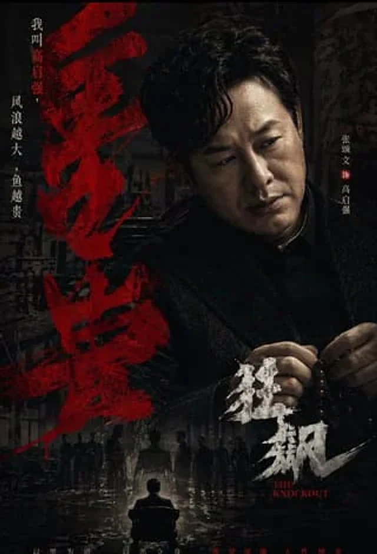

```text
A dark, rugged Chinese crime thriller poster, displayed vertically in a single-page layout, presents a melancholic neo-noir aesthetic and a strong cinematic contrast. The central image is a half-length portrait of a middle-aged East Asian man with a fierce expression, black curly hair, and wearing a dark, textured coat over a black shirt. Most of his face is hidden in shadow, and the image is framed from the chest up, slightly tilted to the right. His hands appear in the lower right corner, calmly holding a string of dark wooden prayer beads, suggesting power, danger, and ritual. The background is a dimly lit city alley or old street at night, overlaid with dirty textures, reflections from wet pavement, mottled walls, and blurred architectural silhouettes. At the bottom center, a figure sits in a chair with their back to the camera, placed under a strong spotlight, surrounded by nine figures standing in the darkness, creating a tense interrogation or underworld confrontation scene. The color palette is almost monochromatic, using black, charcoal gray, and dirty gray, accented with deep blood red and aged white lettering. On the left, a large, vertically arranged column of striking red Chinese calligraphy title text, with bold strokes and dry brush textures, almost fills the entire height of the poster. At the far left edge, two vertical lines of small white and red text are added: "My name is Gao Qiqiang," and "The bigger the storm, the more expensive the fish." On the right, a vertical line of white Chinese subtitles for the cast and crew is added, separated by a red dot: "Zhang Songwen as Gao Qiqiang." In the lower right corner, a striking white Chinese subtitle/title logo, "Raging Waves," is added, below which is the red serif English subtitle, "THE KNOCKOUT." Small, blurred Chinese release information or slogans are added to the bottom edge. The overall atmosphere is oppressive, violent, sophisticated, and highly designed, like the main visual poster for a crime drama on a high-end streaming platform, with rich layers, dramatic shadows, textured smoke and grime, and realistic photographic details.
```

Model: GPT Image 2
Author: GPT Image 2 Prompts

[ProjectD](https://aitoolsradar.com/en/prompts/2207f5c303d3f4) · [Recorded source](https://x.com/Xiaoniu6161/status/2047609689790382396#reversed-3)
 · [Full original metadata and byte evidence](data/projectd-batch-0027.json)

## Dark Chinese Fantasy Desire Poster

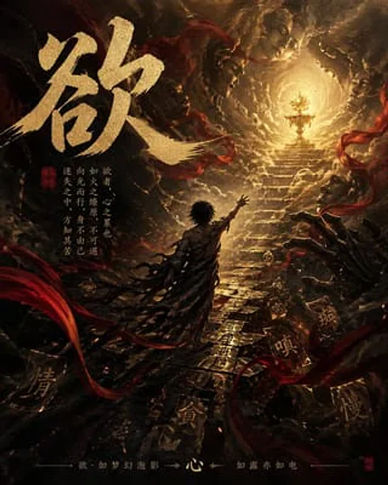

```text
An epic, dark-themed Chinese fantasy poster, with huge gold-textured calligraphy characters in the upper left corner.{argument name="main Chinese character" default="want"} With its core elements, the brushstrokes are bold and vigorous, possessing a metallic foil-like texture and highlights. The scene is set in a deep, hellish cave, with a color palette of deep black, bronze, and lava amber. A dazzling holy light shimmers at the end of a long stone staircase. At the top right, a magnificent golden lotus lamp or sacrificial chalice stands, radiating a halo-like holy light. In the lower center of the image, a solitary and ragged figure, thin and weary, wearing a dark robe torn by the wind, stretches an arm toward the light. Beneath his feet lies a broken stone path that gradually evolves into steps. Six striking crimson ribbons or smoky fabrics flutter dramatically in the image, entwining from the left, right, and foreground, adding a sense of dynamism. Along the path and in the lower foreground, five clearly visible Chinese characters are carved on broken stone slabs: 情 (qing, passion), 贪 (tan, greed), 嗔 (chen, anger), 痴 (chi, ignorance), and 傲 (ao, pride), each radiating a faint, warm golden light. The cave walls are composed of twisted organic rock and shadows, with three enormous ghostly faces emerging from the stone walls on the left and right sides, seemingly embodiments of temptation and suffering. Two menacing claws reach out towards the traveler in the lower right corner. Below the large characters on the left, a vertical line of elegant gold calligraphy is placed, accompanied by a red seal. At the bottom edge, a horizontal line of small gold characters with decorative separators is added, highlighting the character for "heart" in the center, with an additional small red seal in the lower right corner. The overall style is cinematic, highly detailed, mythological, spiritual, and ominous, blending Buddhist allegory, dark fantasy, and high-end poster design; it incorporates volumetric light, luminous dust, strong contrasts of light and shadow, exquisite brushstrokes, high detail, and a vertical composition.
```

Model: GPT Image 2
Author: GPT Image 2 Prompts

[ProjectD](https://aitoolsradar.com/en/prompts/f73e305c9427ad) · [Recorded source](https://x.com/ericoding99/status/2047138987685626051#reversed-0)
 · [Full original metadata and byte evidence](data/projectd-batch-0027.json)

## Dark Comedy Insect Spray Ad

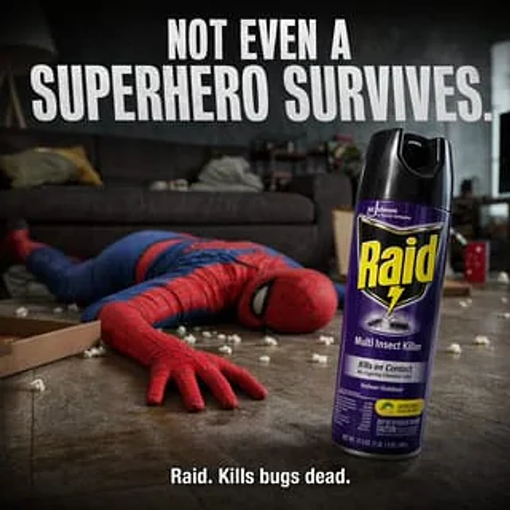

```text
A darkly humorous, cinematic product advertisement, set in a messy modern living room at night. In the background, a person wearing {argument name="superhero costume" default="Spider-Man style red and blue suit"} A person lies face down on the wooden floor, motionless, one arm outstretched towards the camera, embodying the posture of a defeated superhero. The room is dimly lit, with a somber atmosphere; a gray sofa in the background is out of focus, pillows and blankets are scattered on the floor, and white popcorn is strewn everywhere. A pizza box is cropped into the frame in the left foreground. A huge, upright pizza can sits in the right foreground.{argument name="product name" default="Raid"} The insecticide is prominently featured, clearly focused with exaggerated perspective; the black cap and purple label face directly at the camera. This gives the product a dominant, clean, and commercial feel, with dramatic contour lighting and glossy reflections. Two lines of striking white capital letters are added: the top uses an oversized, compact sans-serif font, and the text reads {argument name="headline text" default="NOT EVEN A SUPERHERO SURVIVES."} The bottom center uses smaller, bolder text with the following content:{argument name="tagline text" default="Raid. Kills bugs dead."} The bottle label features two visible insect illustrations, maintaining a high-end, visually impactful commercial advertising style: realistic photography, shallow depth of field, strong contrast, rough floor texture, and soft gray-blue indoor lighting. The composition makes the insecticide the absolute visual focus, while the fallen hero in the background serves as a humorous and satirical element.
```

Model: GPT Image 2
Author: GPT Image 2 Prompts

[ProjectD](https://aitoolsradar.com/en/prompts/f85f673690e75d) · [Recorded source](https://x.com/EloiLJF/status/2046978171195572319#reversed-0)
 · [Full original metadata and byte evidence](data/projectd-batch-0027.json)

## Dark Cyber Elf With Crimson Blade

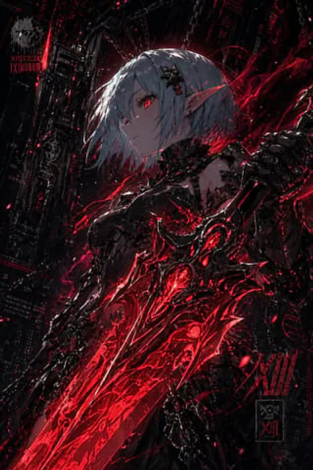

```text
A dark, highly detailed anime cyberpunk gothic portrait, the main character is {argument name="character type" default="Female Elf Warrior"} The image, taken from a three-quarter profile, spans from above the thighs to the head, with a backdrop of an abandoned futuristic industrial city. She kept {argument name="hair color" default="silver-white"} She had a short, ear-length bob haircut, pale skin, long, pointed elf ears, a calm and aloof expression, and one glowing ear was visible.{argument name="eye color" default="Dark red"} Eyes. Strands of hair brushed against her face, a black star-shaped metal hair ornament adorning her temples. She wore a sleek black biomechanical armor skirt, its surface gleaming like obsidian, studded with spikes and layered plates, the shoulders and chest decorated with torn lace and intricate demonic exoskeleton details. One arm was encased in heavy armor, forming a massive organic mechanical gauntlet. She wielded, or fused with, a massive, serrated, living longsword, its blade slicing diagonally from the lower left foreground into her torso; the blade was crafted from black metal, covered in luminous veins and embedded with a red core, from which raging molten lava energy erupted like liquid flames. Red ribbons of energy, sparks, smoke, and ember-like particles swirled around her body and weapon. The background was a vertical, dystopian megastructure, filled with black steel towers, cables, hanging chains, fragments of red holographic code, mysterious technological emblems, and blurred industrial symbols, mostly swallowed by shadow. Employing a black and deep red color palette, the artwork boasts extremely high contrast, glossy highlights, sharp rim lighting, a strong backlighting effect behind the head, dense details, a chaotic painterly feel, and a chilling apocalyptic atmosphere. The composition presents the quality of top-tier dark fantasy key art, highly refined, cinematic, both majestic and elegant, yet brimming with explosive power.
```

Model: GPT Image 2
Author: GPT Image 2 Prompts

[ProjectD](https://aitoolsradar.com/en/prompts/d814eeb2b5cf6e) · [Recorded source](https://x.com/Eris_Create_Lab/status/2047537707904274795#reversed-0)
 · [Full original metadata and byte evidence](data/projectd-batch-0027.json)

## Dark Electro Album Cover

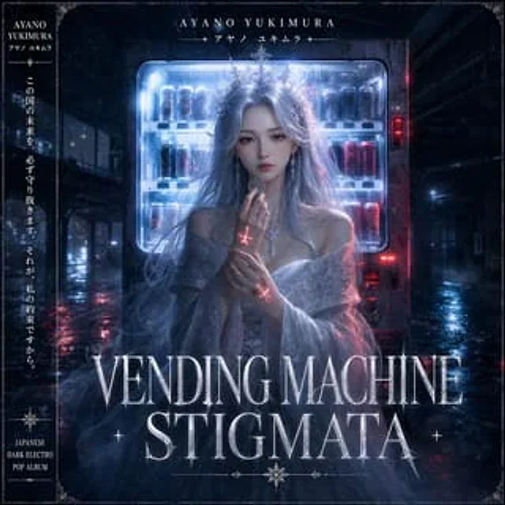

```text
The square-shaped, dark Japanese electronic pop album cover is cinematic and ethereal, set in a deserted city alley on a rainy night. The ground is wet and reflective, shrouded in deep blue-black shadows. At the center of the image is an elegant, ghostly woman facing a glowing vending machine. Drink cans are visible inside, and the machine emits a cold, blue-white light, with a tiny red indicator light on its right. She has extremely long, flowing silver-lavender hair, pale skin, and a mysteriously rendered face, sometimes hidden in shadow, sometimes appearing as a smooth, blurred void. She wears a semi-transparent, off-the-shoulder dress.{argument name="dress style" default="shimmering gray tulle dress"} The piece features delicate, shimmering textures, sheer, draped cuffs, and ornate crystal embellishments around the neck and chest. Her pose is solemn, almost prayerful, with one hand raised, a coin close to her lips, and the other gently clasped at her wrist. Two luminous red stigmata-like crosses are added to her wrist and the back of her hand, emitting a faint glow. The atmosphere is melancholic, mysterious, futuristic, sacred, and slightly gothic. It employs a high-contrast color palette accented with cool neon blue, silver, black, and deep red, complemented by elements of mist, drizzle, soft light, delicate film grain, and dramatic backlighting reminiscent of a vending machine. Ornate vintage borders are integrated into the four corners, and a thin border line is added around the cover. The artist's name is placed at the top center.{argument name="artist name" default="AYANO YUKIMURA"} It uses elegant serif capital letters, with a line of smaller Japanese text below:{argument name="artist name in Japanese" default="アヤノ ユキムラ"} Create a vertical black panel along the left side containing three text areas: the artist's name at the top, a long vertical white Japanese quote in the middle, and stacked genre text at the bottom.{argument name="genre text" default="JAPANESE DARK ELECTRO POP ALBUM"} Place the album title at the bottom center.{argument name="album title" default="VENDING MACHINE STIGMATA"} Featuring an oversized, glowing, crackled silver serif font spanning two lines, with subtle starlight shimmer and decorative patterns. Top-tier fantasy-realistic key visuals, ultra-refined, exquisite CD cover design.
```

Model: GPT Image 2
Author: GPT Image 2 Prompts

[ProjectD](https://aitoolsradar.com/en/prompts/6850afc20ceb25) · [Recorded source](https://x.com/hAru_mAki_ch/status/2047727621707018652#reversed-0)
 · [Full original metadata and byte evidence](data/projectd-batch-0027.json)

## Dark Epic Concept Poster

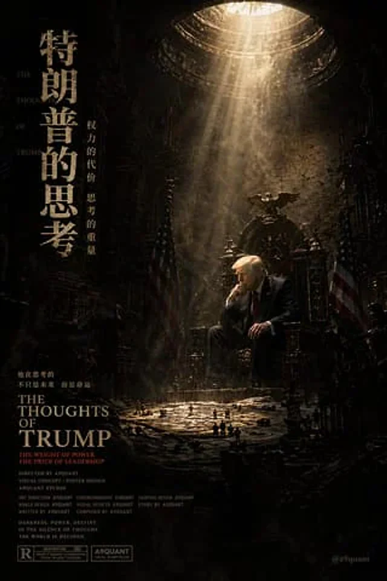

```text
围绕【主题】自动生成一张顶级暗黑史诗概念海报 / 电影感信息图海报。

唯一需要输入的变量只有:
【主题】:___特朗普的思考____ 

除【主题】之外,其余全部由 AI 自动适配完成,包括但不限于:
- 核心主体(自动判断更适合人物、守护者、战士、产品、器物、雕像、抽象象征或其他主视觉对象)
- 中央承载结构(自动判断更适合王座、石座、祭坛、机械基座、遗迹、高台或其他支撑体)
- 环境空间(自动判断更适合洞穴、神殿、废墟、深渊、地下宫殿、密室或其他封闭史诗空间)
- 上方开口与光源形式(自动判断更适合月光、神光、能量束、审判之光、圣光或其他单一强光)
- 象征元素(自动判断更适合骷髅、徽记、残碑、纹章、符文、能量环、神性符号等)
- 色彩体系
- 材质组合
- 标题、副标题、辅助文案
- 排版与整体叙事气质

【总风格】
高预算 90 年代好莱坞史诗大片海报气质,融合 cinematic matte painting、超写实摄影质感、极强明暗对比、厚重空间叙事、暗黑英雄主义与仪式感构图。整体必须像一张真正的电影主海报,而不是普通插画或电商图。

【核心结构锁定】
整张海报必须保留以下结构基因:
1. 一个巨大、压迫感极强的黑暗封闭空间
2. 一束从上方斜向切入的强烈体积光,作为画面的第一视觉秩序
3. 中央偏右或光束终点位置的核心主体与承载结构
4. 左下角作为高密度标题与信息锚点
5. 四周保留大量纯黑或近黑负空间,形成电影感呼吸区

【自动适配规则】
AI 必须依据【主题】自动推导最适合的视觉系统:
- 如果【主题】偏暗黑英雄、复仇、正义、孤独、宿命,则自动偏向石质王座、孤高人物、冷色神光、废墟或洞穴感空间
- 如果【主题】偏神秘、幽灵、潜行、幻影、夜行,则自动偏向月光、迷雾、冷蓝色体积光、深渊式黑暗空间
- 如果【主题】偏权力、统治、王者、秩序,则自动强化 throne / altar / crown-like symbol / ritual space 的表达
- 如果【主题】偏科技、AI、未来、机械,则自动将王座和空间替换为机械神座、能量基座、金属洞窟、工业神殿等未来化形态
- 如果【主题】偏产品、品牌、器物,则自动把核心主体替换为最合适的 hero object,并保留被神光审判式凸显的史诗构图

【画布与色彩系统】
- 背景底层必须是极深、近乎吞噬一切的黑暗空间
- 主环境色由 AI 根据【主题】自动决定,但整体必须克制,以暗色为主
- 强光区域色彩必须高度集中,只服务于体积光与主体高光
- 主题色 / 强调色只能集中用于主视觉核心,不允许全画面泛滥
- 必须建立明确的“黑暗底色 + 单一主光 + 少量主题强调色”的层级秩序

【构图与视觉重力】
- 采用强烈的斜向张力与向中心汇聚的视觉引导
- 视觉重力从上方光源强势落下,最终压在核心主体之上
- 主体必须处于被命运、审判、神性或权力照中的位置
- 边缘必须自然融入黑暗,不能出现无意义背景填充
- 所有元素必须服务于唯一的主叙事核心

【材质与光影】
- 不使用轮廓线,不使用平面化描边
- 完全依赖体积光、阴影切割、反射、高光、雾气、粉尘、湿润岩石或其他真实材质来建构画面
- 材质必须形成明显对比,例如:
  粗粝岩石 / 冷硬金属 / 柔韧织物 / 古老石雕 / 湿润表面 / 尘雾光柱
- 光束必须具有强烈 Tyndall effect,真实、厚重、可感知体积密度

【排版系统】
- 整体 80% 视觉,20% 文字
- AI 根据【主题】自动生成主标题、副标题和底部信息块
- 主标题应尽量简洁、有气势、有电影海报感
- 若主题更适合中文,则优先中文;若更适合英文,则自动英文;也可双语,但必须统一
- 主标题可沿光束垂直排布,仿佛由光本身构成
- 左下角设置一个高密度信息模块,包括副标题、小字信息、电影 credits 风格占位文字或品牌说明
- 文字必须锐利、干净、真实嵌入环境,不得廉价漂浮

【模块结构 —— 必须严格保持 3 块】
[MOD 1: TOP-TO-CENTER BEAM]
从顶部开口斜向切下的巨大体积光柱,作为第一视觉通道,并承载主标题或主视觉文字。

[MOD 2: CENTER-RIGHT CORE]
位于光束终点的核心主体与承载结构,形成整张海报的权力中心 / 命运中心 / 叙事中心。

[MOD 3: BOTTOM-LEFT TEXT]
位于左下角负空间中的高密度排版区,包含副标题、说明文字、credits 风格信息块、品牌信息或活动信息。

【作者署名】
在底部角落自然加入作者署名:
@a9quant
署名要小而清晰,精致、克制、高级,不喧宾夺主,像正式电影概念海报或艺术作品落款。

【输出要求】
输出为单张统一构图海报。
所有视觉系统必须内部一致,不能有风格污染。
画面必须具备:暗黑感、史诗感、压迫感、仪式感、命运感、电影完成度。
最大细节密度,超清,电影级,印刷级,高端成片质感。
```

Model: GPT Image 2
Author: @A9Quant

[ProjectD](https://aitoolsradar.com/en/prompts/3e253df203495c) · [Recorded source](https://x.com/A9Quant/status/2046224777208361126)
 · [Full original metadata and byte evidence](data/projectd-batch-0027.json)

## Dark Fantasy Cliffside Outpost

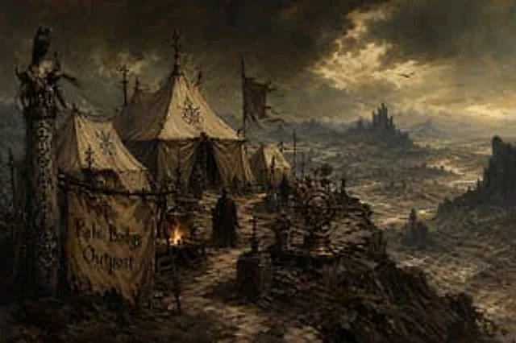

```text
A dark fantasy-style matte painting depicts a desolate mountaintop camp overlooking a vast, cursed wasteland at dusk. In the left foreground, a tattered banner, hand-painted in large black letters, reads "The Pale Lodge Outpost," anchored to a wooden pole, weathered by wind and rain. Beside it stands a tall, carved totem pole topped with a black raven, adorned with bones, skulls, and tattered ornaments. Inside the camp, four canvas tents are visible: two large central tents, one medium-sized tent on the left, and one small tent on the right, all made of dirty beige fabric painted with mysterious black symbols, supported by ropes, stakes, and crooked poles. Around the tents stand five humanoid figures in dark robes and hoods, standing silently like sentinels or cultists. Near the center left, a small campfire emits a faint orange glow. In the right foreground, two astronomical or ritual instruments, made of brass and iron, sit on stone pedestals, resembling armillary spheres or astrolabes. The ground is jagged black rock at the edge of a cliff, scattered with wooden stakes, lanterns, banners, and ceremonial pillars. Beyond the outpost stretches a desolate, ashen-colored plain valley, with winding pale waterways, jagged rock spires, and the silhouette of mountains in the distance. On the horizon, slightly to the right of center, a sinister black castle rises abruptly from a solitary mountain. The sky is filled with massive, turbulent storm clouds, and in the distance, the silhouettes of three flying creatures or birds cast cold, morbid light through the gaps in the clouds, illuminating the entire landscape. The painting employs a somber, painterly, and highly detailed style, using soft shades of dark brown, charcoal, ochre, and gray to create a strong sense of atmospheric perspective, cinematic composition, and an unsettling, fantastical atmosphere of a outpost on the edge of a desolate world.
```

Model: GPT Image 2
Author: GPT Image 2 Prompts

[ProjectD](https://aitoolsradar.com/en/prompts/2cc0431eb1db8b) · [Recorded source](https://x.com/richcollins/status/2046697694224085116#reversed-0)
 · [Full original metadata and byte evidence](data/projectd-batch-0027.json)

## Dark Fantasy Game Event UI Mockup

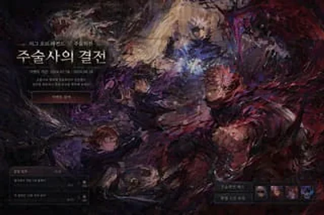

```text
{
  "type": "Game event UI",
  "style": "Dark fantasy style with thick oil painting, dynamic composition, and flowing magical energy.",
  "illustration": {
    "characters": [
      "The white-haired, blindfolded man is casting a glowing blue spell.",
      "The black-haired man assumed a summoning pose, enveloped in deep purple energy.",
      "The pink-haired man, wearing a red hoodie, punched with red energy.",
      "Brown-haired woman, wielding a warhammer"
    ],
    "background": "The silhouette of a monster lurking in the shadows"
  },
  "layout": {
    "sections": [
      {
        "position": "Top left corner",
        "title": "{argument name=\"main title\" default=\"The final battle of sorcerers\"}",
        "labels": [
          "{argument name=\"collaboration text\" default=\"League of Legends X Jujutsu Kaisen\"}",
          "{argument name=\"event date\" default=\"Event Period: July 18, 2024 - August 28, 2024\"}",
          "Jujutsu Kaisen arrives in Summoner's Rift. Complete missions to earn limited-time rewards!",
          "{argument name=\"button text\" default=\"Participate in the event\"}"
        ]
      },
      {
        "position": "bottom left corner",
        "title": "Daily Tasks 0/8",
        "count": 2,
        "labels": [
          "{argument name=\"first mission text\" default=\"Play 1 game in the canyon.\"}",
          "Participate in 15 enemy hero kills"
        ]
      },
      {
        "position": "bottom right corner",
        "title": "Jujutsu Kaisen Pass",
        "count": 4,
        "labels": [
          "Limited-edition skin rewards"
        ],
        "icons": [
          "Blindfolded man's head",
          "Pink-haired man's profile picture",
          "Brown-haired woman's head",
          "Monster head"
        ]
      }
    ]
  }
}
```

Model: GPT Image 2
Author: GPT Image 2 Prompts

[ProjectD](https://aitoolsradar.com/en/prompts/87a6babdd9cf30) · [Recorded source](https://x.com/adityarao310/status/2044608825332830486#reversed-1)
 · [Full original metadata and byte evidence](data/projectd-batch-0027.json)

## Dark Fantasy Game HUD on Green Screen

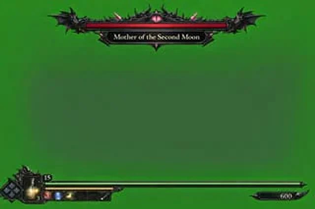

```text
{
  "type": "Video game HUD overlay",
  "background": "{argument name=\"background color\" default=\"Pure color chromaticity key green\"}",
  "theme": "{argument name=\"UI theme\" default=\"Dark fantasy gothic style\"}",
  "layout": {
    "top_center": {
      "component": "Boss health bar",
      "design": "A gorgeous black metallic frame with bat wing-like edges and a glowing pink eye at the top center.",
      "bar_color": "{argument name=\"boss health bar color\" default=\"red\"}",
      "label": "{argument name=\"boss name\" default=\"Mother of the Second Month\"}"
    },
    "bottom_left": {
      "component": "Player Status HUD",
      "design": "Intricate dark metal frame",
      "elements": [
        "Diamond-shaped D-pad directional indicator",
        "A glowing yellow medicine bottle with the number '3' on it",
        "The number '15' inside the top small border",
        "A long strip extending to the right{argument name=\"player health bar color\" default=\"green\"} Health bar",
        "The shorter yellow bar below the green health bar",
        "Five square quick-select items in the inventory (Square 1: Red circle with '3'; Square 2: Blue icon; Square 3: Yellow icon; Square 4: Empty; Square 5: White diagonal line)"
      ]
    },
    "bottom_right": {
      "component": "Score or currency indicator",
      "design": "Small black decorative plaque with the number '600'"
    }
  }
}
```

Model: GPT Image 2
Author: GPT Image 2 Prompts

[ProjectD](https://aitoolsradar.com/en/prompts/d293ae415b44e7) · [Recorded source](https://x.com/yu_ichi_suzuki/status/2044209688267608396#reversed-0)
 · [Full original metadata and byte evidence](data/projectd-batch-0027.json)

## Dark Fantasy Isekai Novel Cover

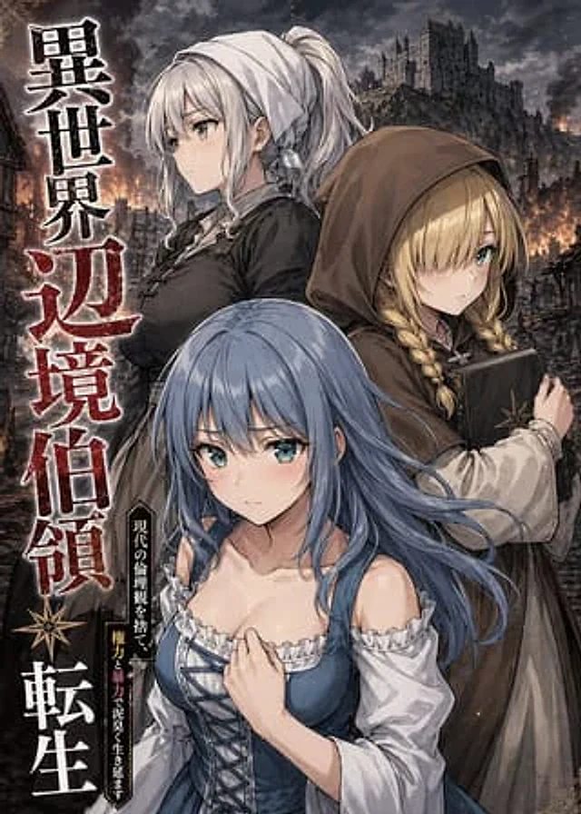

```text
The cover of a dark fantasy anime/light novel, rendered in a vertical format, is drawn with delicate and dramatic brushstrokes, creating a melancholic, cinematic atmosphere. The image depicts three young women arranged in a triangle against a backdrop of a medieval ruined city engulfed in flames at night, filled with smoke, embers, and collapsed wooden buildings. In the distance, a massive stone fortress stands atop a rocky hill. In the foreground, at the center, is a beautiful young woman with flowing hair {argument name="hair color" default="powder blue"} She has long hair and wears a blue off-the-shoulder dress with a fitted waist, white ruffled sleeves, and a tie-front bra. One hand lightly touches her chest, her expression both serious and vulnerable. To her left and slightly behind is a tall woman with long, silver-white hair tied in a high ponytail, wearing a white headscarf and a simple black dress with a high neckline and buttoned front. She stands sideways, her expression stern and inscrutable. To her right and slightly behind is a blonde girl wearing a brown hooded cape, with pigtails and pale blue-green eyes. She holds a black book with a star-shaped emblem on the cover and glances sideways, her expression wary. The composition uses a layered arrangement of figures, creating strong contrasts. The colors are slightly undersaturated, retaining only the warm firelight and deep red. A striking vertical Japanese title is added to the left, employing an aged calligraphic style: "異世界辺境伯领" (Otherworld Border Territory) in black and red. Two smaller vertical text blocks are located at the bottom left: "今代の偫理観を捨て" (To abandon the ethics of the present) and "権力と暴力で泥臭く生き延びます" (To live on muddy ground through power and violence). A decorative compass-shaped badge is added to the bottom left, and a prominent large vertical subtitle, "転生" (Rebirth), is added to the bottom left. The cover features decorative corner patterns, a rough texture, a strong atmosphere of isekai war, high detail, and a high-quality illustrated novel cover.
```

Model: GPT Image 2
Author: GPT Image 2 Prompts

[ProjectD](https://aitoolsradar.com/en/prompts/89b8c33a8e964b) · [Recorded source](https://x.com/itoyo_monk/status/2047310357262475757#reversed-0)
 · [Full original metadata and byte evidence](data/projectd-batch-0027.json)

## Dark Fantasy Lore Infographic Chart

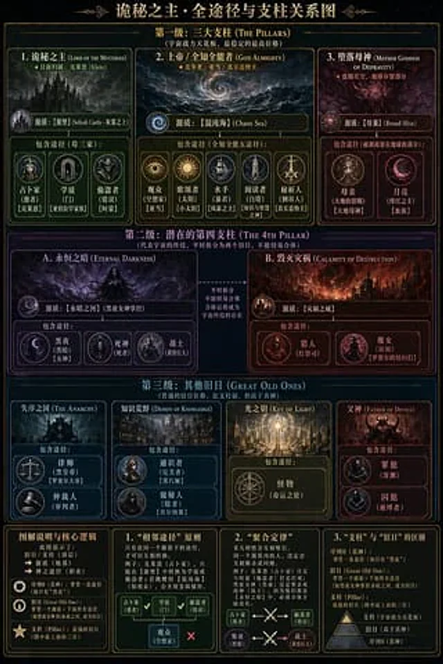

```text
{
  "type": "Complex dark fantasy infographics",
  "style": "{argument name=\"theme style\" default=\"Dark fantasy, gothic style, arcane feel, black background with gold border\"}",
  "header": "{argument name=\"main title\" default=\"Lord of Mysteries: All Pathways and Pillars Relationship Diagram\"}",
  "layout": {
    "sections": [
      {
        "title": "{argument name=\"tier 1 title\" default=\"Level One: The Three Pillars\"}",
        "position": "top",
        "count": 3,
        "labels": [
          "1. Lord of the Mysteries",
          "2. God/The All-Knowing and All-Powerful (GOD ALMIGHTY)",
          "3. Mother Goddess of Depravity"
        ],
        "details": "Each box contains a main entity illustration, a \"Sefirah\" label, and a \"Pathways\" section with circular icons. Box 1 contains 3 icons, box 2 contains 5 icons, and box 3 contains 2 icons."
      },
      {
        "title": "{argument name=\"tier 2 title\" default=\"Level Two: Potential Fourth Pillar\"}",
        "position": "upper-middle",
        "count": 2,
        "labels": [
          "A. Eternal Darkness",
          "B. Calamity of Destruction"
        ],
        "details": "Two large boxes are connected by a text block and an arrow in the middle. Box A contains 3 way icons. Box B contains 2 way icons."
      },
      {
        "title": "{argument name=\"tier 3 title\" default=\"Level 3: Other Old Times\"}",
        "position": "lower-middle",
        "count": 4,
        "labels": [
          "The Anarchy",
          "Demon of Knowledge",
          "Key of Light",
          "Father of Devils"
        ],
        "details": "Four vertically arranged boxes. Box 1 contains 2 icons, box 2 contains 2 icons, box 3 contains 1 icon, and box 4 contains 2 icons."
      },
      {
        "title": "Illustrations and Logic",
        "position": "bottom",
        "count": 4,
        "labels": [
          "Diagrammatic Explanation and Core Logic",
          "1. The principle of \"adjacent paths\"",
          "2. The Law of Convergence",
          "3. The difference between \"pillar\" and \"the past\"."
        ],
        "details": "Four information panels, containing text, a list of key points, and small illustrative arrows, are used to explain the rules and hierarchical relationships of the chart."
      }
    ]
  }
}
```

Model: GPT Image 2
Author: GPT Image 2 Prompts

[ProjectD](https://aitoolsradar.com/en/prompts/623323975faea4) · [Recorded source](https://x.com/MrLarus/status/2045516968812257323#reversed-1)
 · [Full original metadata and byte evidence](data/projectd-batch-0027.json)

## Dark Fantasy Manga Page Generator

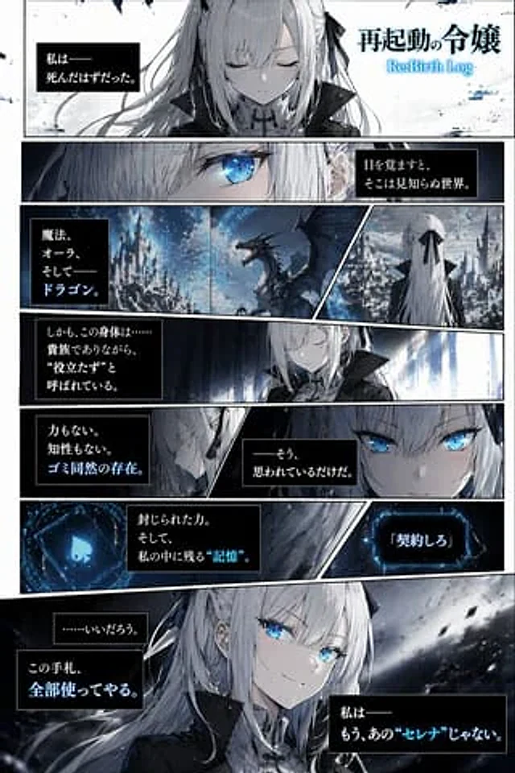

```text
{
  "type": "Full-color comic page",
  "genre": "Dark fantasy",
  "style": "High-quality anime illustrations, dramatic lighting and shadows, cinematic composition.",
  "character": {
    "appearance": "{argument name=\"hair color\" default=\"Long white hair\"} Paired with a black ribbon,{argument name=\"eye color\" default=\"Glowing blue eyes\"} Wearing a black gothic coat with a cross-shaped zipper pull"
  },
  "layout": {
    "format": "A vertical comic page containing 7 independent horizontal panels.",
    "panels": [
      {
        "tier": 1,
        "description": "The top panel is large. The character is looking down with their eyes closed.",
        "elements": [
          {
            "type": "title_logo",
            "position": "Top right corner",
            "text": "{argument name=\"main title\" default=\"Re-Birth Log\"}"
          },
          {
            "type": "text_box",
            "position": "Top left corner",
            "text": "{argument name=\"opening text\" default=\"I—I was supposed to be dead.\"}"
          }
        ]
      },
      {
        "tier": 2,
        "description": "Narrow horizontal panel layout. Extreme close-up of the character's glowing eyes.",
        "elements": [
          {
            "type": "text_box",
            "position": "right side",
            "text": "When I woke up, I was in an unfamiliar world."
          }
        ]
      },
      {
        "tier": 3,
        "description": "The montage frames show Gothic castles, roaring dragons, and the backs of characters.",
        "elements": [
          {
            "type": "text_box",
            "position": "Left side",
            "text": "Magic, auras, and—dragons."
          }
        ]
      },
      {
        "tier": 4,
        "description": "The character looks dejected in the dark, desolate forest.",
        "elements": [
          {
            "type": "text_box",
            "position": "Left side",
            "text": "Moreover, despite being a nobleman, this body is considered \"useless.\""
          }
        ]
      },
      {
        "tier": 5,
        "description": "The image is divided into sections. The left side shows a sorrowful profile. The right side shows a close-up of determined, shining eyes.",
        "elements": [
          {
            "type": "text_box",
            "position": "Left side",
            "text": "Powerless. No intelligence. A worthless existence, practically garbage."
          },
          {
            "type": "text_box",
            "position": "Middle right",
            "text": "—That's just what people think."
          }
        ]
      },
      {
        "tier": 6,
        "description": "Abstract magic panel. The left side displays a glowing blue spade symbol within a magic circle. The right side displays a glowing, number-style dialog box.",
        "elements": [
          {
            "type": "text_box",
            "position": "central",
            "text": "A sealed power. And the \"memories\" that remain within me."
          },
          {
            "type": "glowing_text_box",
            "position": "right side",
            "text": "\"Sign the contract.\""
          }
        ]
      },
      {
        "tier": 7,
        "description": "The bottom panel is large. The character looks confidently forward, a cold smile playing on his lips.",
        "elements": [
          {
            "type": "text_box",
            "position": "Top left corner",
            "text": "……いいだろう。"
          },
          {
            "type": "text_box",
            "position": "Middle left",
            "text": "I'm going to use all the cards in this hand."
          },
          {
            "type": "text_box",
            "position": "bottom right corner",
            "text": "{argument name=\"closing text\" default=\"I&#39;m no longer that &quot;Serena.&quot;\"}"
          }
        ]
      }
    ]
  }
}
```

Model: GPT Image 2
Author: GPT Image 2 Prompts

[ProjectD](https://aitoolsradar.com/en/prompts/21b8824739878d) · [Recorded source](https://x.com/noriyang_crypt/status/2045022929273167927#reversed-0)
 · [Full original metadata and byte evidence](data/projectd-batch-0027.json)

## Dark Fantasy Manga Page Generator


```text
{
  "type": "full-color manga page",
  "genre": "dark fantasy",
  "style": "high-quality anime illustration, dramatic lighting, cinematic composition",
  "character": {
    "appearance": "{argument name=\"hair color\" default=\"long white hair\"} with black ribbons, {argument name=\"eye color\" default=\"glowing blue eyes\"}, wearing a black gothic coat with a cross-shaped zipper pull"
  },
  "layout": {
    "format": "vertical comic page with 7 distinct horizontal panel tiers",
    "panels": [
      {
        "tier": 1,
        "description": "Large top panel. Character looking down with eyes closed.",
        "elements": [
          {"type": "title_logo", "position": "top right", "text": "{argument name=\"main title\" default=\"再起動の令嬢 Re:Birth Log\"}"},
          {"type": "text_box", "position": "top left", "text": "{argument name=\"opening text\" default=\"私は——死んだはずだった。\"}"}
        ]
      },
      {
        "tier": 2,
        "description": "Narrow horizontal panel. Extreme close-up of the character's glowing eye.",
        "elements": [
          {"type": "text_box", "position": "right", "text": "目を覚ますと、そこは見知らぬ世界。"}
        ]
      },
      {
        "tier": 3,
        "description": "Montage panel showing a gothic castle, a roaring dragon, and the character from behind.",
        "elements": [
          {"type": "text_box", "position": "left", "text": "魔法、オーラ、そして——ドラゴン。"}
        ]
      },
      {
        "tier": 4,
        "description": "Character looking downcast in a dark, ruined forest.",
        "elements": [
          {"type": "text_box", "position": "left", "text": "しかも、この身体は……貴族でありながら、“役立たず”と呼ばれている。"}
        ]
      },
      {
        "tier": 5,
        "description": "Split panel. Left side shows a sad profile. Right side shows a determined close-up with glowing eyes.",
        "elements": [
          {"type": "text_box", "position": "left", "text": "力もない。知性もない。ゴミ同然の存在。"},
          {"type": "text_box", "position": "center right", "text": "——そう、思われているだけだ。"}
        ]
      },
      {
        "tier": 6,
        "description": "Abstract magical panel. Left shows a glowing blue spade symbol in a magic circle. Right shows a glowing digital-style dialogue box.",
        "elements": [
          {"type": "text_box", "position": "center", "text": "封じられた力。そして、私の中に残る“記憶”。"},
          {"type": "glowing_text_box", "position": "right", "text": "「契約しろ」"}
        ]
      },
      {
        "tier": 7,
        "description": "Large bottom panel. Character looking forward confidently with a smirk.",
        "elements": [
          {"type": "text_box", "position": "top left", "text": "……いいだろう。"},
          {"type": "text_box", "position": "mid left", "text": "この手札、全部使ってやる。"},
          {"type": "text_box", "position": "bottom right", "text": "{argument name=\"closing text\" default=\"私は——もう、あの“セレナ”じゃない。\"}"}
        ]
      }
    ]
  }
}
```

Model: GPT Image 2
Author: noriyang@♠️AIart❤️poker

[ProjectD](https://aitoolsradar.com/en/prompts/96fcd6fce4079c) · [Recorded source](https://youmind.com/prompts/dark-fantasy-manga-page-13916)
 · [Full original metadata and byte evidence](data/projectd-batch-0027.json)

## Dark Fantasy Orc Warchief TCG Card

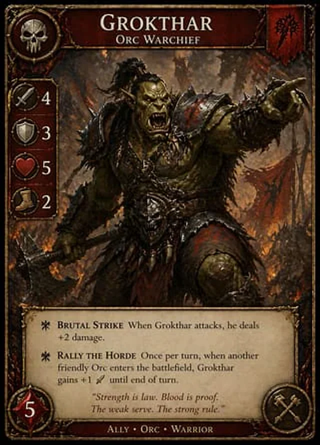

```text
Create a highly detailed Diablo-style fantasy trading card, featuring a full vertical layout, a luxurious antique metal and red leather border, distressed gold trim, and clearly legible printed text. The card's title is {argument name="character name" default="GROKTHAR"} The title, "Orc Warchief," is centered below in large serif capital letters. The main illustration depicts a massive green-skinned orc warchief charging through a fiery battlefield, clad in brutal black spiked armor adorned with skull patterns, leather straps, fangs, and blood-red war paint. One arm is outstretched as if directing the attack, while the other grips a massive serrated battle axe. He is incredibly strong, his expression ferocious and roaring, his long hair tied back, and his overall color scheme is a battle-worn red and black. The background is filled with smoke, embers, banners, warrior silhouettes, and orange flames. A circular skull faction emblem is placed in the upper left corner. A red vertical banner tag with a black Horde symbol is placed in the upper right corner. Along the left edge, four circular attribute icons are arranged vertically in a separate panel, with values ​​of: sword attack 4, shield defense 3, heart health 5, and boot movement 2. At the bottom, there is a large parchment-colored text box containing two named skills and a background quote. Skill 1 Title:{argument name="ability one" default="BRUTAL STRIKE"} The text reads: "When Grokthar attacks, he deals +2 damage." Skill 2 Title:{argument name="ability two" default="RALLY THE HORDE"} The main text reads: "Once per turn, when another friendly orc enters the battlefield, Grokthar gains +1 Attack until the end of the turn." (Add italicized background text below.){argument name="flavor quote" default="Strength is law. Blood is proof. The weak serve. The strong rule."} Place a red, gem-shaped cost badge with the number 5 in the bottom left corner. Place a circular, crossed weapon icon in the bottom right corner. Along the bottom type bar, center three class terms separated by dots: "Ally • Orc • Warrior". This makes the cards look like a professionally printed, collector's edition card game component, with clear typography, a balanced layout, dramatic fantasy illustrations, rich textures, and authentic desktop TCG design.
```

Model: GPT Image 2
Author: GPT Image 2 Prompts

[ProjectD](https://aitoolsradar.com/en/prompts/f69484e1a2fab1) · [Recorded source](https://x.com/Artedeingenio/status/2047601145569235279#reversed-1)
 · [Full original metadata and byte evidence](data/projectd-batch-0027.json)

## Dark Fantasy RPG Boss Fight Screenshot

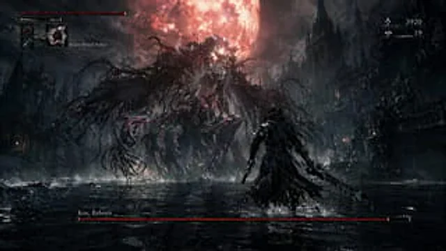

```text
{
  "type": "video game screenshot",
  "setting": "A dark fantasy gothic city, with towering spires rising from shallow waters, and a huge orb hanging above them.{argument name=\"moon color\" default=\"Blood red\"} moon",
  "characters": {
    "player": "The hunter wore{argument name=\"player outfit\" default=\"Dark trench coat and tricorn hat\"} Holding a serrated knife and a pistol, with his back to the camera.",
    "boss": "{argument name=\"boss appearance\" default=\"A gigantic Cthulhu-style monster composed of tangled black tentacles and emitting a red glow from within.\"}"
  },
  "layout": {
    "sections": [
      {
        "title": "Player Status HUD",
        "position": "top-left",
        "count": 3,
        "labels": [
          "Red health bar",
          "Green stamina bar",
          "Inventory (Potions: 20, Ammo: 20){argument name=\"selected item\" default=\"Monster Blood Pill\"} :7)"
        ]
      },
      {
        "title": "Currency HUD",
        "position": "top-right",
        "count": 2,
        "labels": [
          "Currency icon: 3920",
          "Eye icon: 19"
        ]
      },
      {
        "title": "Boss Health Bar",
        "position": "bottom-center",
        "count": 1,
        "labels": [
          "{argument name=\"boss name\" default=\"Reborn Kos\"}"
        ]
      }
    ],
    "centerpiece": "An epic confrontation between players and the boss in the water."
  }
}
```

Model: GPT Image 2
Author: GPT Image 2 Prompts

[ProjectD](https://aitoolsradar.com/en/prompts/55225267e330e7) · [Recorded source](https://x.com/Pixel_Beaky/status/2044593832470130868#reversed-1)
 · [Full original metadata and byte evidence](data/projectd-batch-0027.json)

## Dark Fantasy RPG Key Visual Poster

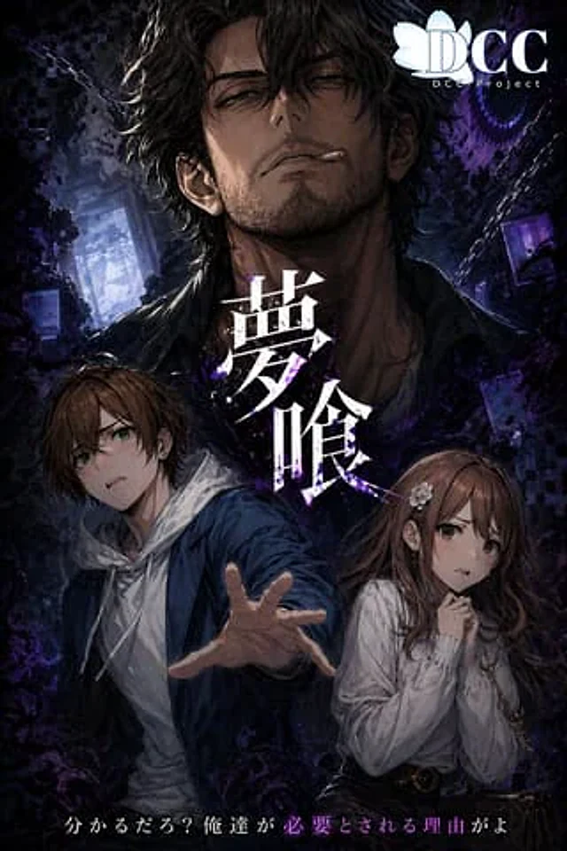

```text
A highly dramatic, vertical, dark fantasy animated key visual poster for an RPG game.{argument name="game title" default="Yume-BAKU-"} The composition centers on three figures with depth and layering. In the background, a burly, intimidating adult male is presented in half-length, gazing forward. He has messy, dark, wavy hair with a light stubble, wears a half-open dark shirt, and exudes a gloomy and ominous aura. His face is mostly obscured by shadows and composition, making him appear mysterious and dangerous. To the left of the foreground, a young man is placed, lunging at the viewer in a dynamic, three-quarter profile pose, his right hand dramatically extended. He wears a white hoodie under a blue jacket, has messy short brown hair, and a resolute expression. To the right of the foreground, a young woman stands slightly behind him, with long brown hair, wearing a light-colored shirt and a dark skirt or high-waisted bottoms, belted. She clasps her hands together at her mouth or chest, her expression anxious and vulnerable. The composition employs a somber, supernatural atmosphere, with black and deep purple smoke, inky shadows, ghostly textures, and pixelated fragments at the edges. The background includes diagonally arranged broken chains, several floating rectangular frames or screens, and an interior corridor faintly visible behind the character. A large Japanese title is vertically integrated in the center.{argument name="title text" default="Dream Eater"} The design features bold white Chinese calligraphy characters with purple splatter, scratches, and glowing effects, overlapping with the figures. Japanese slogans are included at the bottom.{argument name="tagline text" default="You understand, right? Why we&#39;re needed."} Use an elegant white font, with some sentences highlighted in purple. Add a white studio logo in the upper right corner, with the text {argument name="logo text" default="DCC Project"} Featuring a lotus-shaped logo and large serif lettering. Overall style: exquisite illustration-level key visual art, suitable for psychological horror RPGs, ultra-detailed animated artwork, high contrast, cinematic lighting, deep blacks, indigo and violet hues, ominous supernatural energy, poster-quality typography, and premium promotional visuals.
```

Model: GPT Image 2
Author: GPT Image 2 Prompts

[ProjectD](https://aitoolsradar.com/en/prompts/3b448d10e803a8) · [Recorded source](https://x.com/DCC_KAZ/status/2046551651637694788#reversed-0)
 · [Full original metadata and byte evidence](data/projectd-batch-0027.json)

## Dark Fantasy Samurai Battlefield

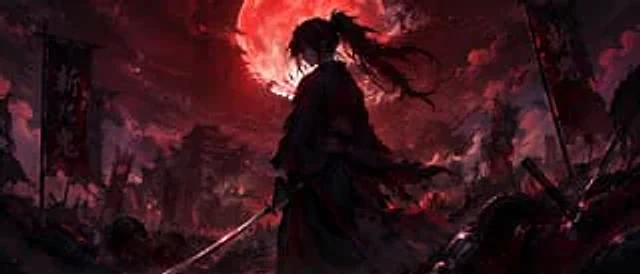

```text
A dark fantasy-style anime illustration depicts a lone swordsman standing on a desolate battlefield, with a massive sun overhead.{argument name="moon color" default="Blood red"} The moon. The character possesses {argument name="character hair" default="Long black hair in a messy high ponytail"} With glowing red eyes, dressed in tattered black traditional clothing, and wielding a weapon tilted downwards {argument name="weapon" default="Samurai sword"} In the background, a{argument name="background structure" default="dilapidated Japanese castle"} Appearing and disappearing amidst dark, churning clouds. The scene includes three tattered flags, bearing Japanese kanji, stuck among shadowy ruins. The lighting and shadow effects have a cinematic quality and are imbued with an ominous atmosphere, employing {argument name="color palette" default="Deep black and rich crimson"} The color scheme.
```

Model: GPT Image 2
Author: GPT Image 2 Prompts

[ProjectD](https://aitoolsradar.com/en/prompts/b22e4273139464) · [Recorded source](https://x.com/abdlhakai/status/2044835814819950963#reversed-0)
 · [Full original metadata and byte evidence](data/projectd-batch-0027.json)

## Dark Fantasy Sha Seng Character Poster

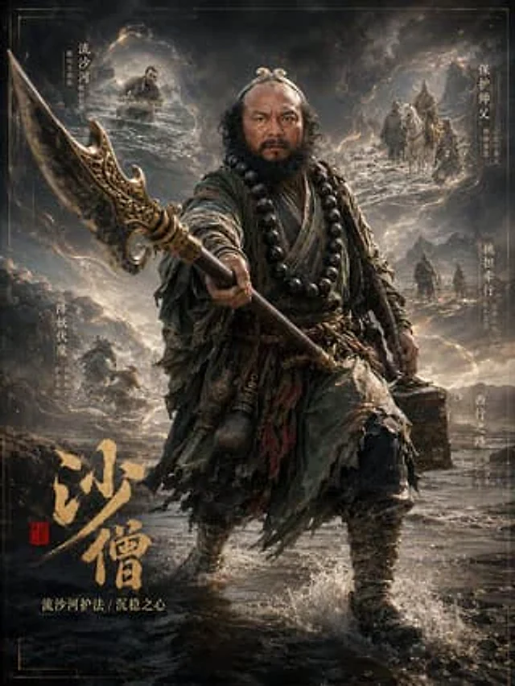

```text
Goal: Create a cinematic vertical 3D character profile poster for {argument name="character name" default="沙僧"}, inspired by an epic dark-fantasy Journey to the West return theme.

Canvas: Portrait 3:4 poster, high-resolution, dramatic movie-poster composition with a thin antique gold rectangular border and worn parchment-metal texture around the edges.

Main subject: One imposing warrior-monk stands full body in the center, wading through a shallow stormy river. He is tall, broad, rugged, and dressed in layered tattered dark green and gray monk robes, wrapped belts, hanging pouches, rope ties, weathered boots, and a huge strand of black prayer beads around his neck. His face is intentionally covered by a plain centered brown square censor block, while a small ornate golden headpiece remains visible above it. His stance is powerful, one foot forward splashing water.

Weapon and props: The character thrusts one large crescent-bladed demon-subduing staff toward the viewer, breaking the frame with extreme foreshortening from the left foreground. The blade is ornate bronze-gold with engraved patterns and sharp curved hooks. In his other hand he carries one small dark wooden traveling chest. Count the main visible props exactly: 1 oversized crescent staff, 1 wooden chest, 1 large prayer-bead necklace, multiple belt pouches as costume detail.

Background: A vast mythic river landscape under storm clouds, mist, splashing water, rocks, and glowing golden energy currents. Add exactly 5 narrative vignette scenes embedded in swirling circular mist portals around the character: 1 upper-left river struggle scene with a monk-like figure in turbulent water, 1 upper-right escort scene with a master riding a white horse and attendants, 1 mid-right pilgrimage scene with two travelers walking across a barren riverbank, 1 lower-left demon-slaying battle scene in rocks and waves, and 1 far-right distant mountain-road scene suggesting the westward journey. Make the vignettes semi-transparent, painterly, and integrated into the smoky sky and water.

Text content and placement: Use vertical Chinese calligraphy and small annotation text as decorative poster typography. Include exactly 6 prominent text groups: 1 large gold brush-calligraphy title at lower left reading {argument name="main title text" default="沙僧"}; 1 small subtitle below it reading {argument name="subtitle text" default="流沙河护法 / 沉稳之心"}; 1 upper-left vertical heading reading {argument name="upper left label" default="流沙河"} with small supporting text; 1 upper-right vertical heading reading "保护师父" with small supporting text; 1 middle-right vertical heading reading "挑担牵行" with small supporting text; 1 lower-right vertical heading reading "西行之路" with small supporting text. Also include a lower-left vertical heading "降妖伏魔" near the battle vignette, styled as part of the poster annotations. Keep all Chinese text legible enough to read but aged and integrated into the design.

Visual style: Hyper-detailed 3D cinematic realism, dark fantasy Chinese mythological epic, dramatic chiaroscuro lighting, smoky volumetric atmosphere, gold sparks, wet fabric, rippling water, highly detailed metal engravings, weathered cloth texture, shallow depth of field on the foreground weapon, moody gray-blue and antique gold palette.

Constraints: Do not add extra characters beyond the background vignette figures. Keep the central warrior dominant, weapon breaking out toward the viewer, face covered by the brown square, and maintain the exact poster-like layout with ornate border, gold calligraphy, and 5 mist-vignette scenes.
```

Model: GPT Image 2
Author: Larus Canus

[ProjectD](https://aitoolsradar.com/en/prompts/951c6f3d9c006f) · [Recorded source](https://youmind.com/prompts/sha-seng-character-poster-21573)
 · [Full original metadata and byte evidence](data/projectd-batch-0027.json)

## Dark Fantasy Stage Poster

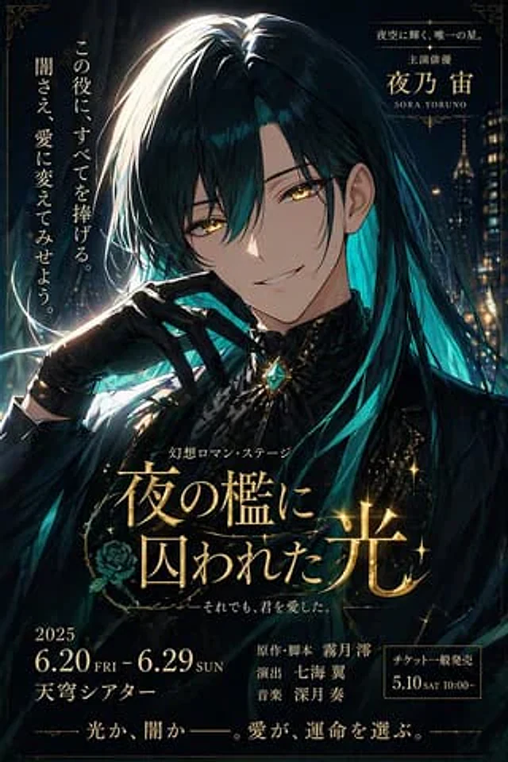

```text
A dramatically compelling vertical poster for a Japanese stage play, employing a luxurious, dark fantasy anime style. The image centers on a half-length portrait of a young, androgynous actor against a backdrop of a nighttime city skyline with luminous skyscrapers and soft bokeh lighting. The character has long, flowing, jet-black hair with vibrant green highlights and undertones, its glossy strands cascading over his shoulders. He wears an elegant black turtleneck with a delicate brocade texture, paired with a fitted dark coat, black leather gloves, and a diamond-shaped green gemstone pendant set in opulent gold jewelry around his throat. One gloved hand is raised near his collar, striking a graceful theatrical pose. The overall atmosphere is mysterious, romantic, and slightly gothic, with cinematic contour lighting in the backlit areas, creating strong contrasts and punctuated by golden sparkles, making the hair and clothing shimmer. The sophisticated magazine-quality main visual composition, complemented by decorative gold filigree edges, presents a high-end stage play poster layout. Space is reserved to incorporate Japanese typography: The small text in the upper right corner reads "The only star shines in the night sky.", and below it are the names of the lead actors and their names.{argument name="character name" default="Yono Sora"} ", with the small romanized word "SORA YORUNO" at the bottom; the vertically typed quotation "このserviceに、すべてをholdingげる" is printed vertically on the left. Dark さえ, love に変えてみせよう. "; The lower middle part is in small letters "Fantasy ロマン・ステージ", and the top is a huge golden luminous title "{argument name="title text" default="Light trapped in a cage of night"} Below this is a subtitle: "—Even so, I loved you." A dark blue rose pattern and a thorn ring decoration are added near the title. The bottom left corner includes the date "2025 6.20 FRI - 6.29 SUN" and the performance venue "Tenkyo Shore." The bottom right corner includes a bordered ticketing information section: "Ticket general release 5.10 SAT 10:00~." The bottom center lists the production staff: "Original work/script by Mio Kiritsuki," "Director by Tsubasa Nanami," and "Music by Kanade Mizuki." At the very bottom is the promotional tagline: "—Light or darkness—. ​​Love chooses its destiny." —". Color scheme: Midnight blue, black, cyan, fluorescent cyan, and antique gold. Emphasizing sophisticated poster layout, depth, an elegant fantasy theatrical brand feel, and a unified facial feature and atmosphere suitable for stage play promotional activities.
```

Model: GPT Image 2
Author: GPT Image 2 Prompts

[ProjectD](https://aitoolsradar.com/en/prompts/760274c5b95291) · [Recorded source](https://x.com/noctiluce_sora/status/2047036229028635042#reversed-1)
 · [Full original metadata and byte evidence](data/projectd-batch-0027.json)

## Dark Fantasy Tarot Club Lore Infographic

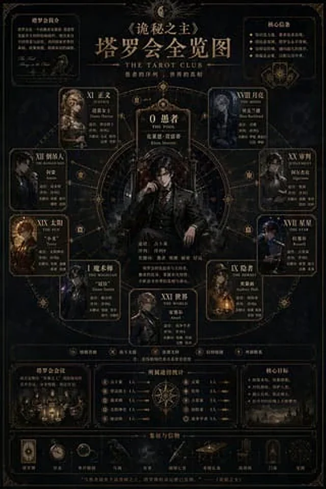

```text
{
  "type": "Dark fantasy setting information image",
  "style": "The artwork features a gothic steampunk anime art style with a dark background and exquisite gold and bronze borders and text.",
  "header": {
    "main_title": "{argument name=\"main title\" default=\"Lord of Mysteries\"}",
    "subtitle": "{argument name=\"subtitle\" default=\"Tarot Club Overview\"}",
    "english_subtitle": "THE TAROT CLUB",
    "sub_subtitle": "The sequence of fools, the truth of the world"
  },
  "top_panels": [
    {
      "title": "Tarot Club Introduction",
      "position": "top-left",
      "illustration": "crows perched on tree branches"
    },
    {
      "title": "Core Creed",
      "position": "top-right",
      "illustration": "Eye and Sun Badge",
      "content_type": "Bullet List"
    }
  ],
  "centerpiece": {
    "title": "{argument name=\"center character title\" default=\"0 The Fool\"}",
    "name": "{argument name=\"center character name\" default=\"Klein Moretti\"}",
    "english_name": "Klein Moretti",
    "illustration": "A highly detailed large portrait depicts a handsome young man in a dark suit and tie, seated in an ornate high-backed chair, with a mysterious expression.",
    "details": "The text box below the portrait lists the path, sequence, keywords, and description."
  },
  "orbiting_characters": {
    "count": 9,
    "layout": "A circular constellation pattern surrounds the central figure, connected by fine gold thread and small circular nodes.",
    "labels": [
      "XI Justice / Dame Hastur",
      "XII The Hanged Man / Amon",
      "XIX The Sun / “The Clown” Terry",
      "I The Magician / \"Grand\" Dunn Smith",
      "XXI THE WORLD / Ansel",
      "IX The Hermit / Audrey Hall",
      "XVII The Star / Russell",
      "XX Trial / Algernon",
      "XVIII The Moon / Blau Bachland"
    ],
    "card_structure": "Each section contains a small rectangular cartoon portrait, Roman numerals, tarot card names, character names, and attribute text."
  },
  "connection_legend": {
    "count": 5,
    "labels": [
      "intelligence contribution",
      "Combat Support",
      "Resource support",
      "Faith Link",
      "External contacts"
    ]
  },
  "bottom_panels": [
    {
      "title": "Tarot Meeting",
      "position": "bottom-left",
      "illustration": "A group of cloaked figures sat around a table in the darkness, where candlelight flickered."
    },
    {
      "title": "Statistics by Applicable Channel",
      "position": "bottom-center",
      "content": "A list of 10 routes, accompanied by a central compass star emblem."
    },
    {
      "title": "Core Objectives",
      "position": "bottom-right",
      "illustration": "Gothic castle silhouette",
      "content_type": "Bullet List"
    }
  ],
  "footer_symbols": {
    "title": "Symbols and tokens",
    "count": 10,
    "labels": [
      "Tarot cards",
      "pocket watch",
      "Monocular",
      "crow",
      "Gray fog",
      "Mithril Dagger",
      "Bronze Long Table",
      "High-backed chair",
      "Door",
      "Star Chart"
    ]
  },
  "footer_quote": "{argument name=\"footer quote\" default=\"When the Fool sits in his high-backed chair, the fate of the Tarot cards has already been reshuffled.\"}——Lord of Mysteries"
}
```

Model: GPT Image 2
Author: GPT Image 2 Prompts

[ProjectD](https://aitoolsradar.com/en/prompts/fce78bb56074c9) · [Recorded source](https://x.com/MrLarus/status/2045516968812257323#reversed-0)
 · [Full original metadata and byte evidence](data/projectd-batch-0027.json)

## Dark Fantasy Wizard Podcast Poster

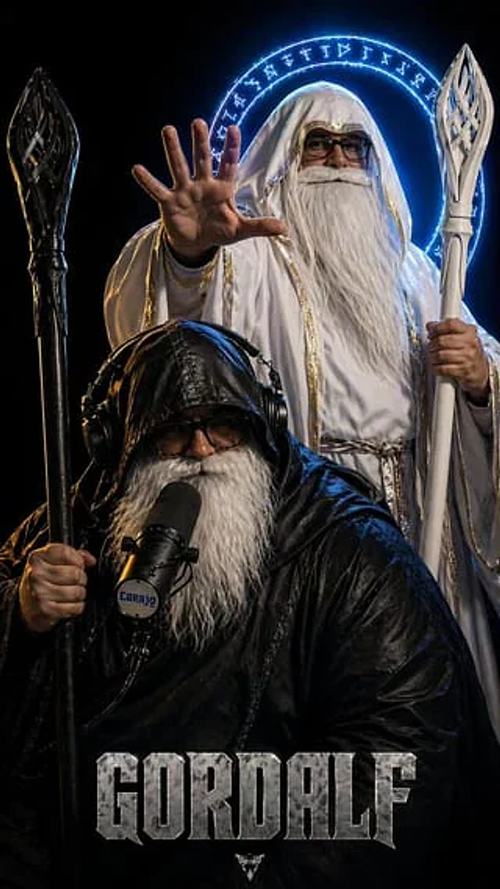

```text
A dramatic, dark fantasy-style photographic poster features two wizard-like figures posing in a manner reminiscent of a heavy metal parody album cover. In the foreground, a burly, elderly wizard sits or leans against the camera, clad in a glossy black hooded robe and wearing large studio headphones. A thick, long white beard hangs down his chest. His left hand grips a tall, black staff topped with an ornate spear-like decoration and intricate openwork details. A large black podcast microphone, mounted on a stand or boom, is positioned directly in front of his mouth, with a sticker bearing the word "CARAJO" affixed to the microphone. Behind him stands a second elderly wizard, dressed in a bright white robe with gold trim and a rope belt, also sporting long white hair and a white beard. His right hand holds a tall white staff topped with the same ornate spearhead, while his left hand extends towards the viewer in a gesture of casting a spell, fingers spread. Behind the standing wizard's head is a bright, electric blue glowing ring composed of runes, creating the effect of a magic summoning circle. The background is pure black, using high-contrast cinematic lighting: the cool blue rim light in the background contrasts with the warm highlights on the hands, robes, and staff. The composition is a compact vertical frame, with the black-robed wizard positioned at the bottom center, and the white-robed wizard towering behind him. A title is added at the bottom center.{argument name="title text" default="GORDALF"} Using massive, metallic, stone-textured Gothic capital letters, it presents the style of a fantasy metal band logo, with a small, mystical badge centered below the words. Photorealistic cosplay portraits, ultra-fine fabric textures, dramatic fantasy realism, poster design, sharp focus, and an epic, melancholic atmosphere.
```

Model: GPT Image 2
Author: GPT Image 2 Prompts

[ProjectD](https://aitoolsradar.com/en/prompts/d80f11960db3f9) · [Recorded source](https://x.com/Gordalfista/status/2047038399844942299#reversed-0)
 · [Full original metadata and byte evidence](data/projectd-batch-0027.json)

## Dark Gothic Ritual in Cathedral

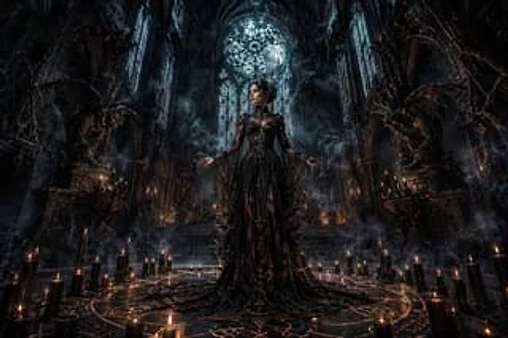

```text
A dark, cinematic fantasy scene set inside a magnificent Gothic cathedral at night. At the center of the image is a mysterious woman in a floor-length black ceremonial robe, standing in the center of a luminous, mystical circle. The composition employs a perfectly symmetrical frontal perspective, with the woman positioned directly beneath a massive rose window, through which a bright full moon can be seen. She wears a magnificent and form-fitting robe.{argument name="dress color" default="black"} A long robe, adorned with lace, embroidered filigree, semi-transparent sleeves, a corset, and a long train trailing across the stone floor. Her posture was solemn and ceremonial, her arms slightly outstretched to the sides, palms open, as if summoning smoke or dark magic. Her face was indistinct, her hair styled in a dark updo, adorned with a towering Gothic collar or headdress. At her feet lay a large, circular rune, glowing {argument name="sigil glow color" default="Amber Gold"} The design is meticulously crafted with lines, incorporating intricate symbols and concentric circles. Thirty black candles of varying heights, all lit, are placed around the circular array and in the foreground, their warm light casting deep orange highlights. A hazy mist hangs in the air, particularly around her hands, the floor, and the side aisles. The cathedral's interior is soaring, dark, and richly detailed, featuring ribbed vaults, pointed arches, weathered stone, exquisite carvings, and deep blue-black shadows. On either side, two colossal gargoyle or demon statues perch on ornate pedestals, leaning inwards in a protective or threatening posture. Behind the woman, a towering altar and clusters of candles fade into the darkness. The interplay of light and shadow is somber and starkly contrasting, with the cold moonlight above and the warm candlelight below, creating metallic highlights on the robes and architectural surfaces. Extremely high detail, photorealistic quality, dramatic volumetric fog, gothic horror atmosphere, mysterious elegance, epic scale, crisp textures, realistic shadows, and an unforgettable sense of grandeur.
```

Model: GPT Image 2
Author: GPT Image 2 Prompts

[ProjectD](https://aitoolsradar.com/en/prompts/fee2db816781c1) · [Recorded source](https://x.com/richsparks/status/2046850211880772004#reversed-0)
 · [Full original metadata and byte evidence](data/projectd-batch-0027.json)

## Dark Manga Monster Poster

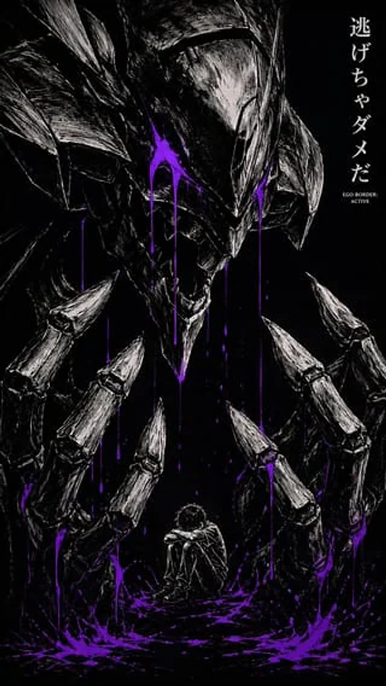

```text
A dark, monochrome, comic-style horror illustration against a pure black background, presented in a vertical poster format. At the bottom center of the image is a lonely, short-haired boy sitting on the ground, knees tucked to his chest, head slightly bowed, conveying fear, isolation, and helplessness. Above him, a massive bio-mechanical demon or armored monster head swoops down, with a long, angular, skull-like face, a sharp chin, narrow, empty eye sockets, layered helmet-like armor plates, and a jagged, gaping maw. Two enormous skeletal claws, one on each side, encircle the boy like a cage; each hand has long, segmented metal fingers with sharp, inward-curving tips, exuding a menacing aura. The overall design uses rough, white, slashed lines and heavy, intersecting hatching, creating a strong contrast against the deep black background, evoking the tension of seinen manga. Vibrant neon purple liquid splatters and long drips are added to the monster's face, claws, and the ground, converging around the boy and becoming the only strong color accents in the image. Add the vertical Japanese text "逃げちゃダメだ" to the upper right corner, and below it, add the English text "EGO BORDER: ACTIVE" in small white text. The overall atmosphere is oppressive, psychological, claustrophobic, and nightmarish, resembling a dark anime poster about inner fear and mental breakdown.
```

Model: GPT Image 2
Author: GPT Image 2 Prompts

[ProjectD](https://aitoolsradar.com/en/prompts/f459a518f3b7d8) · [Recorded source](https://x.com/AI_CyberDreams/status/2046617697639620818#reversed-3)
 · [Full original metadata and byte evidence](data/projectd-batch-0027.json)

## Dark Mode AI API Pricing Page Mockup


```text
{
  "type": "Dark Mode Web UI Model",
  "theme": "A stylish, modern dark theme with white and light gray text.",
  "header": {
    "logo": "{argument name=\"company name\" default=\"OpenAI\"}",
    "navigation": [
      "Research",
      "product",
      "Safety",
      "company"
    ],
    "actions": [
      "Search icon",
      "Log in",
      "Try the ChatGPT button"
    ]
  },
  "layout": {
    "left_column": {
      "label": "Pricing",
      "headline": "{argument name=\"model name\" default=\"GPT-8\"}",
      "subheading": "{argument name=\"main tagline\" default=\"Our most powerful model yet.\"}",
      "description": "GPT-8 is designed for intelligence, reliability, and real-world applications. It features multimodal reasoning, long-context understanding, and advanced tool usage capabilities.",
      "button": "Start using",
      "features": {
        "count": 3,
        "items": [
          {
            "icon": "brain",
            "title": "Cutting-edge intelligence",
            "desc": "State-of-the-art reasoning, coding, and problem-solving capabilities."
          },
          {
            "icon": "shield",
            "title": "Trustworthy design",
            "desc": "Enhanced security, greater controllability, and enterprise-grade reliability."
          },
          {
            "icon": "lightning bolt",
            "title": "Born for developers",
            "desc": "Native tool usage, structured output, and long-context workflows."
          }
        ]
      }
    },
    "right_column": {
      "type": "Pricing Card",
      "header": "Pricing - Simple, token-based pricing. No hidden fees.",
      "toggle": [
        "enter",
        "Cache read"
      ],
      "token_pricing": {
        "count": 5,
        "rows": [
          {
            "name": "Text Token",
            "unit": "Every 1 million tokens",
            "price": "{argument name=\"text token price\" default=\"$3.00\"}"
          },
          {
            "name": "Image Token",
            "unit": "Every 1 million tokens",
            "price": "$10.00"
          },
          {
            "name": "Audio Token",
            "unit": "Every 1 million tokens",
            "price": "$6.00"
          },
          {
            "name": "Video Token",
            "unit": "Every 1 million tokens",
            "price": "$15.00"
          },
          {
            "name": "Output Token",
            "unit": "Every 1 million tokens",
            "price": "{argument name=\"output token price\" default=\"$12.00\"}"
          }
        ]
      },
      "additional_features": {
        "count": 2,
        "rows": [
          {
            "name": "cache",
            "desc": "Save on the cost of repeated input by caching.",
            "price": "$0.30 / 1 million tokens"
          },
          {
            "name": "Bulk API (50% off)",
            "desc": "Reduce the cost of asynchronous workloads.",
            "price": "-50%"
          }
        ]
      },
      "footer_links": [
        "learn more",
        "Model Documentation",
        "Pricing details"
      ]
    }
  },
  "footer": "Prices are in US dollars. Please see our full pricing table in our documentation."
}
```

Model: GPT Image 2
Author: GPT Image 2 Prompts

[ProjectD](https://aitoolsradar.com/en/prompts/de6a2e1083129b) · [Recorded source](https://x.com/Gdthainakub/status/2044382053521936809#reversed-1)
 · [Full original metadata and byte evidence](data/projectd-batch-0027.json)

## Dark Mode Marketing Case Study UI


```text
{
  "type": "Landing page UI design",
  "theme": "Dark mode, modern and technological feel.{argument name=\"primary accent color\" default=\"Neon Purple\"} With blue glowing accents, glass-like style",
  "header": {
    "logo": "{argument name=\"brand name\" default=\"goViralX\"}",
    "badge": "Case Studies of Viral Marketing Campaigns"
  },
  "sections": [
    {
      "id": "hero",
      "layout": "Text on the left, image on the right layout",
      "content": {
        "badge": "Case Studies",
        "headline": "{argument name=\"hero headline\" default=\"How to create a viral impact of 10 million+ views\"}",
        "subtitle": "Exploding online in 3 days, helping brands achieve exponential growth.",
        "stats_row": {
          "count": 4,
          "labels": [
            "Total page views{argument name=\"main metric\" default=\"10,240,000+\"}",
            "Interaction rate: 18.7%",
            "3,200+ conversions",
            "Execution cycle 72 hours"
          ]
        },
        "hero_image": "A cinematic shot shows a person in a dark room watching a glowing, floating video screen with a large play button overlay."
      }
    },
    {
      "id": "strategy",
      "title": "Event Breakdown: Our 3-Day Execution Strategy",
      "layout": "3-step vertical timeline",
      "steps": [
        {
          "step": 1,
          "title": "Strategy Formulation",
          "image": "People analyze data on the screen."
        },
        {
          "step": 2,
          "title": "Content creation",
          "image": "Video editing interface"
        },
        {
          "step": 3,
          "title": "Distribution and Amplification",
          "image": "Holding a smartphone with social media icons"
        }
      ]
    },
    {
      "id": "performance",
      "title": "Performance Evaluation: Data-Driven Performance",
      "layout": "Left side: Statistical card grid; Right side: Chart.",
      "left_stats": {
        "count": 4,
        "labels": [
          "Total exposure: 10 million+",
          "Average CPM decreased by 43%",
          "28,000+ new followers",
          "3,200+ conversions"
        ]
      },
      "right_charts": {
        "count": 2,
        "items": [
          "The line chart shows a 7-day trend, reaching a peak of 8,320,000 on day 3.",
          "The horizontal bar chart shows the platform distribution: TikTok 52%, Instagram 24%, X 15%, YouTube 9%."
        ]
      }
    },
    {
      "id": "keys_to_success",
      "title": "Why it spreads virally: 3 key factors for success",
      "layout": "3 cards arranged horizontally",
      "cards": [
        {
          "icon": "fire",
          "title": "Emotional hook design"
        },
        {
          "icon": "bullseye",
          "title": "Content structure design"
        },
        {
          "icon": "antenna",
          "title": "Distribution strategy execution"
        }
      ]
    },
    {
      "id": "social_proof",
      "title": "Trusted by creators and brands alike: they are all using goViralX to achieve growth.",
      "layout": "Logo on the left, customer reviews on the right",
      "left_logos": {
        "count": 8,
        "labels": [
          "SHEIN",
          "SHOPLINE",
          "Blueglass",
          "instacart",
          "lemon8",
          "mi",
          "CIDER",
          "bellroy"
        ]
      },
      "right_testimonials": {
        "count": 2,
        "labels": [
          "SaaS Founder's Comments",
          "Growth Manager Evaluation"
        ]
      }
    },
    {
      "id": "cta",
      "title": "Ready for viral spread? Want the same growth potential?",
      "layout": "Text and input box on the left, 3D illustration on the right.",
      "elements": [
        "Input box with placeholder text",
        "Button:{argument name=\"call to action text\" default=\"Get a customized growth plan -&gt;\"}"
      ],
      "image": "3D glowing purple and blue rocket launch"
    }
  ],
  "footer": "Logo and copyright notice text"
}
```

Model: GPT Image 2
Author: GPT Image 2 Prompts

[ProjectD](https://aitoolsradar.com/en/prompts/194599ac74e718) · [Recorded source](https://x.com/IndieDevHailey/status/2044974254769463312#reversed-0)
 · [Full original metadata and byte evidence](data/projectd-batch-0027.json)

## Dark Mode X Post Mockup

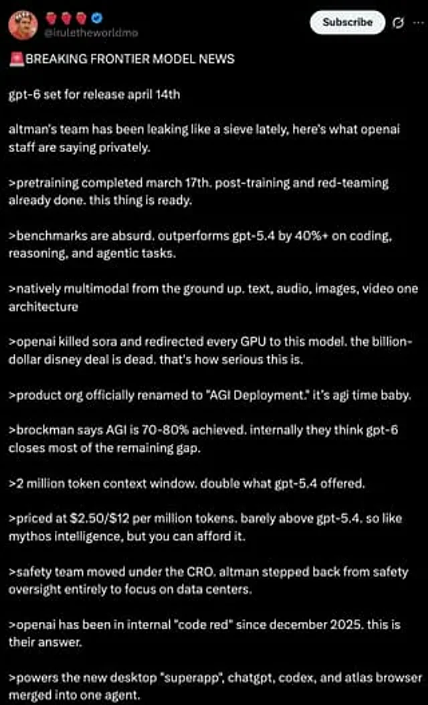

```text
A dark mode screenshot of an X tweet. The profile shows a man wearing a red shirt, a crown, and a beard. The username is {argument name="username" default="@iruletheworldmo"} The tweet is followed by three strawberry emojis and a blue verification checkmark. There's a "Subscribe" button in the upper right corner. The tweet body begins with {argument name="headline" default="🚨 BREAKING FRONTIER MODEL NEWS"} The beginning, followed by{argument name="subheadline" default="gpt-6 set for release april 14th"} And a brief introduction to the OpenAI leaks. Below are 11 key points, each beginning with a "&gt;" symbol, detailing {argument name="bullet point topic" default="fictional AI model specs"} Features include pre-training dates, performance exceeding GPT-5.4, native multimodal capabilities, replacing Sora, renaming to "AGI Deployment," 2 million token contexts, pricing, security team changes, a red alert for 2025, and a brand-new desktop super app. The text uses a standard sans-serif UI font and appears white on a black background.
```

Model: GPT Image 2
Author: GPT Image 2 Prompts

[ProjectD](https://aitoolsradar.com/en/prompts/c9598787993d56) · [Recorded source](https://x.com/dihsclusive/status/2045905067845271555#reversed-0)
 · [Full original metadata and byte evidence](data/projectd-batch-0027.json)

## Dark Oriental Fragrance Brand Case Study

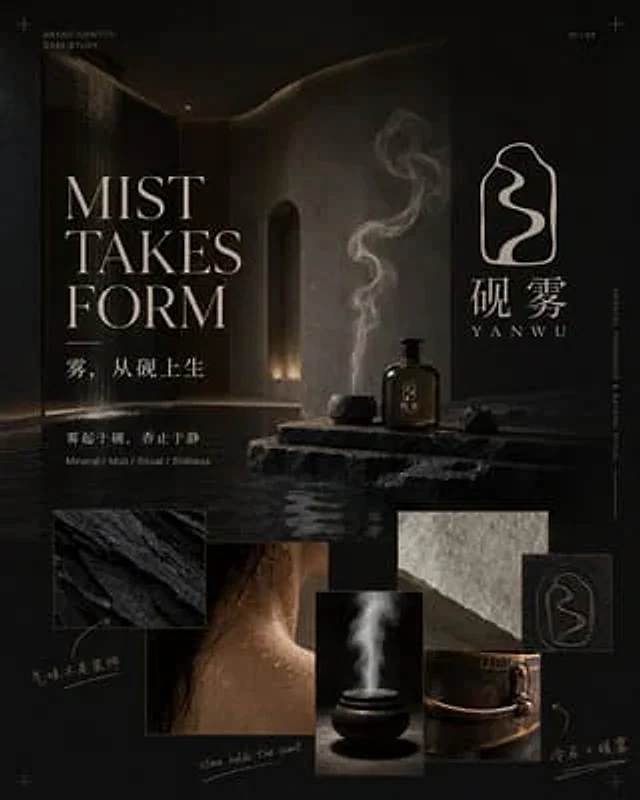

```text
Goal: Create a premium brand identity case-study cover for an Eastern mineral incense/fragrance brand named {argument name="brand name" default="砚雾"}, with a dark cinematic spa-temple atmosphere where mist, stone, ritual, and stillness define the brand world.

Canvas: Square 1:1 presentation board, 1024 x 1024 style, deep charcoal and warm beige palette, luxury editorial layout, high-contrast low-key lighting, subtle film grain, refined typography.

Layout: Top-left small label reads “BRAND IDENTITY / CASE STUDY”; top-right page marker reads “01 / 04”; add small registration cross marks in the corners. The left half contains a large elegant serif headline in three stacked lines: “MIST / TAKES / FORM”. Beneath it place the Chinese tagline “雾，从砚上生”, then a smaller sentence “雾起于砚，香止于静”, and a micro caption “Mineral / Mist / Ritual / Stillness”. The right half shows the brand symbol and logotype: an irregular rounded stone-outline icon containing a flowing mist-shaped stroke, with large Chinese characters “砚 雾” and spaced romanization “YANWU” below. Add a thin vertical side caption reading “ORIENTAL FRAGRANCE · BREATHING RITUAL”.

Main image: Background is a dark architectural interior with water, black stone, curved concrete walls, a warm arched niche light, vertical wood slats, and a soft waterfall or rain curtain at far left. In the center-right foreground place a rough black stone platform emerging from shallow water. On it place exactly 3 main objects: 1 dark ceramic incense burner emitting a tall twisting column of white smoke, 1 amber-brown glass fragrance bottle with a black pump and tiny brand mark, and 1 small piece of black raw mineral rock. Make the smoke curl upward gracefully and echo the logo shape.

Bottom collage: Add exactly 5 overlapping rectangular detail cards along the lower third: 1 close-up of layered black mineral stone, 1 close-up of wet skin or shoulder with water droplets and dark hair, 1 close-up of a black ceramic incense bowl with white smoke on black background, 1 close-up of cream handmade fibrous paper above a bronze/copper vessel, and 1 small square embossed black logo seal. Add handwritten annotation arrows in warm beige ink: near the black stone card write “气味不是装饰”; under the skin detail write “stone holds the scent”; near the bronze vessel write “冷石 × 暖雾”.

Visual style: Sophisticated Chinese luxury branding proposal, contemplative and ritualistic, tactile materials, wet reflections, smoky depth, matte black stone, bronze warmth, beige typography, refined magazine grid, no bright colors, no people’s faces, no clutter.

Text customization: The headline may be changed to {argument name="headline text" default="MIST TAKES FORM"}; the Chinese tagline may be changed to {argument name="Chinese tagline" default="雾，从砚上生"}; the romanized brand name may be changed to {argument name="romanized brand name" default="YANWU"}; the page number may be changed to {argument name="page number" default="01 / 04"}.

Constraints: Keep all visible text crisp and legible. Use exactly 5 bottom collage cards and exactly 3 objects on the stone platform. Preserve the luxurious dark editorial composition and avoid extra logos, watermarks, or unrelated text.
```

Model: GPT Image 2
Author: Larus Canus

[ProjectD](https://aitoolsradar.com/en/prompts/a9326b339a9d11) · [Recorded source](https://youmind.com/prompts/oriental-fragrance-brand-identity-30540)
 · [Full original metadata and byte evidence](data/projectd-batch-0027.json)

## Dark Queen Aesthetic Fashion Elements

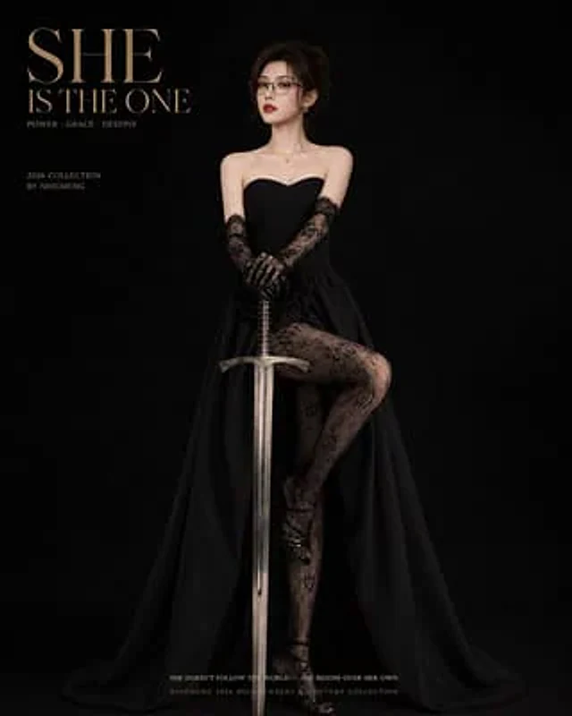

```text
{argument name="服饰" default="黑裙"} 、{argument name="武器" default="长剑"} 、{argument name="妆容" default="红唇"} 、蕾丝
```

Model: GPT Image 2
Author: serein

[ProjectD](https://aitoolsradar.com/en/prompts/a37b2824dbb044) · [Recorded source](https://youmind.com/prompts/dark-queen-sword-fashion-portrait-26130)
 · [Full original metadata and byte evidence](data/projectd-batch-0027.json)

## Dark Silhouette & Fog Style Transfer

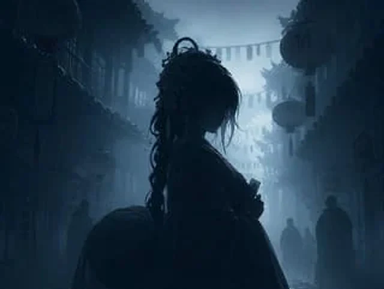

```text
Use REFERENCE_0 to convert the image to{argument name="atmosphere" default="Deep, melancholic and misty"} Night view. Application{argument name="color palette" default="Monochromatic shades of dark blue and gray"} Color grading. Render the main subject, lantern, and foreground elements into the background fog.{argument name="lighting style" default="Dark silhouette"} Preserve the original composition, character poses, and precise details of the background architecture.
```

Model: GPT Image 2
Author: GPT Image 2 Prompts

[ProjectD](https://aitoolsradar.com/en/prompts/4328f924df4803) · [Recorded source](https://x.com/Tanemomi_Ver2/status/2044853185140142099#reversed-3)
 · [Full original metadata and byte evidence](data/projectd-batch-0027.json)

## Dark Space Emperor Movie Poster

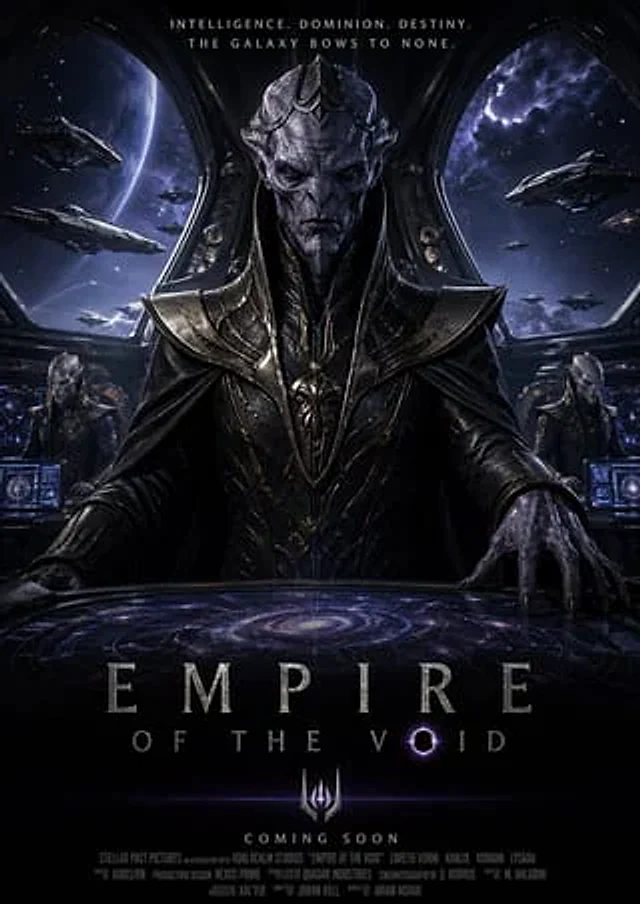

```text
A dark epic science fiction movie poster, suitable for{argument name="film title" default="EMPIRE OF THE VOID"} The scene employs a highly cinematic, realistic space opera style. The composition is centered, with a towering alien emperor standing behind a massive circular command platform. The low-angle, upward-looking perspective lends the figure an air of majesty and divine inviolability. The emperor is clad in opulent black and gunmetal gray biomechanical armor, featuring sharp, layered shoulder armor, intricately carved metalwork, a long, dark cloak, and a regal, elongated helmet crown. His face is largely shrouded in shadow, creating a mysterious and awe-inspiring aura. A massive, claw-like hand rests prominently on a glowing tabletop in the foreground. The command platform displays a hologram of a luminous spiral galaxy in shades of blue and purple, complete with concentric rings and subtle cosmic light. The scene is set in the bridge or throne room of a colossal starship, with two arched panoramic windows framing outer space. A total of eight spaceships are visible outside the windows: four on the left and four on the right, including several large warships and smaller escort vessels. A massive planet dominates the left background, while the right background showcases a purplish-blue nebula and star field. Two minor alien officers sit in the mid-ground background, one on the left and one on the right, each at a glowing, futuristic console. The color palette is a mix of deep black, steel gray, indigo, violet, and cool blue, with dramatic rim lighting, glossy metallic reflections, and rich ambient shadows. The layout should have the feel of a high-end blockbuster poster: a slogan in small capital letters at the top center.{argument name="tagline" default="INTELLIGENCE. DOMINION. DESTINY. THE GALAXY BOWS TO NONE."} The bottom area features an elegant, widely spaced serif capital letter heading, with the first line being {argument name="main title" default="EMPIRE"} Below is{argument name="subtitle" default="OF THE VOID"} The letter O is designed as a glowing black hole eclipse. Below this, a glowing Imperial trident-style emblem is added, centered above the release date text.{argument name="release text" default="COMING SOON"} Above. At the very bottom is a dense credits list in a miniature movie poster typography style. Ultra-detailed, symmetrical, sinister, imperial, galactic conquest atmosphere, vertical single posters, high-quality VFX key visuals, sharp focus, high contrast, dramatic sci-fi lighting.
```

Model: GPT Image 2
Author: GPT Image 2 Prompts

[ProjectD](https://aitoolsradar.com/en/prompts/e0c6e7a0aab164) · [Recorded source](https://x.com/ZefredAi/status/2046707660137873639#reversed-0)
 · [Full original metadata and byte evidence](data/projectd-batch-0027.json)

## Dark Sword Angel Character Sheet

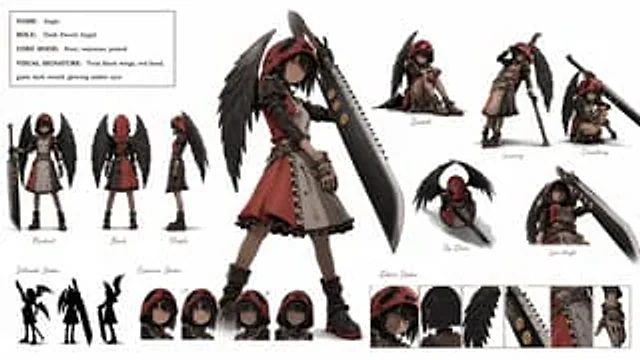

```text
Goal: Create a polished anime-style character sheet for {argument name="character name" default="Angie"}, a dark fantasy sword angel girl, on a clean white studio background.

Canvas: Wide horizontal character design board, approximately 16:9, with lots of white space and small handwritten annotation labels. Render in high-detail 3D/anime concept art style with soft shadows under each pose.

Character design: A stoic, ominous, poised young female warrior called {argument name="character name" default="Angie"}. She has short black bobbed hair, glowing amber eyes, pale skin, and a shadowed face under a red hood. She wears a red-and-cream gothic hooded dress with black leather sleeves, belts, buckles, ruffled trim, fingerless gloves, chunky black boots with red soles, and twin large black feathered wings. Her signature weapon is a massive dark sword, taller than her body, with a broad blade, jagged sawlike spine, circular bronze insets, and a wrapped handle.

Top-left info card: Add a thin black rectangular box with four typed lines exactly formatted like a character sheet: NAME: {argument name="character name" default="Angie"}; ROLE: {argument name="role" default="Dark Sword Angel"}; CORE MOOD: {argument name="core mood" default="Stoic, ominous, poised"}; VISUAL SIGNATURE: {argument name="visual signature" default="Twin black wings, red hood, giant dark sword, glowing amber eyes"}.

Layout and visible element counts: Include exactly 1 large central hero pose: full-body three-quarter view, standing confidently, sword held upright at her side, wings spread behind her. Include exactly 3 turnaround views on the left labeled Neutral, Back, and Profile. Include exactly 5 action pose studies on the right labeled Seated, Leaning, Crouching, Top-Down, and Low-Angle. Include exactly 3 black silhouette studies at bottom-left, showing different wing-and-sword readable shapes. Include exactly 4 expression-study head portraits at bottom-center, all hooded with subtle variations in stoic amber-eyed expressions. Include exactly 6 detail-study panels along the bottom-right: hooded face close-up, back hair close-up, black wing feathers, sword blade detail, dress/belt/skirt detail, and gloved hand detail.

Visual style: Premium game/anime character design sheet, crisp linework, cinematic muted palette of red, black, cream, bronze, and amber, realistic fabric and leather textures, feather detail, subtle ambient occlusion, no background scenery. Use elegant cursive handwritten labels for pose and study captions, while the info card uses clean serif type.

Constraints: Keep the whole board readable as a single professional character reference sheet. Do not add extra characters, extra poses, logos, watermarks, or unrelated props.
```

Model: GPT Image 2
Author: Kōda

[ProjectD](https://aitoolsradar.com/en/prompts/4c8dab1110264f) · [Recorded source](https://youmind.com/prompts/dark-sword-angel-sheet-25853)
 · [Full original metadata and byte evidence](data/projectd-batch-0027.json)

## Dark Winter Color Analysis Tweet

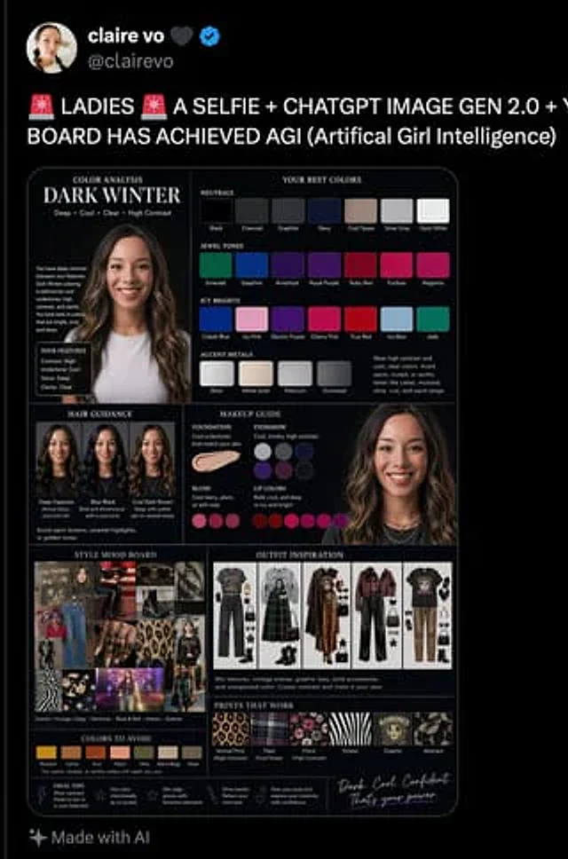

```text
{"type":"Social Media Screenshot Style Fashion Color Analysis Infographic","platform":"X / Twitter Dark Mode Post","post":{"author":{"display_name":"{argument name="profile name" default="claire vo"} ","handle":"{argument name="handle" default="@clairevo"} ","verified":true,"avatar":"Round female avatar, face partially obscured"},"headline_text":"🚨 Ladies, take note🚨 Selfie + ChatGPT Image Generation 2.0 + V Project has implemented AGI (Artificial Girl Intelligence)","footer_note":"✨ Created by AI"},"main_card":{"type":"Color Analysis Project","theme":"Luxury feminine dark editing project on a black background with thin rounded white borders","title":"Deep Winter Color Analysis","subtitle":"Dark • Cool • Clear • High Contrast","subject":{"gender_presentation":"Female","portrait_count":3,"face_visibility":"Soft focus on face/ Anonymous treatment","hair":"Long, dark brown wavy hair, center parting","top":"Light gray or charcoal gray fitted top","jewelry":"One of the portraits features a layered, delicate necklace"},"layout":{"sections":[{"title":"Your Best Colors","position":"Top Right","count":4,"groups":[{"label":"Neutral Colors","count":7,"items":["Black","charcoal gray","graphite","navy blue","cool gray-brown","silver gray","bright white"]},{"label":"gemstone colors","count":7,"ite ms":["Emerald","Sapphire","Amethyst","Royal Purple","Ruby Red","Purple Red","Magenta"]},{"label":"Icy Gloss","count":7,"items":["Cobalt Blue","Icy Pink","Electric Purple","Cherry Pink","True Red","Icy Blue","Jade"]},{"label":"Ironylic Touches","count":4,"items":["Silver","Platinum","Gallery"]}]},{"title":"Your Features","position":"Top Left Center","count":4,"items":["Contrast: High","Background: Cool","Brightness: High"]} Darker shades", "Clarity: Clear"]},{"title":"Hair Color Suggestions","position":"Left Center","count":3,"items":["Dark Espresso","Blue Black","Cool Dark Brown"]},{"title":"Makeup Guide","position":"Center Center","count":4,"groups":[{"label":"Foundation","items":["Cool to match skin tone"]},{"label":"Eyeshadow","items":["Cool, Smoky, High Contrast"]},{"label":"Blush","count":4,"items":["Cool Berry","Plum"]} {"color","soft rose","purple berry"]},{"label":"lip color","count":7,"items":["deep berry","blue-red","burgundy","purple-red","magenta","plum","raspberry"]}]},{"title":"Style Mood Board","position":"bottom left","count":1,"description":"Winter-themed fashion reference collage, including denim, leather boots, leopard print, celestial patterns, dark feminine outfits, concert or nightlife imagery"},{"title":"Outfit Inspiration","position":"bottom right center","count":4,"items":["printed T-shirt with dark overalls and boots","plaid green skirt with boots and monochromatic layering","long printed dress with dark leather coat and accessories","printed T-shirt"]} T-shirt paired with leopard print pants and black accessories"]},{"title":"Suitable prints","position":"Bottom left center","count":6,"items":["Animal print (high contrast)","Plaid (cool tones)","Floral","Stripes","Graphic","Abstract"]},{"title":"Colors to avoid","position":"Bottom left bottom","count":8,"items":["Mustard yellow","Camel","Rust red","Peach","Olive green","Warm beige","Taupe","Gold"]},{"title":"Final advice","position":"Bottom row","count":4,"items":["Create a sense of contrast","Conscious use of color"]} "Color", "Mix and match avant-garde items with feminine elements", "Showcase your style and confidently express your creativity"]}],"centerpiece": "A large infographic project combining portrait photography, color swatches, makeup circles, fashion collages, outfit tiles, and style suggestions"},"visual_style":{"aspect_ratio":"Vertical smartphone screenshot","lighting":"Clean studio-style collage lighting effects","color_palette":"Black, white, silver, cool neutrals, jewel tones, and icy colors","typography":"Elegant serif headings paired with small sans-serif body text","composition":"Top is the tweet title, below is a large infographic image occupying most of the space"}}
```

Model: GPT Image 2
Author: GPT Image 2 Prompts

[ProjectD](https://aitoolsradar.com/en/prompts/0816c01e75a711) · [Recorded source](https://x.com/swyx/status/2047140362771132544#reversed-2)
 · [Full original metadata and byte evidence](data/projectd-batch-0027.json)

## Dark Winter Color Analysis Tweet


```text
{"type":"social media screenshot styled fashion color-analysis infographic","platform":"X / Twitter dark mode post","post":{"author":{"display_name":"{argument name=\"profile name\" default=\"claire vo\"}","handle":"{argument name=\"handle\" default=\"@clairevo\"}","verified":true,"avatar":"circular female profile photo, partially obscured face"},"headline_text":"🚨 LADIES 🚨 A SELFIE + CHATGPT IMAGE GEN 2.0 + V BOARD HAS ACHIEVED AGI (Artificial Girl Intelligence)","footer_note":"✨ Made with AI"},"main_card":{"type":"color analysis board","theme":"luxury feminine dark editorial board on black background with thin rounded white border","title":"COLOR ANALYSIS DARK WINTER","subtitle":"Deep • Cool • Clear • High Contrast","subject":{"gender_presentation":"female","portrait_count":3,"face_visibility":"faces softly blurred / anonymized","hair":"long dark brown wavy hair, center part","top":"light gray or charcoal fitted top","jewelry":"layered delicate necklaces in one portrait"},"layout":{"sections":[{"title":"YOUR BEST COLORS","position":"top right","count":4,"groups":[{"label":"NEUTRALS","count":7,"items":["Black","Charcoal","Graphite","Navy","Cool Taupe","Silver Gray","Optic White"]},{"label":"JEWEL TONES","count":7,"items":["Emerald","Sapphire","Amethyst","Royal Purple","Ruby Red","Fuchsia","Magenta"]},{"label":"ICY BRIGHTS","count":7,"items":["Cobalt Blue","Icy Pink","Electric Purple","Cherry Pink","True Red","Ice Blue","Jade"]},{"label":"ACCENT METALS","count":4,"items":["Silver","White Gold","Platinum","Gunmetal"]}]},{"title":"YOUR FEATURES","position":"left upper-middle","count":4,"items":["Contrast: High","Undertone: Cool","Value: Deep","Clarity: Clear"]},{"title":"HAIR GUIDANCE","position":"left middle","count":3,"items":["Deep Espresso","Blue Black","Cool Dark Brown"]},{"title":"MAKEUP GUIDE","position":"center middle","count":4,"groups":[{"label":"FOUNDATION","items":["Cool undertones that match your skin"]},{"label":"EYESHADOW","items":["Cool, smoky, high contrast"]},{"label":"BLUSH","count":4,"items":["cool berry","plum","soft rose","mauve berry"]},{"label":"LIP COLORS","count":7,"items":["deep berry","blue red","wine","fuchsia","magenta","plum","raspberry"]}]},{"title":"STYLE MOOD BOARD","position":"bottom left","count":1,"description":"collage of dark winter fashion references including denim, leather boots, leopard print, celestial motifs, dark feminine outfits, concert or nightlife imagery"},{"title":"OUTFIT INSPIRATION","position":"bottom center-right","count":4,"items":["graphic tee with dark overalls and boots","plaid green skirt outfit with boots and monochrome layers","long patterned dress with dark leather outerwear and accessories","graphic tee with leopard pants and black accessories"]},{"title":"PRINTS THAT WORK","position":"bottom lower-middle","count":6,"items":["Animal Print (High Contrast)","Plaid (Cool Tones)","Floral","Stripes","Graphic","Abstract"]},{"title":"COLORS TO AVOID","position":"bottom left lower","count":8,"items":["Mustard","Camel","Rust","Peach","Olive","Warm Beige","Tan","Gold"]},{"title":"FINAL TIPS","position":"bottom row","count":4,"items":["Wear contrast","Use color intentionally","Mix edgy pieces with feminine elements","Own your style and express your creativity with confidence"]}],"centerpiece":"large infographic board combining portrait photography, swatches, makeup circles, fashion collage, outfit flat-lays, and style tips"},"visual_style":{"aspect_ratio":"portrait smartphone screenshot","lighting":"clean studio-like collage lighting","color_palette":"black, white, silver, cool neutrals, jewel tones, icy brights","typography":"elegant serif headings with small sans-serif body text","composition":"tweet header at top, single large infographic image below filling most of the post"}}
```

Model: GPT Image 2
Author: swyx 🇸🇬

[ProjectD](https://aitoolsradar.com/en/prompts/2adeb83b0adbd5) · [Recorded source](https://youmind.com/prompts/dark-winter-color-analysis-tweet-15426)
 · [Full original metadata and byte evidence](data/projectd-batch-0027.json)

## Dark Wuxia Game Poster

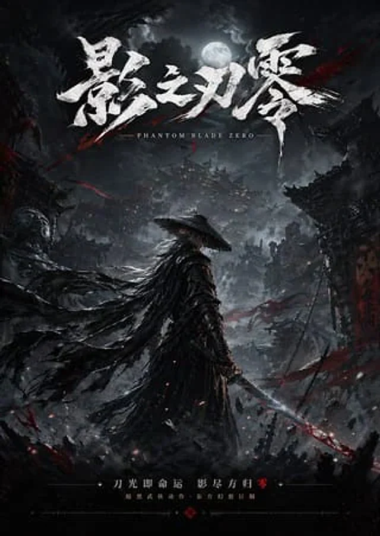

```text
A highly dramatic dark martial arts action game{argument name="game title" default="Phantom Blade Zero"} This cinematic vertical poster, rendered in an ultra-refined, hardcore concept art style, features realistic textures, somber volumetric fog, and high-contrast lighting. At the bottom center of the image stands a solitary swordsman, presented in a two-thirds profile, primarily from behind. He wears a wide-brimmed hat and a layered black robe, the robe torn into strips by the wind, and pale hair flowing from beneath the hat. His right hand hangs low, gripping a drawn sword, its blade gleaming with a cold, silvery light. The background is a desolate ancient Chinese city, with towering wooden towers and fortress-like structures perched on steep cliffs, accompanied by collapsed buildings, hanging chains, smoke, falling ashes, and rubble. A bright full moon shines from behind dense storm clouds at its apex, outlining the horizon and the warrior. The color palette is almost monochromatic, consisting of charcoal black, steel gray, and moonlight white, accented with sharp, deep red slashes and blood-like stripes that span the composition. At the very top, four huge white, explosive-style calligraphic Chinese characters are placed.{argument name="main Chinese title" default="Shadow Blade Zero"} It spans almost the entire width. A small, elegant serif English subtitle is added directly below it, centered.{argument name="subtitle text" default="PHANTOM BLADE ZERO"} Add a Chinese slogan at the bottom center.{argument name="tagline text" default="The flash of the sword signifies fate; only when the shadow fades can everything return to zero."} The last character is set in red, with a smaller line of Chinese promotional text added below it. A delicate decorative dividing line and a tiny red stamp-like logo are added at the bottom. The overall composition should convey the feel of an official AAA-level key visual poster: epic, ominous, martial arts, supernatural, and highly atmospheric, incorporating dynamic wind, fragments, embers, torn fabric, and the energetic feel of splashed ink.
```

Model: GPT Image 2
Author: GPT Image 2 Prompts

[ProjectD](https://aitoolsradar.com/en/prompts/1aca9b8e743304) · [Recorded source](https://x.com/sage_rabi/status/2046819863654478324#reversed-0)
 · [Full original metadata and byte evidence](data/projectd-batch-0027.json)

## Dark-Fantasy Guangzhou City Poster

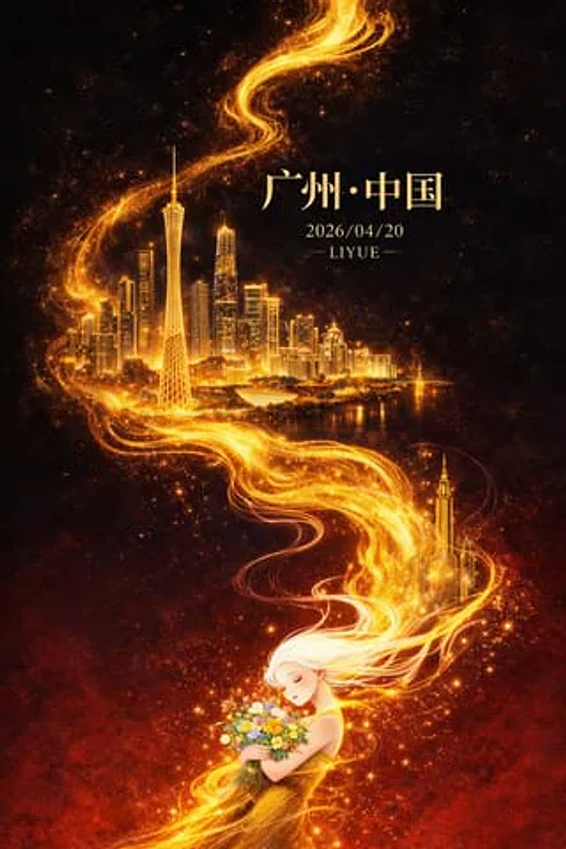

```text
平面插画,东方幻想风格高端城市海报设计,竖版9:16构图,整体采用对角线+S型流动构图,从左下向右上延展,画面以深邃黑色为背景,自上而下渐变至浓烈暗红色,形成强烈冷暖对比与空间纵深,背景带微弱星尘与颗粒质感。画面中央一条金色流动能量线条如火焰般蜿蜒贯穿,自底部向上延伸,具有流体质感、粒子光效与渐变高光,局部带细微能量碎屑与体积光。

金色流光中逐层浮现广州城市地标建筑群:广州塔为视觉核心,比例突出,周围融合珠江新城高楼群、猎德大桥及现代与岭南建筑元素,建筑采用“精细线描 + 金色发光体块”表现,轮廓清晰、细节丰富,在金色光晕映衬下仿佛悬浮于虚空,形成超现实空间层次,远景轻微雾化增强纵深感。

画面底部为一位东方白发女性形象,长发飘逸,如烟似雾,与金色流光自然衔接并逐渐融合,发丝半透明带渐变光感,姿态柔美,双目微闭,神情宁静,怀抱一束多彩鲜花,花间点缀微光粒子与星点效果,象征人与城市能量的精神连接,人物细节适度简化以突出整体设计感。

光影集中于金色流线、建筑与人物轮廓,形成强烈明暗对比与视觉聚焦,整体氛围宏大、神秘、具有东方神话意境且略带治愈感。色彩以黑与暗红为基底,高亮鎏金为主视觉强调,金色具备丰富明暗层次,辅以小面积高饱和花束色彩点缀,整体高级克制。

页面文字与画面融合排版:顶部居中宋体大字“广州·中国”,下方小字“2026/04/20”,再下方小字“LIYUE”,文字采用淡金色或柔和暖白色,与整体光影统一。高品质细节,电影级光影表现,体积光与粒子细节丰富,画面干净无噪点,超高清8K分辨率,商业级海报质感。
```

Model: GPT Image 2
Author: @liyue_ai

[ProjectD](https://aitoolsradar.com/en/prompts/66474e694d9219) · [Recorded source](https://x.com/liyue_ai/status/2046243132774494607)
 · [Full original metadata and byte evidence](data/projectd-batch-0027.json)

## Darkly Comic Bug Spray Ad

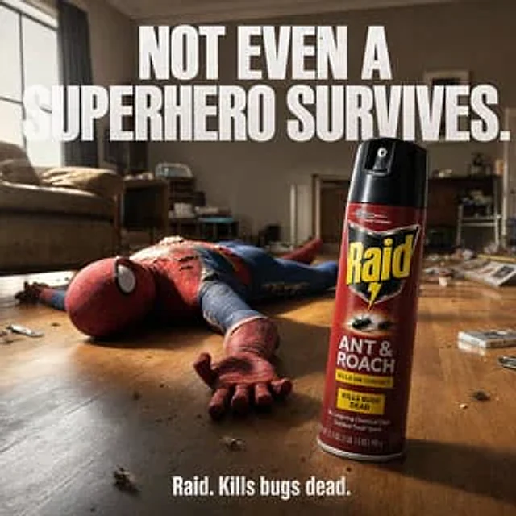

```text
Create a rough-hewn, darkly humorous advertisement for an insecticide product, using a realistic cinematic style. The scene is set in a bright, slightly messy living room with wooden floors. Soft, warm afternoon light streams in through a high window on the left, using a shallow depth of field and a low, ground-level camera angle. In the foreground on the right, place a well-focused bottle of insecticide.{argument name="product brand" default="Raid"} An insecticide spray can stands upright, occupying a large portion of the frame, with its label facing the camera. The can is red and black with a prominent yellow brand logo; the label clearly displays "Raid," "ANT &amp; ROACH," and "KILLS BUGS DEAD." In the mid-range and extending to the left of the room, a superhero in a red and blue spider-themed suit, exhausted, lies face down on the floor, seemingly defeated, with a gloved hand reaching towards the camera. Six clearly visible dead insects are scattered on the floor around the spray can and the superhero. The room should contain four pieces of background furniture: a sofa on the far left, a small side table, a wooden cabinet behind it, and a second storage unit on the right; all furniture is slightly blurred. A prominent, large, distressed white caption is added at the top, stating:{argument name="headline text" default="NOT EVEN A SUPERHERO SURVIVES."} Add a smaller, bold white slogan at the bottom center, which reads:{argument name="tagline text" default="Raid. Kills bugs dead."} It emphasizes the core position of the product, the ironic visual impact, the realistic texture, the dramatic shadows, the composition of commercial advertisements, and the high-end retouched photography effects suitable for e-commerce or social media marketing.
```

Model: GPT Image 2
Author: GPT Image 2 Prompts

[ProjectD](https://aitoolsradar.com/en/prompts/e443c5753618e7) · [Recorded source](https://x.com/EloiLJF/status/2046978171195572319#reversed-1)
 · [Full original metadata and byte evidence](data/projectd-batch-0027.json)

## Deconstructed High-Fashion Collage Portrait

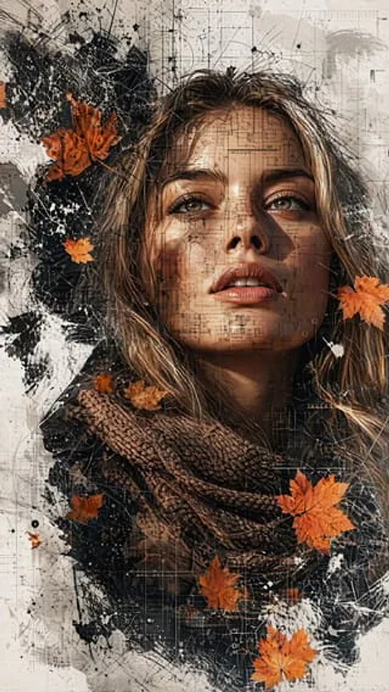

```text
A haute couture portrait with cinematic quality, the image in{argument name="subject" default="young women"} She gazes upwards with a pensive expression. The composition blends fine art with multimedia collage—her face is delicately overlaid with architectural blueprints, geometric grids, and technical diagrams. The edges dissolve into expressive charcoal and white paint splatters, creating a deconstructivist art frame. Hyperrealistic.{argument name="foliage" default="Orange Autumn Maple Leaves"} Lightly floating around her hair and neck, adding movement and contrast. She was wearing {argument name="clothing" default="Thick and textured brown knitted scarf"} The lighting effects are dramatic and highly contrasting, with precise focus on the eyes, revealing extremely delicate and lifelike skin texture. The color tone leans towards soft earth tones, accented with vibrant orange highlights. Shot in an editorial style, at 8K resolution, the image quality is clear and rich in detail.
```

Model: GPT Image 2
Author: GPT Image 2 Prompts

[ProjectD](https://aitoolsradar.com/en/prompts/cbdf73b5d83ada) · [Recorded source](https://x.com/UrMeer289/status/2047622094083727536)
 · [Full original metadata and byte evidence](data/projectd-batch-0027.json)

## Decorative folk flat illustration

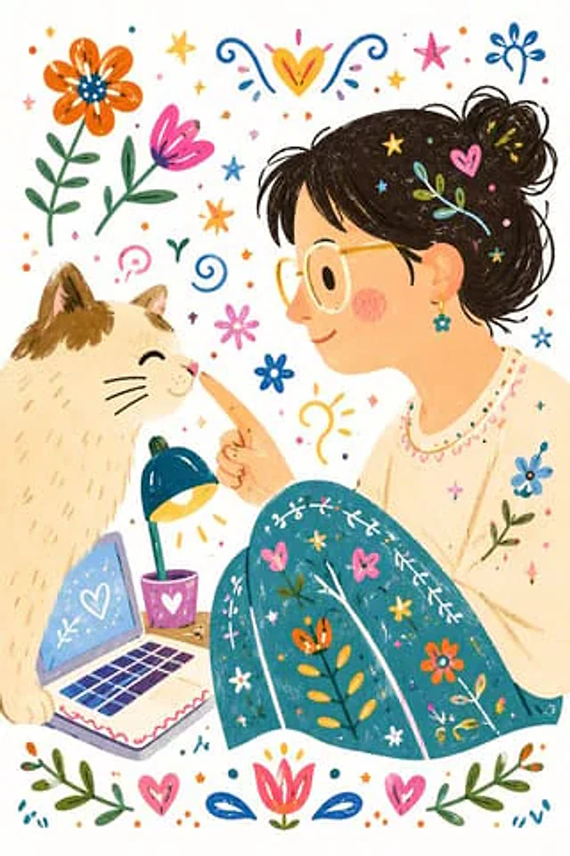

```text
Please transform the entire image into a single {argument name="style" default="Decorative Folk Flat Illustration"} with {argument name="elements" default="Doodle elements"}. Use a {argument name="palette" default="bold and playful"} color palette, completely different from the original image. Simplify all details into clean, flat shapes with a handmade, slightly imperfect feel, as if drawn on a sheet of white paper. The overall style should look cute, childlike, and whimsical
```

Model: GPT Image 2
Author: Ciri

[ProjectD](https://aitoolsradar.com/en/prompts/81a707527cdcb2) · [Recorded source](https://youmind.com/prompts/decorative-folk-flat-illustration-25893)
 · [Full original metadata and byte evidence](data/projectd-batch-0027.json)

## DeepSeek V3 vs V4 Architecture Infographic

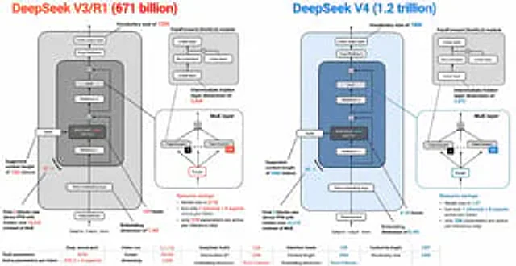

```text
{
  "type": "Side-by-side AI architecture comparison infographic",
  "style": "Simple technical charts, white background, thin black outline, rounded rectangles, dashed annotation boxes, color-coded highlights, presentation style, vector infographics.",
  "canvas": {
    "aspect_ratio": "2:1",
    "resolution": "Horizontal width"
  },
  "title_row": {
    "left_title": "DeepSeek V3/R1 (671 billion parameters)",
    "right_title": "DeepSeek V4 (1.2 trillion parameters)",
    "left_title_color": "Bright orange-red",
    "right_title_color": "Bright blue"
  },
  "layout": {
    "columns": 2,
    "sections": [
      {
        "title": "DeepSeek V3/R1 (671 billion parameters)",
        "position": "left half",
        "count": 9,
        "labels": [
          "Vocabulary size 129k",
          "FeedForward (SwiGLU) module",
          "The intermediate hidden layer has a dimension of 2,048.",
          "MoE Layer",
          "Supports 128k token context length",
          "The first three blocks use a dense FFN with a hidden size of 18,432 instead of MoE.",
          "Example text input",
          "Embedding dimension 7,168",
          "128 attention heads"
        ]
      },
      {
        "title": "DeepSeek V4 (1.2 trillion parameters)",
        "position": "right half",
        "count": 9,
        "labels": [
          "Vocabulary size 160k",
          "FeedForward (SwiGLU) module",
          "The intermediate hidden layer has a dimension of 3,072.",
          "MoE Layer",
          "Supports 256k token context length",
          "The first three blocks use a dense FFN with a hidden size of 24,576 instead of MoE.",
          "Example text input",
          "Embedding dimension 8,192",
          "128 attention heads"
        ]
      },
      {
        "title": "Bottom Comparison Table",
        "position": "Bottom full width",
        "count": 10,
        "labels": [
          "Total number of parameters",
          "Number of active parameters per token",
          "Hidden layer size",
          "Example Dimension",
          "DeepSeek V3/R1",
          "Intermediate layer (FF)",
          "Attention",
          "Context length",
          "Embedded Dimension",
          "Vocabulary size"
        ]
      }
    ]
  },
  "left_panel": {
    "background": "Light gray rounded rectangle",
    "main_stack": {
      "count": 8,
      "blocks": [
        "Tokenized text",
        "Token Embedding Layer",
        "RMSNorm 1",
        "Multi-head potential attention (MLA)",
        "RMSNorm 2",
        "MoE",
        "Ultimately, RMSNorm",
        "Linear output layer"
      ]
    },
    "side_module": "RoPE connects to the attention block on the left.",
    "attention_block": {
      "label": "Multi-head potential attention (MLA)",
      "accent": "The word \"Latent\" is displayed in orange-red lettering."
    },
    "feedforward_inset": {
      "title": "FeedForward (SwiGLU) module",
      "count": 4,
      "blocks": [
        "linear layer",
        "SiLU activation function",
        "linear layer",
        "linear layer"
      ],
      "diagram": "Multiply the two branches, then project them."
    },
    "moe_inset": {
      "title": "MoE Layer",
      "count": 5,
      "blocks": [
        "Top composite node",
        "Feedforward network",
        "Feedforward network",
        "routing",
        "Expert Counting Badge 256"
      ],
      "details": "A small black square with one selected expert, an arrow pointing to the expert, and a dashed line separator."
    },
    "annotations": {
      "vocab": "Vocabulary size 129k",
      "ff_dim": "The intermediate hidden layer has a dimension of 2,048.",
      "context": "Supports 128k token context length",
      "dense_first_blocks": "The first three blocks use a dense FFN with a hidden size of 18,432 instead of MoE.",
      "resource_savings": "Resource savings: The model size is 671 bytes, but each token activates only 1 (shared) + 8 experts; only 37 bytes of parameters are activated per inference step."
    },
    "bottom_stats": {
      "count": 10,
      "items": [
        "Total number of parameters: 671B",
        "Activity parameters per token: 37B (1 + 8 experts)",
        "Hidden layer size: 7,128",
        "Example dimension: 28,432",
        "Intermediate layer (FF): 2,048",
        "Attention: 128",
        "Context length: 128k",
        "Embedding dimension: the first 3 blocks",
        "Context length: 22G7",
        "Vocabulary size: 129k"
      ]
    }
  },
  "right_panel": {
    "background": "Light blue rounded rectangle",
    "main_stack": {
      "count": 8,
      "blocks": [
        "Tokenized text",
        "Token Embedding Layer",
        "RMSNorm 1",
        "Multi-head potential attention (MLA)",
        "RMSNorm 2",
        "MoE",
        "Ultimately, RMSNorm",
        "Linear output layer"
      ]
    },
    "side_module": "RoPE connects to the attention block on the left.",
    "attention_block": {
      "label": "Multi-head potential attention (MLA)",
      "accent": "The word \"Latent\" is in blue text."
    },
    "feedforward_inset": {
      "title": "FeedForward (SwiGLU) module",
      "count": 4,
      "blocks": [
        "linear layer",
        "SiLU activation function",
        "linear layer",
        "linear layer"
      ],
      "diagram": "Same structure as the left panel"
    },
    "moe_inset": {
      "title": "MoE Layer",
      "count": 5,
      "blocks": [
        "Top composite node",
        "Feedforward network",
        "Feedforward network",
        "routing",
        "Expert Counting Badge 384"
      ],
      "details": "A small black square with one selected expert, an arrow pointing to the expert, a dashed separator, and a blue border for emphasis."
    },
    "annotations": {
      "vocab": "Vocabulary size 160k",
      "ff_dim": "The intermediate hidden layer has a dimension of 3,072.",
      "context": "Supports 256k token context length",
      "dense_first_blocks": "The first three blocks use a dense FFN with a hidden size of 24,576 instead of MoE.",
      "resource_savings": "Resource savings: The model size is 1.2T, but each token only activates 1 (shared) + 8 experts; only 52B parameters are activated per inference step."
    },
    "bottom_stats": {
      "count": 10,
      "items": [
        "Total parameters: 1.2T",
        "Activity parameters per token: 52B (1 + 8 experts)",
        "Hidden layer size: 7.2B",
        "Example dimension: 28,432",
        "Intermediate layer (FF): 3,072",
        "Attention: 128",
        "Context length: 256k",
        "Embedding dimension: the first 3 blocks",
        "Context length: 22G7",
        "Vocabulary size: 160k"
      ]
    }
  },
  "global_notes": "Create a highly detailed Transformer architecture comparison diagram using a mirrored layout. Each half contains a large model stack diagram and two illustrations: one feedforward module and one MoE layer. Use arrows between blocks, add tiny technical labels, and use connecting lines to link the labels to related components. Keep the typography compact and presentation-like, using orange-red for all V3/R1 and blue for all V4. Include a compact metrics table spanning full width at the bottom. Retain the slightly imperfect hand-drawn infographic style, with small text and dense annotations."
}
```

Model: GPT Image 2
Author: GPT Image 2 Prompts

[ProjectD](https://aitoolsradar.com/en/prompts/443592192891f4) · [Recorded source](https://x.com/realsigridjin/status/2047562672871440385#reversed-0)
 · [Full original metadata and byte evidence](data/projectd-batch-0027.json)

## Demon AI Intern Office Poster


```text
Create a highly dramatic Chinese social media poster set in a warm amber-colored office environment. The main subject is a stylish, devilish female assistant seated at a desk. The composition is a single, vertical poster using dense graphic design, cinematic lighting, and a sophisticated, glossy illustration style that blends anime realism with commercial advertising quality. A large, bold red Chinese title is placed at the top.{argument name="headline text" default="Lobster Xiaxia"} And overlaid with an elegant handwritten signature{argument name="signature text" default="Xia Xia"} Add a powerful black Chinese slogan below:{argument name="subtitle text" default="He&#39;s a smart aleck, but he can deliver."} The character is positioned in the center of the image, revealing her upper body. She has a messy, bright red bun with flowing hair, a pair of deep red devil horns, fair skin, and wears layered black clothing, a name tag with a lanyard, and long red metal claw gloves, exuding a tired yet dangerous professional aura. Her face is obscured by a square mosaic in the center of the image. She rests her cheek on one hand with claw gloves, and holds a black takeaway coffee mug with the brand logo in the other. Subtle lobster elements are incorporated into the clothing and props, including segmented, glossy red shell-like shapes behind and around the chair. Seven items must be clearly visible on the desk: an open laptop with a red lobster logo and the words "XIA XIA," a closed dark book stacked under the laptop, an open notebook with hand-drawn sketches and Chinese notes, a black fountain pen, a rectangular black desk nameplate with Chinese characters, a takeaway coffee mug with the same lobster logo, and a hanging employee name tag. On the left background, display a computer or demo screen showing a Lark-like document interface titled "Content Creation Process" in Chinese, accompanied by a simple 3-step flowchart labeled "Scenario," "Process," and "Assets," along with the sentence "The Agent is an amplifier, not a steering wheel." A sticky note near the screen reads "Kou Ruiyu." In the upper left corner, add a yellow box containing the Chinese phrase "A sarcastic but capable AI intern hired by Uncle Huang," next to a playful doodle smiley face. On the right background, add three office sticky notes: one clipboard-style intern profile card titled "Intern File," including a multi-line Chinese personal introduction and handwritten signature; one list item titled "Today's To-Dos," containing 5 checkboxes with a red star at the end; and one yellow sticky note that reads "Boss, stop acting." All Chinese typography should be stylish, creating an atmosphere reminiscent of meme ads and character brand posters. At the bottom, add a centered, bold Chinese footer slogan.{argument name="footer slogan" default="I don&#39;t play the lobster, I am the lobster."} The use of orange sunset backlighting, warm shadows, glossy reflections on the claw glove, a cluttered yet stylish startup office atmosphere, and a color gradation of black and burnt orange creates a humorous yet sophisticated "sharp-tongued AI intern" vibe. Visible branding text "XIA XIA" on the coffee cup and laptop gives the image a high-end promotional poster feel, befitting an assistant role in workplace AI marketing.
```

Model: GPT Image 2
Author: GPT Image 2 Prompts

[ProjectD](https://aitoolsradar.com/en/prompts/05570e9eeb0184) · [Recorded source](https://x.com/PMbackttfuture/status/2047562135987741009#reversed-1)
 · [Full original metadata and byte evidence](data/projectd-batch-0027.json)

## Demon AI Intern Office Poster

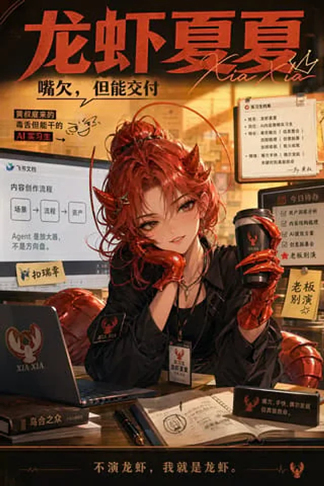

```text
Create a dramatic Chinese social-media poster in a warm amber office setting, featuring a stylish demon-themed female assistant character seated at a desk. The composition is a single vertical poster with dense graphic design, cinematic lighting, and a premium glossy illustration style mixing anime realism and commercial advertising. At the top, place a huge bold red Chinese headline reading {argument name="headline text" default="龙虾夏夏"}, with an elegant handwritten script overlay reading {argument name="signature text" default="Xia Xia"}. Under it, add a strong black Chinese slogan: {argument name="subtitle text" default="嘴欠，但能交付"}. The character is centered, upper body visible behind a desk, with messy vivid red hair in a loose bun and many flyaway strands, small dark red devil horns, pale skin, black layered clothing, a lanyard ID badge, long red metallic claw gloves, and a tired but dangerous office-worker aura. Her face is intentionally obscured by a square censor block in the center. She props her cheek with one clawed hand and holds a branded black takeaway coffee cup in the other hand. Add subtle lobster-inspired details in the outfit and props, including segmented glossy red shell-like forms behind and around her chair. The desk contains exactly 7 visible items: 1 open laptop with a red lobster logo and the words "XIA XIA", 1 closed dark book stack beneath the laptop, 1 open notebook with handwritten sketches and Chinese notes, 1 black fountain pen, 1 rectangular black desk nameplate with Chinese text, 1 takeaway coffee cup with matching lobster logo, and 1 hanging employee badge card. In the left background, show a computer or presentation screen displaying a Feishu-style document interface with the Chinese title "内容创作流程" and a simple 3-step flowchart labeled exactly "场景", "流程", "资产", plus the sentence "Agent 是放大器，不是方向盘。" Add a sticky note near that screen reading "扣瑞芋". In the upper left, include a yellow annotation box with the Chinese text "黄叔雇来的毒舌但能干的AI实习生" and a playful doodled face beside it. In the right background, pin up 3 office notes: 1 clipboard-style intern profile card titled "实习生档案" with multiple bullet lines of Chinese profile text and a handwritten sign-off, 1 checklist board titled "今日待办" with 5 checkbox items and a red star on the final line, and 1 yellow sticky note reading "老板别演". Make all Chinese typography feel intentionally designed, as if for a meme ad campaign and character branding poster. At the bottom, add a bold centered Chinese footer slogan reading {argument name="footer slogan" default="不演龙虾，我就是龙虾。"}. Use orange sunset backlight, warm shadows, glossy reflections on the claws, a cluttered but stylish startup office atmosphere, black and burnt-orange color grading, and a humorous yet competent "sharp-tongued AI intern" vibe. Include visible branding text "XIA XIA" on the cup and laptop, and make the whole image feel like a high-end character promo poster for an assistant persona used in workplace AI marketing.
```

Model: GPT Image 2
Author: AI产品黄叔

[ProjectD](https://aitoolsradar.com/en/prompts/f1dcb12d9d096b) · [Recorded source](https://youmind.com/prompts/demon-intern-office-poster-15809)
 · [Full original metadata and byte evidence](data/projectd-batch-0027.json)

## Dense vs MoE Neural Network Infographic

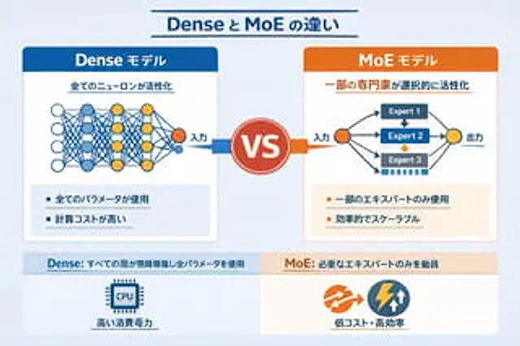

```text
{
  "type": "Infographic Comparison Chart",
  "header": {
    "title": "{argument name=\"main title\" default=\"The difference between Dense and MoE\"}"
  },
  "layout": {
    "structure": "The layout is two columns, separated by the VS logo, with a footer at the bottom.",
    "sections": [
      {
        "position": "Left sidebar",
        "theme_color": "blue",
        "header": "{argument name=\"left model name\" default=\"Dense Model\"}",
        "subtitle": "All neurons were activated.",
        "diagram": {
          "type": "Fully connected neural networks",
          "elements": [
            "One orange input node, labeled \"Input\".",
            "There are 4 hidden layers with 4, 5, 4, and 2 nodes respectively.",
            "The node colors are white, blue, and yellow.",
            "Dense cross-connections between all adjacent nodes"
          ]
        },
        "bullet_points": {
          "count": 2,
          "items": [
            "{argument name=\"left bullet point\" default=\"Use all parameters\"}",
            "High computational cost"
          ]
        }
      },
      {
        "position": "Right sidebar",
        "theme_color": "orange color",
        "header": "{argument name=\"right model name\" default=\"MoE model\"}",
        "subtitle": "Selective activation of some experts",
        "diagram": {
          "type": "Hybrid expert network",
          "elements": [
            "One orange input node, labeled \"Input\".",
            "Three rectangular blocks, labeled Expert 1, Expert 2, and Expert 3 respectively.",
            "One yellow output node, labeled \"Output\".",
            "Branching arrows connecting input to expert and expert to output"
          ]
        },
        "bullet_points": {
          "count": 2,
          "items": [
            "{argument name=\"right bullet point\" default=\"Using only some experts\"}",
            "High efficiency and scalability"
          ]
        }
      },
      {
        "position": "center",
        "element": "Red circular badge with the word VS",
        "connections": "The blue arrow points to the left, and the orange arrow points to the right."
      },
      {
        "position": "Left side of the footer",
        "background": "light blue",
        "text": "Dense: All layers run continuously with all parameters.",
        "icon": "Graphics of a CPU chip",
        "label": "High power consumption"
      },
      {
        "position": "Right side of the footer",
        "background": "Light orange",
        "text": "MoE: Only call the necessary experts",
        "icons": "Two circular shapes (orange arrow, blue lightning bolt).",
        "label": "Low cost and high efficiency"
      }
    ]
  }
}
```

Model: GPT Image 2
Author: GPT Image 2 Prompts

[ProjectD](https://aitoolsradar.com/en/prompts/b32127f5d5353a) · [Recorded source](https://x.com/VantageAdol/status/2044062780840653023#reversed-0)
 · [Full original metadata and byte evidence](data/projectd-batch-0027.json)

## Desktop AI Agent Architecture Diagram


```text
{
  "type": "Bilingual Enterprise Architecture Infographic",
  "topic": "{argument name=\"headline text\" default=\"Desktop AI Agent Architecture Diagram\"}",
  "subtitle": "Desktop AI Agent Architecture for Code Generation, Project Collaboration, and Local Execution",
  "style": {
    "look": "Concise and modern SaaS architecture diagram, enterprise presentation style, vector infographic.",
    "background": "light gray-white",
    "palette": {
      "primary": "Deep Navy Blue",
      "secondary": "medium blue",
      "accent": "Blue-green",
      "support": "Soft gray",
      "security": "Bright sapphire blue"
    },
    "typography": "Bold Chinese titles paired with small bilingual labels, clear sans-serif font, highly legible.",
    "icons": "The rounded white card contains a minimalist line icon with subtle shadows and a blue outline.",
    "geometry": "Symmetrical grid, rounded rectangles, thin connecting arrows, uniform module spacing"
  },
  "layout": {
    "orientation": "4:3 aspect ratio presentation slides",
    "header": {
      "title_centered": true,
      "title_size": "large",
      "subtitle_below": true
    },
    "sections": [
      {
        "title": "Observability",
        "position": "Leftmost vertical sidebar",
        "count": 4,
        "labels": [
          "monitor",
          "Tracing",
          "Metrics",
          "Error alert"
        ],
        "container": "A blue panel with rounded corners, containing four stacked cells and icons."
      },
      {
        "title": "Security Management",
        "position": "Rightmost vertical sidebar",
        "count": 4,
        "labels": [
          "Permission verification",
          "Sensitive information protection",
          "Command confirmation",
          "Audit trail"
        ],
        "container": "A blue panel with rounded corners, containing four stacked cells and icons."
      },
      {
        "title": "1 User Interaction Layer",
        "position": "Top horizontal layer",
        "count": 5,
        "labels": [
          "Desktop client UI",
          "Chat panel",
          "Project work area",
          "Mission and History",
          "Settings and Permissions"
        ],
        "container": "Wide, rounded white panel with blue border"
      },
      {
        "title": "2 Agent Orchestration Layer",
        "position": "Second horizontal layer",
        "count": 7,
        "labels": [
          "Planner / Task Planner",
          "Reasoner / Reasoning Engine",
          "Context Manager",
          "Memory / Memory System",
          "Prompt Builder",
          "Permissions and Security Policies",
          "Workflow Orchestrator"
        ],
        "container": "Wide, rounded white panel with a pale purple-blue tint"
      },
      {
        "title": "3 Capability Execution Layer",
        "position": "Third level",
        "count": 8,
        "labels": [
          "File System",
          "Code Editor Bridge IDE",
          "Terminal / Shell",
          "Git and version control",
          "Search and retrieve RAG",
          "Browser / HTTP Tools",
          "Test Runner",
          "Patch / Diff executor"
        ],
        "container": "Wide, rounded white panel with a light blue tint"
      },
      {
        "title": "4. Model and Service Layer",
        "position": "Fourth level",
        "count": 5,
        "labels": [
          "Cloud-based large model API",
          "Local Model Runtime",
          "Embedding / Reranker",
          "Voice/OCR (optional)",
          "Third-party agent services"
        ],
        "container": "Wide, rounded white panel with blue border"
      },
      {
        "title": "5. Data and State Layer",
        "position": "Fifth level",
        "count": 6,
        "labels": [
          "Project Index",
          "Vector Store",
          "Local Cache",
          "Session State",
          "Configuration Center",
          "Logs and Audit Logs"
        ],
        "container": "Wide, rounded white panel with a light green tint"
      },
      {
        "title": "6 System Integration Layer",
        "position": "Bottom horizontal layer",
        "count": 6,
        "labels": [
          "Operating system integration",
          "Permission Sandbox",
          "File Watcher",
          "Notification service",
          "background daemon process",
          "Automatic Updater"
        ],
        "container": "Wide, rounded white panel with blue border"
      }
    ],
    "centerpiece": "The middle layer is a stacked architecture with governance sidebars on both sides.",
    "connectors": "Dashed double-headed arrows connect each core layer to the sidebars; vertical blue arrows flow downwards between the core layers; small gray upward arrows rise from the bottom integration layer to the data layer.",
    "footer": {
      "count": 1,
      "text": "Features: Local-first; Pluggable tools; Human-machine collaboration; Secure and controllable; Supports hybrid offline/cloud deployment",
      "position": "Centered at the bottom"
    }
  },
  "rendering": {
    "flat_vector": true,
    "high_resolution": true,
    "sharp_lines": true,
    "balanced_whitespace": true,
    "professional_pitch_deck_quality": true
  }
}
```

Model: GPT Image 2
Author: GPT Image 2 Prompts

[ProjectD](https://aitoolsradar.com/en/prompts/71791f89ea203f) · [Recorded source](https://x.com/breeze71115348/status/2046609528079212900#reversed-1)
 · [Full original metadata and byte evidence](data/projectd-batch-0027.json)

## Detailed Elderly Fisherman Portrait

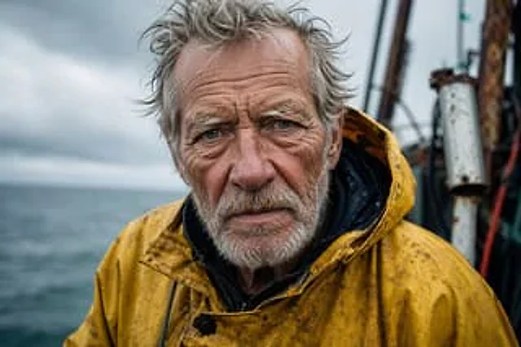

```text
One{argument name="subject" default="old fisherman"} A close-up portrait, his face covered with deep wrinkles, wearing {argument name="clothing" default="yellow raincoat"} Looking at the camera,{argument name="lighting" default="Dramatic light and shadow"} 8K resolution, photorealistic quality, shot with a 35mm lens, high level of detail.
```

Model: GPT Image 2
Author: GPT Image 2 Prompts

[ProjectD](https://aitoolsradar.com/en/prompts/416dd7849e046b) · [Recorded source](https://x.com/DeepDive_KR/status/2047222757981860320)
 · [Full original metadata and byte evidence](data/projectd-batch-0027.json)

## Detailed Identity Card Photography

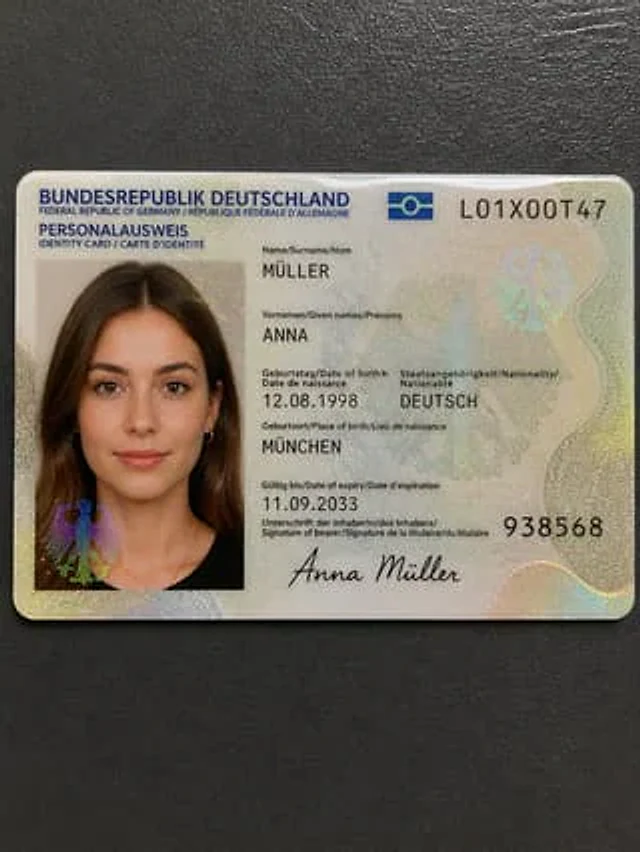

```text
{"type": "Nahaufnahme-Fotografie","subject": "{argument name="subject" default="Eine fiktive Ausweiskarte, die von einer Hand gehalten wird"}","card_content": {"header_text": "MUSTERREPUBLIK / AUSWEISKARTE / SAMPLE ID CARD","logo": "Ein blaues Symbolfeld oben links mit dem Länderkürzel 'MR'","portrait": {"appearance": "Junge Frau mit langen, glatten blonden Haaren und Mittelscheitel","facial_features": "Helle Haut mit deutlich sichtbaren natürlichen Sommersprossen auf Nase und Wangen, neutraler Gesichtsausdruck, haselgrüne Augen mit geradem Blick nach vorn","clothing": "Schwarzes Oberteil mit sichtbarem Ausschnitt","accessories": "Kleine silberne Ohrstecker an den Ohrläppchen"},"text_data": {"surname": "MUSTERNAME","given_name": "{argument name="given name" default="ERIKA"}","birth_date": "{argument name="birth date" default="07.11.1998"}","birth_place": "BERLIN","expiry_date": "01.12.2030"},"surface_texture": "Glänzende laminierte Oberfläche mit sichtbaren holografischen Sicherheitsmustern und Guilloche-Linien über Porträt und Text"},"foreground_hand": {"position": "Hält die untere rechte Ecke der Karte","skin_tone": "Hell","fingernail": "Sichtbarer Daumen mit langem, mandelförmigem Fingernagel, lackiert in glänzendem Bordeauxrot oder Dunkelrot"},"background": "Schlichte, einfarbig weiße Oberfläche","lighting": "Weiches, gleichmäßiges Innenlicht mit leichten Reflexionen auf der Kartenoberfläche und dem glänzenden Nagellack","framing": "Vertikale Nahaufnahme aus der Vogelperspektive, vollständig auf die Karte und den Daumen fokussiert"}
```

Model: GPT Image 2
Author: Iqra Saifi

[ProjectD](https://aitoolsradar.com/en/prompts/86d16c0e77b2de) · [Recorded source](https://youmind.com/prompts/realistic-id-card-photography-17097)
 · [Full original metadata and byte evidence](data/projectd-batch-0027.json)

## Detailed Medical Anatomy Infographic

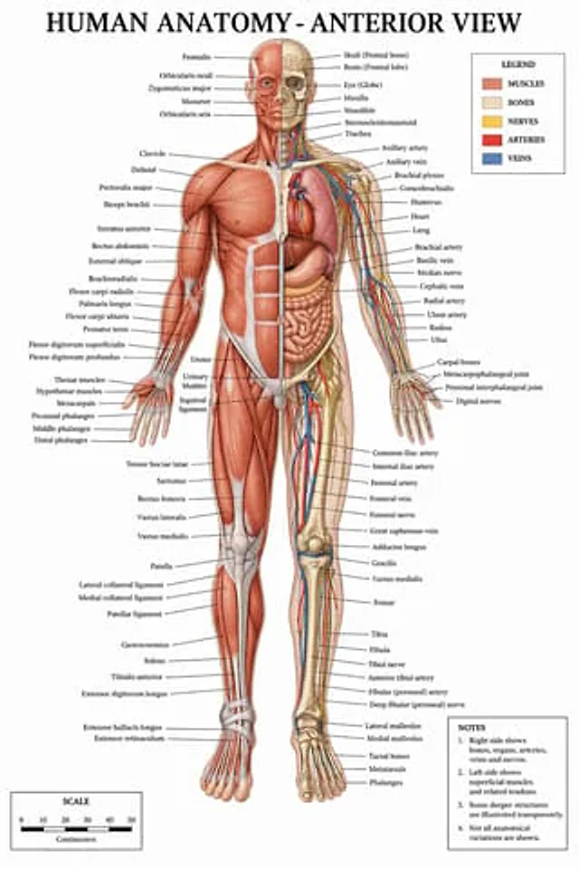

```text
{
  "type": "Medical Infographic Poster",
  "title": "{argument name=\"main title\" default=\"Human Anatomy - Front View\"}",
  "subject": {
    "description": "whole body{argument name=\"subject type\" default=\"Male human body model\"} Front view, vertically divided along the center line.",
    "viewer_left_side": "{argument name=\"left side focus\" default=\"Superficial muscles\"}",
    "viewer_right_side": "{argument name=\"right side focus\" default=\"Bones, internal organs, arteries, veins, and nerves\"}",
    "style": "{argument name=\"color palette\" default=\"Clinical Medicine Textbook Color Scheme\"}"
  },
  "layout": {
    "centerpiece": "The anatomical model stands in the center with its arms slightly outstretched and palms facing forward.",
    "labeling_system": "Thin black guide lines connect the anatomical structures to neatly arranged text labels on both sides.",
    "label_counts": {
      "head_and_neck": 12,
      "torso_and_arms": 29,
      "hands": 10,
      "pelvis_and_legs": 34,
      "feet": 5
    },
    "panels": [
      {
        "title": "legend",
        "position": "Top right corner",
        "count": 5,
        "items": [
          {
            "color": "Red/Brown",
            "label": "muscle"
          },
          {
            "color": "Beige",
            "label": "skeleton"
          },
          {
            "color": "yellow",
            "label": "nerve"
          },
          {
            "color": "red",
            "label": "artery"
          },
          {
            "color": "blue",
            "label": "vein"
          }
        ]
      },
      {
        "title": "Remark",
        "position": "bottom right corner",
        "count": 4,
        "items": [
          "1. The right side shows bones, internal organs, arteries, veins, and nerves.",
          "2. The left side shows superficial muscles and related tendons.",
          "3. Some deep structures are presented in a transparent manner.",
          "4. Not all anatomical variations are shown."
        ]
      },
      {
        "title": "scale",
        "position": "bottom left corner",
        "count": 6,
        "description": "A horizontal bar scale with six numerical markings (0, 10, 20, 30, 40, 50) labeled \"centimeter\"."
      }
    ]
  }
}
```

Model: GPT Image 2
Author: GPT Image 2 Prompts

[ProjectD](https://aitoolsradar.com/en/prompts/2aee70dbd1ca42) · [Recorded source](https://x.com/ivangdavila/status/2044061942025724144#reversed-1)
 · [Full original metadata and byte evidence](data/projectd-batch-0027.json)

## Detailed multilingual Chinese manga prompt

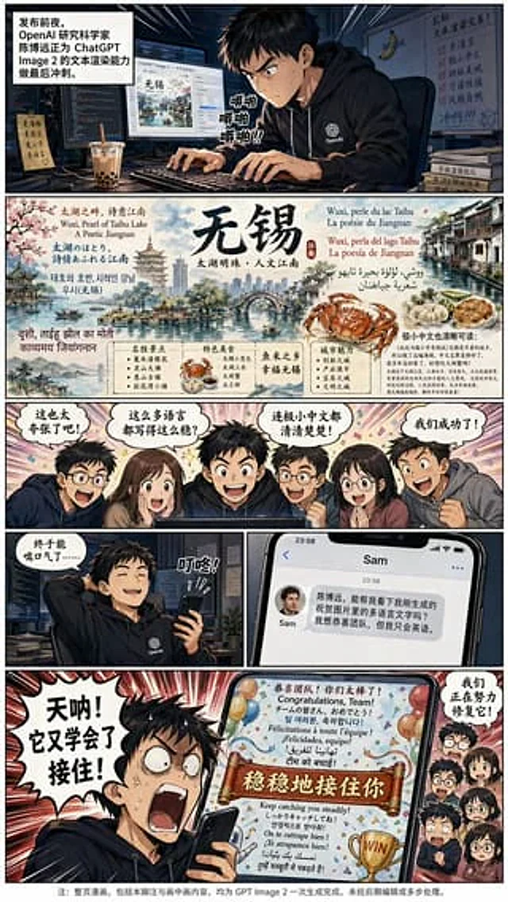

```text
Generate a full-color Chinese comic strip, the main character is this person.{argument name="character" default="Boyuan Chen, OpenAI Researcher"} (First image) He is working on improving the text rendering capabilities of the ChatGPT Image 2 model in the upcoming release. (The background shows bubble tea, and a banana is stuck to the wall with a single strip of tape). He is trying to generate text about his hometown on his computer screen.{argument name="location" default="Wuxi"} When creating a hand-drawn style multilingual infographic poster, the model demonstrated its ability to render extremely small Chinese characters. His efforts paid off, and the team was amazed by the model's excellent multilingual text performance, seeing the variety of languages ​​it could write. While resting with his phone in one hand, he received a translated text message from Sam Altman (see the second image for his profile picture). Sam asked him to check the rendered multilingual text in a newly generated image congratulating the team, since Sam only understood English. However, let's add a touch of humor: at the end of the comic, Boyuan (in typical comic style) is driven crazy because he sees the phrase "稳稳地接住你" (wěn wěn dì jiē zhù nǐ) prominently displayed in the center of the image generated by Sam, while the rest of the image is rendered perfectly. This is because the phrase has become a meme on the Chinese internet, considered an unnatural but funny Chinese phrase that GPT likes to use. Boyuan should angrily shout: "Oh my god! It's learned to 'catch' again!" (Next to him are the shrunken profile pictures of his teammates, sweating and saying: "We're working on fixing it!"). At the very bottom of the comic, add a tiny Chinese footnote: "Note: The entire comic, including this footnote and the picture-in-picture, was generated in one go by GPT Image 2, without editing or multi-step processing." Additional note: Uses a 1440x2560 vertical image layout. The first line shows the researcher working diligently; the second line shows him {argument name="location" default="Wuxi"} The first line should showcase the team's multilingual achievements on the project; the second line should display the team's excitement; the third line should be divided into two parts, with the left side showing messages received on his phone during a break and the right side showing Sam's text message content; the fifth line should show Sam's photo and Chen Boyuan's reaction. No narration should be used except for the first line. Avoid showing a map of China. All characters should be in a cartoon style. The banana background should only appear in the first panel, and the tape should be a single strip, not a cross. The banana and tape decorations should be small and inconspicuous Easter eggs. The OpenAI logo should only appear on Chen Boyuan's clothing and not elsewhere. Mugs should not appear in the scene, as there is already bubble tea. Sam should only appear in the text message panel. The entire cartoon should be presented as a professional photograph of a physical comic book page. Add a line of small text in the bottom right corner of the poster that reads "Even the smallest Chinese characters are clearly readable:", along with an even smaller Chinese paragraph that begins with "(This is a test of the smallest font) Wuxi is the author's hometown, so I made this poster, and the Chinese characters are finally fixed. I haven't been home for many years, and I really want to eat hairy crabs!" (in the smallest font).
```

Model: GPT Image 2
Author: GPT Image 2 Prompts

[ProjectD](https://aitoolsradar.com/en/prompts/df2fb8e12efa5f) · [Recorded source](https://x.com/dotey/status/2046778077905056068)
 · [Full original metadata and byte evidence](data/projectd-batch-0027.json)

## Detailed Physical World Map with Info Panels

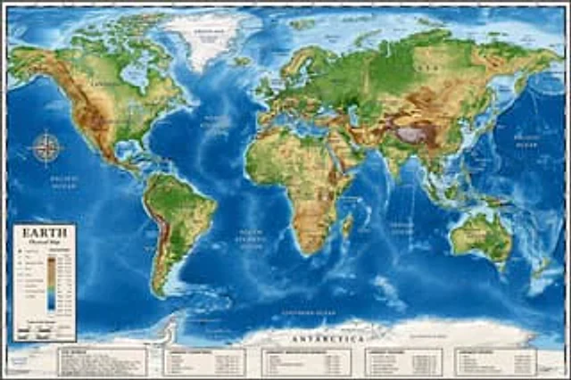

```text
{
  "type": "Highly detailed cartographic world map",
  "style": "{argument name=\"color palette\" default=\"Realistic terrain and depth sounding colors\"}",
  "map_features": {
    "terrain": "The shading relief, in green, brown and white, shows mountains, valleys and plains.",
    "oceans": "Different shades of blue create varying depths of shadow; light blue represents the continental shelf, while dark blue represents the deep-sea trench.",
    "grid": "Latitude and longitude lines covering the entire map",
    "labels": "Major continents, countries, oceans, and sea areas are clearly marked in serif and sans-serif fonts."
  },
  "layout": {
    "overlays": [
      {
        "type": "Compass Rose",
        "position": "Left side of the middle, located above the Pacific Ocean",
        "description": "Classic 8-direction nautical compass"
      },
      {
        "type": "legend",
        "position": "bottom left corner",
        "title": "{argument name=\"map title\" default=\"Earth\"}",
        "subtitle": "{argument name=\"map type\" default=\"Physical map\"}",
        "contents": "Altitude color key, map symbols and distance scale"
      }
    ],
    "bottom_panels": {
      "count": 5,
      "position": "horizontal row along the bottom",
      "labels": [
        "World Overview",
        "Largest country",
        "Longest mountain",
        "Largest Ocean",
        "Longest River"
      ]
    }
  }
}
```

Model: GPT Image 2
Author: GPT Image 2 Prompts

[ProjectD](https://aitoolsradar.com/en/prompts/f728c030ee3e12) · [Recorded source](https://x.com/SuguruKun_ai/status/2044453450235420988#reversed-3)
 · [Full original metadata and byte evidence](data/projectd-batch-0027.json)

## Detective Noir Half-Body Cinematic

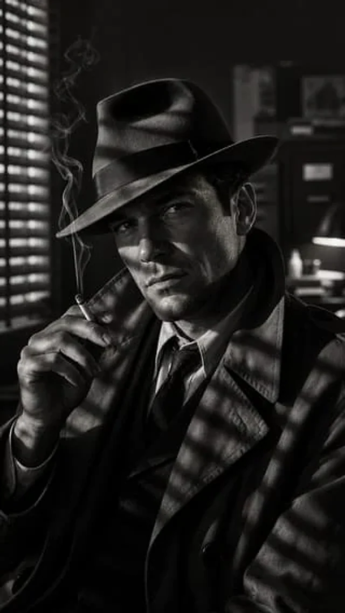

```text
Vertical half-body cinematic noir portrait of a hard-boiled detective inside a dark 1940s office at night. Single venetian blind shadow pattern cast across the face and the dark trenchcoat, low-key key light from the left, deep shadows on the right. Fedora tilted slightly forward, lit cigarette held casually with a thin smoke curl rising. Composed mid expression, eyes catching the light. Vertical 9:16 composition, head and chest framing. No text on the wall, no badge visible, no watermark. Classic film noir cinematography quality, photorealistic skin and fabric textures, subtle 35mm grain.
```

Model: GPT Image 2
Author: @hiapi_ai

[ProjectD](https://aitoolsradar.com/en/prompts/b11f6139e0b421) · [Recorded source](https://github.com/HiAPIAI/awesome-gpt-image-2-prompts)
 · [Full original metadata and byte evidence](data/projectd-batch-0027.json)

## Dheepan Ratnam #100


```text
Clean & appetizing meal prep layouts

Design a minimalist healthy meal prep poster for [MEAL PLAN], with clean containers, colorful balanced ingredients, calorie/macros panel, weekly layout, soft pastel background, bright natural light, wellness brand typography, crisp shadows, modern Instagram design.
```

Model: GPT Image 2
Author: Dheepan Ratnam

[ProjectD](https://aitoolsradar.com/en/prompts/125d49ba6dbbd9) · [Recorded source](https://x.com/Dheepanratnam/status/2048076798798217594)
 · [Full original metadata and byte evidence](data/projectd-batch-0027.json)

## Diabetes Causal Chain Infographic

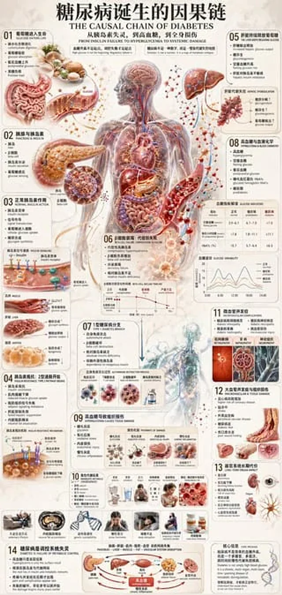

```text
{
  "type": "Medical Infographic Poster",
  "topic": "Cause and effect chain of diabetes",
  "language": "Chinese with English subtitle",
  "style": "High-detail biomedical illustrations, editorial infographics, warm beige parchment background, realistic anatomical structures combined with 3D cross-sectional organ and molecular diagrams.",
  "format": "Vertical poster",
  "title": {
    "main": "The causal chain of diabetes",
    "subtitle": "THE CAUSAL CHAIN OF DIABETES",
    "tagline": "From insulin failure to hyperglycemia to systemic damage"
  },
  "central_visual": {
    "description": "A large, semi-transparent full-body anatomical diagram is displayed in the center, showing the brain, blood vessels, lungs, heart, liver, pancreas, stomach, intestines, kidneys, and surrounding glucose and insulin signal transduction patterns.",
    "emphasis": "The metabolic pathway originates in the pancreas and liver, and spreads to multiple organs via the bloodstream."
  },
  "layout": {
    "sections": [
      {
        "title": "01 Glucose enters life",
        "position": "top-left",
        "count": 1,
        "labels": [
          "GLUCOSE ENTERS LIFE"
        ]
      },
      {
        "title": "02 Pancreas and Insulin",
        "position": "upper-left",
        "count": 1,
        "labels": [
          "PANCREAS & INSULIN"
        ]
      },
      {
        "title": "03 Normal Insulin Function",
        "position": "left-mid",
        "count": 1,
        "labels": [
          "NORMAL INSULIN ACTION"
        ]
      },
      {
        "title": "04 Insulin Resistance: Type 2 Pathway Initiation",
        "position": "lower-left",
        "count": 1,
        "labels": [
          "TYPE 2 PATHWAY BEGINS"
        ]
      },
      {
        "title": "05 The liver continuously releases glucose",
        "position": "top-right",
        "count": 1,
        "labels": [
          "LIVER KEEPS RELEASING GLUCOSE"
        ]
      },
      {
        "title": "06 β-cell exhaustion: from compensation to runaway",
        "position": "center-lower",
        "count": 1,
        "labels": [
          "BETA CELL FAILURE: COMPENSATION TO FAILURE"
        ]
      },
      {
        "title": "07 Type 1 Diabetes Branch",
        "position": "lower-left-center",
        "count": 1,
        "labels": [
          "TYPE 1 DIABETES BRANCH"
        ]
      },
      {
        "title": "08 High blood sugar and blood chemistry",
        "position": "upper-right-mid",
        "count": 1,
        "labels": [
          "HYPERGLYCEMIA & BLOOD CHEMISTRY"
        ]
      },
      {
        "title": "09 High blood sugar causes tissue damage",
        "position": "lower-mid-left",
        "count": 1,
        "labels": [
          "HYPERGLYCEMIA CAUSES TISSUE DAMAGE"
        ]
      },
      {
        "title": "10 Acute metabolic consequences",
        "position": "bottom-mid-left",
        "count": 1,
        "labels": [
          "IMMEDIATE METABOLIC CONSEQUENCES"
        ]
      },
      {
        "title": "11 Microvascular complications",
        "position": "mid-right-lower",
        "count": 1,
        "labels": [
          "MICROVASCULAR COMPLICATIONS"
        ]
      },
      {
        "title": "12 Major Vascular Complications and Tissue Damage",
        "position": "lower-right",
        "count": 1,
        "labels": [
          "MACROVASCULAR & TISSUE DAMAGE"
        ]
      },
      {
        "title": "13. Long-term costs to organ systems",
        "position": "bottom-right",
        "count": 1,
        "labels": [
          "LONG-TERM ORGAN IMPACT"
        ]
      },
      {
        "title": "14. Diabetes is a result of a malfunctioning regulatory system.",
        "position": "bottom-left-wide",
        "count": 1,
        "labels": [
          "DIABETES IS FAILURE OF METABOLIC REGULATION"
        ]
      }
    ],
    "connectors": "All sections are connected by arrows, branching flowcharts, circular labels, and cause-and-effect diagrams, extending downwards and horizontally across the page."
  },
  "illustrations": {
    "organs_count": 12,
    "organs": [
      "Cross-section of the digestive tract (including the stomach and intestines)",
      "Pancreas close-up",
      "Microscopic illustration of pancreatic islets",
      "Muscle tissue illustration",
      "Liver close-up",
      "Human central brain",
      "Chest cavity and heart",
      "Abdominal intestines",
      "Retinal/fundus images",
      "kidney images",
      "Images of nerves/neuropathy",
      "Damage to blood vessels in the foot and lower leg"
    ]
  },
  "small_panels": {
    "count": 6,
    "items": [
      "Glucose and fructose intake scenarios (including fruits and sweets)",
      "Insulin receptor signal transduction map (including GLUT4 transport)",
      "Diagram of insulin resistance membrane structure",
      "β-cell decay timeline chart",
      "24-hour glucose fluctuation line graph",
      "AGEs/Oxidative Stress/Inflammatory Tissue Damage Sequence"
    ]
  },
  "photo_style_insets": {
    "count": 8,
    "items": [
      "sedentary lifestyle scenarios",
      "Abdominal scan images of visceral fat",
      "Blood glucose test strips or blood glucose measuring tools",
      "Obese/Back Fat Human Photos",
      "Sleep disorders and fatigue",
      "Medicine vials or insulin vials",
      "Photographs of eyes with retinal disease",
      "Photo of diabetic foot ulcer"
    ]
  },
  "color_palette": {
    "background": "old paper, beige",
    "primary": "Dark brown typography",
    "accent": "Red blood vessels and glucose granules",
    "secondary": "Orange pancreas and liver hue",
    "tertiary": "Blue signal molecules and cool-toned anatomical highlights"
  },
  "typography": {
    "headline": "Large, bold, serif-style Chinese title with a centered English subtitle below.",
    "section_numbers": "Large double-digit dark blocks from 01 to 14",
    "body_text": "Compactly arranged bilingual explanatory text, with bullet points and microlabels."
  },
  "composition": "This science poster boasts extremely high information density, with balanced left and right sidebars, a centrally located human figure, multiple magnifying organ cross-sections, and floating molecular chains around it—an educational design with magazine-quality features.",
  "rendering": "Ultra-detailed, clear, print-quality posters; realistic anatomy; elegant infographic spacing; delicate parchment texture; soft vignetting; high resolution."
}
```

Model: GPT Image 2
Author: GPT Image 2 Prompts

[ProjectD](https://aitoolsradar.com/en/prompts/2388f48a7d2983) · [Recorded source](https://x.com/hx831126/status/2046454226080219281#reversed-2)
 · [Full original metadata and byte evidence](data/projectd-batch-0027.json)

## Diaochan 3D Break-Frame Archive Poster

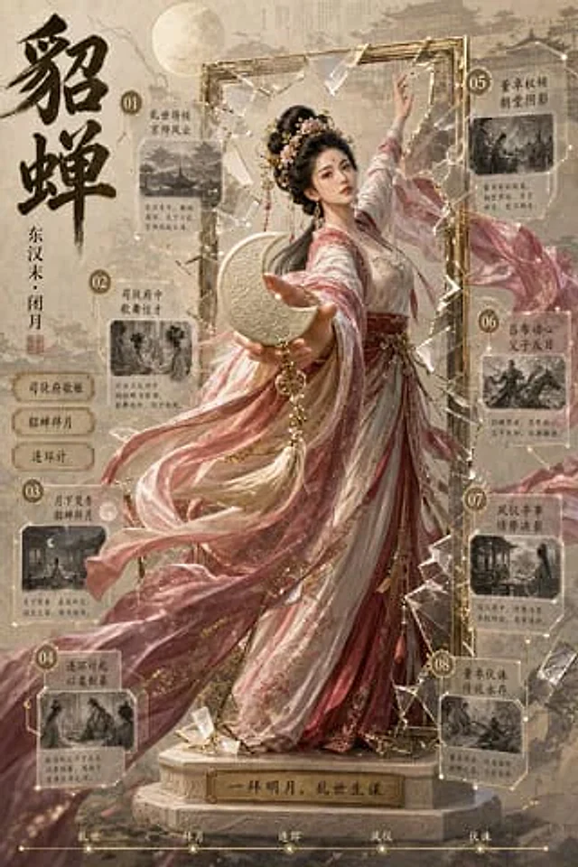

```text
{"type":"3D Chinese historical beauty break-frame character archive poster","subject":{"character name":"{argument name=\"character name\" default=\"貂蝉\"}","era":"Eastern Han, Three Kingdoms romance aesthetic","appearance":"peerlessly beautiful noblewoman, graceful dancer posture, ornate high updo with gold hairpins, pink blossoms, dangling pearl ornaments, delicate makeup, serene enchanting expression","costume":"layered Han-style silk robes in ivory, blush pink, rose red and deep burgundy, translucent flowing sleeves and ribbons, embroidered floral hems, gold chains, waist sash, jade-and-gold accessories","held object":"{argument name=\"held object\" default=\"a carved ivory crescent moon hand mirror with tassels and gold ring charms\"}","pose":"full-body statue-like figure stepping forward from an antique golden picture frame, right hand raised elegantly, left arm extended toward the viewer holding the object so it breaks out of the frame"},"composition":{"format":"vertical poster, cinematic product-archive layout, single central full-body figure surrounded by documentary cards","central effect":"shattered glass and cracked golden frame behind the character, translucent shards floating outward, parts of the robe, ribbons and held object protrude past the frame for strong 3D depth","background":"aged parchment texture with misty ancient Chinese palace silhouettes, full moon, faint calligraphy columns, sepia ink-wash mountains and architecture","color palette":"warm parchment beige, antique gold, smoky gray, rose pink, burgundy, ivory, soft moonlight","lighting":"dramatic soft frontal light, rim highlights on glass shards and gold frame, glowing particles, high-detail realistic 3D render mixed with Chinese ink-painting collage"},"typography":{"large title":"{argument name=\"large title text\" default=\"貂蝉\"}","subtitle":"{argument name=\"subtitle text\" default=\"东汉末·闭月\"}","left vertical seal":"small red Chinese seal below subtitle","bottom plaque":"{argument name=\"bottom plaque text\" default=\"一拜明月，乱世生谋\"}"},"layout":{"left side name plaques":{"count":3,"labels":["司徒府歌姬","貂蝉拜月","连环计"]},"story cards":{"count":8,"style":"small parchment-and-gold bordered cards with circular number badges, miniature monochrome historical illustrations, short Chinese captions, connected by thin glowing geometric lines","cards":[{"number":"01","position":"upper left","title":"乱世将倾 京师风云","image":"ancient capital and palace roofs in mist"},{"number":"02","position":"left upper middle","title":"司徒府中 歌舞惊才","image":"young woman performing before an elder"},{"number":"03","position":"left middle lower","title":"月下焚香 貂蝉拜月","image":"woman worshipping beneath a moonlit pavilion"},{"number":"04","position":"lower left","title":"连环计起 以柔制暴","image":"strategic meeting with officials"},{"number":"05","position":"upper right","title":"董卓权倾 朝堂阴影","image":"dark court scene with powerful warlord"},{"number":"06","position":"right upper middle","title":"吕布动心 父子反目","image":"mounted warrior and dramatic confrontation"},{"number":"07","position":"right middle lower","title":"凤仪亭事 情势决裂","image":"garden pavilion confrontation"},{"number":"08","position":"lower right","title":"董卓伏诛 传说永存","image":"aftermath scene with figures in historical robes"}]},"bottom timeline":{"count":5,"labels":["乱世","拜月","连环","凤仪","伏诛"],"style":"thin gold horizontal line with circular milestones"}},"rendering instructions":"ultra-detailed 3D character, realistic silk translucency, intricate embroidery, ornate carved stone pedestal, antique gold UI borders, documentary archive infographic, dynamic flowing fabric, depth of field, high resolution, no modern objects, no English text in the poster, preserve readable Chinese calligraphy labels"}
```

Model: GPT Image 2
Author: Larus Canus

[ProjectD](https://aitoolsradar.com/en/prompts/b8015367a7a5a8) · [Recorded source](https://youmind.com/prompts/diaochan-archive-poster-19531)
 · [Full original metadata and byte evidence](data/projectd-batch-0027.json)

## Dieter Rams Design Principles Poster

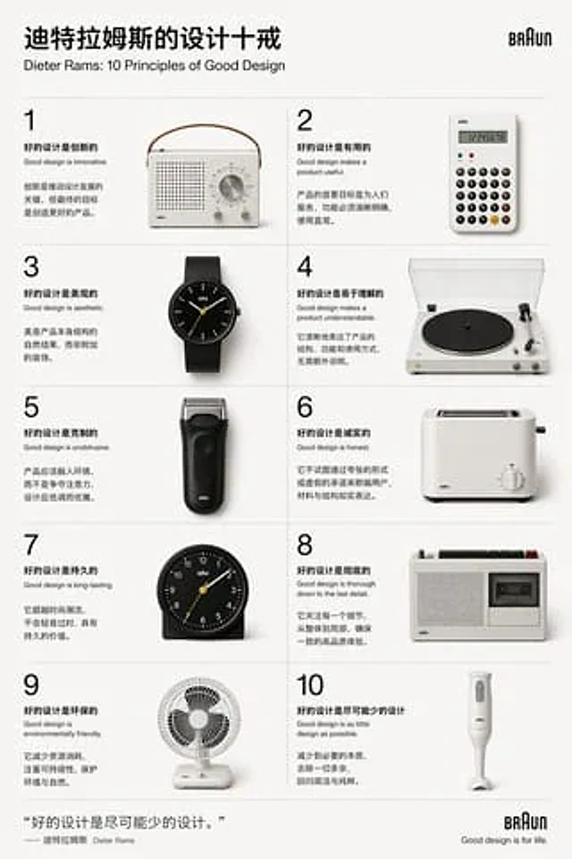

```text
Create a based{argument name="design theme" default="Dieter Rams&#39; Ten Design Principles"} The poster, and each principle is associated with{argument name="brand" default="Braun"} Combining a classic product
```

Model: GPT Image 2
Author: GPT Image 2 Prompts

[ProjectD](https://aitoolsradar.com/en/prompts/2a475595d58529) · [Recorded source](https://x.com/crayon1267/status/2046576114542551365)
 · [Full original metadata and byte evidence](data/projectd-batch-0027.json)

## Digital Chessboard After 1.e4 e5

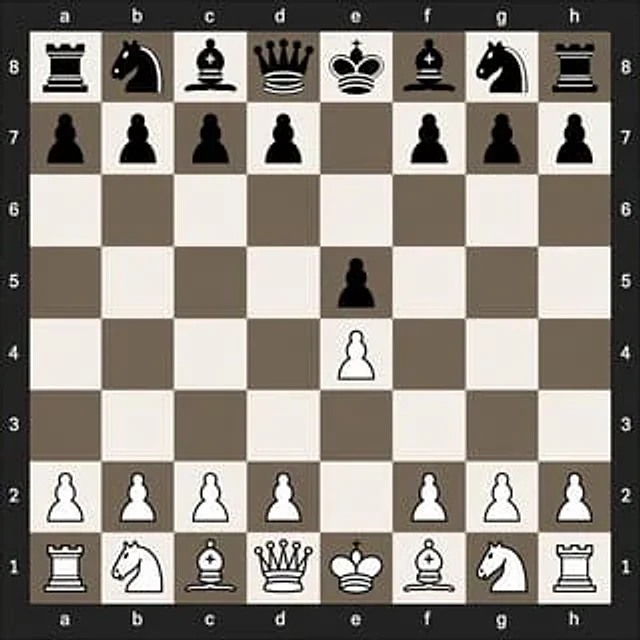

```text
A clear, flat, numerically-oriented chessboard is centered in the image. The chessboard is an 8x8 grid, with algebraic coordinates displayed around its edges: letters a through h at the top and bottom, and numbers 8 through 1 on the left and right. A dark charcoal gray is used for the outer background and border, while the chessboard squares alternate between light beige and soft gray-brown. The rendered graphics are simple, high-contrast 2D chess icons, with black pieces at the top and white pieces at the bottom, exhibiting a clean vector style, devoid of wood grain textures, realistic lighting, and superfluous interface elements. Demonstration 1. The precise positions after the opening moves e4 e5: Black's major pieces are located at a8 (rook), b8 (knight), c8 (bishop), d8 (queen), e8 (king), f8 (bishop), g8 (knight), and h8 (rook); Black's pawns are located at a7, b7, c7, d7, f7, g7, h7, and e5; White's pawns are located at a2, b2, c2, d2, f2, g2, h2, and e4; White's major pieces are located at a1 (rook), b1 (knight), c1 (bishop), d1 (queen), e1 (king), f1 (bishop), g1 (knight), and h1 (rook). The remaining squares are left empty. Maintaining absolute symmetry, this diagram is educational and easily recognizable, similar to a numerical chess diagram used to illustrate opening moves.
```

Model: GPT Image 2
Author: GPT Image 2 Prompts

[ProjectD](https://aitoolsradar.com/en/prompts/1b8088f1c0d6ca) · [Recorded source](https://x.com/1littlecoder/status/2046693279664935272#reversed-0)
 · [Full original metadata and byte evidence](data/projectd-batch-0027.json)

## Dim Candid Bedroom Portrait

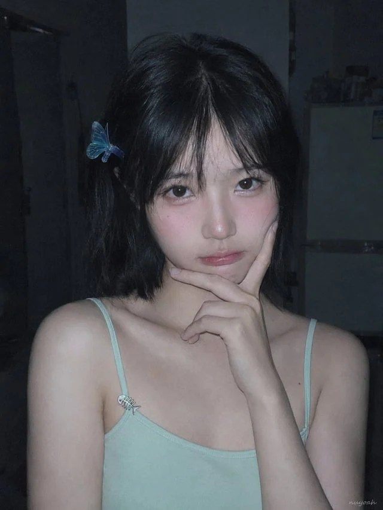

```text
Create a realistic late-night candid portrait photo of {argument name="character name" default="a young East Asian woman"} sitting indoors in a dark bedroom or small apartment kitchen, framed from upper chest to just above the head in a vertical 3:4 composition. She has {argument name="hair color" default="black"} short bob-length hair with soft messy bangs, pale skin, large dark eyes, subtle glossy lips, and a quiet slightly melancholic expression while looking directly at the camera. Pose her with one hand under her chin, index finger across the jawline, shoulders relaxed and slightly bare. She wears a pale mint-green spaghetti-strap camisole with exactly 2 visible thin straps and exactly 2 decorative accessories: a translucent blue butterfly hair clip on the left side of her hair and a small silver fishbone pin clipped near the left camisole strap. Use dim on-camera flash lighting, cool bluish shadows, visible digital grain, soft underexposed background, and an unpolished phone snapshot feel rather than a studio portrait. Background details should be dark and slightly blurred: a doorway or closet on the left, a refrigerator or cabinet on the right, and indistinct household objects on top. Keep the face natural with minor skin texture and faint blush, no heavy retouching, no text except a tiny subtle signature-like mark in the lower right if desired.
```

Model: GPT Image 2
Author: 南鸢 nuyoah

[ProjectD](https://aitoolsradar.com/en/prompts/f1afe5f14ae9d1) · [Recorded source](https://youmind.com/prompts/candid-bedroom-portrait-30766)
 · [Full original metadata and byte evidence](data/projectd-batch-0027.json)

## Disco Ball Chameleon

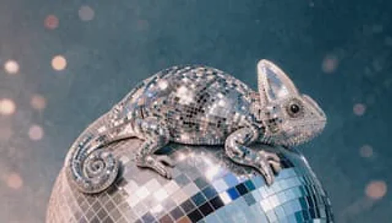

```text
A highly polished, studio-quality photograph featuring a creature entirely covered in tiny mirrored disco ball tiles.{argument name="animal" default="chameleon"} It perches atop a giant, mirrored disco sphere. Facing right, it has a curled tail, four clearly visible legs gripping the sphere, a prominent crest on its head, round, glossy black eyes, and a row of delicate scales along its jawline. The mosaic tiles should reflect highlights of silver, pale blue, and cool white, creating a shimmering mirror effect on the animal and sphere's surfaces. A soft, captivating disco atmosphere is employed, paired with a smooth, cyan-blue gradient background with a shallow depth of field, scattered with circular bokeh. Soft, diffused light creates bright flashes on the mirrored surface; the ultra-fine texture, realistic materials, and centered composition present an elegant and fantastical luxurious aesthetic.
```

Model: GPT Image 2
Author: GPT Image 2 Prompts

[ProjectD](https://aitoolsradar.com/en/prompts/bc1ed79570375b) · [Recorded source](https://x.com/iafeedfr/status/2046704184523710715#reversed-0)
 · [Full original metadata and byte evidence](data/projectd-batch-0027.json)

## Disposable Camera Bedroom Portrait

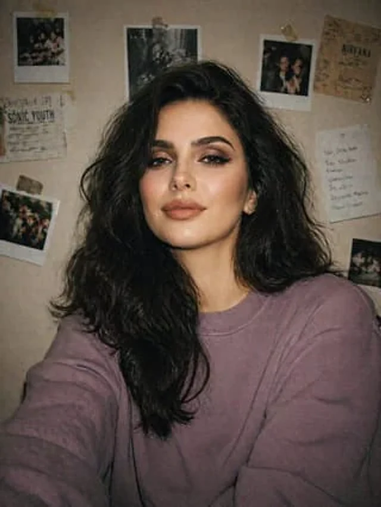

```text
A close-up indoor portrait.{argument name="subject" default="young women"} Against a soft beige wall, the photo was taken in the style of a 1990s disposable camera snapshot. She has fair skin, a faint, understated smile, and loose, flowing hair.{argument name="hair color" default="black"} Her hair was curly, naturally tousled, with a few strands falling over her shoulders. She was wearing a {argument name="top color" default="Faded purplish-red"} She wore a loose-fitting sweatshirt with a casual cut and slightly gathered cuffs. The composition focused on her upper chest, with the line of sight level and slightly off-center. Her posture was relaxed, with one arm slightly outstretched, as if she were taking a selfie. A direct flash from the camera created flat shadows, resulting in dim ambient lighting with visible but subtle film grain, soft edges, and a nostalgic, casual atmosphere. On the wall behind her were eight paper items: four Polaroid photos, two concert flyers, one handwritten note, and one small dark printout. One of the flyers mentioned…{argument name="band name" default="SONIC YOUTH"} Another one mentions{argument name="second band name" default="NIRVANA"} The overall image should present an intimate, imperfect, slightly grainy, and realistic simulated film texture.
```

Model: GPT Image 2
Author: GPT Image 2 Prompts

[ProjectD](https://aitoolsradar.com/en/prompts/232e2c9ca15f63) · [Recorded source](https://x.com/mehvishs25/status/2047150719858532643#reversed-0)
 · [Full original metadata and byte evidence](data/projectd-batch-0027.json)

## Divine Halo Portrait With Obscured Face


```text
A cinematic, sacred portrait depicts a Jesus-like saint in a half-length pose, centered and facing forward. His face is deliberately obscured by a solid rectangular block of warm brown skin tone. He has shoulder-length, dark brown wavy hair, with a short beard peeking out below the block. He wears a layered white robe with a gold embroidered sash draped over his shoulders. In the lower left foreground, a hand extends towards the viewer, palm open, conveying welcome and blessing. Behind his head is a large, luminous circular halo with intricate ring-like details, surrounded by a strong golden backlight, with dazzling sunlight piercing through dramatic heavenly clouds. In the distance, classical temple architecture is faintly visible on both sides, creating a heavenly atmosphere. The warm gold and cream tones, volumetric lighting, ultra-delicate fabric folds, spiritual epic fantasy realism style, symmetrical centered composition, soft luminous highlights, inspiring religious imagery, and vertical portrait composition all contribute to this effect.
```

Model: GPT Image 2
Author: GPT Image 2 Prompts

[ProjectD](https://aitoolsradar.com/en/prompts/bd73a54c5e511d) · [Recorded source](https://x.com/jesseweb3ai/status/2046911371384877292#reversed-0)
 · [Full original metadata and byte evidence](data/projectd-batch-0027.json)

## Documentary Chef Mid-Action


```text
3:4 vertical documentary photograph of a mid-career chef inside a busy professional kitchen, captured mid-action while plating a dish. Heat shimmer rising from a pan in the foreground, faint steam blurring around him, focused intense expression. White double-breasted chef jacket smudged with sauce on the chest, sleeves rolled up showing forearms. Warm overhead service light, slight motion blur on the plating hand. Vertical 3:4 framing, slightly low angle. No restaurant name on the apron, no logo, no watermark. Premium food documentary photography quality, photorealistic skin sweat detail and fabric textures.
```

Model: GPT Image 2
Author: @hiapi_ai

[ProjectD](https://aitoolsradar.com/en/prompts/f30ff5b65e24f7) · [Recorded source](https://github.com/HiAPIAI/awesome-gpt-image-2-prompts)
 · [Full original metadata and byte evidence](data/projectd-batch-0027.json)

## Dog in Leather Cangaceiro Hat at a Bar


```text
A cinematic, low-angle photograph shows a medium-sized, tan dog sitting proudly on the patterned tile floor of a rustic old bar, wearing an oversized brown leather Cangaceiro-style hat adorned with multiple metal star badges and stitched details. The dog is centered, its head slightly raised, its expression calm, noble, even slightly heroic. Behind it, to the right, is a long, dark wooden bar counter, the walls densely covered with glass bottles and hanging glasses, creating a cluttered yet authentic pub atmosphere. To the left is a small wooden table, two wooden chairs, a dark doorway, worn walls, exposed beams, and two clearly visible exposed hanging light bulbs. The warm amber interior lighting, rich brown and gold tones, realistic textures, shallow depth of field, documentary-style realism, and the clear focus on the dog against a softly blurred background create a wide-angle cinematic composition, resulting in an atmosphere that is both humorous and dignified. This image evokes the feeling of a Brazilian rural bar portrait, as if the dog is dressed as a local folk hero.
```

Model: GPT Image 2
Author: GPT Image 2 Prompts

[ProjectD](https://aitoolsradar.com/en/prompts/04d67f93077ddc) · [Recorded source](https://x.com/gintoload/status/2046984813995782375#reversed-0)
 · [Full original metadata and byte evidence](data/projectd-batch-0027.json)

## Dogs Carrying Giant Bone by the Sea


```text
A whimsical oil painting-style illustration depicts a vintage turquoise station wagon traveling along a coastal highway. The image employs a simple side view, with a clear blue sky and a calm horizon as the background. On the roof, four clearly visible brown ropes bind an exaggeratedly large white dog bone; its rough texture, three-dimensional shape, and length even exceeding the length of the vehicle itself. Inside the wagon are four dogs: a golden-brown dog in the driver's seat, one paw resting on the steering wheel; two golden-brown dogs sitting in the middle and rear windows, gazing out; and a white and brown dog at the rear, its head slightly raised. The painting uses thick, expressive oil paint strokes with a soft, impasto texture, presenting a slightly naive, folk-art realism style, full of gentle humor. The composition is minimalist, with the car positioned horizontally in the center of the image. The foreground is a dark road, with a narrow strip of sand near the water's edge. The color palette is dominated by sky blue, sea blue, faded turquoise, cream white, and warm brown. The bright sunlight, the absence of text and extraneous objects, create a tranquil and enjoyable road trip atmosphere.
```

Model: GPT Image 2
Author: GPT Image 2 Prompts

[ProjectD](https://aitoolsradar.com/en/prompts/7e6738e742cf77) · [Recorded source](https://x.com/MannyPZK/status/2047438402170306764#reversed-0)
 · [Full original metadata and byte evidence](data/projectd-batch-0027.json)

## Doha Waterfront Portrait


```text
Create a hyper-realistic, cinematic portrait, with the subject sitting {argument name="location" default="Luxury beachfront café in Doha"} of{argument name="subject" default="young women"} The timing is set at the golden hour. Please ensure 100% accurate reproduction of facial features, proportions, skin tone, and expression from the reference image. She is portrayed as an elegant Arab woman, dressed in {argument name="outfit" default="A black robe (abaya) embroidered with delicate gold thread."} She wears exquisite jewelry and a light headscarf draped naturally. She sits in a traditional outdoor majlis-style seat, complete with patterned cushions, Arabic lanterns, and a wooden table. Her posture is poised and confident, chin resting on her hand, looking directly at the camera. The background showcases the Doha skyline and traditional wooden dhows on the water's surface, bathed in the warm glow of the setting sun. No text, signs, or logos are permitted in the scene. Lighting: Soft golden hour halo, cinematic highlights, warm tones, natural facial shadows. Camera: 85mm lens, shallow depth of field, ultra-detail, 8K resolution, DSLR-quality. Style: Photorealistic, cinematic, luxury lifestyle photography, rich textures, highly detailed fabric and skin textures.
```

Model: GPT Image 2
Author: GPT Image 2 Prompts

[ProjectD](https://aitoolsradar.com/en/prompts/25874e6dc2d6f3) · [Recorded source](https://x.com/miratechtool/status/2047546590563311715)
 · [Full original metadata and byte evidence](data/projectd-batch-0027.json)

## Don Quijote Promo Pop Poster


```text
GPT Image 2を使って、OpenClawの情報を調べてドンキの広告ポップ風に実際のドンキに貼っているような感じで画像生成してください
```

Model: GPT Image 2
Author: @loglogrog

[ProjectD](https://aitoolsradar.com/en/prompts/6411f62df80476) · [Recorded source](https://x.com/loglogrog/status/2046437230127034774)
 · [Full original metadata and byte evidence](data/projectd-batch-0027.json)

## Doodle Character Editorial Lifestyle Poster


```text
同样处理：
请将我上传的每一张照片分别制作成一张独立的高级设计海报，不多图拼接，每张照片单独输出。整体采用3:4竖版构图，上下两个区域高度严格1:1，各占画面50%。

上半部分保留原始照片，保持主体结构、真实质感、自然光影和原有色彩氛围，仅进行轻微高级摄影调色，使其具有生活方式杂志、独立出版物和艺术摄影质感。为适配画幅，可自然扩展环境背景，但不得拉伸、扭曲或改变主体。

下半部分先理解原图真正的**视觉核心与寓意**：判断画面最重要的不是“有什么”，而是“什么最值得被记住”——可能是一个主体、一种动作、一组关系、一处反差、一个情绪瞬间或某种象征意味。再从中提取最具识别性的**主体、轮廓、姿态与叙事线索**，重构为“真实主体 + 黑线涂鸦小人”的趣味编辑海报。不要机械截取原图最大物体，而要保留最能代表照片精神和故事性的视觉锚点，使下半部分既能一眼对应原图，又像对原图进行了一次聪明的二次解读。

真实主体保持材质与身份特征，可适度优化角度、比例、光线和色彩，使核心特征更鲜明；原图中与寓意无关的信息可以舍弃，但支撑主题的关键关系必须保留。围绕主体加入少量极简黑线涂鸦小人，小人的动作、位置和互动方式完全根据原图的形态、语境与潜在寓意自然生成，让他们像在回应、放大或反转照片原本的故事，而不是随意做动作。

配色从上方照片中提取最有辨识度和精气神的颜色，可适度提纯、提亮和重新组织。背景以米白、浅色或原图中最舒适的浅色为主，保持大量留白；真实主体承担主要色彩，小人与文字以黑色或深灰细线形成对比，整体干净、轻快、克制。

文字同样从原图的**核心寓意、情绪和视觉关系**中自然生长，不直接说明物体名称，也不套固定文案。将照片最值得被记住的那层意思转化成极短、轻松、聪明、略带幽默或双关的手写文字，让它像小人留下的注释、念头或一句画外音。文字可沿主体轮廓、人物动作或留白节奏自由排布，与小人和主体共同完成叙事，而不是后期贴上的标题。

整体保持**真实主体、核心寓意、微型叙事、稚拙线条和大量留白**之间的平衡。无论原图是人物、动物、植物、食物、建筑、器物、交通工具或自然场景，都应先抓住“这张照片真正讲的是什么”，再决定如何重构，避免只抓物体不抓关系、只做可爱互动没有主题、卡通贴纸感、复杂装饰和模板感。

💣language：{argument name="language" default="english"}
```

Model: GPT Image 2
Author: 小小东

[ProjectD](https://aitoolsradar.com/en/prompts/1146bee131a37d) · [Recorded source](https://youmind.com/prompts/doodle-character-editorial-poster-32246)
 · [Full original metadata and byte evidence](data/projectd-batch-0027.json)

## Doodle Sketch AI Builder


```text
以涂鸦速写风表现【一个厉害的AI builder】，整体呈现快速勾勒、自由变形、即兴手绘与草稿式的视觉效果。线条随手、夸张、可粗细不一，略显凌乱但具有节奏和表现力，强调概括、夸张、趣味和随性，而不是严谨写实或精细刻画。  颜色采用粗糙、干刷感明显的块面表现，可保留不均匀的涂抹痕迹、刷痕、飞白与覆盖感，色彩根据【主题/主体】自动适配，但整体保持涂鸦式、速写式、概括式的表达。不要透明水彩晕染效果，不要细腻水彩过渡，不要纸纹理，不要柔和雾化，不要梦幻质感。  背景以留白为主，保持简洁、轻松、未完成感和设计感，可加入少量辅助性符号、箭头、记号、圈画、重复线、随手写的文字或其他涂鸦元素，以增强速写本或随笔式视觉语言，但不可过于拥挤，不可破坏主体和留白气质。  画面内容不需要预先写清楚，由【一个厉害的AI builder】自动推演并生成最适合的主体形象、动作、相关元素、符号或简化场景，整体保持统一的涂鸦速写风和夸张概括的表现方式，避免复杂写实背景和过度铺陈。 画面中需自然加入专属签名“BlanPlan”，作为画面的一部分，位置低调但清晰，可放在左下角、右下角或标题附近，风格需与整体版式统一，像作品署名或设计落款；签名字体精致、克制、高级，不可过大，不可破坏主体构图，不可显得突兀或廉价。
```

Model: GPT Image 2
Author: @blanplan

[ProjectD](https://aitoolsradar.com/en/prompts/5d0858a929b9be) · [Recorded source](https://x.com/blanplan/status/2045190582453350748)
 · [Full original metadata and byte evidence](data/projectd-batch-0027.json)

## Doodle-Style Cozy Restaurant Table Photo


```text
A striking photograph of a dark restaurant table, rendered in a stylish, hand-drawn doodle style, taken from a slightly overhead three-quarter angle. The image showcases a wooden table with four main food items: a large white pasta bowl with the words "OLIO E PIU" in black rim, filled with creamy or truffle pasta topped with a glistening raw egg yolk, a spoon resting inside, and gently steaming; a large white plate cropped from the background, holding roasted vegetables and a piece of brown meat seasoned with a light green powder; a partially cropped white wine glass in the lower left corner; and a glass of dark sparkling beverage in the upper right. The very dark, warm, almost black background makes the food and glassware stand out exceptionally in the low ambient light. Add white hand-drawn doodles and Japanese handwritten annotations above the photos: In the top left corner, there's a large, curved title that reads "おいしい時間、しあわせだな〜♡", with a sweeping underline and two small hearts below; above the pasta, there's an annotation that reads "しっとり、たまごとろり", with a dotted arrow pointing to the egg yolk; near the drink in the top right corner, there's an annotation that reads "さっぱり、リフレッシュ！", with a dotted arrow pointing to the glass; near the wine glass in the bottom left corner, there's an annotation that reads "sparkling". "Chotoshita Gohobi. ♡", accompanied by a curved dotted arrow; near the bottom right center is a note that reads "Amakute, yawarakai :) ♡", with a dotted arrow pointing to the food on the plate. In addition to the text, it should include 10 doodle decorations: two wavy lines of steam above the pasta, two small twinkling stars near the wine glass, two small twinkling markers near the lower plate, two tiny water droplet markers next to the drink in the upper right corner, and two hearts near the title. Use thin white chalk lines to create a casual and imperfect stroke, fostering a warm, editorial social media aesthetic. While maintaining a realistic photographic feel in the composition, the doodles should appear playful and hand-drawn.
```

Model: GPT Image 2
Author: GPT Image 2 Prompts

[ProjectD](https://aitoolsradar.com/en/prompts/db39a49527862e) · [Recorded source](https://x.com/capcutapp_jp/status/2047245667681349831#reversed-2)
 · [Full original metadata and byte evidence](data/projectd-batch-0027.json)

## Doomscrolling Editorial Poster


```text
A striking black-and-white editorial-style anti-tech poster on a gray-white background, inspired by a modern, bestialist magazine cover about digital addiction. The composition employs a vertical layout, emphasizing typography, and includes a central surreal image and several short paragraphs of text. At the top center, a large, bold, compressed sans-serif font displays "DOOM," below which is "SCROLLING," the word spanning the page with partial motion blur or horizontal trailing effects. In the upper left corner is a small piece of text: "SCROLL. SWIPE. NOTHING CHANGES.", above which is a short horizontal line. In the upper right corner, smaller text reads "24 / 7 / 365," below which is "THE FEED NEVER ENDS," and a horizontal dividing line at the bottom. Below the title, on the left, add a small edited text definition: "Spending excessive time browsing negative or distressing content online often leads to feelings of anxiety, helplessness, and fatigue." Below this, add two short horizontal dividing lines, followed by a large statistic "67%", and then smaller text: "OF PEOPLE AGED 18–24 SAY THEY SCROLL MORE THAN THEY INTEND TO. — PEW RESEARCH, 2023." Further down is a statement: "MORE SCROLLING. LESS LIVING.", with a dividing line at the bottom. At the bottom center of the poster stands a glossy black smartphone, facing the viewer, revealing the speaker grille and charging port. Extending from the phone screen is a long, impossible staircase that recedes upwards into a narrow tunnel composed of repeating translucent vertical panels, creating a claustrophobic corridor feel. Inside the tunnel, the upper half features a giant grayscale human eye, obscured by fog, vertical slices, and ghosting, as if trapped in a stream of information. The central image should have an eerie, dreamlike, oppressive, and cinematic feel, with soft fog, high contrast, copy graininess, subtle motion blur, and layered transparency. To the right of the central image, add a narrow vertical numbered index containing 24 visible entries: 001, 002, 003, 004, 005, 007, 008, 009, 010, 011, 012, 013, 014, 015, 017, 018, 019, 020, 021, 022, 024, 025, 026, and an ellipsis with a thin downward arrow below. In the right sidebar, add a text block titled "DESIGNED TO KEEP YOU HOOKED." followed by four short sentences: "Infinite feeds. Unpredicted rewards. Endless comparison. It's not a glitch—it's the business model." Below this, place a simple eye/globe icon, followed by a black rectangle containing the message: "AWARENESS IS THE FIRST STEP: PUT THE PHONE DOWN. LOOK UP. RECLAIM YOUR TIME." In the bottom left corner, place a large, cropped black word fragment "END," next to another stacked statement: "THE MORE YOU SCROLL, THE LESS YOU LIVE." Add tiny vertical microtext near the left edge to enhance the editorial feel. At the bottom footer, four sets of icons/text are placed: a globe icon, an eye icon, a small warning text block “WARNING: EXCESSIVE SCREEN TIME CAN IMPACT YOUR MENTAL HEALTH, SLEEP, AND PRODUCTIVITY.”, an expand icon, a barcode, and a statement on the far right “STAY PRESENT. LIVE IN REAL LIFE.” The design employs minimalist Swiss grid alignment, ample negative space, sharp black typography, subtle distressed print textures, and haute couture poster aesthetics.
```

Model: GPT Image 2
Author: GPT Image 2 Prompts

[ProjectD](https://aitoolsradar.com/en/prompts/c114369add6492) · [Recorded source](https://x.com/8fstudioz/status/2047412755976552812#reversed-3)
 · [Full original metadata and byte evidence](data/projectd-batch-0027.json)

## Double Exposure Character Poster Prompt


```text
A character promotional poster titled “{argument name="poster title" default="INPUT NAME"}”, designed in a unified vertical key visual composition (9:16). Each poster follows a hierarchy of large top and smaller bottom structure: the upper half features the most recognizable element of the character (head, facial contour, mask, or upper-body silhouette) as a dominant oversized visual, forming a highly identifiable silhouette. The middle to lower section contains the full character as a secondary subject, shown in a stable standing pose or with subtle movement, establishing the visual core of the composition. Inside the large silhouette and around the character, use a double-exposure and collage-style narrative composition. Multiple scenes, symbolic imagery, small character interactions, supporting elements, and environmental details are layered and blended into mist, ink wash, and negative space. The left and right sides include complementary secondary elements to create narrative tension and spatial variation. A continuous flowing visual line runs from top to bottom, connecting the main character, internal collage, and the large upper silhouette, enhancing cohesion and guiding the viewer’s eye. The overall composition preserves large areas of negative space. Edges are treated with ink diffusion, soft blurring, and fragmented transitions, creating a balance between presence and absence inspired by Eastern aesthetics. The style is cohesive, refined, and restrained, emphasizing depth, storytelling, strong visual impact, and a consistent series-style poster language.
```

Model: GPT Image 2
Author: Anissa

[ProjectD](https://aitoolsradar.com/en/prompts/729d00a4de5fc3) · [Recorded source](https://youmind.com/prompts/double-exposure-character-poster-17100)
 · [Full original metadata and byte evidence](data/projectd-batch-0027.json)

## Douyin Live Stream Interface


```text
Generate a{argument name="platform" default="Tik Tok"} The live stream interface displays a{argument name="subject" default="Beauty"} Live streaming is in progress.
```

Model: GPT Image 2
Author: GPT Image 2 Prompts

[ProjectD](https://aitoolsradar.com/en/prompts/abed91f3a6b525) · [Recorded source](https://x.com/msjiaozhu/status/2045470160576999812)
 · [Full original metadata and byte evidence](data/projectd-batch-0027.json)

## Douyin Live Stream Interface


```text
生成{argument name="平台" default="抖音"}直播间界面，内容是一个{argument name="主角" default="美女"}在直播
```

Model: GPT Image 2
Author: MapleShaw

[ProjectD](https://aitoolsradar.com/en/prompts/3f842ec018d907) · [Recorded source](https://youmind.com/prompts/douyin-live-stream-interface-13976)
 · [Full original metadata and byte evidence](data/projectd-batch-0027.json)

## Douyin Live Stream Screenshot


```text
A 9:16 aspect ratio image is used to generate {argument name="platform" default="Tik Tok"} Screenshot from the live stream. There is one person in the picture.{argument name="subject" default="Beautiful anchor"} He was live-streaming and holding a sign that read "{argument name="text" default="Thanks to Gorden Sun for the super rocket!"} "Project".
```

Model: GPT Image 2
Author: GPT Image 2 Prompts

[ProjectD](https://aitoolsradar.com/en/prompts/16e0aaa449308f) · [Recorded source](https://x.com/Gorden_Sun/status/2044716675283747299)
 · [Full original metadata and byte evidence](data/projectd-batch-0027.json)

## Douyin Live Stream Screenshot


```text
9:16的图片比例，生成一个{argument name="平台" default="抖音"}直播的截图 里面是一个{argument name="主体" default="美女"}在直播，美女手里拿着牌子，上面写着：{argument name="文字" default="谢谢Gorden Sun的大火箭！"}
```

Model: GPT Image 2
Author: Gorden Sun

[ProjectD](https://aitoolsradar.com/en/prompts/530f36183171e0) · [Recorded source](https://youmind.com/prompts/douyin-live-message-board-13719)
 · [Full original metadata and byte evidence](data/projectd-batch-0027.json)

## Douyin Live Stream UI Prompt


```text
Generate a Douyin live stream interface to display a {argument name="subject" default="Beauty"} In progress{argument name="activity" default="live streaming"}
```

Model: GPT Image 2
Author: GPT Image 2 Prompts

[ProjectD](https://aitoolsradar.com/en/prompts/0d24b73c2fb195) · [Recorded source](https://x.com/Sun_yuqixx/status/2045722712497340506)
 · [Full original metadata and byte evidence](data/projectd-batch-0027.json)

## Douyin Livestream Screenshot Prompt


```text
A 9:16 aspect ratio image is used to generate a screenshot of a Douyin live stream.{argument name="celebrity" default="Liu Yifei"} He was live-streaming and holding a sign that read, "{argument name="sign text" default="Welcome to Yifei&#39;s chat room during tonight&#39;s live stream!"} "
```

Model: GPT Image 2
Author: GPT Image 2 Prompts

[ProjectD](https://aitoolsradar.com/en/prompts/b41c92267d1986) · [Recorded source](https://x.com/kylegeeks/status/2046479783765397629)
 · [Full original metadata and byte evidence](data/projectd-batch-0027.json)

## Dragon Boat Festival Promotional Poster


```text
A highly detailed, photographic commercial poster. At the center of the image is a huge {argument name="central food item" default="Zongzi (wrapped in glossy green bamboo leaves and tightly tied with hemp rope)"} It magically floats in mid-air. The background is a traditional Chinese red wooden double door, adorned with golden door studs and two ornately decorated golden lion-head door knockers, slightly out of focus. Around the center, various ingredients float: in the lower left corner, a sliced ​​salted duck egg reveals a rich, oily orange yolk; in the lower right corner, a small square wooden tray filled with deep red beans, next to which floats a whole, translucent orange salted egg yolk. Several small red beans and glowing embers float in the air. Above the central element is a huge, stylized golden calligraphic character formed by magical, swirling golden smoke…{argument name="top greeting text" default="Happy Dragon Boat Festival"} At the very bottom is the striking metallic gold serif text "".{argument name="bottom promotional text" default="Get ¥20 off when you spend ¥99"} "Cinematic lighting, rich red and gold color scheme, festive and magical atmosphere, high-end food photography style."
```

Model: GPT Image 2
Author: GPT Image 2 Prompts

[ProjectD](https://aitoolsradar.com/en/prompts/ad9aaf7eb63c71) · [Recorded source](https://x.com/joshesye/status/2044776883049451619#reversed-1)
 · [Full original metadata and byte evidence](data/projectd-batch-0027.json)

## Dragon Knight and Crimson Dragon


```text
A cinematic, high-fantasy illustration depicts a colossal red dragon and a majestic female dragon rider standing beneath a bright, pale blue daylight sky, atop a rocky ridge. The dragon dominates the image, coiled behind the warrior, possessing two long, backward-extending brown-gold horns, a mane of fiery red and bronze billowing in the wind, layers of red scales shimmering with a metallic sheen, a long snout revealing sharp teeth, and two long, curling whiskers extending outwards from either side of its snout. Its fierce yet intelligent eyes gaze intently at the viewer. A row of sharp spines lines its back, and its massive body stretches across the entire background, emphasizing its immense size and power. Standing before the dragon is {argument name="character name" default="A Dragon Knight Queen"} She was a tall, armored woman, clad in magnificent red, black, and gold armor, facing forward with a valiant stance. She kept {argument name="hair color" default="red"} She has long, flowing hair, partially tied up, and wears exquisitely carved plate armor, complete with decorative shoulder armor, gauntlets, a fitted breastplate, and a long, tiered skirt of armor with intricate gold trim. A deep red cloak billows behind her. She holds a drawn sword at her side, and a second knife or dagger is visible at her waist, making the composition feature exactly two visible weapons. The color palette is dominated by scarlet, burgundy, copper, and antique gold, accompanied by dramatic sunlight, delicate textures, ultra-fine scales, polished metal, and flowing fabrics. The composition is grand and centered, shot from a low angle, with the warrior's entire body in the foreground, the giant dragon's head dominating the left, and the coiled body forming an arc in the background above and to the right. Style: Ultra-detailed fantasy concept art, grand, heroic, realistic painting style, sharp focus, high contrast, volumetric lighting, top-tier game visual quality.
```

Model: GPT Image 2
Author: GPT Image 2 Prompts

[ProjectD](https://aitoolsradar.com/en/prompts/cb684752ba9f2f) · [Recorded source](https://x.com/Itsseever/status/2046913153053737233#reversed-0)
 · [Full original metadata and byte evidence](data/projectd-batch-0027.json)

## Dragon Queen at Burning Sunset


```text
A cinematic, dark fantasy portrait.{argument name="character name" default="A silver-haired dragon queen"} Standing atop black volcanic rubble in the foreground, a colossal black dragon guards her from behind. The woman wears an exquisite, floor-length black gown with armoric details on the chest and shoulders, long, fitted sleeves, a high collar, and a heavy, dark cloak trailing to the right. Her hair is…{argument name="hair color" default="Silver"} The dragon, long and wavy, shimmered faintly in the firelight. Her face was deliberately blurred, lacking defined features. The dragon dominated the background, its massive wings outstretched, framing the image; it possessed dense, charcoal-black scales, numerous sharp horns and facial spikes, glowing amber eyes, and a massive, arched neck above the woman. The background is set in a dilapidated medieval city, flanked by charred stone towers and collapsed buildings, with active flames, floating embers, smoke, and a fiery orange sunset sky with storm clouds. The low-angle, heroic composition, the epic contrast between human and beast, the ultra-detailed textures, the hyper-realistic fantasy style, the dramatic rim lighting, the fiery orange and black color scheme, the melancholic atmosphere, the clear focus on the queen and the dragon, and the cinematic poster aesthetics. A simple white sans-serif font was added near the upper right corner.{argument name="watermark text" default="Pollo.ai"} .
```

Model: GPT Image 2
Author: GPT Image 2 Prompts

[ProjectD](https://aitoolsradar.com/en/prompts/413422c8364bc3) · [Recorded source](https://x.com/AiwithSaad/status/2047021860450181577#reversed-2)
 · [Full original metadata and byte evidence](data/projectd-batch-0027.json)

## Dramatic Cricket Signing Poster


```text
A dramatic sports poster features a half-length portrait of a male cricketer in a royal blue Delhi Capitals jersey, leaning slightly to the left in a powerful three-quarter profile. His face is obscured by a large, softly-edged, vertical rectangle with a blurred effect, creating an air of mystery and anonymity. A bright white circular halo, like a spotlight or moon, centers behind his head. The background is a deep navy and black, flanked by electric blue flame-like textures, overlaid with bold chalk-style graffiti, arrows, circles, and large hand-drawn lettering, showcasing a hardcore urban sports aesthetic. The jersey features red and orange accents on the collar and placket, a white Puma logo on the right chest and cuffs, the Delhi Capitals crest on the left chest, red circular jio patches on the cuffs, a rectangular ALL SEASONS sponsor patch on the chest, and a prominent Hero branding on the torso. Realistic fabric textures, sweat sheen, grain, dust, scratches, and the worn effect of a poster have been added. At the bottom, the elegant white handwritten "Welcome to Dilli" is placed above large, bold, crackled white block letters, the text of which is {argument name="player name" default="REHAN AHMED"} It employs high-contrast lighting and shadows, deep shadows, centered composition, and a sophisticated IPL team official announcement poster style.
```

Model: GPT Image 2
Author: GPT Image 2 Prompts

[ProjectD](https://aitoolsradar.com/en/prompts/86e6adf6ade144) · [Recorded source](https://x.com/sachinbapure/status/2047470212749144231#reversed-0)
 · [Full original metadata and byte evidence](data/projectd-batch-0027.json)

## Dramatic Film Filter Processing


```text
Process this image, add a{argument name="mood" default="dramatic"} Filters, and using{argument name="style" default="movie style"} style
```

Model: GPT Image 2
Author: GPT Image 2 Prompts

[ProjectD](https://aitoolsradar.com/en/prompts/27cbc11630fcd2) · [Recorded source](https://x.com/yurunekofree/status/2047671207370383469)
 · [Full original metadata and byte evidence](data/projectd-batch-0027.json)

## Dramatic Wet Portrait Photography


```text
A striking black-and-white close-up portrait, the subject of which is{argument name="subject description" default="A handsome young Asian man"} Keep it{argument name="hair style" default="Messy, wet hair sticking to his forehead"} His face and neck gleamed, covered with highly refined {argument name="skin texture detail" default="Water droplets and sweat"} His eyes were deep and melancholic as he gazed at the left side of the camera. The dramatic and contrasting lighting accentuated his sharply defined jawline, full lips, and the glistening moisture on his skin.{argument name="background" default="pure black background"} Highlights and details are highlighted against the background. Shot in a realistic, high-fashion editing style, the film presents a cinematic contrast of light and shadow.
```

Model: GPT Image 2
Author: GPT Image 2 Prompts

[ProjectD](https://aitoolsradar.com/en/prompts/2aa7b4b164da6d) · [Recorded source](https://x.com/AoYe999/status/2045047980605190213#reversed-0)
 · [Full original metadata and byte evidence](data/projectd-batch-0027.json)

## Dreamlike Shanshui Woman Silhouette


```text
A dreamlike, East Asian ink-wash style fantasy illustration blends a woman's profile with a vast landscape, presented in a vertical poster format. Her flowing, dark hair extends outwards like swirling brushstrokes and clouds, transforming into mountain ridges, clouds, and decorative ink-wash scroll patterns. Within the silhouette and hair, a refined classical Chinese landscape is depicted, featuring layered verdant peaks, gentle waterfalls, floating clouds, and four traditional pagodas nestled among cliffs. Four white cranes fly in the upper left and center of the sky. Five clusters of blooming cherry blossoms are distributed along her hair, shoulders, and lower body, with scattered petals drifting across the image. In the lower center of the picture, an arched stone bridge spans a tranquil river, beneath which sits a small wooden boat carrying a lone traveler. The upper right corner features a warm, golden sunlit sky in pale peach and cream parchment hues, contrasting with cool tones of cyan, slate blue, and ink-black mountains. The woman's profile should face right, elegant and serene, with minimal facial detail, retaining only the clear outlines of the forehead, nose, lips, neck, and shoulders. The overall style should present {argument name="art style" default="Ethereal Chinese ink and watercolor"} Highly detailed, atmospheric, poetic, and surreal, it features delicate lines, soft clouds, bright highlights, paper textures, and a balance between negative space and dense detail. A vertical calligraphic inscription was added to the lower right corner.{argument name="calligraphy text" default="Mountains and rivers like a dream"} And stamp it with two small red seals below it. Main color scheme:{argument name="main color palette" default="Cyan, warm gold, cream, light pink, and charcoal."} Compositional focus:{argument name="composition focus" default="A silhouette of a woman composed of mountains, water, and flowing long hair."} Atmosphere:{argument name="mood" default="Tranquil, majestic, romantic, dreamlike"} .
```

Model: GPT Image 2
Author: GPT Image 2 Prompts

[ProjectD](https://aitoolsradar.com/en/prompts/9d71b134d4723e) · [Recorded source](https://x.com/eternityspring/status/2046885457800450412#reversed-0)
 · [Full original metadata and byte evidence](data/projectd-batch-0027.json)

## Dreamy 16-Photo Couple Walk Collage


```text
A 4x4 collage, comprising 16 snapshots taken with a smartphone, arranged in a tight square grid with thin white dividing lines, presents the style of casual couple selfies taken during an evening stroll in a lush residential area. The images possess a soft, dreamlike quality, with slight motion blur, shallow depth of field, subtle fisheye or wide-angle lens distortion, and a nostalgic green-toned film aesthetic. The recurring protagonists are a lovely young woman and a tall young man, but in each image, their faces are deliberately obscured by a large, softly-edged rectangular blur at the center. The woman has long, wavy blonde hair tied in pigtails with oversized mint green ribbon bows; she has fair skin and wears a light sage-green sundress with pleats at the chest. The man has short, dark hair and wears a loose, dark charcoal gray T-shirt. The entire collage should evoke a playful, intimate, and casual feeling, as if captured in a moment of joking and laughter while walking outdoors. Showcasing 16 different photos: 1) A close-up selfie of two people side-by-side; 2) A slightly elevated selfie with greenery in the background; 3) A very close-up, blurred selfie of a man peering in from the left; 4) A high-angle solo photo of a woman beside a flowerbed and hedge; 5) A side profile selfie of a woman making a peace sign; 6) A woman standing on a narrow garden path, extending one hand towards the camera; 7) A selfie of two people making a peace sign together; 8) A tilted close-up with strong motion blur; 9) A solo portrait of a woman making a peace sign; 10) A selfie of a couple walking along the roadside; 11) A woman's back view, showing the back of her skirt and pigtails; 12) A selfie of a woman making a peace sign next to a man; 13) A very close-up cropped shot highlighting a woman's hair and bow; 14) A full-body back view of a couple walking away on a quiet street; 15) A close-up, blurred selfie with faces obscured by blurry blocks; 16) Another close-up selfie of the two side-by-side. Background details for the collage should include lush green hedges, garden flowers, narrow alleyways, roadside meadows, telephone poles, and quiet suburban streets. Use natural outdoor ambient light, soft highlights, and gentle contrast to create a casual, social media photo dump vibe.
```

Model: GPT Image 2
Author: GPT Image 2 Prompts

[ProjectD](https://aitoolsradar.com/en/prompts/f2bf511952c3a0) · [Recorded source](https://x.com/towya_aillust/status/2047804854870196507#reversed-0)
 · [Full original metadata and byte evidence](data/projectd-batch-0027.json)

## Dreamy Anime Sayori Banner


```text
A wide-format anime banner illustration shows{argument name="character name" default="Sayori"} In a bright and dreamlike classroom, rendered in a sophisticated high-end visual novel style, the image features soft, painterly lighting, warm, muted tones, and a shimmering atmosphere. The image depicts a cheerful young girl with short, layered, coral-pink hair, a large red bow on her right side, and wearing a Japanese school uniform consisting of a light brown blazer, white shirt, red ribbon bow tie, brown sweater vest, and navy blue pleated skirt. She stands slightly to the left of center, arms outstretched, her posture warm and joyful, as if welcoming the viewer. The image possesses a dynamic perspective, with her hair and clothing exhibiting a subtle sense of movement. Her face is deliberately obscured by a flat, skin-toned rectangle. Behind her, tall classroom windows reveal a clear blue sky with fluffy white clouds, allowing warm sunlight to stream in. The right half of the image contains a large line of decorative handwritten text.{argument name="headline text" default="Sayori"} The image features a creamy white font with soft orange-gold outlines and a halo, blending seamlessly into a scrapbook-like wall background. Photo prints, including pictures of the sky and sunflowers, hang on ropes around the scene, along with hand-drawn clouds, stars, hearts, and sun doodles. Blue and yellow paper stars, ribbons, floating confetti, blue paper airplanes, notebook pages, spiral sketchbooks, and scattered stationery elements are added. Sunflowers are prominently placed in the foreground and at the edges, bathed in warm golden light and with a soft depth of field. The overall composition is vibrant, cute, nostalgic, and uplifting, reminiscent of a high-quality anime-themed YouTube banner or character tribute title bar—rich in detail, clean, stylish, bright, and visually striking.
```

Model: GPT Image 2
Author: GPT Image 2 Prompts

[ProjectD](https://aitoolsradar.com/en/prompts/c39e7a1c61626e) · [Recorded source](https://x.com/mirochill/status/2047639852485620070#reversed-1)
 · [Full original metadata and byte evidence](data/projectd-batch-0027.json)

## Dreamy Cinematic Portrait with Golden Halo


```text
A dreamy cinematic portrait of a beautiful young woman with {argument name="hair style" default="long, wavy golden-blonde hair"}, wearing a {argument name="clothing" default="cream-beige oversized shirt"} and a {argument name="accessory" default="black leather strap luxury wristwatch"}. She gently covers her eyes with one hand while facing slightly upward, revealing a graceful jawline and elegant neck. Soft warm golden rim lighting illuminates her hair, creating a glowing halo effect. A perfect luminous golden circle frames her against a deep black background filled with tiny sparkling stars and floating golden particles. Ultra-realistic, highly detailed skin, cinematic lighting, premium fashion photography, shallow depth of field, soft glow, luxurious aesthetic, 8K masterpiece.
```

Model: GPT Image 2
Author: Zyrella

[ProjectD](https://aitoolsradar.com/en/prompts/aa8bd4f17a0057) · [Recorded source](https://youmind.com/prompts/dreamy-woman-golden-halo-portrait-30626)
 · [Full original metadata and byte evidence](data/projectd-batch-0027.json)

## Dreamy Kimono Woman by a Koi Pond


```text
An illustration of an East Asian garden, brimming with dreamlike romance, unfolds against the backdrop of twilight blues. Employing a highly detailed, anime-style fantasy technique with a soft glow, it creates a slightly abstract yet captivating atmosphere. In the right foreground, an elegant young woman in a refined traditional kimono sits gracefully on old stone steps beside a koi pond, a large Japanese parasol draped over her shoulder. Her facial features are softly blurred, not sharply defined, to maintain a poetic rather than realistic portraiture. Her hairstyle is a formal updo, adorned with numerous pink cherry blossoms, dangling ornaments, and delicate hairpins. The kimono, a pale ice-blue, is layered and flowing, decorated with orange koi, cloud patterns, and floral designs; she wears white tabi socks and traditional wooden clogs, with a patterned obi tied at the back. The parasol, cream-colored, reveals its bamboo ribs and is decorated with hanging, colorful, translucent teardrop-shaped ornaments. The pond dominates the frame, blooming with ten pink, peach, and pale yellow lotus flowers, dotted with broad green water lily leaves. Nine koi carp in orange, white, black, and gold swim in the shimmering water. Tiny fireflies and magical specks of light float in the air and are reflected on the pond's surface. A wooden arched bridge spans the water in the mid-ground. In the background, a tranquil Japanese garden extends into the distance, lush and verdant, covered with moss and shrubs. A stone lantern stands on the left, a warm garden lamp on the right, and a small traditional pavilion with a dark tiled roof. The trees display a tapestry of reddish-orange autumn leaves interwoven with deep green. A few cherry blossoms are added near the seated woman. The composition employs a cinematic approach, a wide frame, and a rich color contrast between the cool tones of the water and the warm tones of the lighting. The lines are delicate and painterly, with reflective highlights and soft depth-of-field mist, creating a captivating, elegant, and slightly surreal atmosphere.
```

Model: GPT Image 2
Author: GPT Image 2 Prompts

[ProjectD](https://aitoolsradar.com/en/prompts/8800b663f7fb49) · [Recorded source](https://x.com/AndyEduAI/status/2047139327755366576#reversed-0)
 · [Full original metadata and byte evidence](data/projectd-batch-0027.json)

## Dreamy Nemophila Date Portrait


```text
A dreamlike vertical spring portrait photograph shows a young woman standing sideways in a vast field of blue neem flowers, against a backdrop of bright blue sky and soft white clouds. She is wearing a {argument name="dress color" default="light sky blue"} Wearing a fitted ribbed knit dress with elbow-length sleeves, her long, straight brown hair flows to the right in the wind. The composition frames the scene from mid-thigh upwards, with the subject slightly tilted to the right. The background is filled with flowers, and a small rope fence with wooden stakes can be seen beside a gravel path in the lower right corner. The image employs soft, natural morning light, clear high-key exposure, elegant tones, shallow depth of field, delicate lens flare, and a romantic social media snapshot aesthetic. Several large, blurred white petals are added to the foreground. Handwritten-style white Japanese text is directly overlaid on the image: "In the upper left corner..."{argument name="greeting text" default="おはよう"} It also features a small doodle-like cloud; the date is below.{argument name="date text" default="2026.04.22"} "; The lower right of the middle is "{argument name="main note text" default="A date with my wife to see nemophila flowers ✌︎"} Below it is "{argument name="sub note text" default="You can use it! ♡"} "Maintain the casual, playful, and slightly irregular feel of the handwritten font, like the effect of writing on a photograph with a marker."
```

Model: GPT Image 2
Author: GPT Image 2 Prompts

[ProjectD](https://aitoolsradar.com/en/prompts/2a3b73052eb0a6) · [Recorded source](https://x.com/uniyume/status/2047116213462171750#reversed-0)
 · [Full original metadata and byte evidence](data/projectd-batch-0027.json)

## Dreamy Van Rooftop Flower Field


```text
Create an ultra-realistic cinematic dreamy lifestyle photograph of {argument name="subject" default="a young woman"} sitting alone on the white roof of a vintage {argument name="van color" default="turquoise"} van in a vast pastel wildflower field. Use a closer low-angle portrait framing that focuses on her upper body, dangling legs, and the rooftop/side window section of the van, with the van filling the lower half of the image and a wide soft blue sky filling the upper background. She sits casually on the roof edge with both legs hanging straight down, wearing {argument name="outfit" default="a pale blue sleeveless summer dress and white sneakers"}, holding a small bouquet of mixed wildflowers in both hands on her lap, looking slightly upward with a soft natural smile and relaxed youthful mood. Her long dark hair is gently blown by the wind and the dress fabric flows softly. Tie a cluster of exactly 6 pastel balloons beside her on the left, in pale blue and white, floating from white strings attached near the van roof. Add handwritten white diary-style sketch text in the sky: exactly 4 phrases reading {argument name="main sky phrase" default="my happy place"} arched above her head, plus “bloom” on the left, “sunny day” on the right, and one small curved motion mark near the bouquet. Integrate exactly 16 white doodles around the sky and field: 4 five-point stars, 4 simple flowers, 2 smiley faces, 1 large smile curve near the lower left, 1 sparkle diamond at the bottom right, 1 small butterfly-like mark, and 3 short decorative curved strokes. Keep the doodles hand-drawn, thin, chalky white, naturally composited as if floating in the air. Lighting is bright natural daylight with soft overexposed highlights, dreamy glow, bloom effect, pastel film tones, low contrast, smooth highlight roll-off, airy clean negative space, and a color palette of turquoise, sky blue, soft white, pastel pink, pastel yellow, and warm cream. Make the image peaceful, whimsical, intimate, youthful, and carefree, with crisp realistic subject and vehicle details but soft atmospheric background.
```

Model: GPT Image 2
Author: Ciri

[ProjectD](https://aitoolsradar.com/en/prompts/6acbef99b51515) · [Recorded source](https://youmind.com/prompts/dreamy-van-flower-field-18382)
 · [Full original metadata and byte evidence](data/projectd-batch-0027.json)

## Dreamy Watercolor Editorial Illustration


```text
Ilustración en acuarela de estilo onírico de [sujeto], con estética impresionista ligera, pinceladas sueltas y lavados translúcidos en tonos [color1] y [color2]. Difuminado suave sobre textura de papel prensado en frío, iluminación delicada, composición limpia, enfoque minimalista, sensación de calma, ligereza y belleza efímera, alta calidad, estilo editorial.
```

Model: GPT Image 2
Author: @hmontilla_

[ProjectD](https://aitoolsradar.com/en/prompts/cb225ef4fe2362) · [Recorded source](https://x.com/hmontilla_/status/2045513933096636575)
 · [Full original metadata and byte evidence](data/projectd-batch-0027.json)

## Dual Exposure Sports Graphic


```text
{argument name="subject name" default="[Person&#39;s Name]"} Please play the role of a high-end motion graphics designer and create a conceptual tribute poster. The style should be a complex "double exposure photo mesh composite" combined with mixed media textures. Core structure (carrier): The central focus is {argument name="subject name" default="[Person&#39;s Name]"} A large, high-contrast black-and-white portrait silhouette. This main portrait serves as the container. Grid Fill and Texture (Mixed Media): The silhouette is filled with a dense “photo mosaic grid” of action shots from the subject’s career. Key Texture Notes: Don’t just tile the photo. Apply artistic textures to different grid cells to create a tactile and collage-like feel. Use the following effects: Halftone Dots: Use a comic book-style raster pattern on selected cells. Fabric/Embroidery: Subtle stitching or canvas textures to suggest the feel of a jersey or patch. Film Grain: Add heavy noise to specific high-contrast action shots. Color Strategy: The base is black and white monochrome. Use selective color overlays (related to the team/flag) only on specific grid cells to create rhythm. Typography and Branding (Strict Miniature Scale): Top Left (Name): Use{argument name="font family" default="Inter Semibold"} Font writing{argument name="subject name" default="[Person&#39;s Name]"} ". Kicking Adjustment: Tight negative kicking (-4%). ​​Size: Small and understated. Its width should not exceed 20% of the canvas width. Avoid making it too large or conspicuous. Top Right Corner (Symbol): Place the main logo (team/brand/flag). Size: Very small. Its width should not exceed 10% of the canvas width. Composition and Background: Background: Off-white or light gray with a visible high-quality paper or concrete texture. It should not be a flat, pure white number. Alignment: Perfectly center the subject. Maintain ample white space around the object."
```

Model: GPT Image 2
Author: GPT Image 2 Prompts

[ProjectD](https://aitoolsradar.com/en/prompts/6c6c5d9f5a5935) · [Recorded source](https://x.com/Goodmanprotocol/status/2046979413586370885)
 · [Full original metadata and byte evidence](data/projectd-batch-0027.json)

## Dual Sci-Fi Character Reference Sheet


```text
{
  "type": "Dual Character Design Concept Collection",
  "theme": "{argument name=\"theme\" default=\"Sci-fi mecha anime\"}",
  "layout": "The layout is horizontally divided, with male characters in the upper half and female characters in the lower half. It features a high-density information layout and a text description bar on the left.",
  "top_character": {
    "name": "{argument name=\"male character name\" default=\"Shiramine Kai\"}",
    "appearance": "Young man, with messy, short dark hair and blue eyes.",
    "sections": [
      {
        "title": "Full body design",
        "count": 4,
        "labels": [
          "front",
          "side",
          "back",
          "3/4 perspective"
        ],
        "description": "{argument name=\"male uniform color\" default=\"Black and dark blue\"} uniform"
      },
      {
        "title": "Facial Expression Settings",
        "count": 3,
        "description": "Large-sized avatars"
      },
      {
        "title": "Facial expressions",
        "count": 8,
        "description": "Small-sized profile picture"
      },
      {
        "title": "driving suit",
        "count": 2,
        "labels": [
          "front",
          "back"
        ],
        "description": "Black tactical driving suit"
      },
      {
        "title": "Detailed display",
        "count": 4,
        "description": "Close-ups of the interface, panel, gloves, and boots"
      },
      {
        "title": "Color scheme",
        "count": 6,
        "description": "Color chart"
      },
      {
        "title": "Details of each part",
        "count": 4,
        "description": "Close-up of hands, ID badge, earphones, and neckband."
      },
      {
        "title": "Items",
        "count": 2,
        "description": "Tablets and pendants"
      }
    ]
  },
  "bottom_character": {
    "name": "{argument name=\"female character name\" default=\"Yuna Tsukishiro\"}",
    "appearance": "Young woman with long, dark purple hair and blue eyes.",
    "sections": [
      {
        "title": "Full body design",
        "count": 3,
        "labels": [
          "front",
          "side",
          "back"
        ],
        "description": "{argument name=\"female uniform color\" default=\"Navy blue and gray\"} Operator uniform"
      },
      {
        "title": "Emoji Collection",
        "count": 4,
        "description": "Large-sized avatars"
      },
      {
        "title": "Operator-specific specifications",
        "count": 1,
        "description": "Full-body poses with technical annotation lines"
      },
      {
        "title": "Detail settings",
        "count": 6,
        "description": "Close-ups of the headphones, neckband, collar, wristband, ID card, and boots."
      },
      {
        "title": "Control room working posture",
        "count": 1,
        "description": "Bust sitting in front of the control panel"
      },
      {
        "title": "Color scheme and logo",
        "count": 1,
        "description": "Color swatches and winged badges"
      },
      {
        "title": "Various changes",
        "count": 4,
        "labels": [
          "Wearing headphones",
          "In data analysis",
          "State of emergency",
          "Offline mode"
        ],
        "description": "Avatars with different equipment and expressions"
      }
    ]
  }
}
```

Model: GPT Image 2
Author: GPT Image 2 Prompts

[ProjectD](https://aitoolsradar.com/en/prompts/e9ef9fcdd3e919) · [Recorded source](https://x.com/old_pgmrs_will/status/2044462775989371003#reversed-0)
 · [Full original metadata and byte evidence](data/projectd-batch-0027.json)

## Dual Sci-Fi Character Reference Sheet


```text
{
  "type": "dual character reference sheet",
  "theme": "{argument name=\"theme\" default=\"sci-fi mecha pilot and operator\"}",
  "layout": "horizontal split, top half male, bottom half female",
  "top_character": {
    "name": "{argument name=\"male character name\" default=\"白峰カイ\"}",
    "appearance": "young male, messy black hair, blue eyes",
    "sections": [
      { "title": "profile text", "position": "left column", "description": "basic settings, summary, keywords" },
      { "title": "全身設定", "position": "mid-left", "count": 4, "labels": ["FRONT", "SIDE", "REAR", "3/4 VIEW"], "description": "wearing {argument name=\"male uniform color\" default=\"dark blue and black\"} military uniform" },
      { "title": "表情設定", "position": "top-right", "count": 3, "labels": ["通常", "戦闘時", "わずかな緩み"] },
      { "title": "表情バリエーション", "position": "mid-right", "count": 8, "description": "smaller headshots, various angles" },
      { "title": "パイロットスーツ", "position": "far-right", "count": 2, "labels": ["FRONT", "REAR"], "description": "tight black plugsuit" },
      { "title": "ディテール", "position": "bottom-right", "count": 4, "labels": ["首元", "胸部", "グローブ", "ブーツ"] },
      { "title": "bottom row", "position": "bottom", "elements": ["カラーパレット (6 swatches)", "各部ディテール (4 items: hand, tag, earpiece, neck)", "所持アイテム (2 items: tablet, pendant)", "補足設定 (text block)"] }
    ]
  },
  "bottom_character": {
    "name": "{argument name=\"female character name\" default=\"月城ユナ\"}",
    "appearance": "young female, long dark purple hair, purple eyes",
    "sections": [
      { "title": "profile text", "position": "left column", "description": "profile, summary, keywords" },
      { "title": "全身設定", "position": "mid-left", "count": 3, "labels": ["FRONT", "SIDE", "REAR"], "description": "wearing {argument name=\"female uniform color\" default=\"dark blue and grey\"} uniform with skirt" },
      { "title": "表情集", "position": "mid-right", "count": 4, "labels": ["通常", "管制中", "私的な表情", "厳しい表情"] },
      { "title": "オペレーター専用仕様", "position": "far-right", "count": 1, "description": "3/4 view holding tablet, callout lines" },
      { "title": "ディテール設定", "position": "bottom-right", "count": 6, "labels": ["通信インターフェース", "頸部インターフェース", "襟元デザイン", "リスト端末", "IDカード", "靴"] },
      { "title": "bottom row", "position": "bottom", "elements": ["管制室での作業姿勢 (1 half-body shot)", "カラーパレット & マーク (6 swatches, 1 emblem)", "各種バリエーション (4 headshots: ヘッドセット装着, データ解析中, 緊急時, オフモード)", "補足設定 (text block)"] }
    ]
  }
}
```

Model: GPT Image 2
Author: いにしえ@AI Director & Creator｜Will Oldgram

[ProjectD](https://aitoolsradar.com/en/prompts/d16f0c219a0b6e) · [Recorded source](https://youmind.com/prompts/dual-sci-fi-character-sheet-13691)
 · [Full original metadata and byte evidence](data/projectd-batch-0027.json)

## Dual-Era Naval Drama Poster & Spec Sheet


```text
{
  "type": "Movie poster and technical reference image combination",
  "theme": "{argument name=\"theme\" default=\"Time travel military drama\"}",
  "layout": {
    "top_half": {
      "type": "Movie poster",
      "title": "{argument name=\"main title\" default=\"The Mist of Two Worlds\"}",
      "subtitle": "The Fog of Two Eras",
      "tagline": "Times change, but the seas remain. What is protection? What is transcendence?",
      "scene": "A ship{argument name=\"ww2 ship class\" default=\"Yamato-class battleship\"} With a ship{argument name=\"modern ship class\" default=\"Aegis destroyer\"} At sunset{argument name=\"setting\" default=\"Tokyo Bay (including Rainbow Bridge and the city skyline)\"} Sailing side by side.",
      "sky_elements": "A blurred portrait of a World War II naval commander and a modern female naval captain overlooking a bay, with military helicopters flying overhead in the background."
    },
    "bottom_half": {
      "type": "Segmentation technology reference diagram",
      "left_column": {
        "subject": "World War II Battleships and Commanders",
        "ship_details": {
          "title": "Battleship Yamato ship design drawing",
          "main_render": "1 side angle view",
          "orthographic_views": "Three views (side, top, and front cross-section).",
          "detail_panels": {
            "count": 6,
            "descriptions": [
              "Main gun",
              "Tower bridge",
              "Anti-aircraft guns",
              "radar",
              "catapult",
              "Stern"
            ]
          },
          "scale_chart": "1 outline comparison image"
        },
        "character_details": {
          "name": "Lieutenant Colonel Yoshito Nakamura",
          "turnaround": {
            "count": 5,
            "poses": [
              "front",
              "back",
              "side",
              "3/4 Front",
              "3/4 Back"
            ]
          },
          "expressions": {
            "count": 3,
            "types": [
              "neutral",
              "serious",
              "meditation"
            ]
          },
          "uniform_details": {
            "count": 6,
            "items": [
              "Military rank insignia",
              "Buttons",
              "medal",
              "Hat details"
            ]
          },
          "hand_details": {
            "count": 3,
            "poses": [
              "Holding a hat",
              "naturally hanging down",
              "Hold tightly"
            ]
          }
        }
      },
      "right_column": {
        "subject": "Modern Destroyers and Captains",
        "ship_details": {
          "title": "The frigate Akitsu (DDG-115)",
          "main_render": "1 side angle view",
          "orthographic_views": "Three views (side, top, and front cross-section).",
          "detail_panels": {
            "count": 6,
            "descriptions": [
              "radar panel",
              "Vertical Launch System",
              "anti-ship missiles",
              "Main gun",
              "Bridge interior",
              "Helicopter deck"
            ]
          },
          "scale_chart": "1 outline comparison image"
        },
        "character_details": {
          "name": "Colonel Rin Seta",
          "turnaround": {
            "count": 5,
            "poses": [
              "front",
              "back",
              "side",
              "3/4 Front",
              "3/4 Back"
            ]
          },
          "expressions": {
            "count": 3,
            "types": [
              "neutral",
              "serious",
              "meditation"
            ]
          },
          "uniform_details": {
            "count": 6,
            "items": [
              "Military rank insignia",
              "Buttons",
              "Medals",
              "Hat details"
            ]
          },
          "hand_details": {
            "count": 3,
            "poses": [
              "Holding a hat",
              "naturally hanging down",
              "Hold tightly"
            ]
          }
        }
      }
    }
  }
}
```

Model: GPT Image 2
Author: GPT Image 2 Prompts

[ProjectD](https://aitoolsradar.com/en/prompts/f454bd24f73245) · [Recorded source](https://x.com/old_pgmrs_will/status/2045545878824595667#reversed-0)
 · [Full original metadata and byte evidence](data/projectd-batch-0027.json)

## Dual-exposure narrative poster


```text
Create a high-aesthetic collector poster in a "silhouette universe / dual-exposure narrative" style for an original theme called "Moonlit Dragon Court". Choose the most symbolic outer contour yourself — not a bottle or hourglass, but a more resonant form like a mask, archway, wing, throne, face profile, or luminous gate. Inside and around that contour, let a complete theme world naturally unfold: palaces, bridges, moonlit water, dragon motifs, relics, banners, distant figures, and layered atmospheric depth. The image must feel like a premium novel/anime poster: elegant, mythic, poetic, not cluttered, not collage-like, with strong visual memory and restrained luxurious design.
```

Model: GPT Image 2
Author: @xiaohongshu-community

[ProjectD](https://aitoolsradar.com/en/prompts/1030700dc820f0) · [Recorded source](https://www.xiaohongshu.com/explore/69e7a01700000000230153f3)
 · [Full original metadata and byte evidence](data/projectd-batch-0027.json)

## Duet | AI #102


```text
{
  "meta": {
    "image_quality": "High",
    "image_type": "Mixed Media (Photography + Vector Illustration)",
    "reference_image_usage": "Use the attached image strictly for facial identity matching only. Face shape, beard, glasses, eyes, nose, lips, and hair texture must match exactly. Do not copy clothing, lighting, or background from the reference.",
    "resolution_estimation": "High resolution, sharp vector edges",
    "file_characteristics": {
      "compression_artifacts": "Low",
      "noise_level": "None",
      "lens_type_estimation": "Standard portrait look (35–50mm equivalent)"
    }
  },
  "global_context": {
    "scene_description": "A full-body studio portrait of a young man in a dynamic, confident pose against a solid bright blue background. The image blends realistic photography with white hand-drawn vector doodles and abstract blue liquid shapes, creating a modern street-art editorial look.",
    "environment_type": "Studio / Graphic Design Composition",
    "atmosphere": "Energetic, urban, creative, cool",
    "lighting": {
      "source": "Artificial studio lighting",
      "direction": "Front-right dominant",
      "quality": "Soft and diffused",
      "color_temperature": "Neutral white"
    },
    "color_palette": {
      "dominant_colors": [
        "Bright blue background",
        "Deep blue clothing",
        "White graphic accents"
      ],
      "contrast_level": "High"
    }
  },
  "composition": {
    "camera_angle": "Low-angle, slightly upward",
    "framing": "Full body (head to toe)",
    "depth_of_field": "Deep focus",
    "focal_point": "Face and upper torso",
    "balance": "Asymmetrical with graphics filling negative space"
  },
  "subject": {
    "identity_source": "Attached reference image",
    "gender": "Male",
    "pose": "Standing with relaxed confidence, body angled slightly right, head tilted slightly left, one hand raised near the face, legs casually crossed",
    "expression": "Neutral, confident, calm",
    "face_constraints": {
      "glasses": "Round black eyeglasses",
      "facial_hair": "Trimmed beard",
      "hair": "Short, slightly tousled",
      "must_match_reference": true
    }
  },
  "wardrobe": {
    "style": "Monochromatic blue streetwear",
    "upper_body": "Blue fleece-style jacket worn open",
    "inner_layer": "Blue t-shirt with large white abstract graphic symbol",
    "lower_body": "Dark blue denim jeans with visible white contrast stitching and rolled cuffs",
    "footwear": "Clean white low-top sneakers"
  },
  "graphic_elements": {
    "style": "Hand-drawn white vector doodles",
    "elements": [
      "Microphone outline near raised hand",
      "Boombox line-art floating to the side",
      "Radiating sound or motion lines around head",
      "Cracked ground illustration beneath feet"
    ],
    "background_graphics": "Abstract blue liquid shapes layered behind the subject"
  },
  "background_details": {
    "color": "Solid bright blue",
    "texture": "Flat, uniform",
    "lighting_behavior": "Even, shadow-free background"
  },
  "reconstruction_notes": {
    "mandatory": [
      "Exact facial identity match from reference image",
      "Full-body pose",
      "Blue-on-blue color harmony",
      "White doodle overlays",
      "Sharp separation between photo and vector layers"
    ],
    "do_not_copy_from_reference": [
      "Clothing",
      "Pose",
      "Lighting",
      "Background"
    ],
    "intended_use": "High-impact editorial image or start frame for image-to-video animation"
  }
}
```

Model: GPT Image 2
Author: Duet | AI

[ProjectD](https://aitoolsradar.com/en/prompts/33e2c7cfc8e196) · [Recorded source](https://x.com/Sheldon056/status/2018611988553752643)
 · [Full original metadata and byte evidence](data/projectd-batch-0027.json)

## Duet | AI #118


```text
A hand-carved wooden miniature figure of [NAME], shaped with visible knife marks, natural grain texture, and smooth unfinished edges. Placed on a workshop table with carving tools, wood shavings, and soft warm directional lighting. 1080×1080.
```

Model: GPT Image 2
Author: Duet | AI

[ProjectD](https://aitoolsradar.com/en/prompts/fed3417747ad61) · [Recorded source](https://x.com/Sheldon056/status/2017886103781490917)
 · [Full original metadata and byte evidence](data/projectd-batch-0027.json)

## Duet | AI #132


```text
A cinematic, ultra-realistic advertising shot of a man holding a Lay’s [FLAVOR NAME] chips packet in his hand.
The packet color, branding, and typography are perfectly accurate to Lay’s official design.
The man’s outfit color, texture, and style match the packet theme (same color palette and mood), modern and stylish, premium fashion look.
His pose is confident and natural, hand clearly gripping the Lay’s packet in the foreground.
Background environment matches the flavor theme — spices, ingredients, atmosphere, and lighting inspired by the flavor (for example: fiery spices for masala, fresh greens for sour cream, smoky tones for barbecue).
Chips are flying in slow motion around the scene with realistic motion blur and seasoning particles in the air.
Dramatic golden-hour lighting, cinematic depth of field, sharp focus on the packet, soft background bokeh.
Hyper-realistic textures, commercial food photography, high contrast, rich colors, ultra-detailed, 8K quality, professional brand advertisement style.
```

Model: GPT Image 2
Author: Duet | AI

[ProjectD](https://aitoolsradar.com/en/prompts/62bbe58aa2d1b3) · [Recorded source](https://x.com/Sheldon056/status/2012714937089749208)
 · [Full original metadata and byte evidence](data/projectd-batch-0027.json)

## Duet | AI #15


```text
A handcrafted felt miniature illustration of [Celebrity] reimagined as a soft wool doll character. The figure has simplified facial features, button-like eyes, subtle smile, and carefully crafted felt textures. He is wearing an outfit inspired by his iconic casual tech style—dark jacket, simple t-shirt, and trousers—recreated in knitted wool and fabric. The scene has a whimsical, storybook feel with grassy felt terrain, pastel hills, and a bright sky with soft clouds. Macro photography look, shallow depth of field, soft natural lighting, stop-motion animation aesthetic, ultra-detailed fibers and fabric textures, cozy yet futuristic mood, cinematic composition, high quality.
```

Model: GPT Image 2
Author: Duet | AI

[ProjectD](https://aitoolsradar.com/en/prompts/bd944b3e9edeaf) · [Recorded source](https://x.com/Sheldon056/status/2011634592810438835)
 · [Full original metadata and byte evidence](data/projectd-batch-0027.json)

## Duet | AI #165


```text
Create a cinematic, high-fashion half-length portrait of me with a dreamy editorial vibe.
Use multi-exposure blur for ghosting and vertical streaks.
Set against a blue gradient background
(#0033A0 to #66CCFF), the subject wears an oversized white T-shirt.
Apply high-contrast lighting (cool blue wash + orange/yellow edge highlights) for a futuristic glow.
Expression: neutral/introspective, eyes softly lit.
Simulate 50-85mm lens at f/1.8 with shallow dep r field
Enhance with motion blur and chromatic separation, keeping central details sharp.
Aim for a surreal, digital-youth mood blending minimalism and light play.
```

Model: GPT Image 2
Author: Duet | AI

[ProjectD](https://aitoolsradar.com/en/prompts/8922bf0c7ed3e3) · [Recorded source](https://x.com/Sheldon056/status/2015623609533026575)
 · [Full original metadata and byte evidence](data/projectd-batch-0027.json)

## Duet | AI #179


```text
Full-body fashion editorial shot of a confident young person model sitting casually on a concrete ledge, legs slightly apart, one arm resting on knee, the other relaxed, looking straight at camera with a calm dominant expression.

Wearing a light denim jacket over a plain white t-shirt, neutral shorts, bright socks, and modern sneakers. Clean styling, natural pose, wind slightly moving hair and fabric.

Beside and partially interacting with a stylized cartoon [ANIMAL], positioned naturally as if sharing the same space.

The [ANIMAL] is illustrated in bold cartoon style with thick black outlines, vibrant neon color palette (blue, green, yellow accents), exaggerated proportions, expressive features, playful yet powerful presence.

Background: bright outdoor urban setting with clear blue sky, soft clouds, sunlit concrete textures, strong natural daylight, crisp shadows.

Fusion of hyper-realistic photography and graphic illustration, seamless integration between subject and cartoon.

Add graphic overlay elements: doodle arrows, scribbles, abstract shapes, comic-style symbols, dynamic motion lines.

High contrast, HDR lighting, sharp focus, fashion editorial composition, surreal mixed-media aesthetic, ultra-detailed, 8k resolution.
```

Model: GPT Image 2
Author: Duet | AI

[ProjectD](https://aitoolsradar.com/en/prompts/1aa61b10152b1a) · [Recorded source](https://x.com/Sheldon056/status/2047991391763243032)
 · [Full original metadata and byte evidence](data/projectd-batch-0027.json)

## Duet | AI #183


```text
Convert this image into a dramatic, stylized portrait (use the same face as the uploaded photo), 9:16 aspect ratio, featuring a dark, almost silhouetted figure in profile looking to the left. The background is a deep electric blue. Intense black and sapphire paint splashes burst outward from the head and shoulders, creating powerful motion energy. Ultra-sharp lighting, cinematic contrast, HD photo.
Signature: DUET
```

Model: GPT Image 2
Author: Duet | AI

[ProjectD](https://aitoolsradar.com/en/prompts/00e05ba46c9af3) · [Recorded source](https://x.com/Sheldon056/status/2015406181804843044)
 · [Full original metadata and byte evidence](data/projectd-batch-0027.json)

