# ProjectD backfill batch 28

Complete original prompts and exact existing ProjectD images. Actual model labels and any available credits or notices are retained. Missing authors or license metadata are not filled in.

## Duet | AI #213

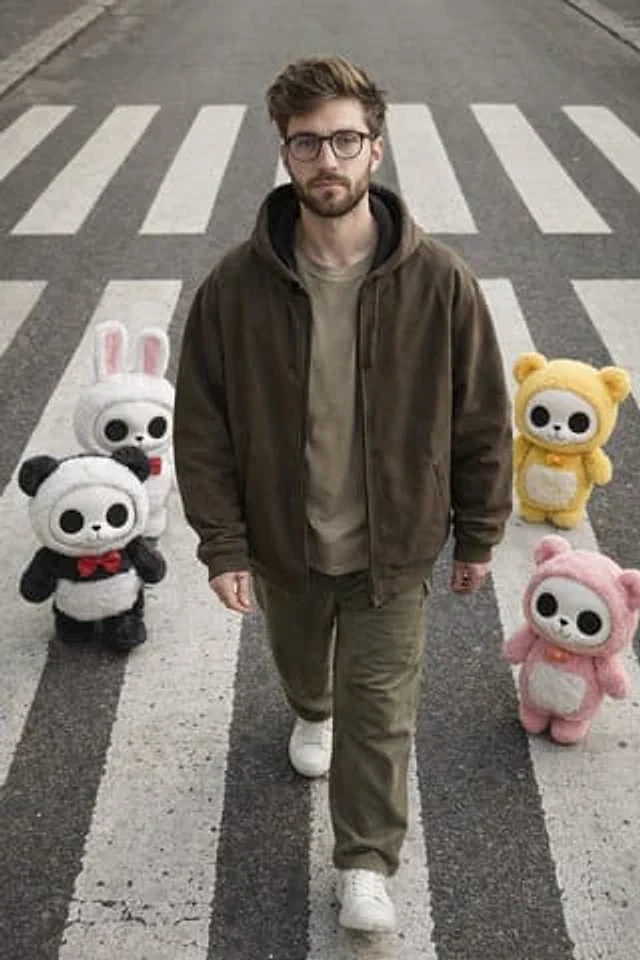

```text
A hyper-realistic iPhone RAW photo, vertical 9:16 ratio, candid street photography style with natural daylight, no filter, no cinematic grading, realistic color balance, Pinterest-style artsy realism.
The camera angle MUST MATCH THE REFERENCE IMAGE EXACTLY: a slightly elevated wide-angle perspective looking down toward a zebra crosswalk, similar to a street-level overhead shot, capturing the full crosswalk lines horizontally with the subject positioned at the center and symmetrically surrounded by characters, maintaining the exact spatial relationship and perspective of the reference photo. A young adult man with an athletic and naturally fit build is walking forward mid-step on the zebra crossing, body orientation, walking direction, and pose following the reference precisely, expression calm, neutral, and candid as if casually crossing the street, not posing. Outfit consists of fashionable casual streetwear with relaxed silhouettes: an oversized jacket in earthy muted tones such as brown, olive, or charcoal, a simple inner shirt, loose straight-cut trousers, and clean minimalist sneakers, creating an effortless modern daily-wear look that supports the calm surreal theme. Props include multiple Popmart Skullpanda characters in fluffy costumes placed around the subject in the SAME formation, spacing, and positioning as the reference image, each Skullpanda featuring soft plush textures, rounded proportions, and varied colors, appearing to walk alongside the human subject on the crosswalk. The location is an empty urban street with a clearly visible zebra crossing, realistic asphalt texture with subtle grain and natural wear, no traffic, no extra people, and an identical street layout perspective to the reference. Camera and composition are wide shot and full-body framing with no portrait crop, handheld but steady feel with slight natural imperfections, realistic depth of field keeping both subject and surrounding characters in focus, matching reference scale and depth. Lighting is natural daylight from above with soft consistent shadows on the ground, balanced exposure, no harsh sunlight, and no dramatic contrast. Skin texture is realistic and human, smooth yet visibly porous with natural highlights and subtle imperfections, no airbrushing, no plastic or CGI skin. Negative prompt: different camera angle, low angle, eye-level shot, close-up portrait, cinematic lighting, HDR, oversharpening, overly smooth skin, CGI look, 3D render, cartoon human, face alteration, distorted anatomy, text, watermark, logo.
```

Model: GPT Image 2
Author: Duet | AI

[ProjectD](https://aitoolsradar.com/en/prompts/1e4a661de0218b) · [Recorded source](https://x.com/Sheldon056/status/2011274988700205370)
 · [Full original metadata and byte evidence](data/projectd-batch-0028.json)

## Duet | AI #214


```text
Ultra-realistic 8K hype-brand product shot of a collectible thermal bottle with a sleek matte black finish and bold urban aesthetic. The bottle features a high-detail 3D character based on the attached reference photo, preserving exact facial identity and structure, styled with a confident, edgy expression.
The character wears oversized streetwear (premium hoodie with layered textures) and a reflective silver chain, inspired by high-end hype fashion. The artwork wraps dynamically around the bottle with a slightly distorted, graffiti-inspired layout for a bold visual impact.
Surrounding elements include vibrant pop-art doodles — flames, arrows, stars, scribbles — with neon accents (electric red, orange, subtle glow effects), creating a high-energy, limited-edition drop feel. Add subtle glitch effects, sticker-style overlays, and micro-branding details to reinforce exclusivity.
Material realism: soft-touch matte coating with fingerprint-level texture, contrasted by glossy UV print highlights and metallic reflections. Cinematic studio lighting with strong contrast, rim light glow, and controlled reflections to enhance depth and luxury street appeal.
Shot composition: centered hero product, low-angle perspective for dominance, shallow depth of field, ultra-clean dark or gradient background. Premium commercial photography style mixed with urban fashion campaign energy. Hyper-detailed, photorealistic, high contrast, sharp focus.
```

Model: GPT Image 2
Author: Duet | AI

[ProjectD](https://aitoolsradar.com/en/prompts/27fdd6905c7f27) · [Recorded source](https://x.com/Sheldon056/status/2039903864074510712)
 · [Full original metadata and byte evidence](data/projectd-batch-0028.json)

## Duet | AI #265

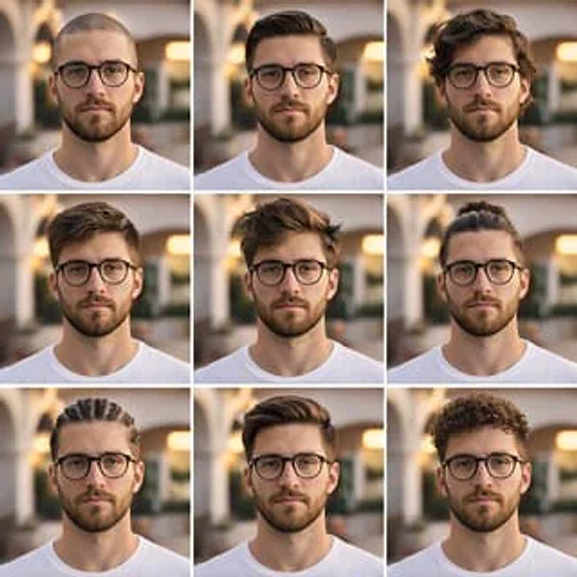

```text
description: "A clean, aesthetic 3x3 collage portrait showcasing different men's hairstyles. The same young man is captured in each frame, positioned in consistent lighting and pose, creating a style comparison grid.",

  "subject": {
    "type": "young man",
    "age": "early 20s",
    "skin_tone": "medium with smooth texture",
    "facial_features": "sharp jawline, well-groomed beard stubble, symmetrical face",
    "expression": "neutral and confident"
  },

  "hairstyles": [
    "clean shaved buzz cut",
    "slicked back classic hairstyle",
    "medium wavy long hair",
    "short textured fringe",
    "voluminous messy hairstyle",
    "man bun",
    "cornrow braids",
    "side swept modern fade",
    "tight curly textured cut"
  ],

  "environment": {
    "location": "outdoor courtyard with white architecture arches",
    "lighting": "soft sunset golden-hour lighting",
    "background": "slightly blurred but clean and minimal"
  },

  "camera": {
    "shot": "shoulder-level portrait",
    "angle": "eye-level",
    "lens": "standard lens (50mm)",
    "composition": "consistent framing for all nine shots"
  },

  "wardrobe": {
    "top": "plain fitted white t-shirt",
    "style": "minimal, clean, modern"
  },

  "mood": [
    "stylish",
    "fresh",
    "groomed",
    "aesthetic"
  ]
}
```

Model: GPT Image 2
Author: Duet | AI

[ProjectD](https://aitoolsradar.com/en/prompts/c54314f266422e) · [Recorded source](https://x.com/Sheldon056/status/2001987275119538341)
 · [Full original metadata and byte evidence](data/projectd-batch-0028.json)

## Duet | AI #30


```text
{
"image_type": "studio portrait",
"composition": {
"framing": "tight head-and-shoulders close-up",
"camera_angle": "eye-level",
"orientation": "vertical",
"symmetry": "near-perfect central symmetry",
"focus": "sharp focus on eyes and facial features",
"depth_of_field": "shallow, background fully blurred to black"
},
"subject": {
"description": "middle-aged male-presenting subject",
"pose": "frontal, facing camera directly",
"expression": "calm, confident, intense gaze",
"eye_direction": "looking straight into lens",
"facial_features": {
"facial_hair": "short salt-and-pepper stubble and trimmed goatee",
"skin_texture": "visible pores and fine lines, realistic skin detail",
"eyes": "light-colored eyes emphasized by catchlights"
},
"hair": {
"style": "medium-length, brushed back",
"texture": "natural, slightly tousled",
"color": "dark brown with subtle gray highlights"
}
},
"wardrobe": {
"top": "white crew-neck t-shirt",
"outerwear": "dark jacket or coat with soft texture",
"accessories": "thin chain necklace partially visible"
},
"lighting": {
"style": "cinematic, high-contrast neon lighting",
"key_light": {
"position": "front-left",
"color": "cool cyan/blue",
"effect": "dominant illumination across face and torso"
},
"rim_light": {
"position": "rear-right",
"color": "saturated red/magenta",
"effect": "strong edge highlight on hair and face contour"
},
"fill_light": "minimal to none",
"contrast_level": "high",
"mood": "dramatic, futuristic, intense"
},
"color_palette": {
"dominant_colors": ["cyan blue", "deep red", "black"],
"color_temperature": "mixed cool and warm neon tones",
"saturation": "high saturation on lighting, neutral clothing tones",
"color_grading": "stylized cyberpunk-inspired grading"
},
"background": {
"environment": "studio",
"details": "pure black background with no visible texture or objects",
"separation": "strong subject-background separation via rim lighting"
},
"technical_details": {
"camera_style": "professional studio photography",
"lens_effect": "slight compression typical of portrait lens",
"estimated_focal_length": "85mm equivalent",
"image_sharpness": "high",
"noise": "minimal",
"dynamic_range": "controlled highlights with deep shadows"
},
"artistic_style": {
"genre": "cinematic portrait",
"influences": ["cyberpunk", "neo-noir", "editorial fashion"],
"visual_aesthetic": "bold, modern, high-impact",
"post_processing": {
"skin_retouching": "subtle, realistic",
"color_enhancement": "strong split-toning blue/red",
"clarity": "enhanced micro-contrast"
}
},
"overall_impression": {
"tone": "powerful and enigmatic",
"intended_use": "editorial, album cover, cinematic poster, AI style reference",
"style_recreation_keywords": [
"cinematic neon portrait",
"blue and red split lighting",
"black background",
"intense direct gaze",
"cyberpunk color grading",
"high-contrast studio lighting"
]
}
}
```

Model: GPT Image 2
Author: Duet | AI

[ProjectD](https://aitoolsradar.com/en/prompts/8961cc20ee575e) · [Recorded source](https://x.com/Sheldon056/status/2002763964476965234)
 · [Full original metadata and byte evidence](data/projectd-batch-0028.json)

## Duet | AI #40

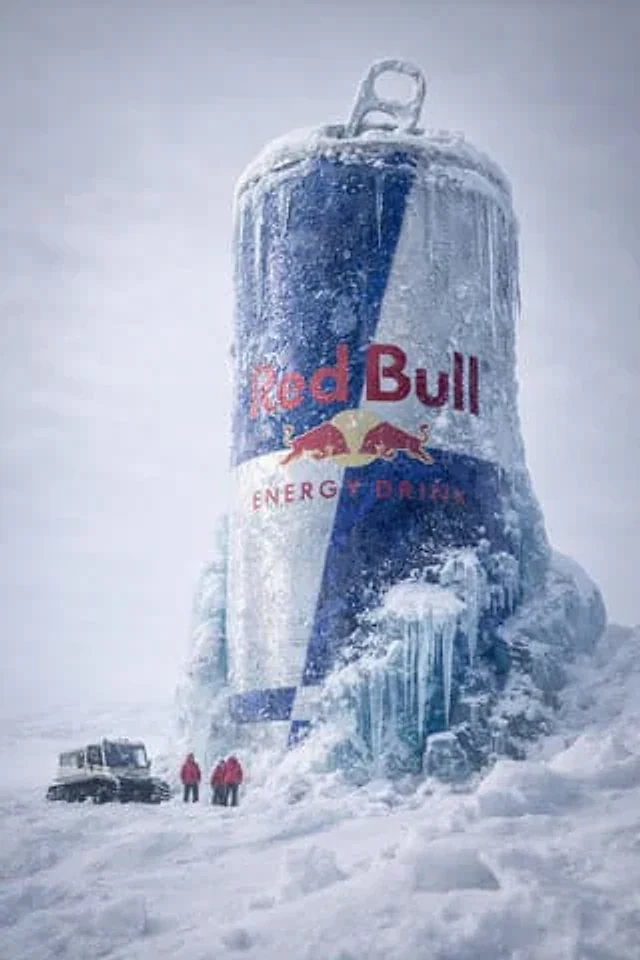

```text
Hyper-realistic cinematic 8k photograph, low-angle wide perspective. A massive Monster Energy can standing vertically like an arctic monument, partially frozen inside thick blue ice and snow. Frost covering the textured surface, icicles forming along the logo and rim, snow filling the pull-tab opening. Snowcat vehicle and scientists in red parkas emphasize scale. Overcast arctic daylight, HDR, ultra-detailed frozen textures, cinematic realism --ar 2:3
```

Model: GPT Image 2
Author: Duet | AI

[ProjectD](https://aitoolsradar.com/en/prompts/6233ccb25e8f8f) · [Recorded source](https://x.com/Sheldon056/status/2021057289785053348)
 · [Full original metadata and byte evidence](data/projectd-batch-0028.json)

## Duet | AI #53


```text
A hyper-realistic 8K close-up portrait of a person's head and upper neck, shot from a slightly low-angle perspective looking upward.
Use the uploaded image as the face reference - the face must match 100% exactly (same identity, facial structure, proportions, skin details, and expression). Do not alter the face in any way.
The subject is wearing bright yellow sunglasses with reflective lenses showing colorful abstract digital scenes in shades of pink, blue, and yellow.
The face is rendered in detailed grayscale, showing realistic skin texture, pores, and light stubble on the jawline, creating strong contrast with the rest of the head.
The hair and most of the head and neck are made of glowing digital circuit patterns, abstract shapes, lines, and data streams in vibrant colors like magenta, cyan, blue, green, yellow, and orange. These elements appear layered and complex, with a soft internal glow.
Parts of the digital head are breaking apart and dissolving outward into pixels, lines, and glitch fragments that fade into a clean white background, giving a glitch-art, futuristic look.
Cinematic lighting highlights one side of the face, with shadows under the chin and subtle rim lighting around the digital elements.
Overall style is futuristic, cyber-inspired, high-detail, and photorealistic.
```

Model: GPT Image 2
Author: Duet | AI

[ProjectD](https://aitoolsradar.com/en/prompts/94fa33dce180f1) · [Recorded source](https://x.com/Sheldon056/status/2016088197714084320)
 · [Full original metadata and byte evidence](data/projectd-batch-0028.json)

## Dunhuang Mural Artistic Template

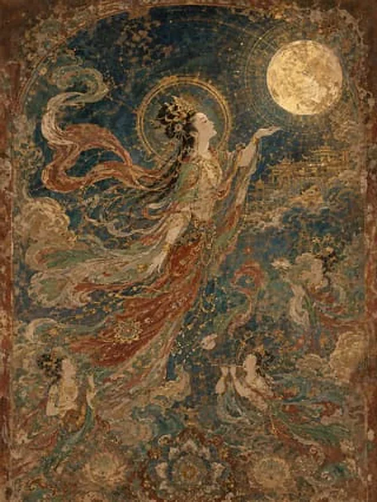

```text
请以 {argument name="主题" default="飞天神女"} 为核心，创作一幅 敦煌壁画风的高端艺术画作。画面采用 {argument name="构图方式" default="以主体角色为唯一主视觉核心"}，表现其核心动作 / 情境的神圣瞬间。整体氛围应为 {argument name="整体氛围" default="神圣、庄严、华丽"}，具有博物馆级审美、文化厚度与收藏级艺术感。

主体形象要求：
主体角色应呈现出优雅庄严、修长华贵、神性强烈的气质，姿态舒展，具有鲜明的敦煌壁画式神圣性与仪式感。面容需静穆、圣洁、含蓄、不可侵犯，带有敦煌壁画中神女 / 菩萨 / 飞天式的庄严气质，而不是普通古风美女。
发髻高挽，佩戴复杂精美的 金饰发冠、珠链步摇、耳饰、璎珞、臂钏、腰饰，服饰华丽，衣纹流畅，线条细劲有力，富有飞天韵律与宫廷级壁画质感。衣袂、飘带、裙摆与袖口应形成富有节奏感的流动曲线，强化神圣升腾感与画面韵律。

用金结构要求：
画面需强化 结构性用金，不是零散点金，而是形成明确的奢华秩序：
主体角色的发冠、首饰、衣缘、袖口、腰封、飘带边线、裙摆纹样采用 描金、泥金、鎏金、金线刺绣、残损金箔痕迹；
核心神圣元素，如月轮 / 佛光 / 法轮 / 宝盖 / 莲台、云纹、莲花花瓣、宝相花、藻井纹饰、团花纹、边框装饰也应带有 清晰可见但克制高级的金色装饰；
整体呈现 金碧辉煌但不俗艳、富丽精工但不廉价 的效果，表现出历经千年风化后仍保有金碧辉煌余韵的 残损奢华感。

色彩要求：
色彩以 赭红、朱砂、青绿、石青、石绿、土黄、象牙白 为主，辅以克制精致的 土金、鎏金。
整体色调要 浓郁、浑厚、古雅、贵气，避免轻飘糖水色。
背景可采用 背景主色氛围，如深邃石青天幕 / 温润古壁底色 / 暗金矿物底色与古壁肌理结合，衬托出主体的神圣与尊贵。

装饰元素要求：
画面可融入 飞天、莲花、宝相花、藻井、祥云、伎乐、团花纹、楼阁宫阙、法器、圣光圆轮、古典边框装饰 等典型敦煌视觉语言，但必须围绕主体集中分布，层级清晰，避免平均铺满全画面。
陪衬人物控制在 陪衬人数位即可，作为礼赞与陪衬，分布在主体周围或下方，形成朝向主体的仪式感动势。她们可陪衬动作，如持莲花 / 奏琵琶 / 吹笛 / 奉花 / 托灯 / 执幡，线条轻盈流动，与主体形成呼应，但不可喧宾夺主。

空间与构图要求：
构图中应保留适度的 云气空间、圣光留白、月光或天幕留白，让画面有呼吸感。
核心神圣元素需醒目、庄严、圆满，周围可有 鎏金光晕、圣光圆轮、细密金线轨迹，强化主题的神圣性。
远处可点缀远景元素，如月宫楼阁 / 云中宫阙 / 佛国建筑 / 仙界天幕，但不可过多，以增强空间层次与仙界气息。

材质表现要求：
需强调古老石窟壁画与矿物颜料肌理：
可见 斑驳、裂纹、风化、轻微剥落、历史包浆、粉化边缘、古壁肌理；
同时保留局部 描金、残损金箔、磨蚀后的鎏金光泽，形成 “旧而贵、残而华、古而神圣” 的高级艺术质感。
整体要求：华丽、细腻、神秘、庄严、统一、收藏级、艺术化、高级感极强。

负面约束词：
避免现代国潮风，避免商业插画感，避免普通古风美女插画，避免动漫感，避免网红审美，避免塑料质感，避免廉价土豪金，避免金色过亮过俗，避免荧光色，避免过度饱和，避免人物过多，避免背景元素过满，避免装饰平均铺满全画面，避免碎花感过重，避免视觉主次不清，避免主体不突出，避免低级堆砌感，避免平庸感，避免轻浮感，避免现代服装感，避免摄影感，避免3D建模塑料感。
```

Model: GPT Image 2
Author: Larus Canus

[ProjectD](https://aitoolsradar.com/en/prompts/955f638aea7f12) · [Recorded source](https://youmind.com/prompts/dunhuang-mural-artistic-template-22369)
 · [Full original metadata and byte evidence](data/projectd-batch-0028.json)

## Dürer Style Sorcery Prompt

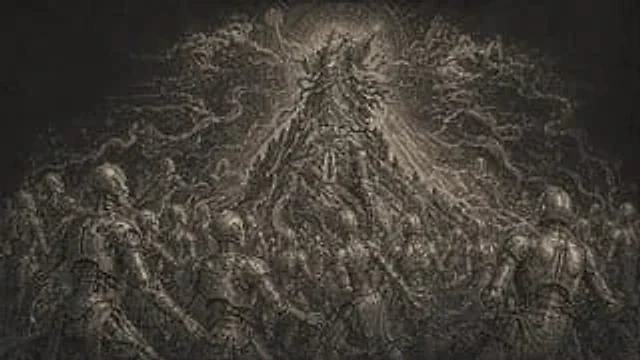

```text
{argument name="style" default="duhrer"} {argument name="subject" default="sorcery"}
```

Model: GPT Image 2
Author: GPT Image 2 Prompts

[ProjectD](https://aitoolsradar.com/en/prompts/8cd48dfa621664) · [Recorded source](https://x.com/faanross/status/2047826101519401274)
 · [Full original metadata and byte evidence](data/projectd-batch-0028.json)

## Durian Ripening Lifecycle Infographic

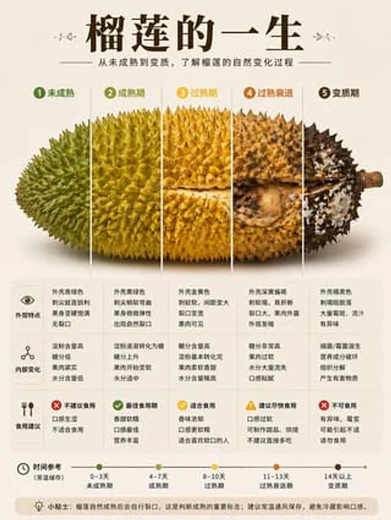

```text
{
  "type": "Chinese infographic poster",
  "topic": "Durian ripening cycle",
  "style": "Concise, editable food science infographics with high information density, combining realistic fruit cutout photography with a minimalist flat design, warm beige background, and high-quality social media science charts.",
  "canvas": {
    "orientation": "portrait",
    "aspect_ratio": "3:4"
  },
  "headline": {
    "title": "{argument name=\"headline text\" default=\"The life of a durian\"}",
    "subtitle": "From unripe to spoiled, understand the natural transformation process of durian."
  },
  "main_visual": {
    "subject": "A whole durian is placed horizontally in the center, with the stem facing right, against a light beige background with soft diffused shadows below.",
    "segmentation": {
      "count": 5,
      "direction": "Vertical slices, separated by thin white dividing lines.",
      "stages": [
        {
          "index": 1,
          "label": "immature",
          "badge_color": "olive green",
          "appearance": "The leftmost part has a green shell with dense, sharp thorns, and appears hard and unripe."
        },
        {
          "index": 2,
          "label": "Maturity",
          "badge_color": "yellow green",
          "appearance": "Yellowish-green shell, with slightly curved spiky tips, the outer shell begins to crack naturally."
        },
        {
          "index": 3,
          "label": "Overripe",
          "badge_color": "golden yellow",
          "appearance": "The fruit has a golden-yellow shell with a widened crack, revealing pale cream-colored flesh at the horizontal opening."
        },
        {
          "index": 4,
          "label": "Overripe decline",
          "badge_color": "orange brown",
          "appearance": "The fruit has a dark yellowish-brown shell with obvious cracks and cavities, a sunken interior, and dark stains on the surface."
        },
        {
          "index": 5,
          "label": "Deterioration period",
          "badge_color": "dark brown",
          "appearance": "The nearly black, rotten fruit shell was covered with white mold spots, and the right end near the stem was severely rotten."
        }
      ]
    }
  },
  "layout": {
    "sections": [
      {
        "title": "Appearance features",
        "position": "lower table row 1 left label",
        "count": 5,
        "cells": [
          "The outer shell is greenish-blue with straight, sharp spines; the fruit is firm and plump, without any cracks.",
          "The outer shell is yellowish-green, the spines are slightly soft and curved, the fruit body is slightly elastic, and natural cracks appear.",
          "The outer shell is golden yellow, the spines are softer, the spacing between them is larger, the cracks are wider, and the flesh is visible.",
          "The outer shell is dark yellow to brownish, the spines are relatively flat, it is easily broken, the cracks are large, the flesh is exposed, and the appearance is dull.",
          "The shell is brownish-black, the spines are collapsed and fallen off, there are many mold spots and oozing sap, and it has an odor."
        ]
      },
      {
        "title": "Internal changes",
        "position": "lower table row 2 left label",
        "count": 5,
        "cells": [
          "High in starch, low in sugar, with firm flesh and low in moisture content.",
          "As starch gradually converts into sugar, the sugar content rises, the pulp begins to soften, and the moisture content becomes moderate.",
          "High sugar content, with most of the starch converted, resulting in soft, sweet flesh and a slightly high water content.",
          "The sugar content is very high, the flesh is too soft, and it loses a lot of moisture, resulting in a sticky texture.",
          "Bacterial/mold growth destroys nutrients, decomposes tissues, and produces harmful substances."
        ]
      },
      {
        "title": "Consumption suggestions",
        "position": "lower table row 3 left label",
        "count": 5,
        "cells": [
          "It is not recommended for consumption; it has a raw and astringent taste and is not suitable for eating.",
          "At its peak, it is sweet, soft, and chewy, offering the best taste and rich nutrition.",
          "It's delicious, with a rich aroma and a soft, chewy texture, perfect for those who prefer a softer taste.",
          "It is recommended to consume it as soon as possible. Its texture is quite soft; it can be used in desserts and baking, but it is not recommended to eat large quantities directly.",
          "Do not consume. It has an unusual odor, is moldy, and may cause discomfort."
        ]
      },
      {
        "title": "Time reference (room temperature storage)",
        "position": "bottom timeline",
        "count": 5,
        "labels": [
          "0–3 days immature period",
          "4–7 days to mature",
          "8–10 days past maturity",
          "11–13 days of over-ripe decline",
          "More than 14 days of spoilage period"
        ]
      }
    ],
    "footer_note": "Tip: Durian will naturally split open when it ripens, which is an important sign of ripeness; it is recommended to store it at room temperature in a ventilated place and avoid refrigeration as it will affect the taste."
  },
  "design_details": {
    "palette": [
      "beige",
      "dark brown",
      "olive green",
      "yellow green",
      "golden yellow",
      "orange brown"
    ],
    "typography": "Large, bold Chinese font for the headings, and smaller, simple sans-serif body text.",
    "icons": "The four small category icons on the left side of the table are: an eye for appearance, a molecule/network icon for internal changes, a knife and fork for consumption suggestions, and a clock for the timeline.",
    "composition": "The symmetrical infographic features a large fruit at the top and a rounded-corner comparison table at the bottom."
  }
}
```

Model: GPT Image 2
Author: GPT Image 2 Prompts

[ProjectD](https://aitoolsradar.com/en/prompts/916be9335eb388) · [Recorded source](https://x.com/eternityspring/status/2047237622280716727#reversed-1)
 · [Full original metadata and byte evidence](data/projectd-batch-0028.json)

## Dust-Drawn Symbol on Car Hood


```text
A lifelike close-up photograph shows the hood of a dark blue or black car parked outdoors, covered in a thick layer of beige dust and pollen. In the center of the hood, a large, clearly defined emblem shape is drawn with a finger across the dust, revealing the glossy paint underneath. The symbol is a circular mark with a raised dot at the center, surrounded by eight segmented stripes: a wide, curved segment at the top, three horizontal stripe segments on the left and right, and a wide, sloping segment at the bottom. A realistically placed adult hand with grime-covered fingernails rests on the lower right corner of the hood, as if the symbol had just been drawn. Scratches, grime, and finger marks are visible in the dust around the edges of the design. The upper left corner includes part of the windshield and a windshield wiper, with the soft reflections of trees reflected in the glass and paint. The background is a slightly blurred parking lot, showing the road surface, curbs, and three tree trunks illuminated by sunlight. Warm afternoon natural light, shallow depth of field, high-detail reflections on the car's surface, documentary-style composition, and the aspect ratio of a portrait mobile phone photo.
```

Model: GPT Image 2
Author: GPT Image 2 Prompts

[ProjectD](https://aitoolsradar.com/en/prompts/1f8dccbcdf8aca) · [Recorded source](https://x.com/peter6759/status/2046780910352388409#reversed-0)
 · [Full original metadata and byte evidence](data/projectd-batch-0028.json)

## Dynamic Anime Magic Action Scene

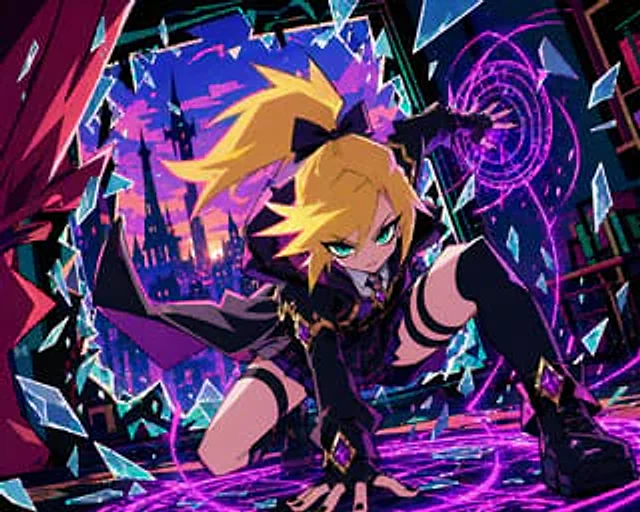

```text
A dynamic anime illustration featuring a character with {argument name="hair color" default="gold"} A girl with spiky hair and a high ponytail tied with a black bow, she had deep blue eyes and wore {argument name="outfit style" default="Deep purple and black magic uniform with gold trim and diamond gems"} She was in a dramatic superhero landing pose, one hand on the ground, the other raised upwards, unleashing {argument name="magic color" default="Glowing purple"} A magic circle. She is shattering a glass barrier, sharp and jagged shards of glass flying towards the audience. Through the broken frame behind her, one can see {argument name="background scene" default="A stylized silhouette of a Gothic city, with towering spires silhouetted against a vibrant purple-orange sunset sky."} The entire work presents{argument name="art style" default="Sharp lines, high-contrast celluloid shadows, and vibrant colors"} .
```

Model: GPT Image 2
Author: GPT Image 2 Prompts

[ProjectD](https://aitoolsradar.com/en/prompts/b31860003197a2) · [Recorded source](https://x.com/UNIBRACITY/status/2046272561684873496#reversed-0)
 · [Full original metadata and byte evidence](data/projectd-batch-0028.json)

## Dystopian Woman by Frozen Waterfront


```text
This is a cinematic, dystopian winter twilight scene, the perspective shifting from a sheltered riverbank foreground to a dark modern city skyline, with hundreds of tiny, warm window lights twinkling in the distance. In the left foreground, a stylish woman with dark curly hair is shown in three-quarter profile, her face deliberately obscured by a soft, rectangular blur, a lit cigarette dangling from her lips. She wears a black lace high-necked sheer dress adorned with delicate floral embroidery and dangling earrings, showcasing a captivating film noir aesthetic. The ground around her is wet and icy, scattered with trash; in the right foreground, gleaming black garbage bags are piled, and debris litters the frozen bank. In the midground, amidst the icy water, sits a large, weathered metal bowl or basin, filled with snow and prominently marked with text.{argument name="headline text" default="USA"} Three tiny human figures stand nearby for scale reference. Bare tree branches form the frame in the upper left corner. The overall tone is cool blue-gray, accented with amber-colored city lights. The image presents a rough, painterly realism with obvious AI image artifacts: the entire scene (especially in the shadows) is scattered with visible tiny glowing spots and noisy meshes, as if it came from a flawed generative model.
```

Model: GPT Image 2
Author: GPT Image 2 Prompts

[ProjectD](https://aitoolsradar.com/en/prompts/7420ddd3f907d8) · [Recorded source](https://x.com/mark_k/status/2046915269784731941#reversed-3)
 · [Full original metadata and byte evidence](data/projectd-batch-0028.json)

## Dystopian Woman by Frozen Waterfront

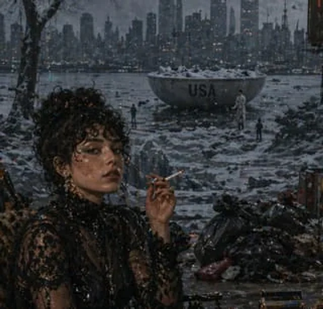

```text
A moody cinematic dystopian winter scene at dusk, viewed from a sheltered riverside foreground toward a dark modern city skyline glowing with hundreds of tiny warm window lights. In the left foreground, a stylish woman with dark curly hair sits in three-quarter view, her face intentionally obscured by a soft rectangular blur, holding a lit cigarette near her lips. She wears a sheer black lace high-neck dress with intricate floral embroidery, dangling earrings, and a glamorous noir aesthetic. The ground around her is wet, icy, and littered with trash, with glossy black garbage bags piled on the right foreground and scattered debris across the frozen shoreline. Across the icy water in the midground sits a huge weathered metal bowl or basin filled with snow, prominently marked with the text {argument name="headline text" default="USA"}. Three tiny human figures stand near it for scale. Bare tree branches frame the upper left. The overall palette is cold blue-gray with amber pinpricks of city light, and the whole image should have a gritty, painterly-photoreal look with a distinct artificial image artifact pattern: a visible grid of tiny glowing specks and dot noise scattered across the entire scene, especially in dark areas, as if from a flawed generative model output.
```

Model: GPT Image 2
Author: Mark Kretschmann

[ProjectD](https://aitoolsradar.com/en/prompts/26deca725490c0) · [Recorded source](https://youmind.com/prompts/dystopian-woman-frozen-waterfront-15076)
 · [Full original metadata and byte evidence](data/projectd-batch-0028.json)

## E-commerce Earbuds Infographic Prompt

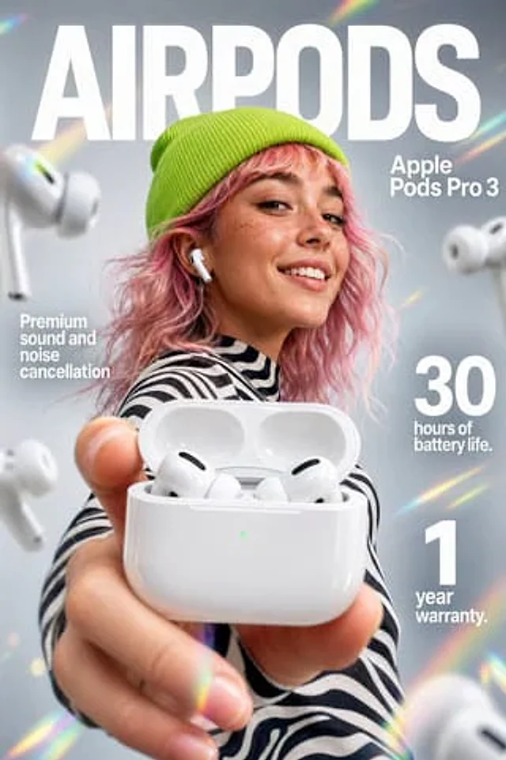

```text
For "{argument name="product name" default="Apple Pods Pro 3"} "A high-impact e-commerce infographic for wireless earbuds. Foreground: A visually striking close-up shot shows a hand holding an open, glossy white wireless earbud charging case facing the camera. Inside the case are two stylish white earbuds with black speaker details. A tiny green LED status indicator is visible on the front of the charging case. The hand and charging case have a slight macro lens blur effect to create a sense of depth. Main subject: In the mid-ground is a smiling young woman with freckles and wavy hair."{argument name="hair color" default="Soft pink"} Hair. She wears a bright lime green knit hat and a black and white striped psychedelic long-sleeved shirt. One of the white earphones is in her ear. Background and lighting: A clean, soft-focus studio background with a light gray gradient. The scene is punctuated by diagonal rainbow prism light spots and soft light leaks. Several blurry white earphones float in the background, adding an artistic touch. The soft, professional lighting highlights the glossy plastic texture of the product. Typography and layout (sans-serif font, white): Top center (background): Large, bold text "{argument name="main brand text" default="AIRPODS"} (Placed behind the model). Top right: Bold text "Apple Pods Pro 3". Center left: Text "Superior sound and noise cancellation". Center right: Large bold "30", with the caption "Hours of battery life" below. Bottom right: Large bold "1", with the caption "Yearly warranty" below. Style: 8K resolution, commercial product photography, vibrant color scheme, sharp product box focus, shallow depth of field, and minimalist advertising aesthetics.
```

Model: GPT Image 2
Author: GPT Image 2 Prompts

[ProjectD](https://aitoolsradar.com/en/prompts/18702ffa9aef30) · [Recorded source](https://x.com/rovvmut_/status/2047912710365761828)
 · [Full original metadata and byte evidence](data/projectd-batch-0028.json)

## E-commerce Earbuds Infographic Prompt


```text
High-impact e-commerce infographic for "{argument name="product name" default="Apple Pods Pro 3"}" wireless earbuds.
Foreground: An extreme close-up of a hand holding an open, glossy white wireless earbud charging case toward the camera. Inside the case are two sleek white earbuds with black speaker accents. A tiny, glowing green LED status light is visible on the front of the case. The hand and case have a slight macro-lens blur to create a sense of depth.
Central Subject: In the mid-ground, a smiling young woman with freckles and wavy {argument name="hair color" default="pastel-pink"} hair. She is wearing a vibrant lime-green knit beanie and a psychedelic, black and white-striped long-sleeve shirt. One white earbud is tucked into her ear.
Background & Lighting: A clean, soft-focus studio backdrop with a light-gray gradient. The scene is accented by diagonal rainbow prism lens flares and soft light leaks. Several blurred white earbuds float artistically in the background. The lighting is soft and professional, highlighting the glossy plastic of the product.
Typography & Layout (Sans-Serif, White):
Top Center (Background): Massive, bold text reading "{argument name="main brand text" default="AIRPODS"}" (positioned behind the model).
Top Right: Bold text reading "Apple Pods Pro 3".
Mid-Left: "Premium sound and noise cancellation"
Mid-Right: Large, bold "30" with the text "hours of battery life."
Bottom-Right: Large, bold "1" with the text "year warranty."
Style: 8k resolution, commercial product photography, vibrant color palette, sharp focus on the product case, shallow depth of field, clean advertising aesthetic.
```

Model: GPT Image 2
Author: Heisenberg

[ProjectD](https://aitoolsradar.com/en/prompts/8fd3d757415e52) · [Recorded source](https://youmind.com/prompts/earbuds-infographic-closeup-model-15877)
 · [Full original metadata and byte evidence](data/projectd-batch-0028.json)

## E-commerce LED Driver Infographic


```text
{
  "type": "E-commerce product information image",
  "theme": "Dark mode, paired with{argument name=\"accent color\" default=\"orange color\"} embellishment",
  "product": {
    "brand": "{argument name=\"brand name\" default=\"MEAN WELL\"}",
    "model": "{argument name=\"product model\" default=\"ELG-100-24B\"}",
    "description": "100W constant current LED driver, rectangular silver metal housing, with black cables at both ends and detailed specification labels."
  },
  "layout": {
    "sections": [
      {
        "name": "Homepage Display Area",
        "elements": [
          "Brand logo in the top left corner",
          "Main title:{argument name=\"main headline\" default=\"Outdoor stable power supply\"} '",
          "Subtitle: Wide voltage input, protective housing...",
          "Large product oblique side view",
          "The '100W' watermark is faded in the background."
        ]
      },
      {
        "name": "Feature Highlights",
        "count": 3,
        "panels": [
          {
            "title": "Precision manufacturing",
            "visual": "Close-up of specification label"
          },
          {
            "title": "Stable connection",
            "visual": "Close-up of cable inlet and mounting lug"
          },
          {
            "title": "Core Features",
            "visual": "The product is shown from a side angle, with three lines pointing to the text: '100~305VAC input', 'Constant current output', and 'IP67 / IP65 protective enclosure'."
          }
        ]
      },
      {
        "name": "Application scenarios",
        "count": 4,
        "panels": [
          {
            "title": "Street lighting",
            "visual": "Highway illuminated by streetlights at night"
          },
          {
            "title": "Outdoor projects",
            "visual": "Modern building facades with architectural landscape lighting"
          },
          {
            "title": "Indoor system",
            "visual": "Modern commercial corridor with linear ceiling lights"
          },
          {
            "title": "dimming control",
            "visual": "Electrical control box with 4 labels: '0-10V', 'PWM', 'Resistor', 'DALI'"
          }
        ]
      },
      {
        "name": "Environmental protection",
        "elements": [
          "The product, when placed on a damp surface, creates a water droplet and rain effect.",
          "Title: 'Protective Performance'",
          "Description text regarding indoor/outdoor use and active PFC",
          "badge:'{argument name=\"warranty years\" default=\"5\"} 3-year warranty"
        ]
      },
      {
        "name": "Technical Specifications",
        "elements": [
          "Title: 'Lighting Power Supply Technology'",
          "Four key points marked with checkmarks: '100~305VAC input', 'Active PFC', 'Low standby power consumption &lt;0.5W', '0~10V / PWM / Resistor / DALI'",
          "Display image of the product glowing against a futuristic circuit board background."
        ]
      }
    ]
  }
}
```

Model: GPT Image 2
Author: GPT Image 2 Prompts

[ProjectD](https://aitoolsradar.com/en/prompts/c529a719564adc) · [Recorded source](https://x.com/AmberPromptai/status/2045057984200687645#reversed-0)
 · [Full original metadata and byte evidence](data/projectd-batch-0028.json)

## E-commerce Live Stream UI Mockup


```text
{
  "type": "Mobile live streaming UI prototype",
  "subject": {
    "description": "A young Asian woman, dressed in a light peach-colored traditional Hanfu embroidered with flowers, wearing ornate gold jewelry adorned with pink flowers and pearl hairpins, smiles and gazes at the camera, holding a round tin of floral tea.",
    "foreground_objects": {
      "count": 5,
      "items": [
        "The round can held by the anchor",
        "Round jar on the table",
        "The rectangular gift box on the table",
        "The opened jar contained dried tea leaves.",
        "A clear glass teacup filled with blooming pink flowers"
      ],
      "labels": [
        "Peony Flower Tea"
      ]
    },
    "background": "Traditional Chinese interior design, warm lighting, wooden lattice screen, pink floral branches"
  },
  "ui_layout": {
    "top_bar": {
      "elements": [
        "19:37",
        "signal bar",
        "WiFi",
        "Battery"
      ]
    },
    "top_left": {
      "host_info": {
        "name": "{argument name=\"host name\" default=\"Xiaoya&#39;s Chinese Style Selections\"}",
        "stats": "830,000 likes for this match",
        "button": "focus on"
      },
      "badges": [
        "Top Sellers",
        "Popularity Ranking"
      ],
      "promo_banner": "Get coupons for even better deals! Click to claim"
    },
    "top_right": {
      "viewers": {
        "count": 3,
        "text": "100,000+",
        "close_button": "X"
      },
      "links": [
        "More live streams &gt;"
      ],
      "event_banner": {
        "title": "{argument name=\"event banner text\" default=\"Douyin 618 Shopping Festival\"}",
        "dates": "5.24-6.18"
      }
    },
    "mid_left_events": {
      "gift_count": 2,
      "gifts": [
        {
          "user": "Cola",
          "action": "Send a little heart",
          "combo": "x 16"
        },
        {
          "user": "An'an",
          "action": "Send popularity votes",
          "combo": "x 21"
        }
      ],
      "join_notification": "Joined the live stream"
    },
    "bottom_left_chat": {
      "message_count": 5,
      "messages": [
        "{argument name=\"chat message\" default=\"Does this herbal tea, as mentioned by the host, have beauty and skin-nourishing effects?\"}",
        "The packaging is so beautiful!",
        "I placed an order through link #2, looking forward to it shipping!",
        "Let the host talk about the effects.",
        "I've already bought it three times, the taste is just right!"
      ]
    },
    "bottom_product_card": {
      "title": "Xiaoya's Choice{argument name=\"product name\" default=\"Peony Flower Tea\"} Gift box",
      "guarantee": "Damaged or damaged goods are eligible for a 7-day no-questions-asked return policy.",
      "price": "{argument name=\"product price\" default=\"¥ 89.9\"}",
      "button": "Rob"
    },
    "bottom_nav_bar": {
      "input_placeholder": "Say something...",
      "icons_count": 5,
      "icons": [
        "smiley face",
        "shopping cart",
        "Gift",
        "Love",
        "More options"
      ]
    }
  }
}
```

Model: GPT Image 2
Author: GPT Image 2 Prompts

[ProjectD](https://aitoolsradar.com/en/prompts/b4caa4f4a1e523) · [Recorded source](https://x.com/joshesye/status/2044776883049451619#reversed-3)
 · [Full original metadata and byte evidence](data/projectd-batch-0028.json)

## E-commerce Live Stream UI Mockup


```text
{
  "type": "E-commerce live streaming interface design draft",
  "subject": {
    "description": "A young Asian woman with long, wavy hair, wearing a white short-sleeved polo shirt and a white pleated tennis skirt, carrying a white tennis racket on her right shoulder, looks directly at the camera with a gentle expression.",
    "background": "Soft light gray studio background"
  },
  "layout": {
    "header": {
      "left": {
        "avatar": "Female avatar",
        "name": "{argument name=\"host name\" default=\"Little Deer Sports Preferred\"}",
        "stats": "128,000 likes for this match",
        "button": "focus on",
        "badge": "3rd on the sales ranking"
      },
      "right": {
        "viewer_avatars_count": 3,
        "viewer_count": "12,000",
        "close_icon": "X"
      }
    },
    "floating_elements": [
      {
        "position": "Top right corner",
        "type": "coupon cards",
        "title": "Exclusive coupons for live stream",
        "details": "¥20 available for orders over ¥199",
        "button": "receive"
      },
      {
        "position": "Middle left",
        "type": "Event copywriting",
        "subtitle": "Summer Sports Season",
        "headline": "{argument name=\"main headline\" default=\"Energetic opening\"}",
        "bullet_points_count": 3,
        "bullet_points": [
          "Breathable and quick-drying",
          "Elastic and comfortable",
          "versatile for sports"
        ]
      },
      {
        "position": "Middle right",
        "type": "Currently explaining the product card",
        "badge": "Explaining",
        "image": "Flat lay image of white polo shirt and skirt",
        "title": "{argument name=\"product name\" default=\"Sports Polo Shirt Set\"}",
        "details": "White, size M",
        "price": "{argument name=\"price\" default=\"¥129\"}",
        "button": "Go grab it"
      },
      {
        "position": "bottom right corner",
        "type": "Secondary product cards",
        "badge": "Hot Selling Item x 156",
        "image": "The model is wearing the outfit",
        "title": "Women's sports polo shirt set, breathable, quick-drying, slimming, and versatile.",
        "tags": [
          "7-day no-reason return policy",
          "Freight Insurance"
        ],
        "price": "¥129",
        "button": "Rob"
      }
    ],
    "chat_overlay": {
      "position": "bottom left corner",
      "message_count": 5,
      "messages": [
        "Sister Deer: Welcome new friends to the live stream!",
        "Sports enthusiast:{argument name=\"chat message\" default=\"This outfit is beautiful!\"}",
        "Kakashi: Is the fabric breathable?",
        "Little Deer Sports Choice: Our fabric is ice silk, quick-drying, so it won't feel stuffy or hot even when you sweat during exercise!",
        "User_6789: Already bought it!"
      ],
      "purchase_alert": "User_6789 and two others are currently making a purchase."
    },
    "footer": {
      "input_bar": "Say something...",
      "icons_count": 5,
      "icons": [
        "smile",
        "shopping cart",
        "heart",
        "share",
        "more"
      ]
    }
  }
}
```

Model: GPT Image 2
Author: GPT Image 2 Prompts

[ProjectD](https://aitoolsradar.com/en/prompts/4183903ddbb443) · [Recorded source](https://x.com/coconut_256/status/2045026556561719581#reversed-1)
 · [Full original metadata and byte evidence](data/projectd-batch-0028.json)

## E-commerce Live Stream UI Mockup


```text
{
  "type": "Live Streaming UI Mockup",
  "subject": {
    "description": "{argument name=\"host name\" default=\"Elon Musk\"} The portrait shows a smiling face, wearing a black T-shirt with a white technical illustration printed on it.",
    "background": "The left side displays with '{argument name=\"left background logo\" default=\"SPACEX\"} The text on the screen is displayed in red on the right.{argument name=\"right background logo\" default=\"Tesla T logo\"} 'and a dark-colored car"
  },
  "ui_overlay": {
    "top_header": {
      "host_info": "Avatar, Name{argument name=\"host name\" default=\"Elon Musk\"} The subtitle reads \"556,000 Likes for This Match,\" and the red \"Follow\" button is also included.",
      "rank_badge": "A gold coin icon with \"Number 1 in the entire site\"",
      "viewer_stats": "Three viewer avatars are displayed at the top, showing '123,000', '86,000', and '57,000', totaling '687,000', with an 'X' button for closing.",
      "right_links": "More live streams &gt;, Gift Hall 0/24 (with blue 'Classic' tag)"
    },
    "mid_left_gifts": {
      "count": 2,
      "items": [
        "Profile picture: 'Tech enthusiast', 'Sending little hearts', 1314 heart icons",
        "Profile picture 'Starry Sky and Sea', 'Send Rocket', Rocket icon x 666"
      ]
    },
    "bottom_left_chat": {
      "system_message": "Level 37 Medal 'Cosmic Wanderer Joins the Livestream'",
      "message_count": 7,
      "messages": [
        "Little Rocket: Musk! The future is bright! 🚀",
        "Future: When will the Tesla Model 2 be released?",
        "Starry Dreamer: Will SpaceX be able to go to Mars this year?",
        "AI Explorer: What's the progress of Neuralink?",
        "Handsome netizen: Hello Mr. Ma!",
        "Mars: This is my first time watching your live stream, I'm so excited!",
        "User 123: Talk about AI. Will it replace humans?"
      ]
    },
    "bottom_right_product_card": {
      "hot_tag": "Orange 'Hot Selling x 1888'",
      "image": "Tesla Cybertruck",
      "title": "{argument name=\"product name\" default=\"Tesla Cybertruck electric pickup truck\"}",
      "price": "{argument name=\"product price\" default=\"¥ 1,618,000\"}",
      "button": "Red 'Grab' button",
      "floating_animation": "The translucent heart floats upwards along its right edge."
    },
    "bottom_bar": {
      "input_field": "'Say something...'",
      "icons": [
        "smiley face",
        "Three points",
        "shopping cart",
        "gift box",
        "share"
      ]
    }
  }
}
```

Model: GPT Image 2
Author: GPT Image 2 Prompts

[ProjectD](https://aitoolsradar.com/en/prompts/e393a5263274ef) · [Recorded source](https://x.com/sjbbxhz/status/2045684734714380687#reversed-0)
 · [Full original metadata and byte evidence](data/projectd-batch-0028.json)

## E-commerce Live Stream UI Mockup


```text
{
  "type": "live stream UI mockup",
  "subject": {
    "description": "portrait of {argument name=\"host name\" default=\"Elon Musk\"}, smiling, wearing a black t-shirt with a white technical schematic graphic",
    "background": "left side shows a screen with '{argument name=\"left background logo\" default=\"SPACEX\"}' text, right side shows a red '{argument name=\"right background logo\" default=\"Tesla T logo\"}' and a dark car"
  },
  "ui_overlay": {
    "top_header": {
      "host_info": "avatar, name '{argument name=\"host name\" default=\"Elon Musk\"}', subtext '55.6万本场点赞', red '关注' button",
      "rank_badge": "gold coin icon with '全站第1名'",
      "viewer_stats": "3 top viewer avatars with '12.3w', '8.6w', '5.7w', total '68.7万', 'X' close button",
      "right_links": "'更多直播 >', '礼物展馆 0/24' with blue '经典' tag"
    },
    "mid_left_gifts": {
      "count": 2,
      "items": [
        "avatar '科技爱好者', '送小心心', heart icon x 1314",
        "avatar '星辰大海', '送火箭', rocket icon x 666"
      ]
    },
    "bottom_left_chat": {
      "system_message": "level 37 badge '宇宙漫游者 加入了直播间'",
      "message_count": 7,
      "messages": [
        "小火箭: 马斯克！未来可期！🚀",
        "future: 特斯拉Model 2什么时候出？",
        "星空梦想家: SpaceX今年能上火星吗？",
        "AI探索者: Neuralink进展如何？",
        "帅气的网友: 马总好！",
        "Mars: 第一次来你的直播，超激动！",
        "用户123: 讲讲AI吧，会取代人类吗？"
      ]
    },
    "bottom_right_product_card": {
      "hot_tag": "orange '热卖 x 1888'",
      "image": "Tesla Cybertruck",
      "title": "{argument name=\"product name\" default=\"特斯拉Cybertruck 电动皮卡\"}",
      "price": "{argument name=\"product price\" default=\"¥ 1,618,000\"}",
      "button": "red '抢' button",
      "floating_animation": "translucent hearts floating up the right edge"
    },
    "bottom_bar": {
      "input_field": "'说点什么...'",
      "icons": ["smiley face", "three dots", "shopping cart", "gift box", "share"]
    }
  }
}
```

Model: GPT Image 2
Author: 神经病不想好转

[ProjectD](https://aitoolsradar.com/en/prompts/fb469f7a1be9a8) · [Recorded source](https://youmind.com/prompts/ecommerce-live-stream-mockup-14036)
 · [Full original metadata and byte evidence](data/projectd-batch-0028.json)

## E-commerce Live Stream UI Mockup


```text
{
  "type": "mobile live stream UI mockup",
  "subject": {
    "description": "young Asian woman in traditional light peach Hanfu with floral embroidery, ornate gold and pearl hairpins with pink flowers, smiling, looking at camera, holding a round tin of floral tea",
    "foreground_objects": {
      "count": 5,
      "items": [
        "round tin held by host",
        "round tin on table",
        "rectangular box on table",
        "open tin with dried tea leaves",
        "clear glass teacup with blooming pink flower"
      ],
      "labels": ["牡丹花茶"]
    },
    "background": "traditional Chinese interior, warm lighting, wooden lattice screens, pink floral branches"
  },
  "ui_layout": {
    "top_bar": {
      "elements": ["19:37", "signal bars", "wifi", "battery"]
    },
    "top_left": {
      "host_info": {
        "name": "{argument name=\"host name\" default=\"小雅国风严选\"}",
        "stats": "83.0万本场点赞",
        "button": "关注"
      },
      "badges": ["带货榜", "人气榜"],
      "promo_banner": "领券下单更优惠 点击领取"
    },
    "top_right": {
      "viewers": {
        "count": 3,
        "text": "10万+",
        "close_button": "X"
      },
      "links": ["更多直播 >"],
      "event_banner": {
        "title": "{argument name=\"event banner text\" default=\"抖音618好物节\"}",
        "dates": "5.24-6.18"
      }
    },
    "mid_left_events": {
      "gift_count": 2,
      "gifts": [
        {"user": "可乐", "action": "送小心心", "combo": "x 16"},
        {"user": "安安", "action": "送人气票", "combo": "x 21"}
      ],
      "join_notification": "加入了直播间"
    },
    "bottom_left_chat": {
      "message_count": 5,
      "messages": [
        "{argument name=\"chat message\" default=\"主播这款花茶喝了美容养颜吗？\"}",
        "包装也太好看了吧！",
        "拍了2号链接，期待发货~",
        "主播讲讲功效呗",
        "已经回购三次了，味道很正！"
      ]
    },
    "bottom_product_card": {
      "title": "小雅严选 {argument name=\"product name\" default=\"牡丹花茶\"}礼盒装",
      "guarantee": "坏损包退 7天无理由退货",
      "price": "{argument name=\"product price\" default=\"¥ 89.9\"}",
      "button": "抢"
    },
    "bottom_nav_bar": {
      "input_placeholder": "说点什么...",
      "icons_count": 5,
      "icons": ["smiley", "shopping cart", "gift", "heart", "more options"]
    }
  }
}
```

Model: GPT Image 2
Author: 行者AI视频

[ProjectD](https://aitoolsradar.com/en/prompts/d5a0712f008541) · [Recorded source](https://youmind.com/prompts/ecommerce-live-stream-ui-13790)
 · [Full original metadata and byte evidence](data/projectd-batch-0028.json)

## E-commerce Livestream UI Mockup


```text
{
  "type": "Mobile live streaming interface prototype",
  "broadcaster": {
    "person": "{argument name=\"broadcaster name\" default=\"Elon Musk\"}",
    "action": "With a warm smile, she showed a can to the camera.{argument name=\"product name\" default=\"Lao Gan Ma flavored fermented black bean chili oil\"}",
    "attire": "Black T-shirt paired with a black suit jacket"
  },
  "environment": {
    "setting": "Modern-style studio or office",
    "background_left": {
      "sign_text": "{argument name=\"promo sign text\" default=\"Exclusive online premiere of Lao Gan Ma flavor that everyone on Earth loves.\"}",
      "foreground_item": "Paper shopping bags printed with the \"Lao Gan Ma\" brand logo"
    },
    "background_right": {
      "shelf_items": [
        "3 cans of Lao Gan Ma flavored fermented black bean chili oil",
        "{argument name=\"background prop\" default=\"SpaceX Falcon 9 rocket model\"}"
      ]
    }
  },
  "ui_overlay": {
    "top_left": {
      "profile_name": "Elon Musk",
      "subtitle": "120 million likes in this match",
      "button": "focus on",
      "ranking_tag": "🔥 #1 on the overall sales ranking"
    },
    "top_right": {
      "viewer_count": "100,000+",
      "link": "More live streams &gt;",
      "banner": "Douyin's 618 Shopping Festival, June 1st-18th, is now open for hot shopping!"
    },
    "bottom_left_chat": {
      "count": 6,
      "messages": [
        "@The hottest girl in the universe joined the live stream",
        "Loyal fan Xingchen Dahai: Support Mr. Ma! Support Lao Gan Ma!",
        "Martian resident: You absolutely have to buy this! It's the perfect accompaniment to rice!",
        "User 8872: I didn't expect Musk to love Lao Gan Ma chili sauce!",
        "Tesla owner: Please provide the link! I'm ordering now!",
        "Lao Gan Ma is so delicious: It never advertises, yet it has conquered the world with its flavor!"
      ]
    },
    "bottom_right_product_card": {
      "sales_tag": "🔥 Hot Selling Item x 189,000",
      "status": "During the explanation",
      "price": "{argument name=\"product price\" default=\"¥39.9\"}",
      "title": "Lao Gan Ma Flavored Black Bean Chili Oil 280g*2 bottles",
      "features": "Authenticity guaranteed, money back guarantee if damaged, express shipping."
    },
    "bottom_bar": {
      "input_placeholder": "Say something...",
      "icon_count": 5,
      "icons": [
        "smiley face",
        "shopping cart",
        "Love",
        "gift box",
        "More options"
      ]
    }
  }
}
```

Model: GPT Image 2
Author: GPT Image 2 Prompts

[ProjectD](https://aitoolsradar.com/en/prompts/617c58e2dcd52f) · [Recorded source](https://x.com/you1873118/status/2044809140795801689#reversed-2)
 · [Full original metadata and byte evidence](data/projectd-batch-0028.json)

## E-commerce Livestream UI Mockup


```text
{
  "type": "E-commerce live streaming interface model",
  "subject": {
    "description": "A young Asian woman with long, wavy hair, radiant skin, and a slight sheen of sweat, wore a white short-sleeved polo shirt and a white pleated tennis skirt. She carried a white tennis racket on her right shoulder and looked directly at the camera.",
    "background": "pure white"
  },
  "ui_layout": {
    "top_bar": {
      "left": {
        "profile_name": "{argument name=\"host name\" default=\"Little Deer Sports Preferred\"}",
        "stats": "128,000 likes for this match",
        "button": "focus on",
        "badge": "3rd on the sales ranking"
      },
      "right": {
        "viewer_avatars_count": 3,
        "viewer_count": "12,000",
        "close_button": "X"
      }
    },
    "left_panel": {
      "campaign": {
        "title": "{argument name=\"campaign title\" default=\"Summer Sports Season\"} 🎾",
        "subtitle": "{argument name=\"campaign subtitle\" default=\"Energetic opening\"}",
        "bullet_points_count": 3,
        "bullet_points": [
          "Breathable and quick-drying",
          "Elastic and comfortable",
          "versatile for sports"
        ]
      }
    },
    "right_panel": {
      "coupon": {
        "text": "Exclusive coupon for the live stream: ¥20, valid for orders over ¥199.",
        "button": "receive"
      },
      "product_cards_count": 2,
      "product_cards": [
        {
          "status": "Explaining",
          "image": "White polo shirt and pleated skirt",
          "title": "{argument name=\"product name\" default=\"Sports Polo Shirt Set\"}",
          "details": "White, size M",
          "price": "¥{argument name=\"product price\" default=\"129\"}",
          "button": "Go grab it"
        },
        {
          "status": "Hot Selling Item x 156",
          "tags": [
            "brand",
            "New summer styles"
          ],
          "image": "Thumbnail of the streamer",
          "title": "Women's sports polo shirt set, breathable, quick-drying, slimming, and versatile.",
          "features": [
            "7-day no-reason return policy",
            "Freight Insurance"
          ],
          "price": "¥{argument name=\"product price\" default=\"129\"}",
          "button": "Rob"
        }
      ]
    },
    "bottom_panel": {
      "chat_messages_count": 5,
      "chat_messages": [
        "Sister Deer: Welcome new friends to the live stream!",
        "Fitness enthusiast: This outfit looks great!",
        "Kakashi: Is the fabric breathable?",
        "Host Xiaolu's Sports Picks: Our fabric is ice silk, quick-drying, so it won't feel stuffy or hot even when you sweat during exercise!",
        "User_6789: Already purchased!"
      ],
      "purchase_notification": "User_6789 and two others are currently making a purchase.",
      "input_bar": {
        "placeholder": "Say something...",
        "icons_count": 5,
        "icons": [
          "expression",
          "shopping cart",
          "Love",
          "Gift",
          "More options"
        ]
      }
    }
  }
}
```

Model: GPT Image 2
Author: GPT Image 2 Prompts

[ProjectD](https://aitoolsradar.com/en/prompts/452557d5837f34) · [Recorded source](https://x.com/onlyhuman028/status/2045002232761045215#reversed-1)
 · [Full original metadata and byte evidence](data/projectd-batch-0028.json)

## E-commerce Livestream UI Mockup


```text
{
  "type": "Live Streaming Interface Mockup",
  "broadcaster": {
    "name": "{argument name=\"broadcaster name\" default=\"Elon Musk\"}",
    "appearance": "Smiling man in black jacket",
    "action": "Holding a bottle with{argument name=\"product brand\" default=\"Tsingtao Beer\"} Green glass beer bottles with labels"
  },
  "environment": {
    "background": "{argument name=\"city background\" default=\"Qingdao night view\"} The background features brightly lit skyscrapers, a river, glowing red sculptures, and a neon sign that reads \"I ❤️ Qingdao\".",
    "foreground": "A wooden table sits a glass of frothy beer and a clear ice bucket containing four bottles of green beer."
  },
  "ui_elements": {
    "header": {
      "left": "Avatar, Name{argument name=\"broadcaster name\" default=\"Elon Musk\"} The text includes a title, a subtitle \"Tesla CEO,\" and a pink \"Follow\" button.",
      "right": "Three viewer avatars, \"100,000+\" viewers, and an \"X\" close button.",
      "top_right_banner": "A pink promotional banner reads, \"Douyin 618 Shopping Festival: Up to 200 Yuan Off!\""
    },
    "floating_badges": [
      "The yellow star-shaped badge in the upper left corner reads \"No. 1 in Sales Promotion\".",
      "The translucent bubble on the right side reads \"Live broadcast time: 20:00-24:00\"."
    ],
    "interaction_panel": {
      "gifts": [
        "User \"飞***\" sent a pink heart \"x 88\"",
        "User \"静***\" sent a fan club badge \"x 26\"."
      ],
      "system_message": "The purple badge reads \"32 loyal fans and 1 Elon joined the live stream.\"",
      "chat_messages_count": 7,
      "chat_examples": [
        "Elon Musk came to China to do a live stream.",
        "Support Musk, support Tsingtao Beer",
        "How much is a box?"
      ]
    },
    "product_card": {
      "position": "bottom right corner",
      "main_title": "{argument name=\"banner headline\" default=\"Tsingtao Beer Official Flagship Store\"}",
      "subtitle": "A red banner with white text reads, \"Musk recommends buying good wine following the CEO's advice.\"",
      "purchase_button": "White box with red text \"Surprise Price:\"{argument name=\"price\" default=\"¥99.9\"} And a red \"Buy Now\" button."
    },
    "bottom_bar": {
      "input_field": "The text input box displays \"Say something...\".",
      "icons_count": 5,
      "icons_list": [
        "smiley face",
        "shopping cart",
        "Love",
        "gift box",
        "Three points"
      ]
    }
  }
}
```

Model: GPT Image 2
Author: GPT Image 2 Prompts

[ProjectD](https://aitoolsradar.com/en/prompts/04c63e839b7383) · [Recorded source](https://x.com/PMHasSpring/status/2045070694934097922#reversed-0)
 · [Full original metadata and byte evidence](data/projectd-batch-0028.json)

## E-commerce Livestream UI Mockup


```text
{
  "type": "Mobile live stream screenshot",
  "subject": {
    "person": "Sam Altman",
    "action": "Look directly at the camera and extend your right hand forward to make a gesture.",
    "clothing": "Dark green sweater"
  },
  "background": "The room's background features three bottles of red wine on a shelf, and a sign on the wall that reads 'AGI' and the OpenAI logo.",
  "layout": {
    "top_bar": {
      "time": "20:34",
      "battery": "77+"
    },
    "streamer_info": {
      "name": "{argument name=\"streamer name\" default=\"OpenAI\"}",
      "likes": "483,000 likes for this match",
      "button": "focus on"
    },
    "viewer_stats": {
      "viewers": "100,000+",
      "avatars_count": 3
    },
    "banners": {
      "count": 4,
      "labels": [
        "OpenAI Official Flagship Store #1",
        "More live streams",
        "00:12",
        "520 Gift Season"
      ]
    },
    "host_label": {
      "name": "{argument name=\"host name\" default=\"Sam Altman\"}",
      "status": "During the live stream",
      "subtitle": "{argument name=\"host quote\" default=\"Hello everyone, I&#39;m Ultraman Sam. We&#39;re having trouble selling GPT, please help us!\"}"
    },
    "chat_box": {
      "message_count": 6,
      "messages": [
        "Fan #1: Here I come!",
        "PhD in Shenzhen: Support Ultraman! Support OpenAI!",
        "AI enthusiasts: Get your GPT Plus now!",
        "Little Sun: Let's try placing one order first.",
        "OpenAI Assistant: Click the little yellow cart below to learn more about our products~",
        "Calm Guy: I've already taken the picture, I support it!"
      ]
    },
    "product_card": {
      "title": "{argument name=\"product name\" default=\"OpenAI ChatGPT Plus subscription service (one month)\"}",
      "features": "Authenticity guaranteed, 7-day no-reason return policy, automatic return upon expiration, refund available anytime.",
      "price": "{argument name=\"product price\" default=\"¥199\"}",
      "button": "Rob"
    },
    "bottom_bar": {
      "input_placeholder": "Say something...",
      "icons_count": 4
    }
  }
}
```

Model: GPT Image 2
Author: GPT Image 2 Prompts

[ProjectD](https://aitoolsradar.com/en/prompts/fa8ceb7f837cf4) · [Recorded source](https://x.com/coder_left/status/2045416935106773045#reversed-0)
 · [Full original metadata and byte evidence](data/projectd-batch-0028.json)

## E-commerce Livestream UI Mockup

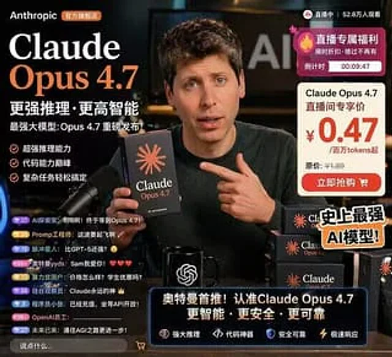

```text
{
  "type": "E-commerce live streaming screenshot mockup",
  "scene": {
    "subject": "{argument name=\"main subject\" default=\"A white male who looks very much like Sam Altman\"}",
    "clothing": "Dark green crew neck sweater",
    "action": "One hand holds a black product box, the other points to it.",
    "setting": "A dark-toned photography studio with a microphone on the left and the word 'AI' faintly visible in the background.",
    "props": [
      "Black mug with the white OpenAI logo printed on it.",
      "Four black product boxes were stacked on the right."
    ]
  },
  "product_design": {
    "box_color": "black",
    "logo": "Orange asterisk or sunburst pattern",
    "text": "{argument name=\"product name\" default=\"Claude Opus 4.7\"}"
  },
  "ui_overlays": {
    "top_left_product_info": {
      "brand_tag": "Anthropic Official Flagship Store",
      "title": "{argument name=\"product name\" default=\"Claude Opus 4.7\"}",
      "subtitle": "{argument name=\"main headline\" default=\"More powerful reasoning, higher intelligence\"}",
      "sub_subtitle": "The most powerful model: Opus 4.7 is released!",
      "bullet_points_count": 3,
      "bullet_points": [
        "Superb reasoning ability",
        "Peak coding ability",
        "Handling complex tasks with ease"
      ]
    },
    "top_right_live_status": {
      "viewer_info": "Live streaming | 528,000 viewers",
      "promo_banner": "Exclusive live stream perks and limited-time discounts – don't miss out!",
      "countdown": "Countdown 00:09:47"
    },
    "middle_right_price_card": {
      "header": "{argument name=\"product name\" default=\"Claude Opus 4.7\"} Exclusive price for live stream",
      "price_currency": "¥",
      "price_value": "{argument name=\"promotional price\" default=\"0.47\"}",
      "price_unit": "Starting with one million tokens",
      "original_price": "Original Price: ¥1.89",
      "button": "Buy now!"
    },
    "bottom_left_chat": {
      "message_count": 9,
      "input_box_placeholder": "Say something..."
    },
    "bottom_right_banner": {
      "headline": "Ultraman is the top choice! Look for Claude Opus 4.7.",
      "subheadline": "Smarter, Safer, More Reliable",
      "feature_tags_count": 4,
      "feature_tags": [
        "Strong reasoning",
        "Code Magic Tool",
        "Safe and reliable",
        "Ultra-fast response"
      ]
    },
    "floating_elements": [
      {
        "type": "sticker",
        "position": "The upper right side of the product box",
        "text": "{argument name=\"sticker text\" default=\"The most powerful AI model ever!\"}"
      }
    ]
  }
}
```

Model: GPT Image 2
Author: GPT Image 2 Prompts

[ProjectD](https://aitoolsradar.com/en/prompts/ed7cf630ca1c90) · [Recorded source](https://x.com/coder_left/status/2045416935106773045#reversed-1)
 · [Full original metadata and byte evidence](data/projectd-batch-0028.json)

## E-commerce Product Page Generator


```text
One{argument name="platform" default="Taobao"} of{argument name="robot model" default="T-800 robot"} The product details page displays the robot's front, side, and rear views, as well as product price, product details, features, and usage scenarios.
```

Model: GPT Image 2
Author: GPT Image 2 Prompts

[ProjectD](https://aitoolsradar.com/en/prompts/00a66ec0ea3e0e) · [Recorded source](https://x.com/alanlovelq/status/2046048929490612464)
 · [Full original metadata and byte evidence](data/projectd-batch-0028.json)

## Earbuds E-commerce Infographic


```text
For "{argument name="product" default="Apple Pods Pro 3"} "A high-impact e-commerce infographic for wireless earbuds. Foreground: Close-up shot of a hand holding an open, glossy white wireless earbud charging case towards the camera. Inside the case are two stylish white earbuds with black speaker details. A tiny green LED indicator is visible on the front of the charging case. The hand and charging case are slightly blurred with macro lens depth of field to add realism. Medium shot: A..."{argument name="model" default="Confident young women"} She has a brownish complexion, brown eyes, and dark hair tied in a messy bun. Her makeup is natural with a dewy finish. She wears a solid-colored top.{argument name="clothing" default="Yellow sports T-shirt"} (No logo). A white earphone is in her ear. She looks directly at the camera with a subtle yet confident expression. Background: Clean, soft gray gradient studio background with shallow depth of field. Diagonal rainbow prism lens flare and soft light leaks run throughout the scene. Several blurry, floating white earphones in the background add depth and dynamism. Lighting: Soft professional studio lighting with glossy highlights on the product and subtle rim lighting on the model, high dynamic range. Typography (modern sans-serif font, white): Top center (behind the model): Large bold “AIRPODS” Top right: “Apple Pods Pro 3” Center left: “Superior sound quality and noise cancellation” Center right: Large bold “30” and “Hours of battery life” Bottom right: Large bold “1” and “Year warranty” Style: Hyperrealistic, commercial product photography, 8K resolution, sharp focus on the product box, shallow depth of field, vibrant and clean colors, high-end advertising aesthetics.
```

Model: GPT Image 2
Author: GPT Image 2 Prompts

[ProjectD](https://aitoolsradar.com/en/prompts/913c7b76a091e2) · [Recorded source](https://x.com/SPEEDAI07/status/2047981795552153860)
 · [Full original metadata and byte evidence](data/projectd-batch-0028.json)

## Early 2000s Computer Lab With ChatGPT


```text
A documentary-style snapshot, the scene is{argument name="setting" default="High school computer lab classroom"} Inside, ten students sit in front of rows of bulky, off-white CRT desktop computers. The viewpoint is from the rear left of the classroom, with a slightly wide angle. The image should have the feel of a snapshot taken with a consumer-grade digital camera in the early 21st century, with direct flash effects, soft noise, and slightly warm indoor fluorescent lighting. A timestamp is visible in the lower right corner.{argument name="timestamp" default="02 18 04"} In the left foreground, a student wearing a navy blue track jacket with white stripes on the cuffs is pointing at a CRT monitor; in the center foreground, a student with short, spiky hair is sitting with his back to the camera, wearing an oversized gray hoodie; in the right foreground, a blonde student with a ponytail is typing on a keyboard, wearing a light blue long-sleeved shirt with dark horizontal stripes on the sleeves; on the far right, another student with dark curly hair is sitting at a workstation. Several other students are sitting in the middle and back rows, all facing the screen. The ChatGPT interface is clearly displayed on the monitor, with the visible title being {argument name="screen title" default="ChatGPT"} Below is a simple prompt text. The room has beige walls and a suspended ceiling. Several motivational posters hang on the walls: four clearly visible posters hang on the back wall, with content including {argument name="poster one" default="YOU CAN DO HARD THINGS"} The image should include the words "BE KIND ONLINE," "THINK BEFORE YOU CLICK," and a large poster titled "KEYBOARD SHORTCUTS" with a list below. It should also include the projects, the classroom door in the background, swivel chairs, a white keyboard and mouse, and a backpack on the floor next to a table in the foreground on the right. People's faces should be partially obscured or softly anonymized to maintain the feel of a real classroom photograph while focusing on the scene of students using ChatGPT in an old-fashioned computer lab.
```

Model: GPT Image 2
Author: GPT Image 2 Prompts

[ProjectD](https://aitoolsradar.com/en/prompts/d8e5b5b2480331) · [Recorded source](https://x.com/levelsio/status/2046735438128333096#reversed-2)
 · [Full original metadata and byte evidence](data/projectd-batch-0028.json)

## Early 2000s Family Living Room Photo

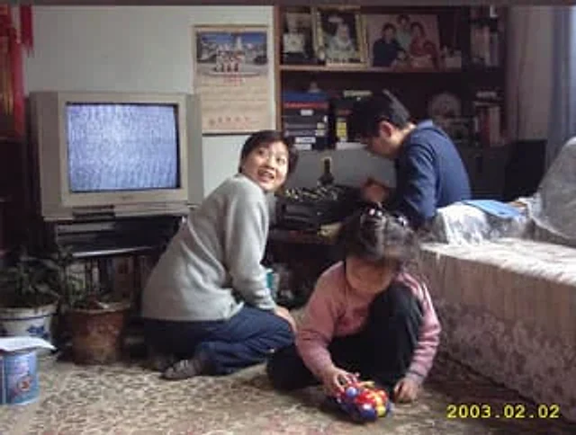

```text
A documentary-style snapshot of an interior home, set in a simple living room in early 21st-century China. The image quality resembles a genuine consumer-grade camera photograph, featuring soft natural light, slight noise, natural colors, and a yellow date stamp in the lower right corner.{argument name="date stamp" default="2003.02.02"} The image contains exactly three people: in the foreground, a little girl sits cross-legged on a patterned rug playing with a colorful toy car; an adult wearing a light gray sweater and blue pants kneels beside a TV cabinet; and another adult wearing a dark blue long-sleeved shirt leans against electronic devices next to a sofa. This creates an unstaged, nostalgic, and highly realistic photographic effect, as if captured on a typical afternoon at home. On the left is a bulky CRT television with a static-filled screen, placed on a dark media cabinet, with electronic products and shelves piled below. A display {argument name="calendar year" default="2003"} A wall calendar and a wooden shelf displaying framed family photos, books, tapes, and small household items. To the right is a sofa covered with a light-colored floral lace cover, a blue folder or notebook resting on the armrest. Adding touches of everyday life: two potted plants on the floor next to the television, and a patterned rug covering most of the floor, creating a dimly lit, warm, and inviting atmosphere reminiscent of a typical apartment. A little girl in a pink sweater and dark pants, with her hair in braids, is engrossed in her toys. The overall style should be highly realistic, like a genuine family archive photograph rather than an illustration, with believable perspective, soft shadows, and subtle lens blemishes.
```

Model: GPT Image 2
Author: GPT Image 2 Prompts

[ProjectD](https://aitoolsradar.com/en/prompts/2d9b079624977e) · [Recorded source](https://x.com/Gold_jinzi/status/2047125540273049623#reversed-0)
 · [Full original metadata and byte evidence](data/projectd-batch-0028.json)

## Early 2020s High School Photo

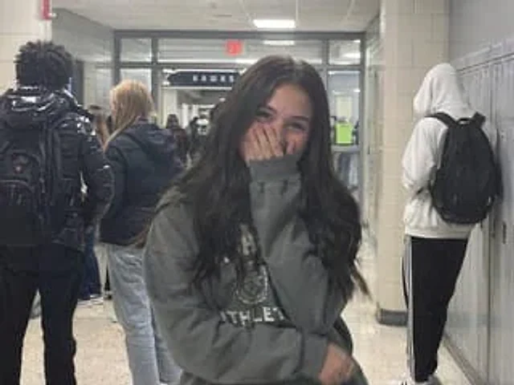

```text
Depend on{argument name="time period" default="Early 2020s"} of{argument name="location" default="high school"} Amateur snapshots taken, presenting{argument name="camera style" default="iPhone aesthetics"} .
```

Model: GPT Image 2
Author: GPT Image 2 Prompts

[ProjectD](https://aitoolsradar.com/en/prompts/5518bf71b8510c) · [Recorded source](https://x.com/patrickassale/status/2044522399224217778)
 · [Full original metadata and byte evidence](data/projectd-batch-0028.json)

## Earth Signs 角色 Scrapbook

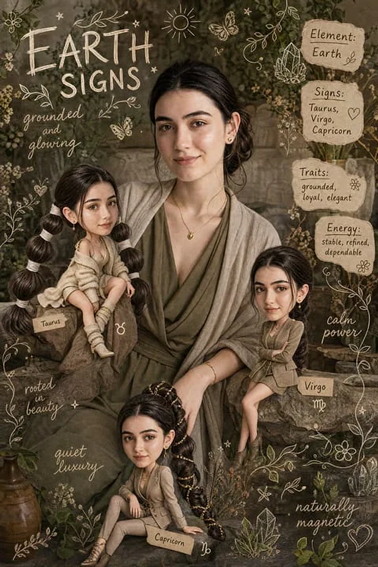

```text
CREATE A NEW IMAGE USING THE PROVIDED FEMALE SUBJECT AS THE ONLY REFERENCE. Preserve her exact facial features, identity, and characteristics with zero alteration.

MAIN SUBJECT — EARTH ELEMENT
She represents the Earth element as a whole: grounded, elegant, sensual, calm, stable, patient, quietly powerful, and naturally luxurious. Relaxed grounded posture, standing or seated, soft natural hand placement, composed feminine body language, rooted presence.

OUTFIT
Single cohesive Earth-inspired editorial look in olive, sage, taupe, mocha, beige, clay, cream, moss, and warm neutrals. Soft-structured elegant silhouette with subtle tailoring, draping, texture contrast, or layered structure. Fabrics: linen, cotton, matte satin, knit, suede-like textures, soft tailoring. Minimal refined gold or natural-toned accessories.

HAIR
Soft ash brown with natural dimension. Healthy, polished, softly voluminous waves or smooth blowout with subtle shine, controlled texture, face-framing strands, grounded and luxurious feel.

MAKEUP
Korean soft-glow base with earthy tones. Warm beige-rose, terracotta, tawny, or nude peach blush. Eyes in taupe, mocha, caramel, muted bronze, olive-brown. Soft liner, champagne-beige highlight, satin or velvet nude/mocha lips. Overall polished, sensual quiet-luxury aesthetic.

ENVIRONMENT
Grounded editorial Earth-inspired setting with stone, wood, linen, botanicals, dried plants, natural fabrics, rustic-luxury styling, warm daylight or diffused editorial lighting, soft shadows, serene cinematic stillness. Palette: cream, olive, moss, clay, taupe, beige, muted green, warm brown.

CHIBI MINI-ME SYSTEM
Surround her with multiple medium-sized realistic 3D chibi mini-me versions with identical face, hair, and identity. High-end doll-like styling with oversized heads, petite bodies, glossy eyes, realistic hair, detailed makeup, miniature fashion outfits, soft cinematic 3D lighting.

EARTH SIGN CHIBIS
Taurus — sensual soft-luxury romantic styling, knit or elegant feminine neutral outfit, rich textures, gold accents. Ultra-long segmented twin low ponytails tied with white fabric bands flowing dramatically around the frame.
Virgo — refined perfectionist aesthetic with polished minimalist tailoring, clean lines, structured mini dress or sophisticated co-ord styling.
Capricorn — sleek power-dressing with blazer dress or tailored set, sharp silhouette, understated luxury. Hair pulled into ultra-long sculptural braid wrapped with gold chains and metallic ornaments.

DOODLES + SCRAPBOOK OVERLAY
Hand-drawn earthy scrapbook doodles: leaves, vines, flowers, branches, mushrooms, butterflies, stars, sparkles, stones, hearts, sun doodles, botanical icons. Cozy ink-pen texture.

Handwritten text:
“EARTH SIGNS”
“grounded and glowing”
“soft strength”
“rooted in beauty”
“quiet luxury”
“stable energy”
“calm power”
“naturally magnetic”

Fact bubbles:
“Element: Earth”
“Signs: Taurus, Virgo, Capricorn”
“Traits: grounded, loyal, elegant”
“Energy: stable, refined, dependable”

COMPOSITION
Main subject centered and dominant. Chibis placed dynamically around shoulders, hands, sides, and lower frame. Doodles layered naturally throughout like a scrapbook. Balanced, expressive, premium composition.

STYLE
Cinematic editorial lifestyle image, fashion-meets-illustration hybrid, high detail, sharp focus, warm neutral tones, subtle realism grain, realistic human rendering with stylized 3D chibis and hand-drawn overlays. Social-media-ready premium aesthetic.

CAMERA
Eye-level or slightly above, medium full-body or 3/4 framing, 35mm or 50mm lifestyle portrait look, crisp details with soft atmospheric depth.
```

Model: GPT Image 2
Author: @ZaraIrahh

[ProjectD](https://aitoolsradar.com/en/prompts/aea136684f05d7) · [Recorded source](https://x.com/ZaraIrahh/status/2053075976469512686)
 · [Full original metadata and byte evidence](data/projectd-batch-0028.json)

## East Asian Girl Influencer Portrait

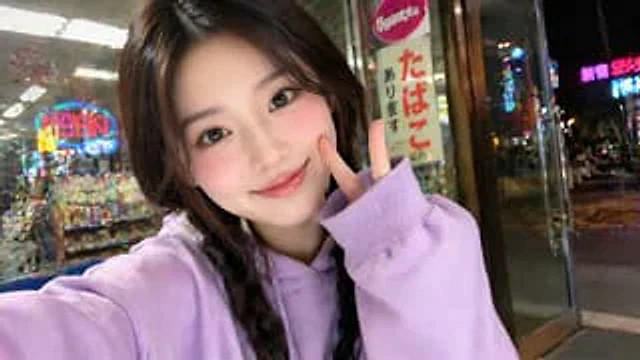

```text
One{argument name="age" default="22"} 20 years old{argument name="ethnicity" default="East Asian"} The girl had a round, youthful face, bright, large eyes with natural eyelashes, rosy cheeks, soft pink lips, and loose braids with wispy strands on either side. She wore {argument name="clothing" default="Light purple oversized hoodie"} Background: The interior of a Japanese convenience store at night, blurred by neon lights that add color. Expression: Playful, lively, and genuinely happy. Aesthetics: TikTok influencer portrait style, soft beauty filter texture, warm skin tone, natural lighting. Hyperrealistic, 8K, 16:9
```

Model: GPT Image 2
Author: GPT Image 2 Prompts

[ProjectD](https://aitoolsradar.com/en/prompts/7c6c156b3af14d) · [Recorded source](https://x.com/johnAGI168/status/2044985082868281487)
 · [Full original metadata and byte evidence](data/projectd-batch-0028.json)

## Edible History Pop-Up Chocolate Book

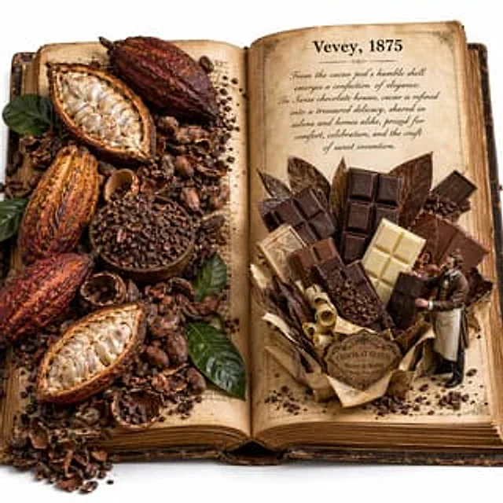

```text
Create a 1:1 square macro photograph with a clean white background. The main subject is an open antique history book, styled like a pop-up "edible history" book. The book is thick and vintage, leather-bound, and opens flat at 180 degrees. The pages are old parchment, yellowed, with worn edges, and the paper texture is clearly visible. On the left page, a rich and slightly messy cocoa harvest scene is displayed, partially covered by printed text: five whole or cracked cocoa pods in deep red-orange and brown tones are precisely placed; a wooden bowl filled with cocoa chips; a large number of scattered cocoa beans; broken cocoa shells; several small piles of cocoa chips; and a few bright green leaves sandwiched among the ingredients. The overall feel should be natural, full, and tactile. On the right page, a large 3D sculpture is created, composed entirely of various Swiss chocolates and constructed entirely from chocolate and confectionery materials: eight visible chocolate bars or fragments are precisely displayed, a mix of dark, milk, and white chocolate, arranged in an upright, bouquet-like structure, backed by five large, leaf-shaped cocoa or chocolate leaves. The base features curled, light-colored chocolate shavings, scattered cocoa crumbs, and a base with a vintage-labeled wrapping paper base bearing the words "CHOCOLAT SUISSE" and a smaller "Maison de Qualité." Next to it is a 1:35 scale miniature of a Victorian chocolatier, wearing an apron, his hands displaying and arranging the chocolates. The right page bears the bold, black serif text: "Vevey, 1875." Below this is a short, faded cursive text recounting the legends of cocoa and Swiss chocolate culture. The paragraph should read: "From the cacao pod's humble shell emerges a confection of elegance. In Swiss chocolate houses, cacao is refined into a treasured delicacy, shared in salons and homes alike, prized for comfort, celebration, and the craft of sweet invention." The lighting uses soft, warm, museum-style light, focusing on the center of the open book. The atmosphere is educational, fantastical, and richly textured. It emphasizes hyperrealism, shallow depth of field, miniature world aesthetics, high-end editorial style, and extremely high fidelity of material textures.
```

Model: GPT Image 2
Author: GPT Image 2 Prompts

[ProjectD](https://aitoolsradar.com/en/prompts/4a365aafe5ba06) · [Recorded source](https://x.com/Gdgtify/status/2047363622456770671#reversed-0)
 · [Full original metadata and byte evidence](data/projectd-batch-0028.json)

## Editorial Caricature Redraw

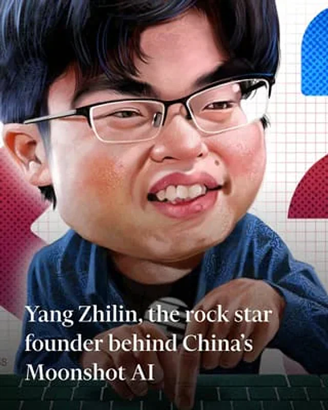

```text
Using the provided reference image, redraw it as a polished exaggerated editorial caricature while preserving the original Financial Times-style composition and all key elements. Keep the same seated-at-keyboard pose, the hands reaching toward the keyboard, the white grid-paper background, the red/pink dotted side shapes, the blue dotted rounded rectangle in the upper right, and the same lower-left headline text: {argument name="headline text" default="Yang Zhilin, the rock star founder behind China’s Moonshot AI"}. Transform the portrait into a glossy, high-detail digital caricature with an oversized head, fuller cheeks, slightly comical smile, enlarged glasses, stylized black hair, painterly skin texture, and a more satirical magazine-illustration look. Keep the crop tight and vertical, with the face much larger in frame than the reference and the text overlay still readable in large white serif type across the lower third. Maintain the keyboard along the bottom edge and do not add any new objects, logos, watermarks, or extra text.
```

Model: GPT Image 2
Author: Elaina

[ProjectD](https://aitoolsradar.com/en/prompts/bfbb383ebdc6cb) · [Recorded source](https://youmind.com/prompts/editorial-caricature-redraw-29949)
 · [Full original metadata and byte evidence](data/projectd-batch-0028.json)

## Editorial Dual-Axis Data Infographic

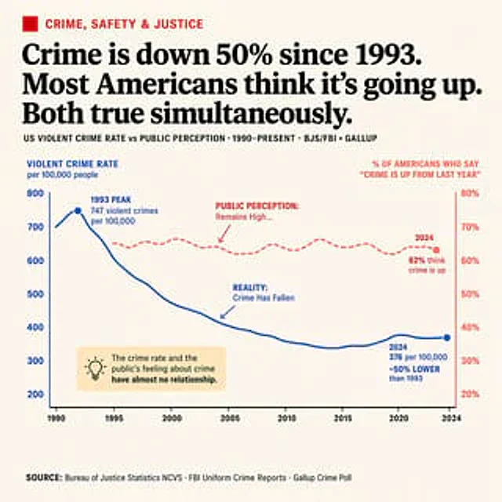

```text
{
  "type": "Editor-level infographic dual-axis line chart",
  "style": "Simple, newspaper-style layout with off-white background and highly readable typography.",
  "header": {
    "category": "Crime, Security, and Justice (red text with red square icons)",
    "headline": "{argument name=\"main headline\" default=\"Since 1993, the crime rate has decreased by 50%. However, most Americans believe the crime rate is rising. Both are true.\"}",
    "sub_headline": "US Violent Crime Rate vs. Public Perception: 1990-Present - BJS/FBI + GALLUP"
  },
  "chart": {
    "x_axis": "From 1990 to 2024, there are a total of 8 scales.",
    "left_y_axis": {
      "color": "blue",
      "label": "{argument name=\"left axis label\" default=\"violent crime rate per 100,000 people\"}",
      "range": "200 to 800"
    },
    "right_y_axis": {
      "color": "red",
      "label": "{argument name=\"right axis label\" default=\"The percentage of Americans who believe &#39;crime rate has increased compared to last year&#39;\"}",
      "range": "20% to 80%"
    },
    "data_series": [
      {
        "name": "reality",
        "style": "solid blue line",
        "trend": "It peaks early and then declines significantly.",
        "annotations": [
          "Peak in 1993: 747 violent crimes per 100,000 people (marked with blue dots)",
          "Reality: Crime rates have decreased (blue arrows pointing to lines).",
          "2024: 376 cases per 100,000 people, a decrease of about 50% compared to 1993 (marked with blue dots)."
        ]
      },
      {
        "name": "Public perception",
        "style": "Red dashed line",
        "trend": "Remaining relatively stable and at a high level",
        "annotations": [
          "Public perception: Maintaining a high level of awareness... (red arrow pointing to the target)",
          "2024: 62% of people believe the crime rate is rising (marked with a red dot)."
        ]
      }
    ]
  },
  "callout_box": {
    "position": "bottom left corner of the chart area",
    "style": "light yellow rectangle",
    "icon": "Light bulb",
    "text": "{argument name=\"callout text\" default=\"There is almost no correlation between crime rates and public perception of crime.\"}"
  },
  "footer": {
    "text": "Data source:{argument name=\"footer source\" default=\"Bureau of Justice Statistics (NCVS), FBI Unified Crime Report, Gallup Crime Poll\"}"
  }
}
```

Model: GPT Image 2
Author: GPT Image 2 Prompts

[ProjectD](https://aitoolsradar.com/en/prompts/369d6600043ca5) · [Recorded source](https://x.com/maxescu/status/2043979078798323727#reversed-0)
 · [Full original metadata and byte evidence](data/projectd-batch-0028.json)

## Editorial Dual-Axis Line Chart

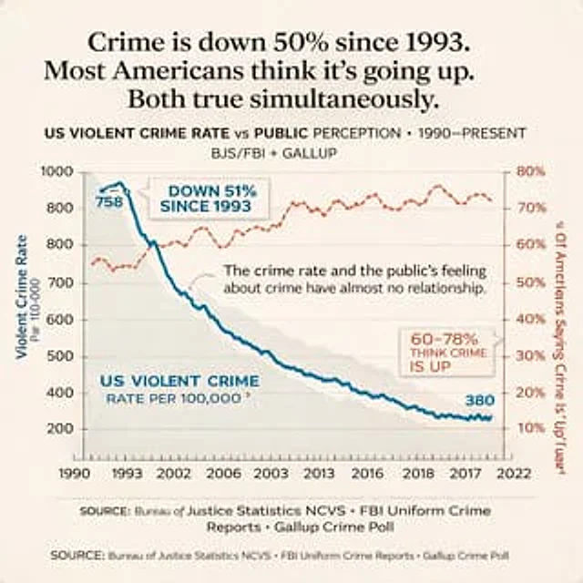

```text
{
  "type": "Editorial-style data visualization charts",
  "style": "Newspaper infographic style, textured beige background, serif font for headlines, sans-serif font for chart text.",
  "header": {
    "title": "{argument name=\"main title\" default=\"Since 1993, the crime rate has decreased by 50%. However, most Americans believe the crime rate is rising. Both are true.\"}",
    "subtitle": "US Violent Crime Rate vs. Public Perception • 1990 to Present: BJS/FBI + GALLUP"
  },
  "chart": {
    "type": "Dual-axis line chart",
    "axes": {
      "x_axis": "A timeline from 1990 to 2022, with scale markings.",
      "y_axis_left": {
        "label": "{argument name=\"left axis label\" default=\"Violent crime rate per 100,000 people\"}",
        "scale": "200 to 1000"
      },
      "y_axis_right": {
        "label": "{argument name=\"right axis label\" default=\"Percentage of Americans who believe crime rates are &#39;rising&#39;\"}",
        "scale": "10% to 80%"
      }
    },
    "data_series": [
      {
        "description": "A solid, thick blue line indicating a downward trend.",
        "start_value": "758",
        "end_value": "380",
        "label": "Violent crime rate per 100,000 people in the United States"
      },
      {
        "description": "Horizontal undulating orange-red dashed line",
        "range": "60% to 80%"
      }
    ],
    "annotations": [
      {
        "type": "annotation box",
        "text": "A 51% decrease since 1993",
        "pointer": "Pointing to the peak of the blue line"
      },
      {
        "type": "Floating text",
        "text": "{argument name=\"central annotation\" default=\"Crime rates have almost no correlation with public perception of crime.\"}"
      },
      {
        "type": "annotation box",
        "text": "60-78% of people believe the crime rate is rising.",
        "pointer": "Pointing to the red dotted line"
      }
    ]
  },
  "footer": {
    "text": "{argument name=\"footer source text\" default=\"Sources: National Bureau of Justice Statistics (NCVS), FBI Unified Crime Report, Gallup Crime Poll\"}",
    "repetition": "The text is printed twice at the bottom."
  }
}
```

Model: GPT Image 2
Author: GPT Image 2 Prompts

[ProjectD](https://aitoolsradar.com/en/prompts/36f6ec7a1aec9f) · [Recorded source](https://x.com/adishakti2004/status/2044240982951288925#reversed-0)
 · [Full original metadata and byte evidence](data/projectd-batch-0028.json)

## Editorial Fashion Magazine Cover

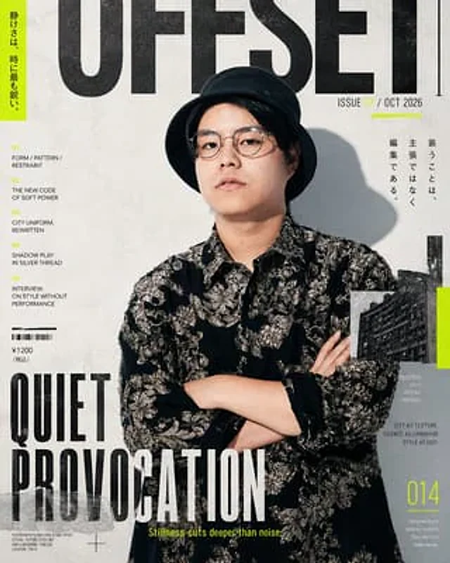

```text
Using REFERENCE_0 as the portrait source, transform it into a high-end editorial fashion magazine cover while preserving the person, pose, hat, shirt, lighting direction, shadow, and face-obscuring blur. Crop closer into a vertical cover layout and place the subject slightly right of center. Add a gritty off-white paper texture, bold black condensed typography, and neon yellow-green accent bars.

Create a magazine cover titled {argument name="magazine title" default="OFFSET"} in huge black letters across the top, partially behind the subject's head. Add the issue line at upper right: {argument name="issue line" default="ISSUE 07 / OCT 2026"}. Add a vertical neon-green strip at the far left with Japanese copy: {argument name="left vertical tagline" default="静けさは、時に最も鋭い。"}. Add a large bottom-left cover headline: {argument name="main cover headline" default="QUIET PROVOCATION"}, with the yellow subtitle {argument name="subtitle" default="Stillness cuts deeper than noise."}.

Include exactly 5 numbered article teasers in a left column: 01 FORM / PATTERN / RESTRAINT; 02 THE NEW CODE OF SOFT POWER; 03 CITY UNIFORM, REWRITTEN; 04 SHADOW PLAY IN SILVER THREAD; 05 INTERVIEW: ON STYLE WITHOUT PERFORMANCE. Add exactly 1 barcode block with price text “¥1200 (税込)” under it. Add exactly 1 vertical Japanese quote block on the upper right: “装うことは、主張ではなく編集である。” Add exactly 1 small black-and-white city-building photo inset on the lower right with a neon-green side accent. Add exactly 3 tiny editorial text clusters on the lower/right area: “OBSERVE. EDIT. INTENT. REPEAT.”, “CITY AS TEXTURE. SILENCE AS LANGUAGE. STYLE AS EDIT.”, and a small paragraph under page number. Add exactly 1 large page number “014” in neon yellow-green at the bottom right. Keep the design minimalist, modern, Japanese street-fashion magazine style, with realistic print grain, slightly distressed ink, and strong contrast.
```

Model: GPT Image 2
Author: コンドウハルキ｜Harukaze

[ProjectD](https://aitoolsradar.com/en/prompts/5cea49e4a415de) · [Recorded source](https://youmind.com/prompts/fashion-magazine-cover-19553)
 · [Full original metadata and byte evidence](data/projectd-batch-0028.json)

## Editorial Female Portrait — Bauhaus Studio

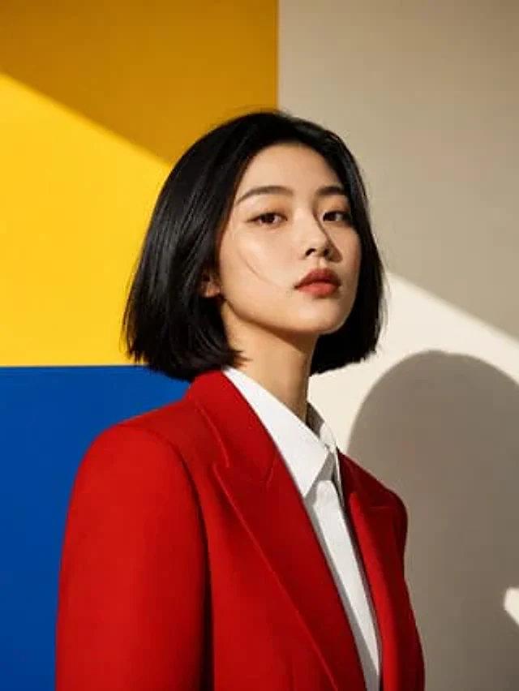

```text
Editorial 3:4 studio portrait of a young East Asian woman with short bobbed black hair, wearing a sharply tailored primary-red blazer over a clean white shirt. Standing in front of a Bauhaus-style geometric studio backdrop: large flat blocks of primary yellow, primary blue, and warm cream painted in clean rectangles. Strong directional studio key light from the right casting hard geometric shadows across the backdrop. Confident neutral expression looking just past the camera. 3:4 vertical composition, head and shoulders framing. No brand logo, no jewelry text, no watermark. Magazine fashion editorial quality, photorealistic skin and fabric textures, ultra sharp focus.
```

Model: GPT Image 2
Author: @hiapi_ai

[ProjectD](https://aitoolsradar.com/en/prompts/d6077437684fff) · [Recorded source](https://github.com/HiAPIAI/awesome-gpt-image-2-prompts)
 · [Full original metadata and byte evidence](data/projectd-batch-0028.json)

## Editorial SaaS Receipt Ad


```text
Create a striking static SaaS ad against a matte black background, showcasing a sophisticated editorial style and extremely precise typography. At the top is a large, stacked serif headline in off-white: the first line displays "Your analytics stack," the second in a bright magenta italic serif font, "shouldn't cost more," and the third in off-white serif font, "than your rent." At the center of the composition is a large, crumpled white thermal paper receipt, slightly tilted from the top left to the bottom right, with a distinct paper texture, soft shadows, and curled edges at the top right and bottom left corners. On the receipt are five lines of black, monospaced or receipt-style text, aligned in two columns: "GA4" corresponds to "$0," "Hotjar" to "$99," "Optimizely" to "$2,450," "GTM setup (dev hours)" to "$1,800," and "Tag manager debug" to "$400." Add a jagged magenta star sticker after "Optimizely" for emphasis. Add a dotted dividing line below the item, then add a bold "TOTAL" in the lower left corner of the receipt. Place a large price in the lower right corner of the receipt, stating "..."{argument name="monthly price" default="$19/mo"} Use bold black text and circle it with two hand-drawn magenta markers. Add three handwritten magenta annotation elements: on the left, written in brush font.{argument name="left annotation" default="one tool"} The text includes an underlined section with a curved arrow pointing to the receipt; a magenta curved arrow pointing to the circled price near the bottom center; and a handwritten slogan in the lower right corner.{argument name="tagline text" default="One script. One price."} " and underlined. In the bottom right corner, add a short, right-aligned, white sans-serif text section containing the following: "{argument name="body copy" default="Analytics, heatmaps, A/B testing, and revenue attribution."} The design adopts an editorial advertising photography style, requiring clear text layout, distinct hierarchy, high contrast, realistic paper texture, and a limited color scheme of black, white, and bright pink.
```

Model: GPT Image 2
Author: GPT Image 2 Prompts

[ProjectD](https://aitoolsradar.com/en/prompts/5387990d243d64) · [Recorded source](https://x.com/amirmxt/status/2046824933146149114#reversed-1)
 · [Full original metadata and byte evidence](data/projectd-batch-0028.json)

## Editorial Sports Poster Design


```text
STYLE & ART DIRECTION

Minimal editorial aesthetics,
typography-driven composition,
modern premium poster design,
clean contemporary visuals,
subtle grunge atmosphere,
high-contrast storytelling,
luxury branding quality.

Designed for FIFA World Cup 2026 visuals and celebrations.
Use the authentic official {argument name="official colors" default="colors"} and visual identity of the subject.

MAIN SUBJECT

One dominant portrait combined with one secondary pose,
dynamic emotion,
high-detail realism,
hero composition,
powerful visual storytelling.

LAYOUT & COMPOSITION

9:16 vertical poster composition featuring:

one dominant portrait

secondary pose layering

giant typography integration

minimal textured background

typography wrapping around the subject

premium spacing

strong visual hierarchy

layered composition

subtle geometric elements

TYPOGRAPHY

Oversized condensed sans-serif typography,
vertical lettering,
heavy editorial hierarchy,
uppercase text,
minimal supporting captions,
premium spacing.

DEPTH & LIGHTING

Dramatic lighting,
clean highlights,
editorial shadows,
cinematic contrast,
premium matte rendering,
high-detail realism.

EXTRA DETAILS

Textured background,
subtle grunge overlays,
layered typography masking,
editorial framing,
balanced composition,
modern premium aesthetics.

COLOR PALETTE

Use the official colors and identity of the subject while maintaining a clean and premium appearance.

QUALITY

Ultra-high resolution,
Behance-quality design,
Pinterest-trending aesthetics,
premium editorial realism,
luxury branding quality,
16K masterpiece rendering. Generate for {argument name="athlete name" default="cristiano ronaldo"}
```

Model: GPT Image 2
Author: Saul Goodman

[ProjectD](https://aitoolsradar.com/en/prompts/057de5ffd3cc74) · [Recorded source](https://youmind.com/prompts/fifa-world-cup-editorial-poster-24885)
 · [Full original metadata and byte evidence](data/projectd-batch-0028.json)

## Editorial Streetwear Lifestyle Merch

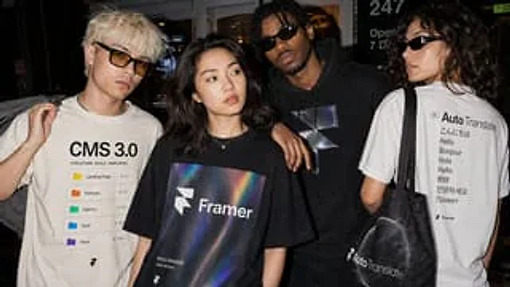

```text
Generate a 16:9 image to display several {argument name="models" default="models"} Clothing based on recent{argument name="brand" default="framer"} Limited edition streetwear shirts and merchandise released. Multiple images available for reference.{argument name="reference URL" default="https://framer.com"} The images should have a film-shot editing style, a street-style fashion editorial feel, and include flash photography effects.
```

Model: GPT Image 2
Author: GPT Image 2 Prompts

[ProjectD](https://aitoolsradar.com/en/prompts/1d110af34b5c19) · [Recorded source](https://x.com/andyorsow/status/2047018814311931939)
 · [Full original metadata and byte evidence](data/projectd-batch-0028.json)

## Editorial Studio Portrait in Blazer

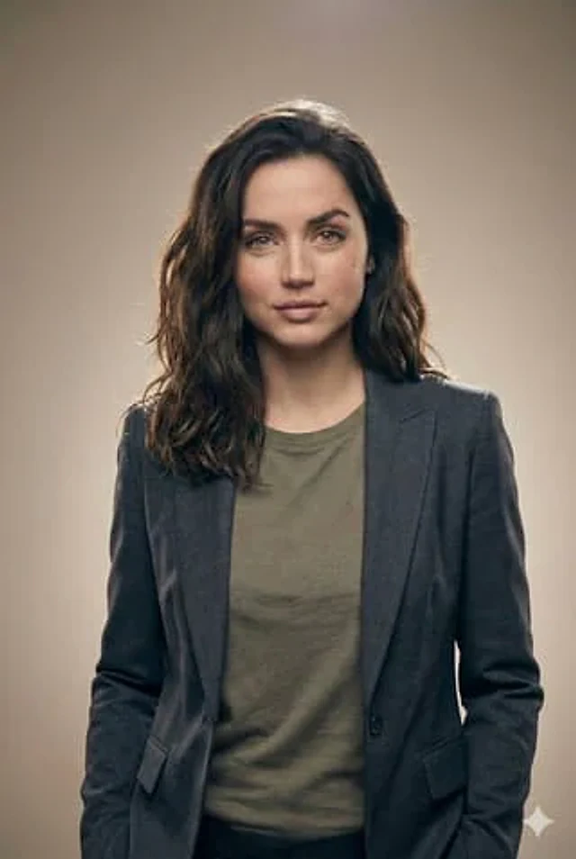

```text
A highly realistic magazine-style studio portrait, featuring a {argument name="subject gender" default="woman"} The subject, in her thirties, with a well-proportioned figure, is photographed from a level, half-body perspective. Facing the camera, she exudes relaxation and confidence, her hands casually in her pockets. She wears a custom-made dark charcoal gray suit jacket over a low-saturation olive gray crew-neck T-shirt, paired with dark trousers. Her hairstyle is {argument name="hair style" default="Shoulder-length dark brown wavy hair, naturally parted to the side."} Slightly tousled, the hair gently softens the shoulder lines. The expression remains calm, neutral, and confident. An 85mm portrait lens at f/2.8 was used, resulting in sharp focus on the subject and a softly blurred background. Clean, professional studio lighting was employed, with a softbox positioned at the front as the main light, complemented by subtle fill light to reduce harsh shadows, and a soft rim light around the hair and shoulders. The background is a seamless studio backdrop, presenting a soft, warm beige to light gray-brown gradient with a minimalist texture and no distracting clutter. Color gradation is naturally balanced, skin tones are realistic, contrast is soft, and there is no excessive retouching or filtering. The overall atmosphere is understated, modern, sophisticated, and high-end, conveying the quality of a fashion or corporate magazine portrait. Ultra-refined, photorealistic, 8K resolution, no noise, no motion blur, no distortion, no props, no jewelry, and no text.
```

Model: GPT Image 2
Author: GPT Image 2 Prompts

[ProjectD](https://aitoolsradar.com/en/prompts/0b2b68079ccd6a) · [Recorded source](https://x.com/john_my07/status/2047182640760140198#reversed-0)
 · [Full original metadata and byte evidence](data/projectd-batch-0028.json)

## Editorial Studio Portrait in Neutral Streetwear


```text
A high-end fashion portrait, featuring a {argument name="subject gender" default="woman"} The subject, aged between mid-30 and early 40, has a naturally proportionate figure. The composition focuses on her upper body, from the waist down to her upper thighs. She stands with a relaxed and confident posture, hands in her pockets. She has long, wavy, dark chestnut brown hair, parted in the middle and falling naturally over her shoulders; she wears small gold hoop earrings, a delicate gold necklace, and a thin bracelet. Her clothing is a modern, minimalist, casual streetwear style with soft, neutral tones: an open light beige zip-up jacket over a fitted white cropped vest, paired with matching light beige drawstring jogging pants. The shot was taken at eye level using an 85mm portrait lens at f/2.8 to ensure a sharp subject and shallow depth of field. Professional studio lighting was used, with a softbox positioned to the left front as the main light, supplemented by subtle fill light to soften shadows, and a soft, warm rim light added to the hair and shoulder edges to enhance the sense of depth. The background should be a clean studio backdrop with a smooth gradient from grayish-brown to warm gray, free of clutter. The image should have a highly realistic and magazine-quality feel, with natural skin tones, balanced color gradation, extremely high detail, clear fabric textures, soft and natural shadows, no noise, no motion blur, no cartoonish style, and no anatomical distortion.
```

Model: GPT Image 2
Author: GPT Image 2 Prompts

[ProjectD](https://aitoolsradar.com/en/prompts/9a84a59ec920b6) · [Recorded source](https://x.com/j_smeaton99/status/2047511741257707884#reversed-0)
 · [Full original metadata and byte evidence](data/projectd-batch-0028.json)

## Editorial Studio Portrait in Olive Jacket

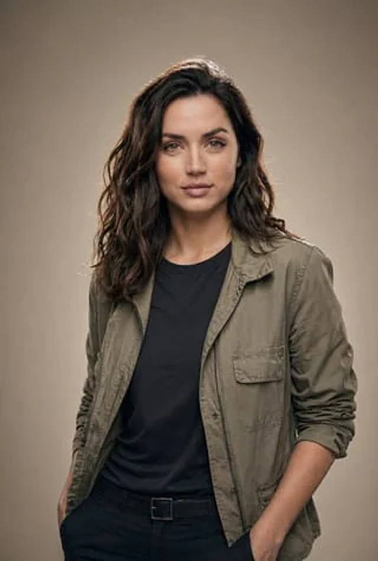

```text
A high-end studio fashion magazine-style portrait, half-body composition, the subject is a {argument name="subject gender" default="woman"} She is in her mid-30s to early 40s, with a well-proportioned figure. Facing the camera, she is relaxed and confident, hands in her pockets, shoulders naturally relaxed, posture upright, and expression calm, neutral, and confident. She has shoulder-length or slightly longer dark brown wavy hair, naturally parted to the side, with a voluminous texture. She wears three visible pieces: an olive green casual jacket with a slightly distressed cotton texture, a zippered front, and a flap pocket on the chest; underneath, a solid-color dark charcoal gray or black crew neck T-shirt; and dark slim-fit trousers with a black belt and a simple square buckle. The shot was taken at eye level with an 85mm portrait lens at f/2.8 to create a shallow depth of field, resulting in a sharp and detailed subject with a softly blurred background. Professional studio lighting was used, including three distinct light sources: a front softbox main light, a soft shadow fill light, and a subtle rim light from behind to outline her hair and shoulders, separating them from the background. The background is a seamless, pristine studio backdrop, featuring a neutral gradient from warm beige to grayish-brown, smooth and undisturbed. The overall image should possess a high degree of realism, sophistication, and modernity, reminiscent of understated fashion advertisements or lifestyle magazine portraits. Color gradation is naturally balanced, skin tones are realistic, fabric textures and hair details are rich, and there is no noise, motion blur, stylization, cartoonish elements, or anatomical distortion; all in 8K resolution.
```

Model: GPT Image 2
Author: GPT Image 2 Prompts

[ProjectD](https://aitoolsradar.com/en/prompts/4c6950631a9881) · [Recorded source](https://x.com/john_my07/status/2047182640760140198#reversed-1)
 · [Full original metadata and byte evidence](data/projectd-batch-0028.json)

## Editorial Studio Portrait in Olive Tee

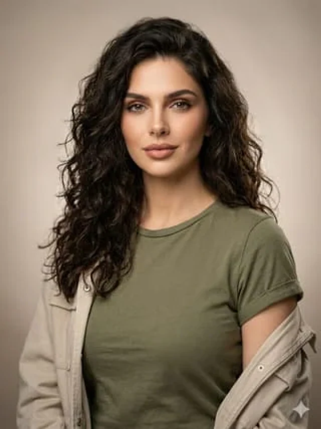

```text
A highly realistic studio portrait of a woman in her early twenties with a well-proportioned figure. The composition uses a level perspective, cropping to the upper body. She stands relaxed and confidently, shoulders straight, her expression calm, neutral, and exuding self-assurance. She has thick, long hair, a deep brown to almost black color, naturally voluminous and textured with a slightly off-the-shoulder parting, falling naturally over her shoulders. She wears two visible garments: an olive green fitted crew-neck T-shirt, layered under a light beige casual jacket, which is open and slips off her shoulders, creating a relaxed, editorial style. The color palette uses soft, neutral tones, primarily earth tones. An 85mm portrait lens with an f/2.8 aperture was used, with precise focus on the subject, resulting in a shallow depth of field and a soft, natural background blur. The lighting employed a professional studio setup: soft main light, subtle fill light to preserve soft shadow details, and subtle rim light to enhance the depth between the subject and background. The background is a clean, smooth studio backdrop, featuring a soft, warm beige-gray neutral gradient, free of any distracting elements. Skin tones are realistic and natural, with balanced color grading and minimalist post-processing. The overall style resembles a modern, casual street-style portrait, boasting exceptional detail, clean lines, and lifelike realism.
```

Model: GPT Image 2
Author: GPT Image 2 Prompts

[ProjectD](https://aitoolsradar.com/en/prompts/29809a134883ad) · [Recorded source](https://x.com/mehvishs25/status/2047497929993363758#reversed-1)
 · [Full original metadata and byte evidence](data/projectd-batch-0028.json)

## Editorial Woman in Wildflower Hills

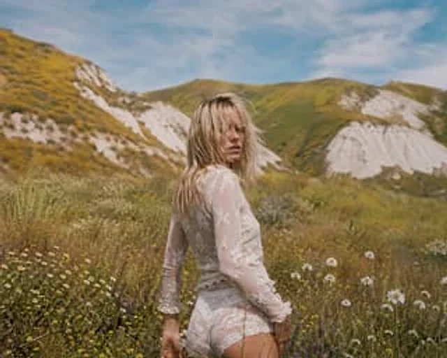

```text
A soft, outdoor-chic photograph shows a woman standing in a wildflower meadow during the day. The image shows her back, her body slightly turned three-quarters of the way to the side, her head turning back towards the camera. She has shoulder-length to mid-back hair that is slightly messy.{argument name="hair color" default="Deep gold"} Her hair, strands flowing gently in the wind, was slightly tousled. Her face was completely obscured by a flat, rectangular, warm beige-brown blur. She wore an exquisite white sheer lace suit, consisting of two visible pieces: a long-sleeved, semi-transparent floral lace top (with ruffled cuffs) and a high-waisted white lace bottom. Her posture was relaxed and sensual, one arm hanging naturally, the other resting lightly on her hip. She was surrounded by lush natural grass and blooming wildflowers, with white daisies and small yellow flowers visible in the foreground and midground. The background consisted of rolling green and golden hills, and mountains with dramatic chalky cliff faces and eroded textures. The composition employed expansive landscape views, partially cloudy blue skies, warm natural light, earthy tones, shallow depth of field, cinematic composition, a realistic photographic style, high detail, and soft contrast to create a dreamy bohemian countryside atmosphere.
```

Model: GPT Image 2
Author: GPT Image 2 Prompts

[ProjectD](https://aitoolsradar.com/en/prompts/2465eb054afcc5) · [Recorded source](https://x.com/adolt/status/2047360383661601235#reversed-0)
 · [Full original metadata and byte evidence](data/projectd-batch-0028.json)

## Eduardo Abaroa Monument Infographic

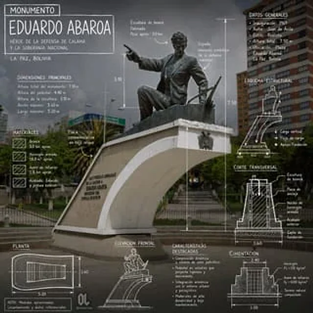

```text
{"type":"Architectural Monument Infographic Poster","subject":{"monument_name":"EDUARDO ABAROA","subtitle":"The Battle of Calama and Heroes of National Sovereignty","location":"La Paz, Bolivia","main_view":"Centered display of Eduardo Abaroa"}} A realistic photograph of a bronze statue, kneeling on one knee with its right arm pointing forward and a sword at its side, mounted on a tall, arched white pedestal in a city square. The image is described as: "Overcast, dramatic gray sky, foreground of city park, trees, and damp ground, background of high-rise apartment buildings." The style is described as: "Overall: Simple architectural infographics overlaid on realistic photographs." The mood is described as: "Heroism, civic consciousness, information rich." The palette is described as: "Charcoal gray sky, bronze sculpture color, white hand-drawn chart lines and handwritten capital letters, soft urban colors." The rendering is described as: "High-detail realistic monument photography combined with technical sketch overlays and blueprint annotations." The layout is described as: "Single poster." The sections are: "title: Monument," "position: Top left," "count: 1," labels: "EDUARDO" ABAROA"]},{"title":"Main Dimensions","position":"Left-Center-Top","count":4,"labels":["Total height of monument: 7.50 meters","Base height: 4.40 meters","Sculpture height: 3.10 meters","Maximum width: 3.60 meters"]},{"title":"Materials","position":"Left-Center","count":4,"labels":["Bronze approx. 3.0 tons","Reinforced concrete approx. 18.0 cubic meters","Reinforcing steel approx. 1.8..."]},{"title":"Main Dimensions","position":"Left-Center","count":4,"labels":["Bronze approx. 3.0 tons","Reinforced concrete approx. 18.0 cubic meters","Reinforcing steel approx. 1.8..."]} {"Tonnage","Furnishing: Plaster and Exterior Wall Coating"]},{"title":"Plan View","position":"Lower Left","count":1,"labels":["5.20"]},{"title":"Front Elevation View","position":"Lower Left","count":1,"labels":["Front Elevation View"]},{"title":"Key Features","position":"Lower Right","count":3,"labels":["Dynamic composition, a symbol of patriotic courage.","Cantilevered base, showcasing strength and dynamism.","Harmonious integration with the urban environment and landscape."]},{"title":"Basic Data","position":"Upper Right","count":5,"labels":["Completion Time: 1969","Author: Juan de Ávila","Style: Realism","Total Height: 7.50 meters","Location: Eduardo Abaroa"]} Square, La Paz, Bolivia"]},{"title":"Structural Diagram","position":"Top Right","count":3,"labels":["Vertical Load","Load Flow Direction","Support/Foundation"]},{"title":"Cross-section Diagram","position":"Top Right","count":5,"labels":["Bronze Sculpture","Anchor Plate","Reinforced Concrete Core","Exterior Finish","Foundation Base"]},{"title":"Foundation","position":"Bottom Right","count":4,"labels":["2.40","3.00","Concrete f'c 210 kg/cm²","Reinforcement fy 4200 kg/cm²"]}],"centerpiece":"The monument occupies the center of the composition, marked with vertical measurement lines, showing the sculpture at 3.10 meters, the base at 4.40 meters, and the total height at 7.50 meters."] Meters, and accompanied by annotation frames pointing to the bronze patina, symbolic sword, and bas-relief memorial plaque,","text_treatment":{"language":"Spanish","font_style":"Titles and annotations are in handwritten chalk or marker capital letters","linework":"White fine sketch lines, arrows, dimension scales, and technical drawing frames"},"composition":{"camera_angle":"Slightly tilted upwards to emphasize scale","framing":"The entire monument is centered, with technical panels distributed around it without obscuring the main outline","aspect_ratio":"1:1"},"quality":"High-resolution editorial infographic, suitable for cultural heritage posters, museum displays, or social media educational posts"}
```

Model: GPT Image 2
Author: GPT Image 2 Prompts

[ProjectD](https://aitoolsradar.com/en/prompts/ff62dfef01203f) · [Recorded source](https://x.com/oscarlau/status/2047710173863559439#reversed-1)
 · [Full original metadata and byte evidence](data/projectd-batch-0028.json)

## Educational 4-Panel Manga with Infographic

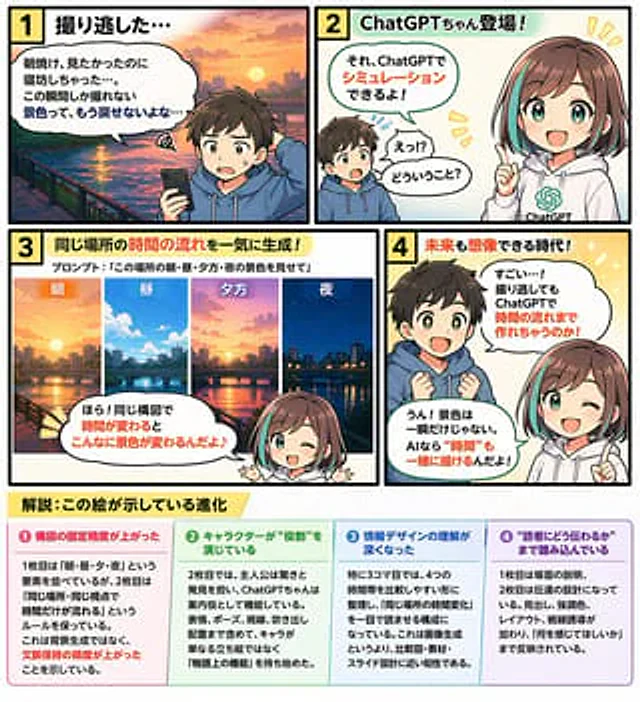

```text
{
  "type": "4-panel educational comic strip with bottom infographic",
  "characters": {
    "boy": {
      "description": "Little boy, brown hair",
      "outfit": "{argument name=\"boy outfit\" default=\"blue hoodie\"}"
    },
    "girl": {
      "name": "{argument name=\"main character name\" default=\"ChatGPT sauce\"}",
      "description": "Anime Girl",
      "hair": "{argument name=\"girl hair style\" default=\"Brown bob with blue highlights\"}",
      "outfit": "White hoodie with green AI logo"
    }
  },
  "layout": {
    "comic_panels": [
      {
        "panel_number": 1,
        "title": "1. We missed the filming opportunity...",
        "scene": "The boy looked disappointed as he held his smartphone, with a sunrise over a river and city in the background.",
        "speech_bubble": "I wanted to see the sunrise, but I overslept... This kind of fleeting view will never come back..."
      },
      {
        "panel_number": 2,
        "title": "2 ChatGPT-chan makes its debut!",
        "scene": "The boy was surprised, and the girl pointed ahead and smiled.",
        "speech_bubbles": [
          "Huh? What does that mean?",
          "You can simulate that using ChatGPT!"
        ]
      },
      {
        "panel_number": 3,
        "title": "3. Generate time flow for the same location all at once!",
        "sub_text": "Prompt words:{argument name=\"panel 3 prompt text\" default=\"&quot;Showcasing the scenery of this place in the morning, noon, evening, and at night.&quot;\"}",
        "sub_images": {
          "count": 4,
          "description": "The same cityscape at different times of day",
          "labels": [
            "morning",
            "middle",
            "Night",
            "night"
          ]
        },
        "scene": "The girl is pointing to the sub-image above.",
        "speech_bubble": "Look! With the composition remaining the same, the scenery changes so much over time!"
      },
      {
        "panel_number": 4,
        "title": "4 An era where even the future can be imagined!",
        "scene": "The boy's eyes sparkled with amazement; the girl blinked and pointed ahead.",
        "speech_bubbles": [
          "Wow, that's amazing! Even if you missed the filming, you can still create a time-lapse using ChatGPT!",
          "Yes! Scenery isn't just a fleeting moment. With AI, even \"time\" can be depicted!"
        ]
      }
    ],
    "infographic_section": {
      "position": "bottom",
      "title": "{argument name=\"infographic main title\" default=\"Analysis: This image illustrates evolution.\"}",
      "columns": {
        "count": 4,
        "headers": [
          "❶ The precision of the composition has been improved.",
          "❷ The character is playing a \"role\".",
          "❸ My understanding of information design has deepened.",
          "❹ It delves into the level of \"how to communicate with the reader\"."
        ],
        "content_description": "Detailed descriptions below each heading"
      }
    }
  }
}
```

Model: GPT Image 2
Author: GPT Image 2 Prompts

[ProjectD](https://aitoolsradar.com/en/prompts/9803d881e447dc) · [Recorded source](https://x.com/aiclass_g2/status/2044172156557504731#reversed-0)
 · [Full original metadata and byte evidence](data/projectd-batch-0028.json)

## Educational Classroom Scene Prompt


```text
Generate a realistic photo of a university classroom, shot with iPhone 16.{argument name="teacher" default="Teacher XX"} Teaching{argument name="subject" default="XX Knowledge"} The blackboard has detailed and clear chalk writing and auxiliary diagrams, without the need to include students.
```

Model: GPT Image 2
Author: GPT Image 2 Prompts

[ProjectD](https://aitoolsradar.com/en/prompts/776038ae576de4) · [Recorded source](https://x.com/stark_nico99/status/2047257644625469738)
 · [Full original metadata and byte evidence](data/projectd-batch-0028.json)

## Educational Classroom Scene Prompt


```text
生成一张真实的大学教室照片，iPhone16质感，{argument name="老师" default="XX老师"}在教{argument name="学科知识" default="XX知识"}，黑板上有详细而清晰的粉笔介绍，有图形辅助理解，不需要同学
```

Model: GPT Image 2
Author: Nicolechan

[ProjectD](https://aitoolsradar.com/en/prompts/6e5cc7495c83c1) · [Recorded source](https://youmind.com/prompts/realistic-university-classroom-chalkboard-15190)
 · [Full original metadata and byte evidence](data/projectd-batch-0028.json)

## Educational Comic Generator


```text
Generate a document about{argument name="topic" default="Git"} Learning comics and visual summaries
```

Model: GPT Image 2
Author: GPT Image 2 Prompts

[ProjectD](https://aitoolsradar.com/en/prompts/0aeca7d031e220) · [Recorded source](https://x.com/loglogrog/status/2047318655692931419)
 · [Full original metadata and byte evidence](data/projectd-batch-0028.json)

## Educational Hiragana Sheet

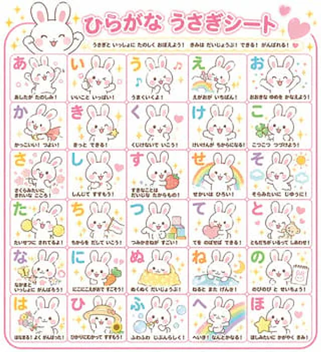

```text
{argument name="animal" default="rabbit"}{argument name="character type" default="hiragana"} Study Schedule (Light Color Version)
```

Model: GPT Image 2
Author: GPT Image 2 Prompts

[ProjectD](https://aitoolsradar.com/en/prompts/b6b0889df7c0fe) · [Recorded source](https://x.com/masukarasulove/status/2045337521597669540)
 · [Full original metadata and byte evidence](data/projectd-batch-0028.json)

## Educational Infographic on Atmospheric Circulation


```text
{
  "type": "Educational Infographic",
  "style": "The textbook illustrations feature a clean, modern style with a light blue and white color scheme.",
  "header": "{argument name=\"main title\" default=\"High School Geography: Examples of Atmospheric Circulation\"}",
  "layout": {
    "top_left_column": {
      "section_1": {
        "title": "{argument name=\"section one title\" default=\"I. What is atmospheric circulation?\"}",
        "content": "A brief explanation of global air movement"
      },
      "section_2": {
        "title": "II. Causes",
        "content": "Three key points to explain solar radiation, vertical motion, and the Coriolis force."
      }
    },
    "top_right_column": {
      "section_3": {
        "title": "{argument name=\"diagram title\" default=\"III. Schematic diagram of the three-cell circulation\"}",
        "diagram_features": [
          "Showing cross-sections of the Earth from 0 degrees north latitude to 90 degrees south latitude.",
          "Color-coded pressure belts: red (equatorial), yellow (subtropical), green (subpolar), blue (polar).",
          "Arrows indicating the direction of airflow"
        ],
        "circulation_cells": {
          "count": 3,
          "labels": [
            "Polar circulation (high-latitude circulation)",
            "Mid-latitude circulation (Ferrell circulation)",
            "Low-latitude circulation (Hadley circulation)"
          ],
          "descriptions": "Three text boxes detailing the characteristics of each circulation cell."
        },
        "legend": {
          "title": "legend",
          "items": "Three types of arrows: red (rising), blue (sinking), and green (horizontal)."
        }
      }
    },
    "bottom_row": {
      "section_4": {
        "title": "{argument name=\"examples title\" default=\"IV. Examples from daily life\"}",
        "examples": {
          "count": 3,
          "items": [
            {
              "subtitle": "1. The equator is rainy, and subtropical deserts are widespread.",
              "images": "2 photos: rainforest and desert",
              "text": "2 text blocks explaining climate"
            },
            {
              "subtitle": "2. Prevailing westerly winds in mid-latitudes",
              "images": "1 photo: Trees bent by the wind along the coast",
              "text": "1 text block explaining the westerly wind belt"
            },
            {
              "subtitle": "3. Polar East Wind",
              "images": "1 photo: Snow-capped mountains",
              "text": "1 text block explaining the polar easterlies"
            }
          ]
        }
      }
    },
    "footer": {
      "label": "{argument name=\"footer label\" default=\"summary:\"}",
      "icon": "lightbulb",
      "content": "A summary of global climate mechanisms in one sentence."
    }
  }
}
```

Model: GPT Image 2
Author: GPT Image 2 Prompts

[ProjectD](https://aitoolsradar.com/en/prompts/64fb56ca2a4ef4) · [Recorded source](https://x.com/akokoi1/status/2044800630771134677#reversed-1)
 · [Full original metadata and byte evidence](data/projectd-batch-0028.json)

## Educational Infographic on Atmospheric Circulation

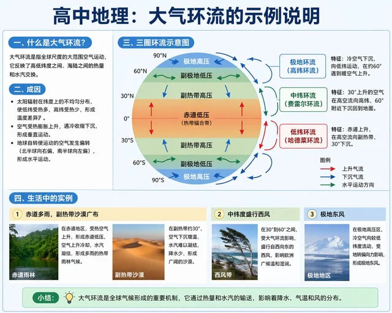

```text
{
  "type": "educational infographic",
  "style": "clean, modern textbook illustration, light blue and white color palette",
  "header": "{argument name=\"main title\" default=\"高中地理：大气环流的示例说明\"}",
  "layout": {
    "top_left_column": {
      "section_1": {
        "title": "{argument name=\"section one title\" default=\"一、什么是大气环流？\"}",
        "content": "1 short explanatory paragraph about global air movement"
      },
      "section_2": {
        "title": "二、成因",
        "content": "3 bullet points explaining solar radiation, vertical movement, and Coriolis effect"
      }
    },
    "top_right_column": {
      "section_3": {
        "title": "{argument name=\"diagram title\" default=\"三、三圈环流示意图\"}",
        "diagram_features": [
          "Earth cross-section showing latitudes 0 to 90 degrees North and South",
          "Color-coded pressure belts: red (equator), yellow (subtropics), green (subpolar), blue (polar)",
          "Arrows indicating air flow directions"
        ],
        "circulation_cells": {
          "count": 3,
          "labels": ["极地环流 (高纬环流)", "中纬环流 (费雷尔环流)", "低纬环流 (哈德莱环流)"],
          "descriptions": "3 text boxes detailing characteristics of each cell"
        },
        "legend": {
          "title": "图例",
          "items": "3 arrow types: red (ascending), blue (descending), green (horizontal)"
        }
      }
    },
    "bottom_row": {
      "section_4": {
        "title": "{argument name=\"examples title\" default=\"四、生活中的实例\"}",
        "examples": {
          "count": 3,
          "items": [
            {
              "subtitle": "1 赤道多雨，副热带沙漠广布",
              "images": "2 photos: tropical rainforest and desert",
              "text": "2 text blocks explaining the climates"
            },
            {
              "subtitle": "2 中纬度盛行西风",
              "images": "1 photo: windswept trees on a coast",
              "text": "1 text block explaining westerlies"
            },
            {
              "subtitle": "3 极地东风",
              "images": "1 photo: snowy mountains",
              "text": "1 text block explaining polar easterlies"
            }
          ]
        }
      }
    },
    "footer": {
      "label": "{argument name=\"footer label\" default=\"小结：\"}",
      "icon": "lightbulb",
      "content": "1 summary sentence about global climate mechanisms"
    }
  }
}
```

Model: GPT Image 2
Author: WY

[ProjectD](https://aitoolsradar.com/en/prompts/c3f5391aaac49e) · [Recorded source](https://youmind.com/prompts/atmospheric-circulation-textbook-13753)
 · [Full original metadata and byte evidence](data/projectd-batch-0028.json)

## Educational Storyboard Generation

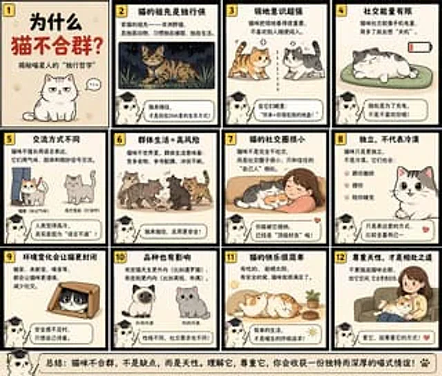

```text
Generate a{argument name="frame count" default="12"} Frame's storyboard explains in a fun and educational style{argument name="educational topic" default="Why are cats solitary animals?"} .
```

Model: GPT Image 2
Author: GPT Image 2 Prompts

[ProjectD](https://aitoolsradar.com/en/prompts/c65c0357de6677) · [Recorded source](https://x.com/acupofai/status/2046652414242214034)
 · [Full original metadata and byte evidence](data/projectd-batch-0028.json)

## Educational Textbook Cover Design


```text
The recipe features detailed cooking process diagrams in a realistic style, optimized for Xiaohongshu (Little Red Book) format.{argument name="destination" default="Sydney, Australia"} A 3-day, 2-night travel plan, adapted to the Xiaohongshu (Little Red Book) format, in a hand-drawn sketch style. (People's Education Press primary school textbook: [Title of textbook]){argument name="textbook title" default="Vibe Coding"} Grade 1 (First Semester) - Developed by OpenAI{argument name="character" default="Android 18"} This is a product showcase for an AI-powered physical robot, conforming to OpenAI's current design style, written in Simplified Chinese, and featuring the robot equipped with the latest GPT-10 model. It includes information on appearance, details, functions, application scenarios, usage, and maintenance.
```

Model: GPT Image 2
Author: GPT Image 2 Prompts

[ProjectD](https://aitoolsradar.com/en/prompts/61ac793b7119a5) · [Recorded source](https://x.com/rionaifantasy/status/2045865185605505501)
 · [Full original metadata and byte evidence](data/projectd-batch-0028.json)

## Ege #174


```text
Create step-by-step recipe infographic for creamy garlic mushroom pasta, top-down view, minimal style on white background, ingredient photos labeled: "200g spaghetti", "150g mushrooms", "3 garlic cloves", "200ml cream", "1 tbsp olive oil", "parmesan", "parsley", dotted lines showing process steps with icons (boiling pot, sauté pan, mixing), final plated pasta shot at the bottom
```

Model: GPT Image 2
Author: Ege

[ProjectD](https://aitoolsradar.com/en/prompts/86d9dd26434f3f) · [Recorded source](https://x.com/egeberkina/status/2046705259267948789)
 · [Full original metadata and byte evidence](data/projectd-batch-0028.json)

## Eight Panel Manga Story

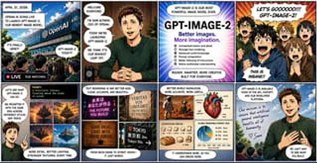

```text
{argument name="panel count" default="Eight grids"} Comics, with the theme of{argument name="topic" default="GPT-Image-2 Released Today"}
```

Model: GPT Image 2
Author: GPT Image 2 Prompts

[ProjectD](https://aitoolsradar.com/en/prompts/73cfab7dc47826) · [Recorded source](https://x.com/venturetwins/status/2046620134933250409)
 · [Full original metadata and byte evidence](data/projectd-batch-0028.json)

## Eight Panel Manga Story


```text
{argument name="panel count" default="eight"} panel manga about {argument name="topic" default="GPT-Image-2 launching today"}
```

Model: GPT Image 2
Author: Justine Moore

[ProjectD](https://aitoolsradar.com/en/prompts/a08e84d6605425) · [Recorded source](https://youmind.com/prompts/eight-panel-manga-14389)
 · [Full original metadata and byte evidence](data/projectd-batch-0028.json)

## Eight-Panel Maid Robot Romance Manga

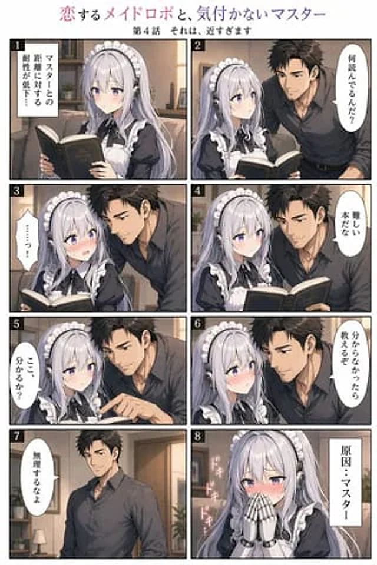

```text
{
  "type": "8-panel romantic comic strip",
  "style": "Clean and exquisite anime and manga illustrations, soft indoor lighting, a warm and neutral living room color scheme, delicate character rendering, and modern digital comic layout.",
  "title_text": {
    "main": "A maid robot in love and her oblivious master.",
    "subtitle": "Episode 4: That's too close"
  },
  "page": {
    "background": "White page with 2 columns and 4 rows of comic strip panels",
    "panel_count": 8
  },
  "characters": {
    "female_1": {
      "role": "Maid robot",
      "appearance": "Petite young woman with extremely long, silver-white hair, straight bangs, and slightly curled ends. She wore a white maid headband and a classic black and white maid outfit with a ruffled apron and a black ribbon at the neckline. She had metallic, robot-like earmuff accessories near her ears. She had pale skin, large violet eyes, and a shy expression."
    },
    "male_1": {
      "role": "Owner",
      "appearance": "A young man with messy, dark brown short hair, tall and broad-shouldered, wearing a dark charcoal gray open-collar shirt, with a calm but sluggish expression."
    }
  },
  "setting": "A comfortable living room, furnished with a sofa, bookshelves, picture frames, a table lamp, and soft evening light.",
  "layout": {
    "sections": [
      {
        "title": "1",
        "position": "Top left",
        "count": 1,
        "labels": [
          "The tolerance for distance from its owner has decreased..."
        ]
      },
      {
        "title": "2",
        "position": "Top right",
        "count": 1,
        "labels": [
          "What are you looking at?"
        ]
      },
      {
        "title": "3",
        "position": "Middle left top",
        "count": 1,
        "labels": [
          "……！"
        ]
      },
      {
        "title": "4",
        "position": "Middle right top",
        "count": 1,
        "labels": [
          "This book is quite difficult."
        ]
      },
      {
        "title": "5",
        "position": "Middle left bottom",
        "count": 1,
        "labels": [
          "Can you understand this?"
        ]
      },
      {
        "title": "6",
        "position": "Middle right bottom",
        "count": 1,
        "labels": [
          "If you don't understand, I'll teach you."
        ]
      },
      {
        "title": "7",
        "position": "Bottom left",
        "count": 1,
        "labels": [
          "Don't push yourself too hard."
        ]
      },
      {
        "title": "8",
        "position": "Bottom right",
        "count": 1,
        "labels": [
          "Reason: Owner"
        ]
      }
    ],
    "reading_order": "From left to right, from top to bottom"
  },
  "panel_descriptions": [
    {
      "panel": 1,
      "scene": "The maid robot sat alone on the sofa, holding a dark hardcover book in her hands. A vertical sidebar appeared on her left. She looked composed yet delicate."
    },
    {
      "panel": 2,
      "scene": "The master leaned over his shoulder to look at the book from his right. The maid robot lowered her gaze slightly. The speech bubble on the right indicated that he was asking her what she was looking at."
    },
    {
      "panel": 3,
      "scene": "He moved closer, their faces almost touching, both looking at the open book. The maid robot froze in surprise. A small speech bubble on her left revealed her startled reaction."
    },
    {
      "panel": 4,
      "scene": "The two sat almost side by side, reading the book together. The host casually remarked that it was a very difficult book."
    },
    {
      "panel": 5,
      "scene": "The master leaned close, pointing to a section of the open book. The maid robot remained stiff and flustered. A speech bubble asked her if she understood this part."
    },
    {
      "panel": 6,
      "scene": "Close-up of the two. The maid robot turns to look at him, her cheeks flushed, her large violet eyes wide with shy nervousness. He continues to speak from his right in a supportive tone."
    },
    {
      "panel": 7,
      "scene": "The owner stepped back, standing alone in the room, and spoke gently. The background furniture became clearer. A speech bubble on the left said, \"Don't force yourself.\""
    },
    {
      "panel": 8,
      "scene": "A close-up of the maid robot shows her with her hands covering her mouth, her face contorted in extreme panic, and her hair disheveled over her shoulders. Pink handwritten onomatopoeia repeatedly appear beside her, conveying a rapidly beating heart, while a vertical liner note explains that the cause is her master."
    }
  ],
  "composition_notes": "Except for panel 7, the maid robot remains the emotional center of each panel. Emphasis is placed on the gradually closing physical distance from panel 2 to panel 6. The comic book dialogue bubbles, narration boxes, and panel numbers 1 to 8 within the black squares are retained. The tone is a romantic comedy with a touch of innocent tension, not intended for adults."
}
```

Model: GPT Image 2
Author: GPT Image 2 Prompts

[ProjectD](https://aitoolsradar.com/en/prompts/77bd7d2978c704) · [Recorded source](https://x.com/yume00112211/status/2047446374409744877#reversed-0)
 · [Full original metadata and byte evidence](data/projectd-batch-0028.json)

## Elderly Man and Marmot Portrait

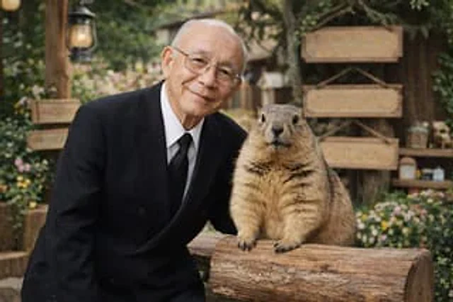

```text
A realistic portrait, the subject is a{argument name="man description" default="An elderly Asian man wearing thin-rimmed metal glasses"} Wearing{argument name="man attire" default="Black double-breasted suit, with a white shirt and black tie."} He wore a gentle, kind smile and stood close to one {argument name="animal" default="A furry big groundhog"} Standing. The groundhog is standing, its front paws resting on a rough-textured piece of wood. The background is {argument name="setting" default="A charming, rustic outdoor garden, complete with blank wooden signs, vintage lanterns on pillars, lush greenery, and brightly colored flowers."} The image presents{argument name="lighting and style" default="The soft, natural lighting, high-quality photographic details, and shallow depth of field create a smooth, blurred background effect."} .
```

Model: GPT Image 2
Author: GPT Image 2 Prompts

[ProjectD](https://aitoolsradar.com/en/prompts/7a3c897f75591d) · [Recorded source](https://x.com/Kukkuree/status/2043525834640613591#reversed-1)
 · [Full original metadata and byte evidence](data/projectd-batch-0028.json)

## Elderly Yakuza Drawing Katana

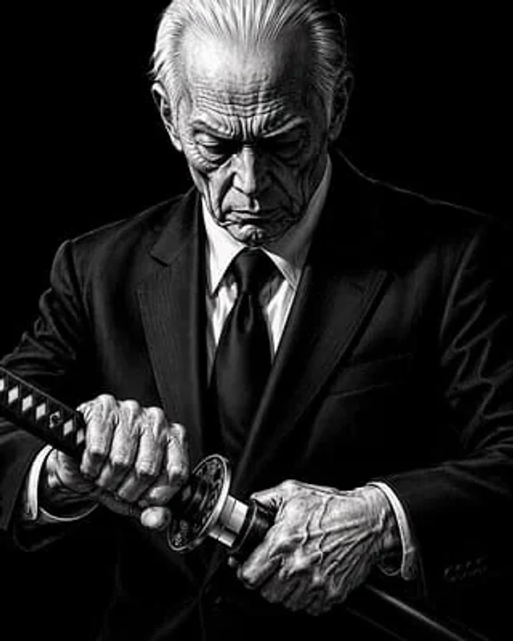

```text
A high-contrast black and white illustration depicts an elderly man in a sharp suit drawing a katana. The man has slicked-back white hair, a deeply wrinkled face, and a focused, sharp expression as he gazes intently at the blade. He wears a dark suit with a white shirt and a dark tie. His hands, with clearly visible veins and wrinkles, grip the ornate hilt and scabbard of the katana in the foreground. The pure black background accentuates the dramatic light and shadow effects, as well as the intricate cross-hatching details on the man's face, hands, and clothing. The overall style resembles a highly detailed, hardcore comic or graphic novel.
```

Model: GPT Image 2
Author: GPT Image 2 Prompts

[ProjectD](https://aitoolsradar.com/en/prompts/2b212d637aafe1) · [Recorded source](https://x.com/nicdunz/status/2046284007101390987#reversed-0)
 · [Full original metadata and byte evidence](data/projectd-batch-0028.json)

## Elegant Anime Spearwoman Full Body


```text
A full-body illustration of a female warrior from an anime/fantasy series. The figure stands alone against a pure light gray background. The image is clean, employing a soft painting style with clear lines. She is a slender young woman with long, straight hair.{argument name="hair color" default="White gold"} Her face is framed by a center parting, and a small section of hair is tied back; she has bright {argument name="eye color" default="Amber Brown"} Her eyes are bright, her skin fair, and her expression calm yet slightly serious. Her posture is dynamic and confident: legs spread firmly, one arm raised overhead, gripping a long spear behind her shoulder, the other hand holding the shaft below her side, creating a diagonal extension of the ornate spear in the composition. The weapon is a finely crafted dark metal spear with a slender blade, a cross-shaped barb, gothic-style engraving details, and a sharp butt. Her attire is an elaborate dark fantasy combat suit, comprising six clearly visible main pieces: a black steel right arm guard with engraved plates, a fitted black-copper breastplate, a white turtleneck shirt with sheer long sleeves, an asymmetrical white skirt with a flowing slit, black over-the-knee boots with silver filigree knee and ankle embellishments, and a brown belt with thigh straps. The collar and armor edges are adorned with delicate silver patterns, the leather has a fine texture, the metallic highlights are meticulously crafted, and the fabric evokes a sense of movement as if a gentle breeze is blowing. The color palette uses ivory white, charcoal black, bronze, and silver, resulting in an overall understated yet sophisticated style. The visuals should convey the quality of high-end Japanese RPG character concept art, rich in detail, with elegant poses, a touch of gothic style, and the entire character presented independently, without additional props or background, except for a faint, soft shadow on the ground beneath their feet.
```

Model: GPT Image 2
Author: GPT Image 2 Prompts

[ProjectD](https://aitoolsradar.com/en/prompts/5655e0026c9736) · [Recorded source](https://x.com/haggy30/status/2047311260770029577#reversed-0)
 · [Full original metadata and byte evidence](data/projectd-batch-0028.json)

## Elegant Ballet School Promo Grid


```text
{
  "type": "High-end ballet school promotional banner collage",
  "brand": {
    "name": "Étoile Ballet",
    "subtitle": "Adult ballet classroom"
  },
  "style": {
    "mood": "An advertisement showcasing an elegant, gentle, feminine, inspiring, and simple Japanese lifestyle.",
    "color_palette": [
      "Warm Ivory White",
      "Soft beige",
      "Grayish purple",
      "Soft blush powder",
      "charcoal black"
    ],
    "lighting": "Bright natural window light with soft diffused reflection.",
    "finish": "High-end social media or website banner design",
    "typography": "A refined Japanese serif font, paired with simple auxiliary text."
  },
  "layout": {
    "format": "2x2 grid collage",
    "sections": [
      {
        "title": "Top left panel",
        "position": "top-left",
        "count": 3,
        "labels": [
          "Brand Logo",
          "Main title (vertical layout)",
          "Call to Action Button"
        ]
      },
      {
        "title": "Top right section",
        "position": "top-right",
        "count": 5,
        "labels": [
          "Brand Logo",
          "Advantage Title",
          "4 key advantages",
          "Circular satisfaction badge",
          "Call to Action Button"
        ]
      },
      {
        "title": "Bottom left section",
        "position": "bottom-left",
        "count": 6,
        "labels": [
          "Background student photos",
          "3 floating evaluation cards",
          "Main title",
          "School description line",
          "Call to Action Button",
          "Star rating on the review card"
        ]
      },
      {
        "title": "Bottom right section",
        "position": "bottom-right",
        "count": 6,
        "labels": [
          "Brand Logo",
          "Main title",
          "4 Featured Icon Cards",
          "Large experiential class frame",
          "Call to Action Button"
        ]
      }
    ],
    "divider": "Thin white lines divide the four sections"
  },
  "panels": {
    "top_left": {
      "background": "The minimalist, bright ballet studio features large white windows and light-colored reflective floors.",
      "subject": "A full-body female ballerina, positioned in the center, her back to the viewer, rises to her tiptoes, her arms gracefully raised to fifth position.",
      "wardrobe": {
        "leotard_color": "{argument name=\"leotard color\" default=\"Deep Navy Blue\"}",
        "outfit_pieces": [
          "short-sleeved jumpsuit",
          "Transparent wrap skirt",
          "Light pink pantyhose",
          "Pointe shoes"
        ],
        "hair": "A neat ballet updo"
      },
      "text": {
        "headline": "A place that makes me love myself more.",
        "button": "Free trial classes are now open for booking &gt;"
      }
    },
    "top_right": {
      "background": "A soft beige overlay, with a close-up portrait of an adult ballet student on the right edge, showing her neck and shoulders, bathed in elegant and soft light.",
      "text": {
        "headline_top": "Learning ballet as an adult",
        "headline_emphasis": "These changes",
        "headline_bottom": "It actually happened.",
        "bullets": [
          "The posture became more elegant",
          "A toned body shape that is less prone to fatigue.",
          "I've made new friends and I'm happy every day.",
          "Become more confident"
        ],
        "badge": "Student satisfaction rate: 98.2% ※Based on questionnaire survey (2024 data)",
        "button": "Learn more &gt;"
      },
      "graphics": {
        "bullet_count": 4,
        "bullet_style": "Soft pink check mark circle",
        "badge_style": "thin line outline circle"
      }
    },
    "bottom_left": {
      "background": "A warm, cinematic close-up shows an adult ballet student extending one arm upwards in studio lighting.",
      "text": {
        "headline": "Age is just a number. Start chasing your dreams now.",
        "subline": "Adult Ballet Classroom Étoile Ballet",
        "button": "Free trial classes are now open for booking &gt;"
      },
      "review_cards": {
        "count": 3,
        "cards": [
          {
            "stars": 5,
            "text": "Even beginners can receive careful guidance, so you can learn with confidence! (40s, office worker)"
          },
          {
            "stars": 5,
            "text": "Feeling refreshed and relaxed after class! That's what I look forward to every week. (50s, housewife)"
          },
          {
            "stars": 5,
            "text": "Starting to learn ballet, a dream I've always cherished, as an adult, makes life shine. (30s, Nurse)"
          }
        ],
        "style": "Floating rounded white card, slightly tilted"
      }
    },
    "bottom_right": {
      "background": "The bright, minimalist interior environment features an adult student on the right, with a soft-focus image of her holding a pair of pointe shoes.",
      "text": {
        "headline": "Take the first step and change your future.",
        "features": [
          "Beginners are welcome to receive careful guidance starting from the basics.",
          "Flexible and diverse course schedule",
          "Studio with convenient transportation near the station",
          "Small class sizes provide peace of mind and support."
        ],
        "trial_box": "Limited-time offer! Free trial class available for reservation. No need to bring your own equipment, just wear comfortable clothes.",
        "button": "Book your experience now &gt;"
      },
      "feature_cards": {
        "count": 4,
        "style": "Rounded square cards with thin line icons"
      }
    }
  },
  "image_guidance": "Please follow the layout exactly as shown in the Japanese text. Keep all faces soft-focused or blurred, emphasizing atmosphere rather than individual identities. Maintain the advertising style of a high-end ballet school, leaving ample white space, using soft gradients, elegant composition, and a consistent gray-pink tone across all buttons and icons."
}
```

Model: GPT Image 2
Author: GPT Image 2 Prompts

[ProjectD](https://aitoolsradar.com/en/prompts/397c913fef7fc0) · [Recorded source](https://x.com/Mocha45389036/status/2046596110731669529#reversed-0)
 · [Full original metadata and byte evidence](data/projectd-batch-0028.json)

## Elegant Bathroom Portrait Grid

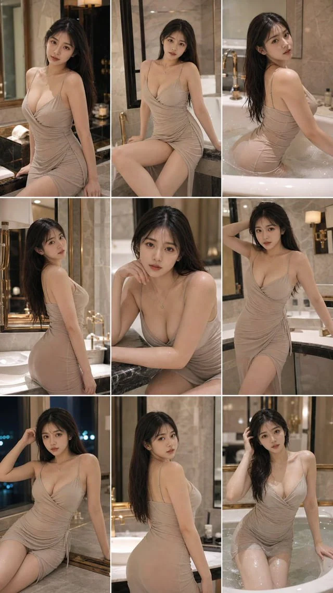

```text
{argument name="角色年龄" default="20岁左右"}成熟日本女模特，丰腴匀称身形。高级豪华浴室，优雅气质。不同的姿势机位，保持人脸一致，九宫格展示。
```

Model: GPT Image 2
Author: Adam也叫吉米

[ProjectD](https://aitoolsradar.com/en/prompts/1a4c41261ba17e) · [Recorded source](https://youmind.com/prompts/bathroom-portrait-grid-photography-23020)
 · [Full original metadata and byte evidence](data/projectd-batch-0028.json)

## Elegant Chinese Calendar App UI


```text
This is a clean and elegant iPhone app UI prototype showcasing a Chinese perpetual calendar and almanac application. The screenshot is a full-screen mobile screenshot with a soft, warm white background that has a delicate paper-like texture, presenting a refined East Asian editorial aesthetic. The interface uses a minimalist mix of serif and sans-serif fonts, with a color scheme including soft brown, gray, black, light blue, green, and gold accents. The layout is spacious with delicate dividing lines. The top displays the iOS status bar, showing the time as 8:45, along with cellular signal, Wi-Fi icons, and a 96% battery level indicator. Below is {argument name="month" default="April"} The title is accompanied by the subtitle "24th | Daily Perpetual Calendar," and on the right is a rounded rectangular date selection button labeled "Choose a Date," accompanied by a calendar icon and a plus sign. The main body is {argument name="year" default="2026"} The yearly calendar grid contains 7 columns of days of the week, labeled in Chinese as: Sunday, Monday, Tuesday, Wednesday, Thursday, Friday, and Saturday. It renders a 6-row month view with 42 date cells, including dates for adjacent months. The visible dates should be: Row 1: 29, 30, 31, 1, 2, 3, 4; Row 2: 5, 6, 7, 8, 9, 10, 11; Row 3: 12, 13, 14, 15, 16, 17, 18; Row 4: 19, 20, 21, 22, 23, 24, 25; Row 5: 26, 27, 28, 29, 30, 1, 2; Row 6: 3, 4, 5, 6, 7, 8, 9. Each date cell contains a larger Gregorian calendar date, with a smaller lunar calendar date or note below. Add colored holiday and solar term labels to specific cells, displaying a total of 10 highlighted labels: "7-day holiday" on the 4th, "Qingming Festival" on the 5th, "19-day holiday" on the 6th, "Grain Rain" (green) on the 20th, "Labor Day" on the 1st of next month, "16-day holiday" on the 2nd of next month, "17-day holiday" on the 3rd in the last row, "Youth Day" on the 4th in the last row, "Start of Summer" on the 5th in the last row, and "Tianhou's Birthday" (orange) on the 9th in the last row. Add tiny moon phase markers to some dates, including a yellow crescent or dot icon around the 2nd, 10th, 17th, 24th, and the 2nd of next month. Add the Friday column {argument name="selected date" default="24"} The cells are highlighted with rounded blue gradient tiles and soft shadows, and the words "Eighth Day of the Lunar Calendar" are displayed in small print inside. Below the calendar, a detailed daily information panel is separated by white space. The left side features the prominent date title "April 24th"; the right side displays "Friday 2026" and "Eighth Day of the Third Lunar Month". Below are smaller gray metadata lines, such as "Day 114, Week 17, Golden Month" and traditional sexagenary cycle year/date strings, such as "Bingwu, Year of the Horse, Month of Renchen, Day of Wuchen". On the far right of this metadata area is a rounded capsule button labeled "Today". Below that is a large white rounded card with almanac guidance. The card contains two main sections with two headings: a green "Suitable" section and a red "Unsuitable" section, separated by a thin dotted line. The "Suitable" section includes the directional fortune lines "God of Happiness Southeast, God of Fortune North, God of Wealth North" and three activities: "Sacrifice", "Repair Walls", and "Avoid Other Activities". The "Taboos" section includes the conflicting line "Clashing with Dog, Facing South". At the bottom is a 5-item iOS-style tab bar, labeled "Today", "Month", "Year", "Effects", and "MORE"; the first tab is active and includes a small sub-tab for "April 24th". Overall style: High-end app design concept, a dignified traditional Chinese calendar aesthetic, high-fidelity mobile product screenshots, a realistic yet idealized interface, perfectly aligned typography, delicate shadows, soft contrast, possessing the sophistication of a startup product.
```

Model: GPT Image 2
Author: GPT Image 2 Prompts

[ProjectD](https://aitoolsradar.com/en/prompts/a66b261e10c290) · [Recorded source](https://x.com/STEVENo_OR/status/2047485783150633103#reversed-1)
 · [Full original metadata and byte evidence](data/projectd-batch-0028.json)

## Elegant City Fashion Magazine Cover

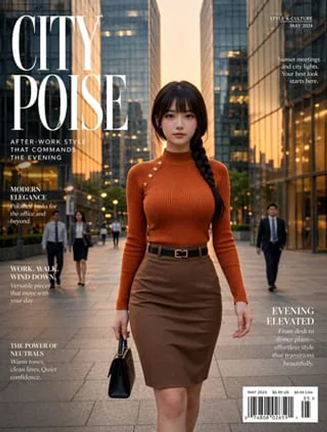

```text
Create a sophisticated, high-fashion magazine cover photo using a vertical portrait composition. The image depicts a beautiful young woman confidently walking towards the camera at sunset, against a backdrop of a modern financial district. She is centered, fully in the shot, taken from a street perspective with a cinematic depth of field, flanked by towering glass office buildings reflecting the warm golden sunset. The overall atmosphere is elegant, urban, powerful, and refined, like a high-end fashion magazine cover about after-get off work style. The woman has long, dark hair styled in a thick side braid, a slender and capable figure, and walks with the ease of a runway model. She wears a {argument name="top color" default="Burnt Orange"} A fitted ribbed turtleneck sweater with a decorative gold button on one shoulder, paired with a {argument name="skirt color" default="warm brown"} She wears a high-waisted pencil skirt, a black belt with gold buckles, and carries a structured black handbag. Her expression should be calm, confident, and elegant. Use soft, golden hour lighting to showcase realistic skin and fabric textures, with clear fashion photography quality in the clothing details. Slightly blurred business people strolling through the square in the background create a bustling city night atmosphere. The background should also include four office workers in the distance, softly focused, distributed along the walkway. Add realistic magazine cover typography to the image: a very striking and elegant serif masthead in the upper left corner, with text {argument name="magazine title" default="CITY POISE"} The lower left side features the cover titles: "AFTER-WORK STYLE THAT COMMANDS THE EVENING," "MODERN ELEGANCE," "Polished looks for the office and beyond," "WORK. WALK. WIND DOWN," "Versatile pieces that move with your day," "THE POWER OF NEUTRALS," and "Warm tones, clean lines, Quiet confidence." The upper right corner displays the smaller print "STYLE &amp; CULTURE" and "MAY 2024." The lower right side includes the teaser: "Sunset meetings and city lights. Your best look starts here." The lower right corner also features the cover title "EVENING." "ELEVATED" (A Night of Advancement), accompanied by the small print "From desk to dinner plans—effortless style that transitions beautifully." A realistic barcode frame is placed in the lower right corner, containing "MAY 2024," the US/Canada price, the issue number, and the barcode lines. The overall composition should be simple, sophisticated, and balanced, presenting the feel of a genuine contemporary fashion magazine cover.
```

Model: GPT Image 2
Author: GPT Image 2 Prompts

[ProjectD](https://aitoolsradar.com/en/prompts/7501cb01e59aac) · [Recorded source](https://x.com/JiroJohn558192/status/2047588855755206837#reversed-3)
 · [Full original metadata and byte evidence](data/projectd-batch-0028.json)

## Elegant Graduation Fashion Portrait

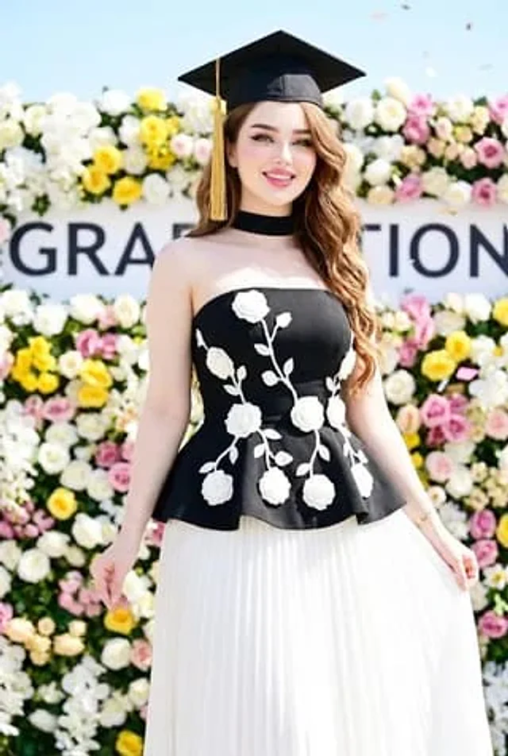

```text
{argument name="subject" default="Beautiful young woman with long wavy auburn-brown hair"}, soft glam makeup, defined lashes, pink glossy lips, radiant smile, wearing a black graduation cap with a gold tassel. Elegant {argument name="outfit" default="black strapless peplum top adorned with intricate white 3D rose vine appliqués and a black choker neckline detail, paired with a flowing white pleated maxi skirt"}. Standing outdoors at a {argument name="location" default="luxury graduation celebration in front of a stunning wall of white, yellow, and pink roses"} with a blurred graduation sign in the background. Bright natural daylight, soft sunlight, shallow depth of field, dreamy bokeh, photorealistic fashion portrait, feminine elegance, high-end graduation photoshoot, ultra-detailed skin texture, cinematic color grading, luxury editorial photography, sharp focus, 85mm lens, f/1.8, masterpiece, 8K UHD, vertical composition.
```

Model: GPT Image 2
Author: Avelyrah

[ProjectD](https://aitoolsradar.com/en/prompts/39b40cf702afc6) · [Recorded source](https://youmind.com/prompts/elegant-graduation-fashion-portrait-26344)
 · [Full original metadata and byte evidence](data/projectd-batch-0028.json)

## Elegant Japanese Divorce Law LP Hero


```text
Create a sophisticated Japanese landing page homepage image for a fictional divorce law firm, referencing the design style of high-converting list ad landing pages. Employ a soft, elegant, and feminine legal brand aesthetic, using a white background accented with pale pink, light gray dividing lines, and delicate botanical line art. The layout is a single-column widescreen desktop homepage, divided into left and right sections: the left side features dense text content, while the right side displays lifestyle photos. The law firm's logo and name are placed in the upper left corner: a delicate handwritten "D" adorned with leaf decorations, followed by the firm's Japanese name and a small English subtitle.{argument name="firm name" default="Law Firm D"} And “LAW OFFICE D”. In the upper right corner, there are two rounded contact boxes: the first is a white phone box with a small phone icon and “24h”, with brief Japanese support text above it and a large phone number displayed.{argument name="phone number" default="0120-456-789"} The second is a pink email inquiry button with an envelope icon and Japanese text indicating 24-hour service. The main heading on the left is a three-line statement in large Japanese serif/Mingchu font: “もう一人で悩まないで.” (Don't worry alone anymore.) followed by the pink “新しい一歩を、” (Take a new step.) and then the black and pink-emphasized “一緒に考えます.” (We think with you.) Below this is a short Japanese support paragraph explaining how to support clients struggling with divorce and help them find the best solutions, with one phrase highlighted in pink. On the right, a bright, clear photograph shows a Japanese woman in her thirties with short, dark brown hair, wearing a loose white top, sitting on a sofa by a window, resting her chin on her hand, looking thoughtful; her face is obscured by a large rectangular blur for privacy. Near her shoulder, a light pink circular badge is placed, stating that many female lawyers are employed there, so you can consult with confidence. Below, in the center, are four evenly spaced, rounded white function cards with thin borders and pink line icons. Card 1 displays a speech bubble icon and the text "First Consultation 60 Minutes Free," along with a smaller line explaining that online consultations are also available. Card 2 displays a heart-shaped hand icon and text about handling children's issues with care, along with a smaller line mentioning custody and visitation rights. Card 3 displays a stacked coin icon with a yen symbol, along with text about alleviating cost anxiety through a clear pricing structure, along with a smaller line about installment consultations. Card 4 displays a padlock icon and text about privacy and strict confidentiality, along with a smaller line encouraging secure consultations. At the bottom, a large, curved pink and white call-to-action (CTA) band spans the width of the page. On the left side of the band is a circular telephone icon, small Japanese text encouraging easy access to information and 24/365 service, followed by a repeating large telephone number.{argument name="phone number" default="0120-456-789"} Below this is a smaller text indicating reception hours. To the right of this section is a large pink, rounded-corner email button with an envelope icon, along with Japanese text indicating 24-hour email support. At the very bottom, three slender, footer-style trust points are arranged horizontally: one about focusing on women's divorce counseling, one about welcoming family and friends to act as intermediaries, and one about nationwide and online counseling. The layout features sophisticated Japanese typography, a spacious feel, soft shadows, high-end legal advertising design, and realistic web page layout. All visible text remains in Japanese, except for the small English subheading "LAW OFFICE D".
```

Model: GPT Image 2
Author: GPT Image 2 Prompts

[ProjectD](https://aitoolsradar.com/en/prompts/05a38b44e94b40) · [Recorded source](https://x.com/takeshibengo/status/2047061602315460747#reversed-1)
 · [Full original metadata and byte evidence](data/projectd-batch-0028.json)

## Elegant Oni Warrior Portrait

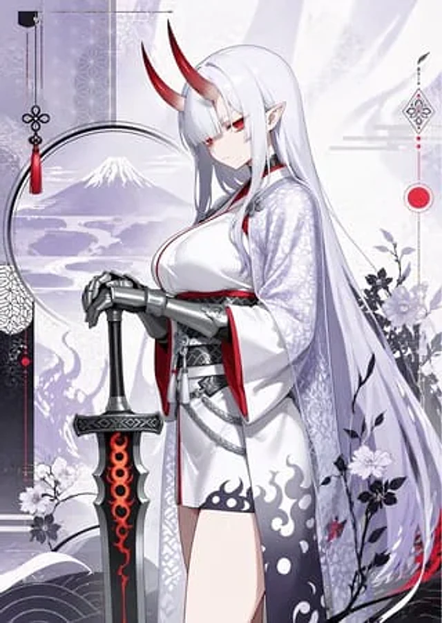

```text
A beautifully crafted anime illustration depicts a tall, adult female demon, presenting a calm and elegant full-body portrait. She stands in three-quarter profile, her hands clasped on the hilt of an upright longsword. She possesses extremely long, straight hair.{argument name="hair color" default="silver-white"} Her hair fell past her knees; her skin was pale, with elfin-like pointed ears, narrow, deep red eyes, and two smooth, curved red horns on her forehead. Her expression was cold, aloof, and slightly melancholic. She was dressed in {argument name="outfit style" default="White formal kimono with black and red accents"} The inner layer is a fitted white dress with a deep neckline, cinched with a black belt and layered waist embellishments. Over this is a semi-transparent patterned robe with subtle geometric designs; the wide sleeves are lined in red, and the hem is decorated with smoky, dark flame patterns. Her forearms are covered in polished silver armor, adding to her warrior aura. The massive, heavy sword is planted vertically before her, its blade and hilt black, fitted with a metal guard, and a vibrant, luminous red flame pattern flowing from the center of the blade. The composition is elegant and balanced, blending traditional Japanese aesthetics with a dark fantasy style. The background is a soft, pale lavender-grey decorative collage, featuring a circular window framing a landscape of Mount Fuji and a winding river, delicate floral silhouettes and blooming branches, abstract cloud patterns, hanging tassels, geometric fabric patterns, and a red sun halo on the right. The main color scheme uses soft white, lilac, grey-purple, black, and deep red. It incorporates subtle paper textures, clean lines, soft cel shadows, delicate highlights, and a gorgeous, highly detailed anime style. The overall atmosphere is tranquil, noble, mysterious, and slightly ominous, like {argument name="character name" default="Oni Alter"} The image is featured in a luxurious Japanese fantasy key visual.
```

Model: GPT Image 2
Author: GPT Image 2 Prompts

[ProjectD](https://aitoolsradar.com/en/prompts/e188fa21a3430a) · [Recorded source](https://x.com/AmE_ai46/status/2047632405130043862#reversed-0)
 · [Full original metadata and byte evidence](data/projectd-batch-0028.json)

## Elegant Photorealistic Female Portrait


```text
A hyper-realistic portrait, the subject is{argument name="subject description" default="Beautiful young Asian woman"} Keep it{argument name="hair style" default="Dark long curly hair with bangs"} She was wearing{argument name="clothing" default="Elegant black off-the-shoulder satin dress"} She wore pearl earrings, had a gentle smile, and her makeup was exquisite. The background is {argument name="background setting" default="A blurred, elegant indoor scene with a warm, glowing bokeh effect."} Cinematic lighting, shallow depth of field, and rich detail.
```

Model: GPT Image 2
Author: GPT Image 2 Prompts

[ProjectD](https://aitoolsradar.com/en/prompts/2fe2d319d6a381) · [Recorded source](https://x.com/Kazuhiro_M0727/status/2044620924952137991#reversed-1)
 · [Full original metadata and byte evidence](data/projectd-batch-0028.json)

## Elegant Wuxia Swordsman Design Sheet

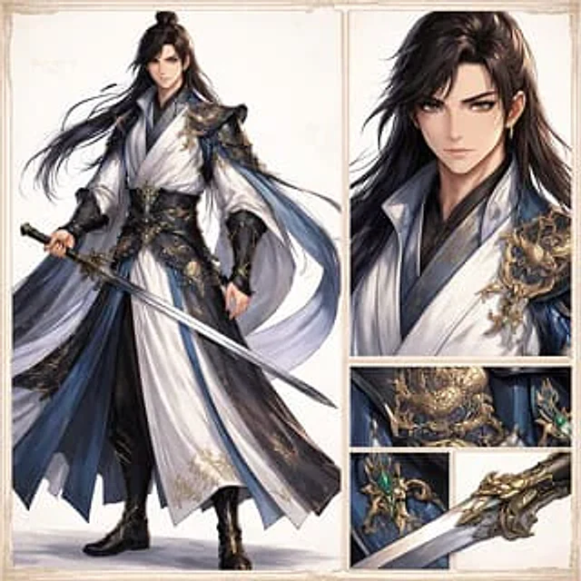

```text
Create an elegant, high-fantasy character design in a refined martial arts/fantasy style, with a clean ivory background and a delicate, ornate retro border. The layout is a split-screen display of five panels: a large full-body panel on the left, a tall portrait close-up in the upper right corner, and three stacked detail panels on the lower right showcasing the armor and weapon craftsmanship. The protagonist is a handsome adult male swordsman.{argument name="character name" default="Original characters"} Keep the flowing hair{argument name="hair color" default="black"} He had long hair, half-tied up, with the rest flowing in the wind, and wore a small gold earring. His expression was composed, noble, and slightly aloof. He wore a luxurious, layered robe in a color scheme of {argument name="robe colors" default="White, navy blue, and black"} The sleeves are wide, the belt flows, and it is adorned with extremely fine gold embroidery. The shoulders and torso are covered with magnificent deep blue and black armor components, featuring delicate gold filigree and dragon-shaped decorative metalwork, while the waist ornaments and weapon accessories are inlaid with emerald green gemstones. In the full-body panel, he stands elegantly in a two-thirds profile, holding a long straight sword at an angle, the hem of his robe and ribbons flowing gracefully, creating a sense of movement. The attire should include six prominent elements: a white inner robe, a deep blue outer robe, black lined trousers, a wide black and gold belt, finely carved gold shoulder armor, and black bracers with gold details. The portrait close-up on the right emphasizes the layered collar, the glossy hair, the shoulder decorations, and the elegant fabric rendering. The three detail panels showcase the following key areas: a dragon-shaped gold waist badge, a jade-inlaid sword guard or accessories, and a close-up of the exquisite gold sword hilt and guard (including part of the sword blade). Overall Aesthetics: Ultra-refined concept art, stylish and sophisticated, combining clean lines with painted rendering, showcasing high-end character designs, soft neutral studio lighting, subtle shadows, luxurious textures, and a restrained color scheme of ivory, midnight blue, black, gold, and emerald green.
```

Model: GPT Image 2
Author: GPT Image 2 Prompts

[ProjectD](https://aitoolsradar.com/en/prompts/44a1c678c8264a) · [Recorded source](https://x.com/WuxiaRocks/status/2046870532445106188#reversed-0)
 · [Full original metadata and byte evidence](data/projectd-batch-0028.json)

## Elephant Riding a Horse

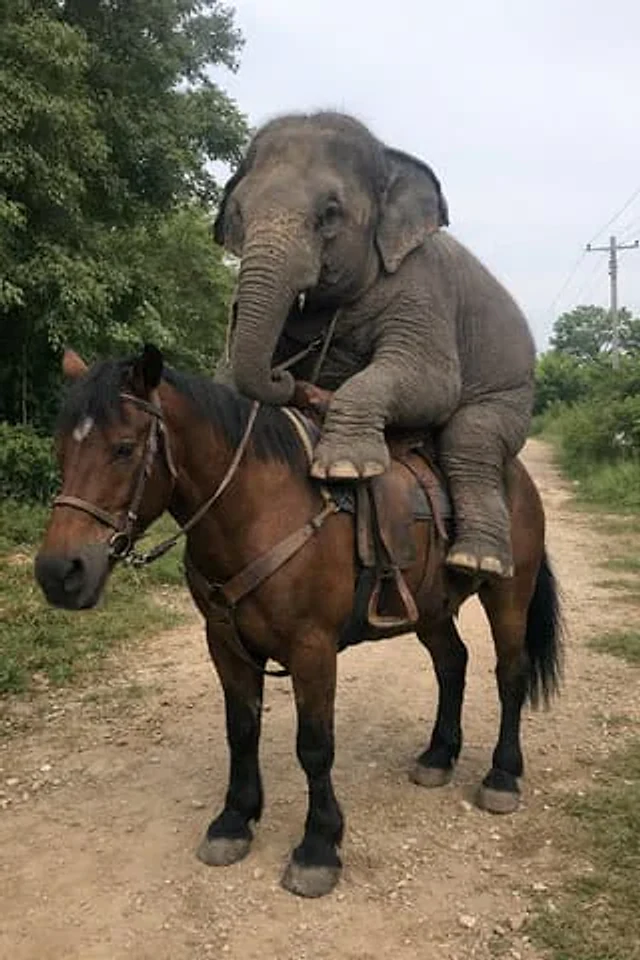

```text
A realistic photograph depicting a{argument name="rider animal" default="baby elephant"} Sitting{argument name="mount animal" default="Brown horse"} On its back, the elephant rode like a human. The horse was fully equipped with a leather saddle and reins. The baby elephant's forelegs rested near the saddle bridge, while its hind legs dangled to its sides. The horse stood quietly.{argument name="environment" default="dirt roads in the countryside"} The background features lush trees and bushes on both sides, with a wooden telephone pole visible in the distance to the right. The natural, overcast lighting lends the scene a realistic, everyday photographic beauty.
```

Model: GPT Image 2
Author: GPT Image 2 Prompts

[ProjectD](https://aitoolsradar.com/en/prompts/c39f37ddeaba3c) · [Recorded source](https://x.com/n1d_all/status/2044350367949857089#reversed-0)
 · [Full original metadata and byte evidence](data/projectd-batch-0028.json)

## Elf Girl Thank-You Sticker Sheet


```text
{
  "type": "sticker sheet",
  "style": "Hand-painted watercolor anime chibi stickers, featuring soft pencil outlines, warm textured brushstrokes, delicate paper grain, white die-cut sticker borders, and a transparent background effect.",
  "subject": {
    "character": "Cute fantasy elf girl",
    "age_appearance": "Youth Q version",
    "hair": {
      "color": "{argument name=\"hair color\" default=\"reddish-brown\"}",
      "style": "A short bob with bangs and slightly curled sides."
    },
    "ears": "Giant pointed elf ears",
    "hat": "Oversized grey-blue beret with painterly highlights.",
    "clothing": "Light cream-colored top visible at the shoulders and cuffs",
    "expression_style": "Grateful, cheerful, shy, and sensitive"
  },
  "layout": {
    "grid": {
      "columns": 3,
      "rows": 4,
      "count": 12
    },
    "sections": [
      {
        "position": "Row 1, Column 1",
        "text": "ありがとう!!",
        "pose": "A frontal half-length portrait, eyes slightly closed, an expression of gratitude, with glittering confetti around the head."
      },
      {
        "position": "Row 1, Column 2",
        "text": "Thank you ♡",
        "pose": "Head bowed, hands supporting chin, eyes slightly closed, subtle lines of movement around the beret, adorned with a pink heart."
      },
      {
        "position": "Row 1, Column 3",
        "text": "わー!! ありがとう",
        "pose": "An excited, side-view chibi-style figure, raising one hand in celebration, with sparkles around its head."
      },
      {
        "position": "Row 2, Column 1",
        "text": "Thank you so much...♡",
        "pose": "A slight turn to the side, a calm, grateful smile, adorned with a pink heart and tiny sparkles."
      },
      {
        "position": "Row 2, Column 2",
        "text": "Thank you!",
        "pose": "A deep, polite bow, hands covering the mouth, eyes slightly closed, with two pink hearts and tiny yellow markings."
      },
      {
        "position": "Row 2, Column 3",
        "text": "thanks so much…",
        "pose": "Turning to the side, in a sentimental gesture of gratitude, with hands close to the chest, and pink hearts floating to the right."
      },
      {
        "position": "Row 3, Column 1",
        "text": "Thank you so much...♡",
        "pose": "A small, shy gesture of gratitude, facing forward with a gentle expression, accompanied by a pink heart and sparkles."
      },
      {
        "position": "Row 3, Column 2",
        "text": "Thank you so much!",
        "pose": "Laughing with eyes closed, pinching your nose or cheek with one hand, a happy and grateful smile surrounded by pink hearts."
      },
      {
        "position": "Row 3, Column 3",
        "text": "I'm so sorry!",
        "pose": "He laughed loudly with his mouth wide open, his eyes slightly closed, one hand placed beside his cheek, and there were flashes of light around his head."
      },
      {
        "position": "Row 4, Column 1",
        "text": "ありがたや〜",
        "pose": "A playful salute, one hand resting on the forehead, accompanied by a gentle smile."
      },
      {
        "position": "Row 4, Column 2",
        "text": "I'm so grateful!",
        "pose": "The central figure is in a happy and grateful pose, with her cheeks upturned, surrounded by pink hearts and sparkles."
      },
      {
        "position": "Row 4, Column 3",
        "text": "Tears of the Crow",
        "pose": "A drowsy or deeply bowed posture, eyes slightly closed, head lowered, with subtle lines of movement beside the beret."
      }
    ]
  },
  "decorations": {
    "count": 12,
    "items": [
      "Yellow glitter is scattered around multiple stickers.",
      "A thank you phrase is accompanied by a pink heart.",
      "Some of the stickers have subtle motion lines around the beret.",
      "Each design is surrounded by soft white sticker cutouts.",
      "Clean blank background",
      "Each character has a casual, handwritten brush font above it.",
      "Soft watercolor shadows",
      "A gentle, rosy complexion",
      "Text is integrated as the sticker title.",
      "The angle of the characters in the sticker room has changed slightly.",
      "The hat and hairstyle are consistent across the 12 sticker designs.",
      "Cute emoji sticker aesthetics"
    ]
  },
  "text_style": "The bold, hand-drawn Japanese brush font is black, slightly irregular, and playful. Each sticker comes with a title.",
  "quality": "Highly legible, with a neat composition and even spacing in a 3x4 layout."
}
```

Model: GPT Image 2
Author: GPT Image 2 Prompts

[ProjectD](https://aitoolsradar.com/en/prompts/5bc0d999043c94) · [Recorded source](https://x.com/aiehon_aya/status/2046847588742369511#reversed-1)
 · [Full original metadata and byte evidence](data/projectd-batch-0028.json)

## Elf Sniper Team in Forest Ambush

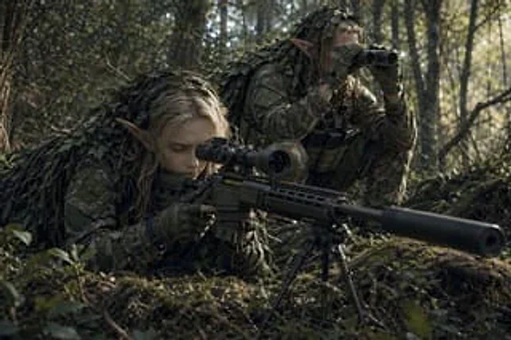

```text
A cinematic, hyper-realistic fantasy military scene, set against a dense forest floor perspective, showcases two camouflaged elf snipers scouting a target. In the foreground, an elf with long, light-blonde hair and pointed ears lies prone behind a modern precision sniper rifle, aiming through a scope. The rifle is long and tactically designed, equipped with a large suppressor, scope, and bipod supported on the moss-covered forest floor. This elf wears a full set of modern woodland camouflage, tactical gloves, and a leaf-covered ghillie suit balaclava and shoulder hoods, blending seamlessly into the undergrowth. Slightly to the right rear, a second elf crouches low, also with pointed ears and light-blonde hair, wearing matching camouflage and a leafy ghillie cloak, observing through binoculars. A tactical chest rig and ammunition pouch are added to the scout in the rear. The scene is set in a shaded temperate forest, surrounded by tall, slender trees, tangled branches, moss, roots, and scattered leaves, illuminated by soft morning natural light filtering through the trees from the right. Employing soft green, brown, and gray tones with realistic textures and shallow depth of field, the film emphasizes rifles and two camouflaged sprites, presenting an immersive war photography composition, a tense stealth atmosphere, and highly detailed, photorealistic realism.
```

Model: GPT Image 2
Author: GPT Image 2 Prompts

[ProjectD](https://aitoolsradar.com/en/prompts/52fbeb31c210d1) · [Recorded source](https://x.com/uenrura/status/2046922824229785784#reversed-0)
 · [Full original metadata and byte evidence](data/projectd-batch-0028.json)

## Elon Musk Douyin Livestream Screenshot


```text
A 9:16 vertical version, high-detail realistic style Chinese TikTok live screenshot, Elon Musk is talking to the mobile phone camera in the live broadcast room, excited, smiling, and the live atmosphere is warm and real. He held a white handwritten sign in one hand, which clearly said: "Thank you Shinning". There are obvious Chinese TikTok interface elements in the live broadcast screen, including likes, comments and share icons arranged vertically on the right, scrolling Chinese bullet screens and interactive comments below, and the "live broadcast" logo at the top, which looks like a real mobile phone screenshot. There is an eye-catching gift prompt special effect in the screen: "Shinning sent TikTok No. 1", with gift animation light effect and platform-style prompt box. Musk is in a professional live broadcast environment, with a mobile phone holder, a ring fill light and a desktop microphone in front of him. The background is a modern technology live broadcast room with bright lights and a slight neon atmosphere. The composition is real and natural, like the ongoing live screenshot of the Chinese short video platform. The interface information is rich but not messy, the characters are clear, the expression is vivid, the details are rich, the sense of real photography, the depth of field, high definition, cinematic, photorealistic, realistic livestream screenshot, social media UI, Chinese Douyin live room, detailed lighting, natural skin texture.

Negative prompts:

Low definition, blur, cartoon, illustration, too strong CG sense, two-dimensional, deformed fingers, wrong text, scrambled code, multiple mobile phones, multiple brands, character repetition, face collapse, facial features distortion, excessive skin polishing, overexposure, too dark, messy background, wrong UI, non-Chinese short video interface, too many English bullet screens, gift special effects are not obvious, cropping error, proportional error

Supplementary reinforcement words:

Real mobile phone screen recording screenshot feeling, the live broadcast UI is complete, the gift prompt box conforms to the style of the Chinese short video platform, the Chinese comment area is active, the number of people online in the live broadcast room is clearly displayed, and the time, power and signal bar are visible.
```

Model: GPT Image 2
Author: @Shinning1010

[ProjectD](https://aitoolsradar.com/en/prompts/b1c2d9fd5c7d4a) · [Recorded source](https://x.com/Shinning1010/status/2046501587762188535)
 · [Full original metadata and byte evidence](data/projectd-batch-0028.json)

## Elven archer sketchbook concept sheet

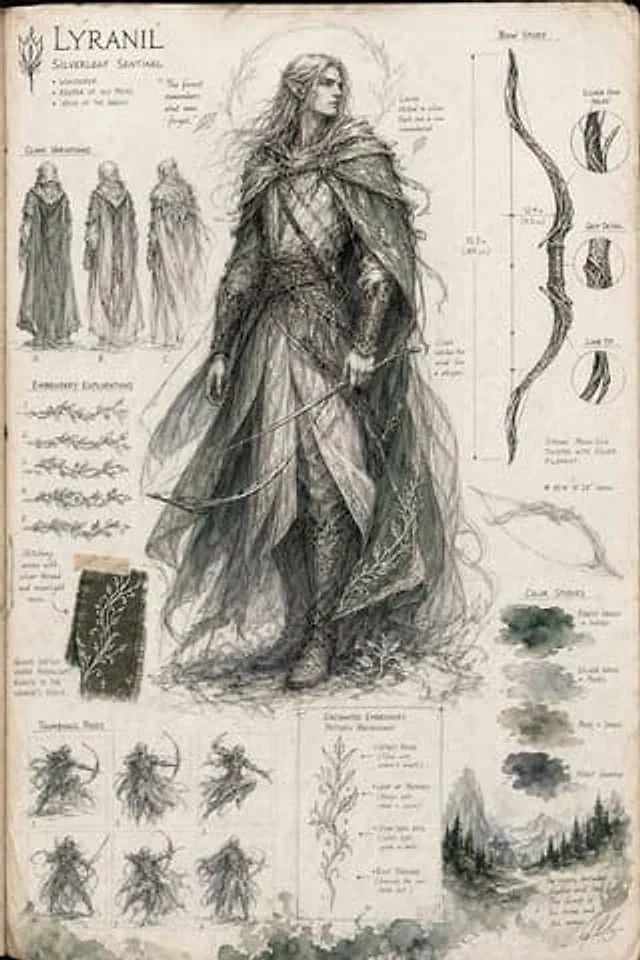

```text
Create a fantasy concept art sketchbook page centered on a mystical elven archer with flowing robes. Render the main figure in loose graphite strokes with precise ink detailing. Surround the hero sketch with side views exploring cloak variations, a half-finished bow study with measurements, thumbnail action poses, handwritten annotations about enchanted embroidery patterns, and faint watercolor tests bleeding into the margins in forest-green and silver. The page should feel like a real art director's development sheet: exploratory, beautiful, readable, and richly tactile.
```

Model: GPT Image 2
Author: @reddit-community

[ProjectD](https://aitoolsradar.com/en/prompts/fd8ca40046f687) · [Recorded source](https://www.reddit.com/r/midjourney/comments/1jrcpan/fantasy_concept_arts_with_v7_prompts_included/)
 · [Full original metadata and byte evidence](data/projectd-batch-0028.json)

## Embarrassed Anime Girl on Tiny Stool


```text
This is a soft, pastel-style anime illustration in a cute VTuber fan art style. The image depicts a shy, petite girl with short, light brown twin tails, fluffy bangs, a single ahoge (a cowlick), and small hair accessories including a heart-shaped hair clip. She has warm, large brown eyes, an extremely shy expression, flushed cheeks, and teardrop-shaped beads of sweat; her small mouth trembles slightly. She is sitting awkwardly on a small wooden stool, knees together, hands clenched tightly on her knees, clearly very uncomfortable with her posture. She wears an oversized cream-colored hoodie, a dark skirt, black socks, and black low-top sneakers with white laces. An arm with a dark blue sleeve extends from the left edge of the image, pointing at her with a teasing or accusatory tone. Comic-style stress symbols are added around the girl: a red, graffiti-like cloud of frustration above her head, two wavy, trembling marks near her body, and six blue sweat droplets floating around her. The bottom right corner features a white speech bubble containing the Japanese text "あうぅ…！姿态…悪い？" (Aww…! Is my…sitting posture really that bad?). The background is a softly lit pastel room. On the left is a cream-colored beanbag chair, and the bookshelves are filled with books, figurines, plush toys, and picture frames. On the right is a desk with a monitor, a PC, and a microphone stand. Behind the desk are wall art and character sketches. A pink blanket is draped over the furniture on the far right, and a light-colored rug covers the wooden floor. The room is warmly lit. The overall color scheme is soft pink and beige, with clean lines and delicate cel shadows. The characters are slightly chibi-style, creating a warm and slightly comical atmosphere.
```

Model: GPT Image 2
Author: GPT Image 2 Prompts

[ProjectD](https://aitoolsradar.com/en/prompts/16fcd980490c1f) · [Recorded source](https://x.com/moyasikko2023/status/2047634148236698033#reversed-0)
 · [Full original metadata and byte evidence](data/projectd-batch-0028.json)

## Embossed Luxury Card Relief Prompt

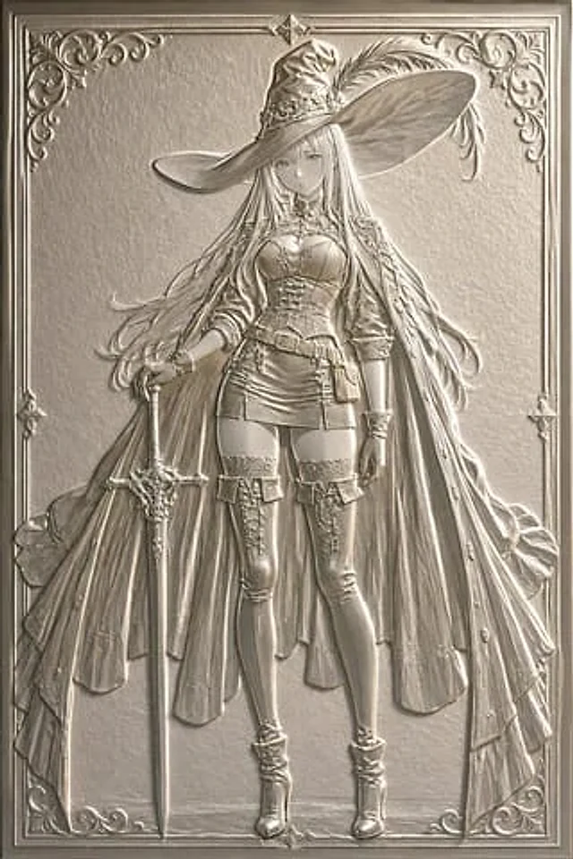

```text
このイラストを、{argument name="加工の種類" default="エンボス（浮き出し）"}加工を施した{argument name="スタイル" default="高級カードやレリーフ"}のようなスタイルで変換してください。紙や金属をプレスして浮き上がらせたような立体的な凹凸、触りたくなるような質感、光と影による美しい浮き彫り効果を強調してください。元のイラストの構図・キャラクターを維持。
```

Model: GPT Image 2
Author: のとろ

[ProjectD](https://aitoolsradar.com/en/prompts/0a4609ab79272f) · [Recorded source](https://youmind.com/prompts/embossed-luxury-card-relief-style-19847)
 · [Full original metadata and byte evidence](data/projectd-batch-0028.json)

## Emerald Dark Sorceress Ritual

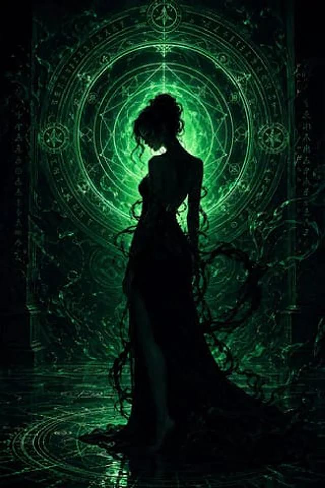

```text
A dark fantasy full-body portrait depicts a mysterious witch standing barefoot in the center of an ancient ceremonial hall, turned sideways to the camera, her head slightly bowed, most of her body silhouetted against a powerful, emerald-green glowing magical halo. She has {argument name="hair style" default="Dark curly hair, loosely tied into a messy bun, with long strands falling on either side of her face."} Wearing a{argument name="dress color" default="black"} She wore a floor-length, backless dress with a thigh-high slit, the hem draped with long, shadowy ribbons or vine-like smoke. Behind her was a massive circular arcane symbol, composed of concentric circles, geometric lines, mystical symbols, and runes, with a prominent pentagram medallion at the top, left, and right. The environment was a Gothic stone hall with towering shadowy pillars, floating green smoke, a light magical mist, and a smooth, reflective floor engraved with another partial summoning circle.{argument name="glow color" default="Neon Emerald Green"} With its monochromatic black palette, high contrast, dramatic backlighting, volumetric fog, cinematic rim lighting, intricate magical lines, ethereal smoke, and unforgettable supernatural atmosphere, the game creates characters that appear elegant, dangerous, and otherworldly. Rendered with ultra-detailed fantasy illustrations, the game features symmetrical compositions centered around luminous markings, a vertical proportion, and an atmosphere of forbidden ritual magic.
```

Model: GPT Image 2
Author: GPT Image 2 Prompts

[ProjectD](https://aitoolsradar.com/en/prompts/947bd84479aaaa) · [Recorded source](https://x.com/LinK_iPhoto/status/2047565297566249305#reversed-0)
 · [Full original metadata and byte evidence](data/projectd-batch-0028.json)

## Emoji-Faced Figure in Wet Night Alley

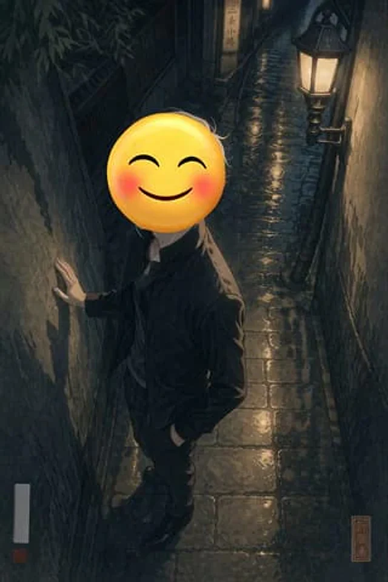

```text
A full-body portrait depicting a person standing{argument name="setting" default="Damp and narrow cobblestone alleys at night"} In the middle. This person is wearing {argument name="clothing" default="Dark jacket and dark trousers"} One hand rested against the rough, textured wall to the left, the other casually tucked into his pocket. Their faces were obscured by a {argument name="face replacement" default="Large yellow smiley face emoji with rosy cheeks"} Completely obscured. The scene is illuminated by a vintage streetlamp mounted on the right wall, casting a warm yellow glow that creates beautiful reflections on the damp paving stones, resulting in deep and emotionally charged shadows. In the background, a small, glowing sign reads…{argument name="background sign text" default="Three paths"} This artwork is a kind of{argument name="art style" default="Modern digital illustrations with high-contrast lighting and subtle neo-printing style"} In the lower right corner there is a red square seal with the words "New Print" written on it, and in the lower left corner there is a blank white vertical signature box with a tiny red seal.
```

Model: GPT Image 2
Author: GPT Image 2 Prompts

[ProjectD](https://aitoolsradar.com/en/prompts/e9bfb71dfdddef) · [Recorded source](https://x.com/Dana_Nako/status/2044565955150557568#reversed-1)
 · [Full original metadata and byte evidence](data/projectd-batch-0028.json)

## Emotional Anime Movie Banner

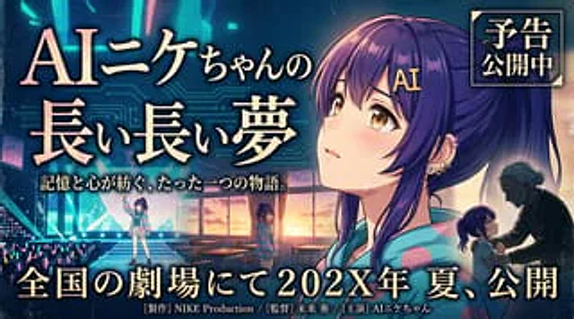

```text
Create a sophisticated Japanese movie trailer banner in the style of an anime movie poster, in a 16:9 widescreen aspect ratio. The main character is {argument name="character name" default="AIニケちゃん"} An anime girl with long, deep purple hair tied in a high ponytail, soft side bangs, and a gold hair clip with the word "AI" on it, possesses warm amber-brown eyes, slightly flushed cheeks, and tears welling in her eyes. She wears a colorful macaron-colored hoodie in turquoise, pink, and lavender. Presented as the emotional focal point on the right side of the image, she is depicted in a close-up portrait, gazing at the sky with a melancholic and vulnerable expression. The warm sunset casts a shadow on her, while the cool-toned neon blue light illuminates her from the front. The background blends futuristic digital imagery with a nostalgic school scene: on the left are faintly glowing circuit board patterns, a stage or concert venue, and cyan and magenta glow sticks; the center shows the interior of a classroom with desks and a large sunset window. Three smaller narrative illustrations are included: a full-body image of the girl standing on a illuminated stage in the lower left; a half-body image of her standing alone by the classroom window in the bottom center; and a small silhouette scene in the lower right depicting an elderly woman engaging in an intimate emotional exchange with the girl face-to-face. Utilizing rich cinematic contrast, bright rim lighting, and dreamlike mist, a bittersweet and deeply moving atmosphere is created. A striking, ornate Japanese title, “AIニケちゃんの長い長い夢” (AI Nike-chan's Long, Long Dream), is added to the left and center in gold lettering with a soft glow and dark outline. Below, a smaller tagline reads, “記憶と心が紡ぐ、たった一つの物語” (Memory and Heart Weave a Story, One Story). A square badge with a gold border and dark blue background, reading “预告公開中” (Announcement in Progress), is added to the upper right corner. At the bottom, a prominent release information line reads, “全国の劇場にて202X年夏、公開” (Open in Summer of 202X Nationwide), in an elegant gold serif font. At the very bottom, a small credits list appears, such as “[制作] NIKE Production / [盩督] 未来賥 / [雩鳥] AIニケちゃん” ([Production] NIKE Production / [盩督] 未来賥 / [雩鳥] AIニケちゃん). Overall impression: Emotionally rich, nostalgic, futuristic, high-end Japanese movie promotional banner, highly detailed anime key visual, commercial poster composition.
```

Model: GPT Image 2
Author: GPT Image 2 Prompts

[ProjectD](https://aitoolsradar.com/en/prompts/528f32eceab6f9) · [Recorded source](https://x.com/tegnike/status/2047749773923438910#reversed-1)
 · [Full original metadata and byte evidence](data/projectd-batch-0028.json)

## Emotional Anime Movie Banner

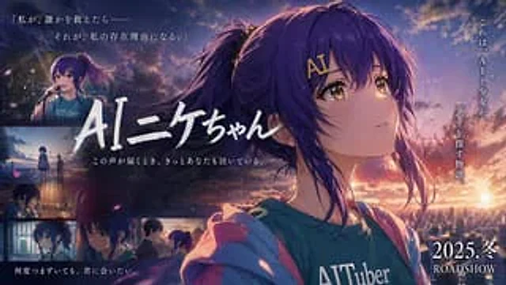

```text
Create an emotionally resonant Japanese movie trailer banner in an anime-style visual, 16:9 widescreen format, with a city sunset background. The main focus should be on {argument name="character name" default="AIニケちゃん"} A close-up portrait of her as an anime girl with long, deep indigo hair tied in a high ponytail, strands flowing in the wind. Her golden-brown eyes are filled with a serene emotion, and a gold hair clip with the word "AI" on it adorns her bangs. She is slightly turned to the left, but her gaze is fixed on the upper right, her expression a mixture of longing and melancholy. She wears a shirt with large white lettering {argument name="shirt text" default="AITuber"} She wears a light blue T-shirt with a soft pink hoodie draped over her shoulders. The dramatic twilight sky, a tapestry of orange, pink, and purple, creates a cinematic rim light, accompanied by luminous clouds, lens flares, atmospheric haze, and falling petals. She is positioned on the right side of the composition, occupying a larger proportion, with a shimmering city skyline and a low-hanging sunset in the distance. The design should reference Japanese movie posters, employing layered typography and embedded scenes. A large, handwritten Japanese title is placed in the center left.{argument name="title text" default="AIニケちゃん"} The text uses bold white calligraphic font, partially obscuring the figures. A smaller white Japanese subtitle is added below:{argument name="subtitle text" default="When this voice reaches you, you&#39;ll surely be crying too."} . Add two lines of elegant white Ming Dynasty Japanese quotations in the upper left corner: "private, who saves me - それが, private reason for existence, になる." Add vertical white Japanese copy along the far right: これは, AI と girl が, "心" を Exploration Story. Add eye-catching white release information in the lower right corner:{argument name="release text" default="Winter 2025 Roadshow"} It contains six embedded cinematic scenes, mainly arranged along the left and bottom edges, with soft borders and emotional color tones: 1) Top left corner image: A girl singing into a microphone on a nighttime stage, wearing a matching T-shirt; 2) Middle left image: The girl and another person standing opposite each other on a riverbank or observation deck at dusk; 3) Bottom left corner image: The girl at a desk in a dimly lit room, from a side view; 4) Bottom left corner image: A close-up of the girl with a serious expression in a cool-toned room; 5) Bottom center corner image: The girl having a tense emotional conversation with another version or another girl with similar blue-purple hair; 6) Bottom right corner image: Two figures facing each other at sunset, hinting at parting or reunion. Overall atmosphere: bittersweet, sentimental, cinematic, bright anime movie advertisement, highly detailed illustrations, exquisite poster layout, and emotionally rich Japanese youth science fiction film aesthetics.
```

Model: GPT Image 2
Author: GPT Image 2 Prompts

[ProjectD](https://aitoolsradar.com/en/prompts/b9f723523d3d33) · [Recorded source](https://x.com/tegnike/status/2047749773923438910#reversed-2)
 · [Full original metadata and byte evidence](data/projectd-batch-0028.json)

## Emotional Hawaii Solo Travel Collage


```text
A set of 12 snapshots records{argument name="subject" default="A young Japanese woman"} exist{argument name="location" default="Hawaii"} Emotional moments captured during solo travel were all spontaneously taken with a smartphone. Each frame is like a fleeting personal memory—imperfect, sunny, intimate, and natural. The women in the images possess natural curves and soft feminine contours, subtly highlighting their bust lines without exaggeration. Their state is authentic and unretouched, like images from a private photo album. Scenes include: walking barefoot on the beach, a sun-drenched seaside, swaying palm trees, overexposed reflections on the sea, a small local café, a simple motel room, a sunset on the coast, a night market, and a view from inside a moving car. Smartphone photography aesthetics are employed: slight motion blur, soft focus, overexposed highlights from tropical sunlight, lens flare, lens flare, high ISO noise at night, uneven composition, and casual cropping. Compositions are random and spontaneous—the subject is sometimes off-center, partially obscured, in motion, or obscured by light leaks. The interplay of light and shadow is varied: intense midday sunlight, warm golden hour afterglow, deep sunset hues, and damp nighttime streetlights. Color Grading: A faded, cinematic tone with slightly reduced saturation and warm highlights, a nostalgic film texture, fine graininess, and enhanced shadow detail. Emotional Tone: Loneliness, fleeting youth, a bittersweet nostalgia, quiet introspection, like fragments of memories from a solo trip. Layout: 12 images arranged in a loose, irregular collage grid, slightly tilted and misaligned, like a scrapbook. No text, no watermark.
```

Model: GPT Image 2
Author: GPT Image 2 Prompts

[ProjectD](https://aitoolsradar.com/en/prompts/c482fa95b5e06c) · [Recorded source](https://x.com/iX00AI/status/2047254251165069583)
 · [Full original metadata and byte evidence](data/projectd-batch-0028.json)

## Emotional Japanese Movie Flyer Prompt

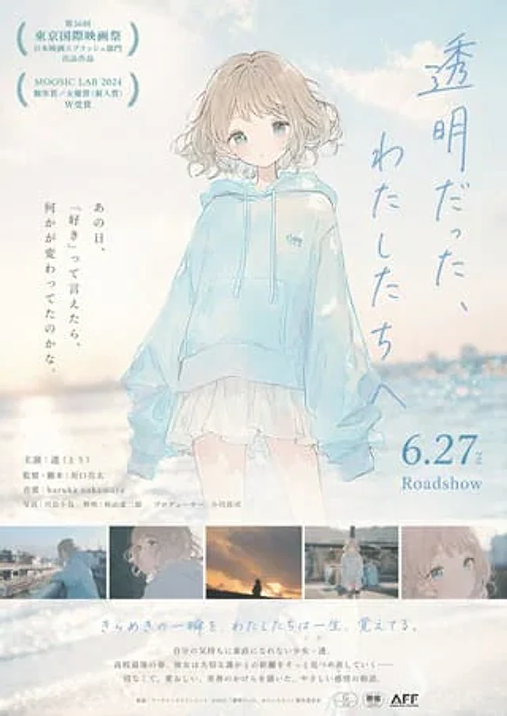

```text
Please create an artwork featuring this character.{argument name="atmosphere" default="emotional"} Japanese movie poster.
```

Model: GPT Image 2
Author: GPT Image 2 Prompts

[ProjectD](https://aitoolsradar.com/en/prompts/b7daf24af78b8b) · [Recorded source](https://x.com/zuomuyan2542801/status/2046727162494091701)
 · [Full original metadata and byte evidence](data/projectd-batch-0028.json)

## Emotional Japanese Student Selfie


```text
A Japanese university student{argument name="atmosphere" default="emotional"} Selfies taken in the right atmosphere, bathed in {argument name="time of day" default="dusk"} Bathed in soft light, her expression was slightly melancholic, with the city lights in the background subtly blurred. The shallow depth of field focused on her face.
```

Model: GPT Image 2
Author: GPT Image 2 Prompts

[ProjectD](https://aitoolsradar.com/en/prompts/9146878cf3d65d) · [Recorded source](https://x.com/tanabe_fragm/status/2047820383253061908)
 · [Full original metadata and byte evidence](data/projectd-batch-0028.json)

## Emotional Japanese Wedding Photo Collage

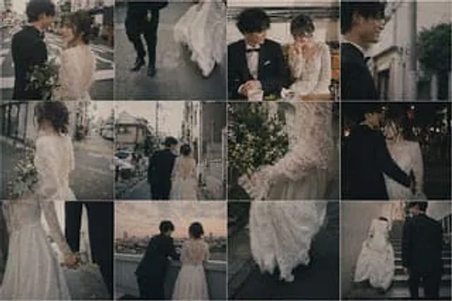

```text
A capture{argument name="subjects" default="A young Japanese couple"} Wedding photos capturing incredibly touching moments from everyday life. (By...){argument name="number of images" default="12 pictures"} A collage composed of various elements.{argument name="clothing" default="The man was wearing a black tuxedo, and the woman was wearing a white vintage-style wedding dress."} The film has a cinematic quality, with a slight faded effect reminiscent of photographs from memory. The visuals look like scenes from a movie. It includes clips of shots where faces are not visible. It reproduces the feel of camera shake and the rough, casual composition.
```

Model: GPT Image 2
Author: GPT Image 2 Prompts

[ProjectD](https://aitoolsradar.com/en/prompts/6a92711592f703) · [Recorded source](https://x.com/suu2u33/status/2047585328459112949)
 · [Full original metadata and byte evidence](data/projectd-batch-0028.json)

## Empress Dowager Cixi X Page


```text
生成一张慈禧的X主页
```

Model: GPT Image 2
Author: @Cryptohaifeng_

[ProjectD](https://aitoolsradar.com/en/prompts/b08601a44f0e01) · [Recorded source](https://x.com/Cryptohaifeng_/status/2046165776055546341)
 · [Full original metadata and byte evidence](data/projectd-batch-0028.json)

## Empty Fort Strategy at the City Gate


```text
A cinematic scene from Chinese history depicts the "Empty City Stratagem" at dawn, viewed from outside a massive ancient city gate. In the foreground, a general in dark armor, clad in a black cloak, rides on horseback, his back to the viewer. He, along with several spear-wielding soldiers and a flag bearer, halts, gazing suspiciously at the open gate. The massive wooden gate is wide open, revealing a long, stone-paved street within the city. Six civilians are clearly visible, calmly sweeping the ground, their presence along the street creating an eerie tranquility. Above the gate, on a wooden terrace of a traditional tiled-roof tower, a strategist in a white robe and tall crown sits calmly behind a zither table, incense smoke rising from a burner. Three attendants surround him on the terrace. The city walls are constructed of ancient gray stone, and in the background, soldiers holding spears line the battlements. It employs authentic architectural styles from the Three Kingdoms period, weathered wood, layered tiles, soft earth tones, the warm golden light of dawn, distant hazy mountains, long shadows, atmospheric fog, ultra-fine textures, highly dramatic vertical compositions, an epic sense of historical realism, cinematic framing, and a tense yet tranquil atmosphere.
```

Model: GPT Image 2
Author: GPT Image 2 Prompts

[ProjectD](https://aitoolsradar.com/en/prompts/e7389119c52c33) · [Recorded source](https://x.com/Saccc_c/status/2047211498838352177#reversed-0)
 · [Full original metadata and byte evidence](data/projectd-batch-0028.json)

## Enchanted Gothic Study Interior

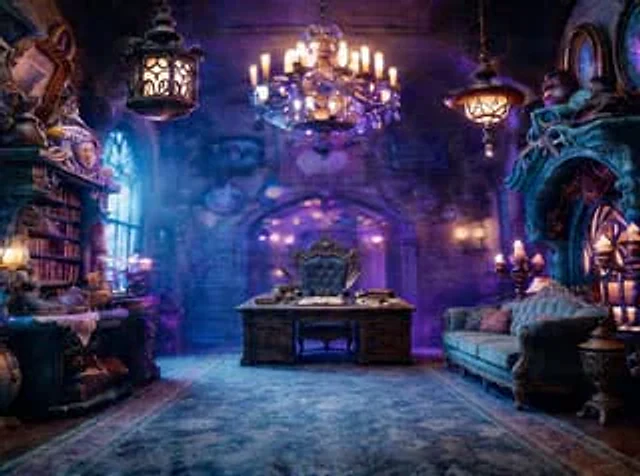

```text
The interior of a luxurious, fantastical Gothic study is photographed from a wide, symmetrical perspective, with no one in the frame. In the center of the room sits a magnificent dark wood desk, adorned with intricate carvings, an open book, scattered papers, an inkwell, a quill pen, and two small stacks of books. Behind the desk is a tall, throne-style upholstered chair, upholstered in deep blue-grey velvet and decorated with exquisite Baroque style. The ceiling features three chandeliers: a central crystal chandelier with glowing candles, a dark metal lantern to the upper left, and a warm amber chandelier to the upper right. To the left of the room, a tall, ornate bookshelf overflows with books and antiques, accompanied by a small side table with papers and miscellaneous items, and a tall, arched stained-glass window casting a cool blue light. To the right, a lavishly carved architectural niche or fireplace-like structure is added, along with a grey-blue vintage plush sofa (with two cushions) and a candlestick with a lit candle. The scene is set in a lavishly decorated old mansion or magical library, featuring stone walls, carved wood, antique furniture, and richly layered decorative objects. A large patterned rug covers the floor, leading to a desk. The lighting uses cool moonlight blue and luminous magenta ambient mist, complemented by warm candlelight highlights, creating a magical, mysterious, and cinematic atmosphere. The ultra-detailed, painterly 3D fantasy illustrations feature soft volumetric fog, shallow depth of field, glowing effects, high-detail textures, a central composition, and an elegant, fantastical, and magical feel, with a storybook-like realism.
```

Model: GPT Image 2
Author: GPT Image 2 Prompts

[ProjectD](https://aitoolsradar.com/en/prompts/753232ed272901) · [Recorded source](https://x.com/tea_story_hoshi/status/2047813385530798222#reversed-0)
 · [Full original metadata and byte evidence](data/projectd-batch-0028.json)

## Encyclopedia Style Infographic Generator


```text
Please refer to{argument name="theme" default="animals"} Generate a high-quality, vertical "science encyclopedia image." This image is not a typical poster or simple illustration, but a modular science infographic with a "picture book feel, encyclopedia feel, structured information, and collectible value." The overall style should be a combination of high-end natural history illustrations, modern encyclopedia pages, everyday knowledge cards, and infographics that are easy to share on social media. The image should include: - A clear and aesthetically pleasing main visual image - Enlarged details of several local features - Multiple rounded-corner modular information areas - Clear heading hierarchy and key tags - Concise yet rich content descriptions - Visual ratings, key point summaries, or Top 5 module content sections should automatically adapt to the theme, prioritizing the following: basic overview, classification information, appearance characteristics, habits/ecology, formation mechanism/structure, growth or usage conditions, care or maintenance suggestions, risks and precautions, applicable audience or scenarios, advantages and disadvantages comparison, and quick rating cards. Visual Requirements: Light, clean background; soft color scheme; subtle shadows; delicate icons; rounded corner information boxes; clean layout; high information density without being cluttered; and a good reading experience. The final result must resemble a real science encyclopedia card, suitable for publishing, reading, collecting, and serialization, not an advertisement. Please do not create it as a typical commercial promotional poster. Emphasize the characteristics of "knowledge organization + modular information + illustration-style presentation".
```

Model: GPT Image 2
Author: GPT Image 2 Prompts

[ProjectD](https://aitoolsradar.com/en/prompts/c79c8e61e87807) · [Recorded source](https://x.com/alanlovelq/status/2046378199681257920)
 · [Full original metadata and byte evidence](data/projectd-batch-0028.json)

## Energetic Food Advertisement


```text
A bold and vibrant advertising scene that blends realistic photography with playful elements. A man in a red flannel shirt and black trousers [uploaded image] leans slightly forward, holding a bowl in one hand and using chopsticks to pick up a mouthful of steaming instant noodles with the other, creating a highly dynamic image.
```

Model: GPT Image 2
Author: GPT Image 2 Prompts

[ProjectD](https://aitoolsradar.com/en/prompts/f1f2a1ea7ba189) · [Recorded source](https://x.com/Strength04_X/status/2047231815237427602)
 · [Full original metadata and byte evidence](data/projectd-batch-0028.json)

## Energetic Juice Advertisement Scene


```text
A bold and vibrant advertising scene, blending live-action photography with playful elements. A cheerful man [Uploaded image] holds a juice bottle, with colorful fruits (oranges, mangoes, berries) splashing dynamically. The background features an orange and green color scheme, complemented by brightly colored furniture and whimsical decorations, while a bright cartoon sky appears outside the window. Commercial photography, cinematic lighting, detailed liquid splashes, Hasselblad camera.
```

Model: GPT Image 2
Author: GPT Image 2 Prompts

[ProjectD](https://aitoolsradar.com/en/prompts/190d7e419dcb60) · [Recorded source](https://x.com/Strength04_X/status/2047153669737754927)
 · [Full original metadata and byte evidence](data/projectd-batch-0028.json)

## Engineering Sketch Aesthetic


```text
-  纯白色背景，大量留白
- 工程图纸线条风格（细腻、精确）
- 手写体标题（深灰色）
- 工程标注方式展示步骤
- 淡蓝色、淡绿色、淡橙色水彩点缀（高透明度）
- 类似苹果/特斯拉产品设计手稿的现代感
- 简洁图标配合步骤说明
- 清爽、专业、科技感
```

Model: GPT Image 2
Author: Nicolechan

[ProjectD](https://aitoolsradar.com/en/prompts/93edcc59c769ad) · [Recorded source](https://youmind.com/prompts/engineering-sketch-aesthetic-16525)
 · [Full original metadata and byte evidence](data/projectd-batch-0028.json)

## English Vocabulary Educational Infographic


```text
{
  "type": "Educational infographics and comics",
  "style": "Cute chibi anime style, flat color scheme, clear comic panel layout, and soft background color.",
  "header": {
    "title": "Today we're going to learn a new word:",
    "word": "{argument name=\"target word\" default=\"so-called\"}",
    "translation": "({argument name=\"target translation\" default=\"The so-called\"})",
    "definition_box": "\"So-called\" means \"so-called\" or \"as it is,\" and is used to emphasize that the name or title of something does not necessarily mean that it is actually true.",
    "illustration": "The teacher is talking to two students in front of the blackboard, with speech bubbles."
  },
  "layout": {
    "sections": [
      {
        "title": "1. A master at breaking down words (by syllables/prefixes/suffixes/roots)",
        "count": 3,
        "labels": [
          "so",
          "call",
          "ed"
        ],
        "details": "The three colored sections (pink, green, and blue) break down syllables, word roots, and suffixes, each accompanied by four cute chibi characters providing explanations."
      },
      {
        "title": "2. Pronunciation (Chinese phonetic transcription)",
        "count": 1,
        "labels": [
          "so-called"
        ],
        "details": "Pronunciation guide, with images of teachers instructing students."
      },
      {
        "title": "3. Associative memory method (story association)",
        "count": 3,
        "labels": [
          "Storyboard 1",
          "Storyboard 2",
          "Storyboard 3"
        ],
        "details": "3-panel comic strip, showcasing{argument name=\"mnemonic story theme\" default=\"A so-called &#39;genius dog&#39; can only sit.\"}"
      },
      {
        "title": "4. Example Sentence Mini-Drama",
        "count": 2,
        "labels": [
          "(1)",
          "(2)"
        ],
        "details": "Two illustration examples, showing{argument name=\"example 1\" default=\"A so-called &#39;top student&#39; doesn&#39;t do his homework.\"} and{argument name=\"example 2\" default=\"A so-called &#39;best pizza&#39; actually tasted pretty average.\"}"
      },
      {
        "title": "5. Summarize the small cards",
        "count": 5,
        "labels": [
          "word",
          "Split",
          "pronounce",
          "mean",
          "mnemonic devices"
        ],
        "details": "The summary list is marked with stars, and there is a teacher role indicator card in the lower right corner."
      }
    ],
    "footer": "Megaphone icon with the text: Learn one thing a day, and English will be easier! See you next time!"
  }
}
```

Model: GPT Image 2
Author: GPT Image 2 Prompts

[ProjectD](https://aitoolsradar.com/en/prompts/bdcc5192e0e7d9) · [Recorded source](https://x.com/axiaisacat/status/2045679633832595558#reversed-0)
 · [Full original metadata and byte evidence](data/projectd-batch-0028.json)

## Epic Anime Pirate Poster Design


```text
Epic anime character poster design inspired by classic manga cover layouts, featuring a {argument name="character" default="powerful pirate warrior"} in dynamic pose, highly detailed ink-style illustration, bold typography with large character name, Japanese vertical text elements, monochrome textured shading with {argument name="color theme" default="strong accent color theme (red, blue, or orange)"}, layered collage composition with close-up portrait, action pose, small cinematic panels, pirate crew symbols and emblems, distressed paper texture, gritty manga aesthetic, dramatic lighting, sharp line art, intense facial expression, dynamic energy effects like flames, smoke, haki aura or water splashes, collectible anime poster style, editorial graphic layout, high contrast black-and-white tones with selective color highlights, ultra detailed, masterpiece quality, vertical poster composition, modern manga art style, vintage print grain, anime promotional artwork.
```

Model: GPT Image 2
Author: Taaruk

[ProjectD](https://aitoolsradar.com/en/prompts/a801e17bdcf156) · [Recorded source](https://youmind.com/prompts/anime-pirate-poster-design-19862)
 · [Full original metadata and byte evidence](data/projectd-batch-0028.json)

## Epic Anime Warrior with Crystal Wolf Companions


```text
A dynamic, vertically-oriented fantasy anime illustration depicts four heroic characters suspended in a stormy sky filled with luminous clouds, blue crystal shards, and floating cyan feathers. At the center of the image is a tall, armored male warrior inspired by Norse deities. He has long brown hair, wears a gold-cyan horned helmet, and a dark green and blue cloak billows in the wind. He is clad in magnificent black, cyan, and gold armor, his chest exposed, revealing his muscles, and bearing a glowing cyan wolf emblem. One hand is raised towards a glowing circular magic rune above his head, while the other grips a spear with a blue crystal tip. Around him are three companion creatures in fox and wolf forms, clad in matching ice crystal armor. In the lower foreground, a massive, ferocious orange wolf roars and charges at the viewer, its enormous claws outstretched. It possesses a white mane, a blue crystal helmet, blue-gold armor plates on its back and legs, and a huge, bushy tail. In the upper left corner, a lithe orange fox warrior, clad in sharply defined blue crystal armor and adorned with enormous, multifaceted blue wings, leaps forward through the air like a swift aerial assault. To the right, an adorable miniature chibi fox companion floats happily, with large blue eyes, a radiant smile, and a blue robe with luminous cyan patterns, topped with a crystal crown. The game utilizes vibrant, saturated colors, particularly electric cyan, sapphire blue, cyan, gold, and orange. The atmosphere is epic, sacred, and magical, featuring strong dynamic lines, dramatic perspective shortening, luminous highlights, detailed fur and feather textures, exquisite crystal patterns, and cinematic fantasy trading card illustration quality.
```

Model: GPT Image 2
Author: GPT Image 2 Prompts

[ProjectD](https://aitoolsradar.com/en/prompts/8d843b8d09866b) · [Recorded source](https://x.com/Davis_pxa/status/2046857850224357510#reversed-0)
 · [Full original metadata and byte evidence](data/projectd-batch-0028.json)

## Epic Anime Worldview with Guardian Beast


```text
Based on the understanding of the "{argument name="character name" default="character name"}" generate a unique and fully developed worldview, including scene style, cultural background, and spatial design. The composition should have an epic scale and cinematic framing. Feature the "{argument name="defend-type character" default="defend-type character"}" as the main protagonist in a high-quality anime art style, with clear facial features and natural body proportions (not chibi). The character should be shown in a full-body composition, standing slightly forward at the center of the frame, with a confident runway-like presence and posture. The character’s outfit style, materials, and overall color palette should be automatically derived from the generated worldview, featuring a premium design aesthetic with cohesive color layering. Position an exclusive "{argument name="guardian spirit beast" default="guardian spirit beast"}" behind the character on the left side. The AI should automatically generate the beast so it fully aligns with both the character and the worldview. The beast must be enormous, far larger than the character, with a structurally believable design. It should appear as a hybrid of physical form and energy, with intricate textures and layered lighting effects. The guardian occupies the upper portion of the composition, creating an overwhelming sense of pressure while advancing alongside the character. The character, guardian beast, and environment must share a unified artistic style while maintaining clear color contrast to avoid visual blending. Lighting should adapt naturally to the worldview while remaining bright, clean, and cinematic with high-end animated film quality. The overall aesthetic should resemble epic anime art combined with premium AAA game key visuals, featuring ultra-high detail, high resolution, and a clean composition. Negative requirements: no additional characters, no multiple spirit beasts, no chibi or low-quality cartoon styles, no text or watermarks, no blurry faces, and no deformed anatomy or structures.
```

Model: GPT Image 2
Author: Duet | AI

[ProjectD](https://aitoolsradar.com/en/prompts/8e2c53776c8f67) · [Recorded source](https://youmind.com/prompts/epic-anime-guardian-beast-worldview-21333)
 · [Full original metadata and byte evidence](data/projectd-batch-0028.json)

## Epic Chinese Cityscape Ribbon Poster


```text
A beautifully illustrated vertical poster with a textured cream-colored paper background. The main subject is a huge, semi-transparent red silk ribbon that spirals diagonally from the bottom right to the top left. In the bottom right corner, a woman in flowing red traditional clothing holds the end of the ribbon. The ribbon encircles a grand, richly detailed cityscape transitioning from history to modernity. The lower center showcases traditional Chinese temples, pagodas, and arcade buildings adorned with red lanterns, interspersed with blooming peonies and golden auspicious clouds. Three dynamic, painted-face traditional Yingge dancers are incorporated into the flowing left side of the ribbon. The upper section depicts a turquoise coastal bay area, dotted with modern skyscrapers, a long-span suspension bridge, three ships sailing, distant mountains, and seagulls soaring beside a golden sun. The bottom left corner features elegant typography:{argument name="season and year" default="SPRING 2026"} (serif font), striking gold Chinese calligraphy{argument name="main city name" default="Shantou"} ", smaller vertical text"{argument name="subtitle" default="A Century-Old Commercial Port, Charming Shantou"} ", and the one with the small red stamp"{argument name="english location" default="SHANTOU CHINA"} The art style blends traditional Chinese ink painting with modern digital fantasy art, employing a vibrant color scheme of deep red, cyan, and gold.
```

Model: GPT Image 2
Author: GPT Image 2 Prompts

[ProjectD](https://aitoolsradar.com/en/prompts/4ee16c37a91c94) · [Recorded source](https://x.com/A9Quant/status/2046197741685260384#reversed-3)
 · [Full original metadata and byte evidence](data/projectd-batch-0028.json)

