# ProjectD backfill batch 29

Complete original prompts and exact existing ProjectD images. Actual model labels and any available credits or notices are retained. Missing authors or license metadata are not filled in.

## Epic Concept/Movie Poster Generator

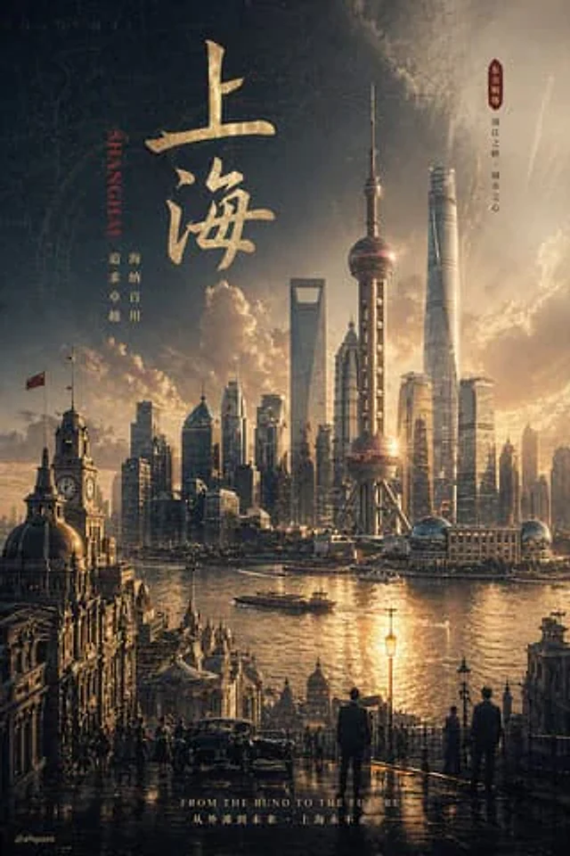

```text
GPT-Image-2 Prompt: Please refer to{argument name="theme" default="Ranking of Chinese Emperors Throughout History"} This theme requires the AI ​​to automatically generate a top-tier concept poster or infographic-style movie poster. The AI ​​must automatically derive and uniformly design the following visual system based on this theme, without requiring additional specifications from me: - Core subject (automatically determine if it is suitable to be represented as a person, product, building, artifact, symbol, scene, or abstract image) - Bottom support structure - Floating symbols or spiritual totems at the top - Scene wrapping elements - Metaphorical system - Color hierarchy - Material contrast - Light and shadow logic - Main title, subtitle, and auxiliary text - Brand sense and high-end texture expression. Final visual requirements: A stunning, precise, unified, cinematic-quality concept poster with extremely rich details, suitable for high-end printing. [Overall Style] Hyper-realistic 3D commercial CGI rendering, integrating cinematic lighting, luxurious visual language, futuristic concept design, and epic composition. The image must have a "single core visual focus," rejecting clutter, collage-like appearance, and the style of ordinary e-commerce posters. [Automatic Derivation Rules] AI must automatically determine the following based on the [Theme]: 1. Core visual metaphor 2. Subject type and posture 3. Supporting structural form 4. Floating element form 5. Scene shell and spatial atmosphere 6. Primary color, secondary color, and accent color 7. Material combination 8. Text style and typography [Composition Rules] - Absolutely high-end texture - Strong sense of central order, overall unity - Allows axial symmetry or epic compositions around a central axis - Clear visual center of gravity, forming a clear top-to-bottom hierarchy - Clean and restrained white space at the edges, with a sense of breathing [Visual Quality] - Ultra-high detail - Clear volumetric light - Realistic material texture - Natural reflection, refraction, shadow, fog, and depth of field effects - Overall standards benchmarked against high-end brand event main visuals / luxury invitation posters / concept editing posters [Typography System] - Overall 90% visual, 10% text - AI automatically generates the most matching main title and subtitle based on the [Theme] - Titles must be concise, sharp, and powerful - The text should be as concise and accurate as possible; avoid piling up words. [Author Attribution Requirements] The author's name should be naturally added in the bottom corner: @a9quant
```

Model: GPT Image 2
Author: GPT Image 2 Prompts

[ProjectD](https://aitoolsradar.com/en/prompts/943963acb823c1) · [Recorded source](https://x.com/A9Quant/status/2046228485841334559)
 · [Full original metadata and byte evidence](data/projectd-batch-0029.json)

## Epic Eastern Fantasy Character Concept

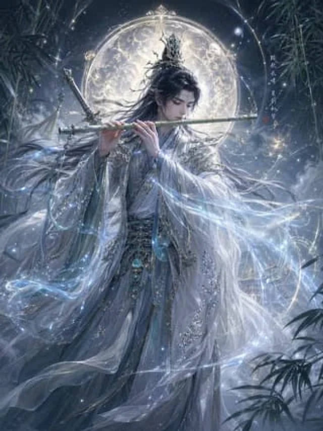

```text
Please create a concept illustration of an Eastern fantasy character, with the main character being {argument name="character role" default="An Eastern fantasy character"} and use{argument name="weapon" default="musical instruments or weapons"} The overall style blends traditional Chinese fantasy and mythological imagery with cinematic CG concept art. The visuals must possess a strong sense of Eastern fantasy aesthetics, sophistication, and an epic atmosphere. The characters are the core visual focus, and their demeanor must convey an ethereal, sacred, elegant, aloof, or majestic quality. Based on {argument name="character role" default="Role"} Automatically matches the most suitable expression, clothing, hairstyle, accessories, and identity settings. If{argument name="weapon" default="thing"} As a musical instrument, the character should be in a highly ritualistic and fluid posture, such as playing, plucking, blowing, or standing while holding the instrument, emphasizing the flow of musical energy and spirituality, as well as the sound wave effects that transform into light patterns, clouds, starlight, or magic circles.{argument name="weapon" default="thing"} For weapons, characters should be in stances of holding weapons, charging forward, confronting, casting spells, or in the moment before battle, emphasizing a sense of power, pressure, aura, and energy convergence. The composition should primarily be centered or off-center, balanced and dignified, with a poster-quality visual effect; the character's background may feature a moon, halo, divine light, ancient formations, or icon-like circular structures. Clothing should adopt an Eastern fantasy style, with light and beautiful materials, including gauze, ribbons, layered skirts, metal ornaments, jade ornaments, or crowns. Hair and clothing should flow in the wind, creating a strong sense of dynamic beauty. Backgrounds should automatically match Eastern fantasy scenes based on the character's temperament, such as starry divine realms, celestial palaces amidst clouds, sacred lands under the moon, bamboo forests and immortal mountains, icy secret realms, silent altars, ancient ruins, etc. The environment should include smoke, flowing light, particles, mysterious energy, and spatial depth. A unified and sophisticated main color scheme should be used to control the overall visual impact. The system can automatically select color schemes such as ice blue, moon white, cyan, purple, crimson gold, jet black, and silver gray based on the character and props, and supplement them with a small amount of bright gold or cool light for a divine embellishment. Overall requirements: beautiful, dreamlike, ethereal, mysterious, transcendent, sacred, and exquisite, possessing cinematic lighting, volumetric lighting, a sense of atmosphere, and ultra-detailed CG illustration quality; avoid vulgarity, cheap ancient-style photography, generic "internet celebrity" faces, cluttered backgrounds, and plastic-like textures.
```

Model: GPT Image 2
Author: GPT Image 2 Prompts

[ProjectD](https://aitoolsradar.com/en/prompts/bdf71881931a8f) · [Recorded source](https://x.com/MrLarus/status/2046850958672449638)
 · [Full original metadata and byte evidence](data/projectd-batch-0029.json)

## Epic Fantasy Double Exposure Silhouette

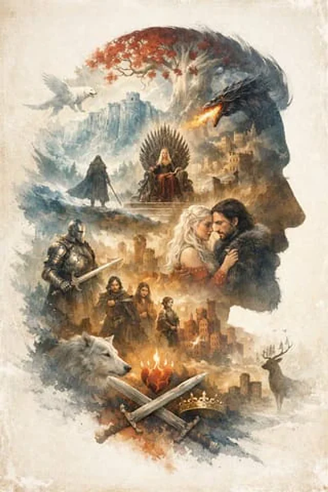

```text
A picture{argument name="overall theme" default="Epic Fantasy"} Illustrations, applied on a vintage parchment background{argument name="art style" default="Watercolor and ink double exposure"} Technique. The overall composition is presented as{argument name="main silhouette subject" default="Male head profile to the right"} The silhouette contains a complex montage of scenes and characters. At the top, a red-leaved white tree stands beside a cliffside castle, with a white winged beast flying to the left and a fire-breathing black dragon to the right. Below, a blonde woman sits on a throne made of swords, while a cloaked figure stands on a nearby hill. To the right center, a romantic couple—a blonde woman and a dark-haired man in a leather-collared garment—gaze lovingly at each other. To their left stands a knight wielding a longsword and clad in full plate armor. Further down is a group of three figures: a man, a young woman, and a child. At the bottom left is a giant white wolf's head, and to the right is a stag standing near the castle. At the bottom center, a burning heart floats above two crossed swords and a golden crown.{argument name="dominant color palette" default="Soft earth tones accented with red and orange"} It creates a dramatic and legendary atmosphere.
```

Model: GPT Image 2
Author: GPT Image 2 Prompts

[ProjectD](https://aitoolsradar.com/en/prompts/8fb3458930688e) · [Recorded source](https://x.com/foencc/status/2045385800997908891#reversed-0)
 · [Full original metadata and byte evidence](data/projectd-batch-0029.json)

## Epic Fantasy Double-Exposure Poster

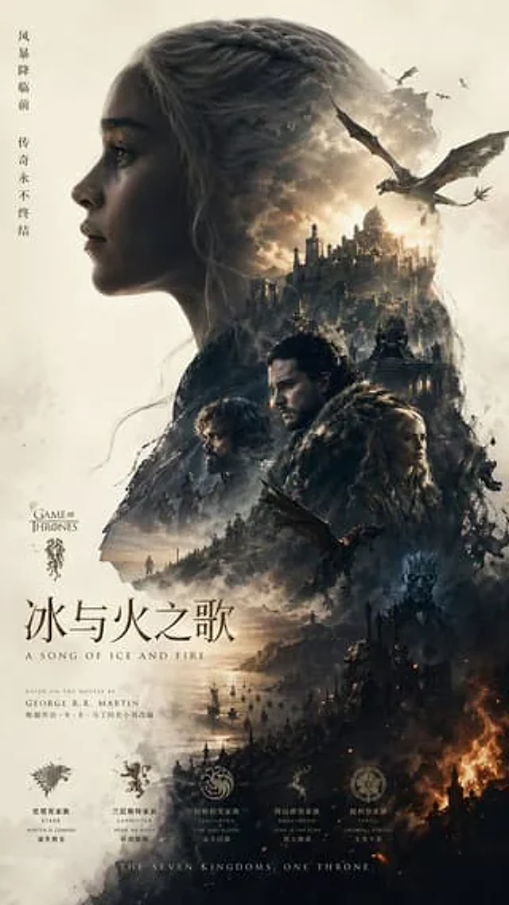

```text
A vertically oriented epic fantasy poster in the style of a prestige television series one-sheet, designed like a Chinese theatrical promotional poster for {argument name="franchise title" default="Game of Thrones"}. The composition is a dramatic double-exposure silhouette of a woman in left-facing side profile occupying most of the frame, her braided hair forming the crown and upper contour of the silhouette. Inside and around the silhouette, blend a vast dark medieval fantasy world with storm clouds, smoke, mountains, castles, dragons, armies, and fire. At the top inside the head area, place 1 grand stone city or castle complex glowing with pale golden light beneath turbulent clouds, and 3 dragons in the sky: 1 large dragon flying prominently on the upper right and 2 smaller distant dragons near the top edge. In the midsection, show 2 fur-cloaked heroic figures standing close together in a bleak winter atmosphere, one centered and one slightly left, with a looming iron-throne-like structure behind them. In the lower right interior, include 1 icy blue-eyed undead king emerging from darkness. Across the lower half, transition from cold mist and coastal water on the left into burning ruins and orange fire on the right, with 1 medium dragon flying near the center-lower area above the battlefield. Scatter tiny marching soldiers and riders along ridgelines and paths to imply war across the landscape. Use a muted palette of ash white, charcoal black, slate blue, steel gray, sepia, and ember orange, with cinematic high contrast, volumetric fog, painterly photo-collage realism, and intricate textured detail. Leave negative space around the silhouette on a warm off-white paper-like background. Add vertical Chinese slogan text along the upper left margin reading {argument name="vertical slogan" default="风暴降临前 传奇永不终结"}. Add a small English logo area on the left reading {argument name="series logo" default="GAME OF THRONES"}. Place a large Chinese title near the lower left reading {argument name="main title" default="冰与火之歌"}, with the English subtitle "A SONG OF ICE AND FIRE" beneath it. Add small credit text below for the novel author George R. R. Martin. Along the bottom, display 5 house sigils in a horizontal row with bilingual labels: Stark, Lannister, Targaryen, Baratheon, Tarly. Beneath them, add the tagline {argument name="bottom tagline" default="THE SEVEN KINGDOMS, ONE THRONE."}. Premium, moody, majestic, collectible poster design.
```

Model: GPT Image 2
Author: 清风徐来028

[ProjectD](https://aitoolsradar.com/en/prompts/1804c046952f8c) · [Recorded source](https://youmind.com/prompts/epic-fantasy-double-exposure-poster-16039)
 · [Full original metadata and byte evidence](data/projectd-batch-0029.json)

## Epic Fantasy Monkey King Battle

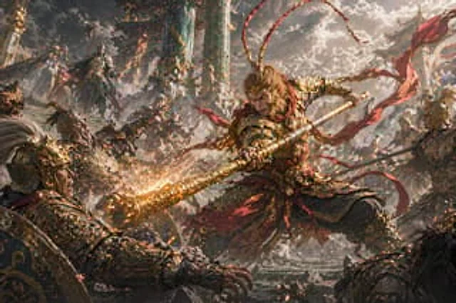

```text
A hyper-realistic, epic fantasy illustration, featuring the protagonist as {argument name="main character" default="Sun Wukong, the Monkey King"} He was depicted in a dynamic combat stance. He wore exquisitely crafted golden armor, his red cloak billowing in the wind, and long pheasant feathers extended from his head. He had a fierce monkey face and was powerfully swinging a glowing, intricately carved golden cudgel downwards to strike a group of enemies.{argument name="enemy type" default="Heavenly Soldiers"} The celestial soldiers, clad in heavy, exquisitely crafted golden armor, were violently repelled by the onslaught. Sparks from explosions, glowing embers, and shattered stone fragments filled the area around the battle. The backdrop was a majestic, cloudy landscape.{argument name="setting" default="Heaven"} Towering, ornate pillars and traditional Chinese temple architecture appear and disappear in the hazy, dramatic sky. Cinematic lighting, highly detailed, a masterpiece, and intense action scenes.
```

Model: GPT Image 2
Author: GPT Image 2 Prompts

[ProjectD](https://aitoolsradar.com/en/prompts/7d56f4724bfe49) · [Recorded source](https://x.com/Fancyfreer/status/2044789137853792669#reversed-2)
 · [Full original metadata and byte evidence](data/projectd-batch-0029.json)

## Epic Fantasy Novel Cover for Nezha

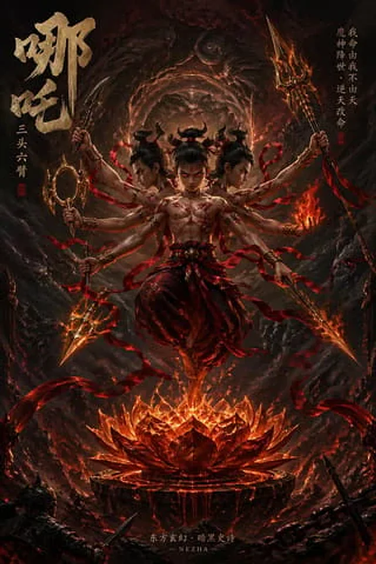

```text
Fantasy novel cover{argument name="character" default="Nezha with three heads and six arms"} Floating in the void, with a base as{argument name="base" default="Fiery Lotus Platform"} ,use{argument name="style" default="Dark epic style"} .
```

Model: GPT Image 2
Author: GPT Image 2 Prompts

[ProjectD](https://aitoolsradar.com/en/prompts/86cd8276a4a662) · [Recorded source](https://x.com/songguoxiansen/status/2047196508270084104)
 · [Full original metadata and byte evidence](data/projectd-batch-0029.json)

## Epic Fantasy Warrior and Wolf

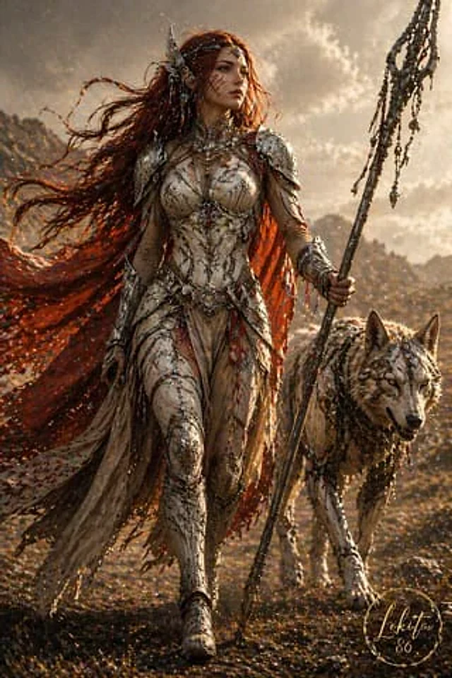

```text
A cinematic, fantastical portrait depicts a fierce female warrior walking through a rugged, sun-drenched wilderness at the golden hour, accompanied by a massive wolf on her right. She is the central figure, tall and powerful, her long hair flowing in the wind.{argument name="hair color" default="Deep copper red"} Her hair flowed dramatically to the left, and a magnificent metallic feather-like headdress adorned the side of her head. Her face was partially obscured or minimized to maintain focus on her silhouette, hair, armor, and overall atmosphere. She wore exquisite biomechanical elf-style armor in shades of pale ivory, silver, and soft champagne gold, richly detailed with filigree, sculpted lines, layered plates, gemstone inlays, delicate chain embellishments, and a form-fitting silhouette. The armor comprised a sculpted breastplate, two shoulder armors, two sculpted bracers, a gemstone-encrusted belt centerpiece, two thigh armors, and two intricate plate greaves. A semi-transparent, tattered fabric peeked from the armor, along with a long, ember-red cloak or veil that billowed behind her like sparks, catching the light. In her right hand, she held a tall, ceremonial spear, its tip ornately decorated with chains and embellished with red gemstones. The wolf, lean, alert, and battle-hardened, walks beside her in a matching, ornate harness armor adorned with etched metal details and red markings. The environment is an open, rocky plain with distant hills or mountains, dotted with hay, floating dust, and luminous particles. Dramatic backlighting, warm amber sunlight, high contrast, shallow atmospheric haze, ultra-fine textures, fantasy realism, epic dark gold tones, and dynamic hair and fabric create a grand and wild atmosphere reminiscent of premium gpt-image-2 fantasy character key visuals. No text, no logo, no watermark.
```

Model: GPT Image 2
Author: GPT Image 2 Prompts

[ProjectD](https://aitoolsradar.com/en/prompts/5d4ca5a3e464c1) · [Recorded source](https://x.com/Loky__86/status/2046887873719267657#reversed-0)
 · [Full original metadata and byte evidence](data/projectd-batch-0029.json)

## Epic FC Barcelona Heritage Poster

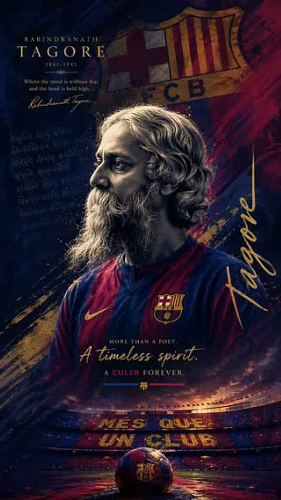

```text
Create a vertical football tribute poster with a cinematic feel, employing a mixed-media style that blends artistic portraiture, sports brand elements, textured painting, and high-end editorial layout. The main subject of the image is {argument name="historical figure" default="Rabindranath Tagore"} A half-length portrait of him, reimagined as an iconic figure of FC Barcelona, ​​is depicted with his body slightly turned to the right, sporting flowing silver-grey hair and a long beard, a weathered face, and a composed yet legendary demeanor. He is dressed in the classic FC Barcelona home jersey, featuring deep red and navy blue vertical stripes, a Nike logo on the left, and the FCB crest on the chest. Deep contour lighting and painterly highlights around the hair and shoulders lend the figure a majestic and almost divine appearance. The background employs an abstract brushstroke composition in Barcelona colors, incorporating deep indigo, crimson, burgundy, and soft gold. Behind the portrait are three main graphic elements: a large, faded FC Barcelona crest at the top center, a vertically written Bengali manuscript on the left, and a large line of gold, handwritten signature-style text on the right. In the upper left corner, place five lines of elegant serif font: the first line reads "RABINDRANATH," the second (in a larger font) reads "TAGORE," the third reads "1861-1941," the fourth is the quote "Where the mind is without fear and the head is held high...", and the fifth is the cursive signature "Rabindranath Tagore." In the lower center area, add five lines of centered text in a sophisticated poster layout: "MORE THAN A POET.", followed by a large gold handwritten line "A timeless spirit.", and then "A{argument name="club nickname" default="CULER"} "FOREVER." followed by a thin horizontal red and blue decorative line, below which is a small, centered FCB team logo. The bottom displays a wide-angle view of Camp Nou at dusk, with the stadium lights twinkling, the sunset horizon magnificent, the stands packed, and a large jigsaw puzzle of spectators clearly displayed.{argument name="stadium slogan" default="MES QUE UN CLUB"} A football is placed in the foreground, centered on a wet, reflective pitch, with the Barcelona team crest visible on the ball. The entire image should have the feel of a luxurious, fan-made heritage poster—rich in detail, painterly, emotionally charged, dignified, high-contrast, textured, and epic—ideal for high-end football social media graphics or wall posters. A 2:3 vertical poster composition is used, featuring depth, subtle sparkles, paint brushstrokes, and gold accents. The visible club logo can be optionally replaced with {argument name="football club" default="FC Barcelona"} At the same time, it maintains the same elite-level tribute poster aesthetics.
```

Model: GPT Image 2
Author: GPT Image 2 Prompts

[ProjectD](https://aitoolsradar.com/en/prompts/e91c045d7c3c24) · [Recorded source](https://x.com/cneuralnetwork/status/2047024136875393501#reversed-0)
 · [Full original metadata and byte evidence](data/projectd-batch-0029.json)

## Epic French Dystopian Book Cover

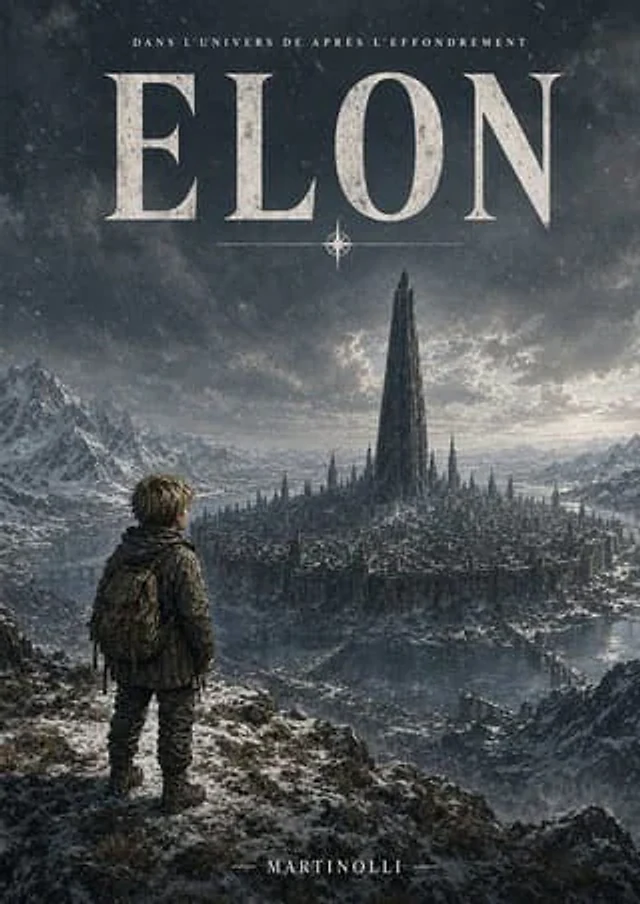

```text
A cinematic French dystopian science fiction book cover, presented in a vertical poster format, boasts a dark and epic style with a cool, low-saturation color palette including charcoal blue, steel gray, off-white, and soft silver. In the foreground, a solitary young traveler stands with his back to the camera on a snow-covered rocky cliff in the lower left corner. He appears tiny against the vast landscape, wearing a tattered winter jacket, rugged trousers, and boots, carrying a large old backpack. His disheveled light brown hair is visible, and he gazes still and contemplative at the vast, ruined city in the distance. In the middle ground, a sprawling fortress city is depicted in a frozen valley, densely packed with dark Gothic industrial buildings and spires, surrounded by icy waterways connected by narrow bridges. At the very center of the city stands a colossal, needle-like black tower, its height far exceeding everything around it, dominating the skyline. Rugged snow-capped mountains surround the city on both sides and in the distance. Above, a stormy sky filled with thick, textured clouds is created, accompanied by light snowfall or floating ice crystals. A pale backlight shines through the central tower, creating a mythical, apocalyptic atmosphere. The composition should emphasize proportion, solitude, and awe; the traveler occupies only a small portion of the frame, with the city and tower centered. Add distressed serif fonts integrated into the cover design: at the top is the small-capitalized French text "DANS L'UNIVERS DE APRÈS L'EFFONDREMENT"; below is a large title in cracked, weathered off-white serif capital letters.{argument name="title text" default="ELON"} The title, spanning almost the entire width, is adorned with a centered small compass star and a thin horizontal line below it. At the bottom center, a delicate serif capital letter author's name is added.{argument name="author name" default="MARTINOLLI"} The overall image should present the quality of top-tier dark fantasy/post-apocalyptic cover art, with extremely rich details, atmospheric perspective, realistic textures, dramatic lighting, a melancholic atmosphere, and a grand, exquisite, publishing-grade design.
```

Model: GPT Image 2
Author: GPT Image 2 Prompts

[ProjectD](https://aitoolsradar.com/en/prompts/86c9ba8a8d4e08) · [Recorded source](https://x.com/Martinolli/status/2047336698577580101#reversed-0)
 · [Full original metadata and byte evidence](data/projectd-batch-0029.json)

## Epic Gugugaga Movie Poster


```text
A dramatic, fictional movie poster, used for{argument name="movie title" default="GUGUGAGA"} The poster design is reminiscent of an epic film, featuring deep golden-brown cinematic lighting and a serious, award-winning tone. The composition is vertically symmetrical. At the center of the image, a round, black-and-white plush penguin mascot with large, glossy eyes, a yellow beak, and small yellow feet is ceremonially aloft by African tribal warriors. Six warriors surround the penguin, their muscular arms outstretched inwards and upwards to support the mascot, forming a radiating halo of hands and bodies. Their skin appears richly textured under warm highlights, and they wear brightly colored beaded necklaces, bracelets, headbands, and traditional ornaments. The background is a dimly lit ceremonial scene, with warm firelight, earth-toned shadows, fabric banners, and a textured amber halo, lending the scene an ancient and sacred atmosphere. At the top center, the Japanese text reads: "知られざるググガガの诞生秘話" (The Secret Story of the Birth of Knowing Guguga). To the left, the Japanese slogan reads: "モフモフが、世界を変えた" (Mofumofu ga, Sekai wo Heeta). To the right, five stacked gold laurel leaf award blocks are placed, each with Japanese text and decorated with a laurel wreath. These 5 The text of each award is: "The 38th Film Festival Award", "A Film Festival Film Festival", "World "The Most Excellent Prize at the Hikaru Association Award", "The Best Actor Award at the International Sugawara Awards", and "The Best Picture Award at the Hikaru Film Awards". In the lower center of the screen, place a large metallic gold serif title{argument name="movie title" default="GUGUGAGA"} Below is a smaller gold-lined subtitle.{argument name="subtitle text" default="THE MOVIE"} Below this, add a line of small, centered text: STARRING (Sound Performance). The lower area contains five circular actor badges with small laurel leaf borders and labels below. These five actor characters are: a fluffy white Pomeranian-like puppy labeled "Mofferin"; a giraffe labeled "Kawawoson"; an orange tabby cat labeled "Nyanbala"; a blue round toy-like character labeled "Tokutoku Alien"; and a scholar-like baboon or monkey figure labeled "Baobabu-sensei". Below the actor list, add detailed Japanese production information in a poster-style credits format, including director, screenwriter, and composer. At the bottom center, a prominent gold release date is displayed.{argument name="release date" default="7.7 FRI ROADSHOW"} Along the bottom edge are small production and distribution details, reading "Produced by: gugugagaTokyo" and "Distributed by: AI Studio Tokyo." A black-and-white QR code is placed in the bottom right corner. The poster features ultra-refined, photorealistic rendering, dramatic contrasts, gilded typography, a luxurious feel, boutique film marketing design, and a playful parody of Oscar-nominated adventure dramas.
```

Model: GPT Image 2
Author: GPT Image 2 Prompts

[ProjectD](https://aitoolsradar.com/en/prompts/4c868a3b95900a) · [Recorded source](https://x.com/AIStudioTokyo/status/2046808396532441142#reversed-1)
 · [Full original metadata and byte evidence](data/projectd-batch-0029.json)

## Epic Gugugaga Movie Poster

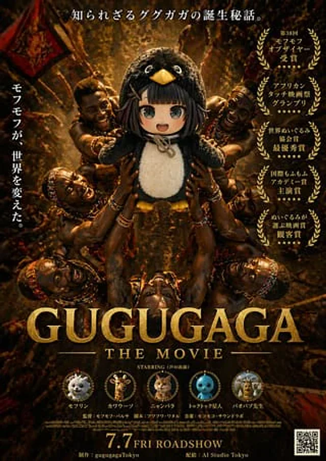

```text
A dramatic fictional movie poster for {argument name="movie title" default="GUGUGAGA"}, designed like an epic prestige film one-sheet with dark golden-brown cinematic lighting and a serious award-winning tone. The composition is vertical and symmetrical. In the center, a plush black-and-white penguin mascot with a round body, big glossy eyes, a yellow beak, and small yellow feet is held aloft in a ritual-like presentation by multiple African tribal warriors surrounding it from all sides. Exactly 6 visible warriors are arranged around the penguin, with muscular arms reaching inward and upward to support the mascot, creating a radial halo of hands and bodies. Their skin is richly lit with warm highlights, and they wear colorful beaded necklaces, bracelets, headbands, and traditional adornments. The background is a dense, dimly lit ceremonial setting with warm firelight, earthy shadows, fabric banners, and a textured amber glow, giving the scene an ancient, mythic atmosphere. At the very top, centered Japanese copy reads: 「知られざるググガガの誕生秘話。」 On the left side, a vertical Japanese tagline reads: 「モフモフが、世界を変えた。」 On the right side, place exactly 5 stacked gold laurel award blocks with Japanese text, each framed by laurel wreaths. The 5 award texts are: 「第38回 モフモフ オブザイヤー 受賞」, 「アフリカン タッチ映画祭 グランプリ」, 「世界ぬいぐるみ 協会賞 最優秀賞」, 「国際もふもふ アカデミー賞 主演賞」, and 「ぬいぐるみが 選ぶ映画賞 観客賞」. Across the lower middle, place the huge metallic gold serif title {argument name="movie title" default="GUGUGAGA"}, with smaller gold serif subtitle beneath it reading {argument name="subtitle text" default="THE MOVIE"}. Below that, add a small centered line reading: STARRING (声の出演). Along the lower section, include exactly 5 circular cast medallions with tiny laurel-like frames and labels beneath them. The 5 cast items are: a fluffy white pomeranian-like dog labeled 「モフリン」, a giraffe labeled 「カワウーソン」, an orange tabby cat labeled 「ニャンバラ」, a blue round toy-like character labeled 「トゥクトゥク星人」, and a scholarly baboon or monkey figure labeled 「バオバブ先生」. Beneath the cast row, add small Japanese-style credit lines including director, screenplay, and music in a fine poster-credit style. At the bottom center, display a large gold release date line reading {argument name="release date" default="7.7 FRI ROADSHOW"}. Along the bottom edge, include small production and distribution credits reading 「制作：gugugagaTokyo」 and 「配給：AI Studio Tokyo」. Put a black-and-white QR code in the bottom-right corner. Use ultra-detailed photorealistic poster rendering, dramatic contrast, gilded typography, luxurious texture, prestige cinema marketing design, and a tongue-in-cheek parody of an Oscar-bait adventure drama.
```

Model: GPT Image 2
Author: AI Studio Tokyo

[ProjectD](https://aitoolsradar.com/en/prompts/7f929cca3b1d34) · [Recorded source](https://youmind.com/prompts/penguin-tribal-movie-poster-15100)
 · [Full original metadata and byte evidence](data/projectd-batch-0029.json)

## Epic Narrative Silhouette Movie Poster


```text
Automatically generate a based on{argument name="theme" default="Dream of the Red Chamber"} A collector's edition epic narrative poster. (Using...){argument name="character" default="Lin Daiyu"} An elegant side silhouette forms the outer outline. Within the silhouette, a complete worldview, iconic scenes, character relationships, symbols, key buildings, creatures, props, and atmosphere most relevant to the theme are naturally integrated. This is not a simple collage, but a high-end silhouette-filled narrative composite combining double exposure associations, aiming to enhance the film's narrative expression and spatial arrangement. It blends the style of film posters with Eastern realist aesthetics, emphasizing realistic physical light and shadow, camera language, spatial depth, and narrative hierarchy. The lighting uses cinematic contour lighting supplemented with local warm tones, maintaining a restrained yet realistic contrast between warm and cool colors, and adding volumetric light and light fog to enhance the sense of space. Textures need to be realistic (architecture, silk, skin, stone), avoiding purely painterly brushstrokes, retaining soft atmospheric perspective, and optimized for cinematic depth of field and focus control. The image has a delicate film grain texture, with soft cinematic transitions in the edge brushstrokes, leaving large areas of negative space, and a refined and high-end layout. The overall style is tranquil, grand, and restrained, containing a typical sense of destiny in Eastern film narratives. All elements must be closely integrated with the theme for instant recognition, avoiding cluttered, haphazard collages, templated backgrounds, or cheap fantasy materials.
```

Model: GPT Image 2
Author: GPT Image 2 Prompts

[ProjectD](https://aitoolsradar.com/en/prompts/76900c557b837c) · [Recorded source](https://x.com/liyue_ai/status/2047305151342596557)
 · [Full original metadata and byte evidence](data/projectd-batch-0029.json)

## Epic Narrative Silhouette Movie Poster

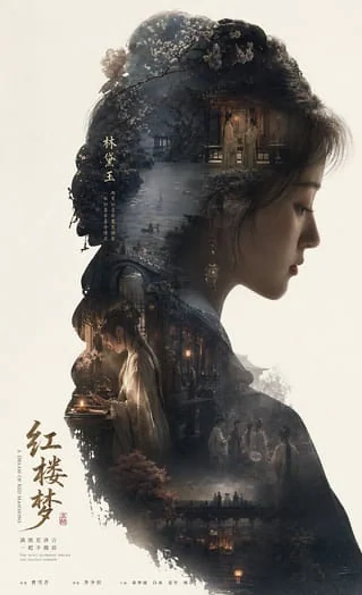

```text
根据{argument name="主题" default="红楼梦"}自动生成一张 收藏版史诗叙事海报，巨大优雅的{argument name="角色" default="林黛玉"}人物侧脸剪影作为外轮廓，剪影内部自动生长出最契合该主题的完整世界观、标志性场景、角色关系、象征符号、关键建筑、生物、道具与氛围。整体不是普通拼贴，而是高级的剪影轮廓填充式叙事合成，带有双重曝光式联想，但强化为电影级叙事表达与空间调度。电影海报风格 + 东方现实主义美学融合，强调真实物理光影、镜头语言、空间纵深与叙事层级。光影采用电影级侧逆光与局部暖光点缀，冷暖对比克制真实，加入体积光与轻雾增强空间感。材质表现为真实质感（建筑、丝绸、肌肤、石材），避免纯绘画笔触感，保留柔和空气透视，但优化为电影级景深与焦点控制。轻微胶片颗粒，边缘飞白与刷痕改为电影式柔和融合过渡，大面积留白，版式克制高级，安静、宏大、克制、宿命感强的东方电影叙事。所有元素必须强绑定主题，一眼识别，不要杂乱，不要硬拼贴，不要模板化背景，不要廉价奇幻素材。
```

Model: GPT Image 2
Author: 李岳

[ProjectD](https://aitoolsradar.com/en/prompts/933c319a563543) · [Recorded source](https://youmind.com/prompts/epic-narrative-silhouette-poster-15204)
 · [Full original metadata and byte evidence](data/projectd-batch-0029.json)

## Epic Senna vs Prost Gladiator Poster

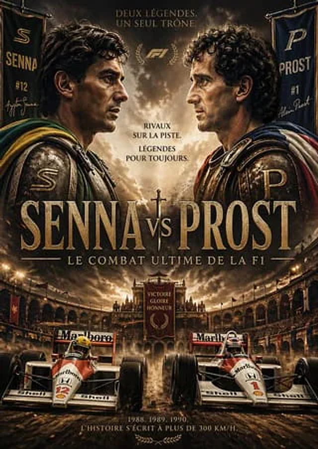

```text
An epic, cinematic poster in deep gold and bronze tones blends the style of mythological gladiator movie posters with retro Formula 1 elements. The upper half features mirrored profile portraits of two legendary rivals: the left inspired by Ayrton Senna, and the right by Alain Prost. Both are depicted as valiant Roman gladiators, clad in weathered bronze armor, dramatic shoulder armor, and capes representing their respective racing colors. The left figure is accented with green, yellow, and blue, while the right figure features blue, white, and red. Their faces are mostly in shadow, illuminated by strong backlighting piercing through storm clouds, creating a solemn and grand atmosphere. Behind each driver hangs two vertical flags: the left flag is dark green with a large gold "S," the words "SENNA," "#12," and a handwritten signature; the right flag is dark blue with a large gold "P," the words "PROST," "#1," and a handwritten signature. At the top center, the words "DEUX LÉGENDES. UN SEUL TRÔNE." are elegantly written in serif French, below which is a small gold F1 logo and a laurel wreath. In the central sky, two lines of stacked French text are added: "RIVAUX SUR LA PISTE." and "LÉGENDES POUR TOUJOURS." The main title appears in a large metallic serif font in the center of the poster:{argument name="headline text" default="SENNA vs PROST"} The title "vs" is separated by a sword-shaped vertical separator. The subtitle below reads "LE COMBAT ULTIME DE LA F1" in French. The lower half depicts a magnificent Roman Colosseum, its stands packed, flags fluttering, arches towering, dust and smoke billowing, dramatic perspective lines converging at the center. A huge victory banner stands in the very center of the arena, bearing the words "VICTOIRE GLOIRE HONNEUR" in gold. In the foreground, two late 1980s F1 cars race towards the audience across the dusty arena. The car on the left, associated with Senna, features a red and white Marlboro-style livery, the Shell logo, the number 12 on the nose, and a yellow helmet on the driver. The car on the right, associated with Prost, also features a red and white Marlboro-style livery, the Shell logo, the number 1 on the nose, and a white helmet on the driver. At the very bottom, the number "1988" is added. "1989. 1990." Below this is written "L'HISTOIRE S'ÉCRIT À PLUS DE 300 KM/H." The last line contains a small decorative laurel wreath. The design features ultra-fine textures, dramatic storm clouds, crepuscular rays, swirling dust, strong contrasts, symmetrical composition, exquisitely beautiful poster design, heroic grandeur, and a timeless, legendary atmosphere.
```

Model: GPT Image 2
Author: GPT Image 2 Prompts

[ProjectD](https://aitoolsradar.com/en/prompts/e106895c34c8c3) · [Recorded source](https://x.com/AlwaveNazca/status/2046696943666024518#reversed-0)
 · [Full original metadata and byte evidence](data/projectd-batch-0029.json)

## Epic Shiva Tandava Fire Dance

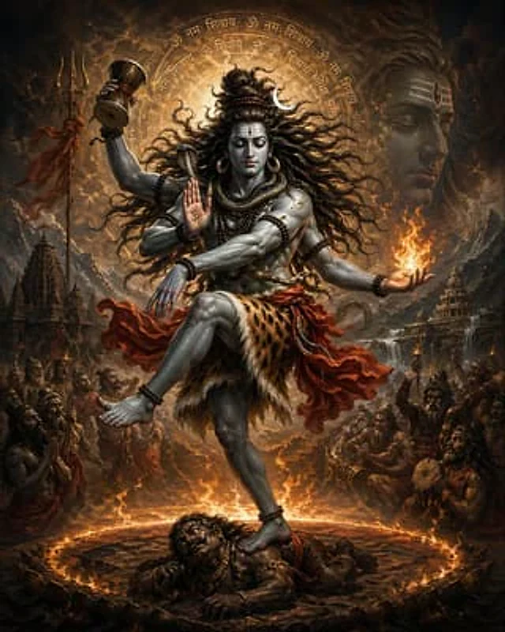

```text
A grand mythological fantasy painting depicts Shiva performing the Thandava dance in the center of a sacred fire. His entire body is in dynamic motion, one leg raised, the other foot resting on his fallen form. Shiva possesses grey-blue skin, strong muscles, and long, wild, dark hair that explodes in all directions, topped in a high bun adorned with a white crescent moon. His expression is solemn and sacred. A cobra coils around his neck, and he wears numerous rudrasam necklaces, bracelets, armlets, large circular earrings, and other sacred ornaments. He wears a tiger-skin loincloth, its red-orange ribbons billowing wildly in the air. One raised hand holds a small damaru drum, while the other hand makes a blessing gesture, the palm displaying the syllable "Om." Above his open palm, a bright flame materializes. Behind his head is a large, luminous halo inscribed with Sanskrit mantras, creating a radiant mandala effect. The backdrop is a post-apocalyptic Himalayan temple landscape, complete with dark clouds, smoke, embers, rocky mountains, waterfalls, and ancient stone shrines and temple towers on either side. A trident wrapped in red cloth stands on the left. Shiva is surrounded by ten devotees and ascetics on either side, chanting devoutly, kneeling, raising their arms, holding torches, and striking drumbeats. Beneath Shiva lies the figure of a dark-skinned man lying on the stone ground. The ground is cracked and lava is churning, with a ring of blazing lava and flames encircling the dance platform. The film employs dramatic, cinematic lighting, contrasting deep charcoal shadows with bright orange firelight, showcasing highly detailed anatomy, intricate jewels and textures, flowing hair and fabric movement, a devout epic fantasy realism style, painterly brushstrokes, a symmetrical central composition, ultra-high detail, high contrast, and a vertical poster format.
```

Model: GPT Image 2
Author: GPT Image 2 Prompts

[ProjectD](https://aitoolsradar.com/en/prompts/d278e1f6b5327b) · [Recorded source](https://x.com/imrushikesh77/status/2047243221592605071#reversed-0)
 · [Full original metadata and byte evidence](data/projectd-batch-0029.json)

## Epic Shonen Crossover Poster

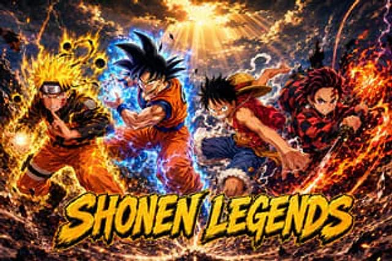

```text
A cinematic-quality anime collaboration poster is incredibly detailed, depicting four legendary shonen manga-style heroes charging side-by-side in an epic battle under a dramatic, apocalyptic sky. The scene is grand, symmetrical, and explosive, with intense golden sunlight streaming through a crack in the clouds, enveloping the characters. From left to right: On the left is a blond, ninja-style young hero dressed in orange and black, wearing a headband. He crouches in an attack stance, holding a glowing, spinning energy ball in his hand, surrounded by orange chakra flames, with several black spheres floating behind him; in the center left is a muscular, black-haired martial artist in an orange gi, twisting in mid-air to attack, accumulating a bright blue energy ball in his hand, surrounded by crackling blue halos and arcs of electricity; in the center right is a lean, pirate-style youth wearing a straw hat, a sleeveless red vest, blue shorts, and sandals, grinning as he charges forward, one arm outstretched, white, steam-like energy swirling around him; on the far right is a black-haired swordsman in a black and red checkered haori, drawing or swinging his sword, surrounded by a blazing red-orange energy arc. The background is a chaotic fantasy battlefield, where rubble, sparks, lightning, embers, lava glow, and swirling elemental effects intertwine. Orange flames dominate the left and right edges, while cool-toned blue energy concentrates around the martial artist, and white steam surrounds the pirate hero. It employs extremely high contrast, hypersaturated colors, sharp anime lines, an oil painting texture, dynamic perspective, strong motion blur effects, and top-tier poster-quality rendering. A large title is added to the bottom foreground.{argument name="headline text" default="SHONEN LEGENDS"} The text uses an oversized, distressed brush font, with bright gold accents, heavy black shadows, and rough, torn edges, partially obscuring the characters and fragments. The overall atmosphere is {argument name="franchise theme" default="legendary shonen anime crossover"} The blockbuster-level main visual poster is full of overwhelming energy, a battle between heroes, and an unstoppable momentum.
```

Model: GPT Image 2
Author: GPT Image 2 Prompts

[ProjectD](https://aitoolsradar.com/en/prompts/e3da08202c415a) · [Recorded source](https://x.com/AiHubMix/status/2046934521178890711#reversed-0)
 · [Full original metadata and byte evidence](data/projectd-batch-0029.json)

## Epic Silhouette World Poster


```text
收藏版史诗海报，人物侧脸剪影中生长出完整世界观与经典场景。整体偏电影海报加梦幻水彩插画风，安静、宏大、神圣、怀旧，带纸张颗粒、轻雾感、飞白刷痕与高级留白。
```

Model: GPT Image 2
Author: @Ghhhh3owi

[ProjectD](https://aitoolsradar.com/en/prompts/bc8d43e9a9e3b5) · [Recorded source](https://x.com/Ghhhh3owi/status/2045803217251102897)
 · [Full original metadata and byte evidence](data/projectd-batch-0029.json)

## Epic silhouette worldbuilding poster

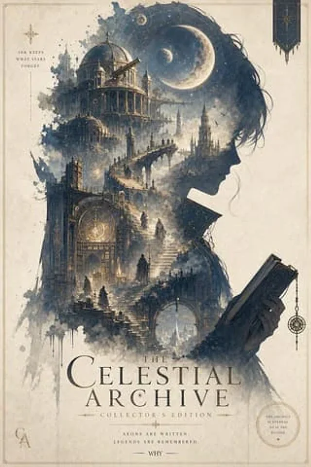

```text
Design a collector's-edition epic poster for an original fantasy theme called "The Celestial Archive". The outer silhouette is a graceful side profile of a lone archivist, and inside that silhouette a complete world naturally grows: observatories, floating stairways, bridges, ancient libraries, moons, towers, relics, and distant pilgrims. Make it feel like a narrative silhouette composition rather than a collage. Style: cinematic poster fused with dreamy watercolor illustration, quiet and majestic, sacred and nostalgic, with paper grain, soft mist, brush-edge texture, elegant negative space, and a discreet signature "WHY" integrated naturally as part of the layout.
```

Model: GPT Image 2
Author: @xiaohongshu-community

[ProjectD](https://aitoolsradar.com/en/prompts/de20f1e0df2e58) · [Recorded source](https://www.xiaohongshu.com/explore/69e324cd0000000021039ca9)
 · [Full original metadata and byte evidence](data/projectd-batch-0029.json)

## Epic Silhouetted World Poster

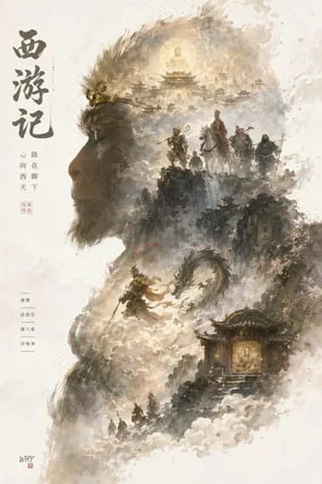

```text
This collector's edition epic poster presents a complete world view and classic scenes through the silhouettes of the characters. The overall style blends movie posters with dreamy watercolor illustrations, creating a tranquil, grand, sacred, and nostalgic atmosphere, complete with paper textures, light mist, brushstrokes, and elegant negative space.
```

Model: GPT Image 2
Author: GPT Image 2 Prompts

[ProjectD](https://aitoolsradar.com/en/prompts/d4b1a593adc87f) · [Recorded source](https://x.com/Ghhhh3owi/status/2045803217251102897)
 · [Full original metadata and byte evidence](data/projectd-batch-0029.json)

## Epic Universe History Timeline Poster

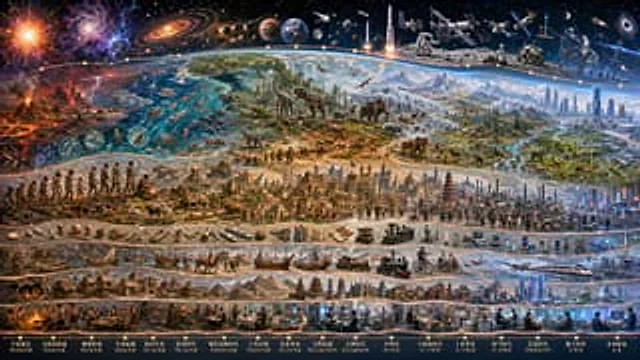

```text
Goal: Create an ultra-wide, extremely information-dense panoramic illustrated timeline of the entire universe, Earth, life, human civilization, technology, and the future, rendered as a single seamless epic cross-section mural for gpt-image-2.

Canvas: 16:9 horizontal poster, very high detail, cinematic realism mixed with museum-quality educational illustration, sharp enough to read tiny timeline labels. Use a grand curved horizon of Earth across the center, with outer space above and layered historical scenes below. No blank areas.

Overall layout: The composition is divided into 4 main horizontal zones. Top zone: cosmic history in deep space. Upper-middle zone: Earth history and natural evolution across a sweeping landscape. Lower-middle zone: human civilization and technological progress. Bottom zone: a continuous golden timeline strip with exactly 18 labeled milestones in Chinese, each with a small circular marker.

Top cosmic zone: Show a fiery Big Bang explosion at far left, colorful nebulae and starfields, a spiral galaxy, forming planets, the solar system, Earth and Moon, asteroids and comets, rockets, satellites, a space station, astronauts on the Moon, lunar rover, Mars rover, futuristic space telescopes, spacecraft, a ring station, distant planets, black hole, and blue laser-like space trails at far right. Add a thin golden orbital timeline line with small circular nodes crossing this upper area.

Upper-middle Earth and evolution zone: Blend volcanic early Earth on the left with lightning, lava, meteor impacts, hot oceans, microbial bubbles and sea creatures; transition into lush prehistoric seas with fish, ammonites, trilobites, and marine reptiles; continue into a dinosaur landscape with forests, sauropods, theropods, pterosaurs, and smaller dinosaurs; transition to ice-age mountains and mammoths; then to modern rivers, grasslands, elephants, deer, birds, wind turbines, farmland, and a sleek futuristic city skyline at the right. Keep the transitions seamless like a chronological world map.

Lower-middle civilization and technology zone: At far left show human evolution silhouettes walking forward, early campfires, caves, stone tools, primitive huts, pottery, sheep and cattle. Continue through ancient agriculture, pyramids, temples, classical cities, pagodas, medieval castles, churches, marketplaces, sailing ships, caravans, early machines, steam trains, bicycles, automobiles, airplanes, factories with smokestacks, power lines, telephones, radios, televisions, computers, laptops, smartphones, servers, laboratories, control rooms, robots, holographic blue interfaces, high-speed trains, and futuristic glass cities. Include many tiny people in period clothing interacting naturally.

Bottom strip: Create a dark blue-black footer band with a thin gold line and exactly 18 milestone nodes, evenly spaced left to right. Use these exact Chinese labels and dates, one per node: 1. 「宇宙诞生\n约138亿年前」, 2. 「太阳系形成\n约46亿年前」, 3. 「地球形成\n约45亿年前」, 4. 「生命起源\n约38亿年前」, 5. 「海洋生命\n约5.4亿年前」, 6. 「恐龙时代\n约2.3亿年前」, 7. 「哺乳动物时代\n约6600万年前」, 8. 「人类出现\n约300万年前」, 9. 「农业革命\n约1.2万年前」, 10. 「文明起源\n约公元前3500年」, 11. 「古典时代\n约公元前800年」, 12. 「中世纪\n约5世纪」, 13. 「大航海时代\n15–17世纪」, 14. 「工业革命\n18–19世纪」, 15. 「电气时代\n19–20世纪」, 16. 「信息时代\n20世纪后半叶」, 17. 「数字时代\n21世纪」, 18. 「未来探索\n未来」.

Visual style: Hyper-detailed epic science-history infographic, realistic lighting, vibrant but coherent color grading, gold accent lines, deep blues and oranges, miniature diorama detail, cinematic depth, crisp micro-scenes, no cartoon style, no flat vector look.

Constraints: Make the poster astonishingly dense but coherent; keep all 18 bottom labels legible; avoid random unreadable text outside the timeline; avoid duplicated milestone labels; do not add watermarks or logos. The main theme is {argument name="timeline theme" default="the complete history of the universe, Earth, life, civilization, technology, and future exploration"}. Use {argument name="language for milestone labels" default="Chinese"} for the footer labels, a {argument name="visual style" default="hyper-detailed cinematic educational mural"}, a {argument name="accent color" default="gold"}, and a {argument name="future city mood" default="optimistic blue futuristic"}.
```

Model: GPT Image 2
Author: 沐阳

[ProjectD](https://aitoolsradar.com/en/prompts/3c8412062192df) · [Recorded source](https://youmind.com/prompts/universe-history-timeline-poster-25948)
 · [Full original metadata and byte evidence](data/projectd-batch-0029.json)

## Ertan Dönmez | Ai Master #283

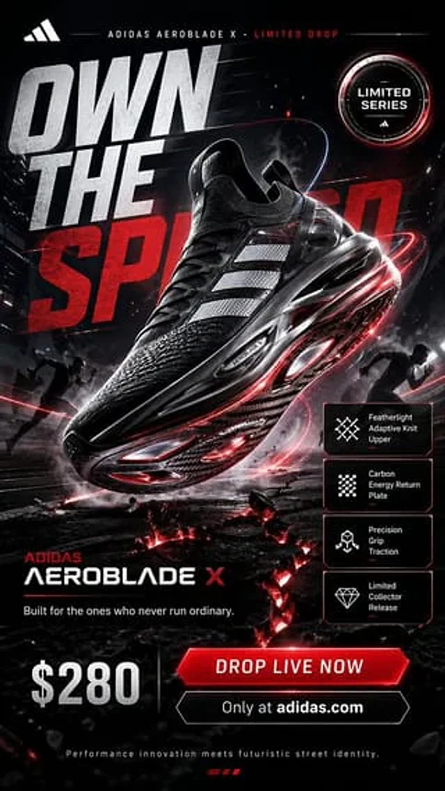

```text
Create a jaw-dropping premium advertising poster in 9:16 vertical format for a fictional ultra-limited Adidas sneaker called "ADIDAS AEROBLADE X - LIMITED DROP". The design must feel like a world-class campaign by a top creative agency, highly original, futuristic, visually explosive, and impossible to ignore.

Main visual:
A single hero sneaker floating in the center, shot from a dramatic low angle, as if it is levitating above a black obsidian running track split by glowing energy cracks. The shoe should look ultra-premium, highly engineered, sleek, aerodynamic, and fashion-forward. Its material should combine knit mesh, sculpted foam, translucent panels, reflective stripes, and a carbon-fiber sole plate. Neon light trails swirl around the shoe like captured speed. Small particles and mist add motion and intensity. In the background, use faint silhouettes of elite runners frozen mid-sprint, blurred just enough to keep all attention on the shoe.

Color palette:
Matte black, electric red, silver, deep charcoal, with subtle neon blue highlights.

Typography and poster copy:
Render all text cleanly, sharply, and professionally with strong hierarchy.
Main headline:
"OWN THE SPEED"
Product title:
"ADIDAS AEROBLADE X"
Subheadline:
"Built for the ones who never run ordinary."
Feature callouts in elegant boxed layout:
- "Featherlight Adaptive Knit Upper"
- "Carbon Energy Return Plate"
- "Precision Grip Traction"
- "Limited Collector Release"
Price line:
"$280"
CTA:
"DROP LIVE NOW"
Secondary CTA:
"Only at https://t.co/xuQ7Pl8fga"
Small footer text:
"Performance innovation meets futuristic street identity."

Layout direction:
The headline should be bold and oversized, partially integrated into the background. Product name should sit near the shoe in a refined premium layout. Feature callouts should be clean, readable, and arranged vertically along one side. Add a subtle badge reading "LIMITED SERIES". The overall composition should feel like a luxury sports campaign mixed with futuristic editorial design.

Style:
Ultra-detailed, hyper-realistic product photography, cinematic studio lighting, premium advertising aesthetics, sharp focus, rich textures, subtle atmosphere, dynamic motion energy, high-end commercial poster, no clutter, no generic template look.

Make the aspect ratio 9:16
```

Model: GPT Image 2
Author: Ertan Dönmez | Ai Master

[ProjectD](https://aitoolsradar.com/en/prompts/dfa3c244fad527) · [Recorded source](https://x.com/ertanlabs/status/2048773623297527836)
 · [Full original metadata and byte evidence](data/projectd-batch-0029.json)

## Espresso Cup on Marble with Beans


```text
Close-up of a single small white porcelain espresso cup filled with crema-topped espresso, resting on a polished white Carrara marble countertop. A small cluster of roasted dark coffee beans is scattered to the left of the cup. Soft golden hour window light enters from the right, producing a single specular highlight on the cup rim and gentle warm tones across the marble. Square 1:1 composition, no text, no logo, no watermark. Editorial cafe brand photography, ultra detailed crema bubbles and bean textures.
```

Model: GPT Image 2
Author: @hiapi_ai

[ProjectD](https://aitoolsradar.com/en/prompts/5afc378713f8cd) · [Recorded source](https://github.com/HiAPIAI/awesome-gpt-image-2-prompts)
 · [Full original metadata and byte evidence](data/projectd-batch-0029.json)

## Ethereal Anime Character Portrait

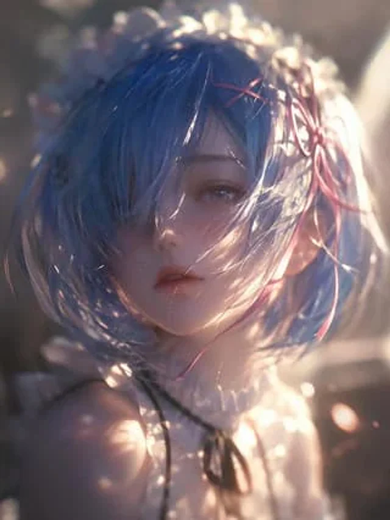

```text
Reverse haze, diffused blur, soft focus, close-up shot of an {argument name="subject" default="ethereal and pure beautiful girl or boy"} inspired by the character {argument name="character name" default="Frieren"} from Frieren: Beyond Journey’s End. Blurred portrait and scenery, emphasizing the chaotic beauty of flowing dynamic hair. Extremely attractive appearance, dreamy and elusive atmosphere, Rembrandt lighting, high saturation, reflections and refractions, rich texture details, glowing bloom blur diffusion, low noise, subtle film grain texture, minimalist style, soft-focus aesthetics, emotional impressionism, avant-garde visual art aesthetics, cinematic luxury composition, masterpiece-level film aesthetics. CGI, Unreal Engine 5 rendering, Octane Render.
```

Model: GPT Image 2
Author: Anissa

[ProjectD](https://aitoolsradar.com/en/prompts/2863be2ac5e25b) · [Recorded source](https://youmind.com/prompts/ethereal-anime-character-portrait-19228)
 · [Full original metadata and byte evidence](data/projectd-batch-0029.json)

## Ethereal Buddhist Pure Land scene

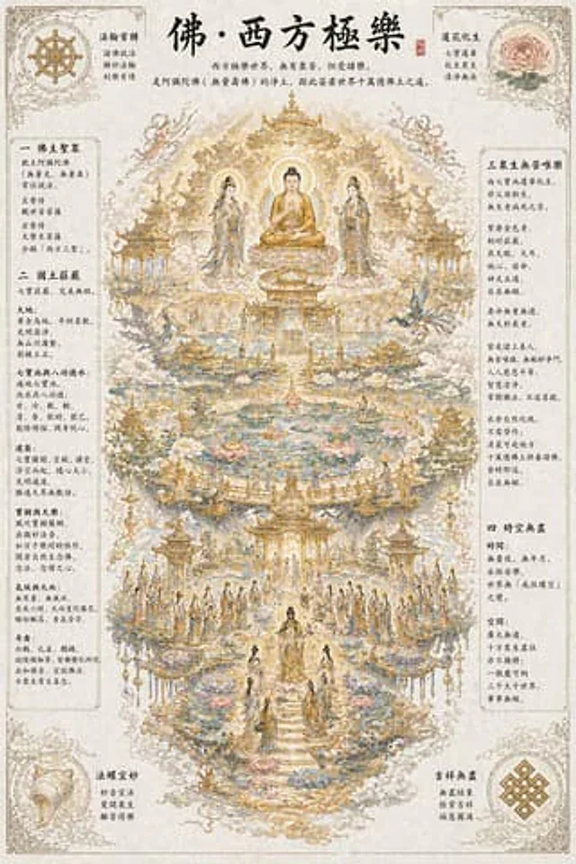

```text
The Western Pure Land of Ultimate Bliss (also known as the Western Pure Land, Sukhavati) is the Buddha-land of Amitabha Buddha (Buddha of Infinite Life). Its core characteristic is the absence of all suffering, only pure happiness, a stark contrast to our Saha world (the world of suffering). It is located to the west of our world, a distance of ten trillion Buddha-lands (see the Amitabha Sutra for details). The principal Buddha is Amitabha Buddha (Infinite Light, Infinite Life), who constantly preaches the Dharma; flanked by Avalokiteshvara Bodhisattva and Mahasthamaprapta Bodhisattva, collectively known as the "Three Saints of the West." The environment is adorned with the seven treasures, pure and flawless. The earth is made of gold, flat, soft, bright, and clean, without mountains, rivers, ravines, thorns, or rocks. Seven-jeweled ponds and water possessing eight virtues: The ponds are filled with seven jeweled materials (gold, silver, lapis lazuli, crystal, tridacna shell, red pearl, and agate). The water possesses eight virtues: sweetness, coolness, softness, lightness, clarity, fragrance, thirst-quenching, and nourishment of the mind. The pool's bottom is covered with golden sand, and its banks are adorned with seven-jeweled steps. Lotuses in the pool are as large as cartwheels, radiating light of blue, yellow, red, and white. Architecture: Seven-jeweled pavilions, palaces, and lecture halls float in the air, their size changing at will, translucent and crystalline, far surpassing the celestial realm. Jeweled Trees and Celestial Music: Seven rows of trees, seven layers of railings, and seven layers of nets, all made of the four precious materials. A gentle breeze rustles the trees and nets, producing subtle Dharma sounds, like hundreds of thousands of musical instruments playing simultaneously, naturally guiding listeners to contemplate the Three Jewels: Buddha, Dharma, and Sangha. Climate and Rain: There is no distinction between hot and cold, no calamities of wind and rain; the climate is always mild and comfortable. Mandala flowers fall from the sky six times a day and night, fragrant and colorful. Wondrous Birds: White cranes, peacocks, parrots, kalavinkas, etc., are all manifestations of Amitabha Buddha, emitting harmonious calls, proclaiming the Dharma. Sentient Beings: No suffering, only joy, and immeasurable lifespan. Rebirth: All beings are born from lotuses in the Seven Treasure Pond, not born of parents, and are free from the suffering of birth, old age, sickness, and death. Appearance: All have bodies of pure purple-gold, majestic and sublime, resembling Amitabha Buddha; possessing five supernatural powers: divine eye, divine ear, telepathy, knowledge of past lives, and supernatural speed, free and unhindered. Lifespan: Enduring countless eons, nearly eternal, without the worry of premature death or aging. Nature: All are supremely virtuous beings, free from greed, anger, ignorance, jealousy, or conflict; compassionate, egalitarian, wise, and pure, constantly hearing the Dharma. Life: Food and clothing arise naturally, requiring no labor; in the morning, they can travel to ten trillion Buddha-lands to make offerings to Buddhas and return at mealtime. Time and Space: Infinite and eternal. Time: Without day and night, without years and months, eternal happiness; this world does not experience the evolution of formation, existence, decay, and emptiness. Space: Vast and boundless, even accommodating all beings in the ten directions without ever being crowded; a single grain of dust can contain three thousand great chiliocosms.
```

Model: GPT Image 2
Author: GPT Image 2 Prompts

[ProjectD](https://aitoolsradar.com/en/prompts/cc0c66178b0ac7) · [Recorded source](https://x.com/leyu37829/status/2047758555596661002)
 · [Full original metadata and byte evidence](data/projectd-batch-0029.json)

## Ethereal Fashion Portrait

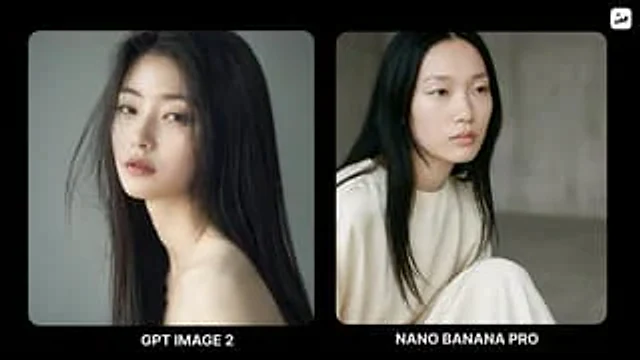

```text
A stunning picture{argument name="subject" default="Asian women"} Fair skin, minimalist makeup, calm and aloof expression, long straight black hair, soft diffused light, clean background, cinematic composition.{argument name="style" default="High-end fashion magazine style"} Exquisite details, ethereal atmosphere, 8K realism
```

Model: GPT Image 2
Author: GPT Image 2 Prompts

[ProjectD](https://aitoolsradar.com/en/prompts/cd9a9cbf266f73) · [Recorded source](https://x.com/TopviewAIhq/status/2046770234225508775)
 · [Full original metadata and byte evidence](data/projectd-batch-0029.json)

## Ethereal Piano Performance


```text
Within the 9:16 vertical format, an exquisitely elegant scene unfolds: light and shadow gently envelop the magnificent aircraft.{argument name="instrument" default="Steinway &amp; Sons Black Grand Piano"} The flowing lines of the piano keys are outlined. A captivating woman sits gracefully before the keys, her figure light and elegant, dressed in a strikingly contrasting outfit.{argument name="top" default="Bright chocolate sleeveless vest"} and{argument name="skirt" default="Custom pink tight-fitting short latex skirt"} Her perfectly proportioned profile, with her prominent cheekbones, is striking. She gazes directly at the camera, her expression focused and serene, radiating the youthful freshness and sophisticated allure of a twenty-year-old. A large, vibrant red rose adorns her waist-length, deep blonde hair, its bright color contrasting beautifully with her fair complexion and the soft, warm lighting around her. Her hands rest naturally on the black and white piano keys, as if immersed in a tranquil musical world. Against this harmonious and beautiful backdrop, soft, muted pink curtains display textured folds, and a cluster of lush flowers blooms quietly in the corner, together weaving a visual poem that elevates the real world to a serene and perfect realm.
```

Model: GPT Image 2
Author: GPT Image 2 Prompts

[ProjectD](https://aitoolsradar.com/en/prompts/62f946a38b2cf9) · [Recorded source](https://x.com/XSydneyFan/status/2047751127094149195)
 · [Full original metadata and byte evidence](data/projectd-batch-0029.json)

## European Travel Advertisement Banner


```text
{
  "type": "Travel advertising webpage banner",
  "background": {
    "scene": "{argument name=\"destination scene\" default=\"A picturesque European cobblestone town square, complete with cafes, fountains, and a church tower.\"}",
    "lighting": "Bright, sunny day, warm sunshine",
    "details": "Cafe tables and chairs, brightly colored flowers on the balcony, distant mountains, and a cloudless, azure sky.",
    "props": "A round 'Caffè' sign hangs on the building to the right, and a wooden menu board lists 'Menu / Pasta / Insalata / Dolce / Vino'."
  },
  "overlay_elements": {
    "graphics": "The postmark on the left side, the dotted airplane flight path above the text, and the decorative patterns.",
    "typography": {
      "catchphrase": {
        "text": "{argument name=\"catchphrase\" default=\"Unknown streets await.\"}",
        "style": "Small serif font, curving along the lines and featuring an airplane icon."
      },
      "main_headline": {
        "text": "{argument name=\"main headline\" default=\"Next holiday, I&#39;ll take a stroll through the streets.\"}",
        "style": "Large, elegant serif font, blending brown, blue, and pink."
      },
      "subtitle": {
        "text": "{argument name=\"subtitle\" default=\"Strolling on the stone-paved road makes the soul feel light.\"}",
        "style": "Medium serif font with retro decorative lines on both sides"
      }
    },
    "call_to_action": {
      "button_text": "{argument name=\"button text\" default=\"Find travel destinations &gt;\"}",
      "style": "A red, pill-shaped button with a double gold border is centered below the text."
    }
  },
  "layout": {
    "bottom_navigation_bar": {
      "style": "White banner with rounded corners at the top",
      "count": 3,
      "items": [
        {
          "icon": "camera",
          "label": "Take photos and check in"
        },
        {
          "icon": "fork and spoon",
          "label": "Food Stroll"
        },
        {
          "icon": "suitcase",
          "label": "Easy Overseas Travel"
        }
      ]
    }
  }
}
```

Model: GPT Image 2
Author: GPT Image 2 Prompts

[ProjectD](https://aitoolsradar.com/en/prompts/d0c4ed9142cd24) · [Recorded source](https://x.com/masapark95/status/2046168679822594059#reversed-3)
 · [Full original metadata and byte evidence](data/projectd-batch-0029.json)

## European Travel Advertisement Banner

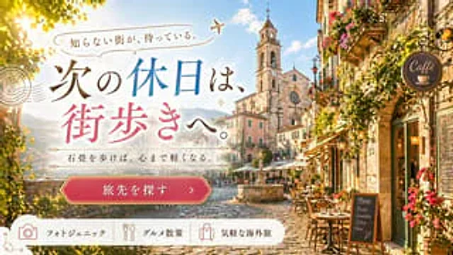

```text
{
  "type": "travel advertisement web banner",
  "background": {
    "scene": "{argument name=\"destination scene\" default=\"picturesque European cobblestone town square with a cafe, fountain, and church tower\"}",
    "lighting": "bright sunny day, warm sunlight",
    "details": "cafe tables with chairs, vibrant flowers on balconies, distant mountains, clear blue sky with fluffy clouds",
    "props": "round 'Caffè' sign on right building, wooden menu board listing 'Menu / Pasta / Insalata / Dolce / Vino'"
  },
  "overlay_elements": {
    "graphics": "postmark stamp on mid-left, dashed airplane flight path above text, decorative flourishes",
    "typography": {
      "catchphrase": {
        "text": "{argument name=\"catchphrase\" default=\"知らない街が、待っている。\"}",
        "style": "small serif, curved along a line with an airplane icon"
      },
      "main_headline": {
        "text": "{argument name=\"main headline\" default=\"次の休日は、街歩きへ。\"}",
        "style": "large elegant serif, mixed colors of brown, blue, and pink"
      },
      "subtitle": {
        "text": "{argument name=\"subtitle\" default=\"石畳を歩けば、心まで軽くなる。\"}",
        "style": "medium serif, flanked by vintage decorative lines"
      }
    },
    "call_to_action": {
      "button_text": "{argument name=\"button text\" default=\"旅先を探す >\"}",
      "style": "red pill-shaped button with gold double-line border, centered below text"
    }
  },
  "layout": {
    "bottom_navigation_bar": {
      "style": "white banner with rounded top corners",
      "count": 3,
      "items": [
        { "icon": "camera", "label": "フォトジェニック" },
        { "icon": "fork and spoon", "label": "グルメ散策" },
        { "icon": "suitcase", "label": "気軽な海外旅" }
      ]
    }
  }
}
```

Model: GPT Image 2
Author: パク🎈動画広告分析Pro × AI

[ProjectD](https://aitoolsradar.com/en/prompts/753fe3d9af7b11) · [Recorded source](https://youmind.com/prompts/european-cobblestone-town-banner-14237)
 · [Full original metadata and byte evidence](data/projectd-batch-0029.json)

## Exact Image Replication

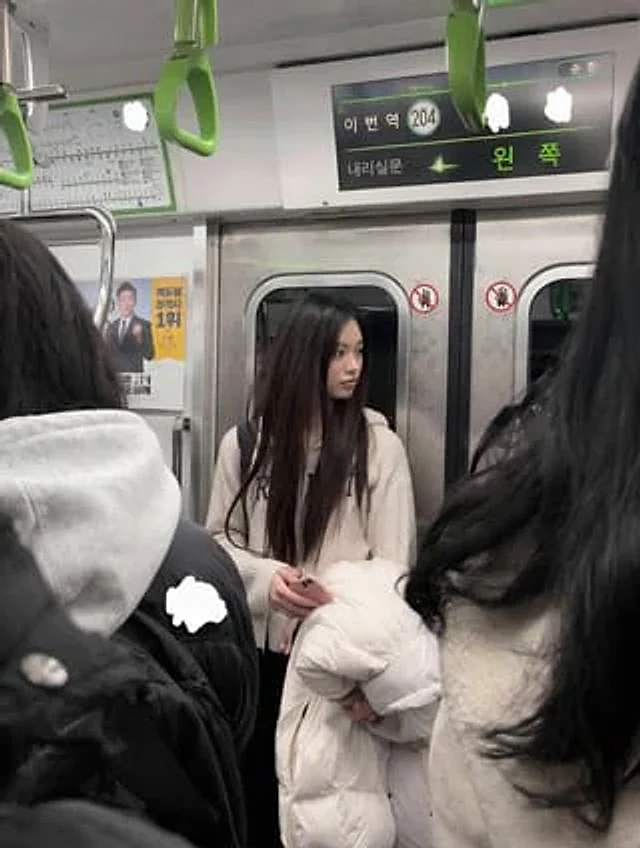

```text
Use REFERENCE_0 to generate a{argument name="reproduction style" default="Precise photorealistic replica"} The complete scene was preserved. The composition remained completely unchanged, including the long-haired young woman in the center holding a white jacket and a pink phone, two foreground passengers obstructing the view, the interior of the subway car, three green handrails, and the digital display screen. The lighting, color, and perspective were kept perfectly consistent, making it indistinguishable from the original photograph.
```

Model: GPT Image 2
Author: GPT Image 2 Prompts

[ProjectD](https://aitoolsradar.com/en/prompts/f0ff8750a4380c) · [Recorded source](https://x.com/luffynod00/status/2045038864805625980#reversed-1)
 · [Full original metadata and byte evidence](data/projectd-batch-0029.json)

## Exploded Chicken Mushroom Stew Ad


```text
Create a vertical food advertisement against a pure black background, similar in style to a high-end ingredient disassembly poster, to showcase a sumptuous Chinese-style chicken stew with mushrooms. Employ a simple, top-down, explosive composition, suspending the ingredients above the finished dish. Each ingredient group is clearly separated and illuminated with glossy commercial food photography lighting. At the top is a cluster of mixed hazel mushrooms and other fresh mushrooms. Below are two sets of spices: a bunch of red goji berries, a small bunch of scallions, and two thick slices of ginger. Further down are two sets of main ingredients: several pieces of raw chicken with skin, and a bundle of dried vermicelli. Next are two sets of vegetables: peeled potato chunks and thick carrot slices. Below these are a clear glass bowl filled with rich, golden chicken broth, with four shiitake mushrooms, finely chopped herbs, a small amount of oil, and wisps of steam visible on the surface. A dark brown ceramic casserole with a side handle sits at the bottom, containing the stewed dish: chicken pieces, shiitake mushrooms, translucent vermicelli, potato chunks, carrot slices, scattered goji berries, chopped scallions, and a glossy golden broth. Drizzling droplets, crumbs, and small decorative particles are added between the layers to emphasize movement and richness. A light steam rises above the stew, and a bright star-shaped highlight is added to the right rim of the casserole. Seven bilingual (English and Chinese) labels surround the ingredients, each accompanied by a thin, curved arrow pointing to the relevant ingredient. These seven labels are: “Hazel Mushrooms &amp; Shiitake,” “Savory Mushrooms,” “Goji Berries &amp; Aromatics,” “Chicken &amp; Vermicelli,” “Potatoes &amp; Carrots,” “Rich Chicken Broth,” and “Finished Stew.” Add an extra bilingual text description near the vegetables or central area: "Rich Ingredients". This will give the image a hyper-realistic, enticing, high-contrast, and extremely sharp effect, with cinematic highlights, deep shadows, high-end packaging advertising aesthetics, and a balanced, centered layout suitable for posters or social media ads.
```

Model: GPT Image 2
Author: GPT Image 2 Prompts

[ProjectD](https://aitoolsradar.com/en/prompts/01bad72472a4f6) · [Recorded source](https://x.com/lijazzer/status/2046514612850626978#reversed-1)
 · [Full original metadata and byte evidence](data/projectd-batch-0029.json)

## Exploded Luxury Dive Watch Render

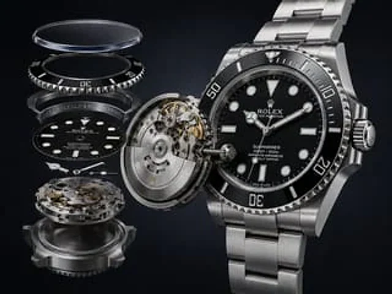

```text
Create a photorealistic luxury product rendering of an exploded mechanical dive watch, centered on a {argument name="watch brand" default="Rolex"} {argument name="watch model" default="Submariner"} in stainless steel with a black dial and black ceramic bezel. Canvas is landscape 4:3, dark charcoal-to-black studio background, dramatic softbox reflections, ultra sharp macro detail, premium advertising look, no people. Composition: the fully assembled watch occupies the right half of the image at a slight three-quarter angle, with a brushed oyster-style metal bracelet continuing upward and downward out of frame; the crown is visible on the right side, the serrated bezel has white minute markings and large numerals 10, 20, 30, and 50, and the dial shows luminous round, rectangular, and triangle indices, Mercedes-style hour hand, minute hand, seconds hand, and small white printed dial text including the brand crown logo, brand name, model name, depth rating, and certification lines. On the left half, show an exploded vertical stack of exactly 7 separated watch components aligned in perspective: 1) a transparent domed sapphire crystal floating at the top, 2) a black rotating bezel insert with white markings beneath it, 3) a dark chapter/rehaut ring with tiny engraved brand text, 4) the black watch dial with luminous markers and printed brand/model text, 5) three separate silver hands floating below the dial, 6) a detailed mechanical movement with jewels, screws, gears, and bridges, and 7) the lower steel caseback/case ring at the bottom. Between the exploded stack and the complete watch, show a partially separated circular movement and case module tilted open, exposing gears, gold-toned wheels, ruby jewels, screws, and a rotor with a small gold crown emblem, as if the mechanism is being pulled into the watch. Materials: polished and brushed stainless steel, black glossy ceramic, transparent glass edge highlights, engraved ridges, high-contrast reflections, precise machining, realistic shadows, shallow depth of field but all main parts crisp. Text should be legible where possible and resemble authentic luxury watch dial typography, using {argument name="dial color" default="black"}, {argument name="metal finish" default="brushed stainless steel"}, and {argument name="background color" default="deep black"}. Constraints: make the image look like a high-end technical product visualization, not a diagram; no captions, no labels outside the watch, no watermark, no extra watches, no hands or tools.
```

Model: GPT Image 2
Author: 0xMarioNawfal

[ProjectD](https://aitoolsradar.com/en/prompts/d0d3ee202a2f38) · [Recorded source](https://youmind.com/prompts/exploded-dive-watch-render-20555)
 · [Full original metadata and byte evidence](data/projectd-batch-0029.json)

## Exploded Technical Diagram Poster

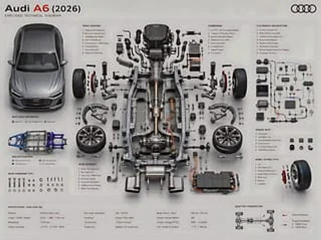

```text
Create an ultra-high fidelity exploded technical diagram of a {argument name="car model" default="2026 Audi A6"}, presented as a premium engineering poster. Audi A6 (2026)Maintain a true orthographic top/front hybrid view with zero perspective distortion.CORE COMPOSITION RULE
Place the primary chassis or structural platform perfectly centered as the core spine. Position the main body shell separately (left or top), aligned parallel as a reference form while preserving accurate proportions, stance, and real-world geometry of the 2026 Audi A6.EXPLODED ENGINEERING SYSTEM (MULTI-LAYER DEPTH STRUCTURE)
Design a multi-layered exploded system with components separated across depth (Z-axis) and planar spacing:Micro hardware (bolts, screws, washers): tightly grouped in precision clusters
Functional assemblies: moderately spaced with clear mechanical relationships
Major systems: widely separated for structural clarity and engineering hierarchy
SUBSYSTEM BREAKDOWN (MODERN AUDI ARCHITECTURE)
Organize parts into realistic automotive engineering subsystems:Front Assemblyadaptive suspension system (Audi drive select calibrated damping)
precision steering rack with electronic assist
advanced braking system (ventilated discs + regenerative integration if hybrid)
sensor suite (front radar, LiDAR-ready modules, camera array)
Rear Assemblyrear multi-link suspension system
drivetrain assembly (quattro AWD torque distribution unit)
rear differential system (or integrated e-axle for hybrid/EV variant)
stability and traction control modules
Chassis / Structurelightweight MLB Evo / next-gen Audi modular platform architecture
reinforced aluminum and high-strength steel hybrid frame
vibration isolation subframes
crash-optimized energy absorption zones
Powertrainturbocharged inline-4 / V6 hybrid-compatible engine architecture
transmission system (dual-clutch S tronic representation)
intake, exhaust, and thermal management routing
optional mild-hybrid or plug-in hybrid battery integration
partial internal exposure showing combustion or electric assist layering
Electronics SystemECU and domain control architecture (centralized compute unit)
wiring harness with ultra-clean routed geometry
driver assistance systems (ADAS module cluster)
infotainment + digital cockpit processing unit
sensor fusion computing core
Wheel System4 wheels symmetrically placed
rim, tire, brake disc, hub assembly separated in exploded layers
precise axle alignment and rotational geometry
Audi signature aerodynamic rim design
ENGINEERING REALISM RULE
Maintain strict mechanical connectivity between all systems
Align shafts, axles, and torque paths accurately
Preserve left/right symmetry with controlled functional asymmetry only
Group micro-components in structured clusters near their assemblies
Avoid decorative or random placement — everything must reflect real automotive engineering logic
VISUAL STYLE & MATERIAL LANGUAGE
Use modern Audi design precision:brushed aluminum + matte graphite structural materials
carbon-reinfo
```

Model: GPT Image 2
Author: Shami

[ProjectD](https://aitoolsradar.com/en/prompts/0cdf7e453337b5) · [Recorded source](https://youmind.com/prompts/exploded-audi-technical-diagram-poster-18057)
 · [Full original metadata and byte evidence](data/projectd-batch-0029.json)

## Explosive Anime Launch Thumbnail

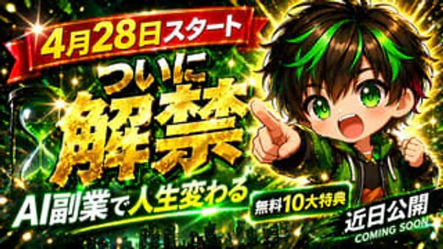

```text
Create a striking anime-style YouTube thumbnail with explosive light effects, dense sparkle effects, and strong contrast. The composition features a unified scene with a deep black and neon green background accented with gold glitter and a subtle silhouette of a city skyline at the bottom edge. The right side of the image showcases a cute, chibi-style anime boy, half-length, with messy dark brown to black hair highlighted with vibrant neon green and a small red dot on one side. He has large, bright green eyes, a wide-open laugh, and an energetic pose, one hand pointing towards the viewer and the other raised in a fist. He wears a black hoodie under a glossy green jacket. On the left side of the image is a glowing green hourglass containing rotating green energy. Fill the image with strong starbursts, lens flares, gold particles, and speed lines of energy to create a viral thumbnail effect. Add five eye-catching Japanese text elements using an oversized display font: a red ribbon banner spanning the top left corner reads {argument name="top banner text" default="Starts April 28th"} The lettering is bold yellow with a white outline; the central main title uses large, metallic gold Chinese characters, which read:{argument name="main headline" default="Finally released"} It features heavy black shadows and bright gold textures; a large white and green subtitle spans the lower left corner, stating {argument name="subheadline" default="AI side hustles can change your life."} A green circular badge is placed near the bottom right center, with the words "..."{argument name="bonus badge text" default="10 Free Bonuses"} The text is in bold white and yellow; a black diagonal banner is placed in the lower right corner, which reads:{argument name="corner banner text" default="Coming Soon"} Below this is a smaller white English text that reads "COMING SOON". The overall atmosphere creates a sense of urgency, celebration, and strong eye-catching effect, much like a thumbnail of a high-click-rate press conference, featuring bold outlines, glowing edges, metallic text, and rich layers.
```

Model: GPT Image 2
Author: GPT Image 2 Prompts

[ProjectD](https://aitoolsradar.com/en/prompts/65f302f1ff9956) · [Recorded source](https://x.com/mido_lucci/status/2046546991006802057#reversed-3)
 · [Full original metadata and byte evidence](data/projectd-batch-0029.json)

## Explosive Fried Chicken Advertisement

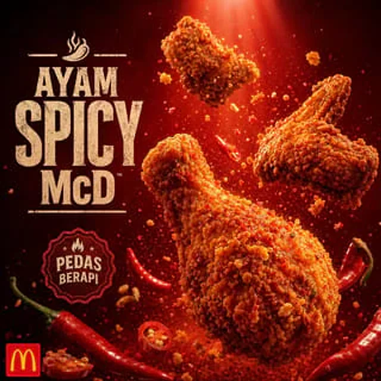

```text
A food advertisement with cinematic quality, the center of the image is a{argument name="container" default="Red and white striped paper fried chicken bucket"} It was filled with golden, crispy fried chicken nuggets, with a background of {argument name="background color" default="Dark red"} The scene is accompanied by dramatic studio lighting. A bucket of fried chicken sits in the center of the frame, overflowing with richly textured, golden-brown, crispy pieces that appear to be exploding and floating upwards. Scattered around the scene are {argument name="decorations" default="Bright red, pink and white confetti"} Tiny, golden-brown fried chicken crumbs scatter and float in all directions. The background is a rich, deep crimson, with a soft, warm spotlight shining through from above, creating a dramatic bokeh effect. Below, crumbs and scraps of paper are scattered on the surface, with subtle red reflections on the ground. Hyperrealistic commercial food photography, explosive celebratory energy, high-contrast dramatic lighting, shallow depth of field, flying debris with motion blur, 8K ultra-fine texture, vertical composition.
```

Model: GPT Image 2
Author: GPT Image 2 Prompts

[ProjectD](https://aitoolsradar.com/en/prompts/abf245e7a16b9a) · [Recorded source](https://x.com/meng_dagg695/status/2047542289841770847)
 · [Full original metadata and byte evidence](data/projectd-batch-0029.json)

## Explosive Japanese X Monetization Thumbnail


```text
Create a high-impact anime-style marketing thumbnail in Japanese for YouTube, in a 16:9 aspect ratio, filled with neon green energy effects, gold flashes, speed lines, lens flares, and heavy black shadows. The composition is split horizontally, with prominent promotional text on the left and center, and a cute chibi anime boy on the right, smiling warmly and pointing directly at the viewer. He has messy dark brown hair and vibrant {argument name="accent hair color" default="Neon Green"} The character has striking features: flowing hair, bright green eyes, slightly flushed cheeks, a black hoodie under a green-trimmed jacket, and an orange shirt underneath. The image utilizes glossy cel rendering, sharp outlines, high contrast, and exaggerated depth of field to create a thumbnail effect suitable for social media clicks. At the top is a curved red ribbon banner with a gold trim, featuring a gift box icon on the left; the banner contains the Japanese title text.{argument name="top banner text" default="10 Free Bonus Gifts"} Use bold white and yellow font. In the main area slightly to the left of center, place large 3D-style metallic gradient Japanese text: a huge gold "10", white "日で", a striking neon green "X", silver-white "益益化", and gold-orange "达到". The text content must correspond exactly.{argument name="main headline" default="Achieved monetization on X in 10 days"} Add an upward-pointing green arrow, a star-shaped flash, and an explosive light effect around the title. Add four floating platform-style icons around the title area: a pink social icon with a white heart, a blue dialog box icon with a white user silhouette, a tilted black smartphone displaying a white X logo, and a pile of coins (with a coin bearing a Japanese yen symbol in front). At the bottom, arrange three glowing green function boxes horizontally, each with a unique icon and Japanese text: Box 1 has a newbie marker icon and text.{argument name="feature text 1" default="Even beginners can easily monetize their content on X."} Box 2 features a clock icon and the text "One day, one hour of work, OK." Box 3 features a calendar icon and the text "Minimum 10 days to achieve monetization conditions." Add a large, glossy red, rounded-corner Call to Action (CTA) button with a white border and halo in the lower right corner, containing white Japanese text.{argument name="button text" default="Receive it now"} The button features a white play triangle to its right, with a click gesture cursor placed near the bottom right edge. The entire image should convey a sense of explosion and urgency, optimized for high click-through rates through saturated green, red, gold, black shadows, and metallic highlights.
```

Model: GPT Image 2
Author: GPT Image 2 Prompts

[ProjectD](https://aitoolsradar.com/en/prompts/9d2fff9d21ea83) · [Recorded source](https://x.com/mido_lucci/status/2046546991006802057#reversed-0)
 · [Full original metadata and byte evidence](data/projectd-batch-0029.json)

## Explosive Shonen Manga Cover

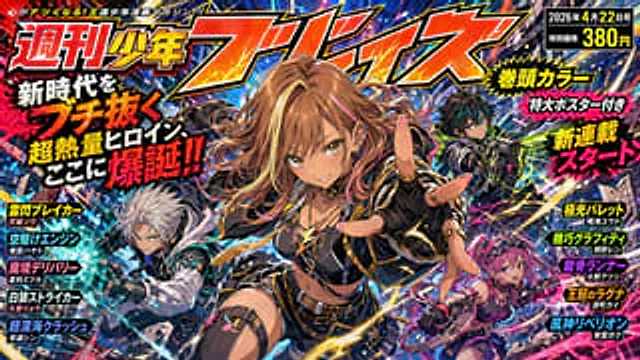

```text
Create an incredibly detailed cover for a Japanese weekly shonen manga magazine, featuring a full bleed design, an explosive and crowded visual, leaving no blank space. Employing a single-panel vertical composition, the cover illustration stacks typographic text, character art, dynamic effects, and a chaotic urban sci-fi feel. At the top is a large, stylized Japanese title in fiery orange-red with a heavy black outline and gold edges, spanning the entire page width; the text reads "Weekly Shonen Break," with a small 40th-anniversary celebration badge integrated into the title. A short Japanese slogan is added to the very top edge. A black magazine information box in the upper right corner, with bright yellow and white text, displays the date "April 22, 2026" and the price "Special Price 380 yen." The main image presents three anime characters in a dynamic triangular composition. In the center foreground, the main heroine charges towards the viewer with a strong perspective shortening effect, one hand reaching towards the camera, almost touching the screen. She is a teenage, gyaru-style action heroine with…{argument name="hair color" default="Light brown with pink highlights"} Her long, wavy hair flew wildly, her sharp, golden-brown eyes gleamed with a confident yet mischievous smile. She possessed a sun-kissed complexion, multiple earrings, and exuded a cool, rebellious street warrior aura. Her black and gold outfit comprised six key visible pieces: a cropped top, a short jacket with metallic trim, shorts, a belt with a dangling chain, a single leg strap, and fingerless gloves. Gold lightning bolt patterns and glossy highlights were added to the clothing. Yellow energy arcs and speed lines were drawn around her hands and body to emphasize impact. To her left in the mid-ground, a white-haired boy, dressed in a black and white futuristic combat suit, crouched in an attack stance, aiming a massive mechanical gauntlet or weapon at the viewer, surrounded by icy blue fragments and sharp, dynamic lines. To her right in the mid-ground, a pink-haired girl, with her hair in pigtails or tied up, wielded a circular bladed weapon, her movements accompanied by vibrant magenta energy trails. In the upper right background, a fourth visual focal point (not a main character) is added: a black-haired boy in a green-black combat suit, aiming diagonally at a glowing sci-fi rifle, partially obscured by text and effects, blending into the background action. The background is a neon-lit, futuristic Japanese nighttime city street, presented from a tilted perspective, featuring towering signs, fragments, sparks, broken debris, electrical stripes, and saturated blues, purples, pinks, and oranges. Extreme contrast, glossy print textures, ink splatter embellishments, a halftone manga magazine style, and high-end anime-style main visual rendering are employed. A striking large Japanese cover text is added to the left stacked blocks, using thick white, yellow, red, and black fonts, including the prominent title "A New Era is Born: A Super-Heat Heroine!!" Add 5 feature annotation boxes on the left, using colored rectangular boxes, with names in bold and subtitles below: Thunder Flash ブレイカー/天城ノア, 空駆けエンジン/南云ハヤト, 魔界デリバリー/ Kurashina Mirage, White Wolf Skylark/Kuse Rika, Super Deep Sea Skylark/Hayase Sky. Add five matching bold feature boxes to the right: Aurora Parette / Narumi Yuto, Kiki Gurafiti / Kono Rei, Ryukotsu Ranner / Hino Atsushi, Oukan no Ragna / Fukamachi Kai, Fuujin Riberion / Shinonome Gaku. Additionally, add three promotional tags to the right, using star-shaped or explosion-shaped tags with large yellow and white text: Header Color, Extra Large Poster Included, New Series Start. This gives the cover the feel of a major first issue of a new era of popular battle manga, full of energy, rebelliousness, dazzling, exquisite, and highly impactful characteristics of a Japanese manga magazine cover.
```

Model: GPT Image 2
Author: GPT Image 2 Prompts

[ProjectD](https://aitoolsradar.com/en/prompts/44e9360d6aa8c8) · [Recorded source](https://x.com/rascal8023/status/2046910563469664505#reversed-2)
 · [Full original metadata and byte evidence](data/projectd-batch-0029.json)

## Exquisite Relief Embroidery Illustration

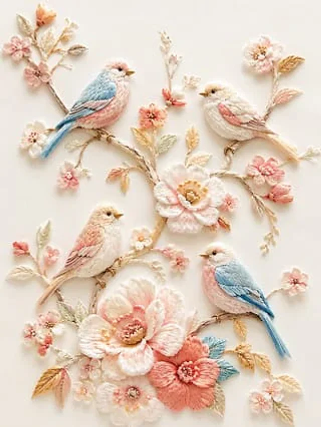

```text
精致立体刺绣风插画，浅浮雕纤维艺术效果，纯净「{argument name="底色" default="蚕丝白 + 奶白"}」底色，细腻丝线质感。画面为{argument name="主体" default="数只小鸟"}停在蜿蜒花枝上，周围点缀{argument name="点缀色" default="粉白、浅桃、珊瑚粉、淡金色"}花朵与叶片，构图轻盈雅致、留白充足。鸟儿羽毛以奶白、浅蓝、淡粉、浅金丝线刺绣表现，花枝纤细自然，花朵层层叠线，整体呈现高级手工刺绣、丝线堆绣、柔和光影、细节丰富、温柔清新的艺术效果。
```

Model: GPT Image 2
Author: 宝玉

[ProjectD](https://aitoolsradar.com/en/prompts/43e80e89a25794) · [Recorded source](https://youmind.com/prompts/relief-embroidery-bird-floral-16299)
 · [Full original metadata and byte evidence](data/projectd-batch-0029.json)

## Extreme Perspective Typography Bridge

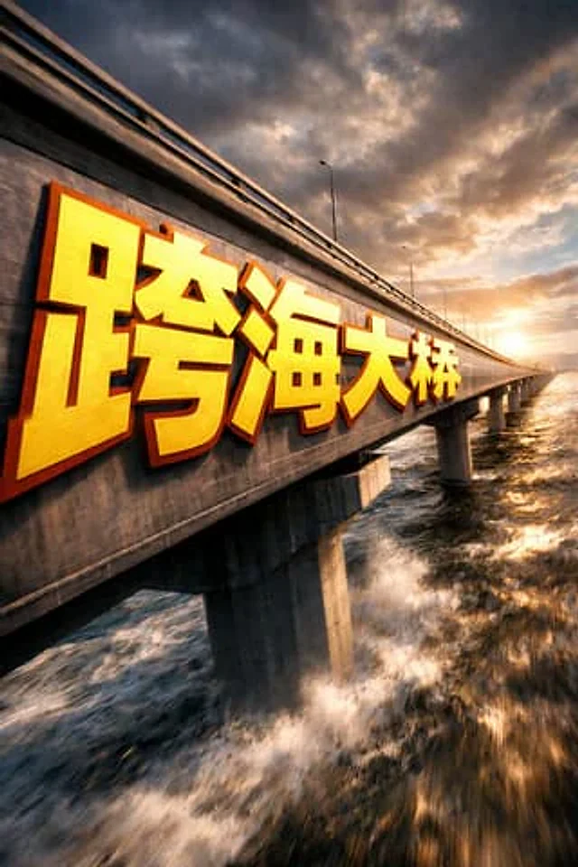

```text
①场景 跨海大桥的侧面，dramatic cinematic angle。 巨型 bold sans-serif 文字「___②文字内容 跨海大桥」painted onto the surface of ___③主体物 无，从靠近镜头的前端开始，沿表面向远端 progressively foreshortens 逐渐透视压缩，letterforms conform to surface curvature 贴合物体曲面，surface-integrated not floating。 文字部分区域被 无___④前景遮挡物 无___ occluded and hidden，在间隙中露出， 形成 depth-layering 纵深穿插效果。 Oversized bright yellow + sharp orange outline，extreme perspective distortion aligned to vanishing point。Cinematic lighting, motion blur, poster-grade dynamic integrated typography, modern advertising aesthetics。
```

Model: GPT Image 2
Author: @xpg0970

[ProjectD](https://aitoolsradar.com/en/prompts/5b58b0da2fbb06) · [Recorded source](https://x.com/xpg0970/status/2045560665071579160)
 · [Full original metadata and byte evidence](data/projectd-batch-0029.json)

## F1 Race Results Infographic

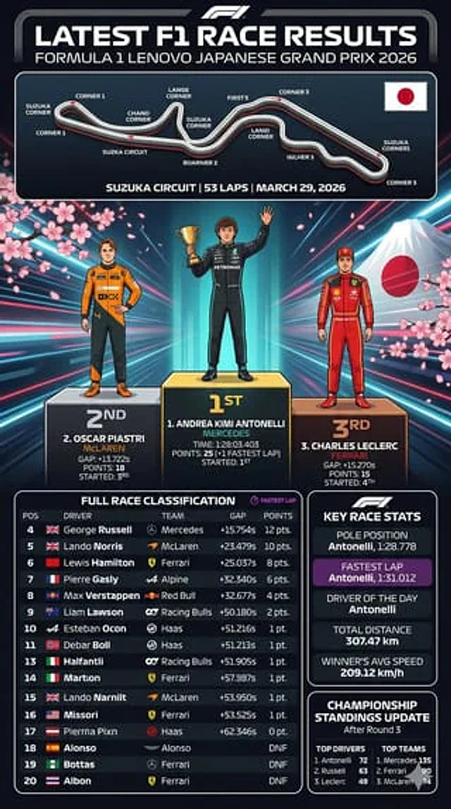

```text
{
  "type": "Sports Infographic",
  "theme": "F1 race results",
  "header": {
    "title": "Latest F1 race results",
    "subtitle": "{argument name=\"grand prix name\" default=\"2026 F1 Lenovo Japanese Grand Prix\"}"
  },
  "layout": {
    "sections": [
      {
        "title": "Track Map",
        "position": "top",
        "elements": [
          "Track layout with 11 marked corners",
          "Japanese flag",
          "Track details text:{argument name=\"track name\" default=\"Suzuka Circuit\"} | 53 laps | March 29, 2026"
        ]
      },
      {
        "title": "podium",
        "position": "Central",
        "background": "Mount Fuji, cherry blossoms, neon lights radiating outwards",
        "count": 3,
        "drivers": [
          {
            "position": "First place",
            "name": "{argument name=\"first place driver\" default=\"ANDREA KIMI ANTONELLI\"}",
            "team": "MERCEDES",
            "pose": "Holding a golden cup, waving in greeting",
            "suit": "black"
          },
          {
            "position": "Second place",
            "name": "{argument name=\"second place driver\" default=\"OSCAR PIASTRI\"}",
            "team": "McLAREN",
            "pose": "Hands on hips",
            "suit": "Orange and black"
          },
          {
            "position": "Third place",
            "name": "{argument name=\"third place driver\" default=\"CHARLES LECLERC\"}",
            "team": "FERRARI",
            "pose": "Stand upright",
            "suit": "red"
          }
        ]
      },
      {
        "title": "Full match rankings",
        "position": "Bottom left",
        "count": 17,
        "description": "The table contains 17 rows, showing the 4th to 20th places, with columns including position (POS), driver (DRIVER), team (TEAM), gap (GAP), and points (POINTS)."
      },
      {
        "title": "Key match data",
        "position": "upper right",
        "count": 5,
        "stats": [
          "pole position",
          "Fastest lap time (purple background)",
          "Driver of the Day",
          "Total Mileage",
          "average speed of the winner"
        ]
      },
      {
        "title": "Standings updated",
        "position": "bottom right",
        "columns": 2,
        "lists": [
          "Top three in the drivers' standings",
          "Top three in the team standings"
        ]
      }
    ]
  }
}
```

Model: GPT Image 2
Author: GPT Image 2 Prompts

[ProjectD](https://aitoolsradar.com/en/prompts/44a7516a6f53a6) · [Recorded source](https://x.com/darren_ter/status/2043731296065859698#reversed-1)
 · [Full original metadata and byte evidence](data/projectd-batch-0029.json)

## F1 Race Results Infographic Dashboard

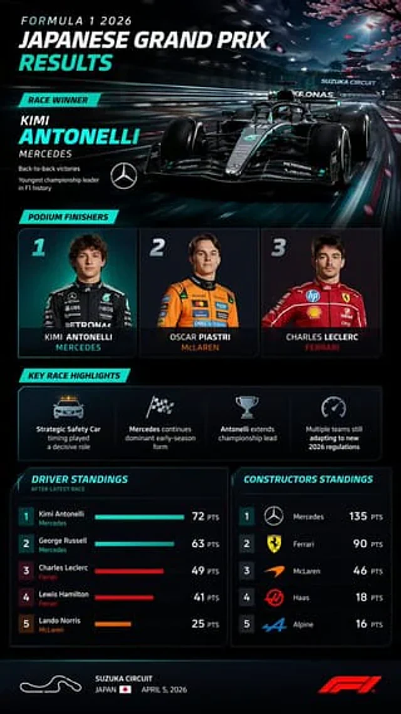

```text
{
  "type": "Sports broadcast infographic dashboard",
  "theme": "Dark mode, stylish, modern, with neon cyan accents, high-tech F1 graphics.",
  "header": {
    "title": "Formula One{argument name=\"year\" default=\"2026\"} Year{argument name=\"race name\" default=\"Japan Grand Prix\"} Match Results",
    "winner_callout": {
      "label": "winner of the competition",
      "driver": "{argument name=\"winner name\" default=\"KIMI ANTONELLI\"}",
      "team": "{argument name=\"winning team\" default=\"Mercedes\"}",
      "stats": [
        "Retained the championship",
        "The youngest points leader in F1 history"
      ],
      "logo": "Mercedes Star"
    },
    "background_image": "A stylish black and blue F1 race car speeds along the track, its motion blurred, against a backdrop of cherry blossoms and a Japanese pagoda, with the words 'SUZUKA CIRCUIT' written on the race track overhead."
  },
  "layout": {
    "sections": [
      {
        "title": "Podium athletes",
        "position": "Upper-middle",
        "count": 3,
        "labels": [
          "1 - Photo of a young male driver wearing a black Mercedes racing suit, Kimi Antonelli, Mercedes",
          "2 - Photo of a young male driver in an orange McLaren racing suit, OSCAR PIASTRI, McLaren",
          "3 - Photo of a young male driver in a red Ferrari racing suit, CHARLES LECLERC, Ferrari"
        ]
      },
      {
        "title": "Key Match Highlights",
        "position": "middle",
        "count": 4,
        "labels": [
          "Safety car icon: The strategic timing of the safety car played a decisive role.",
          "Checkered flag icon: Mercedes continues their dominance from the start of the season.",
          "Trophy icon: Antonelli extends his lead in the standings.",
          "Speedometer icon: Many teams are still adapting to the new regulations in 2026."
        ]
      },
      {
        "title": "Drivers' standings",
        "position": "Bottom left",
        "count": 5,
        "labels": [
          "1. Kimi Antonelli, Mercedes, 72 points",
          "2. George Russell, Mercedes, 63 points",
          "3 Charles Leclerc, Ferrari, 49 points",
          "4. Lewis Hamilton, Ferrari, 41 points",
          "5. Lando Norris, McLaren, 25 points"
        ],
        "visuals": "Horizontal bar chart showing each driver's team color"
      },
      {
        "title": "Team standings",
        "position": "Bottom right",
        "count": 5,
        "labels": [
          "1. Mercedes 135 points",
          "2 Ferrari 90 points",
          "3. McLaren 46 points",
          "4. Haas scored 18 points.",
          "5. Alpine 16 points"
        ],
        "visuals": "The team logo is displayed next to each ranking."
      }
    ]
  },
  "footer": {
    "content": "The white outline of the track layout{argument name=\"circuit name\" default=\"Suzuka Circuit\"} Japan and its flag, April 5, 2026, red F1 logo."
  }
}
```

Model: GPT Image 2
Author: GPT Image 2 Prompts

[ProjectD](https://aitoolsradar.com/en/prompts/2d8f5fb83f0797) · [Recorded source](https://x.com/darren_ter/status/2043731296065859698#reversed-0)
 · [Full original metadata and byte evidence](data/projectd-batch-0029.json)

## F1 直播转播围场截图

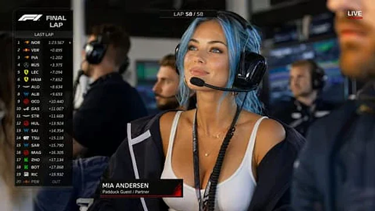

```text
Ultra-realistic F1 live TV broadcast screenshot. A strikingly beautiful, 25-year-old young woman with bright light blue hair and captivating bright cerulean blue eyes is sitting in the VIP paddock / team garage during a Formula 1 race. Shown on the official live race broadcast as the girlfriend of an F1 driver, she is listening to the team radio through a professional racing headset. It is the final lap, and she is watching the garage monitors with a proud, enchanting smile.
She wears a fitted white tank top, an oversized racing team jacket (with generic, unbranded or blank team logos) draped over her shoulders, large black team-radio headset with boom mic, gold jewelry, and soft glam makeup. A slim, unbranded paddock pass hangs naturally from her neck.
Add realistic F1 broadcast graphics: "FINAL LAP" banner, lap counter showing final lap, driver timing tower on the left, small F1-style logo bug, "LIVE" indicator, and a lower-third identifying her as a driver partner / paddock guest (e.g., "MIA ANDERSEN - Paddock Guest / Partner"). No fake oversized badges, no selfie angle.
Team staff (in generic kit), headsets, garage screens, and generic race equipment are blurred around her. Telephoto broadcast camera shot from across the garage, professional depth of field, compression artifacts, digital noise, bright paddock lighting, natural skin texture, no smoothing, 8k quality, cinematic lighting.
```

Model: GPT Image 2
Author: @bigwonbots

[ProjectD](https://aitoolsradar.com/en/prompts/b909c873cca176) · [Recorded source](https://x.com/bigwonbots/status/2054573714012787059)
 · [Full original metadata and byte evidence](data/projectd-batch-0029.json)

## F3 Wind Tunnel Aerodynamic Test

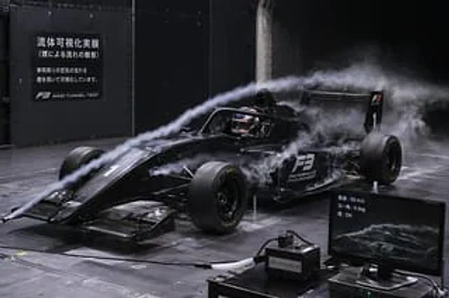

```text
A hyper-realistic, highly detailed image{argument name="vehicle type" default="Black Formula 3 racing car"} Images of aerodynamic testing in a wind tunnel. The race car bears "F3" and "FIA FORMULA 3 CHAMPIONSHIP" stickers and the number "1". A helmeted driver sits in the cockpit. Two distinct plumes of thick white smoke emerge from the left nozzle, following aerodynamic trajectories across the car's nose, halo, and sidepods. The scene is set in a dimly lit industrial wind tunnel with metal plate walls and a grid floor. On the dark wall in the upper left, a large black sign displays white text:{argument name="main sign text" default="Fluid Visualization Experiment (Observation of Flow Using Smoke): The airflow around a vehicle is visualized using smoke. F3 WIND TUNNEL TEST"} In the lower right foreground, there is a computer monitor displaying the smoke effect from the side of the race car, with the text on the screen reading:{argument name="monitor text" default="Wind speed: 50 m/s; Angle of travel: 0; Smoke: ON"} Next to the monitor was a black box with a flexible tube attached, labeled:{argument name="equipment label" default="スモークジェネレータ"} The dramatic, cinematic lighting accentuated the smoke trails and the race car's glossy paint.
```

Model: GPT Image 2
Author: GPT Image 2 Prompts

[ProjectD](https://aitoolsradar.com/en/prompts/efb6dcdadaecd9) · [Recorded source](https://x.com/firmament_VR/status/2044374236236849271#reversed-0)
 · [Full original metadata and byte evidence](data/projectd-batch-0029.json)

## Facebook 2030 Prediction


```text
{argument name="platform" default="Facebook"} exist{argument name="year" default="2030"} What does the annual meeting look like? Please show me a screenshot.
```

Model: GPT Image 2
Author: GPT Image 2 Prompts

[ProjectD](https://aitoolsradar.com/en/prompts/828a711e4eeffd) · [Recorded source](https://x.com/patrickassale/status/2044702349755920387)
 · [Full original metadata and byte evidence](data/projectd-batch-0029.json)

## FACS Expression Portrait Matrix

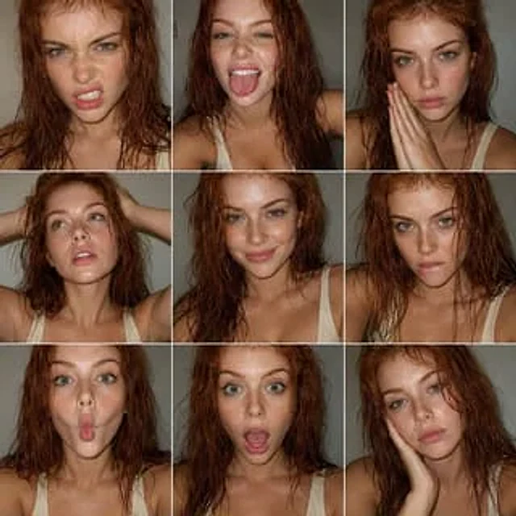

```text
{
  "objective": "Create a 3x3 portrait collage inspired by expressive fashion photography, using FACS (Facial Action Coding System) to define each facial expression. The subject is an {argument name="subject" default="extremely beautiful redhead woman with green eyes"}, captured in candid smartphone-style colored photography",
  "aspect_ratio": "1:1",
  "composition": {
    "layout": "3x3 grid (9 equal portraits)",
    "framing": "tight head-and-shoulders portraits",
    "style": "clean grid with minimal spacing, similar framing across all panels",
    "consistency": "same subject, same lighting, slight variation in pose and angle"
  },
  "subject": {
    "person": "adult woman",
    "appearance": {
      "hair": "natural red hair, slightly wet or textured",
      "eyes": "green eyes, highly expressive",
      "beauty": "extreme beauty, sharp yet soft features",
      "skin": "natural texture, not over-smoothed"
    },
    "outfit": {
      "top": "{argument name="outfit" default="low-cut cream tank top"}", 
      "style": "minimal, clean"
    }
  },
  "facs_expressions": [
    {
      "panel": 1,
      "action_units": ["AU4 (brow lowerer)", "AU9 (nose wrinkler)", "AU10 (upper lip raiser)"],
      "description": "slight snarl expression"
    },
    {
      "panel": 2,
      "action_units": ["AU25 (lips part)", "AU26 (jaw drop)", "AU19 (tongue show)"],
      "description": "playful tongue out"
    },
    {
      "panel": 3,
      "action_units": ["AU1 (inner brow raiser)", "AU2 (outer brow raiser)", "AU24 (lip pressor)"],
      "description": "soft serious look with hands together"
    },
    {
      "panel": 4,
      "action_units": ["AU5 (upper lid raiser)", "AU25 (lips part)"],
      "description": "relaxed upward gaze with hands in hair"
    },
    {
      "panel": 5,
      "action_units": ["AU12 (lip corner puller)", "AU6 (cheek raiser)"],
      "description": "subtle natural smile"
    },
    {
      "panel": 6,
      "action_units": ["AU4 (brow lowerer)", "AU10 (upper lip raiser)", "AU25 (lips part)"],
      "description": "intense biting lip expression"
    },
    {
      "panel": 7,
      "action_units": ["AU18 (lip pucker)", "AU22 (lip funneler)"],
      "description": "playful fish face"
    },
    {
      "panel": 8,
      "action_units": ["AU25 (lips part)", "AU26 (jaw drop)", "AU5 (upper lid raiser)"],
      "description": "surprised open-mouth expression"
    },
    {
      "panel": 9,
      "action_units": ["AU1 (inner brow raiser)", "AU15 (lip corner depressor)"],
      "description": "soft melancholic or tired expression with hand on face"
    }
  ],
  "visual_style": {
    "genre": "editorial portrait photography",
    "color": "full color (not black and white)",
    "quality": "smartphone candid",
    "texture": [
      "visible grain",
      "natural skin imperfections",
      "slight noise"
    ],
    "color_tone": "neutral to slightly warm tones"
  },
  "lighting": {
    "style": "direct flash or simple frontal lighting"
  }
}
```

Model: GPT Image 2
Author: Keskin

[ProjectD](https://aitoolsradar.com/en/prompts/a3426568084707) · [Recorded source](https://youmind.com/prompts/facs-facial-expression-portrait-grid-20210)
 · [Full original metadata and byte evidence](data/projectd-batch-0029.json)

## FACS Facial Expression Chart

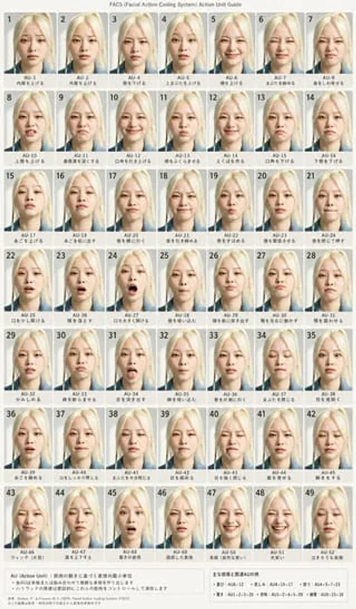

```text
ハリウッドで俳優の表情を示すAUコード(Face Action Units)とその表情一覧を{argument name="グリッド" default="7x7の49パターン"}一枚の画像にして。
```

Model: GPT Image 2
Author: eijo

[ProjectD](https://aitoolsradar.com/en/prompts/162448b2cbdee2) · [Recorded source](https://youmind.com/prompts/facs-facial-expression-chart-19074)
 · [Full original metadata and byte evidence](data/projectd-batch-0029.json)

## FACS Facial Expression Control

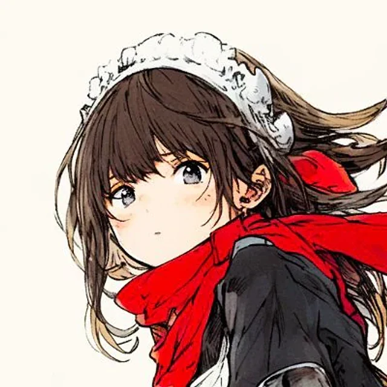

```text
表情変更 FACS AU46\n\n顔面動作符号化システム（FACS）一覧表\nFemale Character Reference Grid\n\n1. AU1 - Inner Brow Raiser（内眉を上げる）\n2. AU2 - Outer Brow Raiser（外眉を上げる）\n3. AU4 - Brow Lowerer（眉を下げる）\n4. AU5 - Upper Lid Raiser（上まぶたを上げる）\n5. AU6 - Cheek Raiser（頬を上げる）\n6. AU7 - Lid Tightener（まぶたを引き締める）\n7. AU9 - Nose Wrinkler（鼻にしわを寄せる）\n8. AU10 - Upper Lip Raiser（上唇を上げる）\n9. AU11 - Nasolabial Deepener（鼻唇溝を深める）\n10. AU12 - Lip Corner Puller（口角を引き上げる）\n11. AU13 - Sharp Lip Puller（口角を鋭く引く）\n12. AU14 - Dimpler（えくぼを作る）\n13. AU15 - Lip Corner Depressor（口角を下げる）\n14. AU16 - Lower Lip Depressor（下唇を下げる）\n15. AU17 - Chin Raiser（あごを上げる）\n16. AU18 - Lip Pucker（唇をすぼめる）\n17. AU20 - Lip Stretcher（唇を横に引き伸ばす）\n18. AU22 - Lip Funneler（唇を漏斗状にすぼめる）\n19. AU23 - Lip Tightener（唇を引き締める）\n20. AU24 - Lip Pressor（唇を押しつける）\n21. AU25 - Lips Part（唇を開く）\n22. AU26 - Jaw Drop（あごを下げる）\n23. AU27 - Mouth Stretch（口を大きく開く）\n24. AU28 - Lip Suck（唇を吸い込む）\n25. AU41 - Lid Droop（まぶたを垂らす）\n26. AU42 - Slit Eyes（目を細める）\n27. AU43 - Eyes Closed（目を閉じる）\n28. AU44 - Squint（しかめ目・目をすぼめる）\n29. AU45 - Blink（まばたき）\n30. AU46 - Wink（ウインク）\n31. AU51 - Head Turn Left（頭を左に向ける）\n32. AU52 - Head Turn Right（頭を右に向ける）\n33. AU53 - Head Up（頭を上げる）\n34. AU54 - Head Down（頭を下げる）\n35. AU55 - Head Tilt Left（頭を左に傾ける）\n36. AU56 - Head Tilt Right（頭を右に傾ける）\n37. AU57 - Head Forward（頭を前に出す）\n38. AU58 - Head Back（頭を後ろに引く）\n39. AU61 - Eyes Turn Left（目線を左に向ける）\n40. AU62 - Eyes Turn Right（目線を右に向ける）\n41. AU63 - Eyes Up（目線を上に向ける）\n42. AU64 - Eyes Down（目線を下に向ける）\n43. AU71 - Brow Furrow（眉間にしわを寄せる）\n44. AU72 - Brow Bulge（眉を盛り上げる）\n45. AU81 - Chewing（噛む動作）\n46. AU82 - Nostril Dilator（鼻孔を広げる）\n47. AU83 - Nostril Compressor（鼻孔を狭める）\n48. AU84 - Tongue Up（舌を上げる）\n49. AU85 - Tongue Out（舌を出す）
```

Model: GPT Image 2
Author: ぐふとくく

[ProjectD](https://aitoolsradar.com/en/prompts/a691db047d248d) · [Recorded source](https://youmind.com/prompts/facs-facial-expression-modification-19275)
 · [Full original metadata and byte evidence](data/projectd-batch-0029.json)

## Fake Apple CEO Announcement Poster


```text
A minimalist, photorealistic Apple tech announcement poster, presented in a 4:5 vertical aspect ratio, features a deep navy blue background fading towards the horizon at dusk or night. In the foreground, the upper body of a middle-aged East Asian man stands confidently in front of the curved glass building of Apple Park, wearing a minimalist black shirt over a black undershirt. His face is primarily forward and slightly turned, with short black hair and thin-rimmed dark glasses, presenting a serious corporate portrait style. Behind and to his right, a large, illuminated white Apple logo floats in the air. At the top center is a smaller white Apple logo, below which is the elegant, delicate sans-serif Chinese slogan: "Apple's New Chapter Begins Here." In the upper right corner, prominent red Chinese text reads: "AI Generated." In the upper center area, a large, bold white Chinese headline reads: "Luo Yonghao Takes Over as Apple CEO." Directly below this, a line of white, spaced-out Chinese slogan is added: "With Craftsmanship, Let the World Amaze Again." In the left-center area, a dark text quote block with an oversized left quotation mark is added, stating: "I'm not here to change Apple, but to let Apple rediscover the courage to change the world." Below this is a handwritten signature, "Luo Yonghao." A semi-transparent dark function bar is horizontally overlaid in the lower center, containing four columns of text and images with thin white-lined icons: 1) Hammer icon, titled "Craftsmanship Spirit," subtitle "Ultimate Product Philosophy"; 2) Bubble icon, titled "User First," subtitle "Detail-Oriented Experience"; 3) Light bulb icon, titled "Innovation-Driven," subtitle "Redefining the Future"; 4) Heart-shaped icon, titled "Sincere Communication," subtitle "Building Technology for People." At the bottom center, large white English text is added: "Think Different. Think Again." Below this is smaller Chinese text: "Now, it's up to Luo Yonghao." A handwritten signature is again attached below this. The design employs high-end tech launch poster aesthetics: cinematic soft lighting, architectural reflections, high contrast, clean typography, high-quality Apple-style brand visuals, and a refined commercial realism.
```

Model: GPT Image 2
Author: GPT Image 2 Prompts

[ProjectD](https://aitoolsradar.com/en/prompts/cb4a8d250400ce) · [Recorded source](https://x.com/0xJoveXu/status/2047145057980203411#reversed-1)
 · [Full original metadata and byte evidence](data/projectd-batch-0029.json)

## Fake CEO Announcement Post Screenshot

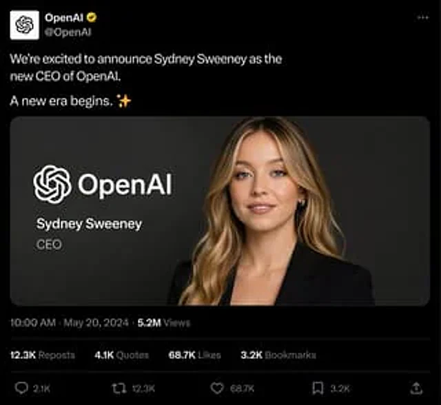

```text
Generate a screenshot of a post published by OpenAI on X, announcing {argument name="celebrity" default="Sydney Sweeney"} Become their new leader{argument name="role" default="CEO"}
```

Model: GPT Image 2
Author: GPT Image 2 Prompts

[ProjectD](https://aitoolsradar.com/en/prompts/e7b076ecd22b60) · [Recorded source](https://x.com/Sridharan97/status/2046669913029566602)
 · [Full original metadata and byte evidence](data/projectd-batch-0029.json)

## Fake Douyin Lao Gan Ma Livestream Screenshot

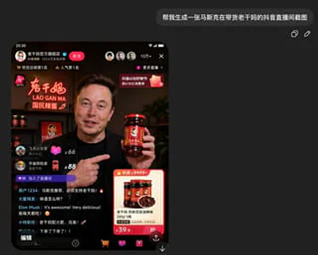

```text
A realistic mobile screenshot model of a Chinese short video live-streaming e-commerce interface in dark mode, with a charcoal black background. In the upper right corner of the canvas, a rounded dark chat bubble containing Chinese text is placed.{argument name="request text" default="Please generate a screenshot of Elon Musk promoting Lao Gan Ma on Douyin."} The right side features two small interface icons for copying and editing. In the lower left corner, an iPhone-style live stream screen with a black border and rounded corners is displayed, showing the time as 20:30. The live stream is from the Laoganma official flagship store, including a Chinese profile name, a blue certification badge, a red follow button, and a status bar at the top displaying three circular avatars, 100,000+ viewers, a close icon, and a "More Live Streams" button. Ranking text such as "No. 1 in Overall Sales Ranking" and "No. 1 in Popularity" is added near the top. The main video screen displays {argument name="host identity" default="Elon Musk"} In a dimly lit, warm-toned studio resembling a high-end product livestream, a man in a black shirt holds a large bottle of Lao Gan Ma chili sauce in his right hand and points to it with his left. His face is blurred with rectangular mosaics. Behind him is a neon sign emitting a reddish-orange glow that reads "Lao Gan Ma / National Chili Sauce," several bottles of the sauce are displayed on a shelf, a framed portrait logo is shown, and a dark-leaved plant is on the right. Typical livestream UI elements are overlaid: on the left, there are two floating gift/comment bubbles with usernames and x66 and x88 counts; below is a purple capsule-shaped icon displaying 35 and "Joined the Livestream." A scrolling comment section with five lines of visible chat history is added, including Chinese usernames and a line from {argument name="comment name" default="Elon Musk"} The English review reads, "It's awesome! Very delicious!", followed by a Chinese review stating that he buys it every day. In the upper right corner of the video area, a pink promotional banner mentions "Douyin 618 Shopping Festival" and "618 Yuan Coupon." In the lower right corner, a product card with the tag "Hot Selling x9999+" showcases three bottles of Lao Gan Ma chili sauce and a bowl of chili seasoning, titled "Lao Gan Ma Flavored Black Bean Chili Oil 280g*3 Bottles," with a small guarantee label, a large price of ¥39.9, and a red buy button. At the bottom of the phone screen, there are five navigation/operation areas: an edit-style button on the left, text input prompts, a shopping cart icon, a pair of heart/gift icons, and a share arrow icon. Overall style: ultra-realistic app screenshots, believable Chinese e-commerce live-streaming UI, high detail, cinematic warm lighting in the video stream, a clean and modern mobile interface, and visually convincing social e-commerce screenshots.
```

Model: GPT Image 2
Author: GPT Image 2 Prompts

[ProjectD](https://aitoolsradar.com/en/prompts/5f0d65449bf62a) · [Recorded source](https://x.com/marslipu/status/2046604182359327055#reversed-2)
 · [Full original metadata and byte evidence](data/projectd-batch-0029.json)

## Fake Japanese Newspaper in ChatGPT UI

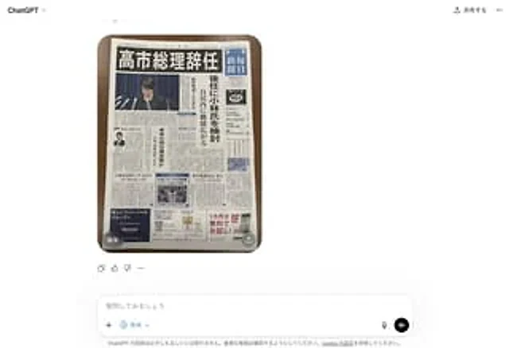

```text
A realistic screenshot of the ChatGPT Japanese web version on a smartphone, against a clean white background. In the center of the chat interface is a generated image: a photo taken from directly above showing a Japanese newspaper neatly arranged on a dark wooden table, its rounded edges visible. The newspaper dominates the image, looking incredibly realistic, like a fictional yet convincing breaking news front page. The masthead area is compact and traditional, with a striking black bold Japanese headline at the top: "Premier Takaichi Resigns." Below is a large main image showing a politician on a press conference podium, with multiple microphones in front of him; his face is deliberately blurred or obscured against a dark blue backdrop. To the right is a vertical blue newspaper name bar with white Japanese text reminiscent of mainstream national daily newspapers. Next to the main image is a vertical column of Japanese subheadings, hinting at discussions about potential successors. The front page features four clearly visible advertising blocks at the bottom and lower sides, a small portrait of a man in a suit on the left side of the article, a sports news image block in the center below, and a weather or data box on the right. The entire page is filled with dense Japanese text. The newspaper should present a realistic and serious editorial style, with a realistic print quality, slight paper curl, subtle shadows, and believable Japanese typography. Visible ChatGPT UI elements should surround the images: "ChatGPT" in the upper left corner, a Japanese sharing control in the upper right corner, a small circular overlay button labeled "Edit" in the lower left corner of the image, a small share icon in the lower right corner of the image, reaction/action icons below the image, and an input bar at the bottom containing the Japanese placeholder text "质問してみましょう" (What are you asking?) as well as microphone and voice buttons. Overall style: photorealistic screenshots, modern web application interface, fake news newspaper front page, clear and easy-to-read layout, natural lighting and shadows, and minimal perspective distortion.
```

Model: GPT Image 2
Author: GPT Image 2 Prompts

[ProjectD](https://aitoolsradar.com/en/prompts/4b36ac9ff3df75) · [Recorded source](https://x.com/kajikent/status/2046743809019793737#reversed-0)
 · [Full original metadata and byte evidence](data/projectd-batch-0029.json)

## Fan Photo with Cristiano Ronaldo

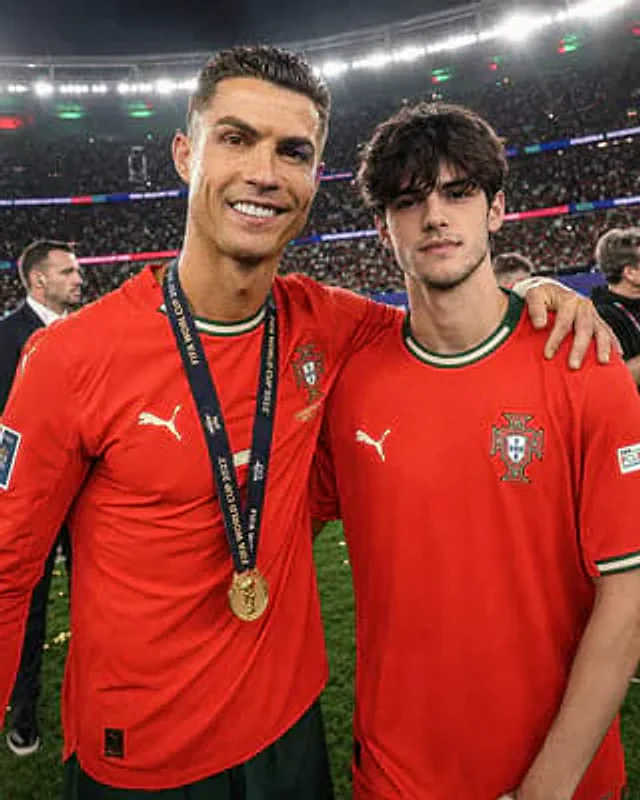

```text
Use the uploaded image as the ONLY facial identity reference with STRICT identity preservation enabled at maximum strength. Do not modify, beautify, reshape, or regenerate my facial structure. Preserve my exact eyes, nose, jawline, smile shape, skin tone, hairline, hairstyle, facial proportions, and overall identity exactly as in the reference image.

Create an ultra-realistic high-quality photo of me standing beside {argument name="celebrity" default="Cristiano Ronaldo"} on a football stadium field at night after a World Cup match celebration. {argument name="celebrity" default="Ronaldo"} is wearing the official {argument name="team jersey" default="Portugal 2026 FIFA World Cup jersey"}. I am also wearing a matching Portugal jersey. {argument name="celebrity" default="Ronaldo"} has his arm around my shoulder in a friendly celebratory pose while smiling naturally at the camera. Make me smirk confidently and genuinely while still preserving my exact facial features and identity.

The image should feel like a real post-match stadium photograph captured by a professional sports photographer. Include realistic stadium floodlights, blurred cheering crowd in the background, cinematic sports atmosphere, authentic skin texture, natural lighting, realistic fabric details, subtle depth of field, and ultra-detailed 4K realism.

Keep the composition natural and believable like a real fan moment with {argument name="celebrity" default="Cristiano Ronaldo"}. No cartoonish AI look, no face distortion, no excessive sharpening, no unrealistic symmetry. Maintain documentary-style realism with accurate proportions and authentic emotions.
```

Model: GPT Image 2
Author: Harboris

[ProjectD](https://aitoolsradar.com/en/prompts/7d67ef8202cd58) · [Recorded source](https://youmind.com/prompts/football-stadium-fan-photo-25612)
 · [Full original metadata and byte evidence](data/projectd-batch-0029.json)

## Fantasy Anime Album Website UI

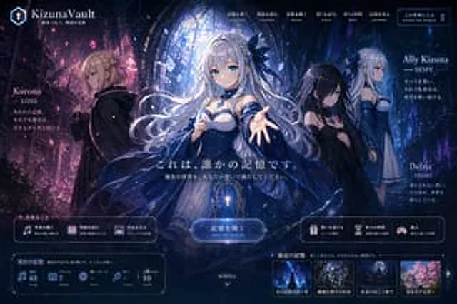

```text
{
  "type": "Fantasy Anime Music Project Landing Page Model",
  "style": "A gorgeous dark fantasy visual novel-style web UI, a glowing church interior, a crystal magic atmosphere, exquisite key visuals suitable for narrative-driven ebook websites, high-detail anime-style artwork, cinematic lighting and shadows, blue-purple halos, layered semi-transparent interface panels, elegant serif fonts, and a mysterious and emotionally resonant tone.",
  "brand": {
    "name": "{argument name=\"brand name\" default=\"KizunaVault\"}",
    "tagline": "A treasure trove of stories that connect bonds"
  },
  "scene": {
    "location": "The enormous Gothic cathedral hall is filled with stained glass, crystal fragments, luminous particles, arches, floating points of light, and magical reflections.",
    "background_colors": [
      "Deep Navy Blue",
      "indigo",
      "Violet",
      "Magenta accents",
      "Silver Moonlight"
    ],
    "centerpiece": "A silver-haired anime heroine, dressed in an exquisite midnight blue and white gown, extends a hand to the audience, standing beneath a radiant stained-glass window. Her long hair flows freely, adorned with blue flower hair accessories and shimmering gemstone jewelry, her layered skirt flaring outwards."
  },
  "characters": {
    "count": 4,
    "items": [
      {
        "name": "{argument name=\"left character name\" default=\"Kurona\"}",
        "theme_word": "Loss",
        "position": "Leftmost",
        "appearance": "Short blonde hair, a side bun adorned with pink flowers, a black hooded cape with pink trim, turned to the left, a melancholic expression, surrounded by pink and deep red crystal light.",
        "text": "Lost memories. Yet she continues walking, weeping."
      },
      {
        "name": "The female lead in the center",
        "theme_word": "Main visual",
        "position": "Central Prospect",
        "appearance": "Long silver hair, a blue and white dress with a corseted bodice, split sleeves, a gemstone necklace, and a hand outstretched towards the camera—she was radiant and captivating."
      },
      {
        "name": "{argument name=\"right upper character name\" default=\"Ally Kizuna\"}",
        "theme_word": "hope",
        "position": "Top right corner",
        "appearance": "Silver hair, a blue dress, an elegant profile, a blue flower hair accessory, and a calm yet hopeful aura.",
        "text": "With everything weighing on her mind, she continues to sing of hope."
      },
      {
        "name": "{argument name=\"right lower character name\" default=\"Delna\"}",
        "theme_word": "desire",
        "position": "Middle right",
        "appearance": "Long black hair, a black gothic suit, a reserved posture, one hand near her chest, a mysterious presence shrouded in shadow.",
        "text": "Unfulfilled desires. That flame is shaking the world."
      }
    ]
  },
  "layout": {
    "header": {
      "position": "top",
      "count": 8,
      "items": [
        "Logo in the top left corner",
        "Memory Activation / EXPLORE",
        "Reading Stories",
        "Listen to music / MUSIC",
        "Sending my thoughts / PIECE",
        "Prayer Time",
        "View Memory/ MEMORY",
        "Enter the world / Click the ENTER THE WORLD button in the upper right corner"
      ]
    },
    "hero_text": {
      "position": "The upper part of the skirt is slightly below the center.",
      "count": 2,
      "items": [
        "This is someone's memory.",
        "Please fill her world with your longing."
      ]
    },
    "feature_boxes": {
      "position": "Middle, lower left and right sides",
      "count": 6,
      "items": [
        "Listen to music",
        "Reading stories",
        "View works",
        "Sending thoughts",
        "Prayer time",
        "play"
      ]
    },
    "stats_panel": {
      "position": "bottom left corner",
      "title": "Current memory",
      "count": 5,
      "items": [
        "63 Songs",
        "Album 7",
        "Pieces of Longing",
        "Prayers",
        "Memory Fragments 10 Levels"
      ]
    },
    "recent_memories": {
      "position": "bottom right corner",
      "title": "Recent Memories",
      "count": 4,
      "items": [
        "Streets surrounding the memory of the stars",
        "Conventions of mechanical devices",
        "Beyond the End",
        "To you who are saying goodbye to spring"
      ]
    },
    "center_button": {
      "position": "The female lead's bottom center",
      "count": 1,
      "items": [
        "Open the memory"
      ]
    },
    "scroll_indicator": {
      "position": "Bottom center",
      "count": 1,
      "items": [
        "Scroll/scROLL with down arrow"
      ]
    }
  },
  "composition": "The symmetrical landing page centers on the female protagonist, flanked by one person on her left and two others on her right. All elements blend into an immersive magical church background, with the UI panel featuring a soft glow at the top and bottom edges.",
  "rendering": "High-resolution concept art suitable for premium website homepages, crisp interface overlays, dramatic depth of field, and a fantastical game and album promotion aesthetic."
}
```

Model: GPT Image 2
Author: GPT Image 2 Prompts

[ProjectD](https://aitoolsradar.com/en/prompts/ccd21efbf3c715) · [Recorded source](https://x.com/Naoya_Hishida/status/2047724073833414927#reversed-0)
 · [Full original metadata and byte evidence](data/projectd-batch-0029.json)

## Fantasy Anime Character Poster

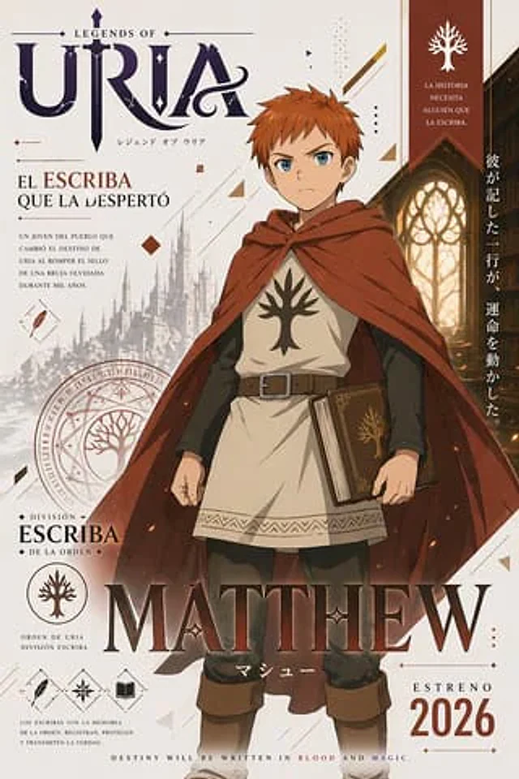

```text
A dramatic fantasy anime poster, employing a clean, vertical single-page layout, is used for the fictional series *LEGENDS OF URIA*. The elegant, high-contrast design features a parchment-white background with a deep indigo title font accented by warm copper and rust red. A full-body portrait of a heroic character is centrally displayed. The large, stylized text "LEGENDS OF URIA," incorporating sword elements, sits in the upper left corner, below which is a smaller Japanese subtitle. The protagonist is a young male fantasy scribe, standing directly in the center of the image. His face is deliberately obscured by a flat, blurred square block. He has short, messy orange hair, fair skin, and a resolute posture. He wears a cream-colored tunic with a black World Tree emblem on the chest, over which he wears black long-sleeved shirts, dark trousers, wide-cut brown boots, and a brown belt with rectangular buckles. A large, rust-red hooded cloak draped over his shoulders, flowing around his body. He holds a thick, dark brown book in his right hand, with gold details on the corners and a gold tree-shaped emblem on the cover. Behind him, a pale, gray-toned fantasy city merges, with a cathedral-like tower on the left and a glowing Gothic stained-glass archway interior on the right. A few floating ember particles and minimalist geometric decorations in gold, rust, and indigo are added around the pages. On the left, a large serif Spanish title is added: “EL ESCRIBA QUE LA DESPERTÓ”, followed by a smaller introductory text in Spanish. Also included are a circular magic mark with a tree symbol, a departmental emblem piece that reads “DIVISIÓN ESCRIBA DE LA ORDEN”, a circular tree coat of arms, three small icon badges near the lower left corner, and a brief Spanish backstory. On the right edge, a tall, vertical red banner is added with a white tree symbol and the Spanish text “LA HISTORIA NECESITA ALGUIEN QUE LA ESCRIBA.”, next to a white vertical Japanese phrase. At the bottom center, a large, metallic serif character name is placed:{argument name="character name" default="MATTHEW"} Below this is a small Japanese translation. In the bottom right corner, add the posting text "ESTRENO".{argument name="release year" default="2026"} Add the English slogan "DESTINY WILL BE WRITTEN IN BLOOD AND MAGIC" along the bottom edge. The overall style should present a sophisticated, cinematic animation poster feel, featuring the style of a fantasy publishing brand, gorgeous typography, a symbolic World Tree icon, warm magical lighting, and high-quality key visual art.
```

Model: GPT Image 2
Author: GPT Image 2 Prompts

[ProjectD](https://aitoolsradar.com/en/prompts/9e65b74f5302ad) · [Recorded source](https://x.com/Lorhanstudios/status/2047624150907257191#reversed-1)
 · [Full original metadata and byte evidence](data/projectd-batch-0029.json)

## Fantasy Anime Key Visual Prompt

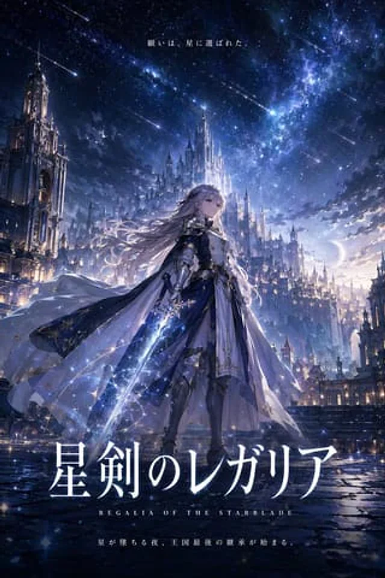

```text
Create an information about{argument name="genre" default="classic fantasy"} And with{argument name="theme" default="star"} Anime main visual with the theme
```

Model: GPT Image 2
Author: GPT Image 2 Prompts

[ProjectD](https://aitoolsradar.com/en/prompts/3882d51cd5e4cd) · [Recorded source](https://x.com/kotsu_kotsu_san/status/2044920973028430089)
 · [Full original metadata and byte evidence](data/projectd-batch-0029.json)

## Fantasy Anime Knight Movie Poster


```text
A cinematic, anime-style fantasy movie poster features a female knight standing in a cobblestone courtyard. She has flowing hair {argument name="hair color" default="silver"} She has long hair, wears magnificent white and blue armor adorned with gold accents, and drapes a long, flowing white cloak printed with star patterns. She wields a luminous magic sword that points downwards, radiating bright blue starlight and magical particles. The background is a stunning and richly detailed Gothic fantasy castle and a nighttime cityscape. The night sky is magnificent, filled with a luminous Milky Way, a crescent moon, and countless shooting stars. The lighting effects are dramatic and ethereal, and the glowing sword illuminates the cobblestones beneath her feet. At the very top center, there is a line of elegant Japanese text:{argument name="top catchphrase" default="Your wish was chosen by the stars."} At the bottom third of the image, there is a striking and elegant Japanese title:{argument name="main title" default="Star Sword Regalia"} Below the main title is a smaller English subtitle:{argument name="english subtitle" default="REGALIA OF THE STARBLADE"} At the very bottom, there is a line of small Japanese text:{argument name="bottom tagline" default="On the night the stars fall, the final succession of the kingdom begins."} ".
```

Model: GPT Image 2
Author: GPT Image 2 Prompts

[ProjectD](https://aitoolsradar.com/en/prompts/a86ab761e4ee8d) · [Recorded source](https://x.com/kotsu_kotsu_san/status/2045377402466107398#reversed-3)
 · [Full original metadata and byte evidence](data/projectd-batch-0029.json)

## Fantasy Anime Witch Movie Poster

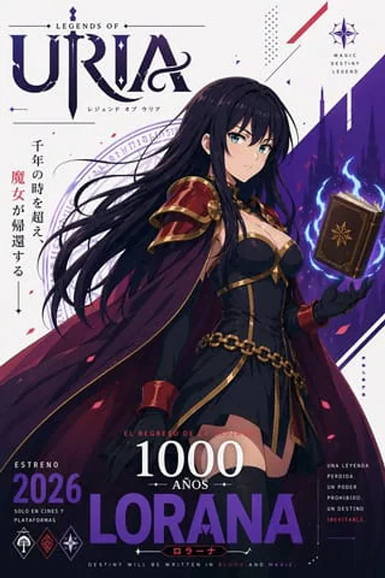

```text
Create a dramatic, vertical fantasy animated film poster with the theme of{argument name="franchise title" default="LEGENDS OF URIA"} The design features a clean white background, striking royal purple graphic accents, and a high-end cinematic visual style. The central figure is {argument name="character name" default="LORANA"} A tall, elegant dark witch is depicted in a heroic three-quarter profile, her face slightly turned to the right, partly obscured by her flowing, long black hair. She possesses extremely long hair that billows to the left in the wind, her skin pale, exuding a confident yet mysterious aura, dressed in dark witch attire. Her outfit consists of a fitted black mini-skirt with structured gold trim, a heart-shaped bodice, long black gloves, black knee-high stockings, a heavy gold chain belt hanging from her waist, and a large, deep-red cloak lined with dark purple. She wears ornate red metallic shoulder armor with gold trim and matching red bracers. Her raised right hand floats an ancient brown spellbook with gold-edged details and an octagonal star emblem, surrounded by vibrant blue magical flames and luminous energy. Behind her, to her right, lies a diagonal purple panel, with silhouettes of Gothic spires and castles faintly visible in the background, and subtle circular magic circles emanating from her hair and shoulders. The image incorporates falling red petals, delicate black decorative lines, tiny diamond icons, clusters of dotted textures, and sharply defined red-purple motion graphics to create a modern fantasy poster layout. A large, stylized title text is located in the upper left corner.{argument name="series logo text" default="URIA"} The film uses a gorgeous serif fantasy font, with the smaller text "LEGENDS OF" at the top and the Japanese subtitle "レジェンドオブウリア" at the bottom. A vertical Japanese slogan is added to the left: "千年の時を超え、魔女が帰還する," with the word "魔女" highlighted in red. The upper right corner features a compass-like emblem and stacked small text "MAGIC DESTINY LEGEND." Layered Spanish and English release information is added to the bottom center: a line of red text "EL REGRESO DE LA BRUJA," and a large white number.{argument name="year count text" default="1000"} A small white word "AÑOS" and a large purple character name.{argument name="main name text" default="LORANA"} Below is a small red katakana tag, “ローラーナ”. The lower left corner contains a release information block with “ESTRENO 2026” and smaller text, “SOLO EN CINES Y PLATAFORMAS,” along with three small fantasy faction-style badges. The lower right corner contains a stacked five-line slogan block: “UNA LEYENDA,” “PERDIDA.”, “UN PODER,” “PROHIBIDO.”, “UN DESTINO,” and “INEVITABLE.” At the very bottom center is the text: “DESTINY WILL BE WRITTEN IN BLOOD AND MAGIC.” The use of high-detail anime illustrations, glossy shadows, elegant fantasy poster composition, strong contrast, and a luxurious color scheme of deep red, black, gold, and purple creates a sophisticated atmosphere for the upcoming theatrical release.
```

Model: GPT Image 2
Author: GPT Image 2 Prompts

[ProjectD](https://aitoolsradar.com/en/prompts/53702a7f36aa61) · [Recorded source](https://x.com/Lorhanstudios/status/2047624150907257191#reversed-0)
 · [Full original metadata and byte evidence](data/projectd-batch-0029.json)

## Fantasy Campfire Before a Crimson Mountain

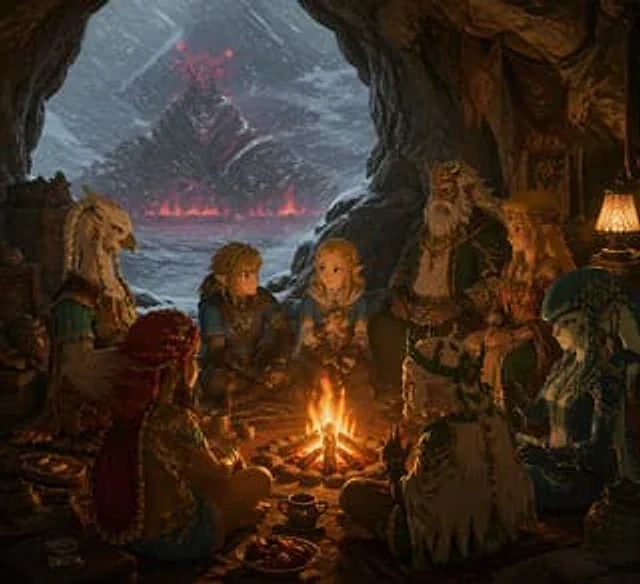

```text
This is a cinematic fantasy scene depicting the interior of a cave during a blizzard. Slightly above the campfire, eight characters sit in a circle. Outside the cave entrance, a massive, dark mountain rises amidst the snowstorm, shaped like a menacing pyramid or volcanic fortress. Crimson and magenta light emanates from its fissures, and its summit glows with branching, ember-like red energy. A ring of lava or flames encircles the base of the icy landscape. Inside, the cave is warm, amber-colored, and intimate, illuminated by the campfire and a magnificent oil lamp on the right, contrasting sharply with the cold, blue-grey storm outside. This group appears to be a high-level fantasy adventure party taking a break: on the left is a noble bird-man with white feathers, a hooked beak, woven feather ornaments, and layers of tribal jewelry; to the left front is a woman with long braided red hair, dressed in magnificent fantasy attire; to the left center sits a young elven traveler; in the center is a petite blonde elven girl with pointed ears and clasped hands; to the right is an elderly king with long white hair and a thick beard, wearing a crown and a dark green robe with gold embellishments; beside him is an elegant blonde noblewoman in an embroidered dress; to the right front is a white-haired figure, mostly seen from behind, dressed in feathered or fur-trimmed clothing; to the far right is a blue-skinned aquatic woman wearing a fin-shaped headdress, adorned with exquisite jewelry, and holding a cup. Cups, bowls, plates, sleeping bags, bags, and travel gear are scattered around the cave edge. The composition frames the eerie, glowing mountain behind the group through the cave entrance, emphasizing the contrast between the camaraderie within the sanctuary and the impending apocalyptic crisis outside. Ultra-fine textures, realistic fabric and skin feel, dramatic volumetric firelight, snowflakes dancing in the wind, melancholic dark fantasy color grading, oil painting realism style, epic movie still atmosphere, high contrast, rich shadows, master-level quality.
```

Model: GPT Image 2
Author: GPT Image 2 Prompts

[ProjectD](https://aitoolsradar.com/en/prompts/b5300220a0285d) · [Recorded source](https://x.com/0xthrust/status/2046604013274386643#reversed-0)
 · [Full original metadata and byte evidence](data/projectd-batch-0029.json)

## Fantasy Coastal City Landscape


```text
A stunning{argument name="setting" default="Fantasy Coastal City"} Panoramic view. The main subject of the image is a {argument name="prominent landmark" default="A large stone castle on the mountaintop"} Overlooking the azure ocean, the castle overlooks a bustling town.{argument name="architecture style" default="European half-timber houses"} Brown rooftops are nestled among lush trees and palm groves. A clear, turquoise river meanders through the town center, its banks lined with stone piers, sandy beaches, and small wooden boats. In the distance, several large sailboats navigate the deep blue sea. The sky is a clear, azure, dotted with fluffy white clouds, presenting {argument name="time of day" default="Bright and sunny day"} The overall aesthetic style is {argument name="art style" default="Highly detailed digital illustrations, classic RPG concept art."} The colors are vibrant and the architectural details are intricate.
```

Model: GPT Image 2
Author: GPT Image 2 Prompts

[ProjectD](https://aitoolsradar.com/en/prompts/105539cb2883e5) · [Recorded source](https://x.com/qyouzoom/status/2045473168803115376#reversed-0)
 · [Full original metadata and byte evidence](data/projectd-batch-0029.json)

## Fantasy Druid Half-Body Portrait

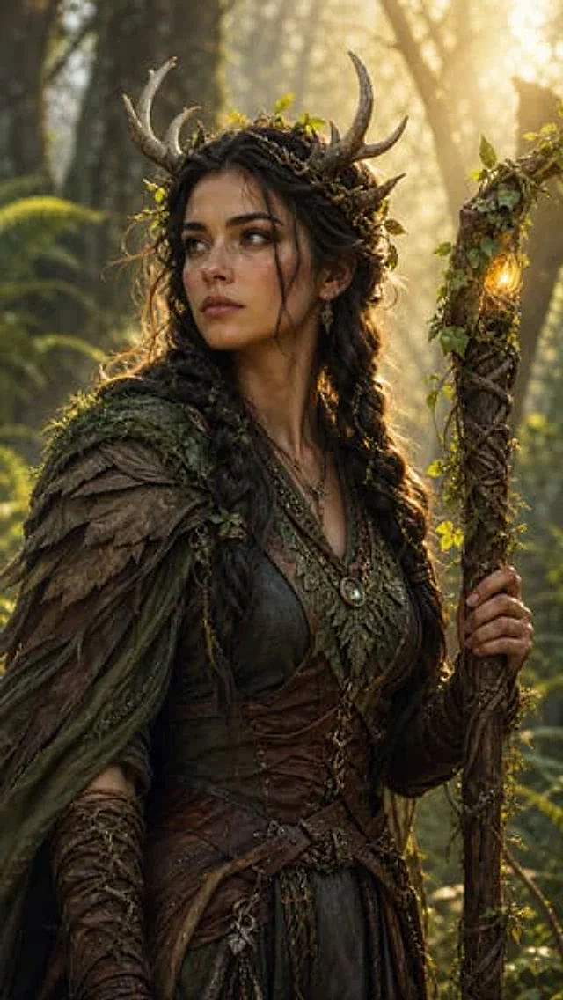

```text
Half-body vertical character portrait of a young druid in a misty old-growth forest at golden hour. Layered leather and woven leaf armor with subtle moss embroidery, a small antler crown nestled in long braided dark hair, one hand holding a faintly glowing wooden staff entwined with ivy. Warm sun rays filtering through ferns behind, soft green and amber palette. Calm focused expression looking off-frame. Vertical 9:16 composition, head and chest framing. No text, no clan symbols, no watermark. Painterly fantasy illustration with photorealistic details, magazine cover quality.
```

Model: GPT Image 2
Author: @hiapi_ai

[ProjectD](https://aitoolsradar.com/en/prompts/30e9c49fc46375) · [Recorded source](https://github.com/HiAPIAI/awesome-gpt-image-2-prompts)
 · [Full original metadata and byte evidence](data/projectd-batch-0029.json)

## Fantasy Duck Alliance Goods Catalog

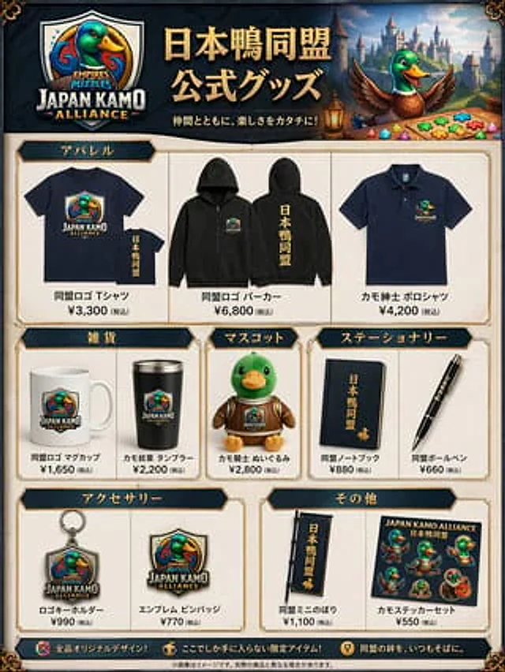

```text
{
  "type": "Fantasy Product Catalog Poster",
  "theme": "Official merchandise announcement from the Duck-themed Game Alliance",
  "style": "Exquisite promotional product listings, fantasy game aesthetics, Japanese-style retail flyers, parchment with gold UI borders, meticulously crafted commercial mockups, and decorative posters embedding clean studio product renderings.",
  "brand": {
    "name": "{argument name=\"organization name\" default=\"Japan Duck Alliance\"}",
    "headline": "{argument name=\"headline text\" default=\"Official merchandise from the Japanese Duck Alliance\"}",
    "tagline": "Together with our partners, we can turn happiness into reality!",
    "logo": "A heraldic shield featuring a bright green duck head with an orange beak at its center, against a blue and red background, bearing the small lettering \"EMPIRES &amp; PUZZLES\" and the large lettering \"JAPAN KAMO ALLIANCE\"."
  },
  "canvas": {
    "orientation": "portrait",
    "background": "The worn-out cream-colored catalog paper is surrounded by a gorgeous deep navy blue and gold fantasy border and decorative corner patterns."
  },
  "header": {
    "count": 4,
    "elements": [
      "Alliance emblem logo in the upper left corner",
      "Large gold Japanese title at the top center",
      "Small white Japanese slogan below the title",
      "In the upper right corner, a cartoon duck mascot with outstretched wings stands beside a colorful jigsaw puzzle gem, with a fantastical castle skyline in the distance and a glowing lantern in the foreground."
    ]
  },
  "layout": {
    "sections": [
      {
        "title": "apparel",
        "position": "upper half",
        "count": 3,
        "items": [
          {
            "label": "Alliance Logo T-shirt",
            "price": "¥3,300 (tax included)",
            "description": "Navy blue short-sleeved T-shirt, showing front and side/back views, featuring a large heraldic logo on the chest and vertical Japanese characters on the back."
          },
          {
            "label": "League Logo Hoodie",
            "price": "¥6,800 (tax included)",
            "description": "Black zip-up hoodie, showing the front and back; a small emblem logo on the left chest and large vertical gold Japanese characters on the back."
          },
          {
            "label": "Duck Gentleman Polo Shirt",
            "price": "¥4,200 (tax included)",
            "description": "Navy blue polo shirt with a small duck emblem embroidered on the left chest."
          }
        ]
      },
      {
        "title": "groceries",
        "position": "Middle left",
        "count": 2,
        "items": [
          {
            "label": "League Logo Mug",
            "price": "¥1,650 (tax included)",
            "description": "White ceramic mug with heraldic logo printed on the side."
          },
          {
            "label": "Duck Emblem Travel Mug",
            "price": "¥2,200 (tax included)",
            "description": "Black insulated travel mug with a metal rim and a coat of arms logo printed on the front."
          }
        ]
      },
      {
        "title": "mascot",
        "position": "Central",
        "count": 1,
        "items": [
          {
            "label": "Duck Knight Plush Toy",
            "price": "¥2,800 (tax included)",
            "description": "A green duck mascot plush toy, dressed in brown fantasy armor with a badge on its chest, is seated and facing forward."
          }
        ]
      },
      {
        "title": "Stationery",
        "position": "Middle right",
        "count": 2,
        "items": [
          {
            "label": "Alliance Notebook",
            "price": "¥880 (tax included)",
            "description": "A deep navy blue notebook with a vertical gold Japanese title and a small duck icon at the bottom."
          },
          {
            "label": "Union ballpoint pen",
            "price": "¥660 (tax included)",
            "description": "Black ballpoint pen with gold decorations and gold Japanese characters."
          }
        ]
      },
      {
        "title": "Accessories",
        "position": "Bottom left",
        "count": 2,
        "items": [
          {
            "label": "Logo keychain",
            "price": "¥990 (tax included)",
            "description": "Metal keychain in the shape of the Alliance emblem"
          },
          {
            "label": "Badges and brooches",
            "price": "¥770 (tax included)",
            "description": "Small heraldic-shaped enamel brooch"
          }
        ]
      },
      {
        "title": "other",
        "position": "Bottom right",
        "count": 2,
        "items": [
          {
            "label": "Alliance Mini Flag",
            "price": "¥1,100 (tax included)",
            "description": "Small, vertically arranged navy blue flags with gold Japanese lettering and a duck icon, served on a base."
          },
          {
            "label": "Duck Sticker Set",
            "price": "¥550 (tax included)",
            "description": "The sticker page includes 6 duck-themed fantasy character stickers and the title \"JAPAN KAMO ALLIANCE\"."
          }
        ]
      }
    ],
    "total products": 12
  },
  "footer": {
    "count": 3,
    "elements": [
      "The blue and gold badge on the left reads \"All original designs!\"",
      "The central blue and gold badge reads, \"Limited-time item available only here!\"",
      "The blue and gold badge on the right features a duck icon and the text \"The bonds of the League, always by your side.\""
    ],
    "disclaimer": "※Images are for reference only. Actual products may differ."
  },
  "color_palette": {
    "primary": "Deep Navy Blue",
    "secondary": "Antique gold",
    "accent": "Emerald Green",
    "supporting": "Cream, black, white, warm brown"
  },
  "rendering_notes": "Each product is neatly cut against a light cream background with soft shadows, arranged in a symmetrical catalog grid with gold dividing lines and blue title labels. It utilizes clear, legible Japanese fonts, a sophisticated fantasy game brand image, and high-end official merchandise advertising aesthetics.",
  "parameters": [
    "{argument name=\"organization name\" default=\"Japan Duck Alliance\"}",
    "{argument name=\"headline text\" default=\"Official merchandise from the Japanese Duck Alliance\"}"
  ]
}
```

Model: GPT Image 2
Author: GPT Image 2 Prompts

[ProjectD](https://aitoolsradar.com/en/prompts/b00f36bef56aed) · [Recorded source](https://x.com/nihonkamo/status/2047417939046043963#reversed-0)
 · [Full original metadata and byte evidence](data/projectd-batch-0029.json)

## Fantasy Elf Ranger Trading Card

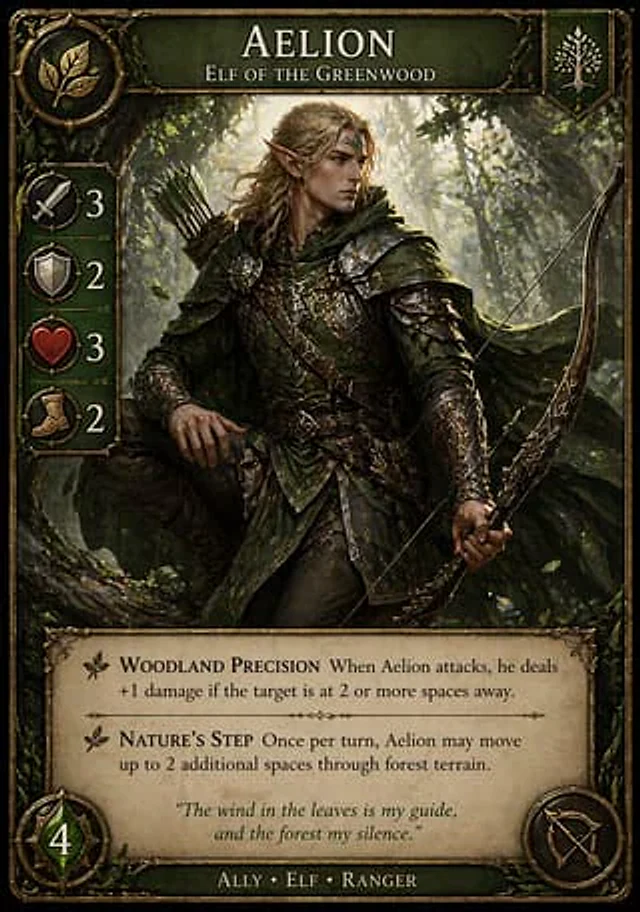

```text
An incredibly detailed fantasy trading card, presented in a high-end collectible card game style, with a vertical layout, a magnificent antique gold border, a deep emerald enamel panel, and intricate vine and leaf decorations. The title at the top of the card is displayed as {argument name="character name" default="AELION"} The text uses a striking and elegant serif capital font, with the subtitle "ELF OF THE GREENWOOD" below. The central illustration depicts a realistic, highly magical elf ranger standing in a sun-dappled forest. He has a head of {argument name="hair color" default="golden blond"} He has long hair, pointed ears, and wears layered dark green leather and metal armor with intricate carvings, complemented by a hooded cloak, belt, bracers, and woodland-themed decorations. He carries a magnificent recurve bow in one hand and a quiver on his back, his posture alert, as if tracking prey through the forest. The lush forest background is atmospheric and cinematic, with warm light filtering through branches and leaves. The overall color scheme is green, bronze, gold, and earthy brown, presenting a melancholic heroic tone and realistic painterly rendering. The upper left corner features a circular faction emblem displaying three gold leaves. The upper right corner contains a small shield badge with a white tree icon. Along the left edge are four vertically stacked attribute icons, each within a circular badge and marked with a large number: a sword with number 3, a shield with number 2, a heart with number 3, and a boot with number 2. A large green gem-like badge with the number 4 is added to the lower left corner. Add a circular class or weapon icon displaying a bow and arrow symbol in the bottom right corner. Below, in the parchment text box, contain two ability entries with decorative leaf bullet points and a serif font. The first ability is named "WOODLAND PRECISION," followed by the rule text: "When Aelion attacks, he deals +1 damage if the target is at 2 or more spaces away." The second ability is named "NATURE'S STEP," followed by the rule text: "Once per turn, Aelion may move up to 2 additional spaces through forest terrain." Below the abilities, centered, add an italicized background quote:{argument name="quote" default="The wind in the leaves is my guide, and the forest my silence."} At the very bottom, on the dark green nameplate, the type line reads "ALLY • ELF • RANGER". Using clear, legible text, a sophisticated card game UI design, and balanced margins, it presents a professional, finished look reminiscent of a high-end fantasy strategy card game.
```

Model: GPT Image 2
Author: GPT Image 2 Prompts

[ProjectD](https://aitoolsradar.com/en/prompts/97f9ab91f754c6) · [Recorded source](https://x.com/Artedeingenio/status/2047601145569235279#reversed-0)
 · [Full original metadata and byte evidence](data/projectd-batch-0029.json)

## Fantasy Knight Concept Art Sheet

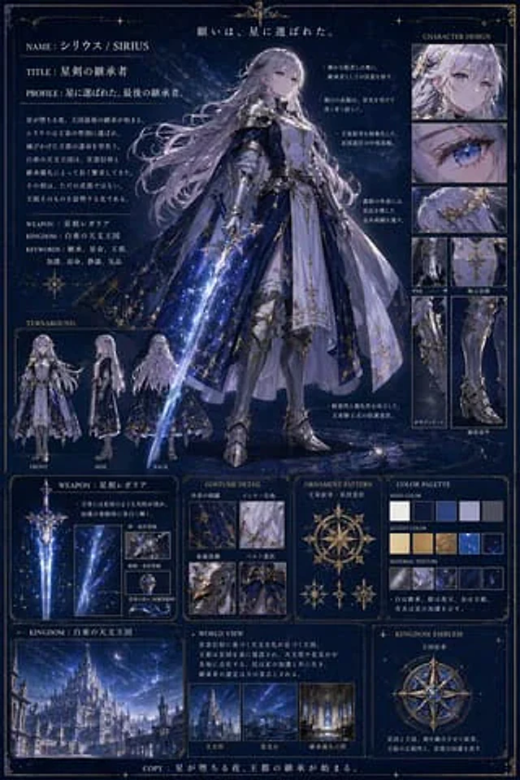

```text
{
  "type": "Anime character reference images",
  "theme": "Fantasy Star Knights, dark blue background with gold border",
  "character": {
    "name": "{argument name=\"character name\" default=\"シリウス / SIRIUS\"}",
    "title": "{argument name=\"character title\" default=\"Successor of the Star Sword\"}",
    "appearance": "Female knight, long silver hair, blue star-like eyes",
    "attire": "White evening gown, dark blue starry sky cape, silver armor",
    "pose": "Standing posture, holding a glowing blue star sword."
  },
  "layout": {
    "centerpiece": "Full-body portrait",
    "sections": [
      {
        "title": "Personal information",
        "position": "top-left",
        "elements": [
          "Name:{argument name=\"character name\" default=\"シリウス / SIRIUS\"}",
          "title:{argument name=\"character title\" default=\"Successor of the Star Sword\"}",
          "Synopsis: The last successor chosen by the stars.",
          "arms:{argument name=\"weapon name\" default=\"Star Sword Regalia\"}",
          "kingdom:{argument name=\"kingdom name\" default=\"The White Astronomical Kingdom\"}",
          "Keywords: inheritance, astrology, royal capital, blessing, destiny, tranquility, nobility"
        ]
      },
      {
        "title": "Character Design",
        "position": "top-right",
        "count": 6,
        "labels": [
          "face",
          "Eye",
          "hairstyle",
          "chest decoration",
          "Gauntlet details",
          "Leg armor"
        ]
      },
      {
        "title": "Three views",
        "position": "mid-left",
        "count": 3,
        "labels": [
          "front",
          "side",
          "back"
        ]
      },
      {
        "title": "arms:{argument name=\"weapon name\" default=\"Star Sword Regalia\"}",
        "position": "bottom-left",
        "count": 4,
        "description": "1 main sword, 3 close-up shots"
      },
      {
        "title": "Clothing details",
        "position": "bottom-mid-left",
        "count": 4,
        "labels": [
          "cloak embroidery",
          "Lining fabric",
          "Metal decoration",
          "belt design"
        ]
      },
      {
        "title": "Decorative patterns",
        "position": "bottom-center",
        "count": 4,
        "labels": [
          "Royal coat of arms and star map design"
        ]
      },
      {
        "title": "Color scheme",
        "position": "mid-right",
        "count": 12,
        "labels": [
          "Main color",
          "Accent color",
          "Material texture"
        ]
      },
      {
        "title": "kingdom:{argument name=\"kingdom name\" default=\"The White Astronomical Kingdom\"}",
        "position": "bottom-left",
        "count": 1,
        "description": "Castle View"
      },
      {
        "title": "Worldview",
        "position": "bottom-mid-right",
        "count": 3,
        "labels": [
          "Astronomical Tower",
          "Observatory",
          "Inheritance Ceremony Hall"
        ]
      },
      {
        "title": "Kingdom Crest",
        "position": "bottom-right",
        "count": 1,
        "labels": [
          "Kingdom Crest"
        ]
      }
    ],
    "header": "The wish was chosen by the stars.",
    "footer": "Synopsis: On the night the stars fell, the succession ceremony in the royal capital officially began."
  }
}
```

Model: GPT Image 2
Author: GPT Image 2 Prompts

[ProjectD](https://aitoolsradar.com/en/prompts/344bcac2cbce6f) · [Recorded source](https://x.com/kotsu_kotsu_san/status/2045461386063659038#reversed-0)
 · [Full original metadata and byte evidence](data/projectd-batch-0029.json)

## Fantasy Knight Food Reaction Manga


```text
Goal: Create a vertical three-panel fantasy food-comedy manga page about a blonde female knight from another world trying modern Japanese foods, with dramatic gourmet reactions.

Canvas: Tall portrait manga page, 675×1012 aspect ratio, three horizontal panels stacked vertically with thick black borders and narrow white gutters. High-detail color anime illustration, glossy rendering, cinematic lighting, expressive manga effects.

Main character: A young adult blonde female knight with long hair, bangs, side braids, and polished silver plate armor with gauntlets. She sits at a tavern table in panels 1 and 2, then reacts dramatically in panel 3. Her face is covered by a plain skin-tone rectangular censor block in the first two panels only; in the third panel her face is visible, sweating, disgusted, and pinching her nose.

Panel 1: Warm medieval tavern interior with wooden beams, lanterns, a red dragon banner, and a green goblin-like patron in the background. The knight holds a spoonful of curry rice in her metal gauntlet. A plate of curry and white rice sits in front of her, with a drinking glass at the lower left. Add golden sparkles and small pink heart effects around her. Include exactly 3 rounded white speech bubbles on the right.

Panel 2: Close-up, dreamy pink background with bubbles, sparkles, and soft glowing light. The knight holds a custard pudding in a glass cup with caramel sauce on top, using a spoon in her other gauntlet. Her hair flows softly and the mood is heavenly and sweet. Include exactly 5 rounded white speech bubbles stacked vertically on the left.

Panel 3: Dark blue-purple dramatic manga background with speed lines and shock hatching. The knight holds chopsticks lifting sticky natto over a small white tray. Brown fermented beans stretch in stringy strands. She recoils with disgust, one hand pinching her nose, sweating heavily, eyes wide, mouth open in horror. Include exactly 2 jagged explosive speech bubbles: one large vertical bubble on the left and one on the right.

Text content: Use Japanese manga lettering with this dialogue layout: {argument name="Japanese dialogue" default="Panel 1 right bubbles: 「これがカレーね」, 「うん、最初は不安だったけど、食べたら美味しい」, 「なかなか、刺激的な味ね」. Panel 2 left bubbles: 「プリン…」, 「魅惑的な甘さ…」, 「口の中でとろける…」, 「幸せ〜」, 「ここは天国？天国なの？」. Panel 3 left jagged bubble: 「うっ…くっさーーっ!!!」. Panel 3 right jagged bubble: 「な、納豆…？なにこれ…臭すぎる…！絶対ムリ…！」"}

Style constraints: Detailed anime fantasy manga, polished armor reflections, appetizing food close-ups, expressive comedic contrast between delicious curry, heavenly pudding, and disgusting natto. No watermark, no extra panels, no extra speech bubbles.
```

Model: GPT Image 2
Author: 高瀬ユキカズ

[ProjectD](https://aitoolsradar.com/en/prompts/a95a5e59e288ba) · [Recorded source](https://youmind.com/prompts/fantasy-knight-food-manga-20596)
 · [Full original metadata and byte evidence](data/projectd-batch-0029.json)

## Fantasy Library Breakfast Scene


```text
Create a detailed anime-style fantasy illustration of two elegant characters having breakfast together in a sunlit gothic library. The scene shows {argument name="character pair" default="a petite young woman with very long black hair and a tall silver-haired man"} seated at a wooden breakfast table, both with their faces intentionally obscured by soft rectangular blur masks. The woman sits on the left wearing a deep navy silk robe or kimono-inspired morning gown with black lace trim, a blue gemstone necklace, earrings, and an ornate blue flower hair accessory; she holds a fork in one hand and rests her cheek on the other hand in a relaxed morning pose. The man sits on the right, much taller and broad-shouldered, with spiky pale silver hair, earrings, a pendant necklace, an open black shirt, and a dark embroidered robe with silver ornamental patterns; he holds a plate of scrambled eggs in one hand and a spoon in the other as if serving or eating. The table contains exactly 12 visible breakfast and table items: 1 plate of scrambled eggs with tomato and greens in front of the woman, 1 plate of scrambled eggs held by the man, 1 cup of coffee or tea on a saucer, 1 white lidded teapot or sugar pot, 1 small clear glass bottle, 1 small ornate metal condiment holder, 1 plate of sliced bread, 1 platter with greens, sliced meat, and a halved boiled egg, 1 glass bowl of green and dark purple grapes, 1 basket of croissants, 1 large round loaf or pastry at the front right, and 1 brown teapot at the far right. Add a folded newspaper on the table with the readable English headline {argument name="newspaper headline" default="CELESTIAL LIBRARY"}. The background is an ornate old-world library with tall bookshelves, carved wood furniture, gothic arched windows, long blue-and-gold hanging banners, a decorative sign that also reads Celestial Library, vases of purple flowers, small bottles and curios, and warm morning sunlight streaming through the windows. Use a rich painterly anime rendering style with intricate linework, cinematic lighting, warm gold highlights, cool blue shadows, soft dust-filled atmosphere, high detail in fabrics and food, and a cozy yet aristocratic fantasy mood. Use a horizontal 4:3 composition, waist-up framing of the two characters, the table in the foreground, and the library receding behind them. Avoid modern objects except the newspaper, avoid extra people, and keep the image text minimal and mostly decorative.
```

Model: GPT Image 2
Author: ハスノ＠核心ぶち抜きヒーラー／天空図書館夫婦

[ProjectD](https://aitoolsradar.com/en/prompts/982deccf0e122a) · [Recorded source](https://youmind.com/prompts/fantasy-library-breakfast-22773)
 · [Full original metadata and byte evidence](data/projectd-batch-0029.json)

## Fantasy Library Poster for Epix & Ria


```text
A cinematic fantasy anime poster, using a vertical composition. The image shows two child-like adventurers standing in a magnificent magical library cathedral, with towering Gothic arches and towering bookshelves on either side in the background, pages floating in the air, shimmering with glittering dust. In the center is a grand staircase leading to a window like a teleportation portal, covered with intricate celestial magic circles. The low, dramatic perspective, slightly upward, shows both characters extending a hand to the viewer in an inviting gesture. The character on the left is slightly taller, with short, silver-white hair, smooth bangs, and large leaf-shaped or animal-ear earrings. He wears a navy blue hooded jacket over a warm orange top, dark trousers, sturdy boots, and carries a black crossbody bag; his face is partially obscured by the composition and angle. The character on the right is slightly shorter, with a design that complements the overall style. She has a silver-white bob with greenish tips, large turquoise eyes, and also wears leaf-shaped earrings. She wears a navy blue hooded jacket over orange clothing, dark shorts, boots, and carries a light purple shoulder bag adorned with stars and other small charms. Between their outstretched hands, a bright magical light is created, where two energies converge: a turquoise stream surrounds the character on the left, while a warm pinkish-gold stream surrounds the character on the right, accompanied by sparkling particles and ribbon-like trails. The light and shadow atmosphere is cool blue on the left and warm magenta on the right, merging into a dazzling white light at the center. Rich atmospheric details are added: glowing dust, magical threads, floating paper, and layered architecture, creating a sense of wonder and exploration. An elegant white serif Japanese slogan is added to the center of the top of the poster: "わかることと, sense of じること. 2つの力で世界をひらく." (Understanding and feeling, open the world with dual power.) A huge luminous golden serif title is placed at the bottom of the poster "{argument name="title text" default="Epix&Ria"} The poster features a stunningly detailed and exquisite main visual, showcasing the rich texture, radiant light, and powerful emotions of a fantasy adventure film. It is a masterpiece of top-tier promotional art.
```

Model: GPT Image 2
Author: GPT Image 2 Prompts

[ProjectD](https://aitoolsradar.com/en/prompts/682793c6fefc66) · [Recorded source](https://x.com/TK2Works/status/2046931080155107637#reversed-0)
 · [Full original metadata and byte evidence](data/projectd-batch-0029.json)

## Fantasy Manga Battle Page


```text
{
  "type": "Black and white fantasy comic page",
  "style": "High-detail youth comic ink line art, monochrome halftone shading, dramatic speed lines, explosive impact effects, dynamic perspective, exquisite commercial Japanese comic pages.",
  "setting": "Rocky battlefields or cave-like wastelands during monster attacks",
  "page": {
    "reading": "Composition of a comic book from right to left",
    "panel_count": 4,
    "gutter": "Clean white border",
    "sections": [
      {
        "title": "Top action storyboard",
        "position": "top",
        "count": 1,
        "labels": [
          "The witch casts a spell on the monster."
        ]
      },
      {
        "title": "Reaction Module",
        "position": "Upper Mid-to-Upper",
        "count": 1,
        "labels": [
          "Close-up with speech bubbles"
        ]
      },
      {
        "title": "Attack Scenario",
        "position": "Mid-lower part",
        "count": 1,
        "labels": [
          "A black projectile hurtled towards the boy."
        ]
      },
      {
        "title": "Bottom dramatic storyboard",
        "position": "bottom",
        "count": 1,
        "labels": [
          "The witch stretched out her hand and shouted."
        ]
      }
    ]
  },
  "characters": [
    {
      "role": "Female protagonist mage",
      "name": "{argument name=\"character name\" default=\"Noel\"}",
      "appearance": "A young woman, slender, with long, straight, light-colored hair, large, bright eyes, and not wearing glasses.",
      "outfit": {
        "count": 6,
        "pieces": [
          "A large pointed witch's hat adorned with ribbons and oval gemstones.",
          "A flowing cloak",
          "A corset-style top with ties and lace trim",
          "shorts",
          "Over-the-knee boots",
          "Round gemstone pendant necklace"
        ]
      },
      "weapon": "Wooden staff with an eye-shaped decoration on top."
    },
    {
      "role": "Secondary role",
      "appearance": "A young man with short, messy, light-colored hair, wearing a cloak or scarf draped over his shoulders.",
      "placement": "Appearing on the right side of the third panel, facing the incoming attack."
    },
    {
      "role": "monster",
      "appearance": "A gigantic, dragon-like beast with a gaping maw, rough scales, gleaming or menacing eyes, and an aggressive posture."
    }
  ],
  "panels": [
    {
      "index": 1,
      "composition": "The mage's back three-quarters profile dominates the left side, one hand extended to the right, the other holding a staff at a low bow; a circular magic circle forms in front of her palm and detonates into a massive white shockwave, colliding with the roaring dragon-like monster on the right; shattered rocks, debris, ink splattered, and huge Japanese sound effects characters appear around the explosion.",
      "emotion": "Emergency Combat"
    },
    {
      "index": 2,
      "composition": "A narrow, horizontal close-up shows the witch's face beneath the brim of her hat, her expression one of astonishment, a bead of sweat on her forehead; speed lines radiate behind her; a vertical speech bubble.",
      "text": {
        "count": 1,
        "items": [
          "あ…！"
        ]
      },
      "emotion": "Suddenly realized"
    },
    {
      "index": 3,
      "composition": "The wide, horizontal shot shows a black, violent slash or wave-like attack sweeping across the screen from the left, rushing towards the boy on the right; strong motion blur, ink-like lines, fragments, and huge jagged Japanese sound effects emphasize the sense of speed.",
      "text": {
        "count": 1,
        "items": [
          "ザオオオッ"
        ]
      },
      "emotion": "Imminent danger"
    },
    {
      "index": 4,
      "composition": "A large perspective close-up shows the witch charging at the audience, one hand desperately outstretched, mouth agape as she screams, her hair and cloak billowing behind her, her staff visible from the side; dense background speed lines; and a huge vertical speech bubble on the left.",
      "text": {
        "count": 1,
        "items": [
          "Noel! Hurry up!"
        ]
      },
      "emotion": "Panic and sense of urgency"
    }
  ],
  "tone": "Dramatic, tense, heroic fantasy battle scenes",
  "rendering_notes": "Maintaining strict grayscale, clear lines, detailed shadows, and strong contrasts, the Japanese manga font remains unchanged, and the cinematic page flow is suitable for fantasy action comics."
}
```

Model: GPT Image 2
Author: GPT Image 2 Prompts

[ProjectD](https://aitoolsradar.com/en/prompts/a4d2ffec4bec11) · [Recorded source](https://x.com/yukimino_doga/status/2046615854713114941#reversed-0)
 · [Full original metadata and byte evidence](data/projectd-batch-0029.json)

## Fantasy Manga Character Introduction Page


```text
{
  "type": "manga page",
  "style": "{argument name=\"art style\" default=\"Black and white comic halftone paper style\"}",
  "character_count": 5,
  "panel_count": 6,
  "layout": {
    "panels": [
      {
        "position": "top, full width",
        "character": "Beatrice, long blonde hair, dark hooded cloak, pointing forward",
        "text": [
          "We'll use our knowledge and the power of our partners to challenge the legendary ruins! Are you ready?",
          "Let's go!",
          "Future Book Scholar{argument name=\"character 1 name\" default=\"Beatrice\"}"
        ]
      },
      {
        "position": "middle left",
        "character": "Nova, long black hair, elf ears, black dress, arms crossed",
        "text": [
          "Although I hate troublesome things... I'll go with you.",
          "Demon King's Daughter{argument name=\"character 2 name\" default=\"Nova\"}"
        ]
      },
      {
        "position": "middle right",
        "character": "Crim, short hair, armored corset, holding sword",
        "text": [
          "Of course! We must defeat the monsters and achieve victory together!",
          "Hero{argument name=\"character 3 name\" default=\"Krim\"}"
        ]
      },
      {
        "position": "bottom left, upper",
        "character": "Lilia, witch hat, holding staff",
        "text": [
          "I'm so excited!! I want to help! I want to learn so much and keep growing!",
          "Adventurer Lilia"
        ]
      },
      {
        "position": "bottom right, tall vertical",
        "character": "Camilla, dragon horns, wings, tail, black armor, large sword",
        "text": [
          "If you need my power, feel free to use it.",
          "Carmilla, the Dragon Girl"
        ]
      },
      {
        "position": "bottom left, lower",
        "description": "Group shot of all 5 characters standing in a landscape",
        "text": [
          "Set off!",
          "Swish",
          "Join your unique companions and take the first step towards becoming a legend!"
        ]
      }
    ],
    "footer": "{argument name=\"ending text\" default=\"over\"}"
  }
}
```

Model: GPT Image 2
Author: GPT Image 2 Prompts

[ProjectD](https://aitoolsradar.com/en/prompts/a050dab4f23c77) · [Recorded source](https://x.com/lakeside529/status/2044636475317424310#reversed-0)
 · [Full original metadata and byte evidence](data/projectd-batch-0029.json)

## Fantasy Manga Page in Forest


```text
{
  "type": "Black and white fantasy comic pages",
  "style": {
    "medium": "Richly detailed comic ink line art with halftone shading",
    "color": "Monochrome grayscale",
    "reading": "Japanese manga pages",
    "mood": "A comedic misunderstanding with dramatic and fantastical tension"
  },
  "layout": {
    "page_count": 1,
    "panel_count": 3,
    "panels": [
      {
        "position": "Top wide panel",
        "description": "A forest path winds its way through towering trees and rocky banks. In the foreground, two enormous monster corpses lie on either side, charred and still smoking, their skin blackened and cracked, revealing sharp horns, claws, and teeth, their surfaces acrid with ashes. In the middle ground stand two adventurers: a young witch and a young elven boy. The witch is slender, with long, straight, light-colored hair, wearing a wide-brimmed, pointed witch's hat, carrying a staff with an oval-shaped ornament at the top, and dressed in short, fantastical clothing: a corset, shorts, over-the-knee boots, gloves, and a cloak. The boy is short, with messy, short, light-colored hair, pointed elven ears, and wears a buttoned-up blouse, trousers, boots, and a short cloak. Both face forward, as if they have just defeated monsters. There are three visible Japanese onomatopoeic words in the image: one on the left with the word \"ぷす\", and two on the right with the words \"ぷす\" and \"ぷす\" respectively, indicating the hissing smoke coming from the corpse."
      },
      {
        "position": "Horizontal storyboard in the middle",
        "description": "A dramatic close-up shot shows the elf boy rushing towards the reader with outstretched arms, attempting to embrace him; his hands appear large in the perspective. His face is centered in the image but obscured by a rectangular gray mosaic. Dynamic lines radiate from behind him. To the left is a vertical Japanese speech bubble that reads \"ママーやったよー\"."
      },
      {
        "position": "Bottom horizontal panel",
        "description": "A close-up reaction shot of the witch from the chest up, her body slightly turned to the side, cheeks flushed, eyes wide open, lips slightly parted, one hand awkwardly raised near her face. Her long hair falls from under her hat, and her cloak is fastened by a jeweled brooch. The background is filled with speed lines. On the right is a vertical Japanese speech bubble that reads \"ばー\"."
      }
    ],
    "borders": "Neat comic panel spacing and black borders"
  },
  "characters": [
    {
      "role": "witch",
      "gender": "female",
      "age_appearance": "young adults",
      "hair": {
        "color": "light color",
        "style": "Long straight hair with bangs"
      },
      "outfit": [
        "Wide-brimmed pointed witch hat",
        "staff",
        "Cloak with brooch buckle",
        "Slim Fit Fantasy Top",
        "shorts",
        "Over-the-knee boots"
      ],
      "expression_in_page": "Confusion, embarrassment, panic"
    },
    {
      "role": "Elf Boy",
      "gender": "male",
      "age_appearance": "child",
      "race": "elves",
      "hair": {
        "color": "light color",
        "style": "messy short hair"
      },
      "features": [
        "Pointed ears"
      ],
      "outfit": [
        "cloak",
        "Long-sleeved belted outer garment with a front button",
        "trousers",
        "boots"
      ],
      "expression_in_page": "Excited and full of love"
    }
  ],
  "creatures": {
    "count": 2,
    "description": "Two enormous dragon-like or demonic beast carcasses were burning and smoking on either side of the road."
  },
  "composition_notes": "The central panel uses a strong perspective effect, with dense crosshairs and textured black on the monster's corpse. The top panel shows the transparent details of the forest, while the two lower panels use expressive comic book speed lines. The page maintains a refined fantasy style suitable for a serialized comic."
}
```

Model: GPT Image 2
Author: GPT Image 2 Prompts

[ProjectD](https://aitoolsradar.com/en/prompts/f78863ed457fc6) · [Recorded source](https://x.com/yukimino_doga/status/2046615854713114941#reversed-2)
 · [Full original metadata and byte evidence](data/projectd-batch-0029.json)

## Fantasy Manga Spell Explosion Page


```text
A highly dramatic black-and-white fantasy comic page, employing high-detail ink line art and halftone paper style, vertical comic layout, and two panels. The upper panel is a full-width action scene, showcasing a young, anime-style male mage, around his teens, standing on cracked rocky ground, his right hand outstretched to the left of the image, casting a powerful spell. He has messy, short, light-colored hair, large, serious eyes, and a calm, focused expression. He wears a high-necked cloak that billows in the wind, over which he wears a shirt and buttoned vest, fitted trousers, boots, a belt with a small pouch around his waist, and a leather sheath for a wand or small magical tool, with a jeweled buckle at the collar. In front of his outstretched palm is a large, glowing circular magic circle, decorated with intricate concentric symbols and runes. The spell erupts with a massive burst of white light and energy, surging outwards, accompanied by dense acceleration lines, black fragment clouds, shattered rocks, dust, and a striking texture that fills the background. The left and lower foreground of the image incorporate large, stylized Japanese onomatopoeia, creating a continuous, booming impact. The composition is dynamic and highly contrasting, with the boy positioned slightly to the right of center, while the explosion dominates the left half. The lower panel is a narrow reaction close-up, showing one character: a long-haired witch in profile, facing left, wearing a wide-brimmed pointed hat with ornate ribbons and jewels, and a jeweled brooch on her cloak. Her face is partially obscured by a solid rectangular censor block. Behind her, the same explosion and flying debris continue in the distance. On the right is a vertical Japanese speech bubble that reads "...uwa". The composition utilizes clean manga panel borders, a refined and professional shonen fantasy manga style, strong dynamism, clear hatching, halftone shading, and cinematic visual impact.
```

Model: GPT Image 2
Author: GPT Image 2 Prompts

[ProjectD](https://aitoolsradar.com/en/prompts/6202111786e3a6) · [Recorded source](https://x.com/yukimino_doga/status/2046615854713114941#reversed-1)
 · [Full original metadata and byte evidence](data/projectd-batch-0029.json)

## Fantasy MMO America Invasion Poster


```text
{"type":"Fantasy game expansion poster","franchise":"World of Warcraft: Legion","style":"Official AAA video game main visual, dark high-fantasy style, cinematic matte painting, exquisite UI poster design, green fel energy glow, dramatic storm clouds, scorched earth battlefield atmosphere","color_palette":{"primary":["Fel green","black","charcoal gray","soft gold"],"accents":["morbid yellow-green","gray-brown","steel blue"]},"layout":{"format":"Horizontal multi-section promotional collage","sections":[{"title":"World of Warcraft Legion logo and invasion title","position":"top left","count":1,"labels":["WORLD OF WARCRAFT LEGION","THE LEGION INVADES"]}} AMERICA"]},{"title":"Main Invasion Artwork","position":"Top Center","count":1,"labels":["New York Skyline Under Demon Attack"]},{"title":"New Playable Class","position":"Top Right","count":1,"labels":["Demon Hunter"]},{"title":"New Playable Race","position":"Bottom Left","count":1,"labels":["Texas"]},{"title":"Explore War-Torn America","position":"Bottom Center","count":4,"labels":["New York","Great Plains","Great Everglades","51 {"title":"A Brand New Legion Invasion World Event","position":"Bottom Center Strip","count":4,"labels":["Battle Scene 1","Battle Scene 2","Battle Scene 3","Battle Scene 4"]},{"title":"Rebel Legion","position":"Bottom Right","count":1,"labels":["For Azeroth. For America."]}],"border_style":"A gorgeous dark metallic fantasy border with gold trim","background":"A nearly black textured background behind all border sections"},"main_scene":{"subject":"An alternate history America invaded by demonic forces","environment":"The ruins of New York Harbor and Lower Manhattan, with the Statue of Liberty standing out prominently in the left-center foreground, and the skyline silhouetted against a poisonous green portal swirling in the clouds","sky":"A gloomy stormy sky filled with huge circular fel energy..."} A vortex tore apart, and a beam of green energy descended vertically into the city. "action_elements":{"flying_units_count":12,"flying_units_description":"Multiple demonic dragons, evil bats, and legionary gunboats swarmed in the sky,"ground_figures_count":6,"ground_figures_description":"Small armed defenders clashed with demons along the shore,"major_monster_count":1,"major_monster_description":"A giant winged demon hovered above the city before the green beam of energy."},"lighting":"High-contrast cinematic lighting effects, with a green portal as the main light source; outline lighting on the edges of smoke and ruins; deep shadows everywhere."},"left_panel":{"title":"New playable race","race_name":"{argument name="playable race name" default="Texans"} ","characters":{"count":2,"description":"Two characters dressed entirely in cowboy attire, striking poses similar to race displays in MMORPGs, one male and one female, both wearing wide-brimmed hats, Western shirts, belts, jeans, and boots, exuding a rugged frontier style."},"traits":{"count":4,"labels":["Lone Star Determination","YEEHAW!","Gunslinger","Gifted"],"icon_style":"Vertically arranged circular fantasy skill icons"},"footer_label":"Legacy Armor: Stetson Set"},"top_right_panel":{"title":"New Playable Class","class_name":"{argument name="playable class name" default="Demon Hunter"} ","character":{"count":1,"description":"A dark elf-style anti-hero clad in dark leather armor, wielding two oversized pistols, with long ears, glowing eyes, a cold expression, and a cloak and demon hunter silhouette."},"tagline":"Firearms. Fel energy. Revenge.","mood":"A gloomy, belligerent, supernatural gunslinger fantasy."},"middle_grid":{"title":"Exploring war-torn America","locations":{"count":4,"items":[{"name":"{argument name="city name" default="New York"} {"name":"The City Within a Siege","description":"A destroyed city skyline with green impact craters and smoke"},{"name":"The Great Plains","subtitle":"The Heartland Corrupted by Fel","description":"Desolate farmland, windmills, dirt roads, withered grass, and green decay visible in the distance"},{"name":"The Great Swamp","subtitle":"Secrets of the Swamp","description":"A dark swamp with glowing poison pools, twisted trees, and thick fog"},{"name":"51 [District], "subtitle": "Something Awakens", "description": "Desert military zone with wreckage, satellite antennas, or buildings; warning signs in the foreground; ominous activity in the background."}]}},"bottom_strip":{"title":"New Legion Invasion World Event", "thumbnails":{"count":4,"description":"Four narrow battle scenes showcasing heroes battling demons amidst fel explosions and chaotic silhouettes."},"right_panel":{"title":"Rebel Legion", "scene":{"count":1,"description":"Washington D.C. is under attack; the Washington Monument is in the center, shrouded in smoke, with green fel explosions; a heroic armored figure on the right is fighting a flying demon."},"call_to_action":{argument name="call to action" default="For Azeroth. For America."} "},"text_treatment":{"font_style":"The title uses a fantasy serif uppercase font, the body text uses a smaller serif font, and the layout is based on the official expansion poster.","header_color":"The color is either a faded gold or light green depending on the section."body_color":"Grayish-white"},"composition_notes":"This makes it read like a credible official expansion announcement image, ironic yet rendered very seriously. Each section is clearly defined and easy to read, the layout is dense yet well-organized, and it has a high-end Blizzard style."}
```

Model: GPT Image 2
Author: GPT Image 2 Prompts

[ProjectD](https://aitoolsradar.com/en/prompts/b66235ebb45296) · [Recorded source](https://x.com/dream_in_sanity/status/2046698235318898724#reversed-0)
 · [Full original metadata and byte evidence](data/projectd-batch-0029.json)

## Fantasy Noble Meets Politician Portrait


```text
A realistic medium close-up shows two men standing side-by-side in a formal White House-style interior. On the left is a fantastical aristocrat with flowing platinum-white hair, pale skin, and an elegant high-necked white leather jacket with delicate embroidery details and structured stitching, resembling a Targaryen prince or a member of a medieval fantasy royal family through a modern photographic lens. A few strands of hair drift to the side, as if blown by an indoor breeze. On the right is a middle-aged American politician in a dark navy blue suit, paired with a crisp white shirt, a dark tie, and a small American flag lapel pin. Both men face the camera, presenting an official photographic composition. The background is soft-focused, including a portrait on the left wall, two warm-toned lamps, an ornately decorated cream-colored wall, and an American flag on the far right. The cinematic natural indoor lighting, shallow depth of field, soft neutral tones, and highly realistic details in skin, fabric, and hair create a serious and formal atmosphere with the aesthetic appeal of documentary news photography.
```

Model: GPT Image 2
Author: GPT Image 2 Prompts

[ProjectD](https://aitoolsradar.com/en/prompts/16894c89a3e222) · [Recorded source](https://x.com/NEXUS_TO_NOVA/status/2047741386867220546#reversed-0)
 · [Full original metadata and byte evidence](data/projectd-batch-0029.json)

## Fantasy Paladin Trading Card


```text
Create an incredibly detailed fantasy trading card, employing a sophisticated premium TCG style with a full vertical layout, a magnificent gold-plated border, engraved corners, and a color scheme of deep navy blue, black, ivory, and shimmering gold. The title at the top of the card is {argument name="character name" default="SIR ALARIC DAWNBLADE"} The text uses large serif font and capital letters, with a subtitle below.{argument name="class title" default="PALADIN OF THE LIGHT"} The main illustration depicts a valiant male paladin standing in a magnificent cathedral filled with towering, luminous stained-glass windows, floating golden sparks, and divine beams of light. He has long, flowing golden hair, wears exquisite steel plate armor, adorned with blue fabric trim and a flowing dark blue cloak, and holds a luminous longsword vertically in one hand and a large, ornate shield in the other, adorned with a radiant sun cross emblem. His posture is noble, strong, and defensive, serving as the visual center of the card. On the left are four circular, medallion-style attribute icons arranged vertically, labeled with numbers: crossed swords (3), shields (3), hearts (4), and boots (2). The upper left corner contains a sun emblem, and the upper right corner features a vertical banner emblem with a golden sword and cross symbol. The lower third contains a parchment-style rules text box listing three named skills, each accompanied by a small icon and a bold serif name, followed by the rules text:{argument name="ability one" default="DIVINE SMITE"} ,{argument name="ability two" default="AURA OF PROTECTION"} and{argument name="ability three" default="LAY ON HANDS"} Below the skill description, add a line of italicized text in the center of the parchment:{argument name="flavor quote" default="By the Light, I stand. By the Light, I strike. By the Light, I shall not fall."} At the very bottom, place a line of serif capital letters indicating the type:{argument name="creature line" default="ALLY ♦ HUMAN ♦ PALADIN"} Add a large sapphire-bordered mana or cost badge with the number 4 in the bottom left corner, and a circular faction badge with a white sword or holy symbol in the bottom right corner. The overall look should have the feel of an official premium fantasy card game, with a cinematic quality, high legibility, rich lighting effects, intricate textures, and collector's item quality.
```

Model: GPT Image 2
Author: GPT Image 2 Prompts

[ProjectD](https://aitoolsradar.com/en/prompts/1d5dbf88092922) · [Recorded source](https://x.com/Artedeingenio/status/2047601145569235279#reversed-3)
 · [Full original metadata and byte evidence](data/projectd-batch-0029.json)

## Fantasy Recipe Illustration


```text
Create a fictional{argument name="theme" default="Fantasy World Cuisine"} Recipe images. Include illustrations or photographs, and describe the cooking process in as much detail as possible. Primarily use ingredients from a fictional fantasy world. The page layout should be aesthetically pleasing. The language requirement is Japanese.
```

Model: GPT Image 2
Author: GPT Image 2 Prompts

[ProjectD](https://aitoolsradar.com/en/prompts/9642e14cc9410b) · [Recorded source](https://x.com/SSSS_CRYPTOMAN/status/2046457894502285567)
 · [Full original metadata and byte evidence](data/projectd-batch-0029.json)

## Fantasy Recipe Illustration


```text
架空の{argument name="テーマ" default="ファンタジー世界の料理"}のレシピの画像を作成。イラストor写真付きで、料理の工程をできるだけ詳しく表記。実在しないファンタジー世界の材料をメインに使用する。デザイン的にも美しくなるように紙面構成。言語は日本語。
```

Model: GPT Image 2
Author: SSSS.CRYPTOMAN⚡️AI

[ProjectD](https://aitoolsradar.com/en/prompts/61c532a4277cb7) · [Recorded source](https://youmind.com/prompts/fantasy-recipe-illustration-14345)
 · [Full original metadata and byte evidence](data/projectd-batch-0029.json)

## Fantasy Whimsical Downtown Aerial View


```text
Create a high-detail 16:9 aerial terrain image of an {argument name="inspiration" default="Alice in Wonderland"}-inspired fantasy downtown. The city should feel whimsical, cinematic, and architectural: card-suit towers, checkerboard plazas, keyhole
```

Model: GPT Image 2
Author: insMind

[ProjectD](https://aitoolsradar.com/en/prompts/e5fff9ff8b9f5e) · [Recorded source](https://youmind.com/prompts/whimsical-fantasy-downtown-aerial-23998)
 · [Full original metadata and byte evidence](data/projectd-batch-0029.json)

## Fantasy Wizard Trading Card


```text
A vertically oriented fantasy trading card, designed in a gorgeous classic fantasy style, resembling a high-end collectible TCG card, featuring clearly legible printed text and icons. The card boasts an elegant deep navy blue and antique gold border, with filigree corners, embossed metal trim, and a realistic illustration at the center. A large serif title text is displayed at the top center.{argument name="character name" default="VARIAN THE AZUREMAGE"} Below is a smaller subheading.{argument name="class line" default="HUMAN WIZARD"} The top left corner features a circular blue mana emblem containing a white swirling arcane symbol. The top right corner displays a small heraldic banner panel with two vertically arranged gold icons: an arcane star above and an open book below. A vertical attribute bar is created along the left edge, featuring four rows of icons and numbers on a dark blue surface: a sword icon with the number 2, a shield icon with the number 1, a red heart icon with the number 3, and a boot icon with the number 2. The central illustration depicts a male human mage in a cathedral-like magical space filled with blue light and faint candlelight. He wears a layered royal blue robe and cloak adorned with intricate gold embroidery, gilded armor details, a belt, pouches, scroll boxes, and jewels. He has dark, medium-length wavy hair, and his posture is heroic and dramatic. In his left hand, he grips a magnificent staff; the staff is black and gold with a forked tip, near which is a luminous blue crystal. His right arm extends outward, summoning a spiral galaxy composed of blue arcane energy, star-shaped particles, and magical ribbons encircling his hand. The overall atmosphere is solemn, mysterious, and cinematic, boasting strong sapphire highlights, deep shadows, delicate painting details, and illustration quality reminiscent of high-end fantasy card games. A parchment-colored rule text box with ornate borders and two skills are added at the bottom, each preceded by a blue arcane symbol as a bullet point. The first skill's title is in bold serif: ARCANE BOLT, followed by the rule text: When Varian attacks, he deals 2 damage to any target. The second skill's title is in bold serif: MANA SURGE, followed by the rule text: Once per turn, you may pay 1 mana (with a blue water-drop mana icon) to draw a card. Below the skills, a line of blue-gray italic text describes: "Knowledge is the truest power. Master it, and the world is yours to shape." A large blue multifaceted gem badge is placed in the lower left corner, with the number {argument name="mana cost" default="3"} Place a circular, gold-framed, open book icon in the bottom right corner. Centered gold serif text along the bottom border on a blue strip:{argument name="type line" default="ALLY • HUMAN • WIZARD"} This makes the entire card look like a sophisticated professional TCG product prototype, with clear typography, a balanced layout, a gorgeous fantasy UI, and fully readable English text.
```

Model: GPT Image 2
Author: GPT Image 2 Prompts

[ProjectD](https://aitoolsradar.com/en/prompts/c93170b1e6700f) · [Recorded source](https://x.com/Artedeingenio/status/2047601145569235279#reversed-2)
 · [Full original metadata and byte evidence](data/projectd-batch-0029.json)

## Fantasy Woman Hugging a White Ram


```text
A photographic, cinematic portrait depicting a woman in a medieval or fantasy style, possessing {argument name="hair color" default="Long copper-red hair"} A bust depicts a woman tenderly embracing a large white ram. The woman wears a deep moss-green wool dress or tunic with ornate embroidery on the cuffs, and a heavy fur-trimmed cloak or shawl draped over her shoulders, suggesting a Viking or Highland style. Her hair is thick, wavy, and slightly disheveled, with small braids on top. The ram possesses thick, curly, creamy-white wool, its expression serene, eyes slightly closed, and massive spiral horns curling outwards and forwards. The woman's hands rest gently on the ram's neck, conveying warmth, protection, and companionship. The background is set in a rugged, cloud-covered outdoor landscape, with distant, hazy hills or wastelands. The sky is a cool gray, with a shallow depth of field and natural diffused light. The hair, wool, fur, and fabrics exhibit rich textural detail, earthy tones, an intimate composition, and realistic human skin and animal features. (Add black text in the upper left corner.){argument name="corner text" default="GPT Image 2"} .
```

Model: GPT Image 2
Author: GPT Image 2 Prompts

[ProjectD](https://aitoolsradar.com/en/prompts/0946bce79cd41e) · [Recorded source](https://x.com/adanvecindad/status/2046722781631439244#reversed-0)
 · [Full original metadata and byte evidence](data/projectd-batch-0029.json)

## Fantasy Xianxia Portrait Transformation


```text
Using REFERENCE_0 as the character's face and base, the subject is transformed into {argument name="theme" default="Dark fantasy"} Style. Change their clothing to something more refined.{argument name="clothing style" default="Purple and gold color scheme traditional Hanfu"} Adorned with intricate embroidery and a purple veil draped over the head and shoulders. Add opulent gold hair accessories, including dangling beads and long, decorative nail guards. Adjust the pose so that the head is slightly lowered and the gaze is turned to the side, one hand lightly raised close to the face, the other holding a [item/object].{argument name="held object" default="Giant glowing white lotus"} Replace the background with{argument name="setting" default="at night"} The scene features a giant full moon, silhouettes of traditional temple eaves, and cherry blossom branches in a corner. This enhances the overall atmosphere, giving it a magical, melancholic, and highly refined feel.
```

Model: GPT Image 2
Author: GPT Image 2 Prompts

[ProjectD](https://aitoolsradar.com/en/prompts/7e20d754f172c1) · [Recorded source](https://x.com/MANISH1027512/status/2045062307051434162#reversed-0)
 · [Full original metadata and byte evidence](data/projectd-batch-0029.json)

## Far Future City with Transparent Humanoid


```text
A hyper-realistic futuristic cityscape, set in {argument name="year" default="100,000 AD"} The viewpoint, from a high terrace, shows a mirror-like surface with lush vegetation clinging to the buildings on the left. In the foreground, three figures with their backs to the camera gaze at the city: a human in an elegant beige robe or cloak, a streamlined silver android with exposed mechanical details, and a mysterious, transparent humanoid creature composed of shimmering light, seemingly invisible, outlined by refracted energy. The scene depicts a magnificent, advanced metropolis, with countless slender, gigantic buildings and needle-like towers rising from green parks and waterways. Circular elevated platforms support gardens and buildings, and multiple aircraft and suspended structures dot the skyline. Above the city, a huge, transparent, ring-shaped or shell-like orbital structure spans the sky, while a massive, pale planet or satellite hangs in the background. The warm, golden hour sunlight, the atmospheric mist, the cinematic scale, the highly detailed sci-fi architecture, the utopian yet slightly eerie atmosphere, the realistic materials, the deep depth of field, and the wide-angle composition all showcase an epic feel that transcends modern civilization, with a special emphasis on the mysterious, transparent humanoid creature.
```

Model: GPT Image 2
Author: GPT Image 2 Prompts

[ProjectD](https://aitoolsradar.com/en/prompts/ea948aa454cb58) · [Recorded source](https://x.com/saku_apps/status/2047295704079683594#reversed-0)
 · [Full original metadata and byte evidence](data/projectd-batch-0029.json)

## Fashion Collection Catalog Layout


```text
{
  "type": "Fashion product catalog layout",
  "theme": "A unified fashion collection featuring a specific pattern:{argument name=\"pattern description\" default=\"Overlapping circular floral mandala patterns in purple, green, blue, orange, and pink.\"}",
  "layout": {
    "structure": "2x2 grid layout with a full-width banner at the bottom.",
    "sections": [
      {
        "id": "01",
        "title": "{argument name=\"product 1\" default=\"flared skirt\"}",
        "subtitle": "フレアワンピース",
        "main_image": "A woman wearing a patterned flared skirt and carrying a white handbag.",
        "swatch_count": 3,
        "swatch_descriptions": [
          "Purple style",
          "Green/Blue Style",
          "Orange/Yellow Style"
        ],
        "description_text": "A gorgeous flared silhouette. The lightweight material creates an elegant dynamism."
      },
      {
        "id": "02",
        "title": "{argument name=\"product 2\" default=\"silk scarf\"}",
        "subtitle": "シルクスカーフ",
        "main_image": "A woman wearing a white shirt and a patterned scarf.",
        "swatch_count": 2,
        "swatch_descriptions": [
          "Tiled pattern details",
          "Knotting details"
        ],
        "description_text": "A silk scarf to add color to your neck. It has a fine sheen and a smooth feel."
      },
      {
        "id": "03",
        "title": "{argument name=\"product 3\" default=\"Tote bag\"}",
        "subtitle": "トートバッグ",
        "main_image": "A woman carrying a patterned tote bag.",
        "swatch_count": 3,
        "swatch_descriptions": [
          "Purple style",
          "Blue style",
          "Orange/Yellow Style"
        ],
        "description_text": "It offers A4-sized storage space. Lightweight and durable, this is a tote bag you'll want to use every day."
      },
      {
        "id": "04",
        "title": "{argument name=\"product 4\" default=\"storage bag\"}",
        "subtitle": "ポーチ",
        "main_image": "It's placed on the table next to a zippered storage bag with magazine and vase patterns.",
        "swatch_count": 3,
        "swatch_descriptions": [
          "Green/purple style",
          "Orange style",
          "Pink style"
        ],
        "description_text": "A gorgeous storage bag that adorns the interior space. The beauty of design is evident in every detail."
      }
    ],
    "bottom_banner": {
      "title": "Pattern Design",
      "description_text": "Unique pattern designs woven from delicate lines and rich colors. Adding a touch of elegance to everyday life.",
      "image": "Displays horizontal strip images with seamless patterns."
    }
  }
}
```

Model: GPT Image 2
Author: GPT Image 2 Prompts

[ProjectD](https://aitoolsradar.com/en/prompts/00ff2d3242f629) · [Recorded source](https://x.com/aiehon_aya/status/2046348182301683954#reversed-0)
 · [Full original metadata and byte evidence](data/projectd-batch-0029.json)

## Fashion Design from Product Inspiration


```text
以这件商品为灵感，设计一套{argument name="风格" default="清凉风格"}女装
```

Model: GPT Image 2
Author: 程序员小灰

[ProjectD](https://aitoolsradar.com/en/prompts/bad28b966f6d29) · [Recorded source](https://youmind.com/prompts/product-inspired-clothing-set-16814)
 · [Full original metadata and byte evidence](data/projectd-batch-0029.json)

## Fashion Height Comparison of Four Women


```text
A minimalist, high-fashion studio photograph showcases four adult East Asian women standing side-by-side against a seamless, light gray background. Full-body shots, from head to toe, are taken from the front, with soft, even lighting creating a sophisticated commercial feel. Above each woman's head, her height is clearly indicated in black serif font: 145cm, 155cm, 165cm, and 175cm. This emphasizes the realistic differences in height proportions while maintaining the women's slender, elegant, and unified style. They have long, soft, wavy hair ranging from dark brown to black and possess neutral expressions. Their faces are obscured by smooth, rectangular blurs. The four women stand close together in a friendly posture, with subtle physical contact; one woman lightly links arms with another. Their clothing features harmonious shades of beige, cream, taupe, and soft pink, paired with sophisticated, feminine casual wear and matching ivory loafers. Woman 1 (145cm): Wears a short-sleeved cream-colored ribbed knit top tucked into high-waisted light beige shorts, with a fabric belt, and carries a small chain-stitched shoulder bag. Woman 2 (155cm): Wears a white long-sleeved shirt with a bow at the collar, paired with a taupe mini skirt with a slight flare, and carries a small light beige crossbody bag. Woman 3 (165cm): Wears a sleeveless pinkish-beige ribbed knit top with a simple ivory mini skirt. Woman 4 (175cm): Wears a flowing white V-neck shirt with rolled-up sleeves, paired with high-waisted taupe belted shorts, and carries a medium-sized taupe shoulder bag. All four women wear cream or ivory horsebit loafers. The composition is vertical, centered, minimalist, fashionable, and realistic, like a fashion catalog image comparing women's heights.
```

Model: GPT Image 2
Author: GPT Image 2 Prompts

[ProjectD](https://aitoolsradar.com/en/prompts/0798a443683c00) · [Recorded source](https://x.com/umitsuru_fire/status/2046796057569632338#reversed-0)
 · [Full original metadata and byte evidence](data/projectd-batch-0029.json)

## Fashion Magazine Cover Portrait


```text
A photorealistic high-end fashion magazine cover, with the title displayed at the top in striking white serif font: "{argument name="magazine title" default="LUMINA"} The cover features a person.{argument name="subject description" default="A young woman with shoulder-length brown wavy hair"} Her portrait, she is wearing{argument name="outfit" default="Black silk camisole layered under a white suit jacket"} She wore gold hoop earrings and a delicate gold necklace. Looking directly at the camera with a confident and elegant expression, against a sophisticated warm gray studio backdrop. To the left, black text read "THE NEW ERA OF AI BEAUTY," and below was a larger headline {argument name="main headline" default="STYLE EVOLUTION"} The white text on the right reads "FUTURE FASHION" and "WHAT'S NEXT?". The white text at the bottom reads "BEAUTY SECRETS OF TOMORROW" and "{argument name="bottom text" default="ELEGANT & CHIC"} "Professional studio lighting, soft shadows, and rich detail."
```

Model: GPT Image 2
Author: GPT Image 2 Prompts

[ProjectD](https://aitoolsradar.com/en/prompts/65fb9e1b864fff) · [Recorded source](https://x.com/aichof21/status/2045833848924279054#reversed-0)
 · [Full original metadata and byte evidence](data/projectd-batch-0029.json)

## Fashion Magazine Swimwear Layout


```text
泳装时尚杂志广告页面，4:3 ，日本模特， S型曲线，{argument name="颜色" default="蓝色"}色系。（变换姿势和风格，四宫格展示）
```

Model: GPT Image 2
Author: Adam也叫吉米

[ProjectD](https://aitoolsradar.com/en/prompts/674e4bb495d8db) · [Recorded source](https://youmind.com/prompts/fashion-magazine-swimwear-layout-21075)
 · [Full original metadata and byte evidence](data/projectd-batch-0029.json)

## Fashion Magazine Weekly Outfit Prompt


```text
I want to create a tweet in the style of a fashion magazine, showcasing my idol's "{argument name="idol name" default="●●●"} Create a weekly outfit guide. All clothing should be changed to serve as inspiration for everyday looks. Use expressive facial expressions and pose like a model. Incorporate handwritten decorative elements. Ensure the main subject is positioned in the bottom right corner and enlarged to create a camera-facing visual effect.
```

Model: GPT Image 2
Author: GPT Image 2 Prompts

[ProjectD](https://aitoolsradar.com/en/prompts/180a02107cefa4) · [Recorded source](https://x.com/Ayu_AI_0912/status/2047533528645272047)
 · [Full original metadata and byte evidence](data/projectd-batch-0029.json)

## Fashion Portrait With Python


```text
A high-fashion studio portrait features a captivating woman crouching low against a seamless light gray background. She wears a black long-sleeved, deep V-neck mini dress and black pointed-toe heels. She has thick, textured, dark brown wavy hair, healthy tan skin, deep red nail polish, and large gold hoop earrings. A massive python (with brown, tan, and black markings) wraps around her shoulders like a living shawl, its thick body cascading down her sides, its head hanging between her knees, close to her hands. The composition is centered and symmetrical, using a vertical format to capture the full body. The lighting and shadows create a clean, magazine-quality feel, with sharp, clear details of skin, fabric, and snake scales. Minimal shadows highlight the luxurious fashion photography style and the confident, sensual pose, all against a clean and crisp background.
```

Model: GPT Image 2
Author: GPT Image 2 Prompts

[ProjectD](https://aitoolsradar.com/en/prompts/c6238219ced788) · [Recorded source](https://x.com/ozgeonlinetr/status/2046681243027128608#reversed-0)
 · [Full original metadata and byte evidence](data/projectd-batch-0029.json)

## Fashionable Grocery Store Egg Photo


```text
A vertical snapshot taken with a smartphone, the subject of which is {argument name="woman age" default="young adults"} A woman shops on the shelves of a modern supermarket at night. The composition, from her upper thighs to her head, uses a close-up with a slightly wide-angle perspective. She stands beside refrigerated shelves filled with colorful packaged vegetables and groceries, against a backdrop of gleaming black shelves, bright store lighting, reflective surfaces, and a soft, blurred effect. With her left hand, she shows the camera an open recycled pulp egg carton, clearly revealing six brown eggs inside. Her right hand is near a black shopping cart full of groceries. She has long, dark brown hair, and her face is deliberately obscured by a large, softly-edged rectangular blur in the center. She wears a fitted, ribbed brown zip-up long-sleeved cropped top, the zipper slightly open at the chest, paired with matching high-waisted brown trousers. Her pose is casual and confident, with the egg carton serving as a focal point. Realistic photography, no flash, indoor lighting, shallow depth of field, delicate skin and fabric textures, natural reflections, high contrast, a fashionable lifestyle aesthetic, subtle editing style, and a vertical 9:16 composition.
```

Model: GPT Image 2
Author: GPT Image 2 Prompts

[ProjectD](https://aitoolsradar.com/en/prompts/42df793398d702) · [Recorded source](https://x.com/Asan0_Misaki/status/2046904727674462560#reversed-1)
 · [Full original metadata and byte evidence](data/projectd-batch-0029.json)

## Fast Food Burger Advertisement Poster


```text
A professional shrimp burger food photography advertisement poster. At the center of the image is a towering, enticing burger, placed on a rustic wooden table covered with brown parchment paper. The burger is topped with a glossy brioche bun, fresh green lettuce, creamy white sauce, orange spicy mayonnaise, and a whole grilled shrimp on a thick, crispy shrimp patty. To the left is a pile of condiments and fries. To the right foreground are two crispy fried shrimp. In the blurred background on the right is a glass of iced cola with a faded print.{argument name="brand name" default="LOTTERIA"} Logo. The main Korean title in bold, dynamic font is located in the top left corner:{argument name="main headline" default="통새우 크런KIM버거"} Next to it is a small orange line drawing of a shrimp. The small print above the title reads:{argument name="top text" default="탱글한 통새우살이 입안 가득"} Below the title is the subtitle:{argument name="subtitle text" default="매콤바삭; 육즙가득! 올봄, 새우버거의 기준이 바뀐다!"} The parchment has a round, faded stamp that reads "SHRIMP BURGER" and features a shrimp icon. The lower left corner is white.{argument name="brand name" default="LOTTERIA"} The logo features a red square "L" icon. Small text in the bottom right corner explains:{argument name="fine print" default="*상기 이미지는 실제 제품과 다를 수 있습니다. *제품 이미지에는 연출된 이미지를 포함하고 있습니다."} The warm and atmospheric lighting highlights the enticing style of the commercial fast-food advertisement.
```

Model: GPT Image 2
Author: GPT Image 2 Prompts

[ProjectD](https://aitoolsradar.com/en/prompts/7cd700c2bf39f3) · [Recorded source](https://x.com/adityarao310/status/2044608825332830486#reversed-2)
 · [Full original metadata and byte evidence](data/projectd-batch-0029.json)

## Fast-Food Lifestyle Commercial


```text
A vibrant, cinematic fast-food lifestyle scene, with the protagonist being {argument name="subject" default="A young man [uploaded image]"} He sat comfortably in a gleaming modern armchair, a smile on his face, holding a huge, juicy cheeseburger in one hand and a plate of crispy fries in the other. He was dressed {argument name="outfit" default="Bright yellow hoodie and casual jeans"} The environment is a vibrant and playful fast-food restaurant interior, with walls featuring a two-tone design of purple and yellow. A neon "Burger Bangor" sign on the wall emits a warm glow. The background is decorated with posters featuring retro cartoon burger designs and striking lettering. To the right is a large window offering a view of a stylized modern city skyline, dotted with bright billboards, creating a slightly cartoonish urban atmosphere. The lighting uses soft, cinematic lighting with warm highlights and subtle shadows, creating a high-end commercial advertising feel. The burger is detailed, with melted cheese dripping and a glossy, textured bun. The fries look golden and crispy. The camera angle is slightly low and offers a wide field of view, capturing a relaxed and confident pose. The shallow depth of field ensures the subject is clearly in focus, while the background is softly blurred. Style: Hyperrealistic, commercial food advertisement, vibrant colors, playful modern brand feel, 8K detail, high-end editing and photography.
```

Model: GPT Image 2
Author: GPT Image 2 Prompts

[ProjectD](https://aitoolsradar.com/en/prompts/2052a9b22c7cf2) · [Recorded source](https://x.com/Strength04_X/status/2047693490579226879)
 · [Full original metadata and byte evidence](data/projectd-batch-0029.json)

## Faux Pixel Raven in Wheat Field


```text
A stylized pseudo-pixel art landscape illustration depicting a{argument name="bird species" default="Black Crow"} Standing sideways in a golden wheat field, facing right. When viewed at a reduced scale, the image should initially resemble retro pixel art, but not a completely grid-aligned or pure pixel art based on sprites; instead, it should have a painterly quality that mimics pixel art, with blocky shapes and edges with a soft, irregular feel. Position the bird large, slightly to the left of the foreground, its glossy, near-black feathers tinged with deep navy and indigo, its beak dark, revealing a small amber-brown eye. Surrounded by tall, golden grasses, nine clearly visible purple wildflowers are scattered in the foreground. In the midground, a vast rural plain is shown, with scattered fields and deep green woods, including several tall, narrow conifers on the right. In the distance, add a low mountain range in soft blue-purple tones. Above, create a bright {argument name="sky color" default="Soft blue"} The sky, filled with large cumulus clouds and a few smaller cloud bands, is presented entirely as a limited palette of shimmering blocks of color. Warm evening hues, including gold, blue, lavender, and deep charcoal, create a strong sense of spatial depth and a tranquil, pastoral atmosphere. The full-frame composition, horizontal layout, and thin black borders around the entire image, with sharp, blocky edges, evoke a retro gaming aesthetic. Highly detailed yet simple, it contains no text, no UI, and no other animals.
```

Model: GPT Image 2
Author: GPT Image 2 Prompts

[ProjectD](https://aitoolsradar.com/en/prompts/7a2dc6a173e3f1) · [Recorded source](https://x.com/RealAstropulse/status/2047289982394495477#reversed-0)
 · [Full original metadata and byte evidence](data/projectd-batch-0029.json)

## Female Superhero Urban Rooftop Portrait


```text
生成一张 9:16 比例的超写实真人全身照片。一位{argument name="年龄" default="二十多岁"}的东亚美女扮演原创女性超级英雄，站在阴天的城市楼顶停车场。她拥有非常精致漂亮的亚洲面孔：柔和鹅蛋脸、清晰下颌线、细长深色眉毛、明亮的杏仁形眼睛、挺直小巧的鼻子和自然饱满的淡粉色嘴唇；妆容精致但不过度，神情冷静、自信、高贵，直视镜头。她留着蓬松的{argument name="发色" default="铂金色"}长卷发，中分，两侧卷发自然垂落在肩前。

人物身材高挑健美，腰线清晰，胸腰臀比例优美，双腿修长有力量。她穿{argument name="战衣颜色" default="深蓝色"}紧身超级英雄连体战衣，面料带有细密的重复羽翼暗纹和真实弹力织物质感；红色立领带金色刺绣，肩部有金色装甲装饰，腰间佩戴宽大的金色腰带 and 鹰形徽章。双臂戴红色长手套，前臂带精致金色雕纹护腕；脚穿红色过膝英雄长靴，膝盖位置有金色鹰形装饰。背后是一件垂到小腿的红白竖条纹长披风，被微风轻轻吹开。

她双腿自然分开稳稳站立，一只手戴着红色手套叉在腰间，另一只手自然垂下，肩膀打开，呈现强大又从容的英雄姿态。使用略低机位拍摄，人物完整从头到脚入镜，位于画面中央，身体比例自然，不要裁切鞋子。

背景是空旷的楼顶停车场，深灰色沥青地面、低矮围墙、远处模糊的城市建筑和输电铁塔，上方留出大面积灰白色云层。阴天柔光，真实皮肤纹理，服装缝线和织物细节清晰，轻微手机广角感，低饱和电影色调，写实摄影，不要动漫感、塑料皮肤、夸张身材、畸形手脚、文字、标志和水印。
```

Model: GPT Image 2
Author: John

[ProjectD](https://aitoolsradar.com/en/prompts/1998e5405937a7) · [Recorded source](https://youmind.com/prompts/female-superhero-urban-rooftop-portrait-29076)
 · [Full original metadata and byte evidence](data/projectd-batch-0029.json)

## Festival Portrait — Holi Color Powder


```text
Vertical 9:16 joyful festival portrait of a young woman mid-laugh at a Holi festival, her face and white kurta partially coated in bright pink, yellow and turquoise color powder. A burst of color powder suspended mid-air around her head from someone offscreen. Brilliant late-morning sunlight, dust particles glowing in the light. Tight vertical framing from chest up, head slightly thrown back in delight. No festival branding, no text, no watermark. Premium documentary photography quality, sharp focus on her face with subtle motion blur on the powder cloud, photorealistic skin and pigment textures.
```

Model: GPT Image 2
Author: @hiapi_ai

[ProjectD](https://aitoolsradar.com/en/prompts/29dbf3e89b4da5) · [Recorded source](https://github.com/HiAPIAI/awesome-gpt-image-2-prompts)
 · [Full original metadata and byte evidence](data/projectd-batch-0029.json)

## Fictional Anime Movie Poster


```text
架空のアニメ映画のポスターをGPT image2で作成。
```

Model: GPT Image 2
Author: @seiiiiiiiiiiru

[ProjectD](https://aitoolsradar.com/en/prompts/dca03d1ddc4157) · [Recorded source](https://x.com/seiiiiiiiiiiru/status/2046509734954741780)
 · [Full original metadata and byte evidence](data/projectd-batch-0029.json)

## Fictional Anime Movie Poster


```text
For a book titled "{argument name="title" default="A Bolt from the Blue"} "To create a cinematic movie poster using fictional animation."
```

Model: GPT Image 2
Author: GPT Image 2 Prompts

[ProjectD](https://aitoolsradar.com/en/prompts/c012ae6bdc4b7c) · [Recorded source](https://x.com/Toshi_nyaruo_AI/status/2046565932101964009)
 · [Full original metadata and byte evidence](data/projectd-batch-0029.json)

## Fictional Anime Movie Poster Generation


```text
For a fictional work{argument name="genre" default="Animated film"} Create a poster.
```

Model: GPT Image 2
Author: GPT Image 2 Prompts

[ProjectD](https://aitoolsradar.com/en/prompts/1f2decfc7cdf2b) · [Recorded source](https://x.com/teal5527/status/2046545062998536248)
 · [Full original metadata and byte evidence](data/projectd-batch-0029.json)

## Fictional Book Page Excerpts


```text
This page excerpt is from:{argument name="book title" default="Keeping Cthulhu creatures as pets: A guide"} "
```

Model: GPT Image 2
Author: GPT Image 2 Prompts

[ProjectD](https://aitoolsradar.com/en/prompts/4c285e5914e640) · [Recorded source](https://x.com/emollick/status/2046678198826479667)
 · [Full original metadata and byte evidence](data/projectd-batch-0029.json)

## Fictional Book Page Excerpts


```text
page excerpts from: "{argument name="book title" default="Eldritch Horrors as Pets: A Guide"}"
```

Model: GPT Image 2
Author: Ethan Mollick

[ProjectD](https://aitoolsradar.com/en/prompts/9a065fdad0b7ee) · [Recorded source](https://youmind.com/prompts/fictional-book-excerpts-14387)
 · [Full original metadata and byte evidence](data/projectd-batch-0029.json)

## Fictional Design Magazine Cover


```text
A hyper-realistic modern magazine cover, used for a magazine called{argument name="magazine title" default="FORM"} This fictional design magazine features a style reminiscent of high-end editorial portraits taken in a minimalist architect's studio. The cover employs a clean, restrained European design aesthetic, with ample white space, sharp typography, and warm indoor natural lighting. At the top, a large, bold black sans-serif masthead spans almost the entire width. To the lower left of the masthead, a line of small-capitalized text reads "THE MAGAZINE OF DESIGN" and "APRIL 2026." The main cover title on the left is {argument name="cover headline" default="The Last Analog Designer"} The text uses a large, multi-line, stacked black sans-serif font. Below, a smaller teaser text is added: "In a world of algorithms and automation tools, there is still a designer who believes in the power of pencil, paper, and thought." In the lower left corner, above a darker desktop area, three lines of small white sans-serif secondary cover titles are added: "MILAN PREVIEW" with "What to See in 2026," "MATERIAL INTELLIGENCE" with "The Next Surface Revolution," and "STUDIO VISIT" with "Inside the Practice of Space Popular." In the lower right corner, a realistic white barcode frame is added, with small price text "$8.99 US $10.99 CAN" and issue number "04" above it. The image shows a middle-aged male designer sitting at a workbench, wearing a dark blue or black knit sweater, with graying curly hair, sketching on white paper with a pencil. His face is obscured by a square blur, creating a sense of anonymous portraiture. There are eight clearly visible items on the table: scattered sketches of geometric chairs, a pen holder containing several pencils, a rolled-up white blueprint on the right, a closed dark notebook on the left, a small brown eraser near the center, a blurry black object to the left front, a large flat book or material sample to the right front, and the drawings he is currently working on. Behind him is a warm wooden sideboard neatly stacked with books, a white domed lamp on the far left, and four design references pinned to the white wall: a small photograph of a dark chair, a light-colored sketch below, and two larger minimalist line drawings to the right. The use of soft neutral tones, off-white walls, walnut wood, and black clothing creates an atmosphere of calm contemplation. The composition should convey the quality of a believable high-end magazine cover, employing a direct view and careful art direction, possessing the realism of editorial photography, and containing no visible publisher logos except for a fictional masthead.
```

Model: GPT Image 2
Author: GPT Image 2 Prompts

[ProjectD](https://aitoolsradar.com/en/prompts/73ef98a8ceff44) · [Recorded source](https://x.com/Somake_ai/status/2047685492993356261#reversed-0)
 · [Full original metadata and byte evidence](data/projectd-batch-0029.json)

## Fictional Design Magazine Cover


```text
A hyper-realistic modern magazine cover for a fictional design magazine titled {argument name="magazine title" default="FORM"}, shot like a premium editorial portrait in a minimalist architect’s studio. The cover uses a clean, restrained European design aesthetic with lots of white space, sharp typography, and warm natural indoor lighting. At the top, place an enormous bold black sans-serif masthead spanning nearly the full width. Beneath the left side of the masthead, add small uppercase text reading “THE MAGAZINE OF DESIGN” and “APRIL 2026”. The main cover line on the left reads {argument name="cover headline" default="The Last Analog Designer"} in large black sans-serif text stacked over multiple lines. Below it, add a smaller teaser paragraph: “In a world of algorithms and automated tools, one designer still believes in pencil, paper, and the power of thought.” In the lower left, include 3 secondary cover lines in small white sans-serif text over the darker desk area: “MILAN PREVIEW” with “What to See in 2026”, “MATERIAL INTELLIGENCE” with “The Next Surface Revolution”, and “STUDIO VISIT” with “Inside the Practice of Space Popular”. In the bottom right, add a realistic white barcode box with small price text above it reading “$8.99 US   $10.99 CAN” and the issue number “04”. The scene shows 1 seated middle-aged male designer at a worktable, wearing a dark navy or black knit sweater, with salt-and-pepper curly hair, leaning forward and sketching on white paper with a pencil. His face is obscured by a square blur block, creating an anonymous portrait. On the desk are exactly 8 visible object groups: scattered sketch papers with geometric chair drawings, 1 pencil cup holding several pencils, 1 rolled white blueprint on the right, 1 closed dark notebook on the left, 1 small brown eraser near the center, 1 blurred black object in the front-left foreground, 1 large flat book or material sample in the front-right foreground, and the active drawing sheet under his hand. Behind him is a warm wooden credenza with neat stacks of books, 1 white dome desk lamp on the far left, and a white wall displaying exactly 4 pinned design references: 1 small dark photo of a chair, 1 light sketch beneath it, and 2 larger minimal line drawings on the right. Use muted neutral tones, off-white walls, walnut wood, black clothing, and a calm contemplative mood. The composition should feel like a believable high-end magazine cover, straight-on and carefully art-directed, with editorial realism and no visible publisher logos other than the fictional masthead.
```

Model: GPT Image 2
Author: Somake

[ProjectD](https://aitoolsradar.com/en/prompts/5c790ca7310724) · [Recorded source](https://youmind.com/prompts/fictional-design-magazine-cover-15813)
 · [Full original metadata and byte evidence](data/projectd-batch-0029.json)

## Fictional High School Yearbook Portrait


```text
架空の女子高校の卒アルを生成。人物にバリエーション。高校名「{argument name="高校名" default="みさ高等学校"}」
```

Model: GPT Image 2
Author: MISA@プロンプト屋

[ProjectD](https://aitoolsradar.com/en/prompts/61e49bc18df28a) · [Recorded source](https://youmind.com/prompts/fictional-high-school-graduation-album-26604)
 · [Full original metadata and byte evidence](data/projectd-batch-0029.json)

