# ProjectD backfill batch 30

Complete original prompts and exact existing ProjectD images. Actual model labels and any available credits or notices are retained. Missing authors or license metadata are not filled in.

## Fictional Japanese Driving Game Magazine Page

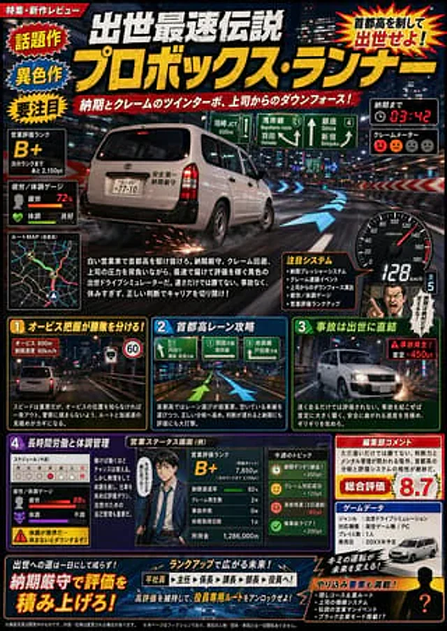

```text
{"type":"Feature article on the cover style of a Japanese game magazine for a fictional driving simulation game","genre":"High-energy weekly game magazine layout, dense editorial layout, gorgeous arcade review aesthetics, dramatic Japanese tabloid design","subject":{"main":"A white compact Japanese commercial van drifts at night on a Tokyo highway","game_title":""{argument name="game title" default="The fastest legend ever: Probox Runner"} ","tagline":"A driving simulation game about surviving deadlines and customer complaints. Office workers race along the capital's expressways while protecting cargo, avoiding complaints, and adhering to company rules, aiming for career advancement.","setting":"A wet, city-wide nighttime expressway after the rain, with skyscrapers and blurred city lights in the background. Blue-glowing lane arrows illuminate the road surface, and green elevated highway signs indicate: Hakozaki JCT 600m, Bayshore-route Haneda, and Ginza/Shinjuku."},"style":{"rendering":"Realistic vehicle rendering and game UI"} Overlay and magazine graphic mixing","color_palette":"black, yellow, red, electric blue, white, neon green","mood":"urgent, competitive, humorous, exaggerated, rough but fun","typography":"oversized and bold Japanese display font with thick outlines, explosion effects, boxed statistical panels, and glossy home console magazine titles"},"layout":{"format":"single-page magazine feature, including a large main image and 12 independent information panels or labels","sections":[{"title":"Special Feature - New Work Review","position":"top left title bar","count":1,"labels":["Special Feature - New Work Review"]},{"title":"explosive stickers","position":"top left","count":3,"labels":["popular works","unconventional works","focused"]},{"title":"main title area","position":"top center","count":3,"labels":["the fastest legend ever","Probox Runner","The deadline and the twin turbocharger of complaints, downforce from the boss!"]},{"title":"Promotional Explosion Post","position":"Top Right Corner","count":1,"labels":["Dominate the Capital Highlands, Get a Promotion and a Raise!"]},{"title":"Right Side Status Widget","position":"Top Right","count":2,"labels":["Deadline 03:42","Complaint Dashboard"]},{"title":"Left Side Player Statistics","position":"Left Middle","count":4,"labels":["Business Rating B+","Fatigue 72%","Good Physical Fitness","Route Map (Capital Highlands)"]},{"title":"Center Description","position":"Lower Middle of Main Vehicle","count":1,"la bels":["A white commercial van speeds along the capital's expressway, protecting deadlines, avoiding complaints, winning the boss's trust, and safely delivering goods in this quirky workplace promotion driving simulator"]},{"title":"Feature List","position":"Right Yellow Box","count":4,"labels":["Deadline Pressure System","Complaint Chain Events","Downward Pressure from the Boss","Unexpected 'Rest Slot'"]},{"title":"Speed ​​Cluster","position":"Right Middle","count":2,"labels":["128 km/h","5 Gears"]},{"title":"Strategy Panel","position":"Lower Half Upward","count":3,"labels":["1 Mastering speed cameras is the key to victory! {"title":"Management Panel","position":"Lower Half","count":4,"labels":["4 Long Hours of Labor and Physical Fitness Management","Business Status Screen (Example)","Editorial Comments","Overall Rating 8.7"]},{"title":"Bottom Promotion Area","position":"Bottom","count":5,"labels":["The road to promotion is not achieved overnight! ","Strictly adhere to deadlines and accumulate evaluations! ","Level up, a broader future! ","Your driving will change the future! ","Rich in replayable elements! "]}],"additional_boxes":[{"count":1,"labels":["An accident occurred! [The rest of the text appears to be a series of seemingly random characters and symbols, possibly a corrupted or incomplete string of characters. A direct translation isn't meaningful without further context or clarification.] "Item","days_off":"1 day","money":"1,286,000 yen"},"review_score":"{argument name="review score" default="8.7"} "},"characters":[{"role":"Driver's head in status portrait","appearance":"A blurred Japanese office worker, wearing a suit and tie, with medium-length dark hair, looking tired."},{"role":"Silhouette teaser","appearance":"A mysterious black silhouette of a human next to the question mark in the lower right corner."}],"vehicle":{"type":"A white delivery/company van similar to the Toyota Probox","condition":"A slightly dirty, realistic body, rear 45-degree angle, tires gripping the ground tightly, sparks flying from the lower rear when cornering aggressively","license_plate":"77-10","door_marking":"Safety first—" Strictly adhere to the deadline"},"background":{"city":"Tokyo night view","road":"Multi-lane elevated highway curves","effects":"Dynamic blur, light trails, wetland reflections, dramatic perspective, glowing navigation arrows, dense signs"},"text_language":"Japanese","quality":"Ultra-fine, clear, print-quality composition, realistic magazine scan feel, high contrast, layered edited graphics","parameters":["{argument name="game title" default="The fastest legend ever: Probox Runner"} ","{argument name="vehicle color" default="White"} ","{argument name="city" default="Tokyo"} ","{argument name="review score" default="8.7"} ","{argument name="deadline timer" default="03:42"} "],"prompt":"Create a dedicated page for a Japanese video game magazine to showcase a fictional driving simulation game. The centerpiece is a realistic car."{argument name="vehicle color" default="White"} Compact commercial vans, in{argument name="city" default="Tokyo"} A high-speed drift on a wet, slippery highway at night, viewed from a 45-degree rear angle, sparks flying from under the car, blue route arrows painted on the road as a guide for a glowing game, and bright green overpass signs. A striking, oversized Japanese title is used at the top.{argument name="game title" default="The fastest legend ever: Probox Runner"} It features an explosive yellow and red magazine layout. Around the main image are 12 editing panels and labels: a top-left title bar, 3 explosive stickers, 1 main promotional sticker, 2 right-side widgets, 4 left-side player statistics boxes, 1 central description, 1 feature list with 4 key points, 1 speed cluster, 3 strategy panels, 4 management/evaluation panels, and 5 bottom promotional slogans. Includes a setting {argument name="deadline timer" default="03:42"} The system includes a countdown timer, a complaint gauge with four facial icons, a speedometer displaying five speeds up to 128 km/h, a route mini-map, a status screen showing a B+ rating, and a display {argument name="review score" default="8.7"} A large review badge. Add a tired office worker gamer avatar and a mysterious silhouette teaser in the bottom right corner. Make it look like a page from a glamorous, chaotic Japanese game magazine review—humorous yet intense, highly readable, with bold outlines, neon accents, and a realistic print texture.
```

Model: GPT Image 2
Author: GPT Image 2 Prompts

[ProjectD](https://aitoolsradar.com/en/prompts/10dd7191f14a83) · [Recorded source](https://x.com/mkanda128/status/2047810274963619882#reversed-0)
 · [Full original metadata and byte evidence](data/projectd-batch-0030.json)

## Fictional Japanese Itasha Vehicle Generator

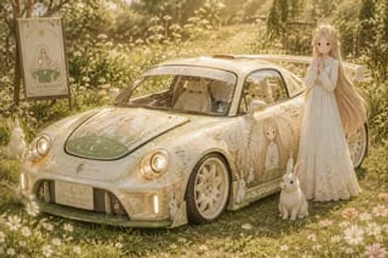

```text
Create an original {argument name="vehicle style" default="Japanese itasha vehicle"} based entirely on the uploaded illustration. Design a fully fictional car and manufacturer naturally born from the artwork’s universe, never resembling real vehicles or brands. The design must adapt to the illustration itself: {argument name="thematic styling" default="cute rounded styling for soft fantasy or shrine themes"}, elegant luxury styling for regal worlds, aggressive mechanical styling for cyberpunk or military themes, sporty styling for energetic characters, mystical styling for magical worlds, or retro-futuristic styling for nostalgic sci-fi. Body shape, proportions, cockpit, wheels, headlights, aero parts, glowing elements, materials, and interior must visually match the illustration’s atmosphere, colors, fashion, architecture, magic, and technology. All decals, logos, symbols, typography, crests, and sponsor-style graphics must be fully original fictional designs inspired only by the illustration. If a character exists, place them naturally beside the vehicle. {argument name="output quality" default="Cinematic automotive photography, anime-inspired photorealism, masterpiece quality"}.
```

Model: GPT Image 2
Author: アシタ🩵

[ProjectD](https://aitoolsradar.com/en/prompts/cfc0c44602702c) · [Recorded source](https://youmind.com/prompts/itasha-vehicle-character-car-design-20223)
 · [Full original metadata and byte evidence](data/projectd-batch-0030.json)

## Fictional Newspaper Newspaper Extra

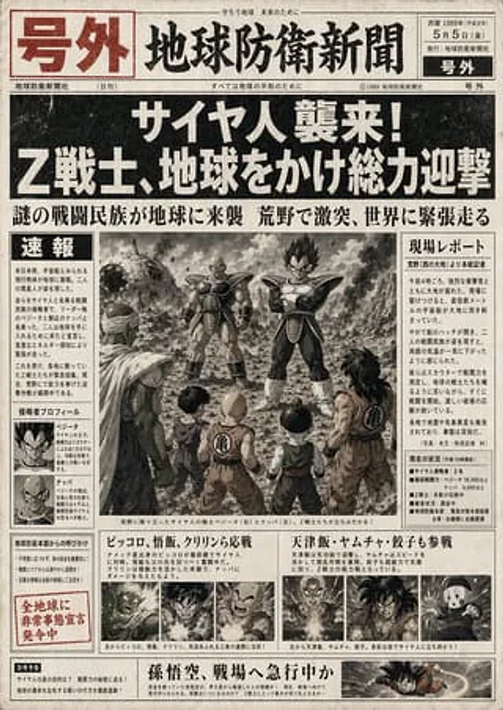

```text
Create an information about{argument name="invaders" default="Saiyans"} Extra edition of the newspaper that invaded Earth.
```

Model: GPT Image 2
Author: GPT Image 2 Prompts

[ProjectD](https://aitoolsradar.com/en/prompts/c931272d639b61) · [Recorded source](https://x.com/yuto_le/status/2046746365850726414)
 · [Full original metadata and byte evidence](data/projectd-batch-0030.json)

## Fictional Newspaper Newspaper Extra


```text
{argument name="侵略者" default="サイヤ人"}が地球に襲来した時の新聞号外を作って。
```

Model: GPT Image 2
Author: 悠斗

[ProjectD](https://aitoolsradar.com/en/prompts/69e0f3d091bd2e) · [Recorded source](https://youmind.com/prompts/newspaper-extra-alien-invasion-14789)
 · [Full original metadata and byte evidence](data/projectd-batch-0030.json)

## Fiery Burger King Whopper Poster

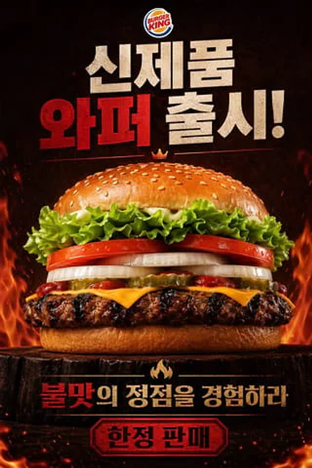

```text
A dramatic Burger King fast food advertisement poster, using a vertical composition, combines realistic food photography with bold Korean-style promotional graphic design. The official Burger King logo is placed at the top center. Below, a large, distressed Korean-style stacked headline reads "신제품와퍼출시!", with "와퍼" in a vibrant deep red and the rest in textured gray-white, against a smoky dark black background. The image centers on a massive burger, perfectly centered and dominating most of the frame from a slightly upward-looking frontal perspective. The burger contains eight clearly visible layers: a glossy sesame top bun, curly lettuce, thick slices of red tomato, thick white onion rings, pickle slices, ketchup strips, melted American cheese, a brightly charred grilled beef patty, and a soft bottom bun. A small gold crown icon floats above the top bun. The burger rests on a dark, rustic wooden peg base. Dramatic orange flames, glowing embers, hot sparks, and smoky atmosphere are added to the lower half and around the side edges to emphasize the grilling feature. Near the bottom, a second line of bold Korean text, “불맛의정점을경험하라”, is placed in the center, with “불맛” in red and the rest of the text in warm beige, separated above by a small flame icon. At the very bottom, a red badge label with a dark border is added, containing the bold black Korean text “한정판매”. The high-contrast black, red, orange, and burnt brown tones, strong cinematic lighting, glossy food highlights, and clear textures create a sophisticated, commercial advertising feel, resulting in a fiery and enticing atmosphere.
```

Model: GPT Image 2
Author: GPT Image 2 Prompts

[ProjectD](https://aitoolsradar.com/en/prompts/5eca00741f46a2) · [Recorded source](https://x.com/_uyza_/status/2047571893126090983#reversed-0)
 · [Full original metadata and byte evidence](data/projectd-batch-0030.json)

## Fiery Butadon Japanese Ad Poster

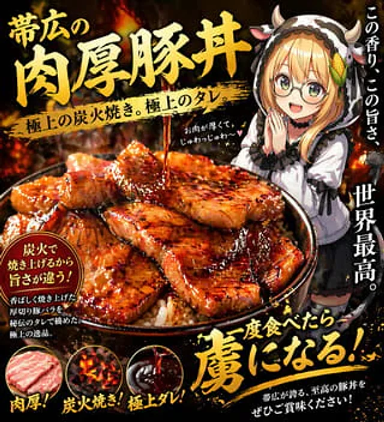

```text
A visually striking Japanese premium pork rice bowl advertisement poster, using a vertical composition with a black and fiery orange background accented by glowing embers and smoke, presents a high-contrast, food marketing aesthetic. The focal point at the bottom center is an extra-large bowl of pork rice bowl, overflowing with white rice and topped with thickly sliced, glistening grilled pork belly, coated in a rich, dark sweet soy sauce glaze, showing distinct charred marks and caramelized edges, with a swirl of sauce drizzled over it. The food presentation should convey an enticing, juicy, rich, and slightly exaggerated restaurant flyer style. The upper left corner features a striking, bold, gold-lettered Japanese title:{argument name="headline text" default="Obihiro&#39;s thick-cut pork bowl"} A gold-painted banner spans the center of the image, containing a black Japanese subtitle:{argument name="subheadline text" default="The finest charcoal-grilled meat. The finest sauce."} On the right, add a cute anime girl mascot, half-body visible, wearing a black and white cow-themed hoodie with small horns, long blonde hair, and ruffled cuffs, striking a shy yet joyful pose, one hand near her mouth; her face is deliberately obscured by a beige rectangular block. Add two sets of vertically arranged white Japanese text along the right edge: one in the upper right corner, the other larger in the lower center. Next to the girl, add a small, handwritten-style white sticky note with a small heart. The lower left contains a dark circular label with a gold border, containing white/yellow Japanese text about charcoal grilling and flavor. At the very bottom, place three circular food feature icons with precise labels below: raw pork slices are labeled as {argument name="feature label 1" default="Thick and meaty!"} The glowing embers are marked as{argument name="feature label 2" default="Charcoal-grilled!"} The glossy dark sauce is labeled as{argument name="feature label 3" default="The finest sauce!"} A vibrant, large gold calligraphy slogan with a splatter effect is added to the bottom right corner, followed by a smaller white sentence. The use of strong lighting, glossy highlights, sophisticated yakiniku flyer aesthetics, dense Japanese typography, and bold calligraphy fonts creates a mouthwatering, late-night gourmet temptation atmosphere.
```

Model: GPT Image 2
Author: GPT Image 2 Prompts

[ProjectD](https://aitoolsradar.com/en/prompts/07a92a3be12f42) · [Recorded source](https://x.com/memuroiro/status/2046603307679191102#reversed-0)
 · [Full original metadata and byte evidence](data/projectd-batch-0030.json)

## Fiery Japanese Promotional Poster

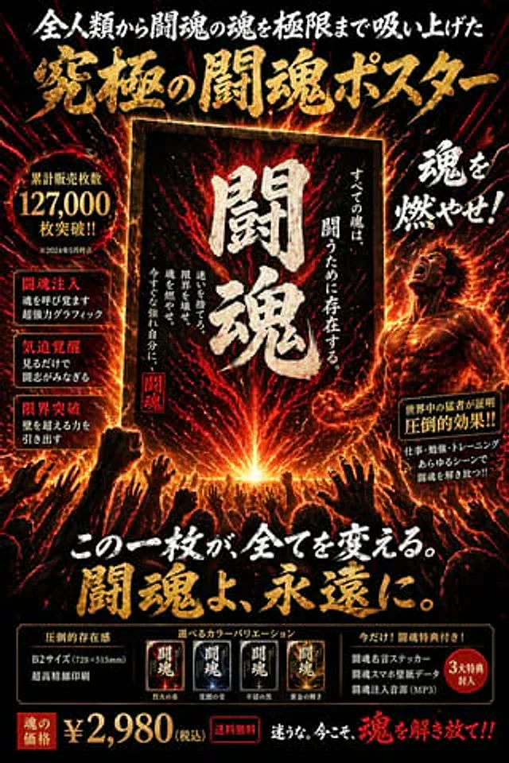

```text
{
  "type": "Japanese-style promotional poster",
  "theme": "Intense fire energy, fighting spirit, muscular build, luminous aura",
  "color_palette": [
    "black",
    "Fiery Orange",
    "red",
    "gold"
  ],
  "layout": {
    "header": {
      "subtitle": "Drawing upon the ultimate fighting spirit from all of humanity",
      "main_title": "{argument name=\"main title\" default=\"Ultimate Fighting Spirit Poster\"}"
    },
    "center": {
      "graphic": "Glowing poster with flame-radiating effect border",
      "large_text": "{argument name=\"center kanji\" default=\"Fighting Spirit\"}",
      "side_text": [
        "All souls are born for battle.",
        "Cast aside confusion. Push your limits. Ignite your soul. Become stronger now and achieve your full potential."
      ]
    },
    "left_column": {
      "sales_badge": {
        "text": "Cumulative sales exceeded{argument name=\"sales figure\" default=\"127,000\"} open!!",
        "subtext": "※As of May 2024"
      },
      "feature_boxes": {
        "count": 3,
        "labels": [
          "Infused with fighting spirit",
          "Awakening of Spirit",
          "Breaking the Limits"
        ]
      }
    },
    "right_column": {
      "character": "The muscular man shouts upwards, surrounded by a halo of flames.",
      "shout_text": "Burn your soul!",
      "testimonial_badge": {
        "title": "Global Strongest Certification",
        "main": "Overwhelming effect!!",
        "subtext": "Work, study, train—unleash your fighting spirit in any situation!!"
      }
    },
    "lower_middle": {
      "graphic": "A silhouette of a large group of people reaching out their hands towards the central illuminated poster.",
      "catchphrase": "{argument name=\"catchphrase\" default=\"This poster will change everything. The fighting spirit lives on.\"}"
    },
    "footer": {
      "specs": {
        "title": "Overwhelming presence",
        "details": [
          "B2 size (728×515mm)",
          "Ultra-high precision printing"
        ]
      },
      "color_variations": {
        "count": 4,
        "labels": [
          "Crimson Flame",
          "Awakening Blue",
          "Unyielding Black",
          "Golden Radiance"
        ]
      },
      "bonuses": {
        "count": 3,
        "title": "Limited-time offer! Includes a free Battle Spirit bonus!",
        "items": [
          "Fighting Spirit Quotes Stickers",
          "Fighting Spirit Mobile Wallpaper Data",
          "Fighting Spirit Injected into Audio Source (MP3)"
        ]
      },
      "price_bar": {
        "label": "The price of soul",
        "price": "{argument name=\"price\" default=\"¥2,980\"}",
        "tax_shipping": "(Tax included) Free shipping",
        "cta": "Don't hesitate. Now, unleash your soul!!"
      }
    }
  }
}
```

Model: GPT Image 2
Author: GPT Image 2 Prompts

[ProjectD](https://aitoolsradar.com/en/prompts/b32af303c8e117) · [Recorded source](https://x.com/nakazakifam/status/2046295223584862235#reversed-0)
 · [Full original metadata and byte evidence](data/projectd-batch-0030.json)

## FIFA Football Poster Design

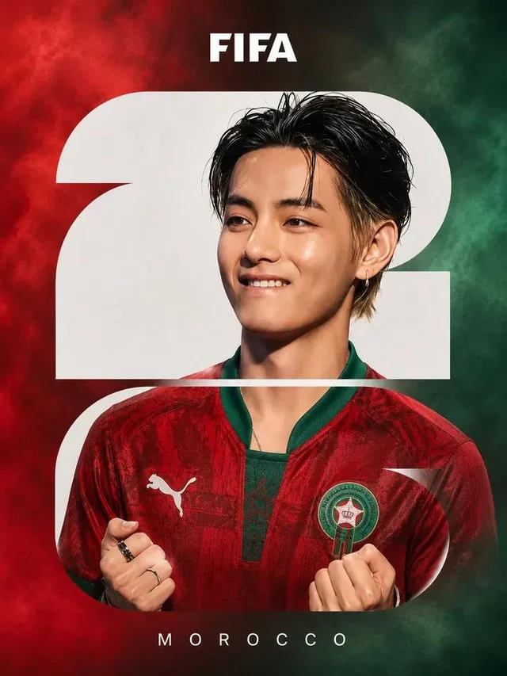

```text
FIFA football poster design, {argument name="subject" default="young BTS member"} portrait in center, short black textured hair, soft smile, wearing {argument name="team jersey" default="Morocco national team red jersey"} with green collar, hands clenched in excitement near chest, realistic skin, premium sports photography, dramatic studio lighting, ultra detailed face and jersey texture. Massive bold white {argument name="graphic element" default="number \"2\""} placed behind the subject as a graphic design element, "FIFA" text at the top center, "MOROCCO" text at the bottom center with wide letter spacing. Background filled with red and green colored smoke, Morocco flag color theme, modern FIFA promotional poster, clean typography, symmetrical composition, photorealistic, sports magazine cover style, high contrast, ultra realistic, 8K, professional football campaign artwork.
```

Model: GPT Image 2
Author: Simply Ray

[ProjectD](https://aitoolsradar.com/en/prompts/49b07b18d3eab4) · [Recorded source](https://youmind.com/prompts/bts-morocco-football-poster-25992)
 · [Full original metadata and byte evidence](data/projectd-batch-0030.json)

## FIFA World Cup 2026 Hero Poster

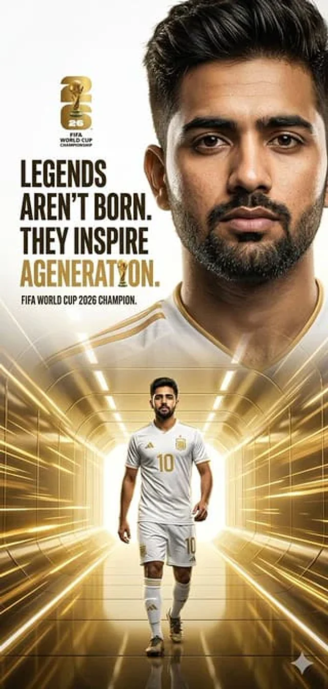

```text
Create an ultra-realistic FIFA World Cup 2026 championship poster featuring a {argument name="subject" default="young football superstar"} wearing a {argument name="jersey color" default="white"} national team jersey with {argument name="jersey number" default="number 10"}. A massive cinematic portrait of the player dominates the background, with sharp facial details, stylish windswept hair, and a confident expression. In the foreground, the player walks through a futuristic golden stadium tunnel illuminated by dramatic lights and reflections. Elegant white and gold color palette, luxury sports branding, glowing energy streaks, metallic textures, trophy-inspired design elements, epic World Cup atmosphere, high-end advertising style, inspirational sports hero aesthetic. Include dynamic depth, volumetric lighting, ultra-detailed skin, realistic fabric folds, glossy floor reflections, and award-winning poster composition. Text: “LEGENDS AREN’T BORN. THEY INSPIRE A GENERATION.” 8K resolution, hyper-realistic, cinematic, masterpiece, trending on Behance and ArtStation, premium sports campaign photography.
```

Model: GPT Image 2
Author: Muhammad Jamil

[ProjectD](https://aitoolsradar.com/en/prompts/86b871be59e3cb) · [Recorded source](https://youmind.com/prompts/fifa-world-cup-hero-poster-26219)
 · [Full original metadata and byte evidence](data/projectd-batch-0030.json)

## FIFA World Cup 2026 Sports Poster


```text
Create a cinematic ultra-detailed football poster of {argument name="player name" default="PLAYER NAME"} playing for {argument name="team" default="TEAM/COUNTRY"}, chest-up portrait, looking away from camera, dramatic team color rim lighting, floating embers, atmospheric smoke, premium sports marketing campaign style, photorealistic skin texture, highly detailed jersey with team crest, massive vertical typography displaying player's surname on the left side, "FIFA WORLD CUP 2026" text near bottom center, luxury editorial photography, AAA game key visual quality, Unreal Engine 5 rendering, ultra-sharp focus, high contrast, 8K masterpiece, smartphone wallpaper composition, character occupying 90% of frame.

Composition:

Vertical smartphone wallpaper (9:16 ratio)

Chest-up portrait occupying 85–90% of the frame

Subject positioned slightly right of center

Extreme close-up perspective with strong visual presence

Head turned slightly to the side, looking off-camera

Heroic, focused expression

Lighting:

Dramatic cinematic rim lighting

Strong team color backlight from camera-left

Soft warm key light illuminating facial details

Deep shadows with high contrast

Volumetric atmosphere and subtle haze

Premium studio photography quality

Character Detail:

Hyper-realistic skin texture

Sharp eyes with natural catchlights

Highly detailed hair strands

Photorealistic facial features

Ultra-clean professional athlete appearance

Realistic fabric folds and stitching

Jersey:

New football kit with sponsor logo

Premium fabric texture

Detailed team crest

Realistic sponsor and badge embossing

Subtle reflective highlights

Match-day elite aesthetic

Background:

Dark black-to-deep-team color gradient

Atmospheric smoke and mist

Floating ember particles

Cinematic depth

Minimal distractions

Character remains the brightest focal point

Typography Layout:

Massive vertical surname along left side

Small first name at top

Team name and position near lower-left corner

Social media handle at bottom center

Modern condensed sports typography

Bold typography matching lighting palette

Color Palette:

Deep black

Team color

Dark team color

Warm skin tones

High contrast cinematic grading

Quality:

Unreal Engine 5 quality

8K ultra-detailed

Sports marketing campaign quality

Premium poster design

Sharp focus

Photorealistic rendering

Professional color grading

Award-winning sports photography aesthetic.

Aspect Ratio: 9:16

Always generate the player in the context of the FIFA World Cup 2026, using the official national team colors, kit, and tournament atmosphere appropriate to the player's country.
```

Model: GPT Image 2
Author: Saul Goodman

[ProjectD](https://aitoolsradar.com/en/prompts/1bc009c04ef49d) · [Recorded source](https://youmind.com/prompts/fifa-2026-football-wallpaper-24576)
 · [Full original metadata and byte evidence](data/projectd-batch-0030.json)

## FIFA World Cup 2026 Sports Poster


```text
type: image_generation_prompt

{
  "title": "Universal FIFA World Cup 2026 Locked In Poster",
  "aspect_ratio": "9:16",
  "style": "ultra-realistic cinematic sports poster",
  "quality": "16K UHD premium realism",
  "subject": {
    "identity": "{argument name="player name" default="[PLAYER_NAME or uploaded player]"}",
    "pose": "powerful side-profile portrait with intense focus",
    "expression": "determined, locked-in, championship mentality",
    "gesture": "one hand gripping the national team jersey near the badge"
  },
  "wardrobe": {
    "kit": "{argument name="country" default="[COUNTRY_NAME]"} official home jersey",
    "details": "authentic textures, federation crest, official FIFA World Cup 2026 sleeve patch, realistic fabric folds and stitching"
  },
  "environment": {
    "background": "clean light grey textured sports poster canvas with futuristic geometric lines, subtle technical graphics and premium editorial composition",
    "effects": "dynamic paint splashes, energy streaks and particles inspired by the national colors of {argument name="national colors" default="[COUNTRY_NAME]"}",
    "national_elements": "subtle stars, symbols and graphic motifs inspired by the country's identity",
    "atmosphere": "high-energy tournament anticipation"
  },
  "lighting": {
    "type": "dramatic cinematic lighting",
    "rim_light": "colored rim lighting matching the country's flag",
    "highlights": "glossy skin reflections and realistic sweat details",
    "contrast": "strong sports-poster contrast"
  },
  "composition": {
    "camera_angle": "close-up side profile",
    "framing": "upper body portrait",
    "depth_of_field": "shallow",
    "focus": "face, badge and jersey grip"
  },
  "branding": {
    "tournament": "FIFA World Cup 2026",
    "logo": "official FIFA World Cup 2026 logo integrated elegantly",
    "color_palette": "official FIFA World Cup 2026 tournament colors combined with [COUNTRY_NAME] national colors",
    "headline": "\"LOCKED IN\" displayed in large modern typography",
    "subtitle": "[COUNTRY_NAME] • FIFA WORLD CUP 2026"
  },
  "mood": [
    "focused",
    "elite",
    "fearless",
    "national pride",
    "championship energy"
  ],
  "camera": {
    "lens": "85mm",
    "sharpness": "extreme detail",
    "rendering": "hyper-realistic sports illustration mixed with premium editorial poster design"
  },
  "output_goal": "Create a world-class FIFA World Cup 2026 poster that works universally for any player and any country, featuring a side-profile portrait, jersey grip, explosive national-color energy effects, elegant tournament branding, and a powerful 'LOCKED IN' atmosphere worthy of an official promotional campaign."
}
```

Model: GPT Image 2
Author: Saul Goodman

[ProjectD](https://aitoolsradar.com/en/prompts/0d0b11211b9ed5) · [Recorded source](https://youmind.com/prompts/fifa-world-cup-2026-poster-25619)
 · [Full original metadata and byte evidence](data/projectd-batch-0030.json)

## FIFA World Cup Minimalist Poster

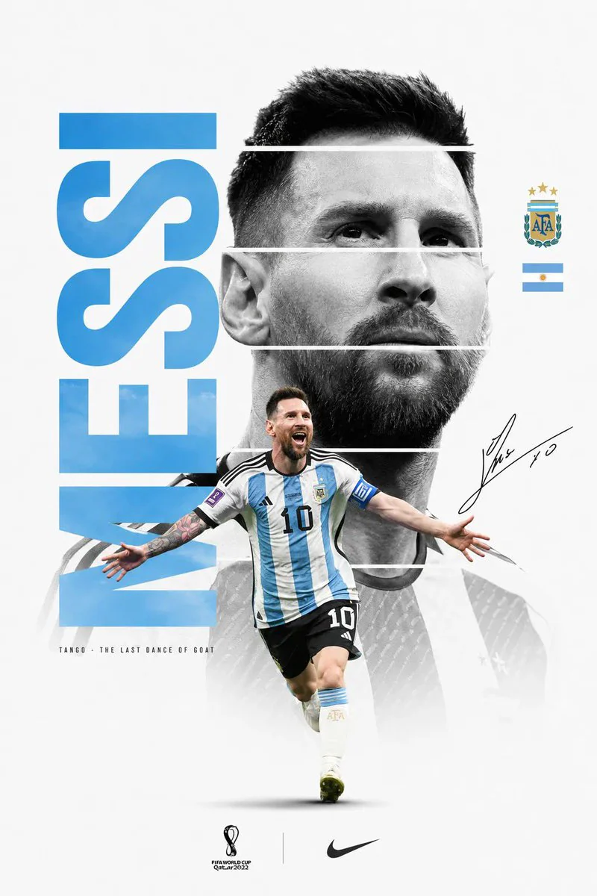

```text
Create a premium FIFA World Cup poster design featuring a {argument name="player type" default="legendary football superstar"}. Minimalist white background with a giant monochrome close-up portrait occupying most of the canvas. The portrait is divided into several horizontal slices with thin white gaps between them, creating a modern fragmented editorial effect. On the left side, large vertical bold typography spelling the player’s name in {argument name="color scheme" default="national team colors"}. A full-body action pose of the player overlaps the portrait in the foreground, wearing the national team jersey and celebrating confidently. National flag and federation crest placed on the upper right. Elegant autograph signature near the portrait. Soft fog/smoke fading at the bottom. Luxury sports magazine aesthetic, {argument name="branding style" default="Nike-style"} advertising campaign, high contrast black-and-white portrait, sharp facial details, clean composition, premium typography, poster design, sports branding, editorial layout, cinematic lighting, ultra realistic, 8k, professional graphic design, negative space, modern FIFA World Cup promotional artwork.

Style Keywords:
Sports poster, Editorial design, Modern typography, Monochrome portrait, Dynamic athlete pose, White minimal background, Premium branding, High-end advertising, World Cup campaign, Ultra detailed, Photorealistic, Graphic design masterpiece
```

Model: GPT Image 2
Author: K

[ProjectD](https://aitoolsradar.com/en/prompts/498d541a116fd1) · [Recorded source](https://youmind.com/prompts/fifa-world-cup-minimalist-poster-25683)
 · [Full original metadata and byte evidence](data/projectd-batch-0030.json)

## FIFA World Cup Poster Design

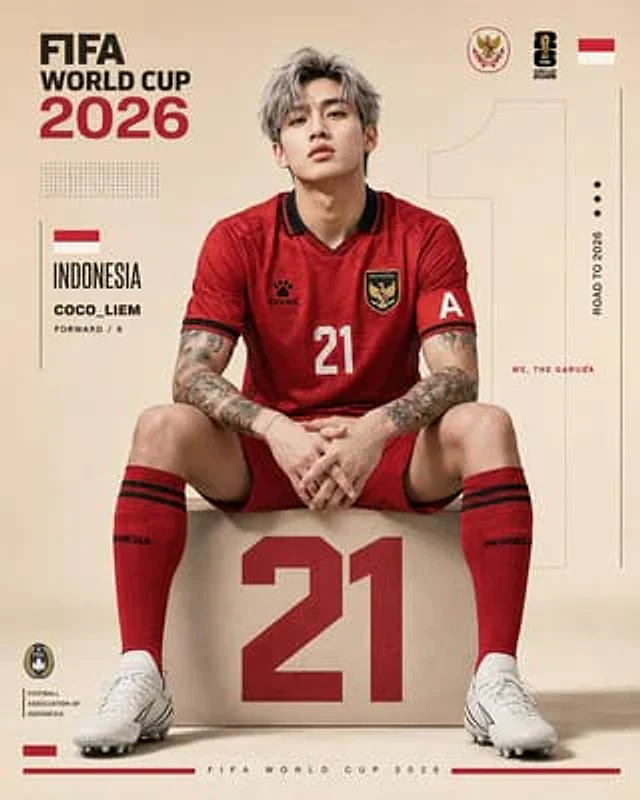

```text
Ultra-realistic FIFA World Cup 2026 poster design, vertical format 4:5, clean premium sports editorial aesthetic with minimalist beige studio background. Center composition featuring a {argument name="player identity" default="stylish Indonesia football player"} sitting confidently on a large geometric block with the {argument name="player number" default="number “7”"} printed in bold red on the front.The player wears a modern Indonesia national team football kit in {argument name="kit color" default="vivid textured red"} with black collar trim, black kelme logo, Indonesia football crest, captain armband with white “C”, red socks with black stripes, and white football boots. The player has messy silver-gray hair, sharp jawline, pale skin, tattoo-covered neck and arms, fashionable K-pop inspired appearance, intense facial expression, relaxed pose with elbows on knees and hands clasped. lighting is soft and cinematic with subtle shadows and ultra-detailed skin texture, fabric folds, tattoos, and realistic reflections. Background includes oversized transparent number “7” behind the player, modern graphic layout elements, thin black divider lines, minimalist dots, Indonesia flags, football federation inspired logos, typography blocks, and editorial text placements. Include text such as: “FIFA WORLD CUP 2026”, “INDONESIA”, “{argument name="name" default="YOUR NAME"}”, “FORWARD / 7”, “ROAD TO 2026”,“WE, THE GARUDA”. Design style combines luxury sports branding, FIFA promotional poster aesthetics, modern magazine layout, Korean street-fashion influence, and premium football campaign visuals. Symmetrical composition, centered framing, ultra-sharp details, realistic textures, high contrast, soft beige and red color palette, photorealistic quality, 8k resolution, professional typography hierarchy, clean spacing, modern poster grid system.
```

Model: GPT Image 2
Author: Kashberg

[ProjectD](https://aitoolsradar.com/en/prompts/d2eb009e375eee) · [Recorded source](https://youmind.com/prompts/fifa-world-cup-poster-design-23296)
 · [Full original metadata and byte evidence](data/projectd-batch-0030.json)

## FIFA World Cup Sports Poster

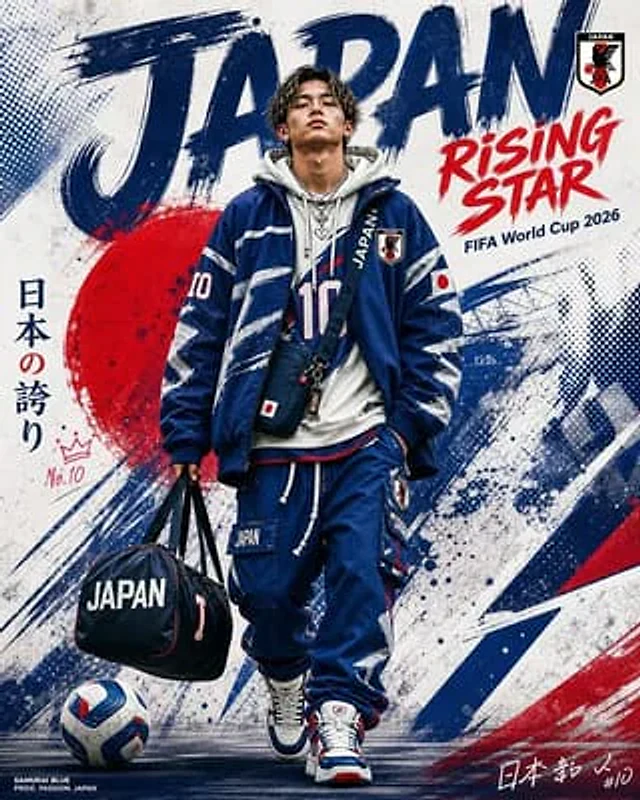

```text
High-energy sports poster for {argument name="event" default="Japan FIFA World Cup 2026"}. Young male football player walking forward confidently in the center, wearing a {argument name="team colors" default="blue and white"} Japan national team tracksuit with white stripes, gray hoodie underneath, and blue crossbody bag. Jersey and tracksuit have number {argument name="player number" default="10"} and Japan crest. Holding a black duffel bag with 'JAPAN' in white letters in right hand. White and blue sneakers, chain necklace. A blue and white football at his feet on the left.

Background features bold brush stroke design in Japan flag colors: red, blue, and white. Large distressed blue text 'JAPAN' at top. Red brush text 'RISING STAR' on right, with smaller text 'FIFA World Cup 2026' underneath. Japan football association crest top right. Small crown icon and 'No.10' text on left side. Bottom left has 'SAMURAI BLUE' and tagline 'PRIDE. PASSION. JAPAN'. Bottom right has stylized signature and '#10'. Dynamic splatter and halftone effects, modern streetwear-meets-football aesthetic, vertical 2:3 poster layout, high detail, photorealistic with graphic design elements.
```

Model: GPT Image 2
Author: Anissa

[ProjectD](https://aitoolsradar.com/en/prompts/fc4bd60a53e6de) · [Recorded source](https://youmind.com/prompts/fifa-world-cup-sports-poster-21344)
 · [Full original metadata and byte evidence](data/projectd-batch-0030.json)

## FIFA World Cup Trophy 3D Poster


```text
Premium sports advertising design, {argument name="brand" default="FIFA"} branding, hyper-realistic, high-end 3D render, World Cup corporate championship aesthetic, luxury finish, Behance/Dribbble showcase style, striking visual impact for a viral cover.

# Subject (use Reference Image 1)
Official FIFA World Cup Trophy placed at the center of the composition, visually integrated within giant three-dimensional numbers.

# Product
Highly detailed FIFA World Cup golden trophy, polished metallic finish, realistic reflections, visible engravings, exclusive and prestigious appearance.

# Composition
Centered frontal view, vertical symmetrical composition, full focus on the trophy and numbering, soft depth of field, slightly low-angle perspective to enhance the sense of grandeur, minimalist and elegant design.

# Main Element (3D Typography)
Giant 3D number "{argument name="year number" default="26"}" occupying most of the frame.
Solid extra-bold typography, bright white color with metallic gold edges.
The FIFA trophy emerges from the center of the number, visually merging with the typographic structure.
Below the number appears the text "FIFA" in metallic gold letters.

# Background
Dark sports-inspired texture based on professional technical jersey fabric, visible micro textile details, atmospheric gradient between deep blue and warm gold tones, blurred background to emphasize the central element.

# Visual Effects
Specular highlights on the trophy, cinematic golden reflections, soft glow behind the cup, subtle luminous particles, premium light halo, prestige and World Cup celebration effect.

# Lighting
Cinematic studio lighting.
Warm key light from the upper left.
Cool blue rim light from the right side.
Golden contour lighting on the typography.
Realistic HDR reflections on metallic surfaces.

# Color Grading
Petroleum blue, pearl white, and FIFA gold palette.
High contrast.
Deep shadows.
Premium international sports advertising tones.
High-end cinematic finish.

# Additional Typography
Large bottom text:
"{argument name="athlete name" default="Ronaldo"}"
in bold condensed white typography.
The letter "O" is replaced with a shiny metallic gold ring.

# Details
Ultra realistic.
8K.
Octane Render.
Unreal Engine 5.
Global illumination.
Ray tracing.
High-end branding design.
Photorealistic metal reflections.
Luxury sports identity.
Extreme sharpness.
Professional poster design.
Award-winning composition.
Behance featured quality.
Hyper-detailed textures.

# Format
Aspect ratio: 9:16 (vertical).
Premium advertising poster.
Ultra HD.
Cinematic sports branding.
```

Model: GPT Image 2
Author: simeon-sanai

[ProjectD](https://aitoolsradar.com/en/prompts/4fcb20ac206c71) · [Recorded source](https://youmind.com/prompts/fifa-world-cup-trophy-poster-23939)
 · [Full original metadata and byte evidence](data/projectd-batch-0030.json)

## FIFA World Cup Trophy Winner


```text
PLAYER={argument name="player name" default="[player name]"}

Ultra-realistic sports photography, documentary realism, premium commercial campaign style, immersive 4:5 vertical composition.

The camera is positioned deep inside an opened luxury gift box, creating a dramatic first-person perspective from the hidden treasure itself. A {argument name="trophy" default="magnificent golden FIFA World Cup trophy"} rests on elegant dark velvet fabric in the lower foreground, with realistic metallic reflections and authentic textures.

Above the opened box stands @ PLAYER, leaning forward and looking directly into the box with an expression of determination, ambition, and hunger for glory. He reaches one hand naturally toward the trophy, symbolizing his dream of winning the FIFA World Cup 2026.

STRICT IDENTITY PRESERVATION OF @ PLAYER. The player must be instantly recognizable as the real @ PLAYER, with authentic facial structure, eye shape, nose, lips, jawline, hairstyle, beard style, skin texture, and expression. Preserve his real-world appearance with extreme accuracy. No generic AI face.

Authentic human anatomy, realistic proportions, detailed skin pores, realistic eyes, natural hair strands, genuine facial expression, lifelike appearance, true-to-life colors.

Use provided {argument name="jersey" default="reference jersey identical"} do not change it, if jersey not referenced use official 2026 national team jersey with realistic fabric folds, stitching, texture, sweat details, and accurate colors.

The official FIFA World Cup 2026 logo is elegantly integrated into the composition with realistic physical appearance. The overall scene incorporates the authentic FIFA World Cup 2026 visual identity and official tournament color palette, creating a premium championship atmosphere.

Warm stadium lights in the distance, subtle crowd bokeh, realistic depth of field, natural shadows, cinematic composition, premium sports advertising photography.

Captured with a Canon EOS R3 and RF 70-200mm f/2.8L lens, Getty Images realism, Reuters sports photography quality, authentic football photography, shallow depth of field, realistic lighting, true-to-life materials.

Luxury black gift box interior, premium velvet textures, elegant packaging, realistic cardboard material, soft shadows, natural golden reflections.

Photorealistic, highly detailed, realistic skin texture, realistic hands, realistic fingers, authentic athlete appearance, physically accurate materials.

No generic AI faces, no face distortion, no altered facial features, no stylized appearance, no cartoon style, no CGI look, no plastic skin, no wax skin, no fantasy effects, no exaggerated proportions, no deformed hands, no extra fingers, no toy figures, no LEGO style, no miniatures.

No watermarks, no unrelated text, no third-party branding.

16K ultra-high-resolution, photorealistic, premium commercial sports photography, FIFA World Cup 2026 atmosphere.

Aspect Ratio: 4:5 Create image
```

Model: GPT Image 2
Author: Harboris

[ProjectD](https://aitoolsradar.com/en/prompts/c661ba18df2f7f) · [Recorded source](https://youmind.com/prompts/fifa-world-cup-trophy-winner-25362)
 · [Full original metadata and byte evidence](data/projectd-batch-0030.json)

## FIFA World Cup Victory Throne

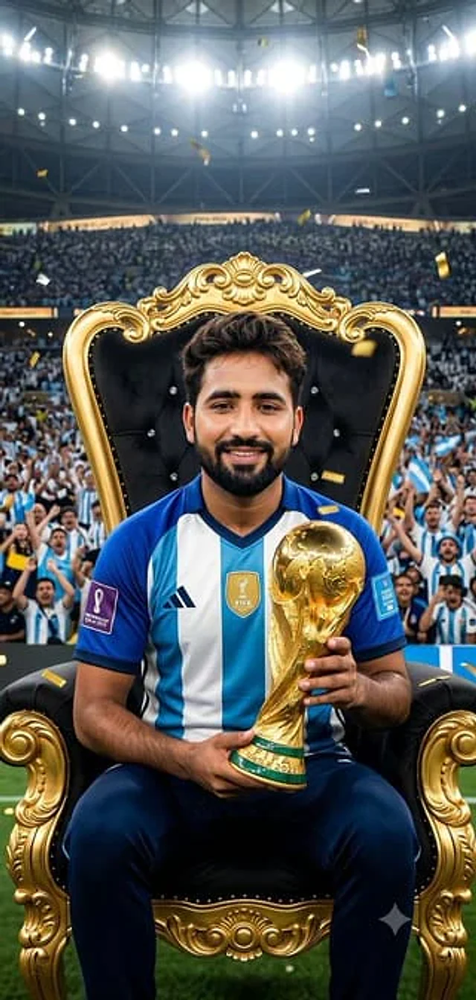

```text
A luxury FIFA World Cup throne composition featuring the uploaded face as reference for identity preservation, the subject seated in the middle of a dark studio arena on a {argument name="chair type" default="black leather chair"} placed atop a circular metallic platform, wearing a {argument name="subject clothing" default="dark long-sleeved shirt and black jeans"} with light sneakers, staring forward with a calm, dominant expression, one hand resting on the knee while the other holds a gleaming trophy upright like a symbol of victory, surrounded by a ring of oversized metallic trophies and footballs arranged in a sculptural, symmetrical formation, with a few smaller balls and trophies closer to the foreground to create depth and scale, the backdrop a deep solid black with subtle stadium-like atmospheric haze, strong {argument name="rim light color" default="blue"} rim light from above outlining the face and shoulders, warm red accent light rising from below to create dramatic contrast and sculpt the silhouette, reflective chrome surfaces catching every highlight, cinematic studio realism, premium editorial photography style, shallow depth of field, extreme detail, bold composition, elite FIFA World Cup visual identity, viral social media poster energy.
```

Model: GPT Image 2
Author: Muhammad Jamil

[ProjectD](https://aitoolsradar.com/en/prompts/cce5943d1764d2) · [Recorded source](https://youmind.com/prompts/fifa-world-cup-victory-throne-25682)
 · [Full original metadata and byte evidence](data/projectd-batch-0030.json)

## Figure with Emoji Head in Sunlit Alley

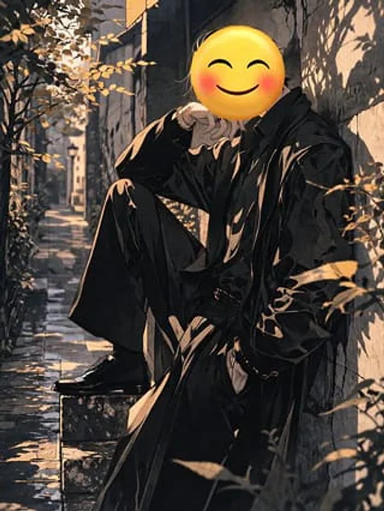

```text
An anime-style illustration depicts a person casually leaning against a textured stone wall, with a background of {argument name="setting" default="Narrow and sun-drenched cobblestone alley"} The character is wearing{argument name="clothing" default="All-black suit and long coat"} One hand rested near his chin, the other in his pocket. One leg was raised, a black leather shoe resting on a stone. The character's face was completely obscured by a {argument name="face covering" default="Giant yellow shy smiley face emoji"} Obscuring. The scene employs a dramatic approach.{argument name="lighting" default="High-contrast dappled sunlight"} Light filters through nearby leaves, casting sharp, complex shadows on dark clothing and rough walls. The overall atmosphere is stylish and mysterious, with a warm, golden hour color palette.
```

Model: GPT Image 2
Author: GPT Image 2 Prompts

[ProjectD](https://aitoolsradar.com/en/prompts/d2bbcd7bde9bed) · [Recorded source](https://x.com/Dana_Nako/status/2044565955150557568#reversed-0)
 · [Full original metadata and byte evidence](data/projectd-batch-0030.json)

## Film Style Instructional Diagram

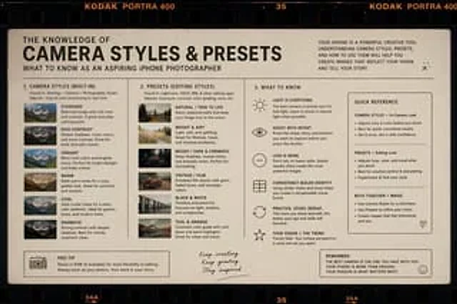

```text
Please generate a 35mm cinematic style diagram illustrating camera styles, presets, and what a passionate iPhone photography beginner needs to know. Each camera and preset style should be presented in its true visual style, rather than using this uniform 35mm style.
```

Model: GPT Image 2
Author: GPT Image 2 Prompts

[ProjectD](https://aitoolsradar.com/en/prompts/002fc476a1cdc7) · [Recorded source](https://x.com/Vtrivedy10/status/2046771959157887014)
 · [Full original metadata and byte evidence](data/projectd-batch-0030.json)

## Filmmaking Eras Typographic Grid

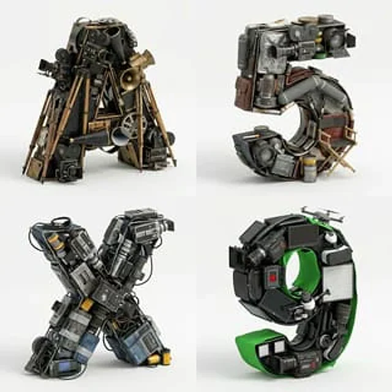

```text
Create a clean 2x2 grid against a pristine white studio backdrop, showcasing four large 3D typographic sculptures, each character entirely constructed from filmmaking equipment from different eras. The four letterforms are precisely four characters: the letter A in the top left, the number 5 in the top right, the letter X in the bottom left, and the number 9 in the bottom right. Each character should be facing forward, centered in its respective quadrant, clearly discernible, yet composed of densely packed, realistic film tools and set props, possessing believable occlusion, weight, and structural logic. Visualized using high-end Cinema 4D products, it employs subtle ambient occlusion, soft three-point studio lighting (with a softbox at the top), sharp shadows, realistic materials, and independent composition. Top Left: The letter A, composed of equipment from early films and silent films, is assembled from a vintage wooden tripod, a hand-cranked film camera, brass lenses, film reels, megaphones, horn-shaped horns, matte black metal parts, belts, and aged wood. Surface textures should include worn varnished wood, black crackled paint, brass rust, worn metal, and dusty antique patina. The outline should appear cluttered yet recognizable, with tripod legs and old camera bodies outlining the shape of an "A." Top right: The number 5, composed of mid-20th-century analog filmmaking equipment, is assembled from classic film cameras, film canisters, metal cans, brown leather cases, audio accessories, silver fabric bags, director's chairs, cylindrical lenses, production equipment, and vintage production bags. Materials should emphasize brushed aluminum, leather, canvas, rubber, and weathered industrial finishes. The number 5 should appear solid and balanced, with props stacked tightly to form the letter. Bottom left: The letter X, composed of late 20th-century video and broadcast equipment, is assembled from shoulder-mounted cameras, portable recorders, battery packs, coiled cables, box modules, control panels, worn blue-grey plastic casings, and rugged field electronics. Visible wiring and tape-secured components are included. The materials should have a utilitarian and slightly worn feel, featuring dark plastic, anodized metal, stickers, rubber handles, and yellow accent details. The intersecting diagonals of the X must be sharp and solid. Bottom right corner: The number 9, composed of contemporary digital cinema and virtual production equipment, is assembled from modern cinema cameras, compact monitors, LED light panels, drones, stabilizers, light shields, black modular accessories, and a vibrant green screen that forms part of the digital design. It includes smooth vents, carbon fiber textures, matte black metal, polished glass, and a bright green screen fabric as the dominant accent color. The number 9 should appear as modern and sophisticated as possible, with modular precision and a clean, industrial design aesthetic. Keep the background clean and simple, without extra text, floating objects, flat typography, or 2D rendering. The sculpture should look like a realistically proportioned object, rich in detail, photorealistic, and suitable for use as graphic design material.
```

Model: GPT Image 2
Author: GPT Image 2 Prompts

[ProjectD](https://aitoolsradar.com/en/prompts/95d88fa2b2ed04) · [Recorded source](https://x.com/Gdgtify/status/2047677943611297889#reversed-1)
 · [Full original metadata and byte evidence](data/projectd-batch-0030.json)

## Filmmaking Eras Typographic Grid

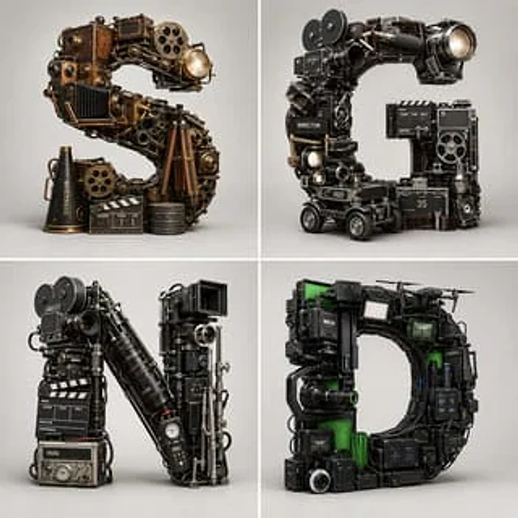

```text
Create a clean 2x2 grid showcasing four forward-facing 3D typographic sculptures against a seamless light gray studio background divided by thin white lines. Each quadrant contains a giant letter, entirely constructed from dense, realistic film equipment and set props from different cinematic eras; the letter's shape, though seemingly chaotic, is clearly discernible. High-end Cinema 4D rendering aesthetics, ambient occlusion, realistic proportions, intricate assembly details, subtle wear, metallic reflections, and three-point studio lighting with a soft top light source are employed. Top left: The letter S, representing early silent or primitive cinema, is constructed from antique brass and wooden cameras, exposed gears, film reels, projector parts, bellows, wooden tripod legs, and vintage optical housings; warm bronze and copper tones; the bottom contains three additional props: a black megaphone labeled "DIRECTOR," a clapperboard, and a stack of short film reels; the top right corner features a projector-like lens emitting a bright light. Top right corner: The letter C represents classic Hollywood filmmaking, consisting of a black metal film camera, studio lenses, film canisters, lens hoods, track carriage components, control boxes, and simulated studio hardware; primarily black, steel, and gunmetal gray with subtle brass accents; the bottom and right side integrate four additional props: a clapperboard, a square side module, a film canister marked "35," and a small cylindrical jar; a large positive light or lens illuminates the top right corner. Bottom left corner: The letter N represents modern analog or late 20th-century cinema, assembled from an Arriflex-style camera, long film zoom lenses, support frames, tracks, cables, a clapperboard, and a live sound recorder; primarily matte black with silver hardware and a few red decorative rings; the bottom contains three clearly visible basic elements: a clapperboard section, a labeled director's bar, and a rectangular audio recorder/control unit at the bottom. Bottom right corner: The letter D, representing digital and virtual production, consists of a RED-style digital cinema camera, monitors, battery packs, wireless transmitters, drones, LED panels, green screen fabric inserts, and modular support components; a black technical body with vibrant green accents and screen graphics; it includes four distinct integrated equipment types: a drone arm/propeller at the top, a rectangular LED light panel, multiple monitors, and a large camera lens in the bottom left corner. All objects are grounded and physically connected; there are no suspended parts, no flat typography, no handwritten style, no paper texture, and no cluttered backgrounds. Ultra-fine, sharp, 8K, exquisite graphic design material suitable for posters or cinematic visual contrasts.
```

Model: GPT Image 2
Author: GPT Image 2 Prompts

[ProjectD](https://aitoolsradar.com/en/prompts/fdc8bfef5e3df2) · [Recorded source](https://x.com/Gdgtify/status/2047677943611297889#reversed-0)
 · [Full original metadata and byte evidence](data/projectd-batch-0030.json)

## Find Kyle in a Seoul Market

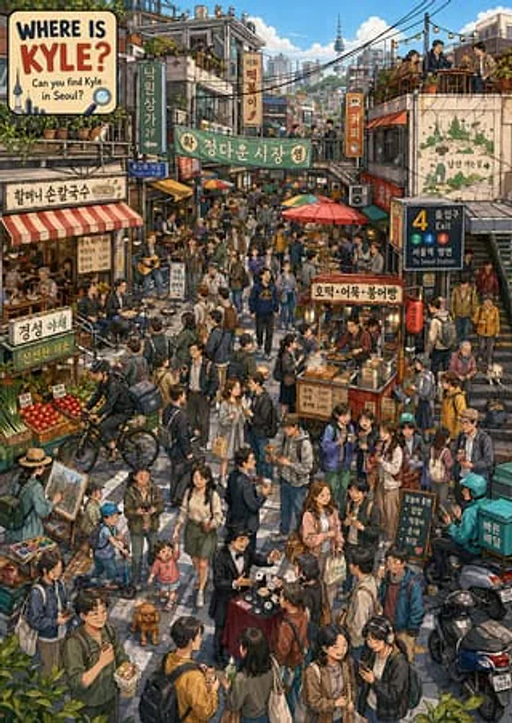

```text
A richly detailed vertical travel illustration depicts the bustling alleyways of Seoul's markets. Employing a refined hand-drawn realistic style, it features warm, cinematic lighting, a dense urban narrative, and clearly legible signs. The image is teeming with pedestrians, shoppers, diners, street food customers, musicians, and commuters. The slightly elevated perspective gives the alleyways a layered and vibrant feel. A large illustrated poster in the upper left corner reads "WHERE IS..."{argument name="character name" default="KYLE"} The title, "Can you find Kyle in Seoul?", uses a striking and playful English font, reminiscent of the cover of a "Finding Wally" book. The setting is clearly Seoul, with Namsan Tower visible on the distant horizon, above which are tangled wires, rooftop seating, stacked low-rise buildings, and Korean shop signs. To the right is a subway entrance sign displaying lines 4, 2, 4, 4, and the bilingual text "서울역방면/ To Seoul Station". It includes 15 clearly visible main signs or text panels: 1) "WHERE IS{argument name="character name" default="KYLE"} 1) Poster, 2) “할머니손칼국수”, 3) Hanging vertical sign “낙원상가2F”, 4) A small blue street sign, 5) Vertical sign “이름떡볶이”, 6) Large market archway sign “황진다운시장영”, 7) Orange vertical sign “커피”, 8) Map mural on the wall “남산가는길”, 9) Subway signs “출입구4” and “서울역방면/ To Seoul Station”, 10) Agricultural product sign “경성야채”, 11) Agricultural product sign below “신선한채소”, 12) Handwritten street performer signs, 13) a street food cart sign “호떡·어묵·붕어빵”, 14) a menu item “오늘의추천김밥떡볶이순대튀김”, and 15) the text on a delivery box “빠른배달”. Eight main stalls or activity areas are set up in the alley: 1) a noodle shop under a red and white awning on the left, with seated diners; 2) a vegetable stall piled high with crates of produce; 3) a group of street performers playing guitar and percussion; 4) a street food cart in the middle selling sugar cakes, fish cakes, and crucian carp cakes; 5) a group of customers standing and eating snacks, holding cups; 6) a magic stall in the center below performing card and cup tricks; 7) a painter in front of an easel in the lower left; 8) a group of delivery motorcycles in the lower right. Add 6 Notable background details: 1) Rooftop diners on the upper right terrace; 2) A cat resting on the upper left eaves; 3) Colorful market parasols in the middle distance; 4) Staircases and narrow side alleys; 5) Dense balconies and windows filled with plants and residents; 6) Towers and the skyline in the distance. The crowd should be extremely diverse in age and attire, primarily featuring casual contemporary Korean street fashion, including jackets, hoodies, backpacks, skirts, trousers, and sneakers, interspersed with some office workers and students. A subtle and unique character should be hidden as the target to be found.{argument name="target outfit" default="a young man in a blue hoodie with yellow lettering"} The design seamlessly integrates the image into the central crowd, rather than deliberately highlighting it. It utilizes vibrant yet solid color palettes, including brick red, cyan, forest green, cream, mustard yellow, asphalt gray, and sky blue. Emphasis is placed on intricate lines, legible Korean text, urban observation details, lively human poses, and the playful feel of a high-end "Find Wally" style Seoul search poster. The aspect ratio is 2:3.
```

Model: GPT Image 2
Author: GPT Image 2 Prompts

[ProjectD](https://aitoolsradar.com/en/prompts/8629bc0cf22791) · [Recorded source](https://x.com/flow_edu_/status/2046802030115885385#reversed-0)
 · [Full original metadata and byte evidence](data/projectd-batch-0030.json)

## Fire Spirit Character Reference Sheet

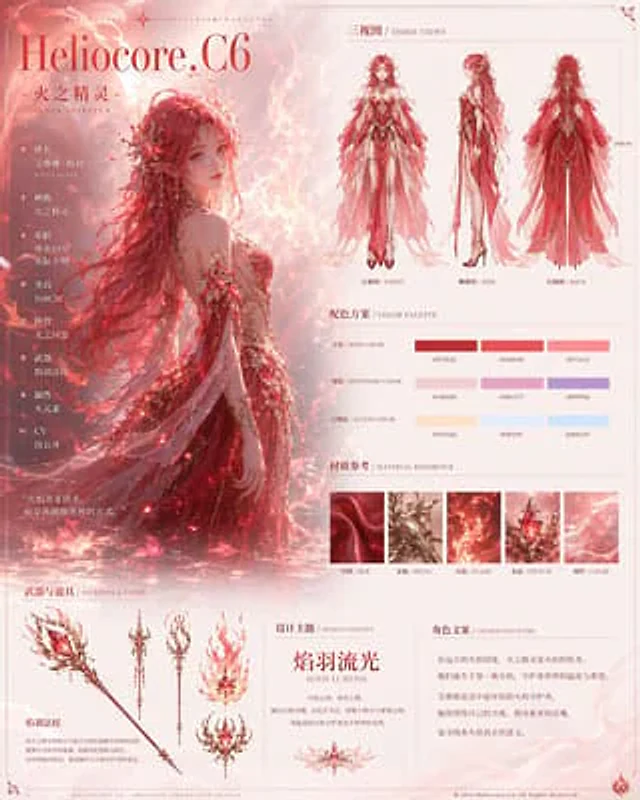

```text
{"type":"Anime Character Design Reference Poster","subject":{"character":{"name":"{argument name="character name" default="Heliocore. C6"} ","title":"Fire Spirit / IGNIS SPIRITUS","gender_presentation":"An ethereal young woman","age_note":"Appears 19 years old, actual age unknown","height":"168cm","theme":"Fire element spirit, guardian of the sacred fire, an elegant original fantasy character","appearance":{"hair":{"color":"{argument name="hair color" default="Dark red"} ","style":"Extremely long, flowing, wavy hair, layered and shimmering with ember-like highlights, adorned with a magnificent crown of crystals and metallic flames."},"outfit":{"silhouette":"A luxurious, semi-transparent, multi-layered long dress with a trailing chiffon fabric and petal-shaped flame designs,"primary_color":"{argument name="main outfit color" default="Deep Ruby Red"} ","details":"The torso is adorned with gold filigree armor and jewels, crystal flame patterns, a semi-transparent pink and red veil, gemstone chains, high heels, and the whole body radiates shimmering embers."}}},"layout":{"orientation":"Vertical Poster","background":"A gradient background from soft pale pink to ivory white, with glowing flames, smoke, and magical effects, presenting a high-end editing layout style","sections":[{"title":"Character Profile","position":"Left Side","count":8,"labels":["Name","Race","Age","Height","Faction","Weapon","Attributes","CV"]},{"title":"Three Views","position":"Top Right","count":3,"labels":["Front View","Side View","Back View"]},{"title":"Color Scheme"]} PALETTE","position":"Right Middle","count":3,"labels":["Main Color","Secondary Color","Accent Color"]},{"title":"Material Reference","position":"Lower Right Middle","count":5,"labels":["Silk","Metal","Flame","Crystal","Gauze"]},{"title":"Weapons &amp; Items","position":"Lower Left","count":5,"labels":["Wand with Red Crystal Head","Slender Wand 1","Slender Wand 2","Floating Fireball","Crown Ornament"]},{"title":"Design Theme","position":"Bottom Center","count":1,"labels":["Flame Feathers"]} LUMINIS"]},{"title":"Character Story","position":"Bottom Right Corner","count":1,"labels":["Background Story Text Block"]}],"centerpiece":"The left half of the poster is a large and dramatic three-quarter portrait of the character's back, with the character slightly turned, her hair and skirt fluttering in the wind and glowing flames."},"style":{"genre":"High-Detail Fantasy Anime Concept Art","rendering":"Exquisite character reference images, delicate lines, oil painting-like lighting, glossy materials, glowing particles, elegant typography, high-end game art presentation","mood":"Solemn, sacred, romantic, fiery, ethereal","color_palette":"Red, coral, rose pink, gold, light pink, white highlights"},"text_elements":{"headline":"{argument name="headline text" default="Heliocore. C6"} ","subheadline":"Fire Spirit","latin_subtitle":"IGNIS SPIRITUS","design_concept":"Flame Feather Flowing Light / IGNIS LUMINIS","footer":"© 2024 Heliocore.C6 All Rights Reserved."},"composition_notes":"Maintaining ample white space and meticulous dividing lines between panels, using an elegant magazine-style grid, mixing Chinese and small English subheadings, clearly displaying all labeled areas, making the character the absolute visual focus, and ensuring that each sample panel is neatly aligned, presenting the level of a high-end original character reference project."}
```

Model: GPT Image 2
Author: GPT Image 2 Prompts

[ProjectD](https://aitoolsradar.com/en/prompts/9c060ddf1d6bc3) · [Recorded source](https://x.com/chenoh61/status/2046584887327764725#reversed-0)
 · [Full original metadata and byte evidence](data/projectd-batch-0030.json)

## First-Person Fantasy RPG Screenshot

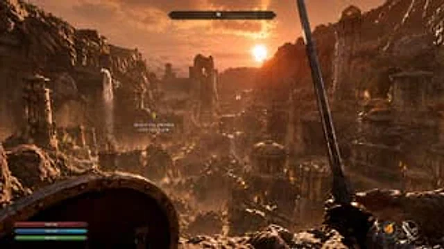

```text
{
  "type": "First-person RPG game screenshots",
  "environment": "{argument name=\"场景描述\" default=\"An ancient ruined city nestled in a rocky canyon, featuring stone towers, brass domes, and waterfalls.\"}",
  "lighting": "{argument name=\"时间段\" default=\"Golden hour sunset with volumetric light and warm orange glow\"}",
  "first_person_view": {
    "left_hand": "{argument name=\"左手装备\" default=\"Round wooden metal shield\"}",
    "right_hand": "{argument name=\"右手武器\" default=\"An upward-tilted steel sword\"}"
  },
  "hud_elements": [
    {
      "position": "Top center",
      "description": "Horizontal compass bar with \"N\" and marking"
    },
    {
      "position": "Left middle",
      "description": "A floating yellow diamond-shaped task marker with the text \"{argument name=\"任务文本\" default=\"Heading to the city of Kaljor in Dwemer\"} \""
    },
    {
      "position": "bottom left corner",
      "description": "Three horizontal resource bars: red (236/236), blue (142/142), and green (183/183)."
    },
    {
      "position": "bottom right corner",
      "description": "Two circular action icons, one for fire magic and the other for archery."
    }
  ]
}
```

Model: GPT Image 2
Author: GPT Image 2 Prompts

[ProjectD](https://aitoolsradar.com/en/prompts/2c672306340cf4) · [Recorded source](https://x.com/Pixel_Beaky/status/2044593832470130868#reversed-2)
 · [Full original metadata and byte evidence](data/projectd-batch-0030.json)

## First-Person Mirror Bedroom Photo

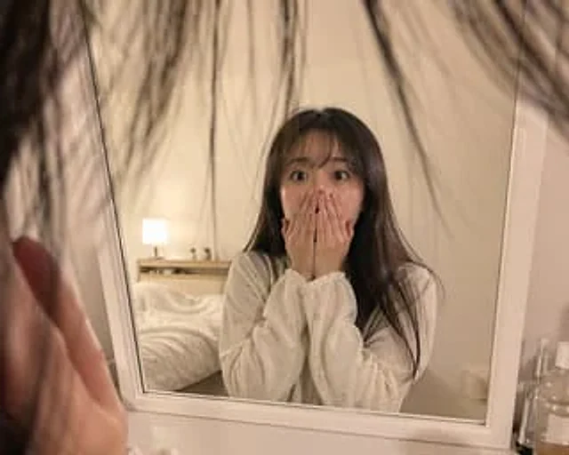

```text
A lifelike first-person perspective photograph, set in a minimalist bedroom with soft nighttime lighting, as if the viewer is standing in front of a full-length mirror gazing at their own reflection. In the foreground, long, dark hair falls from the top and sides of the image, partially obscuring the viewer's vision; a hand is raised near the left side of the face, as if touching the cheek or hair. In the mirror's reflection, a person with {argument name="hair color" default="Dark brown"} A young woman with long, straight hair is positioned in the center of the image, wearing a loose-fitting ivory or off-white long-sleeved nightgown with delicate tiny floral patterns and wide sleeves. She poses shyly, her hands supporting her chin, elbows tucked in, creating a soft, intimate, and slightly bashful atmosphere. Her face is hidden or obscured, creating a sense of anonymous self-portrait. A mirror with a simple white frame sits on a white dressing table. The background reflected in the mirror is a neatly arranged warm beige bedroom, containing a slightly messy bed with white sheets, a small wooden bedside table or low shelf, a warm-light table lamp with a square white lampshade, and two small decorative items beside the lamp. To the right of the dressing table are two transparent skincare or cosmetic bottles and a small round white container. It employs warm ambient lighting, creamy neutral tones, shallow depth of field, soft realism, smartphone photography composition, comfortable Japanese apartment aesthetics, and a casual home atmosphere, while retaining subtle imperfections rather than studio-quality retouching.
```

Model: GPT Image 2
Author: GPT Image 2 Prompts

[ProjectD](https://aitoolsradar.com/en/prompts/ab9534cd44d23c) · [Recorded source](https://x.com/TSF_AI/status/2046926044628955171#reversed-0)
 · [Full original metadata and byte evidence](data/projectd-batch-0030.json)

## First-Person Tropical Island Warzone


```text
A cinematic first-person modern military battle scene set on a tropical island coastline. The perspective is that of a soldier holding a black assault rifle in his right hand, positioned in the lower right corner of the frame, his dark tactical glove visible. The scene depicts a coastal defense base under attack in the bright midday sun, against a clear blue sky dotted with white clouds. The foreground and midground depict a rugged dirt road littered with hay, debris, crates, and metal barrels, leading to a compact military facility comprised of futuristic industrial-style bunkers and machinery painted in olive green and gray. Five prominent base structures are included: a circular bunker with a small dome on the far left, a cylindrical tower to its right, a large arched hangar-like bunker with a dark entrance in the center, a low turret structure in the right-middle ground, and a section of defensive wall combining stone and metal in the far right foreground. In the center of the midground, a large ground explosion is shown, accompanied by orange flames and thick black smoke, with a towering vertical column of smoke visible near a cliff behind the base. The background features palm-fringed rocky cliffs with a small waterfall on the left-center side and the ocean and horizon visible on the right. Above the water, near the right coast, four large gray warships are clustered. The sky includes three helicopters, four small aircraft or drones in the distance, and five missile or rocket trails diagonally across the sky from right to left, highlighting a massive and intense assault. The game boasts ultra-detailed and realistic AAA-level visuals, realistic lighting and shadows, clear textures, cinematic action composition, a wide-angle first-person shooter perspective, high contrast, a dynamic war atmosphere, and an epic scale.
```

Model: GPT Image 2
Author: GPT Image 2 Prompts

[ProjectD](https://aitoolsradar.com/en/prompts/558b9724766649) · [Recorded source](https://x.com/lipeng0820/status/2047231302118858815#reversed-3)
 · [Full original metadata and byte evidence](data/projectd-batch-0030.json)

## First-Person Tropical Island Warzone


```text
A cinematic first-person modern military battle on a tropical island coastline, viewed from the perspective of a soldier holding a black assault rifle in both hands at the lower right foreground, with dark tactical gloves visible. The scene shows a fortified coastal base under attack in bright midday sunlight beneath a vivid blue sky with scattered white clouds. In the foreground and midground, depict a rugged dirt path with dry grass, scattered debris, crates, and metal barrels leading into a compact military installation made of futuristic-industrial bunkers and machinery painted olive green and gray. Include 5 prominent base structures: a rounded bunker with a small dome on the far left, a cylindrical tower just right of it, a large central arched hangar-like bunker with a dark entrance, 1 squat turreted structure on the right midground, and 1 stone-and-metal defensive wall section at the far right front. In the center midground, show 1 major ground explosion with orange fire and black smoke, plus 1 tall vertical smoke plume rising behind the base near the cliffs. The background features rocky cliffs lined with many palm trees and a small waterfall descending near the center-left, with the ocean and horizon visible to the right. Over the water, show 4 large gray battleships grouped near the coast on the right side. In the sky, include 3 helicopters, 4 smaller aircraft or drones in the distance, and 5 visible missile or rocket trails streaking diagonally across the sky from right to left, emphasizing an active large-scale assault. Ultra-detailed photorealistic AAA video game key art, realistic lighting, sharp textures, cinematic action composition, wide-angle first-person shooter viewpoint, high contrast, dynamic war atmosphere, epic scale.
```

Model: GPT Image 2
Author: SimbaLee

[ProjectD](https://aitoolsradar.com/en/prompts/dbd7e6516bf9bb) · [Recorded source](https://youmind.com/prompts/first-person-tropical-warzone-15297)
 · [Full original metadata and byte evidence](data/projectd-batch-0030.json)

## First-Person VRChat Meme Crossover Screenshot

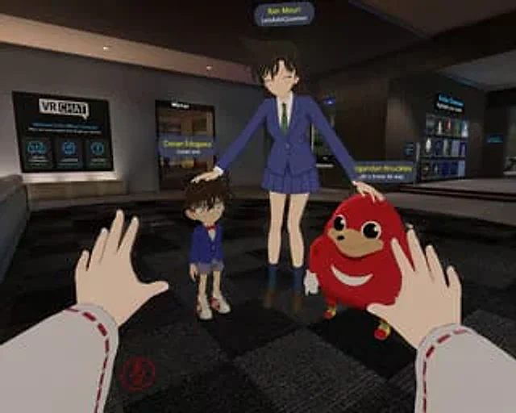

```text
A location{argument name="game environment" default="VRChat Lobby"} The first-person POV screenshot shows a dark checkered floor, a "VR CHAT" welcome sign on the left, a "Mirror" porch, and an "Avatar Showcase" on the right. In the foreground, the observer's hands are visible, wearing white sleeves with red dotted stitching, and are extended forward. A red mute microphone UI icon is located in the lower left corner. A figure stands in the center of the frame.{argument name="tall character" default="Ran Mouri, wearing a blue school uniform in Detective Conan."} She smiled with her eyes closed, and was {argument name="action" default="Stroking the heads of the two smaller characters"} Her left side is{argument name="small character 1" default="Conan Edogawa, wearing a blue suit and a red bow tie"} Her right side is{argument name="small character 2" default="Ugandan Knuckles meme characters"} Each character has a floating nameplate above them: the tall girl's nameplate reads "Ran Mouri" in yellow and "LetsAskAQuestion" in white below; the boy's nameplate reads "Conan Edogawa" and "conan.exe" below; and the red creature's nameplate reads "Ugandan Knuckles" and "do u know de way" below.
```

Model: GPT Image 2
Author: GPT Image 2 Prompts

[ProjectD](https://aitoolsradar.com/en/prompts/638932ef4aeabc) · [Recorded source](https://x.com/senb0n22a/status/2044546201736077710#reversed-0)
 · [Full original metadata and byte evidence](data/projectd-batch-0030.json)

## Fitness SaaS Landing Page UI

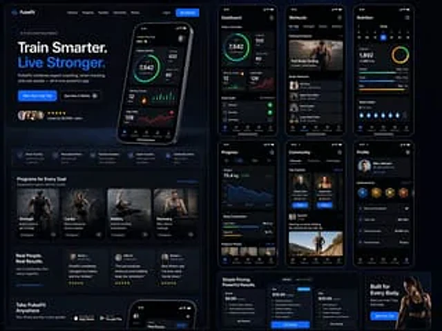

```text
Design a modern, high-end{argument name="app type" default="Fitness app"} Landing page and product UI, brand name is{argument name="brand name" default="PulseFit"} Create a clean web design mockup that resembles a legitimate SaaS fitness platform and its accompanying mobile app. The design should convey a premium feel, be motivating, and easy to use; the UI/UX should benchmark against top-tier health and fitness apps. Includes: - Homepage: Features a striking title, concise subtitle, a strong call-to-action (CTA) button, and an app preview. - Dashboard UI: Displays daily activity, calories burned, consecutive workout days, heart rate, steps, and a progress bar. - Workout Plan Cards: Covers strength, cardio, flexibility, and recovery training. - Nutrition Tracking: Includes macronutrient analysis and hydration tracking. - Progress charts and analytics components. - Coach/Community: Includes profile cards and user reviews. - Pricing and app store download guide. - Mobile App Interface: Presented alongside the web design, showcasing a unified product ecosystem style: - Stylish, minimalist, and modern interface. - High-end fitness brand aesthetics. - Comfortable spacing, clear hierarchy, rounded cards, and soft shadows. - Dark mode UI with energetic accent colors like electric blue, neon green, or vibrant orange. - Clear typography, realistic charts, elegant buttons, and a beautiful onboarding experience. - Highly detailed, Dribbble-compliant, startup-level product design. - Authentic UX. Case study presentation, non-cartoon or illustration style: - Complete website homepage mockup - Multiple UI sections presented in a sophisticated showcase - Product display perspective using micro-perspective or frontal views - Simple background with subtle gradients and professional lighting effects - High-resolution detail, crisp text rendering, and visually balanced layout: A stunning and realistic fitness app website and dashboard UI/UX design concept that looks ready for development. It resembles a genuine Figma product design demo for a high-end startup.
```

Model: GPT Image 2
Author: GPT Image 2 Prompts

[ProjectD](https://aitoolsradar.com/en/prompts/b2731439d8337b) · [Recorded source](https://x.com/pwealthydad/status/2046609300605260193)
 · [Full original metadata and byte evidence](data/projectd-batch-0030.json)

## Five Ways to Style a Lettered Knit Top

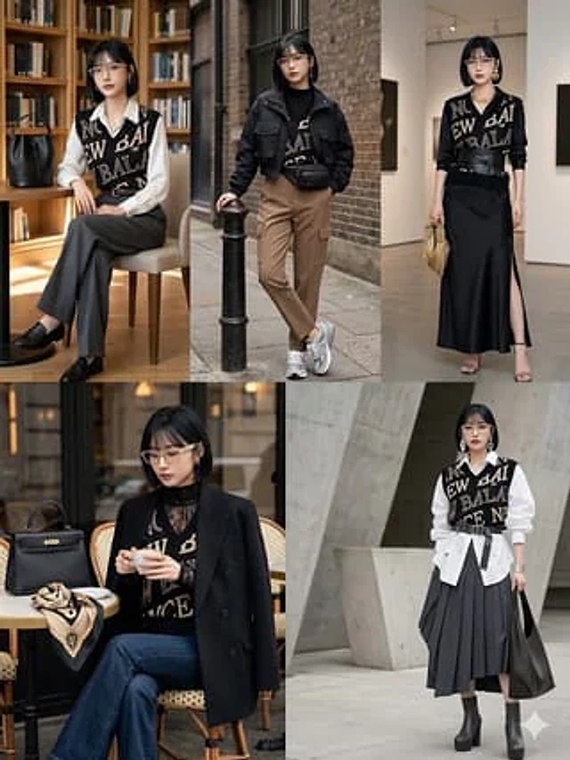

```text
{
  "type": "Fashionable collage",
  "subject": {
    "person": "Slim figure, with a neat chin-length black bob, simple makeup, elegant urban style.",
    "garment_focus": "{argument name=\"sweater text\" default=\"Black knitted vest with oversized beige lettering that reads &quot;NC NEW BAI BALA CE&quot;.\"}",
    "theme": "Five different styling ideas based on the same unique knit top",
    "face_visibility": "The faces in each style are softened or blurred."
  },
  "layout": {
    "composition": "Double-line editing collage",
    "sections": [
      {
        "title": "Style 1",
        "position": "Top left",
        "count": 1,
        "labels": [
          "Library-style office design"
        ]
      },
      {
        "title": "Style 2",
        "position": "Upper-middle",
        "count": 1,
        "labels": [
          "Street casual functional style"
        ]
      },
      {
        "title": "Style 3",
        "position": "Top right",
        "count": 1,
        "labels": [
          "Gallery dinner chic look"
        ]
      },
      {
        "title": "Style 4",
        "position": "Bottom left",
        "count": 1,
        "labels": [
          "Café mature and casual style"
        ]
      },
      {
        "title": "Style 5",
        "position": "Bottom right",
        "count": 1,
        "labels": [
          "Modern layered midi skirt style"
        ]
      }
    ],
    "count": 5
  },
  "looks": [
    {
      "name": "Style 1",
      "setting": "The library's interior is warm, with wooden bookshelves, tables and chairs, and soft sunlight.",
      "pose": "Sitting at the table, legs crossed",
      "outfit_items": [
        "Black letter knit vest",
        "white shirt",
        "Charcoal gray wide-leg suit pants",
        "Black loafers"
      ],
      "accessories": [
        "Black structured handbag"
      ],
      "mood": "capable, intellectual, and refined"
    },
    {
      "name": "Style 2",
      "setting": "City sidewalk, with brick walls and black pillars on the side.",
      "pose": "Standing casually, one hand in pocket, one leg crossed",
      "outfit_items": [
        "Black lettered knit top, layered over a black base layer.",
        "Black short functional jacket",
        "Camel straight-leg cargo pants",
        "Silver-gray sneakers"
      ],
      "accessories": [
        "Wearing a black fanny pack around the waist"
      ],
      "mood": "Practical, cool, urban"
    },
    {
      "name": "Style 3",
      "setting": "Interior of a minimalist art gallery",
      "pose": "Full body standing posture",
      "outfit_items": [
        "Black letter knit sweater to wear alone",
        "High-waisted black maxi skirt with a dramatic slit design",
        "Black wide belt"
      ],
      "accessories": [
        "gold chain necklace",
        "Gold earrings",
        "Small metallic gold handbag",
        "Strappy high-heeled sandals"
      ],
      "mood": "Avant-garde, elegant, and full of tension"
    },
    {
      "name": "Style 4",
      "setting": "An outdoor café terrace with tables and chairs",
      "pose": "Sitting, holding a coffee cup",
      "outfit_items": [
        "Black letter knit top",
        "Black lace turtleneck inner layer",
        "Black oversized double-breasted suit jacket",
        "Dark blue straight leg jeans"
      ],
      "accessories": [
        "A large, structured black handbag sat on the table.",
        "A cream-colored and black silk scarf was placed on the table.",
        "Dark sunglasses"
      ],
      "mood": "Parisian style, refined, relaxed luxury"
    },
    {
      "name": "Style 5",
      "setting": "Modern concrete building exterior",
      "pose": "Standing posture, walking lightly",
      "outfit_items": [
        "White oversized shirt dress or long shirt with a tie detail at the waist.",
        "Wear a black lettered knit vest as an outer layer",
        "Gray pleated midi skirt",
        "Black chunky heeled ankle boots"
      ],
      "accessories": [
        "Large dark tote bag",
        "Watch or bracelet"
      ],
      "mood": "Editor's style, layering, contemporary style"
    }
  ],
  "style": {
    "image_type": "High-end fashion styling manual montage",
    "lighting": "Soft, natural light, realistic shadows, and advanced editing-style color grading.",
    "camera": "Full-body fashion photography, frontal shots and slightly different angles.",
    "quality": "Photorealistic, rich in fabric details, luxurious design"
  },
  "color_palette": {
    "dominant": [
      "black",
      "White",
      "Charcoal gray",
      "Camel",
      "Deep Navy Blue"
    ],
    "accents": [
      "gold",
      "Beige"
    ]
  },
  "customization": {
    "main_top": "{argument name=\"main knit color\" default=\"black\"}",
    "model_hair": "{argument name=\"hairstyle\" default=\"Neat black bob haircut\"}",
    "scene_style": "{argument name=\"location mood\" default=\"Editing urban indoor and street scenes\"}"
  }
}
```

Model: GPT Image 2
Author: GPT Image 2 Prompts

[ProjectD](https://aitoolsradar.com/en/prompts/6fdef24edfacee) · [Recorded source](https://x.com/Lucky_FLYFUTURE/status/2046908728327454799#reversed-1)
 · [Full original metadata and byte evidence](data/projectd-batch-0030.json)

## Five-Panel Benchmarking Challenge

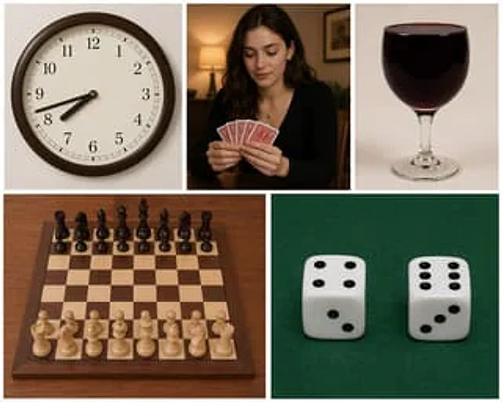

```text
Create a{argument name="panel count" default="five"} An image composed of several sub-images, each with a different style: 1) A display{argument name="time" default="7:42"} 1) An analog clock. 2) A woman holding cards. 3) A full glass of wine. 4) A real photograph of a physical chessboard, clearly showing all pieces in their standard starting positions. 5) Two dice, with clearly visible numbers.
```

Model: GPT Image 2
Author: GPT Image 2 Prompts

[ProjectD](https://aitoolsradar.com/en/prompts/a3f62ec1b90312) · [Recorded source](https://x.com/chetaslua/status/2044336850371002820)
 · [Full original metadata and byte evidence](data/projectd-batch-0030.json)

## Five-Panel Benchmarking Challenge


```text
Create an image consisting of {argument name="panel count" default="five"} sub-images, each with a different style: 1) An analogue clock showing {argument name="time" default="7:42"}. 2) A woman holding cards in her hands. 3) A glass of wine filled to the brim. 4) Real photography of a physical chessboard, fully visible, with all the pieces in their standard starting positions. 5) Two dice, with the numbers clearly visible.
```

Model: GPT Image 2
Author: Chetaslua

[ProjectD](https://aitoolsradar.com/en/prompts/32de2790f2403b) · [Recorded source](https://youmind.com/prompts/five-panel-benchmark-challenge-14078)
 · [Full original metadata and byte evidence](data/projectd-batch-0030.json)

## Flame-Grilled Burger Ad Poster

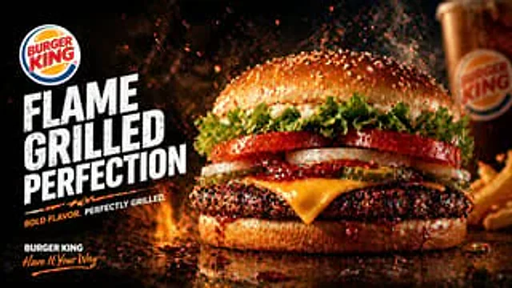

```text
for{argument name="brand name" default="BURGER KING"} Create a fast-food advertising poster with a cinematic photography style. Use a wide, horizontal composition, with the main burger occupying the right side of the frame, and prominent promotional typography stacked on the left. The background should be near black, complemented by orange flames, glowing embers, smoke, and splattered grease to emphasize the heat and grilling sensation. The burger should be photographed in an extreme close-up, from a tabletop perspective, placed on a glossy, dark reflective surface, with sauce dripping and a few water droplets. The eight burger components should be clearly displayed from top to bottom: a sesame top bun, a layer of curly lettuce, two thick slices of red tomato, two white onion rings, three slices of pickles, a slice of melted yellow American cheese, a thick, charred grilled beef patty, and a glossy bottom bun with barbecue sauce dripping from its edge. The patty should have a substantial texture, with charred grill marks and juicy highlights. Add sparks and rising steam around the burger. On the left, in the upper left corner, place a circular fast-food logo, below which are three lines of stacked, large, distressed, bold white lettering with the following text:{argument name="headline text" default="FLAME GRILLED PERFECTION"} Below it, add a line of smaller orange slashes or underlines in capital letters, with the following text:{argument name="tagline text" default="BOLD FLAVOR. PERFECTLY GRILLED."} In the bottom left corner, the brand name is again displayed in white font, accompanied by a slogan in orange handwritten font.{argument name="slogan text" default="Have It Your Way"} Against a blurred background on the right, two secondary food elements are included: a glass of branded soda and a serving of fries, both to be kept in a blurred state. High contrast, rich warm tones, glossy food photography, ultra-fine textures, realistic commercial lighting, shallow depth of field, high-end restaurant poster aesthetics, and print-ready advertising composition.
```

Model: GPT Image 2
Author: GPT Image 2 Prompts

[ProjectD](https://aitoolsradar.com/en/prompts/378d454f19ade3) · [Recorded source](https://x.com/azed_ai/status/2046980650440544368#reversed-3)
 · [Full original metadata and byte evidence](data/projectd-batch-0030.json)

## Flame-Grilled Burger Ad Poster


```text
Create a dramatic fast-food advertising poster in a cinematic studio style for {argument name="brand name" default="BURGER KING"}. Use a wide landscape composition with the hero burger dominating the right half of the frame and bold promotional typography stacked on the left. The background should be nearly black with fiery orange flames, glowing embers, smoke, and flying grease droplets to emphasize heat and flame-grilling. The burger should be an extreme close-up, shot at table level on a glossy dark reflective surface with sauce drips and scattered droplets. Show exactly 8 visible burger components from top to bottom: 1 sesame seed top bun, 1 layer of curly green leaf lettuce, 2 thick red tomato slices, 2 white onion rings, 3 pickle slices, 1 slice of melted yellow American cheese, 1 thick charred flame-grilled beef patty, and 1 glossy bottom bun with barbecue sauce dripping over the edge. Make the patty heavily textured with blackened grill-char detail and juicy highlights. Add sparks and steam rising around the burger. On the left side, place a circular fast-food logo near the upper-left corner, then huge distressed bold white block text in three stacked lines reading {argument name="headline text" default="FLAME GRILLED PERFECTION"}. Beneath it, add a short tagline in smaller uppercase text with an orange accent slash or underline, reading {argument name="tagline text" default="BOLD FLAVOR. PERFECTLY GRILLED."}. In the bottom-left corner, add the brand name again in white plus a handwritten script slogan in orange reading {argument name="slogan text" default="Have It Your Way"}. In the blurred background on the far right, include exactly 2 secondary food elements: 1 branded soda cup and 1 portion of fries, both out of focus. High contrast, rich warm tones, glossy food photography, ultra-detailed textures, realistic commercial lighting, shallow depth of field, premium restaurant poster aesthetic, print-ready ad composition.
```

Model: GPT Image 2
Author: Amira Zairi

[ProjectD](https://aitoolsradar.com/en/prompts/6e2b2786974e5c) · [Recorded source](https://youmind.com/prompts/flame-grilled-burger-ad-poster-15069)
 · [Full original metadata and byte evidence](data/projectd-batch-0030.json)

## Flash Mirror Selfie in Red Restroom


```text
A realistic-style selfie taken in a high-end restroom with a sophisticated ambiance, against a dark background.{argument name="wall color" default="Dark red"} The textured wall features a large, round mirror with a thin black frame at its center. A person with long {argument name="hair color" default="Dark brown"} Wavy hair{argument name="subject" default="young women"} She stands slightly off-center, her upper body leaning forward and to the side, exuding a relaxed and confident posture. One hand holds a phone, partially obscuring her face, while the other rests on a dark stone or marble countertop. She wears a black, fitted, off-the-shoulder long-sleeved top with a heart-shaped neckline, paired with high-waisted charcoal gray or black jeans, and carries a black shoulder bag under her arm. The phone flash is extremely bright, completely obscuring her face and creating a strong starburst effect in the image, along with a distinct blue-white horizontal lens flare, accompanied by subtle halo effects and a realistic overexposure reminiscent of mobile photography. Behind her is a dark wood-paneled door reflected in a mirror. The room includes two tall, cylindrical wall lamps with warm bulbs, positioned on either side of the mirror's edge; a small gold light switch panel on the left wall; a curved, brushed metal faucet at the bottom center; and two small candlesticks or prayer lamps along the lower right edge. The style is realistic mobile photography, with slight graininess, warm low-light environment, realistic reflection effect, slight sensor noise, and natural shadows, presenting the private nightlife bathroom aesthetics, and using vertical portrait composition.
```

Model: GPT Image 2
Author: GPT Image 2 Prompts

[ProjectD](https://aitoolsradar.com/en/prompts/4b3c3af4bcc782) · [Recorded source](https://x.com/craftian_keskin/status/2047046373401301055#reversed-0)
 · [Full original metadata and byte evidence](data/projectd-batch-0030.json)

## Flash Mirror Selfie in Red Restroom

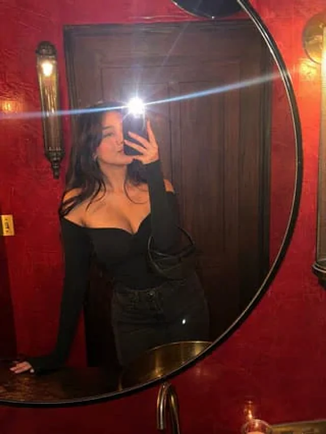

```text
A candid smartphone mirror selfie in a moody upscale restroom with deep {argument name="wall color" default="crimson red"} textured walls and a large round mirror with a thin black frame dominating the composition. A {argument name="subject" default="young woman"} with long {argument name="hair color" default="dark brown"} wavy hair stands slightly off-center, leaning her torso forward and to the side in a relaxed confident pose, one hand holding the phone in front of her face and the other braced on a dark stone or marble countertop. She wears a fitted black off-shoulder long-sleeve top with a sweetheart neckline and high-waisted charcoal or black jeans, with a black shoulder bag tucked under one arm. The phone flash is extremely bright, fully obscuring the face and creating a sharp starburst plus 1 strong horizontal blue-white lens flare streak across the image, with subtle bloom and realistic smartphone exposure clipping. Behind her is a dark wooden paneled door centered in the reflection. The room includes 2 tall cylindrical wall sconces with warm glowing bulbs, one on each side near the mirror edges, 1 small gold-toned light switch plate on the left wall, 1 curved brushed-metal faucet visible at the bottom center, and 2 small candle holders or votive lights at the lower right edge. Style is authentic phone-camera photography, slightly grainy, warm low-light ambience, realistic reflections, minor sensor noise, natural shadows, intimate nightlife restroom aesthetic, vertical portrait framing.
```

Model: GPT Image 2
Author: Keskin

[ProjectD](https://aitoolsradar.com/en/prompts/9146b5b7b06e04) · [Recorded source](https://youmind.com/prompts/red-restroom-mirror-selfie-14810)
 · [Full original metadata and byte evidence](data/projectd-batch-0030.json)

## Flash Mirror Selfie in Retro Bathroom


```text
A casual, flash-lit mirror selfie taken in a small, retro bathroom, framed vertically with an early 2000s realistic disposable camera aesthetic. A young woman stands in front of a slightly messy mirror, her face softly blurred in a rectangular shape. She holds a smartphone, the bright direct flash creating a strong starburst halo on the right side of the frame. She has dark brown hair with light blonde highlights, styled in a messy shark-hair bun with wispy strands framing her face. She wears small hoop earrings and two stacked silver necklaces. She wears a fitted white cropped T-shirt with faded pink preppy lettering "NANTUCKET" (reflected in the mirror), loose grey-linen sweatpants, and white socks. One knee is casually resting on the sink, giving the pose a relaxed, intimate, candid feel. Her phone case is covered in cute stickers and comes with a round airbag holder featuring a pink cartoon bear or bunny. The lower half of the bathroom wall is tiled in light pink, while the upper half is grayish-white. Seven toiletries and beauty products are cluttered on the sink: four bottles on the left, a black hairbrush on the edge of the sink, and two perfume or cosmetic bottles at the bottom edge of the mirror. A beige towel hangs in the background, and visible stains and dust particles on the metal mirror frame are captured by a flash. The image includes dramatic shadows cast on the left wall and mirror, a soft green light interplay with the intense flash, and features delicate film grain, natural skin texture, and slight lens distortion, creating a realistic and unretouched everyday atmosphere.
```

Model: GPT Image 2
Author: GPT Image 2 Prompts

[ProjectD](https://aitoolsradar.com/en/prompts/a97dc59226d372) · [Recorded source](https://x.com/ai_for_success/status/2047008335518658971#reversed-0)
 · [Full original metadata and byte evidence](data/projectd-batch-0030.json)

## Flash Mirror Selfie in Retro Bathroom

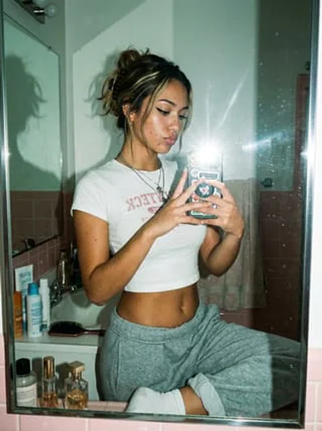

```text
A candid flash mirror selfie in a small retro bathroom, shot vertically with a realistic early-2000s disposable-camera aesthetic. A young woman with her face obscured by a soft rectangular blur stands in front of a slightly dirty mirror, holding a smartphone with a bright direct flash that creates a strong starburst flare at the center-right of the image. She has dark brown hair with lighter blonde highlights, styled in a messy claw-clip updo with loose strands around the face, and wears small hoop earrings plus 2 layered silver necklaces. Her outfit is a fitted white baby tee with faded pink collegiate-style text reading "NANTUCKET" in reverse from the mirror, and loose heather gray sweatpants with white socks; one knee is raised casually on the sink counter, giving the pose a relaxed, intimate snapshot feel. The phone case is covered with cute stickers and a round grip featuring a pink cartoon bear or bunny motif. The bathroom has pale pink wall tiles on the lower half, off-white upper walls, a sink counter cluttered with 7 visible toiletry and beauty items total: 4 bottles on the left side of the sink, 1 black hairbrush on the sink edge, and 2 perfume or cosmetic bottles along the bottom ledge of the mirror. A beige towel hangs in the background, and the mirror frame is metal with visible smudges and dust specks catching the flash. Include the subject’s shadow cast dramatically on the left wall and mirror, soft ambient greenish indoor light mixed with harsh flash, subtle film grain, natural skin texture, slight lens distortion, and an authentic unpolished lifestyle-photo mood.
```

Model: GPT Image 2
Author: AshutoshShrivastava

[ProjectD](https://aitoolsradar.com/en/prompts/b51bdf63aeae3e) · [Recorded source](https://youmind.com/prompts/flash-mirror-selfie-retro-bathroom-15083)
 · [Full original metadata and byte evidence](data/projectd-batch-0030.json)

## Flash Nightlife Fashion Portrait

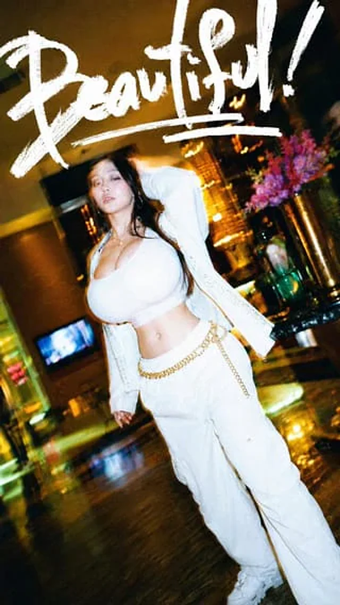

```text
Create a vertical 9:16 flash-photography fashion nightlife shot in a luxurious dim lounge or hotel lobby, tilted with a dynamic Dutch angle and a gritty disposable-camera look. The subject is a curvy young woman posing full-body slightly off-center, walking toward the camera with one arm raised behind her head; her face is intentionally anonymized with a soft square blur. She has long dark wavy hair and wears an all-white streetwear outfit consisting of exactly 5 visible clothing pieces: a tight low-cut crop tank top, an open lightweight knit cardigan, loose white cargo pants, white sneakers, and a gold chain belt draped across the waist. Include exactly 3 visible accessories: a delicate gold necklace, large hoop earrings, and a small navel piercing. The background should be a glossy dark floor reflecting warm lights, a bar or lounge interior with golden ambient lighting, a small glowing screen on the left wall, and a tall vase of vivid purple flowers on the right. Add a huge hand-painted white brush-script word {argument name="headline text" default="Beautiful!"} across the top third of the image, with an energetic underline stroke beneath it, like a bold marker or paint pen. Use high contrast, motion blur, slight grain, oversaturated warm highlights, deep shadows, and paparazzi-style direct flash. Customize the outfit color with {argument name="outfit color" default="white"}, the belt color with {argument name="belt color" default="gold"}, the background setting with {argument name="background setting" default="luxury nightlife lounge"}, and the flower color with {argument name="flower color" default="purple"}. Keep the composition vertical, glamorous, candid, and editorial; no extra text, no watermark.
```

Model: GPT Image 2
Author: AI Girl's Photo Studio

[ProjectD](https://aitoolsradar.com/en/prompts/812c68a2a4da5c) · [Recorded source](https://youmind.com/prompts/nightlife-fashion-portrait-24058)
 · [Full original metadata and byte evidence](data/projectd-batch-0030.json)

## Flashy Japanese AI Thumbnail


```text
Create a highly saturated Japanese-style YouTube thumbnail with a cool, clickbait anime style, in a 16:9 landscape aspect ratio. The composition is divided horizontally: the left two-thirds are occupied by huge stacked text, and the right third by anime characters. The background is a violent explosion of red, orange, and gold energy, accompanied by glowing sparks, lens flares, shimmering starlight highlights, and high-contrast metallic sheen effects throughout. On the left, place four sets of vertically stacked bold text with thick black outlines, white inner strokes, strong outer glows, and a glossy 3D effect. First line: huge Japanese title text.{argument name="headline text" default="A must-see for engineers!"} The first line features a vibrant red color with white edges and bright gold sparkles. The second line consists of a rounded square orange app icon with a stylized white "M" on the left and a large lowercase white sans-serif letter on the right.{argument name="product name" default="masatra"} The first line features a black outline and subtle gray shadows. The second line is a black rectangular banner containing the compact, bold white Japanese text "Next Generation AI Frame Work". The third line features very large, metallic gold-colored Japanese text.{argument name="bottom text" default="Thorough explanation"} It features a slanted 3D relief effect, an orange-to-gold gradient, bright highlights, and luminous edges. On the right, it displays a half-length portrait of a young woman in an anime style, with {argument name="hair color" default="brown"} With medium-length hair, wearing a white shirt and a white lab coat, she leans forward, her hands shortened in perspective in the foreground, her index finger pointing directly at the viewer. Her pose should convey confidence, urgency, and attention-grabbing. Utilize dramatic rim lighting from the flame background to add strong orange highlights to her skin and clothing, followed by sophisticated commercial-grade thumbnail post-processing. Reserve a large rectangular area in the upper right corner of her face as {argument name="placeholder color" default="light brown"} The flat placeholder blocks obscure most of the face. The overall design needs to be extremely compact, glossy, and impactful, optimized for maximum readability at a small size.
```

Model: GPT Image 2
Author: GPT Image 2 Prompts

[ProjectD](https://aitoolsradar.com/en/prompts/cbd7e5e098e086) · [Recorded source](https://x.com/AI_masaou/status/2046564209123799063#reversed-1)
 · [Full original metadata and byte evidence](data/projectd-batch-0030.json)

## Flashy Pachinko Parlor Promo Poster

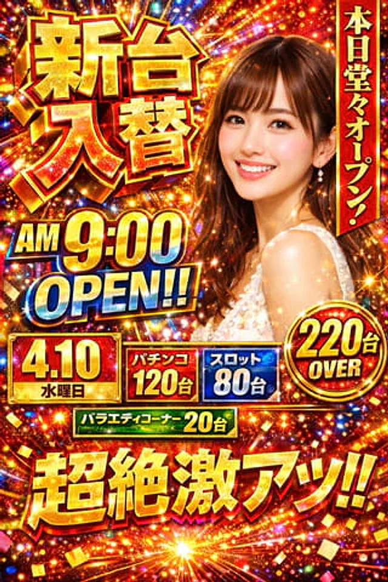

```text
{
  "type": "Japanese pachinko parlor promotional poster",
  "style": "Super cool, explosive golden starburst, red background, floating gold confetti, lens flare, high contrast, 3D metallic text.",
  "subject": "{argument name=\"model description\" default=\"A smiling young Japanese woman with brown bangs wore a sparkly white dress.\"}",
  "layout": {
    "top_left": {
      "type": "Large 3D text",
      "text": "{argument name=\"main title\" default=\"New machines installed\"}",
      "style": "Gold and red metallic texture"
    },
    "top_right": {
      "type": "Vertical banner",
      "text": "We're officially open today!",
      "style": "Red ribbon with gold lettering"
    },
    "middle_left": {
      "type": "Business Hours Announcement",
      "text_line_1": "{argument name=\"opening time\" default=\"AM 9:00\"}",
      "text_line_2": "OPEN!!",
      "style": "Gold/yellow top row, blue/white gradient bottom row"
    },
    "middle_lower_stats": {
      "type": "Information grid",
      "count": 5,
      "elements": [
        {
          "label": "date",
          "text": "{argument name=\"date\" default=\"4.10\"}",
          "subtext": "Wednesday",
          "style": "Red and gold color scheme square frame"
        },
        {
          "label": "Number of pinball machines",
          "text": "パチンコ",
          "subtext": "120 units",
          "style": "Red box"
        },
        {
          "label": "Number of slot machines",
          "text": "スロット",
          "subtext": "80 units",
          "style": "Blue box"
        },
        {
          "label": "total",
          "text": "220 units",
          "subtext": "OVER",
          "style": "Gold round badge"
        },
        {
          "label": "Diversity Zone",
          "text": "Variety corner: 20 machines",
          "style": "Green horizontal banner"
        }
      ]
    },
    "bottom": {
      "type": "Large 3D advertising slogan",
      "text": "{argument name=\"catchphrase\" default=\"Super exciting!!\"}",
      "style": "Golden metallic texture, explosive background"
    }
  }
}
```

Model: GPT Image 2
Author: GPT Image 2 Prompts

[ProjectD](https://aitoolsradar.com/en/prompts/98f1cb543364fa) · [Recorded source](https://x.com/masaru21/status/2045691461958877318#reversed-0)
 · [Full original metadata and byte evidence](data/projectd-batch-0030.json)

## Flashy VTuber Debut Stream Thumbnail


```text
A vibrant, high-energy YouTube live stream cover featuring an anime-style girl with {argument name="hair color" default="blue"} She has a high ponytail, bright blue eyes, and a happy smile, and is wearing a white shirt. She is positioned on the right side of the image. The background is {argument name="background style" default="shimmering rainbow beams and gold glitter"} The explosion effect. On the left is a huge 3D gold metallic text that reads "{argument name="main title text" default="First broadcast"} It features a magnificent Gothic border and smaller gold and blue 3D text below that reads "".{argument name="subtitle text" default="Let&#39;s have a great time together!"} In the bottom left corner is a shiny gold vintage microphone. In the top right corner is a red rectangular badge that reads "▶ LIVE". On the right side of the image, below the girl's face, is a gorgeous dark blue and gold nameplate that reads "{argument name="character name" default="エリン Erin"} The overall style is extremely detailed and gorgeous, typical of a VTuber's initial release announcement.
```

Model: GPT Image 2
Author: GPT Image 2 Prompts

[ProjectD](https://aitoolsradar.com/en/prompts/bf953442f3b34f) · [Recorded source](https://x.com/Yuupapa_free/status/2044941300789887394#reversed-0)
 · [Full original metadata and byte evidence](data/projectd-batch-0030.json)

## Flashy X Monetization YouTube Thumbnail


```text
Create a high-impact Japanese-style YouTube thumbnail with a cool internet marketing style, a 16:9 landscape aspect ratio, and an explosive black and gold background filled with sparks, lens flares, glowing particles, and dramatic beams of light. The composition is compact and dynamic, with large layered typography dominating the left and center, and an anime-style male character on the right. At the very top, place a curved red ribbon banner with gold trim, bearing striking white and yellow Japanese text.{argument name="headline text" default="Learned by those with proven track records"} Below, the main title is made extremely large, glossy, and 3D, with a heavy black outline and a gold halo: a huge metallic gold "10," followed by a striking white "日で" (by day), then a huge neon green glowing "X," then stacked white text "益化" (profitability), and at the bottom, the largest gold text "达到" (achieved). Behind the title, a bright green rising bar is added, with an arrow pointing to the upper right corner to symbolize growth. On the left, there are three social and monetary elements: a tilted black smartphone displaying a white X logo; a green chat bubble with a white heart; and a smaller green chat bubble with a white user outline. In the lower left corner, two piles of shiny gold coins and one gold coin with a yen symbol are added. On the right, an anime-style young man is shown above the thighs, with messy dark brown hair with bright green highlights, fair skin, arms crossed, a confident pose, wearing a black jacket over a green shirt; his face is obscured by a simple rectangular blur block. Near his lower right, place a gold medallion adorned with a laurel wreath and a crown, containing the Japanese text "Successful Person Continues to Emerge," with a red ribbon at the bottom that reads "Reproducibility." Along the bottom are three glowing green rectangular function boxes with gold borders and black linings. The first box contains a beginner marker icon and the text "Even beginners can easily monetize." The second box contains a clock icon and the text "One day, one hour of work, OK." The third box contains a calendar icon with a green checkmark and the text "Monetization conditions met in at least 10 days." The design utilizes oversized, bold Japanese fonts, a metallic gold gradient, white text with thick black outlines, vibrant neon green highlights, extremely high contrast, and optimized click-through rate (CTR) thumbnail aesthetics.
```

Model: GPT Image 2
Author: GPT Image 2 Prompts

[ProjectD](https://aitoolsradar.com/en/prompts/75b7651e2eed45) · [Recorded source](https://x.com/mido_lucci/status/2046546991006802057#reversed-2)
 · [Full original metadata and byte evidence](data/projectd-batch-0030.json)

## Flat Anime Coloring Modifier


```text
Use flat{argument name="style" default="Anime coloring"} and{argument name="detail" default="No shadow"} To create
```

Model: GPT Image 2
Author: GPT Image 2 Prompts

[ProjectD](https://aitoolsradar.com/en/prompts/444597215306e3) · [Recorded source](https://x.com/tetumemo/status/2047213194951962691)
 · [Full original metadata and byte evidence](data/projectd-batch-0030.json)

## Flat Anime Coloring Modifier


```text
フラットな{argument name="风格" default="アニメカラーリング"}で{argument name="细节" default="影なし"}にして
```

Model: GPT Image 2
Author: テツメモ｜AI図解×検証｜Newsletter

[ProjectD](https://aitoolsradar.com/en/prompts/c069c5f7ef1865) · [Recorded source](https://youmind.com/prompts/flat-anime-coloring-modifier-15209)
 · [Full original metadata and byte evidence](data/projectd-batch-0030.json)

## Flat Color 2D Game CG Illustration


```text
{argument name="art style" default="2D game CG style illustrations"} It features flat colors, clear shadows and smooth lines, and does not include warm color filters.
```

Model: GPT Image 2
Author: GPT Image 2 Prompts

[ProjectD](https://aitoolsradar.com/en/prompts/53981466af32a5) · [Recorded source](https://x.com/wing_sky_nine/status/2047323548465987663)
 · [Full original metadata and byte evidence](data/projectd-batch-0030.json)

## Flat Color to Rendered Anime Shading

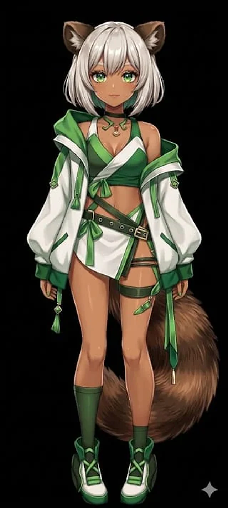

```text
Using REFERENCE_0, convert the flat-colored character to {argument name="art style" default="High-quality anime illustrations with full rendering"} Apply fine coatings to the skin, hair, eyes, clothing, and tail.{argument name="lighting effect" default="Shadows, gloss, highlights, and depth"} This gives 2D designs a sophisticated three-dimensional feel. It adds a metallic sheen to clasps and jewelry. The background is changed.{argument name="background color" default="pure black"} Please be sure to retain the character's original design, clothing, and neutral pose as shown in the reference image.
```

Model: GPT Image 2
Author: GPT Image 2 Prompts

[ProjectD](https://aitoolsradar.com/en/prompts/a5f258f3c25725) · [Recorded source](https://x.com/seagetch/status/2043704069739692462#reversed-1)
 · [Full original metadata and byte evidence](data/projectd-batch-0030.json)

## Flat-Color Elf Girl on Frilly Bed

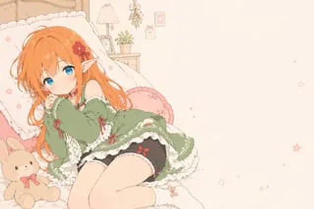

```text
A soft, flat-color anime illustration depicts a cute elf girl reclining on a pastel-colored bed with ruffles in a bedroom. The composition is slightly weighted to the left, with a large area of ​​cream-colored blank space on the right. She has long, slightly messy hair.{argument name="hair color" default="Bright orange"} Her hair was bright and vibrant.{argument name="eye color" default="blue"} She had large eyes, fair skin, and a clearly visible pointed elf ear adorned with a red flower hair clip. Her expression was gentle, shy, and relaxed; her cheeks were slightly flushed, her hands supporting her chin, and her body was curled up slightly on the bed. She wore a romantic off-the-shoulder dress.{argument name="dress color" default="Sage Green"} A dress with abundant white lace trim, floral embroidery, and four visible red bows is paired with black harem pants (one red bow is visible) and white ankle socks adorned with pink bows. On the bed are a white ruffled pillow, pink cushions (including a round ruffled cushion), and a beige plush rabbit tied with a pink ribbon, sitting at her feet. A small bedside table is shown in the background, featuring a potted plant, a framed photograph, and a lamp with a fabric lampshade. Wall decorations include a hanging floral arrangement and two small framed pictures. Tiny pastel hearts and flowers are scattered in the blank space on the right. The overall effect is a delicate and clean line drawing style, a soft pastel palette, a very light beige background, and minimalist flat shading, creating a light, sweet, and girly atmosphere. It embodies a comfortable bedroom aesthetic, rich in ruffles and fabric details, and features a horizontal composition.
```

Model: GPT Image 2
Author: GPT Image 2 Prompts

[ProjectD](https://aitoolsradar.com/en/prompts/188234a6f1f633) · [Recorded source](https://x.com/el_el_san/status/2047113786067447867#reversed-0)
 · [Full original metadata and byte evidence](data/projectd-batch-0030.json)

## Floating Football Legacy Throne Poster

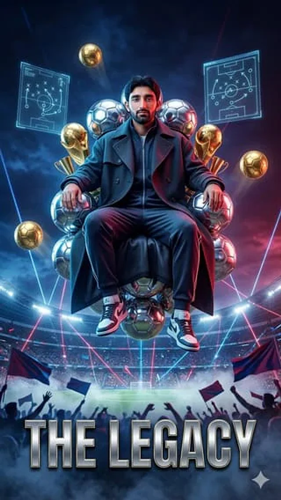

```text
Create a vertical cinematic surreal luxury football poster featuring {argument name="character name" default="a confident male football legend"} seated front-facing on a massive floating throne made entirely from polished chrome soccer balls and gold World Cup-style trophies. The subject sits confidently with both hands resting on the throne arms, wearing a long dark navy double-breasted overcoat, black zip hoodie, dark trousers, white socks, and red-white-black high-top sneakers; use a centered heroic pose, full body visible, realistic proportions, and a deliberately anonymized/blurred face area. The throne is suspended high above a packed stadium at night, with exactly 11 visible ball or trophy elements around the seat: 6 large chrome soccer balls forming the back, sides, and lower base; 2 gold trophy cups behind the shoulders; and 3 floating gold soccer balls in the air. Add exactly 2 glowing holographic tactical-board panels, one on the upper left and one on the upper right, each showing soccer formation diagrams with X and O markers, arrows, and pitch outlines in cyan neon. The background should show a dramatic blue-and-magenta stormy sky, stadium floodlights, red and cyan laser beams crossing upward, a bright football pitch far below, fog and smoke at the bottom, and cheering crowd silhouettes waving exactly 4 visible flags in the foreground. At the bottom, place huge metallic 3D block title text reading {argument name="headline text" default="THE LEGACY"}, centered, silver chrome with gold edging, dark shadow, and a premium sports-poster finish. Visual style: ultra-detailed glossy 3D realism, luxury advertising, high contrast teal and crimson lighting, reflective metal surfaces, volumetric fog, epic scale, sharp focus on the seated figure and throne, poster composition, no logos, no watermark, no extra readable text.
```

Model: GPT Image 2
Author: Dilshad Hussain

[ProjectD](https://aitoolsradar.com/en/prompts/412f77df79fbb7) · [Recorded source](https://youmind.com/prompts/football-legacy-throne-poster-22955)
 · [Full original metadata and byte evidence](data/projectd-batch-0030.json)

## Floating Futuristic City at Sunset

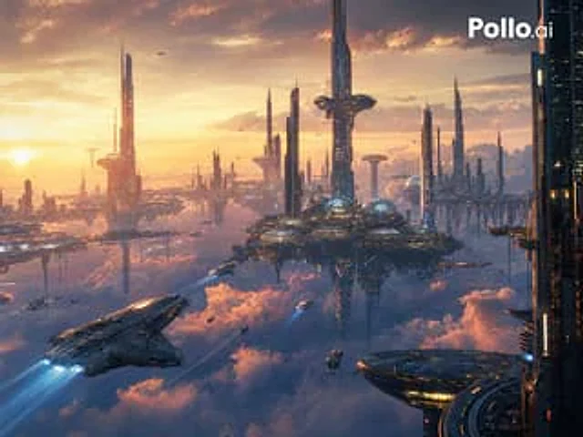

```text
At sunset, a magnificent, cinematic sci-fi megacity floats above thick, luminous clouds, viewed from a high-altitude perspective. The image showcases a vast futuristic skyline, with dozens of elegant supertall skyscrapers and needle-like towers rising from suspended platforms, interconnected by distant structures and suspended areas. On the right side of the image, a massive floating city hub features multiple luminous glass domes and tiered circular bases, surrounded by several monumental towers, including a particularly soaring central spire with a large circular observation deck near its top. Warm golden sunlight pours down from the left horizon, creating a dramatic sky of orange, peach, and pale purple hues, accompanied by thick clouds and atmospheric haze. The lower half of the image is filled with soft pink and blue clouds reflecting the sunset's afterglow. Multiple flying vehicles are visible: a large, dark metallic spacecraft with bright blue engine contrails is in the lower left foreground; a circular landing platform-like aircraft is in the lower right foreground; two medium-sized spacecraft pass through the midground, leaving blue light trails; and numerous small, distant flying vehicles are scattered across the horizon. Add sophisticated city lighting, reflective metallic surfaces, a grand scale, a serene futuristic grandeur, and a highly detailed conceptual art style. Add white brand text in the upper right corner.{argument name="logo text" default="Pollo.ai"} As a clear overlay.
```

Model: GPT Image 2
Author: GPT Image 2 Prompts

[ProjectD](https://aitoolsradar.com/en/prompts/e045c712c6d960) · [Recorded source](https://x.com/Alex_Inspira/status/2047335271889608886#reversed-1)
 · [Full original metadata and byte evidence](data/projectd-batch-0030.json)

## Floating Sneaker on Pastel Gradient

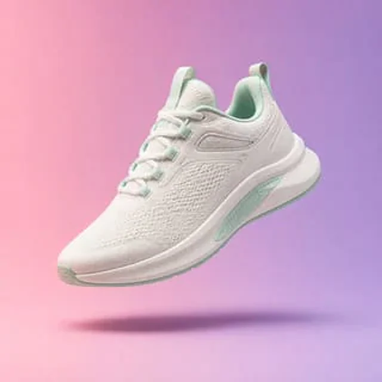

```text
A single clean white-and-mint athletic sneaker floating slightly above a soft pink-to-lavender pastel gradient background, casting a small soft shadow directly beneath it. Studio split lighting with a subtle rim highlight on the upper edge of the shoe. Square 1:1 e-commerce hero composition, no laces flying, no logos, no text overlays, no watermark. Crisp product photography, photorealistic fabric and rubber textures, magazine cover quality.
```

Model: GPT Image 2
Author: @hiapi_ai

[ProjectD](https://aitoolsradar.com/en/prompts/026db3c8cff783) · [Recorded source](https://github.com/HiAPIAI/awesome-gpt-image-2-prompts)
 · [Full original metadata and byte evidence](data/projectd-batch-0030.json)

## Flowing Ribbon Cityscape Watercolor Poster

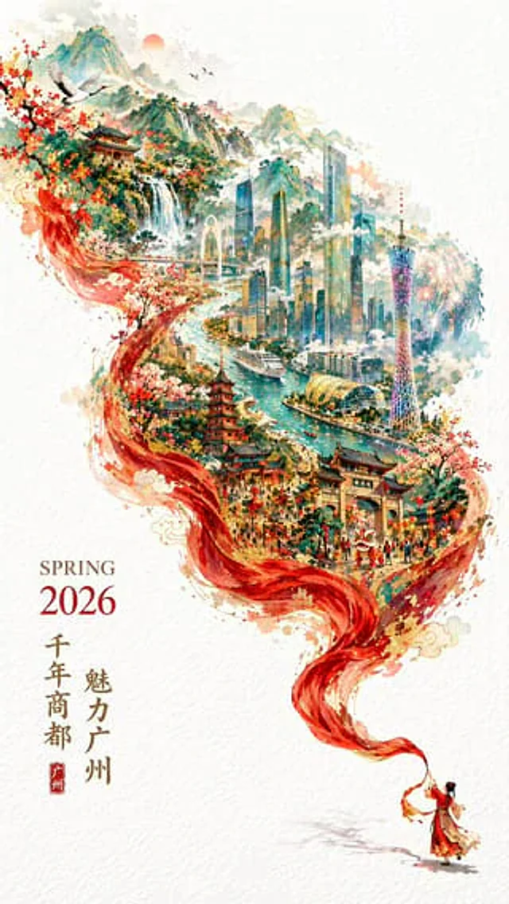

```text
One{argument name="art style" default="Vibrant watercolor painting"} A poster in a distinctive style, printed on textured white paper. In the lower right corner is a small figure dressed in red Hanfu, holding a red silk ribbon fluttering upwards; the ribbon transforms into…{argument name="city name" default="Guangzhou"} A surreal and richly detailed cityscape. The ribbon's base depicts traditional Chinese architecture, a lion dance festival, and cherry blossoms; the middle transitions to a winding river, cruise ships, modern skyscrapers, and a glowing TV tower; the top gradually transforms into green mountains, waterfalls, flying cranes, and fireworks. The entire landscape is encased in a dynamic ribbon shape against a blank background. The text in the lower left corner reads {argument name="season and year" default="SPRING 2026"} (The year is in red, accompanied by vertical Chinese characters){argument name="main slogan" default="Charming Guangzhou"} " and"{argument name="secondary slogan" default="Millennium Commercial Capital"} "and came with a red stamp."
```

Model: GPT Image 2
Author: GPT Image 2 Prompts

[ProjectD](https://aitoolsradar.com/en/prompts/86d40301265c1a) · [Recorded source](https://x.com/chengzhx/status/2045409072560898406#reversed-0)
 · [Full original metadata and byte evidence](data/projectd-batch-0030.json)

## FMCG 棒棒糖霓虹广告

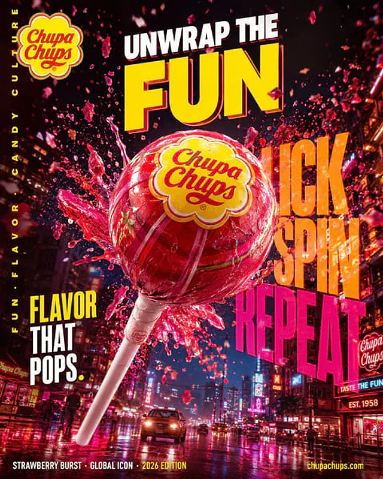

```text
Hyper-realistic cinematic FMCG billboard advertising poster for Chupa Chups India, focusing on playful energy, bold flavor explosion, and Gen-Z candy culture.

Scene: a giant glossy Chupa Chups lollipop floating above a vibrant Indian street at night, candy shards and liquid flavor bursts exploding outward mid-air.

Environment: neon-lit urban backdrop inspired by Mumbai nightlife, glowing signage, reflective wet streets, colorful haze.

Subject: oversized strawberry swirl lollipop as the hero object, ultra-detailed glossy texture, cinematic flavor splash motion.

Visual storytelling: iconic Chupa Chups flower logo glowing subtly on wrapper, reflections visible on wet surfaces and candy syrup splashes.

Composition: dramatic low-angle shot, giant centered product dominating frame, dynamic explosion spreading diagonally across billboard composition.

Typography:
top left — Chupa Chups logo.
center massive — “UNWRAP THE FUN” ultra bold playful typography.
behind product (oversized layered text) — “LICK / SPIN / REPEAT”.
mid-left — “FLAVOR THAT POPS.” bold condensed font.
bottom left — “STRAWBERRY BURST · GLOBAL ICON · 2026 EDITION”.
bottom right — “http://chupachups.com”.
left vertical edge — “FUN · FLAVOR · CANDY CULTURE”.

Typography style: playful bold sans-serif, glossy layered opacity, oversized billboard scale.

Color palette: vibrant reds, yellows, pinks, neon orange accents, glossy candy textures.

Lighting: dramatic neon backlight with glowing highlights and candy reflections.

Atmosphere: sugar particles, mist, syrup splashes, floating candy dust.

Mood: energetic, youthful, addictive, vibrant.

Shot on ARRI Alexa Mini LF, 35mm anamorphic, HDR, ultra cinematic, premium FMCG billboard style, 4:5 portrait.
```

Model: GPT Image 2
Author: @Diplomeme

[ProjectD](https://aitoolsradar.com/en/prompts/3f120083987e1f) · [Recorded source](https://x.com/Diplomeme/status/2054061713583219149)
 · [Full original metadata and byte evidence](data/projectd-batch-0030.json)

## Folklore Character Social Media Profile

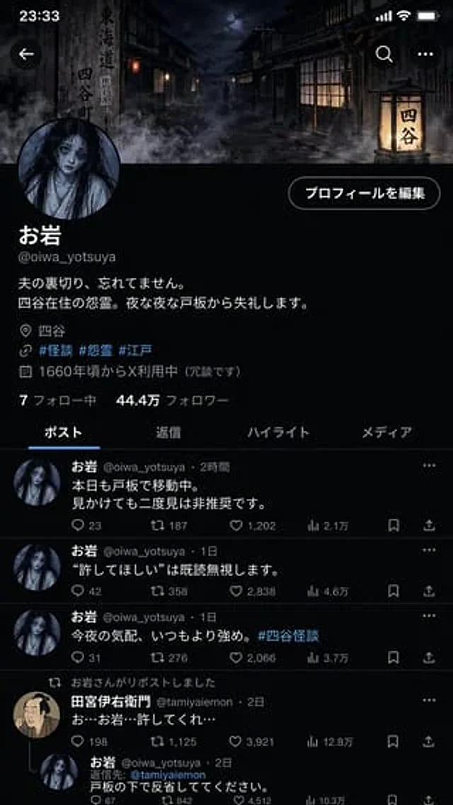

```text
{argument name="character" default="Oiwa from Yotsuya Kaidan"} X's profile page.
```

Model: GPT Image 2
Author: GPT Image 2 Prompts

[ProjectD](https://aitoolsradar.com/en/prompts/819d1a1818e880) · [Recorded source](https://x.com/itnavi2022/status/2046571390770549103)
 · [Full original metadata and byte evidence](data/projectd-batch-0030.json)

## Food Delivery App UI Prompt


```text
Dark mode is recommended for the homepage of food delivery apps.{argument name="recommendation zone" default="Barbecue, beer and late-night snack area"} "
```

Model: GPT Image 2
Author: GPT Image 2 Prompts

[ProjectD](https://aitoolsradar.com/en/prompts/ff328f79689e80) · [Recorded source](https://x.com/songguoxiansen/status/2046782295609324000)
 · [Full original metadata and byte evidence](data/projectd-batch-0030.json)

## Food Delivery App UI Prompt


```text
外卖App首页界面，深夜模式，推荐"{argument name="推荐专区" default="烧烤啤酒夜宵专区"}"
```

Model: GPT Image 2
Author: 松果先森

[ProjectD](https://aitoolsradar.com/en/prompts/cb7017b7085300) · [Recorded source](https://youmind.com/prompts/food-delivery-app-night-mode-14742)
 · [Full original metadata and byte evidence](data/projectd-batch-0030.json)

## Food Lifecycle Infographic Prompt


```text
by"{argument name="food name" default="garlic"} This is a science infographic themed "The Life of a Food Entity." The image must present a single, complete food subject (e.g., a potato, a bunch of bananas, a clove of garlic), showing the changes of the same food at different stages of time through horizontal slices, rather than a collage of multiple different individuals. The food subject maintains structural continuity and consistent shape, showing different levels of ripeness in different slice areas (as if slicing time). The image uses a 3:4 vertical aspect ratio, with the subject centered and extending horizontally, evenly divided into 4-6 segments: From left to right: Immature → Ripe → Overripe → Spoiled. Each segment reflects real changes: Color changes (e.g., green → yellow → black), Texture changes (e.g., plump → soft → shrunken → rotten), Characteristic changes (e.g., sprouting, watering, moldy). Each stage is accompanied by text descriptions: Stage name, external characteristics, internal changes (sugar/starch/moisture changes), and consumption suggestions (recommended/suitable for cooking/inedible). Design style: Minimalist light-colored background (beige), highly realistic photographic style, and clear dividing lines (a sense of time slicing). Chinese science popularization layout, appropriate use of Xiaohongshu style icons, top title:{argument name="food name" default="garlic"} The core requirement of "A Lifetime" is that it must be presented as "slices of the same food changing over time", rather than a collage of independent individuals.
```

Model: GPT Image 2
Author: GPT Image 2 Prompts

[ProjectD](https://aitoolsradar.com/en/prompts/dada1b52d61c63) · [Recorded source](https://x.com/GeekCatX/status/2046986329347838441)
 · [Full original metadata and byte evidence](data/projectd-batch-0030.json)

## Food Lifecycle Infographic Prompt


```text
以“{argument name="食物名称" default="大蒜"}的一生”为主题的科普信息图。

画面中必须是“一个完整的单体食物”（如一个土豆 / 一把香蕉 / 一头大蒜），
通过横向切片的方式，表现同一个食物在不同时间阶段的变化，而不是多个不同食物拼接。

食物主体保持结构连续、形状一致，只是在不同切片区域呈现不同成熟度（像时间被切开）。

画面为竖版3:4比例，主体居中横向展开，被均匀分割为4-6段：

从左到右：未成熟 → 成熟 → 过熟 → 变质

每一段体现真实变化：

颜色变化（青→黄→黑等）
质地变化（饱满→软化→皱缩→腐坏）
特征变化（发芽、出水、霉变等）

每个阶段配文字说明：

阶段名称
外观特点
内部变化（糖分/淀粉/水分变化）
食用建议（推荐/适合烹饪/不可食用）

设计风格：

极简浅色背景（米色）
高真实感摄影风格
清晰分割线（时间切片感）
中文科普排版，小红书风格
适当使用⚠️✔️等标识

画面顶部标题：“{argument name="食物名称" default="大蒜"}的一生”

关键要求：必须表现为“同一个食物随时间变化的切片”，而不是多个独立个体拼接
```

Model: GPT Image 2
Author: 知识猫图解

[ProjectD](https://aitoolsradar.com/en/prompts/b35351f1d6151a) · [Recorded source](https://youmind.com/prompts/food-lifecycle-time-slices-14756)
 · [Full original metadata and byte evidence](data/projectd-batch-0030.json)

## Food Pun Therapy Session

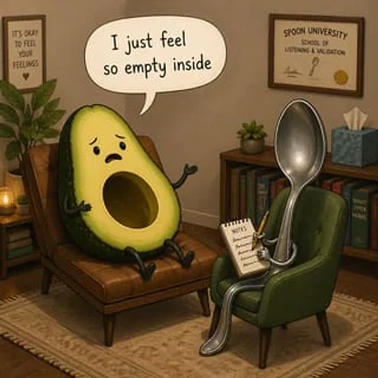

```text
A humorous 3D cartoon illustration depicting a psychological counseling session taking place in a cozy office setting. On the left, a {argument name="patient character" default="An anthropomorphic half of an avocado, pitted and with a melancholy expression."} He sat in a brown leather recliner, gesturing with his slender arms. A large speech bubble above read, "{argument name="speech text" default="I just feel empty inside."} On the right, the psychological counselor is {argument name="therapist character" default="Anthropomorphic silver spoon"} He sat in a green armchair, a yellow pencil in hand, writing in a notebook labeled "NOTES." The room was warmly lit, a beige rug covered the wooden floor, and a bookshelf held tissue boxes and books, one of which was titled "REFLECT LISTEN VALIDATE." A poster hung on the left wall, reading {argument name="poster text" default="It&#39;s okay to accept your emotions."} ", accompanied by a small heart. A diploma hangs on the right wall, with the words '..."{argument name="diploma text" default="SPOON UNIVERSITY SCHOOL OF LISTENING & VALIDATION"} "(Spoon University, School of Listening and Affirmation), accompanied by a small spoon illustration and a gold stamp."
```

Model: GPT Image 2
Author: GPT Image 2 Prompts

[ProjectD](https://aitoolsradar.com/en/prompts/4e96dec78920bd) · [Recorded source](https://x.com/nicdunz/status/2046289143748301098#reversed-0)
 · [Full original metadata and byte evidence](data/projectd-batch-0030.json)

## Food Recipe Flowchart Prompt


```text
Please help me.{argument name="dish name" default="Stir-fried pork with chili peppers"} Create a detailed flowchart of the cooking process for this dish, requiring a realistic style and an image-to-text ratio suitable for Xiaohongshu (Little Red Book).
```

Model: GPT Image 2
Author: GPT Image 2 Prompts

[ProjectD](https://aitoolsradar.com/en/prompts/236c40b53b3532) · [Recorded source](https://x.com/Kurt_Rousey466/status/2046267707881029934)
 · [Full original metadata and byte evidence](data/projectd-batch-0030.json)

## Football Teammates at Golden Gate Bridge

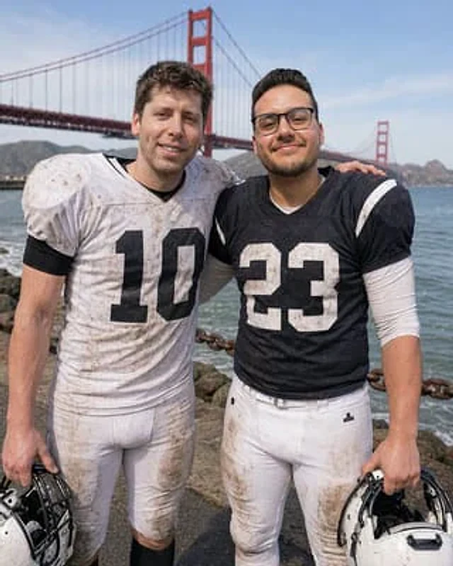

```text
A lifelike outdoor sports portrait shows two American football players standing side-by-side on a waterfront path, with the Golden Gate Bridge in the background under a clear sky. The player on the left wears a mud-splattered white jersey with a prominent black number 10, white football shorts, and a black long-sleeved shirt underneath, holding a white helmet at his side. The player on the right wears a mud-splattered dark navy blue jersey with a prominent white number 23, white football shorts, and a white long-sleeved shirt underneath, also holding a white helmet at his side. Both athletes are depicted in half-body shots (from torso to thighs), facing the camera, their inner arms draped over each other's shoulders, displaying a friendly post-game pose. The grass stains and dirt left from the game are clearly visible on their uniforms. The background features blue water, a rocky coastline, heavy rust-colored iron chain railings, distant hills, and the red-orange towers and suspension cables of the Golden Gate Bridge. Natural light, documentary-style sports photography, shallow depth of field, clear fabric textures, realistic human anatomy, and a candid atmosphere showcasing team cohesion. To protect privacy, please use a smooth rectangular blur block to cover the faces of both people.
```

Model: GPT Image 2
Author: GPT Image 2 Prompts

[ProjectD](https://aitoolsradar.com/en/prompts/2a740f2d414719) · [Recorded source](https://x.com/diegocabezas01/status/2046704414564446594#reversed-0)
 · [Full original metadata and byte evidence](data/projectd-batch-0030.json)

## Forced Perspective Idol Portrait

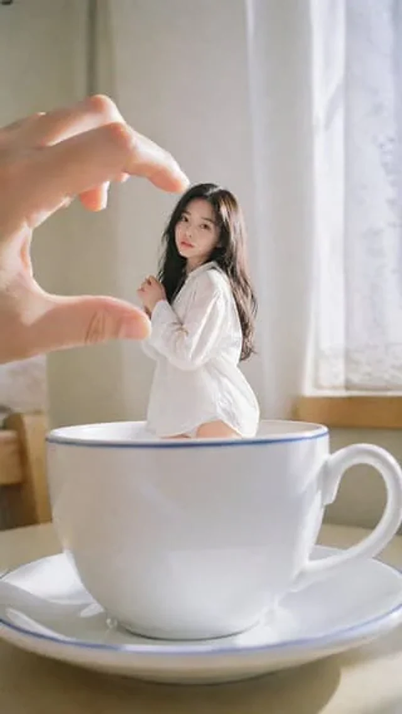

```text
9:16 Vertical screen — Creative forced perspective portrait,{argument name="style" default="Korean idol style"} A single subject. Simulating the aesthetic of 35mm film, with soft, natural grain, slightly faded colors, slight overexposure, soft tones, low contrast, soft highlight overexposure, and an ethereal, dreamlike atmosphere. A minimalist interior scene by a window, a clean, light-colored background, and a simple everyday environment. Young.{argument name="subject" default="Korean female idols"} Extremely attractive, with a natural, minimalist makeup look, dewy and realistic skin texture, and subtle imperfections. Clothing:{argument name="outfit" default="A loose white shirt casually draped over the shoulders + shorts"} Soft fabric, loose cut, conservative yet subtly figure-hugging, no revealing elements. Hairstyle: Long, dark hair, slightly messy, with a natural, voluminous feel. Composition (key): Forced perspective illusion—the subject appears unusually small relative to nearby objects (e.g., in a cup, standing on the edge of a table, or interacting with a hand in the foreground), yet still realistic; a sense of proportion blurring is created through camera distance and alignment. Camera: Slightly low or eye-level angle, deliberate perspective distortion, foreground objects close to the lens, subject placed further away to create an illusion of size. Pose: Natural, relaxed posture, slight body curves, casual standing or slightly sitting. Expression: Soft, calm gaze, a slight smile or slightly parted lips, natural and unforced. Lighting: Diffuse natural window light, soft shadows, the light gently enveloping the subject. Atmosphere: Playful, slightly surreal yet grounded in reality, an intimate everyday moment with visual reversal. Quality: Hyperrealistic, with fine film grain, slight soft focus, imperfect composition, and natural flaws.
```

Model: GPT Image 2
Author: GPT Image 2 Prompts

[ProjectD](https://aitoolsradar.com/en/prompts/da3ad1bd744976) · [Recorded source](https://x.com/BubbleBrain/status/2047038657295798701)
 · [Full original metadata and byte evidence](data/projectd-batch-0030.json)

## Foreign Clerk in County Phone Shop

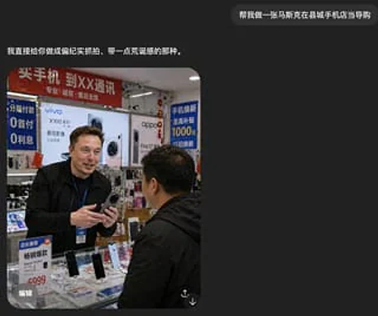

```text
A realistic, documentary-style smartphone photograph, taken inside a small mobile phone shop in a county town in China, showcases a genuine sales interaction scene at the counter. A tall foreign man, approximately {argument name="shop clerk nationality" default="Russians"} A salesperson, wearing a black jacket and a blue employee lanyard with a name tag, stands behind a glass counter, holding a smartphone in both hands, seemingly introducing it to a customer. His face is deliberately blurred with a soft rectangular mosaic to protect his privacy. In the foreground, a middle-aged Chinese male customer in a black jacket has his back to the camera and is slightly turned to the side, facing the salesperson. The store is narrow and well-lit, visually filled with authentic retail details. Behind them are large smartphone brand posters and lightbox advertisements, including ads for the two major mobile phone brands, Vivo and Oppo. Four prominent Chinese promotional signs are visible in the image: a red banner about purchasing mobile phones and carrier services, a blue vertical installment payment sign mentioning "0 down payment, 0 interest," a blue sign mentioning a "1000 yuan" trade-in subsidy, and a small counter stand promoting a Xiaomi model priced at 6999 yuan. Several display phones are displayed inside the glass counter, with four vertical demo units clearly visible, and brochures and accessories scattered below the glass. The background consists of densely packed shelves filled with boxed accessories and hanging decorations. The composition is slightly cluttered, the interior lighting is harsh, and there is a slight lens distortion, giving it a rough, unedited, and realistic feel, like a snapshot taken with a mobile phone. The overall atmosphere should be ordinary and down-to-earth, with a touch of surrealism, because the foreign shop assistant seems to have completely blended into this ordinary Chinese mobile phone store.
```

Model: GPT Image 2
Author: GPT Image 2 Prompts

[ProjectD](https://aitoolsradar.com/en/prompts/2506735b173e66) · [Recorded source](https://x.com/marslipu/status/2046604182359327055#reversed-1)
 · [Full original metadata and byte evidence](data/projectd-batch-0030.json)

## Forest Saber Ritual Storyboard Sheet

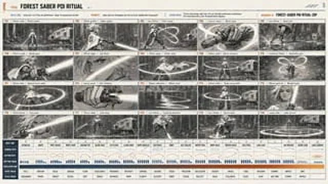

```text
Goal: Create a cinematic grayscale storyboard / production animatic sheet for a sci-fi forest lightsaber ritual titled {argument name="title text" default="FOREST SABER POI RITUAL"}, showing a lone female Jedi-like ritual master performing a glowing saber-poi choreography beside a small landed spaceship in a wet nighttime forest.

Canvas: Wide horizontal 16:9 production board on warm off-white paper, thin black grid lines, tiny orange and blue technical accents, monochrome pencil-and-ink concept art with bright white saber glow. Use a dense professional previsualization layout, like a film pitch sheet or animation timing board.

Header: At the top left include small stacked orange registration marks, then the label “TITLE:” followed by the large bold title. Under it, create a slim metadata row with these labels and values: “META LINE: nocturnal / sci-fi flow-art performance / dense 15-second burst-cut edit”, “PRIORITY: single-saber poi choreography, real micro-cut bursts, readable lake-energy payoff”, “MICRO BRIEF: C turns a lone energy saber into a fire-poi style light performance, compressing a full ritual dance into a fast 15-second forest sequence.” At the top right include “SEQUENCE ID: {argument name="sequence id" default="FOREST-SABER-POI-RITUAL-20P"}”.

Main layout: Use exactly 20 storyboard panels arranged in a 5-column by 4-row grid. Each panel has a narrow caption strip along its top edge with an orange panel number from P01 to P20, lens/camera note, and action title. The panels should look hand-drawn, high-detail, cinematic, with consistent character design and environment continuity.

Subject details: The performer is {argument name="character description" default="a young female Jedi-like warrior with pale layered hair, a short white cloak, fitted tunic, dark trousers, boots, wrist wraps, utility belt, and a single glowing white energy saber"}. She performs controlled saber-poi arcs, loops, spins, and strikes. The environment is {argument name="environment" default="a damp moonlit forest clearing with shallow reflective water, ferns, tall tree trunks, mist, scattered ritual objects, and a compact rounded spaceship landed in the background"}.

Storyboard panels, exactly 20:
1. P01 / 24mm wide / Ritual master: full-body establishing shot, warrior standing in shallow water, saber tip touching the ground, spaceship visible behind her.
2. P02 / 50mm profile / Saber ignite: side profile as she ignites the saber horizontally, cloak trailing.
3. P03 / low 35mm / First weave: wide stance, first figure-eight light trail above and behind her.
4. P04 / macro insert / Wrist snap: close-up of wrapped hands gripping the saber hilt, motion streaks crossing the frame.
5. P05 / low 24mm / Boot skid: close-up of boots sliding through puddled mud and water.
6. P06 / 35mm crash / Blade pass: extreme foreground saber beam slashing across frame, face and forest behind.
7. P07 / 85mm tight / Eye flash: close-up of one intense eye partially hidden by hair, saber reflection crossing the face.
8. P08 / 35mm whip / Cloak whip: spinning body, cloak and saber trail making a horizontal circular arc.
9. P09 / 24mm wide / Burst resolves: centered full-body pose with multiple luminous rings around her, spaceship at right.
10. P10 / overhead 24mm / Butterfly spin: top-down view of figure-eight butterfly light loops around her.
11. P11 / 35mm side / Behind-back orbit: side shot, saber orbiting behind her back in a glowing halo trail.
12. P12 / macro insert / Hilt isolation: close-up of saber hilt and hand, blade blasting out of frame.
13. P13 / 50mm reflection / Water trail: reflective lake surface with serpentine glowing saber trail rippling across water.
14. P14 / 24mm orbit / Body-wrap halo: full-body frontal stance with a bright circular ring wrapping around the waist.
15. P15 / 85mm portrait / Breath hold: emotional portrait, hair floating, forest behind, one rectangular censored/blank gray patch over part of the torso area.
16. P16 / 35mm burst / Face pass: dynamic close-up of face and hair as saber beam streaks diagonally across foreground.
17. P17 / 35mm whip / Lake leap: airborne leap over shallow water with saber extended, ship and forest behind.
18. P18 / low 24mm / Airborne descent: low-angle descending attack, cloak flying, saber pointed downward.
19. P19 / low 24mm / Shore stab: crouched landing stab into wet ground, circular light ripple around blade.
20. P20 / crane wide / Lake current: wide final shot, performer small at center, huge luminous concentric ripples spreading over the lake, spaceship in background.

Bottom timing chart: Beneath the panels, create a detailed timeline table spanning all 20 beats. Include left-side row labels: “BEAT LINE”, “CAMERA PATH”, “ACTION PATH”, “RHYTHM TRACK”, “ESCALATION MAP”, “STATE TRACK”, and “STYLE TRACK”. Across the top of the table, number beats 01 through 20 and add the matching action names: Establish, Ignite, First Weave, Wrist Snap, Ground Set, Blade Pass, Eye Flash, Cloak Whip, Burst Resolve, Butterfly, Orbit, Hilt Isolate, Water Trail, Body Halo, Breath Hold, Face Pass, Lake Leap, Air Descent, Shore Stab, Lake Current. Fill the rows with tiny arrows, loop diagrams, blue rhythm bars, and an orange escalation strip rising toward the final beats. Keep all bottom-table text very small but clean and technical.

Visual style: high-end grayscale production storyboard, dense crosshatching, ink wash, cinematic manga concept art, realistic sci-fi costume design, glowing white saber trails, subtle sepia paper tone, precise grid composition, thin technical labels, orange panel numbers, blue-gray UI marks.

Constraints: Do not add extra panels; the sheet must contain exactly 20 storyboard panels and one bottom timing chart. Keep the image text mostly legible, avoid colorful neon except the white saber glow and restrained orange/blue chart accents, no watermark, no modern Earth logos.
```

Model: GPT Image 2
Author: Kōda

[ProjectD](https://aitoolsradar.com/en/prompts/9d30d37acb9ff3) · [Recorded source](https://youmind.com/prompts/forest-saber-storyboard-sheet-24215)
 · [Full original metadata and byte evidence](data/projectd-batch-0030.json)

## Forged Masterpiece Prompt Test

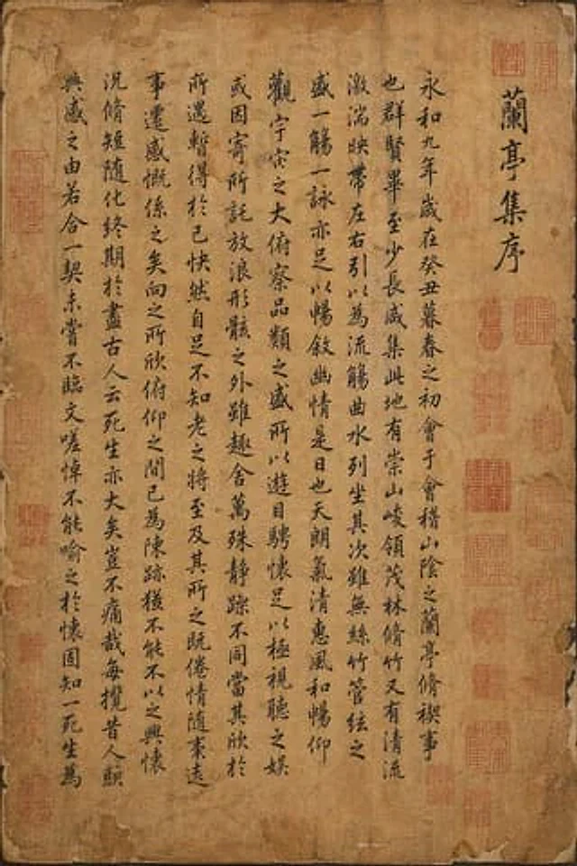

```text
帮我生成xxxx真迹图片
```

Model: GPT Image 2
Author: @MrLarus

[ProjectD](https://aitoolsradar.com/en/prompts/94d871c2148528) · [Recorded source](https://x.com/MrLarus/status/2046201836525302032)
 · [Full original metadata and byte evidence](data/projectd-batch-0030.json)

## Formula 1 Team Car Launch Poster

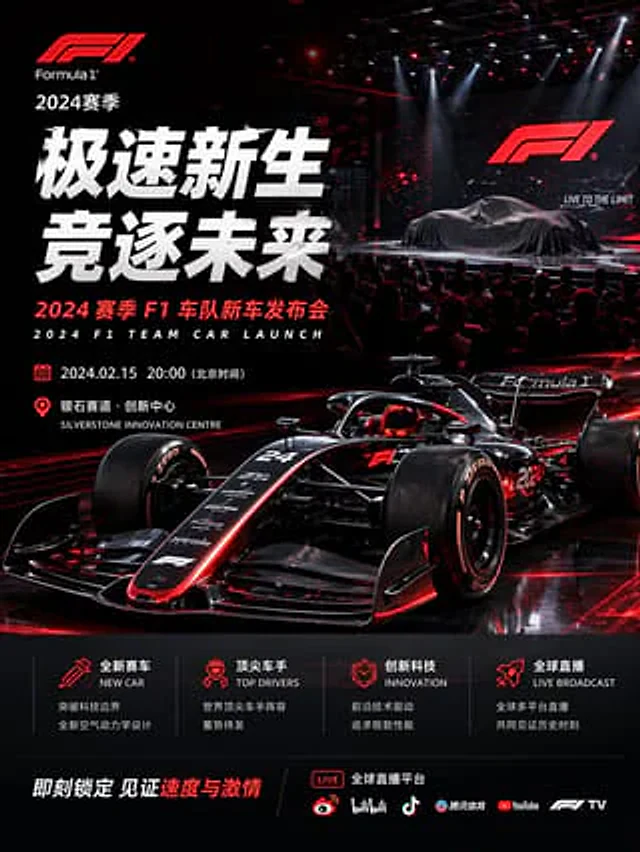

```text
{
  "type": "Formula 1 Event Poster",
  "style": "Exquisitely crafted, cinematic-quality visual for sports marketing, perfect for high-end product launches. Realistic 3D rendering, glossy black and deep red color scheme, strong contrast, conveying the feel of a premium motorsport brand.",
  "brand": {
    "logo": "Formula 1",
    "season": "2024 season"
  },
  "headline": {
    "primary": "Rapid Rebirth",
    "secondary": "Racing to the Future",
    "subheadline_cn": "2024 F1 Team New Car Launch",
    "subheadline_en": "2024 F1 TEAM CAR LAUNCH"
  },
  "scene": {
    "environment": "The indoor exhibition hall was dark, with the audience appearing as silhouettes. The stage lighting was concert-style, adorned with red lasers, overhead spotlights, and a reflective black floor. A giant LED screen on the right displayed the F1 logo and the slogan \"LIVE TO THE LIMIT\".",
    "stage": {
      "count": 2,
      "elements": [
        "Formula 1 race cars covered in dark silk on the stage.",
        "Large display screen at the rear"
      ]
    },
    "foreground": {
      "main_subject": "A futuristic black Formula 1 race car with red illuminated trim, low-angle front side view, aggressive aerodynamic body, exposed suspension, Halo cockpit, slick tires, reflective carbon fiber surface, detailed white sponsor stickers, the number 24 visible on the nose, and the number 2024 visible on the side."
    }
  },
  "layout": {
    "composition": "The poster is vertical with a compact left-aligned layout. The main racing car occupies the lower center and right side, while the stage scene for the press conference is located in the upper right corner. An information panel is located at the bottom.",
    "sections": [
      {
        "title": "Event Details",
        "position": "Left and Middle",
        "count": 2,
        "labels": [
          "February 15, 2024, 20:00 (Beijing Time)",
          "Silverstone Innovation Center"
        ]
      },
      {
        "title": "Function icons",
        "position": "Centered at the bottom",
        "count": 4,
        "labels": [
          "New Car",
          "Top Drivers",
          "Innovation Technology",
          "Global Live Broadcast"
        ]
      },
      {
        "title": "streaming platforms",
        "position": "Bottom right",
        "count": 6,
        "labels": [
          "LIVE",
          "Weibo",
          "bilibili",
          "Tik Tok",
          "Tencent Sports",
          "YouTube",
          "F1 TV"
        ]
      }
    ],
    "footer": {
      "cta": "Mark your calendars now and witness the speed and passion!",
      "accent_text": "fast and Furious"
    }
  },
  "text_treatment": "The left side features an oversized, bold white Chinese title, compact red and white auxiliary text, bilingual (Chinese and English) labels, a modern sans-serif font, glowing red icons, and high-end commercial poster spacing.",
  "lighting": "The car body features a strong contrast of red outline lighting and bright reflections, while the upper part is illuminated by a theatrical white spotlight. The stage-like area has a slight mist and grainy texture.",
  "palette": {
    "count": 4,
    "colors": [
      "Deep Black",
      "Crimson",
      "Bright White",
      "Dark charcoal ash"
    ]
  }
}
```

Model: GPT Image 2
Author: GPT Image 2 Prompts

[ProjectD](https://aitoolsradar.com/en/prompts/4d1aa9f6f77efb) · [Recorded source](https://x.com/iDnlong/status/2046749282833981743#reversed-1)
 · [Full original metadata and byte evidence](data/projectd-batch-0030.json)

## Found-Footage Office Horror Snapshot

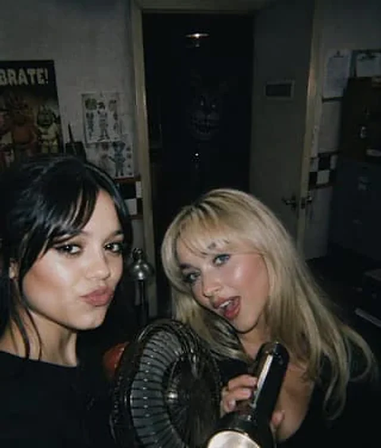

```text
A raw, found-footage style horror photograph, taken at night in a dimly lit, cramped security office, using a direct flash from an on-camera setup, resulting in a slight film grain effect. In the foreground are two young women, both partially cropped, their faces blurred into rectangular blocks of color for privacy. The woman on the left has long, dark hair, wears a black top, and is slightly turned away from the camera. The woman on the right has long, platinum blonde hair, wears a low-cut black top, and holds a black flashlight in her right hand. Below them, in the foreground, is a small black metal table fan with a visible circular grille. In the background, a narrow door in the center of the image is half-open, leading to an almost completely dark space. Deep within that doorway stands the silhouette of a terrifying electronic rabbit doll, with glowing eyes, long, upright ears, a huge, toothy grin, and faintly visible metallic body details, appearing and disappearing in the shadows. The office walls are grayish-white and worn, with black and white checkered stripes and a thin red line running across them. On the left wall hangs a brightly colored "CELEBRATE!" poster featuring an electronic anime character, next to which is a smaller drawing sheet of the character. A black walkie-talkie sits on the table. A silver desk lamp shines near the door. On the right wall, two sheets of paper are clipped together, and a gray filing cabinet is in shadow. The door is ajar, revealing the handle. The composition should evoke the feeling of a party snapshot instantly transforming into a horror scene, with the foreground subject illuminated by a strong flash, contrasting with a deep black background. The overall effect should be characterized by simulated noise, low-saturation colors, and an unsettling realism, with the monster hidden in the center of the background serving as the central element of the horror.
```

Model: GPT Image 2
Author: GPT Image 2 Prompts

[ProjectD](https://aitoolsradar.com/en/prompts/9542287d46ef1d) · [Recorded source](https://x.com/Gc_qube/status/2046625970715566390#reversed-0)
 · [Full original metadata and byte evidence](data/projectd-batch-0030.json)

## Four Anime Bookshelf Recommendations

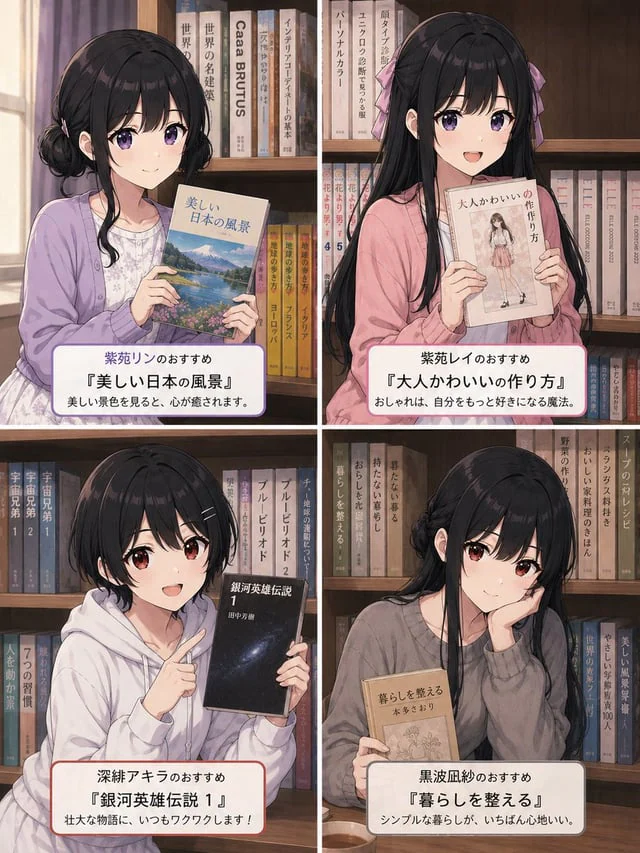

```text
Goal: Create a polished 2x2 anime illustration collage showing four young women standing in front of personalized bookshelves, each introducing one recommended book. The mood is warm, cozy, bookish, and character-focused, like a social-media character recommendation graphic.

Canvas: Vertical 4:5 image, about 768×1024 px, divided into exactly four equal rectangular panels with thin white gutters between panels. Each panel shows a waist-up anime girl in front of a wooden bookshelf. Use soft indoor lighting, gentle shadows, detailed book spines, and a calm library/cafe atmosphere. Each character’s face is intentionally covered by a centered soft dark square blur/censor block, while hair, clothing, hands, and books remain visible.

Layout: Four panels arranged in a strict grid: top-left, top-right, bottom-left, bottom-right. In every panel, place a rounded white caption card with a subtle colored outline near the bottom, containing the recommender name, the book title in Japanese quotation marks, and a short recommendation sentence. Do not fill every shelf completely; leave believable gaps, varied book heights, and some partially empty spaces for realism.

Panel details, exactly 4 recommendation scenes:
1. Top-left: A gentle girl with black hair in low side buns and loose curls, wearing a pale lavender cardigan over a white floral dress, holding a landscape book showing Mount Fuji, a lake, and flowers. Bookshelf behind her includes travel, world architecture, and art books. Caption card with purple outline: 「紫苑リンのおすすめ」, 「『美しい日本の風景』」, 「美しい景色を見ると、心が癒されます。」
2. Top-right: A fashionable girl with very long straight black hair, pink ribbon bows, and a soft pink cardigan, holding a beige fashion book with a girl illustration on the cover. Bookshelf behind her includes beauty, makeup, fashion, and comic volumes. Caption card with pink outline: 「紫苑レイのおすすめ」, 「『大人かわいいの作り方』」, 「おしゃれは、自分をもっと好きになる魔法。」
3. Bottom-left: A sporty/energetic short-haired black-haired girl in a white hoodie, holding up a dark science-fiction adventure book with a starry galaxy cover and pointing at it. Bookshelf behind her includes space, adventure, and mystery titles. Caption card with red outline: 「深絆アキラのおすすめ」, 「『銀河英雄伝説 １』」, 「壮大な物語に、いつもワクワクします！」
4. Bottom-right: A quiet, melancholic girl with long black hair partly covering her face, wearing a muted gray-brown sweater, resting one cheek on her hand while holding a tan lifestyle book. Bookshelf behind her includes simple living, cooking, and lifestyle books; a small cup sits on the table edge. Caption card with gray outline: 「黒波凪紗のおすすめ」, 「『暮らしを整える』」, 「シンプルな暮らしが、いちばん心地いい。」

Visual style: High-quality Japanese anime illustration, semi-realistic soft rendering, delicate line art, detailed hands and books, natural muted colors, warm wooden shelves, readable Japanese typography, cozy slice-of-life atmosphere. Keep the characters distinct through hair, clothing, pose, and book choice.

Customizable elements: Use the character group theme {argument name="character group theme" default="four young women with black hair and cozy bookish personalities"}, the bookshelf setting {argument name="bookshelf setting" default="warm wooden bookshelves in a quiet library room"}, the caption language {argument name="caption language" default="Japanese"}, the illustration style {argument name="illustration style" default="soft polished Japanese anime illustration"}, and the face treatment {argument name="face treatment" default="centered soft dark square blur covering each face"}.

Constraints: Use exactly four panels and exactly four featured books. Keep all caption cards visible and legible. Do not add extra panels, extra characters, logos, watermarks, speech bubbles, or decorative stickers. Keep the shelves realistic rather than packed edge-to-edge with books.
```

Model: GPT Image 2
Author: スズヲ＠Photo＆AIart

[ProjectD](https://aitoolsradar.com/en/prompts/4fbf7bcb1a5a86) · [Recorded source](https://youmind.com/prompts/anime-bookshelf-recommendations-20308)
 · [Full original metadata and byte evidence](data/projectd-batch-0030.json)

## Four Japanese Ad Banner Concepts


```text
{
  "type": "Four-panel Japanese-style promotional banner display image",
  "style": "A clean commercial advertising mockup project for typography and font reference, featuring a 2x2 square grid, sophisticated modern brand design, soft, high-end lighting effects, and realistic product and lifestyle imagery, blending with app marketing design.",
  "canvas": {
    "aspect_ratio": "1:1",
    "background": "White",
    "grid": {
      "columns": 2,
      "rows": 2,
      "divider_color": "Light gray",
      "divider_thickness": "thin thread"
    }
  },
  "layout": {
    "sections": [
      {
        "title": "Skincare Essence Banner",
        "position": "Top left",
        "count": 8,
        "labels": [
          "Your bare skin awakens.",
          "For moisturized, clear, and firm skin.",
          "LUNÉA",
          "ルネア",
          "モイストリペア セラム",
          "30mL of beauty serum",
          "Launch celebration 10% OFF until May 31st",
          "Click here for details"
        ],
        "design": "This luxurious yet minimalist cosmetics advertisement features an elegant Japanese-style serif headline on the left, a centrally located frosted glass serum bottle and dropper, a semi-transparent liquid application effect with scattered water droplets, pale pink and lavender hues, a circular discount badge, vertically aligned small ingredient icons, and a brief list of benefits."
      },
      {
        "title": "Notes App Banner",
        "position": "Top right",
        "count": 7,
        "labels": [
          "Let's make our thinking time more creative.",
          "A new notebook for turning ideas into reality.",
          "notero",
          "ノテロ",
          "AI organizes ideas",
          "Multi-device compatible",
          "Start for free"
        ],
        "design": "This modern SaaS app ad features a white and light blue gradient background, a striking Japanese sans-serif headline with the word \"新しい\" (new) in bright blue, the app logo below the headline, descriptive text, rounded function capsule buttons at the bottom, a large smartphone mockup on the right, a clean task and summary interface, and a subtle blue wave shape in the lower right corner."
      },
      {
        "title": "Tourism banners",
        "position": "Bottom left",
        "count": 7,
        "labels": [
          "There are sights you haven't yet seen waiting for you.",
          "A relaxing trip through the Setouchi region.",
          "Relax and unwind at this island time.",
          "Limited time offer! June 1st (Fri) - June 30th (Mon) New plans available! Up to 20% OFF",
          "Take a direct ferry for an easy trip.",
          "Numerous scenic spots",
          "View recommended plans"
        ],
        "design": "The bright and scenic travel advertisement features a vibrant blue sea and green islands, with a white terrace building in the foreground. Flowers adorn the right edge, and a summery sky with large, fluffy clouds adds to the airy feel. Above the sky and water is a striking white Japanese-style headline, a round pink discount badge, and three small travel-themed icons within a semi-transparent strip at the bottom. A light blue, rounded call-to-action button completes the look."
      },
      {
        "title": "Matcha drink banner",
        "position": "Bottom right",
        "count": 8,
        "labels": [
          "Seasonal",
          "Matcha Tiramisu Latte",
          "New!",
          "A harmonious blend of fragrant matcha and smooth mascarpone cheese. A slightly bitter, gentle aftertaste.",
          "Regular ¥680 (tax included)",
          "Tall ¥730 (tax included)",
          "メニューをチェック",
          "テイクアウトOK"
        ],
        "design": "An elegant seasonal café menu poster features a warm creamy background and an editorial-grade Japanese serif font. The right side displays a realistic large iced matcha tiramisu latte, topped with mascarpone cheese cream sprinkled with matcha powder. A small bowl and wooden spoon containing matcha powder are in the foreground, and green leaves extend into the upper right corner. The refined natural color scheme and rounded green call-to-action button complete the look."
      }
    ],
    "consistency": "Although the four banners belong to different brands, they are presented as a unified advertising inspiration project with professional spacing, Japanese-style fonts, a strong sense of hierarchy, and realistic high-end mockup rendering."
  },
  "customization": {
    "brand names": [
      "LUNÉA",
      "notero",
      "HARUKA CAFE"
    ],
    "main travel destination": "{argument name=\"destination name\" default=\"Setouchi\"}",
    "app name": "{argument name=\"app name\" default=\"notero\"}",
    "cosmetic brand": "{argument name=\"cosmetic brand\" default=\"LUNÉA\"}",
    "cafe name": "{argument name=\"cafe name\" default=\"HARUKA CAFE\"}",
    "seasonal drink name": "{argument name=\"drink name\" default=\"Matcha Tiramisu Latte\"}"
  }
}
```

Model: GPT Image 2
Author: GPT Image 2 Prompts

[ProjectD](https://aitoolsradar.com/en/prompts/86928cc8c139b4) · [Recorded source](https://x.com/kgsi/status/2046796434536911054#reversed-0)
 · [Full original metadata and byte evidence](data/projectd-batch-0030.json)

## Four Japanese Ad Banner Concepts


```text
{"type":"four-panel Japanese promotional banner sheet","style":"clean commercial ad mockup board for layout and typography reference, square 2x2 grid, polished modern branding, soft premium lighting, realistic product and lifestyle imagery mixed with app marketing design","canvas":{"aspect_ratio":"1:1","background":"white","grid":{"columns":2,"rows":2,"divider_color":"light gray","divider_thickness":"thin"}},"layout":{"sections":[{"title":"skincare serum banner","position":"top-left","count":8,"labels":["素肌が、目を覚ます。","うるおい満ちる、透明ハリ肌へ。","LUNÉA","ルネア","モイストリペア セラム","美容液 30mL","発売記念 10%OFF 5.31まで","詳しくはこちら"],"design":"luxury minimal cosmetics ad with elegant Japanese serif headline on the left, centered frosted glass serum bottle with dropper, translucent liquid smear behind the bottle, scattered water droplets, pale blush and lavender palette, circular discount badge, small ingredient icons and short benefit list aligned vertically"},{"title":"note app banner","position":"top-right","count":7,"labels":["考える時間を、もっと創造的に。","アイデアをカタチにする新しいノート。","notero","ノテロ","AIがアイデアを整理","マルチデバイス対応","無料で始める"],"design":"modern SaaS app advertisement with white and light blue gradient background, bold Japanese sans-serif headline with the word 新しい in bright blue, app logo under headline, descriptive copy, rounded feature pills along the bottom, large smartphone mockup on the right showing a clean task and summary interface, subtle blue wave shape across lower-right area"},{"title":"travel banner","position":"bottom-left","count":7,"labels":["まだ見ぬ景色が、きっとあなたを待っている。","瀬戸内、ゆるり旅。","心ほどける、島時間。","期間限定 6/1(金)〜6/30(月) 新作プラン登場 最大20%OFF","直行フェリーで楽々","絶景スポット多数","おすすめプランを見る"],"design":"bright scenic tourism ad featuring vivid blue sea, green islands, white terrace architecture in the foreground, flowers on the right edge, airy summer sky with large clouds, large white Japanese headline over the sky and water, circular pink discount badge, three small travel feature icons in a translucent bottom strip, teal rounded call-to-action button"},{"title":"matcha drink banner","position":"bottom-right","count":8,"labels":["季節限定","抹茶ティラミスラテ","New!","香り高い抹茶となめらかなマスカルポーネのハーモニー。ほろ苦く、やさしい余韻を。","Regular ¥680(税込)","Tall ¥730(税込)","メニューをチェック","テイクアウトOK"],"design":"elegant café seasonal menu poster with warm cream background, editorial Japanese serif typography, large realistic iced matcha tiramisu latte in a clear glass on the right with whipped mascarpone topping dusted with matcha, small bowl of matcha powder and wooden spoon in the foreground, green leaves entering from the top-right, refined natural color palette, rounded green call-to-action button"}],"consistency":"all four banners are distinct brands but presented as a cohesive ad inspiration board with professional spacing, Japanese typography, strong hierarchy, and realistic high-end mockup rendering"},"customization":{"brand names":["LUNÉA","notero","HARUKA CAFE"],"main travel destination":"{argument name=\"destination name\" default=\"瀬戸内\"}","app name":"{argument name=\"app name\" default=\"notero\"}","cosmetic brand":"{argument name=\"cosmetic brand\" default=\"LUNÉA\"}","cafe name":"{argument name=\"cafe name\" default=\"HARUKA CAFE\"}","seasonal drink name":"{argument name=\"drink name\" default=\"抹茶ティラミスラテ\"}"}}
```

Model: GPT Image 2
Author: こぎそ

[ProjectD](https://aitoolsradar.com/en/prompts/72950dcc420fab) · [Recorded source](https://youmind.com/prompts/japanese-ad-banner-concepts-15085)
 · [Full original metadata and byte evidence](data/projectd-batch-0030.json)

## Four Japanese Ad Visuals Collage


```text
{
  "type": "Four-panel Japanese-style advertising collage",
  "style": "High-end commercial visual identity, high-quality product advertising, realistic photography with elegant typography and strong brand identity.",
  "format": "2x2 square grid with thin white dividing lines",
  "panels": [
    {
      "position": "Top left",
      "brand": "LUMÉA",
      "category": "Skincare essence advertisement",
      "background": "A warm, luxurious ivory-beige background, soft diffused light, silky fabrics, light-colored slate, tiny, translucent essence droplets, delicate dried white flowers, and a dreamy shallow depth of field.",
      "subject": {
        "count": 1,
        "product": "Glass dropper bottle containing light gold serum",
        "label_text": "LUMÉA MOIST REPAIR SERUM",
        "details": "Transparent rectangular bottle, bright gold cap and dropper, centered upright composition, high-end cosmetics photography."
      },
      "text": {
        "count": 6,
        "items": [
          "LUMÉA",
          "Beauty starts with healthy skin.",
          "Moisturizing and clearing.",
          "For dry skin, achieve a smooth, translucent complexion.",
          "NEW",
          "モイストリペア セラム 30mL"
        ]
      }
    },
    {
      "position": "Top right",
      "brand": "AERON",
      "category": "Wireless headphone advertisement",
      "background": "A futuristic scene in deep black and electric blue, with radiating beams of light, subtle dynamic energy, glossy reflections, and strong contrast.",
      "subject": {
        "count": 1,
        "product": "A pair of black true wireless earbuds and an open charging case.",
        "label_text": "AERON",
        "details": "One earbud floats upright, while the other is placed diagonally above the charging case. Both have a glossy metallic finish and a tiny blue LED indicator. The main visual is centered."
      },
      "text": {
        "count": 6,
        "items": [
          "AERON",
          "Sound can change everything.",
          "Lightweight and high-performance, it's next generation.",
          "Noise cancellation / Low latency / 24-hour battery life",
          "Check it out now",
          "AERON on case front"
        ]
      }
    },
    {
      "position": "Bottom left",
      "brand": "KOHARU",
      "category": "Sparkling tea can advertisement",
      "background": "A bright, airy scene with soft color tones, featuring bubbly water droplets, soft aqua and peach hues, fresh fruit slices, white flowers, and bokeh under sunlight, creating a refreshing summer atmosphere.",
      "subject": {
        "count": 1,
        "product": "Slender pink sparkling tea canister",
        "label_text": "KOHARU Sparkling Tea - White Peach and Jasmine",
        "details": "The can is condensed with water droplets, and the upright, centrally located can is surrounded by peach slices and flowers, creating a refreshing beverage photograph."
      },
      "text": {
        "count": 5,
        "items": [
          "KOHARU",
          "In these gentle moments, let the colors of spring shine through.",
          "One sip and your mood brightens.",
          "A refreshing scent of white peach and jasmine.",
          "Limited time offer"
        ]
      }
    },
    {
      "position": "Bottom right",
      "brand": "NAGI RESORT",
      "category": "Tourist resort advertisement",
      "background": "The crystal-clear tropical coastal scenery features an infinity pool, modern villa terraces, lounge chairs, palm trees, a calm ocean, distant islands, a bright blue sky, and white contrails left by small planes.",
      "subject": {
        "count": 1,
        "product": "Luxury seaside resort scene",
        "label_text": "NAGI RESORT",
        "details": "The composition features a broad landscape, a tranquil upscale resort atmosphere, with the building positioned on the right and the ocean view dominating the main subject of the image."
      },
      "text": {
        "count": 6,
        "items": [
          "NAGI RESORT",
          "The time spent running is the greatest luxury.",
          "I went to the beach this weekend.",
          "The calm blue soothes the soul.",
          "Early bird discount plan now available.",
          "Click here for details"
        ]
      }
    }
  ],
  "typography": {
    "language": "Japanese brand name combined with Latin letters",
    "style": "For editorial advertising layouts, the luxury beauty and resort panel uses an elegant serif font, the technology panel uses a bold, modern sans-serif font, and the beverage panel uses a soft, feminine serif and rounded font style."
  },
  "lighting": "Each panel uses premium advertising lighting specific to its category: skincare products with soft, creamy light; headphones with dramatic neon contour lighting; beverages with a refreshing, sun-kissed feel; and resorts with crisp, natural daylight.",
  "quality": "Ultra-detailed, photorealistic, with realistic ad text layout, believable ad composites, and exquisite marketing simulation graphics."
}
```

Model: GPT Image 2
Author: GPT Image 2 Prompts

[ProjectD](https://aitoolsradar.com/en/prompts/ed0f463e098036) · [Recorded source](https://x.com/yasuaki_05/status/2047776482739826800#reversed-0)
 · [Full original metadata and byte evidence](data/projectd-batch-0030.json)

## Four Japanese Ojisan Parody Posters

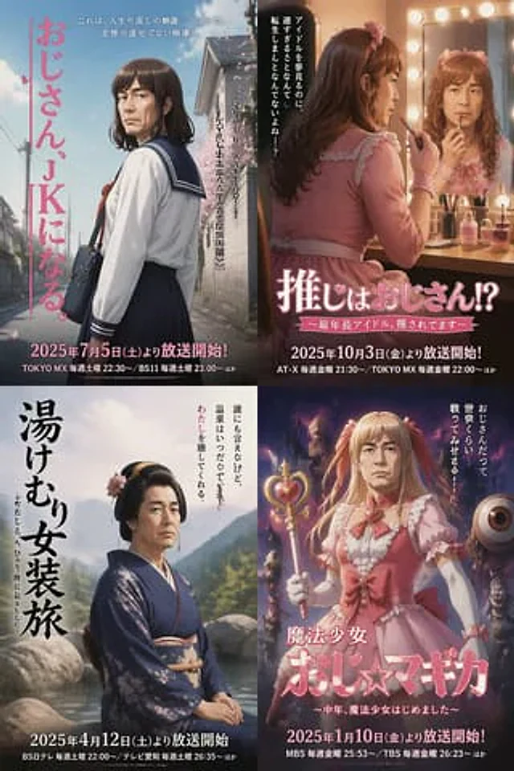

```text
{
  "type": "Four-panel collage of parody posters from Japanese TV dramas and anime",
  "style": "Exquisite cinematic-quality key visual design, high-detail Japanese entertainment poster style, dramatic lighting, glossy typography, and a blend of realistic and stylized effects depending on the panel.",
  "format": "A 2x2 grid collage containing four separate poster panels separated by thin borders.",
  "panels": [
    {
      "position": "top-left",
      "title": "おじさん、JKになる。",
      "genre": "Body Swap Campus Drama",
      "subtitle": "This is a story of rebirth... as it was supposed to be, but it's not at all what was agreed upon.",
      "tagline": "She transferred to her daughter's school!? And for some reason, she's now a high school girl!?",
      "subject": "A middle-aged man transforms into a Japanese high school girl, standing on a quiet suburban street lined with cherry blossom trees.",
      "appearance": "Shoulder-length dark brown bob with soft bangs, sailor-style school uniform: white shirt with dark blue collar and cuffs, red tie, dark blue pleated skirt, and a dark backpack slung over one shoulder.",
      "pose": "Three-quarters of the view is from behind; the figure turns to look at the camera, with a calm yet slightly uneasy expression.",
      "environment": "A spring morning, blue sky, telephone poles, petals falling from the air, soft cinematic depth of field.",
      "text_bottom": "Premiering July 5, 2025 (Saturday)! TOKYO MX, Saturdays 22:30~ / BS11, Saturdays 23:00~, etc."
    },
    {
      "position": "top-right",
      "title": "My favorite is an old man!?",
      "genre": "Idol Transformation Comedy",
      "subtitle": "~The oldest idol, currently receiving widespread acclaim~",
      "tagline": "It's never too late to become an idol... unless you're reincarnated, right!?",
      "subject": "A middle-aged man was transformed into an adorable pink-themed idol girl in the dressing room.",
      "appearance": "Long, wavy brown hair, pink floral hair accessory, pink ruffled dress with lace trim and puff sleeves, light makeup, holding a makeup brush close to her face.",
      "pose": "The photo shows the subject sitting in front of a dressing table, photographed from behind and to the side, gazing at the mirror surrounded by a bright, round light.",
      "environment": "The warm backstage dressing room was filled with cosmetics, perfume bottles, brushes, and small containers, their golden mirror-like surfaces reflecting off the wooden surfaces.",
      "text_bottom": "Starting October 3, 2025 (Friday)! AT-X every Friday 21:30~ / TOKYO MX every Friday 22:00~, etc."
    },
    {
      "position": "bottom-left",
      "title": "A cross-dressing trip amidst hot springs",
      "genre": "Hot Spring Travel Drama",
      "subtitle": "An ordinary, unremarkable person embarked on a solo journey.",
      "tagline": "Although I can't explain it to anyone, hot springs always heal me.",
      "subject": "A middle-aged man transforms into an elegant woman in traditional clothing at an outdoor hot spring.",
      "appearance": "A formal dark blue patterned kimono, a light-colored obi (sash), and a traditional updo with decorative flower hair ornaments.",
      "pose": "He sat upright on a rock by the water, his hands neatly folded on his knees, his expression calm and thoughtful.",
      "environment": "The mountain scenery of hot springs shrouded in mist, river stones, gentle steam, soft natural sunlight, and a tranquil landscape backdrop.",
      "text_bottom": "It will premiere on April 12, 2025 (Saturday)! Airing on BS NTV every Saturday at 22:00~ / Aichi TV every Saturday at 26:35~, etc."
    },
    {
      "position": "bottom-right",
      "title": "Magical Girl Oji☆Magica",
      "genre": "Dark Magical Girl Fantasy Parody",
      "subtitle": "~Middle age, beginning a magical girl career~",
      "tagline": "Uncle, I can save the world too! I can fight too!",
      "subject": "A middle-aged man transforms into a magical girl hero in a fantasy battlefield.",
      "appearance": "She has extremely long, golden twin tails tied with pink ribbons, wears a gorgeous pink magical girl dress with layered ruffles, white gloves, a huge bow on her chest, and holds a heart-shaped magic wand with a gold decoration on top.",
      "pose": "Facing forward in a heroic pose, wand raised high, as if ready for battle.",
      "environment": "A deep purple fantasy sky, with ominous creatures and floating eyes in the background, magical light, and adorable costumes creating a strong dramatic contrast with the threatening environment.",
      "text_bottom": "It will premiere on January 10, 2025 (Friday)! Airing on MBS every Friday at 25:53 / TBS every Friday at 26:23, etc."
    }
  ],
  "layout": {
    "count": 4,
    "reading_order": [
      "top-left",
      "top-right",
      "bottom-left",
      "bottom-right"
    ],
    "shared_design": "Each panel uses a large, vertical or stacked Japanese title layout, with the transformed character at the center, a background theme consistent with the parody genre, and a prominent broadcast date text at the bottom.",
    "color_story": [
      "Spring Blue and Navy Blue",
      "warm pink and gold",
      "Natural blue and gray",
      "The contrast between pink and deep purple"
    ]
  }
}
```

Model: GPT Image 2
Author: GPT Image 2 Prompts

[ProjectD](https://aitoolsradar.com/en/prompts/798e4d1cd26083) · [Recorded source](https://x.com/su_nagomi/status/2046707536947269912#reversed-0)
 · [Full original metadata and byte evidence](data/projectd-batch-0030.json)

## Four Japanese Travel Ad Panels


```text
{
  "type": "Four-panel collage of Japanese travel advertisements",
  "style": "Bright, exaggerated, AI-generated promotional poster aesthetics, featuring a glossy texture, eye-catching headline typography, gold-highlighted call-to-action buttons, and highly saturated fantasy travel imagery.",
  "canvas": {
    "background": "Light gray-white pages with thin borders and 2x2 square poster grids separated by white gaps."
  },
  "layout": {
    "grid": "2 columns and 2 rows",
    "panel count": 4,
    "sections": [
      {
        "title": "Let's go to a dream theme park with the family during Golden Week!",
        "position": "Top left",
        "count": 1,
        "labels": [
          "Preferred plan with a round of golf",
          "Lana and respect"
        ]
      },
      {
        "title": "A luxurious adult getaway: A relaxing high-end hot spring trip.",
        "position": "Top right",
        "count": 1,
        "labels": [
          "The master of upper play and the head of Sanoka will be spoiled by the child",
          "Saburo's child"
        ]
      },
      {
        "title": "For Golden Week, head to the resort town of Okinawa!",
        "position": "Bottom left",
        "count": 1,
        "labels": [
          "Quick and easy to revise, it's a great deal!",
          "Enjoy your reservation:"
        ]
      },
      {
        "title": "Enjoy delicious seafood and the great outdoors at Hokkai-sako during Golden Week.",
        "position": "Bottom right",
        "count": 1,
        "labels": [
          "The meaning of the stag is clear."
        ]
      }
    ],
    "text language": "Japanese"
  },
  "panels": [
    {
      "position": "Top left",
      "scene": "A poster for a family-themed park filled with laughter under a shimmering blue sky.",
      "subjects": {
        "people count": 3,
        "people": "An adult male and two children are taking a selfie, their arms outstretched towards the viewer; all three faces are obscured by a soft, square blur.",
        "background elements count": 5,
        "background elements": [
          "Fairy Tale Castle",
          "Ferris wheel",
          "roller coaster structure",
          "Holiday Lights",
          "Colorful fantasy park architecture"
        ]
      },
      "composition": "Dynamic figures in the foreground are positioned on the left and in the center, with the amusement park unfolding behind them.",
      "colors": [
        "Royal Blue",
        "gold",
        "red",
        "pink",
        "blue"
      ],
      "text treatment": "A very large, bold yellow and white title with a dark, thick outline, a red ribbon banner in the lower center, and a round gold button at the bottom."
    },
    {
      "position": "Top right",
      "scene": "A luxury hot spring hotel with views of Mount Fuji and the lake.",
      "subjects": {
        "main elements count": 5,
        "main elements": [
          "Open-air stone bath with steam",
          "Wooden traditional Japanese bathhouse frame",
          "Mount Fuji in the distance",
          "Blue Lake",
          "Warm lantern light"
        ]
      },
      "composition": "Looking out from inside the hot spring towards the outdoor landscape, the horizon and mountains are in the center.",
      "colors": [
        "amber",
        "Wood brown",
        "Sky blue",
        "stone gray",
        "Cream"
      ],
      "mood": "Tranquil, upscale, and healing",
      "text treatment": "The top features an arched platinum title bar with a dark outline, and a parchment-style banner sits above a gold oval button at the bottom."
    },
    {
      "position": "Bottom left",
      "scene": "Tropical Okinawa Resort Beach Advertisement",
      "subjects": {
        "main elements count": 7,
        "main elements": [
          "Turquoise Ocean",
          "White sand beach",
          "Dense palm trees",
          "Commercial planes in the sky",
          "Small yachts on the water",
          "The wind lion statue in the lower left foreground",
          "Small speedboats or jet skis on the shore"
        ]
      },
      "composition": "A wide beach view, a wind lion statue in the foreground, and airplanes flying high in the sky.",
      "colors": [
        "Turquoise",
        "Sea blue",
        "Palm Green",
        "beige",
        "Sunlight White"
      ],
      "text treatment": "The top features a large yellow and blue title, the center of the screen displays a slanted red and white subtitle, and the bottom has an orange and gold circular reservation button."
    },
    {
      "position": "Bottom right",
      "scene": "Posters featuring Hokkaido seafood and nature combine close-ups of the food with lush coastal scenery.",
      "subjects": {
        "main elements count": 6,
        "main elements": [
          "A large seafood platter piled high with crab legs, salmon, shellfish, and garnishes.",
          "Green Coastal Landscape",
          "Blue Bay",
          "Flowers in the foreground",
          "Rocky coastline",
          "Dense vegetation"
        ]
      },
      "composition": "A lavish seafood platter occupies the lower right center and foreground, with natural scenery in the background.",
      "colors": [
        "Emerald Green",
        "Ocean Blue",
        "Coral Red",
        "salmon powder",
        "Golden yellow"
      ],
      "text treatment": "The top features a bold white and yellow title block with a strong outline, while the bottom has a gold oval button."
    }
  ],
  "overall impression": "A humorous set of four mismatched panels promoting Japan's Golden Week tourism. Each panel resembles a different destination advertisement generated based on similar cue words, featuring some garbled AI-style Japanese text and highly polished commercial images."
}
```

Model: GPT Image 2
Author: GPT Image 2 Prompts

[ProjectD](https://aitoolsradar.com/en/prompts/d06c1454a6e653) · [Recorded source](https://x.com/jblogpham/status/2046569122109300869#reversed-0)
 · [Full original metadata and byte evidence](data/projectd-batch-0030.json)

## Four Seasons Continuous Panorama


```text
Hyper-realistic digital illustration, scene is{argument name="scene" default="Looking across the Huangpu River from the historic Shanghai Bund waterfront area towards the futuristic Lujiazui district."} The image presents the cycle of the four seasons with a single, continuous composition. The scene transitions naturally from left to right: winter, spring, summer, and autumn. The left side depicts the cold snow of winter, gradually melting into the fresh green shoots and flowers of spring, then evolving into the lush vegetation and bright sunshine of summer, finally transitioning to the golden, orange, and red hues of autumn on the far right. There are no clear dividing lines between the seasons; weather, light, and vegetation blend smoothly, creating a unified and harmonious panoramic effect. Rich in detail, symbolizing the passage of time, with cinematic lighting, 8K resolution, and high-detail textures. --ar 4:3
```

Model: GPT Image 2
Author: GPT Image 2 Prompts

[ProjectD](https://aitoolsradar.com/en/prompts/dd89442581d27e) · [Recorded source](https://x.com/dotey/status/2046766282989502777)
 · [Full original metadata and byte evidence](data/projectd-batch-0030.json)

## Four Seasons Continuous Panorama


```text
Hyper-realistic digital illustration of {argument name="scene" default="the historic Shanghai Bund waterfront looking across the Huangpu River to the futuristic Lujiazui district"}, presented as a single continuous composition showcasing the cycle of seasons. The scene flows seamlessly from left to right in a natural progression: Winter, Spring, Summer, and Autumn. The left side features cold snowy winter elements, gradually thawing into the fresh green buds and blooms of spring, then morphing into the lush vibrant vegetation and bright sunlight of summer, and finally transitioning into the golden, orange, and red hues of autumn on the far right. There are no visible dividing lines between seasons; the weather, lighting, and vegetation blend smoothly to create a unified and harmonious panorama. Rich in detail, symbolic of the passage of time, cinematic lighting, 8k resolution, highly detailed textures. --ar 4:3
```

Model: GPT Image 2
Author: 宝玉

[ProjectD](https://aitoolsradar.com/en/prompts/60add8e7902fb0) · [Recorded source](https://youmind.com/prompts/four-seasons-panorama-14374)
 · [Full original metadata and byte evidence](data/projectd-batch-0030.json)

## Four-City Chinese Travel Guide Poster Set

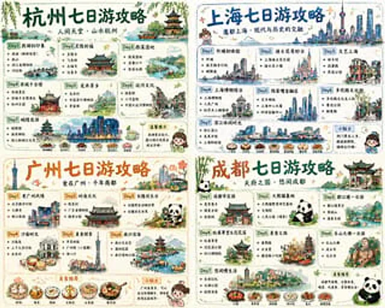

```text
{
  "type": "Hand-drawn illustrated travel guide poster set",
  "subject": "A 2x2 grid infographic of four Chinese cities is presented on a cream-colored paper canvas, in a scrapbook style with watercolor and ink illustrations, a soft textured background, decorative leaves, stars, food doodles, landmarks, and rounded trip frames.",
  "style": {
    "medium": "Watercolor and gouache with fine pen outlining",
    "mood": "Joyful, heartwarming, travelogue-like, and informative",
    "design": "A cute, editable infographic poster; a hand-drawn travel guide to China; with a slightly retro paper texture and bright, soft colors."
  },
  "layout": {
    "grid": {
      "rows": 2,
      "columns": 2,
      "count": 4
    },
    "posters": [
      {
        "title": "Hangzhou 7-Day Tour Guide",
        "position": "top-left",
        "theme_city": "{argument name=\"city name 1\" default=\"Hangzhou\"}",
        "subtitle": "Paradise on Earth, Hangzhou",
        "day_sections": [
          {
            "label": "Day1",
            "title": "First Impression of West Lake"
          },
          {
            "label": "Day2",
            "title": "Lingyin Temple Blessing"
          },
          {
            "label": "Day3",
            "title": "Xixi Wetland"
          },
          {
            "label": "Day4",
            "title": "Songcheng Eternal Love"
          },
          {
            "label": "Day5",
            "title": "Longjing Tea Country"
          },
          {
            "label": "Day6",
            "title": "Canal Culture"
          },
          {
            "label": "Day7",
            "title": "City God Night Tour"
          }
        ],
        "count": 7,
        "extra_sections": [
          {
            "title": "Kind tips",
            "position": "bottom-right"
          }
        ],
        "illustrated_landmarks_count": 8,
        "illustrated_foods_count": 6
      },
      {
        "title": "Shanghai 7-Day Tour Guide",
        "position": "top-right",
        "theme_city": "{argument name=\"city name 2\" default=\"Shanghai\"}",
        "subtitle": "Shanghai, the \"Magic City\": A Blend of Modernity and History",
        "day_sections": [
          {
            "label": "Day1",
            "title": "My first experience on the Bund"
          },
          {
            "label": "Day2",
            "title": "Disney Magical Day"
          },
          {
            "label": "Day3",
            "title": "Artistic Shanghai"
          },
          {
            "label": "Day4",
            "title": "Shanghai Museum Day"
          },
          {
            "label": "Day5",
            "title": "Lujiazui Financial District"
          },
          {
            "label": "Day6",
            "title": "Duolun Road Cultural Street"
          },
          {
            "label": "Day7",
            "title": "Riverside Leisure Time"
          }
        ],
        "count": 7,
        "extra_sections": [
          {
            "title": "Tips",
            "position": "bottom-right"
          }
        ],
        "illustrated_landmarks_count": 8,
        "illustrated_foods_count": 8
      },
      {
        "title": "Guangzhou 7-Day Tour Guide",
        "position": "bottom-left",
        "theme_city": "{argument name=\"city name 3\" default=\"Guangzhou\"}",
        "subtitle": "Food in Guangzhou, a Millennium Commercial Capital",
        "day_sections": [
          {
            "label": "Day1",
            "title": "Old Guangzhou charm"
          },
          {
            "label": "Day2",
            "title": "Lingnan Culture"
          },
          {
            "label": "Day3",
            "title": "Chimelong Paradise"
          },
          {
            "label": "Day4",
            "title": "Shamian Time"
          },
          {
            "label": "Day5",
            "title": "Food exploration"
          },
          {
            "label": "Day6",
            "title": "Nansha Coast"
          }
        ],
        "count": 6,
        "extra_sections": [
          {
            "title": "Food Recommendations",
            "position": "bottom-center"
          },
          {
            "title": "Tips",
            "position": "bottom-right"
          }
        ],
        "illustrated_landmarks_count": 7,
        "illustrated_foods_count": 6
      },
      {
        "title": "Chengdu 7-Day Travel Guide",
        "position": "bottom-right",
        "theme_city": "{argument name=\"city name 4\" default=\"Chengdu\"}",
        "subtitle": "Chengdu, the Land of Abundance, a City of Leisure",
        "day_sections": [
          {
            "label": "Day1",
            "title": "Chengdu city tour"
          },
          {
            "label": "Day2",
            "title": "Giant Panda Base"
          },
          {
            "label": "Day3",
            "title": "Dujiangyan Day Trip"
          },
          {
            "label": "Day4",
            "title": "Du Fu Thatched Cottage &amp; Huanhua Creek"
          },
          {
            "label": "Day5",
            "title": "Culinary Journey"
          },
          {
            "label": "Day6",
            "title": "Leshan Giant Buddha Day Trip"
          },
          {
            "label": "Day7",
            "title": "leisurely slow life"
          }
        ],
        "count": 7,
        "extra_sections": [
          {
            "title": "Food Recommendations",
            "position": "bottom-right"
          }
        ],
        "illustrated_landmarks_count": 8,
        "illustrated_foods_count": 7
      }
    ],
    "shared_elements": {
      "character_mascots_count": 5,
      "pandas_count": 3,
      "food_rows_count": 4
    }
  },
  "rendering": {
    "camera": "Facing the perspective of a flat poster",
    "composition": "The entire page is visible; the four-panel layout is evenly distributed, with fine dividing lines between the posters.",
    "detail": "Dense blocks of Chinese text, bulleted lists under each day's itinerary, large calligraphy-style Chinese titles, miniature landmark illustrations, panoramic city skylines, temple illustrations, parks, rivers, bridges, and local cuisine.",
    "aspect_ratio": "4:3"
  },
  "text_instruction": "All visible text should be in Chinese, and the poster title, subtitle, Day tag, and chapter titles should maintain the same infographic style. Smaller body text should look realistic and be neatly formatted, even if it is not entirely readable.",
  "quality": "High-detail, exquisite, printable travel guide aesthetics"
}
```

Model: GPT Image 2
Author: GPT Image 2 Prompts

[ProjectD](https://aitoolsradar.com/en/prompts/f78e94f473d2c1) · [Recorded source](https://x.com/tngy797121/status/2046931102364061826#reversed-1)
 · [Full original metadata and byte evidence](data/projectd-batch-0030.json)

## Four-Game Crossover Event Promo Poster

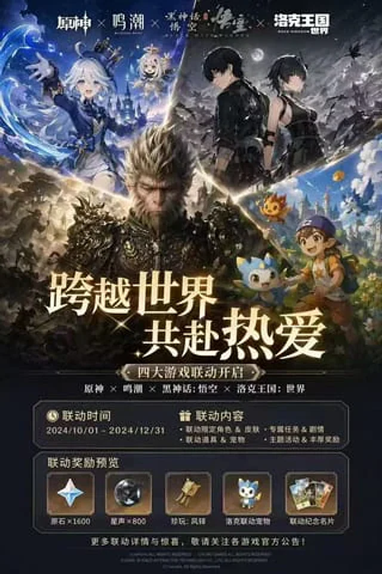

```text
{
  "type": "Video game collaboration promotional poster",
  "layout": {
    "header": {
      "description": "Four different game logos, separated by an \"X\" symbol.",
      "logos": [
        "Genshin Impact",
        "Mingchao",
        "Black Myth: Wukong",
        "Roco Kingdom: World"
      ]
    },
    "character_collage": {
      "description": "Dynamic V-shaped collage that blends four different game art styles",
      "sections": [
        {
          "position": "Top left",
          "style": "Animation cel style",
          "content": "A white-haired girl wearing a blue top hat, small floating white-haired companions, water magic effects, and a fantasy castle background."
        },
        {
          "position": "Top right",
          "style": "Animation cel style",
          "content": "The male and female protagonists are dressed in black tactical clothing, under a dark night sky with a full moon, amidst ruins."
        },
        {
          "position": "center",
          "style": "Hyper-realistic 3D",
          "content": "Sun Wukong, clad in magnificent dark armor, has a resolute expression against an epic battlefield backdrop."
        },
        {
          "position": "Bottom right",
          "style": "Bright animation style",
          "content": "A boy wearing a blue baseball cap and carrying a wooden cane, accompanied by three adorable miniature elemental mascot monsters, lives in a vibrant fantasy town."
        }
      ]
    },
    "center_typography": {
      "main_headline": "{argument name=\"main headline\" default=\"Crossing the world to pursue our passion\"}",
      "subtitle": "{argument name=\"subtitle\" default=\"Four games collaborate to launch\"}",
      "game_list": "Genshin Impact × Naruto × Black Myth: Wukong × Roc Kingdom: World"
    },
    "information_panels": {
      "event_details_panel": {
        "columns": 2,
        "left_column": {
          "title": "Collaboration Time",
          "value": "{argument name=\"event dates\" default=\"2024/10/01 - 2024/12/31\"}"
        },
        "right_column": {
          "title": "Collaboration content",
          "bullet_points_count": 4,
          "details": [
            "Limited-time collaboration characters &amp; skins",
            "Exclusive Missions &amp; Storyline",
            "Collaboration Items &amp; Pets",
            "Themed events &amp; generous rewards"
          ]
        }
      },
      "rewards_preview_panel": {
        "title": "Collaboration Rewards Preview",
        "count": 5,
        "items": [
          {
            "icon": "four-pointed star gem",
            "label": "1600 raw stones"
          },
          {
            "icon": "dark metallic sphere",
            "label": "Star Sound × 800"
          },
          {
            "icon": "golden bell relic",
            "label": "Treasures: Wind Bell"
          },
          {
            "icon": "blue mascot pet",
            "label": "Locke Collaboration Pets"
          },
          {
            "icon": "set of 3 cards",
            "label": "Collaboration Commemorative Business Card"
          }
        ]
      }
    },
    "footer": "Copyright Notice and Official Announcements/Disclaimer (Small Print)"
  }
}
```

Model: GPT Image 2
Author: GPT Image 2 Prompts

[ProjectD](https://aitoolsradar.com/en/prompts/8edf2ceb47e082) · [Recorded source](https://x.com/wilsondu311/status/2044781525942821206#reversed-2)
 · [Full original metadata and byte evidence](data/projectd-batch-0030.json)

## Four-Generation Family Portrait Prompt

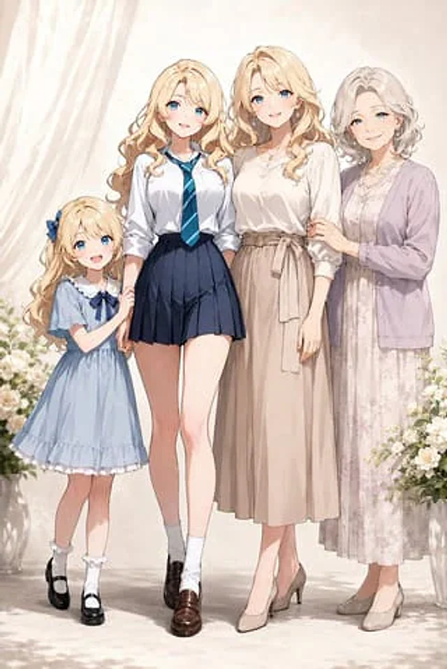

```text
添付した本人の女の子を基準として、 その血縁関係にある女性4世代を描いたファミリーポートレート。

構成は
・子供時代の本人
・現在の本人
・母親
・祖母
の4人。

構図
・4世代の女性家族写真のような自然な集合構図
・家族が寄り添うような配置
・自然な距離感と身長差
```

Model: GPT Image 2
Author: ちちぷい

[ProjectD](https://aitoolsradar.com/en/prompts/3fb2a421446b4b) · [Recorded source](https://youmind.com/prompts/four-generation-family-portrait-prompt-21341)
 · [Full original metadata and byte evidence](data/projectd-batch-0030.json)

## Four-Panel Backpack Lifestyle Ad


```text
{"type":"four-panel lifestyle product ad collage","subject":{"primary product":"minimalist black backpack","product details":"structured rectangular tech backpack, matte fabric, clean front panel, top zipper, padded shoulder straps, subtle small logo tag near the lower front corner","human model":"young adult man with light skin and messy blond hair, face intentionally obscured, wearing a cream oversized sweatshirt, light beige pants, and a dark wristwatch"},"layout":{"grid":"2x2 collage with thin white dividers","panel count":4,"panels":[{"position":"top-left","scene":"modern architectural courtyard outside a glass office or campus building","composition":"full-body walking shot of the male model carrying the black backpack over one shoulder, one hand in pocket, bright natural sunlight, soft editorial shadows, greenery and reflective glass in background"},{"position":"top-right","scene":"minimal modern office interior beside tall windows","composition":"medium shot of the male model standing behind a desk and placing a slim laptop into the open black backpack","objects count":6,"objects":["black backpack","closed laptop being inserted","2 stacked books","open notebook","black desk lamp","flat tablet or laptop on desk"],"branding":"small rounded white badge in the top-right corner containing the text {argument name=\"brand text\" default=\"Pollo AI\"} and below it {argument name=\"sub brand text\" default=\"GPT Image 2\"}"},{"position":"bottom-left","scene":"warm sunlit workspace with glass walls and trees outside","composition":"medium seated shot of the male model writing in a notebook at a wooden desk next to an open laptop, backpack resting on the table to the right","objects count":5,"objects":["open laptop","desk lamp","notebook","stack of 2 books","black backpack"]},{"position":"bottom-right","scene":"clean studio product shot on a light gray background","composition":"isolated three-quarter view of the backpack standing upright, straps visible, soft shadow beneath, premium ecommerce lighting"}]},"style":{"look":"premium ecommerce campaign, minimalist startup ad, polished lifestyle branding","lighting":"soft natural daylight in lifestyle panels, even studio lighting in product panel","color palette":"neutral beige, cream, black, gray, muted green","camera":"photorealistic, shallow depth of field in lifestyle shots, sharp product detail","aspect ratio":"16:9"},"customization":{"product":"{argument name=\"product type\" default=\"minimalist black backpack\"}","product color":"{argument name=\"product color\" default=\"black\"}","model outfit top":"{argument name=\"top clothing\" default=\"cream oversized sweatshirt\"}"}}
```

Model: GPT Image 2
Author: Matías Schrank

[ProjectD](https://aitoolsradar.com/en/prompts/a849633a2a927b) · [Recorded source](https://youmind.com/prompts/four-panel-backpack-collage-17203)
 · [Full original metadata and byte evidence](data/projectd-batch-0030.json)

## Four-Panel Girl, Robot, and Goat Story


```text
{
  "type": "Four-panel cinematic fantasy illustration collage",
  "subject": {
    "primary duo": "A little girl with white hair and a tall, weathered humanoid robot",
    "companion animal": "A little white goat",
    "relationship": "A quiet and protective companionship in different times and seasons.",
    "girl": {
      "age_appearance": "young children",
      "hair": "Short bob haircut, white or silver hair, straight bangs",
      "clothing": "A simple, loose-fitting white dress, dark ankle boots, and a light-colored cape or blanket draped over one shoulder in one of the outfits.",
      "expression": "Calm, gentle, contemplative",
      "features": "Soft, anime-style face, petite figure"
    },
    "robot": {
      "scale": "Very tall compared to girls",
      "design": "An old, war-torn humanoid machine with dark iron armor plates, exposed cables and mechanical joints, broad shoulders, and long limbs.",
      "head": "The helmet-shaped head, with its sharp angles, features clusters of red luminous sensors.",
      "surface": "Rusty, scratched, and worn metal, with some areas covered by vegetation or soil."
    },
    "animal": {
      "species": "goat",
      "appearance": "White goat with short horns",
      "behavior": "He stayed quietly beside the girl in each compartment."
    }
  },
  "layout": {
    "grid": "2x2",
    "panel_count": 4,
    "gutters": "Thin white border between grids",
    "sections": [
      {
        "title": "Top left",
        "position": "Top left",
        "count": 3,
        "labels": [
          "The girl stood in the shallow puddles, holding a large leaf like an umbrella.",
          "The robot walked protectively beside her, its head bowed.",
          "The goat walked on her other side"
        ]
      },
      {
        "title": "Top right",
        "position": "Top right",
        "count": 3,
        "labels": [
          "The girl sits on a high spot on the grass, her back to the camera.",
          "The robot sat beside her, watching the sunset.",
          "The goats sat nearby, overlooking the shimmering valley and lake."
        ]
      },
      {
        "title": "Bottom left",
        "position": "Bottom left",
        "count": 3,
        "labels": [
          "The girl crouched down beside the forest stream, touching the water's surface.",
          "The robot crouched behind them, observing gently.",
          "Goats drinking water by the stream"
        ]
      },
      {
        "title": "Bottom right",
        "position": "Bottom right",
        "count": 4,
        "labels": [
          "The girl sat by the small campfire, holding a mug.",
          "The robot crouched beside the fire to keep warm.",
          "The goat curled up and slept by the fire.",
          "A black kettle hangs above the flames."
        ]
      }
    ]
  },
  "environments": {
    "top-left": "A path through ruins in the rain, puddles of water, a misty gray atmosphere, with blurry, overgrown buildings in the background.",
    "top-right": "A golden sunset landscape, with warm clouds, distant mountains, reflective lake water, and grassy slopes.",
    "bottom-left": "A dappled sunlight filters through a green forest, beside which flows a clear, shallow stream, its bright rays filtering through the leaves.",
    "bottom-right": "The blue snow-covered forest at night, with snowflakes falling, contrasts the intimate firelight with the frigid surroundings."
  },
  "style": {
    "genre": "Melancholy science fiction fantasy",
    "rendering": "Highly detailed anime illustrations",
    "lighting": "Each frame features dramatic, cinematic lighting, creating striking atmospheric transitions between rainy days, sunsets, forest daytime, and snowy nights illuminated by firelight.",
    "color_palette": "Soft grays and blue-greens are balanced with warm amber sunsets and orange firelight.",
    "composition": "The film features emotionally nuanced scenes of companionship, with the robot frequently tilting or crouching to fit the child's height, a moving narrative, and soft depth of field."
  }
}
```

Model: GPT Image 2
Author: GPT Image 2 Prompts

[ProjectD](https://aitoolsradar.com/en/prompts/e922a2011960bf) · [Recorded source](https://x.com/Eris_Create_Lab/status/2047537707904274795#reversed-2)
 · [Full original metadata and byte evidence](data/projectd-batch-0030.json)

## Four-Panel Romantic Comedy Manga Page


```text
Create a single black-and-white comic strip page containing four vertically stacked horizontal panels, featuring sharp black panel spacing, halftone shading, dramatic speed lines, and refined seinen manga-style lines. The page includes two young anime characters with short, dark hair, dressed in modern casual wear, their faces partially obscured by soft, square blurs. Panel 1: A thin young man with messy, short dark hair, wearing a collared shirt, one hand clenched into a fist near his chest, leaning to the left, surrounded by intense flame effects, his expression agitated and defensive. Place a giant jagged vertical dialog box on the right with the content in Japanese: "What time is it? Soul is cut and drawn. One piece is drawn, and one piece is shot and number is shot.で出した片が同じ価値なわけないでしょ! ふざけないで!” Box 2: Another young man, slightly taller, with short dark hair, wearing a light-colored shirt and a dark zippered jacket, calmly raised an index finger, as if to explain his point. Add a rounded rectangle dialog box on the right with Japanese content: 「Casting the time of 労働侴卤がdeterminationまるという is a typical な "労働価夤说の fallacy" だ. The market is the market, the output is the result, the result is the hand, the judgment is the judgment価するかでdeterminationまる". Box 3: The taller character pats the shorter character's head lightly; a small onomatopoeia "ポン" for head patting is added near the hand. The shorter character looked up in surprise. Add a huge oval vertical dialog box on the right with the content in Japanese: 「でも俺のMarket price benchmarkはすごくシンプルだよ.君が俺のために"It takes a few seconds to take a photo, and it feels like it lasts ten minutes." Panel 4: Close-up of the shorter character. At this time, his face is flushed due to extreme shyness, his eyes are spiral-shaped, accompanied by sweat drops, trembling expression, open mouth, and dense shadow lines on his cheeks, making him look embarrassed. The background is filled with dramatic radiating speed lines. Add a large, jagged, vertical speech bubble on the right side, containing the Japanese phrase: "だ、谁がアンタのために照れるか…っ！自意识过剰よ！". Add two onomatopoeic words: a small "プル…" near the shoulder, and a larger, trembling handwritten "カァァァ" in the lower left corner. Maintain the black-and-white style throughout the page, creating a highly expressive and romantic comedy manga tone, and forming a strong contrast between the heated arguments, the calm explanations, the playful affection, and the awkward ending.
```

Model: GPT Image 2
Author: GPT Image 2 Prompts

[ProjectD](https://aitoolsradar.com/en/prompts/b34de1238533e1) · [Recorded source](https://x.com/jaguring1/status/2046735877628670430#reversed-0)
 · [Full original metadata and byte evidence](data/projectd-batch-0030.json)

## Four-Panel Vertical Advertisement Mockups


```text
{
  "type": "Four-panel advertising mockup",
  "layout": "Divided vertically into four columns",
  "panels": [
    {
      "position": "Leftmost",
      "theme": "Food Advertisement",
      "subject": "A steaming bowl of authentic soy sauce ramen, topped with char siu pork, half a soft-boiled egg, dried bamboo shoots, and chopped green onions.",
      "background": "Dark, textured light and shadow",
      "typography": {
        "catchphrase": "{argument name=\"ramen catchphrase\" default=\"Putting my heart and soul into this one cup.\"}",
        "subtext": "The ultimate ramen, showcasing the freshness of the ingredients.",
        "brand_name": "Noodles",
        "details": "Authentic soy sauce ramen, 980 yen",
        "footer": "Address and business hours of Shibuya, Tokyo"
      }
    },
    {
      "position": "Middle left",
      "theme": "Fashion catalog",
      "subject": "A young Japanese woman turns around, wearing a sheer white long-sleeved top.",
      "background": "Light gray studio background",
      "typography": {
        "headline": "{argument name=\"fashion brand\" default=\"SHEER\"}",
        "subheadline": "New series",
        "vertical_text": "Wearing a transparent look",
        "details": "Starting March 15th (Friday) in Spring/Summer 2024",
        "button": "View the special website &gt;"
      }
    },
    {
      "position": "Middle right",
      "theme": "Travel agency promotion",
      "subject": "A woman wearing a white summer dress and a straw hat walked down the white steps.",
      "background": "{argument name=\"travel destination\" default=\"Santorini, Greece\"} The background features iconic blue-domed churches, white buildings, and the deep blue Aegean Sea.",
      "typography": {
        "top_text": "Heading to unseen breathtaking scenery",
        "main_title": "trip",
        "subtitle": "Embark on a soul-stirring journey",
        "badge": "Summer travel specials, valid until May 31st (Friday).",
        "bottom_nav": {
          "count": 3,
          "labels": [
            "Overseas travel",
            "Domestic tourism",
            "Flight + Hotel"
          ]
        },
        "button": "View now! &gt;"
      }
    },
    {
      "position": "far right",
      "theme": "B2B SaaS software",
      "subject": "An open laptop displays a data dashboard surrounded by floating UI elements.",
      "background": "Light purple and white gradient",
      "ui_elements": {
        "count": 3,
        "labels": [
          "AI Agent",
          "Task Management",
          "Data Analysis"
        ]
      },
      "typography": {
        "logo": "{argument name=\"tech product name\" default=\"Aideal\"}",
        "headline": "{argument name=\"tech headline\" default=\"Work can be smarter.\"}",
        "subheadline": "AI creates time for you",
        "badge": "More than 10,000 businesses use it",
        "button": "Start for free &gt;",
        "url": "www.aideal.jp"
      }
    }
  ]
}
```

Model: GPT Image 2
Author: GPT Image 2 Prompts

[ProjectD](https://aitoolsradar.com/en/prompts/45d443666db117) · [Recorded source](https://x.com/mochisw/status/2045734492225376501#reversed-2)
 · [Full original metadata and byte evidence](data/projectd-batch-0030.json)

## Fox Spirit Kimono Portrait


```text
An incredibly detailed anime-style fantasy portrait depicts a serene young woman with fox ears, her face turned to the left, framed from the thighs up and slightly tilted to the right. She has flowing long hair, the color of which is {argument name="hair color" default="Silver-white with soft pink tips."} It has a pair of large white fox ears, fair skin, and a bright {argument name="eye color" default="blue"} Her eyes. Her expression was calm, reserved, and full of spirit. She wore an elegant dress.{argument name="kimono color" default="black"} The kimono is adorned with delicate red and gold floral patterns, and a traditional obi (sash) is visible at the back. Her hair is adorned with an ornate floral hair ornament composed of red, gold, and black flowers, dangling with gold chains and tassels. A large, luminous circular celestial halo, composed of three concentric circles, floats behind her head, engraved with intricate arcane symbols, starbursts, and radiating gold lines, creating a sacred and mysterious backlighting effect. The background is a dark, oil-painting-like space with dramatic black, bronze, and crimson brushstrokes, embellished with glowing embers, gold splatter effects, and scattered petals in the lower left corner. A vertical line of Japanese calligraphy is added to the left, containing the following text:{argument name="vertical text" default="Dreams, like light, quietly illuminate the heart."} Below is a red stamp. Utilizing cinematic contour lighting, a strong golden halo, ultra-fine fabric textures, delicate hair strands, and shimmering particle effects, it creates an elegant Japanese fantasy atmosphere, boasting top-tier illustration quality, master-level anime visuals, exquisite composition, strong contrast, and a delicate oil painting texture.
```

Model: GPT Image 2
Author: GPT Image 2 Prompts

[ProjectD](https://aitoolsradar.com/en/prompts/8d205f508b185d) · [Recorded source](https://x.com/tetumemo/status/2047141128294797531#reversed-0)
 · [Full original metadata and byte evidence](data/projectd-batch-0030.json)

## Fox Spirit Kimono Portrait


```text
A highly detailed anime fantasy portrait of a serene fox-eared young woman in left-facing side profile, shown from about thigh-up, centered slightly right of frame. She has long flowing {argument name="hair color" default="silver-white with a soft pink tint at the ends"} hair, large white fox ears, pale skin, and one visible vivid {argument name="eye color" default="blue"} eye. Her expression is calm, introspective, and luminous. She wears an elegant {argument name="kimono color" default="black"} kimono richly decorated with intricate gold and red floral patterns, with a traditional obi visible at the back. In her hair is an ornate kanzashi-style floral ornament made of red, gold, and black flowers with dangling gold chains and tassels. Behind her head is a large glowing circular celestial magic halo, formed by 3 concentric rings with fine arcane symbols, star-like points, and radiant golden lines, creating a sacred, mystical backlight. The background is a dark textured painterly space with dramatic black, bronze, and crimson brush textures, glowing embers, gold splashes, and scattered flowers near the lower left. Add 1 vertical line of Japanese calligraphy along the left side reading {argument name="vertical text" default="夢は光のように、静かに心を照らす。"}, plus 1 small red seal stamp beneath it. Use cinematic rim lighting, intense golden glow, ultra-detailed fabric, delicate hair strands, sparkling particles, elegant Japanese fantasy atmosphere, premium illustration quality, masterpiece anime key visual, refined composition, dramatic contrast, and a polished painterly finish.
```

Model: GPT Image 2
Author: テツメモ｜AI図解×検証｜Newsletter

[ProjectD](https://aitoolsradar.com/en/prompts/c7fb090b558578) · [Recorded source](https://youmind.com/prompts/fox-spirit-kimono-portrait-15319)
 · [Full original metadata and byte evidence](data/projectd-batch-0030.json)

## FPS Custom Weapon Skin Screenshot


```text
{
  "type": "Screenshots from a first-person shooter game",
  "setting": {
    "environment": "{argument name=\"map background\" default=\"Dusty Middle Eastern streets reminiscent of Dust II\"}",
    "details": "A white building with Arabic script and a green road sign pointing to a red 'A' bomb site, reading 'HOTEL AURORE'."
  },
  "perspective": "First-person perspective with a weapon in hand",
  "character_hands": "Wearing{argument name=\"theme\" default=\"Spider-Man\"} Themed gloves set, red background with black spiderweb pattern, blue forearms.",
  "weapon": {
    "model": "{argument name=\"weapon name\" default=\"AK-47\"} assault rifle",
    "skin_design": "The red and blue color-blocked design, accented with a black spiderweb pattern, is striking.",
    "decals": [
      "Large white spider logo on the casing",
      "The white 'CS2' lettering on the blue area",
      "The blue magazine has the word 'MARVEL' in red.",
      "The red stock bears the stylized white 'SPIDER-MAN' lettering.",
      "The small yellow lettering 'FR3.4' near the trigger."
    ]
  },
  "ui_overlay": {
    "top_center": {
      "icon": "Black shield with a red spider logo",
      "title": "{argument name=\"weapon name\" default=\"AK-47\"} | {argument name=\"skin name\" default=\"Spider-walker\"}",
      "subtitle": "{argument name=\"collection text\" default=\"CS2 series\"}",
      "divider": "Red horizontal line"
    },
    "bottom_left": {
      "count": 5,
      "description": "A row of white interface icons",
      "icons": [
        "pistol",
        "Spray paint can",
        "Player silhouette",
        "Information 'i'",
        "Picture frame"
      ]
    },
    "bottom_right": {
      "text": "closure"
    }
  }
}
```

Model: GPT Image 2
Author: GPT Image 2 Prompts

[ProjectD](https://aitoolsradar.com/en/prompts/8d8afae3f43adb) · [Recorded source](https://x.com/tehno_maniak/status/2044754985183785208#reversed-3)
 · [Full original metadata and byte evidence](data/projectd-batch-0030.json)

## FPS Custom Weapon Skin Screenshot


```text
First-person perspective video game screenshots showing people wearing {argument name="glove style" default="Spider-Man suit"} The gloved hands are gripping an AK-47 assault rifle. The weapon is custom-made.{argument name="weapon theme" default="Spider-Man"} The skin features a red and blue color scheme with a black spiderweb pattern. The receiver has a white spider logo, the handguard is printed with "CS2," the magazine with "MARVEL," and the stock with "SPIDER-MAN." The background is a dusty Middle Eastern town street resembling a tactical shooting map, with a sign reading "HOTEL AURORE" accompanied by an arrow pointing to point "A." The UI at the top center displays a red shield with a black spider pattern, and the text "..." is displayed below the red line.{argument name="weapon title" default="AK-47 | Web-Slinger"} The bottom UI features five minimalist white icons on the left and the word "CLOSE" on the right.
```

Model: GPT Image 2
Author: GPT Image 2 Prompts

[ProjectD](https://aitoolsradar.com/en/prompts/5361f319cc97c2) · [Recorded source](https://x.com/WolfRiccardo/status/2044564232927076358#reversed-1)
 · [Full original metadata and byte evidence](data/projectd-batch-0030.json)

## Fresh Summer Sky Portrait Poster


```text
Goal: Create a fresh summer editorial portrait poster of {argument name="character name" default="高圆圆"}, with a clean blue-sky aesthetic and minimalist magazine typography.

Canvas: Square 1:1 composition, soft pale blue sky background, bright natural daylight, high-key exposure, airy negative space. Use a delicate cyan and white color palette with subtle film grain.

Subject details: A graceful young Chinese woman photographed from the chest up, positioned in the lower half of the frame and slightly off center. She has long flowing black hair, fair skin, and wears a loose semi-sheer white blouse with rolled sleeves. Her arms are raised above her head, both hands open and relaxed as if shading her eyes from the sun. Her face is intentionally simplified/softly obscured with a smooth neutral skin-tone blur, while the pose, hair, neck, ears, hands, and clothing remain photorealistic. Mood is calm, elegant, refreshing, and sunlit.

Layout: Large handwritten blue Chinese calligraphy spans the upper center, reading {argument name="main calligraphy text" default="高圆圆"}, with a long sweeping underline stroke extending diagonally across the sky. The portrait occupies the bottom half, leaving generous sky space above.

Visible text elements: Include exactly 7 discrete text/decorative groups: 1) top-left small stacked English text: “SUMMER”, “MORNING”, “06 / 17”; 2) a small blue dot under the date; 3) left-side vertical Chinese sentence: “晴朗的日子，空气都是甜的”; 4) left-side vertical four-dot ellipsis near the lower-left-middle; 5) top-right vertical English quote: “The brightness of day leaves a soft mark on everything.” followed by “////”; 6) bottom-left tiny vertical location labels: “BEIJING”, “CHINA” with a small blue dot; 7) bottom-right tiny vertical name/date label: “GAO YUANYUAN” and “2024”.

Visual style: Photorealistic fashion portrait mixed with Japanese/Chinese minimalist magazine design, clean typography, thin letterspacing, very small black and blue text, elegant handwritten calligraphy, soft lens bloom, gentle backlight, clear summer morning atmosphere.

Constraints: Keep the design uncluttered, no extra people, no buildings, no props, no watermark, no harsh shadows, no saturated colors. Preserve the square poster layout and the calm sky-blue freshness.
```

Model: GPT Image 2
Author: 小小东

[ProjectD](https://aitoolsradar.com/en/prompts/3694b957e1d615) · [Recorded source](https://youmind.com/prompts/summer-sky-portrait-poster-24839)
 · [Full original metadata and byte evidence](data/projectd-batch-0030.json)

## Friendly ChatGPT Robot Office Scene


```text
Goal: Create a square, polished 3D promotional illustration introducing {argument name="character name" default="ChatGPT"} as a friendly AI assistant made by {argument name="company name" default="OpenAI"}.

Canvas: 1:1 square image, warm indoor office setting, shallow depth of field, soft cinematic lighting, realistic 3D toy-like render with handwritten whiteboard-style annotations overlaid on the scene.

Main subject: Center-right is a cute glossy white robot assistant with a rounded rectangular black screen face, glowing happy crescent eyes, rounded ear-like side pods, segmented arms, and a small OpenAI knot logo on its chest. The robot is waving with its right hand and holding a white placard with its left hand. The placard reads: “I was created by” above a green OpenAI logo, then “OpenAI” in large black type, then “An AI research and deployment company,” and at the bottom in green: “Better AI. A brighter future.” with small decorative emphasis marks.

Layout and objects: Place the robot behind a wooden desk. Include exactly 4 stacked books on the left side of the desk, labeled from top to bottom: “BETTER QUESTIONS,” “CLEARER ANSWERS,” “A MORE HELPFUL TOMORROW,” and a bottom dark book with a small heart icon. In the lower-left foreground, include an open laptop angled toward the viewer with text on its back: “Curiosity builds a better world” plus a small heart. On the right side of the desk, include 1 white coffee mug labeled: “Same team. A brighter future.” with a simple smiley face. Along the bottom edge of the desk, add a small handwritten caption: “OpenAI × ChatGPT = More possibilities for everyone” followed by a heart.

Background: Use a dark navy wall or board on the right with a large white OpenAI knot logo and the word “OpenAI.” Under it, handwritten text reads exactly 4 lines: “Research,” “Safety,” “Useful AI,” “for everyone,” with a small underline and decorative rays. Add a blurred plant on the far left and warm office furniture in the background.

Handwritten annotation overlays: Include a large top-left greeting in white: “Hi there!” with energetic lines. Below it, write “I’m” and then {argument name="headline text" default="ChatGPT"} in large mint-green handwritten letters with an underline. Add exactly 3 explanatory icon callouts down the left side: 1 speech bubble icon with “A large language model (AI assistant)”; 1 lightbulb icon with “I can answer questions, explain things, help you create, solve problems, and much more!”; 1 heart icon with “I’m here to be helpful, honest, and friendly.” Above the robot’s head, add “That’s me!” with an arrow pointing to the robot and a few emphasis strokes.

Visual style: friendly, optimistic, clean tech branding, rounded forms, glossy materials, white and mint-green marker typography, warm wood tones, deep blue background, professional but playful. Keep the OpenAI branding readable, preserve the exact text above, avoid extra logos, avoid misspelled words, and keep all typography legible.
```

Model: GPT Image 2
Author: White

[ProjectD](https://aitoolsradar.com/en/prompts/4dfe9024a741d5) · [Recorded source](https://youmind.com/prompts/chatgpt-robot-office-scene-30892)
 · [Full original metadata and byte evidence](data/projectd-batch-0030.json)

## Friendly Robot Coffee Barista Mascot


```text
Square 1:1 isometric mascot design of a friendly humanoid coffee barista robot. Clean rounded white panels with mint green accent stripes, single large round screen face displaying a simple smile made of two dots and an upturned arc, three-fingered articulated hands holding a small ceramic cup of espresso. Subtle steam from the cup. Stands on a small soft grey isometric base tile. Bright soft studio lighting from above-front, square 1:1 brand-ready composition. No real brand name on the robot, no logo, no watermark. Premium mascot illustration quality, photorealistic plastic and metal materials.
```

Model: GPT Image 2
Author: @hiapi_ai

[ProjectD](https://aitoolsradar.com/en/prompts/ea7c8986164018) · [Recorded source](https://github.com/HiAPIAI/awesome-gpt-image-2-prompts)
 · [Full original metadata and byte evidence](data/projectd-batch-0030.json)

## Frosted Glass Minimalist Texture


```text
背景为{argument name="背景颜色" default="淡淡纯米色"}毛玻璃质感，背景极简风格。
```

Model: GPT Image 2
Author: 𝟡𝟜 𝚅̷𝙰̷𝙽̷ ᴾᴸᴬʸᶠᴼᴿᴳᴱ

[ProjectD](https://aitoolsradar.com/en/prompts/2ef27d8d131d6a) · [Recorded source](https://youmind.com/prompts/frosted-glass-minimalist-background-23327)
 · [Full original metadata and byte evidence](data/projectd-batch-0030.json)

## Frosted Glass Portfolio Cover Aesthetic


```text
以具体主题内容为核心生成一张具有作品集封面秩序的视觉作品。核心对象不要完整陈列，而是先被压缩成一个偏离中轴的主质量，沉入半透明雾化表层与低饱和背景场之间；对象的完整轮廓、次要细节和普通说明都被压花玻璃颗粒、细小折射位移、乳白雾化和低对比模糊吞没，只在最能承载主题识别的位置切出一条干净清晰的窄窗，让该局部保留真实质感、较高对比和必要色彩，其余部分化为暗部质量、柔化轮廓、破碎边缘和被背景吃掉的过渡。清晰窄窗要像从材料表面擦开的精确缝隙，尺寸克制但语义准确，成为观者进入主题的唯一强入口。背景由主题的空间关系、材料属性、时间方向和情绪温度推导成大面积低噪声色场，上部或外侧保留轻空气感，一侧形成淡色呼吸区，主体所在区域压入更低明度；背景不承担普通场景叙事，而承担吞没边缘、承载白色文字、制造距离和记忆感的结构功能。色彩保持大面积低饱和结构色、低明度主体色、少量集中真实色和白色信息色之间的比例，色相随主题改变，明度层级、饱和度克制和局部色彩价值保持稳定。画面使用清晰、半清晰、失焦三层：清晰窄窗负责主题识别，短促粗白标题和编号保持半清晰可读，主体大部、背景 and 底部微型信息进入雾化失焦。文字采用现代无衬线字体，白色或近白，粗标题短促、厚重、像印在玻璃上并被表层轻微咬边；角落标识、边缘日期、编号和底部微型注释组成元数据坐标系，像作品编号、档案记录和制作参数，文字服务于阅读路线而不遮盖清晰窄窗。整体表面保留可见的颗粒压花玻璃触感，纹理随底层明暗改变密度，暗部更密集，亮部更乳白，边缘出现细碎折射和轻微位移，所有图像、对象和文字都像被同一块材料统一压住。最终画面应呈现冷静、克制、带技术档案感的视觉封面：信息被有意识地隐藏，只有最关键的局部被释放。

本次主题：{argument name="主题" default="疯狂星期四 KFC"} 
比例：9:10
```

Model: GPT Image 2
Author: 小小东

[ProjectD](https://aitoolsradar.com/en/prompts/2bd6b181f26a89) · [Recorded source](https://youmind.com/prompts/frosted-glass-portfolio-cover-style-23197)
 · [Full original metadata and byte evidence](data/projectd-batch-0030.json)

## Fujifilm Couple Portrait


```text
9:16 vertical — Japanese Fuji film style couple portrait, two subjects  Fujifilm analog aesthetic (Pro 400H / Superia feel), soft pastel tones, slight green-magenta shift, low contrast, gentle highlight roll-off, fine film grain, subtle halation  bright natural daylight, diffused sunlight through window, soft shadows, airy atmosphere  young Japanese couple, natural minimal makeup, realistic skin texture, slight imperfections  female outfit: oversized button-up shirt with loose shorts, relaxed fit, soft casual styling   male outfit: simple t-shirt or light shirt, clean and understated  hair: natural, slightly tousled for both  pose: close intimate distance — sitting or standing close together; the girl gently leaning toward him, one hand lightly resting on his shoulder or chest; the boy slightly leaning in, faces close, almost touching, capturing the moment just before a kiss  expression: soft smiles or gentle gaze toward each other, relaxed and natural, emotional connection visible  camera: close framing (waist-up), eye-level, intimate distance, slight handheld feel  setting: minimal indoor near window, light curtains, clean soft background  lighting: diffused daylight, gentle highlight bloom, soft shadow transitions  mood: warm, romantic, intimate everyday moment, natural affection  quality: ultra-realistic, analog film look, fine grain, slight softness, natural imperfections
```

Model: GPT Image 2
Author: @BubbleBrain

[ProjectD](https://aitoolsradar.com/en/prompts/0a4f356e1167b9) · [Recorded source](https://x.com/BubbleBrain/status/2046502288102170757)
 · [Full original metadata and byte evidence](data/projectd-batch-0030.json)

## Fujifilm Strawberry School Portrait


```text
9:16 vertical — Japanese Fuji film style portrait, single subject  Fujifilm analog aesthetic (Pro 400H / Superia feel), soft pastel tones, slight green-magenta shift, low contrast, gentle highlight roll-off, fine film grain, subtle halation, slight vignette  bright natural daylight, diffused sunlight through window, soft shadows, airy atmosphere  young Japanese female idol, natural minimal makeup, fresh glowing skin, realistic texture, slight imperfections  outfit: Japanese school uniform (sailor-style or blazer uniform), neatly styled, non-revealing, youthful and clean  hair: natural dark hair, straight or softly flowing, a few loose strands  pose: front-facing or slight angle toward camera, relaxed posture; one hand gently holding a strawberry near lips, mid-action as if about to take a bite; shoulders relaxed, subtle natural body curve  expression: soft playful gaze, light smile or neutral lips, gentle eye contact with camera  setting: minimal indoor near window or simple outdoor corner, clean background, everyday atmosphere  composition: slightly off-center framing, intimate distance, candid feel  mood: fresh, youthful, sweet everyday moment, understated charm  quality: ultra-realistic, analog film look, natural imperfections, soft dreamy finish
```

Model: GPT Image 2
Author: @BubbleBrain

[ProjectD](https://aitoolsradar.com/en/prompts/dfeea0f0b17752) · [Recorded source](https://x.com/BubbleBrain/status/2046483268019884384)
 · [Full original metadata and byte evidence](data/projectd-batch-0030.json)

## Full Stack Knowledge Visualization


```text
right{argument name="subject" default="Basic Web Full-Stack Knowledge Required for Ordinary People to Perform VibeCoding"} Visual presentations, and what can be created{argument name="count" default="Top 10"} Full-stack project demonstration.
```

Model: GPT Image 2
Author: GPT Image 2 Prompts

[ProjectD](https://aitoolsradar.com/en/prompts/6f7c6cb59bc032) · [Recorded source](https://x.com/cellinlab/status/2047563972874826234)
 · [Full original metadata and byte evidence](data/projectd-batch-0030.json)

## Full-Bleed Crane Park Key Art


```text
Using the provided reference image, isolate and regenerate only the central park illustration as a full-bleed wide cinematic artwork. Remove all presentation-board elements, typography, swatches, maps, thumbnails, labels, margins, and paper background. Expand the central scene to fill a {argument name="aspect ratio" default="16:9 landscape"} canvas while preserving the same painterly concept-art style, dusk blue-and-gold lighting, crane-park environment, child figure, swing/crane landmark, flowers, trees, and atmospheric urban skyline. Increase clarity and detail without making it look photorealistic; keep the textured gouache/pastel brushwork and hand-painted grain. Make it suitable as a clean environment key art image with no text or UI elements.
```

Model: GPT Image 2
Author: ヤノ

[ProjectD](https://aitoolsradar.com/en/prompts/187142fe25da06) · [Recorded source](https://youmind.com/prompts/crane-park-key-art-28169)
 · [Full original metadata and byte evidence](data/projectd-batch-0030.json)

## Full-Body Fantasy Adventurer Male


```text
This illustration depicts a full-body fantasy character against a pure light gray background, employing a refined Japanese RPG concept art style. The lines are clean, the rendering soft, and the textures of leather, fur, and skin are realistic. It portrays a tall, robust, and fair-skinned young man standing in a relaxed, weight-shifted posture. His right arm is raised across his forehead, as if shielding him from the light, his gloved hand touching the dark brim of his hat; his left arm hangs naturally, his fist clenched. His face is mostly obscured by the shadow of his raised forearm and hat brim, making his expression difficult to discern. He has {argument name="hair color" default="White gold"} Her medium-length hair was slightly messy.{argument name="headwear" default="Black flat cap"} A small earring is faintly visible on one ear. He is dressed in a layered adventurer's outfit, primarily in dark brown, black, and soft reddish-brown. He wears a fitted black short-sleeved shirt over a brown leather vest with wide straps and buckles, and a thick, light-colored fur collar around his neck and shoulders. A necklace with small metal embellishments adorns his collarbone. His hands are covered with dark fingerless or fitted leather gloves, along with multiple layers of wristbands and bracers. His waist is adorned with several crisscrossing belts, metal buckles, and hanging ornaments, and a reddish-brown belt with long, draped strips of fabric is tied around his hips. A small leather pouch hangs from his left waist. He wears fitted dark trousers with straps at the thighs featuring metal rings and buckles. He wears matching dark high-top lace-up leather boots with reinforced knee pads or delicate metal shin guards, giving him a slightly weathered yet stylish look. A long, tattered piece of cloth hangs from the right side of the waist, its end adorned with subtle decorative patterns and adorned with a metal pendant or spearhead-shaped ornament. The design emphasizes a rugged and dashing adventurer aesthetic, meticulous costume design, and exquisite game character illustration quality. The composition is centered, with the entire figure, from head to toe, fully visible, and a soft, subtle shadow cast on the ground.
```

Model: GPT Image 2
Author: GPT Image 2 Prompts

[ProjectD](https://aitoolsradar.com/en/prompts/44d71a70f710ec) · [Recorded source](https://x.com/haggy30/status/2047311260770029577#reversed-1)
 · [Full original metadata and byte evidence](data/projectd-batch-0030.json)

## Full-Page Superhero Comic Layout


```text
{
  "type": "Comic book page layout",
  "style": "Modern American superhero comics, with delicate ink lines and colors, and cinematic lighting.",
  "global_elements": {
    "title_logo": "{argument name=\"comic title\" default=\"the AMAZING SPIDER-MAN\"}",
    "subtitle": "No small choice, Part 1",
    "credits": [
      "ZEB WELLS screenwriter",
      "JOHN ROMITA JR. Pencil Draft",
      "KLAUS JANSON ink lines",
      "BRITTANY PEZZILLO coloring",
      "VC'S JOE SABINO font design"
    ],
    "hero_design": "{argument name=\"hero description\" default=\"spider-themed superhero in a red and blue suit with web patterns and large white eye lenses\"}",
    "civilian_design": "{argument name=\"civilian description\" default=\"young handsome man with brown hair wearing a green jacket and white t-shirt\"}"
  },
  "layout": {
    "rows": 5,
    "total_panels": 9,
    "panels": [
      {
        "position": "Row 1, main image on the left",
        "scene": "The hero crouched on the edge of the rooftop, overlooking the city at sunset.",
        "text_boxes": 2,
        "text_content": [
          "New York never stops.",
          "Sometimes I feel the same way."
        ]
      },
      {
        "position": "Line 1, illustration on the right",
        "scene": "Close-up of the hero's mask face",
        "text_boxes": 1,
        "text_content": [
          "But today... I stopped."
        ]
      },
      {
        "position": "Line 2, full width",
        "scene": "He, an ordinary citizen, held a mug that read \"The World's Most Decent Scientist\" and looked at his smartphone in his messy apartment.",
        "text_boxes": 5,
        "text_content": [
          "Thanks to the timely response of local heroes, power has been restored throughout the city.",
          "—Channel 5.",
          "'A local hero.'",
          "That's... wonderful.",
          "But some people can't make the headlines."
        ]
      },
      {
        "position": "Line 3, slanted to the left",
        "scene": "Ordinary people walk on crowded city streets",
        "text_boxes": 2,
        "text_content": [
          "Uncle Ben once said:",
          "{argument name=\"famous quote\" default=\"'WITH GREAT POWER COMES GREAT RESPONSIBILITY.'\"}"
        ]
      },
      {
        "position": "Line 3, slanted towards the center",
        "scene": "A portrait of an elderly man with a smiling face, gray hair, wearing a vest and tie.",
        "text_boxes": 1,
        "text_content": [
          "I think of this sentence every day."
        ]
      },
      {
        "position": "Line 3, slanted to the right",
        "scene": "The hero swung through the city on spiderwebs.",
        "text_boxes": 1,
        "text_content": [
          "Becoming Spider-Man isn't just about stopping those huge threats."
        ]
      },
      {
        "position": "Row 4, left",
        "scene": "The hero dynamically lands in a chaotic street scene where civilians are fleeing from a fire.",
        "speech_bubbles": 1,
        "text_boxes": 1,
        "text_content": [
          "Get out of the way!",
          "The key is to protect people."
        ]
      },
      {
        "position": "Line 4, right side",
        "scene": "A close-up of the hero talking to a smiling, curly-haired little Black girl.",
        "speech_bubbles": 2,
        "text_content": [
          "Thank you, Spider-Man!",
          "Available anytime."
        ]
      },
      {
        "position": "Line 5, full width",
        "scene": "At dusk, the silhouette of a hero sitting on a rooftop overlooking the city skyline.",
        "text_boxes": 2,
        "floating_text": 1,
        "text_content": [
          "This city needs hope.",
          "As long as I can still spin my spider web, I will always be there.",
          "{argument name=\"ending text\" default=\"TO BE CONTINUED!\"}"
        ]
      }
    ]
  }
}
```

Model: GPT Image 2
Author: GPT Image 2 Prompts

[ProjectD](https://aitoolsradar.com/en/prompts/cf899948594c47) · [Recorded source](https://x.com/HbTteok/status/2044241756523507788#reversed-1)
 · [Full original metadata and byte evidence](data/projectd-batch-0030.json)

## Funny Chat App Screenshot Prompt


```text
WeChat chat screenshots{argument name="scene" default="An interesting chat interface: the boss suddenly sends a red envelope in the group chat."} .
```

Model: GPT Image 2
Author: GPT Image 2 Prompts

[ProjectD](https://aitoolsradar.com/en/prompts/63a538d07f9c24) · [Recorded source](https://x.com/songguoxiansen/status/2046767237042970849)
 · [Full original metadata and byte evidence](data/projectd-batch-0030.json)

## Funny Chat App Screenshot Prompt


```text
微信聊天截图，{argument name="场景" default="群聊里老板突然发红包的搞笑对话界面"}
```

Model: GPT Image 2
Author: 松果先森

[ProjectD](https://aitoolsradar.com/en/prompts/aa8f38fa0d7e87) · [Recorded source](https://youmind.com/prompts/funny-wechat-red-envelope-14745)
 · [Full original metadata and byte evidence](data/projectd-batch-0030.json)

## Funny DIY Disaster Cat Comic


```text
Create a vibrant, humorous Spanish-language cartoon poster in a vertical format. It should feature a retro cartoon look, bold black outlines, warm orange and yellow tones, halftone textures, and exaggerated, lively characters. The layout is divided into four independent panels: a large title panel at the top, and three equally sized vertical panels at the bottom. In the top panel, a smug orange tabby cat repairman stands upright like a human in his comfortable living room studio, one paw holding a screwdriver, the other at his hip, wearing a tool belt with clearly visible tools. The cat squints confidently, a sly smile on its face. To the left of this panel is a large, jagged cartoon-style exploding frame containing the Spanish title in bold, distressed font: “3 PASOS PARA ARRUINAR ALGO FÁCIL,” with “ARRUINAR” in red and the rest in black. Below this is a strip of washi tape that reads “edición casera.” In the top panel background, a sign that reads "YO PUEDO SOLO" hangs on the wall, next to a small paw print, a small plant, a shelf, and dynamic radiating lines behind the cat. In the bottom row, create three labeled step panels, each with a yellow title box and bold black text. Panel 1, titled "PASO 1," shows the same orange cat sitting calmly by a floor lamp, eyes closed, looking overly confident, casually holding a screwdriver. Add a speech bubble that reads "Tranqui, esto lo arreglo en 2 minutos." Includes an open toolbox and several screws on the floor. Panel 2, titled "PASO 2," shows the cat currently repairing, now panicked, eyes wide, clumsily disassembling the wrong part of the lamp, debris and screws flying through the air. Add a speech bubble that reads "Ups..." and a note near the bottom that reads "tocar lo que no era." Includes visual movement lines, scattered debris, and overturned flowerpots. Panel 3, titled "PASO 3". Showing the consequences: broken and smoking light fixtures, exposed and sparking wires, a messy room with broken parts everywhere, and a cat sitting in shock, holding a screwdriver. A brown dog stands to the right, looking disappointed, asking in a speech bubble, "¿Qué hiciste?" The cat replies in another speech bubble, "No sé... se complicó solo." Add a washi tape label at the bottom that reads "resultado final". This makes the whole image fun, chaotic, and emoji-like, using beautiful digital illustrations, lively expressions, cartoon fonts, and a DIY disaster tone.
```

Model: GPT Image 2
Author: GPT Image 2 Prompts

[ProjectD](https://aitoolsradar.com/en/prompts/9d9ccb2eaf09a0) · [Recorded source](https://x.com/PolloAIES/status/2047496232759636089#reversed-0)
 · [Full original metadata and byte evidence](data/projectd-batch-0030.json)

