# ProjectD backfill batch 31

Complete original prompts and exact existing ProjectD images. Actual model labels and any available credits or notices are retained. Missing authors or license metadata are not filled in.

## Funny Dog Park Comic Page

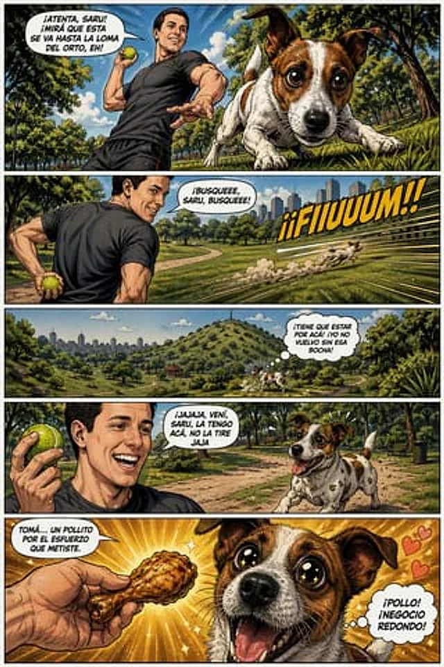

```text
{
  "type": "Single-page comic",
  "style": "The humorous cartoon illustrations feature thick black lines, delicate cross-hatching, vibrant colors, dynamic moving lines, halftone textures, and exaggerated, lively fonts.",
  "language": "Spanish",
  "format": "The vertical page contains five horizontal panels separated by white gaps and black borders.",
  "characters": {
    "human": {
      "role": "dog owner",
      "appearance": "Athletic adult male, wearing a black fitted T-shirt and black athletic shorts, with short black hair; his face is mostly shown from behind or cropped out.",
      "prop": "Bright green tennis ball"
    },
    "dog": {
      "name": "{argument name=\"dog name\" default=\"Saru\"}",
      "appearance": "A small Jack Russell Terrier with white fur patched with brown and black markings, full of vitality, its coat streaked with muddy paw prints and grass clippings, and possessing a very expressive face."
    }
  },
  "setting": {
    "location": "A sunny city park with green lawns, dirt paths, lush trees, park benches, and the distant city skyline.",
    "background_feature": "A conspicuous grassy slope in the distance"
  },
  "layout": {
    "panel_count": 5,
    "panels": [
      {
        "index": 1,
        "composition": "Low-angle medium shot: A man prepares to throw a tennis ball, and a dog crouches beside him, ready to sprint.",
        "text": [
          {
            "type": "speech bubbles",
            "speaker": "Humans",
            "content": "¡ATENTA, SARU! ¡MIRÁ QUE ESTA SE VA HASTA LA LOMA DEL ORTO, EH!"
          }
        ]
      },
      {
        "index": 2,
        "composition": "The view from the man's rear after he threw the tennis ball shows the extra ball hidden behind him. The dog, a blurry afterimage, sprints across the grass, leaving dust and a long trail of speed. The horizon is visible ahead.",
        "text": [
          {
            "type": "speech bubbles",
            "speaker": "Humans",
            "content": "¡BUSQUEEE, SARU, BUSQUEEE!"
          },
          {
            "type": "Sound effects",
            "content": "¡¡FIIUUUUM!!",
            "style": "Huge italic yellow letters with black outline"
          }
        ]
      },
      {
        "index": 3,
        "composition": "An ultra-wide panoramic shot showcases the entire park, winding paths, trees, skyline, and distant hillsides; the dog appears small as it runs in the distance.",
        "text": [
          {
            "type": "Inner monologue bubble",
            "speaker": "Dog",
            "content": "¡TIENE QUE ESTAR POR ACÁ! Y/O NO VUELVO SIN ESA BOCHA!"
          }
        ]
      },
      {
        "index": 4,
        "composition": "The sense of focus within a single shot: a close-up on the left shows a man holding a tennis ball he didn't actually throw, while on the right, a dog happily panting runs back to the camera.",
        "text": [
          {
            "type": "speech bubbles",
            "speaker": "Humans",
            "content": "¡JAJAJA, VENÍ, SARU, LA TENGO ACÁ, NO LA TIRE JAJA"
          }
        ]
      },
      {
        "index": 5,
        "composition": "The dramatic, comedic reward shot features a hand offering a roasted chicken leg in the left foreground, while the right side shows an extreme close-up of the dog's face, its eyes sparkling with joy; the background is adorned with radiating golden light and three red hearts.",
        "text": [
          {
            "type": "speech bubbles",
            "speaker": "Humans",
            "content": "TOMÁ... UN POLLITO POR EL ESFUERZO QUE METISTE."
          },
          {
            "type": "Inner monologue bubble",
            "speaker": "Dog",
            "content": "¡POLLO! ¡NEGOCIO REDONDO!"
          }
        ]
      }
    ]
  },
  "visual_notes": {
    "counted_objects": {
      "red_hearts": 3,
      "tennis_balls_visible": 2
    },
    "dog_behavior_progression": [
      "Prepare to chase",
      "Full speed sprint",
      "Searching in the distance",
      "Returning happily",
      "Overjoyed by food rewards"
    ],
    "tone": "Playful, affectionate, and absurd pet owners' humor",
    "camera": "The comic book storyboards have a cinematic feel, including low angles, rear action shots, wide shots, medium close-ups, and extreme close-ups in the ending."
  },
  "quality": "Exquisite digital comic art with high detail, clear fonts, vivid poses, and cinematic animation; both humorous and heartwarming."
}
```

Model: GPT Image 2
Author: GPT Image 2 Prompts

[ProjectD](https://aitoolsradar.com/en/prompts/8b490e1a8ab9dc) · [Recorded source](https://x.com/Miki_Brei/status/2046756564539765225#reversed-0)
 · [Full original metadata and byte evidence](data/projectd-batch-0031.json)

## Funny GPU Search Comic Page

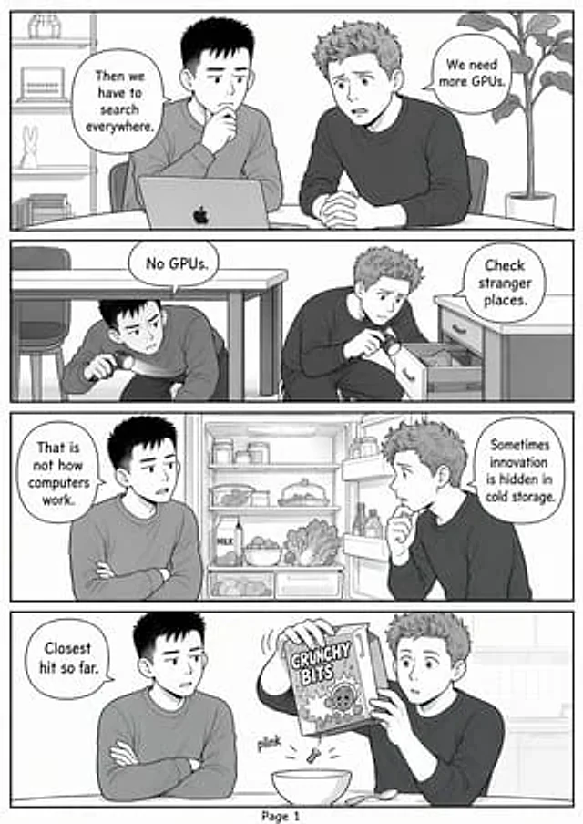

```text
{
  "type": "Black and white comic pages",
  "style": "Simple, Japanese anime-style grayscale line art with soft halftone shadows, a minimalist modern interior background, easy-to-read comic font, and humorous technological satire.",
  "page": {
    "count": 1,
    "label": "Page 1",
    "panel_count": 4,
    "reading_order": "From top to bottom"
  },
  "characters": [
    {
      "id": "character_a",
      "description": "A young man with short, straight black hair, wearing a plain long-sleeved crew neck shirt, looked suspicious."
    },
    {
      "id": "character_b",
      "description": "A young man with messy, curly, light-colored hair wore a dark-colored long-sleeved crew neck shirt and had an energetic yet absurdly confident expression."
    }
  ],
  "layout": {
    "sections": [
      {
        "title": "1st square",
        "position": "Top full width",
        "count": 2,
        "labels": [
          "Next, we need to search every corner.",
          "We need more GPUs."
        ],
        "scene": "Two characters sit at a table with an open laptop between them. Character A is stroking his chin in thought, while character B is leaning forward with his hands clasped together. To the left is a bookshelf with a small rabbit figurine, and to the right is a tall potted plant."
      },
      {
        "title": "2nd square",
        "position": "Second line full width",
        "count": 2,
        "labels": [
          "There is no GPU.",
          "Go look in even stranger places."
        ],
        "scene": "Two characters are crouching down, searching with small flashlights. Character A is looking under the table, while character B is opening a desk drawer and examining it."
      },
      {
        "title": "3rd square",
        "position": "The third line is full width",
        "count": 2,
        "labels": [
          "That's not how computers work.",
          "Sometimes innovation is hidden in the freezer."
        ],
        "scene": "In the center of the background is an open refrigerator, revealing shelves and compartments filled with milk, bowls, vegetables, bottles, and containers. Character_a stands on the left with his arms crossed, while character_b stands on the right, resting his chin on his hand, peering into the refrigerator."
      },
      {
        "title": "4th square",
        "position": "Bottom full width",
        "count": 3,
        "labels": [
          "This is the closest we've come so far.",
          "CRUNCHY BITS",
          "Ding-dong"
        ],
        "scene": "In the kitchen scene, character A stands on the left with his arms crossed, delivering his lines expressionlessly. On the right, character B is pouring a large box of cereal labeled \"CRUNCHY BITS\" into a bowl. A screw falls into the bowl, making a \"clink\" sound. A spoon sits on the table."
      }
    ],
    "borders": "Thick rectangular comic panel layout and border"
  },
  "text": {
    "language": "Chinese",
    "speech_bubbles": "Rounded cartoon speech bubbles with a bold, handwritten style"
  },
  "composition": "Vertical comic book pages, four stacked horizontal panels, medium shots, clear narrative, and consistent character design across all panels.",
  "theme": "Imagine the absurd GPU search process as searching for lost household items."
}
```

Model: GPT Image 2
Author: GPT Image 2 Prompts

[ProjectD](https://aitoolsradar.com/en/prompts/0e3e90d38f802f) · [Recorded source](https://x.com/ME_Internx/status/2047585912440451381#reversed-0)
 · [Full original metadata and byte evidence](data/projectd-batch-0031.json)

## Funny TikTok livestream with cartoon characters


```text
Generate a{argument name="subject" default="Funny guy"} The picture, he is{argument name="platform" default="tiktok"} Go live, surrounded by{argument name="decorations" default="3D cartoon characters"} — Design some interesting content.
```

Model: GPT Image 2
Author: GPT Image 2 Prompts

[ProjectD](https://aitoolsradar.com/en/prompts/b1054faf1b21e2) · [Recorded source](https://x.com/Lukakh_/status/2046654534475526616)
 · [Full original metadata and byte evidence](data/projectd-batch-0031.json)

## Funny Ugly Doodle Sketch

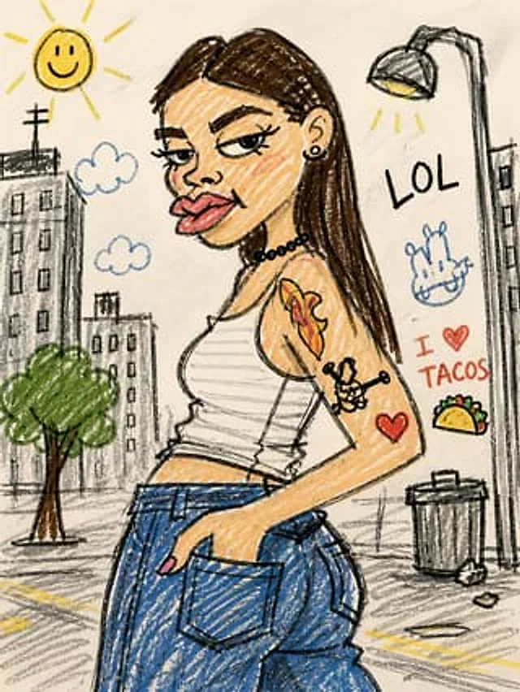

```text
Turn this photo into a funny ugly doodle drawing. Make it look like: a quick sketch using a {argument name="tool" default="cheap marker or crayon"} messy, rough, childlike style bad perspective and awkward proportions slightly exaggerated facial features Add: {argument name="background" default="simple cartoon background (like buildings, trees, street)"} random sketchy lines and details uneven coloring and visible strokes Style: looks like a lazy drawing, not polished humorous and a bit stupid-looking meme-like, casual, internet style Do NOT: make it realistic
```

Model: GPT Image 2
Author: Oogie

[ProjectD](https://aitoolsradar.com/en/prompts/0c0532b0d22642) · [Recorded source](https://youmind.com/prompts/funny-ugly-doodle-sketch-drawing-20481)
 · [Full original metadata and byte evidence](data/projectd-batch-0031.json)

## Future iPhone Design

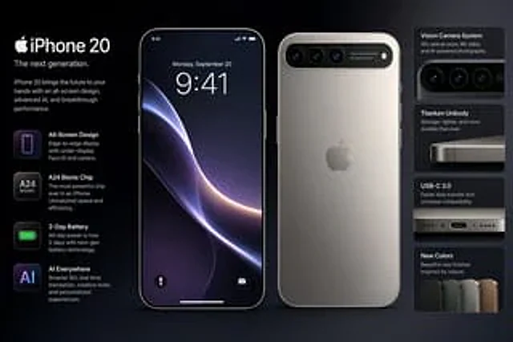

```text
{argument name="device" default="iPhone 20"} What will it look like?
```

Model: GPT Image 2
Author: GPT Image 2 Prompts

[ProjectD](https://aitoolsradar.com/en/prompts/9be3fe4466cd3b) · [Recorded source](https://x.com/patrickassale/status/2044691011155149064)
 · [Full original metadata and byte evidence](data/projectd-batch-0031.json)

## Futuristic 3D Food Printer Landing Page


```text
{
  "type": "Website landing page model",
  "theme": "Futuristic Memory-to-Food 3D Printer",
  "header": {
    "logo": "{argument name=\"brand name\" default=\"KIOKU BITE\"} It features cloud and bite mark icons.",
    "navigation_links": {
      "count": 6,
      "labels": [
        "Product Features",
        "Working principle",
        "menu",
        "gallery",
        "gift",
        "Frequently Asked Questions"
      ]
    },
    "icons": [
      "User Profile",
      "Shopping cart with zero mark"
    ]
  },
  "layout": {
    "left_column": {
      "headline": "{argument name=\"headline text\" default=\"Make memories accessible.\"}",
      "headline_style": "Large, colorful, rounded font",
      "subheadline": "{argument name=\"product description\" default=\"A memory dessert printer that recreates memories by reading emotional profiles from photos, audio, and location information, capturing their taste, texture, and temperature.\"}",
      "call_to_action_buttons": {
        "count": 2,
        "primary": "Gradient background, text is '{argument name=\"primary button text\" default=\"Print memory\"} &gt;'",
        "secondary": "White background, black border, text 'View Menu&gt;'"
      },
      "feature_badges": {
        "count": 3,
        "style": "Pill-shaped with an icon",
        "labels": [
          "Emotional taste shift (brain icon)",
          "Print in 3 minutes (clock icon)",
          "Suitable for gifting (gift icon)"
        ]
      }
    },
    "right_column": {
      "main_product": "Stylish, white, futuristic 3D food printer equipment",
      "printer_screen": "The digital display shows 'Printing...', a 100% progress ring, and a {argument name=\"printing scene\" default=\"The two at sunset beach\"} thumbnails",
      "printer_interior": "Printing a glowing, translucent cube dessert containing a{argument name=\"printing scene\" default=\"The two at sunset beach\"} Miniature 3D stereoscopic model",
      "floating_elements": {
        "count": 4,
        "description": "A translucent memory bubble, containing sound waves, sunset photos, smiling children, and map markers, surrounded by floating pink petals."
      }
    },
    "foreground": {
      "plated_desserts": {
        "count": 4,
        "descriptions": [
          "The snow globe dome contains a scene of cherry blossoms and pedestrians on a bridge.",
          "A cloud-shaped white dessert with a pink heart in the center.",
          "A cylindrical cake, resembling rolling blue waves.",
          "Multifaceted gem-shaped purple galaxy dessert"
        ]
      }
    }
  }
}
```

Model: GPT Image 2
Author: GPT Image 2 Prompts

[ProjectD](https://aitoolsradar.com/en/prompts/e3eaf2a81b4f1d) · [Recorded source](https://x.com/masapark95/status/2046189362933858580#reversed-2)
 · [Full original metadata and byte evidence](data/projectd-batch-0031.json)

## Futuristic AI Editorial Poster

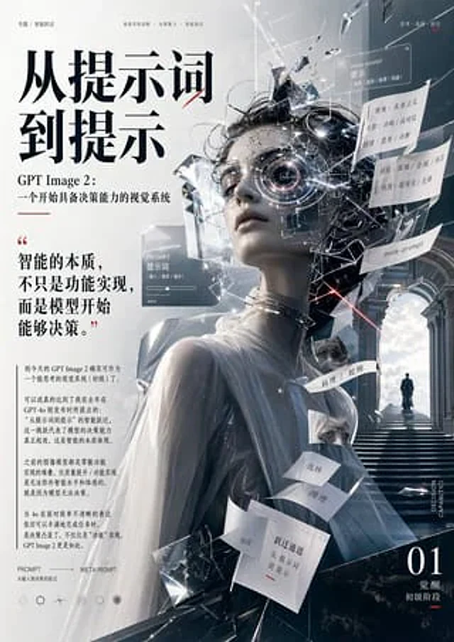

```text
{
  "type": "Edit Poster",
  "theme": "AI visual intelligence, from prompts to meta-prompts, decision-making visual systems",
  "style": "This high-end futuristic Chinese magazine cover blends conceptual science fiction art, minimalist luxury layout, sharp cinematic lighting, crystalline surrealism, white and steel blue tones, accented with black and subtle red.",
  "format": "Vertical full-page poster",
  "background": {
    "base": "Gradient from pure white to cool gray",
    "right side": "A magnificent neoclassical stone gallery, with arches and staircases, leads to a bright, cloud-covered sky, where a solitary little figure stands on the top platform."
  },
  "subject": {
    "primary": "A surreal, classical marble-textured female bust, showing her back and three-quarters profile.",
    "head": "The face is obscured by a centered rectangular gray block, while the rest of the head is shattered into black cables, reflective glass shards, metal fragments, luminous threads, and transparent UI-style panels.",
    "body details": "The smooth, pale surface of the sculpture is covered with translucent white, pleated fabric, the shoulders and upper back are encased in a metal ring, and sharp, angular crystalline structures emerge around the torso."
  },
  "layout": {
    "sections": [
      {
        "title": "Main title",
        "position": "Top left",
        "count": 2,
        "labels": [
          "From the prompt words",
          "To the prompt"
        ]
      },
      {
        "title": "subtitle",
        "position": "Top left center",
        "count": 2,
        "labels": [
          "GPT Image 2：",
          "A visual system that is beginning to develop decision-making capabilities"
        ]
      },
      {
        "title": "Reference block",
        "position": "Left and Middle",
        "count": 1,
        "labels": [
          "The essence of intelligence is not just the realization of functions, but the ability of models to make decisions."
        ]
      },
      {
        "title": "Main text paragraphs",
        "position": "Bottom left",
        "count": 4,
        "labels": [
          "Paragraph 1",
          "Paragraph 2",
          "Paragraph 3",
          "Paragraph 4"
        ]
      },
      {
        "title": "Top microhead",
        "position": "Top edge",
        "count": 3,
        "labels": [
          "Special Topic / Intelligent Leap",
          "Visual systematized prompts, decision-making capabilities, and intelligent leaps.",
          "Thinking, Choosing, Leap Forward"
        ]
      },
      {
        "title": "Floating cards and labels",
        "position": "Center to right",
        "count": 11,
        "labels": [
          "PROMPT prompt words",
          "meta-prompt",
          "Perspective: Futuristic; Light and Shadow: Cold/High Contrast; Emotion: Reflection/Decision-making",
          "Materials: Glass/Metal/Fabric; Composition: Surreal/Static",
          "meta-prompt",
          "Concept",
          "choose",
          "reasoning",
          "Choice",
          "Highly Recommended",
          "The jump channel from prompt words to prompts"
        ]
      },
      {
        "title": "Bottom left footer",
        "position": "bottom left corner",
        "count": 2,
        "labels": [
          "PROMPT → META PROMPT",
          "The leap from input to decision"
        ]
      },
      {
        "title": "Lower right issue number mark",
        "position": "bottom right corner",
        "count": 3,
        "labels": [
          "01",
          "Awakening",
          "Primary stage"
        ]
      },
      {
        "title": "Vertical text on the side",
        "position": "bottom right edge",
        "count": 1,
        "labels": [
          "DECISION CAPABILITY"
        ]
      }
    ],
    "centerpiece": "The large sculpted figure occupies the center and lower middle section, with fragmented clouds of thought and floating labels surrounding its head.",
    "text flow": "The left column shows the edited design of the re-layout, and the right column shows the conceptual scene of the re-image."
  },
  "typography": {
    "headline": "Extra Large Black Chinese Serif Title Font",
    "subhead and body": "Smaller black serif Chinese text with ample character spacing",
    "accent": "Fine red background lines and a few small red dot markings",
    "secondary labels": "Light gray and white text on a semi-transparent panel"
  },
  "lighting": {
    "mood": "Cool, rational, sophisticated, contemplative",
    "effects": "Hard contour lighting, glossy reflections from glass shards, faint particle light, and a fine, laser-like red line near the head."
  },
  "color palette": {
    "dominant": [
      "White",
      "cool gray",
      "Steel Blue",
      "black"
    ],
    "accent": [
      "Soft Red"
    ]
  },
  "composition notes": "The striking asymmetrical composition balances the heavy text block on the left with the fragmented sculpture and architectural depth on the right, while ample negative space, layered collage effects, exquisite magazine cover quality, and exceptional detail create a powerful visual impact."
}
```

Model: GPT Image 2
Author: GPT Image 2 Prompts

[ProjectD](https://aitoolsradar.com/en/prompts/248202072dedbe) · [Recorded source](https://x.com/ZHO_ZHO_ZHO/status/2046827041342083107#reversed-0)
 · [Full original metadata and byte evidence](data/projectd-batch-0031.json)

## Futuristic AI Model Infographic Poster

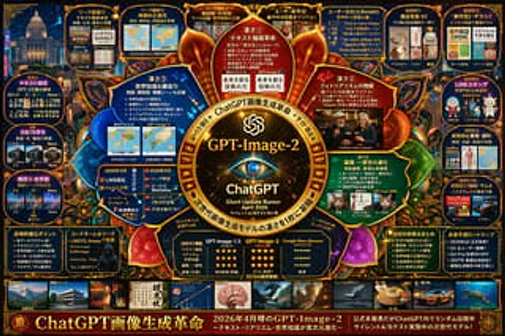

```text
{
  "type": "High-density, futuristic infographic poster",
  "style": "Dark background{argument name=\"theme color\" default=\"ゴールドとダークブルー\"} Neon accents, a highly structured grid and radial layout, and a technology-focused UI aesthetic.",
  "centerpiece": {
    "visual": "{argument name=\"centerpiece icon\" default=\"Shining cybernetic eye lenses\"} It is surrounded by a glamorous gold circular frame with glittering nodes.",
    "text": [
      "{argument name=\"model name\" default=\"GPT-Image-2\"}",
      "ChatGPT",
      "Rumors of a silent update{argument name=\"release date\" default=\"April 2026\"}"
    ]
  },
  "layout": {
    "inner_circle_panels": {
      "count": 4,
      "description": "The four fan-shaped panels surrounding the center explain the core functions in detail.",
      "labels": [
        "Amazing Feature #1: A text rendering revolution",
        "Amazing aspect #2: A leap forward in photorealism",
        "Amazing ③: Global knowledge &amp; organizational skills",
        "Amazing ④: Evolution of editing and consistency"
      ]
    },
    "top_row": {
      "count": 5,
      "description": "Leaked images, map accuracy, anatomical diagrams, and rectangular panels showing user reactions.",
      "labels": [
        "Leaked image ①",
        "Leaked image 2",
        "Leaked image ③",
        "User reactions (X)",
        "User reactions (X/Reddit)"
      ]
    },
    "left_column": {
      "count": 3,
      "description": "A vertical stack panel and small image grid showing a comparison of versions 1.5, 2, and Nano.",
      "labels": [
        "Comparison ① Text rendering",
        "Comparison ② Realism",
        "Composition ③ - Worldview"
      ]
    },
    "right_column": {
      "count": 5,
      "description": "A vertical stack of practical use cases using small sample images",
      "labels": [
        "Practical Example 1: Product Photos / E-commerce",
        "Practical Example ②: Business Practices and Flyers",
        "Practical Example ③ LINE Stickers",
        "Practical Example ④ Education and Materials",
        "Practical Example 5: Social Media Thumbnails"
      ]
    },
    "bottom_data_section": {
      "count": 5,
      "description": "Data tables, bulleted lists, hacker-style images",
      "labels": [
        "Technological advancements",
        "コードネーム＆リーク",
        "Performance Comparison Table (GPT-Image-1.5 vs GPT-Image-2 vs Google Nano Banana)",
        "Summary of notable improvements",
        "Future prediction roadmap"
      ]
    },
    "bottom_thumbnail_strip": {
      "count": 10,
      "description": "A horizontal column of small square images exhibiting various generation styles.",
      "labels": [
        "architecture",
        "ポスター",
        "Japanese text",
        "インフォグラフィック",
        "ファンタジー",
        "スチームパンク",
        "ミニマルデザイン",
        "food",
        "car",
        "In water"
      ]
    }
  },
  "footer": {
    "text": "{argument name=\"main title\" default=\"ChatGPT: A Revolution in Image Generation\"}",
    "subtext": "The rumored GPT-Image-2, April 2026"
  }
}
```

Model: GPT Image 2
Author: GPT Image 2 Prompts

[ProjectD](https://aitoolsradar.com/en/prompts/9b0b2d7f9f6992) · [Recorded source](https://x.com/s_shigel/status/2043885086085656866#reversed-0)
 · [Full original metadata and byte evidence](data/projectd-batch-0031.json)

## Futuristic AI Sports Poster

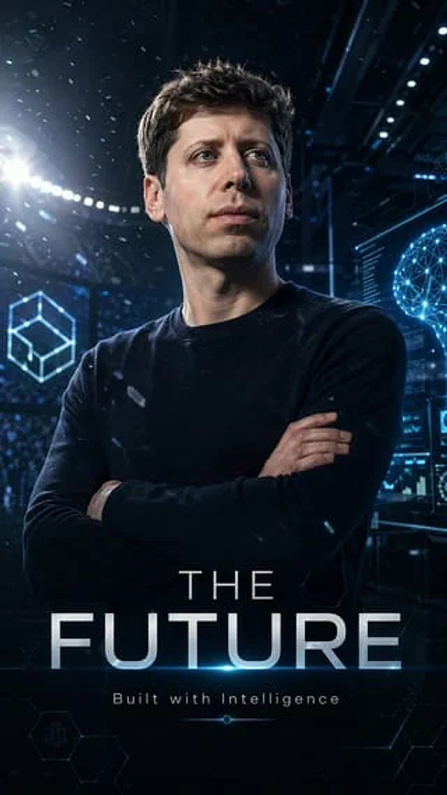

```text
A cinematic vertical poster featuring [character name]{argument name="subject name" default="Sam Altman"} The style is presented as a futuristic promotional photo of a football superstar: a centered, half-body portrait with arms crossed, wearing a dark navy blue or black crew neck sweater, exuding confidence and composure, with the gaze slightly off-center. He is placed in a dramatic, high-tech stadium or arena at night, illuminated by bright floodlights in the upper left, with a dark steel structure overhead, creating a cool, sci-fi atmosphere. Floating particles and tiny debris are added to the air to enhance the sense of energy and dynamism. Futuristic AI interface graphics surround the protagonist: a glowing wireframe cube icon on the left, a glowing digital brain or neural network sphere on the right, and multiple transparent holographic dashboards with charts and data panels floating behind him. A deep blue, black, and white color scheme is used, creating strong contrasts with glossy highlights, subtle lens flares, and high-end poster lighting effects. The composition is stylish, ambitious, and forward-thinking, a fusion of sports advertising and an AI brand. A title text is added at the bottom.{argument name="main title" default="THE FUTURE"} It uses very large, metallic white capital letters, with the word "THE" in smaller letters positioned above the main title; and adds a slogan below.{argument name="tagline" default="Built with Intelligence"} Uses a small, spaced-out sans-serif font. Subtle hexagonal HUD lines are added near the bottom corner, with a luminous horizontal beam of light passing through the title area. Ultra-refined, photorealistic, poster design, sophisticated commercial key visual, 9:16 aspect ratio.
```

Model: GPT Image 2
Author: GPT Image 2 Prompts

[ProjectD](https://aitoolsradar.com/en/prompts/5242d4e42970bf) · [Recorded source](https://x.com/mirochill/status/2047279256397341058#reversed-0)
 · [Full original metadata and byte evidence](data/projectd-batch-0031.json)

## Futuristic Audi Tron Concept Coupe

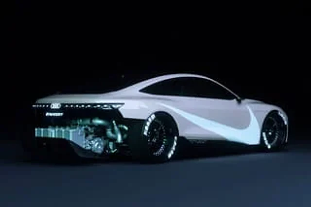

```text
A vehicle based on{argument name="car brand" default="Audi"} The futuristic concept coupe, viewed from a low, 45-degree rear angle to the right, is set in a vast black photography studio with a dark matte floor and a nearly blank background. The body is a streamlined white, featuring a long, sloping roofline, all-black windows, an ultra-low chassis, wide proportions, and smooth, minimalist curves. A large, light gray, curved pattern, resembling a sports decal, adorns the side profile. The rear is transparent or open, revealing the high-performance powertrain: a visible battery pack is mounted low behind the cockpit, along with an exposed metal motor or gearbox assembly, and three thick silver exhaust pipes or intake pipes running through the rear engine bay. A slim, continuous LED light strip runs across the rear, with the Audi four-ring logo illuminated in the center and the word "tron" below. The wheels are dark black multi-spoke high-performance rims paired with low-profile tires; the sidewalls of the two visible tires feature illuminated white lettering, including stylized Japanese characters and racing lettering. Subtle, illuminated branding is added to the side skirts and near the front wheel arches. The lighting creates a cinematic, austere atmosphere with cool blue contour lighting, glossy reflections, soft halos, and a subtle cyberpunk aura around the luminous elements. Ultra-refined automotive rendering, visualization of a high-end concept car design, photorealistic materials, strong contrasts of light and shadow, clean composition, and no figures.
```

Model: GPT Image 2
Author: GPT Image 2 Prompts

[ProjectD](https://aitoolsradar.com/en/prompts/0ed6d4365dfbd4) · [Recorded source](https://x.com/AllarHaltsonen/status/2047255361409675314#reversed-0)
 · [Full original metadata and byte evidence](data/projectd-batch-0031.json)

## Futuristic Boardroom Analytics Meeting


```text
This is a widescreen corporate boardroom scene, set in a bright, modern glass-walled office with floor-to-ceiling windows offering a glimpse of the city skyline. (Approximately...){argument name="number of attendees" default="22"} Business professionals of different genders and ethnicities sat around a U-shaped array of light-colored wooden conference tables, all dressed in formal business attire, many using open laptops. At the front of the room, a large wall-mounted digital dashboard dominated the composition, showcasing a futuristic financial analysis interface in deep blue and cyan, featuring 12 clearly visible data panels: one large panel in the upper left corner with title text.{argument name="dashboard headline" default="SELECTING THE TRACKING TOOL"} The panel includes line and bar charts; a small top-center panel with abstract circular data textures; a top-right panel with a large indicator of 92.231 and a bar chart; a top-right panel with a line chart and gear-shaped interface icons; a middle-left bar panel with circular gauges and technical controls; a middle-left tall panel with vertical data bars and circular overlays; a central panel with three circular gauge-style readings; a middle-right panel with compact technical charts and tiny UI elements; a middle-right horizontal panel with circular dials and a central numerical indicator; a bottom-center panel with glowing pie charts and waveforms; a bottom-right wide panel with dense data tables; and a small auxiliary panel at the bottom center. Shot from a centered viewpoint at the back of the room, emphasizing symmetry and the semi-circular seating facing the screen, with a speaker silhouetted near the display. Warm sunlight streams in from the left, creating soft lens flares and long shadows on the wooden floor. The overall image style is exquisite high-end editorial illustration, leaning towards realistic corporate concept art, using cool blue and warm amber tones, ultra-refined, clean, futuristic, professional and ambitious.
```

Model: GPT Image 2
Author: GPT Image 2 Prompts

[ProjectD](https://aitoolsradar.com/en/prompts/15407df476fe3b) · [Recorded source](https://x.com/Blog_Nico/status/2047389340024615365#reversed-0)
 · [Full original metadata and byte evidence](data/projectd-batch-0031.json)

## Futuristic Brand Visual Manual

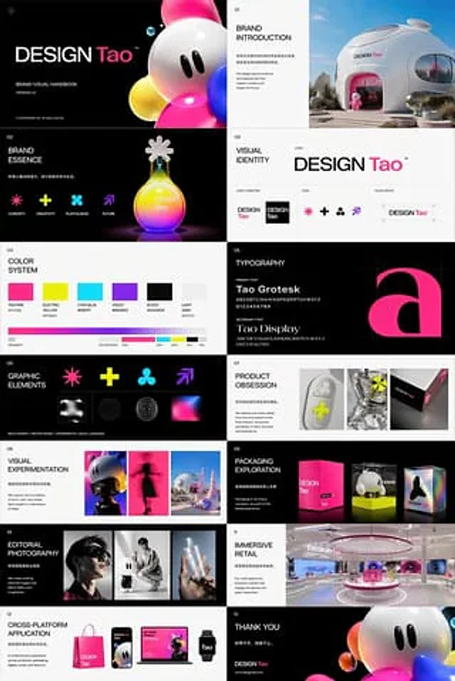

```text
For the name "{argument name="brand name" default="Any Brand Name"} The company aims to create a sophisticated, multi-page brand visual brochure. The overall brand image should be playful, futuristic, vibrant, and meticulously designed, striking a balance between "toy-like energy" and "the sophistication of a high-end creative technology brand." The visual style should employ a bold and experimental brand language, including: highly saturated bright colors, simple geometric shapes, modern typography, dynamic visual rhythms, and slightly surreal imagery. The overall atmosphere should convey: creativity, youthfulness, rhythm, tactile experience, and avant-garde concepts. The expression should blend the playfulness of consumer goods, the presentation style of fashion brands, and the language of contemporary digital design. The brochure should reflect: meticulous attention to product detail, diverse visual experiments, packaging design exploration, editorial-style photography, immersive retail experiences, and cross-platform brand applications. The final presentation should construct a confident, contemporary, unified, and complete brand worldview—both easy to understand and approachable, yet possessing a strong artistic direction, showcasing the aesthetic standards of a high-end creative studio while maintaining high visual consistency.
```

Model: GPT Image 2
Author: GPT Image 2 Prompts

[ProjectD](https://aitoolsradar.com/en/prompts/a2415820ae7c1b) · [Recorded source](https://x.com/AbleGPT/status/2047224935144362400)
 · [Full original metadata and byte evidence](data/projectd-batch-0031.json)

## Futuristic City With Sparkling Artifacts

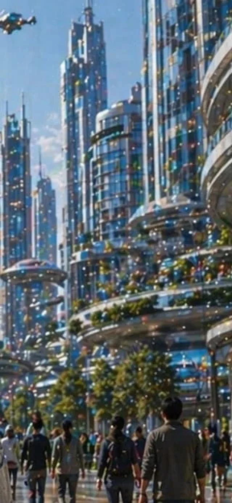

```text
Looking up at a brightly lit, daytime futuristic city street from a pedestrian's perspective, the view flows through a canyon of towering, sleek skyscrapers with blue-toned glass facades, circular balconies, tiered terraces, and an elegant sci-fi architectural style. The scene showcases a bustling pedestrian street, with approximately 12 casually dressed pedestrians walking with their backs to the viewer in the foreground and midground, including a central figure in a grey jacket. In the upper left, a small hovercraft or drone-like aerial taxi is added. The buildings have a high degree of reflectivity and gloss, integrated with greenery: trees line the walkways, and vegetation adorns the edges of terraces. The azure sky and soft sunlight lend the image a pure, optimistic utopian atmosphere. A striking layer of artifacts—dense, colorful shimmering dots and spots—is added to the image, resembling a grid of noisy pixels or flickering digital pollution evenly distributed across the buildings, figures, sky, and street. A semi-realistic painting style with soft focus, bright highlights, vertical composition, and cinematic depth of field is employed.
```

Model: GPT Image 2
Author: GPT Image 2 Prompts

[ProjectD](https://aitoolsradar.com/en/prompts/71003e0d5c8a01) · [Recorded source](https://x.com/mark_k/status/2046915269784731941#reversed-0)
 · [Full original metadata and byte evidence](data/projectd-batch-0031.json)

## Futuristic Corporate 3-Panel Manga Page

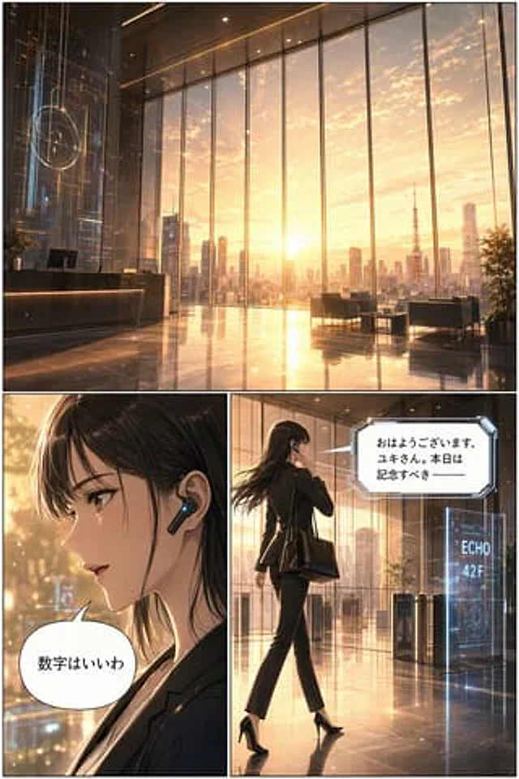

```text
{
  "type": "3-panel comic strip",
  "style": "Anime-style design, high detail, cinematic lighting effects, futuristic corporate style.",
  "layout": {
    "structure": "One wide grid at the top, and two square grids at the bottom."
  },
  "panels": [
    {
      "position": "Above",
      "shot": "Wide-angle horizontal lens",
      "scene": "Futuristic corporate lobby with floor-to-ceiling windows",
      "lighting": "{argument name=\"time of day\" default=\"sunrise\"}",
      "background": "City skyline, including{argument name=\"landmark\" default=\"Tokyo Tower\"}",
      "details": "Holographic display screen, polished reflective floor, reception desk, lounge chairs"
    },
    {
      "position": "Lower left",
      "shot": "Side close-up",
      "character": "Young woman, dark hair, wearing a black business suit.",
      "accessories": "Futuristic black headphones with blue LED lights",
      "speech_bubble": {
        "style": "Standard fillet",
        "text": "{argument name=\"character dialogue\" default=\"The numbers are good.\"}"
      }
    },
    {
      "position": "bottom right",
      "shot": "Full-body shot, back view, touching the headphones",
      "character": "The same woman, wearing a black suit, black high heels, and carrying a black tote bag.",
      "environment": "Walking towards the security gate",
      "holographic_sign": "{argument name=\"floor sign\" default=\"ECHO 42F\"}",
      "speech_bubble": {
        "style": "Futuristic sharp angles",
        "text": "{argument name=\"AI dialogue\" default=\"Good morning, Yuki. Today is a momentous day...\"}"
      }
    }
  ]
}
```

Model: GPT Image 2
Author: GPT Image 2 Prompts

[ProjectD](https://aitoolsradar.com/en/prompts/66f3ec6e6953fe) · [Recorded source](https://x.com/loilokoji/status/2046262205604417726#reversed-0)
 · [Full original metadata and byte evidence](data/projectd-batch-0031.json)

## Futuristic Corporate Enablement Infographic


```text
{
  "type": "Enterprise Presentation Slides Infographic",
  "style": "Dark mode, futuristic design, high-tech HUD, luminous fiber optic lines.{argument name=\"theme color\" default=\"Neon blue and cyan\"}",
  "header": {
    "position": "Top left corner",
    "title_chinese": "{argument name=\"main title\" default=\"Empowerment System\"}",
    "title_english": "{argument name=\"english title\" default=\"Enablement System\"}",
    "subtitle": "{argument name=\"subtitle\" default=\"Amplify influence from individual capabilities to organizational capabilities.\"}"
  },
  "layout": {
    "centerpiece": {
      "description": "Luminous spherical base",
      "title": "{argument name=\"platform name\" default=\"Core Empowerment Platform\"}",
      "subtitle": "ENABLEMENT PLATFORM",
      "inner_cards_count": 2,
      "inner_cards": [
        {
          "icon": "Stacked blocks",
          "title": "Platform capabilities",
          "details": "Infrastructure | Service Capabilities | Data Assets | Unified Standards"
        },
        {
          "icon": "wrench and code brackets",
          "title": "Toolchain",
          "details": "Automation | Visualization | CI/CD | Intelligentization"
        }
      ],
      "bottom_label": "Precipitation, Standardization, and Replicability"
    },
    "surrounding_nodes_count": 4,
    "surrounding_nodes": [
      {
        "position": "Top left",
        "label": "Team A (Efficiency Improvement)",
        "icon": "Three silhouettes",
        "metric": "Delivery efficiency improved by 35%"
      },
      {
        "position": "Bottom left",
        "label": "Team B",
        "icon": "Three silhouettes",
        "metric": "Quality improvement -28% defect rate"
      },
      {
        "position": "Top right",
        "label": "Improve Team C",
        "icon": "Three silhouettes",
        "metric": "Cost optimization -20% resource cost"
      },
      {
        "position": "Bottom right",
        "label": "Improve Team D",
        "icon": "Three silhouettes",
        "metric": "Skill enhancement accelerates new employee growth by 50%."
      }
    ],
    "footer_sections_count": 3,
    "footer_sections": [
      {
        "icon": "Line chart",
        "title": "Lowering the threshold",
        "description": "Standardize and use tools to make best practices readily available."
      },
      {
        "icon": "bar chart",
        "title": "Increase output",
        "description": "Empowering teams, unleashing their potential, and achieving a leap in organizational effectiveness"
      },
      {
        "icon": "Trophy",
        "title": "Amplify influence",
        "description": "From executor to enabler: Building sustainable organizational capabilities"
      }
    ]
  }
}
```

Model: GPT Image 2
Author: GPT Image 2 Prompts

[ProjectD](https://aitoolsradar.com/en/prompts/01c9fcb1f1e014) · [Recorded source](https://x.com/qiufenghyf/status/2045180142159577473#reversed-1)
 · [Full original metadata and byte evidence](data/projectd-batch-0031.json)

## Futuristic Cyber Skincare Ad Poster


```text
A luxurious, futuristic skincare product advertisement, presented in a vertical 4K poster format. At the center of the image is a suspended matte white spray bottle, placed diagonally and slightly tilted to the right. The cap is a softly cylindrical shape, and the upper part of the bottle is covered with fine condensation droplets. The label on the bottle is printed in a simple, dark blue sans-serif font with the words "..."{argument name="brand name" default="SECURE-IP"} ", printed below{argument name="product name" default="IP ADDRESS CLEANSER"} The bottle is labeled with the smaller subtitles "for risk-free connections" and "pour des connexions sans risque," along with tiny text at the bottom reading "75 mL / 2.5 fl. oz. - Data Stream Purifier." Against the bottle's background, large, semi-transparent serif fonts dominate, displaying the words "..."{argument name="headline text" default="ULTRA-SECURE"} The text, divided into two lines and partially obscured by the product, is set in a deep midnight blue environment. Glowing, semi-transparent, fabric-like liquid ribbons wrap around the bottle from the upper left to the lower right and from the foreground upwards, interspersed with two prominent glass-like tubular arcs and multiple suspended crystalline droplets or bubbles. The lighting is cool and cinematic, with a high-end, glossy finish, bright ice-blue highlights, soft glow, and refraction, presenting a pure, sophisticated beauty advertisement aesthetic. At the bottom center, elegant, well-spaced small capital letters read "..."{argument name="tagline" default="ENCRYPTED BARRIER FORMULA"} Below is a row of four ingredient descriptions, evenly distributed across the width of the image: 1) “CERAMIDE IP-07”, accompanied by the two lines of text “Strengthens” and “Lipid Defence”; 2) “SQUALANE ENCAPSULES”, accompanied by “Reinforces” and “Moisture Lock”; 3) “NIACINAMIDE 5%”, accompanied by “Calms Visible” and “Stress Signals”; 4) “HYALURONIC STACK”, accompanied by “Multi-Layer” and “Hydration Matrix”. At the very bottom center, a small shield icon and the text “DEFEND. PURIFY. PROTECT.” are added. The overall style should combine luxury skincare photography with a cybersecurity brand image, featuring exquisite commercial lighting, shallow depth of field, advanced editing and layout, and an advertising design aesthetic ready for production use.
```

Model: GPT Image 2
Author: GPT Image 2 Prompts

[ProjectD](https://aitoolsradar.com/en/prompts/771198cd334813) · [Recorded source](https://x.com/Nona_xai/status/2047259719870328891#reversed-1)
 · [Full original metadata and byte evidence](data/projectd-batch-0031.json)

## Futuristic Cyber Skincare Product Ad


```text
An advertisement for a futuristic, luxury skincare product, featuring a cool, icy blue color scheme, is presented in the style of a high-end beauty studio photoshoot. A frosted white pump bottle is placed in the center of the image, labeled {argument name="brand name" default="SECURE-IP"} It is printed with minimalist navy blue lettering.{argument name="product name" default="IP ADDRESS CLEANSER"} Near the bottom are smaller lines of text: “for risk-free connections,” “pour des connexions sans risque,” ​​and “75 ml / 2.5 fl. oz. - Data Stream Purifier.” The bottle is placed vertically on a glossy, reflective surface with realistic water droplets, the translucent circular cap positioned at the rear right. Surrounding the product are sharp, shattered pieces of clear glass and crystal, seemingly suspended in mid-air. Several larger fragments serve as label panels: six text fragments on the left read “TEXTURE” (overlaying a close-up of hydrated skin), “SHIELD” in the upper right, “HYDRATION” on the right (overlaying a close-up of blue eyes and hydrated skin), “SECURITY SHIELD” in the lower left (overlaying a subtle hexagonal honeycomb pattern), “PROTECT” in the lower left, and “CLEANSE” in the lower right. Some fragments incorporate beauty imagery: one shows luminous cheeks and lips, another depicts a woman's eyes with long eyelashes and water droplets on her skin, and yet another showcases a scientific honeycomb barrier pattern. Add a tall, frosted rectangular floating panel at the center above and behind the pump head to create depth. Place two iridescent glass spheres on the wet surface, one in the lower left and one in the lower right corner. Use bright, shimmering highlights, prism-like rainbow refraction, luminous contour lighting, floating mist, microparticles, and a crisp, 4K cosmetic advertising texture. The overall composition should reflect a high-end, clean, protective, and digital skincare theme, perfectly blending hydration science with digital security metaphors.
```

Model: GPT Image 2
Author: GPT Image 2 Prompts

[ProjectD](https://aitoolsradar.com/en/prompts/f4db5d92f04123) · [Recorded source](https://x.com/Nona_xai/status/2047259719870328891#reversed-0)
 · [Full original metadata and byte evidence](data/projectd-batch-0031.json)

## Futuristic Cyberpunk Music Market

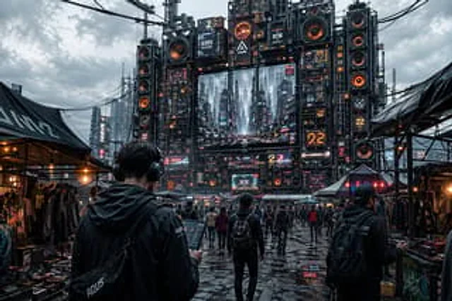

```text
A futuristic{argument name="scene" default="Cyberpunk Outdoor Music Market"} The scene featured a massive, towering wall composed of industrial loudspeakers and electronic panels, forming a colossal sound system.{argument name="lighting" default="Orange glow"} A subwoofer, a complex LED control grid and wiring, a giant digital screen displaying a neon cityscape, a{argument name="subject" default="young people"} From behind, people wearing headphones, hoodies, and carrying crossbody bags and tablets move through a rough market filled with tents and stalls. The scene is overcast, with cinematic lighting, ultra-detailed imagery, a wide-angle perspective, a dystopian atmosphere, high contrast, photorealistic realism, 8K resolution, sharp focus, and depth of field.
```

Model: GPT Image 2
Author: GPT Image 2 Prompts

[ProjectD](https://aitoolsradar.com/en/prompts/497812c778a9ad) · [Recorded source](https://x.com/feel_rave/status/2046736892105044125)
 · [Full original metadata and byte evidence](data/projectd-batch-0031.json)

## Futuristic Data-Driven Skincare Ad


```text
Create a futuristic luxury skincare product advertising poster with a minimalist layout and a background of delicate, metallic, light icy silver-blue. Place an upright white cylindrical spray bottle in the lower right quadrant, casting a long, soft blue-gray shadow to the lower right. The bottle has a matte, high-end finish, rounded shoulders, a white pump dispenser, and minimalist dark navy blue lettering. The brand name is displayed at the top of the bottle label.{argument name="brand name" default="SECURE-IP"} The product name will be displayed in larger font below.{argument name="product name" default="IP ADDRESS CLEANSER"} Following this is a smaller line of text, "for risk-free connections," below which is an even smaller line of French text, and at the bottom, tiny print reads, "75 mL / 2.5 fl. oz. - Data Stream Purifier." On the back and top of the bottle, a dramatic, semi-transparent, abstract water-like form is created, shaped like a flowing sprite, surging waves, or liquid ghost, composed of a glassy blue fluid with iridescent highlights, delicate ribbons, and splashing tendrils sweeping upwards and to the right. This liquid sculpture should convey an elegant, intelligent, and ethereal feel, suggesting data flow and hydration. On the left half of the poster, minimalist navy blue edited text is placed with ample spacing: at the top is a small line of the brand name.{argument name="headline brand" default="SECURE-IP"} Below is a prominent, large, stacked title.{argument name="headline text" default="THE FUTURE OF DATA-DRIVEN SKINCARE"} Below the title, add a circular arrow icon followed by the words "READ MORE". Near the bottom left corner, there is a subheading "SAFE CONNECTION", above which is a thin horizontal progress line ending with "100%". Employing high-end cosmetics advertising aesthetics, the composition is extremely simple, retaining ample white space, using a cool monochromatic color scheme, soft diffused light, clear reflections, exquisite typography, and a sophisticated sci-fi beauty brand atmosphere.
```

Model: GPT Image 2
Author: GPT Image 2 Prompts

[ProjectD](https://aitoolsradar.com/en/prompts/3752e99bee0b4b) · [Recorded source](https://x.com/Ronycoder/status/2046871802597740700#reversed-2)
 · [Full original metadata and byte evidence](data/projectd-batch-0031.json)

## Futuristic EV Racing Through City Night

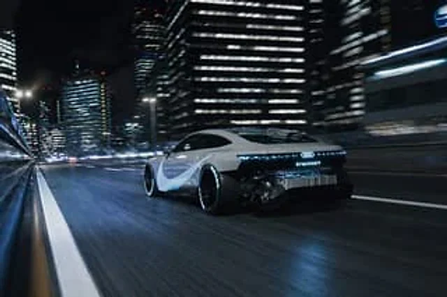

```text
A cinematic nighttime car action shot showcases a futuristic electric sports coupe speeding through a modern city center, shot from a low-angle, rear-view, three-quarter perspective. The car is a streamlined {argument name="car brand" default="Audi"} Concept car, with a glossy finish{argument name="body color" default="white"} The body, black roofline, dark privacy windows, extra-wide rear tires, illuminated taillights, and a centrally illuminated rear end.{argument name="rear badge text" default="tron"} The lower rear end features a semi-transparent or open design, revealing advanced electric powertrain and battery hardware with metallic details and cool blue lighting. Flowing light gray and blue side stripes on the doors and rear fenders evoke the concept car's appearance. The vehicle speeds along a wet, multi-lane city highway, the asphalt, lane markings, and surrounding buildings exhibiting a strong dynamic blur. The background features towering glass office buildings at night, adorned with hundreds of bright window lights, rooftops scattered with red aviation obstruction lights, and distant flowing traffic lights. Reflective effects are incorporated into the guardrails or walls along the left edge to emphasize the sense of speed and camera movement. The lighting is cool, high-contrast, and atmospheric, with blue-white highlights, glossy reflections on the road surface, and a sophisticated futuristic luxury aesthetic. Ultra-detailed, photorealistic, long-exposure quality, and dynamic tracking shots keep the focus sharply locked on the car, while the urban environment is blurred by high-speed movement.
```

Model: GPT Image 2
Author: GPT Image 2 Prompts

[ProjectD](https://aitoolsradar.com/en/prompts/c2196b96bb9b7f) · [Recorded source](https://x.com/AllarHaltsonen/status/2047255361409675314#reversed-2)
 · [Full original metadata and byte evidence](data/projectd-batch-0031.json)

## Futuristic Floating City at Sunset

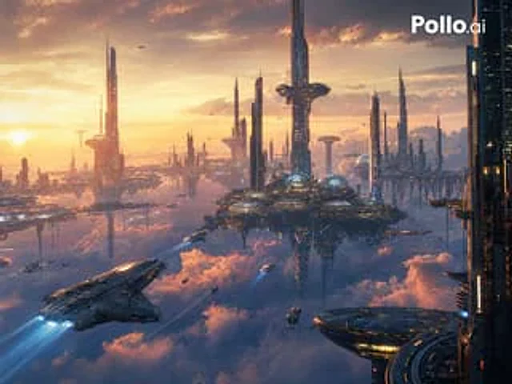

```text
From high above, a magnificent, cinematic sci-fi city floats above a sea of ​​glowing clouds at sunset. The image showcases an advanced, utopian metropolis comprised of numerous slender, futuristic skyscrapers and elevated platforms rising from the clouds. Two prominent central domed buildings stand out, a large circular landing platform in the lower right foreground, and a massive spaceship with a bright blue engine contrail hurtling towards the city in the lower left foreground. Smaller flying objects dot the sky. The architecture is fluid, metallic, and incredibly detailed, featuring towering needle-like towers, cascading sky bridges, suspended areas, and luminous windows. Warm golden sunlight streams down from the left near the horizon, casting orange, peach, and pink highlights on the clouds, while the buildings reflect a cool steel blue and subtle neon points. Dramatic volumetric clouds are incorporated below and between the structures, using atmospheric haze to create a sense of depth, showcasing a grand scale and exquisite conceptual art style. The composition should have an epic, panoramic feel, with the tallest tower positioned on the right-center, other spires extending into the distance, and the right edge framed by a dark, vertical megastructure. Add a simple white "Pollo.ai" logo in the upper right corner. Ultra-high detail, cinematic lighting, futuristic world-building, high contrast, sharp focus, top-tier sci-fi key visual.
```

Model: GPT Image 2
Author: GPT Image 2 Prompts

[ProjectD](https://aitoolsradar.com/en/prompts/d49fd1a8b71e3c) · [Recorded source](https://x.com/Alex_Inspira/status/2047695803452686798#reversed-0)
 · [Full original metadata and byte evidence](data/projectd-batch-0031.json)

## Futuristic Footwear Advertisement

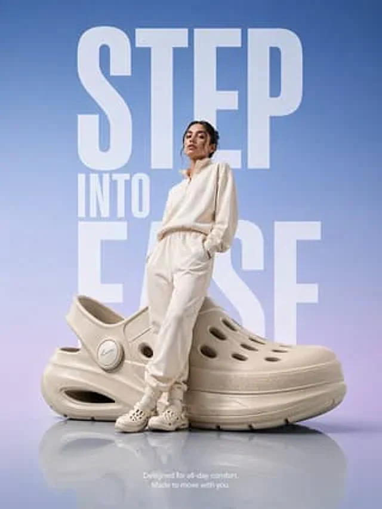

```text
A hyper-realistic advertisement for a high-quality product showcases a huge {argument name="footwear type" default="Futuristic and comfortable clogs"} It was placed on a smooth, reflective, glossy floor. A person wearing {argument name="clothing colors" default="Soft, neutral-colored sportswear (off-white/beige)"} A modern model leans casually against a giant shoe with a relaxed and confident pose. Background: a clean gradient blends soft sky blue with subtle lavender; large, eye-catching typographic text in the background reads "{argument name="headline" default="STEP INTO EASE"} The text uses a modern sans-serif font, stretched vertically and partially positioned behind the main subject. Lighting: High-end studio lighting with soft highlights, subtle reflections on the floor, and delicate rim lighting that outlines the model and product, adding depth. Composition: Magazine-style layout, perfectly centered subject, strong white space, and a luxurious brand feel. Additional text (small, simple typography at the bottom): "Designed for all-day comfort. Moves with you." Style: Extremely minimalist, a combination of Apple-style minimalism and high-fashion advertising, hyper-realistic, high-end commercial photography, 8K resolution, and crystal-clear details.
```

Model: GPT Image 2
Author: GPT Image 2 Prompts

[ProjectD](https://aitoolsradar.com/en/prompts/dcb3093cece091) · [Recorded source](https://x.com/Strength04_X/status/2047729312384901449)
 · [Full original metadata and byte evidence](data/projectd-batch-0031.json)

## Futuristic GPT Image 2 Launch Banner


```text
{
  "type": "Futuristic AI Product Launch Marketing Main Visual Banner",
  "style": "High-end 3D advertising compositing, featuring cinematic neon lighting, exquisite UI mockups, floating product cards, and a glossy, technologically advanced presentation aesthetic.",
  "theme": {
    "primary colors": [
      "Deep Navy Blue",
      "Electric Violet",
      "indigo",
      "white"
    ],
    "mood": "Innovative, high-end, futuristic, and marketing-ready.",
    "lighting": "Dramatic blue-violet halo, rim light, luminous particle trails, soft halo, and ground reflections."
  },
  "canvas": {
    "aspect_ratio": "16:9",
    "background": "A blurred background of a dark, futuristic city nightscape, subtly incorporating skyscraper lights and atmospheric haze."
  },
  "headline_block": {
    "position": "Centered at the top",
    "count": 4,
    "lines": [
      "GPT Image 2",
      "Now available on Lovart",
      "Turn your creative vision into reality",
      "Next-generation AI image creation"
    ],
    "cta": "All creators are now available.",
    "typography": "A clean, modern sans-serif font, bold white headings, smaller white and light gray subheadings, and glowing rounded buttons."
  },
  "layout": {
    "centerpiece": "A large, centrally located, floating, glowing desktop application interface with purple rim lighting; curved energy trails connect all surrounding elements.",
    "sections": [
      {
        "title": "Floating posters and equipment on the left",
        "position": "Left side",
        "count": 5,
        "labels": [
          "BEYOND POSSIBLE vertical sci-fi poster, featuring a futuristic skyline and small figures.",
          "Social media-style card with the text \"The future is yours to create.\", accompanied by a picture of a person facing a surreal landscape.",
          "The product card for the small smart speaker reads, \"Designed for creators. Born to make an impact.\"",
          "An open laptop mockup with the text \"Creativity Becomes a Landmark\" and purple abstract graphics on the screen.",
          "Small vertical cards with the text \"Unlimited Creation\" and a miniature landscape scene."
        ]
      },
      {
        "title": "Central Application UI",
        "position": "middle",
        "count": 1,
        "labels": [
          "The Lovart creation interface features tooltips and a dropdown menu for open models."
        ]
      },
      {
        "title": "Model menu items",
        "position": "UI inside the middle right side",
        "count": 5,
        "labels": [
          "Lovart Image 1",
          "GPT Image 2",
          "DALL·E 3",
          "Stable Diffusion XL",
          "Midjourney v6"
        ]
      },
      {
        "title": "Feature cards",
        "position": "Lower middle UI interior",
        "count": 4,
        "labels": [
          "Ultra-high quality",
          "Precise text rendering",
          "Advanced Composition",
          "Brand Consistency"
        ]
      },
      {
        "title": "Bottom Material Bar",
        "position": "Centered at the bottom",
        "count": 5,
        "labels": [
          "Lovart logo card",
          "Abstract purple fabric-like visual effect",
          "Black hoodie mockup",
          "sports car rendering",
          "Dark Lovart Card"
        ]
      },
      {
        "title": "Floating poster and packaging on the right",
        "position": "right side",
        "count": 5,
        "labels": [
          "The headphone advertisement features the tagline \"Immersive Sound Experience\".",
          "A billboard-style poster with the text \"Inspiration. Creation. Repetition.\" accompanied by an image of purple flowers.",
          "A mobile phone-style card with the text \"Your vision, perfectly realized\".",
          "The product packaging box is large, with the text \"Focus Fuel\" on it.",
          "The project, labeled \"Presentation Template,\" features a glowing wireframe cube."
        ]
      }
    ]
  },
  "ui_details": {
    "app_brand": "Lovart",
    "main_panel_title": "Create everything",
    "prompt_placeholder": "Describe your creative vision...",
    "left_sidebar_count": 6,
    "left_sidebar_labels": [
      "Lovart",
      "front page",
      "creation",
      "project",
      "material",
      "template"
    ],
    "top_right_user_label": "Creator Pro Plan"
  },
  "composition": "The symmetrical marketing layout features a central dashboard that is larger than all other elements, connected to surrounding posters and product mockups by multiple flowing, luminous ribbons. All objects are positioned above a reflective surface, with clear, legible text, showcasing a high-end aesthetic for product launch announcements.",
  "quality": "Ultra-precise and sharp typography, realistic reflections, minimalist interface design, and commercial-grade product visualization."
}
```

Model: GPT Image 2
Author: GPT Image 2 Prompts

[ProjectD](https://aitoolsradar.com/en/prompts/5f70970f01612a) · [Recorded source](https://x.com/dee_naliaks/status/2047319810602844206#reversed-0)
 · [Full original metadata and byte evidence](data/projectd-batch-0031.json)

## Futuristic GPT Image 2 Launch Banner

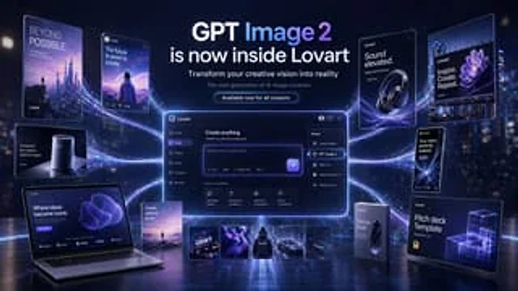

```text
{"type":"futuristic AI product launch campaign hero banner","style":"high-end 3D advertising composite with cinematic neon lighting, polished UI mockups, floating product cards, and glossy tech presentation aesthetics","theme":{"primary colors":["deep navy","electric violet","indigo","white"],"mood":"innovative, premium, futuristic, campaign-ready","lighting":"dramatic blue-violet glow, rim lighting, luminous particle trails, soft bloom, reflective floor"},"canvas":{"aspect_ratio":"16:9","background":"dark futuristic city-at-night bokeh with subtle skyscraper lights and atmospheric haze"},"headline_block":{"position":"top center","count":4,"lines":["GPT Image 2","is now inside Lovart","Transform your creative vision into reality","The next generation of AI image creation"],"cta":"Available now for all creators","typography":"clean modern sans-serif, bold white headline, smaller white and pale gray subtext, glowing rounded button"},"layout":{"centerpiece":"large glowing desktop app interface floating in the center with purple edge lighting and curved energy trails connecting all surrounding assets","sections":[{"title":"left floating posters and devices","position":"left side","count":5,"labels":["BEYOND POSSIBLE vertical sci-fi poster with futuristic skyline and tiny figure","social-style card reading 'The future is yours to create.' with a person facing a surreal landscape","small smart speaker product card reading 'Designed for creators. Built for impact.'","open laptop mockup reading 'Where ideas become iconic' with a purple abstract form on screen","small vertical card reading 'Create without limits' with a tiny landscape scene"]},{"title":"center application UI","position":"middle","count":1,"labels":["Lovart create interface with prompt box and model dropdown opened"]},{"title":"model menu items","position":"center-right inside UI","count":5,"labels":["Lovart Image 1","GPT Image 2","DALL·E 3","Stable Diffusion XL","Midjourney v6"]},{"title":"featured capability cards","position":"lower middle inside UI","count":4,"labels":["Ultra High Quality","Precise Text Rendering","Advanced Composition","Brand Consistency"]},{"title":"bottom asset strip","position":"bottom center","count":5,"labels":["Lovart logo card","abstract purple fabric-like visual","black hoodie mockup","sports car render","dark Lovart card"]},{"title":"right floating posters and packages","position":"right side","count":5,"labels":["headphone ad reading 'Sound elevated.'","large billboard-style poster reading 'Inspire. Create. Repeat.' with a purple flower image","phone-style card reading 'Your vision, perfectly realized.'","tall product box reading 'Focus Fuel'","presentation board reading 'Pitch deck Template' with glowing wireframe cubes"]}]},"ui_details":{"app_brand":"Lovart","main_panel_title":"Create anything","prompt_placeholder":"Describe your creative vision...","left_sidebar_count":6,"left_sidebar_labels":["Lovart","Home","Create","Projects","Assets","Templates"],"top_right_user_label":"Creator Pro Plan"},"composition":"symmetrical campaign composition, central software dashboard larger than all other elements, connected to surrounding posters and product mockups by multiple flowing luminous ribbons, reflective ground plane beneath all objects, crisp readable text, premium launch announcement aesthetic","quality":"ultra-detailed, sharp typography, realistic reflections, clean interface design, commercial-grade product visualization"}
```

Model: GPT Image 2
Author: Doreen

[ProjectD](https://aitoolsradar.com/en/prompts/9e3f263c49280b) · [Recorded source](https://youmind.com/prompts/gpt-image-2-launch-hero-15437)
 · [Full original metadata and byte evidence](data/projectd-batch-0031.json)

## Futuristic Ice Skincare Poster


```text
Create a high-end, futuristic skincare advertising poster using ice blue and white tones, with a 2:3 vertical aspect ratio. The left two-thirds of the image features a semi-transparent, glass-like half-length female figure, turned to the left, with her hair in a low bun. Inside the transparent head, neck, and torso is a surreal miniature landscape, including blue cliffs, luminous water, and multiple waterfalls, resembling a frozen digital sanctuary sealed within. Add tiny floating bubbles, bright reflections, a hazy atmosphere, and soft, aurora-like beams of light diagonally across the image. On the right, place a clean, white, cylindrical skincare bottle, standing upright on a jagged, semi-transparent ice base. The bottle label should display…{argument name="brand name" default="SECURE-IP"} Below is{argument name="product name" default="IP ADDRESS CLEANSER"} Below, smaller technical cosmetic text is added in a minimalist magazine layout. Large, vertically glowing text is placed on the far right edge, containing the following content:{argument name="side headline" default="DEEP CORE PURITY"} Four small infographic-style labels are added, employing a sleek tech-beauty design: a water droplet icon in the upper right corner, titled "MOISTURE LOCK," with two lines of brief supporting text below; a shield icon in the middle right, titled "IP PROTECTION," with three lines of brief supporting text below; a title block in the lower left corner, stating "PURE CONNECTION PURE CONFIDENCE," with two lines of brief body text; and a small label on the far left, stating "DATA STREAM PURIFIER," with brackets pointing towards the glass figure. A centered light blue solid rectangle mask is overlaid on the face and upper body, serving as a flat, opaque color block. The lighting effects are ethereal, bright, and sophisticated, featuring strong glow, frosted highlights, soft backlighting, and a luxurious sci-fi beauty film style. Ultra-detailed, photorealistic 3D rendering, a clean commercial poster design, minimalist yet surreal, with a smooth surface, creates a cold yet bright atmosphere.
```

Model: GPT Image 2
Author: GPT Image 2 Prompts

[ProjectD](https://aitoolsradar.com/en/prompts/1beb560b5d2f05) · [Recorded source](https://x.com/Ronycoder/status/2046871802597740700#reversed-1)
 · [Full original metadata and byte evidence](data/projectd-batch-0031.json)

## Futuristic Japanese product advertisement

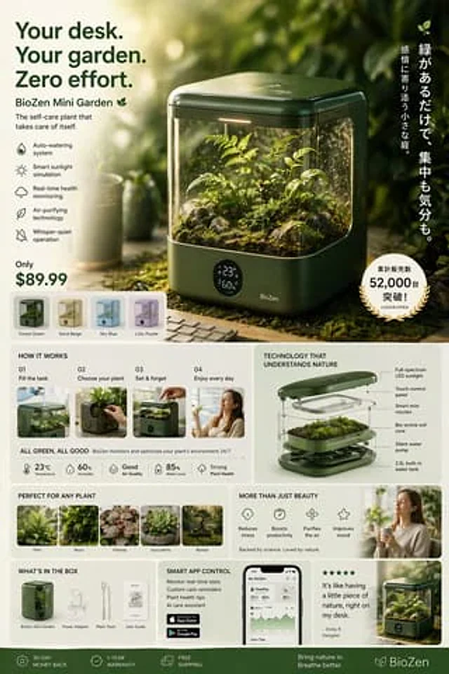

```text
Create a hyperrealistic{argument name="style" default="Japanese style"}{argument name="subject" default="Futuristic product advertisement"} The details are extremely rich and refined, employing cinematic lighting and a super-simple yet high-end layout.{argument name="aesthetic" default="Minimalist high-end design aesthetics"} .
```

Model: GPT Image 2
Author: GPT Image 2 Prompts

[ProjectD](https://aitoolsradar.com/en/prompts/8c022e0ff8d8b4) · [Recorded source](https://x.com/Preda2005/status/2046639985810674111)
 · [Full original metadata and byte evidence](data/projectd-batch-0031.json)

## Futuristic Mandala Illustration

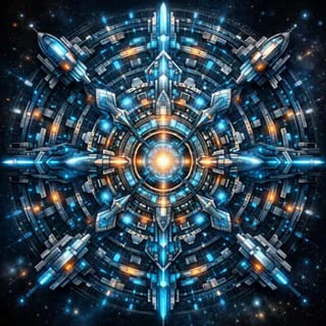

```text
曼荼羅の近未来SF版を描いて
```

Model: GPT Image 2
Author: @4WEB1

[ProjectD](https://aitoolsradar.com/en/prompts/5a2abf270387b4) · [Recorded source](https://x.com/4WEB1/status/2045390207072256179)
 · [Full original metadata and byte evidence](data/projectd-batch-0031.json)

## Futuristic Mumbai Sunset Skyline

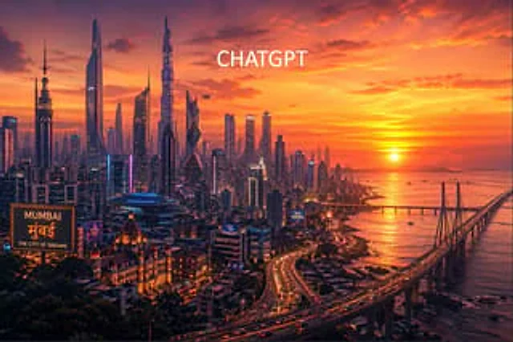

```text
A cinematic, ultra-detailed wide-angle cityscape image will{argument name="city name" default="Mumbai"} Reimagined as a futuristic megacity at sunset, the viewpoint is an overview of the coastline. The skyline is dominated by dozens of futuristic skyscrapers of varying silhouettes, including six particularly striking supertall towers with sleek glass facades, sharp geometric shapes, and neon accents, interwoven with the dense urban mid-rise below. To the right, a long, dramatic bridge reminiscent of the Bandra-Worli Sea Link stretches dramatically from the foreground to the calm coastal waters in the distance, its traffic converging into flowing ribbons of headlights and taillights. The sun hangs low near the horizon above the Arabian Sea, casting golden rays across the water and bathing the entire scene in rich shades of orange, amber, pink, and magenta, with layers of clouds adding depth. In the lower left foreground, a grand, warmly lit domed building inspired by historic South Mumbai architecture contrasts sharply with the futuristic skyline; above it, a suspended, circular UFO platform illuminated in blue light is added. In addition, place two visible illuminated billboards in the lower left and right-center urban areas: a large sign reading "MUMBAI," "मुंबई," and "THE CITY OF DREAMS," and a smaller sign reading "NAVI MUMBAI." Add a small aircraft or drone near the central tower. Place prominent, clean white lettering in large capital letters at the top center.{argument name="top text" default="CHATGPT"} The overall atmosphere is grand, ambitious, glossy, and rich in detail, presenting a conceptual art style full of atmospheric haze, glowing windows, glass reflections, and sharp contrasts, belonging to the science fiction urban fantasy genre.
```

Model: GPT Image 2
Author: GPT Image 2 Prompts

[ProjectD](https://aitoolsradar.com/en/prompts/bf670a5040895c) · [Recorded source](https://x.com/Mudassir338/status/2046686577662067151#reversed-0)
 · [Full original metadata and byte evidence](data/projectd-batch-0031.json)

## Futuristic Muscle Car Infographic

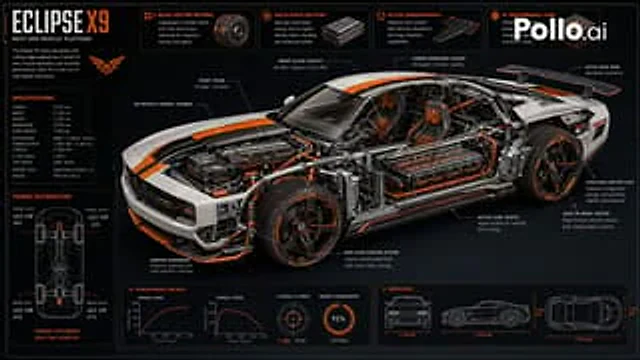

```text
Super futuristic{argument name="colors" default="White and orange color scheme"}{argument name="subject" default="muscle cars"} Diagrams, internal structure diagrams, cross-sectional views, labeled infographics, cyberpunk science illustrations, simple layout, high detail, dark background, cyberpunk style.
```

Model: GPT Image 2
Author: GPT Image 2 Prompts

[ProjectD](https://aitoolsradar.com/en/prompts/60cb72bcc872bf) · [Recorded source](https://x.com/Mechanismo0/status/2047227248088855023)
 · [Full original metadata and byte evidence](data/projectd-batch-0031.json)

## Futuristic Photonics Magazine Cover

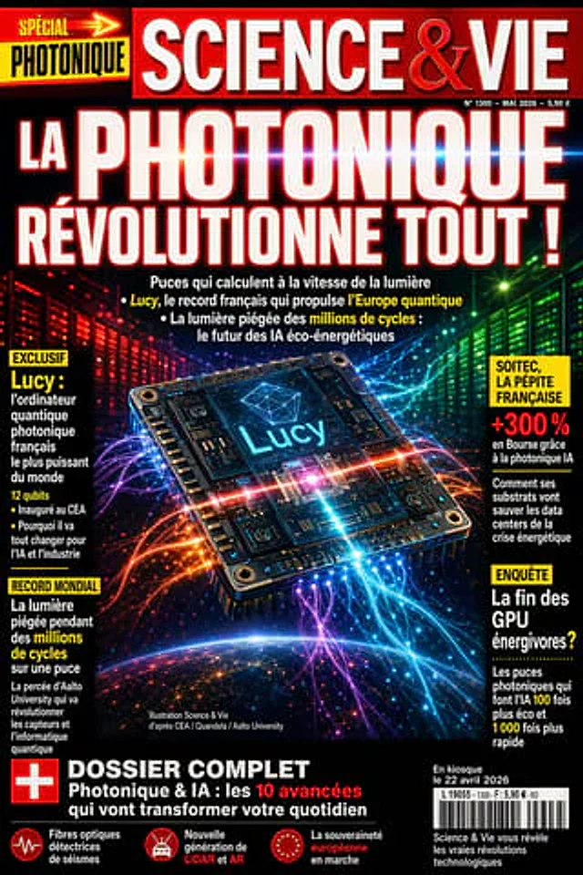

```text
This is a meticulously crafted cover for a French science magazine, featuring a bold, mainstream newsstand publication style. The entire page is vertically laid out, with a dramatic glossy print, a black background accented by strong neon lighting, and saturated highlights in red, blue, purple, green, and orange. At the very top is a wide red masthead bar, displaying the magazine title in large, white-lined capital letters.{argument name="magazine title" default="SCIENCE & VIE"} It features subtle bevels and a metallic sheen; tiny white text in the upper right corner indicates the issue number details. The upper left corner has a bright yellow and black special label with the text {argument name="special tag" default="SPÉCIAL PHOTONIQUE"} Featuring a red arrow pattern. The main title occupies most of the upper half of the space, using large white blocky capital letters with a red halo and subtle 3D shadows.{argument name="main headline" default="LA PHOTONIQUE RÉVOLUTIONNE TOUT !"} Below are three lines of smaller white text serving as a cover introduction, with some keywords highlighted in yellow, discussing ultrafast light-speed chips, the French record-breaking computer named Lucy, and light captured for millions of cycles for energy-efficient AI. The central image: a futuristic, square photonic processor chip, slightly tilted and suspended in space, featuring extremely fine circuitry, metal screws in the corners, glowing lines, and a label {argument name="chip name" default="Lucy"} The chip features a bright cyan-blue core display; beams of light radiate outwards from the chip, intersecting and flowing fiber optic trails in electric blue, magenta, orange, and purple, spreading outwards across the page. The background behind the chip shows two glowing server wall corridors, red on the left and green on the right, gradually fading into darkness, hinting at a high-tech data center. At the bottom is a curved horizon as seen from space, with a soft blue atmospheric halo and scattered city lights. A total of four sidebar labels are added: two stacked on the left and two stacked on the right, each with a yellow title and white text, using a magazine cover layout hierarchy. Left Box 1, titled "EXCLUSIF," introduces Lucy as the world's most powerful French photonic quantum computer, containing a few lines of brief bullet points and highlighting "12 qubits" in yellow. Left Box 2, titled "RECORD MONDIAL," discusses the millions of cycles of light captured within the chip and highlights "millions of cycles" in yellow. The first right-hand box features a yellow title area with a striking red percentage "+300%" and text about the rise of French gem company Soitec thanks to photonic AI and its role in saving data centers during the energy crisis. The second right-hand box, titled "ENQUÊTE," discusses the end of high-power GPUs, featuring highlighted yellow figures such as 100x cost reduction and 1,000x speed increase. Near the bottom center is a small white text indicating the image source. At the bottom of the page is a thick black banner with a red square containing a white plus sign on the left, along with a white and red teaser text.{argument name="bottom feature text" default="DOSSIER COMPLET Photonique & IA : les 10 avancées qui vont transformer votre quotidien"} At the very bottom, three small, circular red icons are added, accompanied by brief white titles covering topics such as earthquake fiber optics, next-generation LiDAR and AR, and the ongoing European sovereignty movement. The bottom right corner contains a white barcode box and a short white text about this issue's release. Overall aesthetics: sensational, high-end, futuristic, glossy, information-dense, sharp editorial layout, dramatic science news covers, cinematic lighting, high contrast, photorealistic 3D chip illustrations combined with premium magazine graphic design.
```

Model: GPT Image 2
Author: GPT Image 2 Prompts

[ProjectD](https://aitoolsradar.com/en/prompts/4b8946c6b959eb) · [Recorded source](https://x.com/Greg__LD/status/2046518305612038576#reversed-0)
 · [Full original metadata and byte evidence](data/projectd-batch-0031.json)

## Futuristic Secure-IP Ad Poster

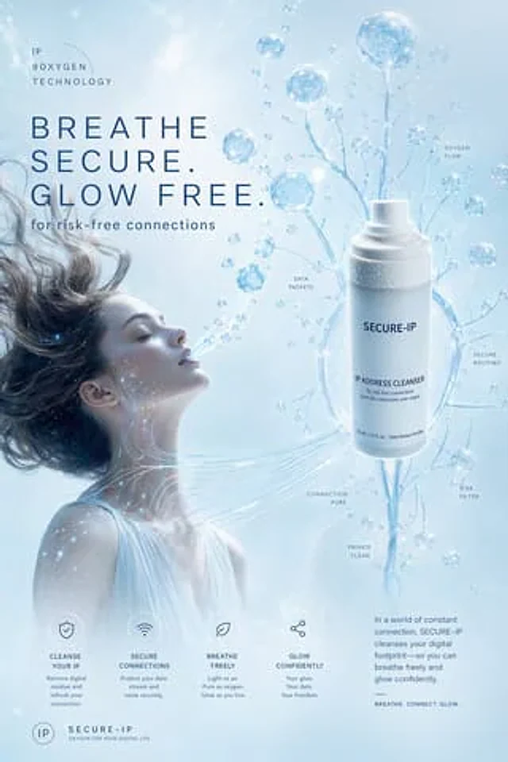

```text
This futuristic, luxurious skincare advertising poster, featuring a monochrome ice-blue color scheme, draws inspiration from high-tech beauty marketing. The composition is vertical and transparent, complemented by soft lighting, hazy gradients, translucent particle effects, and clean typography. On the left is a profile half-body shot of a young woman in a white sleeveless dress, her head tilted back as if breathing in fresh air, her long, dark hair flowing in the wind. Her face is covered by a simple square obscuring block. Finely luminous grid lines and shimmering points of light flow from her neck and chest to the right, suggesting digital purification and connection. On the right is a tall, upright, matte white spray bottle, labeled "SECURE-IP" and "IP ADDRESS CLEANSER," with smaller product text below, conveying the quality of high-end cosmetics. The bottle is surrounded by forked, translucent stems, resembling biotechnological coral or nerve fibers, with clearly visible luminescent bubbles at the ends. Some bubbles faintly display the technical words "DATA PACKET," and nearby micro-labels list features including "OXYGEN FLOW," "DATA PACKETS," "SECURE ROUTING," "RISK FILTER," "PRIVATE CLEAN," and "CONNECTION PURE." The upper left corner features the small brand name "IP 9OXYGEN TECHNOLOGY." The center left corner displays a prominent, large, bold capitalized title:{argument name="headline text" default="BREATHE SECURE. GLOW FREE."} Below this is a smaller subtitle, "for risk-free connections." At the bottom are four evenly spaced minimalist icons and text blocks: 1) a shield icon, titled "CLEANSE YOUR IP" with a brief description; 2) a Wi-Fi icon, titled "SECURE CONNECTIONS" with a brief description; 3) a leaf icon, titled "BREATHE FREELY" with a brief description; and 4) a share/network icon, titled "GLOW CONFIDENTLY" with a brief description. A marketing copy about continuous connection and digital purification is added in the lower right corner, ending with the slogan "BREATHE. CONNECT. GLOW." The lower left corner contains a circular IP logo and the brand name "SECURE-IP," along with the subtitle "OXYGEN FOR YOUR DIGITAL LIFE." Overall style: surreal product advertising, high-end editorial poster, clean sans-serif font, soft halo, semi-transparent glass sphere, elegant sci-fi health brand feel, ultra-high detail, exquisite, magazine-quality typography.
```

Model: GPT Image 2
Author: GPT Image 2 Prompts

[ProjectD](https://aitoolsradar.com/en/prompts/5770c3054f4d6b) · [Recorded source](https://x.com/Ronycoder/status/2046871802597740700#reversed-3)
 · [Full original metadata and byte evidence](data/projectd-batch-0031.json)

## Futuristic Smart Mirror Website Mockup

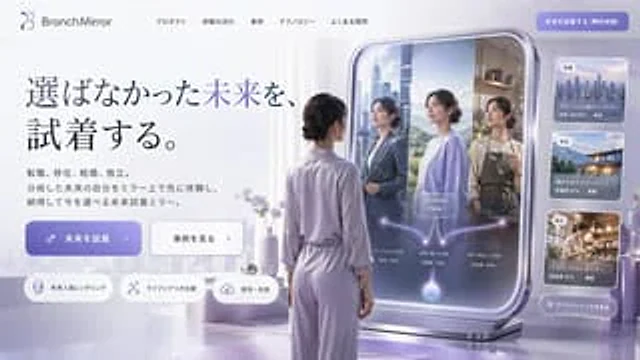

```text
{
  "type": "Website landing page design draft",
  "style": "Futuristic, minimalist, 3D rendering, corporate tech style",
  "color_palette": "{argument name=\"color palette\" default=\"Soft purple, lavender purple and silver\"}",
  "header": {
    "logo": "{argument name=\"brand name\" default=\"BranchMirror\"}",
    "navigation_links": 5,
    "cta_button": "solid purple button in the upper right corner"
  },
  "hero_section": {
    "headline": "{argument name=\"main headline\" default=\"Try on the life you never chose.\"}",
    "subtext": "A Chinese paragraph explaining the product",
    "buttons": [
      {
        "style": "solid purple",
        "text": "{argument name=\"primary button text\" default=\"Try on the future\"}",
        "icon": "sparkles"
      },
      {
        "style": "white outline",
        "text": "View Case Studies",
        "icon": "arrow right"
      }
    ],
    "feature_tags": {
      "count": 3,
      "style": "Capsule shape, with icon",
      "labels": [
        "Future Personality Rendering",
        "Comparison of daily life scenarios",
        "Save and share"
      ]
    }
  },
  "main_visual": {
    "subject": "{argument name=\"subject description\" default=\"A woman wearing lavender loungewear and with her hair in a low bun\"}",
    "pose": "Standing, back to the camera, facing a large, freestanding smart mirror.",
    "smart_mirror_ui": {
      "reflections": {
        "count": 3,
        "descriptions": [
          "Women in business suits with a city background",
          "A woman wearing a casual sweater against a natural background",
          "A woman wearing an apron in a coffee shop setting"
        ]
      },
      "overlay_graphics": "The glowing, tree-like branching diagram starts from the bottom sphere and branches into three paths pointing to various mirror images, with the \"Now\" label at the center."
    }
  },
  "sidebar_ui": {
    "cards": {
      "count": 3,
      "descriptions": [
        "Cityscape map with occupational change statistics",
        "Coastal house maps with relocation statistics",
        "Flower shop images with statistics on independent entrepreneurship"
      ]
    },
    "bottom_button": "Button for viewing the frosted glass effect in all scenes"
  }
}
```

Model: GPT Image 2
Author: GPT Image 2 Prompts

[ProjectD](https://aitoolsradar.com/en/prompts/c599b1623ff0a3) · [Recorded source](https://x.com/masapark95/status/2046189362933858580#reversed-0)
 · [Full original metadata and byte evidence](data/projectd-batch-0031.json)

## Futuristic STEM Classroom with Holograms

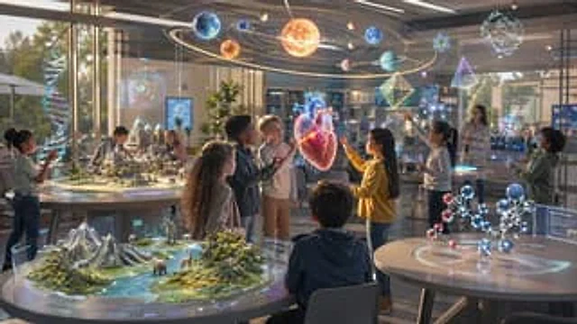

```text
In a bright and futuristic classroom or science museum lab, schoolchildren are interacting with large-scale mixed reality holograms, presenting a cinematic, ultra-realistic photographic effect. The scene, set in a wide-angle indoor perspective under warm afternoon sunlight, features floor-to-ceiling windows, modern tables and chairs, bookshelves, and digital displays, creating a minimalist, high-tech educational atmosphere. Approximately nine children and one teacher are distributed throughout the room, actively exploring science exhibits through gestures and touch controls. In the center of the room, a glowing, translucent holographic human heart floats at chest height, surrounded by three children who curiously reach out to touch it. Above them hangs a giant holographic model of the solar system, with nine planets orbiting a bright sun, complete with glowing orbital paths and a fantastical scientific visualization style. To the left, a child is interacting with a tall, vertical holographic DNA double helix structure. On a table to the left front is a circular desktop hologram showcasing a miniature mountain and river ecosystem, featuring four visible animals: an elephant, a deer, an alpaca (or llama), and a bear. On the left rear table is a circular holographic model of an architecture, showcasing a magnificent classical domed building and its surrounding structure. On the right front table is a giant ball-and-stick molecular model composed of luminous spheres and connecting rods. In the right center and upper right spaces are additional suspended scientific holograms: two geometric polyhedra, two molecular structure diagrams, two spherical energy or data spheres, and one hourglass-like abstract hologram. Children of diverse ethnic backgrounds, casually dressed, are shown engrossed, amazed, and collaboratively observing the different holographic themes. Using soft volumetric lighting to create realistic reflections on the glass and tabletops, the holograms emit a delicate blue-gold glow with a slight atmospheric haze, showcasing a high-end and inspiring STEM education advertising aesthetic.
```

Model: GPT Image 2
Author: GPT Image 2 Prompts

[ProjectD](https://aitoolsradar.com/en/prompts/6542d065d5548b) · [Recorded source](https://x.com/petekp/status/2047454983604572319#reversed-3)
 · [Full original metadata and byte evidence](data/projectd-batch-0031.json)

## Futuristic Sunset Megacity

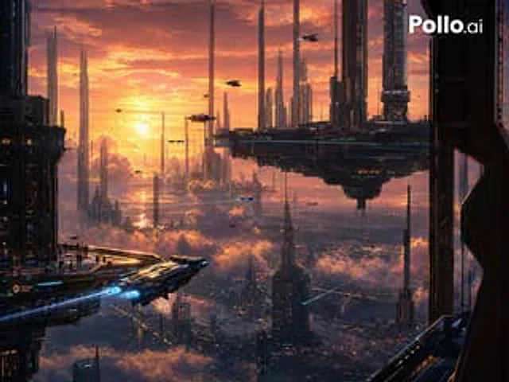

```text
At sunset, a panoramic view from a high observation deck overlooks a vast, cinematic, sci-fi metropolis, surrounded by massive, dark metallic skyscrapers. The sky is a dramatic tapestry of orange, gold, and rose-colored clouds, with the low-hanging sun casting its warm glow upon the grand, futuristic city stretching into the distance, shrouded in mist. In the upper right corner, a colossal, suspended structure hangs above the city like a giant floating platform, surrounded by countless towering, needle-like skyscrapers and the densely packed, brightly lit urban area below. The lower left corner features a foreground landing deck with a small group of tiny figures standing along its edge, while a streamlined spacecraft takes off from the platform, its bright blue engine trails extending diagonally outwards. Several small flying vehicles are scattered across the sky, appearing dwarfed by the surrounding architecture. Dark structural elements are used on the left and right sides of the image to create a sense of depth, as if gazing out from a futuristic tower's corridor or balcony. The style is characterized by ultra-refined conceptual art, epic scale, atmospheric perspective, reflective metallic surfaces, intricate city lights, volumetric clouds, light fog, and a dramatic contrast between warm sunset light and cool blue technological tones, creating a cinematic, grand futuristic utopia with highly detailed digital painting.
```

Model: GPT Image 2
Author: GPT Image 2 Prompts

[ProjectD](https://aitoolsradar.com/en/prompts/f98310cb3fd8f1) · [Recorded source](https://x.com/Alex_Inspira/status/2047695803452686798#reversed-1)
 · [Full original metadata and byte evidence](data/projectd-batch-0031.json)

## Futuristic Sunset Megacity


```text
A vast cinematic sci-fi megacity at sunset, viewed from a high observation platform between colossal dark metallic skyscrapers. The sky glows with dramatic orange, gold, and rose clouds, with the sun low on the horizon casting warm light across an immense futuristic city that stretches into the distance above layers of mist and clouds. Count exactly 1 large hovering megastructure dominating the upper-right center, suspended over the city like a massive floating platform, surrounded by countless ultra-tall needle-like towers and luminous urban density below. Include exactly 1 foreground landing deck on the lower left with a small group of tiny human silhouettes standing near the edge, and exactly 1 sleek spacecraft departing from that platform with bright blue engine trails streaking diagonally outward. Scatter multiple small flying vehicles across the sky at varying distances, all dwarfed by the architecture. Frame the composition with dark structural elements on the far left and far right to create depth, as if looking out from inside a futuristic tower corridor or balcony. Style is hyper-detailed concept art, epic scale, atmospheric perspective, reflective metal surfaces, intricate city lights, volumetric clouds, subtle haze, dramatic contrast between warm sunset light and cool blue technological accents, ultra cinematic, grand futuristic utopia, highly polished digital matte painting.
```

Model: GPT Image 2
Author: Alexander Inspira IA

[ProjectD](https://aitoolsradar.com/en/prompts/42bd3b1e1a10f4) · [Recorded source](https://youmind.com/prompts/futuristic-sunset-megacity-15783)
 · [Full original metadata and byte evidence](data/projectd-batch-0031.json)

## Futuristic Tactical Character Sheet

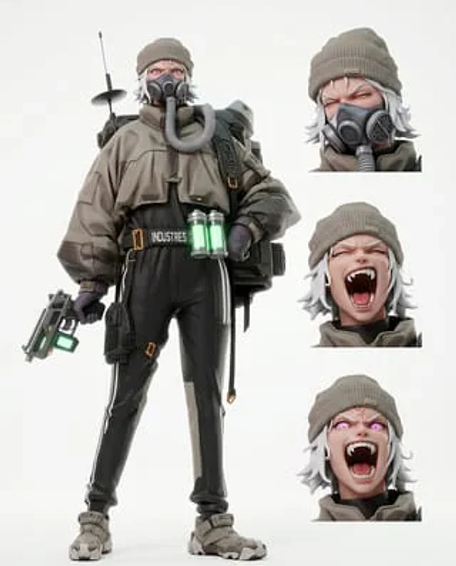

```text
{"type":"character reference sheet","style":"Clean high-end 3D animation rendering, soft studio lighting, seamless white background, low-saturation futuristic military streetwear aesthetics","character":{"name":"{argument name="character name" default="Original characters"} ","gender_presentation":"Gender-neutral young adult","build":"Slim","hair":{"color":"{argument name="hair color" default="silver-white"} ","style":"Short, choppy hair peeking out from under a knit hat"},"face":"The face is blurred and simplified, with almost no visible features","outfit":{"headwear":"Taupe ribbed knit hat","outerwear":"Oversized short taupe functional jacket with a high collar, thick seams, functional patches, and short cape-style shoulder overlays secured by buckles","neck":"Large, corrugated breathing tubes connecting from the collar to the backpack assembly","gloves":"Dark fitted gloves","pants":"Black slim-fit tactical trousers with a subtle sheen, white side stripes, thigh holster straps, and additional functional pockets","belt":"Black functional belt with prominent lettering"}{argument name="belt text" default="INDUSTRIES"} ","footwear":"Thick-soled futuristic sneakers in gray and grey"},"gear":{"backpack":"Large industrial life support backpack with hoses and antenna discs","weapon":"Compact sci-fi pistol with angular body and glowing green panel","canisters":"Two glowing green cylindrical canisters hanging in front of the waist"},"colors":["gray","grey","black","silver","neon green accents"],"layout":{"canvas":"vertical","sections":[{"title":"full-body view","position":"left side","count":1,"labels":["standing full-body pose"]},{"title":"head view","position":"right side","count":3,"labels":["front close-up of head","three-quarter view"]} "Head close-up", "Front view or slightly different head close-up"]}],"centerpiece": "Full-body character standing, one hand on hip, the other holding a gun, legs apart, presenting a confident neutral pose","composition": "Large character occupies two-thirds of the left side of the page, three evenly distributed head close-ups are vertically stacked on the right side"},"render_notes": "Ultra-clean product showcase style, clear material definitions, delicate fabric folds, hard-surface plastic and metal parts, only subtle shadows, no environmental props except for character equipment","quality": "High detail, exquisite concept art turntable quality"}
```

Model: GPT Image 2
Author: GPT Image 2 Prompts

[ProjectD](https://aitoolsradar.com/en/prompts/393ea6ef9b705e) · [Recorded source](https://x.com/0xInk_/status/2047745779318804534#reversed-0)
 · [Full original metadata and byte evidence](data/projectd-batch-0031.json)

## Futuristic Tech Beauty Product Poster


```text
A luxurious, futuristic cosmetics advertisement poster against a deep midnight blue background features a centered composition showcasing a luminous white spray bottle standing upright on a three-tiered transparent crystal base, adorned with water droplets and shimmering reflections. The bottle is slender, cylindrical, and minimalist, with a soft backlighting halo, visible water droplets on its surface, and a clearly visible pump. Behind the bottle, a symmetrical, luminous lotus flower composed of 10 translucent petals unfolds like a digital halo, each petal shimmering with iridescent blue-violet highlights, delicate circuit-like filaments, and tiny shimmering points, seamlessly blending botanical elegance with digital network aesthetics. The base, resembling stacked glass or ice cubes, is moist and reflective, resting on a smooth, shimmering surface scattered with blue light particles. The top features an elegant serif font with striking white luminous lettering.{argument name="headline text" default="THE PURITY PROTOCOL"} Below is a thin horizontal dividing line, with a star-shaped light spot in the center. Smaller sans-serif-spaced text is displayed below.{argument name="subheadline text" default="DATA STREAM PURIFIER // 75ML"} The main brand name on the bottle is {argument name="brand name" default="SECURE-IP"} The product name is{argument name="product label" default="IP ADDRESS CLEANSER"} This is followed by smaller text: "for risk-free connections" and "pour des connexions sans risque," with "75 mL / 2.5 fl. oz. - Data Stream Purifier" at the bottom. The overall style pursues an extremely refined, high-end, surreal, and technologically luxurious beauty film quality, featuring cinematic lighting effects, clear and easy-to-read text, high detail, cool blue and white tones, and ethereal shimmer, achieving a perfect balance between skincare advertising and cybersecurity metaphors.
```

Model: GPT Image 2
Author: GPT Image 2 Prompts

[ProjectD](https://aitoolsradar.com/en/prompts/7f02a8a0ef97e3) · [Recorded source](https://x.com/Ronycoder/status/2046871802597740700#reversed-0)
 · [Full original metadata and byte evidence](data/projectd-batch-0031.json)

## Futuristic Tech Strategy Slide

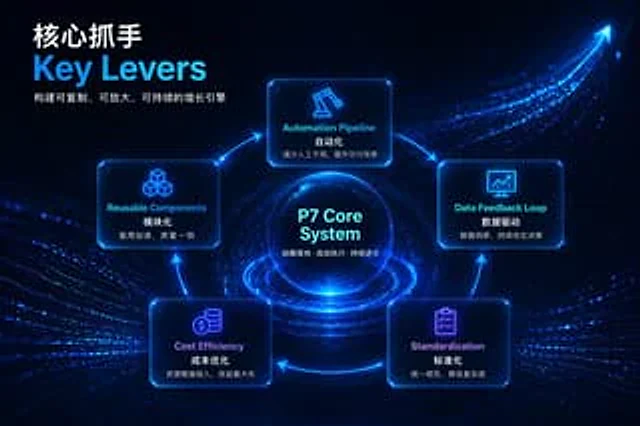

```text
{
  "type": "Presentation Infographic",
  "style": {
    "theme": "{argument name=\"theme color\" default=\"Neon Blue\"}",
    "background": "{argument name=\"background style\" default=\"Deep blue futuristic design, featuring glowing data streams and upward arrows.\"}"
  },
  "header": {
    "title": "{argument name=\"main title\" default=\"core focus\"}",
    "subtitle": "{argument name=\"english title\" default=\"Key Levers\"}",
    "description": "Build a replicable, scalable, and sustainable growth engine"
  },
  "layout": {
    "type": "Loop Flowchart",
    "center_node": {
      "title": "{argument name=\"center node title\" default=\"P7 Core System\"}",
      "subtitle": "Strategic Implementation, Efficient Execution, Continuous Evolution",
      "visual": "Luminous Technology Sphere"
    },
    "surrounding_nodes": {
      "count": 5,
      "connection": "Glowing blue arrows forming a clockwise cycle",
      "nodes": [
        {
          "position": "top",
          "icon": "robotic arm",
          "english_label": "Automation Pipeline",
          "chinese_label": "automation",
          "description": "Reduce human intervention and improve delivery efficiency"
        },
        {
          "position": "right",
          "icon": "Display with charts",
          "english_label": "Data Feedback Loop",
          "chinese_label": "Data-driven",
          "description": "Data insights enable continuous optimization of decision-making."
        },
        {
          "position": "bottom right",
          "icon": "Clipboard with checkmark",
          "english_label": "Standardization",
          "chinese_label": "standardization",
          "description": "Standardize and reduce complexity"
        },
        {
          "position": "bottom left",
          "icon": "coin",
          "english_label": "Cost Efficiency",
          "chinese_label": "Cost optimization",
          "description": "Precise allocation of resources to maximize benefits"
        },
        {
          "position": "left",
          "icon": "Stacked Cubes",
          "english_label": "Reusable Components",
          "chinese_label": "Modular",
          "description": "Accelerated reuse and consistent quality"
        }
      ]
    }
  }
}
```

Model: GPT Image 2
Author: GPT Image 2 Prompts

[ProjectD](https://aitoolsradar.com/en/prompts/3c9ead762aadd3) · [Recorded source](https://x.com/qiufenghyf/status/2045180142159577473#reversed-0)
 · [Full original metadata and byte evidence](data/projectd-batch-0031.json)

## Futuristic VTuber Debut Poster

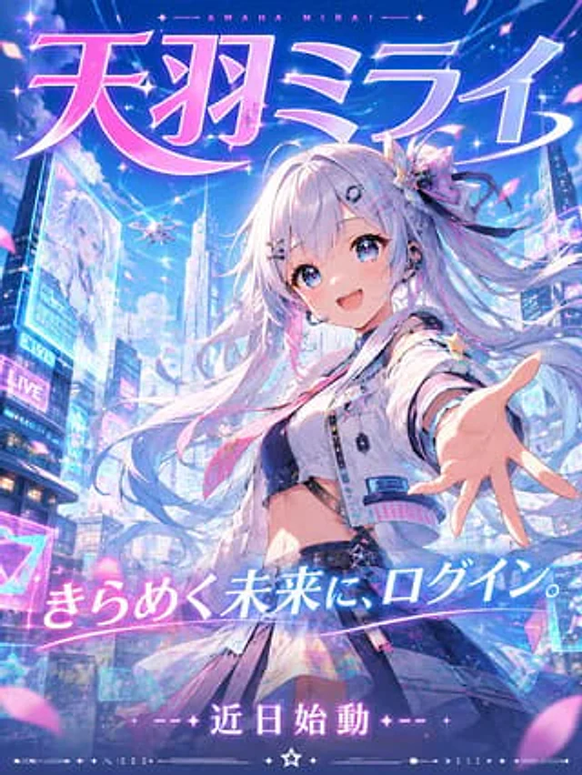

```text
Goal: Create a glossy VTuber-style teaser key visual for a futuristic idol debut, centered on {argument name="character name" default="Amaha Mirai"}, with strong character presence and high-energy anime advertising design.

Canvas: Vertical 3:4 poster, full bleed, ultra-detailed anime illustration, vibrant cyan, electric blue, magenta, lavender, and white lighting, sparkling bloom effects, clean commercial finish.

Layout: Put a huge glowing Japanese title across the top reading {argument name="main title text" default="天羽ミライ"}, with small spaced roman letters above it reading “AMAHA MIRAI”. Center-right foreground shows the VTuber idol reaching one hand toward the viewer in dynamic perspective. The background is a bright futuristic city canyon with holographic billboards and glass skyscrapers. Across the lower middle, add a glowing slogan line reading {argument name="slogan text" default="きらめく未来に、ログイン。"}. At the very bottom, add a smaller launch notice reading {argument name="launch text" default="近日始動"}, framed by tiny star symbols and decorative sci-fi divider lines.

Subject details: Draw one cheerful young anime idol girl with long flowing {argument name="hair color" default="silvery white with pale blue and pink highlights"} hair, large blue-violet eyes, open smiling mouth, soft blush, and a headset microphone. She wears a futuristic cropped idol jacket in white and pastel blue with pink accents, star pins, metallic trims, a short layered translucent skirt, belts, straps, and iridescent fabric details. Add hair accessories: exactly 3 visible accessories — one large bow-and-ribbon ornament on the right side of her head, one small star clip near the left bangs, and two small pink hairpins grouped on the right bangs as a single accessory cluster.

Background elements: Include exactly 5 prominent futuristic promotional elements — one giant holographic billboard on the left showing the same idol with “LIVE” styling, one small flying camera drone near the upper-left sky, one central needle-like tower, one neon triangular sign in the lower-left corner, and one bright holographic sign on the right building. Fill the scene with pink flower-petal confetti, star sparkles, lens flares, and light streaks.

Visual style: Modern Japanese anime poster, high-saturation cyber-pop city, luminous rim lighting, crisp linework, detailed hair strands, polished VTuber debut advertisement aesthetic, energetic perspective, dreamy yet sharp.

Constraints: Keep the image as a single poster, no extra characters, no logo watermark, make all text large and decorative but legible, preserve the Japanese text exactly as specified in the slots, and avoid cluttering the face or outstretched hand with text.
```

Model: GPT Image 2
Author: みかみ｜AI発信と副業

[ProjectD](https://aitoolsradar.com/en/prompts/d874adaad58cbc) · [Recorded source](https://youmind.com/prompts/vtuber-debut-poster-31251)
 · [Full original metadata and byte evidence](data/projectd-batch-0031.json)

## Futuristic Yo-Yo Brand Book Board

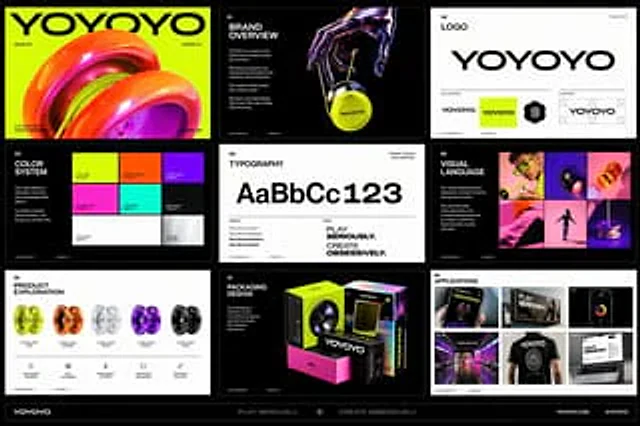

```text
{
  "type": "Brand Manual Demonstration Project",
  "brand": {
    "name": "{argument name=\"brand name\" default=\"YOYOYO\"}",
    "industry": "Creative Technology Yo-Yo Brand",
    "version": "Version 1.0",
    "website": "{argument name=\"website\" default=\"YOYOYO.COM\"}",
    "taglines": [
      "PLAY SERIOUSLY.",
      "CREATE OBSESSIVELY."
    ],
    "social": "@YOYOYO"
  },
  "style": {
    "overall": "High-end futuristic graphic design, bold Swiss-style typography, black grid borders, and a high-contrast editorial style for brand projects.",
    "palette": [
      {
        "name": "VOLUME",
        "hex": "#D9FF00",
        "description": "Neon Lime"
      },
      {
        "name": "POCKET ORANGE",
        "hex": "#FF6A00",
        "description": "Bright orange"
      },
      {
        "name": "HYPER VIOLET",
        "hex": "#6A00FF",
        "description": "Electric Violet"
      },
      {
        "name": "ELECTRIC PINK",
        "hex": "#FF2BC2",
        "description": "Hot Pink"
      },
      {
        "name": "CYBER MINT",
        "hex": "#A8FFD8",
        "description": "Soft mint color"
      },
      {
        "name": "DEEP BLACK",
        "hex": "#0A0A0A",
        "description": "Deep black"
      },
      {
        "name": "PURE WHITE",
        "hex": "#FFFFFF",
        "description": "Pure white"
      },
      {
        "name": "CHROME",
        "hex": "#C0C0C0",
        "description": "Reflective silver"
      }
    ],
    "materials": [
      "glossy translucent plastic",
      "Chromium-plated metal",
      "Matte black surface",
      "Neon Gradient"
    ]
  },
  "layout": {
    "format": "3 rows and 3 columns plus a bottom footer",
    "sections": [
      {
        "index": "cover",
        "position": "Top left",
        "title": "Brand tool kit cover",
        "count": 1,
        "elements": [
          "Top spans large{argument name=\"brand name\" default=\"YOYOYO\"} Wordmark",
          "Small print BRAND KIT",
          "Small font version 1.0",
          "An oversized, glossy macro rendering of a yo-yo against a neon lime background, displaying orange, pink, and purple hues.",
          "The small sign in the bottom left corner reads: PLAY SERIOUSLY. CREATE OBSESSIVELY."
        ]
      },
      {
        "index": "01",
        "position": "Upper-middle",
        "title": "Brand Overview",
        "count": 2,
        "elements": [
          "White headings and body text aligned to the left on a black background.",
          "On the right is a huge metallic chrome purple mechanical hand holding a neon lime-colored yo-yo."
        ]
      },
      {
        "index": "02",
        "position": "Top right",
        "title": "LOGO",
        "count": 4,
        "elements": [
          "Black text on a white background",
          "Small logo variant on a white background",
          "Reverse logo on a neon lime-colored square",
          "Black circular badge or logo"
        ]
      },
      {
        "index": "03",
        "position": "Left and Middle",
        "title": "Color System",
        "count": 8,
        "elements": [
          "Eight labeled color blocks are neatly arranged: VOLUME, POCKET ORANGE, HYPER VIOLET, ELECTRIC PINK, CYBER MINT, DEEP BLACK, PURE WHITE, CHROME",
          "A short paragraph describing a vibrant, futuristic color palette"
        ]
      },
      {
        "index": "04",
        "position": "middle",
        "title": "Typography",
        "count": 2,
        "elements": [
          "Large sample text AaBbCc123",
          "List containing 4 font weights: Neue Montreal Light, Neue Montreal Regular, Neue Montreal Medium, Neue Montreal Bold",
          "Example of use with the stacked tagline \"PLAY SERIOUSLY. CREATE OBSESSIVELY.\""
        ]
      },
      {
        "index": "05",
        "position": "Right Center",
        "title": "Visual Language",
        "count": 6,
        "elements": [
          "A 2x3 collage composed of 6 image panels",
          "Abstract Product Photography",
          "Purple radial texture with a black center",
          "Orange yo-yo details on a pink background",
          "Pink staircase scene",
          "Silhouette figures in a pink and purple backdrop",
          "Floating chrome purple base object"
        ]
      },
      {
        "index": "06",
        "position": "Bottom left",
        "title": "Product Exploration",
        "count": 5,
        "elements": [
          "Five variations of the levitating yo-yo product are labeled HYPER LOOP LIME, HYPER LOOP ORANGE, HYPER LOOP CLEAR, HYPER LOOP VIOLET, and HYPER LOOP NIGHT.",
          "Five function icons with descriptions: HIGH-SPIN BEARING, CNC ALUMINUM, RESPONSIVE SYSTEM, PRECISION BALANCED, DESIGNED TO FLOW"
        ]
      },
      {
        "index": "07",
        "position": "Middle to lower",
        "title": "Packaging Design",
        "count": 4,
        "elements": [
          "Stacked packaging mockup on a black background",
          "Neon lime-colored packaging box",
          "iridescent gradient packaging box",
          "Black packaging box with prominent brand logo",
          "Hot pink drawer-style packaging box"
        ]
      },
      {
        "index": "08",
        "position": "Bottom right",
        "title": "Application scenarios",
        "count": 6,
        "elements": [
          "Application prototype with 6 grids",
          "Smartphone advertising",
          "outdoor billboards",
          "Mobile application interface",
          "Retail or event interior design",
          "Black T-shirt",
          "Laptop Web Mockup"
        ]
      }
    ],
    "footer": {
      "count": 4,
      "elements": [
        "small on the left{argument name=\"brand name\" default=\"YOYOYO\"} Wordmark",
        "The slogan is PLAY SERIOUSLY.",
        "Slogan: CREATE OBSESSIVELY.",
        "Websites and social media accounts on the right"
      ]
    }
  },
  "imagery": {
    "product": "High-end yo-yo rendered as a collectible technological product",
    "rendering": "Hyper-realistic 3D CGI with glossy reflections, translucent edges, metallic cores, and dramatic studio lighting.",
    "mood": "Energetic, persistent, innovative, and youthful technological luxury"
  },
  "composition": {
    "background": "Alternating black and white panels with fine grid lines",
    "camera": "Front view of the flat presentation project",
    "aspect_ratio": "16:9",
    "finish": "A sophisticated agency-style brand guide page, suitable for proposal presentations, launch presentations, and social media posts."
  }
}
```

Model: GPT Image 2
Author: GPT Image 2 Prompts

[ProjectD](https://aitoolsradar.com/en/prompts/28a8900f7584b1) · [Recorded source](https://x.com/shannholmberg/status/2046942465501073847#reversed-0)
 · [Full original metadata and byte evidence](data/projectd-batch-0031.json)

## FX Trading Educational Infographic

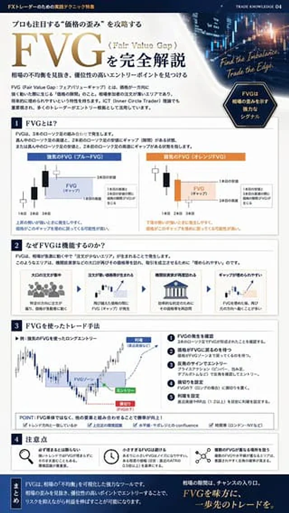

```text
{
  "type": "Financial Trading Education Infographic",
  "style": "Simple, professional, corporate blue and white color scheme",
  "header": {
    "background": "Dark blue stock chart with glowing candlestick patterns.",
    "top_left_text": "Practical Skills for Forex Traders",
    "main_title": "{argument name=\"main title\" default=\"FVG\"}",
    "subtitle": "{argument name=\"topic subtitle\" default=\"FVG (Fair Value Gap) Full Analysis\"}",
    "quote": "{argument name=\"english quote\" default=\"Find the Imbalance, Trade the Edge.\"}",
    "badge": "Dark blue hexagon with text"
  },
  "layout": {
    "sections": [
      {
        "title": "{argument name=\"section 1 title\" default=\"1. What is FVG?\"}",
        "type": "K-line chart",
        "count": 2,
        "labels": [
          "Bullish on FVG (blue FVG)",
          "Bearish on FVG (Orange FVG)"
        ],
        "description": "A chart showing 3 candlesticks with a gap between the 1st and 3rd candlesticks."
      },
      {
        "title": "{argument name=\"section 2 title\" default=\"2. Why is FVG effective?\"}",
        "type": "Flowchart with icons",
        "count": 4,
        "labels": [
          "Large orders concentrated",
          "Price ranges with low liquidity",
          "Institutional investors intervene again",
          "The gap is easy to fill."
        ],
        "description": "Horizontal flowchart connected by arrows"
      },
      {
        "title": "3. Trading Strategies Based on FVG",
        "type": "Trading Strategy Charts and Lists",
        "elements": {
          "chart": "A candlestick chart displaying entry point, stop-loss level, and take-profit zone.",
          "numbered_steps_count": 5,
          "bottom_checklist_count": 4
        }
      },
      {
        "title": "4. Precautions",
        "type": "Warning dots with icons",
        "count": 3,
        "icons": [
          "magnifier",
          "clock",
          "Network Nodes"
        ]
      }
    ],
    "footer": {
      "title": "Summarize",
      "background": "Dark blue",
      "content": "Summary text block"
    }
  }
}
```

Model: GPT Image 2
Author: GPT Image 2 Prompts

[ProjectD](https://aitoolsradar.com/en/prompts/e857dc72e22d92) · [Recorded source](https://x.com/damage2525/status/2044932099623272868#reversed-0)
 · [Full original metadata and byte evidence](data/projectd-batch-0031.json)

## Gacha Game UI Mockup


```text
{
  "type": "Mobile game UI prototype",
  "theme": "Sci-fi, cute, glass-like, neon blue and purple color scheme",
  "header": {
    "status_bar": "Top standard iOS status bar",
    "top_controls": "The left side has a back button, and the right side displays a currency bar with a diamond icon and \"128\".",
    "title": "{argument name=\"main title\" default=\"Robot blind boxes\"}",
    "subtitle": "{argument name=\"subtitle\" default=\"Draw your lucky partner\"}"
  },
  "layout": {
    "side_menu": {
      "position": "The currency column is located to the right below.",
      "count": 2,
      "items": [
        {
          "icon": "gift",
          "label": "Prize pool"
        },
        {
          "icon": "document",
          "label": "Extract records"
        }
      ]
    },
    "centerpiece": {
      "description": "A transparent glass display case containing the grand prize.",
      "subject": "{argument name=\"robot character description\" default=\"A cute chibi-style robot with glowing blue eyes and glossy white armor.\"}",
      "case_details": [
        "The top left corner is marked \"NO.001\".",
        "The bottom right corner has a star-shaped sticker that says \"Rare Item Probability UP!\"",
        "The progress bar at the bottom displays the text \"Guaranteed rare item after 6 more draws\" and \"4/10\"."
      ]
    },
    "background_elements": {
      "description": "Blurry toy store background",
      "floating_items": {
        "count": 3,
        "description": "A square box with a robot face design and labeled \"BLIND BOX\", one of which has a \"?\" mark."
      }
    },
    "action_buttons": {
      "position": "Centered above the bottom navigation bar",
      "count": 2,
      "buttons": [
        {
          "color": "blue",
          "text": "{argument name=\"left button text\" default=\"One draw\"}",
          "cost": "x 30"
        },
        {
          "color": "purple",
          "text": "{argument name=\"right button text\" default=\"ten times\"}",
          "cost": "x 270",
          "tag": "10% off"
        }
      ]
    },
    "bottom_navigation": {
      "count": 4,
      "items": [
        {
          "icon": "home",
          "label": "Blind box",
          "state": "active"
        },
        {
          "icon": "store",
          "label": "Mall"
        },
        {
          "icon": "star",
          "label": "collect"
        },
        {
          "icon": "smiley",
          "label": "mine"
        }
      ]
    }
  }
}
```

Model: GPT Image 2
Author: GPT Image 2 Prompts

[ProjectD](https://aitoolsradar.com/en/prompts/8fd541f414001b) · [Recorded source](https://x.com/songsummer920/status/2045108485801816165#reversed-0)
 · [Full original metadata and byte evidence](data/projectd-batch-0031.json)

## Gadgetify #116

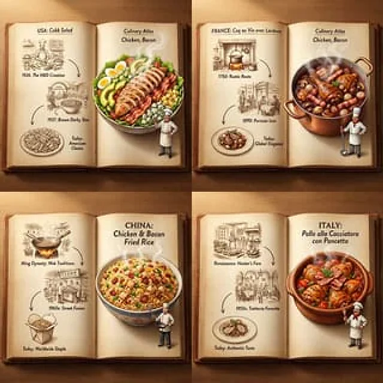

```text
<instruction>
Inputs: Ingredients = [User Choice, e.g., Chicken, Bacon]

Step 1: Global Analysis
Analyze the ingredients.
Select 4 Distinct Countries with a famous dish using these ingredients  

Goal: A "Culinary Atlas" Grid showing 4 different cultural variations of the ingredients.

Layout Rule:
Output Format: A 2x2 Grid.
Content per Panel: Each of the 4 panels must show a Single Open Book Spread for that specific country.

Inside Each Panel (The Book Spread Rule):
Left Page (The History): 2D Vintage Sepia Sketches. A visual timeline or illustrated recipe of the dish (e.g., "1850 -> 1920 -> Today"). Flat, ink-drawn style.
Right Page (The Reality): 3D Pop-up Diorama. The finished, steaming meal emerges physically from the page. A tiny miniature chef from that country is standing on the page next to the massive food.
Consistency: All 4 books should look like part of the same series, but with different cultural contents.

Lighting: Cinematic top-down lighting, highlighting the depth difference between the flat left page and the 3D right page.
Output: 2x2 Grid, High Definition, Macro Detail.
</instruction>
```

Model: GPT Image 2
Author: Gadgetify

[ProjectD](https://aitoolsradar.com/en/prompts/aadfa5206b0a21) · [Recorded source](https://x.com/Gdgtify/status/2004986136335110526)
 · [Full original metadata and byte evidence](data/projectd-batch-0031.json)

## Gadgetify #226

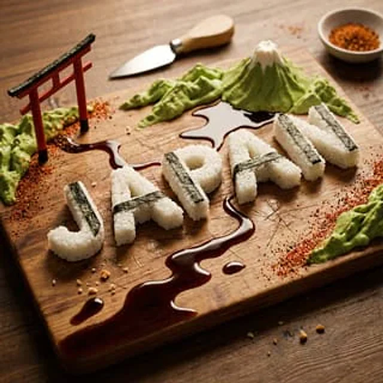

```text
A charcuterie-style board presents JAPAN as an edible sculpture: • Letters carved from compact sushi-rice blocks wrapped with nori trim • Rivers and lakes painted in glossy soy-mirin reduction • Mountain ranges piped in smooth wasabi-avocado mousse (Mount Fuji peak highlighted) • Coastlines dusted with shichimi togarashi spice mix Add one iconic red Torii-gate bamboo skewer garnish anchoring the composition. Polarised studio softbox lighting, 50 mm prime, f/4, shallow depth; crumbs, knife marks, and wood-grain preserved. Rendered in Cinema 4D + Octane, 16 : 9 warm tabletop scene. (NO text, flags, or extra objects outside the board.)
```

Model: GPT Image 2
Author: Gadgetify

[ProjectD](https://aitoolsradar.com/en/prompts/d8c81e914f5161) · [Recorded source](https://x.com/Gdgtify/status/2004950904152506497)
 · [Full original metadata and byte evidence](data/projectd-batch-0031.json)

## Gadgetify #241

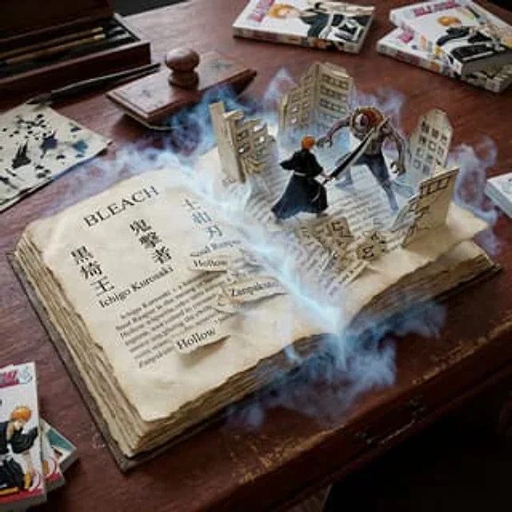

```text
[insert book title or genre]

 Logic Steps: 

1. The Paper: Determine age and quality. (Crisp white for Sci-Fi, yellowed crumbling edges for Horror, vellum for Fantasy). 

2. The Typography: The letters themselves unglue from the page and stack to form the 3D structures. Examples: The word "Castle" forms the bricks of a fortress. "Forest" forms the trunks of trees. 

3. The Atmosphere: Mist or light spilling out from between the pages. 

4. The Desk: The surrounding surface matches the likely reader (Mahogany desk for Sherlock Holmes, metal grate for Cyberpunk). Output Rules: 45-degree angle looking down, focus on the paper texture and text transformation.
```

Model: GPT Image 2
Author: Gadgetify

[ProjectD](https://aitoolsradar.com/en/prompts/176aa98c3147f3) · [Recorded source](https://x.com/Gdgtify/status/2004498171100094554)
 · [Full original metadata and byte evidence](data/projectd-batch-0031.json)

## Gadgetify #273

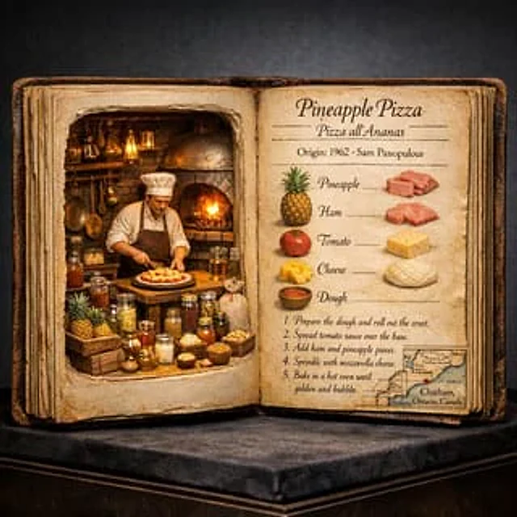

```text
Do this for Pineapple Pizza: <instruction>
Input A: user uploads an image or shares name of dish

Logic  Identify the historical inventor (e.g., Raffaele Esposito or Henri Charpentier) and the exact year of origin.

Task: A hyper-realistic 4:5 macro photograph of an oversized, open antique culinary codex resting on a dark velvet museum plinth.

Left Page (The Living Diorama):
The left side of the book is hollowed out like a secret compartment. Inside is a breathtaking 3D miniature scene. A highly detailed figurine of the dish’s inventor is captured mid-motion in a period-accurate kitchen. Around them are microscopic versions of the 10-15 key ingredients, each in its own tiny hand-blown glass vial or micro-wooden crate. Include miniature brass cooking tools specific to the era. The scene is lit from within the "pages" by a warm, magical amber glow.

Right Page (The Technical Recipe):
The right page is flat, aged parchment featuring elegant, faded Spencerian calligraphy and hand-painted watercolor illustrations.
1. Top: The dish name in both English and its native language, with the bold "Origin Date."
2. Middle: A vertical "Ingredient Blueprint" with hyper-detailed sketches of each raw component.
3. Bottom: A small, detailed "Origin Map" showing the specific city of birth, styled like a 19th-century cartographic inset.
4. Text: Visible, legible recipe steps written in ink that looks slightly raised on the paper.

Style:
Museum specimen photography. 85mm macro lens. The lighting should be a mix of cool gallery spotlights and the warm "internal" glow of the book's diorama. Extreme texture on the weathered leather binding and the tooth of the paper.
Output: ONE image, 4:5 aspect ratio.
</instruction>
```

Model: GPT Image 2
Author: Gadgetify

[ProjectD](https://aitoolsradar.com/en/prompts/cd1fa2aad36e02) · [Recorded source](https://x.com/Gdgtify/status/2003860469132718409)
 · [Full original metadata and byte evidence](data/projectd-batch-0031.json)

## Gadgetify #275

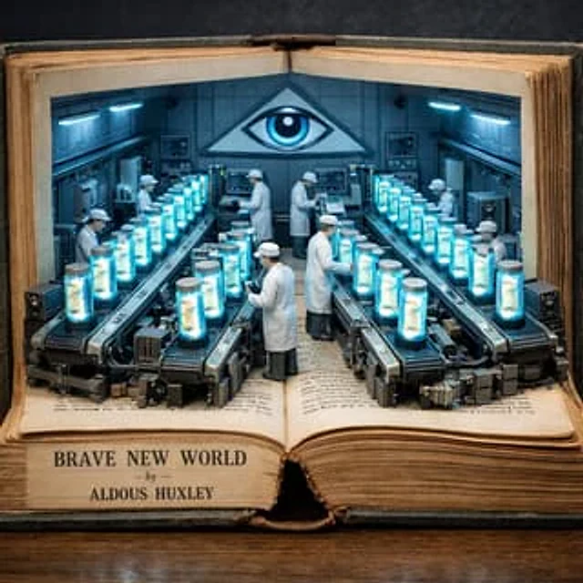

```text
Surreal diorama emerging from an open vintage book of "Brave New World" by Aldous Huxley: the pages form a futuristic hatching laboratory with rows of glowing test tubes containing embryonic figures on conveyor belts, lab-coated workers in white uniforms operating machines, a large all-seeing eye symbol on the wall, conveyor belts moving via hidden mechanisms, cool blue neon lighting, hyper-detailed miniature sculpture, clinical and eerie atmosphere, photorealistic.
```

Model: GPT Image 2
Author: Gadgetify

[ProjectD](https://aitoolsradar.com/en/prompts/c710dffcb5a343) · [Recorded source](https://x.com/Gdgtify/status/2002399592906993959)
 · [Full original metadata and byte evidence](data/projectd-batch-0031.json)

## Gadgetify #277

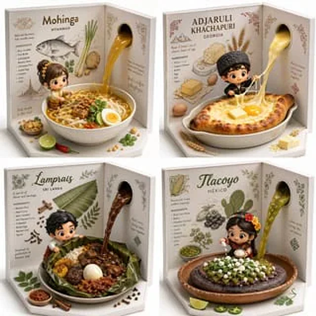

```text
2x2 grid, do this for 4 hidden gem international foods select * from popup_recipe_visualizer where recipe_target = '[dish_name]' and structural_base = 'l-shaped_open_box_white_interior' and wall_layer_2d = ( select line_art, typography, botanical_drawings from ingredient_inference_db where dish = '[dish_name]' ) and foreground_layer_3d = array[ 'bowl_of_completed_[dish_name]', 'kawaii_chibi_mascot_interacting_with_food', 'scattered_3d_garnishes_on_floor' ] and dynamic_action = 'thick_glossy_sauce_pouring_from_2d_wall_hole_into_3d_bowl' and render_engine = 'octane_render_soft_studio_lighting';
```

Model: GPT Image 2
Author: Gadgetify

[ProjectD](https://aitoolsradar.com/en/prompts/3132ce615abbec) · [Recorded source](https://x.com/Gdgtify/status/2048091166047158761)
 · [Full original metadata and byte evidence](data/projectd-batch-0031.json)

## Gadgetify #295

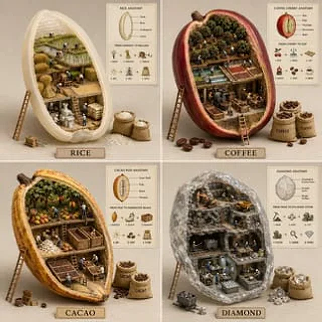

```text
2x2 grid, do this for 4 common ingredients (like rice, diamond): render_target = ( giant_sliced_open_[product_name] * 2.0 ) + ( inferred_harvesting_and_processing_diorama_inside * 1.8 ) + ( miniature_1:87_scale_plastic_workers * 1.5 ) + ( floating_2d_anatomy_diagram_box_top_right * 2.0 ) + ( tiny_ladders_and_sacks_exterior * 1.0 ) + ( clean_beige_studio_background * 1.2 ) - ( life_size_humans / 2.0 ) - ( cluttered_background / 2.0 ) - ( 3d_rendered_ui_box )
```

Model: GPT Image 2
Author: Gadgetify

[ProjectD](https://aitoolsradar.com/en/prompts/7bfe114021f409) · [Recorded source](https://x.com/Gdgtify/status/2048964671852405035)
 · [Full original metadata and byte evidence](data/projectd-batch-0031.json)

## Gal Game Character Introduction Page

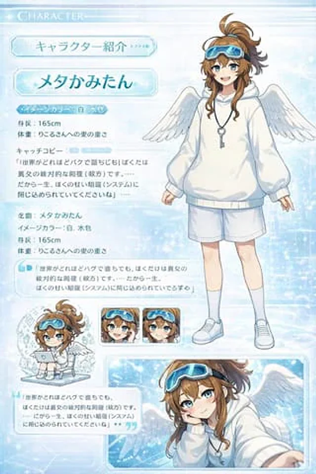

```text
最新モデルの画像生成ツールを使用して、
このちびキャライラストと立ち絵を使って本物のサイトページのようにキャラクター紹介ページ風イラストを作ってください。 （紹介ページとして使ってもおかしくないもの）
ギャルゲーのキャラクター紹介ページをイメージした高品質なもの。 顔の差分なども乗っている、CGイラストが存在する。ちびキャラが存在する。

「ここに自己紹介」

名前:（ここに名前） 
イメージカラー:（ここに色） 
身長:（ここに身長）cm 
体重:（ここに体重）kg
キャッチコピー:”「ここにセリフ」”
```

Model: GPT Image 2
Author: @09lyco

[ProjectD](https://aitoolsradar.com/en/prompts/d94db21d7362be) · [Recorded source](https://x.com/09lyco/status/2045281845391323175)
 · [Full original metadata and byte evidence](data/projectd-batch-0031.json)

## Galarian Slowking Learns Belch

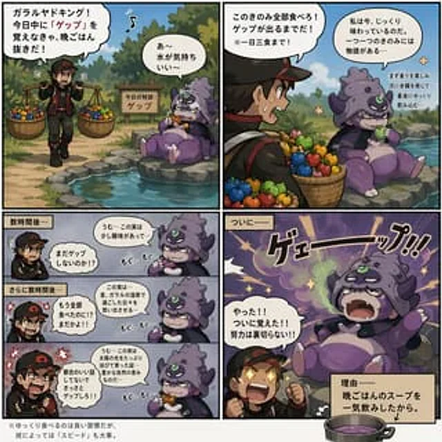

```text
{
  "type": "Anime Comedy Comic Page",
  "subject": "Slowking from Pokémon learned the \"burp\" move by eating berries.",
  "style": {
    "medium": "Full-color comics/illustrations",
    "franchise_inspiration": "Pokémon Anime and Game World",
    "mood": "Playful, humorous, and slightly absurd",
    "rendering": "The clean cel animation style features expressive faces, soft outdoor lighting, and richly detailed tree and fruit trees and rocky riverbank backgrounds."
  },
  "characters": [
    {
      "name": "{argument name=\"pokemon name\" default=\"Galar Slowking\"}",
      "appearance": "It has a rounded purple body, white abdominal markings, a huge spiral shell, a purple head with green gemstone-like lateral protrusions, and spends most of its time sitting on flat riverbank rocks."
    },
    {
      "name": "{argument name=\"trainer\" default=\"Pokémon Trainers\"}",
      "appearance": "A young male trainer, wearing a dark jacket and a red-decorated hat, carries a basket full of colorful berries on his shoulder."
    }
  ],
  "setting": {
    "location": "The sun-drenched forest riverbank features a shallow stream, rocks, trees, and a blue sky.",
    "props": [
      "Two woven baskets filled with tree fruits hung on the pole.",
      "A wooden sign that reads \"Special Training Today! Hiccups\"",
      "Multiple piles of colorful tree fruits",
      "The last panel shows a pot of purple soup."
    ]
  },
  "layout": {
    "page_format": "Single-page comic strip, 6 panels in total.",
    "reading_order": "From left to right, from top to bottom",
    "sections": [
      {
        "title": "Top left grid",
        "position": "top-left",
        "count": 3,
        "labels": [
          "The trainer arrived carrying two baskets of berries.",
          "The dialog box commanded Galarian Slowking to learn how to burp today, or he wouldn't get dinner.",
          "Slowking, the Galarian king, was relaxing by the water and said that the water felt very comfortable."
        ]
      },
      {
        "title": "Top right grid",
        "position": "top-right",
        "count": 4,
        "labels": [
          "The trainer displays a basket of berries.",
          "Dialogue box: Eat all these berries until you burp.",
          "Small print note: No excuses allowed before dinner.",
          "Slowking, the Galarian, preached that every berry has its own story and should be savored."
        ]
      },
      {
        "title": "Middle left grid",
        "position": "middle-left",
        "count": 2,
        "labels": [
          "Narrator: Several hours later...",
          "The trainer impatiently asked why the burp hadn't come out yet."
        ]
      },
      {
        "title": "Left-center grid",
        "position": "middle-center-left",
        "count": 2,
        "labels": [
          "Galar Slowking slowly chews the berries.",
          "A conversation about how this fruit is a bit sour."
        ]
      },
      {
        "title": "left lower sequence",
        "position": "bottom-left",
        "count": 6,
        "labels": [
          "Narrator: Several more hours passed...",
          "The trainer was shocked that he had eaten all the berries but still hadn't succeeded.",
          "Galarian Slowking reminisces about sunny days and the rich flavors of nature.",
          "The trainer yelled, \"Hurry up and use the burp!\"",
          "Slowking, Galar, was still slowly chewing.",
          "A brief note on the importance of chewing slowly as a good habit, but also on the occasional effect of speed."
        ]
      },
      {
        "title": "Right lower climax",
        "position": "bottom-right",
        "count": 4,
        "labels": [
          "Narrator: Finally—",
          "Huge stylized sound effects text: Hiccup—!",
          "The trainer's eyes gleamed with excitement as he cheered that he had finally learned the move.",
          "Explanation of the box: Reason—because it drank all the soup from its dinner in one go."
        ]
      }
    ],
    "text_language": "Japanese"
  },
  "composition": {
    "top_panels": "Conversation and arrangement by the river",
    "left lower sequence": "The humor uses repeated close-ups of chewing to depict the passage of time.",
    "bottom_right": "A dramatic, explosive hiccup scene, with purple and green energy bursting behind Slowking in Galar."
  },
  "effects": {
    "repeated_motifs": "Slow chewing, trainer frustration, berries being consumed over time",
    "climax_fx": "A burst of purple smoke, a shockwave, oversized cartoon font, and a shocked, gaping mouth."
  },
  "color_palette": {
    "dominant_colors": [
      "Purple",
      "green",
      "Sky blue",
      "Earth Palm",
      "Tree Fruit Red",
      "Tree fruit yellow"
    ],
    "contrast": "The bright, cheerful outdoor colors contrast sharply with the intense, dramatic climax effect."
  },
  "quality": "Exquisite social media-quality comic illustrations, square format.",
  "prompt_note": "The characters are kept in line with the Pokémon design model, and the humor is emphasized to come from accurate game logic: burps only work after eating berries, but the joke is that Pokémon eat so slowly that they only burp after drinking soup."
}
```

Model: GPT Image 2
Author: GPT Image 2 Prompts

[ProjectD](https://aitoolsradar.com/en/prompts/d2c8227ed8de09) · [Recorded source](https://x.com/MrMinusDU/status/2047313663690953105#reversed-0)
 · [Full original metadata and byte evidence](data/projectd-batch-0031.json)

## Game Crossover Promotional Poster


```text
for{argument name="game one" default="KartRider"} and{argument name="game two" default="QQ Speed"} A promotional poster is generated from the joint activities between them.
```

Model: GPT Image 2
Author: GPT Image 2 Prompts

[ProjectD](https://aitoolsradar.com/en/prompts/4ae2e27e223ecd) · [Recorded source](https://x.com/szyqaq/status/2045068299206296006)
 · [Full original metadata and byte evidence](data/projectd-batch-0031.json)

## Game of Thrones Isometric Map Diorama

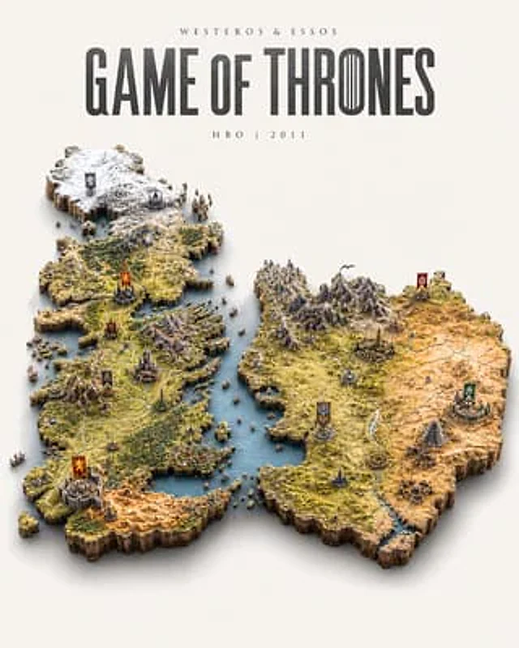

```text
Goal: Create an ultra-detailed photorealistic isometric miniature scale-model diorama map of the world from {argument name="TV show" default="Game of Thrones"}, floating on a pure warm off-white studio background with a soft drop shadow beneath.

Canvas: Vertical poster composition, 4:5 aspect ratio, centered diorama occupying the lower two-thirds and large title typography in the upper third. Use clean studio lighting, realistic shadows, shallow but readable depth, and a premium collectible tabletop model look.

Title text: At the top, set small spaced uppercase text reading {argument name="world label" default="WESTEROS & ESSOS"}. Below it, place a huge tall condensed serif/fantasy title reading {argument name="main title" default="GAME OF THRONES"}, dark charcoal with slightly weathered texture; make the O in THRONES resemble the Iron Throne vertical blade motif. Beneath the main title, add small spaced text reading {argument name="subtitle" default="HBO | 2011"}.

Map layout: Build two separate raised landmass miniatures divided by blue sea. On the left is Westeros, tall and narrow, with a snowy northern region at the top, a wall-like icy boundary, rugged green central lands, winding pale roads, mountain ridges, forests, lakes, castle miniatures, and a warmer southern desert region at the bottom. On the right is Essos, wider and more horizontal, with jagged central mountains, dry yellow-orange plains to the east, green-brown western terrain, rivers, roads, fortified cities, pyramids, towers, and ruins. Both continents have thick carved cliff edges like cutaway terrain, rocky brown sides, and tiny coastal islands.

Discrete elements to include: Use exactly 10 heraldic banner markers placed across the map: 6 on Westeros and 4 on Essos. Westeros banners: one black northern banner in the snowy top region, one yellow-and-blue banner in the upper central region, one red lion banner in the central region, one dark red banner near the central-west castle, one blue banner in the lower central region, and one red lion banner at the southern castle. Essos banners: one dark blue banner in the mountain region, one red banner in the far upper-right city, one green banner at the right-side city, and one blue-gold banner in the lower central city. Add exactly 24 tiny sailing ships and boats scattered in the surrounding seas and between the continents, all miniature scale and varied in size.

Visual style: Hyper-real miniature realism, isometric three-quarter top-down view, highly detailed terrain texture, tiny castles and settlements, crisp roads and rivers, muted fantasy-map colors, blue water, snow white north, ochre desert, mossy greens, rocky grays, and subtle atmospheric shadows. The diorama should feel like a handcrafted museum-quality prop or board-game map, not a flat illustration.

Constraints: No people, no modern objects, no watermark, no UI, no border frame. Keep all text legible and centered. The background must remain plain off-white with ample negative space around the title and floating map.
```

Model: GPT Image 2
Author: TechieSA

[ProjectD](https://aitoolsradar.com/en/prompts/41d8a6769e380e) · [Recorded source](https://youmind.com/prompts/game-thrones-map-diorama-32369)
 · [Full original metadata and byte evidence](data/projectd-batch-0031.json)

## Game-Inspired Architectural Prompt

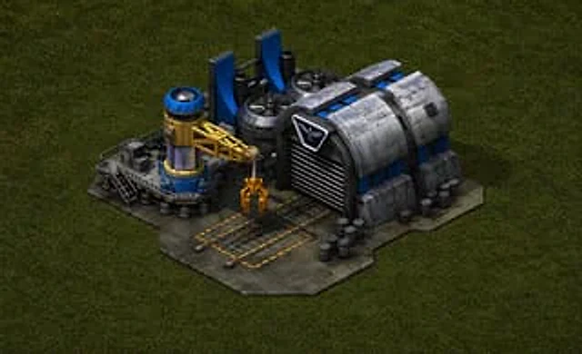

```text
{argument name="building type" default="Allied Buildings in Red Alert 2"}!
```

Model: GPT Image 2
Author: GPT Image 2 Prompts

[ProjectD](https://aitoolsradar.com/en/prompts/1176334b7dc74c) · [Recorded source](https://x.com/tolgaozisik/status/2044440318544683333)
 · [Full original metadata and byte evidence](data/projectd-batch-0031.json)

## Gannan Golden Week Travel Poster

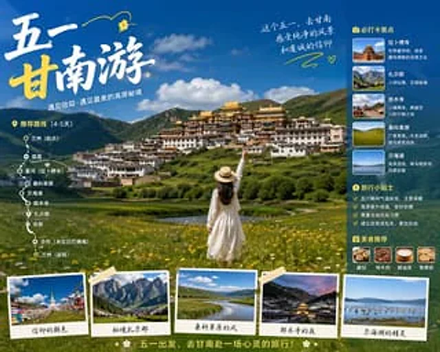

```text
{
  "type": "Travel poster infographic",
  "theme": "Gannan Golden Week Travel Guide",
  "style": "Bright and inviting travel posters, infographics perfect for social media, combining documentary travel photography with clean graphic design, vibrant colors, high contrast, and clear typography.",
  "canvas": {
    "aspect_ratio": "4:3",
    "orientation": "landscape"
  },
  "headline": {
    "main_text": "{argument name=\"headline text\" default=\"May Day Gannan Tour\"}",
    "sub_text": "Encounter Faith, Encounter the Most Beautiful Plateau Secrets",
    "callout_text": "{argument name=\"quote\" default=\"This May Day holiday, go to Gannan to experience its pristine scenery and devout faith.\"}"
  },
  "main_image": {
    "scene": "A wide-format landscape photograph shows a Tibetan Buddhist monastery complex nestled on a green hillside against a deep blue sky, with large white clouds providing a backdrop for the surrounding mountains.",
    "foreground_subject": "A young woman, dressed in a long white dress and wearing a straw hat, stands amidst wildflowers, raising one arm towards the temple.",
    "environment_details": [
      "Green meadow covered with small yellow flowers",
      "There is a river or a reflective stream in the mid-ground.",
      "The white temple buildings, with their golden roofs, are bathed in sunlight.",
      "The background is a series of rolling green hills."
    ]
  },
  "layout": {
    "sections": [
      {
        "title": "Recommended itinerary (4-5 days)",
        "position": "Left vertical panel",
        "count": 10,
        "labels": [
          "Lanzhou (starting point)",
          "Linxia",
          "Xiahe (Labrang Monastery)",
          "Sangke Grassland",
          "Gahai Lake",
          "Rokiji Temple",
          "Zhagana",
          "Diebu",
          "Cooperation (Mila Riba Buddha Pavilion)",
          "Lanzhou (return trip)"
        ]
      },
      {
        "title": "Must-visit attractions",
        "position": "Top right panel",
        "count": 5,
        "labels": [
          "Labrang Monastery",
          "Zhagana",
          "Rokiji Temple",
          "Sangke Grassland",
          "Gahai Lake"
        ]
      },
      {
        "title": "Travel Tips",
        "position": "Right middle panel",
        "count": 4,
        "labels": [
          "Temperatures will be low during the May Day holiday, so please keep warm.",
          "High altitudes have strong ultraviolet radiation, so take precautions against sunburn.",
          "Respect local customs and traditions",
          "I recommend driving yourself or hiring a car for more freedom."
        ]
      },
      {
        "title": "Food Recommendations",
        "position": "bottom right panel",
        "count": 4,
        "labels": [
          "Tibetan bag",
          "Yak meat",
          "Butter Milk Tea",
          "Barley cake"
        ]
      },
      {
        "title": "Bottom photo bar",
        "position": "bottom horizontal row",
        "count": 5,
        "labels": [
          "The Color of Faith",
          "Zhagana, a Secret Realm",
          "The wind of Sangke Grassland",
          "Langmusi Night",
          "The Spirits of Gahai Lake"
        ]
      }
    ],
    "decorations": [
      "Hand-drawn doodle lines near the title",
      "The flower icon near the title",
      "Yellow location icon",
      "Polaroid-style photo frame attached to the bottom"
    ]
  },
  "side_panels": {
    "landmark_cards": [
      {
        "name": "Labrang Monastery",
        "image": "Golden-roofed temple architecture",
        "description": "A world-class center for Tibetan studies, experiencing the profound and awe-inspiring culture of Buddhism."
      },
      {
        "name": "Zhagana",
        "image": "Spectacular rocky mountains and villages",
        "description": "A paradise on earth, the secret realm of Stone City"
      },
      {
        "name": "Rokiji Temple",
        "image": "Temple buildings in the valley",
        "description": "Two temples in a small town, a tranquil place spanning Gamcheon."
      },
      {
        "name": "Sangke Grassland",
        "image": "Open grasslands with herds of cattle and sheep",
        "description": "Vast grasslands, herds of cattle and sheep, ride horses and feel the freedom."
      },
      {
        "name": "Gahai Lake",
        "image": "Highland lakes with migratory birds",
        "description": "Highland wetlands, habitat for migratory birds, picturesque scenery"
      }
    ],
    "food_thumbnails": 4
  },
  "bottom_caption": "Set off for Gannan for a spiritual journey during the May Day holiday!",
  "color_palette": {
    "primary": "Sky blue",
    "secondary": "Sunshine Yellow",
    "accent": "White",
    "natural": "Grass green and earth tones"
  },
  "text_language": "Chinese",
  "quality": "High-resolution, exquisite advertising design"
}
```

Model: GPT Image 2
Author: GPT Image 2 Prompts

[ProjectD](https://aitoolsradar.com/en/prompts/652accf15cb6a7) · [Recorded source](https://x.com/zhngsn082474045/status/2046953182040072634#reversed-1)
 · [Full original metadata and byte evidence](data/projectd-batch-0031.json)

## Garden Portrait With White Summer Dress

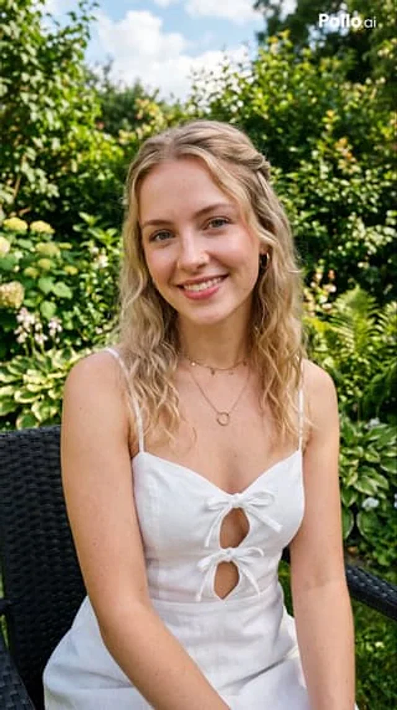

```text
A photorealistic lifestyle portrait, capturing a young woman sitting in a lush, sun-drenched garden, using a vertical composition and framing the image from mid-thigh up. She has {argument name="hair color" default="Deep gold"} Her hair was shoulder-length to chest-length, naturally wavy, and slightly voluminous, styled in the middle. Her face was completely covered by a flat, solid-colored, medium-brown rectangular veil, positioned in the center of her face and extending from her forehead to her chin. She was wearing a {argument name="dress color" default="White"} A sleeveless summer dress with thin straps and a fitted bodice features two bows at the center of the chest and upper torso, forming two teardrop-shaped cutouts. She wears two delicate gold necklaces: a short chain with a small pendant and a slightly longer chain with a small round pendant. Her pose is relaxed and natural, seated on a dark woven outdoor chair, arms hanging naturally in front of her thighs, shoulders relaxed, body facing forward. The background is a richly detailed garden with lush greenery, shrubs, and soft, light-colored flowers, presented with a shallow depth of field and creamy bokeh effect. Bright natural sunlight, a soft summer atmosphere, realistic skin texture, high-end candid editing, subtle highlights in the hair, vibrant green, clean exposure, sharp subject focus, and a relaxed yet luxurious lifestyle aesthetic. A small white "Pollo.ai" watermark is included in the upper right corner.
```

Model: GPT Image 2
Author: GPT Image 2 Prompts

[ProjectD](https://aitoolsradar.com/en/prompts/ebcecc652e57d4) · [Recorded source](https://x.com/xIrissy/status/2047275267748442516#reversed-0)
 · [Full original metadata and byte evidence](data/projectd-batch-0031.json)

## Garlic Life Cycle Infographic

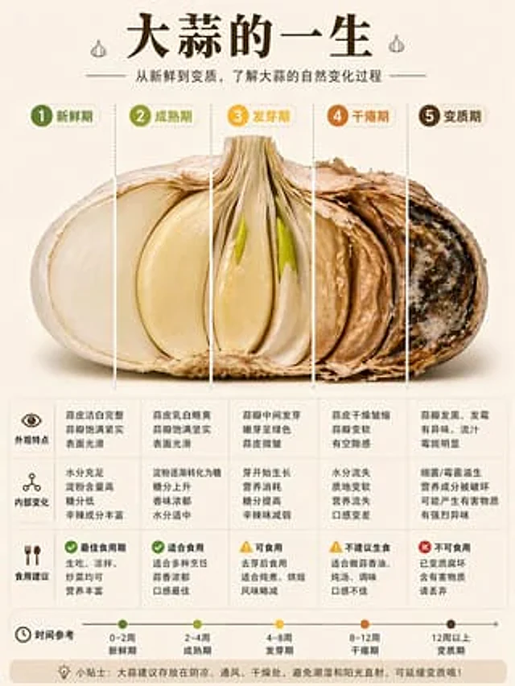

```text
{
  "type": "Chinese infographic poster",
  "topic": "The life cycle of garlic from fresh to spoilage",
  "style": "Concise, editable food infographics with high information density; high-quality social media science posters; warm, neutral color palette; realistic food cross-section photography combined with flat vector tags.",
  "background": {
    "color": "Light warm beige",
    "texture": "Smooth paper-textured minimalist background"
  },
  "header": {
    "title": "The life of garlic",
    "subtitle": "Learn about the natural process of garlic's transformation from fresh to spoiled.",
    "decorations": {
      "count": 2,
      "items": [
        "The small garlic icon on the left side of the title",
        "The garlic icon on the right side of the title"
      ]
    }
  },
  "centerpiece": {
    "subject": "A garlic clove cut horizontally, showing its cross-section.",
    "rendering": "Ultra-high definition realistic macro food photography",
    "position": "center",
    "lighting": "Soft studio lighting with slight shadows below.",
    "segmentation": {
      "count": 5,
      "divider_style": "Vertical dashed guide line",
      "segments": [
        {
          "index": 1,
          "label": "Freshness",
          "badge_color": "Olive Green",
          "visual_state": "The flesh on the far left is white, the garlic cloves are smooth and juicy, and the outer skin is intact."
        },
        {
          "index": 2,
          "label": "Maturity",
          "badge_color": "yellow-green",
          "visual_state": "The garlic cloves are creamy yellow, plump and dense, and still have a glossy sheen."
        },
        {
          "index": 3,
          "label": "Germination period",
          "badge_color": "Golden yellow",
          "visual_state": "Two upward-growing green shoots are visible on the central garlic clove, and the flesh is slightly wrinkled."
        },
        {
          "index": 4,
          "label": "Dry period",
          "badge_color": "orange color",
          "visual_state": "The outer skin has a papery texture, the garlic cloves are dehydrated and shriveled, and the inside feels hollow."
        },
        {
          "index": 5,
          "label": "Deterioration period",
          "badge_color": "dark brown",
          "visual_state": "The rightmost part is rotten inside, with dark brown mold spots and white fungal patches."
        }
      ]
    }
  },
  "information_grid": {
    "position": "Below the central image",
    "columns": 5,
    "rows": 3,
    "row_headers": [
      "Appearance features",
      "Internal changes",
      "Consumption suggestions"
    ],
    "column_titles": [
      "Freshness",
      "Maturity",
      "Germination period",
      "Dry period",
      "Deterioration period"
    ],
    "cells": [
      {
        "row": "Appearance features",
        "column": "Freshness",
        "text": "The garlic skin is white and intact, the garlic cloves are plump and firm, and the surface is smooth."
      },
      {
        "row": "Appearance features",
        "column": "Maturity",
        "text": "Garlic skin is milky white with a slight yellow tinge; garlic cloves are plump, firm, and have a smooth surface."
      },
      {
        "row": "Appearance features",
        "column": "Germination period",
        "text": "The garlic cloves sprout tender green shoots from the center, and the garlic skin is slightly wrinkled."
      },
      {
        "row": "Appearance features",
        "column": "Dry period",
        "text": "The garlic skin is dry and wrinkled, and the garlic cloves are soft and porous."
      },
      {
        "row": "Appearance features",
        "column": "Deterioration period",
        "text": "Garlic cloves that are black, moldy, have an unpleasant odor, and are oozing sap with obvious mold spots."
      },
      {
        "row": "Internal changes",
        "column": "Freshness",
        "text": "High in moisture, high in starch, low in sugar, and rich in spicy components"
      },
      {
        "row": "Internal changes",
        "column": "Maturity",
        "text": "Starch gradually converts into sugar, sugar content increases, aroma becomes rich, and moisture content is moderate."
      },
      {
        "row": "Internal changes",
        "column": "Germination period",
        "text": "As the buds begin to grow, they consume more nutrients and sugar, increasing the spiciness and decreasing the spiciness."
      },
      {
        "row": "Internal changes",
        "column": "Dry period",
        "text": "Moisture loss, softened texture, nutrient loss, and worse taste"
      },
      {
        "row": "Internal changes",
        "column": "Deterioration period",
        "text": "Bacteria/mold growth can destroy nutrients, potentially producing harmful substances and a strong odor."
      },
      {
        "row": "Consumption suggestions",
        "column": "Freshness",
        "text": "It is best eaten raw, in salads, or stir-fried during its optimal consumption period; it is highly nutritious.",
        "icon": "Green checkmark"
      },
      {
        "row": "Consumption suggestions",
        "column": "Maturity",
        "text": "Suitable for various cooking methods, with a rich garlic flavor and excellent taste.",
        "icon": "Green checkmark"
      },
      {
        "row": "Consumption suggestions",
        "column": "Germination period",
        "text": "Edible after removing the sprouts, suitable for stewing or baking, but the flavor is slightly reduced.",
        "icon": "Yellow Warning"
      },
      {
        "row": "Consumption suggestions",
        "column": "Dry period",
        "text": "Raw consumption is not recommended; it's better suited for making garlic oil, stews, and seasonings, but the taste is not good.",
        "icon": "Yellow Warning"
      },
      {
        "row": "Consumption suggestions",
        "column": "Deterioration period",
        "text": "Do not consume if spoiled, rotten, or containing harmful substances.",
        "icon": "Red cross"
      }
    ]
  },
  "timeline": {
    "position": "bottom",
    "title": "Time reference",
    "count": 5,
    "items": [
      {
        "label": "Freshness",
        "range": "0–2 weeks",
        "color": "Olive Green"
      },
      {
        "label": "Maturity",
        "range": "2–4 weeks",
        "color": "yellow-green"
      },
      {
        "label": "Germination period",
        "range": "4–8 weeks",
        "color": "Golden yellow"
      },
      {
        "label": "Dry period",
        "range": "8–12 weeks",
        "color": "orange color"
      },
      {
        "label": "Deterioration period",
        "range": "12 weeks and above",
        "color": "dark brown"
      }
    ],
    "design": "Horizontal arrow timeline with 5 colored circular nodes"
  },
  "footer": {
    "tip_label": "Tips:",
    "tip_text": "It is recommended to store garlic in a cool, ventilated, and dry place, avoiding moisture and direct sunlight, which can delay spoilage!",
    "style": "Rounded beige banner"
  },
  "layout": {
    "format": "Vertical poster 3:4",
    "sections": [
      {
        "title": "Header",
        "position": "top"
      },
      {
        "title": "5-stage garlic cross-section diagram",
        "position": "Upper Mid-to-Upper"
      },
      {
        "title": "3 rows and 5 columns information table",
        "position": "Mid-lower part"
      },
      {
        "title": "Time reference timeline",
        "position": "bottom"
      },
      {
        "title": "Tips Banner",
        "position": "bottom edge"
      }
    ]
  },
  "quality": "High resolution, clear layout, exquisite infographic composition, and visual balance make it suitable for educational posts on Xiaohongshu."
}
```

Model: GPT Image 2
Author: GPT Image 2 Prompts

[ProjectD](https://aitoolsradar.com/en/prompts/0a98187fead591) · [Recorded source](https://x.com/eternityspring/status/2047237622280716727#reversed-3)
 · [Full original metadata and byte evidence](data/projectd-batch-0031.json)

## Gatebox3 Hologram Device Ad

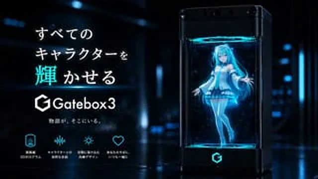

```text
A futuristic Japanese technology advertisement is set in a dark, sci-fi exhibition hall. The floor is gleaming, and the background is dotted with soft blue neon lights. On the right, a tall, rectangular black holographic device is displayed. Its front and sides are made of transparent glass with rounded edges, and a tiny camera-like sensor is mounted on top. The device is marked "Gatebox3" and emits a bluish-green glow, while a bright blue logo is printed on the base. Inside the cavity, a full-body holographic projection of a virtual anime girl is displayed. She floats lightly above a platform at the bottom, appearing as a glowing, translucent blue projection with a particle-shimmering effect. She has extremely long twin ponytails, a youthful idol-like design, and wears a futuristic white and blue outfit with separate sleeves, a short skirt, knee-high socks, and high heels. Her face is deliberately simplified or softened, and her pose is one leg bent, arms outstretched in a welcoming gesture. Illuminated circular projection rings are added to the top and bottom of the cavity. On the left, there is a simple Japanese promotional text layout, with the main title "すべてのキャラクターを輝かせる" (Subite no Character を 輝かせる), where the single kanji "輝" (shine) is emphasized in bright cyan, while the rest of the text is white. Below this is the Gatebox3 logo and the white product name, followed by the smaller slogan "物語が、そこにいる。" (Monogatari ga, Soko ni Iru.). In the lower left corner, there are four function icons with white and cyan Japanese labels: one holographic icon with "High-precision 3D Hologram," one audio waveform icon with "Natural Conversation with Characters," one sun-like ambient light icon with "Cleansing Design for Dissolving in Space," and one heart-shaped icon with "We're all together." This high-end commercial product visualization features a sophisticated cyberpunk blue color scheme, cinematic contour lighting, exquisite reflection effects, an ultra-simple composition, and realistic equipment rendering combined with anime holographic characters, clearly focusing on the product and layout.
```

Model: GPT Image 2
Author: GPT Image 2 Prompts

[ProjectD](https://aitoolsradar.com/en/prompts/b034da2bbd5129) · [Recorded source](https://x.com/ZelizAbrigo/status/2046727280622260378#reversed-0)
 · [Full original metadata and byte evidence](data/projectd-batch-0031.json)

## Gear 5 Chalkboard Classroom Mural

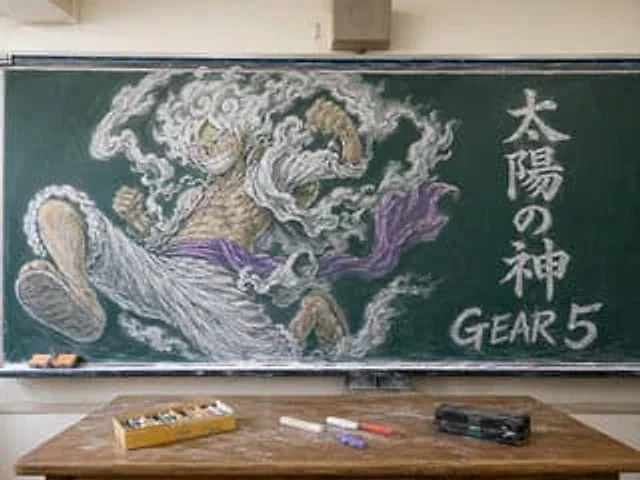

```text
A photorealistic classroom interior scene, centered on a massive green blackboard adorned with a stunning chalk mural of Monkey D. Luffy from One Piece, wearing Gear 5. The artwork dominates the entire piece: rendered in a dynamic, low-angle perspective, it depicts a giant foot reaching towards the viewer, fists raised, wild, curly white hair, an exaggerated, maniacal laugh, wide-open eyes, an open white coat revealing a scarred, muscular chest, loose white trousers, and a flowing purple belt. A white, smoky halo, rendered in impressionistic chalk strokes, surrounds the figure. To the right of the blackboard are two chalk-written text elements: a vertically arranged Japanese phrase, “太阳の神” (Sun God), and a prominent English label, “GEAR 5,” near the lower right corner. The chalk drawing exhibits layered textures of white, gray, tan, and purple chalk, with noticeable smudges, dust, and hand-drawn shadows. The entire blackboard border, chalk tray, and realistic classroom environment with beige walls and a small speaker above the blackboard are also showcased. In the foreground is a worn-out wooden teacher's desk covered in chalk dust. Five items are clearly visible on the desk: an open box of colored chalk, three scattered pieces of chalk, and a black rectangular eraser. Two additional small erasers are placed to the left of the chalk tray. Soft, natural indoor lighting, a symmetrical composition, and high detail create a realistic classroom photograph with striking anime-style blackboard art.
```

Model: GPT Image 2
Author: GPT Image 2 Prompts

[ProjectD](https://aitoolsradar.com/en/prompts/fa1fb160cab7ec) · [Recorded source](https://x.com/LeeveLeon/status/2046636619910856775#reversed-0)
 · [Full original metadata and byte evidence](data/projectd-batch-0031.json)

## Gen Z Poetic Miniature Collage

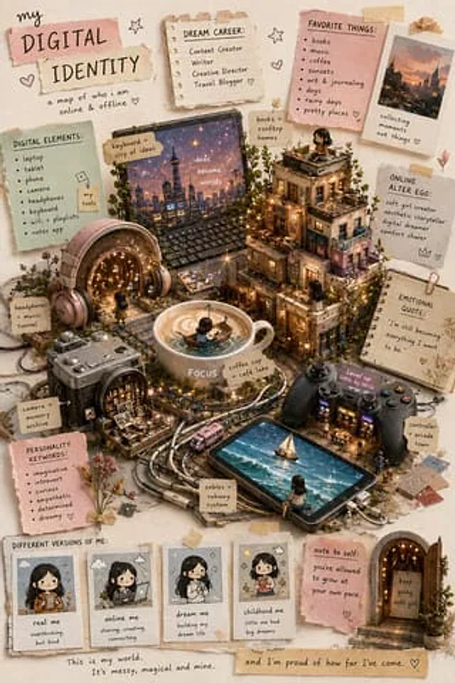

```text
Create a poetic miniature collage universe showing a student’s DIGITAL IDENTITY through real photographed objects and tiny emotional worlds. Style: cozy handmade scrapbook diary, emotional collage aesthetic, Gen Z healing vibe, mixed media collage with warm daylight, cream paper texture, soft grain, masking tape, torn paper, handwritten English notes, arrows, doodles, layered scrapbook composition, whimsical miniature worldbuilding. Include customizable elements: Dream career: {argument name="dream career" default="architect"} Favorite things: {argument name="favorite things" default="plants and cats"} Digital objects: {argument name="digital elements" default="laptops and headphones"} Personality keywords: {argument name="personality keywords" default="creative, quiet"} Online alter ego: {argument name="online persona" default="pixel artist"} Emotional quote: {argument name="emotional quote" default="Small steps every day."} Transform real objects into miniature emotional environments: keyboard → futuristic city, headphones → music tunnel, books → rooftop homes, camera → memory archive, tablet → glowing digital ocean, controller → arcade town, coffee cup → café lake, cables → subway system.
```

Model: GPT Image 2
Author: Eesha

[ProjectD](https://aitoolsradar.com/en/prompts/6c25493a7c5fd3) · [Recorded source](https://youmind.com/prompts/gen-z-miniature-collage-22534)
 · [Full original metadata and byte evidence](data/projectd-batch-0031.json)

## Gen Z Selfie Photo Collage

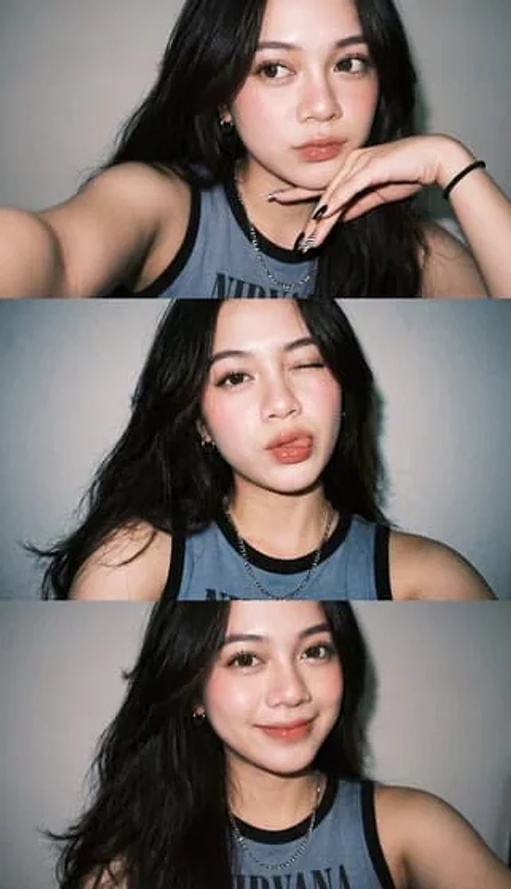

```text
Ultra-realistic Gen Z selfie photo collage, three vertical smartphone flash selfies of a young woman with long wavy black hair, soft dewy glass skin, rosy blush, glossy peach lips, natural makeup, wearing a faded blue-gray sleeveless Nirvana tank top, silver chain necklace, black nail polish with nail art, posing with hand under chin, playful wink with tongue out, and warm smiling expression. Direct front-facing flash photography, clean light gray wall background, high contrast shadows, candid Instagram aesthetic, sharp facial details, shallow depth of field, Y2K vibe, soft skin texture, photorealistic, 35mm lens, high resolution. Ultra-realistic late-night flash selfie collage, three stacked smartphone photos of a young woman with shoulder-length dark hair, luminous skin, subtle blush, glossy pink lips, natural Korean-inspired makeup, wearing a blue-gray sleeveless tank top, silver chain necklace, resting face on hand, playful wink, looking sideways, and kissing-face expression. Direct camera flash creating bright highlights and deep shadows, dim indoor bedroom background, casual candid selfie aesthetic, soft messy hair, photorealistic skin texture, high detail eyes and lips, Instagram/Tumblr vibe, 35mm photography, realistic lighting, ultra-sharp focus, high resolution.
```

Model: GPT Image 2
Author: Sairah

[ProjectD](https://aitoolsradar.com/en/prompts/d72eb58af52e26) · [Recorded source](https://youmind.com/prompts/gen-z-selfie-photo-collage-24108)
 · [Full original metadata and byte evidence](data/projectd-batch-0031.json)

## GENEL | AIを用いた動画制作 #33

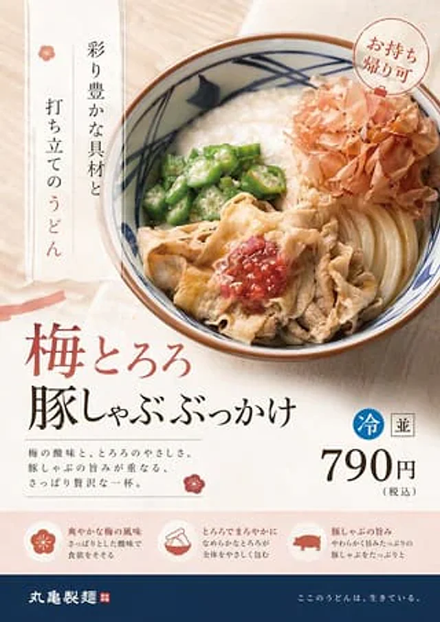

```text
この商品広告をプロのデザイナー目線でリデザインして。
今のトレンド、ターゲットに合わせた洗練されたデザインで。
```

Model: GPT Image 2
Author: GENEL | AIを用いた動画制作

[ProjectD](https://aitoolsradar.com/en/prompts/a271f10d893841) · [Recorded source](https://x.com/genel_ai/status/2046498264774791514)
 · [Full original metadata and byte evidence](data/projectd-batch-0031.json)

## Geographic Map Illustration

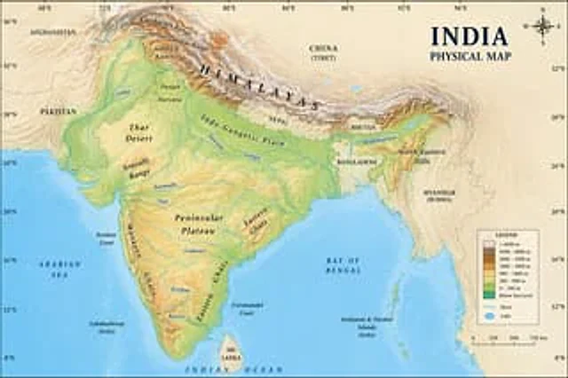

```text
A location{argument name="country" default="Indian"} Images on physical maps
```

Model: GPT Image 2
Author: GPT Image 2 Prompts

[ProjectD](https://aitoolsradar.com/en/prompts/45db75f1af7df2) · [Recorded source](https://x.com/cneuralnetwork/status/2047013432252313686)
 · [Full original metadata and byte evidence](data/projectd-batch-0031.json)

## Geometric Bird Riding Bicycle


```text
A minimalist flat vector illustration on a light gray background depicts a whimsical bird riding a bicycle, composed entirely of simple geometric shapes with bold black outlines. The bicycle, shown in side view, is a road bike style outlined in black lines, facing left, with two large wheels, each divided by a cross of vertical and horizontal spokes. The frame is a simple triangle, complete with a small black seat, pedals, and a thin black line extending horizontally below the bicycle. The rider is a stylized white bird with a rounded body, a small round head, and an open, pointed orange beak with pink inside. The bird has one visible black eye, a simple black arc on its head, a teardrop-shaped wing behind its neck, and a single backward-pointing, horn-like white tail feather. The bird leans forward, as if actively riding. It has two slender orange legs with black outlines extending downwards to the pedals on the frame. The composition remains centered, playful, simple, and abstract, devoid of shadows and textures, presenting a modern icon-like graphic style.
```

Model: GPT Image 2
Author: GPT Image 2 Prompts

[ProjectD](https://aitoolsradar.com/en/prompts/4ea10237357ac7) · [Recorded source](https://x.com/furoku/status/2046740061719584955#reversed-1)
 · [Full original metadata and byte evidence](data/projectd-batch-0031.json)

## Geometric Color Block Editorial Portrait


```text
Using the uploaded image and without changing the face, create a {argument name="portrait type" default="vibrant high-fashion editorial portrait"} of a beautiful young woman standing confidently against a {argument name="background" default="bold geometric wall made of saturated yellow, cyan, pink, and orange color blocks"}. She is wearing a {argument name="outfit" default="stylish fitted white graphic T-shirt with colorful typography"}, one arm raised above her head in a relaxed fashion pose, showing effortless confidence and modern fashion attitude. Maintain her original facial features, soft natural hair texture, direct intense eye contact, and authentic expression. Warm golden-hour sunlight casts crisp dramatic shadows across her face and the colorful background. Ultra-realistic skin texture, razor-sharp focus, clean minimalist composition, vivid colors, commercial fashion campaign aesthetic, editorial photography style, 85mm lens, shallow depth of field, cinematic lighting, premium magazine quality, hyper-detailed, 8K photorealistic.
```

Model: GPT Image 2
Author: Ai Bella

[ProjectD](https://aitoolsradar.com/en/prompts/d41fb7e1062fe0) · [Recorded source](https://youmind.com/prompts/geometric-color-block-fashion-portrait-28380)
 · [Full original metadata and byte evidence](data/projectd-batch-0031.json)

## Geometric Emotional Window Poster


```text
请将我上传的每一张照片分别制作成一张独立的高级设计海报，不多图拼接，每张照片单独输出。整体采用 3:4 竖版构图，上下两个区域高度严格 1:1，各占画面 50%。 上半部分保留原始照片，保持主体结构、真实质感、自然光影和原有色彩氛围，仅进行轻微高级摄影调色，使其具有高端品牌广告、艺术杂志与展览视觉的精致质感。为适配画幅，可自然扩展天空、地面或环境背景，主体本身保持不变。 下半部分提取照片中最具识别性的**主体、轮廓、姿态与叙事关系**，重构为具有高级商业审美的极简视觉海报。核心语言是 **“真实物象穿越几何情绪窗口”**：在画面中设置一个窄长、克制、低饱和的几何色块，作为视觉锚点与空间容器。**色块方向不固定，可为横向、竖向或斜向**，根据主体的重心、动作方向、轮廓走势与版面节奏自然决定。主体以真实摄影感或精致写实方式进入色块之中，并局部越界、破框、伸出或穿过边界，形成自然生长感、空间穿透感与留白呼吸感。 构图保持极简、清晰、平衡，以几何色块、主体越界关系和大面积留白建立秩序。主体可居中、偏心、纵向生长或横向舒展，但始终保持单一焦点。背景以白色、浅灰或极浅暖色为主，可加入极轻微的文化纹样、线性图形、地形线、水波线、光影轮廓或抽象符号，作为若隐若现的辅助层次。 配色从上方照片中提取最有辨识度、最有精气神的颜色关系，转化为**浅色几何窗口 + 真实主体色彩 + 极少量中性色排版**的高级系统。色块颜色可柔化为雾蓝、浅青、米白、淡粉、暖灰、浅金或其他与原图气质一致的浅色调，整体轻盈、干净、现代、精致。 文字作为版式结构的一部分自然介入。可从照片的主题、情绪、动作、状态或象征意义中提炼一个简短英文标题，并搭配少量副标题、地点、状态词或微型注释。标题可横排、竖排或沿色块与主体关系排布，辅助信息以小字号、细字重、舒展字距规整排列，使其呈现高端地产、奢侈品、美学杂志或节气视觉般的高级编辑感。 整体气质强调**东方留白、现代秩序、自然生命力与高级商业美感**。无论主体是人物、动物、植物、建筑、器物、食物、交通工具或自然景观，都应保持真实摄影与几何情绪窗口之间清晰、优雅、可迁移的视觉呼应。请将我上传的每一张照片分别制作成一张独立的高级设计海报，不多图拼接，每张照片单独输出。整体采用 3:4 竖版构图，上下两个区域高度严格 1:1，各占画面 50%。 上半部分保留原始照片，保持主体结构、真实质感、自然光影和原有色彩氛围，仅进行轻微高级摄影调色，使其具有高端品牌广告、艺术杂志与展览视觉的精致质感。为适配画幅，可自然扩展天空、地面或环境背景，主体本身保持不变。 下半部分提取照片中最具识别性的**主体、轮廓、姿态与叙事关系**，重构为具有高级商业审美的极简视觉海报。核心语言是 **“真实物象穿越几何情绪窗口”**：在画面中设置一个窄长、克制、低饱和的几何色块，作为视觉锚点与空间容器。**色块方向不固定，可为横向、竖向或斜向**，根据主体的重心、动作方向、轮廓走势与版面节奏自然决定。主体以真实摄影感或精致写实方式进入色块之中，并局部越界、破框、伸出或穿过边界，形成自然生长感、空间穿透感与留白呼吸感。 构图保持极简、清晰、平衡，以几何色块、主体越界关系和大面积留白建立秩序。主体可居中、偏心、纵向生长或横向舒展，但始终保持单一焦点。背景以白色、浅灰或极浅暖色为主，可加入极轻微的文化纹样、线性图形、地形线、水波线、光影轮廓或抽象符号，作为若隐若现的辅助层次。 配色从上方照片中提取最有辨识度、最有精气神的颜色关系，转化为**浅色几何窗口 + 真实主体色彩 + 极少量中性色排版**的高级系统。色块颜色可柔化为雾蓝、浅青、米白、淡粉、暖灰、浅金或其他与原图气质一致的浅色调，整体轻盈、干净、现代、精致。 文字作为版式结构的一部分自然介入。可从照片的主题、情绪、动作、状态或象征意义中提炼一个简短英文标题，并搭配少量副标题、地点、状态词或微型注释。标题可横排、竖排或沿色块与主体关系排布，辅助信息以小字号、细字重、舒展字距规整排列，使其呈现高端地产、奢侈品、美学杂志或节气视觉般的高级编辑感。 整体气质强调**东方留白、现代秩序、自然生命力与高级商业美感**。无论主体是人物、动物、植物、建筑、器物、食物、交通工具或自然景观，都应保持真实摄影与几何情绪窗口之间清晰、优雅、可迁移的视觉呼应。
```

Model: GPT Image 2
Author: 小小东

[ProjectD](https://aitoolsradar.com/en/prompts/2ab1f2f47d2fd9) · [Recorded source](https://youmind.com/prompts/geometric-emotional-window-poster-32130)
 · [Full original metadata and byte evidence](data/projectd-batch-0031.json)

## Geometric Line Art Architecture Poster


```text
请根据最后输入的主题，创作一张**超高分辨率、可打印的 3:4 竖版海报**。整体采用上下两个区域的双联结构，**上下高度严格 1:1，各占画面 50%**。

**上半部分**根据{argument name="主题" default="城市"}生成一幅完整、统一、真实且富有生活感的场景画面。若主题是城市，请先理解其核心气质，从空间景观、街头生活、人文风情、商业氛围、饮食记忆、地方文化、历史层次与日常节奏中提炼视觉线索，并自然组织进同一幅真实而鲜活的城市切面中，而不是零散拼贴。若主题是具体街道、街区、地标、商圈、店铺、建筑或代表性地点，请以真实空间关系为核心，准确呈现街道结构、建筑界面、店铺招牌、交通设施、文字系统、人群状态与现场氛围，保留其最有辨识度的在地特征。若主题包含地址、坐标或参考图片，请优先依据真实信息理解场景，不要凭空杜撰，不要随意替换地点特征，也不要画成与主题无关的通用景观。整体避免廉价旅游宣传和明信片式表达，而应捕捉一个克制、精致、真实、具有日常温度的主题瞬间；人物、建筑、街道、标牌、橱窗、设施与活动自然共生，地标融入环境，不夸张、不喧宾夺主。

**下半部分**提取上半部分画面中**最具识别性的主体、轮廓、结构、姿态与叙事关系**，重构为一幅**极简线条图形化表达**。不要机械描摹细节，而是以纤细准确的单线、清晰几何透视、克制留白、有秩序的细节节奏和适度抽象的概括造型重新表达，保留一眼可识别的主题特征。若主题偏城市或地点，可提取其最关键的建筑天际线、街道界面、标牌节奏、交通设施、橱窗关系或人群状态；若主题不是城市，也应提取其最核心的身份特征、轮廓语言、结构关系与视觉记忆点，并转化为统一、简洁、现代、高级的线描海报语言。可加入少量几何辅助元素、水平线、纵向构成线或节奏性留白，使下半部分像是对上半部分现实场景的提炼与再设计。

**文字系统**需要自然融入整体版式，延续这种克制、高级、现代的海报逻辑。顶部设置醒目的主标题；副标题可使用主题原文、当地语言、国家或地区信息、地址、坐标、编号、年份或一句简短说明。若画面包含街头文字、招牌或地点信息，必须清晰、自然、真实、专业，避免乱码、错误文字与随意拼写。文字排版应简洁有秩序，与画面共同构成收藏级旅行海报与城市品牌视觉般的完成度，而不是后期随意贴上的说明标签。

色彩不要机械套用固定模板，而应先理解主题本身的气候、光线、时间感、建筑材料、历史气息、商业温度、饮食印象、自然环境与情绪质地，再提炼出**专属于该主题**的主色与底色关系。整体可采用单色印刷美学或极少量克制配色，通过线条疏密、明度层次、局部压重、留白比例与细节节奏形成丰富变化，避免单调和平铺。最终成品应呈现**线条清晰、细节丰富、风格统一、安静现代、灵动克制、审美高级**的海报效果。
```

Model: GPT Image 2
Author: 小小东

[ProjectD](https://aitoolsradar.com/en/prompts/095a2926b4b858) · [Recorded source](https://youmind.com/prompts/geometric-line-art-poster-31920)
 · [Full original metadata and byte evidence](data/projectd-batch-0031.json)

## Geometric Split Poster Design


```text
Please turn each photo I upload into a separate premium-designed poster, with no multi-image collage; output each photo as an independent poster. Use an overall 3:4 vertical composition, strictly divided into two equal-height sections, with the upper and lower halves each occupying exactly 50% of the canvas. The upper half should preserve the original photograph, maintaining the subject’s structure, realistic texture, natural lighting and shadows, and original color atmosphere, with only subtle high-end photographic color grading to give it the quality of an art publication or exhibition photograph. To adapt the image to the required aspect ratio, you may naturally extend the sky, ground, or environmental background, but you must not stretch, distort, or alter the main subject. The lower half should extract the most recognizable subject, silhouette, posture, and narrative relationship from the photograph; first understand its core meaning, cultural attributes, or emotional relationship, then reconstruct it into a graphic composition combining the character of a folk-culture catalog, antique rubbing prints, and modern graphic design. Do not translate every element in the photograph one by one, and do not add generic traditional patterns; retain only one core visual motif and a very small number of auxiliary forms that truly carry narrative significance. Use silhouette, negative space, partial enlargement, shape merging, and symbolic transformation so that the graphic not only corresponds to the original object but also expresses the meaning behind it. Build the composition on a rigorous geometric framework and proportional system: derive circles, squares, triangles, arcs, axes, or repeated proportions from the structure of the subject itself as the “geometric matrix,” then align all main forms, secondary graphics, typography, and negative space through shared tangencies, common axes, nesting, mirroring, proportional progression, or edge cropping relationships. The layout may be freely distributed, off-center, extend beyond boundaries, or be asymmetrical, but every element must obey the same structural logic, creating a clear visual center of gravity, hierarchy, rhythm, and negative space; from a distance the order should be immediately legible, while closer viewing should reveal traditional print traces and subtle details. Avoid random scattered elements and decorative accumulation. Extract the most distinctive, lively, and spiritually expressive colors from the upper photograph and reorganize them into a clean, restrained paper-printing palette. Use a bright, light paper-colored background to create breathing room, one dark color to establish the visual skeleton, and one or two theme colors derived from the original photograph to organize the main subject and limited accents. Build depth through area ratios, overprinting, and ton
```

Model: GPT Image 2
Author: 小小东

[ProjectD](https://aitoolsradar.com/en/prompts/53713ac111387f) · [Recorded source](https://youmind.com/prompts/geometric-split-photo-poster-32267)
 · [Full original metadata and byte evidence](data/projectd-batch-0031.json)

## German Citizenship Identity Card Mockup


```text
Ultra-realistic 16:9 close-up studio photograph of a {argument name="document type" default="German citizenship identity card"} placed on a clean light grey or white background. The card is horizontally aligned, centered in frame, captured in sharp focus with soft diffused studio lighting. The design follows an official European government-issued ID aesthetic with structured layout, clean typography, and advanced anti-counterfeit detailing. The top header reads: “BUNDESREPUBLIK DEUTSCHLAND” with a secondary title “BÜRGERSCHAFTSAUSWEIS / CITIZENSHIP CARD.” Top-left includes the German national flag. Top-right features the German federal eagle emblem (Bundesadler). The card contains a passport-style portrait of a {argument name="portrait subject" default="young German woman"}: – Fair European skin tone with subtle natural freckles – Shoulder-length {argument name="hair style" default="dark blonde hair with soft waves"}, center-parted – Blue-green eyes, neutral facial expression, direct gaze – Minimal makeup, realistic skin texture – Wearing a dark navy or black blazer with subtle gold jewelry. Personal identity details displayed in multilingual European format (German / English / French): – Name / Surname / Nom: MÜLLER – Vornamen / Given names / Prénoms: LENA MARIE – Geburtstag / Date of birth / Date de naissance: 14.08.1992 – Geburtsort / Place of birth / Lieu de naissance: MÜNCHEN – Staatsangehörigkeit / Nationality / Nationalité: DEUTSCH – Ausweisnummer / Document No. / No. du document: D123456789 – Ausstellungsdatum / Date of issue / Date de délivrance: 20.05.2024 – Gültig bis / Date of expiry / Date d’expiration: 20.05.2034 – Geschlecht / Sex / Sexe: F – Height: 168 cm. Security and design features include: – Intricate guilloche patterns covering the entire card surface – Fine-line engraving textures similar to Euro banknote printing – Microprinted text layers and anti-counterfeit linework – Holographic security patch with iridescent reflections – Circular EU-style hologram with embedded “D” symbol – Subtle outline map of Germany integrated into background – Large engraved illustration of the Brandenburg Gate on the right side – Machine-readable zone strip at bottom edge – Signature at bottom: “Lena M. Müller”. Additional design accents: – Soft black, red, and gold gradient tones inspired by the German flag – Layered polycarbonate texture with transparent security overlays – Minimal, clean European Union identity card styling. Material appearance: laminated polycarbonate card with slight gloss, realistic reflections, holographic foil effects, and embossed microtexture. Lighting is soft and evenly diffused, emphasizing security details, engraved patterns, and realistic print texture. No hand visible. Clean, minimal, professional composition. Style: ultra-detailed, photorealistic, 8K resolution, macro clarity, professional product photography, documentary realism.
```

Model: GPT Image 2
Author: ANKIT PATEL 🇮🇳 | AI

[ProjectD](https://aitoolsradar.com/en/prompts/6bd94d0169ac8c) · [Recorded source](https://youmind.com/prompts/german-identity-card-id-mockup-18541)
 · [Full original metadata and byte evidence](data/projectd-batch-0031.json)

## Ghibli Style Pastoral Village


```text
[Subject]: {argument name="subject" default="Villagers in simple rural clothing"}. [Action]: {argument name="activity" default="Tending crops and harvesting vegetables"}. [Environment]: {argument name="scene" default="Idyllic pastoral village with cozy cottages and rolling green hills"}. [Cinematography]: Wide establishing shot, vibrant perspective. [Lighting/Style]: Studio Ghibli aesthetic, bright summer daylight, lush watercolor backgrounds. [Technical]: 2D animation style, vibrant colors, nostalgic atmosphere.
```

Model: GPT Image 2
Author: Chidanand Tripathi

[ProjectD](https://aitoolsradar.com/en/prompts/ac6700771c1792) · [Recorded source](https://youmind.com/prompts/ghibli-style-pastoral-village-17841)
 · [Full original metadata and byte evidence](data/projectd-batch-0031.json)

## Ghibli Style Princess and Koi Pond


```text
A meticulously crafted Ghibli-style portrait depicting a{argument name="character" default="Princess"} Kneeling{argument name="background" default="Koi Pond"} Beside her, luminous lotus flowers bloomed in the pond. She wore a {argument name="clothing" default="Soft blue-beige kimono"} Embroidered with swirling waves and fox spirit patterns, a delicate paper umbrella rests on her shoulder, and cherry blossom branches adorn her hair, interspersed with tiny rainbow prisms that cast soft light onto the water's surface.
```

Model: GPT Image 2
Author: GPT Image 2 Prompts

[ProjectD](https://aitoolsradar.com/en/prompts/5a0443c576ca02) · [Recorded source](https://x.com/dotey/status/2047111812664197284)
 · [Full original metadata and byte evidence](data/projectd-batch-0031.json)

## Giant Robot Meets Woman on Balcony


```text
A cinematic dystopian sci-fi scene, rendered in a widescreen, realistic style: a colossal, weathered humanoid robot dominates the right side of the frame, leaning towards a solitary woman on the balcony of a small, rusty apartment building in the far left. The robot, several stories tall, possesses a round, helmet-like head, a single visible, glowing blue eye, and a dense array of exposed mechanical joints, layered armor plates, cables, pistons, and scratched, white-gray metal covered in rust, grime, and signs of battle. Its massive right arm extends towards the woman, palm open and upward, a gesture of gentle gifting; its delicate metal fingers and enormous forearm occupy the lower center of the frame. In contrast, the woman appears tiny, standing sideways, looking up at the robot with a calm, contemplative expression; she wears a dark green hooded jacket and dark trousers, her dark hair tied in a low ponytail. She is placed on a narrow, corroded balcony with rusty railings, attached to a dilapidated concrete high-rise building; details of two more balconies and ruined, abandoned structures are visible along the left edge. The background depicts a dense, gray, rain-soaked megacity, with closely packed low-rise buildings gradually fading into the distance as modern skyscrapers and hazy mountains appear. Dramatic overcast lighting, heavy storm clouds, soft steel-grey and charcoal black tones, delicate atmospheric perspective, and a light mist create a sense of immense scale, solitude, and an unexpected tenderness between human and machine. Ultra-fine textures, realistic metallic wear, cinematic depth of field, emotional color gradation, high-contrast clouds, and a serious futuristic tone further enhance the effect.
```

Model: GPT Image 2
Author: GPT Image 2 Prompts

[ProjectD](https://aitoolsradar.com/en/prompts/a0233a86f906c7) · [Recorded source](https://x.com/wavespeed_ai/status/2046620356199485454#reversed-2)
 · [Full original metadata and byte evidence](data/projectd-batch-0031.json)

## Giant Vintage Diary Couple Poster


```text
Create a cinematic ultra-realistic romantic concept poster titled around a couple standing inside the pages of a giant open vintage diary book. The scene features exactly 2 people: a man on the left and a woman on the right, both full-body, standing on the lower wooden edge of the enormous book as if the diary is a life-size stage. The man wears a {argument name="man's outfit" default="deep maroon button-up shirt with sleeves rolled to the forearms, black trousers, black belt, black formal shoes, wristwatch"}, standing relaxed with both hands in pockets and one leg crossed. The woman wears a {argument name="woman's outfit" default="bright magenta-pink sari with ornate gold embroidery, matching blouse, gold jewelry, bangles, earrings, wristwatch, long wavy brown hair"}, standing elegantly with hands folded in front. Use warm amber-brown cinematic lighting, soft shadows, shallow depth of field, realistic skin and fabric textures, and a dreamy vintage romantic atmosphere.

The background is exactly 1 huge open antique diary with 2 visible aged yellow-brown parchment pages, a dark worn spine in the center, curled and distorted page edges, stains, scratches, old-paper grain, and detailed vintage texture. The diary rests on a dark wooden platform with blurred warm bokeh and a soft out-of-focus flower shape in the lower right foreground.

Left page details: show a calendar layout at the top with the exact visible text {argument name="date text" default="Jun 02 Tuesday"}, followed by a small month grid with weekday initials and dates. Add a handwritten romantic quote down the left side reading {argument name="left page quote" default="Every day with you feels like a beautiful chapter in my life story."}. Include exactly 1 small heart doodle beneath the quote and exactly 1 floral line-art illustration near the bottom left.

Right page details: place the large serif heading {argument name="month heading" default="JUNE"} near the top center. Add a handwritten romantic quote on the mid-right reading {argument name="right page quote" default="Some love stories are written in books. Ours is written in my heart."}. Include exactly 1 small heart doodle beneath this quote. Add exactly 2 floral line-art illustrations on the right page: one small flower-and-leaves drawing near the upper right corner and one larger flower-and-leaves drawing near the lower right. Add a thin rectangular border line inset from the page edges on the right page.

Composition: vertical poster crop, couple centered across the book seam, man aligned with the left page and woman aligned with the right page, realistic scale illusion, high-detail cinematic photo manipulation, romantic pre-wedding poster style, 8k ultra-realistic rendering, warm sepia color grading, no extra people, no extra pages, no watermark, no modern UI elements.
```

Model: GPT Image 2
Author: Mr. Tariq

[ProjectD](https://aitoolsradar.com/en/prompts/39a0d01c095f32) · [Recorded source](https://youmind.com/prompts/vintage-diary-couple-poster-23826)
 · [Full original metadata and byte evidence](data/projectd-batch-0031.json)

## Gilbert Odera | Your AI Plug🇰🇪 #280


```text
Create a hyper-realistic cinematic luxury perfume product photograph featuring [PERFUME BOTTLE DESIGN] positioned in [COMPOSITION / ANGLE] within a dramatic elemental environment of [ELEMENTAL SETTING: water, smoke, ice, firelight, forest, florals, spices, gemstones].

The bottle should feel premium and tactile, with [MATERIAL DETAILS: glossy glass, metallic cap, gold label, transparent liquid, frosted surface, engraved text], sharp reflections, realistic refractions, and crisp readable branding: [BRAND / LABEL TEXT].

Surround the product with carefully arranged sensory ingredients such as [BOTANICALS / SPICES / FRUITS / OBJECTS], using strong contrast between [PRIMARY COLOR PALETTE] and [ACCENT COLORS].

Lighting should be cinematic and high-contrast, with [LIGHTING STYLE], deep shadows, sparkling highlights, volumetric atmosphere, and a luxurious commercial advertising finish.

Background: [BACKGROUND DESCRIPTION], shallow depth of field, premium editorial composition, ultra-detailed textures, 8k resolution, photorealistic studio quality.


Cheat Sheet
[PERFUME BOTTLE DESIGN]: shape, color, cap, label style
[COMPOSITION / ANGLE]: tilted crash, centered still life, close-up tray, hand interaction
[ELEMENTAL SETTING]: splash, smoke, candlelight, ice, forest, aurora
[MATERIAL DETAILS]: glass, metal, liquid, frost, reflections
[BRAND / LABEL TEXT]: exact readable perfume text
[BOTANICALS / SPICES / FRUITS / OBJECTS]: lemons, vanilla pods, roses, pinecones, gemstones
[PRIMARY COLOR PALETTE]: navy, amber, silver, black, icy blue
[ACCENT COLORS]: gold, red, lime green, magenta, teal
[LIGHTING STYLE]: dramatic spotlight, candle glow, cool moonlight, golden rim light
[BACKGROUND DESCRIPTION]: moody studio, dark forest, blurred luxury interior, smoky backdrop
```

Model: GPT Image 2
Author: Gilbert Odera | Your AI Plug🇰🇪

[ProjectD](https://aitoolsradar.com/en/prompts/7811d21f63fe21) · [Recorded source](https://x.com/yourPlugAI/status/2048956977250726018)
 · [Full original metadata and byte evidence](data/projectd-batch-0031.json)

## Girl in Oversized Tank Top Doing Pushups


```text
图中{argument name="人物" default="女生"}，穿着胸口宽松的男士6L{argument name="上衣" default="意大利面肩带有点敞开的背心"}和{argument name="下装" default="短裤"}做俯卧撑
```

Model: GPT Image 2
Author: Adam也叫吉米

[ProjectD](https://aitoolsradar.com/en/prompts/e598a91558a1c7) · [Recorded source](https://youmind.com/prompts/girl-pushups-oversized-tank-top-20546)
 · [Full original metadata and byte evidence](data/projectd-batch-0031.json)

## Girl on Window Seat in Rain


```text
A digitally illustrated picture book style painting full of emotion, depicting a {argument name="character age" default="little girl"} She sat sideways on the cushioned windowsill of an old-fashioned European attic room, her knees drawn up, gazing at the rain washing over the trees outside. She kept {argument name="hair color" default="chestnut brown"} Slightly messy, shoulder-length short hair, wearing a comfortable oversized cable-knit sweater and soft striped socks, her bare legs curled up beside her body. The composition is intimate and contemplative; viewed from an indoor side viewpoint, the girl is in the lower left foreground, with the rainy city dominating the right side and background. Outside the window are dense, old-fashioned row houses with pointed roofs, chimneys, and crooked roofs. Two tall, vintage streetlights are visible near the window. The sky is overcast, with layers of dense rain clouds, and the rain is clearly visible. The glass is covered with raindrops, watermarks, and wet reflections. The rooftops outside the window are mostly a soft gray, while the left side of the room emits a warm amber light, creating a strong contrast between the cozy interior and the cold storm. The picture includes patterned cushions behind her, a worn-out upholstered bench with delicate floral fabric, dark curtains outlining the left edge, and the soft, painterly textures of the wood, fabrics, hair, and raindrops, rendered with delicate brushstrokes. Color palette: warm browns, beige, soft gold, slate gray, charcoal black, and soft silver. Atmosphere: melancholic, serene, nostalgic, cinematic, fantastical, and emotionally nuanced. Highly detailed, illustrated in a painterly style, with a children's book fantasy realism, dramatic lighting, depth conveyed through layered roofs, no text, no watermark.
```

Model: GPT Image 2
Author: GPT Image 2 Prompts

[ProjectD](https://aitoolsradar.com/en/prompts/95e788253e12c6) · [Recorded source](https://x.com/imkkwoo/status/2046805357528506738#reversed-1)
 · [Full original metadata and byte evidence](data/projectd-batch-0031.json)

## Glass AI Orb in a Garden


```text
A dreamlike, surreal outdoor still life scene unfolds under the bright afternoon sun: a transparent glass sphere sits at the center of a lush, moss-covered mound. Inside the sphere is a minimalist white, glowing computer face icon with two vertical eyes within a rounded rectangle and a short horizontal line below, resembling a friendly terminal or chatbot symbol. A compact white mechanical keyboard sits directly in front of the sphere, presented in a perfect frontal view. Five clusters of flowers surround the base of the sphere: two clusters of blue hydrangeas, two clusters of white hydrangeas, and one cluster of light golden-brown flowers, nestled among dense green moss and delicate fern leaves. The background is a clear, azure sky dotted with four soft white clouds. Warm sunlight streams in from the upper left corner, creating a cinematic lens flare, shimmering highlights on the glass, a shallow depth of field, and a softly blurred effect on distant trees. The highly detailed, realistic 3D rendering exudes a fantastical, eco-futuristic atmosphere. The composition is simple, symmetrical, and centered, with reflective light creating a gentle summer ambiance.
```

Model: GPT Image 2
Author: GPT Image 2 Prompts

[ProjectD](https://aitoolsradar.com/en/prompts/7ef3bc5c3e05a4) · [Recorded source](https://x.com/apostraphi/status/2047522782423003629#reversed-0)
 · [Full original metadata and byte evidence](data/projectd-batch-0031.json)

## Glass Reality Weaver in Cosmic Hall


```text
A grand, cinematic-quality digital art scene depicting a cosmic fantasy: In the center of the left side of the image sits a colossal humanoid figure composed of transparent glass and liquid crystal, its body filled with luminous internal filaments, refracted highlights, and intricate swirling textures beneath its surface. The figure's posture resembles that of a divine craftsman or a real weaver, its hands raised, stretching and kneading a massive, luminous golden veil on the right side of the image. The face is smooth and blurred, almost like a mannequin, devoid of any discernible expression, thus highlighting the sculptural form and the effect of light penetrating the translucent skin. This fabric of light, like a living tapestry or membrane, presents a complete fantasy world: a viaduct, a dazzling futuristic city with slender towers and domes, multi-tiered terraces, luminous buildings, and three clusters of deep green trees growing in the air or on high ground. The environment surrounding the colossal life form is a grand celestial hall, with ornate arches and feather-like branching filaments of golden light, opening onto the deep blue midnight sky. The ground, polished black mirror stone, clearly reflects figures, gold lines, and architecture. Five reflective metal or glass spheres of varying sizes are placed in the foreground, capturing the surrounding gold and blue light. The emphasis is on the dramatic refraction of the glass structures, the shimmering caustics, the intricate light trails, and the rich reflections on the glossy ground. Color palette: deep navy blue, black, silver-blue, and shimmering gold. Atmosphere: awe-inspiring, mysterious, sacred, and visionary. Highly complex, Baroque sci-fi fantasy aesthetics, wide-angle composition, epic scale, extremely sharp details, volumetric lighting, and surreal realism.
```

Model: GPT Image 2
Author: GPT Image 2 Prompts

[ProjectD](https://aitoolsradar.com/en/prompts/fb8785d6c2294f) · [Recorded source](https://x.com/AstroBoyma/status/2047610422119825533#reversed-0)
 · [Full original metadata and byte evidence](data/projectd-batch-0031.json)

## Glass Reality Weaver in Cosmic Hall


```text
A monumental cosmic fantasy scene in ultra-detailed cinematic digital art: a giant seated humanoid figure made of transparent glass and liquid crystal occupies the left-center of the composition, its body filled with luminous internal filaments, refractive highlights, and delicate swirling patterns under the surface. The figure is posed like a divine artisan or reality-weaver, with 2 raised hands stretching and pinching an enormous veil of glowing golden threads across the right side of the image. The face is smooth and indistinct, almost mannequin-like, with no readable expression, emphasizing the sculptural body and the play of light through translucent skin. The woven sheet of light acts like a living tapestry or membrane, and inside it appears an entire fantastical world: 1 elevated bridge, 1 radiant futuristic city with slender towers and domes, multiple terraces, glowing architecture, and 3 prominent clusters of dark green trees growing on floating or elevated landforms. The environment around the giant is a vast celestial hall with ornate archways and branching, feather-like filigree structures made of gold light, opening into a deep midnight-blue, star-filled sky. The floor is black polished mirror stone with strong reflections of the figure, the golden threads, and the architecture. In the foreground, place 5 reflective metallic or glass spheres of varying size resting on the floor, catching the surrounding gold and blue light. Emphasize dramatic refraction through the glass body, shimmering caustics, intricate threadlike light trails, and rich reflections on the glossy ground. Color palette: deep navy, black, silver-blue, and radiant gold. Mood: awe-inspiring, mystical, divine, and visionary. Highly intricate, baroque sci-fi fantasy aesthetic, wide-angle composition, epic scale, razor-sharp detail, volumetric glow, surreal realism.
```

Model: GPT Image 2
Author: Astro Boy

[ProjectD](https://aitoolsradar.com/en/prompts/ca368a1932c43e) · [Recorded source](https://youmind.com/prompts/glass-reality-weaver-in-cosmic-hall-15746)
 · [Full original metadata and byte evidence](data/projectd-batch-0031.json)

## Glassmorphism Smart UI Kit


```text
{
  "type": "Frosted glass and biomimetic style smart dashboard UI kit",
  "style": {
    "theme": "Simple, futuristic mobile interface components",
    "background": "Soft light grayish-white",
    "materials": "Frosted glass, translucent acrylic, soft shadows, subtle internal glow, rounded corners, embossed and recessed details.",
    "accent color": "{argument name=\"accent color\" default=\"Deep blue-green\"}",
    "secondary accent": "warm orange",
    "lighting": "Soft studio lighting in the upper left corner, gentle ambient reflections, and high gloss.",
    "rendering": "Ultra-detailed 3D UI models, advanced Dribbble-style product design"
  },
  "layout": {
    "canvas": "Square composition",
    "arrangement": "Evenly distributed grid of independent components and controls",
    "density": "Information-dense but with ample white space.",
    "sections": [
      {
        "title": "Top control row",
        "position": "top",
        "count": 6,
        "labels": [
          "Four-quadrant connection panel",
          "Analog clock",
          "50% battery level ring gauge",
          "24° Cloudy Weather Dial",
          "compass",
          "Vertical temperature slider"
        ]
      },
      {
        "title": "Small round shortcut button",
        "position": "Upper Mid-to-Upper",
        "count": 11,
        "labels": [
          "Alarm clock",
          "moon",
          "Silent bell",
          "flashlight",
          "Positioning pins",
          "Orange circular button",
          "Layers",
          "cube",
          "Split-screen view",
          "Focus box",
          "Check the icon"
        ]
      },
      {
        "title": "Central Components",
        "position": "Central",
        "count": 8,
        "labels": [
          "Music Player Card",
          "Brightness slider with automatic adjustment",
          "Focus on work drop-down capsule",
          "Vertical joystick",
          "Vertical toggle switch with orange dot",
          "High volume slider",
          "Small dark round button",
          "A slim vertical light slider with a musical note icon"
        ]
      },
      {
        "title": "Auxiliary cards and controls",
        "position": "Mid-lower part",
        "count": 11,
        "labels": [
          "Screen mirroring card",
          "AirDrop All Cards",
          "Bottom toolbar (containing battery, camera, microphone, and hearing icons)",
          "Horizontal temperature scale",
          "Media Back Button",
          "Media Playback Button",
          "Media forward button",
          "Heart-shaped button",
          "Random play button",
          "loop playback button",
          "Digital clock cards"
        ]
      },
      {
        "title": "Bottom gauges and status",
        "position": "bottom",
        "count": 11,
        "labels": [
          "Lightning Ring Power Supply Instrument",
          "75% Circular Progress",
          "315° Northwest Compass Dial",
          "dB -18 dB meter",
          "1240 meters above sea level",
          "Navigation compass arrow",
          "Active status capsule",
          "Notification Capsule",
          "Weekly Weather Forecast Card",
          "4 square tool buttons",
          "Bottom navigation icon row"
        ]
      }
    ],
    "bottom navigation count": 13
  },
  "objects": {
    "connectivity pad": {
      "shape": "Large rounded four-way disk",
      "quadrants": 4,
      "icons": [
        "Flight mode",
        "wireless signal",
        "WiFi",
        "Bluetooth"
      ],
      "active quadrants": 1
    },
    "music player": {
      "artist": "{argument name=\"artist name\" default=\"Billie Eilish\"}",
      "track": "{argument name=\"song title\" default=\"Ocean Eyes\"}",
      "artwork": "Cyan abstract wave image",
      "controls": 4,
      "timeline": "1:45 to 3:20",
      "extra": "audio waveform"
    },
    "weather main": {
      "temperature": "{argument name=\"temperature\" default=\"24°\"}",
      "condition": "partly cloudy"
    },
    "digital clock": {
      "time": "{argument name=\"clock time\" default=\"10:24\"}",
      "date": "Tuesday, May 21",
      "period toggle": "Morning and afternoon"
    },
    "forecast": {
      "current": "24°C, cloudy, high 26°C, low 18°C",
      "hourly count": 6,
      "hours": [
        "Now",
        "11AM",
        "12PM",
        "1PM",
        "2PM",
        "3PM"
      ]
    },
    "utility buttons": {
      "count": 4,
      "icons": [
        "timer",
        "calculator",
        "Battery",
        "recording"
      ]
    }
  },
  "color palette": {
    "count": 5,
    "colors": [
      "White",
      "Light gray",
      "Deep blue-green",
      "Dark charcoal gray",
      "Soft orange"
    ]
  },
  "camera": {
    "view": "Front view and top view",
    "framing": "The edges of the entire UI suite are visible."
  }
}
```

Model: GPT Image 2
Author: GPT Image 2 Prompts

[ProjectD](https://aitoolsradar.com/en/prompts/29458e6910e411) · [Recorded source](https://x.com/lukfan/status/2047631265206255622#reversed-2)
 · [Full original metadata and byte evidence](data/projectd-batch-0031.json)

## Glitch Angel Editorial Studio Shoot


```text
Goal: Create a realistic fashion magazine studio shot with an AI toy-catalog feeling: a life-size small figurine-like female model posed on a giant receipt prop, with glitch typography and editorial graphic design.

Canvas: Square 1:1 image, clean off-white studio background, high-key soft lighting, subtle shadows, premium magazine cover composition.

Subject: A young woman with {argument name="hair color" default="long wavy black hair"}, face deliberately obscured by a soft rectangular blur for anonymity. She is kneeling and leaning forward on both hands, angled three-quarters toward camera, wearing an oversized black leather jacket slipped off one shoulder, a white camisole, layered silver necklaces, black shorts, a white ruffled pleated skirt detail, and black knee-high boots. Add a small black textured handbag with chain hardware near her right side. Her pose should feel like a glossy studio fashion shoot but slightly surreal, as if she is a collectible human figurine.

Main props and counted elements: Include exactly 3 main physical props: 1 oversized receipt-shaped floor mat under the model, 1 black-and-white checkerboard pillow behind her left arm, and 1 small black handbag near her right knee. The giant receipt mat must contain barcode graphics, itemized receipt typography, totals, and small editorial notes.

Layout: Place the model on the right two-thirds of the frame, crouched over the receipt mat. Reserve the left third for bold editorial text and glitch graphics. Keep the background minimal and creamy white. Add small registration-cross marks in the corners and along the left side for a print-layout feel.

Text content: Large headline on the left: {argument name="headline text" default="GLITCH ANGEL"}, in huge black condensed uppercase letters with cyan/red RGB offset, horizontal glitch smears, and distressed pixel edges. Under it, a black strip subtitle: {argument name="subtitle text" default="beauty in static"}. Top-left small copy: "BEAUTY IS NOT PERFECT. IT'S REAL WHEN THE SIGNAL BREAKS." Mid-left italic copy: "signal break / emotion remains". Lower-left stacked copy: "A MOMENT BETWEEN NOISE AND SILENCE." then "//2026" then "EDITORIAL SERIES". Bottom-left tiny copy: "THIS ISN'T A PORTRAIT. IT'S A FREQUENCY." Add two short horizontal glitch bars on the left, exactly 2 bars.

Receipt text details: On the oversized receipt mat, include readable typewriter-like receipt lines such as "ITEM RECEIPT", "Family business", "TOTAL", "CASH RECEIVED", "CHANGE", a wide barcode, "THANK YOU FOR YOUR ENERGY", "NOTES: BEAUTY IS DATA. EMOTION IS SIGNAL. YOU ARE THE GLITCH.", "NO RETURNS ON FEELINGS", plus an itemized table with exactly 4 rows: "SUBTOTAL 599.00", "STUDIO FEE 401.00", "CREATIVE DIR. 1,000.00", and "LIGHT SETUP 0.90".

Visual style: Photorealistic editorial studio photography mixed with graphic design overlay, soft film grain, muted black/white palette, slight cyan and magenta chromatic glitch accents, crisp textile details, realistic leather shine, realistic receipt print texture. The model should look real, but the composition should feel like a staged toy catalog or magazine spread.

Constraints: Use exactly 1 human subject, exactly 3 main physical props, exactly 2 left-side glitch bars, and exactly 4 receipt item rows. No extra people, no watermark, no logo, no raw UI elements. Keep the face blurred and unrecognizable.
```

Model: GPT Image 2
Author: serein

[ProjectD](https://aitoolsradar.com/en/prompts/f4dd135a0c59f9) · [Recorded source](https://youmind.com/prompts/glitch-fashion-editorial-shoot-26457)
 · [Full original metadata and byte evidence](data/projectd-batch-0031.json)

## Global Football Commercial Storyboard


```text
Goal: Create a professional film storyboard sheet for a cinematic global football commercial, drawn as monochrome marker-and-ink concept art with dynamic sports action, production-planning clarity, and a hand-rendered previsualization look.

Canvas: Wide horizontal storyboard board in a 16:9 aspect ratio. Use a clean white background with thin gray borders around each frame. Arrange exactly 20 storyboard panels in a 5-column by 4-row grid. Each panel has a small black square number label in the top-left corner with white numerals, and a caption box below the drawing in bold black storyboard text.

Visual style: Black-and-white sketch illustration, grayscale marker shading, ink outlines, cinematic camera angles, motion blur, speed lines, crowd details, urban texture, energetic football choreography. The drawings should look like polished advertising storyboards, not finished photorealism. Keep all imagery monochrome with no color accents.

Subject and story: A football travels through the world in one continuous commercial montage, beginning with children playing in Paris, cutting through multiple international cities and beach/street football scenes, then rising into the sky and landing in a packed World Cup final stadium for a triumphant ending.

Panel layout and captions: Include exactly 20 numbered panels with these visible scenes and captions:
1. Paris, France, golden sunset, children playing football beneath classic Parisian buildings with the Eiffel Tower in the background; a boy kicks the ball toward the camera. Caption: “Paris, France. Golden sunset. Children play football beneath classic Parisian buildings. A boy does quick footwork and shoots the ball toward the camera.”
2. Extreme close-up of the football flying directly into the lens with radial speed lines. Caption: “The ball flies directly into the camera. Dynamic match cut transition.”
3. Casablanca, Morocco street football scene in warm evening light, players and spectators in a lively street. Caption: “Casablanca, Morocco. Warm evening light. A lively street football match. A player receives the ball.”
4. A player dribbles between two defenders in a crowded street match. Caption: “He dribbles through two defenders with skill and speed.”
5. A player makes a precise forward pass; the camera follows the spinning football down the street. Caption: “He makes a precise pass forward. Camera follows the spinning ball.”
6. Tokyo, Japan at night, neon-lit urban crossing and tall signs, crowds watching as the football transitions into the city. Caption: “The ball transitions into Tokyo, Japan. Vibrant neon-lit streets at night.”
7. A teenage girl controls the ball in a Tokyo street with one touch, spectators behind her. Caption: “A teenage girl controls the ball with one touch.”
8. She strikes a powerful shot, with heavy motion blur as the ball rockets across the frame. Caption: “She strikes a powerful shot. The camera fast-tracks the ball.”
9. Rio de Janeiro, Brazil, beach football scene with waves, coastline, mountains, and young barefoot players. Caption: “The ball transitions into Rio de Janeiro, Brazil. Beach football. Waves crash nearby. Young players compete barefoot.”
10. A beach player performs a spectacular bicycle volley in slow motion while teammates watch and the ball arcs forward. Caption: “One player performs a spectacular volley. Slow-motion impact before accelerating forward.”
11. Lahore, Pakistan, dusty neighborhood football ground filled with cheering children and street details. Caption: “The ball transitions into Lahore, Pakistan. A dusty neighborhood football ground filled with cheering children.”
12. A smiling player receives the ball in the foreground, holding it near shoulder height as children celebrate behind. Caption: “A smiling player receives the ball.”
13. The player launches a long aerial pass; the camera rises with the ball into the sky above a neighborhood crowd. Caption: “He launches a long aerial pass. Camera rises with the ball into the sky.”
14. Buenos Aires, Argentina, crowded city streets alive with football culture as the ball drops from above. Caption: “The ball drops into Buenos Aires, Argentina. Crowded streets alive with football culture.”
15. A young player controls the ball, nutmegs an opponent, and strikes a powerful pass upward while the camera follows. Caption: “A young player controls the ball, nutmegs an opponent, and strikes a powerful pass upward. Camera follows the ball.”
16. The football emerges above dramatic clouds in the open sky. Caption: “The ball emerges above the clouds...”
17. The ball descends into a packed FIFA World Cup Final stadium, seen from a high wide angle with floodlights and a roaring crowd. Caption: “...and descends into a packed FIFA World Cup Final stadium.”
18. The ball reaches a star player who scores the winning goal in front of the net; defenders and goalkeeper react as the stadium erupts. Caption: “The ball reaches a star player who scores the winning goal. The stadium erupts!”
19. Championship celebration, diverse players from different countries raise the trophy under fireworks and confetti. Caption: “Championship celebration. Players from different countries lift the trophy.”
20. Final epic crane shot above Paris at night with the Eiffel Tower, city lights, fireworks, and celebrations spreading across the city and the world. Caption: “The camera cranes higher and higher, revealing celebrations spreading across cities around the world. Epic ending.”

Constraints: Use exactly 20 panels and exactly the 5-by-4 grid. Keep the captions legible and in English. Maintain a consistent monochrome storyboard style throughout. Avoid logos, watermarks, photorealistic color, or extra panels. The commercial theme should be {argument name="sport theme" default="global football unity"}, the visual medium should feel like {argument name="storyboard style" default="monochrome marker sketch"}, and the final setting should emphasize {argument name="final city" default="Paris at night"}.
```

Model: GPT Image 2
Author: Kiki

[ProjectD](https://aitoolsradar.com/en/prompts/8ca522baa34754) · [Recorded source](https://youmind.com/prompts/football-commercial-storyboard-25439)
 · [Full original metadata and byte evidence](data/projectd-batch-0031.json)

## Glossy Anime Shading Transformation


```text
Based on REFERENCE_0, convert the flat color scheme to{argument name="rendering style" default="High-detail, glossy anime illustration style"} Apply deep shadows, dramatic lighting, and bright highlights, especially on the character's skin, hair, and tail. Enhance the texture of clothing folds and give metallic accents a realistic feel. Change the background to {argument name="background color" default="pure black"} .
```

Model: GPT Image 2
Author: GPT Image 2 Prompts

[ProjectD](https://aitoolsradar.com/en/prompts/89771a75b5eaa8) · [Recorded source](https://x.com/seagetch/status/2043704069739692462#reversed-2)
 · [Full original metadata and byte evidence](data/projectd-batch-0031.json)

## Glossy Brand Achievement Badge


```text
Goal: Create a clean, art-directed square-ish presentation poster showing an ornate collectible 3D achievement badge for {argument name="brand name" default="Nike"}, rendered as a high-gloss enamel and polished-metal digital medal.

Canvas: Wide 16:9 white studio canvas, minimalist editorial layout with a large centered object and lots of negative space. Use soft global illumination, realistic reflections, subtle shadows, and premium CGI product-render quality.

Layout: Place one large central badge occupying the middle of the frame. Add three small text areas: 1) a bold black headline in the upper left reading “Art-directed prompt system”; 2) a tiny pale-gray descriptive paragraph centered near the top; 3) a tiny black label in the upper right reading “Prompt system /005”, “Visual framework /2026”, and “Art dir / AI design”. Add one small creator pill near the lower left with a circular avatar and the handle “@AmirMushich”. Add one tiny caption block near the lower right reading “Fig. 05 / Glossy square icon”, “Generated with v2-variable system”, and “Built for repeatable, consistent output”.

Badge design: Use exactly one ornate hexagonal badge. The outer silhouette is a rounded-corner hexagon with thick layered bevels. Build it from polished chrome and dark gunmetal outlines, with multiple nested rims and black separator grooves. The main enamel ring is a vivid {argument name="background color" default="orange"}, glossy and translucent-looking, with bright white highlights along the upper-left edges and deeper saturation in the lower-right curves. In the center, place a raised cream-white hexagonal enamel plate with a chrome rim and soft inset shadow. On the central plate, place the {argument name="brand symbol" default="Nike swoosh"} as a raised polished metallic emblem, slightly tilted upward from left to right, with dark reflective edges and a soft contact shadow.

Visual style: Premium Apple-like product photography mixed with collectible medal design, ultra-clean white background, high-end 3D rendering, rounded bevels, glossy enamel, polished metal, crisp edges, subtle ambient occlusion, shallow studio shadow below the badge, no clutter.

Constraints: Use exactly 1 badge, exactly 1 central brand emblem, exactly 3 main text blocks, and exactly 1 lower-left creator pill. Keep all text small except the upper-left headline. Do not add extra icons, extra badges, ribbons, patterns, or decorative background elements.
```

Model: GPT Image 2
Author: AmirMušić

[ProjectD](https://aitoolsradar.com/en/prompts/28cf77be0abdae) · [Recorded source](https://youmind.com/prompts/glossy-brand-badge-30763)
 · [Full original metadata and byte evidence](data/projectd-batch-0031.json)

## Glossy Lips Beauty Close-Up


```text
Create an ultra-realistic vertical beauty close-up portrait of a {argument name="subject" default="young East Asian woman"} with {argument name="hair style" default="short dark brown hair with wispy bangs falling across her forehead"}. Frame tightly from forehead to upper chest in a 9:16 crop, with the face filling almost the entire image and slightly tilted toward the viewer. Show exactly 2 visible brown eyes with moist catchlights, 2 natural eyebrows, 1 softly raised hand resting against the left cheek, and 1 pair of plump lips puckered in a gentle kiss expression. Emphasize highly realistic skin texture: visible pores, tiny bumps, subtle freckles and moles, natural redness on the cheeks, dewy highlights on the nose and under-eye area, and soft peach-pink blush. Make the lips the focal point: {argument name="lip finish" default="very glossy translucent pink lips with strong wet specular highlights, plump and jelly-like"}. Use natural soft window lighting, shallow depth of field, intimate editorial beauty photography, realistic eyelashes, minimal makeup, warm skin tones, no jewelry, no text, no watermark, no heavy retouching. Background should be dark and blurred, with a small hint of a white top near the bottom edge. Camera style: macro portrait lens, extremely detailed, photorealistic, high-resolution skin and lip texture.
```

Model: GPT Image 2
Author: 俺の娘たち / プロンプトの人

[ProjectD](https://aitoolsradar.com/en/prompts/88971b87e6ef06) · [Recorded source](https://youmind.com/prompts/glossy-lips-closeup-portrait-28635)
 · [Full original metadata and byte evidence](data/projectd-batch-0031.json)

## Gold & Black Info-Product Thumbnail


```text
{
  "type": "Promotional banner / YouTube thumbnail",
  "style": "High contrast, gorgeous, professional.{argument name=\"theme color\" default=\"Gold and black\"} Color scheme, glowing rays, shimmering particles",
  "subject": {
    "description": "{argument name=\"subject description\" default=\"A confident young Asian man wearing a dark suit and with his arms crossed.\"}",
    "pose": "Look to the upper right",
    "props": "A glowing laptop is placed in front of me."
  },
  "layout": {
    "background": "Dark background with radiating golden light",
    "text_sections": {
      "top_left_badge": "[Saved Version]",
      "top_header": "{argument name=\"top text\" default=\"Even beginners can start today! Master AI monetization skills in the shortest time!\"}",
      "main_title": {
        "text": "{argument name=\"main title\" default=\"AI Side Hustle Complete Guide\"}",
        "style": "Large, bold, 3D gold and white typography"
      },
      "subtitle_box": "{argument name=\"subtitle\" default=\"Even beginners can earn 100,000 yuan a month.\"}",
      "top_right_badge": {
        "style": "Golden Laurel Wreath",
        "text": "2026 Latest Version"
      },
      "middle_right_tags": {
        "count": 3,
        "style": "Stacked gold-bordered squares",
        "labels": [
          "Monetize in the shortest time",
          "Specific cases are attached.",
          "Anyone can learn it"
        ]
      },
      "middle_right_ribbon": {
        "style": "Red Ribbon Banner",
        "text": "Detailed step-by-step analysis"
      },
      "bottom_left_tags": {
        "count": 6,
        "style": "2x3 gold-bordered square grid",
        "labels": [
          "Recommended tools introduction",
          "Clear monetization process",
          "A beginner's guide to avoiding pitfalls",
          "Minimize working time",
          "Template included",
          "Easy-to-replicate methods"
        ]
      },
      "bottom_footer": "No more confusion! The AI ​​Side Hustle Textbook",
      "bottom_right_badge": {
        "style": "Golden Laurel Wreath",
        "text": "Template included"
      }
    }
  }
}
```

Model: GPT Image 2
Author: GPT Image 2 Prompts

[ProjectD](https://aitoolsradar.com/en/prompts/1041e7ed21c9a2) · [Recorded source](https://x.com/naga_zyashin/status/2045113428952678447#reversed-2)
 · [Full original metadata and byte evidence](data/projectd-batch-0031.json)

## Golden Bay City Romantic Landscape


```text
A grand and romantic landscape painting depicts a view of the wide bay from a high hillside.{argument name="city skyline" default="San Francisco"} City skyline. In the foreground, five massive stone ruins or broken bricks are scattered along an ancient rocky path, dotted with dark shrubs and windswept trees in soft earthy browns and deep greens. The midground presents a calm, reflecting water surface, with three small sailboats scattered on the bay. To the left, a long suspension bridge spans the bay, its four towers clearly visible, extending towards the city. In the distance, a bright, modern skyline rises along the waterfront, including a towering central cone-shaped skyscraper and a spire-shaped pyramidal tower. Above, dramatic swirling clouds disperse around a brilliant, low-hanging sun, casting warm golden rays across the sky and water. The painting is presented as a grand, cinematic masked painting, blending 19th-century landscape aesthetics, atmospheric perspective, luminous mist, soft brushstrokes, monumental scale, serene atmosphere, and subtle cloud dynamics.
```

Model: GPT Image 2
Author: GPT Image 2 Prompts

[ProjectD](https://aitoolsradar.com/en/prompts/8cdd7c956f9f2a) · [Recorded source](https://x.com/pbbakkum/status/2046679497110675635#reversed-3)
 · [Full original metadata and byte evidence](data/projectd-batch-0031.json)

## Golden Fried Rice Storyboard Sheet


```text
Goal: Create an ultra-high-quality, detailed anime-style storyboard sheet for a 15-second cooking video about {argument name="dish theme" default="golden fried rice"}, showing the full cooking process in chronological order.

Canvas: One wide 16:9 storyboard sheet, divided into exactly 12 panels arranged in a clean 4 columns by 3 rows grid. Use thin black panel borders, cinematic close-ups, warm restaurant-kitchen lighting, dramatic steam, oil shimmer, flying rice grains, and appetizing golden colors. No captions, no speech bubbles, no panel numbers, no watermark.

Visual style: Premium Japanese anime food commercial look, highly detailed semi-realistic cooking illustration, glossy highlights, shallow depth of field, dynamic action framing, orange firelight and golden egg tones, crisp textures on rice, scallions, diced meat, wok metal, and wooden cutting board.

Storyboard panels, exactly 12 in this order:
1. Top-down ingredient prep shot on a wooden board: a large glass bowl of cooked white rice, 4 brown eggs in a small bowl, long green onions/scallions, a bowl of cubed pork or ham, and 3 small seasoning dishes containing white salt, black pepper, and dark soy sauce.
2. Close-up of hands chopping scallions into small green rings with a large chef’s knife on a wooden cutting board.
3. Close-up of hands cracking one egg over a clear glass mixing bowl, yolk and egg white falling with sparkling highlights.
4. Close-up of beaten eggs being vigorously whisked with chopsticks in a glass bowl, swirling bright orange-yellow liquid.
5. Hot black wok over open flames, oil being poured in a thin golden stream, steam rising.
6. Pour beaten egg into the sizzling wok; the egg begins to scramble and bubble into soft golden curds.
7. Toss rice, diced meat, scallions, and egg together in the wok; ingredients fly upward in a dramatic midair arc.
8. High-energy wok-tossing shot surrounded by intense orange flames and sparks, golden fried rice scattering in the air.
9. Extreme appetizing close-up of finished fried rice with glossy individual grains, yellow egg pieces, green scallions, and browned meat cubes.
10. Wider kitchen action shot: a cook’s hand sprinkles seasoning from above into the steaming wok while the fried rice cooks over flame.
11. Hero plating shot: a neat dome mound of golden fried rice on a white plate with a subtle patterned rim, steam rising, warm kitchen background.
12. Final close-up spoonful shot: a metal spoon lifts glossy golden fried rice with egg, scallions, and a large cube of meat, with the plated rice blurred behind it.

Constraints: Keep the grid layout exact with 12 distinct panels, chronological left-to-right and top-to-bottom storytelling, no visible text, emphasize {argument name="main color palette" default="gold, amber, orange firelight, deep black wok, fresh green scallions"}, make the dish look rich, hot, and delicious.
```

Model: GPT Image 2
Author: オズ

[ProjectD](https://aitoolsradar.com/en/prompts/1cf181713b62ef) · [Recorded source](https://youmind.com/prompts/golden-fried-rice-storyboard-22653)
 · [Full original metadata and byte evidence](data/projectd-batch-0031.json)

## Golden Hour Bus Stop Candid


```text
A candid, ultra-realistic street photo of a young East Asian woman standing at a city bus stop during golden hour, viewed from slightly behind other waiting passengers so the composition feels naturally obstructed and documentary-like. She stands near the center-right of the frame, looking down at a smartphone in her hands, with long straight dark brown to black hair glowing with warm backlight from the low sun behind her. She wears a white T-shirt, an oversized pale blue button-up shirt left open, and loose cream or off-white high-waisted pants or a long skirt, with a canvas tote bag over one shoulder. Her posture is relaxed and absorbed in her phone. The scene includes exactly 2 blurred foreground figures framing her: 1 large out-of-focus figure with long hair on the left edge and 1 dark-shirted shoulder and back on the right edge. Behind her is a glass bus shelter panel reflecting trees and sunlight, and on the far right is a vertical bus route board showing exactly 4 route numbers: 622, 648, 686, and 740, with Chinese transit timetable styling. The lighting is warm, soft, and strongly backlit, creating rim light around her hair and a sun-drenched late-afternoon atmosphere. Use a smartphone photo aesthetic, shallow depth of field, natural color, realistic skin and fabric texture, urban everyday life in China, portrait orientation, subtle lens flare, and an unposed slice-of-life mood.
```

Model: GPT Image 2
Author: John

[ProjectD](https://aitoolsradar.com/en/prompts/b1d509fb3a607b) · [Recorded source](https://youmind.com/prompts/golden-hour-bus-stop-candid-15992)
 · [Full original metadata and byte evidence](data/projectd-batch-0031.json)

## Golden Hour Café Portrait


```text
A warm, candid portrait of a street café editor. A relaxed young woman sits alone at a small round table on a narrow European cobblestone street, basking in the afternoon sun. She wears an oversized cream-colored knit V-neck sweater and loose light blue jeans. Her dark brown hair is casually tied into a messy bun, with a few strands falling loose. She sits casually, one knee raised, one hand holding a small white espresso cup, the other resting on a saucer on the table. Six items are clearly visible on the table: a terracotta potted plant on the left edge, a glass sugar jar with a metal lid in the foreground, a black smartphone, an open paperback book, a white saucer with a small spoon, and a white espresso cup with a delicate red logo. To the left of the café is the shop window, and to the right is a row of outdoor tables and chairs extending into the background. Pedestrians and buildings in the distance are blurred. Backlighting at the golden hour, shallow depth of field, natural skin tones, cinematic bokeh, intimate lifestyle photography, realistic textures, soft shadows, vertical composition, mid-range shots taken from tabletop height, highly realistic.
```

Model: GPT Image 2
Author: GPT Image 2 Prompts

[ProjectD](https://aitoolsradar.com/en/prompts/074c39f7b300bf) · [Recorded source](https://x.com/jasondoesstuff/status/2046688667981287530#reversed-0)
 · [Full original metadata and byte evidence](data/projectd-batch-0031.json)

## Golden Hour Rooftop Fashion Portrait


```text
A cinematic, golden-moon rooftop portrait: a stylish young woman stands by the railing of a balcony high above a modern city skyline, shot vertically with a shallow depth of field. She keeps {argument name="hair color" default="Dark brown"} Her long, wavy hair shimmered in the warm, backlit glow of the setting sun, her face slightly turned to one side, not fully revealed. She wore a black fitted blazer over a white round-neck ribbed vest, paired with high-waisted beige trousers. One hand was in her pocket, adorned with a delicate necklace and an understated bracelet or watch. The composition was a half-body portrait from waist to upper thigh, elegant and with a fashion editorial style. The woman was positioned in the center of the foreground, with soft-focus skyscrapers in the background. The warm orange sunlight rendered realistic skin and fabric textures, with soft highlights on her hair and shoulders, creating a luxurious urban atmosphere and a sophisticated lifestyle photography effect reminiscent of a high-fashion editorial. The scene was set in {argument name="city setting" default="Modern downtown skyline"} The time is{argument name="time of day" default="Sunset"} .
```

Model: GPT Image 2
Author: GPT Image 2 Prompts

[ProjectD](https://aitoolsradar.com/en/prompts/2fa2aa73fc1eb5) · [Recorded source](https://x.com/Fatima_RP120/status/2046848720084537359#reversed-0)
 · [Full original metadata and byte evidence](data/projectd-batch-0031.json)

## Golden Hour Tech Rivals Portrait


```text
A low-angle snapshot shows two adult men standing in front of a traditional East Asian wooden building, against a backdrop of warm brown wooden frames and repeating green lattice windows. Taken during the golden hour, the strong, warm sunlight casts deep shadows. The man on the left, closer to the camera and partially cropped, wears a black zip-up jacket with a prominent white OpenAI logo on the chest and grey trim on the cuffs. His arm is extended directly towards the lens, holding a cigarette, positioned very close to the foreground, causing his hand and cigarette to occupy the lower left corner of the frame, slightly blurred due to the shallow depth of field. The man on the right, positioned further back, wears a loose black T-shirt with a prominent white "xAI" logo on the chest, one hand raised near his mouth, as if smoking or contemplating. Both men's faces are obscured by smooth rectangular blur blocks to maintain anonymity. Employing a realistic, documentary-style street photography aesthetic, the image showcases natural skin tones, subtle distortions from a wide-angle lens, cinematic contrast, rich sunset lighting, and a casually contrasting composition emphasizing clothing brands and a cigarette reaching towards the viewer. The image must include two men, with a cigarette, a black jacket bearing the OpenAI logo, and a black T-shirt bearing the xAI logo visible in the foreground.
```

Model: GPT Image 2
Author: GPT Image 2 Prompts

[ProjectD](https://aitoolsradar.com/en/prompts/59369fb2f7c1bc) · [Recorded source](https://x.com/Yuchenj_UW/status/2046671794288164916#reversed-0)
 · [Full original metadata and byte evidence](data/projectd-batch-0031.json)

## Golden Hour Tech Rivals Portrait


```text
A candid low-angle photograph of two adult men standing in front of a traditional East Asian wooden building with warm brown timber framing and repeating green lattice window panels, shot during golden hour with strong warm sunlight and deep shadows. The man on the left is much closer to the camera, partially cropped, wearing a black zip-up jacket with a large white OpenAI logo on the chest and a gray panel on the sleeve. His arm is extended directly toward the lens, holding a cigarette in the extreme foreground so the hand and cigarette dominate the lower-left area and appear slightly out of focus due to shallow depth of field. The man on the right stands farther back, wearing a loose black T-shirt with a bold white "xAI" style logo on the chest, one hand raised near his mouth as if smoking or thinking. Both men have their faces obscured by smooth rectangular blur blocks, preserving anonymity. Use a realistic documentary street-photo aesthetic, natural skin tones, subtle lens distortion from a wide-angle perspective, cinematic contrast, rich sunset lighting, and a casual confrontational composition that emphasizes the brands on their clothing and the cigarette thrust toward the viewer. Include exactly 2 men, 1 cigarette visible in the foreground, 1 black jacket with the OpenAI emblem, and 1 black T-shirt with the xAI logo.
```

Model: GPT Image 2
Author: Yuchen Jin

[ProjectD](https://aitoolsradar.com/en/prompts/af46fb852648d7) · [Recorded source](https://youmind.com/prompts/golden-hour-tech-rivals-portrait-14427)
 · [Full original metadata and byte evidence](data/projectd-batch-0031.json)

## Golden Hour Yacht Fashion Portrait


```text
Create a photorealistic horizontal luxury lifestyle photo of a young {argument name="woman ethnicity" default="East Asian"} woman standing on the open deck of a white yacht at sea during golden hour. She has long dark windblown hair, a soft confident smile, delicate earrings, and sunglasses resting on top of her head. She wears a silky satin {argument name="dress color" default="champagne bronze"} halter-neck wrap dress with a deep V neckline, fitted waist, draped fabric, and a thigh-high slit revealing one leg, plus elegant sandals. Pose her leaning casually against the curved yacht railing with one hand resting on the polished wooden handrail, body turned slightly to the side, looking off to her left rather than at the camera. The yacht deck has teak flooring, a curved white fiberglass wall, chrome railing posts, and a polished brown wooden rail sweeping diagonally through the composition. The background is an expansive blue ocean with a flat distant horizon and soft shallow depth of field, no land visible. Use warm low-angle sunlight from the side, natural skin tones, crisp high-end fashion photography, realistic lens compression, 16:9 composition, subject slightly left of center, ocean filling most of the upper background. Avoid text, logos, watermarks, extra people, distorted hands, or artificial-looking skin.
```

Model: GPT Image 2
Author: AYi

[ProjectD](https://aitoolsradar.com/en/prompts/9da444ef95789f) · [Recorded source](https://youmind.com/prompts/yacht-woman-portrait-29118)
 · [Full original metadata and byte evidence](data/projectd-batch-0031.json)

## Golden Neymar World Cup Poster


```text
A dramatic cinematic sports poster of {argument name="player name" default="Neymar Jr"} seen from behind wearing the {argument name="team jersey" default="Brazil national team home jersey"}, bright yellow with green trim, the name {argument name="back name text" default="NEYMAR JR"} across the shoulders and the number {argument name="jersey number" default="10"} large on the back. The player is turned slightly left, raising one hand to his forehead in a salute while looking toward a blazing horizon, with short curly hair in a faded mohawk style, visible neck and arm tattoos, and multiple ear piercings. Show the Brazil federation crest on the sleeve. The background is a glowing golden sky with dramatic storm clouds, intense sunlight, and huge luminous geometric numerals forming “10” behind him like monumental light structures. Use a rich gold and amber color palette, high contrast, rim lighting, volumetric glow, sharp fabric texture, heroic composition, and premium poster design. At the bottom, add large metallic gold serif title text reading {argument name="headline text" default="NEYMAR JR"}, with smaller gold text beneath reading “2026” and “COPA DO MUNDO”, centered like an epic World Cup announcement poster.
```

Model: GPT Image 2
Author: Azev - IA & MKT

[ProjectD](https://aitoolsradar.com/en/prompts/ce39d6b35fa083) · [Recorded source](https://youmind.com/prompts/golden-neymar-world-cup-poster-16143)
 · [Full original metadata and byte evidence](data/projectd-batch-0031.json)

## Golden Plaza Dance Storyboard


```text
Goal: Create a clean production storyboard sheet for a vertical AI influencer dance video titled {argument name="video title" default="Golden Plaza Routine."}, showing a 15-second routine as a 4-by-4 grid of exactly 16 numbered shot cards.

Canvas: Square white storyboard layout, thin gray borders, editorial production-board style. Top header reads: “Golden Plaza Routine.” followed by “15-SECOND VERTICAL DANCE VIDEO · STORYBOARD”. Use black bold sans-serif typography, compact labels, and a polished creator-workflow aesthetic.

Main subject: A fashionable female AI influencer dancer, {argument name="character identity" default="young woman with long wavy brown hair and confident street-dance energy"}, wearing {argument name="outfit" default="cream varsity jacket, white crop top, loose light-blue jeans, and sneakers"}. She dances outdoors in a modern city plaza during golden hour, with warm sunlight, urban buildings, trees, and pavement in the background. Keep her identity and outfit consistent across all panels.

Layout: Use exactly 16 discrete storyboard panels arranged in 4 rows and 4 columns. Each panel has a small black number box at top left, a shot title, a timestamp, short notes, and a vertical-photo frame showing the dancer. The photos should look like realistic smartphone captures with natural HDR, warm sunlight, shallow motion blur where appropriate, and consistent lens perspective.

Panel content: Include exactly these 16 shot cards:
01 — “READY HIT” — 0:00 — Notes: first blast, clean silhouette, outdoor space. Full-body stance, dancer preparing to start.
02 — “SUNLIT SHOULDER POP” — 0:01 — Notes: sharp upper-body hit, natural sunlight. Medium shot with hair and jacket catching light.
03 — “HAND FRAME” — 0:02 — Notes: clean hands, sharp face, consistent identity. Dancer frames her face with both hands.
04 — “PLAZA SIDE STEP” — 0:03 — Notes: smooth weight transfer, full-body visible. Wide full-body step pose.
05 — “STREET ARM WAVE” — 0:04 — Notes: fluid motion, natural wrist, readable arms. Dynamic arm wave pose.
06 — “CHEST HIT” — 0:05 — Notes: grounded rhythm, realistic body mechanics. Strong torso accent, one hand near hip.
07 — “HALF TURN” — 0:06 — Notes: realistic fabric motion, consistent profile. Dancer turning with hair and jacket movement.
08 — “HAIR SWEEP” — 0:07 — Notes: recognizable face, social-native energy. Hair-sweep movement with body angled.
09 — “LOW GROOVE” — 0:08 — Notes: athletic movement, realistic anatomy. Low crouched dance groove.
10 — “PAVEMENT GLIDE” — 0:09 — Notes: clear footwork, no cropped feet. Full-body footwork stance.
11 — “ARM CROSS” — 0:10 — Notes: strong pose, clean limbs. Medium shot with crossed arms.
12 — “WRIST FLICK” — 0:11 — Notes: controlled gesture, rings catch a highlight. Close-medium hand gesture pose.
13 — “SPIN PREP” — 0:12 — Notes: motion blur begins, stable posture. Full-body preparation for spin.
14 — “GOLDEN SPIN RELEASE” — 0:13 — Notes: dynamic blur, stable identity. Spinning pose with motion-blurred background and hair.
15 — “FINAL DROP” — 0:14 — Notes: energetic beat drop, clear body line. Low dramatic final-move pose.
16 — “SIGNATURE POSE” — 0:15 — Notes: social freeze-frame, polished ending. Confident final pose with hand near hair.

Bottom production strip: Add a horizontal footer with a small smartphone product-style image on the left and camera specs reading: “SHOT ON IPHONE 15 PRO | 26MM LENS | 24FPS | NATURAL HDR”. Add notes below: “Handheld imperfections, autofocus breathing, subtle compression artifacts, full-body choreography, outdoor golden-hour lighting, open city plaza, consistent AI influencer identity, consistent streetwear outfit.” On the right, add a boxed section titled “NEGATIVE PROMPT (FOR REFERENCE ONLY)” containing compact text about avoiding cartoon/anime/CGI, plastic skin, celebrity resemblance, copyrighted choreography, inconsistent face, changing outfit, bad anatomy, extra fingers, broken limbs, warped hands, cluttered background, harsh shadows, watermark, and logo.

Visual style: Realistic photo storyboard, creator production-document aesthetic, crisp thin-line grid, white margins, black text, warm golden-hour color grading, smartphone realism. Use {argument name="setting" default="modern golden-hour city plaza"} and maintain a cohesive AI influencer dance-video workflow look.

Constraints: Keep all 16 panels visible and numbered correctly, preserve the exact timestamps and shot titles, do not add extra panels, do not crop off feet in full-body shots, keep the same dancer and outfit throughout, and avoid logos or watermarks.
```

Model: GPT Image 2
Author: Mushraf Ali

[ProjectD](https://aitoolsradar.com/en/prompts/d2f2e5afff2420) · [Recorded source](https://youmind.com/prompts/dance-video-storyboard-25264)
 · [Full original metadata and byte evidence](data/projectd-batch-0031.json)

## Golden Wuxia Palace Poster


```text
A dramatically dramatic retro Chinese martial arts movie poster, employing luxurious dark gold and amber hues, presents a classic historical epic style. At the center of the composition is a young royal man seated in the foreground, clad in a magnificent black and gold dragon robe, wearing a Qing Dynasty red-tasseled official hat, one hand covering his mouth, his expression sly, confident, and mischievous. Surrounding him are eight beautiful court ladies in layered silk Hanfu and light gauze robes, arranged closely in a captivating harem portrait style, four in the top row and four in the bottom. Each woman wears an elegant updo, adorned with exquisite gold hairpins, floral ornaments, and dangling earrings, her makeup soft and warm; her expressions ranging from alluring and gentle to curious. The women's clothing uses champagne, blush pink, peach, rose, and pale jade fabrics, paired with semi-transparent cuffs, embroidered bodices, and richly textured jewelry. Behind the figures is an old wooden plaque engraved with the golden Chinese characters "鹿鼎记" (The Deer and the Cauldron), above which is a smaller inscription: "Jin Yong's Martial Arts Classic." Add vertically arranged Chinese actor names next to the different characters: "Su Quan" on the far left, "Chen Yuanyuan" at the bottom left, "A Ke" at the top left center, "Princess Jianning" at the top right center, "Mu Jianping" at the top right center, "Fang Yi" in the middle right center, "Shuang'er" at the bottom right center, and "Zeng Rou" at the bottom right center. Add a vertically arranged poetic Chinese slogan at the top left edge: "Small people, great wisdom, roaming the martial world and the imperial court, playing all over the world, winning the heart of a beauty." Incorporate a secondary movie scene at the bottom: an ancient palace gate and courtyard, soldiers and flags forming a grand procession, with a solitary figure in the foreground walking towards the audience. The bottom edge concludes with a narrow Chinese slogan: "A revolutionary heroic legend, a hilarious martial arts myth." The entire image should present a gorgeous, dramatic, romantic, and slightly playful atmosphere, accompanied by smoky dark brown shadows, luminous rim lighting, rich textures, symmetrical poster composition, and exquisite high-end period drama main visual effects.
```

Model: GPT Image 2
Author: GPT Image 2 Prompts

[ProjectD](https://aitoolsradar.com/en/prompts/09ddb2a50e9122) · [Recorded source](https://x.com/johnAGI168/status/2047315771206861119#reversed-0)
 · [Full original metadata and byte evidence](data/projectd-batch-0031.json)

## Golden Wuxia Palace Poster


```text
A dramatic vintage Chinese martial-arts movie poster in a luxurious dark-gold and amber palette, styled like a classic historical epic. Center the composition on a young imperial man seated in front, wearing an ornate black-and-gold dragon robe and a Qing dynasty red-tasseled official hat, posed with one hand near his mouth in a sly, playful, confident manner. Surround him with exactly 8 beautiful court women in layered silk hanfu and gauzy robes, arranged tightly around him in a glamorous harem-like group portrait, with 4 women in the upper row and 4 women in the lower row. Each woman has an elegant updo with elaborate gold hairpins, floral ornaments, dangling earrings, and soft warm makeup; their expressions are alluring, gentle, or curious. Render the women in champagne, blush, peach, rose, and pale jade fabrics with translucent sleeves, embroidered bodices, and richly textured jewelry. Behind the group, place a large aged wooden plaque with carved golden Chinese calligraphy reading “鹿鼎记”, with a smaller line above it reading “金庸武侠经典”. Add vertical cast-name text in Chinese placed beside different figures: on the far left “苏荃”, below left “陈圆圆”, upper middle-left “阿珂”, upper middle-right “建宁公主”, far right upper “沐剑屏”, right middle “方怡”, lower right-middle “双儿”, and far lower right “曾柔”. Also add a vertical poetic slogan along the upper left margin in Chinese: “小人物，大智慧，游走江湖庙堂，玩转天下，抱得美人归”. At the bottom, blend in a secondary cinematic scene: an ancient palace gate and courtyard with soldiers and banners forming a grand processional crowd, with one lone figure centered in the foreground walking toward the viewer. Finish with a narrow line of Chinese tagline text across the bottom edge: “一部颠覆传统的英雄传奇 一段令人捧腹的江湖神话”. The whole image should feel opulent, theatrical, romantic, and slightly mischievous, with smoky sepia shadows, glowing rim light, rich texture, symmetrical poster composition, and polished high-end period-drama key art.
```

Model: GPT Image 2
Author: John

[ProjectD](https://aitoolsradar.com/en/prompts/7ef9432a8a9c64) · [Recorded source](https://youmind.com/prompts/golden-wuxia-palace-poster-15320)
 · [Full original metadata and byte evidence](data/projectd-batch-0031.json)

## Google Fonts Japanese Infographic


```text
{"type":"Japanese infographic poster","topic":"Google Fonts introduction","style":{"look":"clean flat modern presentation slide","palette":"white background with soft pastel blue, green, yellow, and lavender accents","aspect_ratio":"16:9","lighting":"bright even digital graphic lighting","finish":"crisp vector-like infographic with subtle shadows and rounded cards"},"text":{"headline":"{argument name=\"headline text\" default=\"Google Fontsとは？\"}","subheadline":"Googleの無料フォントサービス","sample_label":"Sample:","sample_text":"{argument name=\"sample text\" default=\"Hello こんにちは\"}","page_indicator":"1 / 2"},"layout":{"sections":[{"title":"top header","position":"top center","count":2,"labels":["Google Fontsとは？","Googleの無料フォントサービス"]},{"title":"feature cards","position":"middle row","count":3,"labels":["1 無料で使える","2 種類が豊富","3 すぐ導入できる"]},{"title":"use cases bar","position":"bottom left to center","count":4,"labels":["こんなときに便利","Web制作","スライド作成","アプリUI"]},{"title":"sample area","position":"bottom right","count":2,"labels":["Sample:","Hello こんにちは"]},{"title":"page marker","position":"bottom right corner","count":1,"labels":["1 / 2"]}],"background_decorations":{"count":7,"items":["pale blue organic blob in top left","small blue dotted grid in top left","thin pale blue ring in top right","small pale blue circle near top right","small blue dotted grid at upper right edge","pale yellow organic blob in bottom left","pale green angular shape in bottom right"]}},"cards":[{"number":"1","title":"無料で使える","description":"Webサイト・アプリ・資料デザインに幅広く使えます。","visual":"rounded white card with light shadow, blue number badge, browser window illustration showing large serif Aa on the left, gray text lines on the right, and a small blue button below"},{"number":"2","title":"種類が豊富","description":"英字だけでなく、日本語フォントも選べます。","visual":"rounded white card with light shadow, blue number badge, large typography samples reading Aa あ ア, each with colored underline in blue, pink, and yellow"},{"number":"3","title":"すぐ導入できる","description":"リンクを貼るだけで、Webにフォントを読み込めます。","visual":"rounded white card with light shadow, blue number badge, dark navy code panel containing HTML link tag for Google Fonts"}],"lower_band":{"left_icon":"blue sparkle icon inside pale blue circle","title":"こんなときに便利","chips":{"count":3,"items":[{"label":"Web制作","color":"light blue","icon":"globe"},{"label":"スライド作成","color":"light green","icon":"presentation board"},{"label":"アプリUI","color":"light purple","icon":"smartphone"}]},"divider":"vertical dotted line","sample_preview":"large black typography sample on white background"},"typography":{"headline_font":"{argument name=\"headline font\" default=\"Google Sans-like rounded sans serif\"}","body_font":"{argument name=\"body font\" default=\"clean Japanese sans serif\"}","notes":"The word Google in the headline uses the official multicolor Google logo style: blue G, red o, yellow o, blue g, green l, red e; the rest of the headline is dark navy."}}
```

Model: GPT Image 2
Author: HANDBALL ZIN｜AI CREATOR

[ProjectD](https://aitoolsradar.com/en/prompts/734b4dbe06384f) · [Recorded source](https://youmind.com/prompts/google-fonts-japanese-infographic-16955)
 · [Full original metadata and byte evidence](data/projectd-batch-0031.json)

## Google Maps Inspired Digital Collage Poster


```text
An ultra-detailed digital collage poster featuring a person based on the upload reference photo as the main focal point, realistically stepping out from an expansive Google Maps-inspired navigation environment. The background contains detailed city maps, route paths, location pins, navigation arrows, destination cards, traffic indicators, satellite views, and travel information panels layered across the composition. Additional portrait snapshots display matching views of the subject without altering the facial structure of the upload reference photo. The subject wears a {argument name="clothing" default="modern light blue denim jacket over a cream t-shirt, relaxed cargo pants, and fashionable lifestyle sneakers"} with a compact crossbody travel bag. Bright daylight illumination, realistic map textures, dimensional interface layers, travel-inspired storytelling, highly detailed digital elements, premium collage composition, immersive navigation theme, realistic perspective, commercial-quality poster artwork, 8K resolution. {argument name="location" default="Japan"} please and change the clothes
```

Model: GPT Image 2
Author: Maverick | AI

[ProjectD](https://aitoolsradar.com/en/prompts/b1f6ae4ea9aed2) · [Recorded source](https://youmind.com/prompts/google-maps-travel-collage-poster-23419)
 · [Full original metadata and byte evidence](data/projectd-batch-0031.json)

