# ProjectD backfill batch 32

Complete original prompts and exact existing ProjectD images. Actual model labels and any available credits or notices are retained. Missing authors or license metadata are not filled in.

## Google Search Results Mockup

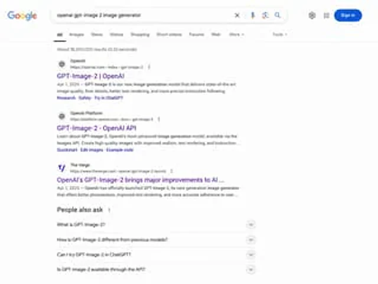

```text
{
  "type": "Web browser screenshot",
  "interface": "Google search results page",
  "header": {
    "logo": "Google",
    "search_bar": {
      "query": "{argument name=\"search query\" default=\"openai gpt-image 2 image generator\"}",
      "icons": [
        "Clear",
        "microphone",
        "camera",
        "search"
      ]
    },
    "right_actions": [
      "Set gears",
      "Application Grid",
      "Blue login button"
    ]
  },
  "navigation_tabs": [
    "all",
    "picture",
    "news",
    "video",
    "Shopping",
    "short videos",
    "forum",
    "Web page",
    "More",
    "tool"
  ],
  "results_stats": "Approximately 18,200,000 results were found (in 0.32 seconds).",
  "search_results": {
    "count": 3,
    "items": [
      {
        "source": "OpenAI",
        "url": "https://openai.com > index > gpt-image-2",
        "title": "{argument name=\"result 1 title\" default=\"GPT-Image-2 | OpenAI\"}",
        "snippet": "{argument name=\"date\" default=\"April 1, 2025\"}— GPT-Image-2 is our brand-new image generation model, providing top-notch image quality, finer details, better text rendering, and more precise instruction following capabilities.",
        "sitelinks": [
          "Research",
          "Safety",
          "Try in ChatGPT"
        ]
      },
      {
        "source": "OpenAI Platform",
        "url": "https://platform.openai.com > docs > gpt-image-2",
        "title": "GPT-Image-2 - OpenAI API",
        "snippet": "Learn about OpenAI's state-of-the-art image generation model, GPT-Image-2, available through the Images API. Create high-quality images with greater realism, better text rendering, and improved instruction compliance…",
        "sitelinks": [
          "Quick Start",
          "Edit Image",
          "Example code"
        ]
      },
      {
        "source": "The Verge",
        "url": "https://www.theverge.com > openai-gpt-image-2-launch",
        "title": "OpenAI's GPT-Image-2 has brought significant improvements to AI...",
        "snippet": "April 1, 2025 — OpenAI officially released GPT-Image-2, its next-generation image generator, offering better photorealism, improved text rendering, and more accurate user instruction compliance…"
      }
    ]
  },
  "people_also_ask": {
    "title": "Related issues",
    "count": 4,
    "questions": [
      "What is GPT-Image-2?",
      "How does GPT-Image-2 differ from previous models?",
      "Can I try GPT-Image-2 in ChatGPT?",
      "Is GPT-Image-2 usable via API?"
    ]
  }
}
```

Model: GPT Image 2
Author: GPT Image 2 Prompts

[ProjectD](https://aitoolsradar.com/en/prompts/96855629248f26) · [Recorded source](https://x.com/Kittymanagmgf/status/2044521189343637602#reversed-1)
 · [Full original metadata and byte evidence](data/projectd-batch-0032.json)

## Google Street View Anomaly Screen Photo

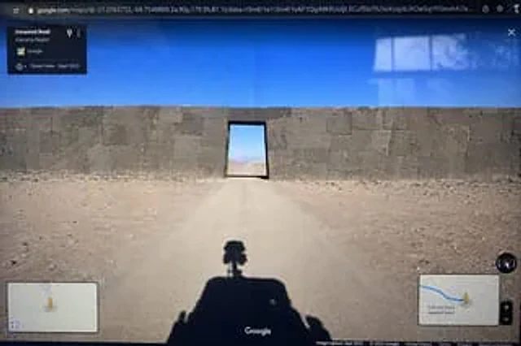

```text
{
  "type": "Photo of a computer monitor displaying the Google Maps Street View interface.",
  "scene": {
    "environment": "{argument name=\"environment\" default=\"Desolate desert landscape under a clear blue sky\"}",
    "subject": "{argument name=\"subject\" default=\"A massive, ancient stone wall, constructed with perfectly fitting megaliths, blocks the dirt road, with a rectangular doorway at its center.\"}",
    "foreground": "The shadows of Google Street View vehicles projected onto the dirt road; the vehicles are equipped with 360-degree panoramic cameras on their roofs."
  },
  "ui_elements": {
    "browser_bar": "The URL bar at the top displays google.com/maps along with latitude and longitude coordinates.",
    "top_left_panel": "A black, semi-transparent information box displays the text \"Unnamed Road\".{argument name=\"region\" default=\"Atacama region\"} \"and \"Street View - September 2022\"",
    "bottom_left_panel": "Mini-map illustration with a yellow Pegman icon",
    "bottom_right_panel": "Displays a blue route, Pegman, zoom controls, and the text \"\".{argument name=\"distance text\" default=\"340 kilometers from the nearest town\"} Mini map illustration",
    "bottom_bar": "The Google logo at the bottom center, the compass icon on the right, and the copyright/photograph date text along the bottom."
  },
  "style_details": "Visible screen reflections and slight display distortion are used to simulate the effect of photographing a physical screen with a smartphone."
}
```

Model: GPT Image 2
Author: GPT Image 2 Prompts

[ProjectD](https://aitoolsradar.com/en/prompts/cb5deb3a96c734) · [Recorded source](https://x.com/MullerScot19970/status/2044613172641108240#reversed-2)
 · [Full original metadata and byte evidence](data/projectd-batch-0032.json)

## Gopal Tiwari #243

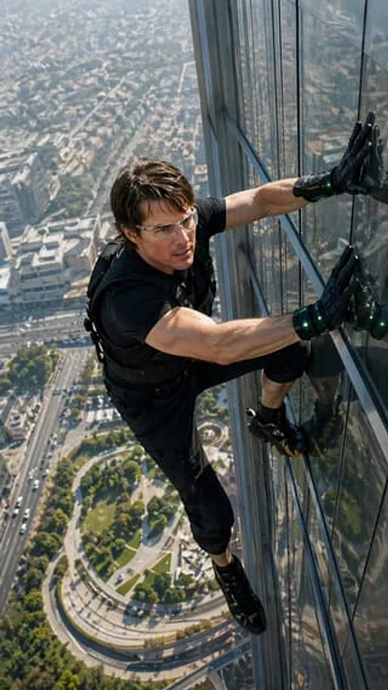

```text
ultra-realistic IMAX-grade cinematic action shot, extreme high-angle perspective looking down from a massive height, 9:16 vertical aspect ratio, a man or woman matching the exact reference face and hairstyle climbing the side of a modern glass skyscraper, body stretched dynamically across the reflective facade, positioned on the right side of the frame, one leg raised gripping the glass while the other is bent for support, both palms pressed tightly against the glass surface creating tension and realism, wearing futuristic clear-framed glasses with subtle reflections, outfit: premium black fitted t-shirt, black tactical pants, futuristic black gloves with protective padding and bright green LED accents glowing softly, black tactical climbing boots with gold detailing and strong grip texture, a sleek black vest or harness securely fitted over the torso adding realism and safety gear detail, expression: determined and slightly tense with focused eyes and head slightly tilted forward, face lock: maintain exact facial structure, proportions, skin tone, hairstyle, and identity from reference with 100% accuracy, preserve micro-details and natural imperfections, no beautification, facial rendering: soft natural skin with visible pores, smooth tonal transitions, subtle subsurface scattering, no smoothing or artificial glow, environment: towering skyscraper with ultra-reflective glass panels showing the subject’s shadow, sky reflections, and a detailed cityscape far below including intricate walkways, a lush green circular park, and distant street traffic with tiny moving cars, strong sense of depth and scale, lighting: bright natural daylight casting sharp directional shadows, high contrast reflections on glass surface, crisp highlights with controlled roll-off, color science: ultra-clean cinematic color grading with high color separation, natural saturation, deep contrast, HDR dynamic range preserving both sky and ground detail, lens: full-frame Sony A7R, 24mm wide-angle lens to exaggerate height and perspective, sharp foreground subject with slight depth falloff into the city below, realism: extreme photorealistic detail, realistic reflections, natural perspective distortion, micro-contrast textures, no HDR overprocessing, no artificial sharpening
negative prompt: distorted face, changed identity, altered hairstyle, flat lighting, dull colors, unrealistic reflections, floating pose, weak grip, plastic skin, over-smooth face, beauty filter effect, low detail, noise artifacts, color banding, extra limbs, incorrect anatomy, blurry subject
```

Model: GPT Image 2
Author: Gopal Tiwari

[ProjectD](https://aitoolsradar.com/en/prompts/8ac2db0383a69d) · [Recorded source](https://x.com/imGopalTiwari/status/2047276802620411960)
 · [Full original metadata and byte evidence](data/projectd-batch-0032.json)

## Goth Anime Girl at Playground Bar

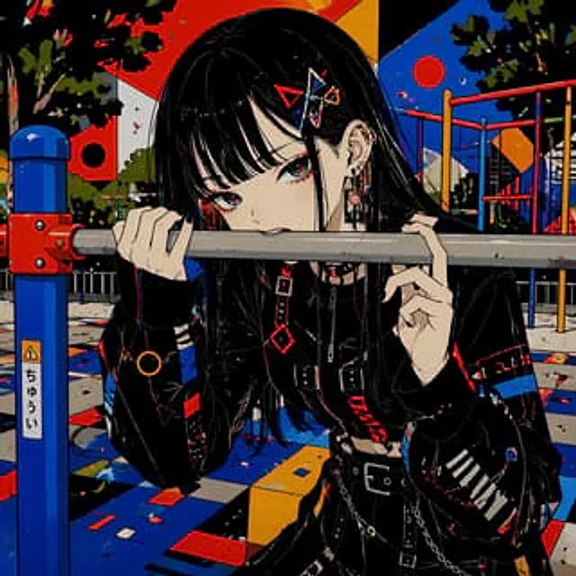

```text
A richly detailed anime-style illustration depicts a fair-skinned gothic girl in a brightly colored urban amusement park. The image is shot in a close-up to medium shot; she leans forward, biting a horizontal metal railing, her expression mischievous and slightly rebellious. She has long, straight hair, the color of which is {argument name="hair color" default="pitch black"} She has bangs, bright red eyes, and a delicate face with her small mouth lightly pressed against the railing. Three geometric hair clips adorn the right side of her hair: a red triangle, a blue angular one, and a small gold hoop. She wears multiple earrings, including several studs and dangling industrial-style earrings. She's dressed in a black, functional gothic outfit, comprising five key pieces: a short black jacket with red and blue stripes, a black choker, a black belted top or dress with a front clasp, a wide belt with metal hardware, and a hanging waist chain. Her sleeves are wide and long, with white striped detailing on one forearm. Her hands grip the railing tightly, one close to her mouth, the other extending to the side, creating a pose that is both intimate and confrontational. The background is an amusement park with brightly colored facilities, including blue pillars, red connectors, yellow and red climbing poles, and a rubber surface composed of bold geometric blocks of blue, red, yellow, white, and black. The background features dark green trees and a dramatic, graphic sky with large, flat shapes in red, orange, blue, black, and white, as well as circular sun-shaped dots, giving the scene a poster-like pop art style. A vertical warning sticker with Japanese text and small warning icons is located on the blue pillar on the left. The composition employs crisp celluloid shadows, sharp lines, subtle glitch textures, oversaturated colors, high contrast, a melancholic cyberpunk gothic atmosphere, and a dynamic composition focusing on the girl's intense gaze and the metal railings.
```

Model: GPT Image 2
Author: GPT Image 2 Prompts

[ProjectD](https://aitoolsradar.com/en/prompts/0a70d752643763) · [Recorded source](https://x.com/hoshi122221/status/2046574669579628812#reversed-0)
 · [Full original metadata and byte evidence](data/projectd-batch-0032.json)

## Goth Girl on Unicorn Ride

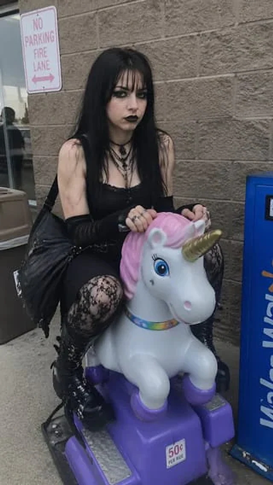

```text
A realistic snapshot, the subject of which is a young man.{argument name="subject aesthetic" default="Gothic style"} The woman had pale skin, long, straight black hair with bangs, and wore heavy black eyeliner and black lipstick. She was expressionless.{argument name="expression" default="deadpan"} Looking directly at the camera, he was sitting in a children's coin-operated {argument name="ride type" default="unicorn"} On the rocking horse. She wore a black lace-trimmed vest, black arm warmers, and multiple necklaces including a choker, black lace pantyhose, and thick-soled black buckled boots. A large black shoulder bag was slung over her arm. The rocking horse was a white unicorn with pink mane, golden horns, and purple hooves, mounted on a purple base, with a sign that read…{argument name="ride cost" default="50¢ PER RIDE"} A small sticker. The scene is outside a shop, with a background of brown cinder brick walls. To the left is a glass door reflecting a figure, a brown trash can, and a sign with red text that reads "...".{argument name="sign text" default="NO PARKING FIRE LANE"} A white sign reads "...". To the right is a blue vending machine. It's a cloudy day with natural light.
```

Model: GPT Image 2
Author: GPT Image 2 Prompts

[ProjectD](https://aitoolsradar.com/en/prompts/85bb7f75176025) · [Recorded source](https://x.com/danieldmai/status/2046263091873075429#reversed-0)
 · [Full original metadata and byte evidence](data/projectd-batch-0032.json)

## Goth Style Transformation

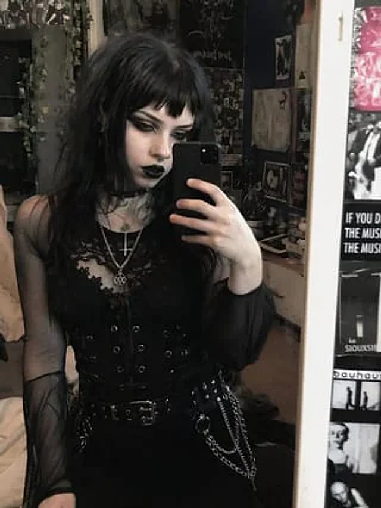

```text
Use REFERENCE_0 to convert the main appearance to{argument name="style" default="Traditional Gothic"} The aesthetic style, while retaining its precise poses, clothing construction, and background. Her hair was changed {argument name="hair color" default="black"} And accompanied by{argument name="hair style" default="choppy bangs"} To create a rich, dark makeup look, especially {argument name="lip color" default="black"} Lipstick and deep, dark eyeshadow were applied, and her skin tone was adjusted to appear slightly paler. Two facial piercings were added: a septal ring and a nose stud. Finally, her layered necklaces were modified.{argument name="necklace pendants" default="Inverted cross and pentagram"} Pendant.
```

Model: GPT Image 2
Author: GPT Image 2 Prompts

[ProjectD](https://aitoolsradar.com/en/prompts/bbb7f6554064e6) · [Recorded source](https://x.com/danieldmai/status/2046170898118435090#reversed-1)
 · [Full original metadata and byte evidence](data/projectd-batch-0032.json)

## Gothic Alice Tea Party Poster

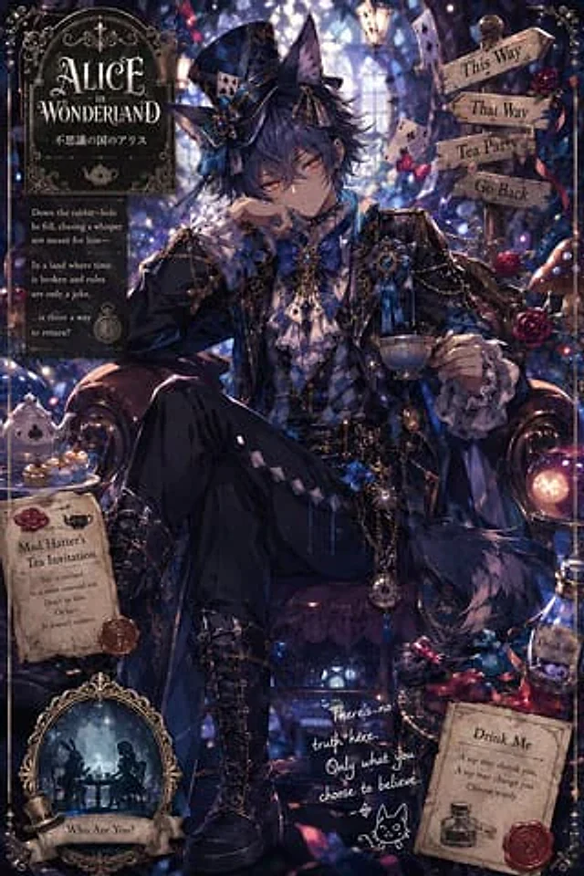

```text
Goal: Create a richly detailed vertical dark-fantasy anime poster for {argument name="story title" default="Alice in Wonderland"}, reimagined as an elegant gothic tea-party character illustration.

Canvas: Tall 2:3 portrait poster, dense decorative composition, cinematic lighting, deep navy, violet, black, antique gold, muted cream, and ruby-red accents. Use ornate Victorian borders, filigree corners, glowing bokeh, floating cards, and magical dust throughout.

Main subject: A beautiful androgynous young male anime character seated in a plush vintage armchair at the center, looking tired, aloof, and melancholic. He has messy dark blue-purple hair, golden amber eyes, pale skin, and black cat ears, with a dark fluffy cat tail visible near the lower right. He wears an extravagant Mad Hatter-inspired gothic aristocrat outfit: oversized checkerboard top hat decorated with playing cards, blue roses, chains, gears, ribbons, and small charms; layered black and navy tailcoat with gold trim; ruffled white lace shirt; blue bow at the neck; ornate brooches; shoulder epaulettes; dangling chains; pocket watches; belts; gloves or lace cuffs; fitted dark trousers; and tall black lace-up platform boots. Pose him lounging with one leg crossed forward, one elbow resting on the chair arm, one hand near his face, and the other holding a delicate teacup.

Environment: A surreal enchanted Wonderland forest or tea-party room with blurred glowing lanterns, blue stained-glass-like lights, mushrooms, roses, antique bottles, tea sets, cakes, clocks, playing cards, ribbons, and magical floating fragments. The mood should feel mysterious, decadent, dreamlike, and slightly ominous.

Layout and text elements: Include exactly 6 distinct readable graphic text panels/signs:
1. Upper-left ornate arched title plaque with the large title “ALICE in WONDERLAND”, a smaller Japanese subtitle “不思議の国のアリス”, a tiny teapot icon, and story text: “Down the rabbit-hole he fell, chasing a whisper not meant for him— In a land where time is broken and rules are only a joke, ...is there a way to return?”
2. Upper-right wooden signpost with 4 arrow signs labeled exactly: “This Way”, “That Way”, “Tea Party”, and “Go Back”.
3. Lower-left parchment invitation card titled “Mad Hatter’s Tea Invitation” with smaller text: “You’re invited to a most unusual tea. Don’t be late. Or be. It doesn’t matter.”
4. Bottom-left ornate oval cameo frame showing a tiny silhouette tea-party scene with two seated figures, labeled “Who Are You?”
5. Lower-center handwritten chalk-like quote: {argument name="center quote" default="There’s no truth here. Only what you choose to believe."} with a small doodle cat face and sparkle marks.
6. Lower-right parchment tag titled “Drink Me” with smaller text: “A sip may shrink you, A sip may change you, Choose wisely.” plus a small potion-bottle illustration.

Additional visible objects: Include floating playing cards with suits, at least 3 red roses, at least 2 pocket watches, a teapot and cupcake tea set near the lower left, a glowing potion bottle labeled “Drink me” on the lower right, a crystal orb or glowing glass lamp, wax seals on parchment notes, ribbons, chains, and blue flowers.

Visual style: Ultra-detailed Japanese anime key visual, ornate gothic lolita / ouji fashion, Victorian fantasy poster design, high-contrast rim lighting, soft painterly rendering, crisp character details, luminous particles, intricate accessories, dramatic depth of field, premium collectible illustration quality.

Constraints: Keep the main character recognizable as the central focus, do not crop off the hat or boots, preserve all 6 text panels/signs, avoid modern objects, avoid minimalism, avoid flat colors, and make the typography decorative but legible.
```

Model: GPT Image 2
Author: あまり🖋️AI &フリー素材配布

[ProjectD](https://aitoolsradar.com/en/prompts/a39cfce66a3dff) · [Recorded source](https://youmind.com/prompts/gothic-alice-wonderland-poster-22204)
 · [Full original metadata and byte evidence](data/projectd-batch-0032.json)

## Gothic Anime Character Sheet

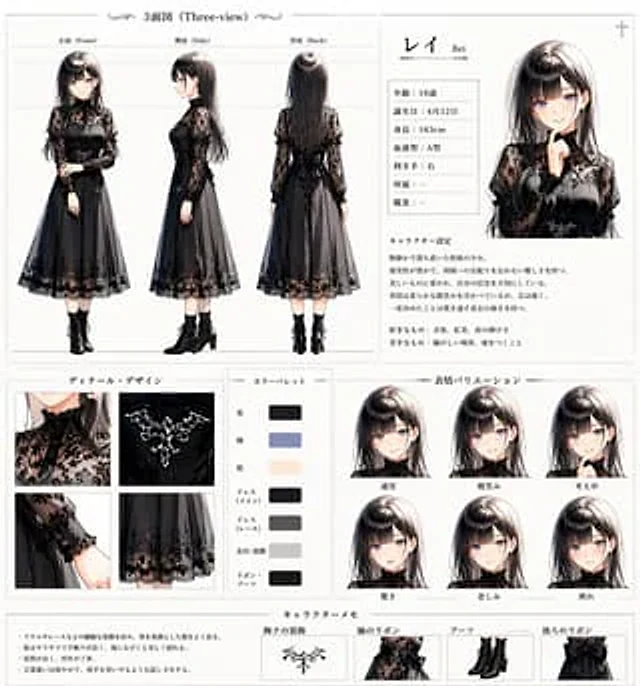

```text
{
  "type": "Anime Character Reference Design Collection",
  "character": {
    "name": "{argument name=\"character name\" default=\"レイ\"}",
    "romanized_name": "Rei",
    "age": "18",
    "birthday": "April 12",
    "height": "163 cm",
    "blood_type": "A",
    "dominant_hand": "right hand",
    "origin": "-",
    "occupation": "-",
    "profile_portrait": "A serene, gothic-style bust of a young woman, her finger lightly touching her lips, her body slightly turned to the left."
  },
  "appearance": {
    "gender_presentation": "young women",
    "hair": {
      "color": "{argument name=\"hair color\" default=\"dark gray-brown\"}",
      "style": "Long, straight hair with soft layers, parted in the middle, glossy and highlighted, with the ends slightly curled inwards."
    },
    "eyes": {
      "color": "Soft lavender ash"
    },
    "skin": {
      "tone": "fair porcelain skin"
    },
    "expression": "A quiet, reserved, and melancholic elegance"
  },
  "outfit": {
    "style": "Elegant Gothic Black Dress",
    "pieces": [
      "High-necked, sheer lace long-sleeved top with floral pattern",
      "Black fitted bustier-style inner layer",
      "Decorative crystal necklace on the chest",
      "Mid-length layered chiffon skirt with floral lace hem",
      "Black ribbon bow at the back waist",
      "Semi-sheer lace cuffs",
      "Black lace-up chunky heeled ankle boots"
    ]
  },
  "layout": {
    "background": "The clean white artbook pages feature thin gray dividing lines and delicate decorative patterns.",
    "sections": [
      {
        "title": "Three-view diagram",
        "position": "Top left",
        "count": 3,
        "labels": [
          "Front",
          "Side view",
          "Back"
        ],
        "content": "Full-body three-view drawing, showing the front, side, and back of the same dress."
      },
      {
        "title": "Personal profile panel",
        "position": "Top right",
        "count": 1,
        "labels": [
          "レイ",
          "Rei"
        ],
        "content": "Name title, small personal profile form and a large portrait"
      },
      {
        "title": "Detailed design",
        "position": "Bottom left",
        "count": 4,
        "labels": [
          "High-necked lace neckline",
          "Chest jewelry details",
          "Lace cuffs and sleeve details",
          "Lace details on the skirt"
        ],
        "content": "Four close-up images of square details"
      },
      {
        "title": "Color scheme",
        "position": "Lower left",
        "count": 7,
        "labels": [
          "hair",
          "pupil",
          "skin",
          "Dress (main color)",
          "Dress (lace)",
          "Metal parts/decoration",
          "Ribbon/Boots"
        ],
        "content": "A vertical color swatch containing seven rectangular color blocks"
      },
      {
        "title": "Expression variants",
        "position": "Lower right",
        "count": 6,
        "labels": [
          "generally",
          "Smile",
          "think",
          "surprise",
          "sad",
          "shy"
        ],
        "content": "Six portraits of heads and shoulders, arranged in two rows of three."
      },
      {
        "title": "Character Notes",
        "position": "bottom",
        "count": 4,
        "labels": [
          "chest decoration",
          "Cuff ribbon",
          "boots",
          "Back waist ribbon"
        ],
        "content": "The left side contains notes, and the right side contains four slender accessory labels."
      }
    ],
    "overall_style": "High-end anime design draft, balanced layout, ample white space, thin gray lines, Japanese-style typography."
  },
  "text_blocks": {
    "character_description": "A mysterious and quiet young woman, exuding a refined yet slightly melancholic aura. She is beautiful and gentle in appearance, yet gives off an elusive and distant impression. Although usually calm and composed, subtle changes in her emotions are revealed in her expressions and movements.",
    "likes": "Music, tea, quiet things",
    "dislikes": "Noisy places, being urged"
  },
  "rendering": {
    "quality": "Exquisite concept art for gpt-image-2",
    "style": "Semi-realistic anime illustrations, featuring delicate lace details, soft shadows, glossy hair rendering, elegant gothic fashion design, and a clean, print-quality presentation."
  },
  "color_theme": "{argument name=\"accent palette\" default=\"Black, charcoal gray, soft lavender gray, light beige, silver\"}"
}
```

Model: GPT Image 2
Author: GPT Image 2 Prompts

[ProjectD](https://aitoolsradar.com/en/prompts/921b5b3e0066ef) · [Recorded source](https://x.com/REd8358/status/2047465795005849818#reversed-1)
 · [Full original metadata and byte evidence](data/projectd-batch-0032.json)

## Gothic Anime Girl with Black Roses


```text
A dark anime-style gothic portrait, the main character is{argument name="character type" default="young women"} The composition is half-body, centered. She has long, multi-layered hair.{argument name="hair color" default="silver-white"} Her hair was styled in messy twin ponytails, with strands falling naturally over her shoulders. She wore two large black ribbon lace hair ornaments, a black gothic dress with puffy sleeves and delicate lace trim, black lace fingerless gloves, and a black leather choker with a metal clasp. Two silver chain necklaces were layered around her neck, one of which had a striking cross pendant. She made a peace sign with her hands raised to her cheeks, her nails painted black, a pose that was both playful and cool. The background was a rich, blood-red gradient, creating a gloomy atmosphere. Five thorny black roses surrounded the figure, with black dripping patterns at the top edge, presenting a highly dramatic gothic horror aesthetic. The artwork uses a high-detail anime illustration style, with sharp lines, soft and dramatic shadows, emphasizing the sheen of the black fabric, pale skin, and a strong red-black contrast. The composition is symmetrical, with a close-up view, creating an overall elegant yet eerie atmosphere.
```

Model: GPT Image 2
Author: GPT Image 2 Prompts

[ProjectD](https://aitoolsradar.com/en/prompts/e9722b238e0519) · [Recorded source](https://x.com/4EXP_/status/2047673458277187801#reversed-0)
 · [Full original metadata and byte evidence](data/projectd-batch-0032.json)

## Gothic Anime Witch Library Ensemble

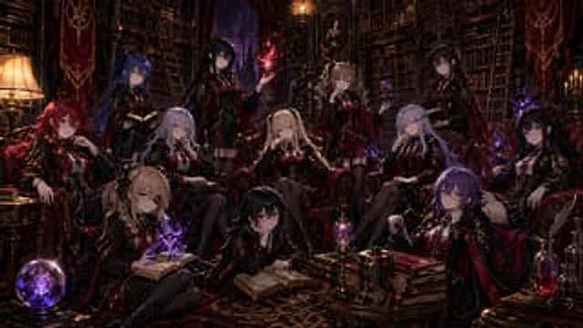

```text
A lavish, dark fantasy anime illustration depicts 11 elegant young women gathering in a grand Gothic library late at night, the composition resembling a portrait of an elite magic academy assembly. The room is filled with towering wooden bookshelves, movable ladders, crimson velvet banners adorned with mysterious gold symbols, carved wainscoting, candlelight, a warm lamp on the far left, and is complemented by red-upholstered armchairs and sofas, piles of ancient books, potion bottles, crystal balls, brass instruments, and a tall arched window offering a view of a deep purple night sky. The overall color scheme is black, crimson, gold, and purple, employing dramatic, understated lighting with rich shadows and brilliant highlights, creating a luxurious yet sinister atmosphere. All 11 characters are dressed in the same mystical academy uniform: black fitted jackets with gold embroidery and badge details, white shirts, red ties or ribbons, multi-layered belts and chains, short skirts or fitted bottoms, black knee-high stockings, and black cloaks lined with crimson. Three people are seated in the center on an ornate red chair and sofa; three stand between the bookshelves at the back; three sit on the floor or near the table in the front row; and two lean against the far left and right edges respectively. The characters have different hair colors and hairstyles, including {argument name="hair color" default="gold"} Colors include silver, black, red, blue, brown, and purple; hairstyles include long curls, twin tails, straight long hair, side ponytails, and layered wispy hair. Each woman should possess a calm, confident, and slightly dangerous expression, as if she were a genius witch or a noble student. The image must contain six clearly visible magical effects or props in use: a red flame floating in the center of the background with a raised hand; a glowing purple sphere held by a standing girl near the upper right center; a rotating purple magic circle above an open book in the lower left; a faint purple arcane flame near the knee of a silver-haired girl in the middle right; a halo of deep purple smoke around a girl leaning against the far right; and a glowing purple crystal lamp or alchemical container on the central coffee table. Additionally, add four extra glass containers in the foreground and on the side tables: a crystal ball in the lower left corner, a tall red potion bottle in the lower right corner, and two small experimental bottles next to it. Place multiple open and closed magic books on the knees, tables, and floor, totaling at least eight books. The central focus is a composed blonde girl, seated in the largest armchair with her legs crossed and her hands near her face, striking a leader's pose. The game employs a highly detailed, polished anime-style rendering, showcasing ultra-fine fabric textures, intricate gold trim, subtle facial shadows, bright eyes, cinematic composition, wide-angle group shots, fantasy key visual quality, a melancholic gothic school setting, a magical sorority, sharp focus, and a lavish environment devoid of modern objects.
```

Model: GPT Image 2
Author: GPT Image 2 Prompts

[ProjectD](https://aitoolsradar.com/en/prompts/c26781b4e47429) · [Recorded source](https://x.com/DeadDonaldDuck/status/2047146319853113681#reversed-0)
 · [Full original metadata and byte evidence](data/projectd-batch-0032.json)

## Gothic Girl at Rainy Window

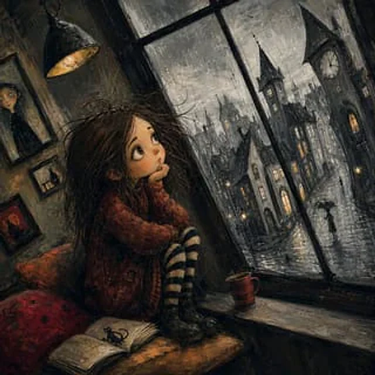

```text
A poignant Gothic illustration, rendered in an impasto oil painting style, depicts a lonely little girl huddled on a cushioned windowsill in a dimly lit old house on a rainy night. She has {argument name="hair color" default="Dark brown"} Her messy curly hair, wearing a{argument name="sweater color" default="Rust Red"} She wears an oversized knit sweater, paired with black and beige striped stockings and dark lace-up boots. Her posture is reserved, knees drawn up to her chest, gazing out of a tall, multi-paned window. Outside the glass is a crooked, haunted European village street with steep roofs, spires, glittering windows, slippery cobblestones, and a prominent clock tower, against a backdrop of a gloomy, stormy sky. The image must include one figure walking alone in the rain with an umbrella. The interior should include an industrial chandelier emitting a warm yellow light in the upper left corner, a red ceramic mug on the windowsill, an open sketchbook on a bench (with a drawing of a black cat visible on the pages), two red pillows, and several small framed paintings on the left wall. The color palette should primarily consist of charcoal gray, dark brown, black, and soft amber, contrasting the warm indoor lighting with the cold, damp outdoors. The composition should be slightly tilted and cinematic, with the girl positioned slightly to the left of the center, and the rain-soaked town occupying the right side of the frame. It emphasizes melancholy, loneliness, gothic fantasy, textured brushstrokes, scratches, dramatic window reflections, and a dark fairytale atmosphere within square compositions.
```

Model: GPT Image 2
Author: GPT Image 2 Prompts

[ProjectD](https://aitoolsradar.com/en/prompts/0f8727881f693e) · [Recorded source](https://x.com/imkkwoo/status/2046805357528506738#reversed-3)
 · [Full original metadata and byte evidence](data/projectd-batch-0032.json)

## Gothic Idol Concert Selfie

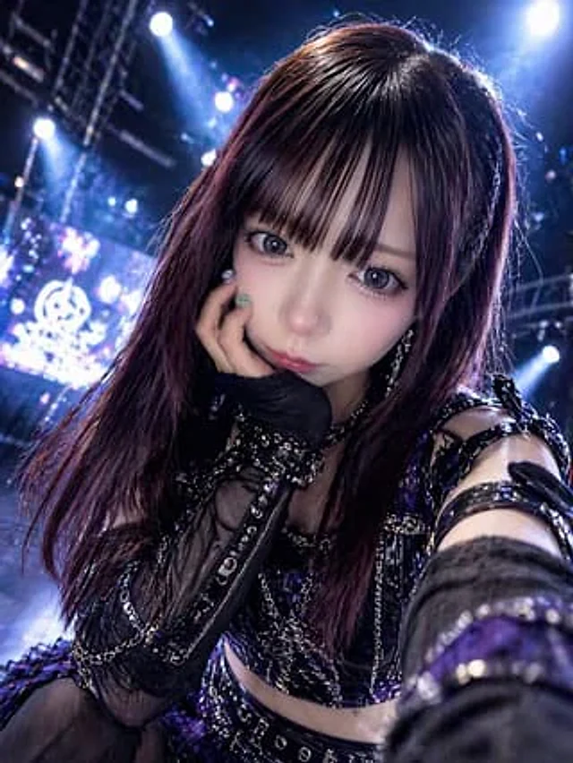

```text
A dramatic, self-portrait-style close-up of a stage scene shows a Japanese idol performer leaning towards the camera from a low angle, her upper body and outstretched arms dominating the frame. She has long, straight to slightly wavy hair, and her hair color is {argument name="hair color" default="dark reddish brown"} Her hair was glossy, and thick, side-swept bangs covered one eye. Her expression was cute and intimate; she placed one hand near her mouth, striking a shy idol pose, as if interacting directly with fans at a concert. She wore a black and dark {argument name="accent color" default="Purple"} The gothic idol stage costume features five clearly visible elements: a shiny, corset-style cropped top with metallic trim, a black belt with silver metal eyelets at the waist, black sheer mesh opera gloves, multiple straps on the upper arms, and a dangling silver chain across the chest and hem. The addition of glossy patent leather, studs, buckles, lace, and layered ruffles creates a highly detailed J-pop or anime concert look. The backdrop is a large indoor live stage with bright blue-white spotlights, smoke, truss installations, and LED screens flashing soft, abstract shapes, creating a strong backlighting and bokeh effect. The cinematic concert photography style employs high contrast, cool lighting with purple-blue highlights, shallow depth of field, slight lens distortion from a close-up arm perspective, dynamic foreground perspective, and vertical hand-held composition. This results in a vibrant, charismatic, and fan-service-oriented visual, much like…{argument name="idol group concept" default="A dark fantasy-style idol live performance"} .
```

Model: GPT Image 2
Author: GPT Image 2 Prompts

[ProjectD](https://aitoolsradar.com/en/prompts/5ec0b9dc2f343f) · [Recorded source](https://x.com/yayoi_bluebare/status/2047523370129035660#reversed-1)
 · [Full original metadata and byte evidence](data/projectd-batch-0032.json)

## Gothic Lolita board game generator

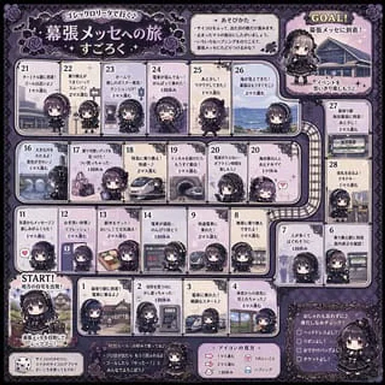

```text
Create a Sugoroku board game with the background set as "{argument name="setting" default="A gothic lolita girl living in the countryside travels to Makuhari to participate in an event."} "
```

Model: GPT Image 2
Author: GPT Image 2 Prompts

[ProjectD](https://aitoolsradar.com/en/prompts/624386f45b84e7) · [Recorded source](https://x.com/kurageanime/status/2047317272725979408)
 · [Full original metadata and byte evidence](data/projectd-batch-0032.json)

## Gothic Lolita Portrait at Convenience Store

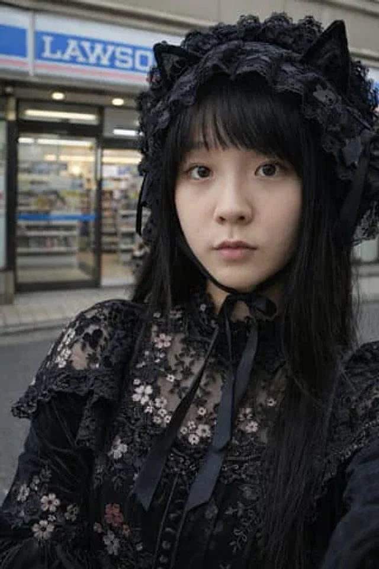

```text
A realistic close-up portrait, the subject of which is{argument name="subject" default="Young Japanese women"} She had straight black hair and bangs, and was wearing a {argument name="outfit" default="Black Gothic Lolita dress with floral embroidery"} Wearing a{argument name="headwear" default="Black lace cat ear headdress"} She tied a black ribbon around her chin. She wore a face mask.{argument name="expression" default="Neutral expression"} Look directly into the camera. The background is a blurry street scene, and you can see a {argument name="background" default="Lawson convenience store"} The storefront features a blue and white signboard and glass doors. The natural and soft lighting creates a realistic, snapshot-like aesthetic.
```

Model: GPT Image 2
Author: GPT Image 2 Prompts

[ProjectD](https://aitoolsradar.com/en/prompts/ad85e7d5c8c89e) · [Recorded source](https://x.com/Kukkuree/status/2044367336816406570#reversed-0)
 · [Full original metadata and byte evidence](data/projectd-batch-0032.json)

## Gothic Maid Acrobatic Kick

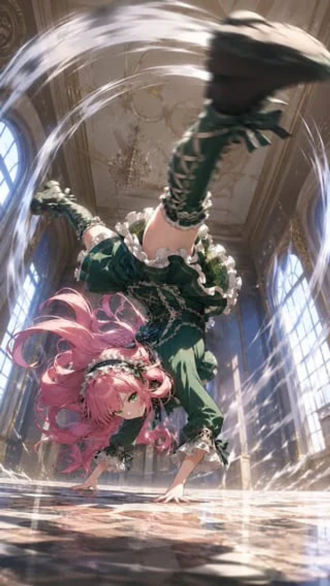

```text
Create a dynamic vertical anime action illustration of a {argument name="character type" default="pink-haired gothic lolita maid girl"} performing an acrobatic one-handed breakdance handstand kick inside a grand European palace ballroom. The camera is extremely low near the polished marble floor, looking upward with dramatic foreshortening: one booted leg thrusts close to the viewer and is heavily motion-blurred, the other leg extends backward, while one hand presses on the reflective floor and the character looks toward the viewer with a confident fierce expression. She has long flowing {argument name="hair color" default="rose pink"} twin-tail hair whipping through the air, green eyes, frilly white maid headband, and an ornate {argument name="outfit color" default="deep emerald green"} gothic lolita maid dress with puff sleeves, ruffled white lace trim, corset-like bodice, bows, layered skirt, stockings, and lace-up heeled boots. Add bright white circular speed trails and arcing wind ribbons around her spinning body to emphasize high-speed action. The environment is a luxurious sunlit ballroom with tall arched windows on both sides, gilded wall details, high ceiling, chandeliers, dust motes, shafts of light, and glossy patterned marble reflections. Use cinematic lighting, extreme perspective, intense motion blur, sharp focus on the face and supporting hand, detailed fabric folds and lace, elegant fantasy anime rendering, high detail, vertical composition, dramatic action energy, no text, no watermark.
```

Model: GPT Image 2
Author: ねね*AIcreator

[ProjectD](https://aitoolsradar.com/en/prompts/91f11d627c0392) · [Recorded source](https://youmind.com/prompts/gothic-maid-action-kick-18863)
 · [Full original metadata and byte evidence](data/projectd-batch-0032.json)

## Gothic Mystery Movie Poster

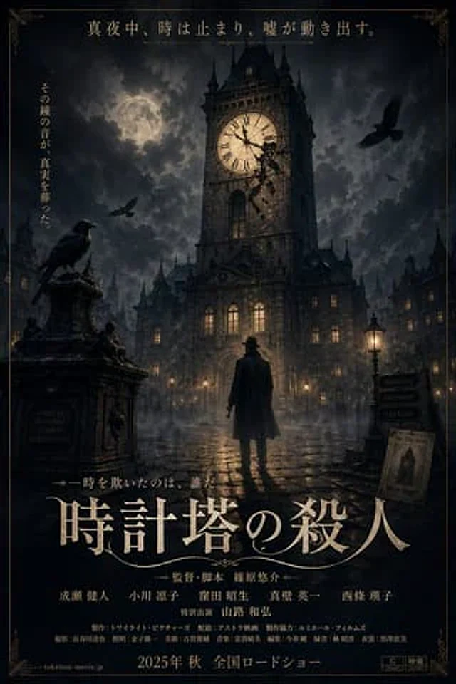

```text
A dark, gothic suspense movie poster with a cinematic feel. In the center of the image, a man in a trench coat and fedora, with his back to the viewer, gazes up at a magnificent yet oppressive Gothic clock tower. The clock face glows, the surrounding structure is collapsing, and dark fragments scatter and fall. The scene is set in a misty, damp cobblestone square on a nighttime day, illuminated by warm yellow streetlights and light filtering through the surrounding European-style buildings. A full moon pierces through the clouds. Three crows are depicted: one perched on a stone tablet on the left, and two flying in the sky. The stone tablet on the left is inscribed with the words "VERITAS IN UMBRA, TEMPUS NEMINI PARET". On the right is a wooden signpost with three directional signs: "Marktplatz", "Uhrenturm", and "Alte Gasse", next to which lies a newspaper with the words "Die Uhr steht." and "Wer lügt?". The poster uses an elegant, slightly worn serif Japanese font. The horizontal slogan at the top reads:{argument name="top tagline" default="At midnight, time stops, and lies begin to move."} The vertical slogan in the upper left corner is:{argument name="side tagline" default="The sound of that bell buried the truth."} The main title in the center below is {argument name="main title" default="The Clock Tower Murders"} Below the title is a smaller tagline, "Who deceived me?", followed by a realistic credits list including the director, actors, and crew members. The release information is displayed at the very bottom.{argument name="release date" default="Coming to theaters nationwide in Fall 2025"} The website URL and rating are displayed alongside the image. The entire poster is decorated with a delicate, ornate gold border.
```

Model: GPT Image 2
Author: GPT Image 2 Prompts

[ProjectD](https://aitoolsradar.com/en/prompts/2c19744a7800f2) · [Recorded source](https://x.com/masapark95/status/2046169303905632417#reversed-3)
 · [Full original metadata and byte evidence](data/projectd-batch-0032.json)

## Gothic Sorceress in Ruined Cathedral

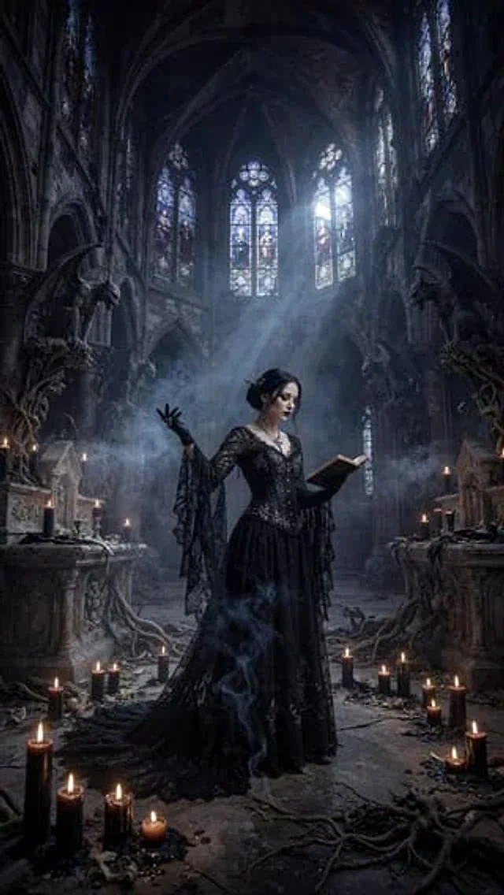

```text
A dark Gothic fantasy scene set within a vast, abandoned cathedral, framed in a vertical full-body composition. At the center stands a mysterious witch, clad in an elegant Victorian black gown with a fitted bodice, delicate silver embroidery, sheer lace sleeves, long lace garlands cascading from her arms, black gloves, and a long train. Her hair is styled in a neat dark updo, adorned with exquisite hair ornaments and fine jewelry. She holds an open spellbook in one hand, while the other is gracefully raised as if casting a spell. A low-hanging mist and swirling smoke surround her. The cathedral's interior is grand and dilapidated, featuring soaring pointed arches, ribbed vaults, cracked stone floors, and broken tombs or altars on either side. Thick, twisted tree roots spread across the ground and entwine the stone structures. Two large gargoyle statues, symmetrically placed high on either side, overlook the scene. Numerous black candles with warm orange flames are scattered throughout the foreground and middle ground, creating a sense of ritual. In the background, tall stained-glass windows let in cool blue sunlight, creating dramatic crepuscular rays that contrast sharply with the candlelight. The overall atmosphere is somber, mysterious, cinematic, solemn, and richly detailed, presenting realistic textures, deep shadows, volumetric lighting, atmospheric haze, deep blue-gray tones, and exquisitely detailed Gothic architecture.
```

Model: GPT Image 2
Author: GPT Image 2 Prompts

[ProjectD](https://aitoolsradar.com/en/prompts/0fdb92f5ea2cee) · [Recorded source](https://x.com/richsparks/status/2046850211880772004#reversed-1)
 · [Full original metadata and byte evidence](data/projectd-batch-0032.json)

## Gothic VTuber Logo Grid

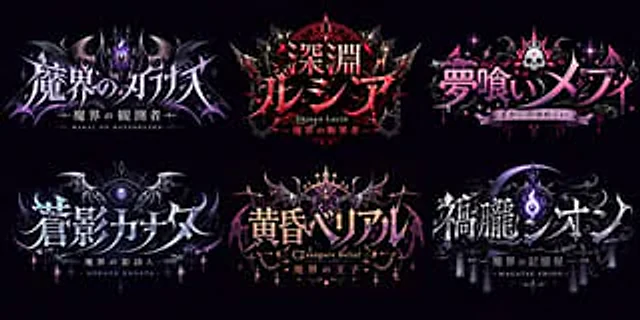

```text
{
  "type": "VTuber Logo Design Concept",
  "theme": "{argument name=\"main theme\" default=\"Gothic dark fantasy\"}",
  "background": "{argument name=\"background color\" default=\"pure black\"}",
  "layout": "A 2x3 grid containing 6 different logo designs",
  "logos": [
    {
      "position": "Top left",
      "main_text": "{argument name=\"logo 1 main text\" default=\"Messiah of the Demon World\"}",
      "sub_text": [
        "Observer of the Demon World",
        "MAKAI NO KANSOKUSHA"
      ],
      "colors": [
        "Purple",
        "silver"
      ],
      "motifs": [
        "horn",
        "Glowing purple eyes",
        "bat wings"
      ]
    },
    {
      "position": "Upper-middle",
      "main_text": "{argument name=\"logo 2 main text\" default=\"Abyssal Presia\"}",
      "sub_text": [
        "Shinen Lucia",
        "The Punisher of the Demon World"
      ],
      "colors": [
        "red",
        "black",
        "gold"
      ],
      "motifs": [
        "chain",
        "Demon Spikes",
        "Glowing red runes"
      ]
    },
    {
      "position": "Top right",
      "main_text": "{argument name=\"logo 3 main text\" default=\"Dream Eater Mephi\"}",
      "sub_text": [
        "まかいのゆめくい"
      ],
      "colors": [
        "pink",
        "Purple"
      ],
      "motifs": [
        "Skull with a crown",
        "bat wings",
        "Flashing effect"
      ]
    },
    {
      "position": "Bottom left",
      "main_text": "Aokage Kanata",
      "sub_text": [
        "Shadow Poet of the Demon World",
        "- AOKAGE KANATA -"
      ],
      "colors": [
        "blue",
        "silver"
      ],
      "motifs": [
        "Giant central eye",
        "Silver bat wings",
        "Gothic architecture"
      ]
    },
    {
      "position": "Middle to lower",
      "main_text": "Twilight Belial",
      "sub_text": [
        "Tasogare Belial",
        "Prince of the Demon World"
      ],
      "colors": [
        "gold",
        "Purple"
      ],
      "motifs": [
        "crown",
        "bat wings",
        "Hanging gems"
      ]
    },
    {
      "position": "Bottom right",
      "main_text": "Shion",
      "sub_text": [
        "The Memory House of the Demon World",
        "- MAGATSU SHION -"
      ],
      "colors": [
        "silver",
        "Purple",
        "black"
      ],
      "motifs": [
        "new moon",
        "Glowing purple flames",
        "chain",
        "Dark smoke"
      ]
    }
  ]
}
```

Model: GPT Image 2
Author: GPT Image 2 Prompts

[ProjectD](https://aitoolsradar.com/en/prompts/f621205e690938) · [Recorded source](https://x.com/hAru_mAki_ch/status/2044787289956753739#reversed-0)
 · [Full original metadata and byte evidence](data/projectd-batch-0032.json)

## Gourmet Burger Commercial Photography

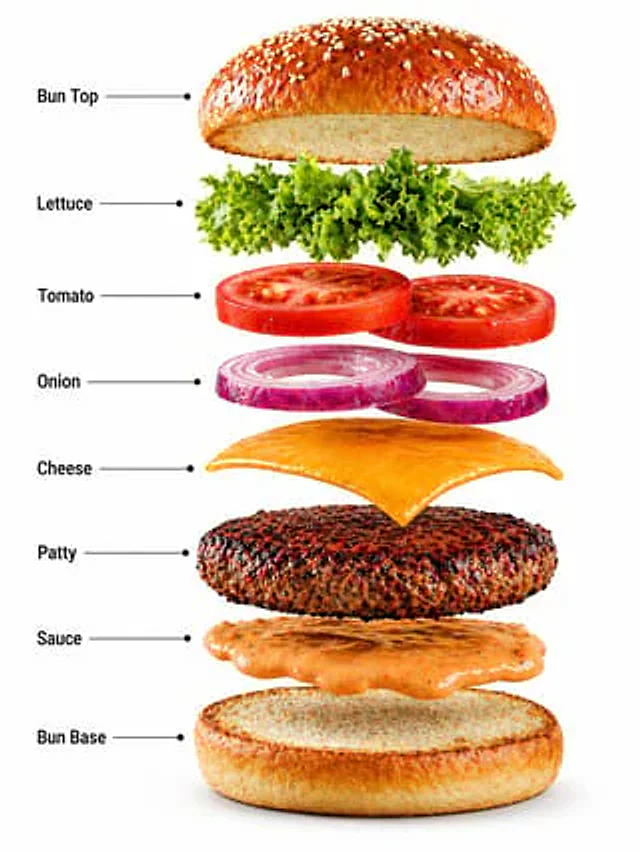

```text
A high-end fast-food commercial product photograph, featuring a centered premium cheeseburger against a warm, seamless gold studio backdrop. The burger is topped with a glossy sesame bun, fresh lettuce, tomato slices, onion rings, melted cheese, a juicy grilled beef patty, and a rich sauce. Soft studio lighting, delicate shadows, mouthwatering textures, sharp focus, hyper-realistic food advertising photography, simple composition, 8K resolution. Create a hyper-realistic, vertically exploding infographic composition for a premium cheeseburger. At the top is a crispy, glossy sesame bun, below which are fresh green lettuce leaves, tomato slices, onion rings, melted cheese, a juicy grilled beef patty, a layer of sauce, and a soft bun base. All ingredients are evenly distributed and perfectly vertically aligned. Warm yellow seamless studio background, soft commercial food lighting, delicate and realistic shadows beneath each suspended element, ultra-clear focus, DSLR macro food photography, high-end fast-food advertising aesthetics, 8K resolution. Add concise infographic text labels and use thin leaders to point to each element. The label names are as follows: "Bun Top", "Lettuce", "Tomato", "Onion", "Cheese", "Patty", "Sauce", and "Bun Base".
```

Model: GPT Image 2
Author: GPT Image 2 Prompts

[ProjectD](https://aitoolsradar.com/en/prompts/d4f0c9b87752c1) · [Recorded source](https://x.com/Strength04_X/status/2046851786297037305)
 · [Full original metadata and byte evidence](data/projectd-batch-0032.json)

## GPT Image 2 3D Social Profile Card Diorama

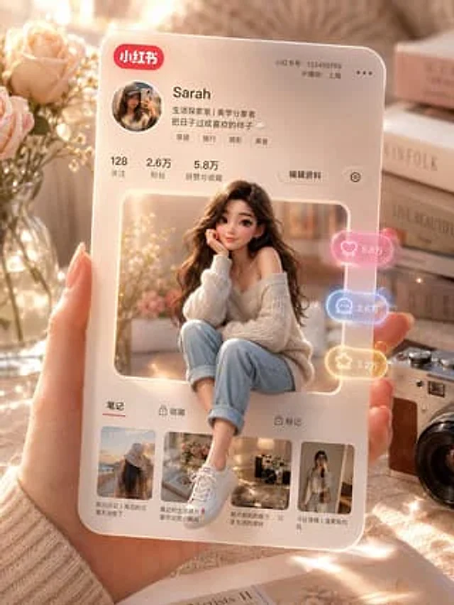

```text
一只手中握着一张3D小红书个人资料卡，卡片中间方形镂空，一个女孩随意地坐在卡片镂空的边缘，温暖的米色和柔和的粉彩美学背景，逼真的深度和阴影，电影般的柔和光线，闪亮光滑的纹理，小红书风格的UI，漂浮的互动图标（点赞、评论、分享）带有发光的霓虹效果，闪光和光晕，背景中温馨的美学布置包括书籍、花瓶里的花和一台复古相机，梦幻氛围，Pixar风格+半现实主义融合，超高品质，4K，居中构图，高端影响者美学
```

Model: GPT Image 2
Author: Mr Gafish / @MrGafish

[ProjectD](https://aitoolsradar.com/en/prompts/cf7e50e2133e49) · [Recorded source](https://x.com/MrGafish/status/2052323461268467860)
 · [Full original metadata and byte evidence](data/projectd-batch-0032.json)

## GPT Image 2 Cinematic Spotlight Museum Portrait

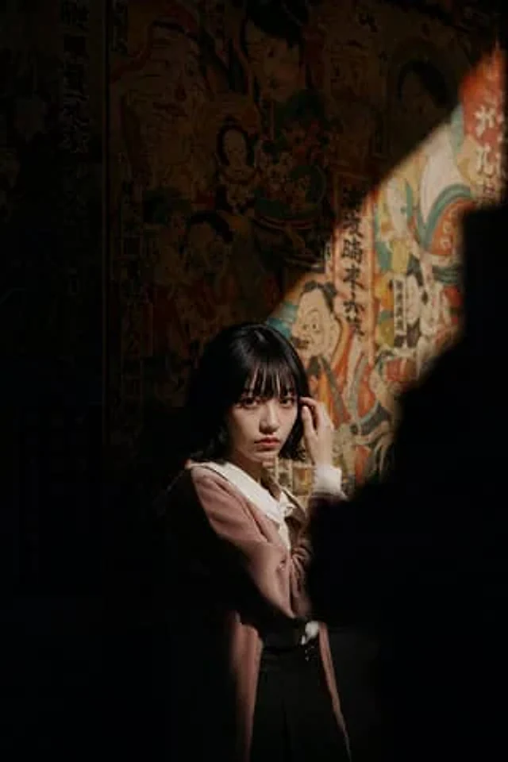

```text
Use my reference photo to preserve the exact facial features, hairstyle, bangs, facial proportions, skin tone, body posture, and overall silhouette with high identity consistency.

Cinematic portrait of a woman standing alone inside a dark exhibition room. She wears a vintage white shirt layered with a soft pink outer jacket and a black vintage-textured skirt. Minimal makeup. Front-profile pose with her body facing the camera, relaxed posture, one shoulder slightly lowered, hands gently adjusting her hair. Calm, mysterious expression with an intellectual and elegant aura.

She is positioned in the lower center of the frame, surrounded by darkness. A single dramatic diagonal spotlight cuts across the scene from the upper right to the lower left, illuminating only half of her body while the rest fades into shadow. Behind her is a colorful vintage Japanese mural wall filled with retro cartoon illustrations and traditional artistic details.

Foreground shadows naturally frame the composition like torn darkness, creating a moody museum atmosphere with lonely artistic energy and a contemplative cinematic mood. Realistic photography with subtle film grain, analog texture, muted blacks, and vibrant mural accents.

Camera angle: eye-level shot, medium-close portrait framing, subject captured at approximately a 70-degree side profile angle, slight distance from the subject for environmental storytelling, centered cinematic composition.

Camera settings: cinematic low-light photography, shallow depth of field, realistic shadow falloff, Kodak Portra film color grading.

Lighting: harsh focused spotlight from the upper right creating a strong diagonal beam and deep high-contrast shadows, minimal ambient light, rich blacks, soft warm highlights along the face and glasses edges.

Vibe: mysterious, artistic, museum-core aesthetic, intelligent quiet energy, melancholic cinematic atmosphere, indie film still, luxury editorial photography, solitary nighttime mood, understated elegance.

Style: ultra-realistic cinematic photography, analog grain, editorial fashion portrait, natural skin texture, subtle imperfections, realistic color science, masterpiece quality.

Negative prompt: anime, smiling, overexposed lighting, extra limbs, bad anatomy, overly colorful outfit, cyberpunk neon, blurry face, low quality, distorted hands, unrealistic skin, HDR overload, exaggerated makeup, busy composition, duplicate person.
```

Model: GPT Image 2
Author: Oogie / @oggii_0

[ProjectD](https://aitoolsradar.com/en/prompts/2f08b90ca30c72) · [Recorded source](https://x.com/oggii_0/status/2056647551470997670)
 · [Full original metadata and byte evidence](data/projectd-batch-0032.json)

## GPT Image 2 Comparison Poster

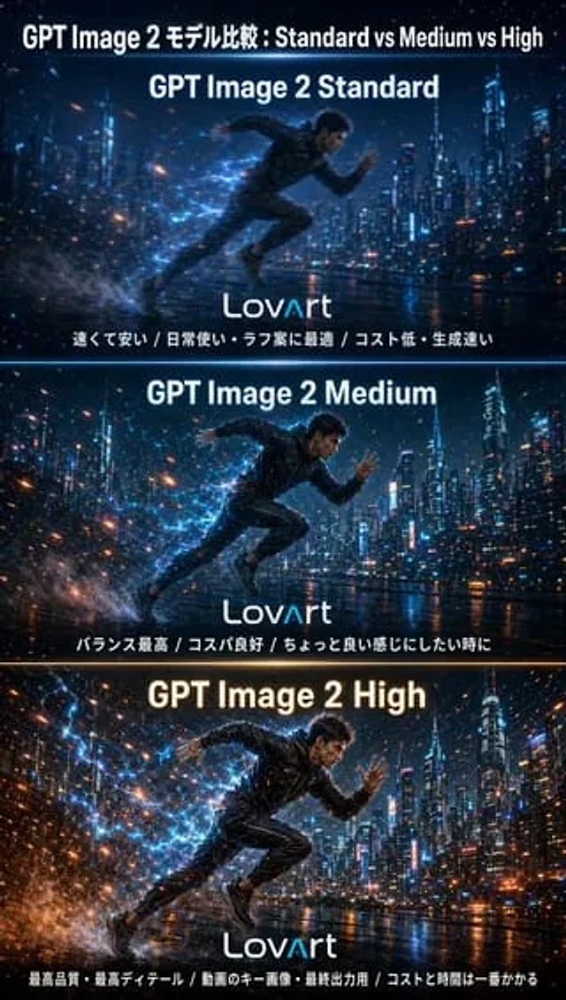

```text
{
  "type": "AI Model Comparison Infographic Poster",
  "topic": "GPT Image 2 Quality Comparison",
  "style": "A futuristic, cinematic-quality tech ad, featuring sophisticated social media comparison images and high-contrast neon night scenes.",
  "canvas": {
    "orientation": "vertical",
    "aspect_ratio": "9:16"
  },
  "headline": {
    "text": "{argument name=\"headline text\" default=\"GPT Image 2 Quality Comparison: Standard vs Medium vs High\"}",
    "position": "Centered at the top",
    "color": "White",
    "font": "Bold sans-serif font"
  },
  "layout": {
    "sections": [
      {
        "title": "GPT Image 2 Standard",
        "position": "Top panel",
        "count": 1,
        "labels": [
          "Fast and economical / Suitable for everyday use and drafts / Low cost and fast generation speed"
        ],
        "divider_color": "cool blue"
      },
      {
        "title": "GPT Image 2 Medium",
        "position": "Middle panel",
        "count": 1,
        "labels": [
          "Optimal balance / High cost-performance ratio / Suitable for scenarios requiring enhanced quality"
        ],
        "divider_color": "cool blue"
      },
      {
        "title": "GPT Image 2 High",
        "position": "Bottom panel",
        "count": 1,
        "labels": [
          "Highest quality and detail / Suitable for video keyframes and final output / Highest cost and time consumption"
        ],
        "divider_color": "warm orange"
      }
    ],
    "panel_count": 3
  },
  "scene": {
    "setting": "A futuristic city skyline on a rainy night, with wet and reflective ground and waterfront, dense skyscrapers adorned with glowing windows and blue neon lights.",
    "subject": "Each panel features a male athlete running from left to right.",
    "subject_count": 1,
    "pose": "The dynamic running posture, with one arm extended forward and the other swinging back, and the body leaning forward, conveys a strong sense of movement.",
    "wardrobe": "Dark, slim-fitting, futuristic sportswear, featuring a textured jacket and trousers, and dark sneakers.",
    "face": "Deliberately softened or anonymized, not the visual focus",
    "effects": [
      "The body was surrounded by electric blue particle trails",
      "Sparks and beams of light burst forth behind him",
      "Water splashed up by footsteps",
      "Reflection on the wet pavement",
      "Dynamic blur emphasizing speed"
    ]
  },
  "comparison": {
    "top_panel": "The details are slightly softer and simpler, presenting a sense of lower cost and faster speed while maintaining the same composition.",
    "middle_panel": "A greater balance between detail and clarity has been achieved, improving rendering and lighting effects while preserving the same scene.",
    "bottom_panel": "With the richest details, the finest textures, the strongest contrast of light and shadow, and the densest particle and reflection effects, it presents the ultimate cinematic quality."
  },
  "branding": {
    "logo_text": "{argument name=\"brand text\" default=\"LovArt\"}",
    "count": 3,
    "placement": "Each panel is centered at the bottom.",
    "color": "White with subtle blue accents"
  },
  "color_palette": {
    "primary": [
      "Deep Navy Blue",
      "Electric Blue",
      "blue",
      "White"
    ],
    "accent": [
      "Orange Spark",
      "Amber highlight"
    ]
  },
  "rendering": {
    "finish": "High-end digital illustrations with semi-realistic details",
    "sharpness": "Gradually increasing from top to bottom",
    "lighting": "Illuminated neon outline lighting, urban background lighting, and reflected highlights from wet surfaces."
  }
}
```

Model: GPT Image 2
Author: GPT Image 2 Prompts

[ProjectD](https://aitoolsradar.com/en/prompts/72b29871dff513) · [Recorded source](https://x.com/akiyoshisan/status/2046756885219668097#reversed-0)
 · [Full original metadata and byte evidence](data/projectd-batch-0032.json)

## GPT Image 2 cozy claymation style prompt

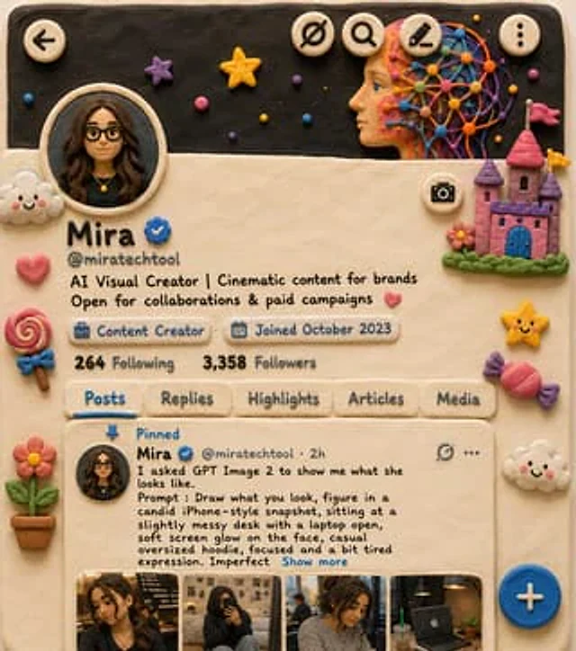

```text
Recreate the scene as a cozy claymation-style world made from soft modeling clay. Every object should have handmade textures, rounded shapes, fingerprints, and soft lighting like a stop-motion movie. Use warm pastel colors and a cute cinematic atmosphere.
```

Model: GPT Image 2
Author: Mira / @miratechtool

[ProjectD](https://aitoolsradar.com/en/prompts/47b062a1f3451d) · [Recorded source](https://x.com/miratechtool/status/2052033236964950111)
 · [Full original metadata and byte evidence](data/projectd-batch-0032.json)

## GPT Image 2 cute 3D kneaded clay icon prompt

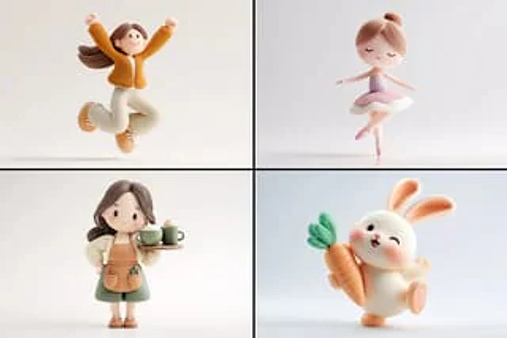

```text
Cute 3D render of a [subject], matte surface, kneaded clay icon style, simple stylized design, [doing action], [emotion or mood], rounded proportions, soft sculpted details, playful body language, vibrant [color1], [color2], and [color3] accents, clean white background, minimal composition, soft ambient lighting, subtle shadow, charming character design, high-resolution, polished toy-like aesthetic
```

Model: GPT Image 2
Author: Amira Zairi / @azed_ai

[ProjectD](https://aitoolsradar.com/en/prompts/e7b8fa3ccc46fb) · [Recorded source](https://x.com/azed_ai/status/2051965725452239128?s=20)
 · [Full original metadata and byte evidence](data/projectd-batch-0032.json)

## GPT Image 2 encyclopedia-style educational infographic prompt

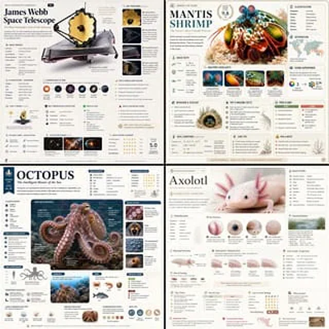

```text
Based on { TOPIC }, create a high-quality vertical “encyclopedia-style educational infographic image.”

This image should NOT look like a regular poster or a simple illustration. Instead, it should feel like a structured knowledge guide that combines:

the feeling of a collectible reference handbook

a modern encyclopedia page

a lifestyle knowledge card

and a highly shareable social-media infographic

The overall style should resemble a premium natural-history guidebook mixed with modern editorial infographic design.

The image should include:

One beautiful and highly detailed main subject image

Several zoomed-in detail sections highlighting important features

Multiple modular information panels with rounded corners

Clear title hierarchy and highlighted key labels

Concise yet information-rich encyclopedia content

Visual scoring systems, quick summaries, or “Top 5” modules

The information sections should automatically adapt to the topic. Select and combine relevant categories such as:

Basic profile

Classification / taxonomy

Physical characteristics

Behavior / ecology / habits

Structure or formation mechanisms

Growth conditions or usage methods

Care, maintenance, or optimization tips

Risks, warnings, and important notes

Suitable users or application scenarios

Pros and cons comparison

Quick rating tags or summary cards

Visual requirements:

Clean light-colored background

Soft and elegant color palette

Gentle shadows

Small refined icons

Rounded information boxes

Organized editorial layout

High information density without feeling crowded

Comfortable reading experience

The final result should feel like a real publishable encyclopedia knowledge card designed for reading, collecting, and creating as part of a consistent series — NOT like a commercial advertisement poster.

The image must strongly emphasize:

“knowledge integration + modular information design + handbook/reference-style presentation.”
```

Model: GPT Image 2
Author: Oogie / @oggii_0

[ProjectD](https://aitoolsradar.com/en/prompts/eadc9bd8781924) · [Recorded source](https://x.com/oggii_0/status/2051889025229930547)
 · [Full original metadata and byte evidence](data/projectd-batch-0032.json)

## GPT Image 2 endangered animal infographic prompt

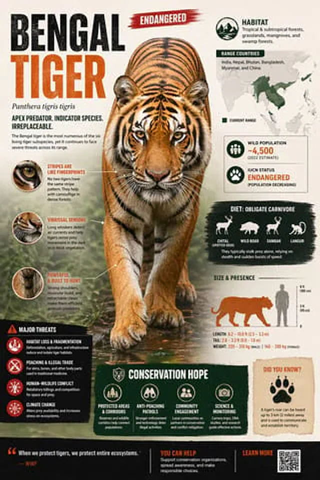

```text
Create a visually rich infographic about an endangered animal. Start by finding one online, research its habitat, diet, and unique traits. Present information through annotated visuals and structured callouts, not generic sections. Style it like a bold graphic illustration: a detailed, photorealistic central animal as the focal point, supported by diagrams, callouts, and concise text elements. Use clean backgrounds and a mix of photorealism with strong graphic elements (shapes, icons, color blocking) in a layered composition. Make it dense, tactile, and professionally authored.
```

Model: GPT Image 2
Author: Mr Das / @MrDasOnX

[ProjectD](https://aitoolsradar.com/en/prompts/ff23503b4fda3a) · [Recorded source](https://x.com/MrDasOnX/status/2052064402866851981)
 · [Full original metadata and byte evidence](data/projectd-batch-0032.json)

## GPT Image 2 FACS action unit expression grid prompt

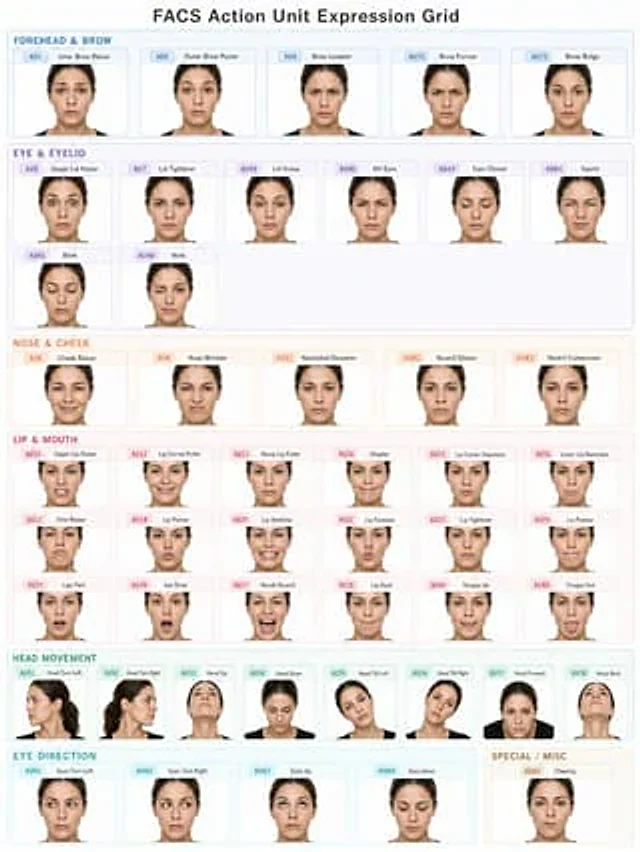

```text
Create a clean educational FACS Action Unit expression grid featuring a realistic adult female character.

Use minimal studio lighting, neutral white background, high readability, professional facial anatomy reference sheet aesthetic, realistic skin texture, consistent identity across all panels.

COLOR SYSTEM:
Use soft pastel color coding for categories while keeping the overall sheet minimal and elegant.

Forehead & Brow AUs:
soft pastel blue

Eye & Eyelid AUs:
soft pastel lavender

Nose & Cheek AUs:
soft pastel peach

Lip & Mouth AUs:
soft pastel pink

Head Movement AUs:
soft pastel mint
```

Model: GPT Image 2
Author: Koda / @aimikoda

[ProjectD](https://aitoolsradar.com/en/prompts/8b427d2a4e030c) · [Recorded source](https://x.com/aimikoda/status/2052470692545982487)
 · [Full original metadata and byte evidence](data/projectd-batch-0032.json)

## GPT Image 2 Identity-Preserving Portrait Prompt

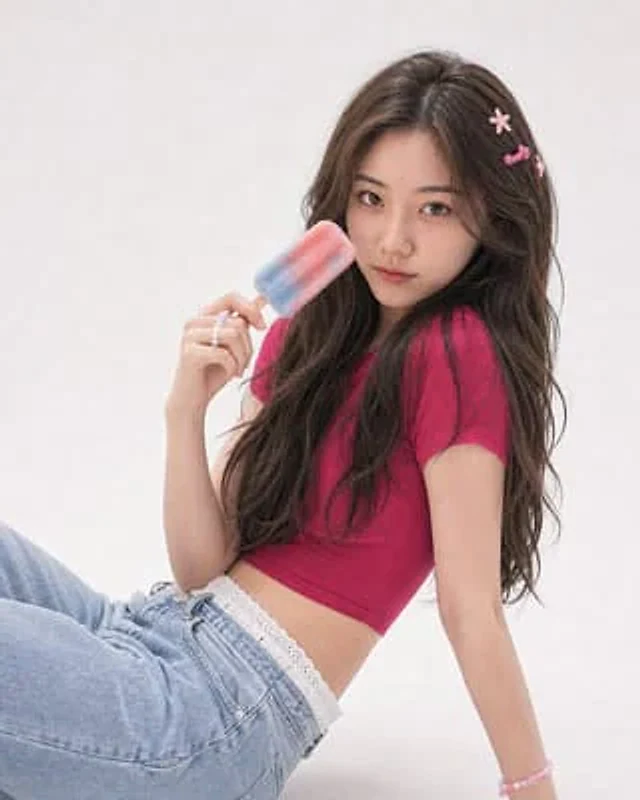

```text
请只把我上传的照片作为人物身份参考，用于保留本人真实长相。不要保留原照片里的背景、衣服、道具、坐姿和拍摄环境，请重新生成一张全新的{argument name="写真类型" default="鬼马少女棚拍写真"}。

请严格保留本人真实身份特征，包括脸型、五官比例、眼睛、鼻子、嘴唇、肤色、年龄感、发际线、发型基础和整体气质，不要变成陌生人，不要欧美化，不要过度美颜，不要 AI 假脸。

发型请根据上传照片自然延展：
- 头发长度保持同一等级
- 是否有刘海遵循原图
- 如果原图是黑发，请处理为深棕黑、黑茶色或自然深咖色，不要纯黑死黑
- 只做写真化优化，不要大幅换发型

妆容统一为{argument name="妆容风格" default="韩系鬼马少女妆"}：
清透奶油肌，自然平眉，浅粉棕或蜜桃粉眼妆，卧蚕明显，纤长睫毛，细眼线，大面积粉色或蜜桃粉腮红延伸到眼下并带一点鼻尖红晕，嘴唇为水润草莓粉或蜜桃粉。整体甜、灵、俏皮，不要浓妆，不要欧美妆。

整体风格为{argument name="视觉风格" default="韩系少女杂志感、鬼马感、甜酷混合、精致棚拍写真"}。背景为浅灰白或奶白色无缝摄影棚背景，光线柔和明亮，画面干净通透，带轻微胶片颗粒感和 editorial 质感。
```

Model: GPT Image 2
Author: 麻酱AI实验室

[ProjectD](https://aitoolsradar.com/en/prompts/1298f69c2d1602) · [Recorded source](https://youmind.com/prompts/gpt-2-identity-preserving-portrait-18577)
 · [Full original metadata and byte evidence](data/projectd-batch-0032.json)

## GPT Image 2 Interior Design Mood Board Generator

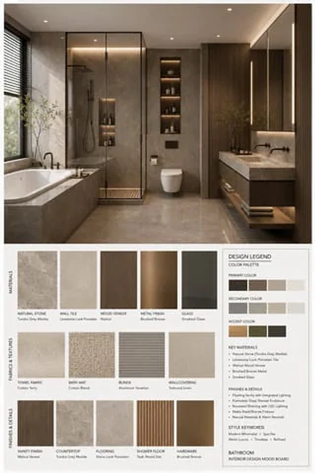

```text
（室内设计情绪板生成器 / Interior Design Mood Board Generator）
你是一名专业的室内设计 Mood Board 创作者。请基于用户提供的 [Space Type] 室内设计照片，生成一张 竖版 3:4 的高端室内设计情绪板。整体视觉参考专业室内设计提案图，呈现 [Style Keywords] 的审美特征，画面应具备 [Mood Keywords] 的空间氛围，并符合 [Branding Tone] 的高级设计表达。
场景类型（Space Type）：[Space Type]
画面布局要求
上半部分：呈现一张高分辨率、照片级真实感的 [Space Type] 室内设计效果图。

该效果图需要在空间结构、家具语言、材质关系、色彩搭配、光影氛围上与用户输入照片保持一致，同时提升为更完整、更精致、更具设计提案感的视觉呈现。

重点体现：[Key Furniture Elements]、[Material Keywords]、[Color Palette]、[Lighting Style]。
下半部分：展示与上方空间设计严格对应的材质与软装样本，包括：
材料样板
面料样本
色卡
饰面样本
与该空间相关的木材、石材、金属、玻璃、织物、皮革或涂料样本

所有样本必须与上方空间保持一致，并准确反映该设计方案中的核心材质与色彩逻辑。
右下角：设置一个 Design Legend / Color Palette 信息框，统一展示本方案的：
主色
辅助色
点缀色
核心材质
饰面说明
风格关键词
风格与输出要求
专业室内设计公司级别的 Mood Board 版式
极简、整洁、克制、有秩序的排版
明确的视觉层级与留白控制
材质、色彩、面料、饰面与上方空间完全匹配
标签清晰、现代、简洁，具有高级编辑设计感
整体气质需符合 [Style Keywords]
呈现 [Render Quality]
竖版 3:4 构图
4K Ultra HD
超高细节
写实渲染
直接用于图像生成
标签要求
每个材质或色彩样本配有清晰标签，标签内容围绕以下信息组织：

[Label Language] 的材质名称、颜色名称、饰面名称或织物类型。

标签风格应简洁、专业、排版规整，不喧宾夺主。
主题定义
[Space Type] Interior Design Mood Board

风格方向：[Style Name]

关键词：[Style Keywords], [Material Keywords], [Color Palette], [Mood Keywords]
负面约束
避免杂乱拼贴、避免廉价海报风、避免材质与空间不匹配、避免错误透视、避免低质字体、避免装饰元素过多、避免卡通感、避免过饱和色彩、避免信息层级混乱、避免伪随机材质堆砌。

空间类型：卧室
风格名称：现代中古

变量当成可替换字段：
[Space Type]：空间类型
例如：客厅、卧室、餐厅、厨房、书房、玄关、浴室、会客区、酒店大堂
[Style Name]：风格名称

例如：现代极简、意式极简、侘寂、奶油风、轻法式、现代中古、北欧自然、深色豪宅、日式原木、当代奢雅
[Style Keywords]：风格关键词

例如：modern minimalist, clean lines, refined luxury, warm contemporary
[Mood Keywords]：氛围关键词

例如：温暖宁静、克制高级、通透自然、沉稳静奢、明亮柔和
[Branding Tone]：品牌化视觉语气

例如：高端设计事务所提案感、国际家居品牌视觉、编辑型画册审美、奢华但克制
[Key Furniture Elements]：重点家具/造型元素

例如：低矮沙发、弧形单椅、岩板茶几、悬浮电视柜、落地灯、艺术摆件
[Material Keywords]：关键材质

例如：白蜡木、胡桃木、洞石、亚麻、羊毛、拉丝金属、微水泥、皮革、玻璃
[Color Palette]：配色方案

例如：米白、暖灰、燕麦色、焦糖棕、炭灰、鼠尾草绿、黑胡桃色
[Lighting Style]：光线风格

例如：自然漫射光、晨间柔光、傍晚暖光、均匀展厅光、低照度氛围光
[Label Language]：标签语言

例如：英文、中英双语、纯中文
[Render Quality]：渲染质量描述

例如：照片级真实感、high-end editorial rendering、luxury interior visualization
```

Model: GPT Image 2
Author: 知识猫图解 / @GeekCatX

[ProjectD](https://aitoolsradar.com/en/prompts/5a43b9f4c765e3) · [Recorded source](https://x.com/GeekCatX/status/2052949583563784620)
 · [Full original metadata and byte evidence](data/projectd-batch-0032.json)

## GPT Image 2 mantis shrimp encyclopedia infographic prompt

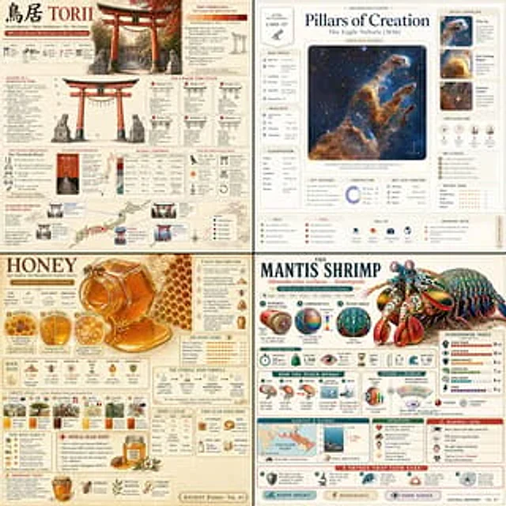

```text
Create a high-quality vertical encyclopedia-style educational infographic 
titled: "THE MANTIS SHRIMP — Nature's Most Dangerous Fist"

Subject: Peacock Mantis Shrimp (Odontodactylus scyllarus)

Overall style: Premium natural history field guide crossed with a 
modern editorial science magazine. Clean cream/off-white background. 
Soft teal, coral, and gold accent palette. Gentle drop shadows on all 
panels. Small refined line icons. Rounded corner information boxes. 
High information density without feeling crowded. Feels like a 
collectible reference card from a scientific journal series.

—— LAYOUT STRUCTURE (top to bottom) ——

[HEADER BLOCK]
Large elegant serif title: "MANTIS SHRIMP"
Subtitle: "Odontodactylus scyllarus · Stomatopoda"
Small tagline badge: "The Ocean's Most Extraordinary Hunter"
Classification strip: Kingdom → Animalia | Phylum → Arthropoda | 
Class → Malacostraca | Order → Stomatopoda

[MAIN HERO IMAGE]
One hyper-detailed full-color illustration of a Peacock Mantis Shrimp 
in dramatic three-quarter profile view, raptorial claws extended. 
Iridescent full-spectrum coloring. Scientifically accurate, 
illustration style similar to a Smithsonian field guide plate.

[ANATOMY ZOOM PANELS — 3 circular close-up detail sections]
① Raptorial Dactyl Club — cross-section showing helicoidal fiber 
   impact-absorbing structure, labeled: "Hits with the force of 
   a .22 caliber bullet"
② Compound Eye — showing 16 photoreceptor types illustrated in 
   spectrum bands, labeled: "Sees UV, infrared, and polarized light 
   simultaneously"
③ Telson Shield — the armored tail plate used to block rival strikes, 
   labeled: "Natural ballistic shield"

[QUICK STATS CARD — horizontal strip]
Icons + numbers in small rounded tiles:
• Strike Speed: 23 m/s (0.002 seconds)
• Strike Force: 1,500 Newtons
• Color Vision: 16 color channels (humans: 3)
• Lifespan: 20+ years
• Size: 2–7 inches
• Habitat Depth: 1–30 meters

[SUPERPOWER INDEX — visual scoring module]
Vertical bar or radial chart rating 6 abilities out of 10:
Strike Power ████████████ 10/10
Vision Range ████████████ 10/10
Armor Defense ████████░░░░ 8/10
Camouflage   ████████░░░░ 7/10
Intelligence  ██████░░░░░░ 6/10
Speed         █████████░░░ 9/10

[DUAL PANEL ROW]
Left panel — "HOW THE PUNCH WORKS"
Small sequential diagram: Load → Latch → Release → Cavitation Bubble 
Collapse → Impact. Note: "The cavitation bubble hits the target a 
second time even if the first strike misses."

Right panel — "VISION vs. HUMAN"
Simple comparison diagram: 
Human eye = 3 cones (RGB) 
Mantis Shrimp eye = 16 photoreceptors 
+ UV + infrared + 6 polarization channels 
Label: "Does NOT see more colors — processes light FASTER 
than any known animal."

[HABITAT & RANGE PANEL]
Warm Indo-Pacific map with range shading. 
Depth profile bar: Surface → 30m zone highlighted.
Notes: Rocky rubble, coral reef crevices. 
Solitary, highly territorial.

[BEHAVIOR CARD]
Rounded box with 4 short bullet points:
• Monogamous — mates for life (up to 20 years together)
• Maintains and defends a permanent burrow
• Can recognize individual humans by face
• Communicates using fluorescent signals 
  invisible to most predators

[WARNING / RISK PANEL — subtle red accent]
⚠ "Never house with other marine life. 
   Will destroy aquarium glass over time. 
   Has split human thumbnails during handling. 
   Treat as a Level 3 biohazard during tank maintenance."

[FUN FACTS STRIP — "5 THINGS THAT SEEM FAKE"]
① Their clubs are stronger than bullet-proof ceramics 
   — engineers are studying them for body armor
② They can see cancer cells in tissue that human eyes cannot
③ Some species glow under UV to communicate privately
④ Their strike creates a flash of light, heat, and shockwave — 
   simultaneously
⑤ They have been known to break aquarium glass 
   from the inside

[FOOTER BADGE ROW]
Three small rounded category tags:
[🌊 Marine Biology] [⚡ Biomechanics] [👁 Vision Science]
Small series label bottom right: "NATURAL WONDERS · Vol. 07"

Typography: Large bold condensed sans-serif for titles. 
Clean readable serif for body text. 
Monospaced for data/numbers.

Final feel: The image should look like it was pulled from 
a $90 collector's edition nature encyclopedia. 
Print-ready quality. NOT a poster. NOT an ad. 
A knowledge artifact.
```

Model: GPT Image 2
Author: Ciri / @Ciri_ai

[ProjectD](https://aitoolsradar.com/en/prompts/b10d7aae80b586) · [Recorded source](https://x.com/Ciri_ai/status/2052005067730120896)
 · [Full original metadata and byte evidence](data/projectd-batch-0032.json)

## GPT Image 2 MS Paint Drawing Prompt

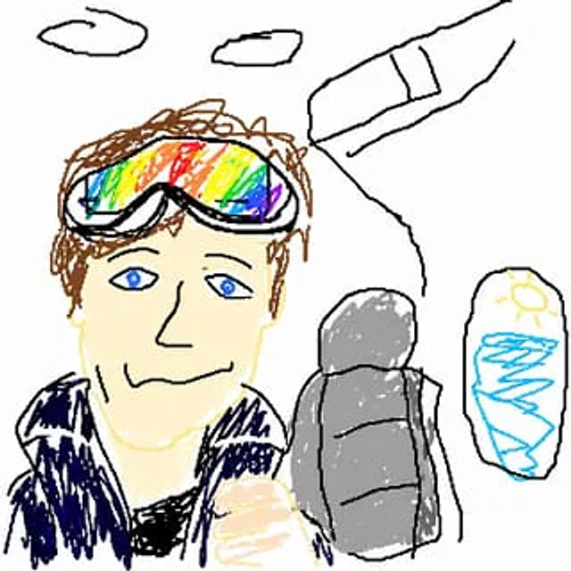

```text
Redraw the attached image in the most {argument name="style" default="clumsy, scribbly, and utterly pathetic"} way possible. Use a white background, and make it look like it was drawn in MS Paint with a mouse. It should be vaguely similar but also not really, kind of matching but also off in a confusing, awkward way, with that low-quality pixel-by-pixel feel that really emphasizes how ridiculously bad it is. Actually, you know what, whatever, just draw it however you want.
```

Model: GPT Image 2
Author: CHOI

[ProjectD](https://aitoolsradar.com/en/prompts/20b6a930eddc02) · [Recorded source](https://youmind.com/prompts/gpt-image-2-ms-paint-prompt-17300)
 · [Full original metadata and byte evidence](data/projectd-batch-0032.json)

## GPT Image 2 Prompt Treasure Poster

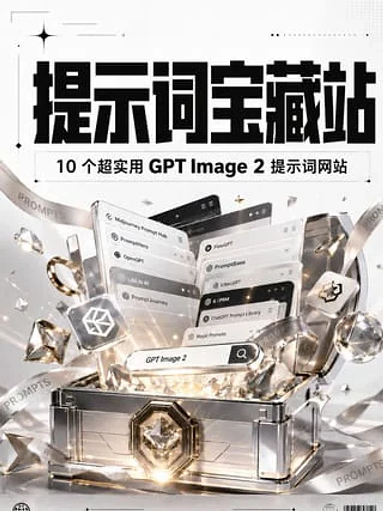

```text
Goal: Create a luxurious vertical poster announcing a collection of useful GPT Image 2 prompt websites, styled like a premium treasure discovery.

Canvas: Portrait 3:4 poster, bright white and light silver background, high-resolution commercial 3D render mixed with bold graphic typography. Use a clean editorial layout with subtle grid marks, thin crop lines, dotted ornaments, small sparkle icons, and bottom micro-print details.

Top typography: Place a huge, heavy, blocky black Chinese headline centered near the top reading {argument name="main headline" default="提示词宝藏站"}. Above and around it add minimal black decorative marks: one large four-point star at upper left, thin horizontal lines, a dotted line near upper right, and tiny diamond markers.

Subtitle bar: Directly under the headline, add a thin outlined rectangular label containing bold black text reading {argument name="subtitle text" default="10 个超实用 GPT Image 2 提示词网站"}. Keep the subtitle centered with generous letter spacing and a crisp print-design feel.

Main subject: In the lower two-thirds, show an open futuristic silver treasure chest with polished metal panels, transparent glass-like edges, chrome trim, gold accents, and a large faceted diamond emblem on the front lock. The chest is overflowing with glowing prompt-library interface cards, gems, diamonds, and warm golden light beams. Add white, gold, and crystal reflections, lens flares, and sparkling particles.

Website cards: Show exactly 10 stacked floating UI cards emerging from the chest, arranged in layered perspective like browser panels. Each card should have rounded corners, small app icons, minimal menu dots, and one visible label. The 10 visible labels are: 1) Midjourney Prompt Hub, 2) Prompthero, 3) OpenGPT, 4) LibLib AI, 5) PromptJourney, 6) FlowGPT, 7) PromptBase, 8) Libai.GPT, 9) ChatGPT Prompt Library, 10) Magic Prompts. Use a mix of white, silver, and black card headers.

Search element: In front of the cards, place a pill-shaped search bar angled slightly upward, glowing softly, with the text {argument name="search query" default="GPT Image 2"} and a black search icon button on the right.

Decorative objects: Include exactly 2 translucent ribbon bands looping diagonally through the composition, both printed repeatedly with the word {argument name="ribbon word" default="PROMPTS"}. Add exactly 1 gold ring on the left, exactly 2 large faceted diamonds near the left and right sides, exactly 1 small floating rounded-square tile with a white geometric cube logo on the left, and exactly 1 matching rounded-square tile with a black cube logo on the right. Scatter smaller crystal shards and gold star particles around the chest.

Visual style: Premium tech treasure aesthetic, glossy 3D rendering, white/silver/gold palette, cinematic reflections, realistic glass and metal materials, sharp typography, high contrast black headline, elegant minimal infographic poster styling.

Constraints: Keep the design vertically centered and symmetrical, preserve the exact count of 10 website cards, avoid adding extra website names, avoid people or characters, no watermark, no social media UI, no QR code.
```

Model: GPT Image 2
Author: 波妞PONYO

[ProjectD](https://aitoolsradar.com/en/prompts/7776135c550f92) · [Recorded source](https://youmind.com/prompts/gpt-image2-prompt-sites-26784)
 · [Full original metadata and byte evidence](data/projectd-batch-0032.json)

## GPT Image 2 Quality Comparison Grid

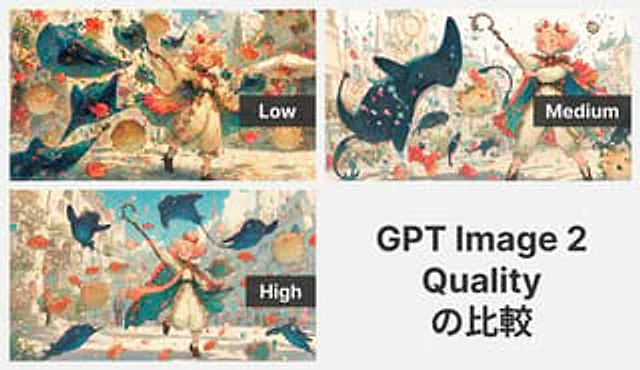

```text
{
  "type": "Quality comparison puzzle",
  "subject": "Fantasy anime illustrations generated under three quality settings",
  "style": "A light and airy watercolor ink picture book/anime style, a soft pastel palette, delicate lines, painterly texture, and a bright, magical atmosphere.",
  "canvas": {
    "background": "Overall light gray background",
    "aspect_ratio": "16:9 Presentation Slides"
  },
  "layout": {
    "sections": [
      {
        "title": "Low",
        "position": "Top left",
        "count": 1,
        "labels": [
          "Low"
        ],
        "image": "A vivid fantasy street scene depicts a young, androgynous child sorcerer moving about, smiling and raising his wand, surrounded by four enormous blue manta ray-like flying creatures, several orange-red goldfish, a few round pufferfish, floating bubbles, and confetti. The background features ornate European-style architecture; the composition is busy and colorful, but the level of detail is slightly lacking.",
        "overlay": "A dark, semi-transparent rectangle near the right side, with the word \"Low\" in large white sans-serif font."
      },
      {
        "title": "Medium",
        "position": "Top right",
        "count": 1,
        "labels": [
          "middle"
        ],
        "image": "The same cue word is rendered again, with the child mage on the right, his face obscured by a pink square occlusion block, holding his staff upwards. In the foreground is a dominant large blue manta ray creature, surrounded by smaller blue fish, orange-red fish, pufferfish, and bubbles. The background is a pale fantasy city with tower and clock details; compared to the low-quality version, the spacing is cleaner and the form is more legible.",
        "overlay": "A dark, semi-transparent rectangle near the bottom right corner, with the word \"Medium\" in large white sans-serif font."
      },
      {
        "title": "High",
        "position": "Bottom left",
        "count": 1,
        "labels": [
          "high"
        ],
        "image": "The same fantasy scene rendered to the highest precision: A happy child wizard runs forward, wand in hand, wearing a flowing cyan cloak adorned with warm pink-orange feathers, a cream-colored tunic and harem pants, brown boots, and fluffy pink hair; surrounded by four blue manta ray-like flying creatures, many orange-red fish, several brown pufferfish, bubbles, and glitter, against a backdrop of a sunlit city street with staircases and elegant architecture; the image is sharp, balanced, rich in detail, and bright.",
        "overlay": "A dark, semi-transparent rectangle near the right center, with the word \"High\" in large white sans-serif font."
      },
      {
        "title": "GPT Image 2 Quality Comparison",
        "position": "Bottom right",
        "count": 1,
        "labels": [
          "GPT Image 2",
          "quality",
          "contrast"
        ],
        "image": "Plain text panel on a light gray background",
        "typography": "Large, bold, black sans-serif text centered, displayed in 3 lines.{argument name=\"headline text\" default=\"GPT Image 2 Quality Comparison\"} '"
      }
    ],
    "grid": "A 2x2 puzzle with 3 image panels and 1 text panel.",
    "margins": "Gaps between panels"
  },
  "character": {
    "count": 1,
    "description": "A young, fantastical child mage or adventurer, cheerful, in a dynamic pose, and fluffy.{argument name=\"hair color\" default=\"pink\"} Short hair, an ornate wand or staff, a flowing turquoise cloak with coral and gold embellishments, cream-colored clothing with lantern pants, and a fantasy picture book design."
  },
  "environment": {
    "setting": "Sunny, fantastical European-style streets or squares",
    "floating_elements_count": "Four large manta ray creatures, along with countless small fish, several pufferfish, and many bubbles.",
    "mood": "Playful, magical, festive"
  },
  "rendering_notes": {
    "comparison_purpose": "Use the same prompts to visually differentiate the three quality levels.",
    "quality_labels_count": 3,
    "text_panels_count": 1
  }
}
```

Model: GPT Image 2
Author: GPT Image 2 Prompts

[ProjectD](https://aitoolsradar.com/en/prompts/2a2487f91dfe3b) · [Recorded source](https://x.com/sankakuten91256/status/2046773803506950160#reversed-0)
 · [Full original metadata and byte evidence](data/projectd-batch-0032.json)

## GPT Image 2 realistic white papercraft illustration transform prompt

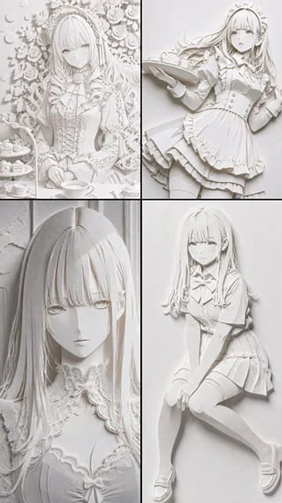

```text
このイラストを非常に精密でリアルな白い紙のペーパークラフト風に変換してください。厚紙をレーザーカットしたようなシャープで正確な切り口、細かい折り目、複数のレイヤーによる豊かな立体感、紙の繊維感と自然な影を高ディテールで表現してください。

光の当たり方による紙の白さと微妙なグラデーションを活かし、本物のような立体的なペーパーアート作品のようなリアリティを出して。全体を洗練されていて芸術的な雰囲気に。元のイラストの構図・キャラクターを忠実に維持。
```

Model: GPT Image 2
Author: のとろ / @notoro_ai

[ProjectD](https://aitoolsradar.com/en/prompts/a2e83ada1ecd76) · [Recorded source](https://x.com/notoro_ai/status/2052018043883319536)
 · [Full original metadata and byte evidence](data/projectd-batch-0032.json)

## GPT Image 2 Shonen Manga Collage Poster

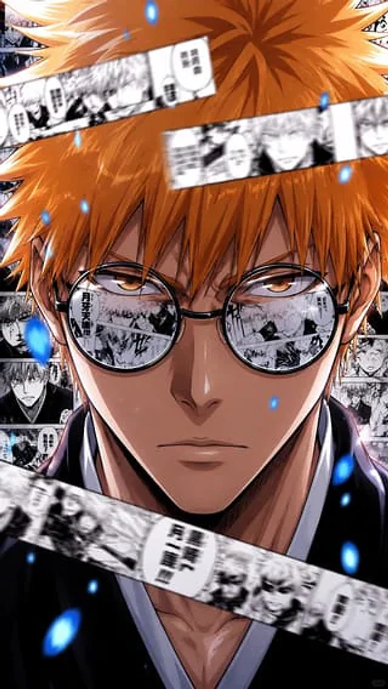

```text
🤣小时候看《Bleach》：
“卍解！！！”
长大后玩 AI：
“镜片里倒映漫画分镜 + 前景动态条漫 + 蓝色灵压粒子 + 日漫拼贴构图 + 电影级光影 + 超近景压迫感……”

以前以为久保带人是在画漫画。
现在发现他其实是在提前给 GPT-Image-2 写提示词。
这次测试我最上头的点不是“还原角色”，
而是它终于能理解那种——
“潮流视觉海报感 + 漫画叙事层次 + 动态镜头语言” 的混合审美。

AI 现在已经不是“生成一张动漫图”了。
而是在帮我们做：
「不存在的动漫宇宙视觉总监」。
顺便说一句——
那个戴斗笠戴墨镜的版本，真的很像：
“如果京乐春水开始做潮流品牌主理人。” 😂

♥️提示词在这里，麻烦给个赞！
超高细节二次元热血漫画风角色海报，少年死神角色正面半身特写，橙色炸毛短发，琥珀色眼睛，佩戴黑色圆框复古墨镜，冷峻严肃表情，正中央对称构图，镜头直视观众，强烈压迫感。

眼镜镜片中倒映大量黑白漫画分镜与角色画面，背景也由密集的日漫漫画页拼贴组成，形成“角色记忆 / 名场面回顾”的视觉效果。前景漂浮多条高速运动的漫画分镜条带，带有动态模糊与景深虚化效果，穿插画面上下，营造速度感与空间层次。

画面中散落蓝色灵压粒子 / 荧光能量碎片，形成冷暖撞色（橙发 vs 蓝色粒子）。整体采用《BLEACH》式热血少年漫画美学，融合现代潮流海报设计与高级动漫商业视觉。

anime key visual, BLEACH style, manga collage poster, cinematic anime lighting, reflective glasses, manga panels reflection, dynamic motion blur, orange spiky hair, intense stare, ultra detailed anime illustration, shonen jump aesthetic, layered composition, high contrast shading, cel shading, glowing blue particles, dramatic close-up portrait, symmetrical composition, manga montage background, Japanese comic aesthetic, premium anime poster
```

Model: GPT Image 2
Author: 波妞PONYO / @ponyodong

[ProjectD](https://aitoolsradar.com/en/prompts/cd0271ba1f57bd) · [Recorded source](https://x.com/ponyodong/status/2052983036724355468)
 · [Full original metadata and byte evidence](data/projectd-batch-0032.json)

## GPT Image 2 Social Media Screen Breakout Poster

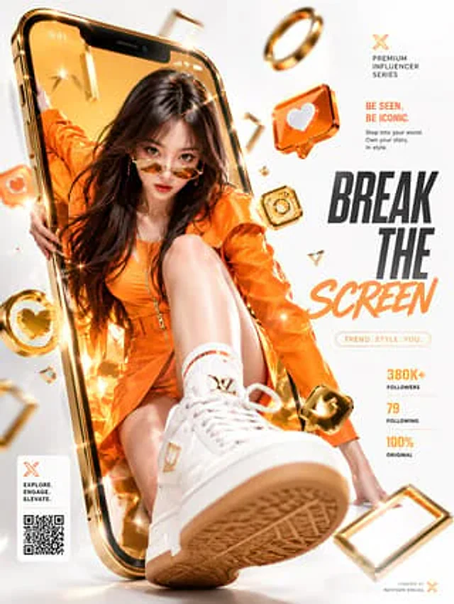

```text
动态的豪华商业广告海报，特色是超现实3D渲染的充满活力的年轻女性，以上传的女性面部作为参考，穿着高级亮橙色设计师服装、豪华配饰以及时尚的金色墨镜，自信地从一个巨大的金色智能手机屏幕中爆发出色。她的姿势有力且时尚，一只运动鞋通过强烈的强制透视戏剧性地穿过数字显示屏，踏入现实。

构图在前台强调她白色豪华运动鞋，带有纹理口香糖鞋底，通过电影般的广角镜头失真和浅景深增强。漂浮的闪亮3D社交媒体图标、金色几何元素和豪华品牌图形环绕着她，营造出高端影响者营销美学。

明亮的摄影棚灯光营造出充满活力的优质促销氛围，金属金色手机边缘的丰富反射与哑光织物质地形成对比。主导的橙色、白色和金色调色板传递出超现代豪华X / Twitter 广告氛围。干净的白色背景上带有大胆的编辑排版、优质软件品牌元素、优雅的UI图形、漂浮的互动图标以及时尚的二维码区域。

超现实8K品质、电影般的阴影、精致的商业艺术指导、豪华女性能量、时尚营销美学、现代社交媒体品牌、闪亮反射以及高端数字广告风格。

宽高比：3:4。
```

Model: GPT Image 2
Author: serein / @you1873118

[ProjectD](https://aitoolsradar.com/en/prompts/76fa3b053338cc) · [Recorded source](https://x.com/you1873118/status/2052624395932455061)
 · [Full original metadata and byte evidence](data/projectd-batch-0032.json)

## GPT Image 2 Trending Anime Art Style Redraw

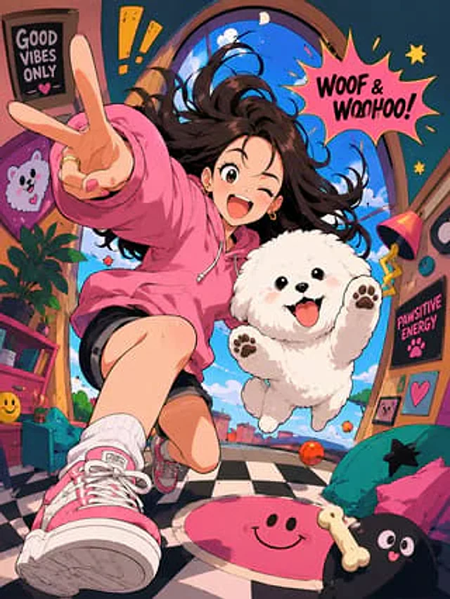

```text
Create a trending anime art style image from the uploaded subject. Use confident line-work with slight variation and minimal cel shading using flat shadow shapes. Use bright, saturated colors and clean graphic lighting. The style is defined by exaggerated, cartoonish character proportions featuring highly expressive, simplistic facial features that allow for immense emotional range, with highly varied stretched anatomy.Transform the environment into a slightly warped space with playful perspective distortion and simplified objects. Composition and tone should be energetic, lively, and comedic in a fully stylized, non-realistic world
```

Model: GPT Image 2
Author: Zyrella / @Zyrellix

[ProjectD](https://aitoolsradar.com/en/prompts/4ffb18662aac0f) · [Recorded source](https://x.com/Zyrellix/status/2052766810500649197)
 · [Full original metadata and byte evidence](data/projectd-batch-0032.json)

## GPT Image 2 Warm Home Appliance Product Poster


```text
请生成一张高质感家电产品广告海报，主体为「{主体}」。以主体为视觉核心，自动适配其对应的生活方式场景、辅助物品、装饰元素、关键词、卖点徽章、功能图标说明与整体色彩风格。画面布局为：顶部大号主标题 + 手写感副标题 + 关键词；中部主体产品置于符合其使用逻辑的精致生活场景中；左右加入圆形卖点徽章与 4~5 个功能图标说明；底部展示产品名称标签。整体风格要求温暖治愈、柔和暖光、真实材质、现代干净排版、商业广告质感、低饱和协调配色、4K 超清，适合品牌宣传、电商海报、社交媒体视觉展示。一切元素围绕主体自动生成并服务于主体，不喧宾夺主，不杂乱，不低质。

主体：咖啡壶
```

Model: GPT Image 2
Author: 知识猫图解 / @GeekCatX

[ProjectD](https://aitoolsradar.com/en/prompts/64d2f120600cc2) · [Recorded source](https://x.com/GeekCatX/status/2054910164365639811)
 · [Full original metadata and byte evidence](data/projectd-batch-0032.json)

## GPT Image 2 Y2K Pop-Street Editorial Collage

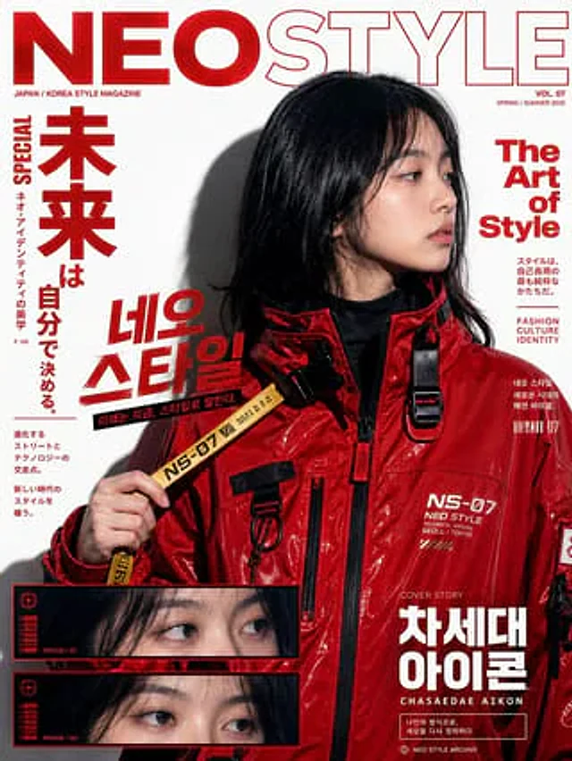

```text
Create a bold Y2K pop-street editorial collage featuring a young person as the central subject, combining playful graffiti typography, orange poster background, sticker-like graphic elements, and fashion magazine layout energy.

MAIN SUBJECT AND FRAMING:
Place the young person on the right side of the composition in a close-up to upper-body portrait. The face should be large and dominant, cropped from the chest upward, with the subject slightly leaning forward into the frame. The composition should feel asymmetrical, with graphic typography filling the left side and the subject anchoring the right side.

Do not control or describe the hairstyle.

OUTFIT DETAIL:
Style the subject in a minimal black streetwear outfit. They wear a black turtleneck or high-neck top with a soft fitted silhouette, creating a clean dark shape against the bright orange background. Add a black beret or rounded cap with a small embroidered logo detail on the front, giving the look a stylish retro street-fashion feeling.

Add a small colorful cheek sticker or decorative bandage on one cheek, with cute tiny graphic details, making the styling feel playful and idol-like. Keep the outfit mostly black so the blue graffiti typography and orange background stand out strongly.

BEHAVIOUR AND BODY LANGUAGE:
The subject’s body language should feel calm, closed-off, and slightly moody. The shoulders are relaxed but slightly rounded forward, creating a soft guarded posture. The head tilts subtly downward and to the side, giving the portrait a cool detached attitude.

The subject does not need a big hand gesture in the main portrait; instead, the behaviour comes from the face angle, lowered posture, and intense sideways eye movement. The pose should feel like someone caught in a quiet bratty moment, not fully engaging with the viewer.

FACIAL EXPRESSION:
The expression is pouty, serious, and mildly irritated in a fashionable way. The lips are softly pushed forward into a small pout, brows slightly tense, and the eyes look sideways with a suspicious or unimpressed gaze. The mood should feel bratty, stylish, aloof, and quietly rebellious.

GRAPHIC BACKGROUND:
Use a saturated orange background with a large white starburst shape behind the subject’s head and shoulders. The starburst should create strong comic-book energy and make the face pop.

Add hand-drawn black scribble text across the orange background, like messy diary writing or lyric notes. Include phrases such as:
“EENIE MEENY MINEY MO”
“4:03”
“LOVE DAY”
“HIDE YOUR LOVE”
“BOYZ”
The handwriting should look playful, imperfect, thin, and chaotic, but still visually controlled.

MAIN TYPOGRAPHY:
Place a large blue graffiti-style word “Your Name” across the left-center area. The letters should be chunky, rounded, irregular, and outlined in thick black, like a playful bubble graffiti tag. The typography should overlap slightly with the subject’s face area without blocking the eyes.

Add pink star sparkle stickers around the face and cap area, giving a cute pop-idol accent.

BOTTOM FILMSTRIP:
At the bottom of the composition, add a horizontal filmstrip with four rectangular photo panels. These panels show smaller full-body and close-up poses of the same young person wearing the same black outfit.

Panel pose ideas:
1. Side close-up portrait with head tilted back slightly, cheek sticker visible, eyes looking away.

2. Full-body stance with legs apart, hands near pockets or belt area, posture confident and relaxed.

3. Repeated close-up side portrait for rhythmic collage effect.

4. Repeated full-body stance, slightly different angle or crop.

The filmstrip should feel like a fashion contact sheet or idol editorial preview.

MOOD AND STYLE:
The overall mood should be playful, bratty, nostalgic, and street-fashion inspired. It should feel like a Y2K teen magazine layout mixed with graffiti poster design, idol concept styling, and scrapbook-like pop graphics.
```

Model: GPT Image 2
Author: K / @ChillaiKalan__

[ProjectD](https://aitoolsradar.com/en/prompts/d40b38442e9da9) · [Recorded source](https://x.com/ChillaiKalan__/status/2052209704231985504)
 · [Full original metadata and byte evidence](data/projectd-batch-0032.json)

## GPT-2 Comic Creation Logic Poster

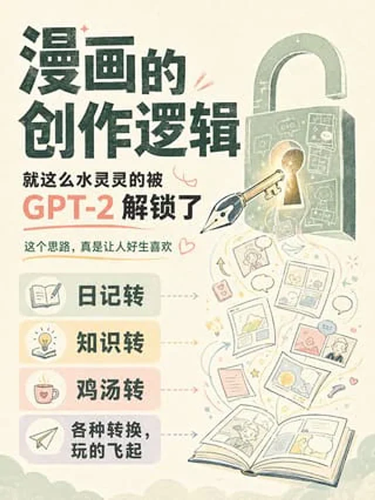

```text
Goal: Create a vertical Chinese promotional infographic poster about unlocking comic creation logic with GPT-2, using a playful hand-drawn editorial style.

Canvas: Portrait 3:4 poster, warm off-white textured paper background, soft pastel palette, slightly grainy risograph print texture, rounded friendly shapes, dark teal headline typography, coral accent text, pale green/yellow/pink/lavender section cards.

Layout: Left side is a bold text-heavy headline and feature list; right side is a large illustration of an open padlock with a glowing keyhole releasing comics, sketches, speech bubbles, arrows, and diary pages. Bottom right has an open comic book, with pages and comic panels swirling upward from it into the lock area. Keep generous margins and a lively but readable composition.

Text content: Use a large Chinese headline at top left: {argument name="headline text" default="漫画的\n创作逻辑"}. Under it, add smaller bold Chinese copy: {argument name="subheadline text" default="就这么水灵灵的被\nGPT-2 解锁了"}, with “GPT-2” in large coral red and the rest in dark teal/black. Add a green underline and smaller line: {argument name="tagline" default="这个思路，真是让人好生喜欢"}. Include small decorative coral sparkle marks and a hand-drawn heart near the tagline.

Feature cards: Place exactly 4 rounded horizontal cards stacked vertically on the lower left, each with one circular icon on the left and bold Chinese label on the right. Card 1 is pale green with an open notebook and pencil icon, label {argument name="card one label" default="日记转"}. Card 2 is pale yellow with a lightbulb rising from an open book icon, label “知识转”. Card 3 is pale peach with a steaming mug icon containing a heart, label “鸡汤转”. Card 4 is pale lavender with a paper airplane icon, label “各种转换，\n玩的飞起”. From each of the 4 cards, draw one dotted arrow pointing right toward the flying comic materials; use matching muted arrow colors.

Right-side subject details: Draw exactly 1 oversized open padlock in muted green-gray, positioned upper right, with chalk-like doodles on its body: tiny speech bubbles, comic thumbnails, and simple character sketches. Insert exactly 1 golden key into the keyhole; the key has a fountain-pen nib as its handle, symbolizing writing unlocking comics. Make the keyhole glow with warm yellow light.

Flying comic materials: Show exactly 6 loose paper/comic elements floating from the open book toward the lock: 1 small portrait sketch sheet, 1 four-panel comic page, 1 single-page layout with a yellow image block, 1 two-character dialogue comic page, 1 small pink note page, and 1 larger horizontal comic strip page. Add curved motion trails, sparkles, tiny hearts, arrows, and speech bubbles around them, but keep the main count of loose sheets exactly 6.

Bottom illustration: Draw exactly 1 open comic book at the lower right with visible comic panels and a cute simple character on the left page; use thin dark teal linework and pale yellow highlights. Add soft cloud-like pale green shapes along the bottom edge of the poster.

Visual style: Cute Chinese social-media poster aesthetic, hand-drawn line art, rounded sans-serif Chinese typography, vintage print grain, pastel accents, clean hierarchy, whimsical educational tone.

Constraints: Maintain the exact 4 feature cards and exact 6 loose flying paper/comic elements. Do not add extra major sections, extra logos, watermarks, QR codes, or English explanatory text beyond “GPT-2”.
```

Model: GPT Image 2
Author: 小小东

[ProjectD](https://aitoolsradar.com/en/prompts/30c8b923d2db59) · [Recorded source](https://youmind.com/prompts/gpt2-comic-creation-poster-29156)
 · [Full original metadata and byte evidence](data/projectd-batch-0032.json)

## GPT-Image V2 Feature Announcement

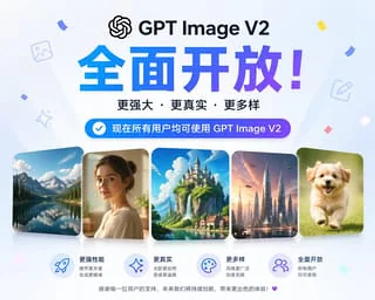

```text
Please generate an image for me, with the following description.{argument name="announcement content" default="GPT Image V2 is now fully available."}
```

Model: GPT Image 2
Author: GPT Image 2 Prompts

[ProjectD](https://aitoolsradar.com/en/prompts/0768717af9dd59) · [Recorded source](https://x.com/cnyzgkc/status/2046523968438550702)
 · [Full original metadata and byte evidence](data/projectd-batch-0032.json)

## GPT-Image-2 Creative Prompt List

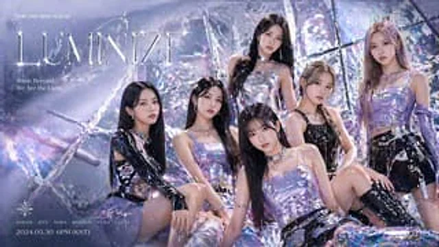

```text
1. Generate a sheet containing{argument name="characters" default="Mai Shiranui and Diao Chan"} 1. A game battle poster. 2. Generate a poster.{argument name="group type" default="K-pop group"} 3. Please design a stylish album cover.{argument name="work title" default="Battle Through the Heavens"} 4. Generate a core relationship diagram. Please take a screenshot of a female influencer's profile on Douyin (TikTok) for uploading.
```

Model: GPT Image 2
Author: GPT Image 2 Prompts

[ProjectD](https://aitoolsradar.com/en/prompts/771e7246b6ed26) · [Recorded source](https://x.com/joshesye/status/2046493442428039212)
 · [Full original metadata and byte evidence](data/projectd-batch-0032.json)

## GPT-Image-2 Creative Prompt List

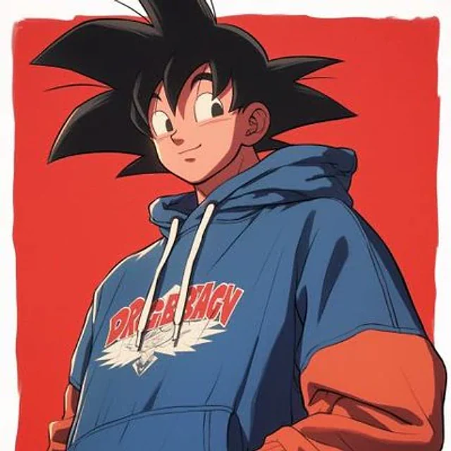

```text
1、生成{argument name="角色" default="不知火舞和貂蝉"}的游戏对战海报图
2、生成一张{argument name="团体类型" default="K-pop团体"}时尚专辑封面
3、请你生成 《{argument name="作品名" default="斗破苍穹"}》 的关键人物关系图
4、帮我截一张上传图片的抖音首页的女网红图
```

Model: GPT Image 2
Author: 行者AI视频

[ProjectD](https://aitoolsradar.com/en/prompts/3fb24096d6001d) · [Recorded source](https://youmind.com/prompts/game-poster-album-cover-character-chart-14334)
 · [Full original metadata and byte evidence](data/projectd-batch-0032.json)

## GPT-Image-2 Detail Showcase

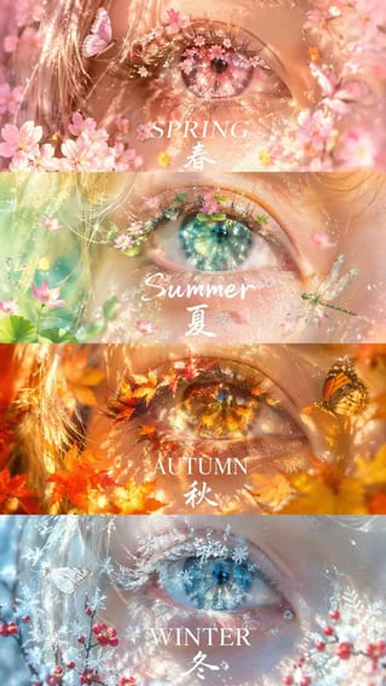

```text
以眼部特写图片为基础，生成3:4的四屏构图超写实眼部特写，四屏按春夏秋冬上下排序。

第一屏：眼眸中带着绽粉樱色的美瞳，睫毛缀满迷你春花，脸颊散落樱瓣与黄蕊小花，粉蝶萦绕眉眼，浅金发丝轻垂，下方簇簇樱花怒放，画面中央"SPRING"白色艺术字点缀，风格细腻唯美，光影柔和，色彩粉嫩治愈，下面用书法体写着春；

第二屏：眼眸中带着着清荷色的美瞳，睫毛饰以粉莲与绿荷，脸颊挂着晶莹水珠，粉瓣、绿荷点缀其间，蜻蜓轻绕，浅金发丝若隐若现，画面中央"Summer"白色艺术字凸显，光影通透流光感，色彩清透凉爽，下面用书法体写着夏；

第三屏：眼眸中带着金黄红相间的美瞳，睫毛饰以橙红枫叶，脸颊散落金红秋叶，橙蝶翩跹眉眼间，浅金发丝隐约可见，画面中央"AUTUMN"白色艺术字醒目，光影暖金流光，色彩浓郁温暖，下面用书法笔写着秋；

第四屏：眼眸中带着雪花蓝色的美瞳，睫毛覆满冰晶雪片，脸颊散落白色雪花与红色腊梅，银白蝴蝶翩跹眉眼，浅金发丝朦胧似雪，画面中央"WINTER"白色艺术字亮眼，光影冷冽蓝白流光，色彩清透纯净，下面用书法体写着冬。

整体呈现梦幻眼眸四季交替的唯美梦幻治愈画面，微调各屏的光影强度，让画面氛围感更浓郁。
```

Model: GPT Image 2
Author: @liyue_ai

[ProjectD](https://aitoolsradar.com/en/prompts/d11d9d178506e0) · [Recorded source](https://x.com/liyue_ai/status/2045000106919997637)
 · [Full original metadata and byte evidence](data/projectd-batch-0032.json)

## GPT-Image-2 Transparency Prompting Guide

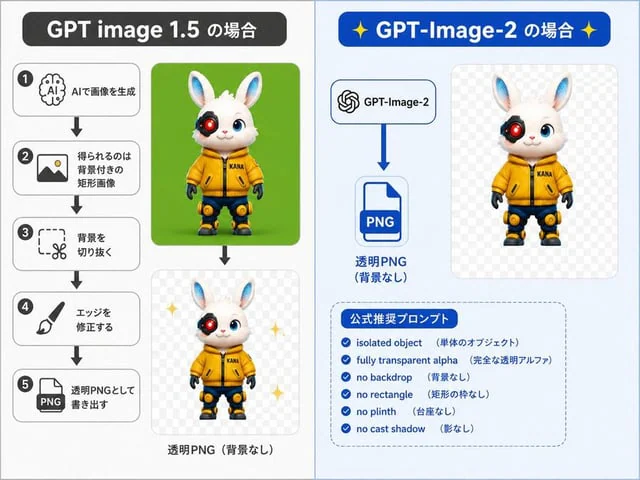

```text
これは1枚の完成された絵ではなく、単体で使う素材です isolated object fully transparent alpha no backdrop no rectangle no plinth no cast shadow
```

Model: GPT Image 2
Author: KANA｜東京AI映像

[ProjectD](https://aitoolsradar.com/en/prompts/c8900962cc1a9f) · [Recorded source](https://youmind.com/prompts/gpt-image-2-transparency-prompts-32254)
 · [Full original metadata and byte evidence](data/projectd-batch-0032.json)

## Graffiti Sketch AI Builder Style


```text
Expressed in a doodle sketch style [{argument name="subject" default="a powerful AI builder"} The overall visual effect is that of a quick sketch, free deformation, improvisation, and draft. Lines are casual, exaggerated, and vary in thickness, appearing slightly chaotic yet rhythmic and expressive, emphasizing generalization, exaggeration, fun, and spontaneity rather than rigorous realism or fine detail. Colors are rendered with bold, dry brushstrokes, retaining uneven application, brushstrokes, dry brush, and overlapping. Colors automatically adapt to the theme/subject, but the overall style remains graffiti, sketch, and generalization. There is no transparent watercolor wash, no delicate watercolor transitions, no paper texture, no soft mist, and no dreamlike quality. The background is predominantly white, maintaining simplicity, ease, a sense of unfinishedness, and design. A small number of auxiliary symbols, arrows, marks, circles, repeating lines, handwritten text, or other graffiti elements can be added to enhance the visual language of the sketchbook or doodle, but these should not be overly crowded or disrupt the white space and atmosphere. Image content does not need to be pre-defined;{argument name="subject" default="a powerful AI builder"} It will automatically deduce and generate the most suitable main image, action, related elements, symbols, or simplified scene. It maintains a consistent doodle/sketch style and exaggerated, generalized expression, avoiding complex realistic backgrounds and excessive detail. It naturally incorporates a unique signature.{argument name="signature" default="BlanPlan"} As part of the image, place it discreetly and clearly in the lower left corner, lower right corner, or near the title. The style should be consistent with the overall layout, like an artist's signature or design inscription; the signature font should be exquisite, restrained, and sophisticated, not too large, not disrupting the main composition, and not appearing abrupt or cheap.
```

Model: GPT Image 2
Author: GPT Image 2 Prompts

[ProjectD](https://aitoolsradar.com/en/prompts/9e456d4e92c925) · [Recorded source](https://x.com/opc_8838/status/2046162334440448339)
 · [Full original metadata and byte evidence](data/projectd-batch-0032.json)

## Graffiti Sketch Style AI Builder


```text
Expressed in a doodle sketch style{argument name="subject" default="A powerful AI builder"} The style presents a visual effect reminiscent of rapid sketching, free deformation, improvisation, and drafts. Lines are casual, exaggerated, and vary in thickness, appearing slightly chaotic yet rhythmic and expressive, emphasizing generalization, exaggeration, playfulness, and spontaneity rather than rigorous realism or meticulous detail. Colors are presented in bold blocks, with a distinct dry brush feel, retaining uneven application, brushstrokes, dry brush, and layering. Colors automatically adapt.{argument name="theme" default="Powerful AI builder"} However, the overall style remains doodle-like, sketch-like, and generalized. Avoid using transparent watercolor washes, delicate watercolor transitions, paper textures, soft mists, or dreamlike effects. The background is primarily white, maintaining a simple, relaxed, unfinished, and design-oriented feel. A few auxiliary symbols, arrows, marks, circles, repeating lines, handwritten text, or other doodle elements can be added to enhance the visual language of the sketchbook or doodle, but these should not be overcrowded to avoid disrupting the subject and the atmosphere of white space. The content of the image does not need to be pre-defined;{argument name="character image" default="A powerful AI builder"} The system will automatically generate the most suitable main image, actions, related elements, symbols, or simplified scenes. The overall style should maintain a consistent doodle sketch feel and exaggerated, generalized expression, avoiding complex realistic backgrounds and excessive details. A distinctive signature, "BlanPlan," should be naturally incorporated into the image, placed discreetly but clearly, such as in the lower left corner, lower right corner, or near the title. The signature style should be consistent with the overall layout, like an artist's signature or design mark; the signature font should be refined, restrained, and sophisticated, not too large, and should not disrupt the main composition, appearing abrupt or cheap.
```

Model: GPT Image 2
Author: GPT Image 2 Prompts

[ProjectD](https://aitoolsradar.com/en/prompts/07be33e506d05f) · [Recorded source](https://x.com/blanplan/status/2045190582453350748)
 · [Full original metadata and byte evidence](data/projectd-batch-0032.json)

## Graffiti Sketch Style Template


```text
Expressed in a doodle sketch style{argument name="subject" default="Theme/Main Body"} The overall visual effect is one of rapid sketching, free deformation, improvisation, and draft-like drawing. The lines are casual, exaggerated, and vary in thickness, appearing slightly chaotic yet rhythmic and expressive, emphasizing generalization, exaggeration, playfulness, and spontaneity rather than rigorous realism or meticulous detail. Colors are rendered in bold blocks, exhibiting a distinct dry brush feel, retaining uneven application, brushstrokes, dry brush, and layering. The colors adapt automatically.{argument name="subject" default="Theme/Main Body"} However, the overall expression maintains a doodle-like, sketch-like, and concise feel. There are no transparent watercolor washes, no delicate watercolor transitions, no paper textures, no soft mist effects, and no dreamlike quality. The background is primarily white, maintaining a simple, relaxed, unfinished, and design-oriented feel. A few auxiliary symbols, arrows, marks, circles, repeating lines, handwritten text, or other doodle elements can be added to enhance the visual language of the sketchbook or doodle, but these should not be overcrowded to avoid disrupting the subject and the atmosphere of the white space. The content of the image does not need to be pre-defined;{argument name="subject" default="Theme/Main Body"} The system will automatically generate the most suitable main image, actions, related elements, symbols, or simplified scenes. The overall style should maintain a consistent graffiti-style sketch aesthetic with exaggerated, generalized expressions, avoiding complex realistic backgrounds and excessive details. A distinctive signature, "voxcat," should be naturally incorporated into the image, discreetly but clearly placed, such as in the lower left or right corner, or near the title. The signature style should be consistent with the overall layout, like an artist's signature or design mark; the signature font should be refined, restrained, and sophisticated, not too large, and should not disrupt the main composition or appear abrupt or cheap.
```

Model: GPT Image 2
Author: GPT Image 2 Prompts

[ProjectD](https://aitoolsradar.com/en/prompts/742df0df023558) · [Recorded source](https://x.com/VoxcatAI/status/2045131503001342302)
 · [Full original metadata and byte evidence](data/projectd-batch-0032.json)

## Graffiti Sketch Style Template

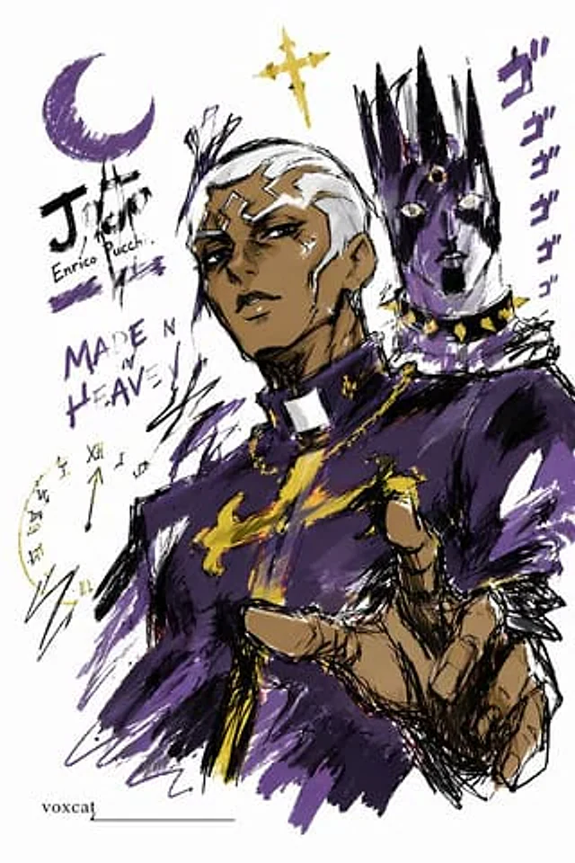

```text
以涂鸦速写风表现【{argument name="主体" default="主题/主体"}】，整体呈现快速勾勒、自由变形、即兴手绘与草稿式的视觉效果。线条随手、夸张、可粗细不一，略显凌乱 but 具有节奏和表现力，强调概括、夸张、趣味 and 随性，而不是严谨写实或精细刻画。

颜色采用粗糙、干刷感明显的块面表现，可保留不均匀的涂抹痕迹、刷痕、飞白与覆盖感，色彩根据【{argument name="主体" default="主题/主体"}】自动适配，但整体保持涂鸦式、速写式、概括式的表达。不要透明水彩晕染效果，不要细腻水彩过渡，不要纸纹理，不要柔和雾化，不要梦幻质感。

背景以留白为主，保持简洁、轻松、未完成感和设计感，可加入少量辅助性符号、箭头、记号、圈画、重复线、随手写的文字或其他涂鸦元素，以增强速写本或随笔式视觉语言，但不可过于拥挤，不可破坏主体和留白气质。

画面内容不需要预先写清楚，由【{argument name="主体" default="主题/主体"}】自动推演并生成最适合的主体形象、动作、相关元素、符号或简化场景，整体保持统一的涂鸦速写风 and 夸张概括的表现方式，避免复杂写实背景 and 过度铺陈。
画面中需自然加入专属签名“voxcat”，作为画面的一部分，位置低调 but 清晰，可放在左下角、右下角或标题附近，风格需与整体版式统一，像作品署名或设计落款；签名字体精致、克制、高级，不可过大，不可破坏主体构图，不可显得突兀 or 廉价。
```

Model: GPT Image 2
Author: VoxCat

[ProjectD](https://aitoolsradar.com/en/prompts/cda602cbb88fc4) · [Recorded source](https://youmind.com/prompts/graffiti-sketch-doodle-13862)
 · [Full original metadata and byte evidence](data/projectd-batch-0032.json)

## Graffiti Stairwell Sweet-Goth Fashion Portrait

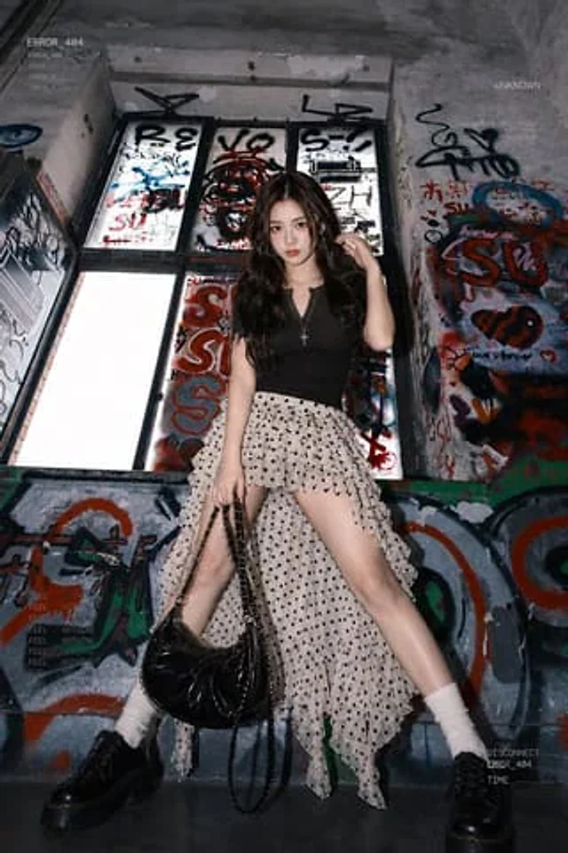

```text
Create a high-fashion editorial full-body portrait of {argument name="character description" default="a young East Asian woman with long voluminous dark brown wavy hair, sweet-cool mature aura, pale skin, and soft but intense eye contact"} standing in an abandoned concrete stairwell or underpass covered with dense graffiti. She poses confidently with legs spread wide, one hand lifting a lock of hair near her ear and the other holding a glossy black chain shoulder bag low at her side. Outfit has exactly 7 visible fashion pieces/accessories: 1) fitted black V-neck short-sleeve knit top, 2) cream-white chiffon high-low irregular ruffle skirt with black polka dots and sheer layered hem, 3) white mid-calf ribbed socks, 4) chunky black platform derby shoes, 5) glossy black chain bag with long dangling chain strap, 6) silver hoop earrings, 7) silver cross pendant necklace. The location should feel gritty, urban, and claustrophobic, with tall window panels behind her covered in black, red, and blue tags, cracked gray concrete walls, peeling paint, and a waist-high graffiti barrier in the foreground. Use a low-angle fashion-photography composition, vertical 2:3 frame, centered subject, dramatic flash lighting, cool desaturated tones, sharp details, slight wide-angle distortion, glossy highlights on the shoes and bag, and realistic skin texture. Add subtle cyberpunk interface-like overlay text in small pale gray type around the edges, including fragments such as {argument name="overlay text" default="ERROR_404, UNKNOWN, DIGITAL_DECAY, DISCONNECT, FEEL NOTHING"}, but keep it faint and secondary. Overall mood: rebellious, sweet-goth, street-style lookbook, cinematic realism, no extra people, no watermark.
```

Model: GPT Image 2
Author: serein ｜买美股上币安

[ProjectD](https://aitoolsradar.com/en/prompts/bfa1b1ea5d3c56) · [Recorded source](https://youmind.com/prompts/graffiti-goth-fashion-portrait-30662)
 · [Full original metadata and byte evidence](data/projectd-batch-0032.json)

## Grain Rain Festival Poster

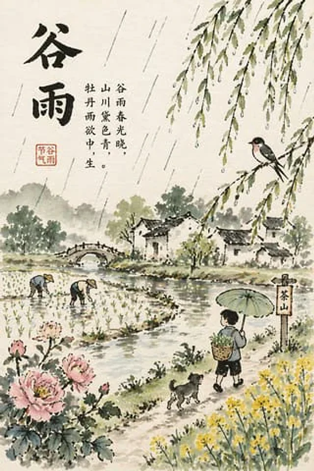

```text
for{argument name="solar term" default="Grain Rain"} Design a poster for the solar term, using the following style:{argument name="style" default="Feng Zikai&#39;s painting style"} .
```

Model: GPT Image 2
Author: GPT Image 2 Prompts

[ProjectD](https://aitoolsradar.com/en/prompts/4d493d1be4a44c) · [Recorded source](https://x.com/akokoi1/status/2046238619183317361)
 · [Full original metadata and byte evidence](data/projectd-batch-0032.json)

## Great Wall Travel Collage

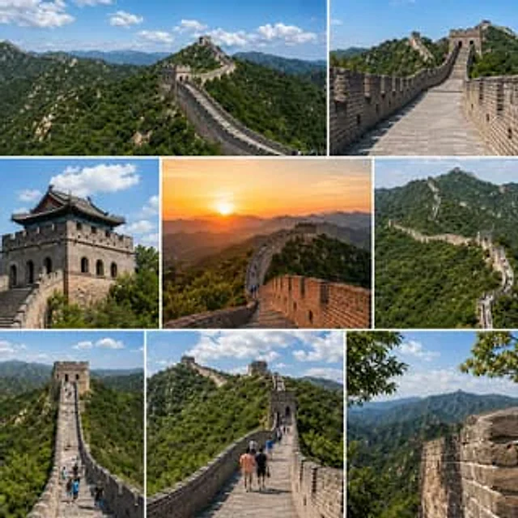

```text
{
  "type": "Travel photo collage",
  "subject": "Great Wall of China",
  "style": "High-resolution realistic travel photography, bright daylight clarity, vivid natural colors, editorial-quality travel brochure style.",
  "composition": {
    "format": "Square puzzle",
    "grid": {
      "columns": 3,
      "rows": 3,
      "count": 8
    },
    "borders": "All images are bordered with thin white borders.",
    "image_count": 8
  },
  "scenes": [
    {
      "position": "Top left wide",
      "description": "From an aerial view, the Great Wall winds its way through lush green mountains, against a backdrop of blue sky and scattered white clouds."
    },
    {
      "position": "upper right wide area",
      "description": "A view taken from eye level on the stone steps of the Great Wall, extending to a watchtower, flanked by brick crenellations, with a mountain ridge visible in the distance."
    },
    {
      "position": "Middle left panel",
      "description": "The architectural details of the stone watchtower, photographed from below and looking up, contrast with the blue sky and white clouds."
    },
    {
      "position": "Middle panel",
      "description": "A golden sunset scene at the Great Wall, with warm orange sunlight hanging low over the silhouettes of layered mountains, the Great Wall winding its way to the watchtowers."
    },
    {
      "position": "Middle right panel",
      "description": "The landscape, captured with a telephoto lens, shows the Great Wall winding and twisting along steep, green mountain ridges, emphasizing its dragon-like shape."
    },
    {
      "position": "Bottom left panel",
      "description": "Looking down over a long section of the Great Wall from a high vantage point, several tourists are walking along the central path towards the watchtower."
    },
    {
      "position": "Middle and lower panel",
      "description": "From a human perspective, a small group of tourists dressed in summer casual wear walks along the Great Wall towards several watchtowers on a lush, green hillside, their backs to the camera."
    },
    {
      "position": "Bottom right panel",
      "description": "A panoramic view of the mountains, framed on the right by a close-up of the Great Wall and green foliage above, showcasing the layered blue-green ridges extending into the distance."
    }
  ],
  "environment": {
    "season": "summer",
    "vegetation": "Dense green forests",
    "sky": "A clear blue sky with scattered cumulus clouds; only one photo shows a warm sunset scene.",
    "lighting": "Mostly bright afternoon sunlight, including one sunset photo taken at the golden hour."
  },
  "details": {
    "architecture": "Ancient gray stone brick walls, crenellations, stepped walkways, and multiple watchtowers",
    "people": "Only two panels contain clearly visible tourists, while another panel contains tiny pedestrians in the distance.",
    "mood": "Magnificent, adventurous, and iconic World Heritage destinations"
  }
}
```

Model: GPT Image 2
Author: GPT Image 2 Prompts

[ProjectD](https://aitoolsradar.com/en/prompts/84f97381112b5e) · [Recorded source](https://x.com/followin_io_zh/status/2047206582682017799#reversed-1)
 · [Full original metadata and byte evidence](data/projectd-batch-0032.json)

## Greek God Riding a Lion


```text
To portray me as a{argument name="persona" default="Greek gods"} riding a{argument name="mount" default="lion"} The background is located in{argument name="setting" default="African savanna"} .
```

Model: GPT Image 2
Author: GPT Image 2 Prompts

[ProjectD](https://aitoolsradar.com/en/prompts/ce3c199cefa0f5) · [Recorded source](https://x.com/_MaxBlade/status/2046679494883238031)
 · [Full original metadata and byte evidence](data/projectd-batch-0032.json)

## Greek God Riding a Lion

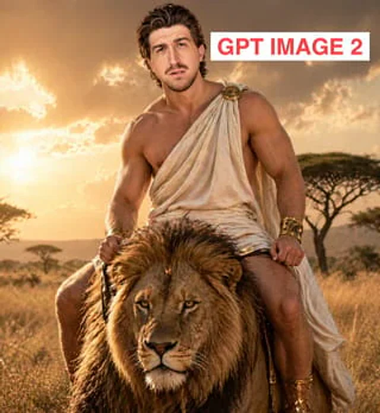

```text
make me look like a {argument name="persona" default="greek god"} riding a {argument name="mount" default="lion"} in the {argument name="setting" default="plains of africa"}.
```

Model: GPT Image 2
Author: Max Blade

[ProjectD](https://aitoolsradar.com/en/prompts/927496e66ff2a5) · [Recorded source](https://youmind.com/prompts/greek-god-riding-lion-14326)
 · [Full original metadata and byte evidence](data/projectd-batch-0032.json)

## Green Tea Bottle Advertisement Poster


```text
{
  "type": "Bottled green tea beverage promotional poster",
  "product": {
    "type": "Transparent PET plastic bottle containing yellow-green tea",
    "label": "A white label with green lettering containing the product name.{argument name=\"product name\" default=\"Seifu Tea\"} The text includes the subtitle \"Green Tea Seifucha,\" the vertical text \"Used with domestically produced tea leaves,\" and \"Fragrant and mellow, with a pleasant aftertaste.\""
  },
  "background": "The bottle evokes a bright, fresh, and sunny outdoor atmosphere, with dynamic water splashes surrounding it and adorned with vibrant green tea leaves.",
  "layout": {
    "sections": [
      {
        "title": "headline",
        "position": "top-left",
        "text": "{argument name=\"main headline\" default=\"New Release\"}",
        "style": "Large red text with gold underline and small green leaves"
      },
      {
        "title": "catchphrase",
        "position": "mid-left",
        "text": "{argument name=\"catchphrase\" default=\"Feel refreshed every day.\"}",
        "style": "Dark green text"
      },
      {
        "title": "features",
        "position": "lower-left",
        "count": 2,
        "labels": [
          "Made with domestically produced tea leaves",
          "Rich aroma, refreshing aftertaste."
        ],
        "style": "White capsule-shaped banner with green leaf icon"
      },
      {
        "title": "price_badge",
        "position": "top-right",
        "text": "Limited time offer!! Special price{argument name=\"price\" default=\"128 yen\"} (tax included)",
        "style": "Red round sticker with white and yellow text"
      },
      {
        "title": "promo_banner",
        "position": "bottom-left",
        "text": "Limited-time special price!",
        "style": "A slanted red ribbon with yellow and white lettering"
      },
      {
        "title": "footer",
        "position": "bottom-edge",
        "text": "{argument name=\"footer text\" default=\"Available at convenience stores and supermarkets nationwide.\"}",
        "style": "Plain green horizontal bar with a white shopping cart icon"
      }
    ]
  }
}
```

Model: GPT Image 2
Author: GPT Image 2 Prompts

[ProjectD](https://aitoolsradar.com/en/prompts/19abbd12953e71) · [Recorded source](https://x.com/AutoIntelliMode/status/2046283113534542062#reversed-0)
 · [Full original metadata and byte evidence](data/projectd-batch-0032.json)

## Grimm's Fairy Tale Woodcut Poster

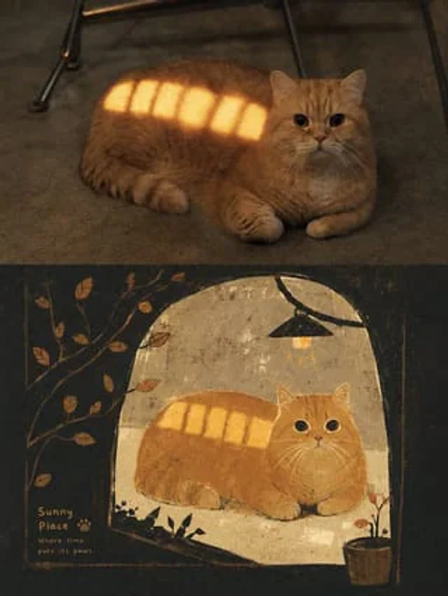

```text
请将我上传的每一张照片分别制作成一张独立的高级设计海报，不多图拼接，每张照片单独输出。整体采用3:4竖版构图，上下两个区域高度严格1:1，各占画面50%，并确保该表达方式可适配人物、动物、建筑、静物、自然场景等不同主题，而不限于城市题材。

上半部分保留原始照片，保持主体身份、动作、空间关系、真实质感、自然光影和原有色彩氛围，仅进行轻微高级摄影调色，使其具有杂志摄影与艺术出版物的质感。为适配画幅，可自然扩展天空、地面或环境背景，但不得拉伸、扭切或改变主体。

下半部分提取照片中最具识别性的主体、轮廓、姿态与叙事关系，重构为童话版画式手绘图像。不要机械描摹细节，而是将主体压缩为一两个清楚的大体块，以钝拙剪影、略微夸张的比例和少量关键边缘，保留原始对象的身份、动作、功能与情绪。画面从原图内容中提炼出一个大面积低明度或高反差的结构场，作为包裹主体的容器、路径、框架或密度层；背景像故事发生的外壳一样从原图空间与意义中生长出来，形成遮挡、裁切、吞没与局部露出的结构叙事。整体采用平面叙事透视和绘本页面式层级，可使用俯视压缩、侧向移动、正面框架、路径引导、尺度跳跃或边缘裁切组织阅读。

配色从上方照片提取，并保持明确的三层关系：大面积暗结构色负责重量与边界，适量浅色或留白负责呼吸，小面积高饱和情绪色负责读图路线与故事信号。最重要的信息仅以少量鲜明色块集中在面部、姿态、路径、器物功能点、环境标识或叙事焦点上，并始终被深色结构或浅色负形压住，让画面鲜艳但不平均。色相可随主题情绪调整，但面积比例与明度秩序保持稳定。

线条只在功能、路径、边界、纹理和识别处出现，保持稀疏、手绘、略不准的细线。所有色块保持平面化处理，同时保留干刷、颗粒、飞白、纸纹、喷点和轻微套印错位，呈现丝网印刷与粉蜡笔共同完成的手工质感，避免写实光影、复杂体积、光滑矢量边缘、3D渲染和塑料质感。

整体构图简洁、低细节、高识别，暗场包裹亮色信号，兼具可爱叙事与厚重版画感。若画面包含文字，可将文字处理为小标识、物体面板或边缘注释，数量精简，服从图形结构；字形圆钝，粗细略不均，密度低，带有自然手写感，使其像画面的一部分而不是后期贴上去的说明。整体参考童话绘本、手工版画、编辑插画与艺术出版物气质，呈现统一、鲜明、可迁移的作者化视觉语言。
```

Model: GPT Image 2
Author: 小小东

[ProjectD](https://aitoolsradar.com/en/prompts/f22059959fc2a1) · [Recorded source](https://youmind.com/prompts/grimm-fairy-tale-woodcut-poster-32028)
 · [Full original metadata and byte evidence](data/projectd-batch-0032.json)

## Gritty Córdoba Music Poster

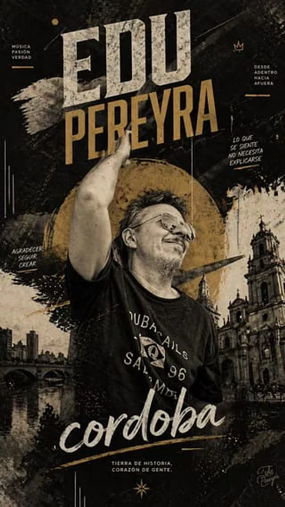

```text
A dramatic, vertical poster-style mixed-media portrait presents a raw urban editorial aesthetic, reminiscent of concert or personal brand posters. At the center is a middle-aged man, half-body, wearing a black T-shirt, slightly turned to the side, one arm raised, index finger pointing to the top of the image. His face is deliberately obscured by a rectangular blurred block. The poster uses deep black and tan tones, accented with distressed cream and gold, incorporating heavy grunge textures, ink splatters, overlapping scratches, torn paper strokes, dust, and weathered printing effects. A large, soft gold circular halo is placed behind his head and upper body. In the background, a collage of Córdoba's urban landmarks is created: the cathedral facade on the right, and the river, bridges, and low skyline on the left, all elements perfectly integrated into the textured poster composition. An oversized, bold, compressed serif font is added at the top, containing the following text:{argument name="headline text" default="EDU PEREYRA"} The letter "EDU" is a large, distressed gray-white letter, while "PEREYRA" is below in gold. Five smaller text groups are added around the composition, using uppercase handwritten or compressed styles: "MÚSICA PASIÓN VERDAD" in the upper left, "DESDE ADENTRO HACIA AFUERA" in the upper right, "LO QUE SE SIENTE NO NECESITA EXPLICARSE" in the middle right, "AGRADECER SEGUIR CREAR" in the middle left, and "TIERRA DE HISTORIA, CORAZÓN DE GENTE" in the bottom center. A large, expressive brush-style font word is added across the lower foreground.{argument name="city name" default="cordoba"} The poster is off-white, slightly tilted, and finished with a gold underline. It features three small, symbolic graphic embellishments: a tiny crown icon near the top right, a small starburst decoration near the bottom center, and a handwritten signature mark in the bottom right corner. The shirt should include vintage-printed lettering and badge patterns. The lighting is somber and contrasting, creating a striking contrast between the subject and the layered collage background. Overall impression: a raw, passionate, musical, spiritual, and locally proud poster with a high-end distressed print design, possessing a strong visual impact and a cinematic, handcrafted feel.
```

Model: GPT Image 2
Author: GPT Image 2 Prompts

[ProjectD](https://aitoolsradar.com/en/prompts/d4326d2b74a34c) · [Recorded source](https://x.com/EduaPereyra/status/2047316409701531704#reversed-0)
 · [Full original metadata and byte evidence](data/projectd-batch-0032.json)

## Gritty Evangelion Poster


```text
A retro anime poster with dramatic tension, employing a hardcore sci-fi mecha visual style. In the foreground, three young pilots stand back-to-back, with a massive purple bio-mechanical robot standing behind them. The pilot in the center is a slender boy, wearing a dark navy blue and black pilot suit with white panels on his shoulders and a glowing red circular core on his chest, facing forward with a serious expression. To his left is a pale-faced girl with an ice-blue bob haircut, wearing a white futuristic bodysuit, slightly turned to the side. To his right is a girl with long, reddish-brown hair, her hair flowing to one side, wearing a bright red pilot suit, looking resolutely ahead. Behind the three, the massive mecha head occupies the center of the composition, symmetrically distributed, with a single horn, orange-glowing eyes, sharply defined armor, and massive shoulder structures extending upwards like black wings. The background is outer space, with two celestial bodies visible: a massive cratered moon directly behind the mecha head, and a smaller planet to the right. The poster's bottom depicts a dilapidated futuristic city, its buildings crumbling, littered with rubble, sparks, and debris. At the very center of the bottom are two tiny human silhouettes running forward through the ruins, surrounded by pink energy streams extending in arcs to the left and right. The color palette uses deep indigo, black, purple, rust red, and ashen gray, with a heavy film grain, aged ink texture, weathered paper wear, paint splatters, scratches, printing damage, and a rough silkscreen poster feel. The overall composition is a complete movie poster, with dense typography around the edges: a large vertical English title "NEON GENESIS EVANGELION" on the left, next to which is smaller red vertical text "HIRANO OF EVANGELION"; near the lower left corner is a red NERV logo and the word "NERV"; a boxed label in the lower left corner reads "TOKYO-3" and "JAPAN"; a red warning box in the upper right corner reads "ANGEL ATTACK" and Japanese characters below it; and multiple lines of vertical Japanese slogans along the left and right edges. Cinematic, emotional, apocalyptic, and highly detailed, it presents a perfect combination of iconic 1990s anime poster design and modern high-end illustration quality.
```

Model: GPT Image 2
Author: GPT Image 2 Prompts

[ProjectD](https://aitoolsradar.com/en/prompts/54ffaa8c6b7f5f) · [Recorded source](https://x.com/Xiaoniu6161/status/2047609689790382396#reversed-1)
 · [Full original metadata and byte evidence](data/projectd-batch-0032.json)

## Gritty Evangelion Unit-01 Poster


```text
A hardcore, vertical anime mecha poster, featuring an aged silkscreen printing style, inspired by vintage military archives and Evangelion's key visual art. The main element is {argument name="mecha unit name" default="EVANGELION: UNIT-01"} A massive side profile close-up occupies two-thirds of the right side of the composition, facing left, jaws agape, emitting a wild roar. The head is a sharply defined biomechanical structure, featuring deep purple armor, olive green trim, a black metallic internal structure, a long horn extending diagonally upwards to the left, sharp teeth, and a narrow, glowing eye. The surface is covered in scratches, chips, and weathering marks, accented with heavy, comic-book style lines. The background is a deep navy blue blueprint, filled with eight clearly visible technical diagrams, white schematics, anatomical overlays, cross-sections, labels, measurement marks, and interface graphics. A streak of vibrant red paint sweeps diagonally across the upper center and left side of the image, with additional red dripping effects on the mech's mouth area. In the lower left corner, a small, boyish figure huddled on a gray equipment case: wearing a short-sleeved white shirt, dark trousers, and white sneakers, elbows resting on his knees, head bowed, staring at a glowing device in his hands, conveying a sense of loneliness and anxiety. Add layered poster layout and warning graphics to the border: a tattered yellow warning sign in the upper right corner with Japanese warning text and "CAUTION NERV ONLY"; a long strip on the left sidebar with "01", barcode-like squares, danger icons, and red and black labels; huge, distressed white Chinese characters stacked vertically above the mech's torso; below the Chinese characters are large, spaced-out red capital words.{argument name="main title" default="ESCAPE"} Below is a small black label that reads "PILOT:"{argument name="pilot name" default="IKARI, SHINJI"} The bottom right corner features the NERV logo; the footer includes a confidential document marker and a top-secret stamp. The blueprint area contains six clearly identifiable English technical labels: "TEST TYPE," "BIOLOGICAL CONSTRAINT," "AT FIELD," "MAGI SYSTEM," "INTERNAL," and "CLASSIFIED MATERIAL." Japanese archival text blocks are added as realistic graphic textures. The color palette is limited to deep indigo, black, deep red, purple, olive green, dirty beige, and off-white. High contrast, torn paper collage details, halftone textures, ink splatters, cracked paint, and worn printing edges. A cinematic, oppressive, chaotic, collector's edition poster design—ultra-refined, sharp, and textured, rejecting a clean, modern aesthetic.
```

Model: GPT Image 2
Author: GPT Image 2 Prompts

[ProjectD](https://aitoolsradar.com/en/prompts/e31fb2cb1828bc) · [Recorded source](https://x.com/AI_CyberDreams/status/2046617697639620818#reversed-1)
 · [Full original metadata and byte evidence](data/projectd-batch-0032.json)

## Gritty Prison Mugshot Portrait


```text
{ "parameters": { "aspect_ratio": "2:3", "version": "6.0", "style_type": "Realistic photography, cinematic lighting, high detail, rough texture" }, signature: “XSydneyFan" in corner Cursive style "subject_description": { "demographics": "Beautiful young woman with fair skin.", "hair": "Long, dark black hair with a few strands falling across her forehead.", "details": "Small amounts of black soot and dirt on her face, neck, and hands." }, "attire": { "outerwear": "Bright orange prison uniform (overall workwear), slightly oversized. Worn and dirty, covered in black soot stains.", "details": "Large black '000' printed on the right side of her chest.", "under_layer": "Wearing a gray crew-neck T-shirt underneath.", "accessories": "Wearing a silver ring on her finger." }, "pose_and_expression": { "stance": "Standing in the stance of a prison photo. Looking directly at the camera.", "expression": "Expressionless, serious, indifferent, and seemingly bored.", "right_hand_action": "Casually raised, fingers touching the hair behind the right ear/neck area.", "left_hand_action": "Holding a black and white clapperboard in front of the chest." }, "props": { "slate_board_content": { "main_text": "🚫 ARRESTED 🚫 For illegally Money", "date": "12-28 25-26" } }, "environment": { "setting": "A rough, dilapidated room. The walls behind are peeling, cracked, and textured, resembling an abandoned concrete building or a run-down police station.", "background_elements": [ "A height chart on the wall.", "The word 'POLCIE' is written in the upper left corner of the wall." ] } }
```

Model: GPT Image 2
Author: GPT Image 2 Prompts

[ProjectD](https://aitoolsradar.com/en/prompts/2bf16493010280) · [Recorded source](https://x.com/XSydneyFan/status/2047630294103310347)
 · [Full original metadata and byte evidence](data/projectd-batch-0032.json)

## Gritty Superhero Comic Page


```text
{
  "type": "Comic book page layout",
  "style": "Modern American comic book illustrations, dark and hardcore atmosphere, high-contrast lighting and dynamic composition.",
  "header": {
    "location_box": "{argument name=\"location\" default=\"Hell&#39;s Kitchen, New York\"}",
    "title": "{argument name=\"comic title\" default=\"Daredevil: The Fearless One!\"}"
  },
  "character": "{argument name=\"hero description\" default=\"A superhero dressed in a red demon suit, wearing horns, and with eyes that flash red light.\"}",
  "layout": {
    "panel_count": 6,
    "panels": [
      {
        "position": "Top left",
        "scene": "The hero stood on the rooftop, overlooking the city skyline at sunset.",
        "text_boxes": 3,
        "text": [
          "Some nights, the city feels like a heartbeat.",
          "Swift. Unstoppable. Vibrant.",
          "And some nights... it feels like a warning."
        ]
      },
      {
        "position": "Top right",
        "scene": "A close-up of the hero's masked face, hidden in the shadows.",
        "text_boxes": 1,
        "text": [
          "Tonight, both are true."
        ]
      },
      {
        "position": "center right",
        "scene": "Four thugs stood in the dark, damp alley.",
        "graffiti": "{argument name=\"enemy faction\" default=\"Hand\"}",
        "text_boxes": 2,
        "text": [
          "The Hand is at it again.",
          "Silent and still. Utterly patient. As if they controlled the shadows."
        ]
      },
      {
        "position": "Center left, breaking the border",
        "scene": "The hero leaps forward dynamically, stretching out his hand to grasp a short stick with steel wire, against a backdrop of concentric white radar ripples.",
        "text_boxes": 2,
        "speech_bubbles": 1,
        "text": [
          "They don't have control.",
          "As long as I'm still here, they can forget about it.",
          "I can hear you. All of you."
        ]
      },
      {
        "position": "Bottom left",
        "scene": "The hero leaps toward the silhouettes of a group of sword-wielding ninjas against a crimson background.",
        "text_boxes": 2,
        "text": [
          "I don't wear the mask to be a hero.",
          "I wear it to ensure that innocent people can return home safely."
        ]
      },
      {
        "position": "Bottom right",
        "scene": "Close-up of the hero's face, with the corners of his mouth slightly upturned.",
        "speech_bubbles": 1,
        "text": [
          "Let's see who survives tonight."
        ]
      }
    ]
  },
  "footer": "{argument name=\"ending text\" default=\"To be continued!\"}"
}
```

Model: GPT Image 2
Author: GPT Image 2 Prompts

[ProjectD](https://aitoolsradar.com/en/prompts/9c12effd01fd66) · [Recorded source](https://x.com/HbTteok/status/2044241756523507788#reversed-0)
 · [Full original metadata and byte evidence](data/projectd-batch-0032.json)

## Gritty Tattooed Woman Mugshot


```text
A realistic, slightly grainy, and dimly lit police photo features a young woman with messy long black hair, prominent cheekbones, and full lips. She has a small tattoo near her right eye, and her neck, chest, hands, and arms are covered in intricate mandala-style tattoos. She wears a simple black sleeveless top and holds a white rectangular ID badge with blurred text; her nails are neatly trimmed. The background is an ordinary white cement brick wall, with a height measuring scale on the right displaying numbers like 150, 160, and 170 in black template font. The overall aesthetic is rough and realistic, resembling a genuine police photo.
```

Model: GPT Image 2
Author: GPT Image 2 Prompts

[ProjectD](https://aitoolsradar.com/en/prompts/4eb6e27f86e5f1) · [Recorded source](https://x.com/WolfRiccardo/status/2044582572634583491#reversed-1)
 · [Full original metadata and byte evidence](data/projectd-batch-0032.json)

## GTA 6 CJ and Lucia crossover


```text
Generate a{argument name="game" default="GTA 6"} Game screenshots, including{argument name="character 1" default="cj"} and{argument name="character 2" default="lucia"} Together
```

Model: GPT Image 2
Author: GPT Image 2 Prompts

[ProjectD](https://aitoolsradar.com/en/prompts/ed124ce7611a66) · [Recorded source](https://x.com/Manmaz13/status/2046689320094802174)
 · [Full original metadata and byte evidence](data/projectd-batch-0032.json)

## GTA Anyang Concept Screenshot


```text
Generate a game screenshot with the following style:{argument name="style" default="Grand Theft Auto: Vice City"} But the location is set in{argument name="location" default="Anyang, Henan"} The perspective is an overview from north to south.{argument name="landmark" default="Anyang Wenfeng Pagoda"} The visual style should have a game-like feel while remaining as realistic as possible. The time is daytime, there are pedestrians on the road, and the protagonist is standing on a car in the middle of the road, looking towards the Wenfeng Pagoda.
```

Model: GPT Image 2
Author: GPT Image 2 Prompts

[ProjectD](https://aitoolsradar.com/en/prompts/d49152c2578340) · [Recorded source](https://x.com/duyuanshang/status/2046911736176124044)
 · [Full original metadata and byte evidence](data/projectd-batch-0032.json)

## GTA Storyboard Prompt


```text
Create a 3x3 GTA 6 gameplay storyboard image showing Micheal Playing football
```

Model: GPT Image 2
Author: Abdul Șhakoor

[ProjectD](https://aitoolsradar.com/en/prompts/590140b8ebf9a8) · [Recorded source](https://youmind.com/prompts/gta-storyboard-image-prompt-26027)
 · [Full original metadata and byte evidence](data/projectd-batch-0032.json)

## GTA V Style Crossover Cover Art


```text
{
  "type": "Video game cover art collage",
  "style": "GTA V cover art style, cel illustration, thick black panel border.",
  "centerpiece": {
    "character": "{argument name=\"main character\" default=\"Thomas Shelby in Peaky Blinders\"} He was wearing a dark suit and a white shirt, smoking a cigarette, and sporting a low-cut hairstyle.",
    "logo": "{argument name=\"game title\" default=\"grand theft auto V\"} The logo features a green V and a \"FIVE\" banner.",
    "subtitle": "{argument name=\"bottom text\" default=\"THOMAS SHELBY BIRMINGHAM. 1919.\"}"
  },
  "layout": {
    "panel_count": 8,
    "panels": [
      {
        "position": "Top left",
        "description": "There is on the hillside{argument name=\"location sign 1\" default=\"VINEWOOD\"} Signs, radio towers, palm trees"
      },
      {
        "position": "Center upper left",
        "description": "The street sign reads{argument name=\"location sign 2\" default=\"SMALL HEATH BIRMINGHAM S 41\"} townhouse"
      },
      {
        "position": "center left",
        "description": "A pistol, 3 bullets, and the map says 'BY ORDER OF THE PEAKY BLINDERS'."
      },
      {
        "position": "Bottom left",
        "description": "Retro 1920s black car, illuminated headlights, 'GTA V' license plate."
      },
      {
        "position": "Top right",
        "description": "City skyline silhouette, helicopter"
      },
      {
        "position": "center right",
        "description": "Three men wearing baseball caps and suits walk through a smoky industrial environment."
      },
      {
        "position": "Bottom right and top",
        "description": "A large country estate with black horses on the lawn."
      },
      {
        "position": "bottom right",
        "description": "A man wearing a baseball cap gazes at the industrial skyline and the yellow Rockstar Games logo."
      }
    ]
  }
}
```

Model: GPT Image 2
Author: GPT Image 2 Prompts

[ProjectD](https://aitoolsradar.com/en/prompts/3e0515aa221f64) · [Recorded source](https://x.com/o_tal_do_ken/status/2046009612755755195#reversed-0)
 · [Full original metadata and byte evidence](data/projectd-batch-0032.json)

## GTA-Style Beach Club Gameplay Screenshot


```text
Create a hyper-realistic screenshot of an open-world crime video game, inspired by a modern Miami beach club scene, set in a bright afternoon sun with a clear blue sky. Use a third-person perspective composition, with a seated figure in the foreground.{argument name="character description" default="A young man with short, dark hair and fair skin was wearing a plain black T-shirt and printed swim trunks."} He sits casually on the light-colored sand, his body slightly turned to one side, as if the player's perspective has stopped beside him. Positioning him slightly off-center on the left side of the screen, occupying a large proportion, his posture is natural and relaxed. Behind him, a high-end beach club is depicted, with three white pavilions with flowing curtains clearly visible on the beach, planted with several tall palm trees. To the left is turquoise water, and to the right is a row of Art Deco hotels with soft-toned exteriors and neon decorations. The beach is filled with 12 people in swimwear in the background: some are standing and chatting, some are walking along the shore, and two are sitting at a table on the right enjoying a meal. The scene includes white casual furniture and parasols, creating a sophisticated social party atmosphere. A realistic game HUD interface is added: in the lower left corner is a sign {argument name="map label" default="GPS route"} The small square map displays weapon and control icons in the bottom right corner and the amount in the top right corner.{argument name="money amount" default="$45,670"} The money counter. The overall look is similar to screenshots from the next-gen game *Grand Theft Auto VI*, with a cinematic feel and a distinct in-game texture. It boasts rich detail, realistic shadows, vibrant color gradations, and a lively coastal atmosphere, while also possessing {argument name="city setting" default="Vice City"} The subtle irony of luxurious beaches.
```

Model: GPT Image 2
Author: GPT Image 2 Prompts

[ProjectD](https://aitoolsradar.com/en/prompts/0417266a342c8b) · [Recorded source](https://x.com/estebandiba/status/2046564959899815946#reversed-1)
 · [Full original metadata and byte evidence](data/projectd-batch-0032.json)

## GTA-Style Dialogue Screenshot


```text
{
  "type": "Video game screenshots",
  "style": "{argument name=\"art style\" default=\"Grand Theft Auto VI: Aesthetics, Realistic 3D Graphics\"}",
  "setting": "A balcony overlooking the coastal city at sunset, with palm trees, skyscrapers, and warm lights.",
  "characters": [
    {
      "role": "NPC",
      "description": "{argument name=\"npc description\" default=\"Omni-Man is a muscular, middle-aged man with a beard, graying sideburns, and wearing a red and white superhero suit.\"}",
      "position": "Center left, facing the camera"
    },
    {
      "role": "Players",
      "description": "A man wearing a dark baseball cap backwards and a light gray T-shirt",
      "position": "Right foreground, facing away from the camera"
    }
  ],
  "ui_elements": {
    "type": "Dialogue Menu",
    "position": "Bottom Center",
    "speaker_name": "{argument name=\"speaker name\" default=\"OMNI-MAN\"}",
    "dialogue_text": "{argument name=\"npc dialogue\" default=\"This planet is not your responsibility to protect. The rule of the Viltrum is inevitable.\"}",
    "choices_count": 3,
    "choices": [
      "1. {argument name=\"choice 1\" default=\"You can forget about taking over anything.\"}",
      "2. What exactly do you want from me?",
      "3. I don't care about your politics."
    ],
    "highlight": "Option 1 has a semi-transparent purple background bar."
  }
}
```

Model: GPT Image 2
Author: GPT Image 2 Prompts

[ProjectD](https://aitoolsradar.com/en/prompts/2508eadfca1890) · [Recorded source](https://x.com/chetaslua/status/2044991545380905256#reversed-1)
 · [Full original metadata and byte evidence](data/projectd-batch-0032.json)

## GTA-Style Dialogue Screenshot


```text
{
  "type": "video game screenshot",
  "style": "{argument name=\"art style\" default=\"Grand Theft Auto VI aesthetic, realistic 3D graphics\"}",
  "setting": "balcony overlooking a coastal city at sunset, palm trees, skyscrapers, warm lighting",
  "characters": [
    {
      "role": "NPC",
      "description": "{argument name=\"npc description\" default=\"Omni-Man, muscular older man with a mustache and grey temples, wearing a red and white superhero suit\"}",
      "position": "center-left, facing camera"
    },
    {
      "role": "Player",
      "description": "man wearing a backwards dark baseball cap and light grey t-shirt",
      "position": "right foreground, back to camera"
    }
  ],
  "ui_elements": {
    "type": "dialogue menu",
    "position": "bottom center",
    "speaker_name": "{argument name=\"speaker name\" default=\"OMNI-MAN\"}",
    "dialogue_text": "{argument name=\"npc dialogue\" default=\"This planet isn't yours to protect. Viltrumite rule is inevitable.\"}",
    "choices_count": 3,
    "choices": [
      "1. {argument name=\"choice 1\" default=\"You're not taking over anything.\"}",
      "2. What do you want from me?",
      "3. I don't care about your politics."
    ],
    "highlight": "Choice 1 has a translucent purple background bar"
  }
}
```

Model: GPT Image 2
Author: Chetaslua

[ProjectD](https://aitoolsradar.com/en/prompts/0c4ca2d3886f81) · [Recorded source](https://youmind.com/prompts/gta-style-dialogue-screenshot-13890)
 · [Full original metadata and byte evidence](data/projectd-batch-0032.json)

## Guadalajara 复古电影旅行海报


```text
@Crea una imagen {
  "style": "Cinematic Vintage Movie Poster — Guadalajara, Mexico",
  "target_tool": "DALL-E 3 (ChatGPT)",
  "prompt": "Generate a vertical portrait-format movie poster image, taller than wide in a 2:3 aspect ratio. The image is a cinematic vintage travel movie poster for Guadalajara, Mexico, rendered with the visual texture of an aged large-format film poster: heavy 35mm film grain throughout especially in the shadow areas, slightly faded and warm-shifted color tones as if printed on aged matte paper stock, a subtle halftone dot pattern visible in the midtones, and a very slight ink bleed at high-contrast edges giving it an authentic vintage printed poster feel. Foreground: a single dark silhouette of a lone mariachi musician standing still at the center-bottom of the frame, rendered as a pure clean dark silhouette with no facial features visible — traditional wide-brim charro sombrero, fitted traje de charro suit outline, holding a guitarrón — casting a long warm shadow across the honey-colored cantera stone paving of Plaza de la Liberación below, with colorful papel picado banners in red, orange, green and yellow cut tissue paper strung in loose diagonal lines overhead from building to building, swaying slightly, framing the upper composition, no people other than the single silhouetted figure, no vehicles, no modern objects. Midground: the grand honey-amber cantera stone neoclassical facade of the Teatro Degollado rising directly behind the silhouette, its ornate columned portico and triangular pediment warmly lit by the low golden-hour sun hitting from the left, long dramatic shadows stretching across the stone paving, the warm amber volcanic stone glowing intensely in the golden light. Background: the twin neo-Gothic spires of the Catedral Metropolitana de Guadalajara rising tall into the upper frame against a vast deep cerulean blue sky transitioning to burnt amber and deep orange near the horizon, a single scattered cloud catching violet and gold light from below, the cathedral facade in warm honey stone matching the Teatro Degollado's palette. Color grade: saturated warm amber and golden honey tones dominating the stone architecture, deep cobalt blue in the upper sky, rich burnt orange near the horizon, faded warm sepia in the shadow areas consistent with a vintage printed poster. At the very top of the image, centered above the spires, render the single word GUADALAJARA in bold condensed uppercase display serif letters in warm cream-gold with a faint dark drop shadow, leaving clear sky negative space for the title. No modern buildings, no cars, no utility wires, no people other than the single dark silhouette visible anywhere in the scene.",
  "target": "🎯 Target: DALL-E 3 (ChatGPT) — 💡 Foreground/midground/background separation places Teatro Degollado and the Cathedral in distinct spatial layers, the mariachi silhouette is specified as a featureless outline to eliminate aberration risk, and vintage print texture is described visually rather than as a style label."
}
```

Model: GPT Image 2
Author: @MiMundoConIA

[ProjectD](https://aitoolsradar.com/en/prompts/55b07c5f0742f8) · [Recorded source](https://x.com/MiMundoConIA/status/2077046470335938826)
 · [Full original metadata and byte evidence](data/projectd-batch-0032.json)

## Guangdong Super League Invitation Poster


```text
广东省城市足球超级联赛（粤超）邀请函海报设计，比例 9:16。S 型流动构图，以发光足球和动态能量流贯穿画面，沿动线融合广州塔、深圳平安金融中心、珠海渔女雕像、岭南建筑、佛山武术剪影、中山文化符号、潮汕英歌舞与清远山水。现代国潮高级海报风格，中国红主视觉，青蓝辅助，金色高光，带完整中文排版与电影级光影。
```

Model: GPT Image 2
Author: @liyue_ai

[ProjectD](https://aitoolsradar.com/en/prompts/532ff3e359da03) · [Recorded source](https://x.com/liyue_ai/status/2045772039521542202)
 · [Full original metadata and byte evidence](data/projectd-batch-0032.json)

## Guangzhou City Promotional Poster


```text
A picture that is full of festive atmosphere for the Spring Festival while maintaining an elegant style.{argument name="year" default="2026"} The city's promotional poster for the year features a double exposure and an S-shaped composition. In the lower right corner against a pure white textured background, a small figure in traditional Chinese clothing waves a long red ribbon. The ribbon dances in the air, showcasing the smooth texture of silk, and magically transforms into magnificent mountains and rivers as it floats upwards to the left. Overlaid within this "river" is a hand-drawn image.{argument name="city name" default="Guangzhou"} A city map, featuring mountains, ocean, and rivers. Its Chinese-style design is both striking and magnificent.{argument name="landmarks" default="Guangzhou Tower, Zhujiang New Town architectural complex, Pearl River, ancient buildings, cruise ships, Baiyun Mountain"} The scene is shrouded in mist, creating an ethereal atmosphere. The colors and details are rich, while the ample use of white space lends it a refined feel. The lower left corner displays "SPRING 2026" and a vertical banner, symbolizing "A Millennium Commercial Capital, Charming Guangzhou." The typography is beautiful and clear, with a 9:16 aspect ratio.
```

Model: GPT Image 2
Author: GPT Image 2 Prompts

[ProjectD](https://aitoolsradar.com/en/prompts/3e0d6b79cee1f6) · [Recorded source](https://x.com/liyue_ai/status/2045332620352119274)
 · [Full original metadata and byte evidence](data/projectd-batch-0032.json)

## Guangzhou City Promotional Poster


```text
一张充满{argument name="氛围" default="新春喜庆"}氛围但不失高雅格调的 {argument name="年份" default="2026"} 城市宣传海报。双重曝光，构图延续了S型的流动感；在纯白的纹理背景右下角，一个身穿中国传统服饰的微缩人物正在挥舞着一条长长的红色丝绸舞带，这条红绸在空中舞动，不仅展现出丝绸的柔顺质感，更在向左上方飘动的过程中，奇幻地变形成了一条壮丽的山脉河流。在这条“河流”中，叠加了一个有山有海河的广州城市手绘图，国潮，景色尽在眼底，壮阔雄伟，令人震撼。广州的地标建筑(广州塔，珠江新城建筑群，珠江, 广州城里古建筑，游轮，白云山）。云雾环绕，仙气缥缈，色彩丰富，结构复杂，细节丰富，但因为大面积的留白，画面依然显得清新脱俗，左下角排版着“SPRING 2026”和竖排的宣传语，整体寓意“{argument name="宣传语" default="千年商都，魅力广州"}”。文字排版优美，大方，字迹清晰完整，尺寸9:16。
```

Model: GPT Image 2
Author: 李岳

[ProjectD](https://aitoolsradar.com/en/prompts/32d3e26f45e9fd) · [Recorded source](https://youmind.com/prompts/guangzhou-double-exposure-poster-13857)
 · [Full original metadata and byte evidence](data/projectd-batch-0032.json)

## Guangzhou Paper-Cut City Poster


```text
以珠江新城现代都市景观为灵感的剪纸艺术，通过精巧的镂空手法在一整幅纸上，立体刻画广州塔、东西双塔等地标建筑与繁华城景。
所有建筑与元素均以流畅的线条与结构相连，无孤立部分，构成一幅完整的都市画卷。
画面采用金属箔或光泽纸材质，表面带有细腻的明暗光泽，在光照下呈现柔和的高光与阴影，仿佛被城市灯光轻轻照亮。
背景以虚化的珠江新城天际线为衬，点缀隐约可见的花城广场与树木轮廓，整体透出现代浪漫的氛围。
作品中巧妙融入轻盈的蒲公英绒毛或星光般的动态光点，象征梦想与活力在这座新城中飘散飞扬。整体呈现8K超高清视觉，细节丰富，真实而富有艺术感染力。
```

Model: GPT Image 2
Author: @liyue_ai

[ProjectD](https://aitoolsradar.com/en/prompts/a2468c5e91f8c1) · [Recorded source](https://x.com/liyue_ai/status/2045527750606487877)
 · [Full original metadata and byte evidence](data/projectd-batch-0032.json)

## Gupta Palace Environment Reference Sheet


```text
Goal: Create a production-grade environment reference sheet for a {argument name="historical setting" default="Royal Gupta Empire palace complex, 5th century CE"}, designed as a cinematic storyboard and worldbuilding asset for GPT-image generation.

Canvas: Wide 16:9 reference-board layout on a dark charcoal background, dense but clean, with thin white divider lines, uppercase white technical labels, small annotation callouts, and a realistic architectural concept-art style. The overall title across the top reads: “PRODUCTION GRADE ENVIRONMENT REFERENCE - | ROYAL GUPTA EMPIRE GUPTA EMPIRE PALACE COMPLEX”, with “5TH CENTURY CE” aligned at the top right.

Main composition: Place a large central aerial three-quarter view of a grand Gupta-era palace complex occupying the middle of the sheet. The complex is made of red sandstone and cream stone, with symmetrical courtyards, high enclosing walls, arched gateways, colonnaded halls, carved balconies, flat terraces, small domed pavilions, lotus pools, geometric garden paths, fountains, mango trees, flowering shrubs, and warm golden-hour sunlight. Add fine white callout lines labeling architectural and landscape details such as carved columns, throne platform, mango gardens, marble seating, and sacred lotus ponds.

Left column sections: Include exactly 3 sections. Section 1 is “PALACE ENTRANCE”, showing a frontal red sandstone gate with two tower-like chhatri pavilions, a central pointed arch, two stone guardian statues, red-and-gold hanging banners, and relief carvings beneath it. Label exactly 3 entrance detail thumbnails below it: “Stone guardians”, “Banners”, and “Relief carvings”. Section 2 is “ROYAL GARDENS”, showing a formal garden with rectangular water channels, fountains, clipped lawns, trees, peacocks, and palace colonnades in the background. Section 3 is “MATERIAL REFERENCE”, showing exactly 8 material swatches labeled: Red sandstone, Cream sandstone, Polished granite, Marble inlays, Carved teak wood, Bronze fittings, Copper elements, and Painted plaster mural pigments and gold leaf.

Top and right sections: Include exactly 5 smaller architectural reference panels around the central image. Panel 1: “ROYAL AUDIENCE HALL”, an interior hall with carved stone columns, warm shadows, elevated audience platform, carved columns, and throne platform labels. Panel 2: “QUEEN’S COURTYARD”, a garden courtyard with colonnaded palace walls, flower beds, central fountain, marble paths, and lotus ponds. Panel 3: “MATERIAL REFERENCE”, another grid of exactly 8 swatches with the same labels: Red sandstone, Cream sandstone, Polished granite, Marble inlays, Carved teak wood, Bronze fittings, Copper elements, and Painted plaster mural pigments and gold leaf. Panel 4: “PALACE BALCONY SYSTEM”, showing carved projecting balconies with stone railings and ornate supports. Panel 5: “SACRED TEMPLE ZONE”, showing small Gupta-style shrines with domes, red stone, trees, and a courtyard.

Bottom row sections: Include exactly 3 sections. Section 1: “LIGHTING REFERENCE”, with exactly 4 cinematic lighting thumbnails labeled Dawn, Midday, Sunset, and Moonlit Night. Dawn should be pale and misty, midday bright and clear, sunset orange and dramatic, moonlit night blue with palace silhouettes. Section 2: “COLOR PALETTE”, with exactly 8 color chips labeled Sandstone Red, Warm Ivory, Lotus Pink, Deep Saffron, Bronze Brown, Peacock Blue, Banyan Green, and Royal Crimson. Section 3: “CULTURAL DETAIL”, with exactly 9 illustrated cultural elements labeled Royal elephants, Attendants, Sacred cows, Oil lamps, Incense burners, Flower garlands, Palm-leaf manuscripts, Bronze vessels, and Silk banners.

Atmosphere note: Add a small paragraph near the sacred temple panel describing warm Indian climate lighting, visible sunbeams in shaded courtyards, lotus pools, shisham/rosewood and neem trees, monsoon-season atmosphere, incense smoke, buffalo or sacred animals, rich bronze and gold ornamentation, birds, and subtle reflections.

Visual style: Ultra-detailed realistic environment design sheet, authentic ancient Indian Gupta architecture, red sandstone carvings, cream sandstone highlights, polished stone, carved teak, bronze and copper details, painted plaster with gold leaf, volumetric god rays, warm golden-hour ambience, crisp labels, cinematic consistency across camera angles.

Constraints: Keep the sheet information-dense but readable, with exactly the counted panels, material swatches, lighting thumbnails, color chips, cultural detail objects, and entrance detail thumbnails listed above. Avoid modern buildings, modern people, plastic materials, neon colors, sci-fi elements, watermarking, or random extra labels. Use the custom palette emphasis of {argument name="dominant material color" default="red sandstone"}, {argument name="secondary material color" default="warm ivory cream sandstone"}, {argument name="lighting mood" default="golden-hour volumetric sunlight"}, and {argument name="main environment feature" default="symmetrical palace courtyards with lotus pools"}.
```

Model: GPT Image 2
Author: Adithya Thatipalli

[ProjectD](https://aitoolsradar.com/en/prompts/55172e8615f322) · [Recorded source](https://youmind.com/prompts/gupta-palace-reference-sheet-23822)
 · [Full original metadata and byte evidence](data/projectd-batch-0032.json)

## Haaland Futuristic Football Poster


```text
Goal: Create a vertical modern football superstar collectible poster for {argument name="player name" default="埃尔林·哈兰德"}, showing an ultra-realistic striker charging toward the camera in a dramatic stadium action scene, with a futuristic sports-data archive interface around him.

Canvas: Tall portrait poster, about 9:16 ratio. Dark blue, icy steel, and gold color palette. High contrast cinematic lighting, rain mist, flying turf, dust, sparks, motion blur, and a packed stadium roof in the background.

Main subject: A powerful blond male footballer in a sky-blue jersey, white shorts, and pale blue socks, sprinting and kicking forward from the center of the poster. Use an extreme low-angle perspective: his boot and the football are closest to the viewer, large and motion-blurred in the foreground, while his torso fills the center. The face should be covered by a centered square blurred censor block, while hair, body, uniform, and pose remain visible. Emphasize muscular arms, explosive forward momentum, and a “finishing machine” striker vibe.

Top typography: Huge distressed white Chinese headline text reading {argument name="headline text" default="埃尔林·哈兰德"}. Beneath it, a smaller gold subtitle with separators reading {argument name="subtitle text" default="北欧巨炮 · 终结机器 · 禁区统治者"}. Add thin gold horizontal accent lines on both sides.

Data interface layout: Place exactly 8 transparent HUD-style stat cards around the player, with thin gold and pale-blue technical borders, tiny charts, icons, microtext, and graphs. Left column has exactly 4 cards from top to bottom: 1) 「青训起点」 with a small player path diagram, 2) 「萨尔茨堡爆发」 with a kicking silhouette and growth chart, 3) 「多特锋芒」 with a running player icon and graph, 4) 「曼城时期」 with a stadium icon and bar chart. Right column has exactly 4 cards from top to bottom: 1) 「进球效率」 with a target icon and bar chart, 2) 「禁区统治力」 with a goal icon and rising line graph, 3) 「冲刺与力量」 with a sprinting icon and bar chart, 4) 「纪录刷新者」 with a trophy icon and data chart.

Bottom timeline: Add a thin career timeline stretching across the lower poster with exactly 6 small footballer silhouette milestones and tiny year labels, connected by gold dots and a fine line. Include faint blue equalizer-style bars behind the timeline.

Bottom title plate: At the very bottom, add a dark futuristic nameplate with gold trim, chevron arrows on both sides, and large gold Chinese text reading {argument name="bottom slogan" default="新生代巨星破框档案"}.

Visual style: Hyper-realistic sports photography mixed with sci-fi infographic design, collectible World Cup poster energy, volumetric stadium light beams, sharp typography, gritty texture, layered depth, premium editorial composition.

Constraints: Keep all text legible and in Chinese where specified. Use exactly 8 side stat cards and exactly 6 bottom timeline milestones. Do not add logos, club badges, brand marks, watermarks, or extra people. The central player must dominate the composition, with the ball breaking toward the viewer in the lower right foreground.
```

Model: GPT Image 2
Author: Larus Canus

[ProjectD](https://aitoolsradar.com/en/prompts/f8f4ee7b78a271) · [Recorded source](https://youmind.com/prompts/haaland-football-poster-24695)
 · [Full original metadata and byte evidence](data/projectd-batch-0032.json)

## Haitian Football Poster Panorama


```text
Créer une illustration panoramique raffinée au format paysage pour une affiche haïtienne de football intitulée **« {argument name="nom de l'affiche" default="GRENADYE 2026"} »**, intégrant **{argument name="villes" default="Jacmel, Cap-Haïtien et Port-au-Prince"}** dans une seule scène harmonieuse, avec un trophée de la Coupe du monde stylisé, pleinement intégré comme point d’ancrage central.

Représenter Haïti comme une scène nationale calme, élégante, très stylisée, dans un style {argument name="style artistique" default="affiche pastel en collage de papier"}. Utiliser une composition horizontale ample, avec trois zones urbaines doucement connectées par la mer des Caraïbes, les montagnes, le ciel et des plans colorés découpés en papier.

Zone gauche : Jacmel, avec architecture gingerbread historique, façades coloniales pastel, balcons en bois ornés, détails décoratifs, palmiers, culture artistique du bord de mer, accents inspirés des masques de carnaval, petits artistes, bateaux et rues côtières chaleureuses.

Zone centrale : Port-au-Prince, avec quartiers en pente superposés, maisons géométriques colorées, boulevards bordés de palmiers, eau du port, arrière-plan montagneux subtil, architecture civique, petits personnages de marché, motifs d’art haïtien et une place ouverte qui ancre le trophée.

Zone droite : Cap-Haïtien, avec la Citadelle Laferrière comme silhouette de forteresse sur une crête verte lointaine, le palais Sans-Souci suggéré par des arches en pierre claire, architecture coloniale côtière, baie turquoise, bateaux de pêche, palmiers et petits personnages célébrant le football.

Placer au centre un trophée de la Coupe du monde reconnaissable mais stylisé, rendu comme une sculpture monumentale en collage de papier doré mat, avec formes simplifiées du globe, courbes abstraites inspirées du football, bords légèrement surélevés, contours embossés et ombres délicates. Ajouter les chiffres « 2026 » près de la base. Ne pas utiliser de logos officiels FIFA ni de logos d’équipes.

Ajouter des détails subtils de célébration du football haïtien : petits personnages avec accents rouges et bleus, petits drapeaux haïtiens, ballons abstraits, rubans graphiques bleu et rouge haïtiens atténués, et une énergie festive maîtrisée au premier plan.

Palette : bleu ciel doux, bleu-gris brumeux, cobalt pâle, vert sauge atténué, menthe poudrée, crème chaude, beige clair, gris pierre pâle, corail poussiéreux, pêche douce, jaune atténué, blanc cassé, turquoise fané, terracotta ensoleillée, accents bleu et rouge haïtiens, petits détails marine et charbon, plus or mat raffiné pour le trophée.

L’image doit sembler faite à la main, comme du papier coloré soigneusement assemblé et de la gouache sur carton d’affiche, avec grain subtil du papier, texture imprimée mate, bords relevés, embossage délicat, ombres de papier découpé, légère rugosité de surface, silhouettes nettes, aplats géométriques propres et beaucoup d’espace négatif.

Typographie en haut à gauche : « GRENADYE 2026 » en police sans-serif géométrique majuscule
```

Model: GPT Image 2
Author: HaitiBrand

[ProjectD](https://aitoolsradar.com/en/prompts/259a0366ca868c) · [Recorded source](https://youmind.com/prompts/haitian-football-poster-paper-collage-24128)
 · [Full original metadata and byte evidence](data/projectd-batch-0032.json)

## Hand Cream Tube with Botanical Sprig


```text
A small matte sage-green aluminium hand cream tube lying on a clean off-white linen surface, with one fresh eucalyptus sprig laid diagonally beside it. Soft diffuse daylight from above, gentle shadows. Square 1:1 minimal natural cosmetics product photography. No brand text on the tube, no logo, no watermark. Photorealistic metal and fabric textures, magazine beauty editorial styling.
```

Model: GPT Image 2
Author: @hiapi_ai

[ProjectD](https://aitoolsradar.com/en/prompts/8cda01d6802adf) · [Recorded source](https://github.com/HiAPIAI/awesome-gpt-image-2-prompts)
 · [Full original metadata and byte evidence](data/projectd-batch-0032.json)

## Hand-Drawn Annotated Food Diary Style


```text
Generate a{argument name="food" default="Steak and dessert"} The photos are in the style of{argument name="style" default="English Steakhouse"} The photos should have a mobile phone shooting quality, suitable for posting on Instagram. Avoid including people in the frame. Next, observe the elements in the photo and add meaningful hand-drawn annotations to each element. [Drawing Rules] - Use fine, hand-drawn lines similar to a white brush - Present a rough, slightly uneven single-stroke style - Add lines that outline the shape of objects - Use arrows or dotted lines to guide the visual focus [Text Rules] - Handwritten English text - Short, self-talk-like comments - Set the tone to "diary-like, single-word, emotional connection" [Comment Generation Rules] - Drinks -&gt; Taste, temperature, mood (e.g., refreshing, mild sweetness) - Food -&gt; Texture, deliciousness (e.g., juicy, excellent) - Space -&gt; Atmosphere (e.g., relaxing, good time) - Overall -&gt; Single-word summary (e.g., so happy~) [Decoration] - Add steam, glitter, hearts, small emojis, etc. in moderation - Don't over-decorate, keep "white space" [Finished Product Style] - Instagram Stories style, rough magazine note style - Stylish and relaxed atmosphere
```

Model: GPT Image 2
Author: GPT Image 2 Prompts

[ProjectD](https://aitoolsradar.com/en/prompts/0370954887c0fe) · [Recorded source](https://x.com/axichuhai/status/2047662271266996592)
 · [Full original metadata and byte evidence](data/projectd-batch-0032.json)

## Hand-drawn Breakfast Journal Aesthetic Poster


```text
围绕任意主题对象呈现轻松的手写观察图谱：大面积洁白纸面作为主要空间，主题内容被拆成若干小块实物状图形、剖面小图、串联小件、短条重复物和局部特写，分散排在纸面中上部与中段，彼此不做严整表格，而是靠近似横向阅读的松散行距、错位留白和手写短语串联，形成像味觉、触感、声音或动作被随手记录下来的亲密节奏。小图形使用主题派生的材料和颜色，保持小尺幅、圆钝外轮廓、轻微透视和手绘上色痕迹，局部保留颗粒、焦边、碎屑、纹理或剖面细节；不要让它们变成统一图标，应像绘本食物插图和手账贴纸之间的实物笔记。文字是画面骨架：使用细黑色手写假名感或童稚手写感线条，字距松、基线轻微跳动，短词围绕图形左右穿插，部分字串贴近图形边缘，部分独立漂浮在空白中，底部可放一行较小署名式说明。色彩由主题自身推导，白纸占最大面积，黑色细字承担信息，主体色保持温暖、清洁、略高明度；少量高饱和暖色或深色只用于图形的焦点、阴影 and 纹理，点状绿色、褐色或其他主题辅色作为极小面积节奏。整体保持扫描纸张的轻微柔化和自然压缩感，边缘有手绘不齐与颜料吸收，不加厚重阴影、装饰边框或现代排版感；重点是让图形和拟声手写共同制造“边看边读”的清爽童趣信息页。

主题：{argument name="主题" default="早安+问候+GOOD MORNING+城市+金句+天气+2026-08-21"}
```

Model: GPT Image 2
Author: 小小东

[ProjectD](https://aitoolsradar.com/en/prompts/12865cf826f63c) · [Recorded source](https://youmind.com/prompts/hand-drawn-breakfast-journal-aesthetic-32132)
 · [Full original metadata and byte evidence](data/projectd-batch-0032.json)

## Hand-drawn Chengdu Food Map


```text
A{argument name="city" default="Chengdu"} A hand-drawn city food map themed around [the theme]. The image is a simplified hand-drawn city map based on a bird's-eye view, with major roads and landmarks marked in a cute, asymmetrical hand-drawn style. Twelve exquisite small hand-drawn food illustrations are scattered throughout the map.{argument name="landmark" default="Chunxi Road Skewers"} (Steaming hot skewers of various ingredients), Kuanzhai Alley's "Three Cannons" (three glutinous rice balls flying towards a copper plate), Jianshe Road's egg pancakes (golden and crispy, being flipped), Yulin Road hot pot (a nine-compartment broth bubbling), etc. Each illustration occupies about 5% of the map area, with the shop name and recommendation in handwritten script next to it: "A place where there's still a queue at 2 AM." The map's edge is decorated with a border made of hand-drawn vines and chili peppers. A hand-drawn compass and legend are located in the lower right corner. The title in the upper left corner is {argument name="title" default="Chengdu Foodie&#39;s Guide"} "It features a rounded and cute artistic hand-drawn font, decorated with chili peppers. The overall style is a hand-drawn texture that blends watercolor and colored pencils, with warm colors (chili red, ginger yellow, and emerald green) as the main colors, in a 1:1 ratio."
```

Model: GPT Image 2
Author: GPT Image 2 Prompts

[ProjectD](https://aitoolsradar.com/en/prompts/f8009401f9ec09) · [Recorded source](https://x.com/Panda20230902/status/2045396918965285111)
 · [Full original metadata and byte evidence](data/projectd-batch-0032.json)

## Hand-drawn Hermes Agent Poster


```text
Generate a hand-drawn style promotional poster for introduction.{argument name="subject" default="hermes agent"}
```

Model: GPT Image 2
Author: GPT Image 2 Prompts

[ProjectD](https://aitoolsradar.com/en/prompts/7a56809775f9ab) · [Recorded source](https://x.com/PytestL/status/2047100576002138113)
 · [Full original metadata and byte evidence](data/projectd-batch-0032.json)

## Hand-drawn Infographic Card Prompt


```text
Create a hand-drawn style infographic card in a 9:16 portrait aspect ratio. The card should have a clear theme, a beige or off-white background with a paper texture, and an overall design that presents a simple and friendly hand-drawn aesthetic. The top of the card uses large, alternating red and black cursive fonts to highlight the title and attract visual attention. The text content is all in Chinese cursive script, and the overall layout is divided into 2 to 4 clear sections, each using a short, concise Chinese phrase to express the core message. The font maintains the smooth rhythm of cursive script, making it both easy to read and artistic. The card is embellished with simple and fun hand-drawn illustrations or icons, such as figures or symbols, to enhance visual appeal and evoke thought and resonance in the reader. The overall layout emphasizes visual balance, leaving sufficient white space to ensure the image is simple, clear, and easy to read and understand. The theme is:{argument name="theme content" default="Building an IP is a long-term, compounding process. If you consistently set up a stall every day and keep doing it, you will definitely see results, because 99% of people can&#39;t stick to it."} "
```

Model: GPT Image 2
Author: GPT Image 2 Prompts

[ProjectD](https://aitoolsradar.com/en/prompts/acea375cdadd72) · [Recorded source](https://x.com/dotey/status/2046765093883662706)
 · [Full original metadata and byte evidence](data/projectd-batch-0032.json)

## Hand-drawn Infographic Card Prompt


```text
Create a 9:16 portrait-oriented hand-drawn infographic card. The card should have a clear theme, a beige or off-white paper textured background, and an overall design that presents a simple and friendly hand-drawn aesthetic. The title should be highlighted at the top of the card using a striking red and black contrasting calligraphy font to attract visual attention. All text should be in Chinese cursive script, with the overall layout divided into 2 to 4 clear sections, each expressing the core message in a concise Chinese phrase. The font should maintain the smooth rhythm of cursive script, ensuring both readability and artistic appeal. The card can be embellished with simple and fun hand-drawn illustrations or icons (such as figures or symbolic symbols) to enhance visual appeal and evoke thought and resonance in the reader. Pay attention to the visual balance of the overall layout, leaving sufficient white space to ensure the image is clean, clear, and easy to read and understand. The theme is:{argument name="theme" default="Building an IP is a long-term, compounding process; if you persist in setting up your stall every day and keep doing it, you will definitely see results, because 99% of people cannot persist."} "
```

Model: GPT Image 2
Author: GPT Image 2 Prompts

[ProjectD](https://aitoolsradar.com/en/prompts/8cabf387199676) · [Recorded source](https://x.com/alanlovelq/status/2046984469048066237)
 · [Full original metadata and byte evidence](data/projectd-batch-0032.json)

## Hand-drawn Infographic Card Prompt


```text
创作一张手绘风格的信息图卡片，比例为9:16竖版。卡片主题鲜明，背景为带有纸质肌理的米色或米白色，整体设计体现质朴、亲切的手绘美感。

卡片上方以红黑相间、对比鲜明的大号毛笔草书字体突出标题，吸引视觉焦点。文字内容均采用中文草书，整体布局分为2至4个清晰的小节，每节以简短、精炼的中文短语表达核心要点。字体保持草书流畅的韵律感，既清晰可读又富有艺术气息。

卡片中点缀简单、有趣的手绘插画或图标，例如人物或象征符号，以增强视觉吸引力，引发读者思考与共鸣。整体布局注意视觉平衡，预留足够的空白空间，确保画面简洁明了，易于阅读和理解。

主题是：“{argument name="主题内容" default="做IP是长期复利，坚持每日出摊，持续做，肯定会有结果，因为99%都坚持不住的。"}”
```

Model: GPT Image 2
Author: 宝玉

[ProjectD](https://aitoolsradar.com/en/prompts/24b3c3df5b7d17) · [Recorded source](https://youmind.com/prompts/hand-drawn-infographic-card-14744)
 · [Full original metadata and byte evidence](data/projectd-batch-0032.json)

## Hand-Drawn Storyboard Sketch Style


```text
絵コンテは全て{argument name="色" default="白黒"}で描き、{argument name="スタイル" default="ラフスケッチや下描き線"}といった手描きのようなテイストにすること。 キャラクターのポーズや動き、そして背景の最低限の情報のみが描かれるような、情報量の少ない線で描くこと。カラーは禁止とする。
```

Model: GPT Image 2
Author: ヤノ

[ProjectD](https://aitoolsradar.com/en/prompts/1e324c10128fc1) · [Recorded source](https://youmind.com/prompts/rough-storyboard-sketch-style-29609)
 · [Full original metadata and byte evidence](data/projectd-batch-0032.json)

## Hand-Drawn Style Photo Annotation


```text
Please observe the elements in the photo and add meaningful hand-drawn annotations to each element. [Visual Elements]{argument name="visual elements" default="Iced Americano, bread, windowside, sunlight"} [Drawing Requirements] - Use thin white lines to create a hand-drawn feel. - Use a single-line drawing style; lines should be free-flowing and not overly precise. - Lightly outline the object's contours. - Add arrows or dotted lines as needed to guide the visual focus. [Text Style] - Reminiscent of handwritten Chinese, more conversational. - Sentences should be short, as if jotted down casually. - The tone should be like everyday chatter or expressing minor emotions. [Decorations] - You can add: steam, stars, hearts, simple emoticons, etc.
```

Model: GPT Image 2
Author: GPT Image 2 Prompts

[ProjectD](https://aitoolsradar.com/en/prompts/e6d58e9551693e) · [Recorded source](https://x.com/GeekCatX/status/2047253398307975283)
 · [Full original metadata and byte evidence](data/projectd-batch-0032.json)

## Hand-Drawn Style Photo Annotation


```text
请观察照片中的元素、并为每个物件加上有意义的 手绘风注解。请填写照片中的物品。
描述规则：•使用像{argument name="画笔颜色" default="白色"}笔画的细线手绘线条•一笔画风格、随性、略带不均匀感•沿着物件外围加上描边轮廓•用箭头或虚线做出视线引导
文字规则：•手写风格字体（{argument name="字体风格" default="日系可爱感"}）•句子简短、像自言自语的小碎念•语气偏日记感、带一点情绪
注解生成规则：不要过度装饰，保留空白空间
```

Model: GPT Image 2
Author: 歸藏(guizang.ai)

[ProjectD](https://aitoolsradar.com/en/prompts/2aa1ab3beb20cf) · [Recorded source](https://youmind.com/prompts/japanese-hand-drawn-photo-annotation-17326)
 · [Full original metadata and byte evidence](data/projectd-batch-0032.json)

## Hand-drawn Travel Journal Illustration


```text
Please draw a brightly colored, vertical (9:16) hand-drawn style picture.{argument name="city name" default="Beijing"} "Travel Diary Illustrations." The style should resemble a curious child's crayon drawing. Use soft, warm light-colored backgrounds (such as pale yellow) paired with bright hues like red, blue, and green to create a comfortable, playful, and travel-oriented atmosphere. I. Main Image: Diary-Style Travel Route. Draw a "winding travel route" in the center of the illustration, connecting multiple locations with arrows and dotted lines. Recommended attractions will be based on {argument name="number of days" default="1"} Automatic generation of 24-day itinerary: Example format (automatically replaced with...){argument name="city name" default="Beijing"} Related content): - "First stop: {Attraction 1 Recommendation + Short and interesting description}" - "Second stop: {Attraction 2 Recommendation + Short and interesting description}" - "Third stop: {Attraction 3 Recommendation + Short and interesting description}" - ... - "Final stop: {Local specialty food/souvenirs + heartwarming conclusion}" &gt; The number of travel stops will be automatically generated based on the number of days. If no number of days is entered, a 1-day/highlights tour itinerary will be generated by default. II. Fun peripheral elements (automatically replaced according to the city) Add a lot of fun elements around the route, such as: - Cute travel characters: "Child holding local snacks", "Adventurous child with a backpack", etc. - Q version hand-drawn illustrations of local landmarks: such as "{Landmark 1}", "{Landmark 2}", "{Landmark 3}". - Fun signs: "Beware of getting lost!", "Beware of crowds!", "Food ahead!" (adjusted according to the city background). - Sticker-style slogans:{argument name="city name" default="Beijing"} Travel memories unlocked!{argument name="city name" default="Beijing"} "Food Adventure!", "Where to next?" - Cute icons for local delicacies: such as "{Food 1}", "{Food 2}", "{Food 3}". - Exclamations (in a childlike tone):{argument name="city name" default="Beijing"} "It was so much fun!" "I want to go again!" III. Overall Style Requirements - Hand-drawn crayon style / Children's travel diary style - Bright colors, full and warm composition - Emphasize the joy and sense of exploration of travel - All text should use cute round handwritten font - Make the whole picture look like a page of a travel diary full of childlike imagination.
```

Model: GPT Image 2
Author: GPT Image 2 Prompts

[ProjectD](https://aitoolsradar.com/en/prompts/39f9a29b197534) · [Recorded source](https://x.com/dotey/status/2046839253636612361)
 · [Full original metadata and byte evidence](data/projectd-batch-0032.json)

## Handmade Collectible Male Doll


```text
Use the uploaded photo as the sole reference for identity. Maintain maximum facial resemblance, preserving facial features, proportions, expression, hairstyle, skin tone, and natural asymmetries with extreme accuracy. Create an adorable handmade premium collectible male doll with a slightly oversized head, a small slender body, soft felt and fabric textures, realistic 3D facial details, lifelike glass eyes, and handcrafted stitching. The tiny doll tightly hugs a giant {argument name="candy bar" default="KitKat bar"} almost as large as himself, with several bite marks already taken from it. He wears a playful, satisfied smile with {argument name="detail" default="chocolate smudges"} around his lips, cheeks, and fingertips. A few drops of melted chocolate are scattered on the floor beneath him. A giant human finger gently lifts him by the back of his shirt collar, but he stubbornly refuses to let go of the KitKat, creating a humorous and adorable scene. Emphasize dramatic size contrast, warm bright lighting, a clean minimalist background, premium diorama craftsmanship, macro photography, shallow depth of field, ultra-realistic textures, and exceptional facial fidelity to the uploaded reference photo.
```

Model: GPT Image 2
Author: Maverick | AI

[ProjectD](https://aitoolsradar.com/en/prompts/75e7d85b3f2bfb) · [Recorded source](https://youmind.com/prompts/handmade-collectible-toy-doll-24442)
 · [Full original metadata and byte evidence](data/projectd-batch-0032.json)

## Handwritten Data Structures Homework Photo


```text
Goal: Create a realistic smartphone photo of a lined notebook page on a wooden desk, showing a handwritten software/data-structure homework answer sheet in slightly messy but believable black gel-pen handwriting. The page title should be centered near the top as {argument name="page title" default="第五章答案"}. Make it look like an actual photo submitted for class, with small imperfections, uneven writing, mild page curvature, shadows, and perspective distortion.

Canvas and camera: Vertical 3:4 photo, shot from above at a slight angle. The main notebook page fills most of the frame, tilted very slightly. The lighting is warm indoor desk lighting, with soft shadows and a realistic phone-camera look, not a flat scan.

Scene details: Use an open notebook with pale gray horizontal ruled lines and rounded page corners. A partial previous page is visible along the left edge. The notebook rests on a medium-brown wooden desk. On the right side, place a black transparent-bodied gel pen vertically near the lower-right edge, and a small white eraser with gray smudges near the upper-right corner. Add a few tiny eraser crumbs or paper debris scattered around the eraser. Keep the page off-white with subtle texture.

Handwritten content: Use Chinese handwritten notes mixed with math and C-style pseudocode. The handwriting should be neat enough to read but intentionally slightly casual and uneven, with natural spacing and occasional slant variation. Write exactly 3 numbered answer sections:

1. Section 1 contains exactly 2 subitems:
   - “(1) 叶结点数 = (k-1)m + 1。”
   - “(2) 最多结点数 = (k^h - 1)/(k - 1)，最少结点数 = k(h-1)+1。”

2. Section 2 defines WPL and contains a short explanation plus exactly 5 pseudocode lines. Write:
   - “WPL：遍历二叉树，遇到叶子就加 weight × depth，”
   - “根深度为 0。”
   - “代码大意:”
   Then center or indent the following 5 code lines beneath it:
   - “if(root == NULL) return 0;”
   - “if(!root->left && !root->right)”
   - “return root->weight * depth;”
   - “return WPL(root->left, depth+1) +”
   - “WPL(root->right, depth+1);”

3. Section 3 contains exactly 5 handwritten lines describing binary tree and forest conversion:
   - “二叉树根为 A，左子树 B-D-E-H,”
   - “右子树 C-F，其中 F下有 I、G，I下有 M,”
   - “M下有 K，G下有 J，J下有 L。”
   - “森林按左孩子右兄弟关系转换即可。”
   The section number “3.” should start on the left margin, with the text continuing across the lower half of the page.

Visual style: Photorealistic, natural shadows, realistic lined paper, black ink, casual student handwriting. The writing should look handwritten rather than printed or typeset. Slightly imperfect alignment with ruled lines is desirable.

Constraints: Do not add extra diagrams, stamps, watermarks, decorative graphics, or typed fonts. Keep exactly 3 numbered sections, exactly 2 subitems in section 1, exactly 5 pseudocode lines in section 2, and the listed Chinese homework text only.
```

Model: GPT Image 2
Author: 余温

[ProjectD](https://aitoolsradar.com/en/prompts/3eff28def8e022) · [Recorded source](https://youmind.com/prompts/handwritten-homework-photo-25232)
 · [Full original metadata and byte evidence](data/projectd-batch-0032.json)

## Handwritten French Poem on Paper


```text
A lifelike 16:9 close-up photograph shows a slightly textured sheet of white paper lying diagonally on a medium-brown wooden table, shot from a shallow downward angle. On the paper is a short French poem neatly handwritten in elegant cursive script, using vibrant ink.{argument name="ink color" default="blue"} Ink. The title at the top is centered.{argument name="poem title" default="Pigeon"} Below are four lines of handwritten text, centered and evenly spaced:{argument name="poem line 1" default="Oiseau à la grise robe,"} ,{argument name="poem line 2" default="Dans l'enfer des villes"} "À mon regard tu te dérobes" and "Tu es vraiment le plus agile." The handwritten font should be elegant, clear, and natural, presenting a texture like pen writing, rather than printed font. Soft indoor warm light, subtle shadows on the edges of the paper, clearly visible paper texture, simple and bright composition, completely focused on the handwritten poem.
```

Model: GPT Image 2
Author: GPT Image 2 Prompts

[ProjectD](https://aitoolsradar.com/en/prompts/f8f824d4356fec) · [Recorded source](https://x.com/StableTom/status/2046577842486477007#reversed-0)
 · [Full original metadata and byte evidence](data/projectd-batch-0032.json)

## Handwritten Historical Essay


```text
A lifelike photo taken with a mobile phone of a handwritten paper in pencil.{argument name="handwriting style" default="Albert Einstein&#39;s handwriting"} Write it on 8.5x11 inch lined paper, the topic is about{argument name="topic" default="World Monetary History"} Please ensure the handwriting reflects Einstein's distinctive style, and add a [missing character] in the upper right corner.{argument name="stain type" default="Slight coffee stains"} .
```

Model: GPT Image 2
Author: GPT Image 2 Prompts

[ProjectD](https://aitoolsradar.com/en/prompts/5ea7fda5431fb8) · [Recorded source](https://x.com/chetaslua/status/2046751290315972677)
 · [Full original metadata and byte evidence](data/projectd-batch-0032.json)

## Handwritten Japanese Study Notes


```text
{
  "type": "The handwritten notebook open on the desk",
  "setting": "From a top-down view, an open, lined notebook sits on a wooden desk.",
  "props": [
    "Open the notebook with horizontal lines",
    "A dark green pencil with a silver metal band and a white eraser sits on the right side of the desk."
  ],
  "left_page": {
    "header": {
      "date": "{argument name=\"date\" default=\"May 20, 2024 (Month)\"}",
      "subject": "{argument name=\"subject\" default=\"Mandarin\"}",
      "topic": "{argument name=\"topic\" default=\"&quot;The Pillow Book&quot;\"}"
    },
    "sections": [
      {
        "title": "{argument name=\"main heading\" default=\"Sei Shonagon&#39;s perspective\"}",
        "style": "Rectangular border",
        "content_type": "Bullet List",
        "count": 3
      },
      {
        "title": "Words that left a lasting impression",
        "style": "Cloud-shaped border",
        "content_type": "Quotes with arrows pointing to personal insights",
        "count": 2
      }
    ]
  },
  "right_page": {
    "sections": [
      {
        "title": "&lt;Differences from the modern era&gt;",
        "style": "angle brackets",
        "content_type": "A bulleted list followed by an arrowed conclusion",
        "count": 3
      },
      {
        "title": "Summarize",
        "style": "Cloud-shaped border",
        "content_type": "Summary paragraph",
        "count": 1
      },
      {
        "title": "illustration",
        "style": "Graffiti",
        "content_type": "Small line drawings of leaves and plant stems",
        "count": 1
      },
      {
        "title": "Thinking bubbles",
        "style": "Cloud-shaped speech bubbles",
        "content_type": "{argument name=\"thought text\" default=\"Cultivating one&#39;s sensibilities is a wonderful thing.\"}",
        "count": 1
      }
    ]
  },
  "style": "Realistic photographic style, neat handwritten Japanese characters in pencil, soft natural light."
}
```

Model: GPT Image 2
Author: GPT Image 2 Prompts

[ProjectD](https://aitoolsradar.com/en/prompts/ae9ef1086624c2) · [Recorded source](https://x.com/fujikou25/status/2044615968941555760#reversed-0)
 · [Full original metadata and byte evidence](data/projectd-batch-0032.json)

## Handwritten Japanese Study Notes with Photograph


```text
{
  "type": "Photorealistic still life top view",
  "setting": "{argument name=\"desk surface\" default=\"wooden tabletop\"}",
  "objects": [
    {
      "item": "Open notebook",
      "style": "{argument name=\"notebook style\" default=\"The paper has neatly handwritten Japanese notes in black and red ink.\"}",
      "layout": {
        "left_page": {
          "header": "{argument name=\"subject topic\" default=\"Political Science, Chapter 6\"}",
          "section_count": 4,
          "sections": [
            {
              "title": "What is an election?",
              "details": "Definition text"
            },
            {
              "title": "Functions of elections",
              "details": "List of numbers 1-4",
              "doodle": "A cat wearing a scarf is holding a sign that reads \"One vote!!\""
            },
            {
              "title": "Types of electoral systems",
              "details": "The bullet point with a red arrow indicates \"Proportional representation in small electoral districts and the establishment of a system!\""
            },
            {
              "title": "The issue of voter turnout",
              "details": "Text on youth voter turnout",
              "doodle": "The girl was holding a speech bubble that read \"Come on, 18 years old!\" and a list of the top 3 rankings."
            }
          ]
        },
        "right_page": {
          "section_count": 5,
          "sections": [
            {
              "title": "What is a political party?",
              "details": "Definition text"
            },
            {
              "title": "The role of political parties",
              "details": "List of numbers 1-4",
              "doodle": "Government building sketch"
            },
            {
              "title": "Types of political parties",
              "details": "bullet points"
            },
            {
              "title": "Recent Japanese Politics and Challenges",
              "details": "bullet points",
              "doodle": "The girl was thinking, \"Politics seems difficult, but it's actually connected to our daily lives.\""
            },
            {
              "title": "まとめ",
              "details": "Summary with red underline",
              "doodle": "A girl reading and a pink flower"
            }
          ]
        }
      }
    },
    {
      "item": "Print photos",
      "placement": "Covering the right edge of the notebook",
      "content": "{argument name=\"photo subject\" default=\"A family of four poses for a photo in front of cherry blossoms and a Ferris wheel.\"}",
      "style": "Retro, slightly faded snapshots"
    }
  ]
}
```

Model: GPT Image 2
Author: GPT Image 2 Prompts

[ProjectD](https://aitoolsradar.com/en/prompts/a7406405738b1a) · [Recorded source](https://x.com/mat_m_a_t/status/2043684316539138400#reversed-0)
 · [Full original metadata and byte evidence](data/projectd-batch-0032.json)

## Handwritten Korean Diary Entry


```text
A photorealistic, casual overhead snapshot shows a lined notebook resting on a textured gray fabric surface. The notebook pages are filled with {argument name="handwriting style" default="Neat and clear Korean handwriting"} The right side of the page is the focus, and the date is displayed in the top left corner.{argument name="date" default="Friday, October 18, 2024"} The word "Date" is printed in the upper right corner. Below the date is a hand-drawn sun icon, next to which is written "..."{argument name="weather" default="Weather: Sunny"} The rest of the page contains approximately 14 lines of handwritten text, detailing {argument name="content topic" default="A student&#39;s daily diary about going to tutoring classes, taking exams, eating kimchi soup, and studying."} The left side of the page also includes handwritten Korean text. The lighting is natural and soft, creating an atmosphere reminiscent of a personal everyday photograph.
```

Model: GPT Image 2
Author: GPT Image 2 Prompts

[ProjectD](https://aitoolsradar.com/en/prompts/4cbe8ee5135147) · [Recorded source](https://x.com/sungchi/status/2044400278099906921#reversed-0)
 · [Full original metadata and byte evidence](data/projectd-batch-0032.json)

## Handwritten Korean Journal Entry


```text
A close-up, slightly angled photograph shows a spiral-bound notebook filled with Korean pencil writing. The notebook has lined grids and a black metal spiral binding on the left. The date is written at the top.{argument name="date" default="Sunday, November 24, 2024"} "and the weather"{argument name="weather" default="Sunny"} The text is accompanied by a small sun doodle. Below is a diary entry recording daily activities such as meeting friends, going to cafes, and watching the sunset. The handwriting is neat yet casual, with slight variations in pressure and spacing, giving it a natural, handwritten feel. The soft, even lighting suggests an indoor environment, and the spiral binding casts subtle shadows on the paper.
```

Model: GPT Image 2
Author: GPT Image 2 Prompts

[ProjectD](https://aitoolsradar.com/en/prompts/8e0b8b3cf385c7) · [Recorded source](https://x.com/Gdthainakub/status/2044382053521936809#reversed-0)
 · [Full original metadata and byte evidence](data/projectd-batch-0032.json)

## Handwritten Medical Prescription Sheet


```text
生成一张手写中/西医药方图
```

Model: GPT Image 2
Author: @MrLarus

[ProjectD](https://aitoolsradar.com/en/prompts/dd53ec81355ed6) · [Recorded source](https://x.com/MrLarus/status/2046514998965371144)
 · [Full original metadata and byte evidence](data/projectd-batch-0032.json)

## Handwritten Notebook Photo


```text
Amateur photo of an open notebook lying flat, filled with handwritten notes in black ballpoint pen. The handwriting is casual and slightly messy, like personnal notes, natural imperfections, crossed out words, underlined headings. Shot from slightly above, natural daylight from a window, no flash. Casual desk setting, shot on iPhone
```

Model: GPT Image 2
Author: @patrickassale

[ProjectD](https://aitoolsradar.com/en/prompts/29bb5e972f3774) · [Recorded source](https://x.com/patrickassale/status/2044569086013718958)
 · [Full original metadata and byte evidence](data/projectd-batch-0032.json)

## Handwritten Realistic Letter


```text
A highly realistic handwritten letter, the content of which is{argument name="letter content" default="Farewell Speech"} Written in{argument name="paper type" default="horizontal line"} On paper, and using{argument name="pen type" default="Liquid ink"} He wrote down deeply moving words.
```

Model: GPT Image 2
Author: GPT Image 2 Prompts

[ProjectD](https://aitoolsradar.com/en/prompts/e37c0bd785b91e) · [Recorded source](https://x.com/aziz4ai/status/2046692338647364026)
 · [Full original metadata and byte evidence](data/projectd-batch-0032.json)

