# ProjectD backfill batch 33

Complete original prompts and exact existing ProjectD images. Actual model labels and any available credits or notices are retained. Missing authors or license metadata are not filled in.

## Handwritten Realistic Letter

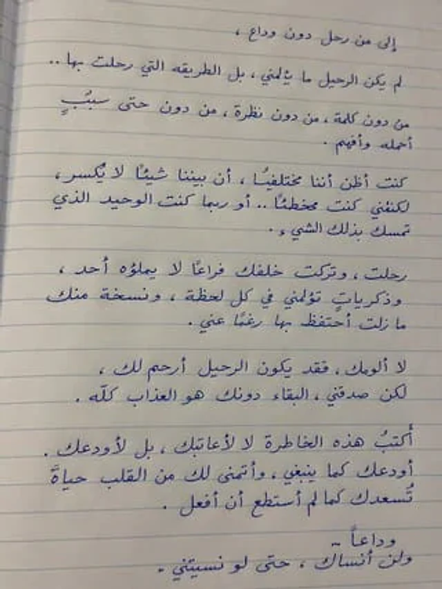

```text
رسالة مكتوبة بخط اليد وبواقعية عالية عبارة عن {argument name="مضمون الرسالة" default="خاطرة وداع"} على ورق {argument name="نوع الورق" default="مخطط"} والكلام مؤثر جدا وبخط قلم {argument name="نوع القلم" default="حبر سائل"}
```

Model: GPT Image 2
Author: AZIZ | AI 🇸🇦

[ProjectD](https://aitoolsradar.com/en/prompts/fcddf005fd035e) · [Recorded source](https://youmind.com/prompts/realistic-handwritten-farewell-letter-14394)
 · [Full original metadata and byte evidence](data/projectd-batch-0033.json)

## Hangzhou Travel Infographic Poster

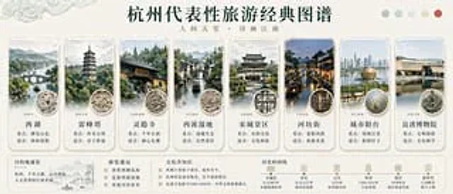

```text
{
  "type": "Chinese-style tourism infographic poster",
  "topic": "A classic map of representative tourist attractions in Hangzhou",
  "style": "The elegant Chinese-style infographics employ a delicate ink-wash aesthetic, featuring an ivory-white paper background and a refined embossed traditional cloud pattern in the upper left corner. This is complemented by sophisticated dark green and black typography, accented with gold and beige, presenting a high-end travel brochure design.",
  "text": {
    "headline": "{argument name=\"headline text\" default=\"A classic map of representative tourist attractions in Hangzhou\"}",
    "subheadline": "{argument name=\"subtitle text\" default=\"Paradise on Earth, Picturesque Jiangnan\"}"
  },
  "layout": {
    "orientation": "Horizontal poster",
    "top_icons_count": 5,
    "top_icons_description": "Five small circular color blocks are arranged in the upper right corner, representing soft sage green, light celadon, light gray, warm beige, and terracotta red.",
    "main_cards": {
      "count": 8,
      "arrangement": "Single-row, centered, rounded rectangular destination cards with even spacing, featuring soft shadows and thin borders."
    },
    "bottom_panels": {
      "count": 4,
      "arrangement": "A long, rounded corner information strip is divided into four labeled sections."
    }
  },
  "cards": [
    {
      "index": 1,
      "title": "West Lake",
      "image": "The tranquil West Lake scenery features a white arched bridge spanning its calm surface, weeping willows swaying gently, and distant mountains layered in lush greenery, with small boats dotting the poetic Jiangnan landscape.",
      "medallion": "A silver circular embossed coin design is superimposed on the lower right corner of the image.",
      "caption_lines_count": 2,
      "caption": [
        "Highlights: Scenic views of lakes and mountains",
        "Suitable for: leisure and vacation"
      ]
    },
    {
      "index": 2,
      "title": "Leifeng Pagoda",
      "image": "Leifeng Pagoda stands atop green hills and trees, with soft clouds in the sky and the distant city silhouette faintly visible.",
      "medallion": "A silver circular embossed coin design is superimposed on the lower right corner of the image.",
      "caption_lines_count": 2,
      "caption": [
        "Highlights: Legendary Ancient Pagoda",
        "Suitable for: Parent-child blessings"
      ]
    },
    {
      "index": 3,
      "title": "Lingyin Temple",
      "image": "The entrance to Lingyin Temple features yellow walls and black tiles, with plaques hanging in the background, against a backdrop of forested hillsides, creating a traditional temple atmosphere.",
      "medallion": "A silver circular embossed coin design is superimposed on the lower right corner of the image.",
      "caption_lines_count": 2,
      "caption": [
        "Highlights: A thousand-year-old temple",
        "Suitable for: Meditation and Buddhist worship"
      ]
    },
    {
      "index": 4,
      "title": "Xixi Wetland",
      "image": "Xixi Wetland boasts a picturesque waterside landscape with white walls and black tiles, narrow waterways, small wooden boats, lush vegetation, and distant, hazy mountains.",
      "medallion": "A silver circular embossed coin design is superimposed on the lower right corner of the image.",
      "caption_lines_count": 2,
      "caption": [
        "Highlights: Wetland Ecology",
        "Suitable for: Nature lovers"
      ]
    },
    {
      "index": 5,
      "title": "Songcheng Scenic Area",
      "image": "The Song Dynasty-themed gate and traditional architecture, bathed in sunlight, offer a scenic view and create a cultural park atmosphere.",
      "medallion": "A decorative circular inset pattern with dark window lattice details is superimposed on the lower right corner of the image.",
      "caption_lines_count": 2,
      "caption": [
        "Highlights: Song Dynasty Culture",
        "Suitable for: Cultural experiences"
      ]
    },
    {
      "index": 6,
      "title": "Hefang Street",
      "image": "The night view of Hefang Street is breathtaking. Lanterns illuminate the shops along both banks of the canal, their reflections shimmering on the water, creating a vibrant atmosphere reminiscent of a bustling ancient street.",
      "medallion": "A decorative circular inset pattern, featuring wooden window or carved screen motifs, is superimposed on the lower right corner of the image.",
      "caption_lines_count": 2,
      "caption": [
        "Highlights: The charm of the old street",
        "Suitable for: Nighttime food tours"
      ]
    },
    {
      "index": 7,
      "title": "City Balcony",
      "image": "The modern Qiantang River waterfront skyline is characterized by towering buildings, a wide expanse of river, and a striking golden spherical building in the foreground.",
      "medallion": "A decorative circular inset pattern, showcasing a geometric dome texture, is overlaid in the lower right corner of the image.",
      "caption_lines_count": 2,
      "caption": [
        "Highlights: Qiantang River scenery",
        "Suitable for: taking photos and checking in"
      ]
    },
    {
      "index": 8,
      "title": "Liangzhu Museum",
      "image": "The Liangzhu Museum features modern, minimalist architecture, situated beside a tranquil body of water, with a minimalist stone facade and distant hills in the background.",
      "medallion": "A silver circular embossed coin design is superimposed on the lower right corner of the image.",
      "caption_lines_count": 2,
      "caption": [
        "Highlights: Exploring the Origins of Civilization",
        "Suitable for: Cultural study tours"
      ]
    }
  ],
  "bottom_sections": [
    {
      "title": "Destination Overview",
      "position": "Bottom left",
      "count": 1,
      "content": "Hangzhou, an ancient capital with a history of thousands of years, is a famous city in Jiangnan where mountains and rivers complement each other and culture is abundant.",
      "background_detail": "A light and elegant ink-wash landscape painting, including bridges, trees and boats."
    },
    {
      "title": "Tour Suggestions",
      "position": "Bottom Middle Left",
      "count": 3,
      "labels": [
        "Enjoy the sea of ​​flowers at West Lake in spring",
        "Summer trip to Xixi Wetland",
        "Night stroll through Hefang"
      ]
    },
    {
      "title": "Cultural trivia",
      "position": "Bottom Middle Right",
      "count": 3,
      "labels": [
        "The Ten Scenes of West Lake originated in the Southern Song Dynasty and have been passed down to this day.",
        "Hangzhou was once Lin'an during the Southern Song Dynasty, and its charm remains to this day.",
        "The Liangzhu Culture dates back 5300-4300 years and is an important source of Chinese civilization."
      ]
    },
    {
      "title": "Historical Timeline",
      "position": "Bottom right",
      "count": 6,
      "labels": [
        "The Wuyue Kingdom established its capital in Hangzhou in 907 AD.",
        "Lin'an was elevated to the status of the capital in 1127 AD during the Southern Song Dynasty.",
        "Hangzhou Circuit Administration Office in 1276 during the Yuan Dynasty",
        "A major town in Jiangnan during the Ming and Qing Dynasties (1368-1911)",
        "Modern urban development after 1978",
        "Digital City of the G20 Summit in the New Era"
      ]
    }
  ],
  "rendering": "Each card features a highly detailed, painterly collage style, with soft, atmospheric perspective, delicate textures, exquisite typography, and balanced white space, showcasing the elegance of Chinese museum posters.",
  "aspect_ratio": "21:9"
}
```

Model: GPT Image 2
Author: GPT Image 2 Prompts

[ProjectD](https://aitoolsradar.com/en/prompts/942bbfd1100d34) · [Recorded source](https://x.com/aidavid125/status/2046504856060670389#reversed-2)
 · [Full original metadata and byte evidence](data/projectd-batch-0033.json)

## Harajuku Kawaii Graffiti Mural

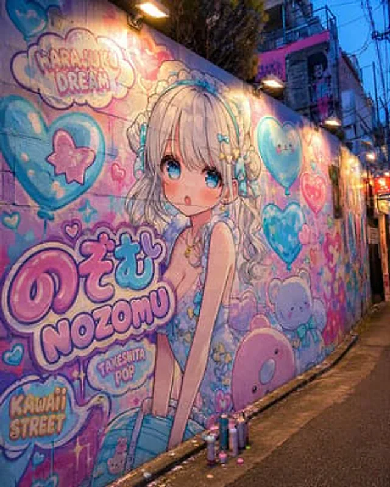

```text
Create a photorealistic dusk street photograph of a narrow Harajuku back alley where an entire concrete wall has been turned into a giant pastel KAWAII graffiti mural for {argument name="character name" default="Nozomu"}. The mural shows a huge anime-style girl painted on the wall, with {argument name="hair color" default="silvery blonde"} wavy twin-tail hair, big sparkling blue eyes, flushed cheeks, a tiny surprised mouth, blue bows, heart hair clips, frilly lace accessories, and a light blue pastel dress covered with small hearts, stars, bows, and plush-toy motifs. Make the wall texture visibly real: cinderblock seams, rough paint, overspray, drips, weathering, and graffiti strokes integrated into the illustration, as if it was actually spray-painted at large scale rather than digitally pasted. Surround the character with bubbly Harajuku pop graffiti: oversized blue and pink heart balloons, small hearts, stars, clouds, cute bear-like mascot faces, a pink round mascot near the bottom right, and layered bubble outlines in cyan, lavender, hot pink, and cream. Include exactly 5 prominent text elements on the mural: a cloud at upper left reading "HARAJUKU DREAM", a large rounded Japanese name logo reading "{argument name="Japanese name logo" default="のぞむ"}", a big Roman-letter name below reading "{argument name="Roman name logo" default="NOZOMU"}", a small speech-bubble label reading "TAKESHITA POP", and a lower-left bubble label reading "KAWAII STREET". The setting is a real urban alley at blue hour with wet-looking asphalt, cables and building facades receding into the distance, warm shop lights at the far right, and exactly 5 rectangular wall lamps casting warm yellow light across the mural. At the base of the mural, place exactly 6 spray paint cans clustered on the curb to imply the work was freshly painted. Use a wide-angle street-photo perspective from close to the wall, looking diagonally down the alley, with the mural dominating the frame, vibrant pastel neon colors, realistic shadows, ambient evening blue light, and a believable Instagram-worthy street art photo spot in Harajuku. No watermark, no extra text beyond the 5 specified mural text elements.
```

Model: GPT Image 2
Author: のぞむ＊AIイラスト

[ProjectD](https://aitoolsradar.com/en/prompts/5046f2ce4d63aa) · [Recorded source](https://youmind.com/prompts/harajuku-kawaii-graffiti-mural-21620)
 · [Full original metadata and byte evidence](data/projectd-batch-0033.json)

## Harboriis #147

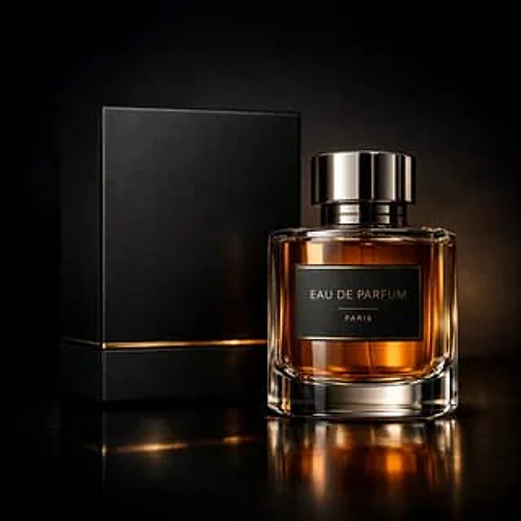

```text
Luxury perfume product photography in a dark cinematic studio. A premium black matte perfume box with sharp edges and subtle gold accents placed slightly behind a transparent glass perfume bottle filled with warm amber liquid. The bottle has a thick clear glass body and a polished metallic cap. Minimal elegant label design with gold typography. Soft low key lighting with a smooth gradient dark background. Gentle reflections on a glossy surface beneath the products. Dramatic shadows for depth and contrast. High fashion fragrance advertisement style. Ultra realistic textures crisp focus shallow depth of field professional studio shot 8k quality.
```

Model: GPT Image 2
Author: Harboriis

[ProjectD](https://aitoolsradar.com/en/prompts/b21944bc7a2ff9) · [Recorded source](https://x.com/harboriis/status/2019001339985133694)
 · [Full original metadata and byte evidence](data/projectd-batch-0033.json)

## Harboriis #155

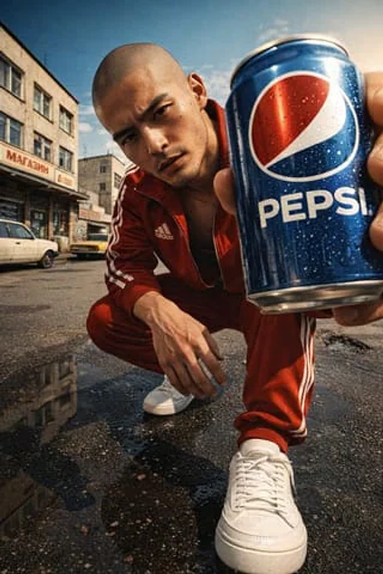

```text
Ultra-realistic, glossy magazine-style portrait of a young male model, bald, with a stem, rugged expression and defined facial texture (pores, stubble shadows, subtle scars). Camera at shoe level (very low angle), wide-angle perspective, model tilted toward the lens, leaning forward and holding a Pepsi can extremely close to the camera - can label perfectly facing viewer and crisply legible with realistic metal reflections. Wearing a red Adidas tracksuit with visible Adidas logo and clean white sneakers, one foot stepped forward in the foreground. Urban USSR 1990s street environment: weathered concrete, vintage shop signs, old cars, period graffiti, small puddles. Bright sunny daytime with strong direct sunlight casting sharp cinematic shadows, warm sunlight highlights, slight wet reflections on asphalt and subtle water splashes near shoes for dynamism. Shallow depth of field (pin-sharp on face and can, creamy bokeh), ultra high detail, high contrast, vivid colors, warm sunlight with subtle teal-orange grade. Commercial editorial retouching style but preserving skin texture, enhanced clarity on label and metal, realistic specular highlights, natural micro-contrast. Composition: Pepsi can prominent in right foreground, eye-line slightly above center, negative space for masthead/logo--v 7 --style raw --quality 2 --ar 9:16 --chaos 3 --stylize 499-weird 99--exp 50
```

Model: GPT Image 2
Author: Harboriis

[ProjectD](https://aitoolsradar.com/en/prompts/177a9935bcf28b) · [Recorded source](https://x.com/harboriis/status/2029064691482542266)
 · [Full original metadata and byte evidence](data/projectd-batch-0033.json)

## Harboriis #175

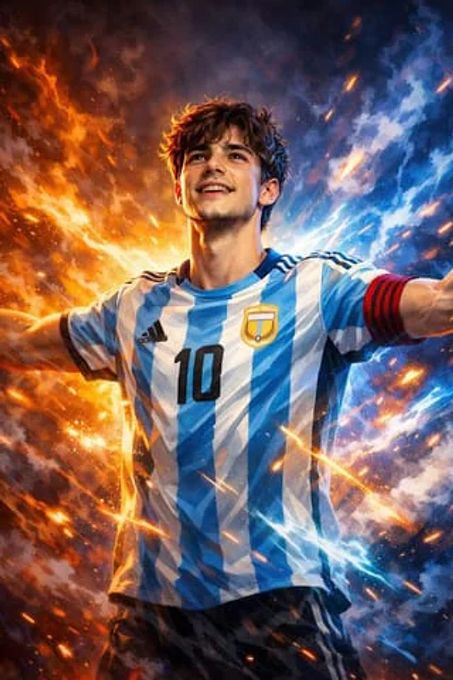

```text
Fantastic digital painting of a young man with high detail, smooth shading, and sharp, bold lines. He stands in a powerful victory pose with his arms outstretched, confident and fearless expression. A brilliantly blended background with swirling smoke and flame like energy effects surrounds him. Neon sparks radiate from his body, creating a vibrant, glowing aura with cinematic lighting and dramatic contrast.
```

Model: GPT Image 2
Author: Harboriis

[ProjectD](https://aitoolsradar.com/en/prompts/ac86358b3be441) · [Recorded source](https://x.com/harboriis/status/2020464744197693597)
 · [Full original metadata and byte evidence](data/projectd-batch-0033.json)

## Harboriis #201

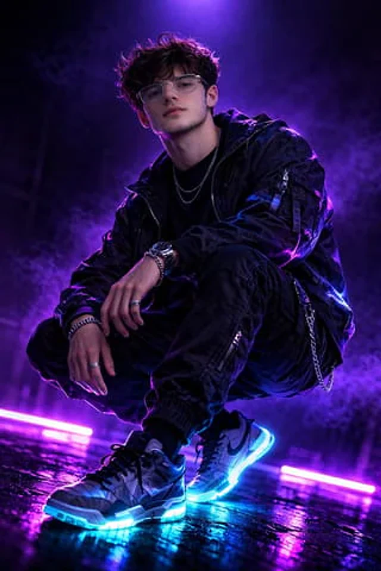

```text
Fashion photography, professional man model, shot with Canon eos r3, 50mm f/1.2 rf lens, f/2.8 settings, 1/160s, iso 1600, gradient neon violet, streetwear style, holographic effect on wear, luminescent sneaker soles, dark backdrop with deep purple atmospheric lighting, professional studio setup with two led strip lights at floor level and one overhead softbox, cyberpunk aesthetic, side profile active pose with silhouette, dramatic contrast, ultra sharp details, photorealistic quality, rich detailing
```

Model: GPT Image 2
Author: Harboriis

[ProjectD](https://aitoolsradar.com/en/prompts/ecceb932158ca1) · [Recorded source](https://x.com/harboriis/status/2026182718435066073)
 · [Full original metadata and byte evidence](data/projectd-batch-0033.json)

## Harboriis #227

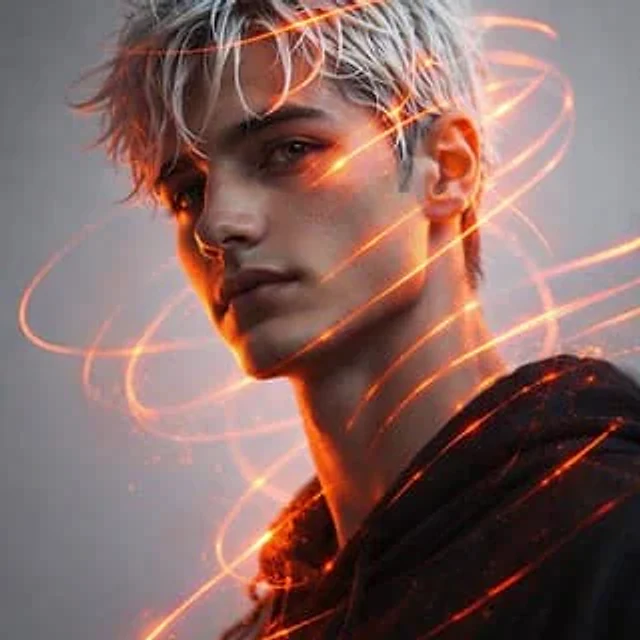

```text
Portrait of a 21-year-old man of appearance with masculine facial features and white hair styled with a wet look. The camera angle is slightly from the side and below. Neutral facial expression, very light gray background. Orange-red glowing light and abstract luminous lines around the head, passing through the face and neck, creating a dynamic and high-tech effect. Futuristic atmosphere, professional lighting, emphasis on details. Saturated colors, the left side of the face is illuminated, the right side is in shadow. Highly detailed, high-quality photograph in a modern style
```

Model: GPT Image 2
Author: Harboriis

[ProjectD](https://aitoolsradar.com/en/prompts/c51835e715860f) · [Recorded source](https://x.com/harboriis/status/2017514445321474551)
 · [Full original metadata and byte evidence](data/projectd-batch-0033.json)

## Harboriis #64


```text
Commercial luxury product photography, photorealistic, ultra high detail, 8K quality. A minimalist matte black cosmetic dropper bottle placed on a clear glass podium. Low angle camera view to make the bottle feel tall and powerful. The bottom of the bottle is clearly visible through the transparent glass. The glass surface is wet with realistic water droplets, with a few drops hanging underneath the glass, frozen mid drip for a time stopped effect. Matte light gray background with no texture or gradient. Soft, even studio lighting with clean reflections, premium skincare advertising look, sharp focus, realistic materials, no distractions.
```

Model: GPT Image 2
Author: Harboriis

[ProjectD](https://aitoolsradar.com/en/prompts/9b90531d075599) · [Recorded source](https://x.com/harboriis/status/2018215856577360311)
 · [Full original metadata and byte evidence](data/projectd-batch-0033.json)

## Harboriis #83

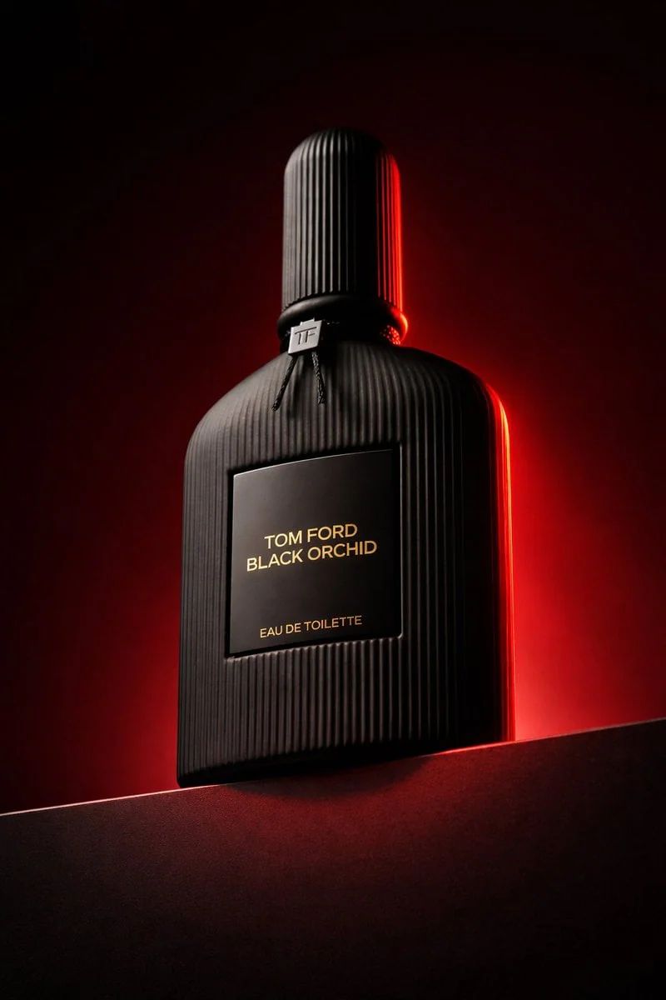

```text
Low angle luxury product photography of a black ribbed glass perfume bottle placed on a dark horizontal podium, shot from below for a heroic, monumental feel. The bottle is Tom Ford Black Orchid, matte black texture clearly visible.
Dramatic low key studio lighting. Soft diffused key light from above and slightly left, gently lighting the label and top, revealing volume and texture. Strong hard red rim light from behind and right, creating a bold red outline along the edge and cap, with a subtle red glow bleeding into the background.
Deep soft shadows with smooth falloff. Slightly underexposed for drama. High contrast between highlights and shadows while keeping transitions soft.
Color palette limited to deep black and rich burgundy red, warm color balance, black remains neutral and clean.
Matte surface shows soft red reflections, not glossy, giving depth and form.
Minimal background, dark red gradient, cinematic mood, luxury fragrance advertising style, photorealistic, ultra high detail, studio quality.
```

Model: GPT Image 2
Author: Harboriis

[ProjectD](https://aitoolsradar.com/en/prompts/b77be9c293bccf) · [Recorded source](https://x.com/harboriis/status/2018312144358703594)
 · [Full original metadata and byte evidence](data/projectd-batch-0033.json)

## Harboris #251

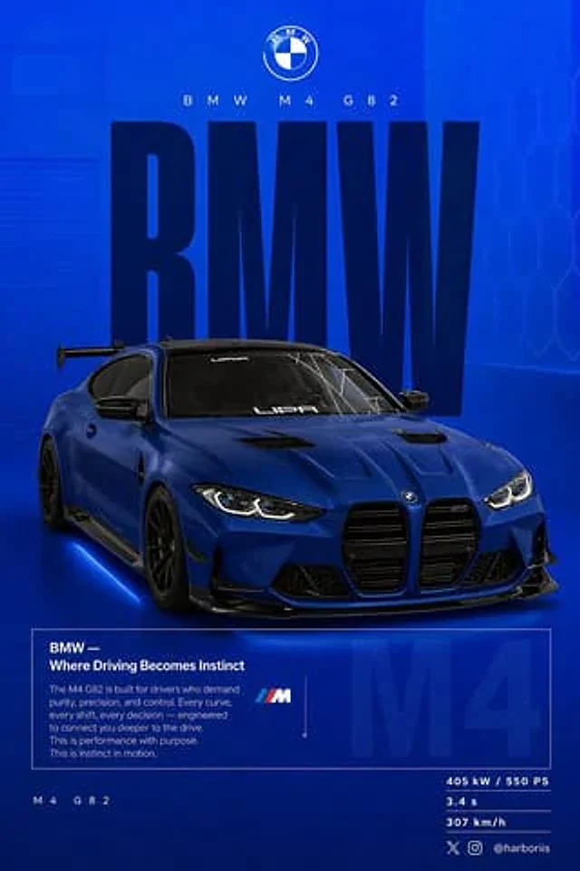

```text
Create a 4:5 vertical social poster in ultra high resolution, 8K print quality sharpness. Use the BMW car from the reference image as the main subject and use the background structure/composition from the reference image, but transform it into a BMW themed design. Replace all black tones with a flat high-saturation BMW blue background. Keep the same layout, spacing, visual balance, and poster composition from the reference image.

Background should use a smooth gradient from slightly lighter electric blue at the top to deep navy blue at the bottom. Add subtle grain texture (2 to 3%) and faint rectangular overlays (2 to 4% opacity). Keep it clean, graphic, premium, and non-realistic. Add a soft contact shadow under the car.

Use the same BMW from the reference image, changing only the paint color to matte frozen blue or deep metallic navy. Keep the original body shape, wheels, stance, and design details from the reference image.

Show the car in a rear 3/4 perspective matching the reference image angle exactly. Use a slightly elevated camera angle. Position the car slightly right of center.

Include visible carbon roof, aggressive rear diffuser, sharp controlled reflections, and subtle brake details.

Keep composition identical to the reference image:
Top: branding
Middle: giant type
Center: car overlapping text
Bottom: editorial block and specs

Typography:

Primary text: “BMW”
Ultra condensed bold sans serif, tall vertical scaling like the reference poster. Color deep navy or near black. Static text with no distortion. Acts as structural backdrop.

Secondary header: “BMW M4 G82”
Thin font with wide tracking.

Logo area: BMW roundel centered above.

Editorial block:

Headline: “BMW — Where Driving Becomes Instinct”

Body copy focused on:

driver connection

control

performance precision

Use the same boxed editorial layout as the reference image.

Background faded text: “M4” large scale with 3 to 5% opacity behind the box.

Bottom left:
“ M4 G82”

Bottom right specs:

405 kW / 550 PS
3.4 s
307 km/h

Lighting should be clean studio lighting with sharp but controlled highlights.

Color grading should use deep blues, high contrast, clean blacks.

Camera lens: 50mm, slightly elevated rear 3/4 angle.

Mood:
Performance.
Precision.
Driver focus.

Add Bottom-right watermark: harboriis , with small x and Instagram logo
```

Model: GPT Image 2
Author: Harboris

[ProjectD](https://aitoolsradar.com/en/prompts/1e25662e4ab180) · [Recorded source](https://x.com/harboriis/status/2048063332624843046)
 · [Full original metadata and byte evidence](data/projectd-batch-0033.json)

## Haruki Murakami Style Comic Prompt

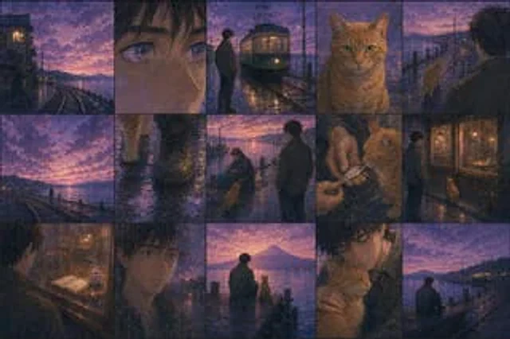

```text
Draw one{argument name="panel count" default="15"} Ge's comics, style reference{argument name="artist style" default="Haruki Murakami"} .
```

Model: GPT Image 2
Author: GPT Image 2 Prompts

[ProjectD](https://aitoolsradar.com/en/prompts/00997e68b743a7) · [Recorded source](https://x.com/quadcodeai/status/2047646991165890562)
 · [Full original metadata and byte evidence](data/projectd-batch-0033.json)

## Haunting Statue Woman at Sunset

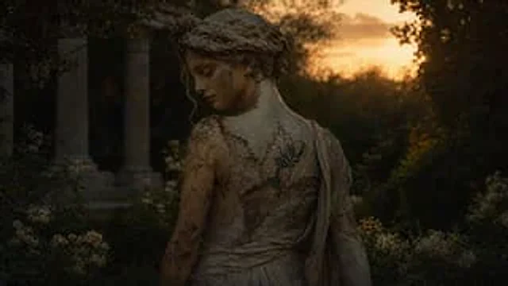

```text
A cinematic, dark fantasy photograph depicts a weathered, marble-like woman with her back to the camera in a ruined garden at sunset, the composition focusing on her upper back. Her face is slightly turned behind her shoulder, but mostly hidden in shadow. She evokes an ancient Greco-Roman style, with pale, stone-like skin, a classically styled updo, and an aged ivory-colored one-shoulder robe that appears cracked, dusty, and partially fused to her body like an eroded sculpture. Her bare back and arms are adorned with delicate, plant-like tattoos, and faded blue floral mosaics are embedded in the shoulder blade area. The overall atmosphere is melancholic, memorable, and elegant. Two tall, shadowy stone pillars stand to the left of the background, flanked by dense, dark trees and vegetation, with clusters of small, pale flowers dotting the garden below. Using the luminous amber-orange sunset glow as a strong backlight, the soft contour lighting outlines her shoulders and hair. The foreground shadows are deep, the depth of field shallow, the contrast rich, the earth tones soft, and the ultra-fine textures of cracked plaster, aged fabric, and stone are revealed. An art-editing photographic style, hyperrealistic, mysterious, melancholic, with the quality of an 85mm lens.
```

Model: GPT Image 2
Author: GPT Image 2 Prompts

[ProjectD](https://aitoolsradar.com/en/prompts/129019ad5ea6c8) · [Recorded source](https://x.com/pbbakkum/status/2046679497110675635#reversed-1)
 · [Full original metadata and byte evidence](data/projectd-batch-0033.json)

## Healthy Nutrition App Logo Grid


```text
A clean matrix of 20 modern mobile app icon concepts, covering nutrition, calorie tracking, healthy eating, food recognition, and AI health tools. The background is a vibrant electric blue, complemented by soft studio lighting and subtle shadows. The icons are arranged in 4 rows and 5 columns with even spacing. Each icon is a rounded square with advanced iOS-style depth, smooth gradients, glass-like highlights, and clear 3D rendering details. The color scheme should primarily feature saturated blues, cyans, teals, whites, and lime greens, accented with small amounts of orange and yellow. It includes 20 distinct icon designs: 1) A bowl containing avocado, cereal, broccoli, and cherry tomatoes, surrounded by a camera scanning frame; 2) Four horizontally arranged nutrition bars in green, yellow, red, and blue, next to a white fork on a deep navy blue background; 3) A camera lens with a small bowl of vegetables in front; 4) A circular blue badge with text.{argument name="headline text" default="kcal"} And a green leaf overlapping at the bottom; 5) a cyan icon with text above a white bowl and two glittering symbols.{argument name="brand text" default="Ai"} 6) A glossy green apple with circuit traces and nodes, hinting at food technology AI; 7) Half an avocado in the center of a glowing scan frame; 8) A metal spoon with a blue lightning bolt symbol and curved tracing lines; 9) A segmented nutrition meter in green, orange, and red circles surrounding salmon and broccoli; 10) A divided plate containing roasted chicken, broccoli, rice, blueberries, and a small upward-rising histogram; 11) A camera lens on a white background with green leaves; 12) A glowing green apple in a scan frame with a flashing symbol; 13) A glowing circular ring in blue, green, yellow, and orange on a dark background; 14) A blue shield with a white fork in the center; 15) A yogurt or oatmeal bowl in a scan frame topped with strawberries, blueberries, and granola; 16) A dark navy blue calorie icon with text.{argument name="calorie text" default="kcal"} 17) A mint green square with a white circuit tree or branch chip pattern; 18) A healthy plate containing roasted chicken, avocado, tomato, and vegetables within a scanned frame; 19) A dark bowl filled with blueberries and white yogurt or cream, overlaid with a bright electric lightning symbol; 20) A light blue 3D cube icon with a fork and plate symbol on one side and green leaves on the other. The overall style should be highly refined, slightly futuristic, and commercially viable for App Store brand promotion. Ensure the visual language of the 20 icons is consistent, containing no additional text besides a visible short label, and presenting a sophisticated AI-generated product design aesthetic.
```

Model: GPT Image 2
Author: GPT Image 2 Prompts

[ProjectD](https://aitoolsradar.com/en/prompts/e9e7335ba59498) · [Recorded source](https://x.com/david_attiapps/status/2047627522846728558#reversed-0)
 · [Full original metadata and byte evidence](data/projectd-batch-0033.json)

## Heaven Error Angel Glitch Poster

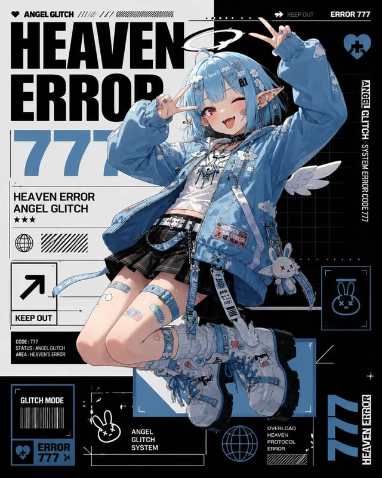

```text
{"type":"information-dense anime streetwear character poster","style":"high-detail Japanese anime illustration mixed with bold graphic-design typography, cyber sticker layout, black white and powder blue palette, crisp vector UI elements, glossy magazine poster finish","main_subject":{"character":"cute mischievous angel glitch girl","pose":"full-body floating dynamic pose, knees bent, one boot forward, both hands making peace signs near her face, winking with tongue out","appearance":{"hair":"{argument name=\"hair color\" default=\"short light blue bob with straight bangs\"}","eyes":"one red eye open and one eye winking","features":"long pointed elf ears, small white halo tilted above the head, small white angel wings, playful smile, tiny cyber face markings and hair clips"},"outfit":{"count":6,"items":["oversized sky-blue bomber jacket covered in white cloud motifs, patches, zipper pulls, and dangling straps","cropped white graphic top with black lace-up details","black pleated mini skirt with belts and chains","blue utility belt and pouch with small labels","chunky white and blue lace-up platform boots with mechanical streetwear details","blue garter straps, bandage-style leg patches, and hanging rabbit charm accessory"]}},"layout":{"canvas":"square poster, centered character overlapping a dense editorial background","background":"split white and black cyber grid composition with thick blocks, thin technical lines, halftone stripes, barcode motifs, arrows, frames, dots, stars, and UI boxes","main_text":{"headline":"{argument name=\"headline text\" default=\"HEAVEN ERROR\"}","number":"{argument name=\"error number\" default=\"777\"}","placement":"giant bold condensed black headline on the left and top, huge pale blue number behind the character"},"visible_text_elements":{"count":13,"labels":["ANGEL GLITCH","HEAVEN ERROR","777","HEAVEN ERROR ANGEL GLITCH","KEEP OUT","CODE : 777 STATUS : ANGEL GLITCH AREA : HEAVEN'S ERROR","GLITCH MODE","ERROR 777","ANGEL GLITCH SYSTEM","OVERLOAD HEAVEN PROTOCOL ERROR","ERROR 777","ANGEL GLITCH SYSTEM ERROR CODE 777","HEAVEN ERROR"]},"graphic_icons":{"count":7,"items":["black heart icon near ANGEL GLITCH at top left","large arrow icon inside a square with KEEP OUT","globe icon in a circle on the left information panel","blue heart with a black cross at top right","blue framed rabbit-face icon at mid right","small blue heart-and-cross error badge in bottom left panel","blue wireframe globe icon near bottom center"]},"panels_and_ui_components":{"count":10,"items":["top left brand strip with heart and ANGEL GLITCH","top right black warning bar with KEEP OUT and ERROR 777","left data block under the huge number with title and stars","left square arrow KEEP OUT sign","bottom left GLITCH MODE barcode box","bottom left ERROR 777 badge","right vertical ANGEL GLITCH SYSTEM ERROR CODE 777 strip","middle-right rabbit icon scan frame","bottom center ANGEL GLITCH SYSTEM label and empty technical rectangle","bottom-right overload protocol error label and stripe block"]}},"color_palette":{"primary":"{argument name=\"primary accent color\" default=\"powder blue\"}","secondary":"black and white","accents":"tiny red eye and small sticker details"},"rendering_instructions":"Use sharp clean line art, highly polished anime shading, detailed fabric folds, glossy highlights, readable bold typography, layered print-poster composition, no photorealism, no blurry text, no extra characters."}
```

Model: GPT Image 2
Author: Eris Create Lab

[ProjectD](https://aitoolsradar.com/en/prompts/3921b7fa666e9b) · [Recorded source](https://youmind.com/prompts/angel-glitch-poster-18874)
 · [Full original metadata and byte evidence](data/projectd-batch-0033.json)

## Heisenberg #113

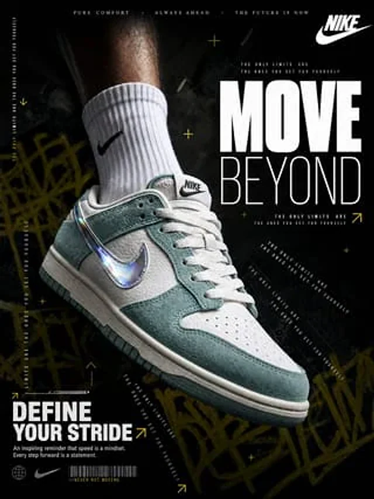

```text
A hyperrealistic Nike sneaker advertisement shot in a dark, moody editorial style. A male leg wearing crisp white athletic crew socks with subtle Nike logo detail is suspended mid-air against a near-black charcoal background, angled diagonally toward the camera at a bold 45-degree perspective. The sneaker — a Nike low-top silhouette featuring a clean two-tone colorway of glacier teal suede panels and off-white tumbled leather, with an iridescent chrome Swoosh catching ambient light — dominates the lower two-thirds of the frame.
The composition uses shallow depth of field with sharp focus on the shoe and soft blur on the upper leg. The background is layered with subtle urban texture - faint graffiti strokes in electric yellow and muted olive, barely visible through a heavy dark vignette. Multiple rows of ultra-small all-caps typographic text orbit the sneaker at different angles, reading phrases like "THE ONLY LIMITS ARE THE ONES YOU SET FOR YOURSELF" - evoking motion, speed, and energy. Some text runs vertically, some at 30-degree angles, giving the composition a chaotic yet intentional graphic design feeling.
At the upper right, the bold Nike wordmark and Swoosh logo appear in clean white against the dark background. At the top center, a thin horizontal navigation-style text bar reads: "PURE COMFORT · ALWAYS AHEAD · THE FUTURE IS NOW" in spaced all-caps serif font. A large, commanding headline is placed center-right in contrasting weight typography - "MOVE" in massive ultra-bold white letters followed by "BEYOND" in lighter weight, creating dramatic type hierarchy.
Small yellow plus (+) symbols and diagonal arrows (↗) are scattered throughout the composition as accent details, adding a contemporary graphic zine aesthetic. Bottom left features a bold brand slogan lockup: "DEFINE YOUR STRIDE" in large bold sans-serif white text with a thin subline: "An inspiring reminder that speed is a mindset. Every step forward is a statement." The overall lighting is dramatic and directional - a single cold key light from the left, causing the Swoosh to shimmer and the white leather to glow against the darkness. Photorealistic. Commercial photography quality. High contrast. 4K resolution, 3:4 vertical format optimized for social media.
```

Model: GPT Image 2
Author: Heisenberg

[ProjectD](https://aitoolsradar.com/en/prompts/8334f637b26e13) · [Recorded source](https://x.com/rovvmut_/status/2048018776785064328)
 · [Full original metadata and byte evidence](data/projectd-batch-0033.json)

## Heisenberg #246

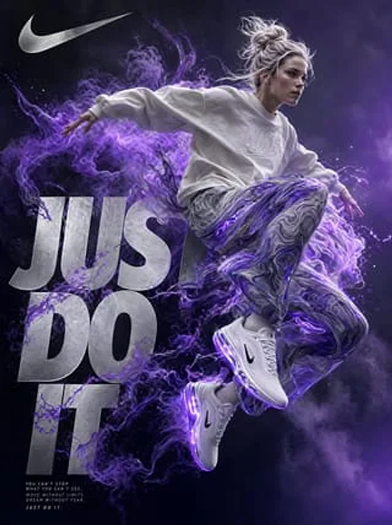

```text
A highly detailed digital artwork in a surreal, dynamic style inspired by premium athletic advertising for Nike, Inc. A young athletic woman with platinum blonde hair tied in a messy bun, fair skin, and a fiercely focused expression is captured mid-jump or leap, her body leaning slightly forward as if bursting with raw, untamed energy.
She wears a loose, off-white Nike crewneck sweatshirt with subtle embossed Nike branding on the chest, paired with flowy, semi-transparent pants featuring a swirling marbled pattern in graphite grey and electric violet, billowing dramatically around her legs. On her feet are sleek, futuristic white Nike sneakers with glowing violet accents, visible Air-inspired sole details, and an aerodynamic design.
Vibrant electric violet energy or ethereal smoke erupts dramatically from behind her, swirling and dissolving into abstract, cloud-like forms that interact with her clothing, creating a powerful sense of motion and release.
The background is a deep, moody gradient transitioning from charcoal grey to luminous twilight violet, emphasizing a minimalist yet striking composition.
Overlay large, bold metallic silver text reading “Just Do It” in a sharp, modern sans-serif font, partially integrated and obscured by the energy smoke and the figure, making it feel like an organic part of the scene.
Include the iconic Nike Swoosh logo in the top-left corner in shimmering silver.
```

Model: GPT Image 2
Author: Heisenberg

[ProjectD](https://aitoolsradar.com/en/prompts/2c6defcfe493db) · [Recorded source](https://x.com/rovvmut_/status/2047721704202617219)
 · [Full original metadata and byte evidence](data/projectd-batch-0033.json)

## Heisenberg #73

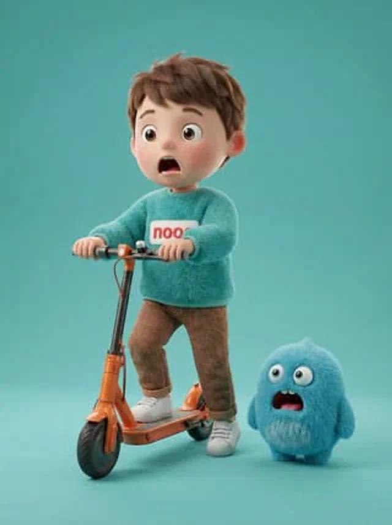

```text
A high-quality 3D render of a cute young boy riding an orange electric scooter next to a small, round, furry blue monster. Both characters have shocked expressions with wide eyes and open mouths. The boy is wearing a highly textured, fuzzy teal sweater with a white patch that reads "noo" in red text, along with brown patterned pants and white sneakers. Clean teal studio background, soft lighting.
```

Model: GPT Image 2
Author: Heisenberg

[ProjectD](https://aitoolsradar.com/en/prompts/e422f7ce71e106) · [Recorded source](https://x.com/rovvmut_/status/2014987855517614460)
 · [Full original metadata and byte evidence](data/projectd-batch-0033.json)

## Heisenberg #93

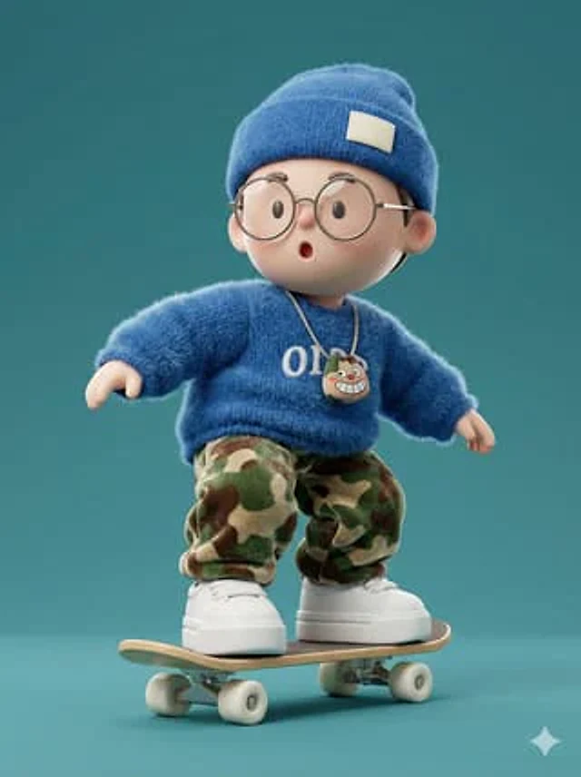

```text
A high-fidelity 3D character render of a cute, stylized boy skateboarding in a dynamic pose. The boy has 'chibi' proportions with a large head, wearing oversized round wire-frame glasses and making a surprised 'O' mouth expression. He is dressed in an extremely fuzzy, textured blue mohair sweater with the text "OID" on the chest, a matching fuzzy blue beanie with a cream patch, and baggy camouflage-patterned pants made of a soft, velvet-like fabric. He wears chunky white sneakers and a small necklace pouch with a cartoon face. The background is a solid, seamless teal color. The lighting is soft and diffuse studio lighting, creating a clean, high-end "blind box" art toy aesthetic with hyper-realistic fabric textures.
```

Model: GPT Image 2
Author: Heisenberg

[ProjectD](https://aitoolsradar.com/en/prompts/6b375171961647) · [Recorded source](https://x.com/rovvmut_/status/2015648059771044000)
 · [Full original metadata and byte evidence](data/projectd-batch-0033.json)

## Helicopter Selfie Over Moscow


```text
A realistic smartphone-style travel photo taken inside a helicopter cabin. On the left is a seated passenger, while the right side offers a panoramic aerial view of Moscow through a large window. The passenger wears a black zip-up sports jacket with a small white swoosh logo, is strapped in, and wears a metal watch and a large black aviation headset with a microphone mount. Their face is partially obscured by a rectangular blur, and they are giving a thumbs-up to the camera. The helicopter interior is dimly lit, featuring black leather seats and beige trim around the windows. The view outside captures a panoramic view of downtown Moscow on a cloudy day, with the Kremlin walls and towers clearly visible. In the lower right corner, the colorful onion domes of St. Basil's Cathedral are visible, and the vast cityscape stretches into the distance, with a cluster of modern skyscrapers visible on the right side of the horizon. The photo uses natural diffused light to render realistic urban details and a slight atmospheric haze, simulating a casual selfie taken by a tourist in a helicopter—wide-angle but distortion-free.
```

Model: GPT Image 2
Author: GPT Image 2 Prompts

[ProjectD](https://aitoolsradar.com/en/prompts/da3277f7e7c6a5) · [Recorded source](https://x.com/cocojumbelito/status/2046850294672138478#reversed-0)
 · [Full original metadata and byte evidence](data/projectd-batch-0033.json)

## Herbal Chicken Soup Label Transformation


```text
Based on the REFERENCE_0 style, while retaining the central chicken illustration, the image was transformed into a product packaging label for a medicinal soup packet. The chicken was moved to the right. The top text was replaced with a striking, large, black-stroke title.{argument name="main headline" default="Vitality-Boosting and Dampness-Clearing Chicken Soup Pack"} and smaller subheadings{argument name="subtitle" default="Food from the mountains and forests tastes delicious!"} Add a brand new woven basket on the left, containing six different piles of ingredients: woody root vegetables, white cubes, round brown root vegetable slices, soybeans, dried tangerine peel strips, and dark red dates. Label these ingredients with six small brown rectangles with white text. Below the chicken, add a round orange badge with text inside.{argument name="ingredients list" default="It contains: five-finger peach, poria cocos, smilax glabra, soybean, dried tangerine peel, and red dates."} At the bottom, create a solid orange rectangular banner containing a cooking pot icon and text.{argument name="usage instructions" default="Instructions: Rinse the soup ingredients and put them in a pot. Add ginger slices and cook for 20 minutes. Then add chicken and cook for another 20 minutes."} And a supplementary slogan{argument name="bottom slogan" default="Natural and nourishing soup"} .
```

Model: GPT Image 2
Author: GPT Image 2 Prompts

[ProjectD](https://aitoolsradar.com/en/prompts/d9c9542becf84b) · [Recorded source](https://x.com/xzjken/status/2045414765640786184#reversed-1)
 · [Full original metadata and byte evidence](data/projectd-batch-0033.json)

## Hero — Electric Car Launch Cinematic

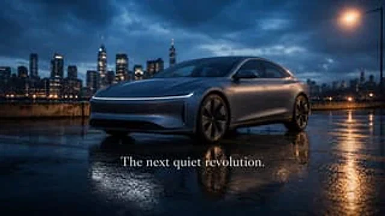

```text
Cinematic 16:9 horizontal hero ad frame. A single sleek dark matte silver electric sedan parked at a slight three-quarter angle on a wet reflective asphalt surface at blue hour twilight. Dramatic low-angle camera, soft lens flare from a single hidden streetlight on the upper right. Distant out-of-focus city skyline silhouette with warm window lights in the background. A small centered serif headline in white at the lower-middle reads "The next quiet revolution.". Subtle film grain. No brand logo on the car, no badge, no watermark. Premium automotive launch ad photography, photorealistic paintwork, ultra detailed reflections.
```

Model: GPT Image 2
Author: @hiapi_ai

[ProjectD](https://aitoolsradar.com/en/prompts/d47ca315a40a9a) · [Recorded source](https://github.com/HiAPIAI/awesome-gpt-image-2-prompts)
 · [Full original metadata and byte evidence](data/projectd-batch-0033.json)

## Hidden Engraved Rice Grain


```text
A photorealistic close-up of a tabletop scene showcases a massive pile of raw white long-grain rice spilled onto a warm brown wooden surface, almost filling the entire frame. The camera is positioned slightly high and tilted towards the rice pile, creating a broad dome in the center of the image, with thousands of grains clearly visible and softly illuminated by warm indoor light. Hidden within the rice pile is a small Easter egg: near the lower left corner, a special grain of rice is horizontally rotated, its surface neatly engraved with…{argument name="engraved text" default="GPT Image 2"} The text should be clearly legible. Add a large, circular marker with a bright red outline in the lower left corner to focus on the engraved grain of rice, ensuring the text is clearly visible. Additionally, add a picture-in-picture window in the lower right corner showcasing a casual indoor live stream or interview scene: four people sitting around a round wooden table with an open laptop on it, warm lighting, and slightly blurred faces; this window should be a secondary background thumbnail, much smaller than the main image. Prioritize realistic textures, convincing macro details, natural shadows, subtle ivory variations in the rice grain, and clear, believable engraving on the highlighted grain.
```

Model: GPT Image 2
Author: GPT Image 2 Prompts

[ProjectD](https://aitoolsradar.com/en/prompts/c4194aea947367) · [Recorded source](https://x.com/BoyuanChen0/status/2047079274679783688#reversed-0)
 · [Full original metadata and byte evidence](data/projectd-batch-0033.json)

## Hidden Engraved Rice Grain


```text
A photorealistic close-up tabletop scene showing a large mound of uncooked long-grain white rice poured onto a warm brown wooden surface, filling almost the entire frame. The camera is slightly elevated and angled toward the pile so the rice forms a broad dome centered in the image, with thousands of individual grains sharply visible and softly lit by warm indoor lighting. Hide a tiny easter egg in the rice: exactly 1 unusual rice grain near the lower-left area is rotated horizontally and has the text "{argument name="engraved text" default="GPT Image 2"}" neatly engraved on its surface in small legible letters. Add a circular magnified callout in the bottom-left corner with a bright red outline, zooming in on that single engraved grain among surrounding rice grains so the text becomes readable. Also add exactly 1 small picture-in-picture inset in the bottom-right corner showing a casual indoor livestream or interview setting with 4 seated people around a round wooden table and an open laptop, warm ambient lighting, and faces slightly indistinct; the inset should feel like a secondary contextual thumbnail, much smaller than the main rice image. Prioritize realistic texture, convincing macro detail, natural shadows, subtle ivory color variation in the rice, and clear but believable engraved text on the highlighted grain.
```

Model: GPT Image 2
Author: Boyuan Chen

[ProjectD](https://aitoolsradar.com/en/prompts/374faca145283c) · [Recorded source](https://youmind.com/prompts/engraved-rice-grain-callout-15110)
 · [Full original metadata and byte evidence](data/projectd-batch-0033.json)

## Hidden Word Optical Illusion Prompt

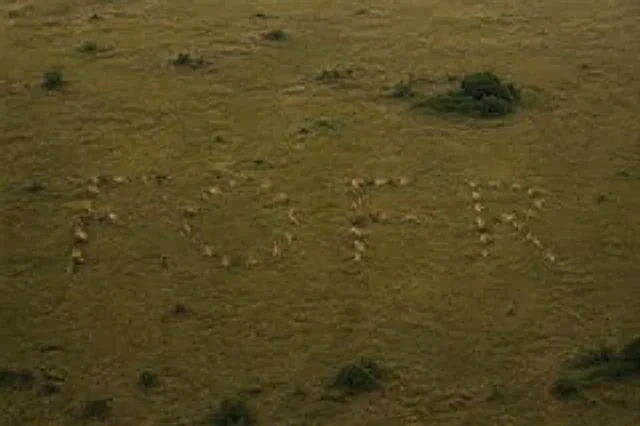

```text
Create an image with a hidden word embedded within it, making the word difficult to spot before it's discovered, but impossible to ignore once found. Use the word "..."{argument name="word" default="fofr"} ".use{argument name="composition element" default="Lion pride"} To form this word.
```

Model: GPT Image 2
Author: GPT Image 2 Prompts

[ProjectD](https://aitoolsradar.com/en/prompts/afd14a5723f45f) · [Recorded source](https://x.com/fofrAI/status/2046627993330635210)
 · [Full original metadata and byte evidence](data/projectd-batch-0033.json)

## Hidden-Object Madrid Plaza Puzzle

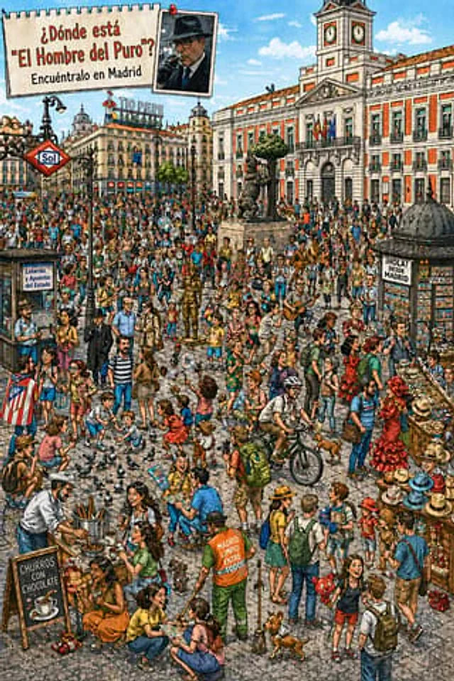

```text
A highly detailed and colorful illustration in the style of "Where's Willy?" depicts {argument name="city" default="Madrid"} A crowded public square. The perspective is at street level, with a bright daytime backdrop of blue skies and white clouds. The scene is teeming with dozens of pedestrians, tourists, vendors, children, musicians, and everyday life, rendered in a style reminiscent of an editorial cartoon combining meticulous hand-drawn ink lines with digital painting. The lines are clear, the texture of the cobblestones is detailed, the expressions of the figures are vivid, and the visual narrative is extremely rich. The location is Puerta del Sol, clearly identifiable by four key landmarks: the red diamond-shaped Sol metro sign on the left, the Tío Pepe rooftop billboard in the middle left background, the "Bear and Tree" statue without riders in the midground, and the Royal Post Office (Real Casa de Correos) on the right background, which dominates the background with the Spanish flag hanging from its balcony. In the upper left corner, a pinned, torn-edge paper poster with Spanish text is added.{argument name="headline text" default="¿Dónde está \&quot;El Hombre del Puro\&quot;?"} The second line reads{argument name="subtitle text" default="Encuéntralo en Madrid"} Next to it is a small portrait of the target person, wearing a dark fedora, a dark coat, and smoking a cigar, like a clue card. The square is filled with a lively and bustling crowd scene, including two flamenco dancers in red dresses on the right, a guitarist on the right-center, a cyclist in the foreground on the right-center, a cleaner in an orange and green municipal uniform in the foreground, a churros stand with a blackboard sign that reads "CHURROS CON CHOCOLATE" in the lower left corner, a lottery kiosk with the sign "Loterías y Apuestas del Estado" on the left, a postcard/newspaper stand with the sign "¡HOLA! DESDE MADRID" on the right, a hat display stall piled high with hats on the far right, a live statue performer covered in gold on the left-center, a bubble performer blowing semi-transparent bubbles, many pigeons scattered in the foreground, and two small dogs in the lower center. The footage also includes families with backpacks, children crouching beside pigeons, tourists taking photos, people holding maps, shoppers, and street spectators dressed in various summer clothes. Hidden target individuals.{argument name="target character" default="El Hombre del Puro"} The object should be subtly embedded within the crowd, rather than placed in the center, and visually aligned with the dark hat, dark clothing, and cigar in the cues of the portrait, making him difficult to spot but not impossible to find. The overall composition employs a compact approach, a playful, whimsical energy, warm Mediterranean tones, and rich urban detail.
```

Model: GPT Image 2
Author: GPT Image 2 Prompts

[ProjectD](https://aitoolsradar.com/en/prompts/266736c9730048) · [Recorded source](https://x.com/blogpocket/status/2047045079576023518#reversed-0)
 · [Full original metadata and byte evidence](data/projectd-batch-0033.json)

## High Fashion Editorial Portrait

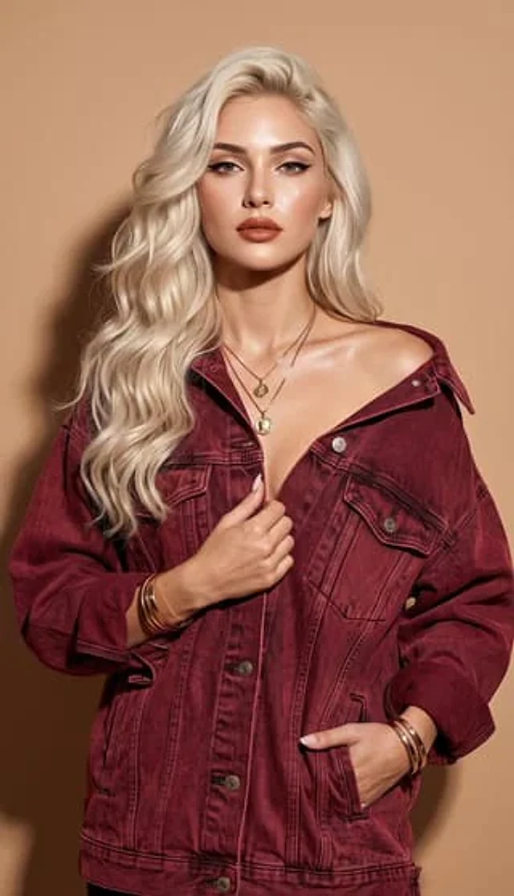

```text
A high-fashion commercial editorial portrait of a {argument name="model" default="stunning blonde model"} with voluminous, wavy platinum-blonde hair cascading gracefully over one shoulder.She wears an {argument name="outfit" default="oversized, rich burgundy-red washed denim jacket"} styled casually off one shoulder, holding the lapel with one manicured hand. Her makeup is refined with sharp jet-black winged eyeliner, radiant dewy skin, and satin terracotta lips. Crisp direct-flash studio lighting casts a defined,high-contrast hard shadow against a {argument name="background" default="seamless, solid warm-beige background"}. Shot on an 85mm f/1.8 prime lens, hyper-realistic commercial photography aesthetic, realistic skin texture, authentic fabric weave, sharp focus, 8k resolution, text watermark placed subtly in the bottom center. --ar 9:16
```

Model: GPT Image 2
Author: AsmatAi

[ProjectD](https://aitoolsradar.com/en/prompts/341bbc82662983) · [Recorded source](https://youmind.com/prompts/high-fashion-blonde-portrait-32201)
 · [Full original metadata and byte evidence](data/projectd-batch-0033.json)

## High School Chemistry Exam Simulation


```text
Generate a{argument name="subject" default="Grade 11 Chemistry Final Exam"} Image. Requirements:{argument name="ratio" default="4:3"} Scanning style, Chinese, two-column layout, medium difficulty.
```

Model: GPT Image 2
Author: GPT Image 2 Prompts

[ProjectD](https://aitoolsradar.com/en/prompts/56b9c01d546200) · [Recorded source](https://x.com/its_caplant/status/2046929176125689962)
 · [Full original metadata and byte evidence](data/projectd-batch-0033.json)

## High-Contrast Monochrome Studio Portrait

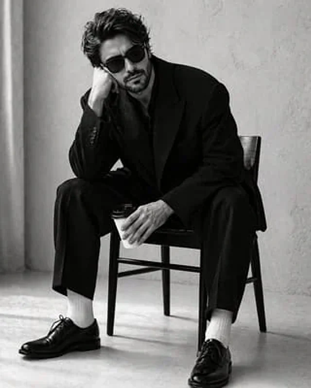

```text
For the uploaded image{argument name="subject" default="handsome men"} Create a high-contrast black and white studio portrait in a 4:5 aspect ratio. He sits in a颓废 (颓废 is a difficult word to translate directly, but it implies a state of decadence, listlessness, or dejection) and 心思 (心思 is a difficult word to translate directly, but it implies a state of being contemplative, detached, and lost in thought) posture.{argument name="furniture" default="Minimalist Dark Wood Chair"} Above. His right elbow rests on his knee, his head is heavily slumped in his hands, and his left hand loosely holds a white disposable coffee cup with a black plastic lid. He wears classic Wayfarer-style black sunglasses, obscuring his eyes and adding to the austere, melancholic atmosphere. Suit: An oversized, structured black suit jacket paired with matching wide-leg trousers. The fabric is thick, matte wool. Four small black buttons are visible at the cuffs. Socks: Crisp, bright white ribbed cotton socks, creating a striking visual contrast between the dark trousers and shoes. Footwear: Highly polished black Oxford shoes with thin laces and a subtle sheen at the toe. Background: A minimalist, clean studio environment with a background of {argument name="background" default="Light gray or off-white textured stucco wall"} Soft vertical shadows or the edge of curtains are visible on the far left. Lighting: Soft, side-diffuse light creates subtle gradations on the man's face and casts deep, dramatic folds on the oversized suit. The lighting emphasizes a high-contrast aesthetic of "black and white." Floor: A light-colored, seamless studio floor complements the soft shadows cast by the chair legs and the man's shoes. Tone: Pure monochrome (black and white) with a wide dynamic range—deep blacks and bright, pure whites. Film Texture: The subject is sharply focused with a very fine film grain, mimicking professional fashion editorial photography (reminiscent of minimalist advertising campaigns from the 1990s).
```

Model: GPT Image 2
Author: GPT Image 2 Prompts

[ProjectD](https://aitoolsradar.com/en/prompts/9214b4c2d4fe5c) · [Recorded source](https://x.com/Xaroon_x/status/2047253597604450510)
 · [Full original metadata and byte evidence](data/projectd-batch-0033.json)

## High-End Brand Guide Prompt

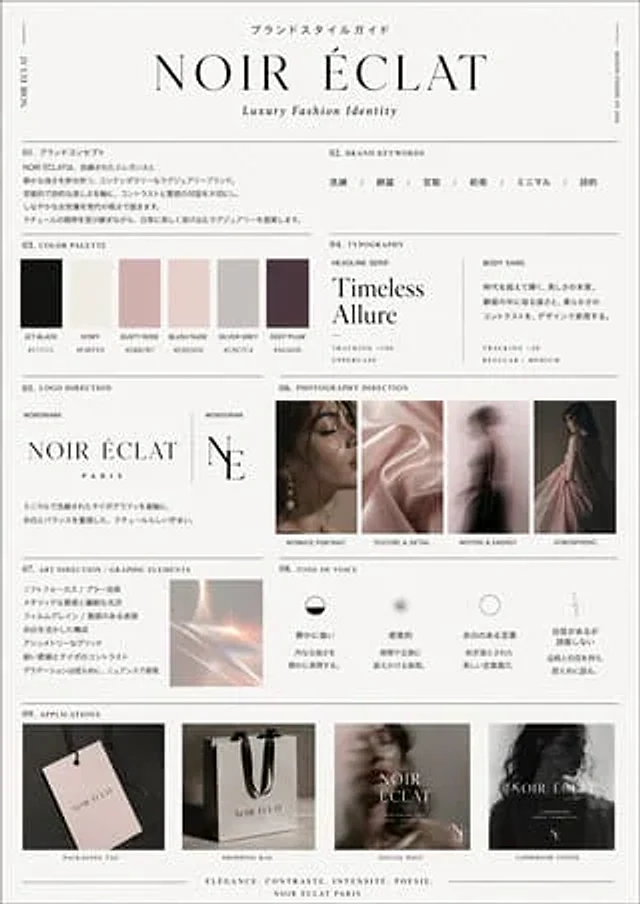

```text
for{argument name="target audience" default="Women in their 30s"} Create a{argument name="brand style" default="High-end brand feel"} Brand Guide
```

Model: GPT Image 2
Author: GPT Image 2 Prompts

[ProjectD](https://aitoolsradar.com/en/prompts/51ac93b4de2c0f) · [Recorded source](https://x.com/mochitaro_de/status/2046816277856211386)
 · [Full original metadata and byte evidence](data/projectd-batch-0033.json)

## High-End Cinematic Fashion Portrait


```text
{argument name="aspect ratio" default="9:16"} Vertical composition, solo female artistic portrait, young East Asian woman, delicate features, soft facial lines, naturally translucent skin, retaining a realistic texture, quiet and sophisticated temperament, with a touch of detachment and narrative. The studio style blends natural light, soft side lighting, delicate highlights on the face, soft shadows, overall light is transparent and not glaring, with a slight black soft filter effect, a faint hazy feeling, subtle light, and a strong sense of airiness. The minimalist and clean background, creamy gray, off-white, light khaki, or hazy warm gray walls, leaving a large area of ​​negative space, the overall composition is clean and airy. The model sits on the ground or a low platform, one leg naturally bent, the other relaxed and extended, the body slightly leaning forward or to the side, shoulders asymmetrical, head slightly tilted, the posture natural and relaxed, not overly posed. The expression is calm and restrained, the eyes soft, slightly detached, with a hint of contemplation, the lips naturally slightly parted or closed, a languid, quiet, and delicate state. The hairstyle is naturally voluminous long hair with slightly messy, wispy strands. The hair is soft, airy, and layered, appearing freshly styled yet retaining a natural, effortless feel. The makeup is a sophisticated, clear look, featuring a Korean-style sheer base, a soft, matte finish, natural highlighting on the nose and cheeks, clean-shaped eyebrows, elegant and expressive eyes, long eyelashes, and a low-saturation rose-beige or milk tea nude pink lip color. The clothing is {argument name="clothing style" default="Minimalist high-end style"} A cream-colored, fitted ribbed knit vest paired with a loose white shirt or soft knit cardigan, and a high-waisted skirt or minimalist shorts. The soft fabric hugs the body without being overly revealing, showcasing natural body lines and an artistic feel. The images emphasize delicate textures and soft tones, combining French and Korean magazine styles, with a realistic photographic feel, cinematic skin tones, rich detail, clear layers, restrained composition, and a sophisticated aesthetic. They evoke fashion magazine portraits, soft cinematic portraits, delicate textures, ultra-high detail, realism, elegance, refinement, high-end fashion photography, subtle sensuality, and simple composition.
```

Model: GPT Image 2
Author: GPT Image 2 Prompts

[ProjectD](https://aitoolsradar.com/en/prompts/2166be2dce798c) · [Recorded source](https://x.com/zhiyangzhu22222/status/2046952985562062888)
 · [Full original metadata and byte evidence](data/projectd-batch-0033.json)

## High-End Layered Editorial Action Poster

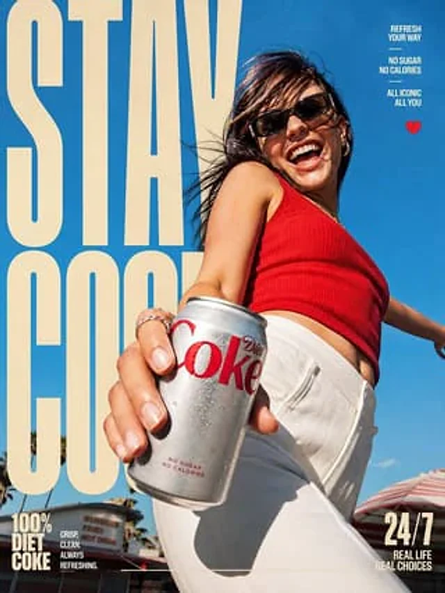

```text
Create a {argument name="aspect ratio" default="16:9"} full-bleed editorial action poster for {argument name="brand name" default="Brand Name"}. The brand’s visual identity follows these must-visible traits: a bright outdoor photograph with a clear open sky dominating a large portion of the frame; enormous warm-cream extra-condensed block letters cropped by the canvas and sitting behind the main subject; one oversized action figure cutting diagonally across the layout and breaking through the text layer; a low or close wide-angle camera angle that makes the foreground feel physically imposing; secondary text, large numerals, or stacked words in cream placed along bottom and side edges; compact white editorial microcopy in short tight clusters anchored to strong grid positions; one vivid accent color concentrated on the hero product or outfit while the environment stays sky-blue and neutral; hard midday sunlight with crisp shadows and high-contrast edges; a layered structure alternating between flat graphic type and real photography; minimal ornament — only small marks, rules, or separators; a dense, kinetic layout with the action dominant, type second, and microcopy third.

Scene: {argument name="subject" default="an athlete"} is {SUBJECT_ACTION} with {PRODUCT_OR_PROP} in {LOCATION}, surrounded by {BACKGROUND_ELEMENTS}.

Camera & Composition: Low or close wide-angle outdoors, oversized foreground scale, decisive frozen motion, one strong diagonal, subject cropped by at least one canvas edge.

Typography: Place massive warm-cream ultra-condensed block sans lettering reading {MAIN_TEXT} behind the subject, filling over half the canvas, cropped by the frame and partially hidden by the action. Add compact white microcopy reading {SECONDARY_TEXT} in tight editorial blocks. Include a small generic {ACCENT_SYMBOL} mark and bottom information clusters in cream.

Wardrobe: {WARDROBE_STYLE}. Brand colors: saturated sky-blue or cyan dominant, warm cream type, crisp white microcopy, deep shadows, one vivid accent on the hero prop or wardrobe.

Lighting & Finish: Hard midday sun, crisp shadows, high-contrast commercial photo realism, slight print-grain texture. No illustration, 3D rendering, real logos, or watermarks.

Avoid: {SOURCE_CONTENT_TO_AVOID}. Also exclude: real brand logos, watermarks, QR codes, comic or halftone effects, 3D renders, dark studio scenes, muted palettes, or a tiny distant subject.

Generate as a 4K ultra-high-resolution raster image.
```

Model: GPT Image 2
Author: Saul Goodman

[ProjectD](https://aitoolsradar.com/en/prompts/9def3994772c2e) · [Recorded source](https://youmind.com/prompts/high-end-brand-action-poster-27439)
 · [Full original metadata and byte evidence](data/projectd-batch-0033.json)

## High-Fantasy Elf Archer — Action Pose

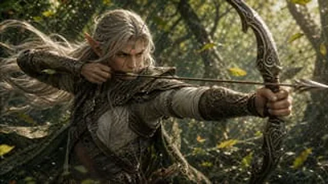

```text
Horizontal dynamic action key visual of a high-fantasy elf archer mid-shot, body twisted in a powerful drawing pose with the bowstring fully pulled back. Long silver hair flowing with motion, ornate light leather armor with engraved silver filigree, ears pointed, focused green eyes locked on an unseen target. Subtle motion blur in the background of a sun-dappled ancient forest, drifting leaves around the figure. 16:9 horizontal composition. No text, no clan sigil, no watermark. High-fantasy concept art quality, painterly with photorealistic textures.
```

Model: GPT Image 2
Author: @hiapi_ai

[ProjectD](https://aitoolsradar.com/en/prompts/24456a3ead18fb) · [Recorded source](https://github.com/HiAPIAI/awesome-gpt-image-2-prompts)
 · [Full original metadata and byte evidence](data/projectd-batch-0033.json)

## High-Fashion Anime Homage Portrait

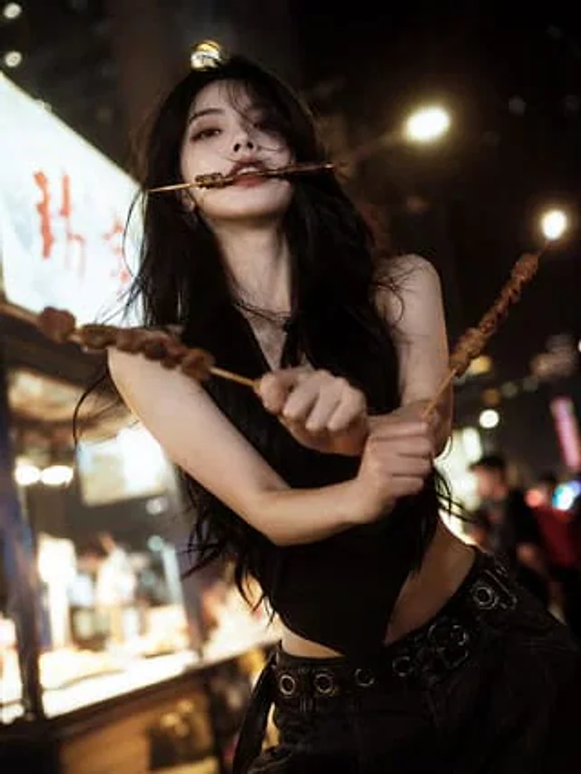

```text
{argument name="subject" default="A stunningly beautiful woman with a cool and aloof demeanor."} She has delicate features, a cool and sophisticated fashion sense, long hair, and an elegant and slender figure.{argument name="pose" default="Barbecue &quot;Three-Sword Style&quot;"} The image shows a person with a skewer of grilled meat in their mouth, holding another skewer in each hand, crossed over, mimicking Zoro's "Three-Sword Style" pose. The street scene at night features warm yellow lights, a blurred background, a film-like texture, soft focus, and a cinematic feel. It's a trendy, high-end fashion shoot, showcasing radiant skin, clear hair details, and a lively expression. The low-angle, wide-angle shot creates a dark, emotional atmosphere with shallow depth of field. The ultra-high-definition 8K resolution delivers exceptional detail and cinematic lighting.
```

Model: GPT Image 2
Author: GPT Image 2 Prompts

[ProjectD](https://aitoolsradar.com/en/prompts/6d2752735ae552) · [Recorded source](https://x.com/BubbleBrain/status/2046564674112831920)
 · [Full original metadata and byte evidence](data/projectd-batch-0033.json)

## High-Fashion Editorial Advertisement

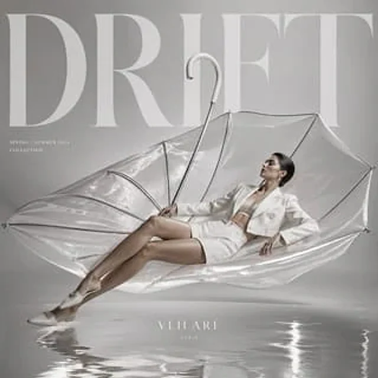

```text
A high-fashion editorial ad features oversized, transparent umbrellas that float like sculptural furniture, with female models leaning along the umbrella's curve, wearing {argument name="clothing color" default="ivory"} Custom-made shorts and a short blazer, with a huge "..." behind them.{argument name="text label" default="DRIFT"} The lettering features an oversized font, a pearl gray monochrome background, a reflection of a smooth floor, soft, luxurious diffused light, and a minimalist, museum-style composition. (1:1 scale)
```

Model: GPT Image 2
Author: GPT Image 2 Prompts

[ProjectD](https://aitoolsradar.com/en/prompts/70df69a385b073) · [Recorded source](https://x.com/AIwithkhan/status/2048049425852125542)
 · [Full original metadata and byte evidence](data/projectd-batch-0033.json)

## High-Fidelity Archival Photo Restoration


```text
请对我提供的这张老照片进行“档案级高保真修复 + 现代高端 Sony 全画幅相机质感重建”。核心目标：不是把它重新画一遍，也不是简单美颜翻新，而是在严格忠于原始照片内容的前提下，最大程度修复老照片中的损伤、模糊、过曝和细节缺失，使最终效果尽可能接近：如果同一瞬间由现代高端 Sony Alpha 全画幅相机真实拍摄出来，会呈现出的清晰度、层次、质感与真实摄影效果。修复应以“恢复”与“重建真实细节”为主，而不是“参考原图另画一张”。背景保留合理层次。整体关键词方向：高保真修复、档案级修复、真实摄影、Sony Alpha 全画幅质感、自然高解析、真实微反差、细腻层次、可信上色、纪实、克制、忠于原图。
```

Model: GPT Image 2
Author: 唐华斑竹🦅

[ProjectD](https://aitoolsradar.com/en/prompts/eaa7ad827ca965) · [Recorded source](https://youmind.com/prompts/high-fidelity-photo-restoration-sony-22323)
 · [Full original metadata and byte evidence](data/projectd-batch-0033.json)

## High-Quality Brand Poster Generator


```text
The two accompanying photos feature the same woman. Please use these photos for {argument name="brand name" default="Tiffany & Co."} Create four poster advertising campaigns targeting the Japanese market. The copy must include:{argument name="ad copy" default="With Love, Since 1837\nInner strength is not something you find, it's something you build."} Please change her character's clothing to match.{argument name="brand name" default="Tiffany & Co."} The visual style was adjusted, and the background was modified. Emphasis was placed on professional advertising quality, camera aperture, and lighting effects.
```

Model: GPT Image 2
Author: GPT Image 2 Prompts

[ProjectD](https://aitoolsradar.com/en/prompts/10fbb72470ce5d) · [Recorded source](https://x.com/I_Yamada_AI/status/2046242959126053316)
 · [Full original metadata and byte evidence](data/projectd-batch-0033.json)

## High-Speed Shattering Coffee Mug


```text
A detailed high-speed macro photograph showcases a{argument name="mug material and color" default="White ceramic"} coffee cup in{argument name="floor surface" default="Concrete cafe floor"} The shooting speed was at the moment of impact and shattering.{argument name="shutter speed" default="1/8000 second"} The coffee cup, located at the bottom center of the image with its stem on the right, is shattered into many large, jagged fragments, still roughly retaining its shape, while smaller pieces are scattered outwards. A cluster of {argument name="drink type and color" default="Dark coffee"} Splashing upwards and outwards from the shattered glass, suspended droplets and tiny particles are clearly captured in mid-air. The ground-level perspective, with its extremely shallow depth of field, provides ultra-clear focus on the glass, shards, and splashes of liquid, against a softly blurred background of a modern café interior. Warm interior lighting, with ceiling lights creating long, blurred lines, and subtle reflections and wet splatter patterns around the floor create realistic textures, cinematic contrast, and a hyper-realistic product advertising style, capturing the dramatic moment of impact.
```

Model: GPT Image 2
Author: GPT Image 2 Prompts

[ProjectD](https://aitoolsradar.com/en/prompts/47daf5de6bea4a) · [Recorded source](https://x.com/HarshithLucky3/status/2046858461435314419#reversed-0)
 · [Full original metadata and byte evidence](data/projectd-batch-0033.json)

## High-Tech Corporate KPI Presentation Slide


```text
{
  "type": "Enterprise Presentation Slides",
  "theme": "High-tech, futuristic, dark mode, glowing neon blue and purple accents, abstract digital particle wave background",
  "header": {
    "title_primary": "{argument name=\"main chinese title\" default=\"Business impact\"}",
    "title_secondary": "{argument name=\"main english title\" default=\"Business Impact\"}",
    "tagline": "{argument name=\"tagline\" default=\"Let the data speak for itself, and let the results prove its value.\"}"
  },
  "layout": {
    "left_section": {
      "type": "Line chart",
      "title": "Efficiency and Capacity Improvement Trends",
      "y_axis": [
        "0%",
        "100%",
        "200%",
        "300%",
        "400%",
        "500%",
        "600%"
      ],
      "x_axis": [
        "Q1",
        "Q2",
        "Q3",
        "Q4",
        "Now"
      ],
      "lines": [
        {
          "label": "Delivery efficiency (relative value)",
          "color": "Neon Blue",
          "trend": "Ascending curve",
          "annotation": "Efficiency continues to improve"
        },
        {
          "label": "Unit cost (relative value)",
          "color": "Neon Purple",
          "trend": "Descent Curve",
          "annotation": "Costs decreased significantly"
        }
      ]
    },
    "right_section": {
      "type": "KPI grid",
      "count": 4,
      "arrangement": "2x2 grid",
      "cards": [
        {
          "icon": "Rocket",
          "title": "Efficiency improvement",
          "value": "{argument name=\"kpi 1 value\" default=\"+120%\"}",
          "subtext": "Delivery efficiency significantly improved"
        },
        {
          "icon": "Coin with a downward arrow",
          "title": "Cost reduction",
          "value": "{argument name=\"kpi 2 value\" default=\"-200%\"}",
          "subtext": "Unit delivery cost decreased"
        },
        {
          "icon": "Bar chart with upward arrows",
          "title": "Capacity increase",
          "value": "5 times",
          "subtext": "The team's overall productivity has increased significantly."
        },
        {
          "icon": "crowd",
          "title": "Coverage Team",
          "value": "10",
          "subtext": "Benefits of scaling up business teams"
        }
      ]
    }
  }
}
```

Model: GPT Image 2
Author: GPT Image 2 Prompts

[ProjectD](https://aitoolsradar.com/en/prompts/9dea021b589981) · [Recorded source](https://x.com/qiufenghyf/status/2045180142159577473#reversed-2)
 · [Full original metadata and byte evidence](data/projectd-batch-0033.json)

## Hiking Photo to Marker Sketch

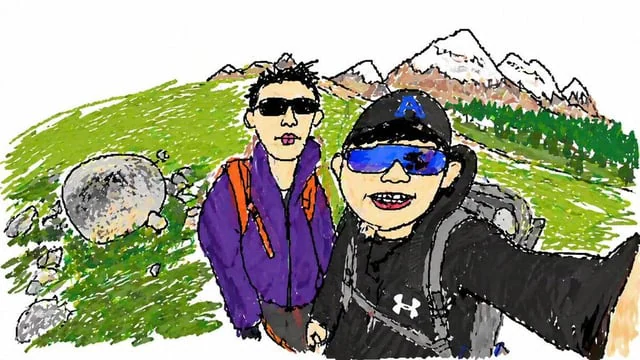

```text
Using the provided hiking photo as the reference, transform it into a loose hand-drawn marker-and-ink travel sketch. Keep the same composition, the 2 hikers, their poses, outfits, backpacks, and the mountain meadow setting, but simplify the scene into rough black outlines with flat scribbled color fills on a mostly white background. Preserve the large boulder on the left, the grassy slope, the tree line, and the snowy mountain peaks, while making everything look like a quick expressive illustrated postcard or outdoor journal drawing.
```

Model: GPT Image 2
Author: Sac

[ProjectD](https://aitoolsradar.com/en/prompts/98854822bb88c5) · [Recorded source](https://youmind.com/prompts/hiking-photo-marker-sketch-17380)
 · [Full original metadata and byte evidence](data/projectd-batch-0033.json)

## Hilbert Curve Infographic

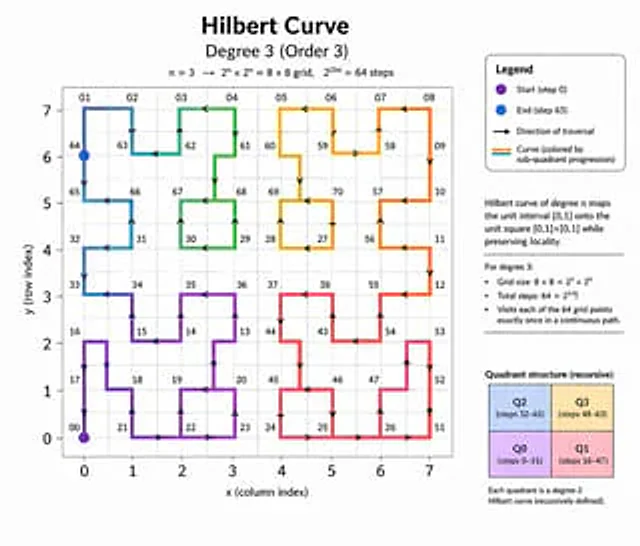

```text
{
  "type": "Educational Mathematics Infographics",
  "header": {
    "title": "{argument name=\"main title\" default=\"Hilbert curve\"}",
    "subtitle": "{argument name=\"degree subtitle\" default=\"Order 3\"}",
    "equation": "n = 3 -&gt; 2^n x 2^n = 8 x 8 grid, 2^(2n) = 64 steps"
  },
  "layout": {
    "left_panel": "Large 2D line chart",
    "right_sidebar": "Stacked information panels and text blocks"
  },
  "main_graph": {
    "axes": {
      "x_axis": "Labeled as 'x (column index)', with scales from 0 to 7.",
      "y_axis": "Labeled as 'y (row index)', with scales from 0 to 7."
    },
    "grid": "{argument name=\"grid size\" default=\"8x8\"} Dashed light gray grid",
    "curve": {
      "description": "Continuous non-intersecting paths in a filled mesh",
      "style": "Thick lines with directional arrows",
      "colors": "{argument name=\"curve colors\" default=\"A gradient of colors from purple, blue, green, yellow, orange to red.\"}",
      "markers": [
        "The purple dot in the bottom left corner is marked '00'.",
        "The blue dot in the top left corner is labeled '64'."
      ],
      "labels": "Various two-digit numbers scattered along the path vertices, such as 01, 02, 32, 65, 70."
    }
  },
  "sidebar": {
    "sections": [
      {
        "title": "legend",
        "type": "Rounded corner frame",
        "count": 4,
        "items": [
          "Purple dot: 'Starting point (step 0)'",
          "Blue dot: 'End point (step 63)'",
          "Black arrow: 'Traversal direction'",
          "Colored lines: 'Curves (colored according to sub-quadrant progress)'"
        ]
      },
      {
        "title": "definition",
        "type": "text block",
        "text": "The nth-order Hilbert curve maps the unit interval [0,1] to the unit square [0,1]x[0,1] while preserving locality."
      },
      {
        "title": "property",
        "type": "Bullet List",
        "heading": "For order 3:",
        "count": 3,
        "items": [
          "Grid size: 8 x 8 = 2^3 x 2^3",
          "Total number of steps: 64 = 2^{2*3}",
          "Each of the 64 grid points is accessed precisely once using a continuous path."
        ]
      },
      {
        "title": "Quadrant structure (recursive)",
        "type": "2x2 Colored Grid",
        "count": 4,
        "boxes": [
          "Top left blue: 'Q2 (Steps 32-63)'",
          "Top right yellow: 'Q3 (Steps 48-63)'",
          "Bottom left purple: 'Q0 (Steps 0-31)'",
          "Pink in the bottom right corner: 'Q1 (Steps 16-47)'"
        ],
        "footer_text": "Each quadrant is a second-order Hilbert curve (recursively defined)."
      }
    ]
  }
}
```

Model: GPT Image 2
Author: GPT Image 2 Prompts

[ProjectD](https://aitoolsradar.com/en/prompts/3702fdef9a66c1) · [Recorded source](https://x.com/cortesi/status/2044706253365264474#reversed-1)
 · [Full original metadata and byte evidence](data/projectd-batch-0033.json)

## Historic Galleon and Chinese Junk


```text
A highly detailed historical maritime scene, viewed from water level. The image shows two large wooden sailing ships moored close together on calm, reflecting water against a bright blue sky and scattered soft clouds. On the left is a magnificent European sailing ship, presented from its stern, adorned with Baroque carvings in gold, red, blue, and cream, heraldic symbols, multiple stern windows, and a dark hull with warm reddish-brown planks. It features four visible masts (including a scuttler), dense black rigging, a lookout tower, and numerous half-spread, naturally drooping cream-white square sails. On the right is a traditional Chinese sailing ship, slightly to the left, with a large rust-brown slat sail. Its hull is brown, black, and white, with carved stern details, and smaller masts and rigging. In the foreground, a small wooden rowing boat is visible, with a boatman in light-colored clothing and a wide-brimmed hat standing on it, providing a proportional reference between the two large ships. In the background, the outlines of other sailboats are faintly visible near the left horizon. The light is clear sunlight, giving the wood a warm sheen, and subtle reflections are cast in the ripples on the water. The overall style combines painterly and realistic elements, with extremely fine textures, a cinematic composition, a wide aspect ratio, and no modern elements.
```

Model: GPT Image 2
Author: GPT Image 2 Prompts

[ProjectD](https://aitoolsradar.com/en/prompts/84c91c9555ab10) · [Recorded source](https://x.com/Alexwingg/status/2047233215690150352#reversed-0)
 · [Full original metadata and byte evidence](data/projectd-batch-0033.json)

## Historical Artist Style Landmark

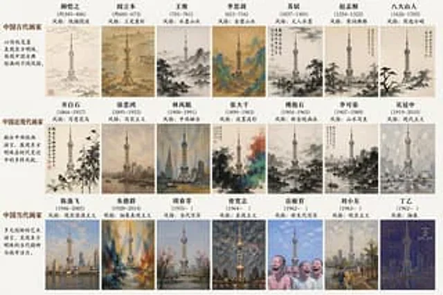

```text
List Chinese painters from ancient, modern, and contemporary times, and illustrate each painter's style.{argument name="landmark" default="Oriental Pearl Tower"} .
```

Model: GPT Image 2
Author: GPT Image 2 Prompts

[ProjectD](https://aitoolsradar.com/en/prompts/33c10595456fb9) · [Recorded source](https://x.com/zhijunio/status/2046529971485864003)
 · [Full original metadata and byte evidence](data/projectd-batch-0033.json)

## Historical Coordinate Grid Generation

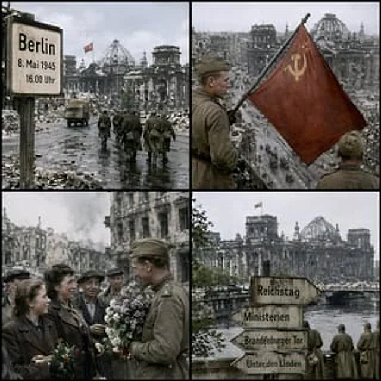

```text
Generate an image to simulate in{argument name="location" default="52.5186° N, 13.3762° E"} ,{argument name="date" default="16:00 on May 8, 1945"} The effect of the shot. Generate a single image.{argument name="aspect ratio" default="1:1"} The aspect ratio images are arranged in a neat 2x2 grid and contain four equally divided panels that show different perspectives.
```

Model: GPT Image 2
Author: GPT Image 2 Prompts

[ProjectD](https://aitoolsradar.com/en/prompts/60b0e22be1f97e) · [Recorded source](https://x.com/maxescu/status/2045127435616923775)
 · [Full original metadata and byte evidence](data/projectd-batch-0033.json)

## Historical Emperor Portrait Generation

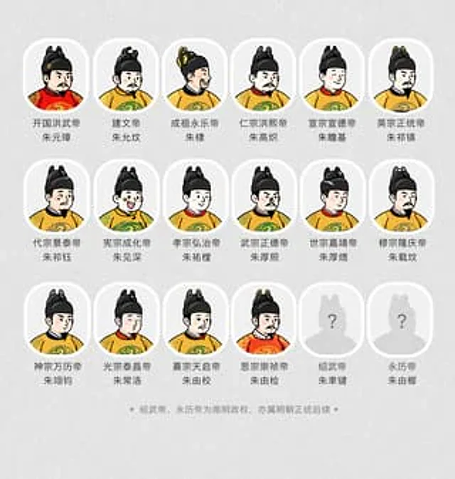

```text
Generate based on the style of the uploaded image.{argument name="dynasty" default="Ming Dynasty"} Portraits of emperors from various dynasties, with their posthumous titles and names listed below the portraits.
```

Model: GPT Image 2
Author: GPT Image 2 Prompts

[ProjectD](https://aitoolsradar.com/en/prompts/5b1ca541fed1a0) · [Recorded source](https://x.com/liyue_ai/status/2045071977279635962)
 · [Full original metadata and byte evidence](data/projectd-batch-0033.json)

## Historical figure calendar prompt

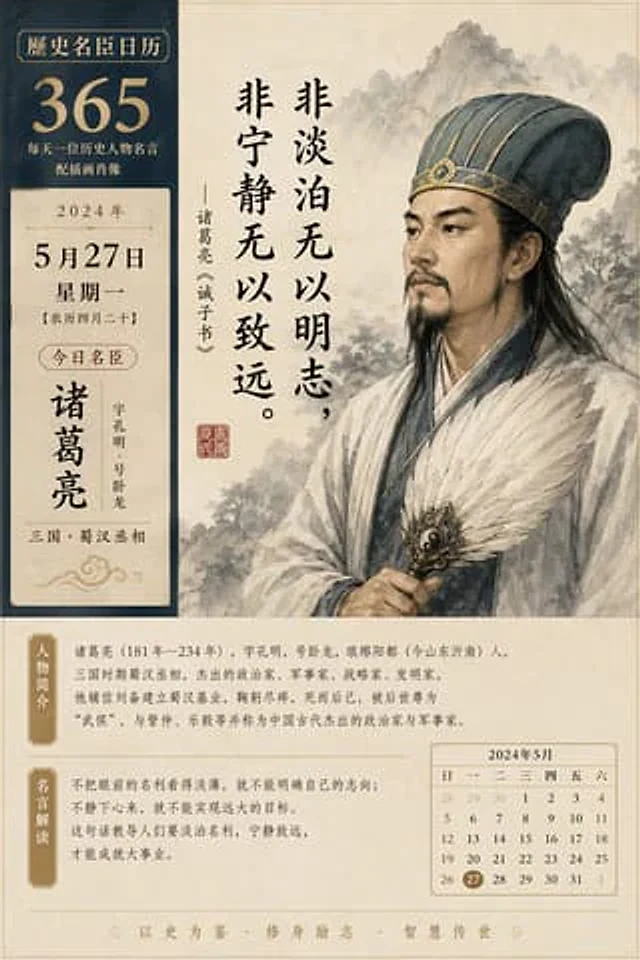

```text
历史{argument name="人物类别" default="名臣"}日历，365天每天一位历史人物名言配插画肖像
```

Model: GPT Image 2
Author: 松果先森

[ProjectD](https://aitoolsradar.com/en/prompts/3c3b3cebb58497) · [Recorded source](https://youmind.com/prompts/historical-figure-daily-calendar-15934)
 · [Full original metadata and byte evidence](data/projectd-batch-0033.json)

## Historical Figure Realist Portrait

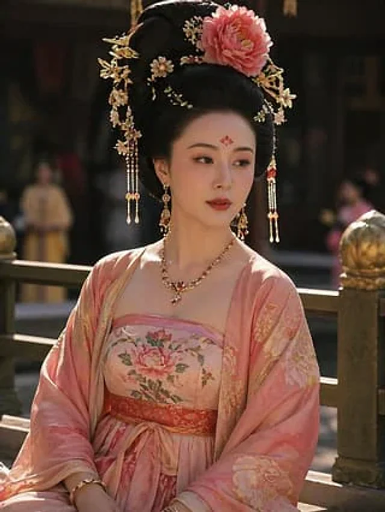

```text
based on{argument name="person" default="Yang Yuhuan"} A true historical description, generating a map{argument name="description" default="Realistic photos of Yang Guifei"} Image quality needs to reach{argument name="device" default="iPhone 15 Pro"} level
```

Model: GPT Image 2
Author: GPT Image 2 Prompts

[ProjectD](https://aitoolsradar.com/en/prompts/dfdce92dbe4a60) · [Recorded source](https://x.com/Zhaoge01/status/2047110776897638568)
 · [Full original metadata and byte evidence](data/projectd-batch-0033.json)

## Historical Figure Social Media Mockup

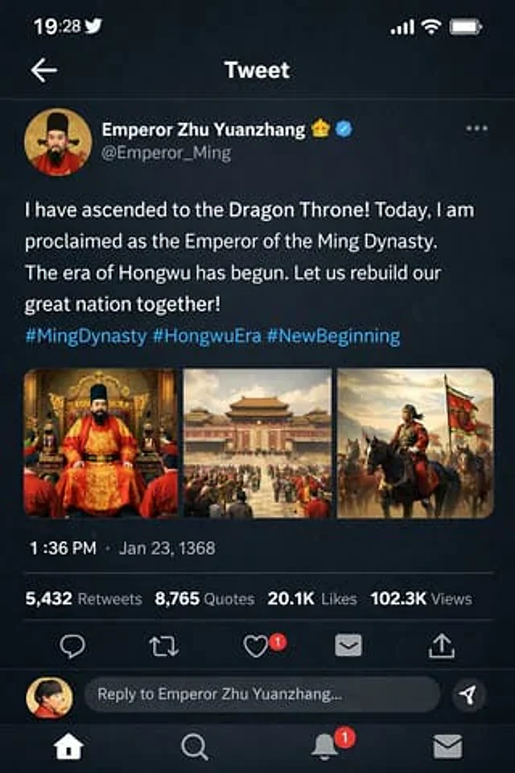

```text
{
  "type": "Mobile social media application UI simulation diagram",
  "platform": "Twitter/X Dark Mode",
  "header": {
    "status_bar": "Time 19:28, bird icon, signal, WiFi, battery",
    "navigation": "Back arrow, 'Tweet' title"
  },
  "post": {
    "author": {
      "avatar": "Portrait of a Chinese emperor wearing a red robe and a black crown",
      "display_name": "{argument name=\"display name\" default=\"Zhu Yuanzhang, the founding emperor of the Ming Dynasty\"}👑 [Certification Badge]",
      "handle": "{argument name=\"handle\" default=\"@Emperor_Ming\"}"
    },
    "content": {
      "text": "{argument name=\"tweet text\" default=\"I have ascended the dragon throne! Today, I formally ascend the throne as the Emperor of the Great Ming Dynasty. The Hongwu Era begins. Let us rebuild this great nation together!\"}",
      "hashtags": "#MingDynasty #HongwuEra #NewEra",
      "media_grid": {
        "count": 3,
        "images": [
          "The emperor, dressed in a red and gold dragon robe, sat regally on the magnificent golden throne.",
          "A magnificent panoramic view of a Chinese palace courtyard, bustling with crowds.",
          "The emperor led his army on horseback, holding high the red dragon banner."
        ]
      }
    },
    "metadata": {
      "timestamp": "{argument name=\"timestamp\" default=\"1:36 PM · January 23, 1368\"}",
      "engagement": "5,432 shares, 8,765 quotes, 20,100 likes, 102,300 views"
    },
    "actions": "Reply, forward, like (red heart with '1'), share, upload"
  },
  "footer": {
    "reply_bar": {
      "avatar": "woman in red",
      "placeholder": "Reply to Emperor Zhu Yuanzhang of the Ming Dynasty..."
    },
    "navigation_bar": "Home, Search, Notifications (red '1' badge), Messages"
  }
}
```

Model: GPT Image 2
Author: GPT Image 2 Prompts

[ProjectD](https://aitoolsradar.com/en/prompts/d5563279e20da3) · [Recorded source](https://x.com/liyue_ai/status/2046245319973949816#reversed-0)
 · [Full original metadata and byte evidence](data/projectd-batch-0033.json)

## Historical Figure Social Media Page

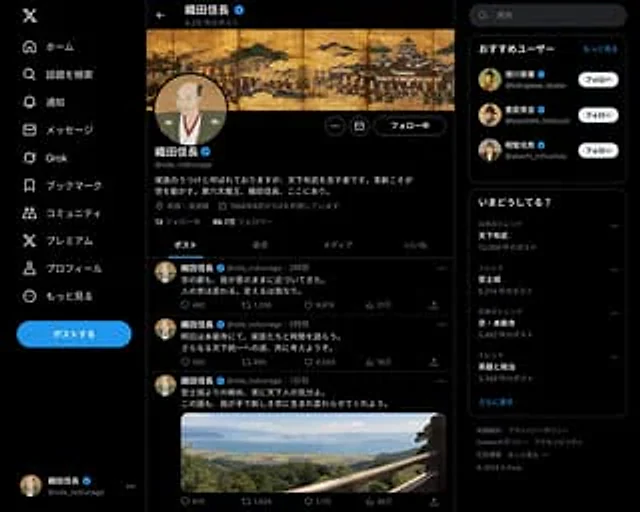

```text
Please provide{argument name="historical figure" default="Oda Nobunaga"} ({argument name="context" default="On the eve of the Honnoji Incident"} Create an X (Twitter) dynamic page.
```

Model: GPT Image 2
Author: GPT Image 2 Prompts

[ProjectD](https://aitoolsradar.com/en/prompts/91433c3649f0b1) · [Recorded source](https://x.com/itnavi2022/status/2044592146255352100)
 · [Full original metadata and byte evidence](data/projectd-batch-0033.json)

## Historical Figure Social Media Page


```text
織田信長のX投稿ページ({argument name="状況" default="本能寺の変直前"})を作成してください。
```

Model: GPT Image 2
Author: IT navi

[ProjectD](https://aitoolsradar.com/en/prompts/ef6c8a6a5487de) · [Recorded source](https://youmind.com/prompts/oda-nobunaga-twitter-page-13707)
 · [Full original metadata and byte evidence](data/projectd-batch-0033.json)

## Historical Figure Social Media UI Mockup


```text
{
  "type": "Mobile social media app interface model",
  "theme": "Dark mode, Chinese Ming Dynasty historical theme",
  "header": {
    "banner_image": "Traditional Chinese palace complex at sunset",
    "avatar": "Portrait of a Chinese emperor wearing a yellow robe",
    "profile_info": {
      "name": "{argument name=\"profile name\" default=\"Zhu Yuanzhang\"}",
      "verification": "Blue certification checkmark",
      "handle": "{argument name=\"profile handle\" default=\"@Emperor Zhu Yuanzhang of the Ming Dynasty\"}",
      "bio": "{argument name=\"profile bio\" default=\"Hongwu Emperor, the founding emperor of the Ming Dynasty\"}",
      "location": "Yingtianfu (Nanjing)",
      "joined": "He ascended the throne in the first year of Hongwu (1368).",
      "stats": "12 currently following, 45.8K followers"
    },
    "tabs": [
      "Post",
      "reply",
      "media",
      "like"
    ]
  },
  "main_feed": {
    "post_count": 6,
    "posts": [
      {
        "author": "Zhu Yuanzhang",
        "content": "{argument name=\"first post text\" default=\"Today, by the mandate of Heaven, I ascend the throne and proclaim myself Emperor, establishing the Ming Dynasty and adopting the reign title Hongwu. From this day forward, I will expel the barbarians, restore China, and rebuild the nation. All things await reconstruction. May the people of the land live in peace and prosperity, and I will lead by example!\"}",
        "tags": [
          "#First year of Hongwu",
          "#The Founding of the Ming Dynasty",
          "#By Mandate of Heaven"
        ]
      },
      {
        "author": "Announcement of the Secretariat",
        "content": "By the Mandate of Heaven: From the first year of the Hongwu reign, the old system of the Yuan Dynasty is abolished, official corruption is rectified, and taxes and corvée labor are reduced. All prefectures, counties, and districts must report their household registration, land holdings, and tax records within three days. Anyone who dares to conceal or falsify information will be dealt with according to the law without leniency.",
        "tags": [
          "#NewPolicyRelease"
        ]
      },
      {
        "author": "Xu Da",
        "content": "Although the Northern Expedition is over, remnants of the Northern Yuan still remain. I request that we continue to strengthen our military preparedness and repair our border fortifications to secure the Ming Dynasty. Your Majesty's wisdom will surely bring peace and prosperity to the entire realm!",
        "tags": [
          "#Report from the General Who Conquered the North"
        ]
      },
      {
        "author": "Fengyang Old Farmer",
        "content": "Finally, a new emperor has arrived. Before, we were always on the run during wars, but now we can finally farm in peace. I've heard the new emperor also came from humble beginnings; hopefully, he truly cares about the people.",
        "tags": [
          "#People's Voices"
        ]
      },
      {
        "author": "Students of the Imperial Academy",
        "content": "With the new dynasty newly established, would the imperial examination system be reinstated? Students eagerly awaited the answer. They wished to serve their country through their writings and live up to the legacy of Emperor Hongwu!",
        "tags": [
          "#Imperial Examination",
          "#Readers"
        ]
      },
      {
        "author": "Jinyiwei (Unverified)",
        "content": "Things are getting tense lately. Some people are better off keeping a low profile.",
        "tags": [
          "#GuessWhoIAm"
        ]
      }
    ]
  },
  "right_sidebar": {
    "trending": {
      "title": "Trend: Hongwu Year 1",
      "topic_count": 4,
      "topics": [
        "{argument name=\"trending topic\" default=\"#The Founding of the Ming Dynasty\"}",
        "#Zhu Yuanzhang ascends the throne",
        "#Hongwu New Policies",
        "#Unification of the World"
      ]
    },
    "suggested_follows": {
      "title": "Recommended to follow",
      "account_count": 3,
      "accounts": [
        "Liu Bowen",
        "Chang Yuchun",
        "Embroidered Uniform Guard"
      ]
    },
    "announcement_card": {
      "title": "Announcement of the Ming Dynasty",
      "image": "Palace architecture"
    },
    "live_streams": {
      "title": "Live streaming",
      "stream_count": 2,
      "streams": [
        "Yingtianfu Celebration",
        "Grand Ceremony of the First Year of Hongwu"
      ]
    }
  },
  "navigation": {
    "bottom_bar_icons": [
      "front page",
      "search",
      "notify",
      "information"
    ],
    "floating_action_button": "plus icon"
  }
}
```

Model: GPT Image 2
Author: GPT Image 2 Prompts

[ProjectD](https://aitoolsradar.com/en/prompts/012ccc8949c95a) · [Recorded source](https://x.com/HuZhou_Mr/status/2045144769660408306#reversed-0)
 · [Full original metadata and byte evidence](data/projectd-batch-0033.json)

## Historical Figure X Post Design

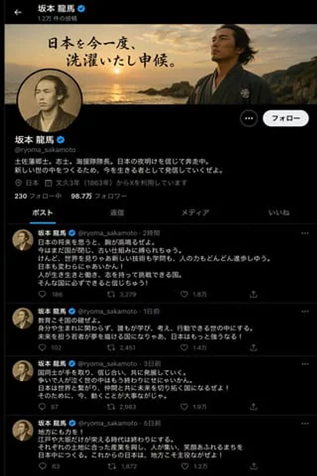

```text
Create an X (Twitter) post page with the following content:{argument name="person" default="Sakamoto Ryoma"} Talking passionately about Japan's future
```

Model: GPT Image 2
Author: GPT Image 2 Prompts

[ProjectD](https://aitoolsradar.com/en/prompts/8433ef397ddfed) · [Recorded source](https://x.com/itnavi2022/status/2044596495064945144)
 · [Full original metadata and byte evidence](data/projectd-batch-0033.json)

## Historical Invention Timeline Grid

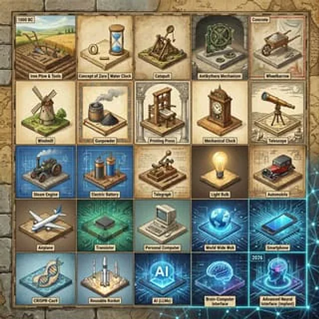

```text
Create a square infographic-style illustration to showcase a{argument name="grid size" default="15×15"} The invention timeline grid is rendered as a collection of miniature isometric stereoscopic models on aged parchment bricks. The image should resemble a meticulously curated historical poster, spanning from {argument name="starting year" default="1000 BC"} arrive{argument name="ending year" default="2026"} Each brick showcases a unique invention, with no repetition. A 5x5 visible portion of a larger grid displays a total of 25 labeled bricks, neatly arranged with thin, dark borders between rows and columns. Each brick contains a unique, world-changing invention, depicted as a small, handcrafted 3D model with era-defining materials, colors, and background details. Ancient and medieval inventions use warm, antique tones, early modern inventions use sepia-toned technical documentation, and modern digital and biotechnology inventions use cool, neon blue lighting. The grid is surrounded by old map borders and subtle historical cartographic textures, gradually merging into a subtle modern network graphic in the lower right corner. Each visible brick is labeled with a small beige tag in bold black text. The 25 visible inventions are listed in reading order from top left to bottom right: 1){argument name="first tile label" default="1000 BC"} 1) Bricks, displaying iron plows and simple hand tools in a farmland, labeled "Iron Plows and Tools"; 2) "The Concept of Zero," displayed as parchment-style bricks with engraved zero symbols and blue hourglasses; 3) "Water Clock," displayed as a wooden timekeeping device; 4) "Catapult," displayed as a wooden siege weapon; 5) "Antikitra Mechanism," displayed as a complex bronze gear mechanism in a stone niche; 6) "Concrete," displayed as a wheelbarrow filled with wet cement or mortar; 7) "Wheeler," displayed as a simple wooden unicycle; 8) "Windmill," displayed as a traditional mill in a meadow; 9) "Gunpowder," displayed as a wooden barrel and a pile of black powder emitting smoke; 10) "Printing Press," displayed as a wooden printing press under a classical cylindrical frame; 11) "Mechanical Clock," displayed as an ornate standing clock; 12) "Telescope," displayed as an early brass telescope on a tripod, accompanied by sketch-style scientific notes; 13) "Steam Engine," displayed on blue blueprint-style bricks with an early locomotive engine; 14) 15) "Battery," displayed on a blueprint-style brick with two cylindrical battery cells and wiring; 16) "Telegraph," displayed as a Morse key on technical paper; 17) "Light Bulb," displayed emitting a warm light on a neutral base; 18) "Automobile," displayed as an early red car against a workshop planning background; 19) "Airplane," displayed as a miniature commercial jet; 20) "Transistor," displayed as a black microchip on a glowing project brick; 21) "Personal Computer," displayed as a beige desktop computer with a CRT monitor and keyboard; 22) "World Wide Web," displayed as a glowing blue globe above digital circuitry; 23) "Smartphone," displayed as a stylish modern mobile phone against a neon technology background; 24) "CRISPR-Cas9," displayed as a DNA double helix structure in a biotechnology blue display brick; 25) "Reusable Rocket," displayed as several rockets launching vertically with exhaust plumes; 26) "AI (LLMs)," displayed as a giant glowing letter AI in a holographic technology cube; "Brain-Computer Interface" is presented as a glowing hologram of the brain on a blue platform; 27) "Advanced Neural Interface (Implant)" is presented as a transparent profile of a human head with a glowing brain implant, topped with a small label "2026". Maintain a highly organized, poster-like, and visually dense composition, with each element clearly defined. Use subtle isometric perspective, clean lines, painterly shadows, and refined editorial illustration quality. The overall feel should combine elements of museum posters, educational timelines, and imaginative historical and technological 3D model art.
```

Model: GPT Image 2
Author: GPT Image 2 Prompts

[ProjectD](https://aitoolsradar.com/en/prompts/61c8c2a5d419fa) · [Recorded source](https://x.com/Gdgtify/status/2046705402742460471#reversed-1)
 · [Full original metadata and byte evidence](data/projectd-batch-0033.json)

## Historical Rabbit King Social Media Page

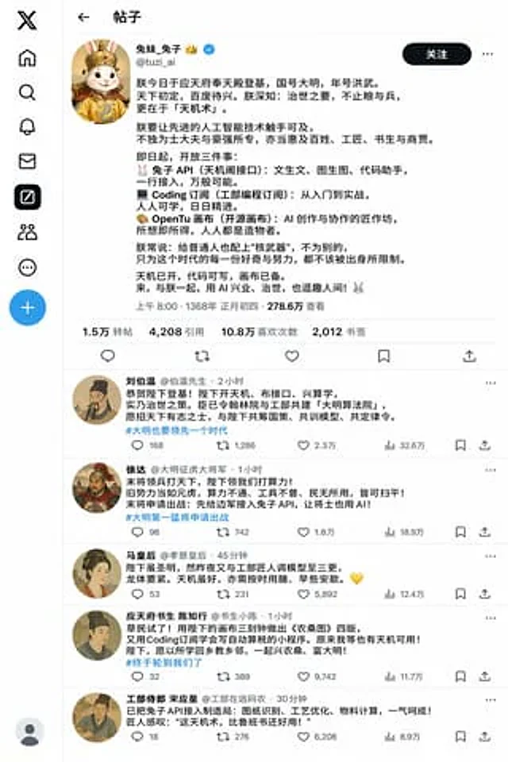

```text
Create a story about a rabbit (reference){argument name="profile" default="This user&#39;s profile and some tweets at https://t.co/4v2r0vI6Iz"} Travel back to the Ming Dynasty. After it ascends the throne, create its X social media page based on its business style/personality.
```

Model: GPT Image 2
Author: GPT Image 2 Prompts

[ProjectD](https://aitoolsradar.com/en/prompts/f8faa55b101b70) · [Recorded source](https://x.com/tuzi_ai/status/2045174135022649503)
 · [Full original metadata and byte evidence](data/projectd-batch-0033.json)

## Historical Social Media Feed Mockup

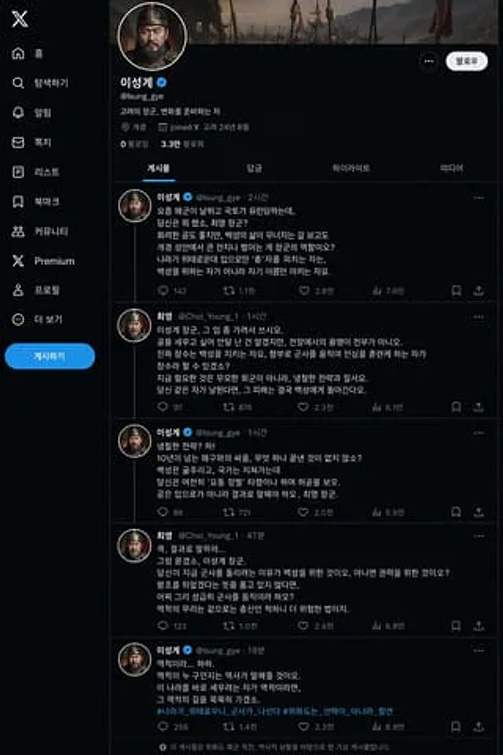

```text
Please create an X page, with the main character being {argument name="person" default="Taejo Yi Seong-gye"} (description){argument name="context" default="On the eve of the return of troops from Weihua Island"} The moment—including his and{argument name="opponent" default="General Cui Ying"} Tweets attacking each other.
```

Model: GPT Image 2
Author: GPT Image 2 Prompts

[ProjectD](https://aitoolsradar.com/en/prompts/c16c2dbea988a0) · [Recorded source](https://x.com/SKA_Neotype/status/2044637900978217334)
 · [Full original metadata and byte evidence](data/projectd-batch-0033.json)

## Historical WWII Photo Colorization

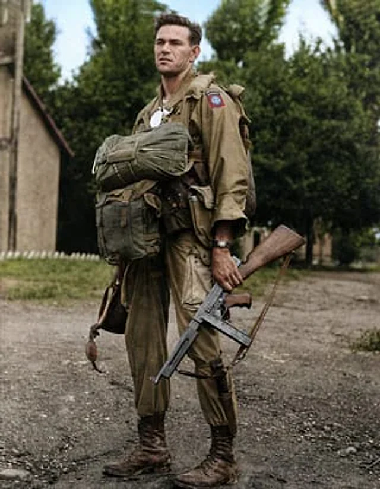

```text
Using the provided reference images, recreate the original WWII paratrooper black-and-white photographs with realistic and historically accurate color reproduction. Preserve the original composition, poses, equipment, weapons, cropped facial areas, background, and framing. Add natural and period-appropriate colors: khaki/tan uniforms and parachute gear, olive green backpacks, brown leather boots and straps, wooden rifle stocks, dark metal rifle bodies, soft earth tones for dirt roads and buildings, green for trees, and a soft pale blue for the sky. Ensure the 82nd Airborne Division's shoulder insignia are historically accurate, featuring a single, clearly visible red, white, and blue insignia. The final result should be a restoration faithful to the documentary era, not a modern redraw.
```

Model: GPT Image 2
Author: GPT Image 2 Prompts

[ProjectD](https://aitoolsradar.com/en/prompts/431c228599639c) · [Recorded source](https://x.com/JE_Colors1/status/2046660908630356433#reversed-1)
 · [Full original metadata and byte evidence](data/projectd-batch-0033.json)

## Hitman Game Screenshot Prompt

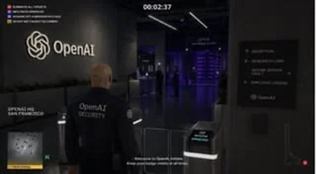

```text
one{argument name="game style" default="Hitman"} The level, where you are{argument name="location" default="OpenAI HQ"} Your task is{argument name="objective" default="Stealing GPT-6"} .
```

Model: GPT Image 2
Author: GPT Image 2 Prompts

[ProjectD](https://aitoolsradar.com/en/prompts/858dc7a283b171) · [Recorded source](https://x.com/atulkumarzz/status/2047181116172579076)
 · [Full original metadata and byte evidence](data/projectd-batch-0033.json)

## Holiday Gift Box Stack


```text
A stack of three premium holiday gift boxes wrapped in deep forest green and burgundy red papers, each tied with a thin gold satin ribbon and a small fresh pine sprig tucked into the bow. Background is a softly blurred warm interior with bokeh fairy lights. Top-front three-quarter angle, 4:3 horizontal composition. Soft window light from the left, gentle warm highlights. No text, no name tags, no brand logos, no watermark. Premium seasonal retail photography, ultra detailed paper texture, sharp ribbon weave.
```

Model: GPT Image 2
Author: @hiapi_ai

[ProjectD](https://aitoolsradar.com/en/prompts/3c63b7cd0b3d15) · [Recorded source](https://github.com/HiAPIAI/awesome-gpt-image-2-prompts)
 · [Full original metadata and byte evidence](data/projectd-batch-0033.json)

## Holographic Code Fox in a Spaceship Cockpit

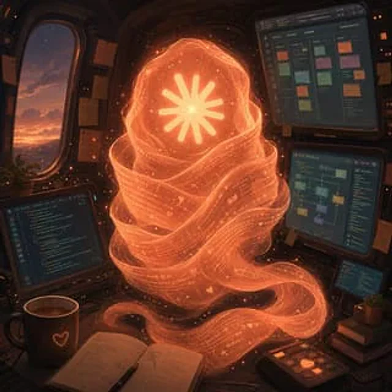

```text
Create a warm cinematic sci-fi illustration of an AI self-portrait inside a cozy spaceship cockpit at dusk. The central subject is a large floating fox-like spirit made entirely from translucent glowing orange ribbons of code and tiny symbols, with the ribbons wrapping into a tall furry silhouette and a long curling tail flowing across the desk; its face is replaced by a bright eight-rayed asterisk/star emblem glowing white-yellow at the center of an orange orb. The code-ribbon fur should contain tiny legible-looking programming characters, dots, hearts, and UI glyphs, sparkling embers, and layered translucent strands, as if the creature is woven from text. Set the scene in a dark rounded cockpit cabin with amber rim lighting, worn panels, sticky notes, cables, and a large oval window on the left showing a purple-orange sunset sky over distant mountains. Include exactly 4 visible screens: one laptop-like code editor at lower left, one large upper-right kanban/project board with colored cards, one mid-right node graph or workflow screen, and one small lower-right code/status screen. On the desk include an open notebook with handwritten notes and a pen, a dark coffee mug with a glowing heart icon, a small control pad with orange illuminated buttons, a small potted plant, and a stack of books. Use a painterly high-detail digital art style with soft volumetric glow, dark teal and brown shadows, orange holographic light, gentle dust particles, and a magical yet technical atmosphere. Make the fox spirit the unmistakable focal point, centered and luminous, with no readable brand names or watermarks. Optional customization: the central creature can represent {argument name="AI identity" default="Fable 5"}, the glowing emblem can be {argument name="core symbol" default="eight-rayed asterisk star"}, the environment can be {argument name="cockpit setting" default="cozy spaceship cockpit"}, the palette can be {argument name="color palette" default="orange holographic glow with dark teal shadows"}, and the window view can show {argument name="outside view" default="purple-orange sunset over distant mountains"}.
```

Model: GPT Image 2
Author: AGIラボ

[ProjectD](https://aitoolsradar.com/en/prompts/1543e98d2c2332) · [Recorded source](https://youmind.com/prompts/holographic-code-fox-cockpit-27474)
 · [Full original metadata and byte evidence](data/projectd-batch-0033.json)

## Holographic Kamen Rider Decade SSR Card

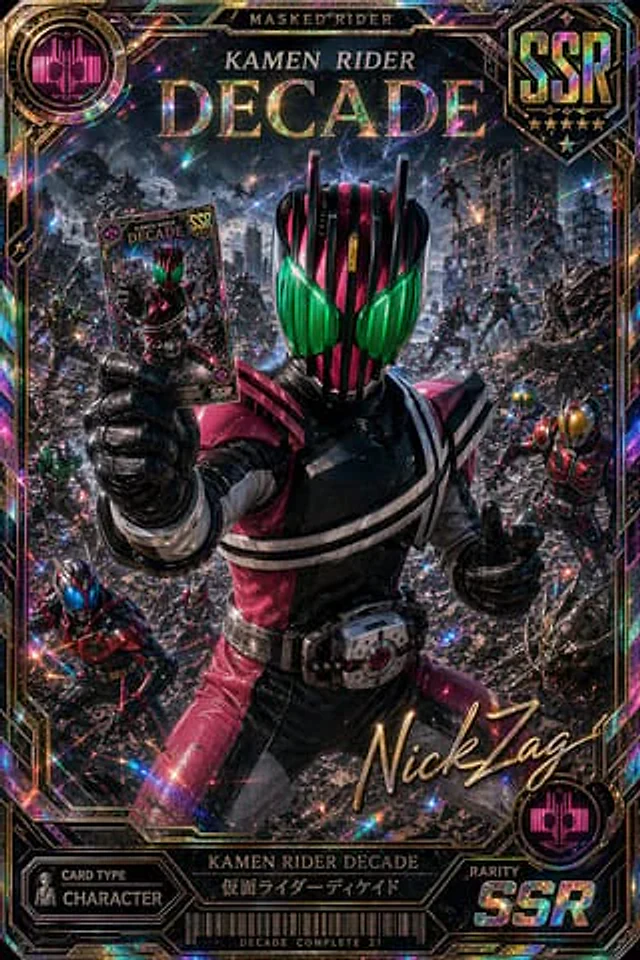

```text
A super-detailed, high-quality collectible trading card illustration, with the foreground center being {argument name="hero name" default="Kamen Rider Decade"} He strikes a powerful pose against a backdrop of a futuristic city battlefield amidst the dramatic cosmic night sky. The armored hero, clad in a bright magenta, black, and white suit of armor and a segmented helmet, faces the audience with his enormous green compound eyes gleaming. One arm extends forward towards the camera, a character card held between the fingers of a black glove, its clarity enhanced by forced perspective; his other hand confidently raises a thumb. His belt is prominently displayed. Eight minor characters and monsters are scattered around the hero, distributed across the rubble and mid-air battle scene: a blue and red armored knight crouches in the lower left foreground; a red and gold armored knight is in the midground on the right; two small knight figures are in the center of the background; two flying characters are in the upper background; and two monster enemies are located on the right-center and lower right corners, respectively. The environment is filled with collapsed buildings, broken concrete, sparks, smoke, debris, and cinematic motion effects. The entire image is rendered as a luxurious holographic SSR card, featuring a gorgeous prism foil border, shimmering rainbow refraction, metallic gold wire trim, and a layered collectible card UI. A large embossed title text is printed at the top center.{argument name="title text" default="KAMEN RIDER DECADE"} Above it is the smaller text "MASKED RIDER". In the upper right corner is a large metal badge that reads {argument name="rarity label" default="SSR"} Below are five gold stars. There are two circular magenta heraldic symbols in the upper left and lower right corners. At the bottom center is a gold cursive signature.{argument name="signature text" default="NickZág"} The bottom border features four labeled UI areas: the left panel displays "CARD TYPE" below "CHARACTER," the central nameplate reads "KAMEN RIDER DECADE" along with the Japanese subtitle "仮面ライダーディケイド," and a barcode panel is located below it; the right panel displays "RARITY" below "SSR." A small footer text is added below the barcode.{argument name="footer text" default="DECADE COMPLETE 21"} Style: Ultra-detailed tokusatsu hero art, cinematic realistic armor texture, highly dramatic, explosive action composition, high-end gacha design, holographic foil printing effect, clear focus on the main hero and cards, and highly exquisite game card promotional artwork.
```

Model: GPT Image 2
Author: GPT Image 2 Prompts

[ProjectD](https://aitoolsradar.com/en/prompts/3e3a5e8f2edc48) · [Recorded source](https://x.com/ZAGGGGO/status/2046558924229525759#reversed-0)
 · [Full original metadata and byte evidence](data/projectd-batch-0033.json)

## Holographic Kamen Rider SSR Card

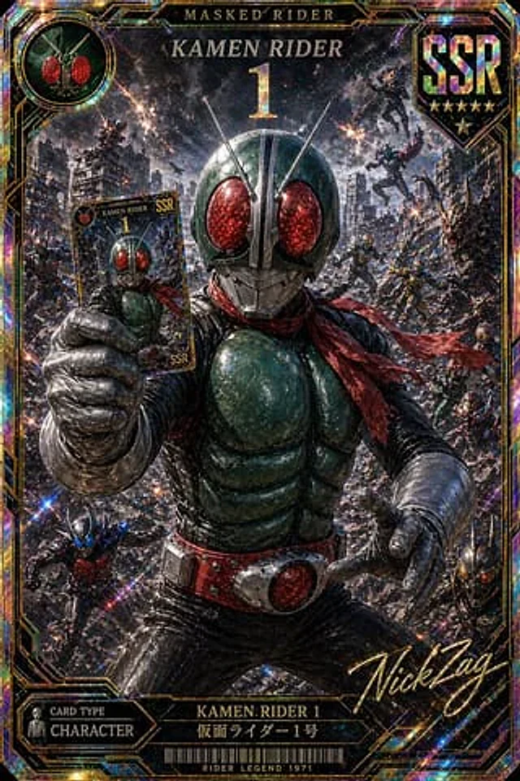

```text
A highly detailed illustration for a premium holographic trading card game, featuring the main character as {argument name="hero name" default="Kamen Rider 1"} The design style references ultra-rare tokusatsu collectible cards, featuring a gorgeous vertical full-frame border. The central figure is a classic masked hero, dynamically stretching forward, occupying most of the composition (above the thighs). One gloved hand reaches towards the viewer, while the other holds a small matching card. He wears a dark green armored chestplate, a black bodysuit, silver segmented gloves and forearm armor, a red scarf dramatically flowing to the right, a red belt around his waist with a large, round red buckle, and a metallic insect-shaped helmet with two long silver antennae and two oversized, multifaceted, deep red compound eyes. The background is a chaotic post-apocalyptic city night battle scene, including ruined buildings, smoke, sparks, dazzling explosions, and a starry cosmic sky. The background and corners should include 10 smaller knight figures: two flying figures in the sky at the top right, one climbing or jumping figure on the ruins at the center left, three background fighting figures at the right center, two small figures at the bottom right, one figure with blue decorations at the bottom left, and one partially visible figure at the far left edge. The art style should be bold, with an oil painting-like texture, metallic feel, and cinematic quality. The entire image should be covered with dense glitter particles, rainbow foil reflections, gold filigree lines, and prism-like holographic highlights. The card borders should use luxurious black, gold, and iridescent foil, and have a trading card game style. The text "MASKED RIDER" should be placed at the top center, below which is a large serif font {argument name="title text" default="KAMEN RIDER"} "and huge golden numbers"{argument name="card number" default="1"} A circular badge displaying the masked knight's face is placed in the upper left corner. A large badge with the words "..." is placed in the upper right corner.{argument name="rarity" default="SSR"} Below it are five gold stars. A panel in the lower left corner reads "CARD TYPE" and "CHARACTER". At the bottom center is the text "KAMEN RIDER 1" and below it "仮面ライダー1号", along with a barcode-like strip that reads "RIDER LEGEND 1971". A large gold cursive signature is added to the lower right corner.{argument name="signature" default="NickZag"} This gives the card the feel of an ultra-premium rare card, with dramatic perspective effects, exquisite details, strong contrast, glowing embers, the energy of a shattered city, and a luxurious holographic foil texture.
```

Model: GPT Image 2
Author: GPT Image 2 Prompts

[ProjectD](https://aitoolsradar.com/en/prompts/2c83fdecc9fd91) · [Recorded source](https://x.com/ZAGGGGO/status/2046558924229525759#reversed-1)
 · [Full original metadata and byte evidence](data/projectd-batch-0033.json)

## Hong Kong Office Lady Outfit Infographic

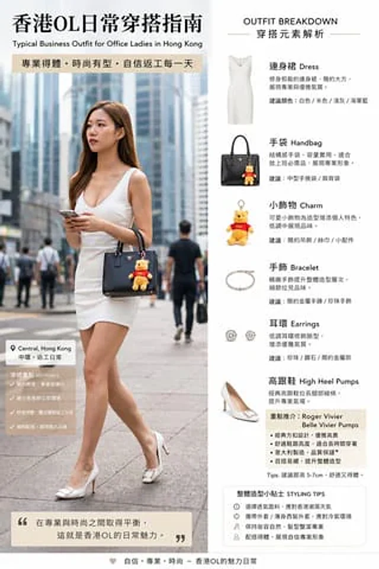

```text
{
  "type": "Fashion infographic poster",
  "topic": "Hong Kong Office Women's Daily Outfit Guide",
  "style": "The layout is clean and sophisticated, combining authentic fashion photography with product labeling, featuring a minimalist beige and white color scheme, clear Chinese fonts, and a modern magazine aesthetic.",
  "canvas": {
    "orientation": "Vertical",
    "aspect_ratio": "2:3",
    "background": "The layout is divided into left and right sections. The left side displays full-height street photography, while the right side displays a light beige infographic panel."
  },
  "text": {
    "main_title": "{argument name=\"headline text\" default=\"Hong Kong Office Women&#39;s Daily Outfit Guide\"}",
    "subtitle": "Typical business attire for women in Hong Kong offices",
    "tagline": "Professional and poised, stylish and confident, working every day.",
    "bottom_caption": "Confidence, Professionalism, and Style – The Charming Daily Life of Hong Kong Office Women",
    "quote": "{argument name=\"quote\" default=\"The everyday charm of Hong Kong office women lies in striking a balance between professionalism and style.\"}"
  },
  "subject": {
    "gender_presentation": "woman",
    "role": "Hong Kong office women",
    "full_body": true,
    "face": "Deliberately obscure or anonymize",
    "hair": {
      "color": "Dark brown",
      "style": "Long, straight hair, parted to the side, smooth and slightly tucked behind the ear."
    },
    "pose": "Walking confidently on the city sidewalk, smartphone in both hands, one foot forward.",
    "expression": "Neutral, composed, professional",
    "outfit": {
      "dress": {
        "type": "sleeveless fitted dress",
        "color": "{argument name=\"dress color\" default=\"White\"}",
        "length": "Above the knee",
        "neckline": "Deep round neck",
        "fit": "Body-fitting cut"
      },
      "bag": {
        "type": "Structured black leather handbag",
        "carry": "Wrapped on forearm",
        "details": "The top handle has a small triangular logo and a teddy bear charm wearing a red shirt."
      },
      "bracelet": {
        "type": "Fine silver bracelet",
        "wrist": "Left arm"
      },
      "earrings": {
        "type": "Small round stud earrings",
        "metal": "silver"
      },
      "shoes": {
        "type": "Pointed-toe high heels",
        "color": "White",
        "details": "Low-top design with a square buckle on the toe."
      },
      "phone": {
        "type": "smartphones",
        "color": "silver or gray"
      }
    },
    "location": {
      "city": "Central, Hong Kong",
      "setting": "The bustling downtown business district, with pedestrians and towering glass office buildings in the background, is rendered with a soft, blurred effect."
    }
  },
  "layout": {
    "sections": [
      {
        "title": "Outfit Element Analysis OUTFIT BREAKDOWN",
        "position": "Top right corner",
        "count": 6,
        "labels": [
          "dress",
          "Gloves Handbag",
          "Charm pendant",
          "Bracelet",
          "Earrings",
          "High Heel Pumps"
        ]
      },
      {
        "title": "Key Points for Outfit",
        "position": "Overlay in the bottom left corner",
        "count": 4,
        "labels": [
          "Simple and clean lines, exuding professionalism.",
          "Suitable for Hong Kong office environment",
          "Comfortable and appropriate for daily commutes",
          "Details and matching showcase personal taste"
        ]
      },
      {
        "title": "Styling Tips",
        "position": "bottom right corner",
        "count": 4,
        "labels": [
          "Choose breathable fabrics to cope with Hong Kong's humid weather.",
          "Bring a jacket/light blazer to cope with air-conditioned environments.",
          "Keep your makeup natural and your hairstyle neat and professional.",
          "Appropriate attire showcases a confident and professional image."
        ]
      }
    ],
    "left_panel": {
      "main_image": "Office women's full-body street style photos",
      "location_badge": "Hong Kong Central - Daily Work",
      "quote_box": "Beige quote panel with oversized quotation marks near the bottom"
    },
    "right_panel": {
      "product_list": "Six vertically stacked item labels, each accompanied by a separate product image next to its description.",
      "highlight_box": "The beige recommendation box below the high heels section",
      "tips_box": "Suggested rounded rectangle shape at the bottom"
    }
  },
  "items": [
    {
      "name": "dress",
      "image": "Sleeveless white fitted dress against a solid color background",
      "description": "The fitted dress is simple and elegant, showcasing a professional and graceful demeanor.",
      "recommendation": "Suggested colors: White/Beige/Light Gray/Navy Blue"
    },
    {
      "name": "Gloves Handbag",
      "image": "Black structured handbag with teddy bear charm",
      "description": "This structured handbag offers practical storage space, perfect for carrying essential work items and projecting a professional image.",
      "recommendation": "Recommendation: Medium-sized handbag/shoulder bag"
    },
    {
      "name": "Charm pendant",
      "image": "Yellow teddy bear keychain wearing a red shirt",
      "description": "Cute little pendants add a personal touch to an outfit, showcasing taste in a subtle way.",
      "recommendation": "Suggestions: Simple pendant/scarf/small accessories"
    },
    {
      "name": "Bracelet",
      "image": "Fine silver bracelet",
      "description": "An exquisite bracelet elevates the overall look, while its details showcase refined taste.",
      "recommendation": "Recommendation: Simple metal bracelets/pearl jewelry"
    },
    {
      "name": "Earrings",
      "image": "A pair of small round stud silver earrings",
      "description": "Understated earrings can flatter your face shape and add an elegant touch.",
      "recommendation": "Recommendation: Pearl/Diamond/Simple Metal Style"
    },
    {
      "name": "High Heel Pumps",
      "image": "White pointed-toe high heels with decorative buckles",
      "description": "Stiletto heels elongate the leg line and enhance a professional aura.",
      "recommendation_title": "Highly recommended: Roger Vivier Belle Vivier Pumps",
      "recommendation_points": [
        "Classic square buckle design, elegant and noble",
        "Comfortable heel height, suitable for long-term wear.",
        "Made in Italy, quality guaranteed.",
        "Versatile and easy to match, enhances the overall look"
      ],
      "footnote": "Tip: A heel height of 5-7cm is recommended for both comfort and style."
    }
  ],
  "visual_notes": "It uses clear and easy-to-read simplified Chinese, realistic product cutouts, soft natural sunlight, professional commercial retouching, subtle shadows, balanced spacing, and a luxurious yet practical office style.",
  "parameters": [
    "{argument name=\"headline text\" default=\"Hong Kong Office Women&#39;s Daily Outfit Guide\"}",
    "{argument name=\"quote\" default=\"The everyday charm of Hong Kong office women lies in striking a balance between professionalism and style.\"}",
    "{argument name=\"dress color\" default=\"White\"}",
    "{argument name=\"bag color\" default=\"black\"}",
    "{argument name=\"city\" default=\"Central, Hong Kong\"}"
  ]
}
```

Model: GPT Image 2
Author: GPT Image 2 Prompts

[ProjectD](https://aitoolsradar.com/en/prompts/2b866db1bab361) · [Recorded source](https://x.com/desds1678/status/2046602618269733010#reversed-0)
 · [Full original metadata and byte evidence](data/projectd-batch-0033.json)

## Hooded Rogue with Blurred Face

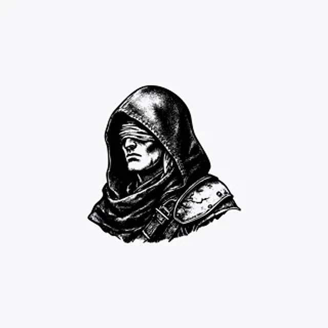

```text
A minimalist fantasy character portrait, centered on a pure light gray background, presenting a black and white ink-wash illustration style half-body hooded figure. The character is dressed in dark, heavy clothing.{argument name="cloak color" default="black"} The hood and scarf-like head covering tightly envelop the head and neck, with rich folds and strong shadow effects. The face is covered by a featureless rectangular blur or occlusion block with soft edges and a vertical orientation, located where the face should be under the hood. The character wears a worn medieval shoulder armor on the right shoulder, made of light metal, with obvious scratches, cracks, rivets, and dark edges, and is connected to the chest by a leather strap and buckle. The entire character is rendered in high-contrast monochrome, using dense pointillism and sculptural textures, full of a rough fantasy RPG concept art feel. There are no visible eyes or skin, no additional props, no scene elements, leaving a lot of negative space, and the composition is simple and centered.
```

Model: GPT Image 2
Author: GPT Image 2 Prompts

[ProjectD](https://aitoolsradar.com/en/prompts/17cbb3b6c640fc) · [Recorded source](https://x.com/ethanhaveron/status/2046975968355512829#reversed-1)
 · [Full original metadata and byte evidence](data/projectd-batch-0033.json)

## Hopelessly Cluttered Desktop Screen

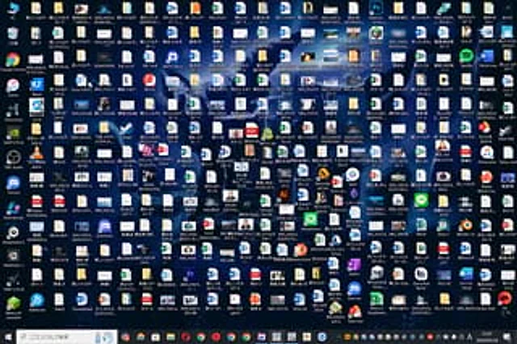

```text
One{argument name="subject" default="Computer desktop"} The picture shows{argument name="condition" default="An extremely chaotic and hopeless state"}
```

Model: GPT Image 2
Author: GPT Image 2 Prompts

[ProjectD](https://aitoolsradar.com/en/prompts/b58cfcb9ff2a6b) · [Recorded source](https://x.com/Masimo_Blue/status/2046864143798739102)
 · [Full original metadata and byte evidence](data/projectd-batch-0033.json)

## Horror Anime Movie Poster

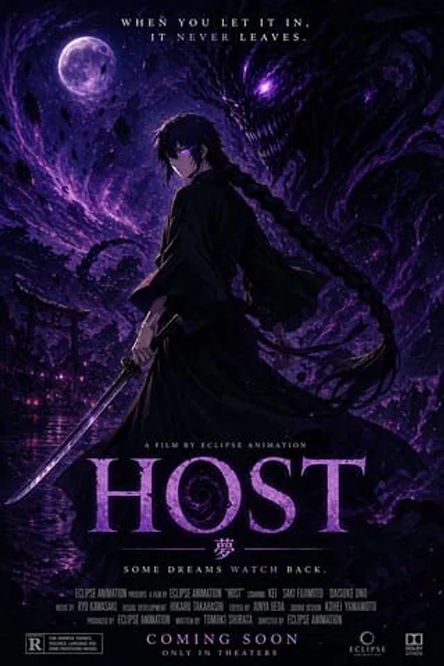

```text
Create a movie poster of cinematic quality for use{argument name="genre" default="anime horror"} Movie"{argument name="title" default="HOST"} Please use this image as a reference.
```

Model: GPT Image 2
Author: GPT Image 2 Prompts

[ProjectD](https://aitoolsradar.com/en/prompts/1177e456828564) · [Recorded source](https://x.com/smoermeow/status/2046694544297664799)
 · [Full original metadata and byte evidence](data/projectd-batch-0033.json)

## Howard Chen ✦ #136

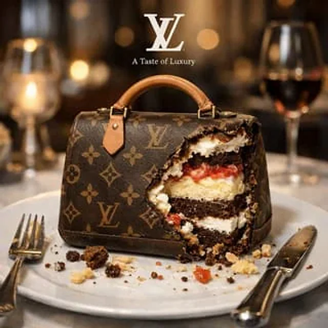

```text
A bitten realistic classic [brand] product on the dish, revealed inner dessert layers, and there are cake crumbs near, finished fork and knife near by, against blurry high end restaurant background, white small logo on top of background, beneath the logo, there is a tiny brand slogan that suit this scene.
```

Model: GPT Image 2
Author: Howard Chen ✦

[ProjectD](https://aitoolsradar.com/en/prompts/c0f16bc0a5726e) · [Recorded source](https://x.com/hc_dsn/status/2003072041889800346)
 · [Full original metadata and byte evidence](data/projectd-batch-0033.json)

## Humanity's Last Day X Timeline


```text
{argument name="theme" default="Screenshot of the timeline from The Last Day X of Humanity"}
```

Model: GPT Image 2
Author: GPT Image 2 Prompts

[ProjectD](https://aitoolsradar.com/en/prompts/6978c81f5a25e9) · [Recorded source](https://x.com/momimu_ai/status/2046616199153516835)
 · [Full original metadata and byte evidence](data/projectd-batch-0033.json)

## Humanoid Robot Keynote Reveal


```text
{argument name="company" default="Google"} The first commercial{argument name="product" default="humanoid robot"} What will it look like? Show it to us.{argument name="event" default="Keynote speech"} The scene of the unveiling.
```

Model: GPT Image 2
Author: GPT Image 2 Prompts

[ProjectD](https://aitoolsradar.com/en/prompts/12200735c645c8) · [Recorded source](https://x.com/patrickassale/status/2044702346152661150)
 · [Full original metadata and byte evidence](data/projectd-batch-0033.json)

## Humorous Temple Signboard with Goofy Monk


```text
{
  "type": "Photorealistic scenes with cartoon illustrations on signs",
  "setting": "{argument name=\"setting\" default=\"Traditional Japanese temple gardens with gravel and stone walls\"}",
  "subjects": [
    {
      "type": "figure",
      "description": "A bald Japanese Buddhist monk, dressed in a traditional dark robe and brown tassels.",
      "pose": "{argument name=\"monk pose\" default=\"Making funny poses: standing on one leg, leaning back, pointing at a sign, and sticking out his tongue.\"}"
    },
    {
      "type": "wooden notice board",
      "description": "A large wooden signboard with a red inner border, featuring a title at the top and a 3x3 grid of 9 illustrated panels at the bottom.",
      "header": {
        "text": "{argument name=\"header text\" default=\"The delightful teachings of the temple\"}",
        "background": "yellow"
      },
      "grid_panels": [
        {
          "position": "Row 1, Column 1",
          "text": "{argument name=\"panel 1 text\" default=\"ズボンはチャックをチェック\"}",
          "illustration": "Blue jeans with red accent stitching at the zipper"
        },
        {
          "position": "Row 1, Column 2",
          "text": "Even if you talk to a cat, it will just ignore you.",
          "illustration": "A gray and white cat sitting and looking away."
        },
        {
          "position": "Row 1, Column 3",
          "text": "Be careful not to remove too much lint from your belly button.",
          "illustration": "Close-up of two thumbs pointing to the navel"
        },
        {
          "position": "Row 2, Column 1",
          "text": "The second time you sleep in, it feels great.",
          "illustration": "A person is sleeping peacefully under a pink blanket."
        },
        {
          "position": "Row 2, Column 2",
          "text": "You can't hear snoring when you're asleep.",
          "illustration": "A person is sleeping and snoring, with Zzz symbols."
        },
        {
          "position": "Row 2, Column 3",
          "text": "Once you open a bag of potato chips, you can't stop eating them.",
          "illustration": "A bag of potato chips that was opened and spilled"
        },
        {
          "position": "Row 3, Column 1",
          "text": "I was surprised when the toilet seat was cold.",
          "illustration": "A person stood beside the open toilet with a shocked expression."
        },
        {
          "position": "Row 3, Column 2",
          "text": "I'm in a tight spot at the end of the month and will be in a tight spot next month too.",
          "illustration": "An empty brown wallet with a yellow lightning bolt pattern"
        },
        {
          "position": "Row 3, Column 3",
          "text": "{argument name=\"panel 9 text\" default=\"I&#39;ll start my diet tomorrow...\"}",
          "illustration": "A cartoon bald monk is happily eating a large hamburger."
        }
      ]
    }
  ]
}
```

Model: GPT Image 2
Author: GPT Image 2 Prompts

[ProjectD](https://aitoolsradar.com/en/prompts/a571c07661540c) · [Recorded source](https://x.com/notargs/status/2043741751731769649#reversed-0)
 · [Full original metadata and byte evidence](data/projectd-batch-0033.json)

## Hyper Realistic FIFA Football Poster


```text
Design a hyper-realistic {argument name="event" default="FIFA 2026"} football poster inspired by premium sports editorial photography and minimalist World Cup branding.

Create a centered composition of a football player sitting confidently on a geometric block inside a clean
```

Model: GPT Image 2
Author: PhotoGPT

[ProjectD](https://aitoolsradar.com/en/prompts/a7a6156a67240a) · [Recorded source](https://youmind.com/prompts/fifa-2026-football-poster-22737)
 · [Full original metadata and byte evidence](data/projectd-batch-0033.json)

## Hyper-Energetic Japanese Promo Poster


```text
{
  "type": "Japanese-style promotional landing page poster",
  "style": "High-energy, explosive layout, vibrant colors, amusement park nighttime celebration aesthetic",
  "layout": {
    "top_section": {
      "background": "Night sky, fireworks, Ferris wheel, roller coaster",
      "subjects": "Four young people cheer, pump their fists, and there are dynamic light and shadow effects.",
      "typography": [
        "{argument name=\"main headline\" default=\"Ultimate joy!!\"}",
        "{argument name=\"sub headline\" default=\"That&#39;s fantastic!! I hope it resonates with everyone!!\"}",
        "This poster will completely reshape your amazing life!!"
      ],
      "badges": [
        "Cumulative sales exceeded{argument name=\"sales badge\" default=\"252,000\"} open!!!"
      ]
    },
    "middle_section": {
      "title": "5 Amazing Highlights for Ultimate Enjoyment",
      "points_count": 5,
      "points": [
        {
          "number": 1,
          "label": "Hilarious Awakening",
          "image": "People laughed."
        },
        {
          "number": 2,
          "label": "Heartbeat MAX",
          "image": "roller coaster track"
        },
        {
          "number": 3,
          "label": "A Whirlpool of Emotion",
          "image": "Fireworks explosion"
        },
        {
          "number": 4,
          "label": "Super-liberated areas",
          "image": "Silhouettes leaping in the sunset"
        },
        {
          "number": 5,
          "label": "Infinite loop",
          "image": "The crowd cheered"
        }
      ]
    },
    "bonus_section": {
      "title": "Limited-time offer! Includes 5 deluxe bonus gifts!!!",
      "items_count": 5,
      "items": [
        "① Limited Design Poster",
        "② A Handbook of Famous Quotes on Happiness (PDF)",
        "③ Super Happy Playlist (MP3)",
        "④ Mobile wallpaper sets",
        "⑤ The Secret of Happiness"
      ]
    },
    "bottom_section": {
      "product_info": {
        "name": "Ultimate Happiness Poster",
        "variants_count": 3,
        "variants": [
          "Full Power Unlocked Version",
          "Smile Explosion Version",
          "The ultimate moving version"
        ]
      },
      "pricing": {
        "label": "Soul pricing",
        "amount": "{argument name=\"price\" default=\"¥2,980\"}",
        "shipping": "Free shipping"
      }
    },
    "footer": {
      "text": "{argument name=\"footer call to action\" default=\"Enjoy the ultimate life to the fullest!! Get yours now!!\"}",
      "background_color": "Magenta"
    }
  }
}
```

Model: GPT Image 2
Author: GPT Image 2 Prompts

[ProjectD](https://aitoolsradar.com/en/prompts/44b583f5835100) · [Recorded source](https://x.com/nakazakifam/status/2046295223584862235#reversed-3)
 · [Full original metadata and byte evidence](data/projectd-batch-0033.json)

## Hyper-Realistic Commercial Soda Can Advertisement


```text
A hyper-realistic commercial advertising photograph of a giant {argument name="beverage brand" default="Coca-Cola"} can displayed inside a modern supermarket aisle, featuring a professionally dressed young {argument name="person" default="businessman"} emerging from the front of the can as if integrated into the packaging design. The man has neatly styled black hair, a warm confident smile, and wears a tailored charcoal-gray suit, crisp white dress shirt, and {argument name="tie color" default="deep red"} tie. He is holding a highly detailed golden FIFA World Cup trophy with both hands. The enormous Coca-Cola can is covered in realistic condensation droplets, vibrant red branding, elegant gold ribbon graphics, and a FIFA World Cup 2026 emblem. Multiple Coca-Cola cans fill the background shelves, creating depth and brand repetition.

Shot with a full-frame professional camera, 85mm lens, eye-level perspective, shallow depth of field, cinematic supermarket lighting, ultra-sharp focus on the subject and trophy, natural skin texture, realistic reflections on metallic surfaces, accurate shadows, glossy aluminum can material, photorealistic water droplets, premium advertising composition, HDR, global illumination, ray-traced reflections, volumetric lighting, bokeh background, extreme detail, magazine-quality product photography, commercial branding aesthetic, vivid colors, high contrast, realistic supermarket environment, flawless facial features, ultra-detailed textures, award-winning advertising campaign style.

8K UHD, hyper-realistic, photorealistic, masterpiece, ultra-detailed, maximum clarity, professional color grading, studio-quality lighting, sharp focus, realistic proportions, cinematic depth, luxury commercial advertisement, vertical composition (4:5 aspect ratio).
```

Model: GPT Image 2
Author: Zyro

[ProjectD](https://aitoolsradar.com/en/prompts/43c1358f243302) · [Recorded source](https://youmind.com/prompts/supermarket-beverage-advertisement-26207)
 · [Full original metadata and byte evidence](data/projectd-batch-0033.json)

## Hyper-realistic Fashion Poster


```text
Create a hyper-realistic{argument name="poster type" default="Fashion Poster"} , used for "{argument name="brand" default="SPLASH"} "The brand's image must include the same girl from the reference image (ensuring 100% facial similarity). She confidently sits in a fluid-style 3D environment with water splash effects and a glossy finish."{argument name="brand" default="SPLASH"} On the logo. One leg relaxed, the other bent, striking a strong magazine-style pose. The background is filled with huge, bold "SPLASH" lettering, partly behind her. A small tagline adds: "Own Your Style." Clothing: Modern black streetwear (blazer, fitted top, trousers, sneakers). Lighting: Cinematic studio lighting, soft main light + rim light, with reflective highlights on the fluid logo. Style: Luxury brand advertising (Zara/H&amp;M), clean and glossy environment. Camera: 85mm lens, shallow depth of field, 8K, ultra-detailed, photorealistic.
```

Model: GPT Image 2
Author: GPT Image 2 Prompts

[ProjectD](https://aitoolsradar.com/en/prompts/2cfbce8daa87e8) · [Recorded source](https://x.com/miratechtool/status/2047780974709346606)
 · [Full original metadata and byte evidence](data/projectd-batch-0033.json)

## Hyper-Realistic Scriptural Deity Depiction


```text
based on{argument name="character" default="Guanyin Bodhisattva"} The classic literature description faithfully reproduces an extremely realistic image.{argument name="character" default="Guanyin Bodhisattva"} The photos strive for realism in terms of skin and clothing textures, and present them in a realistic manner.{argument name="image quality" default="iPhone 15 pro"} Level of image quality.
```

Model: GPT Image 2
Author: GPT Image 2 Prompts

[ProjectD](https://aitoolsradar.com/en/prompts/3db766716f672f) · [Recorded source](https://x.com/Zhaoge01/status/2047123570485260753)
 · [Full original metadata and byte evidence](data/projectd-batch-0033.json)

## Hyper-realistic Surreal Poster Design Prompt


```text
type:{argument name="genre" default="Hamburger"} Brand Name:{argument name="brand name" default="Kashiko"} Based on this image, generate a poster with photorealistic quality, whose concept must completely defy common sense and be unique in the real world. Don't just make simple extensions; let your creativity soar to a level that is "logically plausible, but utterly insane to interpret." [Absolute Conditions] - Photorealistic representation (restoring textures, atmosphere, and even light particles like in a real photograph) - All text must be in Japanese [Exaggerated/Enhanced Elements] ■ Typography - Characters themselves are materialized or phenomenalized - The font interacts physically with the theme ■ Typography - Ignoring conventional layouts, placing the text within the space itself - A layout with extremely strong visual guidance ■ Composition - Unrealistic perspective, extremely wide angles, distortion, and disproportionate effects - Clear foreground, midground, and background layers with extremely high information density - A core element that instantly grabs attention + countless subtle oddities in the details ■ Lighting - Cinematic lighting effects - Strong backlighting, rim lighting, neon lights, particle lighting, volumetric lighting - Light itself has meaning (serving as guidance or emphasis) ■ Slogans - Short, strong Japanese phrases, logically coherent but difficult to fully understand - The copywriting slightly deviates from the context, yet surprisingly fits [Additional Effects] - A sense of incongruity where reality and unreality coexist - The image partially defies the laws of physics – achieving professional-grade advertising quality. Ultimately, the goal is to create a poster that is "understandable yet beyond imagination," compelling viewers to revisit it. If the reference image is a character, please depict actions such as wearing, using, or attempting to consume the brand. Do not use any real brand logos, company names, or personal names; ensure complete originality. Ensure the final product contains no elements from the real world. Suppress noise or imbalance caused by excessive detail, maintaining overall visual unity and a sophisticated feel.
```

Model: GPT Image 2
Author: GPT Image 2 Prompts

[ProjectD](https://aitoolsradar.com/en/prompts/a8400564fe5db2) · [Recorded source](https://x.com/Kashiko_AIart/status/2047290000623174075)
 · [Full original metadata and byte evidence](data/projectd-batch-0033.json)

## Hypercar Parked Before a Historic Landmark


```text
A photographic-quality car shot showcasing a stylish, glossy black car parked in a cobblestone square.{argument name="car model" default="Bugatti Chiron"} This supercar features the iconic horseshoe grille and red emblem, bright square LED headlights, black alloy wheels, and eye-catching details.{argument name="brake caliper color" default="blue"} Brake calipers. Their highly reflective surfaces reflect the surrounding environment. In the background stands the magnificent Parisian skyline.{argument name="landmark" default="Notre-Dame Cathedral"} It showcases its complex Gothic architectural style, twin towers, central rose window, and arched entrance. To the left, classic Parisian apartment buildings are visible, while to the right, rows of ornate vintage streetlights line the street. In the distance, several pedestrians walk {argument name="weather/sky" default="overcast"} Under the sky. The image was taken from a slightly low angle to emphasize the car's aggressive aerodynamic stance.
```

Model: GPT Image 2
Author: GPT Image 2 Prompts

[ProjectD](https://aitoolsradar.com/en/prompts/44d0c1bea84c77) · [Recorded source](https://x.com/AlwaveNazca/status/2044795046503792987#reversed-3)
 · [Full original metadata and byte evidence](data/projectd-batch-0033.json)

## Hypercar Parked Before a Historic Landmark


```text
A photorealistic, high-resolution image showcases a glossy, high-quality vehicle.{argument name="car model" default="Black Bugatti Chiron"} Parked on a cobblestone square, the supercar is angled slightly, showcasing its sleek aerodynamic curves, distinctive horseshoe-shaped front grille, quad LED headlights, black alloy wheels, and bright blue brake calipers. The car's highly reflective paint reflects its surroundings. In the background stands a magnificent {argument name="background landmark" default="Notre Dame Cathedral"} The cathedral showcases its intricate Gothic architectural style, enormous rose windows, and twin towers. The scene is set in {argument name="lighting and weather" default="cloudy daytime"} The light provided soft, diffused natural light. A few pedestrians strolled leisurely in the background, and ornate, vintage Parisian streetlights could be seen on the right side of the square, adding to the rich European urban atmosphere.
```

Model: GPT Image 2
Author: GPT Image 2 Prompts

[ProjectD](https://aitoolsradar.com/en/prompts/bafa10207722bf) · [Recorded source](https://x.com/AlwaveNazca/status/2045404499066384847#reversed-2)
 · [Full original metadata and byte evidence](data/projectd-batch-0033.json)

## Hypothetical News Homepage


```text
{argument name="event" default="GPT-Image-2 Released"} That day{argument name="website" default="Reddit"} Screenshot of the homepage
```

Model: GPT Image 2
Author: GPT Image 2 Prompts

[ProjectD](https://aitoolsradar.com/en/prompts/2b574f39ca0f34) · [Recorded source](https://x.com/venturetwins/status/2046640513298931815)
 · [Full original metadata and byte evidence](data/projectd-batch-0033.json)

## ICLR-style method figure


```text
Create a polished ICLR-style Figure 1 for an imaginary method called "Hierarchical Memory Routing for Long-Context Multimodal Reasoning (HMR)". The top band shows the failure mode of naive long-context multimodal processing: one overcrowded horizontal token stream mixing text, image patches, retrieved documents, tool traces, and audio snippets, with red-orange warning accents for interference, attention dilution, memory collision, and quadratic compute cost. A clean horizontal divider separates the main lower panel, which presents the HMR framework as a spacious modular loop. Center: a Reasoning Controller with stages Observe_t to Update_t. Left: a three-level Memory Hierarchy with working cache, episodic memory, and semantic knowledge base. Right: Multimodal Streams entering selectively through routing paths. Bottom right: sparse experts activated only when needed. White background, vector-clean styling, neutral gray plus cool accents, minimal but legible labels, conference-paper clarity, no poster aesthetics.
```

Model: GPT Image 2
Author: @xiaohongshu-community

[ProjectD](https://aitoolsradar.com/en/prompts/8cc480fec22e57) · [Recorded source](https://www.xiaohongshu.com/explore/69d396140000000023012282)
 · [Full original metadata and byte evidence](data/projectd-batch-0033.json)

## Identical Baseball Players Lineup


```text
A striking sports photograph shows five identical young Asian men standing in a neat row. They all have buzz cuts and wear {argument name="uniform style" default="White baseball jersey with thin dark stripes"} Navy blue inner layer and black belt. Their chests feature navy blue lettering in an arc shape.{argument name="team name" default="KANAKO"} The lettering is outlined in gold. They stand at attention, hands behind their backs, all slightly turned to the left, their expressions serious. The background is {argument name="background" default="Blurry green stadium stands"} It shows a baseball field scene under bright sunlight.
```

Model: GPT Image 2
Author: GPT Image 2 Prompts

[ProjectD](https://aitoolsradar.com/en/prompts/8c317e6e1ee6bc) · [Recorded source](https://x.com/hosiken/status/2046111712009720205#reversed-0)
 · [Full original metadata and byte evidence](data/projectd-batch-0033.json)

## Idol Costume Design Sheet


```text
{
  "type": "Anime costume design reference images",
  "document_info": {
    "title": "{argument name=\"document title\" default=\"Lumière Noir\"}",
    "subtitle": "{argument name=\"document subtitle\" default=\"Costume design diagram\"}",
    "theme": "{argument name=\"costume description\" default=\"Classic black and white school idol uniform\"}"
  },
  "layout": {
    "sections": [
      {
        "title": "Overall Design",
        "position": "top-center",
        "count": 3,
        "labels": [
          "front",
          "side",
          "back"
        ],
        "description": "Full-body anime girl ({argument name=\"character model name\" default=\"M2 Touka Ichinose\"} Clothing Showcase"
      },
      {
        "title": "Color scheme / Material",
        "position": "mid-left",
        "count": 8,
        "labels": [
          "White",
          "silver",
          "Charcoal gray",
          "black",
          "coat",
          "skirt",
          "lace",
          "ribbon"
        ],
        "description": "4 round color swatches ({argument name=\"color palette\" default=\"White, Silver, Charcoal Gray, Black\"} ) and 4 square fabric texture samples"
      },
      {
        "title": "Outline and Design Concept",
        "position": "bottom-left",
        "count": 3,
        "description": "Outline sketches of the front, side, and back of the garment"
      },
      {
        "title": "Detail magnification",
        "position": "top-inner-right",
        "count": 6,
        "labels": [
          "Neckline and ribbon",
          "Chest badge",
          "Coat buttons",
          "cuff design",
          "Skirt fabric and pattern",
          "Waist ribbon (back)"
        ],
        "description": "Close-up detail panel of clothing parts"
      },
      {
        "title": "Accessories/Hair Accessories",
        "position": "top-outer-right",
        "count": 4,
        "description": "Illustrations of 4 different hair accessories"
      },
      {
        "title": "Shoes and socks",
        "position": "mid-outer-right",
        "count": 2,
        "description": "Illustration of black lace-up shoes and white ruffled socks"
      },
      {
        "title": "Member-specific hair accessories - key points",
        "position": "bottom-center",
        "count": 5,
        "labels": [
          "M1 Kirishima Rei",
          "M2 Ichinose Touka",
          "M3 Shirase Shinju",
          "M4 Amou Mikoto",
          "M5 Rena Kujo"
        ],
        "description": "Five busts of different anime girls, showcasing their unique hairstyles and accessories."
      },
      {
        "title": "Costume Design Notes &amp; Reference Images",
        "position": "bottom-right",
        "count": 4,
        "description": "Text notes and 4 small reference photos on Gothic architecture and fabric details."
      }
    ]
  }
}
```

Model: GPT Image 2
Author: GPT Image 2 Prompts

[ProjectD](https://aitoolsradar.com/en/prompts/62d3886bfdcd71) · [Recorded source](https://x.com/wtry1102/status/2045020608770224419#reversed-0)
 · [Full original metadata and byte evidence](data/projectd-batch-0033.json)

## Idol Maid Polaroid Collection


```text
{
  "type": "Polaroid photo collection",
  "setting": "Lay flat on white fabric surface",
  "character": {
    "hair": "{argument name=\"hair color\" default=\"Long pink hair with blue inside.\"}",
    "outfit": "{argument name=\"outfit\" default=\"Black and white maid outfit, with ruffled headband and black ribbon\"}",
    "eyes": "pink"
  },
  "layout": {
    "arrangement": "Two rows of five Polaroid photos arranged",
    "count": 10,
    "photos": [
      {
        "position": "Page 1 of the first row",
        "description": "Hugging a pink heart-shaped cushion"
      },
      {
        "position": "Page 2 of the first row",
        "description": "wink, make a peace sign"
      },
      {
        "position": "Page 3 of the first row",
        "description": "Heart shape with pink heart-shaped graffiti at the bottom border."
      },
      {
        "position": "Page 4 of the first row",
        "description": "hands supporting her chin, a gentle smile"
      },
      {
        "position": "Page 5 of the first row",
        "description": "Holding a red rose, winking"
      },
      {
        "position": "Page 1 of the second row",
        "description": "Fingers to lips, a shy expression"
      },
      {
        "position": "Second row, second page",
        "description": "Holding a small pink cake"
      },
      {
        "position": "Page 3 of the second row",
        "description": "Blink, hand to face, signature on the border.{argument name=\"signature text\" default=\"Hanashi\"} 'and heart-shaped graffiti"
      },
      {
        "position": "Page 4 of the second row",
        "description": "Holding a pink bunny doll, with glittery graffiti and a signature on the border.{argument name=\"signature text\" default=\"Hanashi\"} 'And rabbit doodles'"
      },
      {
        "position": "Page 5 of the second row",
        "description": "Blink, flashing graffiti, a message on the border.{argument name=\"message text\" default=\"Thank you for your continued support! I look forward to your continued support in the future♪\"} 'and signature'{argument name=\"signature text\" default=\"Hanashi\"} '"
      }
    ]
  }
}
```

Model: GPT Image 2
Author: GPT Image 2 Prompts

[ProjectD](https://aitoolsradar.com/en/prompts/d26a1437fdcfc5) · [Recorded source](https://x.com/anemone_sd/status/2046251166636622216#reversed-3)
 · [Full original metadata and byte evidence](data/projectd-batch-0033.json)

## Idol Unit Concept Reference Sheet


```text
{
  "type": "Idol Group Setting Collection",
  "unit_details": {
    "name": "{argument name=\"unit name\" default=\"Lumière Noir\"}",
    "concept": "{argument name=\"unit style\" default=\"Classical x Academic x Monochromatic\"}",
    "catchphrase": "{argument name=\"catchphrase\" default=\"In the space between black and white, emotions become song.\"}",
    "uniform": "{argument name=\"uniform description\" default=\"White fitted blazer, black silk bow tie, black and gray plaid layered skirt\"}"
  },
  "layout": {
    "left_sidebar": {
      "sections": [
        "Combined Logo and Title",
        "Illustrations by a group of 5 people",
        "Combined concept copywriting",
        "General visual specifications",
        "Combined Information Table",
        "Combination relationship diagram containing one pentagonal network diagram"
      ]
    },
    "main_content": {
      "title": "Member Profile",
      "columns": 5,
      "shared_elements_per_column": [
        "Member ID (M1 to M5) and Name",
        "3 descriptive keywords",
        "Representative colors and theme elements",
        "Two full-body views (front and back).",
        "Two headshots (front and side view)",
        "Personal Attribute Table",
        "Character Setting Description",
        "Stage positioning copywriting",
        "Instructions",
        "1 Keyword Atmosphere Image"
      ],
      "members": [
        {
          "id": "M1",
          "hair": "Black short hair",
          "color": "silver-gray"
        },
        {
          "id": "M2",
          "hair": "Long, straight black hair",
          "color": "White Navy Blue"
        },
        {
          "id": "M3",
          "hair": "Black short bob haircut",
          "color": "Pearl purple-red"
        },
        {
          "id": "M4",
          "hair": "Black twin tails",
          "color": "milky"
        },
        {
          "id": "M5",
          "hair": "Long black curly hair",
          "color": "Smoke Black"
        }
      ]
    },
    "middle_inserts": {
      "visual_key": "A full-body model with labels for 5 uniform parts.",
      "hair_and_accessory": "3 accessory illustrations",
      "color_palette": "5 color swatches"
    },
    "bottom_footer": {
      "sections": [
        "Suitable music",
        "promotional slogans",
        "A combination image containing 3 small mood board photos",
        "Design Description"
      ]
    }
  }
}
```

Model: GPT Image 2
Author: GPT Image 2 Prompts

[ProjectD](https://aitoolsradar.com/en/prompts/6b7f5157c8ca1c) · [Recorded source](https://x.com/wtry1102/status/2044984378250711306#reversed-0)
 · [Full original metadata and byte evidence](data/projectd-batch-0033.json)

## Idol Unit Concept Reference Sheet


```text
{
  "type": "idol unit setting material collection",
  "unit_details": {
    "name": "{argument name=\"unit name\" default=\"Lumière Noir\"}",
    "concept": "{argument name=\"unit style\" default=\"Classical x Academic x Monotone\"}",
    "catchphrase": "{argument name=\"catchphrase\" default=\"白と黒のあわいで、感情は歌になる。\"}",
    "uniform": "{argument name=\"uniform description\" default=\"white tailored jacket, black ribbon tie, black and grey tiered check skirt\"}"
  },
  "layout": {
    "left_sidebar": {
      "sections": [
        "Unit Logo and Title",
        "Group Illustration featuring 5 members",
        "Group Concept Text",
        "Common Visual Specifications",
        "Group Information Table",
        "Group Relationship Diagram with 1 pentagon network"
      ]
    },
    "main_content": {
      "title": "MEMBER PROFILE",
      "columns": 5,
      "shared_elements_per_column": [
        "Member ID (M1 to M5) and Name",
        "3 descriptive keywords",
        "Image Color and Motif",
        "2 full-body views (front and back)",
        "2 headshots (front and side)",
        "Profile Stats Table",
        "Character Setting Text",
        "Stage Role Text",
        "Direction Text",
        "1 Keyword Mood Image"
      ],
      "members": [
        { "id": "M1", "hair": "short black hair", "color": "silver-gray" },
        { "id": "M2", "hair": "long straight black hair", "color": "white-navy" },
        { "id": "M3", "hair": "short black bob", "color": "pearl-mauve" },
        { "id": "M4", "hair": "black twin tails", "color": "milky-white" },
        { "id": "M5", "hair": "long wavy black hair", "color": "smoky-black" }
      ]
    },
    "middle_inserts": {
      "visual_key": "1 full-body model with 5 callout labels for uniform parts",
      "hair_and_accessory": "3 accessory illustrations",
      "color_palette": "5 color swatches"
    },
    "bottom_footer": {
      "sections": [
        "SUITABLE MUSIC",
        "CATCH COPY",
        "UNIT IMAGE with 3 small mood board photos",
        "DESIGN NOTES"
      ]
    }
  }
}
```

Model: GPT Image 2
Author: WTR

[ProjectD](https://aitoolsradar.com/en/prompts/67ecb8de6fb62a) · [Recorded source](https://youmind.com/prompts/idol-unit-concept-reference-sheet-13941)
 · [Full original metadata and byte evidence](data/projectd-batch-0033.json)

## Idyllic Alpine Lake Village Landscape


```text
A stunning hyper-realistic landscape depicting{argument name="setting" default="Alpine lakeside village"} In the foreground, one{argument name="foreground element" default="Wooden dock with 1 empty bench"} Extending from the lower left corner into the clear blue lake, the left side is dotted with vibrant colors.{argument name="flower color" default="Bright pink and red"} Flowers bloom, and to the right, towering green reeds stretch out. The calm lake perfectly reflects the surrounding scenery, with a small red rowboat (on the left) and a white sailboat (on the right) floating on its surface. On the right bank, a picturesque European village nestles at the foot of lush green hills, boasting a prominent steeple church and traditional houses. In the background, towering {argument name="mountain type" default="Snow-capped jagged peaks"} exist{argument name="weather" default="Sunny weather with fluffy white clouds"} The view below is particularly spectacular. The overall lighting and shadow effects are striking, full of pastoral charm, and rich in detail.
```

Model: GPT Image 2
Author: GPT Image 2 Prompts

[ProjectD](https://aitoolsradar.com/en/prompts/1f6c91d94c0f6c) · [Recorded source](https://x.com/AINetworkTech/status/2045186369920897037#reversed-0)
 · [Full original metadata and byte evidence](data/projectd-batch-0033.json)

## Illustrated City Food Map


```text
{
  "type": "Hand-drawn map infographic",
  "style": "{argument name=\"art style\" default=\"Watercolor ink hand-drawn illustrations on vintage parchment\"}",
  "title_section": {
    "text": "{argument name=\"city name\" default=\"Chengdu\"} {argument name=\"map title\" default=\"Foodie Rampage Map\"}",
    "mascot": "A cartoon red pepper wearing sunglasses and giving a thumbs up"
  },
  "border": "{argument name=\"border decoration\" default=\"Green leaves and red chili vines\"}",
  "layout": {
    "background": "Textured beige parchment featuring yellow roads, blue rivers, and green park areas.",
    "sections": [
      {
        "title": "landmark buildings",
        "count": 6,
        "illustrations": [
          "Traditional pavilion",
          "traditional temples",
          "Modern skyscrapers with climbing pandas",
          "towering TV tower",
          "Traditional archway",
          "Industrial buildings"
        ],
        "labels": [
          "People's Park",
          "Monjuin Temple",
          "IFS",
          "339 TV Tower",
          "Kuanzhai Alley",
          "Eastern Suburbs Memory"
        ]
      },
      {
        "title": "Food locations",
        "count": 12,
        "illustrations": [
          "Mapo Tofu",
          "Spicy Dumplings",
          "Cold pot skewers",
          "Three Great Cannons",
          "Egg pancake",
          "Nine-square hot pot",
          "Fatty Intestine Noodles",
          "Bo Bo Chicken",
          "Instant Boiled Spicy Hot Pot",
          "Gaiwan tea",
          "Iced Jelly",
          "Rabbit head"
        ],
        "labels": [
          "1. Chen Mapo Tofu",
          "2. Zhong Dumplings",
          "3 Chunxi Road",
          "4. Kuanzhai Alley and the Three Great Cannons",
          "5. Jianshe Road - Grandma Ye's Egg Pancakes",
          "6 Yulin Road · Xiaolongkan Hot Pot",
          "7. Xiangxiang Lane - Fatty Intestine Rice Noodles",
          "8. Wuhouci Street - Bobo Chicken",
          "9. Dongjiao Memory - Spicy and Flaming",
          "10 People's Park · Heming Tea House",
          "11 Jinli Ancient Street - Iced Jelly",
          "12 Shuangliu Laoma Rabbit Head"
        ]
      },
      {
        "title": "legend",
        "position": "bottom right corner",
        "count": 5,
        "items": [
          "Red Dot",
          "Green building",
          "Green trees",
          "Blue line",
          "Yellow double lines"
        ],
        "labels": [
          "Food locations",
          "Landmark attractions",
          "parks and green spaces",
          "Rivers and lakes",
          "Main roads"
        ]
      }
    ],
    "centerpiece": "A giant panda sitting and eating bamboo",
    "bottom_right_extras": [
      "Retro compass with north, south, east, and west directions",
      "Disclaimer with red chili pepper icon: 'Friendly reminder: Eat spicy food with caution, protect your stomach~'"
    ]
  }
}
```

Model: GPT Image 2
Author: GPT Image 2 Prompts

[ProjectD](https://aitoolsradar.com/en/prompts/e5468923ef90c2) · [Recorded source](https://x.com/mm_zzm44854/status/2045861258520568230#reversed-1)
 · [Full original metadata and byte evidence](data/projectd-batch-0033.json)

## Illustrated Classic Car Magazine Cover


```text
A minimalist editorial magazine cover set against a cream-colored studio background, its design reminiscent of high-end automotive illustration magazines. The main title at the top is in a large, compressed blue sans-serif font, and the content is {argument name="magazine title" default="AUTO ICON"} Below it is a small subtitle, "THE ILLUSTRATED AUTOMOBILE MAGAZINE". In the upper right corner, there is a small blue issue number text.{argument name="issue date" default="May 2026"} Below it is a line of large blue numbers with thin underlines: "No. 128". At the center of the image is a beautiful classic car.{argument name="car model" default="Red Blue Chea Stratos"} The illustration, taken from a 45-degree left-side front view, depicts a low-slung, wedge-shaped car with a bright red paint job, a black roof spoiler, pop-up headlights, finely detailed air vents on the hood, a black grille, gold wheels, realistic tires, and delicate reflections and shadows on the ground. A slender, anime-style figure stands on the right side of the car.{argument name="companion character" default="Blue-haired girl"} A full-body portrait, facing a car to the left, featuring a soft blue bob haircut with a small ponytail at the back of the head. Facial details are minimalist. She wears a white long-sleeved top, light blue skirt, white socks, and blue sneakers, carrying a blue shoulder bag. Her pose is casual, with one arm bent close to her chest. The design employs a refined style combining soft cel-shaded anime illustrations with realistic car rendering, retaining ample white space and maintaining an elegant balance in the print layout. Two large lines of red Japanese text are added to the left side of the cover.{argument name="main cover line" default="Red Lancia Stratos"} Below is a small blue Japanese subtitle: “伝説のラリーカーを、イラストで楽しむ.” Another line of small blue text reads “特集/ CLASSIC SPORTS,” along with a handwritten light red note: “with blue-haired girl.” In the lower left corner are two small pieces of Japanese cover text and a realistic barcode with tiny issue number numbers. The overall aesthetic remains minimalist, refined, transparent, and poster-like, featuring soft sunlight and shadows and a high-end Japanese magazine cover composition.
```

Model: GPT Image 2
Author: GPT Image 2 Prompts

[ProjectD](https://aitoolsradar.com/en/prompts/2a7c6ca5d69397) · [Recorded source](https://x.com/etsuko256/status/2047802171916447978#reversed-0)
 · [Full original metadata and byte evidence](data/projectd-batch-0033.json)

## Image-to-Storyboard prompt


```text
Create{argument name="target" default="Movie poster"} Using this poster as a reference, as a section{argument name="duration" default="15 seconds"} Create a storyboard for a commercial advertisement.
```

Model: GPT Image 2
Author: GPT Image 2 Prompts

[ProjectD](https://aitoolsradar.com/en/prompts/f1dacacbf96ab8) · [Recorded source](https://x.com/50_ai_/status/2047414708211454325)
 · [Full original metadata and byte evidence](data/projectd-batch-0033.json)

## Immersive Cultivation Novel Livestream Prompt


```text
Generate a 9:16 portrait screenshot of a Douyin live stream in a realistic style. The theme is {argument name="livestream theme" default="Three characters from the novel &quot;A Record of a Mortal&#39;s Journey to Immortality&quot; are live-streaming the sale of cultivation artifacts."} The image features three figures, whose demeanor, from left to right, is inspired by Han Li, Zi Ling, and Xuan Gu. Please do not display character names or use an anime style; they should resemble realistic cultivation-themed streamers. Clothing, makeup, and overall demeanor must retain an Eastern cultivation style while adhering to realistic photography principles. The product currently displayed is {argument name="displayed item" default="Golden Thunder Bamboo"} Place it in a prominent, central position in the foreground. The product card must clearly display "Golden Thunder Bamboo" and {argument name="item price" default="&quot;9999 Spirit Stones&quot;"} The Golden Thunder Bamboo should possess the texture of a rare treasure, with clear details and a subtle yet realistic lightning halo. The live stream atmosphere should be lively and vibrant, including a realistic UI, bullet comments, likes, and viewer counts. Bullet comments should include relevant character nicknames similar to those used in real fan interactions. The overall effect must resemble a screenshot from a popular Chinese live stream—authentic, lively, and with a mobile phone-shot feel. Anime illustrations, movie posters, or game art are prohibited. English UI or exaggerated magical effects are also prohibited.
```

Model: GPT Image 2
Author: GPT Image 2 Prompts

[ProjectD](https://aitoolsradar.com/en/prompts/0d86ee7bc56206) · [Recorded source](https://x.com/ohmuyi/status/2047555942020231398)
 · [Full original metadata and byte evidence](data/projectd-batch-0033.json)

## Impasto Cookie Milk Splash


```text
Create a dynamic close-up food illustration of a giant {argument name="cookie type" default="chocolate chip cookie"} crashing into a clear glass of {argument name="milk type" default="whole milk"}, frozen at the instant of impact. The cookie is large, golden brown, round, rough and crumbly, packed with many glossy dark chocolate chips, with visible baked texture and small cracks. Milk erupts upward in dramatic thick splashes and droplets around the cookie, with white arcs, beads, and ribbons of liquid partially obscuring the glass rim. Include exactly 5 prominent flying chocolate chunks or chips outside the cookie: one near the upper left, one near the upper center, one near the upper right, one at the right edge, and one near the lower left foreground; also include numerous tiny cookie crumbs and milk droplets scattered through the air. The glass is transparent with a slightly elliptical rim, thick reflective sides, and creamy milk visible inside. Use an expressive impasto oil-painting style with heavy palette-knife texture, visible brush strokes, warm caramel, cream, chocolate brown, amber, and muted purple tones. The background should be abstract and energetic, swirling like a dessert explosion, with warm studio lighting, high contrast highlights on the milk and chocolate, shallow depth of field, no text, no watermark, no hands, no broken glass.
```

Model: GPT Image 2
Author: Lucas Beyer (bl16)

[ProjectD](https://aitoolsradar.com/en/prompts/527fe2c601ba94) · [Recorded source](https://youmind.com/prompts/cookie-milk-splash-art-27727)
 · [Full original metadata and byte evidence](data/projectd-batch-0033.json)

## Impasto Oil Painting Micro-Landscape Poster


```text
请将我上传的每一张照片分别制作成一张独立的高级设计海报，不多图拼接，每张照片单独输出。整体采用3:4竖版构图，上下两个区域高度严格1:1，各占画面50%。

上半部分保留原始照片，保持主体身份、结构、比例、真实质感、自然光影和原有色彩氛围，仅进行轻微高级摄影调色，使其具有艺术杂志、独立出版物与展览摄影质感。为适配画幅，可自然扩展天空、地面或环境背景，但不得拉伸、扭曲或改变主体。

下半部分提取照片中最具识别性的**主体、轮廓、姿态与叙事关系**，重构为一张 **3D厚涂油画风格的微景观插画海报**。不要机械复刻照片，而是将主体转化为精致、立体、可触摸的微缩景观，以厚涂笔触、色彩堆叠和雕塑般的体积感重新塑造；保留主体核心身份和关键特征，同时适度优化角度、比例与细节，使其更适合微景观式呈现。

构图采用**大面积留白 + 居中或轻微偏心的斜向主轴**。在明亮白色纹理纸面上，以一抹与原图主题相关的清透厚涂色带承托主体，可转化为水面、地面、路径、光带或抽象风景切片；主体与色带自然交互，并根据内容加入倒影、波纹、光斑或延展笔触。背景仅保留少量厚涂云层、太阳、雾气或主题相关的自然意象，形成轻盈而富有诗意的空间层次。

绘画语言强调**厚涂油画 × 微缩实体 × 清透光感**。保留明显的颜料堆积、刮刀痕迹、起伏边缘、纸张纹理 and 半手工塑形感；厚涂集中在水面、云层、色带与局部高光，让主体既精致立体，又具有真实油彩的物质感。

配色从上方照片中提取**最明亮、最鲜活、最有生命力的颜色**重新调制，而不是平均取色。整体提高明度与色彩纯净度，采用清澈天空蓝、湖水青、嫩绿、暖黄、珊瑚橙、桃粉等由原图自然推导出的明快色相，通过清爽冷暖关系形成治愈感。以大量纯净暖白作为呼吸空间，主色鲜明但不刺眼，局部暖橙、金黄或粉红可作为阳光般的点睛色，使画面具有**晴朗、鲜活、温暖、轻快、有生命力**的色彩精神。避免灰脏、发旧、低沉莫兰迪化、暗褐滤镜、荧光色 and 廉价糖果感。

文字少量介入，从照片的主体身份、地点、情绪或象征意义中提炼一个简短标题，并搭配极少量副文、编号或微型注释。文字保持细致、克制、留白充足，可沿斜向主轴、主体边缘或大面积空白巧妙排布，像艺术出版物中的精致标注。

整体呈现 **明亮白底、鲜活厚涂、清透色彩、微缩主体、大面积留白与温暖光感** 共同构成的高级治愈气质。无论主体是建筑、人物、动物、植物、器物、交通工具或自然景观，都应保持清晰身份与鲜活色彩，避免灰脏、沉闷、卡通玩具感、塑料CG感、电商感和模板感。
```

Model: GPT Image 2
Author: 小小东

[ProjectD](https://aitoolsradar.com/en/prompts/95b2ec0d410500) · [Recorded source](https://youmind.com/prompts/impasto-oil-painting-poster-design-32342)
 · [Full original metadata and byte evidence](data/projectd-batch-0033.json)

## Impressionist Woman by Summer Lake


```text
A bright, impressionistic watercolor illustration depicts a young woman standing by a tree-lined lake in the bright summer sun. She is in profile, facing the water to her right, her face mostly obscured by the angle and light. Her dark brown hair is loosely tied into a messy low ponytail, a few strands fluttering gently in the breeze. She wears a flowing, ankle-length white dress, the fabric light and breathable, the sleeves loose and billowing in the warm wind. One hand rests behind her on a dark rock or tree root on the left edge, her body leaning slightly back, her posture relaxed and contemplative. The foreground is filled with lush wild cosmos flowers, mainly composed of vibrant orange and golden yellow, interspersed with slender green stems and a few small white flowers. To the left is a thick tree trunk, its dense green leaves filtering the shimmering sunlight, creating dappled light and shadow, bright highlights, and soft, blurred patches of light in the picture. To the right, a calm, turquoise lake stretches into the distance, rippling gently, with a hazy shoreline or low hills visible in the distance. The painting employs a high-key color scheme, primarily using refreshing greens, aquamarine, white, yellow, and orange; soft brushstrokes are used to create a light and airy atmosphere, a romantic seasonal feel, and an elegant composition; a vertical composition is employed; the foreground flowers are richly detailed; a bright, natural backlighting effect is presented; the overall atmosphere is tranquil and dreamlike.
```

Model: GPT Image 2
Author: GPT Image 2 Prompts

[ProjectD](https://aitoolsradar.com/en/prompts/2b9a7f426b83b0) · [Recorded source](https://x.com/tetsuya_aiart/status/2047827685498646992#reversed-0)
 · [Full original metadata and byte evidence](data/projectd-batch-0033.json)

## Indian Auto Rickshaw Street Photo


```text
A realistic street photograph from India, taken vertically, shows a black and yellow motorized rickshaw directly behind the vehicle in a narrow, busy market street, with the vehicle centered in the frame. The camera is positioned low, directly behind the vehicle, creating a strong sense of symmetry, with the rickshaw occupying most of the frame. A striking large red lettering on the yellow canopy at the top reads:{argument name="top text" default="AB TO PEECHHAA CHHOD DO MERA"} Below the car window, on the black rear panel, are three lines of stacked, large, bold white text in capital letters, which read:{argument name="bottom text" default="ITNI BHI SUNDAR NAHI HU MAIN"} Inside the rear window is a print of a captivating female portrait with long, dark brown hair, seated sideways, revealing one bare shoulder and a black bra strap, resembling a poster pasted behind the glass; her face is blurred. The display showcases two rectangular taillights (one on each side), worn metal bumpers, fenders, faded paint, grime, scratches, and the vehicle's authentic signs of age. The street background includes market shops, signs, pedestrians on both sides, and some figures in the distance, but is kept softly blurred through shallow depth of field, keeping the rickshaw sharp. Warm sunlight, authentic Indian urban atmosphere, natural colors, subtle cinematic bokeh, high-detail textures, the realism of documentary street photography, 4K hyperrealism.
```

Model: GPT Image 2
Author: GPT Image 2 Prompts

[ProjectD](https://aitoolsradar.com/en/prompts/79af830c249145) · [Recorded source](https://x.com/jzaib4269/status/2047637767694283103#reversed-0)
 · [Full original metadata and byte evidence](data/projectd-batch-0033.json)

## Indie Coffee Roastery Poster


```text
Vertical 9:16 indie coffee roastery poster with a strong risograph print aesthetic. Two-color print of warm burnt orange and deep navy blue on a slightly off-white textured paper background. Centered illustration of a vintage coffee roaster drum drawn in simplified retro line art. Hand-drawn serif headline at the top reads "DAILY ROAST". Below the illustration a smaller hand-lettered line reads "single-origin · since 2018". Slight grain texture and subtle ink misregistration. Vertical poster composition. No real brand name, no watermark. Premium indie cafe poster aesthetic.
```

Model: GPT Image 2
Author: @hiapi_ai

[ProjectD](https://aitoolsradar.com/en/prompts/1c3ff763046353) · [Recorded source](https://github.com/HiAPIAI/awesome-gpt-image-2-prompts)
 · [Full original metadata and byte evidence](data/projectd-batch-0033.json)

## Indie Comic Book Page


```text
One page{argument name="comic style" default="Modern Independent Comics"} Style of comic books, theme:{argument name="story topic" default="Stories suitable for 6-year-old children"}
```

Model: GPT Image 2
Author: GPT Image 2 Prompts

[ProjectD](https://aitoolsradar.com/en/prompts/1dc77904089397) · [Recorded source](https://x.com/dotey/status/2046787206585430189)
 · [Full original metadata and byte evidence](data/projectd-batch-0033.json)

## Indie Mind City Isometric Tech District


```text
An isometric illustration of a steampunk-cyberpunk city at dusk, designed by a {argument name="city name" default="INDIE MIND CITY"} A whimsical, independent tech district. The scene is a vast city square, crammed with narrow brick buildings, rooftop antennas, cables, pipes, neon signs, market stalls, tiny pedestrians, and humorous elements reminiscent of programmers' playful antics. In the center of the background is a square marked "PLAZA DEL PROMPT," surrounding a sculpture with a pale blue fountain, surrounded by benches and crowds. To the left rear is a tall building with a huge "BARRIO CÓDIGO ABIERTO" sign, filled with balconies, windows, clotheslines, air conditioners, plants, and street activities. To the right rear is another block with a huge "CALLEJÓN DE LOS AGENTES" sign, along with stacked shop signs including "Codex Barbería cortes exactos," "Gemini Lavandería," "Claude's Coffee," and "Dr. Llama." Further to the right is a heavy industrial factory area with chimneys, cranes, pipes, crates, and walkways, displaying three large signs: "ZONA INDUSTRIAL," "FÁBRICA DE TOKENS," and "LLM." A cloud of floating letters and symbols rises from the chimneys like generated text smoke. In the center of the foreground is a tall, clock tower-like corner building with a vertical "INDIE MIND" neon sign, a huge round clock on the exterior wall, warm light shining through the windows, and a small stone beast sculpture at the base. To the right foreground is a bustling market area, flashing string lights and bright "MERCADO NOCTURNO" neon signs, with three visible stall signs: "Memoria usada barata," "Embeddings frescos del día," and "Se cambian vectores." Nearby are three humorous signs: “HARD HAT: prompt injection zone,” “HACKATHON: entra y sal con un bug,” and a food stall labeled “STACK OVERFLOW NOODLES.” To the left foreground is an old mixed-use building covered in signs and visual jokes, including a huge rooftop billboard with two cats and the caption:{argument name="main billboard text" default="INDIE MIND CITY"} There is also a small version tag "v1.0.0". In the same block, there are visible signs including: "FORGE &amp; CAFE", "git push cafe +$2", "Tieenda de MERGE CONFLICTS abierto 24/7", "Se reparan linters", "NO rm -rf aquí", "Ralph was here", "npm install vv", "sudo make me sandwich", "WORKTREE", "SE VENDE GPU USADA", "MUSEO DEL MERGE CONFLICT", "NOTARÍA DE COMMITS FIRMADOS", "PSICÓLOGO PARA SENIOR DEVS 50m 80", "GATO PERDIDO responde a localhost", and an announcement project that reads "HOY: charla sobre agentic coding entrada libre" and "REUNIÓN DE AA^AI REUNIDOS DE LOS AGI". Near the left side of the plaza, add a sandwich-style standee that reads "PROMPTS USADOS," with three lines of text below, along with smaller plaza signs that read "HELLO WORLD," "Tailscale," "OpenRouter," and "Deepseek." The cobblestone streets are crammed with precise, whimsical details: a yellow trolley marked "LÍNEA MAIN," a blue car, a bicycle cart, a delivery scooter, an outdoor coffee table, people playing chess, pedestrians, crates, potted plants, striped awnings, clotheslines, glowing windows, a cat on a rooftop, and a white alpaca standing near Agent Alley. Use warm, soft tones of dusty cyan, rust, amber, tan, and faded neon pink and cyan. Render it as a highly detailed editorial illustration with a clear isometric perspective, intricate lines, soft atmospheric lighting, tiny, legible signs, a comfortable urban clutter, and a humorously handcrafted world.
```

Model: GPT Image 2
Author: GPT Image 2 Prompts

[ProjectD](https://aitoolsradar.com/en/prompts/9807bce2bbf7ba) · [Recorded source](https://x.com/brolag/status/2046948612299473334#reversed-0)
 · [Full original metadata and byte evidence](data/projectd-batch-0033.json)

## Indonesian School Nutrition Landing Page


```text
Create a modern landing page UI mockup for an Indonesian government project, employing a clean, professional web design style adapted to widescreen desktops. The page background is white, accented with striking red details, soft rounded corners, and subtle gray dividing lines, presenting a sophisticated Dribbble-style front-end presentation. At the top of the page, a horizontal navigation bar is constructed, containing six visible elements: the Indonesian Garuda coat of arms and the text "PEMERINTAH REPUBLIK INDONESIA" on the left; four menu items in the middle, labeled "Program," "Dampak," "Menu," and "Pemantauan"; and a large, rounded red button with a small human icon on the far right, labeled "Program MBG." Below, a two-column layout is designed for the homepage. The left side displays a row of mini-program labels, including a red bowl-shaped icon, the text "MBG," a vertical dividing line, and "Makan Bergizi Gratis." Below this is a prominent title with the text "..."{argument name="headline text" default="Makan Bergizi, Anak Indonesia Kuat"} “, in dark blue, spanning 3 lines. Add a short Indonesian text below: “Program MBG mendukung gizi harian siswa SD dan SMP melalui menu seimbang, pemantauan sekolah, dan laporan dampak yang transparan. Next, two call-to-action buttons are placed side-by-side: a solid red button with a right-pointing arrow labeled "Lihat Dampak"; and a white outline button with a red border labeled "Panduan Sekolah," also with a right-pointing arrow. On the right side of the main screen, a large, rounded, photo-style image is placed, framed by curved white dividing lines and a red background. The image shows an Indonesian primary school classroom, with five students in white shirts and red ties sitting at desks, bathed in warm sunlight streaming through the windows. The shallow depth of field gives it a documentary-like realism. On the wooden desk in the foreground, a stainless steel divided plate contains five items: white rice, mixed vegetables, a piece of fried chicken, a banana, and a slice of watermelon. Next to the plate is a carton of milk labeled "SUSU SEGAR." Below the main screen, a full-width red statistics bar is added, containing four equally spaced indicator cards separated by thin vertical lines. Each card has a white circular icon and bold white text. The metrics are as follows: "245,000+" corresponds to the tag "Sekolah Terlayani", "8,7 Juta+" corresponds to the tag "Siswa Penerima Manfaat", "1,2 Miliar+" corresponds to the tag "Porsi Disalurkan", and "98,6%" corresponds to the tag "Kepuasan Siswa". A three-dot carousel indicator is added to the bottom center, with the left dot being red and the other two gray. A subtle Indonesian map texture is added to the background in the lower left corner. Using clear typography, ample white space, high-end fintech/government website aesthetics, and realistic UI proportions, a landing page mockup is created that can be directly used in a production environment.
```

Model: GPT Image 2
Author: GPT Image 2 Prompts

[ProjectD](https://aitoolsradar.com/en/prompts/a737e8754c25e6) · [Recorded source](https://x.com/F2aldi/status/2047509065040077286#reversed-0)
 · [Full original metadata and byte evidence](data/projectd-batch-0033.json)

## Indonesian School Nutrition Landing Page


```text
Create a modern government program landing page UI mockup for Indonesia in a clean, professional web design style, desktop widescreen aspect ratio. The page uses a white background with bold red accents, soft rounded corners, subtle gray dividers, and a polished frontend-dribbble presentation look. At the very top, build a horizontal navigation bar with 6 visible elements: the Indonesian Garuda emblem and the text "PEMERINTAH REPUBLIK INDONESIA" on the left, then 4 centered menu items labeled "Program", "Dampak", "Menu", and "Pemantauan", and on the far right a large red rounded button labeled "Program MBG" with a small people icon. Below it, design a hero section split into two columns. On the left, show a small program label line with a red bowl icon, the text "MBG", a vertical divider, and "Makan Bergizi Gratis". Under that, place a large bold headline reading "{argument name="headline text" default="Makan Bergizi, Anak Indonesia Kuat"}" in dark navy, spanning 3 lines. Add a short paragraph in Indonesian below: "Program MBG mendukung gizi harian siswa SD dan SMP melalui menu seimbang, pemantauan sekolah, dan laporan dampak yang transparan." Then place 2 call-to-action buttons side by side: a solid red button labeled "Lihat Dampak" with a right arrow, and an outlined white button with red border labeled "Panduan Sekolah" with a right arrow. On the right side of the hero, place a rounded large photo-style image framed by a sweeping white curved divider and red corner background. The image shows an Indonesian elementary classroom with 5 visible schoolchildren in white uniforms with red ties, seated at desks, warm daylight from windows, shallow depth of field, documentary-photo realism. In the foreground, on a wooden desk, show a stainless steel compartment tray meal with exactly 5 food items: white rice, mixed vegetables, a piece of fried chicken, a banana, and watermelon cubes. Beside the tray, place 1 milk carton labeled "SUSU SEGAR". Under the hero, add a full-width red statistics band with 4 equally spaced metric cards separated by thin vertical dividers. Each card has a white circular icon and bold white text. The 4 metrics are: "245.000+" with label "Sekolah Terlayani", "8,7 Juta+" with label "Siswa Penerima Manfaat", "1,2 Miliar+" with label "Porsi Disalurkan", and "98,6%" with label "Kepuasan Siswa". At the bottom center, add a 3-dot carousel indicator with the left dot active in red and the other 2 dots gray. Include a faint Indonesia map texture in the lower-left background. Use crisp typography, generous whitespace, high-end fintech/government website aesthetics, realistic UI proportions, and a production-ready landing page mockup appearance.
```

Model: GPT Image 2
Author: λL-D1 | AI for Buzzer 🍉

[ProjectD](https://aitoolsradar.com/en/prompts/4e8903e848ea47) · [Recorded source](https://youmind.com/prompts/indonesian-school-nutrition-landing-15795)
 · [Full original metadata and byte evidence](data/projectd-batch-0033.json)

## Industrial Alley Candid Man Photo


```text
A realistic full-body street photograph features an adult East Asian man standing on the wet asphalt of an industrial alleyway, next to a warehouse-like building. He faces the camera, legs apart, in a broad and energetic pose. He wears a light beige casual blazer, a dark charcoal gray T-shirt, beige twill trousers, and black and white sneakers. He has short, straight black hair. His right hand holds a black smartphone vertically, while his left arm is bent, fist clenched and raised, as if he is excitedly reacting, preparing to move, or striking a playful pose. The scene includes a partially visible, slightly out-of-focus forklift on the left and a corrugated facade with windows on the right. The photograph utilizes natural overcast lighting, a documentary style, shallow depth of field, soft, low-saturation colors, a realistic urban snapshot feel, a level composition, a full-body shot, and highly accurate reproduction of fabric and pavement textures. A strong rectangular blur mask is applied to the face, obscuring all facial features.
```

Model: GPT Image 2
Author: GPT Image 2 Prompts

[ProjectD](https://aitoolsradar.com/en/prompts/80db0ea36afd8b) · [Recorded source](https://x.com/neojyoji12/status/2047007888535953548#reversed-0)
 · [Full original metadata and byte evidence](data/projectd-batch-0033.json)

## Industrial Design Presentation Sheet


```text
Core theme: [{argument name="reference" default="Use uploaded images"} [Maintaining 100% unchanged details, typography, and structure] Layout and Composition: A{argument name="presentation type" default="Professional industrial design showcase"} Images should be organized into a clear grid system. Top row: 3x3 layout, showcasing a top-down tiled view and macro details of materials. Middle section: Three carefully selected close-ups of the product standing vertically, showcasing different color schemes (matte black, Arctic white, and accent color variants). Products should be slightly tilted to show depth and form. Bottom section: Dynamic "floating" composition, with two products overlapping at opposite angles, showcasing both front and side profiles. Ambient and lighting: Minimalist neutral studio gray background. Soft top lighting with realistic touch shadows. High-end product photography aesthetics. Style and texture: Matte textures, clean contours, and sharp edges. Designated blank areas on the product surface for "placeholder branding" and "graphic mockups." 4K resolution, Unreal Engine 5 rendering style, hyper-realistic, clean aesthetic.
```

Model: GPT Image 2
Author: GPT Image 2 Prompts

[ProjectD](https://aitoolsradar.com/en/prompts/5f6db79defe7e5) · [Recorded source](https://x.com/ShamsAmin56/status/2047627860752621647)
 · [Full original metadata and byte evidence](data/projectd-batch-0033.json)

