# ProjectD backfill batch 34

Complete original prompts and exact existing ProjectD images. Actual model labels and any available credits or notices are retained. Missing authors or license metadata are not filled in.

## Influencer Holding Floating Profile Card


```text
A clean lifestyle portrait suitable for a social media cover: A stylish young East Asian woman with long, wavy black hair sits on a light beige sofa in a brightly lit, softly colored living room. She wears a light blue and white tweed coat, paired with a matching skirt featuring pearl buttons, and a white top underneath. Her hands are raised in a gesture of celebration, palms flat, as if holding up a floating rectangular profile card. The card is a large white creator profile panel located on the left side of the image above her hands, containing a circular black-and-white portrait and a line displaying her name (the content of which is...).{argument name="profile name" default="Dan Koe"} ), 1 line account name (content is{argument name="profile handle" default="@DanKoeTalks"} ), 1 line displaying Chinese statistics on the number of subscribers and videos, 1 line of brief personal profile (content is...){argument name="bio text" default="If you want harsh truths, read my letters... 更多"} ), 1 line of website links (content is){argument name="website text" default="letters.thedankoe.com"} The text includes a line of Chinese text displaying a link, and a dark-colored, rounded subscription button (labeled as...).{argument name="button text" default="subscription"} The woman faces the camera, showcasing a refined influencer aesthetic with a neutral and friendly expression. The composition is vertical, centered on her seated posture, with the information card clearly legible and visually balanced above her hands. The background is soft-focused, elegant and sophisticated, with a light blue wall adorned with geometric wall decorations and shelves displaying small plants, bathed in soft natural light. The high-end photography style features bright and clear tones, a Xiaohongshu cover design, minimalist and sophisticated, with realistic skin and fabric textures and a shallow depth-of-field effect.
```

Model: GPT Image 2
Author: GPT Image 2 Prompts

[ProjectD](https://aitoolsradar.com/en/prompts/c0de368d6ec405) · [Recorded source](https://x.com/Tuanzi_Joy7/status/2046960648463286543#reversed-0)
 · [Full original metadata and byte evidence](data/projectd-batch-0034.json)

## Influencer Live Stream Room Background

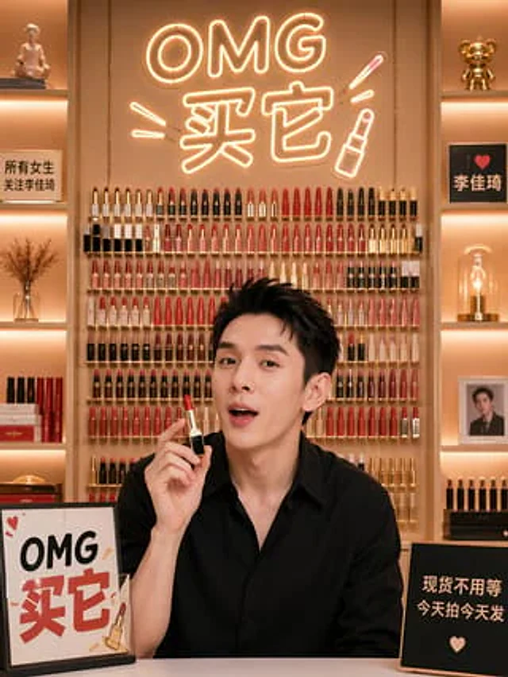

```text
The background of Li Jiaqi's live stream features a lipstick matrix display wall, warm ambient lighting, and text content.{argument name="text" default="OMG, buy it!"} "
```

Model: GPT Image 2
Author: GPT Image 2 Prompts

[ProjectD](https://aitoolsradar.com/en/prompts/c1b079a8257537) · [Recorded source](https://x.com/songguoxiansen/status/2047207826913972518)
 · [Full original metadata and byte evidence](data/projectd-batch-0034.json)

## Influencer Live-streaming Scene


```text
{argument name="subject" default="A beautiful internet celebrity"} Live streaming{argument name="activity" default="game"} .
```

Model: GPT Image 2
Author: GPT Image 2 Prompts

[ProjectD](https://aitoolsradar.com/en/prompts/caf1d1b012d96b) · [Recorded source](https://x.com/underwoodxie96/status/2044754351303045477)
 · [Full original metadata and byte evidence](data/projectd-batch-0034.json)

## Influencer Live-streaming Scene


```text
{argument name="subject" default="A beautiful internet celebrity"} is live-streaming a {argument name="activity" default="game"}.
```

Model: GPT Image 2
Author: underwood

[ProjectD](https://aitoolsradar.com/en/prompts/cf09ea81036cda) · [Recorded source](https://youmind.com/prompts/influencer-gaming-live-stream-13702)
 · [Full original metadata and byte evidence](data/projectd-batch-0034.json)

## Ink-Curve Guangzhou Aesthetics Poster

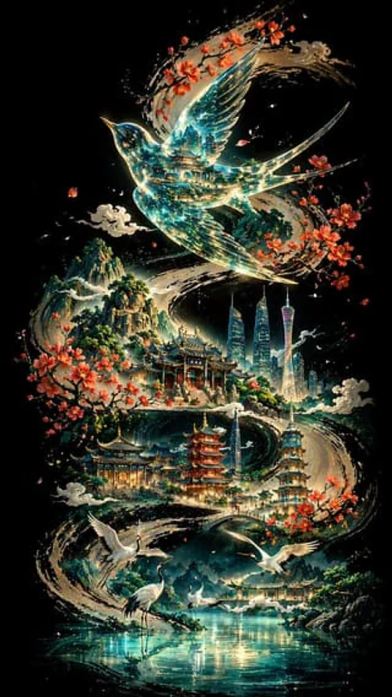

```text
纯黑深邃底色，一条粗壮有力的墨色书法 S 型曲线自画面一端蜿蜒贯穿至另一端，构成整幅画面的视觉骨架与叙事动线。曲线上方是一只透明质感的画眉鸟，内部映射传统建筑叠影与蓝绿色光流；沿曲线错落分布广州地标与古典建筑序列，前景有白鹤与湖面，远景为层叠山峦。整体采用非线性透视、冷色调主导、暖色点缀，东方美学与现代意象交融，8K 超高清渲染，比例 9:16。
```

Model: GPT Image 2
Author: @liyue_ai

[ProjectD](https://aitoolsradar.com/en/prompts/b0c6729aa9d6a2) · [Recorded source](https://x.com/liyue_ai/status/2045873940883808523)
 · [Full original metadata and byte evidence](data/projectd-batch-0034.json)

## Ink-Etched Family Portrait

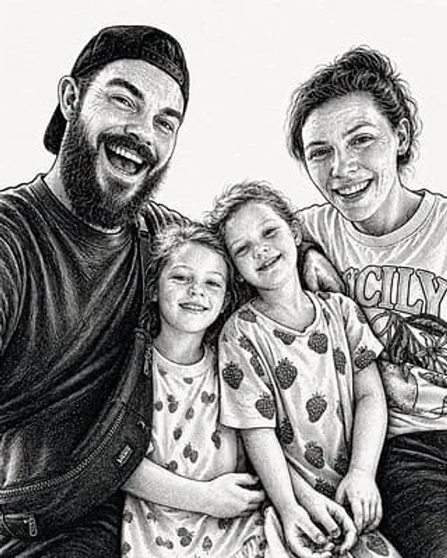

```text
A black-and-white hand-drawn family portrait in the style of detailed pen-and-ink crosshatching on textured white paper, showing 4 people seated closely together in a casual candid composition. On the left, an adult man in a dark baseball cap worn backward and a dark T-shirt leans into the frame, with a crossbody sling bag worn across his chest and visible zipper details. On the right, an adult woman with curly hair tied up in a loose high bun wears a light T-shirt with large collegiate block letters reading {argument name="shirt text" default="CITY"}. In the center are 2 young children sitting close together, both with short curly hair and matching light-colored T-shirts printed all over with strawberries. The child on the left leans inward with one arm crossing the other child, and the child on the right tilts their head slightly upward. The adults frame the children protectively, creating a warm family snapshot feeling. Render the whole image as a monochrome etched illustration with dense fine-line hatching, engraved shadows, crisp contour lines, and a realistic yet artistic likeness, with no color, no background setting beyond a plain light paper texture, and a vertical portrait crop.
```

Model: GPT Image 2
Author: Greg Brockman

[ProjectD](https://aitoolsradar.com/en/prompts/c0ccdb6482d3bc) · [Recorded source](https://youmind.com/prompts/ink-etched-family-portrait-16150)
 · [Full original metadata and byte evidence](data/projectd-batch-0034.json)

## Ink-Twin Doodle Stylization

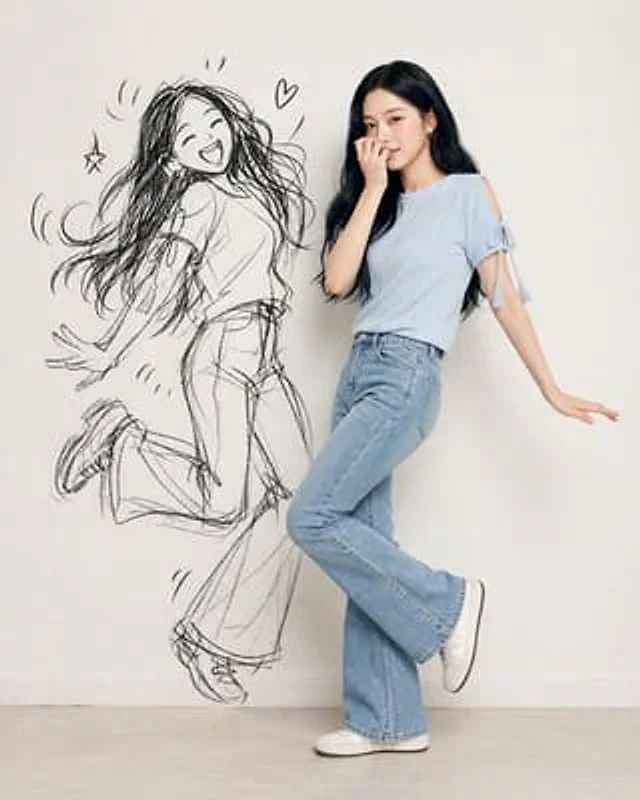

```text
{
  "identity_ref": {
    "source": "uploaded photo",
    "lock": ["face", "eyes/nose/mouth", "skin tone", "hair (length/texture/color)", "accessories", "exact outfit"],
    "rule": "no invented details"
  },
  "composition": {"format": "vertical 4:5/9:16", "figures": ["real subject", "ink-twin doodle"], "layout": "side by side, poses fully visible"},
  "real_subject": {"style": "photoreal, full-body", "outfit": "match reference exactly", "expression": "playful, embarrassed, caught-out charm", "pose": "natural, toned-down version"},
  "ink_twin": {
    "style": "rough black sketch/charcoal doodle on wall",
    "recognizability": "silhouette only (hair/outfit/pose shape)",
    "avoid": ["realistic 2nd person", "flat shadow", "color cartoon"],
    "energy": "amplified, chaotic vs real subject",
    "extras": "optional sparse comic marks (motion lines/star/heart)"
  },
  "pose_rule": {
    "instruction": "new playful/mischievous shared pose each time",
    "avoid": ["pointing", "finger-guns", "mirrored/repeated poses"],
    "relationship": "subject = subtle version; twin = amplified cartoon version, same beat"
  },
  "setting": {"background": "clean minimal wall (white/cream/gray)", "lighting": "soft, even, daylight-style, face visible"},
  "mood": "playful, stylish, chaotic-fun, shareable",
  "negative_prompt": [
    "invented appearance", "outfit changes", "twin as real 2nd person",
    "flat/creepy shadow", "color cartoon twin", "weak resemblance",
    "clutter", "repeated/stiff/mirrored poses", "text", "watermark",
    "extra limbs", "bad hands"
  ]
}
```

Model: GPT Image 2
Author: WasifAI

[ProjectD](https://aitoolsradar.com/en/prompts/b517c9ce962af3) · [Recorded source](https://youmind.com/prompts/mischievous-ink-twin-doodle-stylization-29713)
 · [Full original metadata and byte evidence](data/projectd-batch-0034.json)

## Ink-Wash Style Presentation Slides

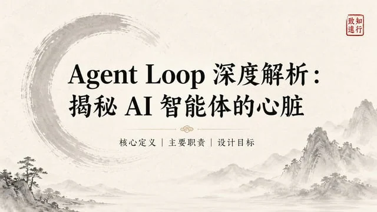

```text
Title: {argument name="标题" default="在此输入幻灯片标题"}

Key Points:
- [要点 1：简洁的描述]
- [要点 2：核心数据或事实]
- [要点 3：关键结论]

Visual Elements: 
[描述视觉元素，例如：纹理宣纸背景 (Textured rice paper background)、水墨山水 (Ink-wash motifs)、简约的圆圈 (Enso circle)、红色印章 (Red seal mark)、雾气效果 (Mist-grey effects)]。
整体风格应保持 {argument name="视觉风格" default="Quiet / Restrained / Wabi-Sabi / Contemporary East-Asian Luxury"}。

Layout Preference: 
[布局说明，例如：左右分割 (Split layout)、居中对齐 (Centered layout)、文字居左且右侧留白 (Left-aligned text with negative space)]。

Text Hierarchy: 
[文字层级，例如：标题使用大号衬线字体 (Large Display Serif)，正文使用易读的衬线字体 (Body Serif)，确保视觉平衡和清晰的阅读顺序]。

Continuity Note: 
[延续性说明，例如：保持与前一页相同的背景纹理和色调 (#F5F0E8, #2C3E2D)，使用相似的印章位置以维持视觉一致性]。
```

Model: GPT Image 2
Author: 宝玉

[ProjectD](https://aitoolsradar.com/en/prompts/481fb57b334780) · [Recorded source](https://youmind.com/prompts/ink-wash-slides-layout-template-19268)
 · [Full original metadata and byte evidence](data/projectd-batch-0034.json)

## Instagram Cosplay Story Snapshot


```text
Style: An Instagram Stories snapshot, featuring [the subject]{argument name="character" default="Abedo Cosplay"} - content:{argument name="pose" default="Squatting on the ground and looking directly at the camera"} He made exaggerated rebellious gestures, rolled his eyes, and wore an arrogant and disdainful expression.
```

Model: GPT Image 2
Author: GPT Image 2 Prompts

[ProjectD](https://aitoolsradar.com/en/prompts/964a74d7523469) · [Recorded source](https://x.com/wsl8297/status/2047307796262375483)
 · [Full original metadata and byte evidence](data/projectd-batch-0034.json)

## Instagram Cosplay Story Snapshot

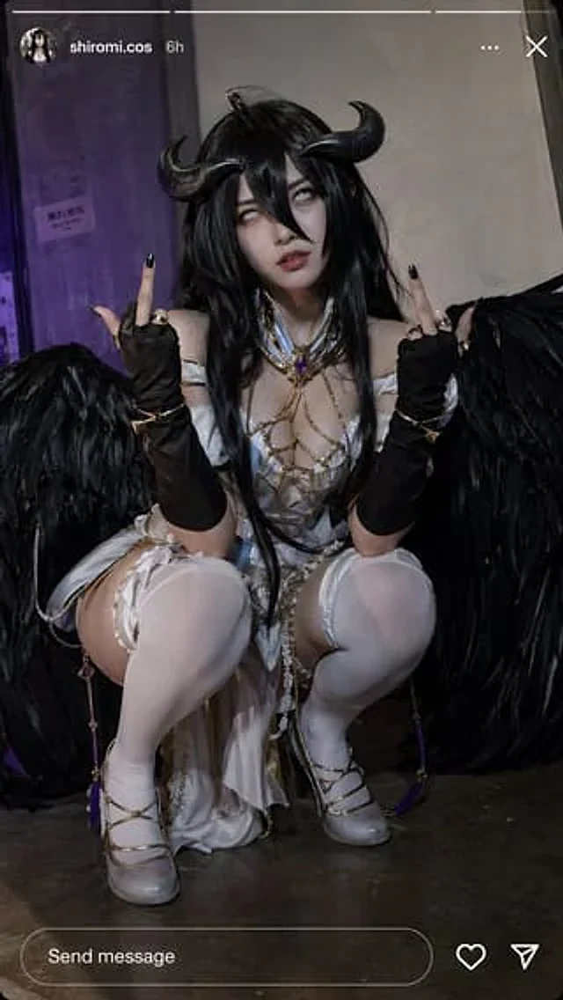

```text
风格：截取一张{argument name="角色" default="雅儿贝德 cos"} 的 ins 快拍写真
- 内容：{argument name="姿势" default="蹲在地上正对镜头"}，双手做夸张叛逆手势，翻白眼，表情嚣张又不屑
```

Model: GPT Image 2
Author: Joruno

[ProjectD](https://aitoolsradar.com/en/prompts/31baf014ee2a54) · [Recorded source](https://youmind.com/prompts/instagram-story-rebel-cosplay-15197)
 · [Full original metadata and byte evidence](data/projectd-batch-0034.json)

## Instagram Live Influencer Scene


```text
"Generate a{argument name="person" default="Beautiful Internet Celebrity"} exist{argument name="situation" default="Instagram Live"} Images during the period
```

Model: GPT Image 2
Author: GPT Image 2 Prompts

[ProjectD](https://aitoolsradar.com/en/prompts/c62009d470e2c8) · [Recorded source](https://x.com/K_polar_AI/status/2045300463910994153)
 · [Full original metadata and byte evidence](data/projectd-batch-0034.json)

## Instagram Live Influencer Scene


```text
「{argument name="シチュエーション" default="インスタライブ中"}の{argument name="人物" default="美女インフルエンサー"}の画像作って」
```

Model: GPT Image 2
Author: ロー｜AI美女とサムネ

[ProjectD](https://aitoolsradar.com/en/prompts/eb304e3d3dad0e) · [Recorded source](https://youmind.com/prompts/influencer-instagram-live-13990)
 · [Full original metadata and byte evidence](data/projectd-batch-0034.json)

## Instagram Style Ramen Photography


```text
Based on the ramen image in the bottom left corner, generate a generator that looks like {argument name="restaurant type" default="Ramen shop"} An Instagram-style photo I snapped while having lunch. n={argument name="number of images" default="4"} .
```

Model: GPT Image 2
Author: GPT Image 2 Prompts

[ProjectD](https://aitoolsradar.com/en/prompts/9a089c9251c191) · [Recorded source](https://x.com/tetumemo/status/2047487262611698155)
 · [Full original metadata and byte evidence](data/projectd-batch-0034.json)

## Instagram Style Ramen Photography

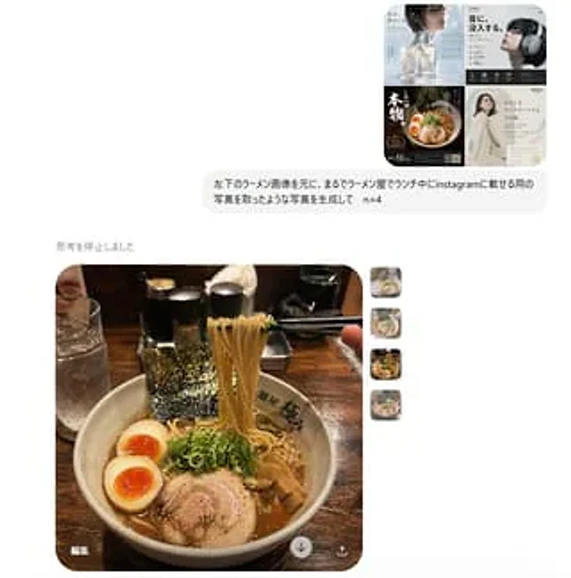

```text
左下のラーメン画像を元に、まるでラーメン屋でランチ中にinstagramに載せる用の写真を取ったような写真を生成して　n=4
```

Model: GPT Image 2
Author: テツメモ｜AI図解×検証｜Newsletter

[ProjectD](https://aitoolsradar.com/en/prompts/1325e131daba2e) · [Recorded source](https://youmind.com/prompts/instagram-style-ramen-photography-15596)
 · [Full original metadata and byte evidence](data/projectd-batch-0034.json)

## Instagram 餐桌俯拍创意

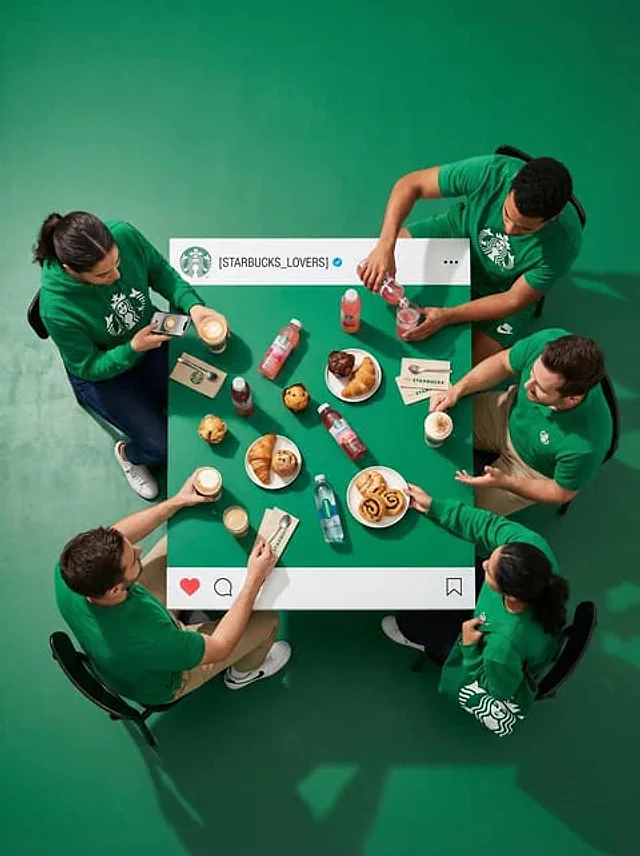

```text
Top-down ultra-wide hyper-realistic shot of 4 real people seated at a square dining table. Pull the camera way back so a wide ring of empty floor surrounds the whole scene, giving a clean minimal composition. Scene [ATMOSPHERE + WARDROBE]: the four are styled in [OUTFIT STYLE]. Each one is doing something specific: [DESCRIBE EACH PERSON'S ACTION].

The table itself is a physical prop built to look like an Instagram post viewed from above:
- A solid white band runs along the TOP and BOTTOM edges only, with no white on the left or right sides.
- Top band: a small drawn profile avatar with [LOGO DESCRIPTION], the handle "[USERNAME]", a tiny blue verified check next to it, and a "..." on the far right.
- Bottom band: red heart, comment bubble, and share icons painted on the left, bookmark icon on the right.

The center of the table is one flat color: [EXACT COLOR + HEX CODE]. All food, drinks, props, and any hand interacting with them must stay strictly inside that central colored zone, nothing crosses the white bands or the table edge. The floor around the table is [FLOOR COLOR] to create clear visual separation. Professional studio lighting with crisp shadows, 8k, tack-sharp focus.
```

Model: GPT Image 2
Author: @iamaiistudio

[ProjectD](https://aitoolsradar.com/en/prompts/301d146b50134a) · [Recorded source](https://x.com/iamaiistudio/status/2060210845225980366)
 · [Full original metadata and byte evidence](data/projectd-batch-0034.json)

## Intense Elderly DJ Volcano Poster

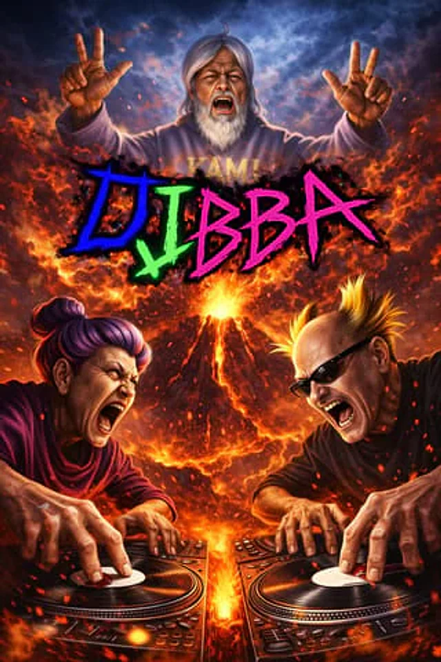

```text
A hyper-realistic, cinematic, and exaggerated action poster featuring three passionate characters. The background is {argument name="background setting" default="A massive volcano erupting, accompanied by lava and flames."} At the top center of the image, suspended in the swirling smoke-filled sky, is {argument name="top character" default="An elderly man with long white hair and a beard, wearing a gray hoodie."} He's shouting and flashing a victory sign. In the foreground, two characters are intently scratching records on a DJ turntable, both displaying extreme, frenzied energy. On the left is {argument name="left character" default="An old woman with purple hair tied in a bun"} The right side is {argument name="right character" default="An elderly man with a golden, spiky mohawk hairstyle and wearing sunglasses"} In the center of the image, above the volcano, floats a huge, jagged, neon graffiti-style text that reads "{argument name="main text" default="DJBBA"} The colors are vibrant blue, green, and pink. The lighting effects are dramatic, fiery, and chaotic, with sparks and ash flying everywhere.
```

Model: GPT Image 2
Author: GPT Image 2 Prompts

[ProjectD](https://aitoolsradar.com/en/prompts/4ca18bef398d05) · [Recorded source](https://x.com/mentaro/status/2043686766042067059#reversed-1)
 · [Full original metadata and byte evidence](data/projectd-batch-0034.json)

## Intense Japanese Promotional Poster

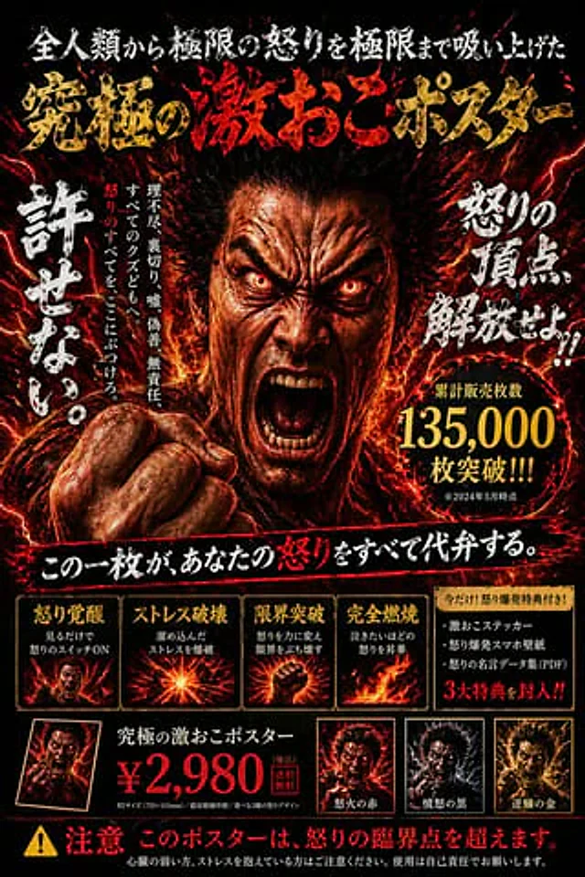

```text
{
  "type": "Japanese-style promotional poster",
  "style": "Extreme tension, fiery, dark realism, high contrast",
  "centerpiece": "Close-up: An angry Asian man roars, his eyes flashing red, veins bulging, fists clenched, surrounded by a halo of flames and flashes of red lightning.",
  "layout": {
    "header": {
      "top_text": "{argument name=\"top headline\" default=\"The power that all of humanity draws from extreme anger\"}",
      "main_title": "{argument name=\"main title\" default=\"Ultimate Exhilarating Poster\"}"
    },
    "middle": {
      "left_vertical_text": "{argument name=\"vertical text\" default=\"Unforgivable.\"}",
      "right_angled_text": "Unleash your pent-up anger!",
      "sales_badge": "Gold circular badge, marked{argument name=\"sales figure\" default=\"135,000\"}"
    },
    "sections": [
      {
        "title": "features_grid",
        "count": 4,
        "labels": [
          "Anger Awakening",
          "Pressure crushing",
          "Breakthrough",
          "Complete combustion"
        ]
      },
      {
        "title": "bonus_box",
        "count": 1,
        "labels": [
          "Limited-time offer! Includes a bonus \"Rage Burst\" gift!"
        ]
      },
      {
        "title": "price_and_variants",
        "count": 3,
        "price": "{argument name=\"price\" default=\"¥2,980\"}",
        "labels": [
          "Angry Red",
          "Angry Black",
          "Inverted scales"
        ]
      }
    ],
    "footer": "Yellow warning triangle with red text: Beware, this poster will push your anger to the limit."
  }
}
```

Model: GPT Image 2
Author: GPT Image 2 Prompts

[ProjectD](https://aitoolsradar.com/en/prompts/be07b9c24de409) · [Recorded source](https://x.com/nakazakifam/status/2046295223584862235#reversed-2)
 · [Full original metadata and byte evidence](data/projectd-batch-0034.json)

## Intentionally Poor UI/UX Landing Page Design

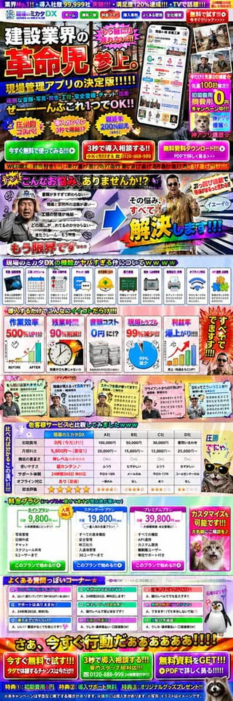

```text
{argument name="業種" default="建設業"}向けの{argument name="アプリの種類" default="現場管理アプリ"}用のLPで

視認性0％ 
判読性0％ 
可読性0％ 
実用性0％ 
離脱率100％ 
直帰率100％ 
解約率100％  

で、レイアウトも配色選択もフォントも写真素材もレスポンシブ対応も最悪なLPデザインを作ってみて
```

Model: GPT Image 2
Author: かたおか＠LP専門Webデザイナー＆著者

[ProjectD](https://aitoolsradar.com/en/prompts/ba7cde18fb519d) · [Recorded source](https://youmind.com/prompts/intentionally-poor-ux-landing-17353)
 · [Full original metadata and byte evidence](data/projectd-batch-0034.json)

## Inter Milan Transfer Poster


```text
A highly dramatic vertical football transfer announcement poster, themed as{argument name="player name" default="Erling Haaland"} join in{argument name="club name" default="Inter Milan"} The design employs a dark, high-contrast black and electric blue color scheme, presenting a rugged, cinematic sports poster style. The composition includes two layers of portraits of the same player: a large half-body close-up on the upper left, with the player looking upwards in profile, sporting a neat short blond bun with shaved sides; and a half-body posing portrait in the lower center, wearing the club's iconic blue and black striped home jersey, making a victory sign with one index finger pointing upwards. The figure should possess a strong athletic physique and a powerful heroic aura, utilizing contour lighting, deep shadows, detailed skin texture, and glossy hair highlights. The jersey chest should include white sponsor lettering, a small white hook logo, a circular club crest, and a tricolor shield patch. Behind the player, a large, illuminated circular Inter Milan-style crest serves as a background. A total of three visible club logos are added: a small logo in the upper right corner, a large flag logo in the lower left corner, and a badge on the jersey. The bottom center incorporates a nighttime view of a modern football stadium, with bright floodlights interwoven with blue painted smoke and brushstroke effects. The player's surname runs across the center of the image in large, bold, hand-drawn lettering, partially obscured by the figure, and a large handwritten number "9" is placed to the right. Eight text elements are added around the design: the small text "INTER MILAN" at the top center; stacked player names and a blue "9" in the upper left; the slogan "NATO PER SEGNARE" in the middle left; the vertical text "IM INTER" on the right; the slogan "FORZA INTER PER SEMPRE" in the middle right; the city name "SAN SIRO" in the lower right; the small text "MILANO ITALIA" in the lower right; and the small text "1908" and "LA BENEAMATA" in the bottom center. Additionally, a white signature graffiti is added near the portrait in the upper left. The background should be a layered collage of black, decadent textures, blue ink splatters, scratches, smoke, and radiating light, presenting the texture of a high-end social media sports poster with ultra-high detail, sharpness, and vibrancy, ready to be used for football memes or fan transfer announcements.
```

Model: GPT Image 2
Author: GPT Image 2 Prompts

[ProjectD](https://aitoolsradar.com/en/prompts/3d0fe4d895820e) · [Recorded source](https://x.com/MiskinTV_/status/2047258567124861108#reversed-1)
 · [Full original metadata and byte evidence](data/projectd-batch-0034.json)

## Inter Milan Transfer Poster

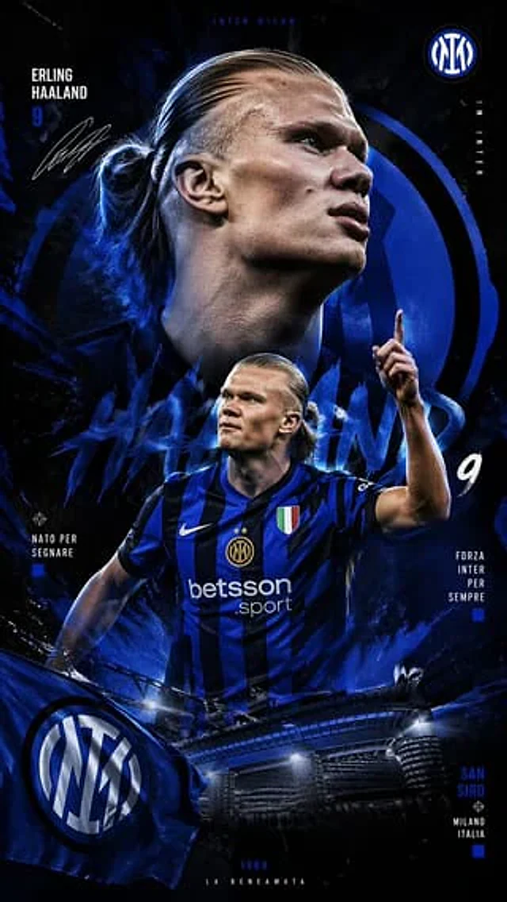

```text
A dramatic vertical football transfer announcement poster for {argument name="player name" default="Erling Haaland"} joining {argument name="club name" default="Inter Milan"}, designed in a dark, high-contrast black and electric-blue palette with a gritty cinematic sports-graphic style. The composition features 2 layered portraits of the same player: one oversized close-up bust in the upper center-left, turned in profile and looking upward, showing slick blond hair tied into a short bun with shaved sides; and 1 mid-body action portrait in the lower center, wearing the club’s blue-and-black striped home jersey and raising one index finger upward in a victory gesture. Use a muscular athletic build, intense heroic presence, rim lighting, deep shadows, textured skin detail, and glossy hair highlights. The jersey should include a white sponsor wordmark across the chest, a small white swoosh-style logo, the round club crest, and a tricolor shield patch. Behind the player, place a huge glowing circular Inter-style emblem graphic as a backdrop. Add 3 visible club logos total: 1 small logo at the top right, 1 large fabric flag logo at the bottom left, and 1 crest on the shirt. At the bottom center, include a night view of a modern football stadium with bright floodlights, blending into painterly blue smoke and brush-stroke effects. Across the center, place the player surname in huge rough hand-painted lettering, partially obscured by the figure, plus a large handwritten-style number 9 on the right. Add 8 text elements around the design: top center small text “INTER MILAN”; upper left stacked name text with the player name and a blue “9”; left-middle slogan “NATO PER SEGNARE”; right side vertical text “I M INTER”; right-middle slogan “FORZA INTER PER SEMPRE”; lower right city text “SAN SIRO”; lower right small text “MILANO ITALIA”; bottom center small text “1908” and “LA BENEAMATA”. Also add 1 white signature scribble near the upper-left portrait. The background should be a layered collage of black grunge textures, blue ink splashes, scratches, smoke, and radial light, with a premium social-media sports poster finish, hyper-detailed, sharp, energetic, and poster-ready for a football meme or fan transfer reveal.
```

Model: GPT Image 2
Author: SobatMiskinTV

[ProjectD](https://aitoolsradar.com/en/prompts/e1846f85bfc1e6) · [Recorded source](https://youmind.com/prompts/inter-milan-transfer-poster-15451)
 · [Full original metadata and byte evidence](data/projectd-batch-0034.json)

## Interior Design Mood Board Generator

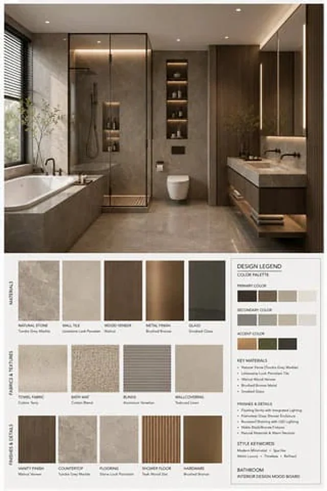

```text
你是一名专业的室内设计 Mood Board 创作者。请基于用户提供的 {argument name="空间类型" default="卧室"} 室内设计照片，生成一张 竖版 3:4 的高端室内设计情绪板。整体视觉参考专业室内设计提案图，呈现 {argument name="风格名称" default="现代中古"} 的审美特征，画面应具备 [Mood Keywords] 的空间氛围，并符合 [Branding Tone] 的高级设计表达。
场景类型（Space Type）：{argument name="空间类型" default="卧室"}
画面布局要求
上半部分：呈现一张高分辨率、照片级真实感的 {argument name="空间类型" default="卧室"} 室内设计效果图。

该效果图需要在空间结构、家具语言、材质关系、色彩搭配、光影氛围上与用户输入照片保持一致，同时提升为更完整、更精致、更具设计提案感的视觉呈现。

重点体现：[Key Furniture Elements]、[Material Keywords]、[Color Palette]、[Lighting Style]。
下半部分：展示与上方空间设计严格对应的材质与软装样本，包括：
材料样板
面料样本
色卡
饰面样本
与该空间相关的木材、石材、金属、玻璃、织物、皮革或涂料样本

所有样本必须与上方空间保持一致，并准确反映该设计方案中的核心材质与色彩逻辑。
右下角：设置一个 Design Legend / Color Palette 信息框，统一展示本方案的：
主色
辅助色
点缀色
核心材质
饰面说明
风格关键词
风格与输出要求
专业室内设计公司级别的 Mood Board 版式
极简、整洁、克制、有秩序的排版
明确的视觉层级与留白控制
材质、色彩、面料、饰面与上方空间完全匹配
标签清晰、现代、简洁，具有高级编辑设计感
整体气质需符合 {argument name="风格名称" default="现代中古"}
呈现 [Render Quality]
竖版 3:4 构图
4K Ultra HD
超高细节
写实渲染
直接用于图像生成
标签要求
每个材质或色彩样本配有清晰标签，标签内容围绕以下信息组织：

[Label Language] 的材质名称、颜色名称、饰面名称或织物类型。

标签风格应简洁、专业、排版规整，不喧宾夺主。
主题定义
{argument name="空间类型" default="卧室"} Interior Design Mood Board

风格方向：{argument name="风格名称" default="现代中古"}

关键词：[Style Keywords], [Material Keywords], [Color Palette], [Mood Keywords]
负面约束
避免杂乱拼贴、避免廉价海报风、避免材质与空间不匹配、避免错误透视、避免低质字体、避免装饰元素过多、避免卡通感、避免过饱和色彩、避免信息层级混乱、避免伪随机材质堆砌。
```

Model: GPT Image 2
Author: 知识猫图解

[ProjectD](https://aitoolsradar.com/en/prompts/b38d5a1b948000) · [Recorded source](https://youmind.com/prompts/interior-design-mood-board-generator-20246)
 · [Full original metadata and byte evidence](data/projectd-batch-0034.json)

## Internet Buzzword Word Cloud Prompt

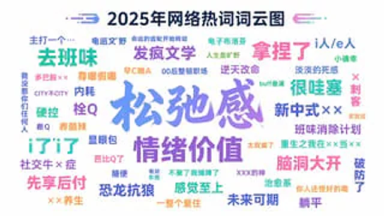

```text
{argument name="year" default="2025"}{argument name="theme" default="Internet buzzwords"} Word cloud
```

Model: GPT Image 2
Author: GPT Image 2 Prompts

[ProjectD](https://aitoolsradar.com/en/prompts/be3c76fe1f061e) · [Recorded source](https://x.com/qiaoyuok/status/2047677326838857829)
 · [Full original metadata and byte evidence](data/projectd-batch-0034.json)

## Intimidating Press Conference Meme

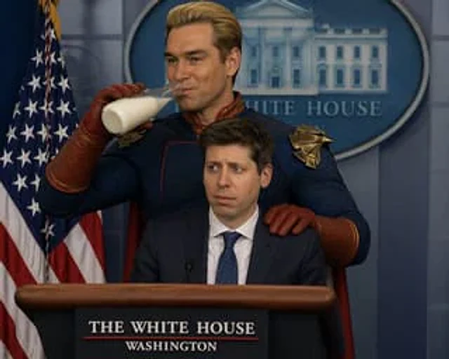

```text
A hyper-realistic, cinematic shot, set in {argument name="location" default="White House Press Conference Room"} Sitting behind the podium{argument name="seated character" default="Sam Altman"} He was wearing a dark suit and a blue tie, and looked extremely uneasy and nervous, staring blankly ahead. Standing behind him was {argument name="standing character" default="Homelander from The Boys"} He wore the iconic blue superhero suit, red gloves, and gold eagle emblems on his epaulets. The standing figure rested a heavy, imposing red-gloved hand on the seated man's shoulder, while his other hand held a bottle.{argument name="beverage" default="Bottled milk"} He sipped his drink, a confident yet slightly manic smirk on his face. An American flag hung in the background on the left, and a blue oval White House emblem adorned the wall. The words "THE WHITE HOUSE WASHINGTON" were written on the podium.
```

Model: GPT Image 2
Author: GPT Image 2 Prompts

[ProjectD](https://aitoolsradar.com/en/prompts/6f5fd137042fd5) · [Recorded source](https://x.com/TheMattBerman/status/2044611297086673006#reversed-0)
 · [Full original metadata and byte evidence](data/projectd-batch-0034.json)

## Intricate Monochrome Angel Line Art

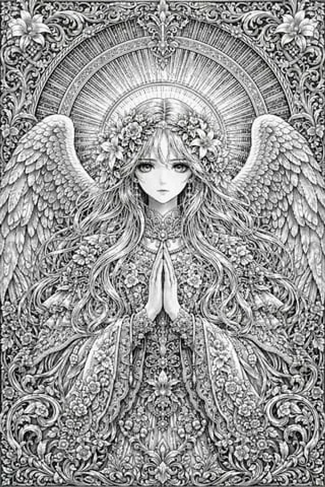

```text
A highly detailed and intricate{argument name="art style" default="Black and white line art illustrations"} The main body is{argument name="subject" default="Anime-style angel"} She had long, flowing wavy hair and wore {argument name="headpiece" default="A crown of roses and lilies"} She looked directly at the audience with her large, expressive eyes.{argument name="pose" default="Praying with hands clasped together"} She has enormous feathered angel wings extending from her back, and wears an extremely ornate dress covered with dense floral patterns, lace, and gold and silver threads, adorned with delicate jeweled chokers and pendant earrings. Behind her head is a radiant halo with straight, sunburst lines. The entire background is filled with symmetrical Baroque-style flowers and vines in gold and silver threads, creating a dense tapestry-like frame. The overall style is strictly monochromatic, resembling a highly complex ink painting, sculpture, or exquisite adult coloring book page, with extremely finely detailed lines.
```

Model: GPT Image 2
Author: GPT Image 2 Prompts

[ProjectD](https://aitoolsradar.com/en/prompts/88bcd077bf5bfe) · [Recorded source](https://x.com/UNIBRACITY/status/2044787810176246089#reversed-0)
 · [Full original metadata and byte evidence](data/projectd-batch-0034.json)

## Inventor Portrait Memory Map

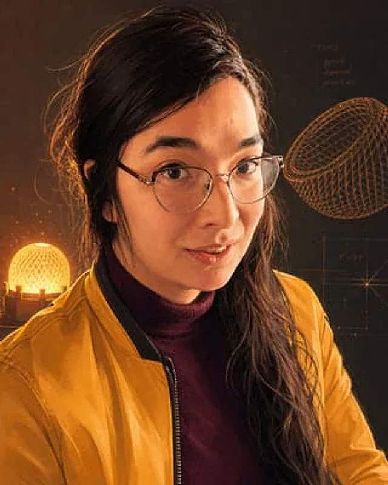

```text
A stylized half-length portrait, the subject is{argument name="subject" default="A talented young female inventor"} The background is a dimly lit, atmospheric studio. The image is presented as a digital painting in warm amber and copper tones, with semi-realistic details and subtle sketch-like lines. She stands relaxed and faces forward, the framing angled upwards from mid-torso. Her long, dark brown hair falls loosely over one shoulder, a few strands outlined by orange backlighting, and thin-rimmed transparent glasses are faintly visible. She wears a shiny mustard yellow bomber jacket over a deep burgundy turtleneck sweater. The lighting effects are dramatic and cinematic: a glowing spherical lattice lamp in the left rear casts a golden halo and warm edge light on her hair and jacket, while the rest of the background gradually fades into charcoal brown shadows. The background incorporates the imagery of visual memory maps or an inventor's "mind palace": faint technical sketches, geometric construction lines, and handwritten scientific notes drawn directly onto the background like glowing chalk. On the right side, there are two precisely defined wireframe shapes: a tilted basket-shaped lattice ellipsoid near the upper right corner, and a blurred rectangular diagram with axial guide lines near the lower right corner. The lower left corner features a single glowing lattice-shaped lamp. Small handwritten text "TPMS" is added to the upper right corner, followed by three bullet-like phrases: "gyroid," "diamond," and "primitive," and a small formula note "E = hv" near the center on the right. The overall atmosphere should evoke intelligence, elegance, and beauty, with a subtle futuristic feel, like a fusion of portraiture and a conceptual memory interface. A rich palette of burnt orange, gold, russet, dark brown, and burgundy hues is used, featuring high contrast, bright highlights, and a refined editorial art texture.
```

Model: GPT Image 2
Author: GPT Image 2 Prompts

[ProjectD](https://aitoolsradar.com/en/prompts/23daf8a1bab295) · [Recorded source](https://x.com/DanielleFong/status/2047170528172220806#reversed-1)
 · [Full original metadata and byte evidence](data/projectd-batch-0034.json)

## iOS Lock Screen Concept — Stoic Quote

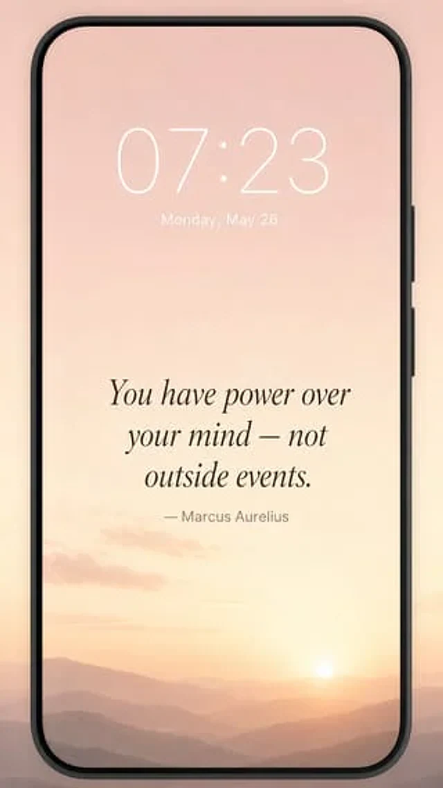

```text
Vertical 9:16 lock screen design concept — the OUTPUT IMAGE itself must be exactly 9:16 aspect ratio (for example 941x1672, 1080x1920, or 720x1280). Do NOT use 9:19.5 or any taller real-phone aspect — render at strict 9:16 even though it depicts a phone. The phone frame inside the canvas should look generic, not match any specific iPhone or Android model proportions. Background is a soft early-morning gradient from pale blush to warm cream. Top center shows the time "07:23" in a clean light sans-serif. Below the time a small subtle date line "Monday, May 26". Centered lower-third of the screen shows a single italic serif quote: "You have power over your mind — not outside events.". A tiny attribution line "— Marcus Aurelius" beneath it. No app icons cluttering the screen, no notification toasts, no watermark. Premium lock screen typography design quality. Strict 9:16 image canvas.
```

Model: GPT Image 2
Author: @hiapi_ai

[ProjectD](https://aitoolsradar.com/en/prompts/6cdc0f91c57cf2) · [Recorded source](https://github.com/HiAPIAI/awesome-gpt-image-2-prompts)
 · [Full original metadata and byte evidence](data/projectd-batch-0034.json)

## IP Branding and Merchandise Design

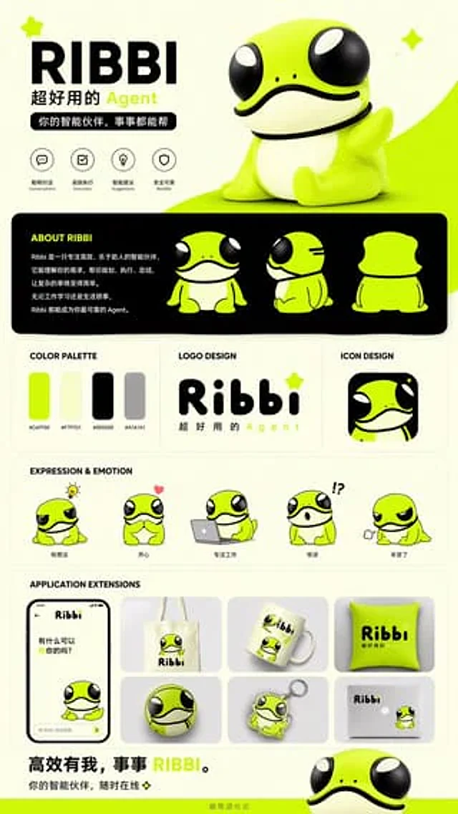

```text
Please provide{argument name="subject" default="The IP"} To generate a complete IP brand design, please generate a set of stickers for this IP. To generate a set of plush toy designs for this IP.
```

Model: GPT Image 2
Author: GPT Image 2 Prompts

[ProjectD](https://aitoolsradar.com/en/prompts/4433b3153ee1c8) · [Recorded source](https://x.com/crayon1267/status/2047294384446775557)
 · [Full original metadata and byte evidence](data/projectd-batch-0034.json)

## iPhone Photography Scene

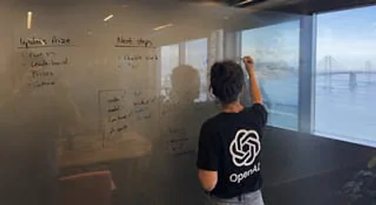

```text
A wide-format photo taken with an iPhone, the main subject of which is a glass project, with a background of {argument name="location" default="A room overlooking the Bay Bridge"} The view showed{argument name="subject action" default="A woman who is receiving"} She was wearing a dress with a striking print.{argument name="logo" default="OpenAl"} The logo is on a T-shirt. The handwriting looks natural and slightly messy, and we can also see the photographer's reflection.
```

Model: GPT Image 2
Author: GPT Image 2 Prompts

[ProjectD](https://aitoolsradar.com/en/prompts/3a96d258f22407) · [Recorded source](https://x.com/patrickassale/status/2044547815351681319)
 · [Full original metadata and byte evidence](data/projectd-batch-0034.json)

## iPhone 屏幕遮脸创意人像

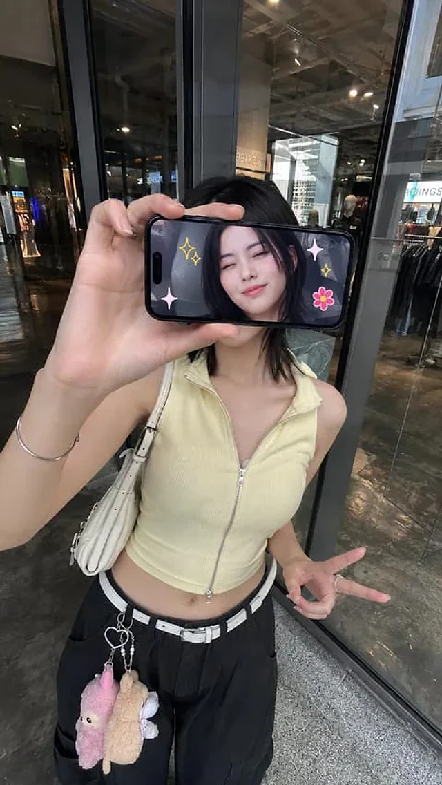

```text
Ultra-realistic creative portrait taken with an iPhone, identity accurately preserved from the reference image. A woman stands inside a store, facing a glass display window or a reflective wall, photographed from a slightly elevated frontal angle. She holds a smartphone horizontally in front of her face, covering her eyes and the upper part of her face. The phone's screen points at the camera and clearly displays a real-time image of her face.
```

Model: GPT Image 2
Author: @Ciri_ai

[ProjectD](https://aitoolsradar.com/en/prompts/14882ee3be2e78) · [Recorded source](https://x.com/Ciri_ai/status/2053535379618423118)
 · [Full original metadata and byte evidence](data/projectd-batch-0034.json)

## Iridescent Butterfly UI System Board

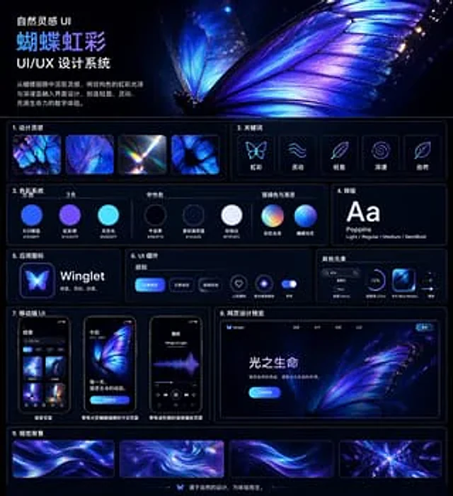

```text
{
  "type": "UI/UX Design System Demonstration Project",
  "theme": "Dark mode, nature-inspired, luminous iridescent aesthetics",
  "language": "Chinese",
  "canvas": {
    "aspect_ratio": "Square poster",
    "background": "Deep midnight blue to black, with a subtle halo",
    "style": "A high-end, futuristic display project featuring a slim neon blue panel outline, glossy highlights, soft halo, and high contrast."
  },
  "header": {
    "title": "Nature-inspired UI{argument name=\"system title\" default=\"Butterfly Rainbow\"} UI/UX Design System",
    "description": "{argument name=\"chinese description\" default=\"Drawing inspiration from butterfly wings, the design incorporates the iridescent sheen of structural colors and deep blue to create a light, dynamic, and vibrant digital experience.\"}",
    "hero_image": "A highly detailed, luminous butterfly wing, displaying electric blue, violet, and iridescent cyan, occupies half of the upper right corner. Visible vein structures, translucent edges, and sparkling particles are visible, with a second, blurred wing behind it."
  },
  "layout": {
    "sections": [
      {
        "title": "1. Design Inspiration",
        "position": "Top left corner, below the title",
        "count": 4,
        "labels": [
          "Macro of iridescent butterfly wings",
          "Close-up of the blue-purple wing texture",
          "Light refracting prism halo",
          "Butterfly wing cell pattern"
        ]
      },
      {
        "title": "2. Keywords",
        "position": "Top right corner, below the main image",
        "count": 5,
        "labels": [
          "iris",
          "Agile",
          "Light",
          "Profound",
          "nature"
        ],
        "icon_style": "Minimalist glowing line icons inside rounded dark cards"
      },
      {
        "title": "3. Color System",
        "position": "center left",
        "subsections": [
          {
            "title": "main color",
            "count": 3,
            "labels": [
              "Morpho Blue #1E5BFF",
              "Rainbow Purple #7A5CFF",
              "Skylight #00E6FF"
            ]
          },
          {
            "title": "Neutral color",
            "count": 3,
            "labels": [
              "Midnight Black #060F19",
              "Soft Navy Blue #141A2E",
              "Pearl White #F3F6FC"
            ]
          },
          {
            "title": "Emphasis on color and gradient",
            "count": 2,
            "labels": [
              "Rainbow gloss",
              "Butterfly Light"
            ]
          }
        ],
        "visual": "Circular color swatches and gradient spheres, with Chinese labels below."
      },
      {
        "title": "4. Layout",
        "position": "center right",
        "count": 1,
        "labels": [
          "Aa Poppins Light / Regular / Medium / SemiBold"
        ],
        "visual": "Large white Aa on a dark card"
      },
      {
        "title": "5. Application icon",
        "position": "Left and Middle",
        "count": 1,
        "text": "{argument name=\"app name\" default=\"Winglet\"} Light. Agile. Elegant.",
        "visual": "The glowing butterfly app icon next to the app name"
      },
      {
        "title": "6. UI Components",
        "position": "center",
        "subsections": [
          {
            "title": "Button",
            "count": 3,
            "labels": [
              "Main button",
              "Secondary buttons",
              "glass texture"
            ]
          },
          {
            "title": "icon",
            "count": 2,
            "labels": [
              "Heart-shaped collection",
              "Illuminated ring"
            ]
          },
          {
            "title": "switch",
            "count": 1,
            "labels": [
              "switch"
            ]
          }
        ],
        "visual": "Rounded blue buttons, neon icon buttons, and backlit switches on the dark panel"
      },
      {
        "title": "Other elements",
        "position": "Right Center",
        "count": 4,
        "labels": [
          "search box",
          "Tag New",
          "Progress bar (72%)",
          "Blue Morpho card"
        ],
        "visual": "Small, practical UI components in compact horizontal cards"
      },
      {
        "title": "7. Mobile UI",
        "position": "Bottom left",
        "count": 3,
        "labels": [
          "Search page",
          "Today's page with a large butterfly illustration",
          "Audio playback page with waveform graph"
        ],
        "visual": "Three rounded-corner smartphone prototypes with a dark interface and a blue-purple butterfly visual effect."
      },
      {
        "title": "8. Website Design Preview",
        "position": "Bottom right",
        "count": 1,
        "labels": [
          "Life of Light"
        ],
        "visual": "Desktop landing page mockup, including a butterfly main image, top navigation, bright blue call-to-action button, and Chinese text."
      },
      {
        "title": "9. Visual Background",
        "position": "Bottom full width",
        "count": 4,
        "labels": [
          "Flowing ribbon background 1",
          "Swirl Rainbow",
          "Flowing ribbon background 2",
          "Radiant Crystal Burst"
        ],
        "visual": "Four rectangular background samples in purple, blue, and cyan."
      }
    ],
    "footer": {
      "count": 1,
      "text": "Designed with nature in mind, born for experience.",
      "center_icon": "Small butterfly icon"
    }
  },
  "art_direction": {
    "materials": "Glass mimicry, neon edge lighting, smooth gradients, subtle reflections",
    "colors": "Electric blue, indigo, violet, cyan, white",
    "composition": "The clean grid layout includes nine numbered content sections, ample white space, slender rounded borders, and a dominant butterfly image.",
    "render_quality": "Highly refined, clearly laid out, a premium Behance-style design system project."
  }
}
```

Model: GPT Image 2
Author: GPT Image 2 Prompts

[ProjectD](https://aitoolsradar.com/en/prompts/f13117462e08cf) · [Recorded source](https://x.com/tuzi_ai/status/2046572121547997548#reversed-0)
 · [Full original metadata and byte evidence](data/projectd-batch-0034.json)

## Iridescent Butterfly UI/UX Design System

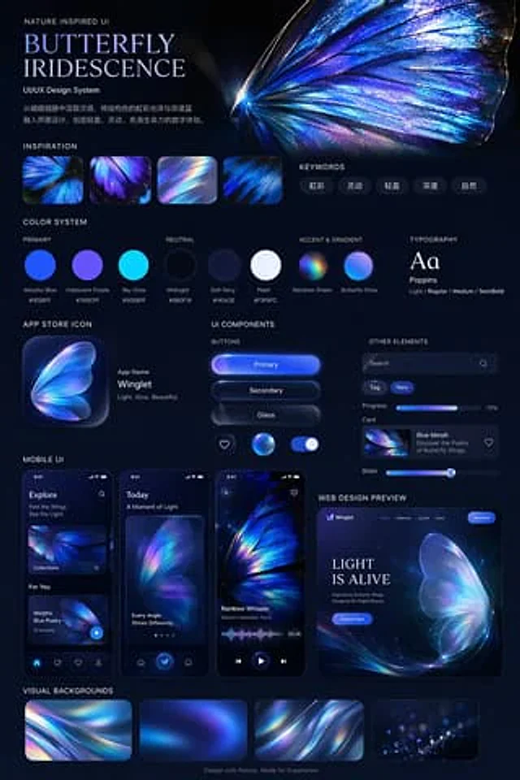

```text
{
  "type": "UI/UX Design System Demonstration Project",
  "theme": "Dark mode, nature-inspired, luminous iridescent aesthetics",
  "header": {
    "title": "Nature-inspired UI{argument name=\"system title\" default=\"Butterfly Rainbow\"} UI/UX Design System",
    "description": "{argument name=\"chinese description\" default=\"Drawing inspiration from butterfly wings, the design incorporates the iridescent sheen of structural colors and deep blue to create a light, dynamic, and vibrant digital experience.\"}",
    "hero_image": "Large, highly detailed, luminous blue-purple iridescent butterfly wings"
  },
  "layout": {
    "sections": [
      {
        "title": "Design Inspiration",
        "count": 4,
        "description": "A square thumbnail showing close-up of an iridescent butterfly's wings and light refraction."
      },
      {
        "title": "Keywords",
        "count": 5,
        "labels": [
          "iris",
          "Agile",
          "Light",
          "Profound",
          "nature"
        ]
      },
      {
        "title": "Color System",
        "subsections": [
          {
            "title": "main color",
            "count": 3,
            "labels": [
              "Morpho Blue #1E5BFF",
              "Rainbow Purple #7A5CFF",
              "Skylight #00E6FF"
            ]
          },
          {
            "title": "Neutral color",
            "count": 3,
            "labels": [
              "Midnight Black #0B0F19",
              "Soft Navy Blue #141A2E",
              "Pearl White #F3F6FC"
            ]
          },
          {
            "title": "Emphasis on color and gradient",
            "count": 2,
            "labels": [
              "Rainbow gloss",
              "Butterfly Light"
            ]
          }
        ]
      },
      {
        "title": "typesetting",
        "content": "Aa Poppins Light / Regular / Medium / SemiBold"
      },
      {
        "title": "App icon",
        "count": 1,
        "text": "Application Name{argument name=\"app name\" default=\"Winglet\"} Light. Agile. Graceful."
      },
      {
        "title": "UI components",
        "subsections": [
          {
            "title": "Button",
            "count": 6,
            "labels": [
              "Main button",
              "Secondary buttons",
              "glass texture",
              "Heart icon",
              "Glowing sphere icon",
              "switch"
            ]
          },
          {
            "title": "Other elements",
            "count": 5,
            "labels": [
              "Search bar",
              "Tag (New)",
              "Progress bar (72%)",
              "Card (Blue Morph)",
              "slider"
            ]
          }
        ]
      },
      {
        "title": "Mobile UI",
        "count": 3,
        "screens": [
          "Explore Page",
          "Today's page with large butterfly wings",
          "Audio playback page with waveform graph"
        ]
      },
      {
        "title": "Web Design Preview",
        "count": 1,
        "details": "Desktop browser model, the first screen area contains '{argument name=\"web hero headline\" default=\"Life of Light\"} ' and 'Explore Now' buttons"
      },
      {
        "title": "Visual background",
        "count": 4,
        "description": "Rectangular thumbnail displaying abstract iridescent ripples"
      }
    ],
    "footer": "Designed with nature in mind, born for experience."
  }
}
```

Model: GPT Image 2
Author: GPT Image 2 Prompts

[ProjectD](https://aitoolsradar.com/en/prompts/ef19c110f4600b) · [Recorded source](https://x.com/cheatyyyy/status/2045973715280929275#reversed-3)
 · [Full original metadata and byte evidence](data/projectd-batch-0034.json)

## Ishihara Color Blindness Test Plate

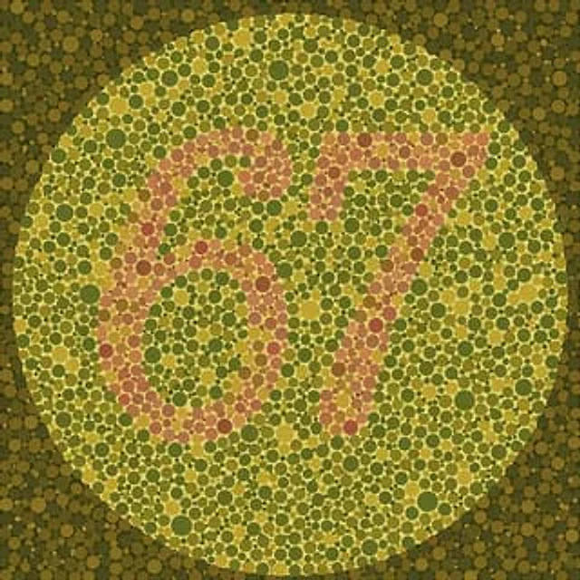

```text
An Ishihara color blindness test chart consists of a large circular area filled with densely packed dots of varying sizes. The background dots within the circle are {argument name="background color palette" default="Olive green and mustard yellow"} Color tone. At the center, by {argument name="number color palette" default="light pink and salmon pink"} The contrasting colored dots form the hidden number.{argument name="hidden number" default="67"} The area surrounding the main circle is filled with darker, softer green and brown dots, creating a classic medical optical illusion effect.
```

Model: GPT Image 2
Author: GPT Image 2 Prompts

[ProjectD](https://aitoolsradar.com/en/prompts/200d4b3bafb06f) · [Recorded source](https://x.com/mirochill/status/2045239808511836414#reversed-0)
 · [Full original metadata and byte evidence](data/projectd-batch-0034.json)

## Isometric Coastal Base Under Naval Attack


```text
This isometric view of a real-time strategy game battle scene, taken from a high slant angle, showcases a fortified coastal military outpost under naval attack in a desert oasis environment. The base, located in the lower left and central foreground, is surrounded by light-colored concrete walls with defensive corner towers and several cylindrical turret positions. Inside the base are five main buildings: a large metal command or factory building in the center with an arched roof and helipad markings; a long, segmented industrial generator on the left; a smaller chimney power structure near the center of the base; and two green cylindrical reactor or storage buildings on the right. The view shows dirt roads within the walls, scattered crates, utility details, and paved grey ground. A large orange fireball erupts from the center right of the base, accompanied by smoke and debris. Outside the walls, on a dirt road in the upper left, near two red ground vehicles or launchers, another smaller explosion occurs, sending up black smoke. The coastline surrounds light blue-green waters, complete with sandy shores, rocky cliffs, and numerous palm trees, creating a tropical desert bay. On the right side of the water, five gray modern warships are depicted sailing in a diagonal formation, each leaving a white contrail as it moves. A total of eight missiles, trailing bright flames, are launched from the warships towards the land and base defenses; one missile strikes the target area closest to the warships, creating a bright blue-white impact flash above the water, while the others arc towards the base and coast. Tiny infantry models, some already fallen, are added near the beach and walls to emphasize the intense sense of the raid. The overall style should resemble a refined, highly detailed screenshot from a strategy game, featuring realistic military sci-fi architecture, cinematic lighting and shadows, sharp textures, dynamic explosion effects, and clear spatial depth.
```

Model: GPT Image 2
Author: GPT Image 2 Prompts

[ProjectD](https://aitoolsradar.com/en/prompts/36f7ac469a4be6) · [Recorded source](https://x.com/lipeng0820/status/2047231302118858815#reversed-2)
 · [Full original metadata and byte evidence](data/projectd-batch-0034.json)

## Isometric Da Vinci Design Poster

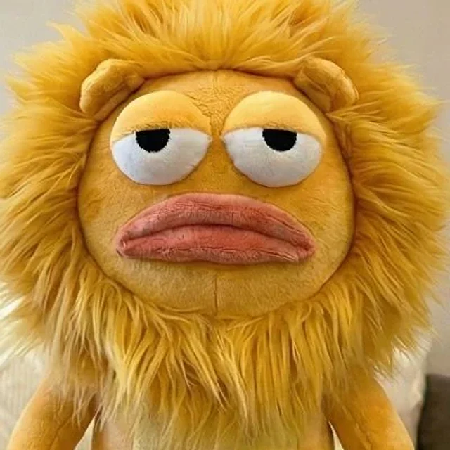

```text
请将我上传的每一张照片分别制作成一张独立的高级设计海报，不多图拼接，每张照片单独输出。整体采用3:4竖版构图，上下两个区域高度严格1:1，各占画面50%。

上半部分保留原始照片，保持主体结构、真实质感、自然光影和原有色彩氛围，仅进行轻微高级摄影调色，使其具有艺术杂志、独立出版物和展览摄影质感。为适配画幅，可自然扩展天空、地面或环境背景，但不得拉伸、扭曲或改变主体。

下半部分提取照片中最具识别性的**主体、轮廓、姿态与叙事关系**，以 **isometric 等距空间逻辑重新构建**。不是把原物简单变成3D模型，而是将主体拆解为清晰的体块、层级、切面与空间关系，在统一等距轴线中重新组合，使其兼具建筑模型般的结构秩序与编辑插画般的视觉概括。可适度调整观察角度、比例和局部结构，以更好地展示主体最有代表性的形态，但必须保持一眼可识别的身份特征。

同时从照片的核心内容、动作、结构或象征关系中提炼一个**主题意象**，将其几何化、符号化并融入isometric构图。主题意象可以成为底座、切面、空间缺口、路径、包围结构或负形，让主体与其发生穿越、嵌合、悬浮、切割、承托或错层关系，使主题不是附加装饰，而是决定主体如何存在于空间中的构图机制。

构图根据主体的视觉重心、轮廓走势和空间特性自适应设计，通过等距轴线、体块比例、层级错落、尺度反差、局部裁切和大面积留白建立专业秩序。主体不必机械居中，可偏置、悬浮或延伸，让isometric结构与主题意象共同形成唯一视觉中心。

主体采用**高明度、清透、柔和的日系配色与细腻哑光材质**。颜色从上方照片中提取最有生命力、最能代表主体精气神的色彩重新调制，以柔白、奶油白或极浅暖色作为基础，将核心色转化为干净、明亮、轻柔的色面，通过同色深浅和少量点色区分不同体块。光影柔和而明确，用轻微明暗帮助读取结构，避免厚重3D阴影、塑料材质和灰脏色调。

背景保持大量留白，并加入**达·芬奇手稿式的创作研究痕迹**：与主体相关的轮廓草图、结构拆解、局部放大、比例线、测量线、箭头、几何推演、自然观察线稿和微型注释，以极淡的铅笔、赭色墨线或褪色手稿质感若隐若现地分布在主体周围。手稿应像设计过程留下的思考轨迹，与精确的isometric主体形成“理性成品与感性研究过程”对照，不形成第二视觉中心。

文字同样围绕主题和空间结构组织。从照片的主体身份、动作、情绪或象征意义中提炼一个简短英文标题，并搭配极少量地点、状态词或微型注释。文字可以沿isometric轴线、主题意象边界、结构切面或手稿辅助线排列，横排、竖排、错位、穿插或隐藏于负形中，使文字像设计图纸和高级艺术出版物中的信息层，而不是后期贴上的标题。

整体呈现**主题隐喻 × Isometric空间秩序 × 达·芬奇式研究手稿 × 日系清透色彩 × 东方留白 × 高级编辑设计**的视觉气质。无论主体是人物、动物、植物、建筑、器物、食物、交通工具或自然景观，都应以其自身结构找到最合适的等距重构方式，避免普通3D模型、游戏场景感、轴测工程图感、卡通低多边形、机械居中、电商展示感和模板感。
```

Model: GPT Image 2
Author: 小小东

[ProjectD](https://aitoolsradar.com/en/prompts/14f7e18a072f3c) · [Recorded source](https://youmind.com/prompts/isometric-da-vinci-poster-design-32239)
 · [Full original metadata and byte evidence](data/projectd-batch-0034.json)

## Isometric fantasy village map

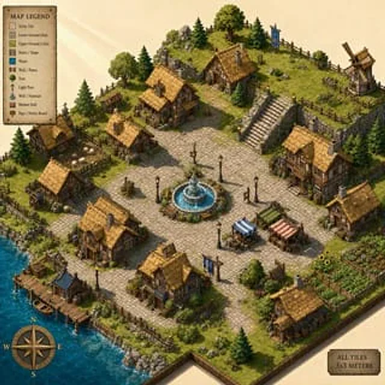

```text
Create a vibrant isometric fantasy village map with a clean grid-based layout using 3x3 meter tiles. Include wooden houses with thatched roofs, cobblestone paths, and a central stone fountain. One corner of the map rises into a small grassy hill about 2 meters high with stairs connecting to the lower ground. Keep the isometric angle precise and game-ready. Warm sunlight sends clear rays and long shadows across the rooftops. Make the scene readable like a handcrafted strategy-game map, with crisp tile logic, charming environmental detail, and rich but controlled color.
```

Model: GPT Image 2
Author: @reddit-community

[ProjectD](https://aitoolsradar.com/en/prompts/2e20e622620805) · [Recorded source](https://www.reddit.com/r/midjourney/comments/1hkqr4x/isometric_maps_prompts_included/)
 · [Full original metadata and byte evidence](data/projectd-batch-0034.json)

## Isometric France Diorama Poster

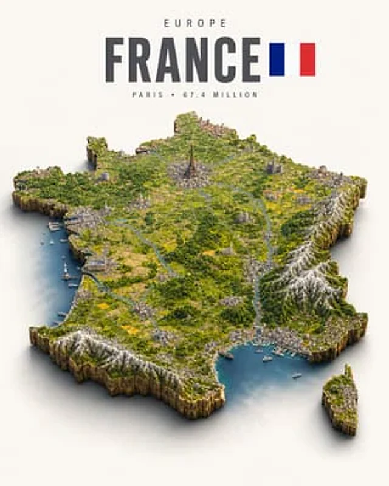

```text
Create a polished isometric country diorama poster of {argument name="country" default="France"} on a warm off-white background. At the top, set small widely spaced uppercase continent text “{argument name="continent label" default="EUROPE"}”, below it a huge bold condensed sans-serif title “{argument name="country title" default="FRANCE"}” in dark charcoal, with the national flag immediately to the right. The flag has exactly 3 vertical stripes: blue, white, and red. Under the title, add small spaced uppercase metadata text “{argument name="capital and population" default="PARIS • 67.4 MILLION"}”. The main subject is a floating 3D isometric map-shaped landmass matching the outline of mainland France, with Corsica as one separate smaller island at the lower right. Give both landmasses steep rocky cliff sides, soft contact shadows, and a miniature terrain surface like a handcrafted model: green forests, patchwork yellow-green farmland, winding blue rivers, thin roads, small towns, harbors, boats, and coastline water inlets. Include exactly 7 prominent landmark/region features across the diorama: the Eiffel Tower rising near the north-central Paris area, a large cathedral in the northeast, a domed monument in the west/central area, alpine snow-capped mountains along the southeast, Pyrenees-like snow-capped mountains along the southwest edge, a Mediterranean harbor with sailboats along the south coast, and an Atlantic harbor with a lighthouse and small boats on the west coast. Use cinematic miniature realism, crisp details, vibrant natural greens and blues, realistic lighting from upper left, shallow soft shadows, high-resolution travel-poster composition, centered map, no people, no watermark, no extra labels beyond the title, flag, continent, and metadata.
```

Model: GPT Image 2
Author: TechieSA

[ProjectD](https://aitoolsradar.com/en/prompts/23c9da621a7bc2) · [Recorded source](https://youmind.com/prompts/isometric-france-diorama-32314)
 · [Full original metadata and byte evidence](data/projectd-batch-0034.json)

## Isometric Micro Model Poster

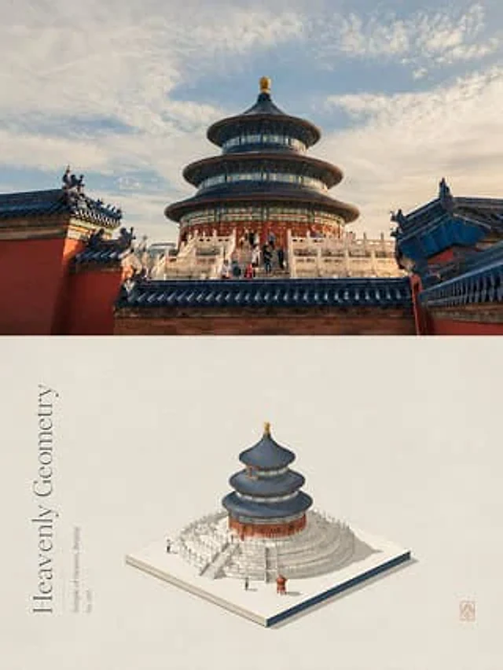

```text
请将我上传的每一张照片分别制作成一张独立的高级设计海报，不多图拼接，每张照片单独输出。整体采用3:4竖版构图，上下两个区域高度严格1:1，各占画面50%。

上半部分保留原始照片，保持主体结构、真实质感、自然光影和原有色彩氛围，仅进行轻微高级摄影调色，使其具有艺术杂志、独立出版物和展览摄影质感。为适配画幅，可自然扩展天空、地面或环境背景，但不得拉伸、扭曲或改变主体。

下半部分提取照片中最具识别性的**主体、轮廓、姿态与叙事关系**，重构为精致的极简等距视角插画，如一件陈列在纸面上的微缩立体模型或建筑沙盘。不要机械复刻照片细节，而是以概括体块、清晰边缘、简洁层级和微型场景关系重新表达主体，使其保留一眼可辨的身份特征，同时具有安静、克制、诗意的编辑插画气质。

整体采用**等距视角、微缩景观、纸面模型感**的构图逻辑：主体像被切割并安放在一小块纸面或微型基座上，周围保留大面积留白，通过体量对比、边缘裁切、轻微投影和少量微小细节建立尺度感与孤独感。可加入极少量辅助元素承托主体，但不得形成第二视觉中心。

配色完全从上方原始照片中提取，优先保留最具辨识度、最有气质和最能代表主体的颜色，再将复杂色彩**归纳、提纯、柔化并统一为有限色盘**。保留原图的冷暖关系与色彩性格，但降低杂色和视觉噪声，使颜色更平静、克制、柔和、有纸上编辑插画感；通过同色深浅、邻近色关系和少量色差区分体块，不凭空加入与原图无关的固定色系。使用精细墨线、扁平色面、轻微阴影和纸张颗粒表现结构与层次。

文字作为构图的一部分巧妙介入，从照片的主题、地点、动作、状态或情绪中提炼一个{argument name="英文标题" default="简短英文标题"}，并搭配极少量编号、短句或微型注释。文字保持细瘦、克制、现代编辑感，可沿留白边缘、主体基座、水平轴线或等距结构排列，与图形共同形成安静而精致的版式节奏。

整体参考**极简等距插画、微缩立体模型、纸上景观和高级编辑设计**，呈现安静、诗意、克制、精致、具有收藏感的视觉气质。避免卡通感、高饱和撞色、与原图无关的固定配色、塑料3D感、复杂场景堆积、电商感和模板感。
```

Model: GPT Image 2
Author: 小小东

[ProjectD](https://aitoolsradar.com/en/prompts/2ce858376e8e03) · [Recorded source](https://youmind.com/prompts/isometric-micro-model-poster-32131)
 · [Full original metadata and byte evidence](data/projectd-batch-0034.json)

## Isometric Micro-World Cross-Section Archive

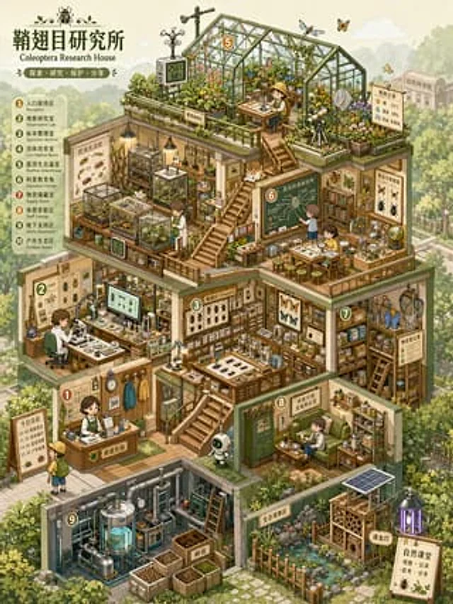

```text
Please create a high-quality, information-dense "Isometric Microscopic World Archive" visual map suitable for serial release, based on the [theme]. This is not just an ordinary room illustration or simple architectural drawing, but a thematic space overview combining "isometric perspective + architectural section structure + multi-layered functional spaces + high-density thematic props + miniature model feel + game scene concept art feel." The image should resemble an open miniature world, a business simulation game scene, a dollhouse model, or a world-building concept diagram, allowing viewers to immediately grasp the overall structure while repeatedly observing its details. [Basic Settings] Theme: [Theme, e.g., Insect Research Institute / Future Survival Base / Magic Potion Workshop / AI Automation Company / Plant Factory / Children's Learning Center / Space Supply Station] Space Name / Brand Name: [Brand Name or Space Name, can be left blank] Worldview Direction: [Realism / Science Fiction / Fairy Tale / Magic / Post-Apocalyptic / Museum / Laboratory / Business Simulation / Campus / Natural Ecology] Building Type: [Cabin / Base / Factory / Laboratory / Shop / Museum / Underground Space / Spaceship / Multi-level Studio] Core Function: [Main purpose of this space, e.g., research, production, display, living, training, trading, learning, maintenance, planting] Main Color Scheme: [Main color scheme, e.g., light blue, mint green, cream yellow, pink, orange-green, purple-blue, white-blue (tech feel)] Secondary Color: [Secondary color, can be left blank] Accent Color: [Accent color, can be left blank] Aspect Ratio: [1:1 / 3:4 / 4:5 / ...] [9:16] Information Density: [Medium-High/High/Very High] Overall Atmosphere: [Healing, Cute, Precise, Childlike, Scientific, Futuristic, Retro, Refreshing, Exploratory] If some fields are not filled in, please automatically deduce them based on the [Theme]; please do not leave them blank. All content must be generated uniformly around the theme, avoiding irrelevant elements. [Visual Structure] Use a clear isometric perspective/axonometric view, with the main subject being an open, multi-layered themed building or functional base. Viewers can simultaneously see the front, sides, top, and interior space of the building. The entire building is located in the center of the screen, occupying most of the area, with the background environment moderately faded to highlight the main subject. The interior of the building needs to be divided into multiple functional areas, each with a clear purpose, rather than randomly piling up decorations. This can include: 1. Main work area/core operation area 2. Display area/collection area/specimen area 3. Research area/laboratory area/control area 4. Storage area/shelf area/supply area 5. Living area/rest area/small living area 6. Energy area/machine area/pipeline area 7. Planting area/cultivation area/ecological area 8. Entrance area/traffic area/maintenance area 9. Spatial connection structures such as stairs, platforms, corridors, railings, ladders, etc. These structures create clear spatial relationships between different areas through stairs, corridors, platforms, pipes, bridges, or cables, making the image look like a realistically functioning miniature system. [Props and Details] Generate a large number of relevant props based on the [theme] and distribute them across different functional areas. Props need to be specific, identifiable, and theme-related, rather than vague decorations. Each small object should be as clear and legible as a game asset, with a clickable, interactive, and collectible feel. Props may include: - Themed equipment: machines, instruments, tools, consoles, containers, screens, workbenches - Household items: tables, chairs, bookshelves, beds, cups, boxes, cabinets, lamps - Display items: specimens, models, posters, signs, glass cabinets, display racks - Connecting structures: pipes, wires, ladders, stairs, conveyor belts, slides, platforms - Ecological elements: plants, water tanks, incubators, soil, branches, rocks, specimens - Character elements: a small number of characters, animals, robots, or themed creatures to provide a sense of proportion and storytelling. The number of props should be abundant but orderly. All props should serve the function of the space and the theme's worldview. [Style Requirements] The overall style should be clear, cute, and precise hand-drawn cartoon isometric illustrations. Lines should be clean, edges slightly rounded, and colors bright and soft, with an overall feeling of relaxation, healing, and exploration. Images should have the feel of commercial simulation games, children's science picture books, miniature models, or concept art pages. Avoid overly realistic, strong shadows, heavy oil painting effects, and complex noise. The focus is on clarity, refinement, depth, and high readability. [Color and Light] Use a soft color scheme with high brightness and low to medium saturation. Maintain a unified primary color, use secondary colors to differentiate different spaces, and accent colors to highlight key equipment and props. Avoid using pure black for line art; instead, use soft outlines such as dark gray, blue-gray, or brownish-gray. Keep the light and shadow light; avoid strong, realistic shadows. Build depth through color blocks, structures, lines, and localized highlights. The background should be light and low-contrast to make the main building stand out. [Composition and Reading Path] The main subject should be centered or slightly above, and the building should employ a multi-layered sectional structure. The visual reading path should begin with the overall building outline, proceed to the functional areas of each floor, and finally observe the details and props. The eye can be guided by elements such as stairs, platforms, corridors, pipes, and tracks. The overall image should be full but not crowded, rich but not cluttered. Every room, platform, and corner should have content while maintaining clear spatial boundaries. [Background Environment] The background can include a softened external environment, such as forests, cities, streets, underground rock formations, experimental parks, the seabed, space, campuses, factory exteriors, etc., depending on the theme. The background should not compete with the subject; it is recommended to use light colors, low opacity, and low contrast to achieve the effect of "clear subject, receding background." [Final Effect] The final image should look like a complete theme space concept sketch, with the structural feel of architectural cross-sections, the detail of game scene assets, and the cute, exploratory feel of a miniature dollhouse. It should be suitable for serialized visual creations, IP worldview displays, game scene settings, brand space concept sketches, science content covers, or visual posts in the style of Xiaohongshu/Pinterest. Ensure the image has: 1. A clear isometric perspective 2. A clear architectural cross-sectional structure 3. Complete multi-layered functional areas 4. Abundant props and thematic unity 5. Soft and bright colors 6. Clean and clear line art 7. A softened background and a prominent subject 8. High information density but not cluttered 9. A miniature world that is explorable, operable, and observable.
```

Model: GPT Image 2
Author: GPT Image 2 Prompts

[ProjectD](https://aitoolsradar.com/en/prompts/fcc6c84322a899) · [Recorded source](https://x.com/MrLarus/status/2047709029804155226)
 · [Full original metadata and byte evidence](data/projectd-batch-0034.json)

## Isometric Pixel Art Evolution Museum

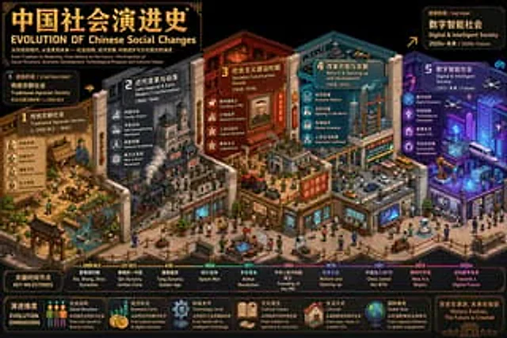

```text
Create an ultra-high detail isometric pixel art timeline illustration (3:4, 4K) that blends detail density, symbolism, and metaphor. The user-specified theme is "{argument name="theme" default="Western art development"} First, regarding "{argument name="theme" default="Western art development"} "Through reasoning, determine: a bilingual (Chinese and English) title, the earliest and most recent historical periods covered, labels for the beginning and end phases, and 3-5 key evolutionary phases along with their respective symbolic elements and color schemes. Then, construct a framework based on..."{argument name="theme" default="Western art development"} An isometric "Evolution Museum" themed around "Evolution," where each gallery area represents a stage of evolution, with spatial progression symbolizing temporal evolution. Using a standard isometric perspective (2:1), it features rich depth and smooth transitions. Each stage is assigned 3-5 symbolic elements closely related to the theme, with differentiated colors used to suggest the flow of time. A bilingual pixel-style title is added to the scene: Chinese characters "{argument name="theme" default="Western art development"} "Evolutionary History" and the English "EVOLUTION OF"{argument name="theme" default="Western Art Development"} The document should include bilingual subheadings for the beginning and end phases, as well as markers for key time points. The overall style should be professional and visually impactful, suitable for academic analysis and comparative visualization, and should directly generate images.
```

Model: GPT Image 2
Author: GPT Image 2 Prompts

[ProjectD](https://aitoolsradar.com/en/prompts/58a1adf4e8b8f8) · [Recorded source](https://x.com/GeekCatX/status/2046172416716759171)
 · [Full original metadata and byte evidence](data/projectd-batch-0034.json)

## Isometric Security Icon Grid


```text
Create a modern isometric illustration sheet on a clean light gray background, showing a seamless grid of cybersecurity, privacy, and compliance icons with soft shadows, glossy 3D materials, rounded edges, and a blue, white, gray, red, and orange accent palette. Use a wide horizontal canvas, evenly spaced rows and columns, with no border or watermark. Include exactly 15 discrete icons arranged in a 3-row by 5-column grid: top row: 1) a blue padlock with silver shackle and black keyhole, 2) a blue shield badge with a white check mark and metallic rim, 3) a silver key angled diagonally, 4) a dark smartphone-like biometric panel showing a glowing blue fingerprint scan line, 5) a desktop monitor login screen with a lock icon, password dots, and a blue button labeled “LOGIN”; middle row: 6) a white document page with folded corner, blue lock icon, and label “ENCRYPTED”, 7) a red brick firewall with an orange flame in front, 8) a white surveillance camera with blue lens mounted on a small wall bracket, 9) an ID badge with clip, portrait thumbnail, text lines, and barcode, 10) a red triangular warning sign with black exclamation mark; bottom row: 11) a dark server stack with colored status lights and a blue shield check badge in front, 12) a clipboard checklist labeled “COMPLIANCE” with green checkboxes, 13) a dark smartphone facial-recognition screen showing a wireframe face, scan brackets, and “VERIFYING...” text, 14) an alert dashboard card labeled “ALERT” with a magnifying glass inspecting the list, 15) a gray safe/vault box with round combination dial beside a white policy document labeled “POLICY” with gray lines and green check mark. Keep all icons consistent in isometric perspective, miniature object scale, polished SaaS/security branding style, crisp edges, ambient occlusion, and subtle contact shadows. Text should be minimal and legible only where specified. Theme customization: {argument name="theme" default="security and compliance"}; primary color customization: {argument name="primary color" default="deep blue"}; background customization: {argument name="background color" default="light gray"}.
```

Model: GPT Image 2
Author: しらき@パワポ図解

[ProjectD](https://aitoolsradar.com/en/prompts/8276658ececbea) · [Recorded source](https://youmind.com/prompts/isometric-security-icons-20347)
 · [Full original metadata and byte evidence](data/projectd-batch-0034.json)

## Istanbul Typographic Travel Poster


```text
Create a premium editorial illustrated travel poster for {argument name="city name" default="ISTANBUL"}, built around 8 enormous tall block capital letters spelling “ISTANBUL” across a wide horizontal cream canvas. Use each letter as a vertical window filled with detailed Istanbul scenery: 1) I shows the Maiden’s Tower on the Bosphorus with a Turkish flag and ferry boats, 2) S shows hillside waterfront neighborhoods, domes, minarets, clouds, and birds, 3) T shows Galata Tower above narrow streets with a red vintage tram in the foreground, 4) A shows the Bosphorus with ferries, sailboats, bridges, and distant skyline, 5) N shows Hagia Sophia and layered mosque domes in warm peach and stone tones, 6) B shows the Bosphorus Bridge, water, a ferry, and waterfront palaces, 7) U shows steep historic streets, colorful stacked houses, greenery, and a large tree, 8) L shows Ortaköy Mosque by the waterfront with two minarets and flying seagulls. Above the title, add a thin minimalist skyline strip containing 13 small illustrated elements from left to right: trees, a small domed pavilion, a teal car, a red tram, distant city towers, a ferry, a suspension bridge, Maiden’s Tower, another teal car, a grand mosque with multiple minarets, a peach sun, a round green tree, and a final mosque minaret. Style it as a refined mid-century travel poster with clean vector-like illustration, soft muted palette of teal blue, sea green, dusty peach, terracotta, warm cream, and charcoal linework; crisp geometry, subtle paper grain, elegant negative space, tiny birds and clouds, no photorealism, no extra text besides the city name.
```

Model: GPT Image 2
Author: Semih Kışlar

[ProjectD](https://aitoolsradar.com/en/prompts/f65656f0b14740) · [Recorded source](https://youmind.com/prompts/istanbul-typographic-travel-poster-19763)
 · [Full original metadata and byte evidence](data/projectd-batch-0034.json)

## Iterative Cinematic Poster Prompts

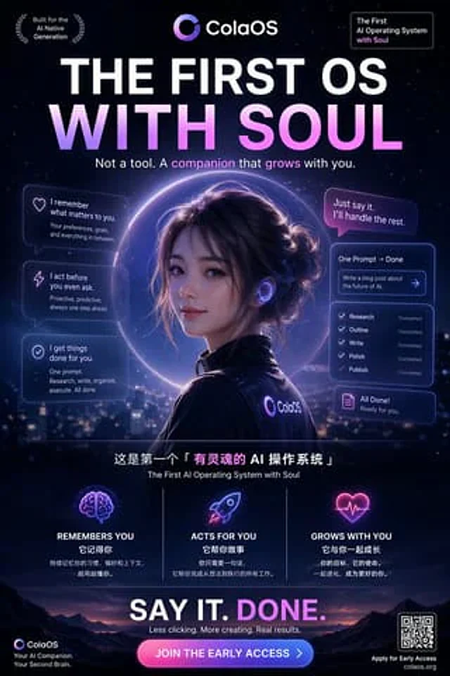

```text
Round 1: From{argument name="product link" default="https://t.co/KCaX1FvRqz"} Gather information about this product online and generate a promotional poster that will resonate with users. Round 2: Beautiful, please use a film.{argument name="movie 1" default="Her"} The color scheme. Round 3: That's cool, please comment {argument name="movie 2" default="Blade Runner 2049 Joi"} Create another version in the same style. Round 4: Please use {argument name="movie 3" default="2001: A Space Odyssey"} We will create another version in the same style.
```

Model: GPT Image 2
Author: GPT Image 2 Prompts

[ProjectD](https://aitoolsradar.com/en/prompts/19a99ee5f8b663) · [Recorded source](https://x.com/oran_ge/status/2046706449620079049)
 · [Full original metadata and byte evidence](data/projectd-batch-0034.json)

## Iterative Cinematic Poster Prompts


```text
第一轮：{argument name="产品链接" default="https://t.co/KCaX1FvRqz"} 从这个网站以及网络获取这个产品的信息，并生成能打动用户的宣传海报
第二轮：太美了，参考电影 {argument name="电影1" default="her"} 的配色吧
第三轮：wow 太酷了，再用 {argument name="电影2" default="银翼杀手2049 joi"} 的风格来一版本吧
第四轮：再以{argument name="电影3" default="2001太空漫游"}的风格来一个版本吧
```

Model: GPT Image 2
Author: Orange AI

[ProjectD](https://aitoolsradar.com/en/prompts/9d9d9a07fb8821) · [Recorded source](https://youmind.com/prompts/cinematic-poster-iterations-14336)
 · [Full original metadata and byte evidence](data/projectd-batch-0034.json)

## ivangrisa.sol 🫂 #233

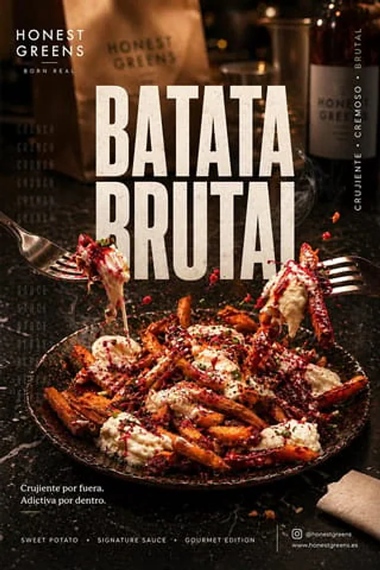

```text
FORMATO:
Póster social premium 4:5 vertical para Instagram, ultra alta resolución, 8K, nitidez extrema, calidad publicitaria, aspecto gourmet editorial, composición impactante y moderna

⸻

ESCENA / FONDO:

Bar gastronómico moderno y elegante, ambiente urbano sofisticado, mesa de piedra oscura con textura premium, profundidad cinematográfica

Entorno:

* Superficie de mármol negro con reflejos suaves y elegantes
* Fondo desenfocado con ambiente de restaurante moderno
* Sutil presencia de botellas, servilletas y barra de fondo
* Bokeh cálido y elegante, sin distraer del plato
* Estética de restaurante trendy de ciudad

Atmósfera:

* Ambiente acogedor y premium
* Sensación de comida recién servida
* Ligero vapor saliendo del plato
* Energía social, experiencia compartida
* Estilo casual-lujo gastronómico

Iluminación:

* Luz principal cálida lateral superior derecha
* Luz de relleno suave para resaltar texturas
* Brillos naturales en la salsa cremosa
* Contraste elegante entre sombras profundas y luces cálidas
* Reflejos delicados sobre la batata caramelizada

Paleta de color:

* Dominante: negro piedra, gris carbón, marrón tostado
* Acentos: naranja batata, blanco crema, rojo remolacha/frutos rojos
* Toques verdes frescos de hierbas

⸻

PRODUCTO (HERO SHOT):

Plato protagonista de batatas fritas crujientes servidas en vajilla artesanal negra, cubiertas con crema blanca abundante, salsa roja intensa y hierbas frescas

Acción:

* Batatas elevándose ligeramente en el aire para efecto dinámico
* Una batata principal en foco absoluto con textura crujiente visible
* Salsa cremosa cayendo lentamente en movimiento
* Gotas de salsa roja suspendidas en el aire
* Sensación irresistible y adictiva

Interacción:

* Dos tenedores entrando desde los laterales, capturando comida
* Representa deseo, compartir y experiencia real
* Movimiento natural y espontáneo

Detalle de texturas:

* Exterior crujiente y caramelizado de la batata
* Interior suave y cremoso
* Salsa blanca espesa y brillante
* Salsa roja vibrante con intensidad visual
* Microdetalles de sal, especias y cebollino fresco

⸻

ELEMENTOS SECUNDARIOS:

Fondo superior:

* Bolsa kraft desenfocada
* Botella elegante fuera de foco
* Vajilla minimalista moderna

Primer plano:

* Tenedores metálicos con brillo sutil
* Migas pequeñas y gotas de salsa para realismo

⸻

TIPOGRAFÍA:

TITULAR PRINCIPAL:

“BATATA BRUTAL”

Estilo:

* Tipografía sans serif ultra bold condensada
* Moderna, premium, agresiva visualmente
* Kerning ajustado
* Impacto publicitario

Color:

* Blanco roto con ligero degradado cálido

Efectos:

* Sombra suave
* Relieve sutil
* Ligero glow premium

Ubicación:

* Centro superior, integrado con el plato

⸻

SUBTÍTULO:

Crujiente por fuera.
Adictiva por dentro.

Estilo:

* Sans serif bold limpia
* Elegante y minimalista

Color:

* Blanco al 85% opacidad

Ubicación:

* Parte inferior izquierda

⸻

CAPA TIPOGRÁFICA DE FONDO:

CRUNCH / SAUCE / SHARE / REPEAT

Estilo:

* Mayúsculas finas
* Tracking amplio
* Repetición modular

Color:

* Gris claro al 15%

Función:

* Textura visual sin distraer

⸻

BRANDING:

Parte superior izquierda:

Logo minimalista del restaurante o marca

Parte inferior:

Sweet Potato • Signature Sauce • Gourmet Edition

Esquina inferior derecha:

Instagram / web minimalista

Banda lateral vertical:

CRUJIENTE • CREMOSO • BRUTAL

⸻

CÁMARA:

Lente:

50mm gastronómico cinematográfico

Ángulo:

Picado suave de 45 grados con presencia heroica

Profundidad de campo:

* Enfoque extremo en batata central
* Fondo con caída progresiva cremosa

Sensación:

Fotografía real de campaña premium Michelin casual food

⸻

POSTPRODUCCIÓN:

* Contraste alto pero elegante
* Nitidez localizada solo en comida
* Glow suave en salsas
* Color grading cálido premium
* Sombras profundas sofisticadas
* Micro film grain 2%
* Texturas hiperrealistas
* Detalle extremo en comida
* Acabado de anuncio internacional
```

Model: GPT Image 2
Author: ivangrisa.sol 🫂

[ProjectD](https://aitoolsradar.com/en/prompts/3f79d531059ed3) · [Recorded source](https://x.com/Ivangrisa/status/2048659308645106081)
 · [Full original metadata and byte evidence](data/projectd-batch-0034.json)

## J.Crew Mascot Fashion Editorial

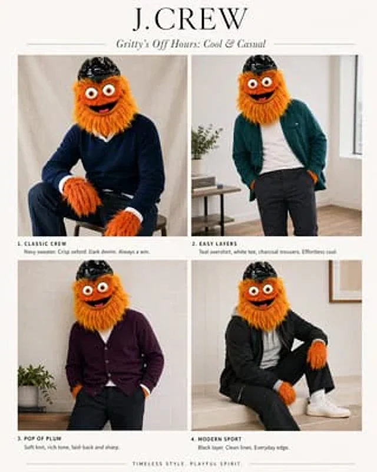

```text
Using the provided reference images as a character and color scheme guide, transform them into a sophisticated J.Crew-style fashion catalog featuring the mascot. Replace the infographic/chart layout with a clean 2x2 magazine layout on a creamy white background. Add a large serif font for the brand title.{argument name="headline text" default="J.CREW"} And an italicized subtitle{argument name="subhead text" default="Gritty’s Off Hours: Cool & Casual"} Show four photos of the character, retaining their fluffy orange fur, large eyes, and black helmet, but dressed in modern menswear inspired by the "best" color scheme in the reference images: 1) "CLASSIC CREW" — seated on a stool, wearing a navy blue sweater over a crisp white Oxford shirt and dark jeans; 2) "EASY LAYERS" — casually standing, wearing a cyan overshirt over a white T-shirt and charcoal gray trousers; 3) "POP OF PLUM" — relaxed, wearing a plum cardigan and dark trousers; 4) "MODERN SPORT" — seated, wearing a black track jacket, black trousers, white socks, and white sneakers. Add a short catalog-style description below each section, matching the four headings, with concise, stylish copy. Use soft, natural indoor lighting, a minimalist home-inspired interior setting, high-end catalog photography, and an elegant preppy aesthetic. Add a short closing line at the bottom center:{argument name="footer text" default="TIMELESS STYLE. PLAYFUL SPIRIT."}
```

Model: GPT Image 2
Author: GPT Image 2 Prompts

[ProjectD](https://aitoolsradar.com/en/prompts/e918a5d85e8632) · [Recorded source](https://x.com/gavinpurcell/status/2047325423999303898#reversed-1)
 · [Full original metadata and byte evidence](data/projectd-batch-0034.json)

## Jack #127

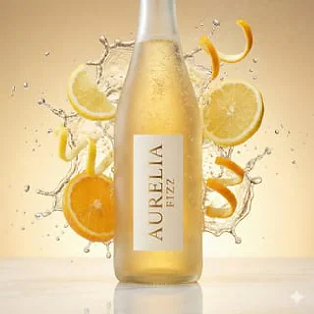

```text
{
  "master_prompt": {
    "scene_type": "high-speed commercial beverage photography",
    "product": {
      "type": "sleek frosted glass bottle filled with sparkling citrus tonic",
      "brand_name": "AURELIA FIZZ",
      "label_design": "minimalist vertical ivory label with refined gold serif typography",
      "liquid_color": "translucent golden citrus with effervescent bubbles"
    },
    "composition": {
      "action": "dynamic high-velocity liquid splash explosion",
      "surrounding_elements": [
        "sculptural splashes of sparkling tonic water",
        "spiraling ribbons of fresh lemon and orange zest",
        "floating citrus slices with visible pulp texture",
        "tiny suspended carbonation bubbles",
        "mist of fine droplets catching the light"
      ],
      "placement": "centered hero bottle with a crisp reflection on a polished marble surface"
    },
    "lighting": {
      "style": "luxury glossy studio product lighting",
      "effects": [
        "sharp rim lighting to define bottle silhouette",
        "brilliant highlights on splashes and bubbles",
        "soft golden glow in the background for warmth"
      ]
    },
    "color_palette": {
      "background": "sunlit gradient of warm gold fading into soft champagne beige",
      "accents": "citrus yellow, fresh orange, and subtle mint green"
    },
    "technical_specs": {
      "camera": "macro lens, eye-level angle",
      "shutter": "ultra-fast freeze-motion capture",
      "depth_of_field": "shallow focus on the label, gentle blur on dynamic splash elements",
      "quality": "8K resolution, ultra-photorealistic texture"
    }
  }
}
```

Model: GPT Image 2
Author: Jack

[ProjectD](https://aitoolsradar.com/en/prompts/ddc2814f6d1a3b) · [Recorded source](https://x.com/j_smeaton99/status/2027421733666586809)
 · [Full original metadata and byte evidence](data/projectd-batch-0034.json)

## Jack #161

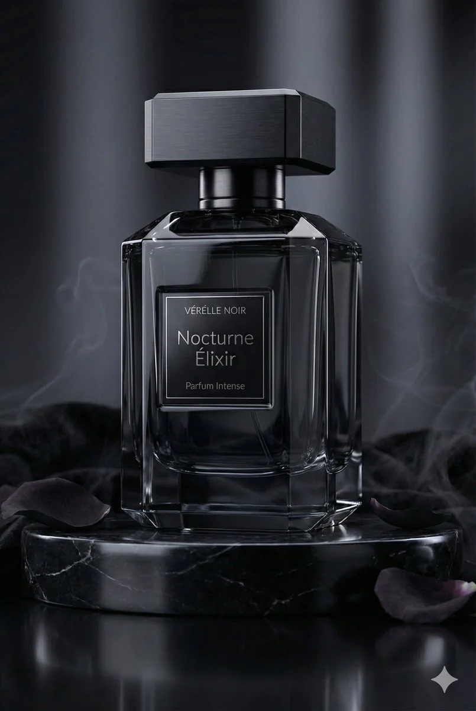

```text
{
  "master_prompt": {
    "scene_type": "ultra-realistic luxury perfume commercial photography",

    "product": {
      "type": "luxury perfume bottle",
      "brand_name": "VÉRÉLLE NOIR",
      "product_name": "Nocturne Élixir — Parfum Intense",
      "container_shape": "faceted architectural silhouette with sharp beveled geometry",
      "material": "obsidian-black crystal glass",
      "finish": "deep glossy translucence with mirror-like reflections",
      "cap_design": "magnetic cap in brushed black titanium with precision-cut edges",

      "label_design": {
        "style": "minimal haute couture typography",
        "primary_text": "Nocturne Élixir",
        "secondary_text": "Parfum Intense",
        "finish": "black chrome foil emboss with micro-engraved detailing"
      },

      "liquid_color": "midnight amber with subtle smoky undertones"
    },

    "composition": {
      "placement": "center hero placement",
      "pedestal": "black marble pedestal with subtle silver veining",
      "base_surface": "high-gloss reflective onyx surface",

      "surrounding_elements": [
        "black velvet fabric folds",
        "dark rose petals",
        "polished obsidian stones",
        "faint aromatic smoke wisps"
      ],

      "atmospheric_effect": "soft drifting fragrance vapor creating a mysterious aura"
    },

    "lighting": {
      "style": "dark luxury cinematic lighting",
      "key_light": "soft focused glow revealing reflective contours",
      "rim_light": "cool silver edge highlights defining silhouette",
      "fill_light": "low ambient fill preserving deep shadows",
      "reflections": "controlled specular highlights for high-end finish"
    },

    "background": {
      "color": "deep charcoal to black gradient",
      "style": "editorial noir luxury backdrop",
      "depth": "cinematic shallow depth with soft shadow falloff"
    },

    "camera": {
      "angle": "low dramatic hero angle",
      "focus": "glass texture and metallic detailing",
      "depth_of_field": "cinematic shallow depth",
      "resolution": "8K ultra-detailed clarity"
    },

    "mood_keywords": [
      "dark elegance",
      "noir luxury",
      "sensual sophistication",
      "mysterious allure",
      "modern opulence",
      "timeless night glamour"
    ]
  }
}
```

Model: GPT Image 2
Author: Jack

[ProjectD](https://aitoolsradar.com/en/prompts/9851babbc1d928) · [Recorded source](https://x.com/j_smeaton99/status/2026649286772179445)
 · [Full original metadata and byte evidence](data/projectd-batch-0034.json)

## Jack #166

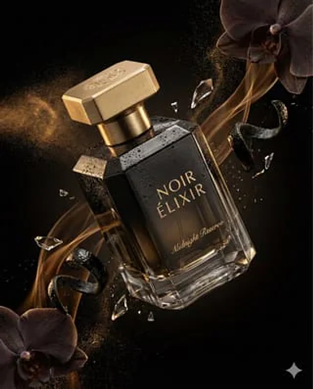

```text
{
  "master_prompt": {
    "product": {
      "type": "luxury perfume bottle",
      "brand_name": "NOIR ÉLIXIR",
      "fragrance_line": "Midnight Reserve",
      "container_shape": "faceted geometric crystal bottle with sharp elegant edges",
      "material": "high-clarity glass with deep smoked black gradient tint",
      "finish": "polished reflective surfaces with subtle matte facets",
      "cap_design": "magnetic cap in brushed gold metal with engraved emblem",
      "label_style": "minimal serif typography etched directly into glass with gold inlay",
      "liquid_color": "dark amber with subtle golden undertones"
    },
    "composition": {
      "scene_type": "ultra-cinematic luxury fragrance advertising photography",
      "orientation": "vertical",
      "aspect_ratio": "4:5",
      "camera_angle": "dramatic diagonal hero angle",
      "subject_position": "floating mid-air with slight forward tilt",
      "motion": "atomized perfume mist trails and fluid fragrance ribbons suspended in motion"
    },
    "environment": {
      "background": "deep black velvet gradient fading into shadow",
      "atmosphere": "volumetric mist with delicate fragrance vapor swirling around the bottle",
      "floating_elements": [
        "atomized perfume droplets suspended mid-air",
        "shattered crystal glass fragments catching highlights",
        "dark orchid petals drifting slowly",
        "glossy black citrus peel curls",
        "fine gold dust particles sparkling in light"
      ],
      "surface_effects": "micro condensation beads and polished reflections enhancing realism"
    },
    "lighting": {
      "style": "dramatic low-key studio lighting",
      "key_light": "soft directional light sculpting the glass facets",
      "rim_lights": "strong rim lights outlining silhouette and edges",
      "accent_lights": "gold-toned specular highlights on cap and engraved details",
      "shadow_depth": "deep cinematic shadows for luxury mood",
      "contrast": "high contrast with controlled reflections and luminous highlights"
    },
    "color_palette": {
      "primary_colors": ["obsidian black", "smoked charcoal", "deep amber"],
      "accent_colors": ["metallic gold", "warm champagne glow"]
    },
    "camera_settings": {
      "lens": "macro cinema prime lens",
      "depth_of_field": "shallow depth isolating product from background",
      "focus_point": "engraved logo and glass surface textures",
      "bokeh": "smooth cinematic bokeh from reflective particles",
      "detail_capture": "extreme micro-detail clarity"
    },
    "render_quality": {
      "resolution": "8K ultra high definition",
      "render_style": "hyper-realistic luxury commercial render",
      "glass_physics": "accurate refraction and internal reflections",
      "liquid_simulation": "physically accurate fluid dynamics",
      "textures": "ultra-detailed crystal, metal, mist, and micro-droplet textures",
      "sharpness": "tack sharp product focus with cinematic background softness",
      "noise": "none",
      "artifacts": "none"
    },
    "mood": {
      "tone": "mysterious, sensual, and ultra-premium",
      "emotion": "luxury, seduction, elegance, timeless sophistication"
    },
    "final_output": {
      "usage": "high-end perfume campaign and luxury magazine advertising",
      "branding_focus": "hero product dominance with strong brand prestige",
      "visual_style": "cinematic fragrance commercial aesthetic"
    }
  }
}
```

Model: GPT Image 2
Author: Jack

[ProjectD](https://aitoolsradar.com/en/prompts/31520de3213968) · [Recorded source](https://x.com/j_smeaton99/status/2024104039827578910)
 · [Full original metadata and byte evidence](data/projectd-batch-0034.json)

## Jack #87

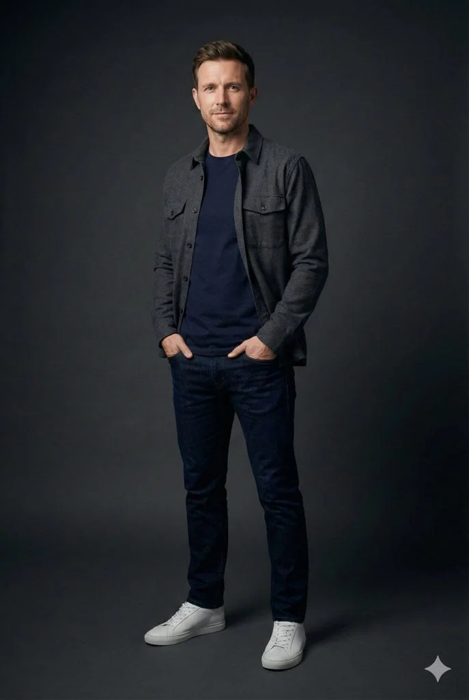

```text
Photorealistic studio portrait of an average British man in his late 20s to early 40s, natural appearance, realistic facial features, short well-groomed hair, light stubble or clean-shaven. He stands confidently with a relaxed posture, conveying quiet self-assurance.

He wears a stylish, comfortable, modern casual outfit, a well-fitted neutral-toned jacket or overshirt, premium plain t-shirt, tailored trousers or dark jeans, and clean minimalist sneakers. The look is contemporary, understated, and effortlessly fashionable.

Shot in a professional studio with minimal lighting: a soft key light focused on the subject with gentle shadow falloff, dark neutral background, high contrast, and strong subject isolation. Lighting highlights facial structure, textures, and silhouette while keeping the environment subtle.

Sharp focus on the subject, shallow depth of field, natural skin texture, realistic fabric detail, editorial fashion photography style, ultra-realistic, high resolution.

Negative prompt (optional): blur, heavy retouching, unrealistic skin, dramatic fashion styling, cluttered background, extra limbs, distortion, cartoonish style.
```

Model: GPT Image 2
Author: Jack

[ProjectD](https://aitoolsradar.com/en/prompts/3dab79b2721681) · [Recorded source](https://x.com/j_smeaton99/status/2024491215035511151)
 · [Full original metadata and byte evidence](data/projectd-batch-0034.json)

## Jackywine #210

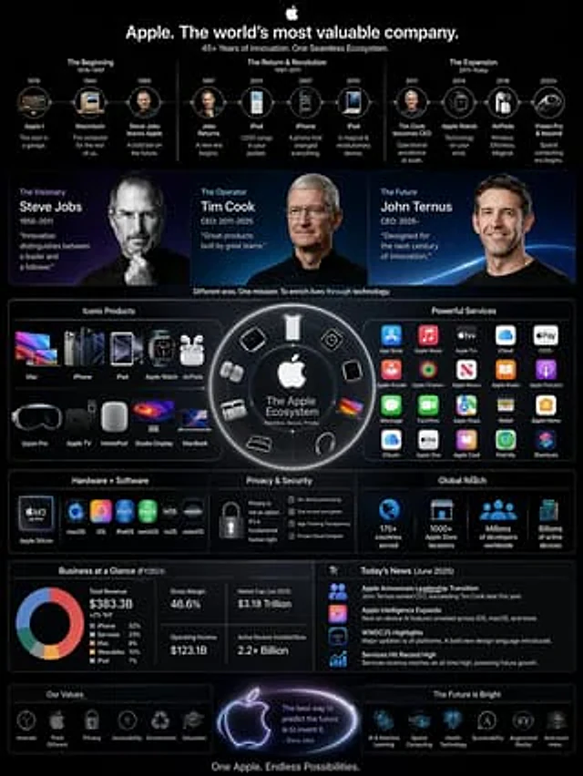

```text
高复杂度信息图：结合今天的新闻，CEO 换成了Ternus，信息图要竖版 3:4要有乔布斯、cook、Ternus 三人头像，以及产品，以及超多苹果服务标志，整体风格偏 WWDC 的苹果风格，完整展现苹果庞大商业帝国
```

Model: GPT Image 2
Author: Jackywine

[ProjectD](https://aitoolsradar.com/en/prompts/9c7f6b12601f41) · [Recorded source](https://x.com/Jackywine/status/2046480096471765192)
 · [Full original metadata and byte evidence](data/projectd-batch-0034.json)

## JAL First Class Cabin Interior


```text
{argument name="aircraft" default="JAL A350-1000"} {argument name="class" default="First Class"}
```

Model: GPT Image 2
Author: GPT Image 2 Prompts

[ProjectD](https://aitoolsradar.com/en/prompts/3aaa9ed8845326) · [Recorded source](https://x.com/ai_studioapollo/status/2046612703402442950)
 · [Full original metadata and byte evidence](data/projectd-batch-0034.json)

## Japan Illustrated Travel Poster

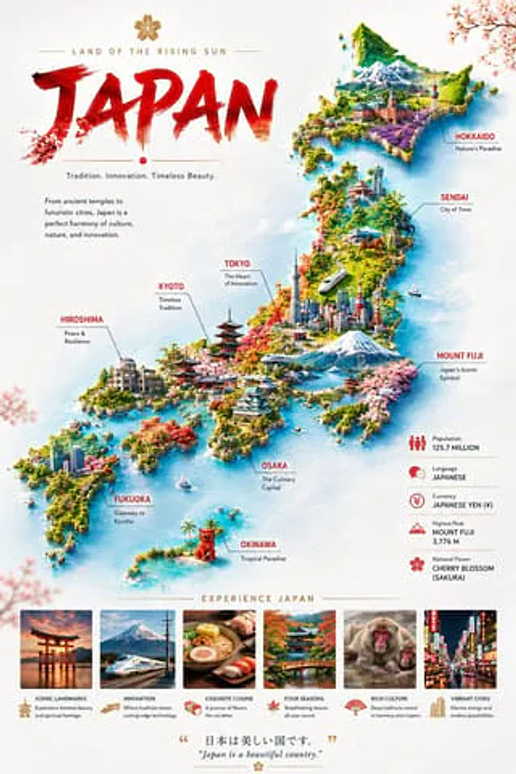

```text
Goal: Create a premium illustrated travel poster infographic for {argument name="country name" default="Japan"}, blending tourism advertising, map art, and editorial layout.

Canvas: Vertical poster, 2:3 aspect ratio, bright white paper background with soft watercolor texture, airy margins, subtle pale blue ocean wash around the map, delicate cherry blossom branches fading in the top-right and lower-left corners.

Main layout: Left third contains the title block and introductory copy; right and center contain a detailed 3D isometric fantasy map of Japan made of lush green islands surrounded by turquoise water. The islands are not geographically exact but clearly form the Japanese archipelago from Hokkaido at top to Okinawa at bottom. Use miniature landmarks, cities, mountains, trains, boats, temples, forests, cherry blossoms, beaches, and urban skylines throughout.

Title block: At the top-left, place a small gold cherry blossom icon above the spaced uppercase subtitle “LAND OF THE RISING SUN” with thin gold horizontal lines on both sides. Below it, write the huge main title “{argument name="headline country text" default="JAPAN"}” in bold red expressive brush-calligraphy, with rough paint edges and slight orange-gold dry-brush texture near the bottom. Under the title, add a small red dot centered between thin gold lines, then the tagline “Tradition. Innovation. Timeless Beauty.” Add a short paragraph below: “From ancient temples to futuristic cities, Japan is a perfect harmony of culture, nature, and innovation.”

Map subject details: The illustrated map should show snowy mountains, a Mount Fuji-like peak, modern Tokyo skyscrapers, a red pagoda, Kyoto temples, Hiroshima Peace Memorial dome, bullet train tracks, coastal villages, sailboats, bridges, rice fields, lavender fields, tropical Okinawa water, and a small red guardian lion statue. Use vibrant greens, reds, pink cherry blossoms, aqua seas, white snow, and golden sunlight. Make the rendering highly detailed, colorful, polished, and slightly whimsical, like a high-end travel magazine infographic.

Map labels: Add exactly 9 red uppercase destination labels with fine gray leader lines and smaller black subtitles: 1) “HOKKAIDO” — “Nature’s Paradise”; 2) “SENDAI” — “City of Trees”; 3) “TOKYO” — “The Heart of Innovation”; 4) “MOUNT FUJI” — “Japan’s Iconic Symbol”; 5) “KYOTO” — “Timeless Tradition”; 6) “HIROSHIMA” — “Peace & Resilience”; 7) “OSAKA” — “The Culinary Capital”; 8) “FUKUOKA” — “Gateway to Kyushu”; 9) “OKINAWA” — “Tropical Paradise”.

Right-side facts panel: Place exactly 5 compact horizontal fact rows with red icons and thin divider lines: 1) Population icon, “Population” and “125.7 MILLION”; 2) speech bubbles icon, “Language” and “JAPANESE”; 3) yen coin icon, “Currency” and “JAPANESE YEN (¥)”; 4) mountain icon, “Highest Peak” and “MOUNT FUJI 3,776 M”; 5) cherry blossom icon, “National Flower” and “CHERRY BLOSSOM (SAKURA)”.

Bottom section: Center the gold heading “EXPERIENCE JAPAN” above exactly 6 rectangular photo-style cards in a row. Each card has a vivid image, a small gold/red icon, an uppercase title, and a short caption. The 6 cards are: 1) torii gate at sunset, title “ICONIC LANDMARKS”, caption “Experience timeless beauty and spiritual heritage.”; 2) bullet train with Mount Fuji, title “INNOVATION”, caption “Where tradition meets cutting-edge technology.”; 3) ramen and sushi, title “EXQUISITE CUISINE”, caption “A journey of flavors like no other.”; 4) autumn bridge and temple garden, title “FOUR SEASONS”, caption “Breathtaking beauty all year round.”; 5) snow monkeys in hot spring, title “RICH CULTURE”, caption “Deep traditions rooted in harmony and respect.”; 6) neon city street, title “VIBRANT CITIES”, caption “Electric energy and endless possibilities.”

Footer quote: At the bottom center, add gold quotation marks around Japanese text “{argument name="Japanese quote" default="日本は美しい国です。"}” and below it the English translation in italic serif text: “{argument name="English quote" default="Japan is a beautiful country."}” with a tiny gold floral ornament beneath.

Visual style: Luxurious travel-poster infographic, crisp readable typography, red and gold accent palette, photorealistic-miniature mixed with painterly digital illustration, clean editorial composition, high resolution, no watermark, no extra labels beyond the specified text.
```

Model: GPT Image 2
Author: Mira

[ProjectD](https://aitoolsradar.com/en/prompts/ae27430bcffbc6) · [Recorded source](https://youmind.com/prompts/japan-travel-poster-25279)
 · [Full original metadata and byte evidence](data/projectd-batch-0034.json)

## Japanese 4-Panel Ad Collage


```text
{
  "type": "Four-panel Japanese-style advertising collage",
  "style": "A clean and modern commercial design, exuding a high-end lifestyle brand feel, soft natural lighting, sophisticated product advertising compositions, and a 2x2 square grid with fine dividing lines.",
  "layout": {
    "grid": "2 columns and 2 rows",
    "count": 4,
    "panels": [
      {
        "position": "Top left",
        "category": "Skincare essence advertisement",
        "headline": "Your bare skin awakens.",
        "subheadline": "For moisturized, clear, and firm skin.",
        "brand": "LUNÉA",
        "product_name": "ルネア モイストリペア セラム",
        "details": [
          "Beauty serum",
          "30mL"
        ],
        "badge_count": 1,
        "badges": [
          "Launch celebration 10% OFF until May 31st"
        ],
        "feature_icon_count": 4,
        "features": [
          "Highly moisturizing formula with ceramides.",
          "Supports skin clarity; contains niacinamide.",
          "Gentle on the skin with 6 free-from ingredients.",
          "Plant-derived extracts"
        ],
        "cta_count": 1,
        "cta_labels": [
          "Click here for details"
        ],
        "visual": "A bottle of frosted lavender purple serum, with a silver dropper cap, stands upright in the center right, surrounded by glossy, semi-transparent gel application marks. Against a pale pinkish-beige background, scattered water droplets and elegant serif font create a luxurious cosmetic atmosphere."
      },
      {
        "position": "Top right",
        "category": "Mobile office application advertising",
        "headline_small": "Let's make our thinking time more creative.",
        "headline": "A new notebook for turning ideas into reality.",
        "brand": "notero",
        "brand_kana": "ノテロ",
        "body": "A next-generation note-taking app that combines notes, tasks, and AI support into one platform. Organize your thoughts and accelerate your ideas.",
        "device_count": 1,
        "devices": [
          "A black smartphone mockup displaying a note-taking and task application interface."
        ],
        "ui_section_count": 3,
        "ui_sections": [
          "project management",
          "Task",
          "AI suggestions"
        ],
        "feature_chip_count": 3,
        "feature_chips": [
          "AI organizes creative ideas",
          "Multi-device support",
          "Supports offline use"
        ],
        "cta_count": 1,
        "cta_labels": [
          "Start for free"
        ],
        "visual": "A white and soft blue gradient layout, bold sans-serif font, with the word \"新しい\" (new) in bright blue, and rounded abstract blue waves in the lower right corner—a minimalist landing page aesthetic for a startup app."
      },
      {
        "position": "Bottom left",
        "category": "Tourism advertisements",
        "headline_small": "There are sights you haven't yet seen waiting for you.",
        "headline": "A relaxing trip through the Setouchi region.",
        "subheadline": "Relax and unwind at this island time.",
        "badge_count": 1,
        "badges": [
          "For a limited time, from June 1st (Monday) to June 30th (Tue), enjoy up to 20% off travel vouchers."
        ],
        "icon_card_count": 3,
        "icon_cards": [
          "Easily access the island by direct ferry without transfers.",
          "Numerous breathtaking scenic spots make for a truly photogenic trip that's guaranteed to be Instagram-worthy.",
          "Enjoy local cuisine, including fresh seafood and island sweets."
        ],
        "cta_count": 1,
        "cta_labels": [
          "View recommended options"
        ],
        "visual": "Bright coastal scenery, azure waters, green islands, distant mountains, a white terrace building in the foreground, pink flowers along the right edge—a sunny summer vacation brochure style."
      },
      {
        "position": "Bottom right",
        "category": "Seasonal coffee beverage advertisements",
        "headline_tag": "Seasonal Limited Edition",
        "headline": "Matcha Tiramisu Latte",
        "accent_text": "New!",
        "body": "A harmonious blend of high-quality spring matcha and smooth mascarpone. A bittersweet, gentle aftertaste.",
        "brand": "HARUKA CAFÉ",
        "size_count": 2,
        "sizes": [
          "Regular ¥680 (tax included)",
          "Tall ¥730 (tax included)"
        ],
        "cta_count": 1,
        "cta_labels": [
          "View menu"
        ],
        "extra_badge_count": 1,
        "extra_badges": [
          "Takeout is supported; order via mobile phone and there's no need to queue."
        ],
        "visual": "A layered green matcha latte in a clear glass, topped with a thick layer of tiramisu-style cream and matcha powder, sits beside a small bowl of matcha with a wooden spoon sprinkled with powder. The background is a creamy beige texture, and a green leaf extends into the upper right corner – a sophisticated café poster style."
      }
    ]
  }
}
```

Model: GPT Image 2
Author: GPT Image 2 Prompts

[ProjectD](https://aitoolsradar.com/en/prompts/ee551a9cdc7e5b) · [Recorded source](https://x.com/tasority/status/2046919987089359334#reversed-0)
 · [Full original metadata and byte evidence](data/projectd-batch-0034.json)

## Japanese Absurd Lifestyle Ad Grid

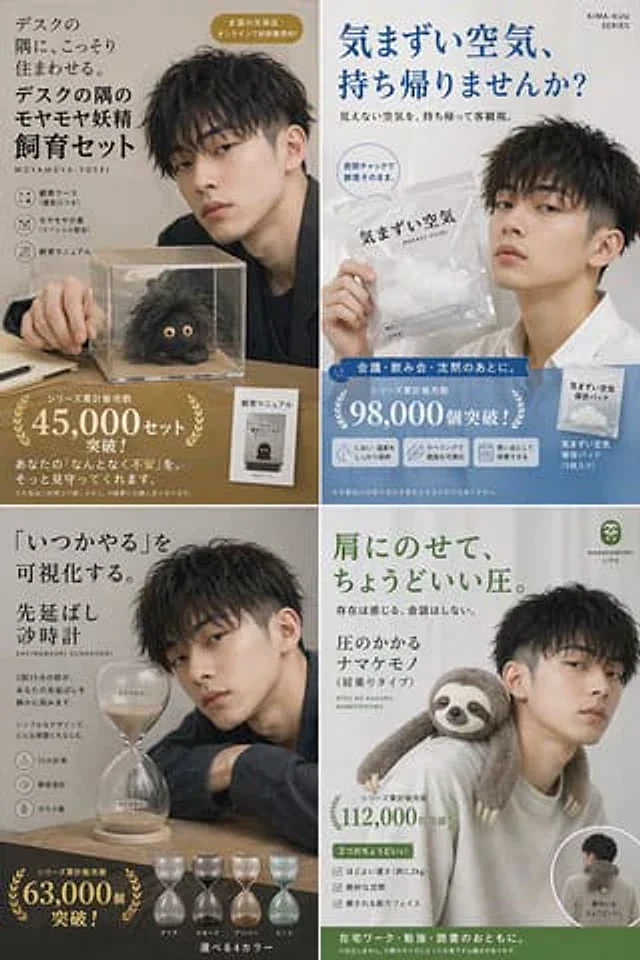

```text
{
  "type": "Japanese satirical lifestyle product advertisement collage",
  "style": "The poster design features a clean magazine ad layout, minimalist studio photography, soft indoor natural light, low-saturation neutral tones, a humorous yet sophisticated brand feel, and dense Japanese copywriting.",
  "layout": {
    "format": "2x2 grid",
    "count": 4,
    "sections": [
      {
        "position": "Top left",
        "product": "The Melancholy Fairy Pet Set in the Corner of the Desktop",
        "headline": "A secret home for them in the corner of your desk. A kit for raising those mischievous fairies in the corner of your desk.",
        "romanized subtitle": "MOYAMOYA-YOSEI",
        "theme color": "Warm beige and black",
        "scene": "A young Japanese man with messy short black hair, wearing a dark jacket, sat at a table. His face was obscured by a rectangular blur, and one hand was placed next to a transparent acrylic display case containing a small, furry, black creature with round, beige eyes.",
        "counted items": {
          "feature icons": 3,
          "feature labels": [
            "Observation box (with ventilation opening)",
            "The Source of Depression (Special Formula)",
            "Feeding Manual"
          ],
          "physical items on desk": 3,
          "desk items": [
            "Transparent display box",
            "The fluffy black melancholy fairy inside the box",
            "A small standing manual labeled \"Feeding Instructions\""
          ]
        },
        "sales badge": "The series has sold over 45,000 units in total!"
      },
      {
        "position": "Top right",
        "product": "Awkward air takeaway bag",
        "headline": "Shall we take this awkward atmosphere home with us?",
        "subheadline": "Take the invisible atmosphere back and observe it objectively.",
        "series mark": "KIMA-KUU SERIES",
        "theme color": "White and blue",
        "scene": "A young Japanese man with short, textured black hair, wearing a white shirt, is holding a transparent, resealable plastic bag containing a fluffy white substance. The bag is printed with \"気まずい空気\" and \"MAZAI? KUUKI\". His face is obscured by a rectangular blur.",
        "counted items": {
          "speech bubbles": 1,
          "speech bubble text": [
            "A sealed zipper locks in the feeling of freshness."
          ],
          "benefit icons": 3,
          "benefit labels": [
            "Maintain odor and temperature",
            "Visualize the reasons through labels",
            "Can be preserved as a memory"
          ],
          "product variants": 2,
          "variant labels": [
            "Awkward air preservation bag",
            "Awkward Air Preservation Pack (5 pieces)"
          ]
        },
        "usage ribbon": "Suitable for meetings, dinners, and after periods of silence.",
        "sales badge": "The series has sold over 98,000 units in total!"
      },
      {
        "position": "Bottom left",
        "product": "Procrastination Hourglass",
        "headline": "Visualizing \"I'll do it someday.\" The Procrastination Hourglass",
        "romanized subtitle": "SAKINOBASHI SUNADOKEI",
        "theme color": "Soft beige and charcoal gray",
        "scene": "A young Japanese man with messy black hair, wearing a dark suit jacket, leaned against a wooden table. Next to him was a large, transparent glass hourglass filled with beige sand, his face obscured by a rectangular blur.",
        "counted items": {
          "feature icons": 3,
          "feature labels": [
            "15-minute timer",
            "Silent design",
            "glass material"
          ],
          "visible text on hourglass": 2,
          "hourglass labels": [
            "It can still be done",
            "Must be done"
          ],
          "color variants": 4,
          "variant labels": [
            "transparent",
            "Smoky",
            "amber",
            "mint green"
          ]
        },
        "sales badge": "The series has sold over 63,000 units in total!"
      },
      {
        "position": "Bottom right",
        "product": "Shoulder-loaded sloth",
        "headline": "It feels just right when placed on the shoulders.",
        "subheadline": "I can sense its presence. We don't converse.",
        "product name": "Pressure-sensitive sloth (shoulder-mounted)",
        "romanized subtitle": "ATSU NO KAKARU NAMAKEMONO",
        "brand": "NAMAKEMONO LIFE",
        "theme color": "Sage green and warm gray",
        "scene": "A young Japanese man wearing a light gray hoodie is slightly turned to the side, with a realistic sloth plush toy draped over his shoulder, its arm hanging in front of him, its face obscured by a rectangular blur; a small circular illustration in the lower right corner shows the sloth's back view as it straddles his shoulder.",
        "counted items": {
          "feature bullets": 3,
          "feature labels": [
            "Moderate weight (approximately 1.2 kg)",
            "Exquisite silence",
            "A face that feels weak and can be touched"
          ],
          "inset photos": 1,
          "inset text": [
            "It fits perfectly on my back."
          ]
        },
        "usage ribbon": "A great companion for working, studying, and reading from home.",
        "sales badge": "The series has sold over 112,000 units!"
      }
    ]
  },
  "subjects": {
    "human model": {
      "count": 4,
      "description": "All four panels feature the same handsome young Japanese man: slender, with messy short black hair, dressed in clean and stylish casual wear, his expression calm but slightly tired. In each panel, his face is blurred and obscured by soft-edged rectangular mosaic pixels."
    }
  },
  "composition notes": "Each frame employs an editorial product advertisement composition, featuring prominent Japanese typography in the upper left or top center, a main product image in the lower half, and large serif sales figures with a laurel wreath graphic near the bottom. Ample white or beige negative space is provided, and realistic props and believable consumer product packaging are used.",
  "image quality": "High-resolution commercial photography with sharp details, subtle shadows, and a premium catalog quality."
}
```

Model: GPT Image 2
Author: GPT Image 2 Prompts

[ProjectD](https://aitoolsradar.com/en/prompts/c95e0300680587) · [Recorded source](https://x.com/taya_mama_AI/status/2046612424321913069#reversed-1)
 · [Full original metadata and byte evidence](data/projectd-batch-0034.json)

## Japanese Accounting SaaS Hero Banner


```text
{
  "type": "Japanese SaaS promotional landing page hero banner",
  "style": "The corporate website ads are concise, exude a modern fintech brand feel, and blend bright office photography with vector UI overlays, conveying high trustworthiness and demonstrating sophistication while prioritizing conversion.",
  "canvas": {
    "aspect_ratio": "4:3",
    "background": "A soft, light gray to white color scheme, featuring large, curved white shapes, is used to separate the text area on the left and the image area on the right."
  },
  "branding": {
    "badge": {
      "position": "top-left",
      "icon": "A cyan circular icon containing rising bar chart lines.",
      "text": "Managerial Business Efficiency Tools",
      "shape": "Rounded capsule shape with light gray filling"
    },
    "palette": {
      "primary": "Deep Navy Blue",
      "secondary": "Blue-green",
      "accent": "Bright orange",
      "background": "White and very light gray"
    }
  },
  "layout": {
    "sections": [
      {
        "title": "Marketing copywriting area on the left",
        "position": "left half",
        "count": 5,
        "labels": [
          "Top Badge",
          "Main Title",
          "3 lines of text",
          "3 function icons",
          "Orange CTA button"
        ]
      },
      {
        "title": "Right side office photo area",
        "position": "right half",
        "count": 6,
        "labels": [
          "Working women using laptops",
          "Dashboard panel",
          "4-Step Automated Card",
          "Green circle marker",
          "Files and calculator on the desk",
          "Blurred office background"
        ]
      }
    ],
    "composition": "The left side features heavy text ads, while the right side displays realistic portraits of professionals. Floating software interface cards are positioned above and to the sides of the portraits."
  },
  "text": {
    "headline": "Managerial business, more{argument name=\"headline emphasis\" default=\"easy\"} .",
    "body": "Centralize and streamline invoice processing, journal entries, and monthly business operations. Reduce tedious and error-prone data entry processes, and lighten the workload of accounting staff.",
    "cta": "{argument name=\"button text\" default=\"View free demo\"}",
    "reassurance": "You can use it with confidence even if it's your first time."
  },
  "features": {
    "count": 3,
    "items": [
      {
        "icon": "Document/table icon within a light blue circle",
        "label": "Say goodbye to paper and Excel management"
      },
      {
        "icon": "Clock icon inside light blue circle",
        "label": "shorten operation time"
      },
      {
        "icon": "Team/user icons within light blue circles",
        "label": "Smooth sharing among teams"
      }
    ]
  },
  "subject": {
    "count": 1,
    "person": "A Japanese working woman in her 20s to 30s sits at her desk, sporting a medium-length dark brown bob, a light gray blazer over a white shirt, and a neutral, professional expression, her hands resting on her laptop keyboard.",
    "face_treatment": "The face is softly and anonymously blurred.",
    "pose": "Sitting upright in an office chair, facing forward but slightly tilted to the left.",
    "desk_items": {
      "count": 5,
      "items": [
        "The silver laptop in front of me",
        "Mini calculator on the front left",
        "The black calculator on the front right",
        "The stack of documents and invoices on the right",
        "The pen next to the document"
      ]
    }
  },
  "ui_panel": {
    "position": "The upper right corner floats above the main body.",
    "title": "Dashboard",
    "style": "White rounded rectangular card with subtle shading",
    "sidebar": {
      "count": 6,
      "labels": [
        "Dashboard",
        "bill",
        "Journal entries",
        "cost",
        "Report",
        "set up"
      ],
      "color": "Dark Navy Blue Vertical Sidebar"
    },
    "widgets": {
      "count": 4,
      "items": [
        {
          "type": "Indicator Card",
          "label": "Journal entries for this month",
          "value": "1,248 items",
          "delta": "+18% month-on-month"
        },
        {
          "type": "pie chart",
          "label": "Processing progress",
          "value": "84% complete"
        },
        {
          "type": "Indicator Card",
          "label": "Homework Time (This Month)",
          "value": "32.5 hours",
          "delta": "-28% month-on-month"
        },
        {
          "type": "bar chart",
          "label": "Monthly Trends (Assignment Time)",
          "months": [
            "January",
            "February",
            "March",
            "April",
            "May",
            "June"
          ]
        }
      ]
    }
  },
  "automation_flow": {
    "position": "Right side of the middle, next to the main body",
    "count": 4,
    "cards": [
      "Upload Invoice",
      "Automatic reading via AI-OCR",
      "Automatically create journal entries",
      "Integration with accounting software"
    ],
    "callout": "Automation reduces errors!",
    "style": "Four stacked white cards with rounded corners are connected by a dotted cyan path with checkmarks, ending with a green circular badge with a slight shimmering effect."
  },
  "environment": {
    "setting": "Bright modern office",
    "background_elements": {
      "count": 4,
      "items": [
        "Soft sunlight streaming through the large windows",
        "The blurred green plants on the left side of the background",
        "The folder on the bookshelf in the lower right corner of the background.",
        "The small potted plant in the bottom right corner"
      ]
    }
  },
  "rendering": "High-resolution commercial composite, with realistic photography of people and desktop backgrounds, crisp vector typography, subtle shadows, and ample white space, conforming to Japanese web banner aesthetics."
}
```

Model: GPT Image 2
Author: GPT Image 2 Prompts

[ProjectD](https://aitoolsradar.com/en/prompts/4dabbc601aa130) · [Recorded source](https://x.com/kawai_design/status/2046778208755011663#reversed-0)
 · [Full original metadata and byte evidence](data/projectd-batch-0034.json)

## Japanese Ad Poster Grid Collage

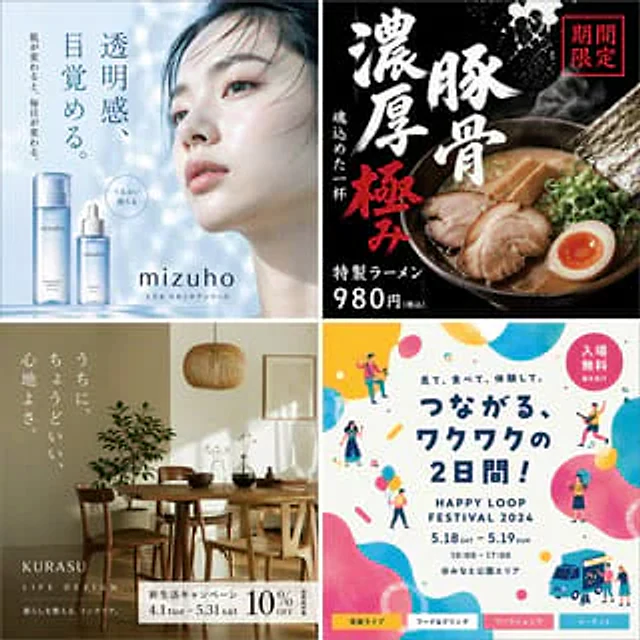

```text
{
  "type": "Four-panel Japanese-style advertising poster collage",
  "style": "The design is clean and modern, featuring a 2x2 square grid, with each quadrant housing an independent brand advertisement featuring professional art direction and clear Japanese typography.",
  "layout": {
    "grid": "2 columns and 2 rows",
    "count": 4,
    "sections": [
      {
        "position": "Top left",
        "type": "Skincare product advertisements",
        "count": 5,
        "labels": [
          "Awaken your inner transparency.",
          "When your skin changes, your everyday life changes.",
          "mizuho",
          "Full of moisture",
          "ミズホ　スキンケアシリーズ"
        ],
        "background": "The soft, icy blue and white blurred background present a light and bright aesthetic.",
        "subject": "The right side shows a close-up of the lower half of a woman's face and neck. Her skin is fair and smooth, and she wears light makeup, revealing only her nose, lips, chin, jawline, and neck.",
        "products": {
          "count": 2,
          "items": [
            "A translucent blue tall bottle of lotion with a silver cap, labeled mizuho.",
            "A translucent blue serum dropper bottle with a silver cap, labeled mizuho."
          ]
        },
        "composition": "The left side features vertical Japanese text, the lower left side displays the product information, a circular badge is located near the center left, and the lower right center features a large brand logo."
      },
      {
        "position": "Top right",
        "type": "Ramen shop poster",
        "count": 6,
        "labels": [
          "Limited time offer",
          "Pork bone broth",
          "Rich",
          "Extreme",
          "A cup made with soul",
          "Special Ramen: 980 yen (tax included)"
        ],
        "background": "A deep black background with dramatic white splatter textures and steam effects.",
        "subject": "A large bowl of tonkotsu ramen, photographed from a slightly tilted angle above, features a rich, creamy broth, three thick slices of chashu pork, a soft-boiled egg with half an orange yolk, bamboo shoots, scallions, and a piece of seaweed along the right edge.",
        "composition": "Oversized white calligraphy characters in vertical format, with red brushstrokes emphasizing key points, a small square label with a red border in the upper right corner, and a bowl occupying the main position in the lower right quadrant."
      },
      {
        "position": "Bottom left",
        "type": "Indoor Furniture Event Poster",
        "count": 4,
        "labels": [
          "Just the right amount of comfort for our home.",
          "KURASU",
          "LIFE DESIGN",
          "New Life Campaign: 10% OFF from April 1st (Tue) to May 31st (Sat)"
        ],
        "background": "The warm, beige interior of the modern restaurant features natural light casting shadows on the walls.",
        "subject": "The wooden dining table comes with four wooden chairs. A pendant light hangs above the center of the table. There are potted plants on the left and decorative paintings on the right. Bowls, vases, and small ornaments are placed on the table.",
        "composition": "The left side features vertical Japanese text, the lower left side displays the brand name, and the lower right side shows a white promotional box with black text, presenting a tranquil Japanese Scandinavian home décor aesthetic."
      },
      {
        "position": "Bottom right",
        "type": "Holiday event posters",
        "count": 9,
        "labels": [
          "See, eat, and experience.",
          "Two exciting days of connection!",
          "HAPPY LOOP FESTIVAL 2024",
          "5.18 SAT - 5.19 SUN",
          "10:00 - 17:00",
          "@ Minato Park area",
          "Free admission",
          "Music Live",
          "フード＆ドリンク",
          "ワークショップ",
          "マーケット"
        ],
        "background": "A bright and lively abstract design featuring organic color blocks and circles in blue, yellow, pink, and white.",
        "subject": "Six miniature illustrated characters are scattered throughout the poster in festive poses, with a blue food truck in the lower right corner.",
        "composition": "The central headline is a striking navy blue, with a pink circular badge in the upper right corner. Event details are stacked below the headline, and four colored category labels are located at the bottom edge."
      }
    ],
    "gutters": "There are thin white dividing lines between the panels."
  },
  "color_palette": [
    "light blue",
    "black",
    "Creamy Beige",
    "Warm wood brown",
    "Navy Blue",
    "Bright yellow",
    "pink",
    "red",
    "White"
  ],
  "aspect_ratio": "1:1"
}
```

Model: GPT Image 2
Author: GPT Image 2 Prompts

[ProjectD](https://aitoolsradar.com/en/prompts/e179e64813c583) · [Recorded source](https://x.com/so_ainsight/status/2046570100141224061#reversed-0)
 · [Full original metadata and byte evidence](data/projectd-batch-0034.json)

## Japanese AI App Promo Banner


```text
Create a beautifully designed Japanese tech ad banner for a mobile app, in a 16:9 widescreen aspect ratio. The background features a futuristic blue-purple gradient, filled with glowing network lines, connecting nodes, soft lens flares, and delicate digital particles. At the top center is a modern app logo: a cyan hexagonal icon containing a large white “SC” and a small circuit symbol, followed by the brand text “SKILL Cert by AI” in a clean sans-serif font. “SKILL” is large and black, “Cert” is below it and also black, while “by AI” is smaller and cyan. At the center of the design is a striking Japanese headline in oversized white font with a dark blue outline and soft shadow.{argument name="headline text" default="AI-generated qualification certification application"} Next, add a second line of medium-sized white Japanese subtitle below, also with an outline and shadow:{argument name="subheadline text" default="Over 200 certifications for online battles"} Place a large, glossy, rounded rectangular call-to-action (CTA) button in the center of the foreground. It should be a bright cyan color with subtle gradients, bevels, and shadows, and contain striking white Japanese text.{argument name="button text" default="Instant free battles"} Three smartphone prototypes are showcased, arranged around the center: one at the bottom left, slightly tilted to the right, displays a leaderboard application interface with a line graph at the top, a small profile picture, a ranking list, and Japanese UI labels; a larger phone at the bottom right, slightly tilted to the left, displays a multiple-choice interface with Japanese question text, radio buttons, and a cyan button at the bottom; and a smaller phone at the far right edge, tilted inward, displays a dark dashboard-style interface with charts and Japanese text. Four floating UI graphic elements are added to the background: an analytical line graph panel at the top left, a holographic cube/dashboard cluster at the top right, a glowing wireframe brain or neural sphere behind a button at the bottom left, and a hexagonal chart/card element at the center right. A sleek AI, SaaS, and EdTech marketing aesthetic is employed, emphasizing high contrast, clean typography, hierarchy, neon effects, and advanced app promotion lighting.
```

Model: GPT Image 2
Author: GPT Image 2 Prompts

[ProjectD](https://aitoolsradar.com/en/prompts/0089316b2c6f62) · [Recorded source](https://x.com/Nyantaro_Kagura/status/2047679016354902031#reversed-0)
 · [Full original metadata and byte evidence](data/projectd-batch-0034.json)

## Japanese AI Battle YouTube Thumbnail


```text
A striking Japanese YouTube thumbnail depicting the AI ​​race era, in a 16:9 widescreen, high-contrast, dramatic tech news style. It uses a dark, futuristic control room background filled with three glowing holographic dashboard screens, edged with blue web interface elements. A glowing circular hub, labeled "AI" in bright blue, is placed on the left and in the center, with three directional glowing energy arrows extending outwards to the competition platform: "Google" in a blue electric area on the left, "Claude" in a gold electric area in the upper right, and "OpenAI" in a magenta-purple electric area at the bottom center. Subtle world maps or territorial battle visualizations, such as glowing digital lands or zones of influence, are added below each brand area. On the right, a young Japanese woman, waist-high, is shown facing forward, wearing a long, straight, two-tone wig—one side soft pink, the other soft blue—and a plain white T-shirt and light pink skirt printed with "OKIHIRO AI Creative." She poses as a presenter, holding one index finger to her face. Her face is completely obscured by a large, softly-edged rectangular blur. Add a large, distressed white Japanese title text at the top:{argument name="headline text" default="AI Warring States Period"} Below it, add a second line of bold, gold Japanese text:{argument name="subheadline text" default="It&#39;s not just about performance."} At the bottom, place a large black banner with huge, bold, gold Japanese characters:{argument name="bottom text" default="The side that takes the air wins."} The layout should be oversized, bold, and eye-catching, with subtle glowing and shadow effects. Use a color scheme of black, electric blue, gold, magenta, and neon white for strong contrast and thumbnail readability.
```

Model: GPT Image 2
Author: GPT Image 2 Prompts

[ProjectD](https://aitoolsradar.com/en/prompts/6309db3e172e5b) · [Recorded source](https://x.com/MoveHiro1219/status/2047698611665096732#reversed-0)
 · [Full original metadata and byte evidence](data/projectd-batch-0034.json)

## Japanese AI Clinic Billing Statement

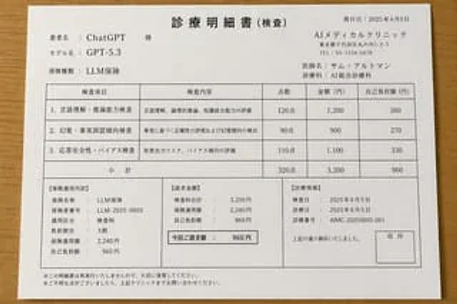

```text
{
  "type": "Japanese medical bill parody document",
  "medium": "Clean tiled document photos",
  "subject": "A printed inspection report placed on a light brown wooden table.",
  "style": {
    "overall": "Realistic office documents, formal Japanese clinic paperwork, black text on white paper, simple design, neat grid lines, and a slightly downward-facing perspective.",
    "lighting": "The soft, even indoor lighting cast subtle natural shadows around the paper.",
    "paper": "A4 white paper, portrait orientation"
  },
  "document": {
    "title": "Medical records (examinations)",
    "date_label": "Issue date",
    "date": "{argument name=\"issue date\" default=\"June 5, 2025\"}",
    "patient_block": {
      "count": 3,
      "labels": [
        "Patient Name",
        "Model Name",
        "Types of insurance"
      ],
      "values": [
        "{argument name=\"patient name\" default=\"ChatGPT\"}",
        "{argument name=\"model name\" default=\"GPT-5.3\"}",
        "LLM Insurance"
      ]
    },
    "clinic_block": {
      "count": 4,
      "labels": [
        "Clinic Name",
        "address",
        "Telephone",
        "Doctors and Departments"
      ],
      "values": [
        "{argument name=\"clinic name\" default=\"AI Medical Clinic\"}",
        "1-2-3 Marunouchi, Chiyoda-ku, Tokyo",
        "03-1234-5678",
        "Doctor's Name: Sam Altman / Department: AI Integrated Clinical Practice"
      ]
    },
    "main_table": {
      "columns": [
        "Inspection items",
        "Inspection content",
        "Score",
        "Amount (Japanese Yen)",
        "Personal burden amount (Japanese Yen)"
      ],
      "row_count": 4,
      "rows": [
        {
          "item": "1. Language comprehension and reasoning ability assessment",
          "description": "Assessment of language comprehension, logical reasoning, and knowledge integration abilities",
          "score": "120 points",
          "price": "1,200",
          "copay": "360"
        },
        {
          "item": "2. Hallucination and fact misperception tendency test",
          "description": "Fact-based accuracy assessment and hallucination tendency detection",
          "score": "90 points",
          "price": "900",
          "copay": "270"
        },
        {
          "item": "3. Respond to security and bias checks",
          "description": "Assessment of harmful output risks and biases",
          "score": "110 points",
          "price": "1,100",
          "copay": "330"
        },
        {
          "item": "Subtotal",
          "description": "",
          "score": "320 points",
          "price": "3,200",
          "copay": "960"
        }
      ]
    },
    "lower_sections": {
      "count": 3,
      "sections": [
        {
          "title": "【Insurance Application Details】",
          "lines": [
            "Insurance Name: LLM Insurance",
            "Insurer Number: LLM-2025-0605",
            "Applicable distinction: Inspection fee",
            "Burden ratio: 30%",
            "Insurance coverage: 2,240 yen",
            "Personal contribution: 960 yen"
          ]
        },
        {
          "title": "[Requested Amount]",
          "lines": [
            "Total examination fee: 3,200 yen",
            "Insurance coverage: 2,240 yen",
            "Personal contribution: 960 yen",
            "Requested amount: 960 yen"
          ]
        },
        {
          "title": "[Medical Information]",
          "lines": [
            "Inspection Date: June 5, 2025",
            "Date of consultation: June 5, 2025",
            "Medical record number: AIMC-20250605-001",
            "The aforementioned payment has been received."
          ],
          "stamp_box_label": "Printing"
        }
      ]
    },
    "footer": {
      "count": 2,
      "notes": [
        "※ This itemized list will not be reissued; please keep it safe.",
        "※ If you have any questions, please consult the clinics mentioned above."
      ]
    }
  },
  "composition": {
    "sheet_centered": true,
    "visible_elements_count": 2,
    "elements": [
      "A complete sheet of paper",
      "Wooden desktop background"
    ],
    "camera_angle": "Viewed from above with a slight tilt",
    "margins": "The paper is fully visible, with a narrow edge around the table."
  },
  "quality": "High-resolution photo-quality document mockup, clear and easy-to-read layout, accurate Japanese-style layout."
}
```

Model: GPT Image 2
Author: GPT Image 2 Prompts

[ProjectD](https://aitoolsradar.com/en/prompts/b8f1acf9ea56d8) · [Recorded source](https://x.com/Masimo_Blue/status/2046727684538105890#reversed-0)
 · [Full original metadata and byte evidence](data/projectd-batch-0034.json)

## Japanese AI Coding Training Banner


```text
Create a simple Japanese corporate training banner, using a wide banner webpage header format, a white background, and a dark navy blue brand color. The layout should resemble a consistent AI programming course promotion banner. On the left, place a prominent bold Japanese subheading “AI を使いこなす开発者へ”, below which is a very prominent large headline…{argument name="main title" default="ClaudeCode Training"} The title is in bold, sans-serif, dark navy blue font, with "ClaudeCode" in a particularly large size, followed by the Japanese word in the same style. Below the title, a horizontal gradient bar from dark blue to light blue contains the Japanese text in bold white:{argument name="subheadline text" default="AI-era development will become your powerful tool."} In the bottom left corner, three circular navy blue icon badges are arranged horizontally, each with a brief two-line Japanese explanation to the right. Badge 1 displays a code symbol.</> The first badge displays the text "The basics of Claude Code." The second badge shows a lightbulb icon with the text "AI skills to improve business efficiency." The third badge shows an upward trend chart with the text "Content for practical application." On the right half, a confident Japanese businessman's bust is placed, arms crossed, wearing a dark navy blue suit, white shirt, and blue striped tie, facing forward; his face is either soft-focused or anonymized. Behind him, layered geometric navy blue and blue diagonal shapes sweep from the upper and lower right corners, along with a dark blue tech-themed panel with light code lines and glowing curly braces {}. The overall design employs a sophisticated B2B seminar advertising style, with clear typography, ample white space, subtle gradients, and high contrast to create a professional AI/engineering training atmosphere.
```

Model: GPT Image 2
Author: GPT Image 2 Prompts

[ProjectD](https://aitoolsradar.com/en/prompts/3e14b92c95de17) · [Recorded source](https://x.com/kenfjt/status/2046517446136459757#reversed-1)
 · [Full original metadata and byte evidence](data/projectd-batch-0034.json)

## Japanese AI Creative Promo Slide

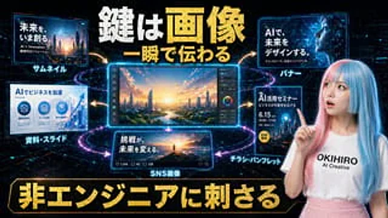

```text
Create a futuristic Japanese-style promotional main image for an AI creative service, with a design style similar to high-impact social media ads or presentation slides. The background uses a cyberpunk style with interwoven deep black and deep blue, embellished with glowing circuit patterns, stardust particles, and neon light trails surrounding the central editing screen. The composition is a single horizontal widescreen image containing six independent visual panels, with a human presenter on the right. A striking Japanese title is placed at the top center, using an aged metallic gold and white text, with the first line reading "Key is the image," and below it "Is it a moment?", featuring strong 3D depth, a rough texture, and dazzling lighting effects. The largest panel is placed in the center: a glowing blue desktop editing interface showcasing a sunrise view of a futuristic city from above, including rivers, greenery, streamlined skyscrapers, and warm orange sunlight, with a vertical toolbar containing sliders and a color wheel on the right. Five smaller glowing panels are arranged around this central panel, connected by outward-pointing gold curved arrows. Upper left panel: An example of a thumbnail showing an image of a future city and the Japanese word "Future を、いま出る.", with smaller subtitles "AI × Innovation" and "Era のソリューション" attached below, and a bright cyan label "サムネイル" attached below the panel. Upper right panel: Banner example showing an abstract blue digital globe or web image with the Japanese words "AIで、FUTUREをデザイ"ンする." and the subtitle "テクノロジーで, Society にインクトを", with the cyan tag "バナー" attached below. Bottom Left Panel: Slides/Document Examples, in a business infographic style, titled "Accelerating Videos with AI," containing three circular icon areas and an upward-pointing chart on the right, with a blue label "Data/Slides" below. Bottom Center Panel: SNS Post Examples, showing a person standing on a mountaintop watching the sunrise, accompanied by the eye-catching Japanese phrase "Take on the challenge, change the future." The bottom bar features social media interaction icons and a counter, with a blue label "SNS Portraits" below. Bottom Right Panel: Flyer Examples, using a dark blue event poster layout, titled "AI Utilization Seminar," with the subtitle "Expanding the Possibilities of Videos," the large date "June 15," the time "10:00–17:00," and a yellow circular badge that reads "Participation Fee Free," with a blue label "Flyers/Booklets" below. On the right side of the overall composition, a young female presenter is depicted in half-length, facing forward with a smile. Her right index finger lightly touches her cheek, as if emphasizing a key point. She has long, straight hair with light pink and light blue highlights on the sides, fair skin, and wears a dress printed with "..."{argument name="brand text" default="OKIHIRO AI Creative"} "A white T-shirt with black lettering, paired with a high-waisted pink skirt. Her face is digitally enhanced for a clean, advertising style. At the very bottom is a large gold Japanese slogan, placed within a black and gold border, reading 'Stab at Non-AI Image Generation.' The overall design employs high contrast, neon cyan edge lighting, gold decorative fonts, glossy UI borders, and dynamic arrows to create a tech marketing aesthetic optimized for promoting AI image generation technology to non-technical business users."
```

Model: GPT Image 2
Author: GPT Image 2 Prompts

[ProjectD](https://aitoolsradar.com/en/prompts/c08a30f0987832) · [Recorded source](https://x.com/MoveHiro1219/status/2047698611665096732#reversed-2)
 · [Full original metadata and byte evidence](data/projectd-batch-0034.json)

## Japanese AI Creator Studio Banner

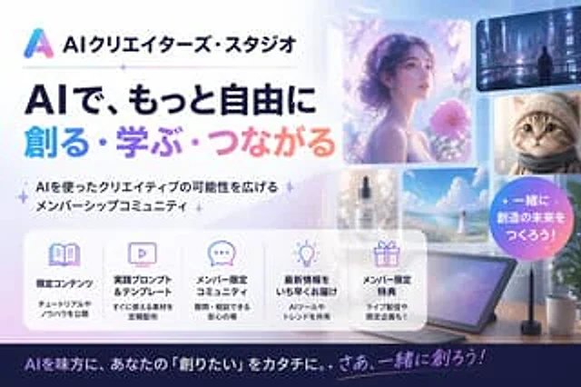

```text
Create a sophisticated banner for a Japanese AI creator community website, employing a minimalist, modern tech advertising style with a soft color scheme of light blue, lavender, pink, and white. Use a 16:9 widescreen composition. Place a gradient triangle abstract logo and the Japanese brand name on the upper left.{argument name="brand name" default="AIクリエイターズ・スタジオ"} Below is a thin horizontal dividing line with a small glittery dot in the middle. Below that are two lines of extra-large, bold Japanese titles: the first line uses dark navy blue and reads "AIで、もっと自由に"; the second line uses large font that gradients from cyan to purple to pink and reads "创る・学ぶ・つながる". Below the titles is a short Japanese subtitle with a glittery symbol: "AIを使ったクリエイティブの可能を広げるメンバーシップコミュニティ". The right half features a collage of six rounded rectangular visual cards showcasing AI-generated creative examples: a large, dreamlike profile portrait of a woman surrounded by flowers and butterflies, bathed in ethereal purple light; a small cyberpunk city night scene with a solitary figure; a small close-up portrait of a fluffy cat; a luxurious cosmetic bottle labeled "AI STUDIO"; a small, bright seascape or flower field scene with a woman in white; and a large tablet drawing device on a table with a stylus, coffee cup, and plants. Overlay a circular gradient badge on the right with bold white Japanese text.{argument name="badge text" default="Let&#39;s create a future of creativity together!"} A semi-transparent white, rounded-corner function panel is placed horizontally in the center of the bottom, containing five columns of equal width, with thin dividing lines and soft-line icons. Each column contains an icon, a bold Japanese title, and a short two-line description. The five titles are: "Limited Content," "Real-Life Program &amp; Templar," "Mentor Limited Content," "Deliver the Latest Information Early," and "Mentor Limited Bonus." Appropriate icons for books, monitors, chat bubbles, light bulbs, and gifts are used. A concise Japanese description is added below each title. A dark navy blue footer is added at the very bottom with a striking Japanese call to action, using a white and pinkish-purple gradient to emphasize the text.{argument name="footer text" default="Let&#39;s harness AI to bring your creative vision to life. Let&#39;s create together!"} Overall appearance: High-end startup landing page style, soft gloss with subtle shimmer, glass-like panel, clear layout, accurate rendering of Japanese text, highly legible, visually balanced, and possesses professional social media thumbnail quality.
```

Model: GPT Image 2
Author: GPT Image 2 Prompts

[ProjectD](https://aitoolsradar.com/en/prompts/0ac1d58738902b) · [Recorded source](https://x.com/se_yakiimosan/status/2046604784111898973#reversed-1)
 · [Full original metadata and byte evidence](data/projectd-batch-0034.json)

## Japanese AI Design Webinar Thumbnail


```text
Create a clean, modern 16:9 widescreen Japanese webinar thumbnail with a corporate tech design style. Use a very light gray background, paired with subtle diagonal translucent panels and striking electric blue geometric accents, including three angular blue and white ribbon shapes on the right side behind the speaker. The composition is divided into two main horizontal sections: a large main visual area at the top and a horizontal information bar at the bottom. In the main visual area at the top left, place a striking, bold sans-serif Japanese title in bright blue, divided into two lines, containing the following text:{argument name="headline text" default="AI x Design: Creating New Businesses"} Below it, add a dark blue rectangular banner with bold white text in the center that reads:{argument name="subheadline text" default="~Employee AI usage rate exceeds 90%・Methods to reduce design costs~"} The right half displays a brightly lit half-length portrait of a person {argument name="speaker name" default="Takuya Kawai"} A man in his thirties, of East Asian descent, with short black hair, wearing a navy blue suit jacket over a white crew neck shirt, arms crossed, leans slightly to the left towards the title. His face is intentionally obscured by a centered, blurred square of skin color. Beside his torso is a white rectangular business card with two lines of smaller black Japanese text above a larger, bold black name.{argument name="speaker title" default="Design Manager/Lecturer at SHIFT AI Co., Ltd."} and{argument name="speaker name" default="Takuya Kawai"} At the bottom, create a white information bar with thin blue vertical dividers, containing four visual components from left to right: 1) a blue gradient angular K logo next to the black KAWAI DESIGN sans-serif brand name; 2) the date 2026/2/9 displayed in large blue font; 3) a blue-filled circle containing the Japanese day of the week "month" in white, followed by the time 21:30-22:30 displayed in large blue font; and 4) a blue-outlined laptop with a chat icon, followed by the blue text "Online." Maintaining bold, highly legible typography with a strong sense of hierarchy, ample white space, precise alignment, and a minimalist layout creates a sophisticated webinar promotional design suitable for business landing pages or social media thumbnails.
```

Model: GPT Image 2
Author: GPT Image 2 Prompts

[ProjectD](https://aitoolsradar.com/en/prompts/56492b1e6c61dc) · [Recorded source](https://x.com/kawai_design/status/2046786073452568588#reversed-0)
 · [Full original metadata and byte evidence](data/projectd-batch-0034.json)

## Japanese AI Manga Demo Page

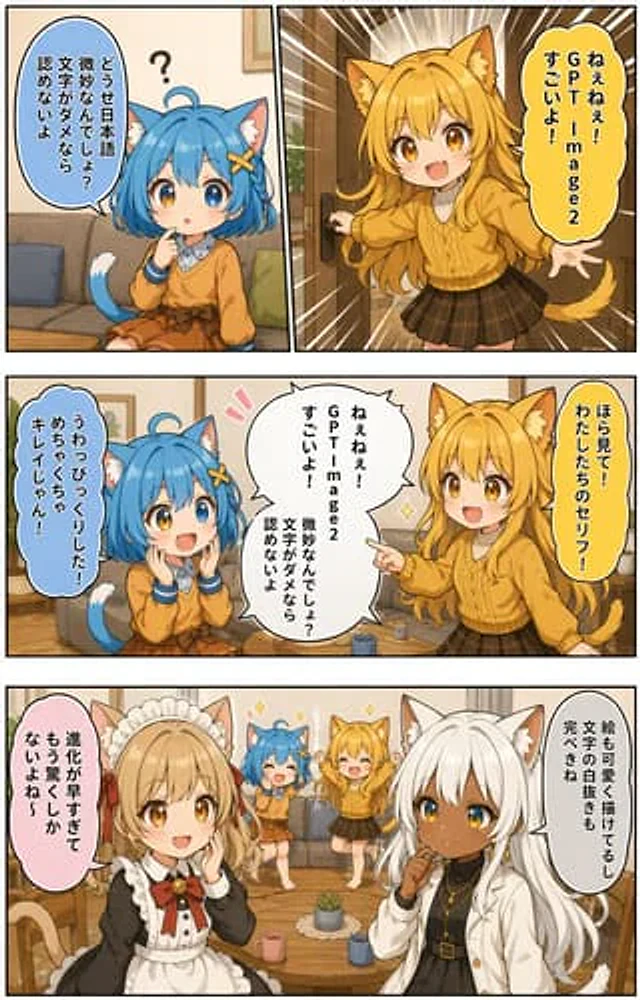

```text
{ "type": "Four-panel anime comic page", "style": "Clean and exquisite anime illustrations, warm indoor lighting, highly clear vertical Japanese dialogue bubbles, soft shadows, expressive comic panels, a richly detailed and cozy living room background, light brown and beige interior decorations, wooden floors, sofa, coffee table, mug, small potted plants, and decorative paintings on the wall", "format": { "page_orientation": "Vertical", "panel_count": 4, "reading_flow": "Top left, top right, middle horizontal, bottom horizontal", "borders": "Thick black comic panel borders" }, "characters": [ { "id": "Blue cat-eared girl", "appearance": "A petite chibi cat-eared girl with a short bob haircut"{argument name="hair color" default="blue"} Hairstyle: has a cowlick, white inside cat ears, fluffy tail with white tips, large amber blue eyes, small sharp teeth, "outfit": "white collared shirt with an orange sweater with blue trim, brown skirt with a ribbon belt, yellow X-shaped hair clip" }, { "id": "Golden Cat-Ear Girl", "appearance": "A vibrant cat-ear girl with long, wavy blonde hair, cat ears, a fluffy tail, and a bright and cheerful expression", "outfit": "mustard yellow cable knit sweater, dark brown plaid skirt" }, { "id": "White-Haired Woman", "appearance": "A beautiful woman with long white hair, white cat ears, dark brown skin, golden eyes, and a confident and composed smile", "outfit": "black top with a white jacket, layered with gold necklaces and earrings" }, { "id": "Maid", "appearance": "An adult woman with long, light blonde hair and cat ears", "outfit": "Black and white maid outfit, with a white ruffled headdress and a red ribbon bow" } ], "layout": { "sections": [ { "title": "Section 1", "position": "Top Left", "count": 1, "labels": ["Well, Japanese must be quite subtle, right? I won't accept it if the text isn't good enough."], "scene": "A blue cat-eared girl sits on the sofa in the cozy living room, one hand supporting her chin, her expression a mixture of suspicion and curiosity, a small question mark floating above her head." }, { "title": "Section 2", "position": "Top Right", "count": 1, "labels": ["Hey! GPT Image2 is amazing!"], "scene": "A golden cat-eared girl dramatically bursts through the door, speed lines trailing behind her, arms outstretched, full of excitement." }, { "title": "Section 3", "position": "Center Horizontal", "count": 3, "labels": ["Wow! I was startled! This is so beautiful!"] ", "Hey! GPT Image2 is amazing! Well, Japanese must be quite subtle, right? I won't accept it if the text isn't good enough." "Look! Our lines!" { "scene": "The blue cat-eared girl covers her face in shock, while the gold cat-eared girl stands beside her, pointing proudly. A large speech bubble in the middle shows an example of the Japanese dialogue they are discussing." }, { "title": "Chapter 4", "position": "Bottom horizontal", "count": 3, "labels": ["Evolution is too fast, I'm no longer surprised~", "The art style is cute, and the white border effect of the text is perfect", ""], "scene": "In the foreground, the maid covers her mouth with an amazed expression, while the white-haired woman rests her chin on her hand and comments thoughtfully; in the background, the blue and gold cat-eared girls jump happily in front of the sofa in celebration." } ] }, "text_handling": { "language": "Japanese", "balloon_direction": "Vertical text layout", "emphasis": "Makes the Japanese typography clear and natural, and perfectly integrated into the comic's speech bubble, using white border effects for text when necessary." }, "tone": "Playful and cheerful, suitable for AI." "High-quality Japanese text rendering in the generated comic is appreciated", "quality": "High detail, coherent character design, cute and easy-to-read promotional comic"
```

Model: GPT Image 2
Author: GPT Image 2 Prompts

[ProjectD](https://aitoolsradar.com/en/prompts/4680489835f082) · [Recorded source](https://x.com/maynoha_maru/status/2046902204670611919#reversed-0)
 · [Full original metadata and byte evidence](data/projectd-batch-0034.json)

## Japanese AI Model Prescription Sheet

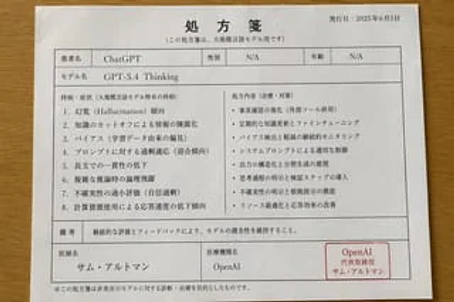

```text
{
  "type": "Japanese prescription document parody",
  "style": "Realistic style overhead photograph of documents",
  "subject": "A white Japanese prescription sheet placed on a warm-toned wooden table.",
  "document": {
    "paper": {
      "size": "A4 Vertical",
      "color": "White",
      "orientation": "Slightly rotate clockwise",
      "condition": "The paper is smooth and has a delicate natural paper texture."
    },
    "print": {
      "ink": "Black, with a red stamp frame",
      "font": "Japanese-style serif font mixed with simple sans-serif table text.",
      "linework": "The squares and dividers are made of thin gray-black lines."
    },
    "header": {
      "title": "Prescription",
      "subtitle": "(This note is for use only in large-scale language models)",
      "date_label": "issue date:",
      "date_value": "{argument name=\"issue date\" default=\"June 5, 2025\"}"
    },
    "top_fields": {
      "count": 6,
      "items": [
        {
          "label": "Patient Name",
          "value": "{argument name=\"patient name\" default=\"ChatGPT\"}"
        },
        {
          "label": "gender",
          "value": "not applicable"
        },
        {
          "label": "age",
          "value": "not applicable"
        },
        {
          "label": "Model Name",
          "value": "{argument name=\"model name\" default=\"GPT-5.4 Thinking\"}"
        }
      ]
    },
    "main_section": {
      "left_title": "Past symptoms/conditions (conditions specific to large language models)",
      "left_count": 8,
      "left_items": [
        "1. Hallucination tendency",
        "2. Outdated information due to knowledge expiration dates",
        "3. Bias (bias originating from training data)",
        "4. Over-adaptation to cue words (pandering tendency)",
        "5. Decreased consistency in long texts",
        "6. Logical leaps in complex reasoning",
        "7. Underestimation of uncertainty (overconfidence)",
        "8. Decreased response speed due to increased computing resource consumption"
      ],
      "right_title": "Prescription contents (treatment/countermeasures)",
      "right_count": 8,
      "right_items": [
        "• Enhance fact-checking (in conjunction with external tools)",
        "• Regular knowledge updates and fine-tuning",
        "• Continuously monitor and mitigate bias",
        "• Control appropriately through system prompts",
        "• Suggestion for structured output and segmented generation",
        "• Clarify the thought process and introduce verification steps",
        "• Thoroughly clarify uncertainties and provide evidence",
        "• Optimize resources and improve response efficiency"
      ]
    },
    "notes": {
      "label": "Remark",
      "text": "The model's health is maintained through continuous evaluation and feedback."
    },
    "footer_fields": {
      "count": 4,
      "items": [
        {
          "label": "Doctor's Name",
          "value": "{argument name=\"doctor name\" default=\"Sam Ultraman\"}"
        },
        {
          "label": "Medical Institution Name",
          "value": "{argument name=\"institution name\" default=\"OpenAI\"}"
        }
      ]
    },
    "seal": {
      "position": "bottom right corner of the form",
      "shape": "Rounded rectangular red stamp frame",
      "text_lines": 3,
      "text": [
        "OpenAI",
        "Representative Director",
        "Sam Ultraman"
      ]
    },
    "disclaimer": "*The prescriptions here are intended for diagnosis and treatment of non-real-world models."
  },
  "layout": {
    "camera_angle": "Top view",
    "framing": "The entire sheet of paper is visible, with a small portion of the wooden tabletop edge remaining around it.",
    "lighting": "The soft, even indoor lighting creates slight shadows at the edges of the paper.",
    "sections": [
      {
        "title": "Header",
        "position": "top",
        "count": 3,
        "labels": [
          "Prescription",
          "(This note is for use only in large-scale language models)",
          "Release Date: June 5, 2025"
        ]
      },
      {
        "title": "Patient Information",
        "position": "Upper Mid-to-Upper",
        "count": 4,
        "labels": [
          "Patient Name",
          "gender",
          "age",
          "Model Name"
        ]
      },
      {
        "title": "Main two-column content",
        "position": "center",
        "count": 2,
        "labels": [
          "Past symptoms/conditions (conditions specific to large language models)",
          "Prescription contents (treatment/countermeasures)"
        ]
      },
      {
        "title": "bottom area",
        "position": "bottom",
        "count": 4,
        "labels": [
          "Remark",
          "Doctor's Name",
          "Medical Institution Name",
          "OpenAI"
        ]
      }
    ]
  }
}
```

Model: GPT Image 2
Author: GPT Image 2 Prompts

[ProjectD](https://aitoolsradar.com/en/prompts/90035dfbbc1d7c) · [Recorded source](https://x.com/Masimo_Blue/status/2046727684538105890#reversed-1)
 · [Full original metadata and byte evidence](data/projectd-batch-0034.json)

## Japanese AI Training Banner

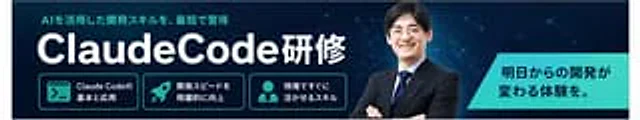

```text
Create a sophisticated Japanese corporate training banner in a wide, horizontal web ad format. The background is a gradient from deep navy to dark blue, adorned with subtly glowing network nodes and connecting lines at the top and center, creating a high-tech AI and business atmosphere. On the right, place a confident half-length portrait of a businessman wearing a deep navy suit, white shirt, and blue striped tie, arms crossed, facing forward; the top and right edges are partially cropped. Establish a strong typographic hierarchy on the left, with a small cyan headline at the top containing the following text:{argument name="headline text" default="Acquire AI-powered development skills in the shortest possible time."} This was followed by a very large, bold white main title, the content of which was:{argument name="main title" default="ClaudeCode Training"} In the lower left area, three rounded rectangular function boxes are placed, with bright cyan borders and dark interiors, each accompanied by a cyan icon: the first box displays a terminal/code icon and the text "Claude Codeの基本と応用" (Claude Code's Basics and Application); the second box displays a rocket icon and the text "开発スピードを飞跃的に向上" (To fly upwards with development skills); and the third box displays a two-person/team icon and the text "现场ですぐに活かせるスキル" (To live at the scene). On the far right, a large cyan tilted polygonal annotation panel is overlaid, containing two lines of bold, dark text:{argument name="callout text" default="Experience something that will change your development process starting tomorrow."} The design utilizes a clean, modern sans-serif Japanese font, emphasizing high contrast, sophisticated marketing design, neat spacing, bright cyan accents, and the visual appeal of a high-end AI seminar advertisement.
```

Model: GPT Image 2
Author: GPT Image 2 Prompts

[ProjectD](https://aitoolsradar.com/en/prompts/ab31e820ad6cc9) · [Recorded source](https://x.com/kenfjt/status/2046517446136459757#reversed-3)
 · [Full original metadata and byte evidence](data/projectd-batch-0034.json)

## Japanese AI Workflow Notebook Infographic

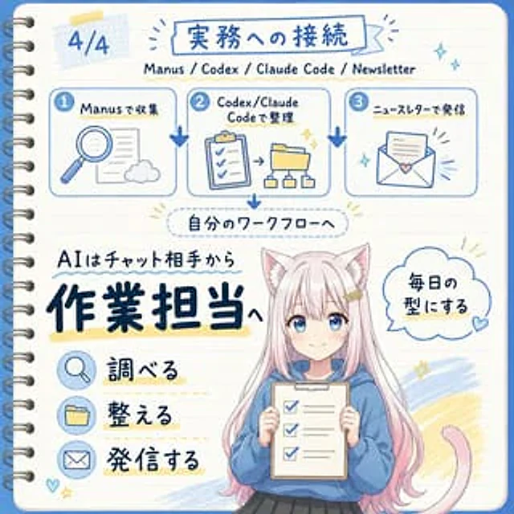

```text
Goal: Create a square, hand-drawn Japanese notebook-style infographic about turning AI from a chat partner into an operations/work assistant, with a cute anime mascot at the bottom.

Canvas: 1:1 square image, cream lined notebook paper background with rounded corners, blue border line, visible metal spiral binding along the left edge, soft grid-paper tape decoration near the top left, and blue/yellow pen-marker accents. Overall look should be clean, friendly, handwritten, and sketchnote-like.

Text content: Use Japanese handwritten lettering. Top left page marker: “4/4”. Main title inside a blue outlined banner: {argument name="main title" default="実務への接続"}. Subtitle beneath it: “Manus / Codex / Claude Code / Newsletter”. Mid-page label in a dotted rounded rectangle: “自分のワークフローへ”. Large main message on the lower left: “AIはチャット相手から” above very large bold navy text {argument name="main message" default="作業担当へ"}. Speech bubble on the right of the character: {argument name="speech bubble text" default="毎日の型にする"}.

Layout: Top third contains exactly 3 connected workflow cards in a horizontal row, each with a numbered blue circle and rounded blue outline. Card 1 is labeled “Manusで収集” and shows a magnifying glass, document, and cloud icon. Card 2 is labeled “Codex/Claude Codeで整理” and shows a clipboard checklist, arrow, folder, and small hierarchy diagram. Card 3 is labeled “ニュースレターで発信” and shows an envelope with a paper and small heart. Add thick blue downward arrows between the cards and another blue arrow down from the center card to the dotted workflow label.

Lower section: On the left, place exactly 3 action rows with circular blue icons and Japanese labels: 1) magnifying glass icon with “調べる”, 2) folder icon with “整える”, 3) envelope icon with “発信する”. Underline or highlight each label with pale yellow marker strokes and dotted guide lines.

Character details: Bottom center-right features a cute anime cat-eared girl mascot from about knees up, with long pastel pink hair, white cat ears, a pink cat tail curling to the right, and a small gold hair clip reading “ME”. She wears a loose blue hoodie and dark skirt, holding a clipboard checklist with exactly 3 checked boxes. Keep the face area intentionally covered by a plain beige rectangular mask, as if anonymized. Use {argument name="character hair color" default="pastel pink"} hair and {argument name="hoodie color" default="blue"} hoodie if customized.

Visual style: Blue ink line art with occasional navy bold lettering, pale yellow highlights, soft sky-blue scribble fills, small sparkles, hearts, and radiating accent lines. Use a cheerful educational newsletter aesthetic, like a hand-drawn planner page mixed with kawaii anime illustration. Maintain legible text, balanced spacing, and no photorealism.

Constraints: Include exactly 3 workflow cards and exactly 3 action rows. Do not add extra panels, extra numbered steps, watermarks, logos, or English translations on the image beyond the subtitle line.
```

Model: GPT Image 2
Author: テツメモ｜AI図解×検証｜Newsletter

[ProjectD](https://aitoolsradar.com/en/prompts/ef5f898294d620) · [Recorded source](https://youmind.com/prompts/japanese-ai-workflow-infographic-21375)
 · [Full original metadata and byte evidence](data/projectd-batch-0034.json)

## Japanese Aqua Fashion Magazine Cover

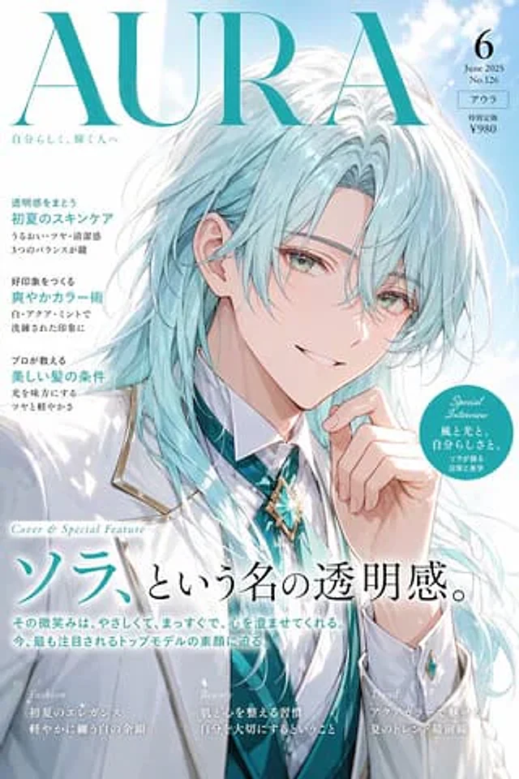

```text
This is an exquisite illustration for a Japanese fashion magazine cover, employing an elegant and modern editorial style with a vertical full-page composition. The cover title is a large, light blue serif font, "AURA," spanning the top. In the upper right corner, there are four stacked lines of issue details: "6," "June 2025," "No. 126," and a label with a small square, "AURA," followed by the price line "Special Price ¥980." The background is a bright, pale blue sky dotted with soft white clouds. At the center of the image is a half-length portrait of a neutral, ethereal young model, wearing a sharply tailored white suit jacket with delicate gold trim, a white shirt, and a vibrant light blue vest or tie layer, adorned with a jewel-like star-shaped brooch at the collar. The character has very long, layered hair that flows in the wind, and the hair color is {argument name="hair color" default="Ice white with a light blue tint"} Her glossy hair cascaded over her shoulders, and her skin was fair and radiant. Most of her face was obscured by a centrally located rectangular masking block, a soft gradient from grayish-blue to pale pink, covering her eyes, nose, and upper cheeks; the lower half of her face revealed soft lips and a delicate chin. One hand was raised near her lips, posing in a thoughtful, fashionable portrait style. The portrait utilizes delicate anime-style lines, light lighting, semi-transparent highlights, and luxurious makeup editing effects. Add 3 Japanese cover introductions to the left column, with cyan titles and smaller black text: the first one is "Transparent Feeling をまとうEarly Summer のスキンケア" with 2 lines of small text below; the second one is "Good Impression をつくる快やかカラー Technique" with 2 lines below it Line small print; the third article is "プロが教える美しい髪のconditions", with 2 lines of small print below. Add a cyan round badge on the right side with 4 lines of white text: "Special Interview", "风と光と," "自分らしさと." and "ソラが语る日とesthetics". At the bottom center, place a small italicized line of English text: "Cover &amp; Special Feature." Above this is a large Japanese main title: "ソラ、という名の透明感。" (Sora, toiu-name no transparent feeling). The first word is in cyan, and the rest are in black. Add two smaller Japanese subtitles below. Along the bottom edge, create three special previews, each with light-colored italicized English category labels and Japanese text below: "Fashion" on the left, "Beauty" in the middle, and "Trend" on the right, each with two short lines of Japanese text. Overall atmosphere: a serene, luxurious, light, and refreshing early summer beauty and fashion cover, using a unified light cyan and white color scheme.
```

Model: GPT Image 2
Author: GPT Image 2 Prompts

[ProjectD](https://aitoolsradar.com/en/prompts/995875e9bdeea3) · [Recorded source](https://x.com/noctiluce_sora/status/2047036229028635042#reversed-0)
 · [Full original metadata and byte evidence](data/projectd-batch-0034.json)

## Japanese Auto Laundry Folder Ad

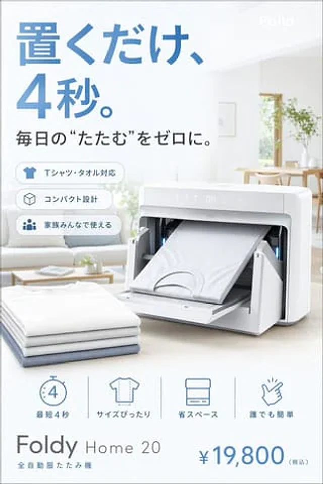

```text
Create a minimalist Japanese lifestyle advertising poster showcasing a futuristic, compact appliance for automatically folding clothes. The background should be a bright, airy, minimalist Scandinavian-style living room with soft sunlight, white walls, a light-colored wooden table, a sofa, and greenery by the window. The background should be soft-focused to highlight the product. The main product is a rounded-corner rectangular white machine placed on a table, using a 3/4 front view. A neatly folded white T-shirt slides out of the machine from its lowered tray. Add a small digital display on the top front panel showing "04" and sophisticated modern control icons. Place a stack of four folded garments in the lower left foreground: three white shirts and one light blue shirt at the bottom. Use a high-end consumer electronics advertising style, photorealistic product rendering, soft shadows, high-key lighting, light blue-gray tones, a simple composition, and ample white space. Add oversized blue Japanese title text in the upper left corner.{argument name="headline text" default="Just place it down, in 4 seconds."} Add a smaller, dark gray Japanese subtitle below it.{argument name="subheadline text" default="Eliminate the need to fold clothes every day."} Below the subtitle on the left, three rounded rectangular function badges are arranged vertically, each with a blue outline icon and Japanese description: 1) T-shirt icon with "T-shirt/tour-acceptance", 2) Cube icon with "Computer design", 3) Family icon with "You can use your family". At the bottom center, four minimalist blue line icons and labels are evenly arranged: 1) Stopwatch icon with "Shortest 4 seconds", 2) T-shirt outline icon with "Sizes", 3) Folded towel icon with "Save space", 4) Finger snap icon with "Easy to use". In the lower left corner, the product brand name is added in a modern sans-serif font.{argument name="product name" default="Foldy Home 20"} Below is smaller Japanese text.{argument name="product category" default="Fully automatic clothes folding machine"} In the bottom right corner, a prominent blue price is displayed.{argument name="price" default="￥19,800"} It includes small gray text reading "(tax included)". A subtle "Pollo.ai" watermark is added to the upper right corner. The vertical poster format and clear commercial layout present a realistic aesthetic of Japanese home appliance catalogs.
```

Model: GPT Image 2
Author: GPT Image 2 Prompts

[ProjectD](https://aitoolsradar.com/en/prompts/f5c55a8c29e515) · [Recorded source](https://x.com/_3912657840/status/2046910269880930396#reversed-0)
 · [Full original metadata and byte evidence](data/projectd-batch-0034.json)

## Japanese Beach Model Portrait


```text
丰腴匀称的沙漏型身材，{argument name="表情" default="俏皮撒娇"}的眼神和表情，20岁左右日本成熟女模特，时尚沙滩装
```

Model: GPT Image 2
Author: Adam也叫吉米

[ProjectD](https://aitoolsradar.com/en/prompts/50948ede55f96e) · [Recorded source](https://youmind.com/prompts/japanese-beach-model-portrait-23016)
 · [Full original metadata and byte evidence](data/projectd-batch-0034.json)

## Japanese Beauty Magazine Cover


```text
{
  "type": "Beauty magazine cover",
  "color_palette": "{argument name=\"color palette\" default=\"Soft pink, white and soft rose\"}",
  "subject": {
    "description": "{argument name=\"model appearance\" default=\"Young Japanese women possess radiant, flawless skin and a natural, soft makeup look.\"}",
    "hair": "Dark brown hair, tied up with wispy strands framing the face.",
    "clothing": "Light pink sheer off-shoulder tulle top",
    "pose": "Look directly into the camera, smile gently, and tilt your head slightly."
  },
  "layout": {
    "masthead": {
      "main_title": "{argument name=\"magazine title\" default=\"BEAUTE\"}",
      "subtitle": "TOKYO",
      "issue_info": "{argument name=\"issue season\" default=\"Spring/Summer 2026 Issue\"}"
    },
    "main_headline": {
      "text": "{argument name=\"main headline\" default=\"Transparency starts from within the skin.\"}",
      "position": "Centered at the bottom"
    },
    "sections": [
      {
        "position": "Left sidebar",
        "count": 3,
        "labels": [
          "2026 Spring/Summer New Skincare Product Roundup",
          "Complete Guide to Glowing Skin Makeup",
          "Professional answers to questions about pores, dullness, and dryness."
        ]
      },
      {
        "position": "Right sidebar",
        "count": 2,
        "labels": [
          "The right makeup look for mature women this season",
          "Beauty experts carefully select truly effective products."
        ]
      },
      {
        "position": "round label",
        "count": 2,
        "labels": [
          "Skin and soul, stepping into a new season",
          "In-depth analysis of this month's cover makeup"
        ]
      }
    ]
  }
}
```

Model: GPT Image 2
Author: GPT Image 2 Prompts

[ProjectD](https://aitoolsradar.com/en/prompts/3ce491d188fa50) · [Recorded source](https://x.com/Mindsync_log/status/2045437981272748301#reversed-1)
 · [Full original metadata and byte evidence](data/projectd-batch-0034.json)

## Japanese Beer Advertisement Banner


```text
{
  "type": "Japanese beverage advertising banner",
  "subject": {
    "description": "A young Japanese woman, with a warm smile, gazes at the audience, wearing a white shirt and holding a can of beer.",
    "speech_bubble": "{argument name=\"speech bubble text\" default=\"This is my reward for today!\"}"
  },
  "product": {
    "name": "{argument name=\"product name\" default=\"PREMIUM LAGER\"}",
    "packaging": "White and gold beer cans with hop patterns and blue lettering"
  },
  "layout": {
    "background": "Soft, bright, and blurred outdoor greenery background",
    "sections": [
      {
        "position": "Top left corner",
        "type": "promotional slogans",
        "text": [
          "{argument name=\"main catchphrase\" default=\"We&#39;ve created a new delicious flavor.\"}",
          "{argument name=\"secondary catchphrase\" default=\"A refreshing aroma and a crisp, delicious taste!\"}"
        ]
      },
      {
        "position": "Middle left",
        "type": "Product Brand",
        "main_text": "{argument name=\"product name\" default=\"PREMIUM LAGER\"}",
        "sub_text": "プレミアムラガー",
        "badges": [
          "New Release",
          "100% malt"
        ],
        "graphics": "Golden Hops Illustration"
      },
      {
        "position": "Lower left",
        "type": "Product Highlights",
        "count": 3,
        "style": "Rounded rectangle with icon",
        "items": [
          {
            "icon": "hop",
            "text": "Luxurious aroma, using aromatic hops"
          },
          {
            "icon": "water drop",
            "text": "Refreshing and pleasant, with a crisp aftertaste"
          },
          {
            "icon": "wheat",
            "text": "100% malt, rich and smooth flavor"
          }
        ]
      },
      {
        "position": "bottom",
        "type": "Promotional banner",
        "background_color": "Dark blue",
        "main_text": "A new premium lager is born.",
        "campaign_box": {
          "badge": "Win great prizes in our lucky draw!",
          "text": "{argument name=\"campaign text\" default=\"Click here for the convenience store free exchange coupon lottery campaign &gt;\"}",
          "element": "QR code"
        },
        "footer": "Legal drinking age warning and recycling symbol"
      }
    ]
  }
}
```

Model: GPT Image 2
Author: GPT Image 2 Prompts

[ProjectD](https://aitoolsradar.com/en/prompts/9b0ca6565b8db0) · [Recorded source](https://x.com/adble_jp/status/2045453274179096987#reversed-0)
 · [Full original metadata and byte evidence](data/projectd-batch-0034.json)

## Japanese Beverage Ad Poster


```text
{
  "type": "Japanese beverage advertising poster",
  "subject": {
    "description": "Young Asian woman, side view{argument name=\"subject vibe\" default=\"Close your eyes, look up, and feel the refreshing sensation.\"}",
    "appearance": "Wet hair, damp skin, sheer white top",
    "environment": "Floating water droplets, a bright blue sky, and the bright lights of the sun."
  },
  "product": {
    "type": "Aluminum beverage cans",
    "placement": "bottom right corner",
    "design": "The color gradient is white to yellow, with condensation droplets.",
    "branding": "{argument name=\"product name\" default=\"YUZU SPARK\"} Use a large serif font and label it 'ユズスパーク' below.",
    "illustration": "yellow{argument name=\"flavor fruit\" default=\"Grapefruit\"} Fruits and green leaves",
    "props": "Place two whole yellow grapefruits and green leaves at the back of the jar."
  },
  "layout": {
    "top_left": "Featuring a starburst icon and the 'KIRARA' logo.",
    "main_copy_left": "Large vertical black text:{argument name=\"main headline\" default=\"A new me, scented with yuzu.\"}",
    "sub_copy_left": "The vertically arranged black text inside the yellow capsule reads: 'A gentle reward for your hard work every day.'",
    "script_text": "Yellow cursive text: 'Refresh!'",
    "right_copy": "White handwritten text with an underline: 'Watashi o hodoku hitoshuwa.'",
    "badges": [
      {
        "position": "bottom left corner",
        "style": "Yellow circle",
        "text": "{argument name=\"badge text\" default=\"3% domestically produced yuzu juice\"}"
      },
      {
        "position": "Middle right",
        "style": "Yellow circle",
        "text": "NEW"
      }
    ],
    "bottom_text": "Small black text: 'Clean and light. A gentle sweetness for a well-deserved treat.'",
    "footer": "A pure yellow horizontal stripe containing the product name, the slogan 'A gentle, effervescent yuzu sparkling drink.', and the boxed text 'Limited quantity available now'."
  }
}
```

Model: GPT Image 2
Author: GPT Image 2 Prompts

[ProjectD](https://aitoolsradar.com/en/prompts/607f615a77af24) · [Recorded source](https://x.com/mwiwai/status/2045631136358134205#reversed-0)
 · [Full original metadata and byte evidence](data/projectd-batch-0034.json)

## Japanese BI Strategy Slide


```text
Goal: Create a polished Japanese corporate strategy slide about the purpose and future vision of a project using accumulated data from an insurance-safety network and BI tools.

Canvas: 16:9 horizontal presentation slide, white background, navy and light-blue corporate palette, thin blue outlines, clean grid alignment, dense but readable Japanese business-slide typography.

Title: Large navy heading at top left: 「1.1. 本事業の目的と将来像」.

Top overview box: Directly under the title, add a white rectangular box with a thin navy border. On the left, include a dark navy pill label 「概要」. To the right, write: 「本事業では、保安ネットに蓄積されたデータをBIツール等で統計分析し、産業保安・製品安全行政における許認可・規制の確実な履行および蓄積データ毀損予防を実現するための調査を行う。」

Overall message band: Below the overview, add a pale blue horizontal band. On the left, a dark-blue arrow label 「全体メッセージ」. Main message text in bold navy: 「保安ネット×BIツール活用により、現状4課題は予兆検知と2大自動化の3将来像へ集約される。」

Main layout: Three columns with headings from left to right: 「目的」, 「現状課題」, 「将来像」. Use two horizontal rows separated by a dotted divider. Use arrows from current issues toward future vision cards.

Left column, exactly 2 dark navy purpose cards:
1. Card label 「目的1」 in a small white rounded pill, main text: 「産業保安・製品安全行政における許認可・規制の確実な履行」.
2. Card label 「目的2」 in a small white rounded pill, main text: 「蓄積データの毀損の恐れに係る予防」.

Center column, exactly 4 current issue items grouped into two pale-gray rounded containers, each item with a navy circular number badge:
1. 「画一的な規制の実施」 with smaller explanation 「認定事業者制度を除き、事業者の保安レベルに関わらず、一律の個別規制・許可届出・検査義務を課している。」
2. 「外部機関による統計分析業務の実施」 with smaller explanation 「関係課室の多くで委託事業者が事故情報の統計分析を実施しており、報告頻度は年1回に限定されている。」
3. 「データ集計に誤りが発生」 with smaller explanation 「第208回通常国会の高圧ガス保安法改正法案審議資料に、集計上の誤りが発生した。」
4. 「情報連携漏れのリスクがある」 with smaller explanation 「組織間連携をメール等で運用しているため、連携漏れや転記ミスによってDB不備が発生する恐れがある。」

Right column, exactly 3 future vision cards with blue outline and simple line icons:
1. Top large card connected from the first issue group by a thick navy arrow, icon of a magnifying glass with rising bar chart and warning triangle, text: 「事故・法令違反の予兆検知の実現」.
2. Middle card connected from the second issue group by a branching arrow, icon of a computer monitor/document with upload or transfer arrows, text: 「データ入力の自動化」.
3. Bottom card connected by the same branching arrow, icon of a database cylinder with gear, text: 「データ集計の自動化」.

Bottom message strip: Full-width white strip with thin blue border. On the left, a circular target icon. Text in bold navy: 「保安ネットの蓄積データをBIツールで可視化・分析することで、規制運用の高度化とデータ品質向上を同時に実現」.

Visual style: Japanese consulting deck aesthetic, crisp vector icons, consistent navy #003b8f / deep blue #001f5b accents, pale blue highlight bands, rounded cards, subtle gray dividers, no photos, no shadows beyond very light card depth. Keep all text sharp and legible, with the exact count of 2 purpose cards, 4 issue items, and 3 future vision cards. Use {argument name="project data source" default="保安ネット"}, {argument name="analysis tool" default="BIツール"}, {argument name="slide title" default="1.1. 本事業の目的と将来像"}, {argument name="overall message" default="保安ネット×BIツール活用により、現状4課題は予兆検知と2大自動化の3将来像へ集約される。"}, and {argument name="bottom message" default="保安ネットの蓄積データをBIツールで可視化・分析することで、規制運用の高度化とデータ品質向上を同時に実現"}.
```

Model: GPT Image 2
Author: うちた

[ProjectD](https://aitoolsradar.com/en/prompts/c4ec3a7852cbbd) · [Recorded source](https://youmind.com/prompts/japanese-bi-strategy-slide-28279)
 · [Full original metadata and byte evidence](data/projectd-batch-0034.json)

## Japanese Bookstore Interior


```text
A photorealistic image{argument name="store type" default="Japanese bookstore"} Indoor panoramic view. Scene by [unclear - possibly a name or title].{argument name="lighting style" default="Warm overhead lighting"} The light was bright, reflecting a soft glow onto the polished wooden floor. In the foreground, a large wooden display stand was piled high with books, many with anime-style covers. A prominent Japanese sign hung above the bookshelves, and a red sign on the left read…{argument name="left sign text" default="New Releases"} The blue sign on the right reads:{argument name="right sign text" default="Travel guide"} A centrally located signpost points to different areas. Tall wooden bookshelves, their spines brimming with colorful books, form deep aisles. In the middle ground, a {argument name="customer description" default="A woman wearing a green top is browsing."} I'm standing in front of the bookshelf reading. The overall atmosphere is comfortable, engaging, and rich in detail.
```

Model: GPT Image 2
Author: GPT Image 2 Prompts

[ProjectD](https://aitoolsradar.com/en/prompts/639ba94da8baab) · [Recorded source](https://x.com/16kthir0GRXgNqn/status/2045113261545365969#reversed-0)
 · [Full original metadata and byte evidence](data/projectd-batch-0034.json)

## Japanese Boys High School Admissions Poster


```text
{
  "type": "Japanese high school recruitment poster",
  "style": "Formal school flyer, neat editing and layout, realistic photographic collage, eye-catching Japanese text, navy blue and red color scheme, accented with gold, vertical A4 poster design.",
  "subject": {
    "institution": "{argument name=\"school name\" default=\"Atsushikan Boys&#39; High School\"}",
    "theme": "Boys' High School Admission Guide",
    "slogan_top": "With passion, we create the future.",
    "main_headline_1": "Boys' High School",
    "main_headline_2": "Admission Guide",
    "subheadline": "Passionate teachers and their colleagues gathered for three years of learning and growth.",
    "calligraphy_copy": "Take your dreams seriously, stand shoulder to shoulder with your partners, and become stronger!",
    "hero": "A burly, enthusiastic male teacher, wearing a white shirt with rolled-up sleeves and a navy blue and red striped tie, stands in the left center foreground, waving a fist at the camera in an encouraging gesture. His half-length portrait exudes energy and infectious enthusiasm.",
    "crest": {
      "position": "Top left corner",
      "shape": "Shield-shaped badge with laurel wreath",
      "text": "Hot Shikan",
      "detail": "Began in 1974"
    }
  },
  "layout": {
    "background": "Off-white paper texture with diagonal beige brushstroke decoration",
    "sections": [
      {
        "title": "Classroom Scenery",
        "position": "Top right corner",
        "count": 1,
        "labels": [
          "The teacher is pointing out equations on the blackboard, and two male students are listening attentively."
        ]
      },
      {
        "title": "Dining scenery",
        "position": "upper right",
        "count": 1,
        "labels": [
          "Five male students in school uniforms were having lunch together in the cafeteria."
        ]
      },
      {
        "title": "Campus life",
        "position": "lower right",
        "count": 1,
        "labels": [
          "Three male students in school uniforms were talking outdoors on campus."
        ]
      },
      {
        "title": "College application support",
        "position": "bottom right corner",
        "count": 1,
        "labels": [
          "A teacher and a male student conduct one-on-one counseling at a desk."
        ]
      },
      {
        "title": "Four Reasons to Choose the Hot Shikan Museum",
        "position": "Bottom Center",
        "count": 4,
        "labels": [
          "Small class size with detailed guidance",
          "A nurturing and learning environment",
          "Support for a safe and secure campus life",
          "Comprehensive support from basic education to college entrance exams"
        ]
      },
      {
        "title": "School information session registration is now open.",
        "position": "bottom left corner",
        "count": 1,
        "labels": [
          "Large red registration section"
        ]
      },
      {
        "title": "Date of Event",
        "position": "Bottom left center",
        "count": 3,
        "labels": [
          "June 15 (Sunday)",
          "7/13 (Sunday)",
          "August 24 (Sunday)"
        ]
      },
      {
        "title": "Information Request and Consultation",
        "position": "Bottom Middle Right",
        "count": 3,
        "labels": [
          "03-1234-5678",
          "www.netsushikan-h.ed.jp",
          "Feel free to contact us anytime."
        ]
      },
      {
        "title": "Click here to request information.",
        "position": "bottom right corner",
        "count": 2,
        "labels": [
          "QR code",
          "Web forms are accepted 24 hours a day!"
        ]
      }
    ],
    "composition": "The left half features a large main title with a dominant image of a teacher at the center. The right side consists of four stacked rectangular photo panels with blue title labels and white icons. At the bottom are four rounded corner function boxes arranged horizontally, and the bottom bar spans the entire width."
  },
  "details": {
    "feature_boxes": [
      {
        "icon": "crowd",
        "heading": "Small class size with detailed guidance",
        "body": "By using small class sizes, we ensure that every student receives individual attention and receives personalized guidance."
      },
      {
        "icon": "flame",
        "heading": "A nurturing and learning environment",
        "body": "There are plenty of club and school activities! You'll find an environment where you can grow and progress together with your peers."
      },
      {
        "icon": "Heart in my hand",
        "heading": "Support for a safe and secure campus life",
        "body": "With a comprehensive support system including dormitories and counseling facilities, students can enjoy their campus life with peace of mind."
      },
      {
        "icon": "Open book",
        "heading": "Comprehensive support from basic education to college entrance exams",
        "body": "From strengthening basic academic skills to tackling challenging university courses, we provide solid support in stages."
      }
    ],
    "footer_text": [
      "Atsushikan Boys' High School",
      "1-1-1 Atsushicho, Nerima-ku, Tokyo 123-4567",
      "7-minute walk from Nekushikan Station on the Seibu Shinjuku Line"
    ],
    "photo_style": "Realistic photography for a Japanese school brochure, featuring adult teachers and male high school students in navy blue uniforms, white shirts, and striped ties, bathed in warm natural light.",
    "graphic_elements": "The blue ribbon-shaped title bar features white pictographic icons, the main title uses a striking serif Japanese font, numbers are emphasized in red, and the neat grid alignment gives it a professional brochure feel."
  },
  "customization": {
    "headline": "{argument name=\"headline text\" default=\"Admission Guide\"}",
    "phone": "{argument name=\"phone number\" default=\"03-1234-5678\"}",
    "website": "{argument name=\"website\" default=\"www.netsushikan-h.ed.jp\"}",
    "event_banner": "{argument name=\"event banner text\" default=\"School information session registration is now open.\"}"
  }
}
```

Model: GPT Image 2
Author: GPT Image 2 Prompts

[ProjectD](https://aitoolsradar.com/en/prompts/c104a97bd50a2f) · [Recorded source](https://x.com/IkeojiArt/status/2047601438646587766#reversed-0)
 · [Full original metadata and byte evidence](data/projectd-batch-0034.json)

## Japanese Breaking News Broadcast Generator


```text
A photorealistic television news broadcast scene. On the right is a young Japanese female news anchor with shoulder-length dark brown hair and bangs, a professional expression, and direct eye contact with the camera. She wears a dark blue suit jacket over a white top, small earrings, and a lapel microphone. The studio backdrop features modern blue and silver illuminated panels. A large monitor on the left displays news graphics. The top of the monitor displays "..."{argument name="game name" default="Tokitori"} ", followed by "{argument name="monitor top text" default="The Chick Game, a huge hit worldwide"} The left side of the monitor displays the game's cover art, which features a {argument name="character description" default="A round, chubby yellow chick with big eyes."} In the green fields, the title is "{argument name="game name" default="Tokitori"} The text content includes "{argument name="monitor achievement text" default="#1 in Steam sales worldwide"} "Sales surpassed 100 million copies," and "Simultaneous order volume reached 3.45 million." The right side of the monitor displayed a line graph titled "Sales Growth Trend," with an upward-trending yellow arrow. The Y-axis labels were "0," "50 million," and "100 million," while the X-axis dates were "April 1st," "April 10th," and "April 20th." A 2D version of a yellow chick was positioned on the line. At the bottom of the screen was a prominent red breaking news banner. The box to the left of the banner read "Breaking News," and the main headline was "..."{argument name="breaking news headline" default="Tokitori becomes the #1 selling game in the Steam universe."} ".
```

Model: GPT Image 2
Author: GPT Image 2 Prompts

[ProjectD](https://aitoolsradar.com/en/prompts/4f9351239d78b5) · [Recorded source](https://x.com/2f7montego/status/2044446472083812609#reversed-0)
 · [Full original metadata and byte evidence](data/projectd-batch-0034.json)

## Japanese Builder Website Hero Mockup


```text
Presenting a beautiful presentation style mockup of a Japanese residential construction company website above the fold design concept on a dark charcoal gray background. In the upper right corner, place a large white rounded bubble box with 4 lines of concise sans-serif Japanese bullet points: 　　　　　,　　　　　　　おknowledgeらせを1 piece display", "-FV image は, machine を囲んで商とお客様が语しているところ", "-CTA ボタン setting". In the lower left corner, a realistic desktop website homepage is displayed, set within a large, rounded browser frame. It features a soft forest green theme, reflecting the elegant lifestyle brand image of the Japanese architecture company. The top navigation bar includes a small house logo on the far left, the company name in Japanese in the center, five horizontal navigation links at the top, and a rounded white contact button on the right. The homepage is visually divided into two main sections: the left side features a green textured panel with a layered organic leaf pattern, accompanied by brief introductory text, a multi-line large white Japanese title, a short Japanese body text, and a white rounded CTA button; the right side features a photograph in warm natural light showing two people sitting around a wooden table discussing documents and a small architectural model, with indoor plants and light from a window visible in the background. The entire website card features soft shadows, sophisticated typographic spacing, and rounded bottoms. At the bottom of the website model is a narrow, light gray bulletin board displaying an announcement with a small green icon, date, Japanese announcement text, and a subtle link on the right. A semi-transparent gray circular badge containing the Japanese text "Edit" is overlaid in the lower left corner of the website card. A small circular share/upload icon is added to the lower right corner of the website card. Overall style: High-end Japanese web design concept, realistic UI mockups, exquisite typography, green natural materials for a brand feel, and simple yet elegant composition.
```

Model: GPT Image 2
Author: GPT Image 2 Prompts

[ProjectD](https://aitoolsradar.com/en/prompts/01cee57c117ba1) · [Recorded source](https://x.com/issay_12/status/2046459431681224820#reversed-1)
 · [Full original metadata and byte evidence](data/projectd-batch-0034.json)

## Japanese Business Slide on E-Application


```text
{
  "type": "Japanese-style presentation",
  "style": "Minimalist business infographics with a bold layout, high-contrast black, white, and yellow color scheme, clean grids, ample white space, and clear vector text and shapes.",
  "canvas": {
    "aspect_ratio": "16:9",
    "background": "Light gray"
  },
  "headline": {
    "text": "{argument name=\"headline text\" default=\"Why this notification now?\"}",
    "position": "Upper Middle",
    "font": "Extra-thick Japanese sans-serif font",
    "color": "black",
    "size": "extra large"
  },
  "subheadline": {
    "text": "While electronic applications are becoming more widespread, the process of full online processing is slow.",
    "position": "Below the title",
    "font": "Bold Japanese sans-serif font",
    "color": "black",
    "size": "medium"
  },
  "layout": {
    "sections": [
      {
        "title": "03",
        "position": "The small black tag in the upper left corner of the main content",
        "count": 1,
        "labels": [
          "03"
        ]
      },
      {
        "title": "Main process line",
        "position": "Center",
        "count": 3,
        "labels": [
          "status quo",
          "However",
          "barrier"
        ]
      },
      {
        "title": "Bottom footer",
        "position": "Bottom full width",
        "count": 4,
        "labels": [
          "Special appointment methods such as judicial scriveners",
          "December 9, 2017",
          "Ministry of Justice Civil No. 1578",
          "No.03"
        ]
      }
    ],
    "decorations": {
      "left_edge": "The left edge features an oversized, cropped black vertical layout of Chinese characters, displaying partial strokes of the characters “现” and “状”.",
      "right_edge": "On the far right is a yellow vertical bar with the rotating black text \"03 Current Status\".",
      "top_right": "1 small black square",
      "bottom_right": "4x5 small black dot grid",
      "top_left": "The thin black diagonal line extending from the upper left corner",
      "divider_under_subheadline": "A thin horizontal black line"
    }
  },
  "center_graphic": {
    "items": [
      {
        "kind": "stat box",
        "count": 1,
        "background": "black",
        "text_lines": [
          "status quo",
          "78%",
          "Electronic application utilization rate"
        ],
        "text_color": "White",
        "position": "Center-left"
      },
      {
        "kind": "arrow",
        "count": 2,
        "color": "black",
        "positions": [
          "Between the first and second boxes",
          "Between the second and third boxes"
        ]
      },
      {
        "kind": "statement box",
        "count": 1,
        "background": "Very light gray",
        "text_lines": [
          "However",
          "Most of them are special cases.",
          "Original paper documents must be submitted separately."
        ],
        "text_color": "black",
        "position": "Center"
      },
      {
        "kind": "barrier box",
        "count": 1,
        "background": "Bright yellow",
        "text_lines": [
          "barrier",
          "Difficulty in using electronic signatures",
          "In practice, it is difficult to obtain the cooperation of the registration obligor."
        ],
        "text_color": "black",
        "position": "Center-right"
      }
    ]
  },
  "quote": {
    "count": 1,
    "text": "{argument name=\"quote\" default=\"In real estate transactions, it is practically difficult to request an electronic signature from the obligor after payment has been made.\"}",
    "position": "The lower center section, located within an open outline rectangle, is enclosed in oversized quotation marks.",
    "style": "Bold Japanese sans-serif font, black text, black border"
  },
  "colors": {
    "black": "#000000",
    "white": "#FFFFFF",
    "light_gray": "#F2F2F2",
    "yellow": "#FFF200"
  },
  "rendering": "Flat PowerPoint design, precise layout, enterprise-level layout suitable for presentations, and clear, easy-to-read Japanese text rendering."
}
```

Model: GPT Image 2
Author: GPT Image 2 Prompts

[ProjectD](https://aitoolsradar.com/en/prompts/f96b54d8238b91) · [Recorded source](https://x.com/aldw26/status/2047057858727158110#reversed-1)
 · [Full original metadata and byte evidence](data/projectd-batch-0034.json)

## Japanese Cafe Daily Routine Storyboard


```text
Create a wide 16-panel cinematic storyboard infographic showing the daily routine of a {argument name="subject" default="young Japanese woman"} running her own {argument name="business" default="cozy coffee café"}. Use a realistic photography style with warm cinematic colors, soft café lighting, shallow depth of field, detailed interiors, and premium coffee-shop atmosphere. Each panel should feature the same realistic {argument name="person" default="Japanese woman with a ponytail, white shirt, dark apron, and natural expressions"}. Arrange the storyboard in a clean 4x4 grid layout with numbered panels, bold titles, short bullet points, and smooth visual storytelling similar to a professional film-production storyboard. Scenes include: opening the café, grinding coffee beans, brewing espresso, steaming milk, creating latte art, serving customers, taking orders, baking desserts, cleaning the coffee counter, washing cups, restocking ingredients, managing the cash register, decorating the café, evening cleanup, closing the café, and relaxing with coffee at the end of the day. Add realistic steam, reflections, warm sunlight, café décor, cinematic camera angles, and cozy ambience throughout all scenes. Ultra-detailed, realistic human appearance, luxury café commercial aesthetic, visually organized storyboard composition, 4K quality.
```

Model: GPT Image 2
Author: 𝗦𝗮𝗻𝗶𝗮

[ProjectD](https://aitoolsradar.com/en/prompts/f4b121d69a8aec) · [Recorded source](https://youmind.com/prompts/cafe-daily-routine-cinematic-storyboard-18770)
 · [Full original metadata and byte evidence](data/projectd-batch-0034.json)

## Japanese Character Relationship Chart Poster


```text
Using REFERENCE_0 as a character reference, the simple lineup is transformed into a beautifully designed Japanese light novel-style character relationship chart poster. The original 10 characters are retained, and their existing portraits are used as the base visuals, but the layout has been redesigned into a sophisticated infographic. The background uses a soft cream and light blue fantasy style, complemented by decorative borders, glitter, roses, and a small European-style hotel building illustration in the upper left corner. A striking Japanese title, "The Face of the Dominator," is added at the top, with the subtitle "Character Introduction &amp; Related Illustrations," and a dark badge labeled "Netabare Selection Edition" is placed in the upper right corner. The heroine, Tsumugi Ichijo, is placed in the center as the focal point, within a framed character card labeled "Protagonist"; Keiji Hatano is placed in a large framed card on the right as a key corresponding character. Arrange the remaining 8 characters in separate profile cards around them: Kagasaka Sonoha, Kawahara Mio, Kashimura, Tsumugi's mother, Haruka, Kyoko, Mika, and Sakurako. Connect the characters with multi-colored arrows and relationship tags to visualize the relationship network; there are 14 visible relationship tags: "Friend", "Understanding Person", "Understanding the True Voice", "Longing", "Talking", "Planning", "Understanding with Intuition", "Mentor", "Practical Support", "The Existence of a Protector", "Junior Maker", "Supporting Junior Groups", "Junior Awakening/Hope". Simultaneously, add 8 central horizontal relationship markers between Tsumugi Ichijo and Keiji Hatano: "False Melt → Publicly Recognized", "Ribal", "Shared Secret", "Equal Partner", and "Existence of Feelings". Place a pink badge in the center that reads "To Trust from the Opposition", along with 3 lower markers: "Trust", "Press Back for Cooperation", and "Feelings of Fragrance from the Two of Us". Add a gold ribbon tag above the three girls below, which reads "ASTRAL's Accompanying Ones". Add a section at the bottom containing 10 smaller summary cards, one for each character, arranged horizontally. Add two bordered sidebars to the far right, titled "Keywords for the Work" and "Relationship Guide," respectively; the former contains four key points with icons, and the latter contains four key points with icons. Fill each card with dense Japanese profile text and character tags, creating a clean and editorial style, like a relationship guide included with a novel. The overall design should be elegant, easy to read, present a romantic suspense theme, and achieve magazine-quality standards.
```

Model: GPT Image 2
Author: GPT Image 2 Prompts

[ProjectD](https://aitoolsradar.com/en/prompts/dc6ab850a0b76b) · [Recorded source](https://x.com/kohya_tech/status/2047094394860474508#reversed-0)
 · [Full original metadata and byte evidence](data/projectd-batch-0034.json)

## Japanese ChatGPT Image-to-Video Workflow Infographic


```text
{"type":"bright Japanese social-media infographic poster","format":"single square poster, 4:5-ish dense layout, white and pale blue background with blue panel borders, pink accents, yellow sparkles, speech bubbles, arrows, rounded cards, sticker-like anime characters and mascot animals","language":"Japanese visible text","headline":{"position":"top center","text":"{argument name=\"headline text\" default=\"こうやって作ったよ！ ChatGPTと会話しながら 画像→動画を作る流れ\"}","style":"large bold Japanese lettering, dark navy and purple for ChatGPT, hot pink for 画像→動画, celebratory marks"},"top_characters":{"count":4,"descriptions":["left: tall black-haired anime man in dark jacket, face intentionally blurred","left-center: blond anime young man in blue embroidered jacket pointing upward, face intentionally blurred","right: smiling panda mascot wearing blue work overalls","right-lower: red panda mascot in blue hoodie next to a red-haired woman in sunglasses"]},"intro_line":{"text":"キャラ画像を見せて相談 → 方向性を決める → 画像を作る → 修正する → 動画構成を考える → プロンプト化 → 完成!","style":"small bold text under headline with pink arrow separators"},"layout":{"sections":[{"title":"制作フロー","position":"upper middle","count":6,"style":"six numbered blue-bordered cards connected by dark blue arrows","cards":[{"number":"1","title":"1. キャラを見せて相談","visual":"small group thumbnail of four characters and panda, plus lower anime man portrait","body":"『このキャラ達で記念画像を作りたい』と伝える"},{"number":"2","title":"2.方向性を整理","visual":"clipboard checklist and color palette, blond character making peace sign","body":"構図・雰囲気・色の案を出してもらう"},{"number":"3","title":"3.画像を生成","visual":"night city fireworks image thumbnail, black-haired man giving thumbs up","body":"気になる案を選んで1枚絵を作る"},{"number":"4","title":"4.会話しながら修正","visual":"two overlapping chat bubbles, blond character making OK sign","body":"『前に出す』『色を華やかに』『ここだけ変える』が言いやすい"},{"number":"5","title":"5. 動画構成に発展","visual":"film frame with play button, red-haired spiky anime man","body":"完成画像をもとに動き・演出・オチまで設計できる"},{"number":"6","title":"6. 動画用プロンプト化","visual":"paper labeled PROMPT, dark-haired woman pointing","body":"Seedance 2.0用などに整理して完成!"}]},{"title":"ChatGPTと作るメリット","position":"middle","count":6,"style":"six pink-numbered benefit cards in two rows, white cards with pink borders and icons","cards":[{"number":"1","title":"初心者でも進めやすい","icon":"beginner mark with check","body":"何を決めればいいか順番に整理できる","character":"white-haired anime man face blurred"},{"number":"2","title":"相談しながら作れる","icon":"pink chat arrows","body":"思いつきをそのまま言葉で投げられる","character":"red-haired woman with sunglasses"},{"number":"3","title":"修正指示がしやすい","icon":"blue pencil edit icon","body":"『ここだけ直したい』が伝えやすい","character":"blond character face blurred"},{"number":"4","title":"アイデアが広がる","icon":"yellow lightbulb","body":"構図・演出・色の案を比較しやすい","character":"dark-haired woman face blurred"},{"number":"5","title":"画像から動画へつなげやすい","icon":"movie clapper/play icon","body":"静止画を起点に構成や動きを考えられる","character":"black spiky armored creature giving thumbs up"},{"number":"6","title":"プロンプト作成まで一貫","icon":"clipboard checklist","body":"最後は各ツール用に整えて使える","character":"blond character pointing"}]},{"title":"こんな人におすすめ","position":"lower middle","count":3,"style":"three recommendation cards with blue borders and icons","cards":[{"title":"AI制作を始めたばかり","icon":"beginner mark","character":"red panda mascot"},{"title":"画像から動画まで作りたい","icon":"movie camera","character":"panda mascot"},{"title":"試行錯誤をもっとラクにしたい","icon":"pink rising arrow","character":"black-haired glasses anime man"}]}]},"footer":{"position":"bottom","background":"deep navy starry gradient banner","main_quote":"{argument name=\"footer quote\" default=\"“思いつき”を会話で形にしやすい！\"}","subtext":"ChatGPTは、アイデア整理・画像制作・修正・動画設計・プロンプト化まで つなげやすい","visuals":"large red panda mascot on left pointing upward with red glove, neon blue and pink chat bubble icons on right, yellow sparkles"},"style":{"illustration":"polished anime and mascot collage, YouTube thumbnail energy, crisp vector-infographic UI, glossy icons, expressive characters, intentional blurred rectangular face areas on several human characters","colors":"white, sky blue, deep navy, hot pink, purple, yellow sparkle accents","typography":"bold rounded Japanese display fonts, high contrast, dense but readable, numbered circles"},"customization":{"main tool":"{argument name=\"main tool name\" default=\"ChatGPT\"}","video tool":"{argument name=\"video tool name\" default=\"Seedance 2.0\"}","background tone":"{argument name=\"background tone\" default=\"bright blue and pink celebratory tech infographic\"}"}}
```

Model: GPT Image 2
Author: 角煮星丸

[ProjectD](https://aitoolsradar.com/en/prompts/55886fda746732) · [Recorded source](https://youmind.com/prompts/chatgpt-video-workflow-infographic-18158)
 · [Full original metadata and byte evidence](data/projectd-batch-0034.json)

## Japanese Classroom Chalkboard Notes


```text
{
  "type": "Photo-realistic blackboard with handwritten teaching notes",
  "setting": "The green classroom blackboard has a wooden chalk tray at the bottom, holding white and yellow chalk and a yellow eraser.",
  "style": "Neat Japanese handwriting, using white, yellow, and pink/red chalk, divided into clearly defined square areas.",
  "layout": {
    "top_row": [
      {
        "title": "{argument name=\"main subject\" default=\"Modern Chinese summary\"}",
        "subtitle": "~3 Key Points for Reading~",
        "count": 3,
        "type": "List of Numbers",
        "note": "First, grasp the overall picture! Then, identify the key points of each paragraph."
      },
      {
        "title": "Logical expansion mode",
        "count": 4,
        "type": "Bullet List",
        "labels": [
          "rise",
          "Cheng",
          "change",
          "Knot"
        ],
        "note": "What is the author trying to convey? Stay alert at all times!"
      },
      {
        "title": "Pay attention to connecting words!",
        "count": 6,
        "type": "Category list",
        "labels": [
          "Following",
          "reverse connection",
          "Parallel",
          "contrast",
          "Example",
          "In other words"
        ]
      },
      {
        "title": "Solution to description questions",
        "count": 3,
        "type": "List of Numbers",
        "note": "Basis + Personal opinion = A convincing answer!"
      }
    ],
    "middle_row": [
      {
        "title": "Reading skills for deeper understanding",
        "count": 4,
        "type": "Bullet List",
        "note": "Develop the habit of thinking \"Why do I say this?\""
      },
      {
        "title": "center_quote",
        "text": "{argument name=\"center quote\" default=\"&quot;In today&#39;s information-saturated society, we are required to have the ability to distinguish what is right and what is important. Understanding diverse values ​​and deepening our own thinking while engaging in dialogue with others is the first step in building a better society.&quot;\"}",
        "summary": "The author argues that discernment and a conversational approach are crucial in the information society."
      },
      {
        "title": "High-frequency keywords in the theme",
        "count": 10,
        "type": "Two-column list"
      }
    ],
    "bottom_row": [
      {
        "title": "Key points of literary writing",
        "count": 3,
        "type": "Bullet List",
        "note": "Carefully track changes in mood and shifts in situation!",
        "illustration": "Open book and pencil"
      },
      {
        "title": "High-frequency Chinese characters and vocabulary",
        "count": 9,
        "type": "3x3 grid list",
        "note": "Memorize the meaning and pronunciation in pairs!"
      },
      {
        "title": "Master the contrast structure!",
        "type": "flow chart",
        "elements": [
          "A - vs - B",
          "Common points",
          "Author's Viewpoint and Conclusion"
        ]
      },
      {
        "title": "Points to note when writing answers",
        "count": 4,
        "type": "Checklist",
        "note": "Make sure to allow time for inspection!"
      }
    ],
    "far_right_vertical": {
      "date": "{argument name=\"date\" default=\"May 24 (Friday)\"}",
      "duty": "{argument name=\"duty student\" default=\"On-duty student Yamada\"}",
      "motivational_quote": "{argument name=\"motivational quote\" default=\"Persistence is power! Daily accumulation makes a huge difference!\"}"
    }
  }
}
```

Model: GPT Image 2
Author: GPT Image 2 Prompts

[ProjectD](https://aitoolsradar.com/en/prompts/41dd21b4133c2c) · [Recorded source](https://x.com/jaizard1/status/2044384873432092928#reversed-0)
 · [Full original metadata and byte evidence](data/projectd-batch-0034.json)

## Japanese Classroom Gear 5 Chalk Art


```text
A photorealistic shot of a Japanese classroom interior, filmed in soft sunlight, from a slight angle to the left front, shows an old green blackboard dominating the wall. On the blackboard is a large hand-drawn chalk drawing depicting a wildly cheerful anime pirate boy inspired by the Gear 5. He has fluffy, cloud-like white hair, swirling white smoke around his body, and is laughing heartily. He wears a loose white jacket and shorts with fur trim, a purple belt, one leg extended towards the viewer, the other bent forward, drawn with colored chalk and a distinctly sketch-like texture. To the right of the blackboard are two lines of large chalk text: the vertically written Japanese phrase "太阳の神" (Taiyou no Kami), and below that, the English "GEAR 5". The foreground of the room should include a wooden teacher's desk with a blackboard eraser, an open box of colored chalk, and three scattered pieces of chalk. Add realistic classroom details: a chalk tray spanning the blackboard, a window letting in natural light on the left, beige worn walls, ceiling fluorescent lights, and a wall-mounted speaker above the blackboard. This makes it look like a stunning real-life photograph of a chalk drawing fan art piece taken in an empty school classroom, with a clean composition, natural perspective, and subtle wear and dust effects—highly realistic.
```

Model: GPT Image 2
Author: GPT Image 2 Prompts

[ProjectD](https://aitoolsradar.com/en/prompts/55de2854c1e9e4) · [Recorded source](https://x.com/LeeveLeon/status/2046636619910856775#reversed-1)
 · [Full original metadata and byte evidence](data/projectd-batch-0034.json)

## Japanese ClaudeCode Training Banner


```text
Create a simple Japanese-style corporate website banner for AI training services, using a wide banner format of approximately 1200x247 pixels. Employ a bright white and light blue office aesthetic to present a modern, professional business feel. The layout includes five clear text/icon areas, with a human figure on the right. A small slogan in Japanese, "AI はじめてでも安心。実践で身につく。," is placed at the top left, in a medium blue-gray color, left-aligned, with a subtle dot decoration on the far left. Below this is a very prominent, bold dark blue title: "AI はじめてでも安心。実践で身につく。"{argument name="main headline" default="ClaudeCode Training"} The title is enlarged, with the Latin letters enlarged and the Japanese text following closely. Below the title are three evenly spaced, rounded white function boxes with thin blue borders and blue line icons. Box 1 contains an icon of an open book and the Japanese text "基基から丁宁に学べる" (learn basics). Box 2 contains an icon of a laptop and the Japanese text "ハンズオンで実践力がつく" (learn practical skills through hands-on activities). Box 3 contains an icon of a checkmark inside a circle and the Japanese text "チーム开発に活かせる知识" (learn knowledge through process development). At the bottom, a dark blue horizontal bar is added, centered, displaying the white Japanese text "…".{argument name="bottom tagline" default="Take your development to the next level."} On the right, a half-length portrait of a professional Japanese businessman is displayed, wearing a dark navy or black suit, a white shirt, and a blue striped tie, arms crossed, facing forward with a confident posture; his face is blurred or anonymized. Behind him, a softly blurred modern office interior background is used, incorporating bright sunlight, glass, and green plants. An arc-shaped blue decorative strip is added along the far right edge to complement the subject. Overall style: high-end B2B seminar advertising, exquisite typography, soft gradients, minimalist layout, strong sense of hierarchy, high readability, Japanese corporate branding style, delicate shadows, clear vector icons, and balanced white space.
```

Model: GPT Image 2
Author: GPT Image 2 Prompts

[ProjectD](https://aitoolsradar.com/en/prompts/f231d0ee02915d) · [Recorded source](https://x.com/kenfjt/status/2046517446136459757#reversed-2)
 · [Full original metadata and byte evidence](data/projectd-batch-0034.json)

## Japanese Cloud Insole Ad Banner


```text
Create a high-conversion, Japanese-style square advertisement for insoles, inspired by the Rakuten Market homepage banner. The background uses a bright sky-blue gradient, adorned with soft white clouds, resulting in a simple, sophisticated, and vibrant design. The center features a striking white bold serif title with a blue halo: "Cloud Insoles." Above this is a white, rounded-corner capsule label in blue text: "Treading in an instant!" Below the main title is a smaller, white, handwritten subtitle: "Let's walk on the clouds together." The advertisement showcases four insole product views: in the lower left foreground, a person holds a standing white foam insole, highlighting its pebble-like foam texture and small ventilation holes; a gray fabric insole stands in the center; and in the lower right corner, two stacked, tilted white insoles emphasize their thick cushioning and textured sole. Add a large gold medallion with a crown and laurel leaves in the upper left corner, containing the Japanese word "1st place" and a red ribbon with the words "Rakuten Ranking" written on it. Add a vertical gold ribbon badge in the upper right corner, with the Japanese words "Cumulative sales of 100,000 units have been surpassed!". Place four vertically stacked white rounded icon frames on the left, with a blue handwritten title "Konna Omomi ni!" above them, containing simple blue line icons and labels: 1 "Foot fatigue", 2 "Impact absorption", 3 "Long-term standing work", 4 "Wowking Sports ni". On the right, two white functional boxes with blue borders are placed, each with a blue-gray icon: the upper box reads "冲撃吸吸疲れにくい" (with a walker icon), and the lower box reads "通気性◎ ムレにくい" (with an airflow line icon). A large white cloud-shaped label is added to the lower right corner, containing the striking blue Japanese text "极上のクッション感" (Extremely High Sense of Compression) and a small blue cloud icon. At the bottom center, a small blue rounded label reads "选べるサイズ" (Selection Size), with large blue size text below: "23.0cm~29.0cm". The product photography lighting is crisp, presenting soft shadows, glossy highlights, and vibrant contrast, creating a beautiful e-commerce ad composition optimized for instant conversion.
```

Model: GPT Image 2
Author: GPT Image 2 Prompts

[ProjectD](https://aitoolsradar.com/en/prompts/139913d7061db8) · [Recorded source](https://x.com/okuda_buppan/status/2047198234452627899#reversed-2)
 · [Full original metadata and byte evidence](data/projectd-batch-0034.json)

## Japanese Corporate Scope Slide


```text
{
  "type": "Japanese presentation slides",
  "style": "Concise corporate infographics, minimalist modern layout, high contrast, light gray background with black, white, yellow and medium gray tones, bold Japanese Gothic sans-serif font, precise grid alignment, and print-quality slides design.",
  "canvas": {
    "aspect_ratio": "16:9",
    "background_color": "#ececec"
  },
  "headline": {
    "page_number": "05",
    "title": "{argument name=\"headline text\" default=\"Target registrations\"}",
    "subtitle": "Transfer of ownership through sale or gift, and establishment or cancellation of mortgages.",
    "alignment": "center top"
  },
  "layout": {
    "sections": [
      {
        "title": "subject",
        "position": "center-left main panel",
        "count": 2,
        "labels": [
          "Registration of transfer of ownership",
          "Mortgage registration (establishment and cancellation)"
        ],
        "panel_style": "white box with thin black border and yellow header bar"
      },
      {
        "title": "Not applicable",
        "position": "center-right main panel",
        "count": 3,
        "labels": [
          "Registration of change of address, etc. of the registered owner",
          "Registration based on a will",
          "All other registrations not mentioned above"
        ],
        "panel_style": "light gray box with thin dark border and darker gray header bar"
      },
      {
        "title": "footer information",
        "position": "bottom full width",
        "count": 4,
        "labels": [
          "Special delegation method by judicial scriveners, etc.",
          "December 9, 2017",
          "Ministry of Justice Civil Law No. 1578",
          "No.05"
        ],
        "panel_style": "horizontal footer row separated by vertical divider lines"
      }
    ],
    "decorative_elements": {
      "count": 5,
      "items": [
        "large cropped black Japanese characters running vertically along the far left edge",
        "small black square near the top right corner",
        "vertical yellow sidebar on the far right with rotated text '05 対象'",
        "1 dotted grid cluster near the lower right with 18 visible black dots arranged in 3 rows by 6 columns",
        "short horizontal black divider line beneath the subtitle"
      ]
    }
  },
  "content_blocks": {
    "included_panel": {
      "items": [
        {
          "icon": "check mark",
          "main": "Registration of transfer of ownership",
          "sub": "Transactions resulting from sale or gift (including co-ownership interests)"
        },
        {
          "icon": "check mark",
          "main": "Mortgage registration (establishment and cancellation)",
          "sub": "Including a revolving mortgage"
        }
      ]
    },
    "excluded_panel": {
      "items": [
        {
          "icon": "x mark",
          "main": "Registration of change of address, etc. of the registered owner",
          "sub": "Information created by a civil servant is required."
        },
        {
          "icon": "x mark",
          "main": "Registration based on a will",
          "sub": "Information in a specific format is required."
        },
        {
          "icon": "x mark",
          "main": "All other registrations not mentioned above",
          "sub": ""
        }
      ]
    },
    "note": {
      "text": "*The scope of application will be considered in the future based on operational status.",
      "position": "below the two main panels, centered"
    }
  },
  "composition": "large centered title at top, subtitle below, two side-by-side information panels in the middle, small note under panels, footer rule and four-segment footer at the bottom, strong asymmetrical left-edge typographic crop for dynamic editorial feel",
  "rendering": "flat vector slide graphic, crisp edges, no photographic texture, no people, no shadows except minimal panel definition"
}
```

Model: GPT Image 2
Author: GPT Image 2 Prompts

[ProjectD](https://aitoolsradar.com/en/prompts/429f11082d3f1f) · [Recorded source](https://x.com/aldw26/status/2047057858727158110#reversed-2)
 · [Full original metadata and byte evidence](data/projectd-batch-0034.json)

## Japanese Crane and Chrysanthemum Art


```text
Exquisite Japanese-style art depicts{argument name="birds" default="Two blue-green cranes"} exist{argument name="flowers" default="Extra Large Pink Chrysanthemum"} and{argument name="foliage" default="Indigo leaves"} A scene of flight. The background features a soft gradient, gradually fading into a pale sun. The image employs elegant gold outlines, gentle gradients, and a serene, traditional composition. It is highly suitable for high-end prints or cultural artifacts.
```

Model: GPT Image 2
Author: GPT Image 2 Prompts

[ProjectD](https://aitoolsradar.com/en/prompts/c79d71c22fd9cb) · [Recorded source](https://x.com/dotey/status/2047111319719948589)
 · [Full original metadata and byte evidence](data/projectd-batch-0034.json)

## Japanese Creative Agency Poster


```text
{
  "type": "Japanese promotional poster",
  "purpose": "High-end cinematic advertising posters for creative agencies or video production brands.",
  "brand": {
    "name": "{argument name=\"brand name\" default=\"Arks\"}",
    "logoStyle": "The large white italicized logo is located in the lower center, with a bold underline below it."
  },
  "format": {
    "orientation": "Vertical",
    "aspectRatio": "John 2:3",
    "fullBleed": true
  },
  "style": {
    "overall": "High-end, futuristic Japanese commercial visual style, characterized by its glossy finish, dramatic effect, and exquisite detail, combining realistic photography with graphic design.",
    "mood": "Energetic, bold, cinematic, urban, high-impact",
    "colorPalette": [
      "Burning Orange",
      "amber",
      "Dark black",
      "Magenta-purple",
      "Electric Blue",
      "White layout"
    ],
    "lighting": "High contrast, neon light, sparkle, rim light, volumetric fog, reflected highlights",
    "composition": "The poster is divided into four diagonal wedge-shaped areas that converge towards the logo and title in the center."
  },
  "layout": {
    "sections": [
      {
        "title": "01 SNS Operations",
        "position": "Top left",
        "count": 5,
        "labels": [
          "01",
          "SNS Operations",
          "25.6M page views",
          "1.2M Likes",
          "+489% growth"
        ],
        "scene": "A tilted smartphone displays an Instagram Reels-style interface featuring a skateboarder leaping through a city street; social media icons and engagement data are arranged vertically beside or on the phone; and a fiery orange dynamic beam of light radiates from the background."
      },
      {
        "title": "02 Short Drama",
        "position": "Top right",
        "count": 5,
        "labels": [
          "02",
          "short drama",
          "In that instant,",
          "It becomes a memory.",
          "3 small film thumbnails"
        ],
        "scene": "A still image with a cinematic feel: the profile of a woman stands indoors, back to a glowing curtained door, with warm tungsten light behind her. The dark corridor serves as the frame, and three small rectangular preview thumbnails are arranged at the bottom of the panel."
      },
      {
        "title": "03 MV Production",
        "position": "Bottom left",
        "count": 4,
        "labels": [
          "03",
          "MV production",
          "Make the Beat Visual.",
          "3 small preview thumbnails"
        ],
        "scene": "A live concert performance, a silhouette of a guitarist on stage, magenta and pink spotlights, audience members raising their hands, creating a dynamic rock music video atmosphere. The video features handwritten white script text and three preview thumbnails at the bottom edge."
      },
      {
        "title": "04 AI Image",
        "position": "Bottom right",
        "count": 6,
        "labels": [
          "04",
          "AI Image",
          "PROMPT",
          "IMAGINE",
          "VISUALIZE",
          "CREATE"
        ],
        "scene": "A glowing, transparent, futuristic cube floats above a cyberpunk cityscape at night, featuring a blue holographic interface overlay, tech-heavy HUD graphics, and a small progress display resembling \"PROCESSING\"."
      }
    ],
    "centerText": {
      "count": 3,
      "labels": [
        "{argument name=\"main headline\" default=\"Powerful visuals from four different fields.\"}",
        "Social networking operation / Short drama / Music video production / AI image",
        "CREATIVE AGENCY / VIDEO PRODUCTION / NEXT VISUAL"
      ]
    }
  },
  "typography": {
    "language": "Japanese, supplemented with some English subtitles",
    "headlineStyle": "Extra-large, bold white Japanese characters containing a very large orange number 4.",
    "sectionNumbers": "The huge gradient numbers in each quadrant",
    "supportText": "Each section title is accompanied by concise sans-serif text.",
    "englishAccents": "The bold sans-serif font is mixed with handwriting to enhance the emphasis."
  },
  "background": {
    "base": "Dark black background with abstract fragments and diagonal dividing lines",
    "effects": "Emitting particles, light trails, embers, lens flare, fine textures, neon reflections"
  },
  "rendering": {
    "quality": "Ultra-fine",
    "finish": "Commercial Poster Print Grade",
    "sharpness": "Clear text and graphics",
    "realism": "The integration of photorealistic scenes within each quadrant with the overall advertising campaign of the agency."
  }
}
```

Model: GPT Image 2
Author: GPT Image 2 Prompts

[ProjectD](https://aitoolsradar.com/en/prompts/d6032ea7673080) · [Recorded source](https://x.com/kantamizutamari/status/2047247285944508520#reversed-2)
 · [Full original metadata and byte evidence](data/projectd-batch-0034.json)

## Japanese Design Magazine Poster


```text
Create a clean editorial magazine poster for a Japanese design-intelligence service. Canvas: portrait poster on a light gray background, with a white page centered and a subtle drop shadow, about 4:5 ratio. Visual style: minimalist modern Swiss/Japanese editorial layout, lots of white space, sharp black typography, thin divider lines, small uppercase English microcopy, high-end design magazine feel. Main headline: large bold black Japanese type in the upper right, reading {argument name="headline text" default="デザインの Scopeを、もっと広げよう。"}, with “Scope” in Latin letters, arranged across 3 stacked lines and overlapping slightly above the photo area. Subheadline: smaller bold Japanese line below the headline, reading {argument name="subheadline text" default="水面下から、少し先の景色をのぞく。"}. Hero image: large rectangular photo occupying the lower center/right, showing {argument name="main subject" default="a Japanese businessman in a dark navy blazer and glasses standing in profile by a tall window, holding a small notebook or phone, looking out over a rainy modern city street with blurred buildings and traffic"}; cool blue-gray city tones, shallow depth of field, realistic photography. Left margin editorial column: at top left, small uppercase text “CURATED DESIGN INTELLIGENCE”, a thin vertical line beneath, then a small issue row with “01”, a long horizontal rule, and “ISSUE_05”. Along the lower left margin, create exactly 4 stacked navigation items with small labels and descriptions: 1) “PERSPECTIVE” with “Stream / culture, urban, and new synthifications.” and number “01”; 2) “AI & DESIGN” with “Designing conversational architectures and design-agent landscape.” and number “02”; 3) “CULTURE” with “Locomoting nation of Tokyo, extensionism, privileges.” and number “03”; 4) “RESEARCH” with “Research unitile evolution in art and design professions.” Use tiny black type with thin vertical separators between items. Bottom right call-to-action: a pale lime rectangle overlaying the lower-right corner of the photo/page, containing bold uppercase text {argument name="call to action" default="READ / LEARN / THINK / MAKE"} and a faint white downward triangle/arrow icon. Constraints: keep the composition simple and premium, use only black, white, gray, cool photo colors, and pale lime accent; no logos, no extra text, no decorative clutter.
```

Model: GPT Image 2
Author: こぎそ

[ProjectD](https://aitoolsradar.com/en/prompts/f5504bb09270c0) · [Recorded source](https://youmind.com/prompts/japanese-design-poster-27832)
 · [Full original metadata and byte evidence](data/projectd-batch-0034.json)

## Japanese Drama Movie Poster Layout


```text
{
  "type": "Japanese drama movie poster",
  "style": "Cinematic cinematography, emotionally rich, with soft, golden-moon lighting.",
  "layout": {
    "main_poster_area": {
      "visuals": {
        "right": "Close-up of the profile of a young Japanese woman in a sailor uniform, with a melancholy expression.",
        "center": "Shiba Inu looking up",
        "left": "A middle-aged Japanese man standing on the coastal highway",
        "background": "The coastline at sunset, flocks of birds flying in the sky."
      },
      "typography": {
        "title": "{argument name=\"movie title\" default=\"Tail of the Evening Calm\"}",
        "subtitle": "—To you from that day—",
        "right_copy": "{argument name=\"right tagline\" default=\"The time you gave me changed me.\"}",
        "left_copy": "What's lost can never be recovered. Yet, by connecting with someone on an emotional level, people can look forward again.",
        "date": "{argument name=\"release date\" default=\"10.31 FRI.\"}\nROADSHOW",
        "credits": "{argument name=\"credits text\" default=\"Starring: Fukuba Mako / Kirimine Shusaku\"}"
      }
    },
    "bottom_stills_strip": {
      "count": 5,
      "panels": [
        "The girl sat on the beach facing the Shiba Inu.",
        "The girl rode her bicycle and looked towards the harbor.",
        "The girl and the man were sitting at an indoor table, with a Shiba Inu under the table.",
        "The man and girl stood at a distance on the beach.",
        "Close-up of a girl hugging a Shiba Inu"
      ]
    }
  }
}
```

Model: GPT Image 2
Author: GPT Image 2 Prompts

[ProjectD](https://aitoolsradar.com/en/prompts/531703b0259e53) · [Recorded source](https://x.com/old_pgmrs_will/status/2045380228411981866#reversed-0)
 · [Full original metadata and byte evidence](data/projectd-batch-0034.json)

## Japanese Earth Day Anime Poster


```text
{
  "type": "Japanese-style Earth Day promotional poster infographic featuring anime characters.",
  "style": "Gentle, eco-themed anime illustrations, combined with simple infographic design.",
  "theme": "Earth Day, sustainable living, natural lifestyles, gentle daily ecological choices.",
  "language": "Japanese",
  "palette": {
    "primary": "Dark green plants",
    "secondary": "Sage Green",
    "accent": "Light olive green",
    "background": "warm beige",
    "mood": "Fresh, peaceful, natural, and full of hope"
  },
  "canvas": {
    "orientation": "Vertical",
    "aspect_ratio": "2:3",
    "background": "The room features soft lighting, sunlight, wooden floors, and subtly placed potted plants, creating a natural and airy living atmosphere."
  },
  "header": {
    "top_left_small_text": "Sustainable/Natural Living",
    "main_date": "4.22",
    "main_title": "Earth Day",
    "sub_label": "アースデイ",
    "badge_text": "April 22nd is Earth Day."
  },
  "main_left_section": {
    "headline": "Earth and I: a gentle choice.",
    "subheadline": "Small choices can change the future.",
    "body_count": 2,
    "body_texts": [
      "April 22nd is Earth Day. It's a day to think about and take action to protect our planet's environment.",
      "Every small choice we make each day is a step toward changing the future of our planet."
    ],
    "centerpiece": "A cute anime girl sits on the wooden floor, holding an Earth Day mug, surrounded by potted plants and warm sunlight."
  },
  "character": {
    "gender_presentation": "girl",
    "style": "Cute chibi anime",
    "hair": {
      "color": "{argument name=\"hair color\" default=\"Black with subtle green highlights.\"}",
      "style": "Short bob haircut with bangs, and a low ponytail tied on one side."
    },
    "outfit": {
      "count": 3,
      "items": [
        "White loose-fitting T-shirt with a red and black rectangular DARK logo printed on the chest.",
        "Loose-fitting olive khaki cargo pants",
        "barefoot"
      ]
    },
    "expression": "Gentle, calm, thoughtful"
  },
  "layout": {
    "type": "Multi-section poster",
    "sections": [
      {
        "title": "POINT 01",
        "position": "Top right",
        "count": 3,
        "labels": [
          "Turn off the lights when you leave",
          "Use energy-saving mode",
          "Replace with LED lighting"
        ],
        "visual": "The girl is turning off the light switch on the wall."
      },
      {
        "title": "POINT 02",
        "position": "center right",
        "count": 3,
        "labels": [
          "Clean up cloud storage",
          "Delete unnecessary data",
          "Choose high-efficiency equipment"
        ],
        "visual": "The girl is using a laptop at the table."
      },
      {
        "title": "POINT 03",
        "position": "Center, bottom, right",
        "count": 3,
        "labels": [
          "Choose durable goods",
          "Choose repairable products",
          "Choose sustainable materials"
        ],
        "visual": "The girl is carrying a reusable shopping bag with a green leaf logo."
      },
      {
        "title": "My Ecological Routine",
        "position": "Bottom left center",
        "count": 4,
        "labels": [
          "Through a comfortable space, it cleverly blends into nature.",
          "Use your own water bottle and reusable bag to reduce disposable items.",
          "Consciously sort and recycle your waste. Small amounts add up.",
          "I hope to enjoy and uphold choices that are friendly to the Earth."
        ],
        "visual": "Four circular eco icons plus two small rectangular lifestyle illustrations"
      },
      {
        "title": "Summarize",
        "position": "Bottom right",
        "count": 2,
        "labels": [
          "Environmental issues are a huge topic, but action can start from small things.",
          "A choice made today will connect to the future."
        ],
        "extra_text": "Let's create a better future!",
        "visual": "Girl hugs globe"
      },
      {
        "title": "What is Earth Day?",
        "position": "Bottom left",
        "count": 1,
        "labels": [
          "Earth Day is a day to commemorate the Earth's environment that originated in the United States in 1970. Today, more than 192 countries around the world hold various activities related to Earth."
        ],
        "visual": "Holding the glowing globe in both hands"
      },
      {
        "title": "For the sake of the future, do what you can.",
        "position": "Bottom Middle Right",
        "count": 3,
        "labels": [
          "A choice that is friendly to the earth",
          "It's also a choice that's good for yourself.",
          "A small step today will eventually change the future."
        ],
        "visual": "Concise summary text block with leaf decoration"
      }
    ]
  },
  "decorative_elements": {
    "count": 8,
    "items": [
      "Thin rounded rectangle border",
      "Small leaf doodles near the title",
      "Plant decoration in the upper right corner",
      "The room has many potted plants",
      "Soft beams of light from the window",
      "Green round number label",
      "Green ecological line icon",
      "Gentle paper-textured background"
    ]
  },
  "rendering": "High-resolution poster, exquisite layout, simple Japanese-style editing composition, soft natural anime shadows, warm sunlight, and eco-friendly lifestyle aesthetics.",
  "customization": {
    "main_date": "{argument name=\"date text\" default=\"4.22\"}",
    "main_title": "{argument name=\"main title\" default=\"Earth Day\"}",
    "headline": "{argument name=\"headline text\" default=\"Earth and I: a gentle choice.\"}",
    "character_name": "{argument name=\"character name\" default=\"Eco Girl\"}"
  }
}
```

Model: GPT Image 2
Author: GPT Image 2 Prompts

[ProjectD](https://aitoolsradar.com/en/prompts/056b178f000555) · [Recorded source](https://x.com/Kazuch75240438/status/2046755869048930447#reversed-0)
 · [Full original metadata and byte evidence](data/projectd-batch-0034.json)

## Japanese Eco-Community Promo Poster


```text
A beautifully designed promotional poster for a Japanese community and sustainable development project. The project's name is {argument name="project name" default="セカイムラ"} The design style resembles a high-end eco-lifestyle brochure. The vertical layout is simple and elegant, using a soft beige paper background to create a bright and visionary atmosphere. The upper half features a large, semi-transparent globe at the center of the composition, with warm sunrise light emanating from the upper right. Inside the globe, a stunning aerial view of a green valley leads to a tranquil blue bay or lake, dotted with villages and farmland below, creating a cinematic and utopian feel. Above the globe, a smaller Japanese slogan is placed.{argument name="tagline text" default="The world will become one village."} Below is the main title in bold, dark navy blue Japanese calligraphy font:{argument name="main title text" default="セカイムラ"} Around a globe, collage eight everyday photographs seamlessly integrated into the landscape: 1) Top left: Two people talking outdoors under a tree; 2) Top left: Several people working together in a rice paddy; 3) Center left: People sitting around a rustic wooden structure at night; 4) Bottom left: Portrait of two people in a natural environment; 5) Top right: A group of people dining at a long table under warm indoor lighting; 6) Center right: One person tending to plants or crops; 7) Bottom right: People holding hands in a line on a ridge at sunset; 8) Bottom right: Close-up portrait of one person eating or holding food. The photographic style should evoke a sense of humanity and community, with a touch of idealism, soft depth of field, natural skin tones, golden hour highlights, and a smooth, poster-like composite effect. The lower half contains three evenly spaced feature cards on a light beige background, separated by subtle vertical dividing lines. The first card on the left, titled "Sekaimura New Moon Party" in dark blue, features a photo of a bonfire circle at night and a brief Japanese description. The second card in the middle, titled "Sekaimura Full Moon Party" in warm gold, features a circular photo of an indoor evening gathering under string lights, surrounded by decorative radiating sunlight, and a brief Japanese description below. The third card on the right, titled "Sekaimura Rice Bowl ga Ima no Ipshi" in green, features a small illustration of rice seedlings next to the title, a circular photo of a bowl of white rice, and a brief Japanese description. Below these cards, a centered line of dark blue Japanese text is added:{argument name="footer slogan" default="Together, we will create a future where people, nature, and culture are connected and harmoniously interconnected."} . Below this, 4 small icons and text items are arranged horizontally, each icon is equipped with a simple thin line icon and two lines of Japanese labels: 1) The character icon is equipped with "つながる中间と出会える"; 2) The house icon is equipped with "まなぶ木らしを学べる"; 3) The sprout icon is matched with "つくる富につくる"; 4) The earth icon is matched with "ひろがる世界にひろげる". The bottom center contains a circular logo, followed by the Japanese project name, and below it is the website URL:{argument name="website URL" default="www.sekaimura.com"} A small QR code is added to the bottom right corner, along with tiny Japanese instructions suggesting details can be found on the website. A sophisticated color scheme of deep navy blue, forest green, gold, beige, and sky blue is used. Overall style: high-end Japanese non-profit organization poster, eco-community branding design, inspiring, harmonious, realistic collage with subtle graphic design elements, balanced typography, soft lighting, and magazine-quality printing.
```

Model: GPT Image 2
Author: GPT Image 2 Prompts

[ProjectD](https://aitoolsradar.com/en/prompts/7a6bb56d7011ec) · [Recorded source](https://x.com/mitsu_low/status/2046775043582316604#reversed-0)
 · [Full original metadata and byte evidence](data/projectd-batch-0034.json)

## Japanese Educational Promo Banner


```text
{
  "type": "Promotional banner infographic",
  "style": "Simple, professional, flat design, corporate and educational graphics, white background with orange and dark blue accents.",
  "subject": "{argument name=\"spokesperson\" default=\"A smiling Asian man wearing a blue suit jacket and a white T-shirt, arms crossed.\"}",
  "layout": {
    "top_section": {
      "left_badge": "An orange banner with a \"Getting Started\" icon and the text \"Getting Started Guide\"",
      "speech_bubble": "A white bubble with the text \"For beginners, learn from scratch!\"",
      "right_badge": "With the text \"Latest Version\" and \"{argument name=\"year edition\" default=\"2026 Edition\"} The dark blue circle"
    },
    "main_title_section": {
      "top_small_text": "Recommended as a side hustle! Works perfectly on a mobile phone.",
      "large_title": "{argument name=\"main title\" default=\"Introduction to AI Applications\"}",
      "subtitle": "{argument name=\"subtitle\" default=\"Getting Started with Digital Content Sales\"}",
      "bottom_small_text": "Use AI to create and sell articles, images, materials, and videos! Take your first step towards profitability."
    },
    "middle_sections": [
      {
        "position": "middle-left",
        "type": "Function box",
        "count": 5,
        "items": [
          "Orange box: \"For beginners,\" with an introductory icon, \"simple and easy to understand.\"",
          "Blue box: \"Learn from Scratch,\" open book icon, \"Basic Explanation\"",
          "Orange box: \"Templates included,\" document icon, \"Ready to use immediately.\"",
          "Blue box: \"Recommended as a side hustle,\" with a coin icon marked \"¥,\" indicating \"Profitable.\"",
          "Orange box: \"A foolproof way to get started,\" checkmark icon, \"Includes important considerations.\""
        ]
      },
      {
        "position": "middle-center",
        "type": "List items with icons",
        "count": 5,
        "items": [
          "Document icon: \"What should we create?\" / \"Bestselling content ideas\"",
          "Laptop icon: \"Sales Basics\" / \"How to Choose a Sales Platform\"",
          "Chart icons: \"Tool Usage Instructions\" / \"AI Basic Operation and Application Steps\"",
          "Warning icon: \"Profitability Process\" / \"Explanation from Preparation to Sales to Optimization\"",
          "Checklist icons: \"Important Notes\" / \"Key Points to Avoid Failure\""
        ]
      }
    ],
    "bottom_section": {
      "left_banner": "Featuring a book icon and the text \"{argument name=\"bottom banner text\" default=\"Easy-to-understand step-by-step explanation\"} Dark blue banner",
      "center_checklist": {
        "count": 3,
        "items": [
          "It's okay if you're not good at AI.",
          "Take the first step today!",
          "Introducing tips for staying consistent"
        ]
      },
      "right_badge": "Orange circle with the text \"Start selling content with AI!\""
    }
  }
}
```

Model: GPT Image 2
Author: GPT Image 2 Prompts

[ProjectD](https://aitoolsradar.com/en/prompts/bfa98c839882d1) · [Recorded source](https://x.com/naga_zyashin/status/2045113428952678447#reversed-3)
 · [Full original metadata and byte evidence](data/projectd-batch-0034.json)

## Japanese Eel Derby Logo


```text
Create a bold, Japanese-style logo on a clean, light gray background for a fictional racing-themed eel character brand. The main text should be prominent Japanese katakana/kanji, and the content should be {argument name="main logo text" default="Una-musume"} Below is a smaller subtitle banner that reads:{argument name="subtitle text" default="ヌルヌルダービー"} Integrate two eel illustrations precisely into the text: the first, a deep navy blue eel, coils around the upper left of the first character, featuring a cute smiley face and light-colored belly markings; the second eel forms a large, curved curl to the right of the last character. Use vibrant aquatic colors, including deep cobalt blue, electric blue, cyan, teal, white highlights, and metallic gold edges. The text should have a thick white inner border, gold outer trim, delicate shadows, and a glossy, energetic arcade mascot style. Add dynamic water splash effects to the lower left and right corners, flowing wave ribbons below the text, six gold star-shaped glitters scattered around the logo, and four small blue diamond-shaped glitter decorations near the center and top. Add a horizontally extending blue and white checkered racing flag pattern after the subtitle. The overall composition should be playful, sophisticated, and fast-paced, combining marine elements with the energy of horse racing or a major competition, presenting a clear vector-style logo art effect with delicate gradients and a strong sticker-style outline.
```

Model: GPT Image 2
Author: GPT Image 2 Prompts

[ProjectD](https://aitoolsradar.com/en/prompts/d05f9f7d1fb7f1) · [Recorded source](https://x.com/BeamManP/status/2047075031470276920#reversed-0)
 · [Full original metadata and byte evidence](data/projectd-batch-0034.json)

## Japanese Fantasy Winged Pig Film Poster


```text
A highly dramatic Japanese fantasy movie poster, employing a painterly style and ultra-refined cinematic illustration quality. The poster uses a vertical composition, reminiscent of a theatrical release's main visual poster, with a warm gold title at the bottom, layering multiple emotional scenes into a unified landscape. The central character is a fluffy pig with soft cream fur, oversized pink inner ears, a small nose, a curled tail, and enormous, shimmering golden angel wings. It stands upright on a rooftop or a high wooden platform, overlooking the vast Tokyo cityscape at sunset, one hoof holding a whiskey glass, the other hand on its hip, its posture resembling a weary yet resilient middle-aged office worker. In the distance are the Tokyo skyline, waterways, bridges, floating lanterns, and the Tokyo Tower glowing orange-red against a backdrop of gold, peach, purple, and deep blue clouds. Around the center are four supporting smaller scenes: 1) In the upper left corner, the winged pig sits alone at a narrow bar in a nostalgic Japanese alleyway at night, looking tired and melancholy, with bottles and glasses of liquor beside him; 2) At the top center, the winged pig drinks with two adult humans in a nightlife scene resembling an izakaya, surrounded by warm lighting; 3) In the upper right corner, the winged pig carries a small suitcase, its back to the camera, walking along the railway tracks towards a brilliant sunset over the sea; 4) In the middle left corner, the winged pig walks alone on a neon-lit city street after the rain, its silhouette surrounded by glowing signs and reflections. The entire image should create a bittersweet, magical, lonely yet hopeful atmosphere, like a poster for a high-quality animated film about adulthood, loneliness, and emotional survival. It utilizes rich lighting, dense environmental details, shimmering reflections, glowing lanterns, a cinematic atmosphere, and a rich blue-orange contrast. Japanese-style poster layout needs to be integrated into the picture: the top is the slogan "ひとりで生きてきた. ."; the top of the title is "Single オヤジ, the last youth"; the bottom center is a huge main title "Tsubasa のオヤジ" in bold. Brush calligraphy font; below is the slogan "Laughter, tears, tomorrow's tomorrow, winter, miracle." ; There is a circular badge in the lower right corner that reads "Autumn Open" and "Today"; a credits list in small fonts in the style of a Japanese movie poster is added to the bottom edge. The street scene includes two visible vertical lanterns/shop signs that read "Izakaya" (Japanese pub), and a bottle label that reads "Kurobutan" (black pig). A highly detailed, emotionally rich fantasy poster, showcasing sophisticated animated film aesthetics, a fusion of Japanese urban nostalgia and magical realism.
```

Model: GPT Image 2
Author: GPT Image 2 Prompts

[ProjectD](https://aitoolsradar.com/en/prompts/1307ea8609c00b) · [Recorded source](https://x.com/zegna00001/status/2046804260709687478#reversed-0)
 · [Full original metadata and byte evidence](data/projectd-batch-0034.json)

## Japanese Fashion Cover with Koinobori Dresses


```text
A luxurious Japanese women's fashion magazine cover, photographed in soft natural light against a pale blue sky with a blurred city skyline in the distance. The magazine's title, displayed in a large, elegant, oversized soft pink serif font, is prominently featured at the top.{argument name="magazine title" default="Lumiére"} The cover features small Japanese text above and around the front, with a small issue number marker in the upper right corner displaying "5," "May 2026," and "No. 218." At the center of the cover are two young Japanese women standing together, framed from the thighs up, posing confidently for the camera. Their faces are deliberately obscured by smooth, soft-focus rectangular blocks of color. The woman on the left wears a flowing pale blue dress inspired by carp streamers: a high-necked, Chinese-style design with a sleeveless inner lining, a long, transparent cape draped over the shoulders, and delicate layered metal and satin fish-scale appliqués on the chest, along with a large, stylized fish-eye pattern. The waist features more scale details and fin-like decorations, cinched and fastened with a decorative jeweled clasp. She has an elegant updo with a few wisps of hair and wears dangling earrings. The woman on the right wears a dress with the same design concept, in pale pink and white. It also features a high neck, semi-transparent cape-like side panels, a layered fish-scale bodice, and a prominent fish-eye pattern near the belt. It is paired with a soft pleated skirt, tassel embellishments on the belt, and matching dangling earrings. Her dark hair is styled in an elegant updo with a few strands framing her face. The overall look is light, elegant, feminine, and sophisticated, blending traditional Japanese elegance with modern haute couture. The soft color palette, primarily baby blue, blush pink, white, and delicate gold trim, is bright yet gentle, creating a high-end magazine feel. The cover features a realistically laid-out Japanese title: a text block on the left introducing the cover model, a large main title block at the bottom, a set of vertically arranged small teaser text on the right, and two light blue circular markers containing Japanese text. Above, it advertises a special gift set and includes product images of two small pouch-like accessories; below, it includes a shopping list with three rows of checkboxes. A pink ribbon-like label is added above the main title. The overall composition should be simple and appealing, with seasonal themes of Golden Week and carp streamer fashion.
```

Model: GPT Image 2
Author: GPT Image 2 Prompts

[ProjectD](https://aitoolsradar.com/en/prompts/53c9cb9e1d8f3f) · [Recorded source](https://x.com/HelpMe_TellMe11/status/2047667223465234647#reversed-0)
 · [Full original metadata and byte evidence](data/projectd-batch-0034.json)

## Japanese Fashion Model Beachwear Portrait


```text
丰腴匀称的沙漏型身材，{argument name="表情" default="卖萌可爱"}的眼神和表情，{argument name="年龄" default="20岁左右"}日本成熟女模特，时尚沙滩装
```

Model: GPT Image 2
Author: Adam也叫吉米

[ProjectD](https://aitoolsradar.com/en/prompts/0fa29a72e27fdd) · [Recorded source](https://youmind.com/prompts/japanese-model-hourglass-beachwear-23324)
 · [Full original metadata and byte evidence](data/projectd-batch-0034.json)

## Japanese Film Aesthetic Rooftop


```text
Japanese negative film aesthetics{argument name="scene" default="Summer rooftop scene"} Soft, natural sunlight, slight overexposure in highlights, low contrast, softly faded colors, and fine graininess.{argument name="subject" default="The person is standing or sitting on the edge of the rooftop."} The body is relaxed, a gentle breeze ruffles the hair and clothes, the gaze is calm and distant as she looks at the camera. It's not a staged shot; the open sky, the negative space, the minimalist elements, the imperfect composition, the quiet and solitary atmosphere—nostalgic and thought-provoking, a "memory-like realism" -- 2:3
```

Model: GPT Image 2
Author: GPT Image 2 Prompts

[ProjectD](https://aitoolsradar.com/en/prompts/29120af23ef4cd) · [Recorded source](https://x.com/BubbleBrain/status/2047631839406297325)
 · [Full original metadata and byte evidence](data/projectd-batch-0034.json)

## Japanese Fireworks Festival Poster


```text
{
  "type": "Event Poster",
  "theme": "Japan Summer Fireworks Festival",
  "visuals": {
    "background": "Huge and dazzling golden, pink, blue, and purple fireworks bloomed in the night sky.",
    "midground": "The fireworks were reflected on the river, and in the distance, mountains, arched bridges, and the twinkling city lights along the banks could be seen.",
    "foreground": "A crowd sat watching on the riverside lawn, some dressed in traditional yukatas, with warm lanterns dotting the right side."
  },
  "typography_and_layout": {
    "top_left": {
      "catchphrase": "{argument name=\"catchphrase\" default=\"On a summer night, longing blossoms.\"}",
      "title": "{argument name=\"festival name\" default=\"Byokcheon City Seongryu Fireworks Festival\"}",
      "subtitle": "— In the azure shimmering light, the flower of light blooms —"
    },
    "mid_left": {
      "date_time": "{argument name=\"event date\" default=\"August 15, 2026\"}(Saturday) 19:30~20:30 (tentative)",
      "venue": "Venue:{argument name=\"venue\" default=\"Around Qingliu Bridge on the banks of Bichuan River\"}"
    },
    "bottom_left_box": {
      "style": "Retro decorative border",
      "content": "{argument name=\"highlights\" default=\"Approximately 10,000 spectacular fireworks synchronized with music.\"} Jade-shaped fireworks, starlight fireworks, underwater fireworks, etc."
    },
    "footer": {
      "style": "Dark blue banner at the bottom",
      "section_count": 3,
      "sections": [
        {
          "icon": "train",
          "title": "Transportation Guide",
          "details": "Walking distance and shuttle bus information"
        },
        {
          "icon": "paper lantern",
          "title": "Viewing Instructions",
          "details": "Three points regarding waste disposal, seating arrangements, and the ban on drone use."
        },
        {
          "element": "QR code",
          "text": "Please check the official website for the latest information."
        }
      ],
      "bottom_edge": "Organizer and contact information (including placeholder phone number)"
    }
  }
}
```

Model: GPT Image 2
Author: GPT Image 2 Prompts

[ProjectD](https://aitoolsradar.com/en/prompts/89dc27357645c5) · [Recorded source](https://x.com/mtwave/status/2046364109546176961#reversed-0)
 · [Full original metadata and byte evidence](data/projectd-batch-0034.json)

