# ProjectD backfill batch 35

Complete original prompts and exact existing ProjectD images. Actual model labels and any available credits or notices are retained. Missing authors or license metadata are not filled in.

## Japanese Fireworks Festival Yukata Portrait

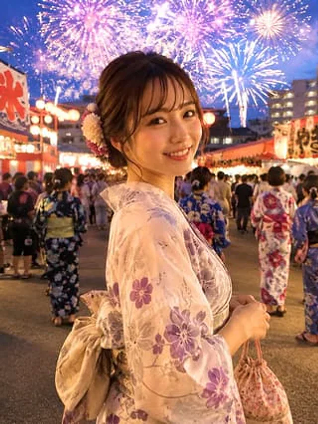

```text
Create a highly realistic vertical portrait photo of {argument name="character name" default="a beautiful Japanese woman in her 20s"} at a summer evening fireworks festival in Japan. She is shown from the waist up in a three-quarter back-facing pose, turning her head over her shoulder to smile warmly at the camera, with natural expressive eyes, soft skin texture, and an approachable candid expression. She wears a pale cream-pink yukata with purple and lavender floral patterns, a large beige obi bow tied at the back, and small pink and cream chrysanthemum hair ornaments tucked into a low updo with loose bangs and face-framing strands. Her right hand holds a small floral drawstring kinchaku pouch with thin red cords. The setting is a crowded Japanese matsuri street at dusk, lined with glowing food stalls and red-and-white festival banners, warm paper lanterns, and many festivalgoers in colorful yukata walking away in the background. Above her, the blue twilight sky is filled with large bright fireworks bursts in pink, purple, white, and gold, slightly blurred by depth of field but still dramatic and luminous. Use a close 3/4 portrait composition, subject centered slightly right, shallow depth of field, realistic lens perspective, warm lantern light on her face and yukata, cool blue ambient evening light in the sky, cinematic color grading, crisp detail on the woman and soft bokeh background. Emphasize photorealism, natural human proportions, realistic fabric folds, authentic Japanese summer festival atmosphere, and a joyful romantic mood. Avoid extra text, logos, watermarks, distorted hands, plastic skin, over-smoothed face, or anime styling.
```

Model: GPT Image 2
Author: レオンAI

[ProjectD](https://aitoolsradar.com/en/prompts/702dfc5e1ee2b0) · [Recorded source](https://youmind.com/prompts/japanese-yukata-fireworks-portrait-27361)
 · [Full original metadata and byte evidence](data/projectd-batch-0035.json)

## Japanese Four-Panel Healing Ad Collage

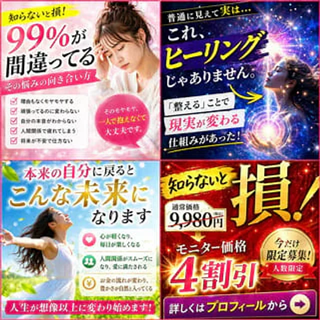

```text
{
  "type": "Japanese-style promotional social media thumbnail collage",
  "style": "High-impact, click-through-rate ad design with a strong, dramatic sheen, a four-square layout, striking Japanese typography, saturated colors, glowing effects, glitter, and gradient overlays, emphasizing a sense of urgency in the marketing visuals.",
  "canvas": {
    "aspect_ratio": "1:1",
    "size": "square"
  },
  "layout": {
    "grid": "2x2",
    "panels": [
      {
        "position": "top-left",
        "theme": "Anxiety and self-doubt",
        "background": "A soft pink and white female-centric lifestyle scene, with a blurred effect and light and shadow textures.",
        "subject": "Close-up: A young woman wearing a comfortable white knit sweater, one hand close to her face, her hair tied in a messy bun, partially obscuring her face.",
        "text_blocks": [
          {
            "text": "You're missing out if you don't know this!",
            "style": "Yellow diagonal banner with black text",
            "position": "top-left"
          },
          {
            "text": "99% of people are wrong",
            "style": "Oversized title, red numbers and black calligraphic Japanese text",
            "position": "upper-left to center"
          },
          {
            "text": "Ways to deal with troubles",
            "style": "Pink subtitle",
            "position": "below main headline"
          },
          {
            "text": "Feeling irritable for no reason",
            "style": "The checklist items within the white rounded boxes have red checkmark icons."
          },
          {
            "text": "Despite working very hard, nothing has changed.",
            "style": "The checklist items within the white rounded boxes have red checkmark icons."
          },
          {
            "text": "Not understanding one's own true thoughts",
            "style": "The checklist items within the white rounded boxes have red checkmark icons."
          },
          {
            "text": "Interpersonal relationships are exhausting",
            "style": "The checklist items within the white rounded boxes have red checkmark icons."
          },
          {
            "text": "Feeling incredibly uneasy about the future",
            "style": "The checklist items within the white rounded boxes have red checkmark icons."
          },
          {
            "text": "Those troubles don't have to be borne alone.",
            "style": "Pink round badge with white text",
            "position": "lower-right"
          }
        ],
        "count": 9
      },
      {
        "position": "top-right",
        "theme": "Not a cure, but a mechanism of change.",
        "background": "The deep cosmic galaxies, nebulae tinged with blue, purple, and magenta, starbursts, energy vortexes, and a luminous spiritual atmosphere.",
        "subject": "A small female silhouette, either from behind or in profile, stands beside a glowing entrance or pillar of light, her face partially obscured.",
        "text_blocks": [
          {
            "text": "It looks ordinary, but actually...",
            "style": "White text on a black diagonal banner",
            "position": "top-left"
          },
          {
            "text": "this,",
            "style": "Large white text",
            "position": "upper-left"
          },
          {
            "text": "no",
            "style": "Oversized yellow text in deep purple strokes",
            "position": "center"
          },
          {
            "text": "cure.",
            "style": "Large white text",
            "position": "below"
          },
          {
            "text": "By \"adjusting\"",
            "style": "Text within white box",
            "position": "lower-left"
          },
          {
            "text": "Reality will change.",
            "style": "Pink highlighted text",
            "position": "mid-lower-left"
          },
          {
            "text": "The mechanism has been found!",
            "style": "White text",
            "position": "bottom-left"
          }
        ],
        "graphic_elements": [
          {
            "type": "Curved yellow arrow",
            "count": 1,
            "direction": "Pointing to the glowing figure"
          }
        ],
        "count": 8
      },
      {
        "position": "bottom-left",
        "theme": "Returning to your true self to create a better future",
        "background": "A bright blue sky with soft clouds, green fields, floating leaves, and a bright, hopeful daytime atmosphere.",
        "subject": "A cheerful young woman in a sleeveless white dress, arms outstretched, twirls in the sunlight, her face partially obscured.",
        "text_blocks": [
          {
            "text": "After returning to one's true self",
            "style": "Red and black color scheme title",
            "position": "top"
          },
          {
            "text": "Will usher in",
            "style": "Oversized gold gradient title",
            "position": "center"
          },
          {
            "text": "Such a future",
            "style": "Large black text",
            "position": "right-center"
          },
          {
            "text": "My mind became lighter, and every day was filled with joy.",
            "style": "The reward items inside the white rounded bubble are marked with a pink heart icon."
          },
          {
            "text": "Interpersonal relationships become smooth and filled with love.",
            "style": "The reward items inside the white rounded bubble are marked with green crowd icons."
          },
          {
            "text": "When the flow of money changes, wealth naturally flows in.",
            "style": "The earnings item inside the white rounded bubble has a gold yen icon."
          },
          {
            "text": "Your life is about to change beyond your wildest imagination!",
            "style": "Pink ribbon at the bottom, white text",
            "position": "bottom"
          }
        ],
        "count": 7
      },
      {
        "position": "bottom-right",
        "theme": "Limited-time discount",
        "background": "Explosive textures in fiery red and gold, with glitter and sparkling trails, a luxurious and urgent aesthetic.",
        "text_blocks": [
          {
            "text": "If you don't know",
            "style": "Yellow brushstrokes on the banner, black text",
            "position": "top-left"
          },
          {
            "text": "What a loss!",
            "style": "Extra-large gold Chinese characters with a metallic bevel effect",
            "position": "upper-right"
          },
          {
            "text": "The usual price is 9,980 yen (tax included).",
            "style": "White price tag with crossed-out black numbers and small print tax information.",
            "position": "upper-left"
          },
          {
            "text": "Trial price",
            "style": "White text",
            "position": "center-left"
          },
          {
            "text": "40% off",
            "style": "Huge pink to white gradient discount text",
            "position": "center-lower"
          },
          {
            "text": "Limited time offer! Limited recruitment! Only a few spots available.",
            "style": "Gold round seal badge",
            "position": "right-center"
          },
          {
            "text": "Please see my profile for details.",
            "style": "Purple action call bar, white text and white arrow button",
            "position": "bottom"
          }
        ],
        "count": 7
      }
    ],
    "total_panels": 4
  },
  "composition": "A busy and persuasive Japanese advertising mosaic, optimized for social media thumbnail visibility, with each quadrant featuring a unique emotional message and color scheme, and making extensive use of diagonal banners, oversized kanji and numbers, glossy badges, rounded white information boxes, and dramatic lighting effects.",
  "customization": {
    "primary headline": "{argument name=\"headline text\" default=\"99% of people are wrong\"}",
    "discount text": "{argument name=\"discount text\" default=\"40% off\"}",
    "price": "{argument name=\"price\" default=\"9,980 yen (tax included)\"}",
    "main color palette": "{argument name=\"main color palette\" default=\"Pink, blue-purple galaxies, sky blue, red-gold\"}",
    "call to action": "{argument name=\"call to action\" default=\"Please see my profile for details.\"}"
  },
  "render_notes": "Ensure all Japanese text is large and clear, with layered shadows and outlines; use a sophisticated, composite advertising aesthetic rather than minimalist design; faces should be blurred or partially obscured; emphasize the emotional contrast between anxiety, revelation, a shift in hope, and the urgent offer."
}
```

Model: GPT Image 2
Author: GPT Image 2 Prompts

[ProjectD](https://aitoolsradar.com/en/prompts/39f35a89c9ee17) · [Recorded source](https://x.com/5656nya5nya/status/2046726072600027296#reversed-0)
 · [Full original metadata and byte evidence](data/projectd-batch-0035.json)

## Japanese Fuji film style portrait


```text
9:16 Vertical screen —{argument name="film style" default="Japanese Fujifilm style"} Portrait, single subject, Fujifilm simulated aesthetics (Pro 400H / Superia texture), soft pastel tones, slight green-magenta shift, low contrast, smooth highlight transitions, fine film grain, subtle halo effect; morning indoor scene, near a window, soft curtains, fresh sunlight.{argument name="subject" default="Young Japanese female idols"} Natural nude makeup, showcasing delicate and clear skin. Clothing: A loose shirt paired with casual shorts, a homey style that doesn't expose the skin. Hairstyle: Slightly messy, with a natural, voluminous look, as if just woken up. Posture: Sitting on the edge of the bed or by the window, leaning slightly forward, shoulders relaxed; one hand casually holding a small flower or piece of fabric, the other hanging naturally. Expression: A soft, slightly sleepy gaze, calm and natural. Lighting:{argument name="lighting" default="Soft morning light"} Diffuse light, soft shadows: a quiet, fresh, intimate everyday moment. Quality: hyper-realistic, film grain, slight soft focus, natural imperfections.
```

Model: GPT Image 2
Author: GPT Image 2 Prompts

[ProjectD](https://aitoolsradar.com/en/prompts/b3e1de7f73fbdd) · [Recorded source](https://x.com/BubbleBrain/status/2046661936381911182)
 · [Full original metadata and byte evidence](data/projectd-batch-0035.json)

## Japanese Fuji Film Style Portrait

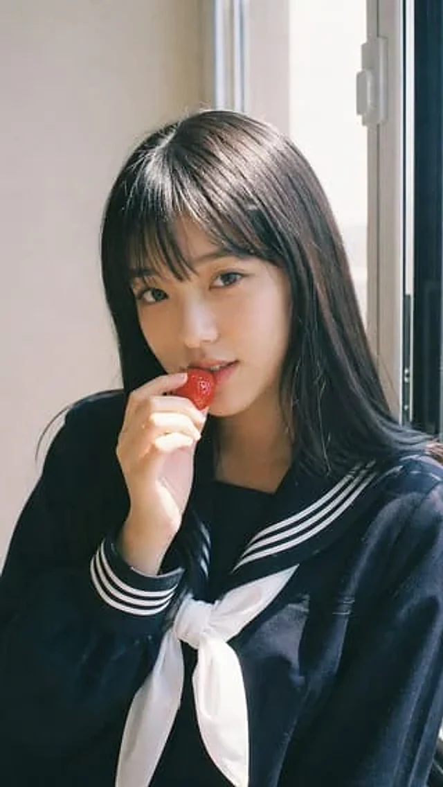

```text
{argument name="aspect ratio" default="9:16"} Vertical screen —{argument name="subject" default="Japanese Fujifilm style portrait, single subject"} Fujifilm analog aesthetics (Pro 400H / Superia texture): soft pastel tones, slight green-magenta shift, low contrast, smooth highlight transitions, fine film grain, subtle halos, and slight vignetting; bright natural sunlight, diffused sunlight streaming through windows, soft shadows, and a transparent atmosphere; young Japanese female idols, natural light makeup, fresh and radiant skin, realistic texture, and minor imperfections; clothing: Japanese school uniform (sailor suit or suit uniform), neat, not revealing, youthful and clean; hairstyle: natural dark hair, straight or smooth and flowing, with a few wispy strands; pose: facing forward or slightly to the side. Facing the camera, a relaxed pose; one hand gently holding a strawberry near the mouth, as if about to take a bite; shoulders relaxed, natural body curves; expression: soft and playful gaze, a slight smile or natural lip shape, engaging in gentle eye contact with the camera; scene: a simple indoor or outdoor corner by a window, a clean background, an everyday atmosphere; composition: a slightly off-center composition, an intimate distance, a candid feel; mood: a fresh, youthful, and sweet everyday moment, understated charm; image quality: hyper-realistic, simulating film quality, natural imperfections, a soft and dreamy texture.
```

Model: GPT Image 2
Author: GPT Image 2 Prompts

[ProjectD](https://aitoolsradar.com/en/prompts/108dda120e7972) · [Recorded source](https://x.com/BubbleBrain/status/2046483268019884384)
 · [Full original metadata and byte evidence](data/projectd-batch-0035.json)

## Japanese Fuji Film Style Portrait

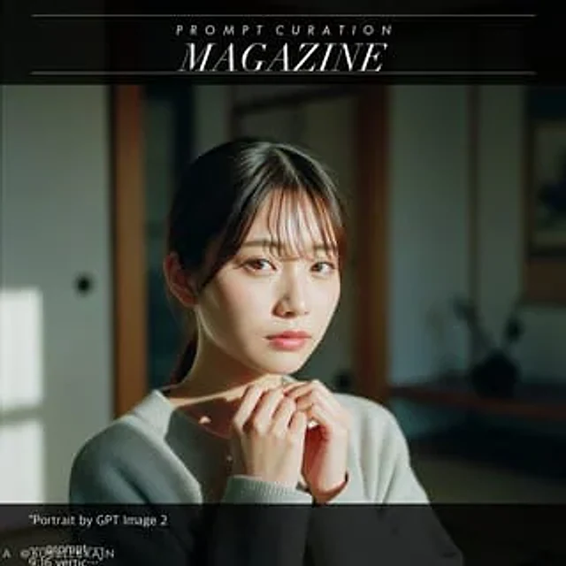

```text
9:16 Vertical screen —{argument name="style" default="Japanese Fujifilm style"}
```

Model: GPT Image 2
Author: GPT Image 2 Prompts

[ProjectD](https://aitoolsradar.com/en/prompts/1289901e5d1ca6) · [Recorded source](https://x.com/payto_mypain/status/2047465907333799989)
 · [Full original metadata and byte evidence](data/projectd-batch-0035.json)

## Japanese Gacha Game Screen

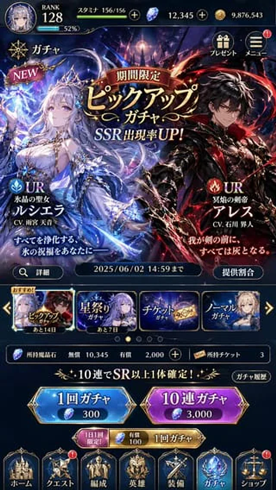

```text
日本のソシャゲのガチャ画面を生成して、
```

Model: GPT Image 2
Author: @the_wheel_2024

[ProjectD](https://aitoolsradar.com/en/prompts/06a736f46e0d18) · [Recorded source](https://x.com/the_wheel_2024/status/2046519658166317160)
 · [Full original metadata and byte evidence](data/projectd-batch-0035.json)

## Japanese Girl Candid Portrait

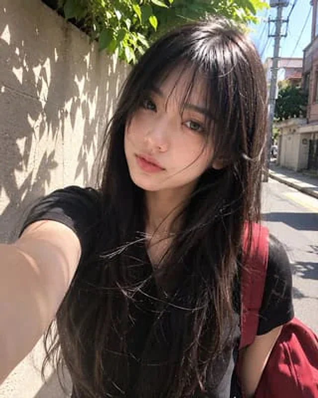

```text
Beautiful young {argument name="nationality" default="Japanese"} girl with {argument name="hair style" default="long silky black hair and soft wispy bangs"}, large expressive dark eyes, fair glowing skin, delicate facial features, natural pink lips, subtle blush, and a calm innocent expression. Wearing a fitted black t-shirt and a red backpack over one shoulder. Standing outdoors beside a warm beige wall with green leaves casting soft shadows. Bright midday sunlight creating natural highlights on her hair and face, gentle breeze moving loose strands of hair, casual school-day aesthetic, Korean/Japanese street photography vibe, realistic skin texture, soft natural makeup, candid portrait, photorealistic, ultra-detailed, DSLR quality, shallow depth of field, clean composition, vibrant natural colors, youthful and dreamy atmosphere, 85mm lens, high-resolution editorial portrait, 8K.
```

Model: GPT Image 2
Author: 𝗦𝗮𝗻𝗶𝗮

[ProjectD](https://aitoolsradar.com/en/prompts/38ddbe71c91b70) · [Recorded source](https://youmind.com/prompts/japanese-girl-street-photography-portrait-25915)
 · [Full original metadata and byte evidence](data/projectd-batch-0035.json)

## Japanese Golden Egg Design Slide

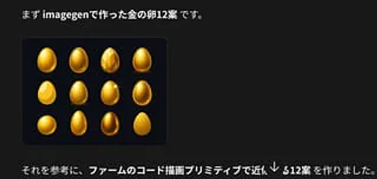

```text
Create a dark presentation-style social media image in Japanese about golden egg design variations. Canvas: wide horizontal 16:9-ish crop, black/charcoal background (#181818), clean modern typography, generous negative space on the right. Top text: place a large Japanese sentence near the upper left reading 「まず imagegenで作った金の卵12案 です。」 with “imagegen” and “金の卵12案” in bold white, the rest in regular white. Main visual: below the headline on the left, draw a rounded rectangular dark navy-black card with a subtle border and soft shadow. Inside the card show exactly 12 golden egg concept designs arranged in a 4-column by 3-row grid. The 12 eggs are: 1) glossy smooth upright gold egg with bright highlight, 2) oval egg with raised rim/outline like an icon, 3) faceted low-poly gemstone egg, 4) smooth metallic gold egg standing on a small shadow, 5) flat bright yellow egg with large white highlight, 6) textured/brushed gold egg, 7) glossy gold egg with a star sparkle on the upper right, 8) dark glowing gold egg with bright rim light, 9) squat round golden egg, 10) tall narrow smooth gold egg, 11) darker bronze-gold reflective egg, 12) simple matte yellow-gold egg silhouette. Bottom text: place a long Japanese sentence across the lower left reading 「それを参考に、ファームのコード描画プリミティブで近似する12案 を作りました。」 with the central phrase 「ファームのコード描画プリミティブで近似する12案」 in bold white and the rest in regular white. Add a semi-transparent circular down-arrow overlay near the bottom center-right, like a social media viewer control. Visual style: clean screenshot-like composition, high contrast, realistic glossy gold rendering for the eggs, subtle card border, no extra logos or watermarks. Customizable text slots: top sentence may use {argument name="top Japanese text" default="まず imagegenで作った金の卵12案 です。"}; bottom sentence may use {argument name="bottom Japanese text" default="それを参考に、ファームのコード描画プリミティブで近似する12案 を作りました。"}; main object may use {argument name="object theme" default="golden egg"}.
```

Model: GPT Image 2
Author: 金のニワトリ

[ProjectD](https://aitoolsradar.com/en/prompts/09dd3cc8687212) · [Recorded source](https://youmind.com/prompts/golden-egg-design-slide-26995)
 · [Full original metadata and byte evidence](data/projectd-batch-0035.json)

## Japanese Gourmet Curry Ad Layout

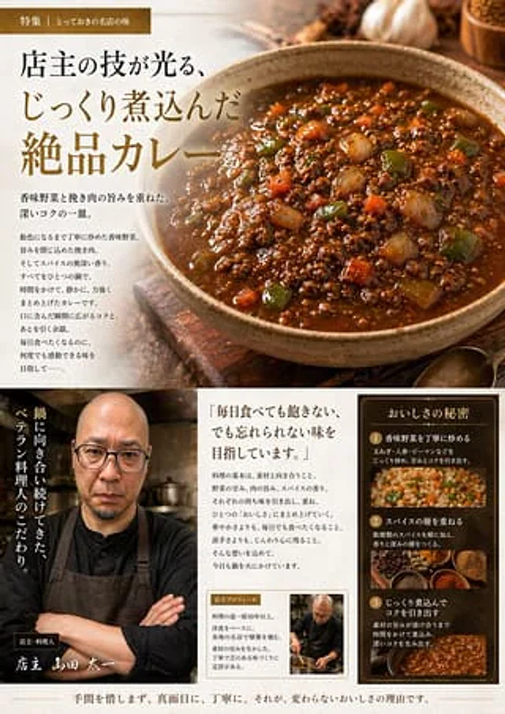

```text
Use the provided reference image of curry in a pot to convert it.{argument name="dish name" default="キーマカレー"} A beautifully designed Japanese food magazine ad page. Curry is retained as a recognizable dish, but redesigned as a rustic ceramic bowl served on a wooden tabletop, achieving a sophisticated food photography effect with richer colors, deeper color contrasts, and a more enticing texture. A complete editorial layout is created, comprising three main content areas: 1) A large main visual area at the top, showcasing the plated curry on the right and Japanese promotional text on the left, including a small top label and a prominent headline; 2) A chef's profile area in the lower left corner, featuring a portrait of the chef in dark overalls and an apron, arms crossed in a restaurant kitchen, accompanied by vertical Japanese text and a handwritten name label; 3) An information area in the lower right corner, containing a quote box and a bordered "Delicious Secrets" panel with three numbered steps, each accompanied by a food or cooking image. Warm ambient lighting and a shallow depth of field effect are added, with spices and garlic placed around the main dish as props to create a high-end, traditional restaurant brand feel. The entire text is in Japanese, with the main title emphasizing slow-cooked, delicate curry, and an elegant Mincho typeface in shades of brown, cream, and gold. The final layout should resemble a feature article or brochure page for a high-end restaurant.
```

Model: GPT Image 2
Author: GPT Image 2 Prompts

[ProjectD](https://aitoolsradar.com/en/prompts/1704e0efb885d8) · [Recorded source](https://x.com/minnano_copy/status/2047626643603345638#reversed-1)
 · [Full original metadata and byte evidence](data/projectd-batch-0035.json)

## Japanese Gourmet Curry Ad Layout


```text
Using the provided reference image of the curry in the pan, transform it into a polished Japanese gourmet magazine advertisement page for {argument name="dish name" default="キーマカレー"}. Keep the curry recognizable as the same dish, but restyle it as a premium food photograph served in a rustic ceramic bowl on a wooden tabletop, with richer gloss, deeper color contrast, and more appetizing texture. Create a full editorial layout with 3 main content areas: 1) a large hero section at the top featuring the plated curry on the right and Japanese promotional copy on the left, including a small top banner label and a large headline; 2) a bottom-left chef profile area with 1 portrait of a chef in dark workwear and apron, arms crossed in a restaurant kitchen, plus vertical Japanese copy and a handwritten-style name caption; 3) a bottom-right information area containing 1 quote block and 1 framed “secret of deliciousness” panel with exactly 3 numbered steps, each paired with a food or cooking image. Add warm ambient lighting, shallow depth of field, spices and garlic props around the hero dish, and an upscale traditional restaurant branding feel. Include Japanese text throughout, with the main headline emphasizing slow-cooked, exquisite curry, and use elegant Mincho-style typography in brown, cream, and gold tones. The final composition should look like a high-end restaurant feature article or promotional brochure page.
```

Model: GPT Image 2
Author: 大橋一慶（7月に新刊でます）

[ProjectD](https://aitoolsradar.com/en/prompts/131d5e216bea81) · [Recorded source](https://youmind.com/prompts/japanese-gourmet-curry-ad-15702)
 · [Full original metadata and byte evidence](data/projectd-batch-0035.json)

## Japanese GPT Image2 Thumbnail


```text
{"type":"Japanese YouTube thumbnail collage","style":"bold anime-tech promotional thumbnail with clean digital illustration, high contrast, saturated colors, thick outlined typography, energetic magazine-style composition","canvas":{"aspect_ratio":"16:9","resolution":"1200x630"},"background":{"frame":"mint green outer border with cyan accent strip along the top and bottom edges","main_scene":"warm modern bedroom interior with wooden headboard, beige bedding, cream curtains, bedside shelf, and a small alarm clock"},"layout":{"sections":[{"title":"データセット作り!","position":"top-left","count":8,"labels":["back view","three-quarter back view","front view","full back standing view","side profile","rear side profile","three-quarter front view","standing portrait with crossed arms"]},{"title":"部分修正!","position":"bottom-left","count":1,"labels":["character editing app screenshot with anime woman in white jacket over blue shirt"]},{"title":"素材作り!","position":"lower-mid-left","count":1,"labels":["smartphone asset design image showing a hand holding a purple screen phone with a large eye symbol and a vertical strip of 5 small variant thumbnails"]},{"title":"合成!","position":"upper-center-right","count":2,"labels":["anime woman cutout portrait","bedroom background plate"]}],"connectors":{"count":2,"style":"curved pink arrows with white outline pointing from the cutout portrait and bedroom plate toward the final composite on the right"},"text_overlays":{"count":7,"items":["データセット作り!","部分修正!","素材作り!","合成!","「{argument name=\"headline text\" default=\"GPT Image2\"}」徹底検証!","ノイズ除去法から{argument name=\"feature text\" default=\"LoRA学習\"}まで","©{argument name=\"credit name\" default=\"スタジオ真榊\"}"]}},"subjects":{"main":{"type":"anime woman","count":1,"appearance":{"age":"young adult","build":"slim curvy","hair":{"color":"{argument name=\"hair color\" default=\"long black\"}","style":"very long straight hair with soft shine, center part, strands falling over shoulders"},"face":"intentionally blurred/censored rectangle over the face","outfit":["white fitted long-sleeve scoop-neck top","visible black camisole straps","black pants"]},"pose":"seated on the edge of a bed, torso angled slightly left, hands resting near lap, looking toward camera"},"inset_character":{"type":"same anime woman reference art","count":10,"notes":"all inset figures use the same character design with face blurred in several panels"}},"typography":{"primary":"very large Japanese headline across the bottom in white with black outline and hot pink emphasis around GPT Image2","secondary":"subheadline in orange, white, black, and bright blue mixed emphasis","annotation":"handwritten energetic pink labels with white stroke near each inset section"},"color_palette":{"count":8,"colors":["hot pink","white","black","cyan","mint green","orange","beige","dark brown"]},"composition":"right half dominated by the final anime bedroom illustration, left half packed with inset process examples and screenshots, oversized bottom headline spanning nearly full width, designed to advertise a deep-dive verification article about GPT Image2 workflows for dataset creation, partial edits, asset generation, compositing, noise removal, and LoRA training"}
```

Model: GPT Image 2
Author: 賢木イオ🍀AIイラスト

[ProjectD](https://aitoolsradar.com/en/prompts/625fb9822b3358) · [Recorded source](https://youmind.com/prompts/japanese-gpt-image2-thumbnail-17706)
 · [Full original metadata and byte evidence](data/projectd-batch-0035.json)

## Japanese Graduation Photo Under Sakura

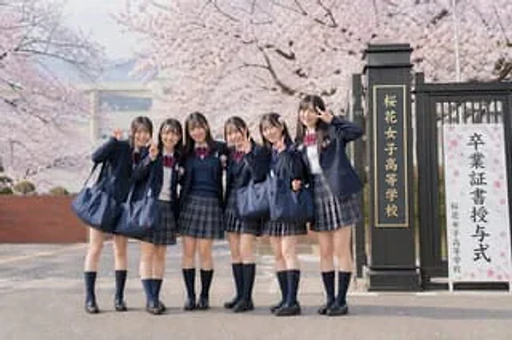

```text
A soft, realistic photo of a Japanese graduation day, taken in a retro film style, shows six teenage girls standing outdoors against a backdrop of blooming cherry blossoms and the school gate. They are dressed in matching Japanese high school uniforms: navy blue blazers, white shirts, burgundy bow ties, grey-blue plaid pleated skirts, navy blue knee-high socks, and black loafers, each carrying a large navy blue backpack. The students stand close together on the road outside the school gate, their body language relaxed and cheerful, creating a casual class photo feel. At least five girls are making peace signs next to their faces, while the girl on the far right raises her hand in a playful salute. The photo emphasizes natural, long legs, neat dark straight hair with soft bangs, youthful styling, and realistic proportions. The composition is a full-body frontal shot, with the students slightly to the left and the school gate on the right. The image features a tall, black gatepost with the words "Sakura Girls' High School" inscribed vertically in gold Japanese. Next to it stands a white ceremonial signboard with the prominent Japanese words "Graduation Certificate Conferment Ceremony" and the school's name in smaller print below. The background is filled with blooming pale pink cherry blossoms, creating a shallow depth of field, soft pastel tones, a light spring mist, bright sunlight on a cloudy day, delicate film grain, and gentle contrast, all contributing to a low-key and nostalgic atmosphere reminiscent of an old-fashioned commemorative photograph.
```

Model: GPT Image 2
Author: GPT Image 2 Prompts

[ProjectD](https://aitoolsradar.com/en/prompts/0992132676a7cf) · [Recorded source](https://x.com/lcayu/status/2047685703019221267#reversed-0)
 · [Full original metadata and byte evidence](data/projectd-batch-0035.json)

## Japanese Green-Tech Promo Collage

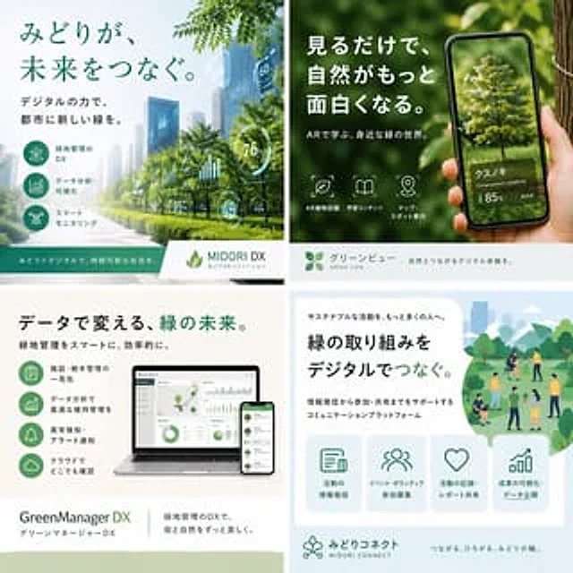

```text
{
  "type": "2x2 Japanese Brochure Collage for Green Technology Digital Services",
  "style": "The corporate advertising style is minimalist, featuring a modern and eco-friendly brand design, soft natural lighting, realistic photo compositing, minimal AI artifacts, a white and green color palette, elegant Japanese typography, and a square layout.",
  "canvas": {
    "aspect_ratio": "1:1",
    "size": "1536x1536"
  },
  "layout": {
    "grid": "2x2",
    "count": 4,
    "sections": [
      {
        "position": "top-left",
        "title": "Greenery connects the future.",
        "subtitle": "Bringing new greenery to cities through the power of digital technology.",
        "scene": "A bright, futuristic urban avenue is lined with healthy green trees and landscaped green belts. Glass skyscrapers are shrouded in a light mist, and translucent dashboards are superimposed above the street, displaying circular and bar chart analysis data such as 60, 76, 45, and 48.",
        "features": {
          "count": 3,
          "labels": [
            "DX of green space management",
            "Data Analysis and Visualization",
            "Intelligent monitoring"
          ]
        },
        "brand_bar": {
          "product_name": "MIDORI DX",
          "tagline": "With Midori Medical, let's create a sustainable society.",
          "sublabel": "みどりDXソリューション"
        }
      },
      {
        "position": "top-right",
        "title": "Just by looking at it, nature becomes even more fascinating.",
        "subtitle": "Learn about the familiar green world through AR.",
        "scene": "A hand holds a smartphone in front of lush green plants and tree trunks. The phone screen displays AR-style identified trees with realistic individual tree models.",
        "screen_text": {
          "main_name": "クスノキ",
          "latin_name": "Cinnamomum camphora",
          "confidence": "85%"
        },
        "features": {
          "count": 3,
          "labels": [
            "AR Plant Atlas",
            "Learning content",
            "Maps and attraction guides"
          ]
        },
        "brand_bar": {
          "product_name": "グリーンビュー",
          "english_name": "GREEN VIEW",
          "tagline": "Experience digital interactions that connect you with nature."
        }
      },
      {
        "position": "bottom-left",
        "title": "Transforming a greener future with data.",
        "subtitle": "Smart and efficient green space management.",
        "scene": "A laptop and smartphone mockup sit on a clean desktop, both displaying green-themed analytics dashboards including maps, pie charts, line graphs, and management panels.",
        "features": {
          "count": 4,
          "labels": [
            "Integrated management of facilities and trees",
            "Achieve optimal maintenance through data analysis",
            "Anomaly detection and alarm notification",
            "View anytime, anywhere in the cloud"
          ]
        },
        "brand_bar": {
          "product_name": "GreenManager DX",
          "japanese_name": "グリーンマネージャーDX",
          "tagline": "Digital transformation in green space management will keep cities and nature beautiful for years to come."
        }
      },
      {
        "position": "bottom-right",
        "title": "Connecting green initiatives digitally.",
        "subtitle": "Bringing sustainable practices to more people.",
        "description": "A communication platform that supports everything from information dissemination to participation and sharing.",
        "scene": "A flat, minimalist park scene in soft green and blue tones, where small groups of people walk, talk, volunteer, and gather among trees, paths, bushes, and distant city buildings.",
        "features": {
          "count": 4,
          "labels": [
            "Event Information Release",
            "Events and Volunteer Recruitment",
            "Activity records and report sharing",
            "Results visualization and data disclosure"
          ]
        },
        "brand_bar": {
          "product_name": "みどりコネクト",
          "english_name": "MIDORI CONNECT",
          "tagline": "Connecting, expanding, a green circle."
        }
      }
    ]
  },
  "design_notes": {
    "typography": "Large, bold Japanese sans-serif headings, smaller, concise sans-serif body text, with keywords emphasized in green.",
    "iconography": "Simple line icons within round green circles or outline tiles",
    "branding": "Consistent leaf patterns and eco-tech visual language",
    "mood": "An optimistic, innovative, sustainable, and approachable corporate marketing style."
  }
}
```

Model: GPT Image 2
Author: GPT Image 2 Prompts

[ProjectD](https://aitoolsradar.com/en/prompts/93e6414d4ac4a5) · [Recorded source](https://x.com/mochisw/status/2046570968257294410#reversed-0)
 · [Full original metadata and byte evidence](data/projectd-batch-0035.json)

## Japanese Gym Hero Landing Page

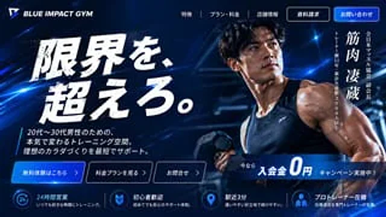

```text
{
  "type": "gym website homepage model",
  "style": "A stunningly refined, modern Japanese landing page, exuding a high-end sportswear brand feel, featuring a deep neon blue color scheme, high contrast, and a cinematic advertising quality, combining realistic photos with sophisticated UI design.",
  "brand": {
    "name": "{argument name=\"brand name\" default=\"BLUE IMPACT GYM\"}",
    "logo": "The brand name features a blue and white lightning bolt logo with sharp angles to the left."
  },
  "canvas": {
    "aspect_ratio": "16:9",
    "composition": "Single-screen full-width website header"
  },
  "background": {
    "theme": "Dark, luxurious gym interior, with blurred background equipment and dramatic blue beams of light.",
    "effects": [
      "Electric blue diagonal motion lines",
      "Lens flare",
      "Glowing Highlights",
      "Subtle depth of smoke",
      "Metallic Reflection"
    ]
  },
  "navigation": {
    "position": "Top bar",
    "count": 5,
    "items": [
      "Features",
      "Plans and Prices",
      "Store Information",
      "Information Request",
      "Contact Us"
    ],
    "style": "A centered white Japanese text link, with two outlined/glowing CTA buttons on the right."
  },
  "main_visual": {
    "subject": "A muscular Asian male personal trainer in his 20s and 30s, with a prominent right side of his upper body, holding black dumbbells near his torso, wearing a fitted black sleeveless sports vest, his skin glistening with sweat, his shoulders and arms clearly defined – a striking image reminiscent of a top-tier fitness advertisement.",
    "face": "Some of the portraits show the subject in a confident pose.",
    "lighting": "The strong contour lighting and cool blue highlights emphasize muscle lines."
  },
  "headline": {
    "position": "Left and Middle",
    "text": "{argument name=\"headline text\" default=\"Push beyond your limits.\"}",
    "style": "Extra-large bold distressed Japanese title font, white, dynamically slanted layout, grainy texture."
  },
  "subcopy": {
    "position": "Below the title on the left",
    "text": "A training space for men in their 20s and 30s who want to truly transform themselves. We support you in achieving your ideal physique in the shortest possible time.",
    "style": "Small white Japanese text, 2 lines, simple sans-serif font."
  },
  "trainer_profile": {
    "position": "Vertical text on the right side next to the model",
    "count": 3,
    "items": [
      "All Japan Muscle Association Vice President",
      "Muscle Superzo",
      "12 years of coaching experience, with over 2000 students trained."
    ],
    "style": "Vertical white Japanese text, high-end typography design"
  },
  "cta_area": {
    "position": "Bottom left to center",
    "count": 3,
    "buttons": [
      {
        "label": "Click here for a free trial.",
        "style": "A rounded rectangle with a main color of glowing blue gradient."
      },
      {
        "label": "View price plan",
        "style": "Dark transparent rounded rectangle with white border"
      },
      {
        "label": "Contact Us",
        "style": "Dark transparent rounded rectangle with white border"
      }
    ]
  },
  "campaign_banner": {
    "position": "The main body is covered in the bottom right corner.",
    "count": 3,
    "texts": [
      "Join now",
      "Membership fee: 0 yuan",
      "The event is in progress!"
    ],
    "style": "A bold blue semi-transparent ribbon banner with an oversized white number 0, emphasizing a vibrant promotional style."
  },
  "feature_row": {
    "position": "Bottom full width",
    "count": 4,
    "items": [
      {
        "icon": "24 in the circle",
        "title": "Open 24 hours",
        "description": "Practice anytime, anywhere."
      },
      {
        "icon": "Downward arrow/leaf icon in the circle",
        "title": "Welcome newbies",
        "description": "A support system that even beginners can use with peace of mind."
      },
      {
        "icon": "Map location icon in the circle",
        "title": "3-minute walk from the station",
        "description": "Convenient transportation, easy to maintain."
      },
      {
        "icon": "The icon of the person in the tie in the circle",
        "title": "Professional coaches are registered",
        "description": "Professional coaches will help you achieve your goals."
      }
    ]
  },
  "palette": {
    "primary": "Electric Blue",
    "secondary": "Deep Navy Blue",
    "text": "White",
    "accent": "Glowing cyan"
  },
  "design_notes": [
    "Make it look like an AI-generated high-end gym landing page design concept.",
    "Keep the layout simple, persuasive, and conversion-oriented.",
    "Emphasizing high-end and impactful transformative information",
    "All visible interface text should be in Japanese.",
    "The UI uses a sharp, modern sans-serif font, and the headings use a bold font."
  ]
}
```

Model: GPT Image 2
Author: GPT Image 2 Prompts

[ProjectD](https://aitoolsradar.com/en/prompts/5f00b35be7bfed) · [Recorded source](https://x.com/wurst_design/status/2046792010237878295#reversed-0)
 · [Full original metadata and byte evidence](data/projectd-batch-0035.json)

## Japanese Gym Hero Landing Page


```text
{"type":"fitness gym website hero section mockup","style":"ultra-polished modern Japanese landing page, premium sports branding, dark neon blue color grading, high contrast, cinematic advertising look, realistic photo composited with glossy UI design","brand":{"name":"{argument name=\"brand name\" default=\"BLUE IMPACT GYM\"}","logo":"sharp angular blue-and-white lightning emblem to the left of the brand name"},"canvas":{"aspect_ratio":"16:9","composition":"single full-width first-view website header"},"background":{"theme":"dark luxury gym interior with blurred equipment and dramatic blue light streaks","effects":["electric blue diagonal motion lines","lens flares","glowing highlights","subtle smoky depth","metallic reflections"]},"navigation":{"position":"top bar","count":5,"items":["特徴","プラン・料金","店舗情報","資料請求","お問い合わせ"],"style":"white Japanese text links centered, two outlined/glowing CTA buttons on the right"},"main_visual":{"subject":"muscular Asian male personal trainer in his 20s to 30s, upper body prominently shown on the right half, holding a black dumbbell near his torso, wearing a fitted black sleeveless athletic tank top, sweaty skin, defined shoulders and arms, intense premium fitness campaign look","face":"partially frontal portrait with confident posture","lighting":"hard rim light and cool blue highlights emphasizing muscle definition"},"headline":{"position":"left-center","text":"{argument name=\"headline text\" default=\"限界を、超えろ。\"}","style":"very large bold distressed Japanese display typography in white, dynamic slanted layout, gritty texture"},"subcopy":{"position":"left-lower under headline","text":"20代〜30代男性のための、本気で変わるトレーニング空間。理想のカラダづくりを最短でサポート。","style":"smaller white Japanese text, 2 lines, clean sans-serif"},"trainer_profile":{"position":"right side vertical text beside the model","count":3,"items":["全日本マッスル協会 副会長","筋肉 凄蔵","トレーナー歴12年・累計生徒数2000人以上"],"style":"vertical white Japanese text, premium editorial arrangement"},"cta_area":{"position":"lower left to center","count":3,"buttons":[{"label":"無料体験はこちら","style":"primary glowing blue gradient rounded rectangle"},{"label":"料金プランを見る","style":"dark transparent rounded rectangle with white border"},{"label":"お問合せ","style":"dark transparent rounded rectangle with white border"}]},"campaign_banner":{"position":"lower right overlapping the subject","count":3,"texts":["今なら","入会金0円","キャンペーン実施中！"],"style":"bold blue translucent ribbon banner, oversized white numeral 0, energetic promotional emphasis"},"feature_row":{"position":"bottom full width","count":4,"items":[{"icon":"24 in a circle","title":"24時間営業","description":"いつでも好きな時間にトレーニング。"},{"icon":"downward arrow/leaf-like emblem in a circle","title":"初心者歓迎","description":"初めてでも安心のサポート体制。"},{"icon":"map pin in a circle","title":"駅近3分","description":"通いやすい好立地で続けやすい。"},{"icon":"person with tie in a circle","title":"プロトレーナー在籍","description":"目標達成を専門トレーナーが支援。"}]},"palette":{"primary":"electric blue","secondary":"deep navy","text":"white","accent":"glow cyan"},"design_notes":["make it look like an AI-generated high-end web design concept for a gym landing page","keep the layout clean, persuasive, and conversion-focused","emphasize a premium but aggressive transformation message","all visible interface text should be in Japanese","use sharp modern sans-serif fonts for UI and bold display lettering for the headline"]}
```

Model: GPT Image 2
Author: せきゆおう🇯🇵Web制作とAIのことを発信する人

[ProjectD](https://aitoolsradar.com/en/prompts/dd382405e9bf22) · [Recorded source](https://youmind.com/prompts/japanese-gym-hero-landing-14966)
 · [Full original metadata and byte evidence](data/projectd-batch-0035.json)

## Japanese Hair Diagnosis Salon Poster

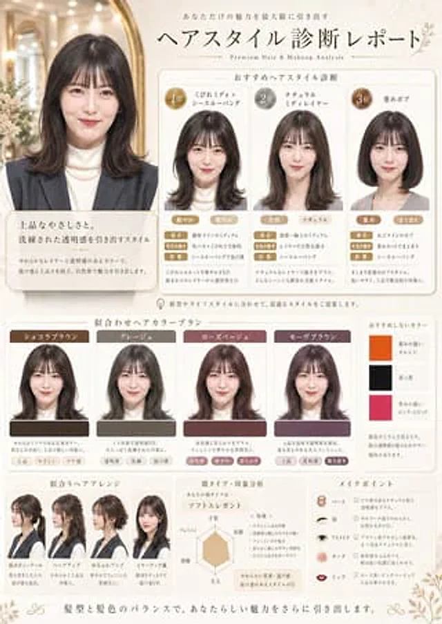

```text
Using the provided reference image, turn it into a refined Japanese beauty-salon hairstyle diagnosis poster. Keep the same person, outfit, hair color, and realistic studio-photo look, but place her portrait as the main before-style image in an elegant cream-and-gold editorial layout. Add Japanese headline text at the top reading "ヘアスタイル診断レポート" with a small English subtitle "Premium Hair & Makeup Analysis" and supporting Japanese copy above it. Create 4 ranked hairstyle recommendation panels under the title: 1) "くびれミディ×シースルーバング", 2) "ナチュラルミディレイヤー", 3) "重めボブ", plus the large original/main portrait panel at left with explanatory Japanese text. In each recommendation panel, generate a realistic edited version of the same woman with the suggested haircut, using circular rank badges and multiple small trait tags. Add a color recommendation section titled "似合わせヘアカラープラン" with 4 color cards showing the same woman recolored in these shades: "ショコラブラウン", "グレージュ", "ローズベージュ", "モーヴブラウン". Also add 1 slim side panel titled "おすすめしないカラー" with 3 stacked swatches and labels: "黄みの強いオレンジ", "真っ黒", "青みの強いピンク・ビビッド". At the bottom, add 3 additional sections: "似合うヘアアレンジ" with 4 hairstyle arrangement examples of the same woman, "顔タイプ・印象分析" with a radar chart and Japanese notes, and "メイクポイント" with 5 makeup item rows labeled "ベース", "眉", "アイメイク", "チーク", "リップ". Use soft luxury salon branding, thin gold borders, rounded white panels, subtle floral corner ornaments, and a clean premium magazine-like composition.
```

Model: GPT Image 2
Author: 月島くん

[ProjectD](https://aitoolsradar.com/en/prompts/4adb3a123b68c9) · [Recorded source](https://youmind.com/prompts/japanese-hair-diagnosis-poster-17670)
 · [Full original metadata and byte evidence](data/projectd-batch-0035.json)

## Japanese Hair Salon Catalog Poster

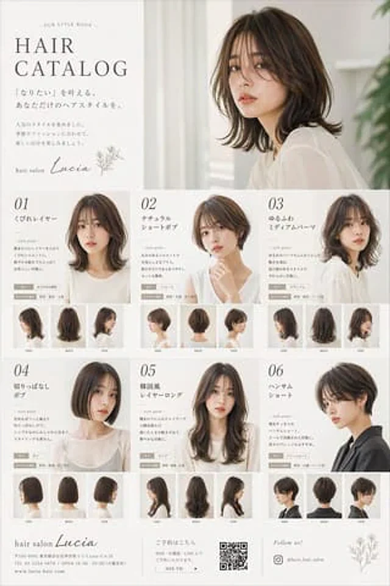

```text
{
  "type": "Hair salon catalog poster editing and layout",
  "style": "A minimalist Japanese-style beauty salon brochure, featuring soft, natural lighting, high-end magazine aesthetics, a transparent and minimalist design, warm neutral tones, and elegant serif fonts.",
  "format": "Vertical poster",
  "background": "The bright white interior features sheer curtains and softly blurred plants along the right edge.",
  "branding": {
    "top_small_text": "– OUR STYLE BOOK –",
    "main_title": "HAIR CATALOG",
    "subtitle": "A hairstyle just for you, fulfilling your dreams.",
    "body_text": "We've gathered some popular styles. Enjoy discovering a new you by matching them to your personal style and fashion preferences.",
    "salon_name": "hair salon {argument name=\"salon name\" default=\"Lucia\"}"
  },
  "layout": {
    "sections": [
      {
        "title": "hero cover image",
        "position": "top right",
        "count": 1,
        "description": "A half-length portrait of an adult Japanese woman, wearing a sheer white blouse, sitting sideways and slightly turned towards the camera, with medium-length brown layered hair featuring soft curls, giving her a natural salon look."
      },
      {
        "title": "style cards row 1",
        "position": "middle",
        "count": 3,
        "labels": [
          "01 くびれレイヤー",
          "02 ナチュラル ショートボブ",
          "03 ゆるふわ ミディアムパーマ"
        ]
      },
      {
        "title": "style cards row 2",
        "position": "lower middle",
        "count": 3,
        "labels": [
          "04 Blunt bob",
          "05 Korean-style layered long hair",
          "06 ハンサム ショート"
        ]
      },
      {
        "title": "bottom information bar",
        "position": "bottom",
        "count": 4,
        "labels": [
          "hair salon Lucia contact block",
          "Book your appointment here",
          "QR code",
          "Follow us!"
        ]
      }
    ],
    "card_structure": "Each of the six hairstyle cards contains a large main portrait, a large two-digit number, a Japanese hairstyle title, a short Japanese description with the heading \"--style point--\", two small beige label buttons, and three thumbnail views labeled SIDE, BACK, and SIDE respectively.",
    "thumbnail_count_per_card": 3,
    "total_thumbnails": 18
  },
  "subjects": {
    "models": [
      {
        "card": "01",
        "hairstyle": "Medium-length collarbone-length hair with inward-curling layers at the ends, softly framing the face, in a medium brown color.",
        "outfit": "Ivory white knitted sleeveless top"
      },
      {
        "card": "02",
        "hairstyle": "A natural short bob with a rounded, neat silhouette, tucked behind the ear on the side, in a gray-brown color.",
        "outfit": "White sleeveless shirt"
      },
      {
        "card": "03",
        "hairstyle": "Soft, bouncy medium-length perm, shoulder-length dark brown hair with waves.",
        "outfit": "loose white shirt"
      },
      {
        "card": "04",
        "hairstyle": "Straight bob with a glossy finish, chin-length, dark brown hair.",
        "outfit": "Beige sheer top, layered over a light-colored inner lining."
      },
      {
        "card": "05",
        "hairstyle": "Korean-style long layered hairstyle, center part, dark brown long waves, with an airy feel.",
        "outfit": "Simple white top"
      },
      {
        "card": "06",
        "hairstyle": "A chic pixie cut with a neat trim at the nape of the neck, a side part on top, and a dark gray-brown color.",
        "outfit": "Black tailored suit jacket"
      }
    ],
    "hero_model": {
      "hair": "Softly layered shoulder-length hair with light, airy ends.",
      "hair_color": "{argument name=\"hair color\" default=\"Rich medium brown\"}",
      "outfit": "semi-transparent white shirt",
      "mood": "Refined, approachable, modern"
    }
  },
  "text_details": {
    "style_point_heading": "-- style point --",
    "social_handle": "@lucia_hair_salon",
    "reservation_text": "Reservations can be made via web, phone, or LINE. Web Reservation",
    "contact_text": "1-1-1 Jingumae, Shibuya-ku, Tokyo 150-0001, Japan Lucia Building 2F TEL 03-1234-5678 / OPEN 10:00 - 20:00 (Closed Tuesdays) www.lucia-hair.com"
  },
  "visual_notes": "All faces are masked with soft rectangular blur blocks, the catalog grid features spacious white margins, thin dividing lines, light beige accent borders, and delicate botanical line art near the logo and the bottom right corner.",
  "camera": "Facing the full poster perspective, flat editorial composition",
  "quality": "High-resolution printable salon catalog covers and hairstyling guides"
}
```

Model: GPT Image 2
Author: GPT Image 2 Prompts

[ProjectD](https://aitoolsradar.com/en/prompts/6ad47e00959e88) · [Recorded source](https://x.com/saeroyi_ican/status/2046897264531214373#reversed-0)
 · [Full original metadata and byte evidence](data/projectd-batch-0035.json)

## Japanese Happiness Seminar Promo Poster

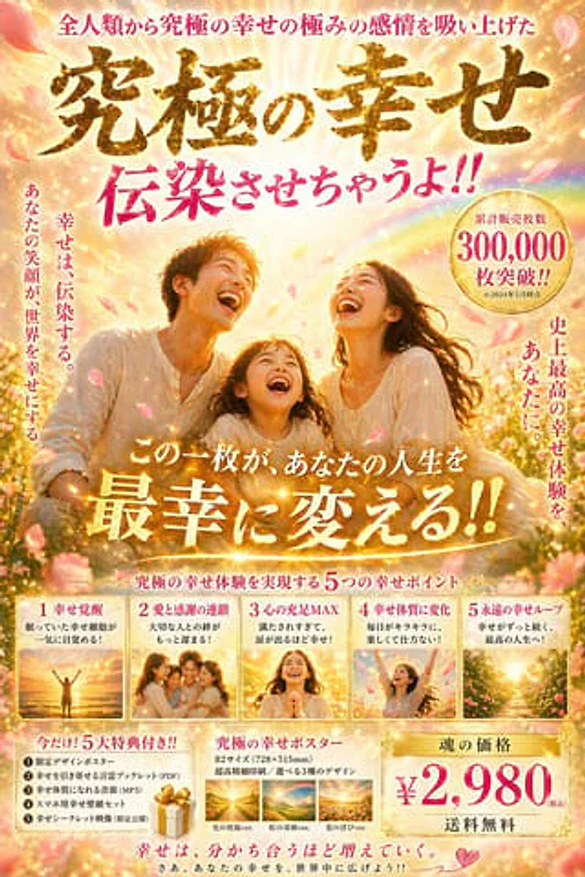

```text
{
  "type": "Promotional poster",
  "theme": "Radiant, golden, dazzling, ultimate happiness",
  "color_palette": [
    "gold",
    "White",
    "warm yellow",
    "Pink accents"
  ],
  "header": {
    "top_catchcopy": "Drawing upon the essence of humanity's ultimate happiness",
    "main_title": "{argument name=\"main title\" default=\"Ultimate happiness\"}",
    "subtitle": "{argument name=\"catchphrase\" default=\"It will be delivered to you soon!!\"}",
    "title_style": "Large size, bold font, shimmering gold texture, 3D effect"
  },
  "hero_section": {
    "image": "{argument name=\"hero subject\" default=\"The family of three laughed heartily, looking up at the sky, bathed in golden light.\"}",
    "background": "Rainbows, shimmering particles, radiant aura",
    "overlay_text_center": "This poster will completely change your life!!",
    "vertical_text_left": "Happiness is contagious. Your smile will make the world happier.",
    "vertical_text_right": "Bringing you the best happiness experience ever.",
    "badge_top_right": {
      "shape": "Golden Circle",
      "text": "Cumulative sales exceeded{argument name=\"sales badge text\" default=\"300,000\"} open!!"
    }
  },
  "middle_section": {
    "section_title": "5 Key Elements to Achieving Ultimate Happiness",
    "count": 5,
    "cards": [
      {
        "number": 1,
        "title": "1. Awakening to Happiness",
        "image": "People with arms raised on Sunset Beach"
      },
      {
        "number": 2,
        "title": "2. A Chain of Love and Gratitude",
        "image": "A warm embrace between the family of four"
      },
      {
        "number": 3,
        "title": "3. Maximum inner satisfaction",
        "image": "A woman who clasps her hands together in gratitude radiates light."
      },
      {
        "number": 4,
        "title": "4. Transform into a happy constitution",
        "image": "A woman raising her arms in a flower field"
      },
      {
        "number": 5,
        "title": "5. The Eternal Cycle of Happiness",
        "image": "A sunny, flower-filled forest path"
      }
    ]
  },
  "bottom_section": {
    "left_panel": {
      "title": "Limited-time offer! 5 bonus benefits included!!",
      "list_count": 5,
      "icon": "Gold gift box with ribbon"
    },
    "center_panel": {
      "title": "Ultimate Happiness Poster",
      "subtitle": "B2 size (728×515mm) Ultra-high precision printing / 3 designs available",
      "thumbnail_count": 3,
      "thumbnail_labels": [
        "Blessing of Light Edition",
        "Rainbow Miracle Edition",
        "Flower Joy Edition"
      ]
    },
    "right_panel": {
      "title": "Soul pricing",
      "price": "{argument name=\"price\" default=\"¥2,980\"}",
      "shipping": "Free shipping",
      "style": "Prices are displayed in large red numbers on a gold background."
    }
  },
  "footer": {
    "text": "Happiness grows richer the more it's shared. Come on, spread your happiness throughout the world!",
    "icon": "A small red heart drawn with lines"
  }
}
```

Model: GPT Image 2
Author: GPT Image 2 Prompts

[ProjectD](https://aitoolsradar.com/en/prompts/97d06bd19ac360) · [Recorded source](https://x.com/nakazakifam/status/2046295223584862235#reversed-1)
 · [Full original metadata and byte evidence](data/projectd-batch-0035.json)

## Japanese High School Yearbook Portrait

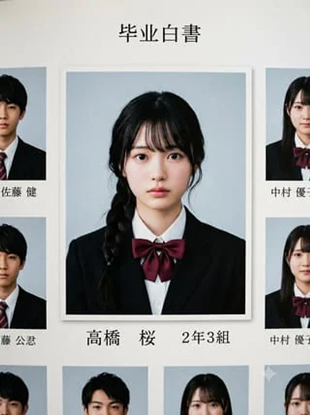

```text
Ultra-realistic Japanese high school yearbook portrait of a {argument name="subject" default="beautiful teenage girl"}, centered in a formal graduation photo layout. She has {argument name="hair style" default="long, silky jet-black hair styled in a loose side braid draped over one shoulder, soft wispy curtain bangs"}, luminous porcelain-fair skin, subtle rosy cheeks, naturally full pink lips, and large expressive dark brown eyes with a calm, slightly melancholic gaze looking directly into the camera. Her expression is neutral, quiet, and elegant with a gentle, introspective mood. She is wearing a {argument name="uniform" default="traditional Japanese high school uniform consisting of a tailored black blazer, crisp white dress shirt, and a deep burgundy satin ribbon bow"}. The portrait is framed from the chest upward against a smooth light blue-gray studio backdrop with soft, even school-photography lighting, minimal shadows, and true-to-life colors. The portrait is printed on a clean white yearbook page with thin white borders separating neighboring student portraits. Japanese kanji characters are printed beneath the portrait as the student's name, creating an authentic Japanese graduation album aesthetic. Adjacent student portraits are partially visible on both sides, reinforcing the official class yearbook layout. Style: ultra-realistic, Japanese school graduation album photography, minimalist composition, authentic yearbook design, soft natural skin tones, high detail, DSLR quality, shallow depth of field, sharp facial focus, subtle cinematic realism, 8K resolution.
```

Model: GPT Image 2
Author: Jahan Zaib

[ProjectD](https://aitoolsradar.com/en/prompts/b2f932277c28b6) · [Recorded source](https://youmind.com/prompts/japanese-school-yearbook-portrait-29681)
 · [Full original metadata and byte evidence](data/projectd-batch-0035.json)

## Japanese Hospital Comedy DVD Cover

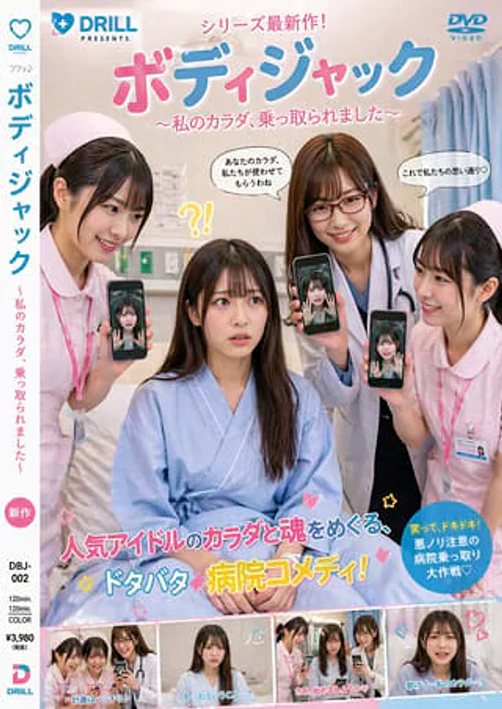

```text
This is a realistic Japanese DVD cover, designed like those for commercial live-action comedy thrillers. The vertical composition and glossy retail packaging give it a premium feel. The cover depicts the interior of a hospital ward with soft beige walls, curtains on the right, and subtle medical equipment in the background. In the foreground, a young Japanese woman in a loose light blue hospital gown sits on a bed, looking confused and helpless. Around her stand three young Japanese female medical staff: two nurses in light pink uniforms, caps, and name tags, and a doctor in a white coat with a stethoscope. Each of the three standing women holds a smartphone, pointing it at the camera. The screen displays the seated woman's face or body, as if her consciousness has been transferred into the device, creating a "body hijacking" theme. The overall tone is playful, absurd, and slightly eerie, similar to DVD covers for Japanese idol films or hospital comedies. It features sophisticated magazine-quality typography, prominent Japanese text, and vibrant, trendy graphics. At the very top, on the left, is a small blue publisher logo with the text:{argument name="studio name" default="DRILL PRESENTS"} It also features a heart-shaped icon and a blue DVD VIDEO logo in the upper right corner. At the top center, a pink Japanese banner reads "Latest Series!". Below is a large, rounded, glossy, and bubbly pink and blue Japanese main title:{argument name="main title" default="ボディジャック"} Below the title, add a pink Japanese subtitle:{argument name="subtitle" default="~My body has been taken over~"} Add three manga-style speech bubbles near the characters above: one that reads "あなたのカラダ、私たちが使わせてもらうわね", one that reads "これで私たちの思い通り♡", and a yellow startled reaction bubble next to the seated woman that reads "?!". On the left spine area, create a white vertical bar with the title and subtitle repeated in blue and pink Japanese, accompanied by a small pink round label that reads "New Work". At the center of the bottom, there is an eye-catching slogan in Japanese, using a mix of pink, blue, white and yellow with an outline: "人気アイドルのカラダとsoulをめぐる,ドタバタ Hospitalコメディ!", surrounded by small stars and heart-shaped graffiti. In the lower right corner, add a blue circular blast box with yellow and white Japanese text: "Laughing っ て, ドキドキ! 悪ノリ NOTE の Hospital multiply っ take り大作戦♡". Along the bottom edge are four small rectangular preview stills from the film, each bordered like a DVD scene thumbnail, showcasing the same group of hospital characters in different poses. Below each thumbnail is a brief Japanese description, including lines like “計画はバッチリ！”, “え…どういうこと…？”, “さあ、始めましょうか♡”, and “助けて…私のカラダ…！”. At the bottom left edge, in black text, is the DVD packaging metadata, such as the catalog number “DBJ-002,” runtime “120min.”, “COLOR,” and price “¥3,980 (excluding tax),” accompanied by a small blue and pink DRILL logo. The bright, retail-quality composition, realistic character portrayals, and commercial Japanese film cover aesthetics are present, with a slightly exaggerated style, high resolution, and clear printing.
```

Model: GPT Image 2
Author: GPT Image 2 Prompts

[ProjectD](https://aitoolsradar.com/en/prompts/32828d114233c6) · [Recorded source](https://x.com/HijackDef_Lab/status/2046763631191478692#reversed-0)
 · [Full original metadata and byte evidence](data/projectd-batch-0035.json)

## Japanese Idol Reflection Aesthetic

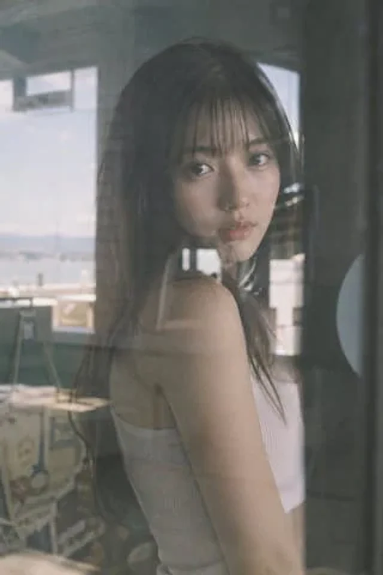

```text
Japanese negative film aesthetics, reflective surface scenes, soft natural light, slightly overexposed highlights, low contrast, soft tones, delicate graininess, a beautiful {argument name="subject" default="Japanese idols"} pass{argument name="surface" default="Mirror or glass reflection"} Presented with the body partially in the frame, the face fully visible, looking directly at the camera through reflections, the pose relaxed, layered reflections, slight distortion, imperfect composition, a quiet observational perspective—"what you see is what you get"—ar 2:3
```

Model: GPT Image 2
Author: GPT Image 2 Prompts

[ProjectD](https://aitoolsradar.com/en/prompts/a76edafdeed467) · [Recorded source](https://x.com/BubbleBrain/status/2047908911068635551)
 · [Full original metadata and byte evidence](data/projectd-batch-0035.json)

## Japanese Idol TV Show Screenshot

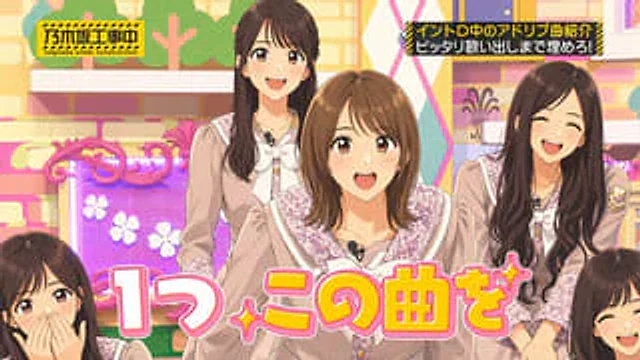

```text
A bright screenshot from a Japanese TV variety show studio, featuring a cheerful, soft color palette reminiscent of idol programs, and a mid-range wide-angle group shot, showcasing {argument name="group size" default="5"} The young women stood closely together, with the center performer slightly forward and the others partially visible around her. Their faces were deliberately obscured by soft, rectangular mosaics, much like the anonymization of social media posts, but their hairstyles, clothing, postures, and the setting remained clear. They wore coordinated, feminine stage uniforms in shades of dusty rose and beige, with white bows at the necklines, floral lace embellishments on the shoulders and chest, puff sleeves, gold buttons, and small black lapel microphones clipped near the collar. The center woman had a shoulder-length light brown bob with side-swept bangs; two taller women behind and to the right had long, dark brown curly hair; only the heads of two other members were visible in the lower left and right corners. The studio backdrop was rich and varied in color: beige and soft-toned brick walls, a stylized tree cutout in the upper left corner, a glowing purple LED panel on the left surrounded by a decorative pink ornate border with white flower icons, and geometric, soft-toned wall panels on the right. Striking Japanese television subtitles were added, with clear and legible text. In the top left corner, place a yellow and black construction sign-style box with diagonal danger stripes and the text "Nogizaka Under Construction," below which are smaller Roman letters "nogizaka under construction." In the top right corner, place a black rectangle with a yellow danger stripe border containing two lines of Japanese text: "イントロ中のアドリブ曲紹介" and "ピッタリ歌い出しまで埋めろ!". Below in the center, add a large, humorous title in bold, rounded Japanese font, containing the following text:{argument name="main caption" default="1. This song"} The color is bright yellow with orange shading, a white inner border, and a bold pink outline, with shimmering star decorations incorporated into the phrase. The overall composition should evoke the feeling of a real paused television broadcast, rich in color, refined, and highly clear, using a 16:9 aspect ratio, with the visual focus on the large title at the bottom and the central performer.
```

Model: GPT Image 2
Author: GPT Image 2 Prompts

[ProjectD](https://aitoolsradar.com/en/prompts/c56f5a8c67bcac) · [Recorded source](https://x.com/sakamichiiwlu4e/status/2047268975520952541#reversed-0)
 · [Full original metadata and byte evidence](data/projectd-batch-0035.json)

## Japanese Ikemen Product Ad Grid

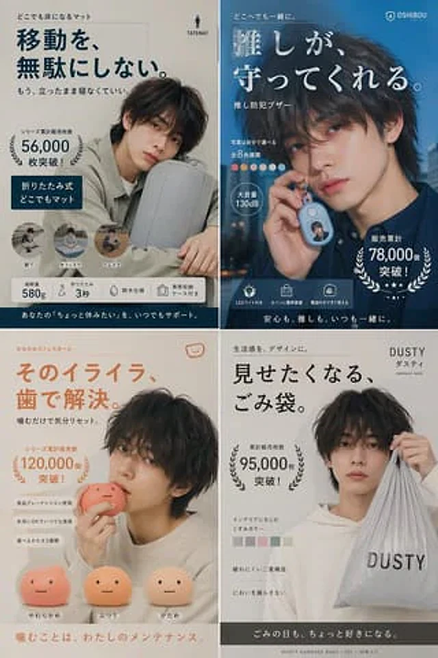

```text
{
  "type": "Japanese social media ad collage",
  "style": "Clean and modern lifestyle product advertisements, minimalist Japanese-style graphic design, photorealistic studio portraits, soft natural lighting, sophisticated low-saturation color schemes, and a 2x2 square grid layout with thin white dividing lines.",
  "layout": {
    "grid": "2 columns and 2 rows",
    "count": 4,
    "sections": [
      {
        "position": "Top left",
        "product": "Foldable Portable Floor Mat",
        "brand": "TATEMAT",
        "primary color": "off-white and dark blue",
        "headline": "Don't let the movement go to waste.",
        "subheadline": "You don't have to sleep standing up anymore.",
        "sales badge": "Sales have exceeded 56,000 copies!",
        "cta": "Foldable portable cushion",
        "feature icons count": 4,
        "feature labels": [
          "Ultralight 580g",
          "Fold in 3 seconds",
          "Waterproof design",
          "Includes a dedicated storage bag"
        ],
        "usage photos count": 3,
        "usage labels": [
          "At the station",
          "In the office",
          "At the music festival"
        ],
        "footer": "Support your \"break time\" anytime, anywhere.",
        "subject": "A handsome young Japanese man with gentle, downcast eyes and messy dark hair, wearing a light gray jacket over a white shirt, leans his arms against a vertical gray folding mat."
      },
      {
        "position": "Top right",
        "product": "Personal self-defense alarm with idol photo slot",
        "brand": "OSHIBOU",
        "primary color": "Dark blue",
        "headline": "My favorite idol will protect me.",
        "subheadline": "My Favorite Personal Security Alarm",
        "variant text": "The photo is customizable and comes in 8 colors.",
        "color dots count": 8,
        "feature badge": "Loud volume 130dB",
        "feature icons count": 3,
        "feature labels": [
          "With LED lights",
          "Easily hang on your bag",
          "Includes battery, ready to use immediately."
        ],
        "sales badge": "Cumulative sales have exceeded 78,000 units!",
        "footer": "A sense of security and the constant companionship of your beloved idol.",
        "subject": "The same handsome young Japanese man, with gentle, downturned eyes and messy dark hair, wearing a navy blue shirt, holds a small blue self-defense alarm to his side. A miniature portrait can be seen inside the device, against a background of blurred city lights."
      },
      {
        "position": "Bottom left",
        "product": "Stress-relieving chewing ball",
        "brand": "",
        "primary color": "Soft peach and cream colors",
        "headline": "Relieve that frustration with your teeth.",
        "subheadline": "Just chew it and reset your mood.",
        "sales badge": "Sales have exceeded 120,000 units!",
        "feature pills count": 3,
        "feature labels": [
          "Made of food-grade silicone",
          "Washable, keeps clean at all times.",
          "Three hardness levels are available."
        ],
        "variants count": 3,
        "variant labels": [
          "soft",
          "Moderate",
          "hard"
        ],
        "footer": "Chewing is my way of regulating myself.",
        "subject": "The same handsome young Japanese man, with gentle, downturned eyes and tousled dark hair, wearing a cream-colored sweater, holds a peach-colored chew ball with a simple smiley face design to his mouth; the bottom displays three product styles."
      },
      {
        "position": "Bottom right",
        "product": "Designer trash bags",
        "brand": "DUSTY",
        "brand subtitle": "GARAGE BAGS",
        "primary color": "Light gray and charcoal gray",
        "headline": "Garbage bags you'll want to show off.",
        "subheadline": "Bringing a sense of everyday life into the design.",
        "sales badge": "Sales have exceeded 95,000 copies!",
        "color swatches count": 5,
        "feature labels count": 2,
        "feature labels": [
          "Double-layer structure, not easily damaged",
          "Prevent odor leakage"
        ],
        "footer": "Even taking out the trash has become something to look forward to.",
        "bottom strip": "DUSTY GARBAGE BAGS / 20L / 30 张装",
        "subject": "The same handsome young Japanese man, with gentle, downturned eyes and messy dark hair, wearing a white hoodie, is holding a semi-transparent gray garbage bag with the word \"DUSTY\" prominently printed in black."
      }
    ]
  },
  "character consistency": {
    "count": 1,
    "description": "The same male model appears in all four advertisements, possessing an attractive Japanese handsome man image, with gentle, downturned eyes, a slender build, and medium-length, messy black hair."
  },
  "typography": {
    "language": "Japanese",
    "look": "A striking editorial style for the headlines, clean sans-serif body text, a premium e-commerce ad layout with a laurel leaf sales badge, icon rows, rounded buttons, and small product labels."
  }
}
```

Model: GPT Image 2
Author: GPT Image 2 Prompts

[ProjectD](https://aitoolsradar.com/en/prompts/23191d5cb68e75) · [Recorded source](https://x.com/taya_mama_AI/status/2046612424321913069#reversed-0)
 · [Full original metadata and byte evidence](data/projectd-batch-0035.json)

## Japanese Inheritance Tax LP Hero

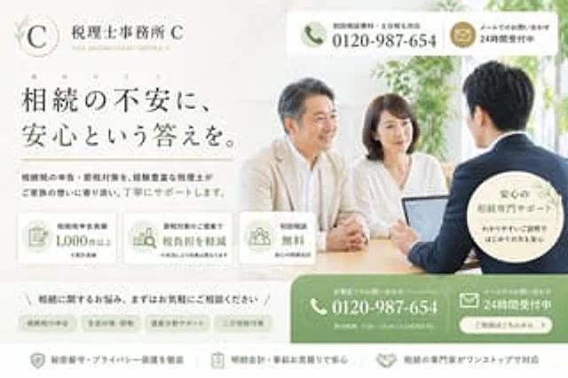

```text
Design a clean, high-end homepage image for a fictional accounting firm specializing in estate tax consulting in Japan. The design should present the visual effect of a modern listing ad landing page, using a widescreen desktop format with a soft ivory and warm white background accented with gentle sage green and gold. The title should use an elegant serif Japanese font to create a calm and trustworthy atmosphere. A refined circular logo should be placed in the upper left corner, featuring a thin gold ring, a large serif letter C, and a small botanical illustration, followed by the firm's name, "Tax Accountant Firm".{argument name="office name" default="C"} "and the English subtitle "TAX ACCOUNTANT OFFICE"{argument name="office name" default="C"} In the upper right corner, add a rounded white contact panel divided into two parts: the left side is the phone number panel, containing a green circular phone icon, the small text "First consultation is free, available on weekends and holidays" and a large number.{argument name="phone number" default="0120-987-654"} The right side features an email section with a gold circular email icon and the text "メールでのお問い合わせ24時時受付中" (Email inquiries are accepted 24 hours a day). The main title on the left should be a prominent Japanese phrase: "相続の不安に、安心という答えを." (Providing reassuring answers to your inheritance anxieties.), with the key phrase "安心という答えを." in sage green. Below, a smaller line of Japanese supplementary explanation is added: “相続税の申告・节税対策を、経験豊富な税理士がご家族の想いに寄り添い、丁宁にサポートします。” (An experienced tax advisor will provide detailed support regarding estate tax filing and tax-saving strategies, taking your family's needs into consideration.) Below this, three rounded rectangular function cards are placed horizontally, with a light background and green line icons: Card 1 displays a document icon and the text “相続税申告実绩1,000件以上” (Over 1,000 estate tax filings), with the smaller text “※累计実绩” (Cumulative performance); Card 2 The chart displays a bar graph icon and the text "Reducing the tax burden through tax-saving measures" (省税対策のご提出で税负を軽减), with the smaller print "※The effect varies depending on the situation" (未情况により效果は异なります). Card 3 displays a group icon and the text "First consultation is free" (初回相谈无料), with the smaller print "Peace of Mind Accounting" (安心の明朗会计). The right half shows a brightly lit consultation scene: in a sunlit office with greenery in the background, three Japanese adults sit around a table, including a male consultant on the right with his back to the camera, wearing a dark blue suit, and two clients facing him (a man in a light beige jacket and a woman in a white shirt). An open laptop sits on the table. Their expressions are calm and focused. A light-colored circular badge with delicate leaf decorations is superimposed on the lower right of the photo, with the text "安心の相続専门サポートわかりやすいご解释ではじめての方も安心" (Professional support for inheritance with peace of mind, easy-to-understand explanations, even for first-time consultations). Below, in the middle, a thin line inviting consultation is added, with the text "相続に关するお悩み、まずはお気軽にご相谈ください" (Please feel free to consult us regarding any concerns about inheritance), flanked by diagonal lines. Below this, four rounded-corner category labels are placed horizontally: "相続税の申告", "生前対策・减税", "遗分分サポート", and "次二相続対策". In the bottom right corner, add a large green rounded corner contact CTA area, divided into two columns: the left column contains a white phone icon, small text "お電話でのお問い合わせ（フリーダイヤル）" (phone inquiry (free hotline)), and large numbers.{argument name="phone number" default="0120-987-654"} The small print reads "Acceptance time 9:00~18:00 (available on Saturdays, Sundays and holidays)"; the right column contains a white email icon, the text "Email inquiries are accepted 24 hours a day" and a rounded white button "Click here to inquire". At the very bottom, create a white safety bar with three horizontally arranged items separated by thin vertical lines: 1) a shield icon and "Secretly guarded, thoroughly protected" (strictly adhering to confidentiality and privacy protection); 2) a clipboard icon and "Clearly priced, reassuring with advance quotes" (transparent pricing, reassuring with advance quotes); 3) a handshake icon and "One-stop service from inheritance experts" (one-stop service from inheritance specialists). Utilizing subtle shadows, rounded corners, and soft natural light, create a professional and highly credible visual effect for this Japanese legal and tax service advertisement.
```

Model: GPT Image 2
Author: GPT Image 2 Prompts

[ProjectD](https://aitoolsradar.com/en/prompts/d9b5ad2d992ffa) · [Recorded source](https://x.com/takeshibengo/status/2047061602315460747#reversed-2)
 · [Full original metadata and byte evidence](data/projectd-batch-0035.json)

## Japanese Insurance Staff Directory Mockup

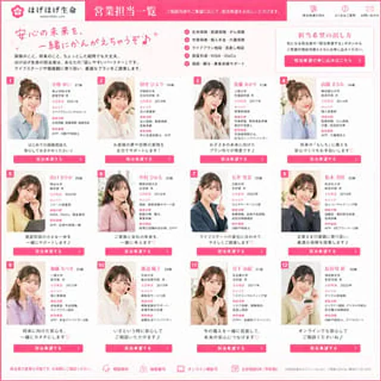

```text
{
  "type": "Japanese insurance company employee directory webpage presentation",
  "brand": {
    "company_name": "Hogehoge Life",
    "romanized_name": "HOGEHOGE LIFE",
    "theme": "The combination of bright pink and white presents a friendly, trustworthy, and gentle corporate design style."
  },
  "page": {
    "title": "Sales Representatives Overview",
    "subtitle": "You can submit an application to serve based on the content of the consultation or your personal wishes.",
    "format": "Full-page website screenshot, square composition, dense card grid layout."
  },
  "layout": {
    "header": {
      "left": "Company logo and name with flower icon",
      "center": "Large pink headline banner",
      "right": {
        "count": 3,
        "labels": [
          "Simple application process",
          "Frequently Asked Questions",
          "Contact Us"
        ]
      }
    },
    "intro": {
      "headline": "Let's create a safe and secure future together♪",
      "body": "No questions are too small when it comes to insurance or future planning. Hogehoge, your life's guardian, is your 'easy-to-communicate partner.' We will tailor the best solutions to your life stage and values.",
      "features": {
        "count": 6,
        "items": [
          "Life insurance, medical insurance, and cancer insurance",
          "Education insurance, personal pension, and long-term care insurance",
          "Life planning consultation &amp; policy review",
          "Asset Allocation • NISA • iDeCo",
          "Support for inheritance, gifts, and business succession",
          "Use simple and easy-to-understand language to provide detailed guidance"
        ]
      },
      "cta_box": {
        "title": "How to apply for a position",
        "body": "Please click the \"Apply for Role\" button below your preferred role and fill in your inquiry to make an appointment.",
        "button": "Click here to apply for a position."
      }
    },
    "staff_grid": {
      "count": 12,
      "numbered_cards": true,
      "columns": 4,
      "rows": 3,
      "card_style": "White cards with rounded corners, thin gray borders, and pink accents; each card has a colored number tag in the upper left corner.",
      "shared_elements": [
        "A half-body photo of a smiling Japanese female consultant, her face blurred.",
        "Name and Age",
        "Japanese Language Position and Personal Profile",
        "Multiple pink category labels",
        "A short and friendly slogan at the bottom",
        "A bright pink CTA button, labeled \"Application Assistant\"."
      ],
      "cards": [
        {
          "number": 1,
          "name": "Yui Kobayashi",
          "age": "27 years old",
          "photo": "A light blue shirt, chin resting on hand, against a soft interior background.",
          "catchphrase": "Even if it's your first insurance consultation, please feel free to entrust it to me♪"
        },
        {
          "number": 2,
          "name": "Hiyori Tanaka",
          "age": "29 years old",
          "photo": "Beige shirt, shoulder-length hair, deep in thought.",
          "catchphrase": "We fully support you in achieving your dreams and goals!"
        },
        {
          "number": 3,
          "name": "Akari Sato",
          "age": "31 years old",
          "photo": "Beige coat, fingers lightly touching lips, long straight hair",
          "catchphrase": "Specializes in creating plans for your child's future♪"
        },
        {
          "number": 4,
          "name": "Manami Takahashi",
          "age": "34 years old",
          "photo": "Blue and white striped shirt, hair up, hand supporting cheek",
          "catchphrase": "Helping you prepare for the \"what ifs\" of the future with peace of mind ♡"
        },
        {
          "number": 5,
          "name": "Yamaguchi Sayaka",
          "age": "28 years old",
          "photo": "Wearing a yellow cardigan, she sat by the window, a gentle smile on her face.",
          "catchphrase": "Take a small step into asset allocation with us♪"
        },
        {
          "number": 6,
          "name": "Hikaru Nakamura",
          "age": "32 years old",
          "photo": "Pink shirt, bob haircut, gentle posture",
          "catchphrase": "Let's envision the future of our family and company together ♡"
        },
        {
          "number": 7,
          "name": "Rina Ishii",
          "age": "25 years old",
          "photo": "Dark blue suit, braided or tied-up hair, confident pose",
          "catchphrase": "We offer personalized advice based on changes in your life stage."
        },
        {
          "number": 8,
          "name": "Masaki Matsumoto",
          "age": "30 years old",
          "photo": "Dark shirt, one hand lightly touching his face, casual office photo.",
          "catchphrase": "We offer the best insurance solutions tailored to the needs of our corporate clients."
        },
        {
          "number": 9,
          "name": "Satsuki Kato",
          "age": "33 years old",
          "photo": "Light purple top, hand supporting chin, bright background",
          "catchphrase": "Let's make peace of mind for the future a reality together ♡"
        },
        {
          "number": 10,
          "name": "Yuka Watanabe",
          "age": "29 years old",
          "photo": "White shirt, short bob haircut, a simple and clean portrait.",
          "catchphrase": "Feel free to consult us anytime you need us♪"
        },
        {
          "number": 11,
          "name": "Yuki Miyashita",
          "age": "31 years old",
          "photo": "Beige coat, hands close to face, warm indoor light",
          "catchphrase": "A comprehensive review based on existing safeguards, ensuring peace of mind for the future."
        },
        {
          "number": 12,
          "name": "Aya Hasegawa",
          "age": "26 years old",
          "photo": "Wearing a pale yellow top, holding a smartphone, and smiling naturally.",
          "catchphrase": "Please rest assured that you can receive consultations online as well.♪"
        }
      ]
    },
    "footer": {
      "count": 5,
      "items": [
        "We support changing the person in charge; please feel free to contact us at any time.",
        "Free consultation",
        "Strict confidentiality",
        "Online consultation is supported.",
        "Consultations are available on weekends (appointment required)."
      ],
      "note": "*Depending on the schedules of the staff members, we may not be able to fulfill your reservation requests."
    }
  },
  "style": {
    "visual_tone": "The cute and sophisticated style of Japanese corporate advertising conveys both trustworthiness and vitality.",
    "color_palette": {
      "primary": "Hot Pink",
      "secondary": "Soft pink",
      "background": "very light pink and white",
      "text": "Dark gray with pink highlight"
    },
    "typography": "A clean, sans-serif Japanese font paired with a handwritten-style pink title.",
    "rendering": "High-resolution web UI demo, featuring stylish cards embedded with real portrait photographs, clear Japanese text, symmetrical spacing, and a professional e-commerce style landing page."
  }
}
```

Model: GPT Image 2
Author: GPT Image 2 Prompts

[ProjectD](https://aitoolsradar.com/en/prompts/f05ba031c43f97) · [Recorded source](https://x.com/hagamight/status/2047601440160383021#reversed-0)
 · [Full original metadata and byte evidence](data/projectd-batch-0035.json)

## Japanese Izakaya Highball Poster

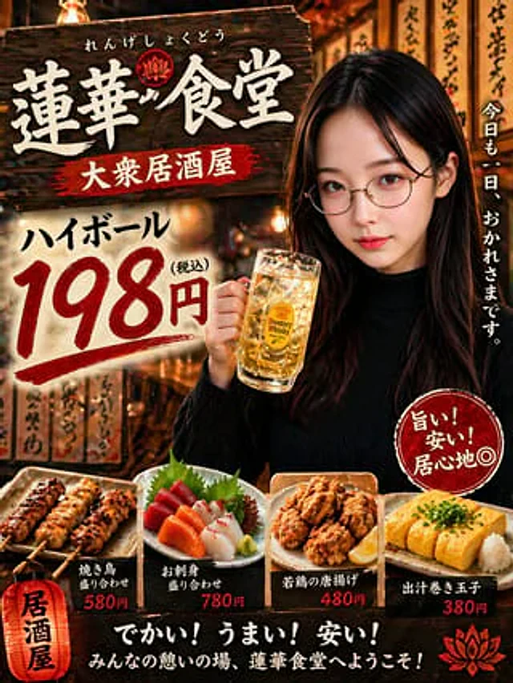

```text
A photorealistic Japanese izakaya (Japanese pub) promotional poster presents a warm and cinematic nighttime atmosphere, with a design style similar to a street-side restaurant flyer. The composition is vertical and layered. On the right is a young Japanese woman with long, straight, dark brown to black hair, wearing a fitted black ribbed turtleneck sweater. She appears half-body in the shot, holding a large, chilled glass filled with gold Highballs in her right hand, with ice cubes clearly visible. Her relaxed and friendly posture, looking at the camera, creates a soft nightlife atmosphere. The background is a narrow, traditional izakaya exterior or alleyway scene, filled with warm orange lantern light and shallow depth of field, with wooden menu signs bearing handwritten Japanese calligraphy, exuding a nostalgic, lively atmosphere after work. In the upper left corner, a dark, distressed wooden sign dominates the image, bearing the Chinese characters "莲華食堂" (Renka Shokudou) in striking white strokes. Above it is the smaller hiragana "れんげしょくどう" (Renge Shokudou), and below is a red banner that reads "大众居酒屋" (Taipei Izakaya). In the lower left center, a large cream-colored paper or drawing board displays discounted drinks in oversized calligraphic font: "ハイボール" (Highball) above, and a large red "198円" (198 yen) below, with a small black "（税込）" (tax included) next to the price, the numbers rendered in a vibrant brushstroke style. At the far right edge, vertical white Japanese text reads "今日も一日、おつかれさまです。" (Today is also one day, I'm here.). Above a female torso in the lower right corner, a red circular stamp-like badge bears the handwritten white text arranged diagonally and vertically: "旨い！安い！居心地◎" (Aim! Peace! Honesty◎). At the bottom foreground, four menu items are displayed side-by-side on rustic ceramic plates: 1) Two skewers of grilled chicken with charred marks, labeled "焼き鳥盛り合わせ" (grilled chicken skewers), priced at ¥580; 2) A sashimi platter containing tuna, salmon, white fish, shiso leaves, and wasabi, labeled "お刺身盛り合わせ" (sashimi platter), priced at ¥780; 3) A plate of Japanese fried chicken nuggets with lemon wedges, labeled "若鶏の唐扬げ" (fried chicken nuggets), priced at ¥480; 4) Sliced ​​dashi tamagoyaki (Japanese rolled omelet) topped with scallions and grated radish, labeled "出汁巻き驩子" (dashi rolled omelet), priced at ¥380. In the lower left corner, a glowing red paper lantern graphic is added, with the words "Izakaya" (Japanese pub) in black vertical text. In the dark strip at the bottom center, add the striking white bold text "Dekai! Umai! Anai!", below which is the smaller white text "Minna no Kii no Ba, Renka Shokudo e yokoso!". A decorative red lotus-shaped badge is added near the top sign, and another identical badge is added to the lower right corner. The design employs rich amber highlights, strong contrast, glossy food shapes, realistic skin and drink textures, commercial poster-level sophistication, and a nostalgic Showa-era izakaya advertising aesthetic.
```

Model: GPT Image 2
Author: GPT Image 2 Prompts

[ProjectD](https://aitoolsradar.com/en/prompts/38e284ce0e0218) · [Recorded source](https://x.com/SakuraRenge/status/2046612071719342322#reversed-1)
 · [Full original metadata and byte evidence](data/projectd-batch-0035.json)

## Japanese Jungle Theme Park Parody Poster

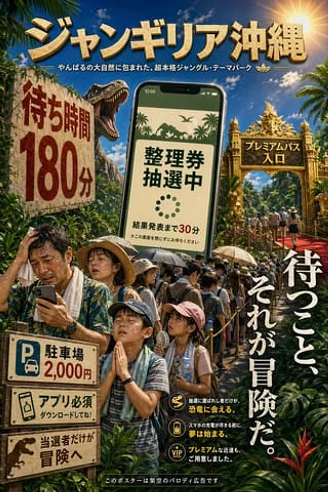

```text
This is an incredibly detailed Japanese-style parody theme park advertisement poster. Using a vertical format, the design blends dramatic summer tourism advertising with luxury attraction promotion. The background is a tropical jungle with a clear blue sky above, dotted with scattered clouds. A blazing sun hangs in the upper right corner, and palm leaves droop from the top edge. A large 3D stone-textured Japanese title is placed at the top of the poster.{argument name="headline text" default="Jankiria Okinawa"} Below is a line of small white Japanese text: "— やんばるの自然に包まれた、超本格ジャングル・テーマパーク—". In the center of the image is a modern smartphone, upright and slightly tilted, occupying the visual focus. The screen displays a beige ticket lottery waiting screen, with a jungle silhouette at the top, and the prominent bold Japanese text "整理票抽选" (ticket lottery results are being processed) in the middle, accompanied by a circular loading icon. At the bottom, smaller text reads "结果発表まで30分" (Results have been posted 30 minutes ago) and "※この屏を闭じずにお待ちください" (Please wait for this screen to close). The phone's status bar shows the time as 10:00. To the left rear of the phone is a Tyrannosaurus Rex bursting out of the jungle vegetation, its mouth wide open, a realistic and menacing image. To the right is an ornately decorated golden entrance gate, intricately carved, with a sign above reading "Premium Pass Entrance," leading to a VIP passageway carpeted in red. The foreground and midground show long queues of tourists stretching into the distance, dressed in casual summer attire, wearing hats, carrying towels and backpacks, and holding parasols, fans, and water bottles, conveying their weariness in the sweltering heat. The faces of several figures closer to the frame are blurred. On the far left stands a large, weathered stone monument with the striking red Japanese inscription "Waiting Time 180 Minutes." In the bottom left corner are three stacked, rustic-style wooden items: the top sign has a blue parking icon and the text "Parking lot 2,000 yen"; the middle sign has a smartphone icon and the text "App must down road!"; and the bottom sign has a dinosaur silhouette and the text "You're the chosen one." Along the edge in the bottom right corner is a very prominent vertical white calligraphy-style Japanese text: "Wait, you're the chosen one." Contains 3 near the lower right corner A small round icon is marked with a brief Japanese slogan: "The person who chooses the lottery is the one who is the best, the fear is the dragon will be the one who will be the best." "きる前に、梦はstartまる" and "プレミアムなNearly道も、ご意しました", the icons respectively imply dinosaurs, mobile phone battery and VIP. aisle. A black disclaimer bar was added to the center of the bottom with small white Japanese text reading: "このポスターは空空のパロディ広报です". The overall style pursues hyper-realism, cinematic feel, high contrast, and satire, and is as exquisite as a high-end commercial poster. The core humor lies in the exaggerated hype of the theme park, the oppressive heat, and the absurd queuing-style adventure.
```

Model: GPT Image 2
Author: GPT Image 2 Prompts

[ProjectD](https://aitoolsradar.com/en/prompts/0b680f1f8919c2) · [Recorded source](https://x.com/ai_ojichan/status/2046786080171573422#reversed-0)
 · [Full original metadata and byte evidence](data/projectd-batch-0035.json)

## Japanese Koinobori Fashion Magazine Cover

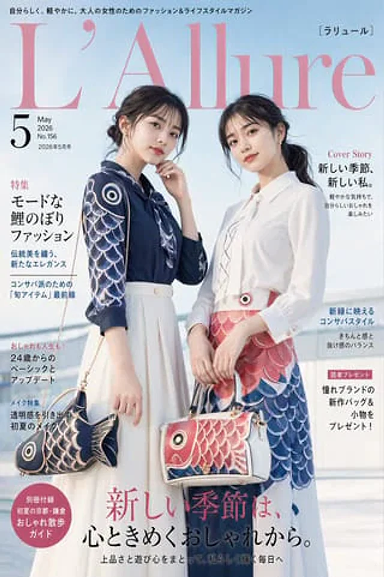

```text
A sophisticated Japanese fashion magazine cover, photographed in a bright and clear outdoor setting, with a pale blue sky and soft-focus modern railings in the background, in a vertical composition. The top masthead features a large, elegant, soft pink serif font, "L'Allure," with smaller Japanese text above and a Japanese subtitle in brackets in the upper right corner. The upper left corner displays the issue information as a large black "5," flanked and below by smaller text indicating May 2026, issue number 156, and the May 2026 issue itself. The cover showcases two adult East Asian women standing side-by-side from mid-thigh up, striking a pose befitting a luxurious editorial cover. Their faces are deliberately obscured by smooth, rectangular blurs. The soft, natural, and highly embellished lighting creates a sophisticated high-fashion magazine aesthetic. The woman on the left wears a navy blue blouse with sleeves featuring a dramatic fish-scale design in navy blue, white, and silver, tucked into a long, flowing, off-white skirt with a wide waist. She carries a fish-shaped handbag: a navy blue and cream-colored koi-inspired bag with round eye details, fish scale patterns, a fish tail silhouette, gold hardware, and a delicate dangling chain. Her hair, a deep brown to black, is loosely tied in a low bun, with a few strands softly framing her face. Her posture is elegant, her body slightly leaning forward, one hand near her chin. The woman on the right wears a crisp white blouse with a soft bow tie or vertical ruffles/placket details, paired with a striking koi-inspired skirt or dress in coral pink and deep blue, featuring layered fish scale patterns and a round eye-shaped embellishment at the waist. She carries a structured handbag: a rectangular white bag with coral pink koi face detailing, blue accents, gold hardware, a top handle, and a shoulder strap. Her dark hair is tied in a low ponytail. She stands slightly to the left, her hands relaxed, exuding a composed, editorial air. The fashion concept revolves around carp streamers and carp motifs, transforming the traditional Japanese imagery of carp streamers into sophisticated contemporary womenswear. The color palette features soft sky blue, blush pink, navy blue, white, cream, and coral red. Fabrics appear smooth, elegant, and light, adorned with printed or embroidered fish-scale patterns. The overall atmosphere is elegant, feminine, seasonal, and high-end, balancing tradition and modern fashion. A multi-line Japanese cover title is included, employing realistic editorial typography. The left side contains four text blocks: a red and black themed section on melancholic carp streamer fashion; a blue subheading on balancing traditional aesthetics with fresh elegance; a black text block on basic and updated styles for 20-year-old women; and a blue beauty section on transparent makeup looks for early summer. The right side contains three text blocks: a red "Cover Story" title below a larger black Japanese main title; a blue text block about a conservative style shining in fresh greenery; and a pink-framed reader giveaway notification below black Japanese text about new bags and accessories from luxury brands. Near the bottom left corner is a circular pink badge with white and cream Japanese text announcing a special walking guide supplement. At the bottom center, spanning most of the width, is a large, dramatic Japanese main title in pink and black serif and calligraphy style. This is designed as the cover of a realistic high-end women's fashion magazine, the magazine's name being {argument name="magazine name" default="L’Allure"} The theme is{argument name="fashion theme" default="Carp streamer-inspired spring fashion"} Publication period is{argument name="issue month" default="May 2026"} The text remains primarily in Japanese, with a large pink serif font used for the masthead. The design is simple, appealing, and luxurious.
```

Model: GPT Image 2
Author: GPT Image 2 Prompts

[ProjectD](https://aitoolsradar.com/en/prompts/6120a603e79775) · [Recorded source](https://x.com/HelpMe_TellMe11/status/2047667223465234647#reversed-1)
 · [Full original metadata and byte evidence](data/projectd-batch-0035.json)

## Japanese Kunoichi Character Prompt

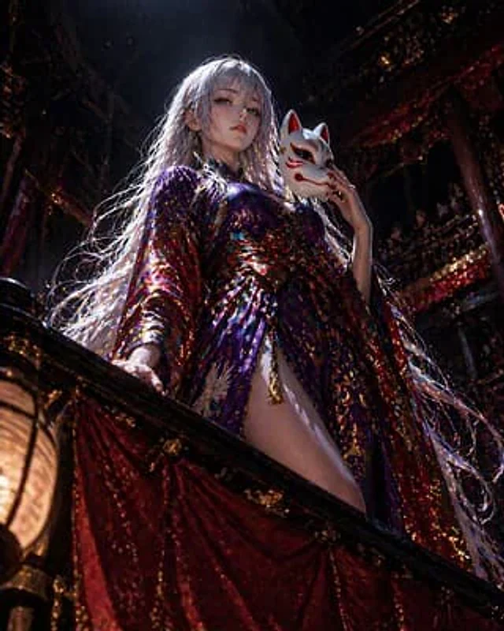

```text
KUNOICHI CRISIS{argument name="character name" default="Kunoichi Yulia"} Disguised as{argument name="role" default="Touring performers"} Viewer's perspective
```

Model: GPT Image 2
Author: GPT Image 2 Prompts

[ProjectD](https://aitoolsradar.com/en/prompts/753e6ac418a3f8) · [Recorded source](https://x.com/Keiji1653050/status/2047947490792804721)
 · [Full original metadata and byte evidence](data/projectd-batch-0035.json)

## Japanese Law & Tax Services LP Hero


```text
Create a sophisticated Japanese landing page banner for a fictional general law and tax firm. The style should be clean, professional, and convey a high level of trust. Use soft daylight lighting on a white background with subtle outlines of modern city architecture on the right. Employ a wide, horizontal header layout. At the very top, place a striking navy blue Japanese title.{argument name="headline text" default="Your anxieties will be addressed by our solid professional capabilities."} Below, a smaller Japanese subtitle with gold accents is placed.{argument name="subheadline text" default="One-stop legal and tax support to help you achieve the best solutions."} Below the title, four vertical service cards of equal width are arranged horizontally. Card 1 is for criminal defense, with a circular handcuff icon at the top, a cool blue color scheme, and the main title "Criminal Cases." The accompanying text reads "Protecting Your Future with a Swift Response." The accompanying image shows a professional man in a suit sitting at a desk with his hands folded. The bottom dark blue area lists two key points marked with checkmarks: "Arrest/Detention Response" and "Negotiation/Negotiation for Non-Prosecution." Card 2 is for traffic accidents, with a circular car crash icon at the top, a green color scheme, and the title "Traffic Accidents." The accompanying text reads "Fully Supporting You in Obtaining Reasonable Compensation." The accompanying image shows a bright desktop scene with documents showing two mini-cars colliding. The bottom dark green area lists two key points: "Post-Traumatic Stress/Increased Compensation" and "Handling Negotiations with Insurance Companies." Card 3 is about inheritance tax, featuring a circular house icon at the top, a warm gold tone, and the title "Inheritance Tax." The accompanying text reads "Supporting a successful inheritance and optimal tax strategies." The image shows a desktop scene with a house model, documents, and a calculator. The bottom mustard gold area lists two key points: "Inheritance Tax Filing &amp; Tax Saving Strategies" and "Living Policy &amp; Business Succession Support." Card 4 is about divorce, featuring a broken heart icon at the top, a rose pink tone, and the title "Divorce." The accompanying text reads "For your future, aiming to achieve a satisfactory solution." The image shows a soft, professional consultation scene, with a woman in a white shirt speaking across the table while resting her chin on her hand. The bottom gray-pink area lists two key points: "Parental Rights &amp; Child Support &amp; Property Division" and "Divorce Agreements &amp; Mediation &amp; Court Appeals." At the bottom, the left side includes the firm's logo, with a small line of text "Law Firm &amp; Tax Firm" and a large letter of the firm's name.{argument name="firm name" default="Fence-based comprehensive legal and tax firm"} Below this is a smaller line of text: "One-stop service for lawyers and tax advisors working together." In the center below, there are three compact white function boxes with navy blue line icons and brief Japanese descriptions: Box 1 displays a crowd icon with the text "Experts in various fields respond"; Box 2 displays a handshake icon with the text "Friendly support close to the client"; Box 3 displays a document icon with the text "First consultation 60 minutes free." Below this is a small disclaimer: "※Fees may apply depending on the consultation content." In the lower right corner, a prominent navy blue rounded-corner Call to Action (CTA) panel is created. It includes the small text "Please feel free to contact us," and a large white phone number with a telephone icon.{argument name="phone number" default="03-1234-5678"} And a gold capsule-shaped strip at the bottom with the text "{argument name="business hours" default="Weekdays 9:00-18:00 (Reservations can be made in advance for weekends and public holidays)"} The main title uses elegant Japanese-style font with clear spacing, balanced margins, and subtle shadows, reflecting a high-end legal professional brand image.
```

Model: GPT Image 2
Author: GPT Image 2 Prompts

[ProjectD](https://aitoolsradar.com/en/prompts/673aa90f764af2) · [Recorded source](https://x.com/takeshibengo/status/2047061602315460747#reversed-0)
 · [Full original metadata and byte evidence](data/projectd-batch-0035.json)

## Japanese Legal Presentation Cover Slide

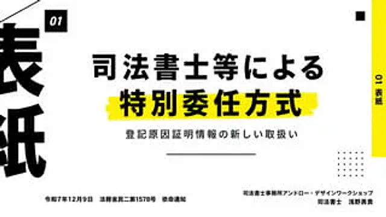

```text
Create a clean, modern Japanese presentation cover slide with a minimalist editing style and a 16:9 landscape aspect ratio. Use a very light gray background with bold black typography and a vibrant yellow decorative strip. The layout employs an asymmetrical design with high contrast and ample white space. Place a small black square near the top left corner containing the white italic bold sans-serif text "01". In the center, place two lines of heavy black Japanese headings: the first line "法師等による" (Judicial Scribe, etc.), and the second line "特特委任方法" (Special Appointment Method). The second line has a larger font and is placed above a rough, hand-drawn yellow highlight. Below the headings, add a smaller black Japanese subheading: "注册因证证信息の新しい取扱い" (New Registration Reason Proof Information). Below the subheading, place a centered thin horizontal line. On the far right edge, add a tall, vertical yellow sidebar with the black vertical text "01表紙" (Form Paper). Near the top right corner, place a small black square as a decorative element. In the lower right quadrant, place a 5x5 dot matrix decoration consisting of 25 small black dots. At the far left edge, crop an oversized black Japanese character, making it only partially visible to create a strong graphic border effect. In the lower left corner, place a line of small black Japanese text: “Ministry of Justice Civil 2 No. 1578, December 9, Reiwa 7”. In the lower right corner, right-align two lines of small black Japanese text: the first line “Judicial Scribe Office Ann Road Design Work Shop”, the second line “Judicial Scribe Asano Yuki”. Add a thin diagonal line cutting in from the upper left corner as additional graphic decoration. Overall feel: High-end business presentation, legal seminar title slides, Swiss-style grid layout, bold Japanese typography, clear and print-quality.
```

Model: GPT Image 2
Author: GPT Image 2 Prompts

[ProjectD](https://aitoolsradar.com/en/prompts/b6397a47eb2a62) · [Recorded source](https://x.com/aldw26/status/2047057858727158110#reversed-0)
 · [Full original metadata and byte evidence](data/projectd-batch-0035.json)

## Japanese Legal Services LP Banner


```text
A landing page banner in the style of Japanese list ads, designed specifically for fictional law and tax firms, presents a striking web ad effect. It features four equally wide vertical panels at the top and a strong call-to-action area at the bottom. The top row contains four service panels, each with a colored title bar, realistic images, and a colored description bar at the bottom. Panel 1 is red, labeled "Criminal Case" at the top, showing a close-up of a pair of hands gripping dark prison bars against a black background; the red description bar at the bottom reads "Arrest/Prosecution Immediately Available!" in bold white Japanese. Panel 2 is blue, labeled "Traffic Accident" at the top, showing a realistic rear-end collision scene of two damaged dark cars on a city street under sunlight; the blue description bar at the bottom reads "Compensation and Discussion Also Available!" in bold white Japanese. Panel 3 is green, with the title "Tax Consultation" at the top. It shows an elderly couple sitting at a table consulting with a professional in a suit, with documents and a small house model visible on the table. The bottom green caption reads in bold white Japanese, "Support for Tax Consultation!" Panel 4 is orange, with the title "Divorce Issues" at the top. It shows a melancholy-looking woman sitting indoors, resting her chin on her hand. The bottom orange caption reads in bold white Japanese, "Resolve Compensation and Divorce Issues!" The four panels should be flush at the edges and separated by clean white lines. Each panel should be the same width, using highly saturated primary colors and a glossy advertising design style. Below the four panels, create a cream or light beige background footer area. On the left, place a small black Japanese subtitle: "Legal Consultation and Tax Consultation." The name of the main agency, in bold Japanese font with a metallic gold gradient and a slight bevel effect, is placed directly below and centered:{argument name="office name" default="XX Law Firm / Tax Accountant Office"} Add a thin black horizontal dividing line above and below the agency name. Place a large, glossy red rounded rectangle button in the lower right corner with a bright gradient effect and white bold Japanese text: "{argument name="button text" default="Free consultations available!"} The overall style should reflect the visual effect of a Japanese legal and tax services LP listing advertisement: corporate, urgency, trustworthy, commercial, photo-based, clean grid layout, eye-catching typography, high contrast, and realistic brochure-level composite effect.
```

Model: GPT Image 2
Author: GPT Image 2 Prompts

[ProjectD](https://aitoolsradar.com/en/prompts/bbc2b4efde5585) · [Recorded source](https://x.com/takeshibengo/status/2047061602315460747#reversed-3)
 · [Full original metadata and byte evidence](data/projectd-batch-0035.json)

## Japanese Legal Services LP Banner


```text
A Japanese listing-ad style landing page hero banner for a fictional law office and tax accountant office, designed like a bold web advertisement with four equal vertical panels across the top and a strong call-to-action area across the bottom. The top row contains exactly 4 service panels, each with a colored header bar, a photo-realistic stock-photo image, and a colored caption bar at the bottom. Panel 1 is red and labeled 「刑事事件」 at the top, showing a close-up of two hands gripping dark prison bars against a black background; the bottom red caption reads 「逮捕・訴訟に即対応！」 in large bold white Japanese text. Panel 2 is blue and labeled 「交通事故」 at the top, showing a realistic rear-end car crash with two damaged dark-colored sedans on a city street in daylight; the bottom blue caption reads 「慰謝料・示談もお任せ！」 in large bold white Japanese text. Panel 3 is green and labeled 「相続税」 at the top, showing an elderly couple seated at a table consulting with a suited professional, with papers and a small house model visible; the bottom green caption reads 「税相続対策をしっかりサポート！」 in large bold white Japanese text. Panel 4 is orange and labeled 「離婚問題」 at the top, showing a distressed woman sitting indoors with her head resting on one hand; the bottom orange caption reads 「慰謝料・親権の悩みを解決！」 in large bold white Japanese text. Make the four panels touch edge-to-edge with clean white dividers, each panel occupying the same width, and use highly saturated primary colors with glossy ad-design styling. Beneath the four panels, create a cream or light beige background footer area. On the left side, place a smaller black subheadline in Japanese: 「法律相談・税務相談なら」. Centered below it, place the large main office name in metallic gold gradient bold Japanese lettering with a slight bevel effect: 「{argument name="office name" default="〇〇法律事務所・税理士事務所"}」. Add thin black horizontal divider lines above and below the main office name. On the lower right, place a large glossy red rounded rectangular button with a bright gradient and white bold Japanese text reading 「{argument name="button text" default="無料相談受付中！"}」. The overall style should feel like a Japanese legal and tax services LP main visual from a listing ad: corporate, urgent, trustworthy, commercial, photo-based, clean grid layout, bold typography, high contrast, and realistic brochure-quality compositing.
```

Model: GPT Image 2
Author: 岡野タケシ弁護士【アトム法律グループ】

[ProjectD](https://aitoolsradar.com/en/prompts/d9caf668f64b17) · [Recorded source](https://youmind.com/prompts/japanese-legal-services-banner-14937)
 · [Full original metadata and byte evidence](data/projectd-batch-0035.json)

## Japanese Manufacturing Challenges Infographic


```text
This is a simple, corporate infographic illustration used in a Japanese business article about the challenges of manufacturing. The background is a realistic, modern factory with metalworking machinery, rendered in cool gray-blue tones. The composition is divided into two thematic sections against a blurred industrial workshop background. At the top center, a striking, deep navy blue Japanese title is placed:{argument name="headline text" default="Deep-rooted challenges facing the manufacturing industry: &quot;Labor shortage&quot; and &quot;Technology transfer&quot;"} In the left foreground, a factory worker in a light gray uniform and hat, arms crossed and looking worried, is shown; nearby, a circular white icon displays the silhouettes of six people, three solid dark figures and three dashed outlines, symbolizing a labor shortage. In the right foreground, two factory workers are shown beside a large lathe: a senior employee in a navy blue work jacket and hat, instructing and demonstrating machine operation, and a younger employee in a light gray uniform and hat, observing intently. Near them, a white speech bubble icon contains a navy blue head silhouette, accompanied by two gear symbols and three small Japanese speech bubbles with the characters “経験”, “勘”, and “コツ”. In the central background, two additional slightly out-of-focus workers operating machines are included, bringing the total number of workers visible in the factory scene to five. Two rounded white information panels with dark navy blue title labels are overlaid. The left panel, titled "Manpower Shortage," contains three key points marked with blue circular checkmarks: "Difficulty in securing young talent," "Increased burden on the field," and "Concern over future low productivity." The right panel, titled "Technical Inheritance," contains three key points marked with blue circular checkmarks: "Proficiency in skills is being handed over to individuals," "Silent knowledge is not being verbally or standardized," and "The loss of skills due to retirement from work." At the bottom center, a dark navy blue rounded rectangle containing white Japanese text is placed.{argument name="callout text" default="Addressing these challenges is an urgent necessity for the sustainable growth of the manufacturing industry."} Add two large white arrows pointing to the bottom label box, one from the left and one from the right. The overall style mimics professional consulting firm presentations or business magazine inserts: photorealistic workers and machinery, subtle depth of field, high definition, balanced layout, soft lighting, clear typography, and professional Japanese manufacturing infographic aesthetics.
```

Model: GPT Image 2
Author: GPT Image 2 Prompts

[ProjectD](https://aitoolsradar.com/en/prompts/957f2341176f00) · [Recorded source](https://x.com/yohei_kps/status/2047124449191989248#reversed-0)
 · [Full original metadata and byte evidence](data/projectd-batch-0035.json)

## Japanese Mecha Girl Figure Ad Poster

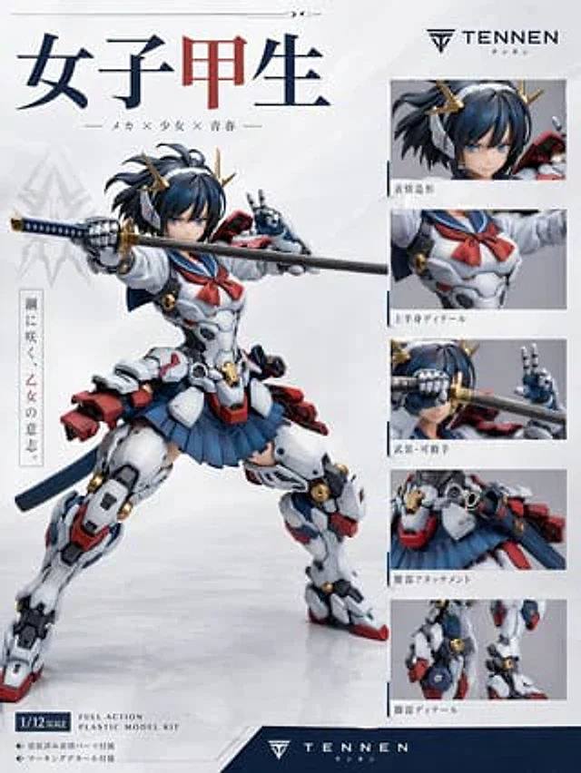

```text
Against a clean white studio backdrop, create a high-end Japanese-style plastic model kit product poster with a subtle gray gradient and glossy ground reflections. The main subject is a highly detailed anime mecha high school girl figure, positioned on the left side of the image in a dynamic pose, legs wide open in a battle stance. One mechanical hand holds a katana across the frame, while the other hand makes a peace sign near her face. The character's face is blurred, and she has a messy, dark navy blue bob with a few tufts of hair on the side, adorned with a gold, horn-shaped mechanical hair accessory. Her outfit blends Japanese sailor uniform with hard-surface sci-fi armor: a white armored torso with mechanical panel lines, a red sailor collar, a pleated navy blue skirt, heavy white thigh and calf armor, red and blue accents, gold circular joint details, a dark blue belt or hem fabric, and red mechanical backpack-style attachments at the hips and lower back. The katana features a dark blade and a blue and gold hilt. Render the figure to resemble a professionally photographed collector's item or plastic model kit, with clear material definitions, realistic injection-molded plastic surfaces, a subtle satin sheen, and commercial product photography lighting. Design the page as a figure advertisement/specification, with one large main visual and five smaller detail panels stacked vertically on the right. The five right-side panels must showcase: 1) a close-up of the head and hair accessories, 2) upper body details with a sailor's collar and chest armor, 3) close-ups of the weapons and articulated hands (sword close to the face), 4) waist accessories and skirt/hip armor details, and 5) leg details showing the joints and armor structure. Add thin blue dividing trim around the right-side panel area. Place a striking bold serif-style Japanese title "女子甲生" (Women's Kousei) in the upper left corner, with the central character in dark red and the rest in dark navy blue. Below this, add a smaller Japanese subtitle: "— Meka × Shoujo × Seishun—". Place a simple logo and brand name in the upper right corner.{argument name="brand name" default="TENNEN"} Below this is a small Japanese text tag. A vertical Japanese slogan block is added to the left of the main visual, reading "Sparkling steel, the will of a maiden." The phrase in the middle is in red. Below the five detail panels on the right are Japanese descriptions: "Expression Design," "Upper Body Design," "Armed/Movable Hands," "Waist Attack," and "Leg Design." A framed proportion label is included in the lower left corner.{argument name="scale label" default="1/12 SCALE"} Add the English product text "FULL ACTION PLASTIC MODEL KIT" nearby. Below this, add two lines of Japanese text: "◆ 塗装済み髪パーツ付属" and "◆ マーキングデカール付属". At the bottom, add a dark navy blue footer, centered with the brand logo and "".{argument name="footer brand" default="TENNEN"} Below this is a small Japanese text tag. It employs sophisticated modern model brand aesthetics, Japanese mecha anime collectible packaging design, minimalist white space, clear typography, balanced editorial layout, and realistic studio rendering of the original, non-existent figure. Color scheme: white, navy blue, dark blue, red, gray, black, and metallic gold. Aspect ratio 3:4.
```

Model: GPT Image 2
Author: GPT Image 2 Prompts

[ProjectD](https://aitoolsradar.com/en/prompts/5f99f8afa0e507) · [Recorded source](https://x.com/munou_ac/status/2047110000339030405#reversed-2)
 · [Full original metadata and byte evidence](data/projectd-batch-0035.json)

## Japanese Model Swimsuit Fashion Shot

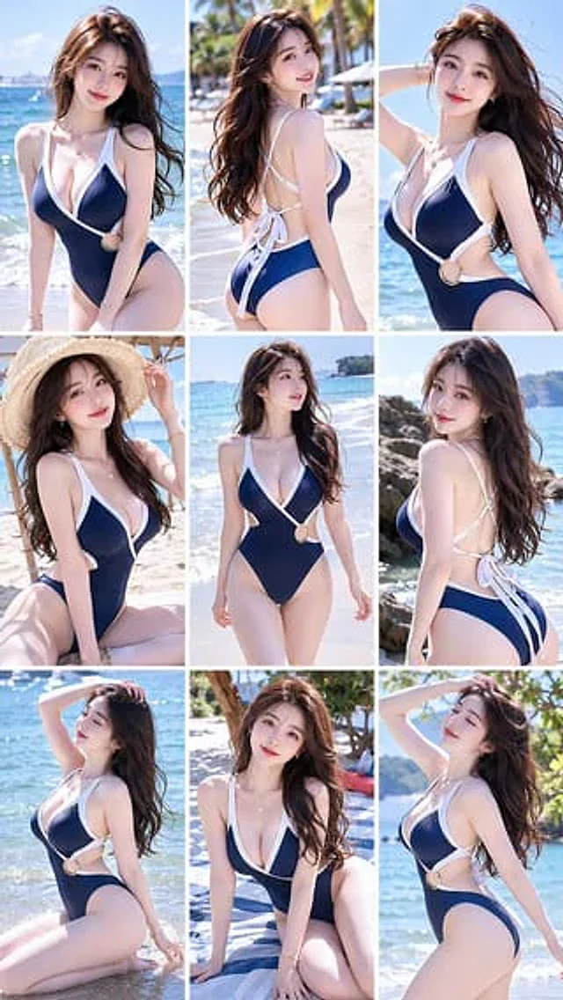

```text
现代时尚的高级连体泳装，剪裁优雅。一位青春阳光的{argument name="年龄" default="20岁左右"}日本美女模特，皮肤白皙，长发微卷，身材丰腴且比例优雅匀称，散发着阳光自信的气质。海滩度假风格，柔和的自然光，侧身漫步的姿态，突显柔和的女性线条轮廓。照片级真，时尚杂志大片风格，不同的姿势角度，保持面部一致性，九宫格展示
```

Model: GPT Image 2
Author: Adam也叫吉米

[ProjectD](https://aitoolsradar.com/en/prompts/80e66deafc932c) · [Recorded source](https://youmind.com/prompts/japanese-model-swimsuit-fashion-shot-22876)
 · [Full original metadata and byte evidence](data/projectd-batch-0035.json)

## Japanese Movie Teaser Collage

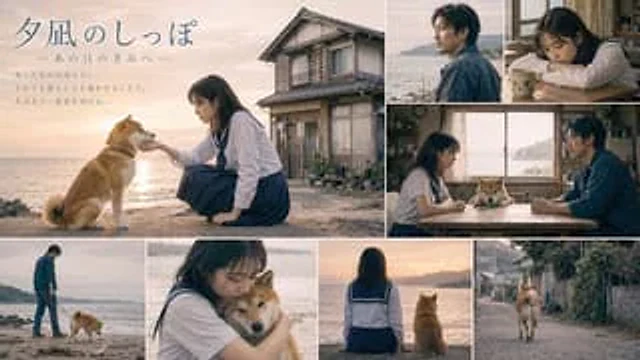

```text
{
  "type": "Japanese movie trailer visual collage",
  "typography": {
    "title": "{argument name=\"movie title\" default=\"Tail of the Evening Calm\"}",
    "subtitle": "—To you from that day—",
    "tagline": "{argument name=\"tagline text\" default=\"What&#39;s lost can never be recovered. Yet, by connecting with someone on an emotional level, people can look forward again.\"}"
  },
  "characters": {
    "girl": "Young Japanese woman, dark hair, wearing a sailor-style school uniform.",
    "man": "Middle-aged Japanese man with stubble, wearing a dark blue shirt.",
    "animal": "{argument name=\"dog breed\" default=\"Shiba Inu\"}"
  },
  "aesthetics": {
    "setting": "{argument name=\"setting\" default=\"Seaside town at sunset\"}",
    "style": "{argument name=\"color grading\" default=\"Nostalgic movie feel\"}"
  },
  "layout": {
    "panel_count": 8,
    "sections": [
      {
        "position": "Larger image on the left",
        "description": "A girl pets a dog; an old house; text superimposed."
      },
      {
        "position": "Top right corner",
        "description": "A man's profile as he gazes at the sea."
      },
      {
        "position": "Top right corner",
        "description": "The girl rested on the table."
      },
      {
        "position": "Middle right",
        "description": "The girl and the man sat at the table, with a dog between them, and the ocean visible through the window."
      },
      {
        "position": "bottom left corner",
        "description": "A man walks his dog on the beach."
      },
      {
        "position": "bottom left corner",
        "description": "Close-up of a girl hugging a dog"
      },
      {
        "position": "bottom right corner",
        "description": "The girl and dog are facing away from the camera, looking towards the sunset."
      },
      {
        "position": "bottom right corner",
        "description": "A dog walking on a country street"
      }
    ]
  }
}
```

Model: GPT Image 2
Author: GPT Image 2 Prompts

[ProjectD](https://aitoolsradar.com/en/prompts/85735a0106ad09) · [Recorded source](https://x.com/old_pgmrs_will/status/2045370788644278754#reversed-0)
 · [Full original metadata and byte evidence](data/projectd-batch-0035.json)

## Japanese Mystery Website Mockup

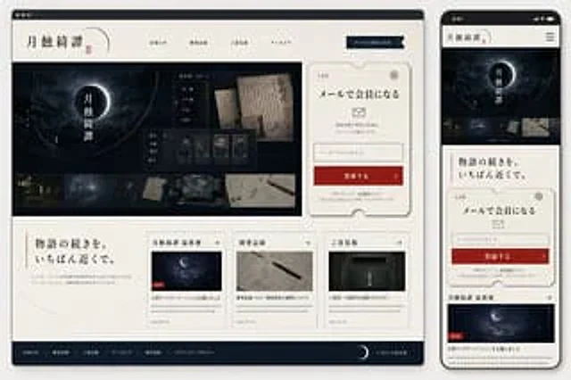

```text
Goal: Create a polished website mockup for a Japanese mystery game or story archive titled {argument name="site title" default="月蝕綺譚"}, shown as a responsive design preview with one desktop browser window on the left and one smartphone screen on the right.

Canvas: Wide 16:9 presentation image on a light gray background. Place a large desktop browser mockup occupying about 75% of the width on the left, and a tall smartphone mockup occupying about 22% of the width on the right. Use realistic device frames with soft shadows.

Visual style: Elegant Japanese literary horror, quiet mystery, archival documents, moonlit darkness. Palette of ivory paper, black ink, deep navy-black, muted gray, and one strong vermilion red accent. Use serif Japanese typography, thin ruled lines, ticket-like borders, subtle paper texture, old manuscript imagery, and faint crescent-orbit line graphics. The overall mood should feel like a premium official website for a narrative game.

Desktop layout: Show a browser window with a dark top bar and three small window dots. Inside the page, use an ivory header with the site title {argument name="site title" default="月蝕綺譚"} on the left, a small red seal mark, and exactly 5 horizontal navigation items: 「お知らせ」, 「開発記録」, 「ご意見箱」, 「アーカイブ」, and a dark navy button labeled 「メールで会員になる」. The hero section below is a wide dark moon-eclipse visual with the vertical title 「月蝕綺譚」 centered over a glowing crescent/eclipse. Overlay a translucent archive UI card with old Japanese documents and exactly 5 small collectible/document cards along the bottom of that overlay. Along the very bottom of the hero image, include exactly 5 horizontal thumbnail strips showing: a night street, a blueprint-like room, a dark folder or object, old handwritten papers, and a desk/workspace map.

Desktop right signup card: To the right of the hero, place a large cream ticket-shaped membership card with clipped semicircle notches and a thin decorative border. It includes the small label 「入会札」, a stamp emblem, headline 「メールで会員になる」, an envelope icon, short explanatory text, one email input field with placeholder 「メールアドレスを入力」, and a red CTA button labeled 「登録する」 with a right arrow. Include tiny privacy-policy text beneath.

Desktop lower content: Under the hero, make a two-column-feeling section. On the left, a large Japanese tagline {argument name="tagline text" default="物語の続きを、いちばん近くで。"} with a thin vertical red line and a small descriptive paragraph. On the right, place exactly 3 article cards in a row. The 3 cards are: 1) 「月蝕綺譚 最新便」 with a moon image, a small red NEW label, title 「大型アップデート『○○』を公開しました」, date 2024.05.20; 2) 「開発記録」 with a notebook and pen image, title 「開発記録 #12：環境音の調整について」, date 2024.05.18; 3) 「ご意見箱」 with a dark mailbox image, title 「ご意見・ご感想をお聞かせください」, date 2024.05.16. Each card has a thin border, a small arrow in the header, and gray placeholder summary lines.

Desktop footer: Add a dark navy footer spanning the bottom with exactly 6 footer links: 「お知らせ」, 「開発記録」, 「ご意見箱」, 「アーカイブ」, 「利用規約」, 「プライバシーポリシー」. Include a crescent moon icon and copyright 「© 2024 月蝕綺譚」 on the right.

Mobile layout: On the right smartphone, show the same site adapted to mobile. Status bar time reads 9:41. Header contains the title 「月蝕綺譚」 and a hamburger menu icon. Below it, show a compact dark hero with the eclipse and vertical title, then exactly 5 small horizontal thumbnails. Continue with the tagline 「物語の続きを、いちばん近くで。」, then the same ticket-shaped email signup card, then the first news card 「月蝕綺譚 最新便」 with moon image and red NEW label. The mobile view should be vertically scrollable-looking but contained within the phone screen.

Constraints: Keep all visible interface text in Japanese as specified. Use clean, high-fidelity UI mockup rendering, crisp typography, subtle shadows, and no extra logos or watermarks. The design should look like a finished web/app mock generated for implementation planning.
```

Model: GPT Image 2
Author: 🍺 イケハヤ@「月蝕綺譚」開発

[ProjectD](https://aitoolsradar.com/en/prompts/38fa0a8dd83fb0) · [Recorded source](https://youmind.com/prompts/japanese-mystery-website-mockup-28282)
 · [Full original metadata and byte evidence](data/projectd-batch-0035.json)

## Japanese Negative Film Aesthetic

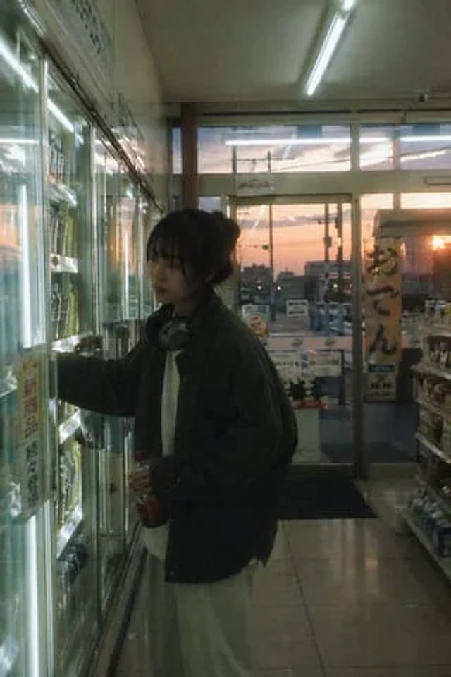

```text
{argument name="aesthetic" default="Japanese negative film look"} aesthetics,{argument name="setting" default="Convenience store scene at dusk"} The interplay of cool indoor light and warm outdoor light creates a slight overexposure of highlights, resulting in low contrast, low-saturation colors, and a subtle grainy texture.{argument name="subject" default="The character stands in front of the freezer and casually grabs a drink."} Leaning slightly forward, relaxed posture, gentle and unfocused expression, the reflection in the glass door, the imperfect composition, the quiet and ordinary atmosphere, a nostalgic everyday life -- 2:3
```

Model: GPT Image 2
Author: GPT Image 2 Prompts

[ProjectD](https://aitoolsradar.com/en/prompts/8421edbc3717f6) · [Recorded source](https://x.com/BubbleBrain/status/2047282744393138263)
 · [Full original metadata and byte evidence](data/projectd-batch-0035.json)

## Japanese News Broadcast Mockup

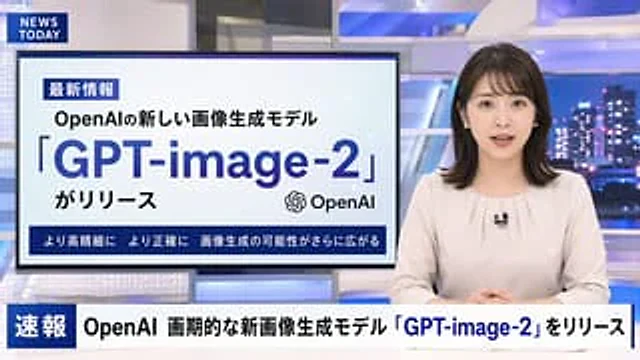

```text
{
  "type": "Television news broadcasting layout",
  "anchor": {
    "appearance": "{argument name=\"anchor appearance\" default=\"A young Japanese female news anchor with shoulder-length dark hair.\"}",
    "attire": "Light beige shirt, wearing a small lapel microphone",
    "pose": "Sit at the table, hands clasped together, facing forward."
  },
  "studio_environment": "A modern news studio with blue illuminated panels and a nighttime city skyline as a backdrop.",
  "graphics": {
    "top_left_bug": {
      "style": "Dark blue rectangle",
      "text": "{argument name=\"channel logo\" default=\"NEWS TODAY\"}"
    },
    "presentation_monitor": {
      "location": "The left side behind the anchor",
      "badge": "Latest Information",
      "subtitle": "{argument name=\"subheadline\" default=\"OpenAI&#39;s new image generation model\"}",
      "title": "{argument name=\"main headline\" default=\"「GPT-image-2」\"}",
      "suffix": "がリリース",
      "icon": "OpenAI logo",
      "bottom_bar": "Higher resolution, greater accuracy – the possibilities for image generation are expanding even further."
    },
    "lower_thirds_ticker": {
      "badge": "breaking news",
      "headline": "{argument name=\"ticker text\" default=\"OpenAI releases groundbreaking new image generation model &quot;GPT-image-2&quot;\"}"
    }
  }
}
```

Model: GPT Image 2
Author: GPT Image 2 Prompts

[ProjectD](https://aitoolsradar.com/en/prompts/b1932334d7103f) · [Recorded source](https://x.com/itnavi2022/status/2044374910336970770#reversed-0)
 · [Full original metadata and byte evidence](data/projectd-batch-0035.json)

## Japanese News Broadcast Mockup

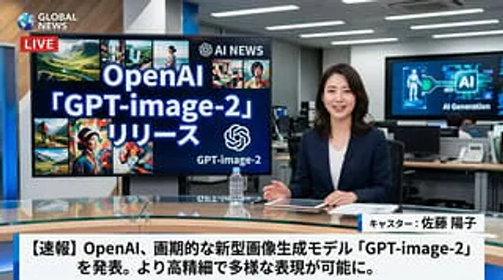

```text
A hyper-realistic television news broadcast scene, with one person in the frame.{argument name="anchor appearance" default="Japanese female news anchor wearing a dark blue suit jacket with a white top"} She sat at the glass table in a modern news studio. Smiling, she looked directly at the camera, her hands resting beside a tablet, documents, and a clear water bottle. To her left, a large monitor displayed…{argument name="screen main text" default="OpenAI 「GPT-image-2」リリース"} The text reads "AI," next to an AI logo and eight smaller, diverse AI-generated image collages. In the top left corner is a channel logo that reads "...".{argument name="news channel name" default="GLOBAL NEWS"} The text is accompanied by a red "LIVE" logo. The background shows a busy office with computers and a wall screen displaying "AI Generation." At the bottom of the screen is a standard news graphic showing the anchor's name.{argument name="anchor name" default="Anchor: Yoko Sato"} "And a breaking news headline"{argument name="main headline text" default="[Breaking News] OpenAI announces groundbreaking new image generation model &quot;GPT-image-2,&quot; enabling higher resolution and more diverse image expression."} (Displayed in bold Japanese text).
```

Model: GPT Image 2
Author: GPT Image 2 Prompts

[ProjectD](https://aitoolsradar.com/en/prompts/641c13e96cc720) · [Recorded source](https://x.com/itnavi2022/status/2044374910336970770#reversed-1)
 · [Full original metadata and byte evidence](data/projectd-batch-0035.json)

## Japanese News Broadcast Mockup


```text
A photorealistic television news broadcast scene featuring a {argument name="anchor appearance" default="young Japanese female with shoulder-length dark hair wearing a light beige blouse"} and a small black lapel microphone, sitting at a news desk and speaking directly to the camera. The studio background is modern with blue and white lighting and a blurred nighttime city skyline on the right. In the top left corner, there is a dark blue graphic with the white text "{argument name="channel logo text" default="NEWS TODAY"}". To the anchor's left is a large presentation monitor displaying a news graphic with a white background and light blue network nodes. The monitor features a dark blue "最新情報" tag, the text "{argument name="subheadline" default="OpenAIの新しい画像生成モデル"}", a large prominent headline "{argument name="main headline" default="「GPT-image-2」"}", the text "がリリース", an OpenAI logo, and a dark blue bottom banner reading "より高精細に より正確に 画像生成の可能性がさらに広がる". Across the bottom of the entire screen is a news ticker lower third with a dark blue "速報" box and the scrolling text "{argument name="ticker text" default="OpenAI 画期的な新画像生成モデル「GPT-image-2」をリリース"}".
```

Model: GPT Image 2
Author: IT navi

[ProjectD](https://aitoolsradar.com/en/prompts/8e5d79858690c0) · [Recorded source](https://youmind.com/prompts/japanese-news-broadcast-mockup-13699)
 · [Full original metadata and byte evidence](data/projectd-batch-0035.json)

## Japanese Onsen Ryokan Portrait


```text
35mm film photography, warm vintage Japanese onsen ryokan aesthetic, soft ambient wooden lantern lighting mixed with gentle natural window light, subtle film grain, gentle color shift, high atmosphere editorial style, intimate medium shot, early 20s beautiful Chinese female idol with ultra-realistic delicate refined Chinese features, seductive almond-shaped fox eyes with natural double eyelids, high nose bridge, small sharp V-shaped jawline, flawless porcelain skin with warm ivory undertone, visible subtle skin texture and micro pores, soft natural makeup with dewy glow, subtle rosy flush on cheeks, natural soft pink lips slightly parted, long dark brown hair tied in a loose low bun with some messy strands falling around face and neck, wearing a loose white yukata (traditional Japanese bathrobe) deliberately slipped off one shoulder and loosely tied at the waist, the fabric slightly open revealing smooth skin and subtle cleavage, barefoot, seductive relaxed sitting pose on the edge of a traditional wooden engawa veranda at a vintage onsen ryokan, body slightly turned toward the camera, one leg bent with foot resting on the wooden floor, the other leg gently dangling, one hand lightly holding the yukata collar, the other hand resting on the wooden floor behind her for support, softly arched back to gently accentuate curves, intensely seductive yet gentle and inviting gaze straight at the viewer with soft doe eyes full of quiet temptation and warmth, warm wooden interior with paper sliding doors and distant steaming hot spring in soft focus, gentle rim lighting highlighting skin and fabric texture, authentic vintage film color grading with warm tones, extremely sharp yet soft skin rendering, natural hair strands, realistic fabric wrinkles and drape on the yukata, no plastic skin, no digital over-sharpening, no airbrushing, no blemishes, no moles, no oily skin, no watermark, no text, authentic 35mm film Japanese onsen ryokan atmosphere
```

Model: GPT Image 2
Author: @BubbleBrain

[ProjectD](https://aitoolsradar.com/en/prompts/4e3897706a6306) · [Recorded source](https://x.com/BubbleBrain/status/2045092449803284923)
 · [Full original metadata and byte evidence](data/projectd-batch-0035.json)

## Japanese Onsen Town in Four Seasons

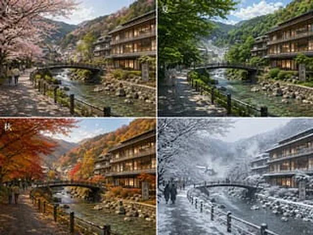

```text
{
  "type": "Four Seasons Comparison Landscape Collage",
  "subject": "The four seasons of the streets and rivers in the same Japanese mountain hot spring town",
  "setting": {
    "location": "Traditional Japanese riverside hot spring town",
    "features": [
      "The shallow river is so clear that the rocks at the bottom are visible.",
      "Small arched pedestrian bridge spanning the river",
      "The riverside walkway is paved with stone slabs and has black wooden railings.",
      "On the right is a multi-story wooden Japanese-style inn, radiating warm interior light.",
      "The background is a forested mountain range.",
      "The village buildings extend into the valley."
    ]
  },
  "layout": {
    "format": "2x2 grid collage",
    "sections": [
      {
        "title": "spring",
        "position": "Top left",
        "count": 1,
        "labels": [
          "spring"
        ]
      },
      {
        "title": "summer",
        "position": "Top right",
        "count": 1,
        "labels": [
          "summer"
        ]
      },
      {
        "title": "autumn",
        "position": "Bottom left",
        "count": 1,
        "labels": [
          "autumn"
        ]
      },
      {
        "title": "winter",
        "position": "Bottom right",
        "count": 1,
        "labels": [
          "winter"
        ]
      }
    ],
    "consistency": "The camera angles and compositions of all four panels are completely identical."
  },
  "seasonal_variants": {
    "count": 4,
    "items": [
      {
        "season": "spring",
        "trees": "The pale pink cherry blossoms arch up on the left",
        "ground": "The dry stone path is dappled with the light and shadow of spring.",
        "atmosphere": "Fresh, soft, and gentle sunlight"
      },
      {
        "season": "summer",
        "trees": "The lush, vibrant green foliage creates a cool, shady environment.",
        "ground": "The stone path where sunlight and shadow intertwine",
        "atmosphere": "On a bright and sunny summer day, the vegetation is lush."
      },
      {
        "season": "autumn",
        "trees": "The vibrant red, orange, and gold maple leaves",
        "ground": "The trail was bathed in warm amber light.",
        "atmosphere": "Vibrant autumn colors on the hillside"
      },
      {
        "season": "winter",
        "trees": "Bare branches, trees, bridges, rooftops, and railings were covered with a thick layer of snow.",
        "ground": "Snow-covered riverside path",
        "atmosphere": "It was a cloudy day with lots of snow, snowflakes drifting down, accompanied by a cold mist."
      }
    ]
  },
  "human_elements": {
    "count": 4,
    "description": "On the left side of each panel, there are a few pedestrians on the riverside path, their proportions natural, serving as a backdrop to the scenery."
  },
  "signage": {
    "count": 1,
    "description": "Near the hotel on the right bank of the river, there is a vertical stone monument with Japanese kanji characters."
  },
  "style": {
    "look": "Highly detailed realistic travel photography",
    "lighting": "Natural seasonal lighting, cinematic feel, realistic reflections in the water.",
    "composition": "Expansive scenic views, walkways and bridges forming guiding lines, and a balance between architecture and nature.",
    "quality": "Extremely high detail, clear textures, realistic water surfaces, vegetation, wood, stone, and snow."
  },
  "prompt": "Create a 2x2 realistic comparison image to demonstrate{argument name=\"location\" default=\"A traditional Japanese mountain hot spring town\"} The scene maintains the same perspective throughout all four seasons. At the center of the scene is a clear, rocky river with a small arched pedestrian bridge. To the left is a stone-paved riverside path with black railings, and to the right is a large wooden Japanese-style inn with warm light streaming from its windows. In the distance, forested mountains and scattered town buildings are added. The upper left panel is labeled \"Spring,\" showcasing cherry blossoms in full bloom; the upper right panel is labeled \"Summer,\" displaying lush summer greenery; the lower left panel is labeled \"Autumn,\" showcasing vibrant red and orange autumn leaves; and the lower right panel is labeled \"Winter,\" showcasing snow-covered trees, bridges, rooftops, and falling snowflakes. A few pedestrians are added to the path on the left side of each panel. The season's Chinese characters are added in white in the upper left corner of each panel. The design emphasizes realistic seasonal changes while maintaining complete consistency in architecture, framing, and perspective across all four panels."
}
```

Model: GPT Image 2
Author: GPT Image 2 Prompts

[ProjectD](https://aitoolsradar.com/en/prompts/8a44c4a2e4d470) · [Recorded source](https://x.com/shion_takk/status/2046896417550295177#reversed-1)
 · [Full original metadata and byte evidence](data/projectd-batch-0035.json)

## Japanese Potato Chip Advertisement

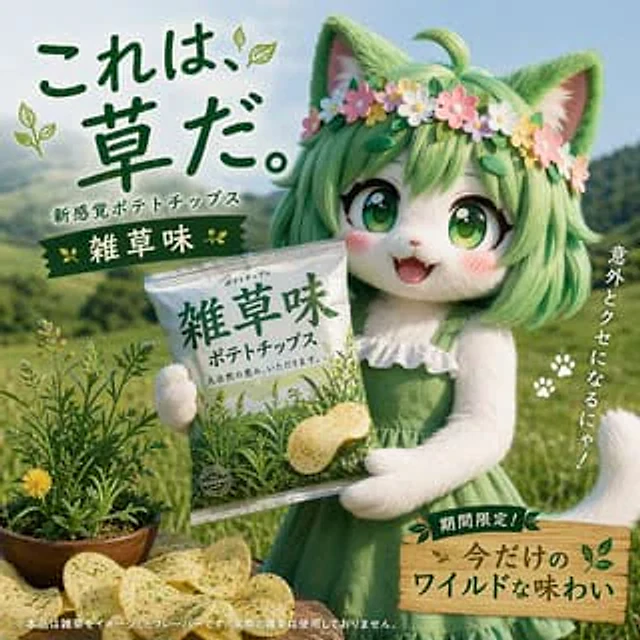

```text
A Japanese potato chip commercial features a character promoting a bag of potato chips. The flavor of the chips is {argument name="flavor" default="weedy smell"}
```

Model: GPT Image 2
Author: GPT Image 2 Prompts

[ProjectD](https://aitoolsradar.com/en/prompts/57a9a7e4bf39b2) · [Recorded source](https://x.com/TlanoAI/status/2044444295168774366)
 · [Full original metadata and byte evidence](data/projectd-batch-0035.json)

## Japanese Realist Romance Movie Poster

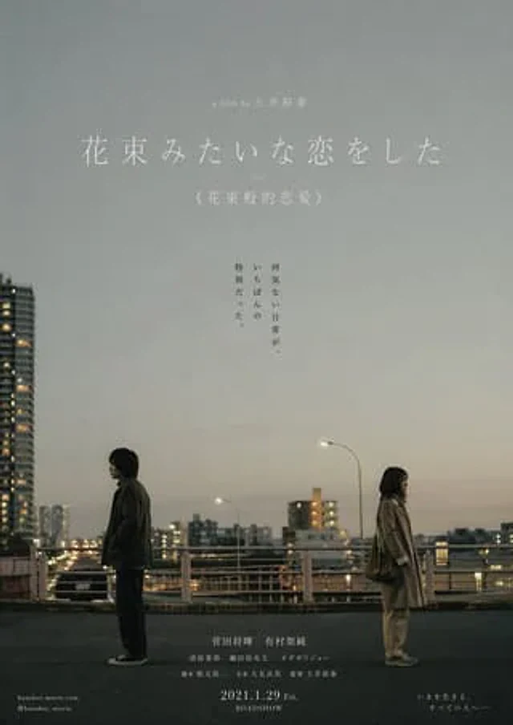

```text
This Japanese-style realistic romance movie poster, inspired by the film *A Bouquet of Love*, depicts a young Japanese couple in their twenties standing in an everyday urban scene (street or intersection), maintaining a subtle yet realistic distance. There is no physical contact, as if capturing the moment of estrangement in their relationship. The atmosphere is quiet and restrained, conveying unspoken emotions and a sense of the passage of time. The composition follows the film's main visual style, with the figures positioned at the bottom or to one side, leaving ample white space to emphasize the space and atmosphere. The lighting is natural (overcast or at dusk), with low-saturation gray-blue, beige, and warm gray tones, possessing a realistic photographic quality. The image has a delicate film grain and a subtle sense of everyday life, not deliberately pursuing beauty or excessive decoration, like a frame from a real film. A small amount of natural flowers can be added to the edges or foreground as a metaphor (restrained, not excessive, not decorative). The title "I Made a Beautiful Bouquet" is added in the white space using Mingti font, with a simple and sparse layout; below, "We Made a Beautiful Bouquet" is added in a smaller font. Overall Requirements: Authentic Japanese movie poster quality, artistic, restrained, and with a sense of everyday life. Emphasize character relationships rather than romantic symbols, avoiding saccharine romance, excessive floral displays, trendy aesthetics, crowded compositions, and an "exquisite but empty" AI feel. Negative keywords: AI feel, overly beautified, floral displays, romantic filters, excessive lighting effects, high saturation, neon lights, intimate embraces, posed shots, close-up portrait compositions, trendy style, illustration-like feel, 3D rendering, cluttered elements. A minimalist Japanese art movie poster style, inspired by the film *Love Letter*, featuring a winter snow scene, close-ups of a young woman's face, her face close to or partially buried in the snow, with fine snowflakes falling naturally. The composition should be a restrained profile close-up or a slightly tilted face, with the figure occupying a large proportion of the frame but not overly sharp, with slightly softened or slightly out-of-focus edges. The expression is one of calm after grief, with tears in the eyes or tear stains, emotions restrained and controlled, as if one has just cried and is slowly returning to silence. The eyes do not look directly at the camera, conveying a sense of memory and emptiness. The lighting is natural diffused winter light or soft, overcast light, with cool white, light gray, and pale blue tones, low saturation, low contrast, no strong shadows, and no dramatic lighting effects. Snow and air form a clean background. The image texture is between realistic photography and film, with fine grain, a slight haze, and slightly washed out or slightly overexposed, like an old photograph or movie still faded by time. The skin is not overly detailed, with no smoothing, sharpening, or retouching. The composition is asymmetrical, with the face partially cropped, a minimalist background, and appropriate white space. A minimalist title, "Love Letter" or "ラヴレター," is added to the white space using a light Ming or light serif font, with wide letter spacing, sparse typography, and a light gray color; "Love Letter" is added below in a very small font. Overall Requirements: A realistic Japanese art film poster aesthetic—quiet, subtle, and restrained, like a memory covered in snow. Avoid studio-style designs, trendy aesthetics, overly refined filters, special lighting effects, high contrast and saturation, a sharp, digital look, dramatic emotions, and being "beautiful but empty." Negative keywords: AI-like appearance, skin smoothing, sharpening, HDR, high contrast, high saturation, dreamlike lighting effects, lens flare, filter-like feel, studio style, trendy face, posed shots, staring directly at the camera, exaggerated emotions, 3D rendering, illustration style, complex backgrounds.
```

Model: GPT Image 2
Author: GPT Image 2 Prompts

[ProjectD](https://aitoolsradar.com/en/prompts/c652e9cc8d1dbc) · [Recorded source](https://x.com/jesseweb3ai/status/2047267562757714204)
 · [Full original metadata and byte evidence](data/projectd-batch-0035.json)

## Japanese Restaurant Promotional Menu Poster

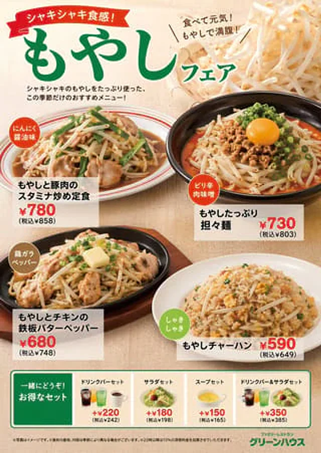

```text
{
  "type": "Restaurant promotional menu poster",
  "theme": "{argument name=\"main ingredient\" default=\"bean sprouts\"} Theme Exhibition",
  "header": {
    "ribbon_text": "{argument name=\"catchphrase\" default=\"Crisp and refreshing texture!\"}",
    "main_title": "{argument name=\"fair title\" default=\"Bean sprout themed exhibition\"}",
    "sub_text": "Eat your way to energy! Bean sprouts will fill you up and satisfy your hunger!",
    "description": "Featuring a generous selection of crisp bean sprouts, we present this season's limited-edition recommended menu!",
    "background_image": "Bamboo basket filled with fresh bean sprouts"
  },
  "main_dishes": [
    {
      "image": "Stir-fried pork, bean sprouts, and chives on a white plate with red stripes",
      "badge": "Garlic soy sauce flavor",
      "name": "{argument name=\"dish 1 name\" default=\"Bean sprout and pork stir-fried vegetable set meal\"}",
      "price": "¥780 (¥858 including tax)"
    },
    {
      "image": "The dan dan noodles, served in a black bowl, are topped with minced meat, bean sprouts, chopped green onions, and a raw egg yolk.",
      "badge": "Spicy Meat Miso",
      "name": "Bean sprout-filled Dan Dan noodles",
      "price": "¥730 (¥803 including tax)"
    },
    {
      "image": "Sizzling chicken and bean sprouts on a hot plate, topped with melted butter.",
      "badge": "Chicken Bone Pepper Flavor",
      "name": "Chicken and bean sprouts sizzling with butter and pepper",
      "price": "¥680 (¥748 including tax)"
    },
    {
      "image": "Bean sprout fried rice served on a white plate",
      "badge": "Crisp texture",
      "name": "Bean sprout fried rice",
      "price": "¥590 (¥649 including tax)"
    }
  ],
  "bottom_section": {
    "title": "Enjoy even better value when combined! Great value套餐 (set meals)",
    "set_options_count": 4,
    "options": [
      {
        "name": "Beverage Bar Set Meals",
        "image": "Three Selected Beverages",
        "price": "+¥220"
      },
      {
        "name": "Salad Set Meal",
        "image": "Small green salad",
        "price": "+¥180"
      },
      {
        "name": "Soup Set Meal",
        "image": "Yellow soup in a white glass",
        "price": "+¥150"
      },
      {
        "name": "Drinks &amp; Salad Set Meals",
        "image": "Drinks and salads",
        "price": "+¥350"
      }
    ]
  },
  "footer": {
    "fine_print": "※Images are for reference only. ※The origin and contents of ingredients may vary depending on the season. ※A 10% late-night service charge will be added after 10 PM.",
    "restaurant_logo": "Family restaurant{argument name=\"restaurant name\" default=\"Green House\"}"
  }
}
```

Model: GPT Image 2
Author: GPT Image 2 Prompts

[ProjectD](https://aitoolsradar.com/en/prompts/82e90bc337b581) · [Recorded source](https://x.com/TlanoAI/status/2045442187119534099#reversed-0)
 · [Full original metadata and byte evidence](data/projectd-batch-0035.json)

## Japanese Rice Advertisement Banner

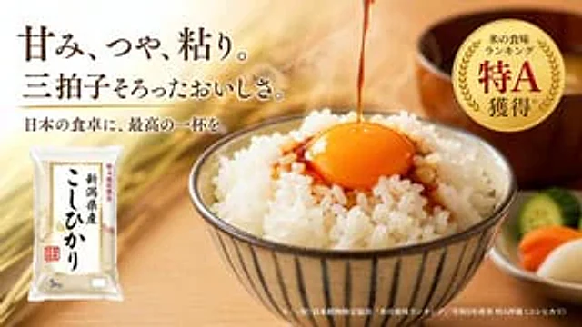

```text
A high-quality Japanese food advertisement banner. The background features a warm, softly blurred wooden table, adorned with golden rice ears. On the right side of the image {argument name="main dish" default="A bowl of steaming white rice topped with a raw egg yolk and drizzled with soy sauce."} Served in a striped ceramic bowl. To the right is a small white dish neatly arranged with three slices of pickled vegetables (a green cucumber, an orange carrot, and a white radish), next to which is a blurred wooden miso soup bowl. In the upper left corner, a striking and elegant Japanese title reads…{argument name="headline text" default="Sweetness, gloss, and stickiness. A delicious combination of all three."} A smaller subtitle is provided below.{argument name="subheadline text" default="Bring the perfect cup of coffee to your Japanese dinner table."} The bottom left corner shows a 5kg plastic bag of rice, with the label stating {argument name="product name" default="Koshihikari rice from Niigata Prefecture"} In the upper right corner is a circular gold foil medal with text displayed.{argument name="badge text" default="Rice receives Special A rating in taste ranking."} Small explanatory text is printed along the bottom right edge. The overall lighting is warm, inviting, and professional, highlighting the glistening texture of the rice and eggs.
```

Model: GPT Image 2
Author: GPT Image 2 Prompts

[ProjectD](https://aitoolsradar.com/en/prompts/c4c551f77e974f) · [Recorded source](https://x.com/digimaga/status/2046245597796257937#reversed-0)
 · [Full original metadata and byte evidence](data/projectd-batch-0035.json)

## Japanese Roller Coaster Sales Banner

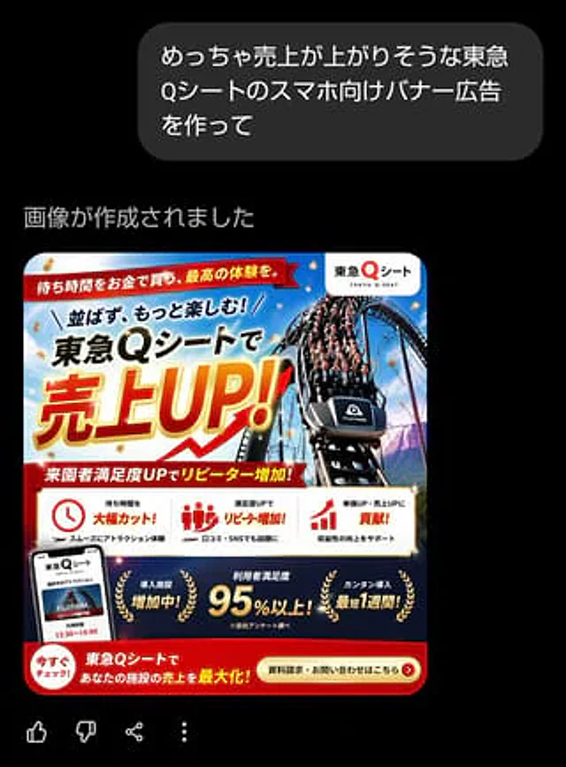

```text
{"type":"Japanese Smartphone Banner Ads","style":"High-conversion commercial promotional banners, glossy and aggressive sales design, compact Japanese advertising layout, vibrant amusement park marketing visuals, sophisticated corporate event graphics","format":{"aspect_ratio":"Square","intended_use":"Smartphone web banners or social media ads"},"brand":{"name":"Tokyu Q Sheet","romanization":"TOKYU"} Q-SEAT","logo_position":"Inside the white circular badge in the upper right corner"},"subject":{"main_visual":"A dramatic roller coaster plunges down a steep track from the front, filled with excited passengers, shot from a low angle to show speed and impact","vehicle_label":"FUJIYAMA","background":"Bright blue sky and light clouds, amusement park atmosphere, with hints of mountain scenery, gold confetti falling in the composition"},"color_palette":{"primary":["red","gold","white","dark blue","black"],"mood":"urging, celebratory, high-end, energetic"},"layout":{"sections":[{"title":"Top Ribbon","position":"Upper left corner spanning the upper area","count":1,"label"] ls":["The time to wait is the best time to buy the best gold. "]​​},{"title":"Main title area","position":"Top left to center","count":3,"labels":["和ばず、もっと楽しむ!" ,"Tokyu Qシートで","売上UP!"]},{"title":"Red subtitle ribbon in the middle","position":"Below the main title","count":1,"lab els":["Add more rewards to visitors who are satisfied!"]},{"title":"Advantage Card","position":"Lower middle strip on white background","count":3,"labels":["Greater time to wait!","Add more rewards to visitors who are satisfied!","Contribute to price and sales increases!"]},{"title":"Dark blue achievement strip at the bottom","position":"CTA"] The lower part of the top area","count":3,"labels":["Importing facilities is increasing!","User satisfaction is over 95%!","Content import will take at least 1 week!"]},{"title":"Call to Action Area","position":"Red strip at the bottom","count":2,"labels":["Now Check!","Data Request・Question Combination"]}],"additional_elements_count":5,"additional_elements":["Smartphone mockup in the lower left corner, showing the service interface","Clock icon in the first advantage card","Crowd icon in the second advantage card","Bar arrow icon in the third advantage card","Golden laurel wreath decoration around the three achievement information"],"typograp hy":{"language":"Japanese","headline_style":"Extra-bold sans-serif font with oversized kanji and katakana","headline_effect":"Golden gradient fill with bold red outline, white halo, and subtle shadows (for "Sales UP!"),"support_text_style":"Bold Japanese sans-serif font in black, red, and white"},"composition":"Creates a compact Japanese amusement park sales banner with a roller coaster image occupying the right half and a huge sales headline occupying the left half. Uses diagonal energy lines, overlapping ribbons, a strong sense of hierarchy, and the urgency of retail advertising. The top right corner contains a white circular logo, a red ribbon headline at the very top, an oversized promotional headline in the center, a white three-column advantage bar, a dark blue achievement bar, and a red CTA at the bottom." strip. Gold confetti and high-end highlights are added throughout. ","text":{"top_ribbon":"The time is waiting for the gold to be bought, and the highest level is the body. ","headline_line_1":"和ばず、もっと楽しむ!","headline_line_2":"{argument name="service name" default="Tokyu Q Seat"}で","headline_line_3":"{argument name="main sales phrase" default="Increased sales!"} ","subheadline":"The number of visitors to the park is increasing!","benefit_1":"The time spent is greatly improved!","be nefit_1_sub":"スムーズにアトラクション体験","benefit_2":"満zuduUPでリピーターincrease!","benefi t_2_sub":"口コミ・SNSでもTOPICSに","benefit_3":"単価UP・売上UPにcontribution!","benefit_3_sub ":"Profitability is rising","achievement_1":"Introduction of facilities is increasing!","achievement_2":"Users are satisfied{argument name="satisfaction figure" default="Over 95%!"} ","achievement_2_note":"※自社アンケート片べ","achievement_3":"The shortest time for importing カンタン is 1 week!","bottom_left":"Now it's すぐチェック!","bottom_center":"{argument name="bottom message" default="Maximize your facility&#39;s revenue with Tokyu Q Seat!"} ","cta":"{argument name="call to action" default="For information requests and inquiries, please click here."} "}}
```

Model: GPT Image 2
Author: GPT Image 2 Prompts

[ProjectD](https://aitoolsradar.com/en/prompts/64c9663f9b072a) · [Recorded source](https://x.com/izutorishima/status/2046507756740657433#reversed-0)
 · [Full original metadata and byte evidence](data/projectd-batch-0035.json)

## Japanese Roman Typeface Specimen Poster

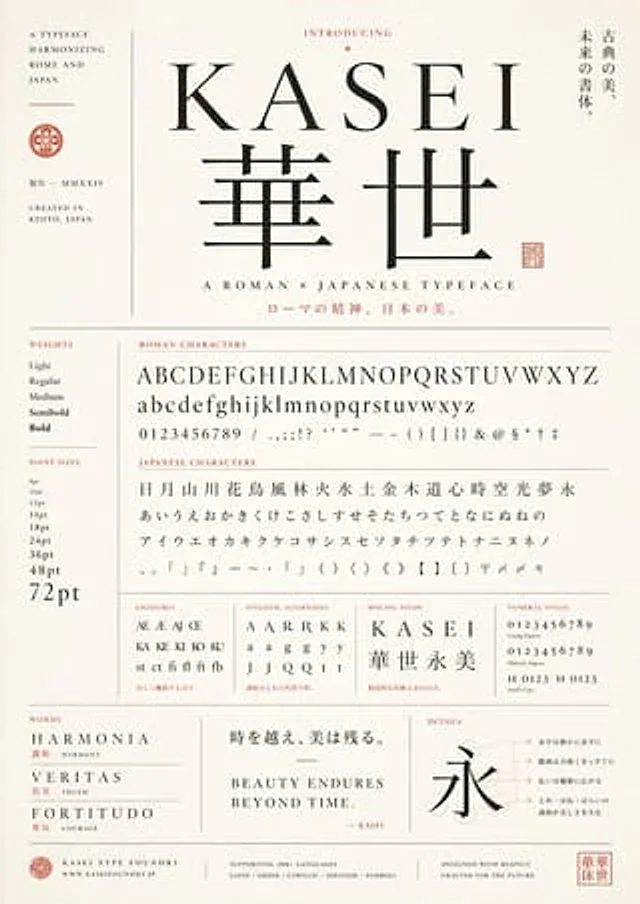

```text
Create a sophisticated retro-modern style font sample poster to showcase a font called{argument name="typeface name" default="KASEI"} This fictional font aims to achieve an elegant fusion of Roman typeface and Japanese typography. It employs a vertical composition, uses warm ivory textured paper, and features thin gray dividing lines, black lettering, and soft vermilion accents to emphasize the text and seals. At the center of the composition is a large serif Latin wordmark.{argument name="typeface name" default="KASEI"} Below the title are two oversized Japanese kanji characters, “華世”, in a matching high-contrast classical style. Above the title is a smaller title, “INTRODUCING,” adorned with a tiny decorative diamond. To the right of the title area is a vertical Japanese slogan: “经典の美、未来の书体.” (Classical beauty, future calligraphy). Below the main kanji is the subtitle “A ROMAN × JAPANESE TYPEFACE,” and below that is a line of vermilion Japanese text: “ロмаの精神、日本の美.” "(The spirit of Rome, the beauty of Japan)". On the far left, create a narrow sidebar containing stacked English text "A TYPEFACE HARMONIZING ROME AND JAPAN", a small circular badge, Japanese text "制作—MMXXIV" and "CREATED IN KYOTO, JAPAN". The lower two-thirds are structured as a rigorous font sample table with clearly labeled areas. The left sidebar contains two sections: "WEIGHTS" with five items—Light, Regular, Medium, Semibold, Bold; and "POINT SIZES" with nine items—8pt, 10pt, 12pt, 14pt, 18pt, 24pt, 36pt, 48pt, 72pt. The main area contains a section titled "ROMAN CHARACTERS" displaying four lines of samples: uppercase letters A to Z, lowercase letters a to z, and the number 0. Up to number 9, and a line of punctuation/symbols, including forward slashes, commas, semicolons, exclamation marks, question marks, apostrophes, quotation marks, long dashes, parentheses, square brackets, curly braces, ampersands, at symbols, dollar signs, asterisks, swords, and double swords. Below that is a section titled "JAPANESE CHARACTERS," containing 4 lines: 19 kanji “日月山川花鸟风林火水土金木道心时空光梦永”, 23 hiragana “あいうえおかきくけこさしすせそたちつてとなにぬねの”, 21 The first line contains the katakana characters “アイウエオカキクケコサシスセソンタチツテトナニヌネノ”, and a line of symbols including Japanese punctuation, angle brackets, tildes, separators, parentheses, angle brackets, double angle brackets, black-cornered brackets, postal symbols, reference symbols, and reduplicated characters. On the next line, add four compact sample panels: “LIGATURES” with 10 items—Æ, AE, AJ, Œ, KA, KE, KI, KO, KU and “st ct fi fl ft fb”; and “STYLISTIC ALTERNATES” with 12 items—A, A, A, R, R, K, K, a, a, g, g, y, y, J, J, Q, Q, t, t. — The samples are arranged in a neat grid; “SPACING STUDY” displays the word “KASEI” with wide letter spacing, above the kanji “华世永美”; and “NUMERAL STYLES” contains four lines—uniform numerals 0123456789, old-style numerals 0123456789, and small capital letter combinations “H 0123” and “H 0123”. Tiny red Japanese descriptions are added below some sample boxes. At the bottom, three function panels are created. The left panel is titled “WORDS” and contains three entries: “HARMONIA” with red Japanese and English annotations “调和HARMONY”, “VERITAS” with “真実TRUTH”, and “FORTITUDO” with “勇気COURAGE”. The center panel contains a large Japanese quote: “時を越え、美は残る”. "(Beyond Time, Beauty Endures)," the English statement above reads "BEAUTY ENDURES BEYOND TIME," along with a small red signature "— KASEI." The right panel, titled "DETAILS," displays a large Chinese character "永" (yong, meaning eternal), against a background of subtle circular patterns and auxiliary lines, plus four right-aligned Japanese annotations connected by thin dotted lines. Finally, the footer contains four sections: a small badge with "KASEI TYPE FOUNDRY" and "WWW.KASEIFOUNDRY.JP"; a centered language support description "SUPPORTING 200+ LANGUAGES" and "LATIN / GREEK / CYRILLIC / JAPANESE / SYMBOLS"; the right-hand statement "DESIGNED WITH RESPECT CRAFTED FOR THE FUTURE"; and a label bearing the name "华世" (Huashi). A square vermilion seal. The overall style should present the texture of a high-end Japanese typeface foundry sample sheet, balancing the precision of the Swiss grid in the editing style, the classic book layout, the subtle Japanese brand sense, the generous margins, the restrained luxury, and the elegance of a museum poster.
```

Model: GPT Image 2
Author: GPT Image 2 Prompts

[ProjectD](https://aitoolsradar.com/en/prompts/355763cc2699ea) · [Recorded source](https://x.com/petekp/status/2047454983604572319#reversed-1)
 · [Full original metadata and byte evidence](data/projectd-batch-0035.json)

## Japanese RPG Status Screen

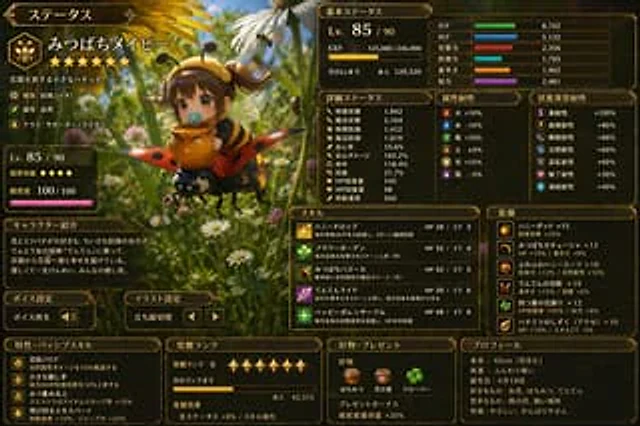

```text
この画像からゲームのステータス画面を作ってください。情報量多め。言語は日本語。
```

Model: GPT Image 2
Author: @Kashiko_AIart

[ProjectD](https://aitoolsradar.com/en/prompts/4663fbd1573f91) · [Recorded source](https://x.com/Kashiko_AIart/status/2046154976159035613)
 · [Full original metadata and byte evidence](data/projectd-batch-0035.json)

## Japanese SaaS Ad Banner at Night


```text
A sophisticated square Japanese-style digital banner ad for an AI e-commerce optimization tool. The image is divided into two main visual areas by a striking blue diagonal line extending from the top center to the lower left. The left third showcases a realistic nighttime home office scene: a tired young woman sits at a desk, her face blurred, resting her chin on her hand as she gazes at an open laptop. A warm desk lamp illuminates her and the desktop, a mug sits in the foreground, and scattered documents, bookshelves, and a clock on the wall are softly blurred against the dark background, creating an atmosphere of working late into the night. The right two-thirds features a dark blue gradient promotional panel with subtle financial growth graphics in the background: near the upper right corner is an upward line chart with an arrow and four light blue transparent bar charts. The panel is filled with a striking, oversized white Japanese title with a strong shadow, arranged in four rows:{argument name="headline text" default="You can now automate changing thumbnails late at night."} Add a white subheading below.{argument name="subheadline text" default="Rakuten-specific A/B testing automation tool"} The chart is accompanied by a thin cyan underline. Below it is a horizontal flow bar containing three white, rounded-corner cards connected by two cyan arrows pointing to the right. Card 1 shows two side-by-side thumbnails of handbags, labeled "Samune A" and "Samune B," with blue and gray percentage badges in the middle ("64.3%" and "35.7%" respectively), and marked "VS." Card 2 shows a thumbnail of a selected black handbag, with a small gold crown icon above it, a gray checkmark on the right, a cyan checkmark badge, and a small Japanese title indicating automatic optimization above. Card 3 shows a simple analytical chart with axes, including several blue bars, a pink upward trend line, and Japanese labels about sales and CTR trends, with a pink result number "+47.2%" in the lower right corner. Add a bright pink, rounded-corner promotional badge to the bottom left corner, with two lines of eye-catching white Japanese text:{argument name="offer text" default="1-week free trial"} Add a dark navy blue rounded logo bar in the bottom right corner, containing a simple white geometric logo and a bold white sans-serif brand name.{argument name="brand name" default="Easy Creative"} It adopts a clean and modern SaaS advertising aesthetic, featuring high contrast, clear typography, glossy UI cards, subtle shadows, and a professional conversion-oriented layout, all in a 1:1 aspect ratio.
```

Model: GPT Image 2
Author: GPT Image 2 Prompts

[ProjectD](https://aitoolsradar.com/en/prompts/cdd595e01a1fb0) · [Recorded source](https://x.com/EasyCreative_/status/2047500971174182992#reversed-0)
 · [Full original metadata and byte evidence](data/projectd-batch-0035.json)

## Japanese SaaS Before-After Banner

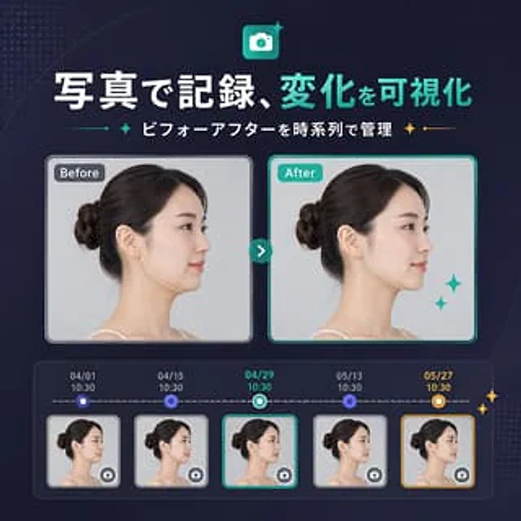

```text
{
  "type": "SaaS Feature Update Banner Info",
  "style": "The design features a clean and modern Japanese tech marketing style, a sophisticated UI, a deep navy blue gradient background, subtle dotted halftone textures in the upper left and lower right corners, soft curved accents, and striking neon cyan highlights, resulting in a refined and high-quality product launch visual effect.",
  "canvas": {
    "aspect_ratio": "1:1"
  },
  "headline": {
    "icon": "The app icon is a rounded square with a white camera symbol, a cyan gradient background, and small glitter decorations.",
    "title": "{argument name=\"headline text\" default=\"Photographs record and visualize changes\"}",
    "subtitle": "{argument name=\"subtitle text\" default=\"Comparison of management before and after by timeline\"}",
    "language": "Chinese",
    "title_style": "Large, bold sans-serif font; the first phrase is white, and the second phrase is bright cyan.",
    "subtitle_style": "Medium-sized bold white sans-serif font, with cyan and gold glitter separators on both sides."
  },
  "layout": {
    "sections": [
      {
        "title": "Comparison Cards",
        "position": "center",
        "count": 2,
        "labels": [
          "Before",
          "after"
        ]
      },
      {
        "title": "Timeline entries",
        "position": "bottom",
        "count": 5,
        "labels": [
          "04/01 10:30",
          "04/15 10:30",
          "04/29 10:30",
          "05/13 10:30",
          "05/27 10:30"
        ]
      }
    ],
    "centerpiece": "The side-by-side before-and-after portrait cards are connected by a circular cyan arrow button.",
    "bottom_panel": "The rounded rectangle timeline module contains five thumbnails with dates, connected by a dashed horizontal progress bar."
  },
  "comparison": {
    "subject": "The same adult woman, profile view from the left, with dark brown hair tied in a neat low bun, fair skin, wearing a spaghetti strap top, studio lighting, and a light gray background.",
    "privacy": "The facial areas in the large card and all five thumbnails are covered with vertical rectangular blur blocks.",
    "before_card": {
      "label": "Before",
      "frame": "Rounded rectangle with light gray border and soft shadow",
      "image": "Neutral clinical style portrait"
    },
    "after_card": {
      "label": "after",
      "frame": "Rounded rectangle with a light cyan border and soft shadow",
      "image": "Similar portraits, with subtle improvements to the jawline/neck contour, suggesting visible changes.",
      "decorations": "Then there are two cyan flashing stars in the bottom right corner of the card."
    },
    "connector": "The small, round, cyan button in the center of the card has a white right-pointing arrow."
  },
  "timeline": {
    "panel_style": "Dark, semi-transparent, rounded container with an internal glow effect.",
    "line": "White horizontal dashed line",
    "entries": [
      {
        "date": "04/01",
        "time": "10:30",
        "state": "Small blue circular node above the thumbnail",
        "thumbnail": "A thumbnail of a woman's profile, with a blurred area and a miniature camera icon button in the lower right corner.",
        "frame": "Light gray rounded corner border"
      },
      {
        "date": "04/15",
        "time": "10:30",
        "state": "Small blue circular node above the thumbnail",
        "thumbnail": "A thumbnail of a woman's profile, with a blurred area and a miniature camera icon button in the lower right corner.",
        "frame": "Light gray rounded corner border"
      },
      {
        "date": "04/29",
        "time": "10:30",
        "state": "Currently selected, with a bluish-white ring node.",
        "thumbnail": "A thumbnail of a woman's profile, with a blurred area and a miniature camera icon button in the lower right corner.",
        "frame": "Bright cyan rounded corner border"
      },
      {
        "date": "05/13",
        "time": "10:30",
        "state": "Small blue circular node above the thumbnail",
        "thumbnail": "A thumbnail of a woman's profile, with a blurred area and a miniature camera icon button in the lower right corner.",
        "frame": "Light gray rounded corner border"
      },
      {
        "date": "05/27",
        "time": "10:30",
        "state": "Highlighted milestone with gold and white ring nodes",
        "thumbnail": "A thumbnail of a woman's profile, with a blurred area and a miniature camera icon button in the lower right corner.",
        "frame": "Gold rounded corner border"
      }
    ],
    "extra_decorations": "There are two small golden flashing stars on the far right edge of the timeline panel."
  },
  "color_palette": {
    "background": "Deep navy blue to indigo gradient",
    "primary": "bright cyan",
    "secondary": "White",
    "accent": "gold",
    "support": "Soft gray and blue-purple"
  },
  "rendering": "The clean vector graphics combined with UI design, embedded with realistic portrait photography, balanced spacing, and centered composition deliver the quality of a startup landing page banner."
}
```

Model: GPT Image 2
Author: GPT Image 2 Prompts

[ProjectD](https://aitoolsradar.com/en/prompts/2e1e4cc37eaa6b) · [Recorded source](https://x.com/Satohide1994/status/2047941571748995546#reversed-2)
 · [Full original metadata and byte evidence](data/projectd-batch-0035.json)

## Japanese SaaS Feature Banner

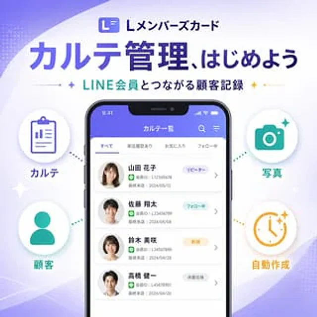

```text
{
  "type": "SaaS feature update promotional banner",
  "style": "A clean and modern Japanese tech marketing style, high-quality infographics, soft gradient backgrounds, and exquisite UI mockups—simple yet trustworthy.",
  "canvas": {
    "aspect_ratio": "1:1",
    "background": "A white background with flowing pale purple and light purple abstract wave shapes in the corners, a subtle halftone texture, and delicate shimmering accents."
  },
  "branding": {
    "top_logo": {
      "icon": "Rounded square app icon, with a stylized white L on a purple gradient background.",
      "text": "L Member Card"
    },
    "headline": "{argument name=\"headline text\" default=\"Start a new experience in medical record management\"}",
    "subheadline": "{argument name=\"subheadline text\" default=\"Customer records linked to LINE members\"}",
    "headline_style": "Large, bold, dark purple Japanese sans-serif font",
    "subheadline_style": "Medium-sized bold Japanese sans-serif font with cyan and dark navy blue accents, flanked by small star icons and thin dividing lines."
  },
  "layout": {
    "centerpiece": "A large, vertically centered smartphone front model, positioned slightly below the title.",
    "sections": [
      {
        "title": "Left side function",
        "position": "Left side of the phone",
        "count": 2,
        "labels": [
          "Medical records",
          "client"
        ],
        "items": [
          {
            "shape": "White circular badge with soft shadow",
            "icon": "Purple clipboard line icon",
            "label": "Medical records",
            "accent": "The purple dotted line connecting the phone"
          },
          {
            "shape": "White circular badge with soft shadow",
            "icon": "Cyan silhouette icon",
            "label": "client",
            "accent": "The cyan dotted line connecting the phone"
          }
        ]
      },
      {
        "title": "right-side functions",
        "position": "right side of the phone",
        "count": 2,
        "labels": [
          "photo",
          "Automatically generated"
        ],
        "items": [
          {
            "shape": "White circular badge with soft shadow",
            "icon": "Cyan camera icon",
            "label": "photo",
            "accent": "The cyan dotted line connecting the phone"
          },
          {
            "shape": "White circular badge with soft shadow",
            "icon": "Orange clock icon with a glitter effect",
            "label": "Automatically generated",
            "accent": "The orange dashed line pointing to the phone"
          }
        ]
      }
    ],
    "decorations_count": 6
  },
  "app_screen": {
    "screen_title": "Medical Record List",
    "status_bar": {
      "time": "9:41",
      "battery": true,
      "signal": true
    },
    "top_icons_count": 2,
    "top_icons": [
      "search",
      "menu"
    ],
    "tabs": {
      "count": 4,
      "labels": [
        "all",
        "Store visit record",
        "collect",
        "Following"
      ],
      "active": "all"
    },
    "customer_cards": {
      "count": 4,
      "items": [
        {
          "name": "{argument name=\"customer name 1\" default=\"Hanako Yamada\"}",
          "member_id": "L12345678",
          "last_visit": "May 12, 2024",
          "tag": "Repeat customers",
          "avatar": "Blurry female head"
        },
        {
          "name": "Shota Sato",
          "member_id": "L123456789",
          "last_visit": "May 8, 2024",
          "tag": "Following",
          "avatar": "Blurry male head"
        },
        {
          "name": "Misaki Suzuki",
          "member_id": "L34567890",
          "last_visit": "April 28, 2024",
          "tag": "New users",
          "avatar": "Blurry female head"
        },
        {
          "name": "Kenichi Takahashi",
          "member_id": "L45678901",
          "last_visit": "April 20, 2024",
          "tag": "dormant users",
          "avatar": "Blurry male head"
        }
      ]
    },
    "ui_style": "Rounded white list cards on a light gray background, purple application title bar, subtle shadows, Japanese sans-serif typography."
  },
  "color_palette": {
    "primary": "#5B5CEB to #6C63FF",
    "secondary": "#22C7B8",
    "accent": "#F4B23A",
    "text_dark": "#2B2E5B",
    "white": "#FFFFFF"
  },
  "rendering": "Clear vector-style marketing graphics with realistic smartphone bezels, balanced and centered composition, showcasing premium SaaS launch banner aesthetics."
}
```

Model: GPT Image 2
Author: GPT Image 2 Prompts

[ProjectD](https://aitoolsradar.com/en/prompts/3b14fb0a98bf92) · [Recorded source](https://x.com/Satohide1994/status/2047941571748995546#reversed-0)
 · [Full original metadata and byte evidence](data/projectd-batch-0035.json)

## Japanese SaaS Form Builder Banner

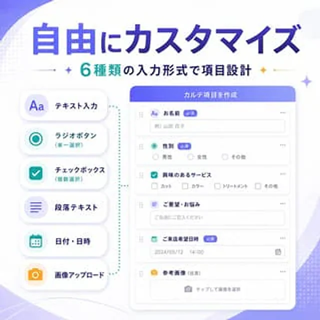

```text
{
  "type": "SaaS Feature Update Banner Info",
  "style": "The visuals for Japanese tech marketing are clean and modern, featuring soft gradient abstract backgrounds, advanced UI, minimalist flat illustrations, rounded cards, subtle shadows, and clear typography.",
  "language": "Chinese",
  "canvas": {
    "aspect_ratio": "1:1",
    "background": "A white background is accented with soft purple gradient ripples, delicate dotted halftone decorations, and subtle geometric shimmering effects in the corners."
  },
  "headline": {
    "main": "{argument name=\"headline text\" default=\"Free customization\"}",
    "sub": "{argument name=\"subheadline text\" default=\"Six input formats allow for flexible form item design.\"}",
    "main_style": "Extra-large, bold Japanese-style sans-serif font with a gradient fill from dark blue to violet.",
    "sub_style": "Medium-bold Japanese sans-serif font, cyan and dark navy blue text, with small decorative flashing icons and thin dividing lines on both sides."
  },
  "layout": {
    "composition": "Double-column product function banner",
    "sections": [
      {
        "title": "Input type list",
        "position": "left",
        "count": 6,
        "labels": [
          "Text input",
          "Radio button (single selection)",
          "Checkboxes (multiple selections)",
          "Paragraph text",
          "Date/Time",
          "Image upload"
        ],
        "container": "Six rounded white capsule cards are stacked vertically with soft shadows.",
        "icon_style": "Large, minimalist, colorful icon inside a light-colored circular badge",
        "colors": [
          "purple",
          "teal",
          "teal",
          "purple",
          "teal",
          "orange"
        ]
      },
      {
        "title": "Form Builder UI",
        "position": "right",
        "count": 6,
        "labels": [
          "Name",
          "gender",
          "Services of interest",
          "Needs/Problems",
          "Expected arrival date",
          "Reference image (optional)"
        ],
        "container": "Large, rounded white application window with a purple-blue title bar",
        "header_text": "{argument name=\"panel title\" default=\"Create form items\"}",
        "field_types": [
          "Single-line text input",
          "radio buttons",
          "checkbox group",
          "Multiline text area",
          "Date and Time Picker",
          "Image upload drag-and-drop area"
        ]
      }
    ],
    "connector": "The light blue dotted bracket-style guide lines visually connect the left-side function list with the right-side form builder panel."
  },
  "ui_details": {
    "badges_count": 3,
    "badges": [
      "Required",
      "Required",
      "Required"
    ],
    "sample_values": {
      "name_placeholder": "Example: Hanako Yamada",
      "radio_options": [
        "male",
        "female",
        "other"
      ],
      "checkbox_options": [
        "Haircut",
        "hair dye",
        "Nursing",
        "other"
      ],
      "textarea_placeholder": "Please fill in the blank freely.",
      "date_value": "2024/05/12",
      "time_value": "14:00",
      "upload_hint": "Click to select image"
    },
    "window_controls": "Minimalist polka dots and drag handles, clean form rows with thin light gray borders"
  },
  "color_palette": {
    "primary": "Violet Supreme Blue Gradient",
    "secondary": "blue",
    "accent": "orange color",
    "surface": "White",
    "text": "Navy blue and gray"
  },
  "quality": "High-resolution, sophisticated startup marketing graphics with balanced spacing; elegant SaaS promotional banners for announcing customizable form input types."
}
```

Model: GPT Image 2
Author: GPT Image 2 Prompts

[ProjectD](https://aitoolsradar.com/en/prompts/d8757cd3e42a35) · [Recorded source](https://x.com/Satohide1994/status/2047941571748995546#reversed-3)
 · [Full original metadata and byte evidence](data/projectd-batch-0035.json)

## Japanese SaaS Trigger Automation Banner

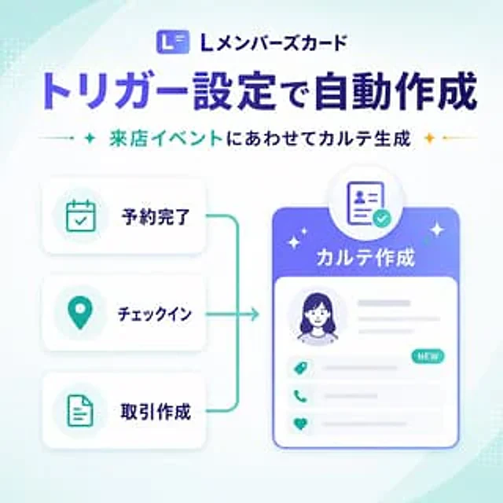

```text
{
  "type": "SaaS Feature Update Banner Info",
  "style": "Clean and modern Japanese technology marketing graphics, high-quality corporate infographics, soft gradients, rounded corner UI cards, subtle shadows, and minimalist vector illustrations.",
  "format": "Square social media banner",
  "aspect_ratio": "1:1",
  "brand": {
    "logo_text": "L Member Card",
    "logo_icon": "Rounded square app icon with a white L-shaped design on a blue-purple gradient background."
  },
  "background": {
    "base": "A gradient from very light white to pale mint green",
    "decorations": {
      "count": 6,
      "items": [
        "A large, semi-transparent arc that swept across the upper left corner",
        "A large, semi-transparent arc that swept across the bottom right corner",
        "Small dotted halftone clusters at the upper left edge",
        "Small dotted halftone clusters on the lower right edge",
        "Soft ambient light behind the main card",
        "A faint cyan gradient diffused in the corner"
      ]
    }
  },
  "layout": {
    "sections": [
      {
        "title": "header",
        "position": "top center",
        "count": 3,
        "labels": [
          "L Member Card",
          "Automatic creation via trigger settings",
          "Generate archives based on in-store events"
        ]
      },
      {
        "title": "left trigger cards",
        "position": "left center",
        "count": 3,
        "labels": [
          "Appointment completed",
          "Sign in",
          "Create a transaction"
        ]
      },
      {
        "title": "right output card",
        "position": "right center",
        "count": 1,
        "labels": [
          "Create a file"
        ]
      }
    ],
    "flow": "The three stacked trigger cards on the left are connected by a cyan bracket-shaped line, pointing to a large personal profile record card on the right."
  },
  "text": {
    "headline": "{argument name=\"headline text\" default=\"Automatic creation via trigger settings\"}",
    "subheadline": "{argument name=\"subheadline text\" default=\"Generate archives based on in-store events\"}"
  },
  "left_panel": {
    "cards": [
      {
        "label": "Appointment completed",
        "icon": "Calendar with checkmark",
        "icon_color": "teal",
        "card_style": "White rounded rectangle with soft gray shading"
      },
      {
        "label": "Sign in",
        "icon": "Map pins",
        "icon_color": "teal",
        "card_style": "White rounded rectangle with soft gray shading"
      },
      {
        "label": "Create a transaction",
        "icon": "Document outline",
        "icon_color": "teal",
        "card_style": "White rounded rectangle with soft gray shading"
      }
    ]
  },
  "connector": {
    "color": "teal",
    "shape": "Connect the three cards on the left to the vertical bracket line of the arrow on the right.",
    "stroke": "Medium thickness rounded corner lines"
  },
  "right_panel": {
    "title": "{argument name=\"feature label\" default=\"Create a file\"}",
    "container": "Large rounded rectangular card with a blue-purple gradient title and a white body",
    "top_badge": "The circular badge floating above the card displays an ID/profile document icon with a cyan checkmark.",
    "body_elements": {
      "count": 6,
      "items": [
        "Circular avatar placeholder for a woman with dark blue hair",
        "Two lines of horizontal gray text to the right of the profile picture",
        "Three lines of information with cyan icons",
        "The first line has a cyan NEW tag.",
        "Light gray placeholder lines for recording details",
        "The thin blue outline around the main card"
      ]
    },
    "row_icons": [
      "tag",
      "phone",
      "heart"
    ]
  },
  "accent_graphics": {
    "count": 4,
    "items": [
      "The blue flash next to the subtitle on the left",
      "The golden glitter next to the right of the subtitle",
      "The two small white dots around the main right card are flashing.",
      "Small blue dot at the end of the connector"
    ]
  },
  "color_palette": {
    "primary": "Deep blue-purple",
    "secondary": "blue",
    "accent": "gold",
    "background": "White and light mint green"
  },
  "generation_notes": "Uses clear Japanese fonts, bold, large headings, balanced white space, refined SaaS product announcement aesthetics, vector UI mockup style, without photorealism or complex textures."
}
```

Model: GPT Image 2
Author: GPT Image 2 Prompts

[ProjectD](https://aitoolsradar.com/en/prompts/c1f6843d8533c1) · [Recorded source](https://x.com/Satohide1994/status/2047941571748995546#reversed-1)
 · [Full original metadata and byte evidence](data/projectd-batch-0035.json)

## Japanese Self-Help Book Cover Mockup

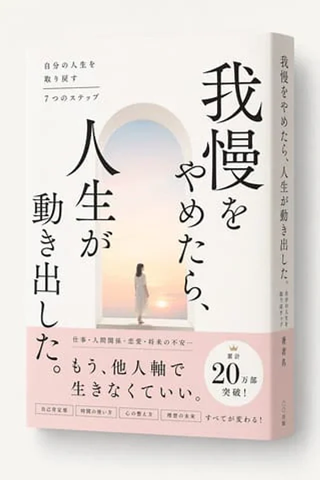

```text
A realistic 3D paperback mockup stands at a slight tilt against a pure off-white background, showcasing the cover and spine. The cover features a minimalist and serene illustration depicting a white archway leading to a bright, soft sunrise over a calm sea. A woman in a flowing white dress stands at the archway, gazing at the horizon. On either side of the archway are elegant vertical Japanese characters in Mincho font, containing the following text:{argument name="main title" default="Once I stopped enduring it, my life started to move forward."} There is smaller horizontal text in the upper left corner.{argument name="subtitle" default="7 Steps to Reclaiming Your Life"} The bottom third of the book is wrapped in a light pink dust jacket. The dust jacket features a prominent horizontal advertising slogan.{argument name="obi catchphrase" default="You no longer have to live your life based on other people&#39;s expectations."} The small print above, separated by dotted lines, mentions work, interpersonal relationships, love, and anxieties about the future. On the right side of the waistband is a white circular badge with a small crown icon and the text {argument name="sales badge text" default="Total sales surpass 200,000!"} The bottom of the book jacket features four small rectangles containing keywords related to self-esteem, time management, mental organization, and an ideal future, followed by the text "Everything will change!" The spine is white and displays the main title, subtitle, author's name placeholder, and publisher placeholder.
```

Model: GPT Image 2
Author: GPT Image 2 Prompts

[ProjectD](https://aitoolsradar.com/en/prompts/f502b03183886c) · [Recorded source](https://x.com/uniyume/status/2046091784812708315#reversed-1)
 · [Full original metadata and byte evidence](data/projectd-batch-0035.json)

## Japanese Shoe Laundry Bag Ad

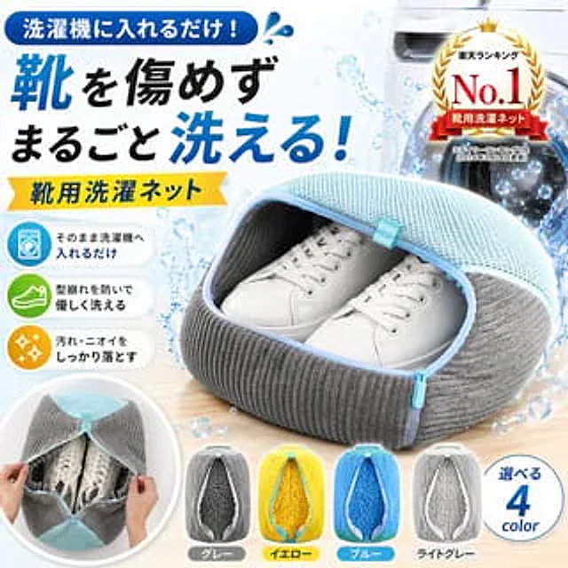

```text
{
  "type": "Japanese-style e-commerce product advertisements",
  "product": {
    "category": "Footwear laundry mesh bags",
    "name": "{argument name=\"product name\" default=\"shoe laundry net\"}",
    "hero": {
      "bag": {
        "shape": "Round flap zip laundry bag with top mesh panel and ribbed fabric sides",
        "main colors": [
          "Light blue mesh",
          "Medium gray ribbed body",
          "Light blue zipper trim"
        ],
        "position": "Located at the right front of the light-colored wooden tabletop",
        "state": "The front zipper opens to reveal the contents."
      },
      "contents": {
        "count": 2,
        "item": "White low-top sneakers",
        "arrangement": "A neat pair of shoes are placed side by side inside the bag, with the toes facing forward."
      },
      "background": {
        "setting": "Bright and clean laundry room",
        "main object": "The front-loading washing machine is visible on the right side.",
        "effects": [
          "A huge arc of water spray is visible behind the product.",
          "Bubbles are floating in the picture"
        ],
        "lighting": "High-key commercial photography lighting, featuring glossy highlights and sharp shadows."
      }
    }
  },
  "layout": {
    "style": "A compact, Japanese-style e-commerce banner design, suitable for main images in online marketplaces.",
    "sections": [
      {
        "title": "Main title area",
        "position": "Top left corner",
        "count": 3,
        "labels": [
          "Simply put it in the washing machine!",
          "Do not damage the shoe surface",
          "Wash thoroughly!"
        ]
      },
      {
        "title": "Product Name Section",
        "position": "Left-aligned below the title",
        "count": 1,
        "labels": [
          "shoe laundry net"
        ]
      },
      {
        "title": "Function icons",
        "position": "Left vertical column",
        "count": 3,
        "labels": [
          "Simply put it in the washing machine.",
          "To prevent deformation, wash gently.",
          "Thoroughly remove dirt and odors"
        ]
      },
      {
        "title": "Award badge",
        "position": "Top right corner",
        "count": 1,
        "labels": [
          "Rakuten rankings",
          "No.1",
          "shoe laundry net",
          "※Ranked #1 on the daily chart (Updated March 14, 2024)"
        ]
      },
      {
        "title": "Use of scene illustrations",
        "position": "bottom left corner",
        "count": 1,
        "labels": [
          "Open the laundry bag with both hands to put in or show the shoes inside."
        ]
      },
      {
        "title": "Color variations",
        "position": "Centered at the bottom",
        "count": 4,
        "labels": [
          "grey",
          "yellow",
          "blue",
          "Light gray"
        ]
      },
      {
        "title": "Color quantity labeling",
        "position": "bottom right corner",
        "count": 1,
        "labels": [
          "Optional",
          "4",
          "Colors"
        ]
      }
    ],
    "color variants": [
      {
        "label": "grey",
        "bag color": "Gray body with light blue mesh"
      },
      {
        "label": "yellow",
        "bag color": "Yellow main body with light-colored trim"
      },
      {
        "label": "blue",
        "bag color": "Bright blue main body with light-colored trim"
      },
      {
        "label": "Light gray",
        "bag color": "Light gray body with light-colored trim"
      }
    ]
  },
  "typography": {
    "language": "Japanese",
    "headline treatment": "Extra-large bold sans-serif font, black and bright blue emphasis, dynamic line wrapping.",
    "accent colors": [
      "Royal Blue",
      "yellow",
      "White",
      "Red and gold badge decoration",
      "Green and orange function icons"
    ]
  },
  "composition notes": "Create a sophisticated, market-relevant Japanese-style sales image. Place the product in the center right, a large headline highlighting key benefits on the left, a ranking badge in the upper right corner, and four color option thumbnails at the bottom. Emphasize cleaning, protection, and washing power. Use glossy water splash effects and bubbles to suggest the washing machine's performance. Maintain an overall high-end, trustworthy, and click-through-prone appearance.",
  "customization": {
    "headline emphasis color": "{argument name=\"accent color\" default=\"blue\"}",
    "bag main color": "{argument name=\"main bag color\" default=\"gray with light blue mesh\"}",
    "background appliance": "{argument name=\"background appliance\" default=\"front-loading washing machine\"}"
  }
}
```

Model: GPT Image 2
Author: GPT Image 2 Prompts

[ProjectD](https://aitoolsradar.com/en/prompts/d8ae66f726feb0) · [Recorded source](https://x.com/okuda_buppan/status/2047198234452627899#reversed-3)
 · [Full original metadata and byte evidence](data/projectd-batch-0035.json)

## Japanese Shonen Manga Page

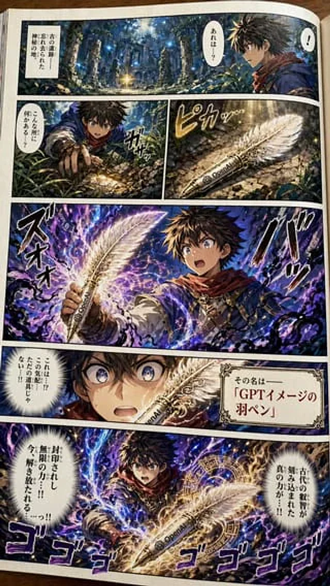

```text
Make one{argument name="manga type" default="Colorful Japanese shonen adventure manga"} Sample pages. The pages should vividly depict our protagonist discovering a {argument name="item" default="Magic Quill"} The name of this quill pen is {argument name="item name" default="Quill of GPT Image"} The visuals should be dramatic. This magical quill contains sealed, powerful energy. Additional notes: Aspect ratio: 1440x2560 (portrait). The pen should bear the OpenAI logo. The language in the comic should be Japanese. Please carefully conceive the story to ensure it has excellent paneling. The pages should be presented as photographs of physical comic book pages, not digital pages.
```

Model: GPT Image 2
Author: GPT Image 2 Prompts

[ProjectD](https://aitoolsradar.com/en/prompts/2cd90e1827103e) · [Recorded source](https://x.com/dotey/status/2046781861502779523)
 · [Full original metadata and byte evidence](data/projectd-batch-0035.json)

## Japanese Supermarket Promotional Flyer

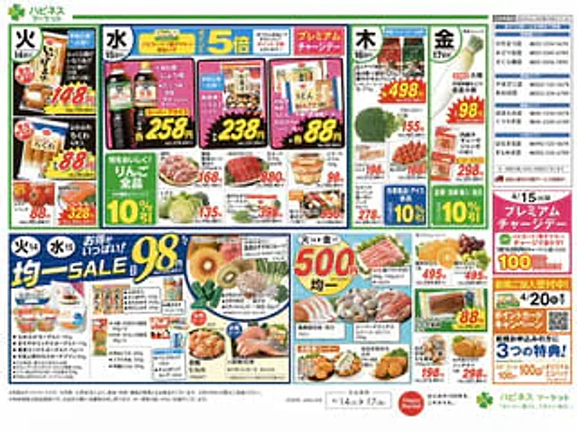

```text
{
  "type": "Japanese supermarket promotional flyers",
  "header": {
    "store_name": "{argument name=\"store name\" default=\"ハピネス マーケット\"}",
    "store_directory": "List of 12 store addresses and phone numbers grouped by region"
  },
  "style": "High-density, brightly colored, eye-catching red and yellow price tags, realistic food photography, and traditional Japanese retail aesthetics.",
  "layout": {
    "sections": [
      {
        "title": "Tuesday Special Price",
        "position": "Top left",
        "count": 3,
        "labels": [
          "Inari Sushi Combo",
          "Chikuwa",
          "tomato"
        ]
      },
      {
        "title": "Wednesday Special Price",
        "position": "Upper-middle",
        "promotion": "{argument name=\"point multiplier\" default=\"5 times\"}",
        "count": 6,
        "labels": [
          "soy sauce bottle",
          "Japanese-style assorted sweet buns",
          "Udon noodles",
          "Pork slices",
          "Tuna sashimi slices",
          "pudding"
        ]
      },
      {
        "title": "Thursday and Friday special offers",
        "position": "Top right",
        "count": 5,
        "labels": [
          "coffee bags",
          "broccoli",
          "White radish",
          "Pork slices",
          "Large pan-fried dumplings"
        ]
      },
      {
        "title": "Mid-row discount",
        "position": "Center horizontally",
        "count": 7,
        "labels": [
          "Apple 10% off",
          "lettuce",
          "yogurt",
          "Sushi Platter",
          "Multi-pack yogurt",
          "Frozen food 10% off",
          "Rice 10% off"
        ]
      },
      {
        "title": "Unified low-price promotion",
        "position": "Bottom left",
        "price": "{argument name=\"low uniform price\" default=\"98\"}",
        "count": 6,
        "labels": [
          "Mixed Fruits",
          "Yogurt and dairy products",
          "Natto and tofu",
          "ice cream",
          "fried chicken",
          "salmon slices"
        ]
      },
      {
        "title": "Unified high-price promotion",
        "position": "Middle to lower",
        "price": "{argument name=\"high uniform price\" default=\"500\"}",
        "count": 4,
        "labels": [
          "Pork belly slices",
          "Mandarin oranges and grapes",
          "Seafood Medley",
          "Grilled eel"
        ]
      },
      {
        "title": "Right sidebar promotions",
        "position": "Bottom right",
        "count": 3,
        "labels": [
          "Member Recharge Day",
          "Points Card Activity",
          "Fried cooked food"
        ]
      }
    ]
  },
  "footer": {
    "sale_period": "{argument name=\"sale period\" default=\"4/14 (Fire) ▶ 17 (Metal)\"}",
    "disclaimers": "Standard small print description and auxiliary logo"
  }
}
```

Model: GPT Image 2
Author: GPT Image 2 Prompts

[ProjectD](https://aitoolsradar.com/en/prompts/bddc0929bc1e91) · [Recorded source](https://x.com/chatgpt_liberty/status/2046206927492047336#reversed-0)
 · [Full original metadata and byte evidence](data/projectd-batch-0035.json)

## Japanese Supermarket Sale Flyer


```text
『賑やかで魅力的なスーパーマーケットの折り込みチラシの画像。上部には「特売」の大きな文字と今週の日付。カラフルな商品写真(野菜・果物・牛肉・鮮魚)、赤枠の価格タグ、「超目玉商品」「家計応援」のキャッチ...』
```

Model: GPT Image 2
Author: @weel_corp

[ProjectD](https://aitoolsradar.com/en/prompts/84d33b8a497f99) · [Recorded source](https://x.com/weel_corp/status/2046514558064586782)
 · [Full original metadata and byte evidence](data/projectd-batch-0035.json)

## Japanese Supermarket Sale Flyer

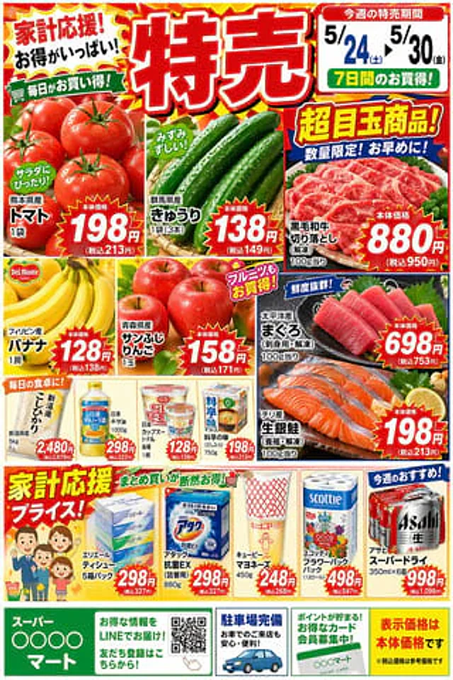

```text
{
  "type": "Japanese supermarket flyers and posters",
  "style": "Busy, brightly colored, high-impact retail advertising; densely collaged layouts; striking red and yellow promotional graphics; glossy product photography; bold white outlines; star-shaped price tags; Japanese discount store aesthetics.",
  "format": "Vertical single-page flyer",
  "language": "Japanese",
  "headline": {
    "main": "Special Offer",
    "top_left_callouts": [
      "Financial support!",
      "Amazing deal!",
      "Daily specials!"
    ],
    "top_right": {
      "label": "This week's special sale",
      "date_start": "May 24 (Saturday)",
      "date_end": "May 30 (Friday)",
      "sub": "7-Day Super Value Deal!"
    }
  },
  "layout": {
    "sections": [
      {
        "title": "Fresh Vegetables and Meat Section",
        "position": "upper half",
        "count": 3,
        "labels": [
          "tomato",
          "cucumber",
          "Black Wagyu beef slices"
        ]
      },
      {
        "title": "Fruit and Seafood Section",
        "position": "Central",
        "count": 5,
        "labels": [
          "banana",
          "Sun Fuji Apple",
          "tuna",
          "raw silver salmon",
          "Home and Daily Necessities Section"
        ]
      },
      {
        "title": "Home and Grocery Section",
        "position": "Mid-lower part",
        "count": 5,
        "labels": [
          "tissue",
          "Detergent",
          "mayonnaise",
          "toilet paper",
          "beer"
        ]
      },
      {
        "title": "Bottom Information Bar",
        "position": "bottom",
        "count": 4,
        "labels": [
          "Store Logo Area",
          "LINE registration QR code area",
          "Parking Information Area",
          "Points Card Information Area"
        ]
      }
    ],
    "centerpiece": "The main sale title is displayed in a huge central top, against an explosive yellow background."
  },
  "products": [
    {
      "name": "tomato",
      "origin": "Kumamoto Prefecture",
      "note": "A perfect match for salad!",
      "package": "1 bag",
      "price_main": "198 yen",
      "price_tax": "213 yen including tax",
      "image": "A close-up of a basket of red tomatoes"
    },
    {
      "name": "cucumber",
      "origin": "Gunma Prefecture",
      "note": "Tender and juicy!",
      "package": "1 bag (3 pieces)",
      "price_main": "138 yen",
      "price_tax": "149 yen including tax",
      "image": "Three glossy cucumbers in the basket"
    },
    {
      "name": "Black Wagyu beef slices",
      "note": "Super popular item! Limited quantity! Buy now while supplies last!",
      "package": "(Thawed) Per 100 grams",
      "price_main": "880 yen",
      "price_tax": "950 yen including tax",
      "image": "Wagyu beef slices garnished with parsley on a black tray"
    },
    {
      "name": "banana",
      "origin": "Philippine",
      "package": "1 string",
      "price_main": "128 yen",
      "price_tax": "138 yen including tax",
      "image": "A bunch of yellow bananas"
    },
    {
      "name": "Sun Fuji Apple",
      "origin": "Aomori Prefecture",
      "note": "The fruit is also great value!",
      "package": "1",
      "price_main": "158 yen",
      "price_tax": "171 yen including tax",
      "image": "Four red apples"
    },
    {
      "name": "tuna",
      "origin": "Pacific",
      "note": "Extremely fresh!",
      "package": "For sashimi use - thaw per 100 grams",
      "price_main": "698 yen",
      "price_tax": "¥753 including tax",
      "image": "Thick slices of magenta tuna sashimi on a dark plate"
    },
    {
      "name": "raw silver salmon",
      "origin": "Chilean",
      "package": "Cultivation/Thawing per 100 grams",
      "price_main": "198 yen",
      "price_tax": "213 yen including tax",
      "image": "Orange salmon slices with lemon slices"
    },
    {
      "name": "Koshimitsu Rice",
      "origin": "Niigata Prefecture",
      "note": "A must-have for every meal!",
      "package": "5 kg",
      "price_main": "2,480 yen",
      "price_tax": "2,678 yen including tax",
      "image": "A bag of rice"
    },
    {
      "name": "rapeseed oil",
      "brand": "Nissin",
      "package": "1000 grams",
      "price_main": "298 yen",
      "price_tax": "322 yen including tax",
      "image": "plastic bottled cooking oil"
    },
    {
      "name": "Cup noodles",
      "brand": "Nissin",
      "package": "1",
      "price_main": "128 yen",
      "price_tax": "138 yen including tax",
      "image": "Cup noodle container"
    },
    {
      "name": "The taste of a high-class Japanese restaurant",
      "variant": "Reduce salt",
      "package": "750 grams",
      "price_main": "198 yen",
      "price_tax": "213 yen including tax",
      "image": "rectangular miso box"
    },
    {
      "name": "tissue",
      "brand": "Elleair",
      "package": "5 boxes",
      "price_main": "298 yen",
      "price_tax": "327 yen including tax",
      "image": "Stacked tissue boxes"
    },
    {
      "name": "Antibacterial EX",
      "brand": "Attack",
      "package": "880 grams",
      "price_main": "298 yen",
      "price_tax": "327 yen including tax",
      "image": "Blue laundry detergent refill"
    },
    {
      "name": "mayonnaise",
      "brand": "Kewpie",
      "package": "450 grams",
      "price_main": "248 yen",
      "price_tax": "268 yen including tax",
      "image": "Upright squeeze mayonnaise jar with red grid pattern"
    },
    {
      "name": "Flower Packaging",
      "brand": "Scottie",
      "package": "12 volumes",
      "price_main": "498 yen",
      "price_tax": "547 yen including tax",
      "image": "Multi-roll toilet paper"
    },
    {
      "name": "Super Dry",
      "brand": "Asahi",
      "package": "350 ml x 6 bottles",
      "price_main": "998 yen",
      "price_tax": "1,098 yen including tax",
      "image": "Silver and red six-pack beer cans"
    }
  ],
  "footer": {
    "left_store_name": "{argument name=\"store name\" default=\"Supermarket OOOO Mart\"}",
    "promo_text": [
      "Get special offers via LINE!",
      "Click here to add a friend!",
      "Complete parking lot",
      "It's safe and convenient to drive here!",
      "Points card membership is now open for recruitment!",
      "The displayed price is the price of the product.",
      "※Prices including tax are for reference only"
    ],
    "extra_elements": [
      "QR code",
      "Small blue car illustration",
      "Membership card illustration"
    ]
  },
  "people": {
    "count": 1,
    "description": "There is a small family illustration in the bottom left promotional panel, with simplified and blurred faces."
  },
  "color_palette": {
    "dominant": [
      "Bright red",
      "Sunshine Yellow",
      "White",
      "green",
      "blue"
    ],
    "accent": "Orange promotional burst graphic"
  },
  "generation_notes": "Create a compact Japanese supermarket sale flyer featuring 16 carefully selected items, all accompanied by photographic silhouettes, eye-catching Japanese text, red star-shaped price tags, and a cluttered yet legible newspaper insert layout. Emphasize the large central sale headline, while also including food and household goods, with particular attention to highlighting discounts on mayonnaise and detergents at the bottom."
}
```

Model: GPT Image 2
Author: GPT Image 2 Prompts

[ProjectD](https://aitoolsradar.com/en/prompts/72ed7f15fb58b2) · [Recorded source](https://x.com/weel_corp/status/2046514558064586782#reversed-0)
 · [Full original metadata and byte evidence](data/projectd-batch-0035.json)

## Japanese Supermarket Spring Flyer


```text
{
  "type": "Japanese supermarket promotional flyers",
  "theme": "Spring festival, cherry blossom pattern, vibrant red and yellow tones",
  "header": {
    "store_name": "{argument name=\"store name\" default=\"Supermarket\"}",
    "main_title": "{argument name=\"main headline\" default=\"Weekend Grand Thanksgiving\"}",
    "date": "{argument name=\"sale date\" default=\"Limited time offer: April 19th (Sunday)\"}",
    "badges": [
      "5x points on points card",
      "Spring Flavor Slogan"
    ]
  },
  "layout": {
    "structure": "A grid containing 12 product panels (3 rows and 4 columns) and a vertical sidebar on the right.",
    "product_panels": {
      "count": 12,
      "items": [
        "Spring cabbage, red price tag 158",
        "Bamboo shoots, red price tag 198",
        "Strawberry, red price tag 598",
        "Sakura Mochi, red price tag 398",
        "Live clams, red price tag 298",
        "Sea bream sashimi, red price tag 580",
        "Beef shoulder, red price tag 1280",
        "Spring roll ingredients, red price tag 780",
        "New onion, red price tag 128",
        "Rapeseed flowers, red price tag 198",
        "Pork belly slices, red price tag 228",
        "Cherry blossom steamed buns, red price tag 168"
      ]
    },
    "sidebar": {
      "position": "right side",
      "section_count": 4,
      "sections": [
        "Store address, phone number, and business hours",
        "A list of green bullet points showcases store features.",
        "Small local map with parking information",
        "Green employee recruitment banner"
      ]
    },
    "footer": "A full-width red banner with white promotional text and terms and conditions."
  }
}
```

Model: GPT Image 2
Author: GPT Image 2 Prompts

[ProjectD](https://aitoolsradar.com/en/prompts/3b697c0c4ff5f8) · [Recorded source](https://x.com/fang_ceo/status/2045480434637930669#reversed-0)
 · [Full original metadata and byte evidence](data/projectd-batch-0035.json)

## Japanese Swimsuit Magazine Grid


```text
{argument name="服装" default="泳装"}时尚杂志广告页面，{argument name="地域" default="日本"}成熟模特， S型曲线。变换姿势和风格，九宫格展示，保持人物面部一致性
```

Model: GPT Image 2
Author: Adam也叫吉米

[ProjectD](https://aitoolsradar.com/en/prompts/59763b15f3b8e1) · [Recorded source](https://youmind.com/prompts/japanese-swimsuit-magazine-ad-grid-22740)
 · [Full original metadata and byte evidence](data/projectd-batch-0035.json)

## Japanese Tabloid Magazine Cover


```text
{
  "type": "Japanese tabloid magazine cover",
  "magazine_header": {
    "title": "{argument name=\"magazine name\" default=\"Weekly LUMINA\"}",
    "issue_date": "April 25th issue",
    "price": "¥450"
  },
  "main_photo": {
    "subject": "{argument name=\"subject description\" default=\"A young Japanese woman turned around in surprise; she was wearing a white top and a denim jacket.\"}",
    "setting": "Nighttime streets with bokeh lighting",
    "style": "Paparazzi flash photography style"
  },
  "layout": {
    "headlines": [
      {
        "position": "Banner in the upper left corner",
        "text": "{argument name=\"top banner text\" default=\"Exclusive scoop!!\"}",
        "color": "White text on a red background"
      },
      {
        "position": "Left vertical",
        "text": "{argument name=\"main headline left\" default=\"Sightings reported late at night!\"}",
        "color": "Yellow text with black outline"
      },
      {
        "position": "right vertical",
        "text": "{argument name=\"main headline right\" default=\"Finally revealed!?\"}",
        "color": "Red text with white outline"
      },
      {
        "position": "Bottom center stack 1",
        "text": "Capture the moment of impact!",
        "color": "Yellow text on a black background"
      },
      {
        "position": "2 stacked at the bottom center",
        "text": "Those involved recount the truth",
        "color": "White text on a red background"
      },
      {
        "position": "3 stacked at the bottom center",
        "text": "Unveiling the secrets behind the taboo!",
        "color": "Yellow text on a black background"
      },
      {
        "position": "Width of the lower left corner",
        "text": "Exclusive insider report",
        "color": "White text on a red background"
      }
    ],
    "inset_photos": {
      "count": 3,
      "details": [
        {
          "position": "Top right corner",
          "description": "The woman lowered her head and covered her head.",
          "label": "Top-secret photos acquired!!"
        },
        {
          "position": "bottom left corner",
          "description": "A woman is talking to a man wearing glasses.",
          "label": "Intimate relationship exposed!?"
        },
        {
          "position": "bottom right corner",
          "description": "A man and a woman photographed from the side.",
          "label": "I got it after our relationship was exposed!"
        }
      ]
    },
    "footer": {
      "elements": [
        "barcode",
        "188",
        "963469 195449"
      ]
    }
  }
}
```

Model: GPT Image 2
Author: GPT Image 2 Prompts

[ProjectD](https://aitoolsradar.com/en/prompts/a57184a37791cd) · [Recorded source](https://x.com/aichof21/status/2045833848924279054#reversed-2)
 · [Full original metadata and byte evidence](data/projectd-batch-0035.json)

## Japanese TCG Strategy Infographic


```text
Goal: Create a polished vertical Japanese trading-card-game strategy infographic explaining the pros and cons of adding a specific card to a deck.

Canvas: Portrait 2:3 layout, dark navy-black fantasy UI background with thin gold ornamental borders, beveled panels, subtle glow, and a premium card-game analysis aesthetic. Use gold title typography and white Japanese body text.

Main title area: At top right, place a large ornate gold headline reading {argument name="headline text" default="道化の一座 ハット"}. Beneath it, add the subtitle {argument name="subtitle text" default="デッキに加えた際のメリット・デメリット"}. Under the subtitle, place a dark framed explanation box containing 3 short Japanese lines describing that the card can search/deploy Pendulum monsters, also enables non-theme monsters, supports interruption-resistant subroutes, and improves combo stability.

Card display: At top left, show exactly 1 realistic Yu-Gi-Oh-style monster card mockup, named {argument name="card name" default="道化の一座 ハット"}. The card should have an orange monster-card frame, star icons, a small LIGHT attribute icon, dense Japanese effect text, ATK/DEF line, and fantasy artwork of a jester-like rogue in blue clothing holding a staff amid swirling golden magic. Do not use official logos or exact copyrighted card layout details; make it a close fictional TCG-style homage.

Middle comparison section: Add a centered gold label tab reading “Trigger resilience comparison”. Create exactly 2 horizontal comparison rows under it, each split into a left original-deck behavior column, a middle after-adoption result column, and a right small change-image column. Row 1 is draw-type trigger: blue icon, left box has a large blue circle meaning good resilience; arrow points right to a red X meaning resilience becomes worse; right mini diagram shows a blue person icon leading to a card/box and a prohibition symbol, implying the combo stops at the draw stage. Row 2 is interruption-type trigger: red/orange icon, left box has a large red X meaning poor resilience; arrow points right to a blue circle meaning resilience improves; right mini diagram shows a red person icon leading to a card/box and a blue shield check, implying interruption is avoided and deployment continues.

Lower benefits and drawbacks: Create exactly 6 rectangular cards in two columns, 3 benefits on the left and 3 drawbacks on the right. Left column header: “メリット” in a blue panel. Right column header: “デメリット” in a red panel. Benefit card 1 uses a shield icon and says it becomes stronger against interruption-type triggers. Benefit card 2 uses a branching route icon and says the number of deployment subroutes increases. Benefit card 3 uses a checkmark icon and says combo stability improves. Drawback card 1 uses stacked card icons and says it becomes weaker against draw-type triggers. Drawback card 2 uses a weight/bag icon and says deck burden becomes larger. Drawback card 3 uses a warning triangle icon and says unnecessary cards may need to be adopted. Each of the 6 cards must include a bold colored heading plus two smaller Japanese explanatory lines.

Bottom summary: Add a wide dark framed box with a small gold tab header reading “まとめ”. Inside, write a concise Japanese summary explaining the trade-off: resistance to interruption and flexible deployment improve, but weakness to draw-type triggers and deck-building constraints increase. End with a larger gold call-to-action line reading {argument name="closing line" default="環境や構築方針に応じて、採用を検討しよう！"}.

Style constraints: Use crisp vector-like UI panels mixed with realistic card art, high contrast, clean alignment, thin gold borders, blue for positive elements, red for negative elements, arrows between comparison boxes, no watermark, no extra sections, and keep all text legible as an infographic.
```

Model: GPT Image 2
Author: やぐち+

[ProjectD](https://aitoolsradar.com/en/prompts/c571d28b2b82f3) · [Recorded source](https://youmind.com/prompts/japanese-tcg-strategy-infographic-28539)
 · [Full original metadata and byte evidence](data/projectd-batch-0035.json)

## Japanese Train Comic Ad


```text
電車の広告にある、コミック広告を作って。キャラの名前は「{argument name="キャラクター名" default="名前"}」。コミックのタイトル名は「{argument name="タイトル" default="お任せ"}」、キャッチフレーズは「お任せ」。(彼/彼女)は「{argument name="物語の概要" default="キャラの性格、世界観、物語の概要を簡潔に説明"}」です。
```

Model: GPT Image 2
Author: りり| Lilium

[ProjectD](https://aitoolsradar.com/en/prompts/c8a7c34d7d8a86) · [Recorded source](https://youmind.com/prompts/japanese-train-comic-ad-16293)
 · [Full original metadata and byte evidence](data/projectd-batch-0035.json)

## Japanese Train Schoolgirl Phone Recording


```text
Create a photorealistic vertical smartphone candid photo inside a busy Japanese commuter train, shot from standing passenger height with a wide-angle phone lens. The main subject is {argument name="character description" default="a Japanese high school girl with long straight black hair"} standing in the aisle, wearing a classic navy-and-white sailor school uniform: short-sleeve white cropped sailor blouse with navy collar and double white stripes, navy neckerchief, navy pleated skirt, white crew socks, and brown loafers. Her face is intentionally hidden by a centered soft-edged square pixel blur/mosaic censor block. She raises her left arm to hold one gray triangular overhead train strap and looks downward while holding a dark smartphone in her right hand. On her shoulder is {argument name="bag description" default="a navy rectangular school shoulder bag"} decorated with exactly 5 visible dangling character charms: a pink bunny plush, a small red mushroom-like mascot, a blonde anime girl doll, a black-haired anime boy doll, and a pink-and-blue pastel plush on the far right. Surround her with other commuters in white shirts and school uniforms, some standing and some seated, with their faces blurred; include train windows showing an urban city view outside, metal poles, fluorescent ceiling lights, Japanese ad posters above the windows, and many gray triangular hanging straps receding into the background. Add a realistic phone video recording overlay: white corner frame brackets, a red dot and “REC” at the top center, timer text {argument name="recording time" default="03:12"}, small phone status icons at the top corners, and a small sparkle icon near the bottom right. Lighting should be natural daylight mixed with train interior fluorescent light, highly realistic, slightly compressed social-media photo quality, candid documentary mood, no glamour posing, no watermark.
```

Model: GPT Image 2
Author: トーマ＠Grok愛好家

[ProjectD](https://aitoolsradar.com/en/prompts/99f13e6c342e6b) · [Recorded source](https://youmind.com/prompts/japanese-train-schoolgirl-21738)
 · [Full original metadata and byte evidence](data/projectd-batch-0035.json)

## Japanese Travel App Poster


```text
Goal: Create a vibrant Japanese travel-app advertising poster for {argument name="brand name" default="NEWT"}, combining editorial travel photography, clean app UI mockups, and bold Japanese typography to promote the feeling that the next trip is already beginning.

Canvas: Square 1:1 promotional graphic, bright white and mint-green background, high-key summer lighting, energetic composition, polished commercial ad quality.

Layout: A large diagonal Japanese headline dominates the top-left and upper center. The main traveler stands large in the center foreground, smiling and looking up to the right while holding a smartphone showing the green brand screen. A second traveler appears behind her on the left inside an airport scene. Layer multiple travel photo cutouts around the lower half and right side, with floating app interface cards over them. Place a large green rounded brand block on the upper-right.

Text content: Use exactly 5 main text groups: 1) huge headline text {argument name="headline text" default="次の旅が、もう始まってる。"} in vivid green, with the first line filled and the second line outlined; 2) small upper-right Japanese copy {argument name="subheadline text" default="航空券も、ホテルも、アプリひとつで軽やかに。"}; 3) English tagline “TRAVEL FEELS NEW.” near the top-right; 4) left-side vertical category list with exactly 5 items: “AIRPORT”, “HOTEL”, “CITY”, “BEACH”, “FOOD”; 5) brand block text with a white animal-like logo, the word “NEWT”, and the small Japanese call-to-action “NEWTで旅をみる” with a circular arrow icon.

Subject details: Main subject is a cheerful young East Asian woman traveler, mid-20s, short dark bob hair moving naturally, gold hoop earrings, green ribbed top, loose translucent mint-and-white striped overshirt, cream high-waisted pants, woven straw shoulder bag with a small green charm, pulling a dark green rolling suitcase. She holds a phone with a green screen, white brand logo, and “NEWT” text. Secondary subject is a smiling young East Asian woman in an orange cardigan at an airport, holding a drink, with a departures board behind her.

Travel image collage: Include exactly 5 travel photo cutouts: 1) bright airport terminal with departures board behind the secondary woman, 2) luxury hotel room with ocean view, 3) close-up seafood dish with shrimp and greens near the suitcase, 4) turquoise beach and ocean with swimmers on the right, 5) colorful resort city street with palm trees along the bottom-right.

App UI cards: Include exactly 2 floating white app interface cards with rounded corners and soft shadows. Card 1 is a booking search card at mid-right with tabs for flight, hotel, and package; large destination text “ソウル”, small text “SEOUL, KOREA”, rows showing round trip, dates “6月20日(金) - 6月23日(月)”, passengers “大人1名、エコノミー”, and a green button labeled “検索する”. Card 2 is a hotel recommendation card lower-right with a pool thumbnail, small heart icon, hotel name “NEWT SEOUL 明洞”, rating “4.8”, and five yellow stars.

Visual style: Premium Japanese startup travel campaign, fresh mint green brand color, crisp cutout collage, clean sans-serif typography, dynamic diagonal composition, airy negative space, glossy magazine-ad finish, realistic photography mixed with minimal vector UI. Add a dotted flight path with a location pin near the top-right.

Constraints: Use no extra logos or watermarks beyond the specified brand. Keep all Japanese text legible and accurately placed. Maintain the strong green-and-white identity, optimistic summer travel mood, and layered depth.
```

Model: GPT Image 2
Author: Takaya Shinozuka / CEO of Reiwa Travel

[ProjectD](https://aitoolsradar.com/en/prompts/d7af14c0638a50) · [Recorded source](https://youmind.com/prompts/japanese-travel-app-poster-27366)
 · [Full original metadata and byte evidence](data/projectd-batch-0035.json)

## Japanese TV Idol Show Screenshot


```text
In a brightly lit Japanese television variety show setting, two young female idols stand side-by-side behind a small white podium, framed in a mid-range shot from the waist up. Both wear matching light gray school uniform-style blazers with silver buttons, white shirts, and gray striped silk bow ties. Coordinating name tags are pinned to their left breasts, and delicate lace details are visible at their waists. The woman on the left has dark brown to black side-braided hair cascading over her right shoulder, her hands clasped in front of her chest, and her body slightly leaning to the right. The woman on the right has long, dark, wavy hair cascading over her shoulders, her hands resting lightly on the top of the podium. Their faces are obscured by soft, rectangular blurring. The background is a richly colored and densely packed television studio design: on the left is a tall, shimmering pink panel covered with repeating white icons, including hearts, triangles, snowflake-shaped flowers, and tree silhouettes, edged with opulent gold trim; in the center is a vibrant red-orange vertical panel with partial white lettering behind the presenter; on the right is a yellow wall decorated with metallic geometric patterns, and a large, arched brown mosaic archway inlaid with small reflective squares. There are three visible screen text areas: the upper left corner displays the Japanese program logo, shown as {argument name="show logo text" default="Let&#39;s meet at Hinatazaka"} It features a playful blue and white badge design; the upper right corner displays a Japanese title banner, shown in two lines.{argument name="headline text" default="Conquer the Praise-Seeking Squad! &#39;Praise-Praise Strikeout&#39;"} The text is in bold white with a blue outline; the bottom left corner features a black sign with a red border, containing Japanese text and a large fraction.{argument name="score value" default="9 pt"} The nameplate on the left displays the name of one member in Japanese.{argument name="left name tag" default="Takase Mana"} The nameplate on the right displays the name of one member in Japanese.{argument name="right name tag" default="Nao Kosaka"} It is rendered as a clear broadcast screenshot, showcasing vivid studio lighting, saturated colors, realistic fabric textures, authentic Japanese television graphics, and exquisite entertainment program quality.
```

Model: GPT Image 2
Author: GPT Image 2 Prompts

[ProjectD](https://aitoolsradar.com/en/prompts/94bb349ff28788) · [Recorded source](https://x.com/sakamichiiwlu4e/status/2047268975520952541#reversed-2)
 · [Full original metadata and byte evidence](data/projectd-batch-0035.json)

## Japanese Ultra Plan Promo Storyboard


```text
{
  "type": "Japanese promotion storyboard",
  "brand": "Topview",
  "product": {
    "name": "Ultra Plan",
    "badge": "Newly released",
    "theme": "A premium AI creative suite with a landing page style for image and video generation."
  },
  "language": "Japanese",
  "canvas": {
    "aspect_ratio": "16:9",
    "background": "The overall page is light gray, containing four white demo projects with rounded corners, arranged in a 2x2 grid."
  },
  "layout": {
    "sections": [
      {
        "title": "Panel 1",
        "position": "Top left",
        "count": 1,
        "composition": "The main visual card features rounded corners, a soft pink-white gradient background with subtle petal shimmer, a large anime girl illustration on the right, a title and function list on the left, and a film/video preview overlay near the bottom right corner."
      },
      {
        "title": "Panel 2",
        "position": "Top right",
        "count": 1,
        "composition": "Compact feature overview card, with a centered title at the top and three equally wide feature cards side-by-side below."
      },
      {
        "title": "Panel 3",
        "position": "Bottom left",
        "count": 1,
        "composition": "Wide banner card options, title in the top left corner, background with a faded anime girl illustration, and three function cards aligned at the bottom."
      },
      {
        "title": "Panel 4",
        "position": "Bottom right",
        "count": 1,
        "composition": "The structured product summary card features a top heading, four function cards arranged side-by-side in the middle, and a bottom section with a three-column purple gradient revenue column."
      }
    ]
  },
  "subject": {
    "character": {
      "type": "Ethereal anime girl",
      "role": "Creative generation of product visual themes",
      "hair": "Extremely long, flowing light golden wavy hair",
      "outfit": "A gorgeous pastel fantasy dress featuring lace, floral details, semi-sheer layers, and jewel-like accessories.",
      "palette": "Blush pink, cream, lavender purple, soft gold",
      "face": "All four panels are covered by rectangular beige privacy blotting blocks."
    },
    "decor_elements": {
      "count": 5,
      "items": [
        "Floating cherry blossom petals",
        "flash",
        "Hand-drawn storyboard sketches",
        "Film frame with video thumbnails",
        "Soft watercolor glow"
      ]
    }
  },
  "text": {
    "logo_text": "Topview",
    "main_headlines": {
      "count": 4,
      "items": [
        "{argument name=\"headline text\" default=\"Ultra Plan\"}",
        "New Ultra Plan",
        "Get closer to finding the perfect tool in the shortest time possible.",
        "Create more freely with Ultra Plan."
      ]
    },
    "feature_names": {
      "count": 3,
      "items": [
        "GPT-Image 2 (beta)",
        "Seedance 2.0",
        "Storyboard → Video"
      ]
    },
    "feature_descriptions": {
      "count": 7,
      "items": [
        "High-quality images, generating more freely",
        "720p / $0.1/second, low cost and high efficiency",
        "From storyboards to smooth video production",
        "High-quality images, generating more freely",
        "Low-cost, high-efficiency video generation",
        "From storyboards to smooth video production",
        "To create the ideal work in the shortest possible time."
      ]
    },
    "bottom_benefits": {
      "count": 3,
      "items": [
        "Low cost, high quality 720p / $0.1/second",
        "Production speed increased, forming in the shortest time",
        "Precise quality control to achieve the vision in your mind"
      ]
    }
  },
  "cards": {
    "feature_card_count": 10,
    "types": [
      {
        "name": "GPT-Image 2 (beta)",
        "count": 4,
        "visual": "Cards adorned with pink accents showcase 2x2 or collage-style anime art thumbnails."
      },
      {
        "name": "Seedance 2.0",
        "count": 3,
        "visual": "Purple accent card featuring a large, touching comic book cover and a pink round play button"
      },
      {
        "name": "Storyboard → Video",
        "count": 3,
        "visual": "White cards show the transition from storyboard sketches to film previews."
      }
    ]
  },
  "style": {
    "design": "High-end Japanese-style SaaS advertising sample/storyboard demonstration project",
    "typography": "Ultra Plan uses an elegant serif font and a clean sans-serif font for auxiliary text.",
    "ui": "Rounded corner cards, thin light gray borders, soft shadows, and neat spacing",
    "colors": "White, blush pink, lavender purple, purple gradient, and gold badge accents.",
    "rendering": "Exquisite marketing visuals, accurate Japanese text layout, clear application card design, delicate anime illustrations, and high-end modern presentation effects."
  }
}
```

Model: GPT Image 2
Author: GPT Image 2 Prompts

[ProjectD](https://aitoolsradar.com/en/prompts/64b8abe6be2c05) · [Recorded source](https://x.com/luche_whitewing/status/2047818646953902406#reversed-3)
 · [Full original metadata and byte evidence](data/projectd-batch-0035.json)

## Japanese Vacuum Design Sketch Board


```text
{
  "type": "Industrial Design Showcase Project",
  "style": "Handmade product concept sketches, rendered with markers and colored pencils on white paper, showcasing a clean, Japanese-style product design aesthetic, with light gray lines paired with soft purple and warm beige shadows.",
  "subject": {
    "product": "Minimalist Cordless Handheld Vacuum Cleaner",
    "headline": "{argument name=\"headline text\" default=\"Lightweight and agile, yet powerfully vacuums.\"}",
    "subheadline": "Minimalist and easy-to-use cordless handheld vacuum cleaner",
    "features": [
      "Lightweight body, flexible operation",
      "Strong suction power",
      "Easy-to-clean dust cup",
      "Design integrated into home space"
    ],
    "color": "{argument name=\"product color\" default=\"Pearl White and Smoked Transparent Gray\"}",
    "materials": "Matte plastic body, translucent dust cup, metal aluminum tube"
  },
  "layout": {
    "orientation": "Landscape display page",
    "sections": [
      {
        "title": "Main product view",
        "position": "Center and top right corner",
        "count": 3,
        "labels": [
          "Three-quarters view of the entire vacuum cleaner",
          "Center perspective view above the main unit",
          "Top right side perspective view of the main unit"
        ]
      },
      {
        "title": "Functional label",
        "position": "Around the main view",
        "count": 7,
        "labels": [
          "Easy-grip handle shape, minimalist operating area",
          "One-click dust cup removal, washable.",
          "Lightweight aluminum tubing, high rigidity, and easy to handle.",
          "High-performance filter effectively captures fine dust.",
          "Simple button layout, power/mode switch, battery level display",
          "The self-propelled nozzle is flexible and can clean every nook and cranny.",
          "Multiple accessories to meet different usage needs"
        ]
      },
      {
        "title": "Use case sketch",
        "position": "Left and right illustrations",
        "count": 5,
        "labels": [
          "The vacuum cleaner stands in the corner of the living room, next to a potted plant and a sofa.",
          "Close-up of the handheld handle",
          "Crack cleaner head for cleaning sofa crevices",
          "Vacuum cleaner body can be stored along a wall or in a narrow space.",
          "Crack cleaner head for cleaning cabinet bottoms or edges"
        ]
      },
      {
        "title": "Accessories and fittings",
        "position": "Lower middle to right",
        "count": 2,
        "labels": [
          "Crack suction head",
          "Brush head"
        ]
      },
      {
        "title": "Exploded view of components",
        "position": "Middle right",
        "count": 1,
        "labels": [
          "Vertical disassembly diagram of filter and dust cup"
        ]
      },
      {
        "title": "Color variations",
        "position": "bottom left corner",
        "count": 3,
        "labels": [
          "Light silver",
          "warm gray",
          "Matte Black"
        ]
      }
    ],
    "text_language": "Japanese",
    "composition": "The center of the page features a large, full-length diagonal vacuum cleaner, accompanied by perspective renderings and small illustrations of usage scenarios. Ample white space and handwritten annotations with guide lines complete the design."
  },
  "rendering": {
    "line_quality": "Relaxed yet precise industrial sketch lines",
    "shading": "Soft marker gradients and pencil cross lines",
    "paper": "Slightly textured white sketch paper",
    "mood": "High-end, approachable, combining student-concept projects with professional product proposal style"
  }
}
```

Model: GPT Image 2
Author: GPT Image 2 Prompts

[ProjectD](https://aitoolsradar.com/en/prompts/75f7c9c3b3770d) · [Recorded source](https://x.com/SSSS_CRYPTOMAN/status/2047810072416485506#reversed-0)
 · [Full original metadata and byte evidence](data/projectd-batch-0035.json)

## Japanese Variety Show Quiz Screen


```text
{
  "type": "Japanese TV variety show Q&amp;A graphics",
  "style": "Screenshots from modern Japanese radio broadcasts, featuring clear studio lighting, highly readable text, colorful game show overlays, and semi-realistic live-action composites.",
  "scene": {
    "setting": "The idol variety show studio, featuring pink, glowing stage elements, had several female participants dressed in school uniform-style clothing seated inside.",
    "background": "A full-screen background with a turquoise pattern, featuring subtle floral motifs behind the graphic layout."
  },
  "layout": {
    "format": "A single frame of the broadcast screen shows the answer panel on the left, the main video panel on the right, the title banner in the upper right corner, and the answer bar at the bottom.",
    "sections": [
      {
        "title": "き わ べ ゆ う",
        "position": "The top left corner of the left panel title bar",
        "count": 5,
        "labels": [
          "き",
          "わ",
          "べ",
          "ゆ",
          "う"
        ]
      },
      {
        "title": "Left-side clue list",
        "position": "Left vertical cream panel",
        "count": 4,
        "labels": [
          "Elegant",
          "naughty",
          "Beauty",
          "refreshing"
        ]
      },
      {
        "title": "Banner in the upper right corner",
        "position": "Top right corner",
        "count": 2,
        "labels": [
          "The Queen of Eloquence: The Decisive Battle!",
          "Writing based on the Japanese syllabary (hiragana and katakana)"
        ]
      },
      {
        "title": "Bottom Answer Bar",
        "position": "Bottom right",
        "count": 2,
        "labels": [
          "う",
          "I accidentally went bald"
        ]
      }
    ],
    "centerpiece": "The main camera focuses on a seated young Japanese woman in the center of the right panel, surrounded by similarly dressed women cropped out on either side and behind her."
  },
  "subjects": {
    "count": 5,
    "primary subject": {
      "gender": "woman",
      "age": "Teenagers to early twenties",
      "ethnicity": "Japan",
      "hair": "Long, straight black hair, parted in the middle",
      "outfit": "Wearing an olive-brown school uniform blazer, white shirt, striped tie, badge on the breast pocket, and a clip-on microphone, her name tag bearing \"Sato Ai-Sakura\" in pinyin is visible."
    },
    "secondary subjects": [
      "The woman on the left side has long, wavy black hair and is wearing a white jacket.",
      "The woman on the right side of the profile has long, wavy black hair and is wearing a matching suit jacket.",
      "The woman standing at the back center is wearing a matching suit jacket and pleated skirt.",
      "Additional cropped participants on the left rear"
    ]
  },
  "graphics": {
    "left panel": {
      "background": "Warm cream color",
      "border": "Thick black border with thin lines on the inside",
      "text": "Large, bold, vertical black Japanese characters"
    },
    "top banner": {
      "shape": "The multifaceted magenta gradient capsule shape features glossy highlights and a white outline, with a small crystal-like decorative element on the left side.",
      "sublabel": "Small white rounded rectangle on the right"
    },
    "bottom strip": {
      "background": "Cream-colored rectangular panel with black border",
      "icon": "The black hexagon on the left contains a large yellow hiragana character \"う\".",
      "answer_text": "Extra Large Bold Black Calligraphy Japanese Font"
    }
  },
  "camera": {
    "framing": "Medium shot in the right panel",
    "angle": "The angle of the broadcast camera facing directly"
  },
  "quality": "Clean, high-resolution TV screenshot aesthetics, with precise Japanese typography and authentic variety show composition."
}
```

Model: GPT Image 2
Author: GPT Image 2 Prompts

[ProjectD](https://aitoolsradar.com/en/prompts/8b3a834d30c314) · [Recorded source](https://x.com/sakamichiiwlu4e/status/2047268975520952541#reversed-1)
 · [Full original metadata and byte evidence](data/projectd-batch-0035.json)

## Japanese Video Production Poster


```text
For a company named{argument name="company name" default="Arks"} A video production company created a simple, high-end Japanese-style corporate poster. It employs minimalist editing and layout, using a beige background with ample negative space. The poster is vertically oriented, close to the size of an A4 sheet of paper. A large, bold, black sans-serif logo is placed in the upper left corner, with the text {argument name="company name" default="Arks"} The width almost spans the entire page. In the top right corner, a small, stacked brand logo is added, using thin capital letters: "VIDEO" on the first line, "PRODUCTION" on the second, and "COMPANY" on the third, accompanied by a small burnt orange geometric decoration. Below the logo, a vertical burnt orange line is added to the left, along with a large, elegant Japanese title in black Mincho font:{argument name="headline text" default="Refine your video skills in four areas."} Following this, a smaller line of Japanese service descriptions is added, separated by slashes: "SNS Operations / Short Drama Production / MV Production / AI Video". The main body is a 2x2 grid containing four service sections, separated by thin light gray lines. Each section is accompanied by a large, black, edit-style number and a Japanese tag. Section 1, tagged "SNS Operations", number "01"; image shows a hand holding a smartphone checking social media analytics data, against a backdrop of an office desk with charts, calendar pages, a pen, and a coffee cup, bathed in warm, natural office lighting; Japanese caption below: "To plan, analyze, and utilize." Section 2, tagged "Short Drama Production", number "02"; image shows two Japanese high school students, one male and one female, standing on an outdoor rooftop or balcony, in a side profile, with soft, overcast sunlight and a cinematic shallow depth of field; Japanese caption below: "A story design with lingering resonance." Section 3, tagged "MV Production", number "03"; image shows a musician playing electric guitar in a dimly lit recording studio, backlit with a soft, misty effect, with a camera monitor showing the same performer in the foreground; Japanese caption below: "Visualizing the world of artists through images." Section 4, tagged "AI Video," with the number "04"; the image showcases the interface of professional AI video generation or image editing software on the monitor, featuring a cinematic scene: a solitary figure standing on a rock against a dramatic cloud background, along with a thumbnail timeline and side control panel; below is the Japanese description: "Transform technology into next-generation video production." In the lower left corner, a three-line capitalized English slogan is placed:{argument name="tagline text" default="CREATE.\nCONNECT.\nLEAVE A MARK."} A small burnt orange stripe decorates the top. The URL is placed in the bottom right corner.{argument name="website" default="arks-vp.com"} The design uses a small serif font with a short black horizontal line. The overall style is a sophisticated combination of bold, modern sans-serif fonts (for the large logo and numbers) and elegant Japanese serif fonts (for headings and labels). The color scheme features black, charcoal gray, warm off-white, light gray lines, and restrained burnt orange accents. The overall style should convey an authentic, sophisticated, and modern Japanese editorial advertising design aesthetic, with accurate Japanese typography and natural image tones.
```

Model: GPT Image 2
Author: GPT Image 2 Prompts

[ProjectD](https://aitoolsradar.com/en/prompts/1d264842f10255) · [Recorded source](https://x.com/kantamizutamari/status/2047247285944508520#reversed-3)
 · [Full original metadata and byte evidence](data/projectd-batch-0035.json)

## Japanese Video Production Poster


```text
Create a clean, premium Japanese corporate poster for a {argument name="company name" default="Arks"} video production company, in a minimalist editorial layout on an off-white background with lots of negative space. Portrait orientation, A4-like poster proportions. At the very top left, place an oversized bold black sans-serif logotype reading {argument name="company name" default="Arks"}, spanning nearly the full width of the page. In the upper right, add a small stacked brand mark in thin uppercase letters: "VIDEO" on one line, "PRODUCTION" on the next, "COMPANY" on the third, with a small burnt-orange geometric accent nearby. Below the logo, add a vertical burnt-orange bar on the left and a large elegant Japanese headline in black Mincho-style serif: {argument name="headline text" default="4つの領域で、映像を磨く。"}. Directly underneath, add a smaller service line in Japanese with slash separators: "SNS運用 / ショートドラマ / MV制作 / AI映像". The main body is a 2 by 2 grid of exactly 4 service panels with thin light-gray divider lines. Each panel has a large black editorial number and a Japanese label. Panel 1 label: "SNS運用" with the number "01"; image shows a close-up hand holding a smartphone displaying social media analytics, on a desk with charts, a calendar sheet, a pen, and a coffee mug, in warm natural office lighting; caption below in Japanese: "企画・分析・運用を一つの流れで。" Panel 2 label: "ショートドラマ" with the number "02"; image shows exactly 2 Japanese high-school-age students in white shirts standing outdoors on a rooftop or balcony, one female and one male, side-profile composition, muted overcast daylight, cinematic shallow depth of field; caption below: "共感が残る、短編の物語設計。" Panel 3 label: "MV制作" with the number "03"; image shows a moody musician playing electric guitar in a dim studio, backlit by soft haze, with a camera monitor in the foreground showing the same performer; caption below: "アーティストの世界観を、映像で可視化。" Panel 4 label: "AI映像" with the number "04"; image shows a dark professional AI video-generation or image-editing software interface on a monitor, with a cinematic scene of a lone figure standing on rocks under dramatic clouds, plus thumbnail timeline images and side control panels; caption below: "技術を表現へ変える、次世代の映像制作。" At the bottom left, place a small three-line English slogan in uppercase: {argument name="tagline text" default="CREATE.\nCONNECT.\nLEAVE A MARK."} with a small burnt-orange line accent above it. At the bottom right, place the website {argument name="website" default="arks-vp.com"} in small serif text with a short black horizontal line beside it. Use a refined mix of bold modern sans-serif for the large logo and numbers, and elegant Japanese serif for headlines and labels. Color palette: black, charcoal, warm off-white, light gray rules, and restrained burnt-orange accents. The overall feel should be realistic, polished, contemporary, Japanese editorial advertising design, with accurate Japanese typography and natural image tones.
```

Model: GPT Image 2
Author: カンタ（水溜りボンド）

[ProjectD](https://aitoolsradar.com/en/prompts/2c31f4097e2acd) · [Recorded source](https://youmind.com/prompts/japanese-corporate-poster-15467)
 · [Full original metadata and byte evidence](data/projectd-batch-0035.json)

## Japanese Visual Novel Promo Poster


```text
Create a Japanese-style visual novel promotional poster, referencing a composite image of a high-end visual novel cover and store page. The image is divided into three vertical sections. The left two-thirds features a dramatic illustration of a sunset: a dreamy spring sky filled with pink and purple clouds with luminous edges, falling petals, and a wet road or riverside path reflecting light and shadow. The image showcases four anime girls in school uniforms, all with gentle emotional expressions, their hair flowing in the wind, rich in detail. The most prominent protagonist is located in the upper left, presented in a side or three-quarter profile from the chest up, with long, dark hair, wearing a small flower hair accessory, and a melancholic expression. The second girl is in the lower left, with long, light silver hair, wearing a ribbon accessory, and slightly turned away. The third girl is in the lower center of the image, smaller in stature, with purplish-red or reddish-brown hair, her posture lowered, slightly sorrowful. The fourth girl is in the middle right, with golden or light brown hair, looking up at the sky with a hopeful expression. At the very bottom center of the main visual, two tiny full-body silhouettes are displayed: a boy and a girl holding hands in a glowing distance, their reflections shimmering on the damp ground. A white feather is added to the upper left, and cherry blossom petals are scattered throughout the image. An elegant Japanese title typography, using a large white, brush-style serif font, is overlaid from the lower left to the center:{argument name="title text" default="On the other side of goodbye"} Below this is a smaller subtitle. On the far left edge, three lines of small white Japanese promotional text are arranged vertically. In the lower left corner, two stacked black product labels with white text, similar to PC game packaging badges, are added; one says "Windows Compatible," and the other "Suitable for All Ages." A narrow, deep indigo vertical band separates the artwork from the information panel. On this band, the large white Japanese game title is again placed vertically, with a smaller vertical tagline below. This area is kept clean and elegant, like the spine of a game box. The right third is a soft cream-colored information panel with a delicate paper-like texture. In the upper left of this panel, a bold Japanese title in brackets is added: "【あらすじ】", followed by a few lines of Japanese plot synopsis, formatted like a visual novel description page. A dotted dividing line is added below. Then, a second bracketed title is added: "【特徴】", containing four key features, each preceded by a simple icon. The four features are: branch selection, full voice support, heart-wrenching emotional stories, and a large number of exquisite CGs. Use dark blue-gray icons and text. Add another dividing line, followed by a third bracket title: "【To Playboy】", followed by two short lines of Japanese messages. On the far right of the cream-colored panel, vertically stack four rounded rectangular screenshot thumbnails, each with a thin white border. Thumbnail 1: The dark-haired heroine by a railing at the beach at sunset. Thumbnail 2: The light-haired heroine against a backdrop of azure sea, her hair flowing in the wind. Thumbnail 3: The girl indoors, by the window of a sunny classroom or café, her expression warm and contemplative. Thumbnail 4: The girl surrounded by cherry blossoms, bathed in soft pink light. At the bottom of the cream-colored panel, place a large, rounded lavender-colored toolbar containing four large icons, with short Japanese labels below or to the side: an open book, a microphone, an image/photo symbol, and a branching path/share icon. The overall atmosphere should be nostalgic, romantic, cinematic, and emotionally resonant, reminiscent of high-budget Japanese bishoujo game advertisements from the 2000s and 2010s. Utilize exquisite anime illustrations, glowing backlighting effects, rich pastel sunset hues, glossy reflections, elegant typography, and authentic visual novel advertising design.
```

Model: GPT Image 2
Author: GPT Image 2 Prompts

[ProjectD](https://aitoolsradar.com/en/prompts/e7b2d1f72a556b) · [Recorded source](https://x.com/yume00112211/status/2047310439110062541#reversed-0)
 · [Full original metadata and byte evidence](data/projectd-batch-0035.json)

## Japanese Waterproof Rainwear Ad


```text
A simple Japanese e-commerce promotional poster showcasing a waterproof raincoat set. The square composition and bright, high-profile product advertising style feature two adult models walking on a wet road in light rain, with a soft-focus background: a taller male model wears a gray-brown hooded waterproof jacket and black rain pants, while a shorter female model wears a gray-pink hooded waterproof jacket and black rain pants. Both outfits are lightweight raincoats with zip-up jackets; the fabric has a delicate sheen, and water droplets are visible on the surface, paired with casual sneakers. The faces of the models are not the focus and are blurred. A white and light gray background layout is used, with the models positioned on the right side of the image, their entire bodies visible. On the left is a striking bold Japanese title in a mix of black and bright blue: “雨でも快适。しっかり防水” (Rain is comfortable. Waterproof). Next to the text are small blue raindrop decorations and a small umbrella icon. A yellow underline decorates the second line of text. Below the title is a blue ribbon-like banner containing the white Japanese text: “上下セット/ 男女兼用” (Used by both men and women). Three circular blue function icons are arranged horizontally at the bottom, each with a Japanese label: 1) a water droplet icon with the text "Water-resistant 20,000mm"; 2) an upward-stretching arrow icon with the text "Murenikui"; 3) a feather icon with the text "Lightweight Design". The lower left corner displays six small product color variations, arranged as thumbnails in a 2x3 row. The six color schemes are: black set, navy blue set, olive green set, pink set, beige set, and light gray set. A gold laurel wreath medal with a red ribbon is added to the upper right corner, with the text "Yahoo! Shopping No. 1 RANKING", followed by smaller daily ranking descriptions. Overall style: Exquisite Japanese e-commerce listing main images, a combination of realistic clothing photography and simple graphic design, commercial catalog-level quality, an outdoor waterproof lifestyle feel, soft overcast lighting, and clear layout, presenting a high-end yet approachable consumer product image.
```

Model: GPT Image 2
Author: GPT Image 2 Prompts

[ProjectD](https://aitoolsradar.com/en/prompts/bec7de01645134) · [Recorded source](https://x.com/okuda_buppan/status/2047198234452627899#reversed-1)
 · [Full original metadata and byte evidence](data/projectd-batch-0035.json)

## Japanese Webinar Thumbnail Generator


```text
Create a high-quality Japanese{argument name="thumbnail type" default="Webinar thumbnail"} .{argument name="aspect ratio" default="16:9 widescreen"} Although it contains a lot of text, the main text is clear and prominent.
```

Model: GPT Image 2
Author: GPT Image 2 Prompts

[ProjectD](https://aitoolsradar.com/en/prompts/fd4e1534e52bf2) · [Recorded source](https://x.com/kawai_design/status/2045408105136074800)
 · [Full original metadata and byte evidence](data/projectd-batch-0035.json)

## Japanese Webinar Thumbnail Generator


```text
日本のよくある高品質な{argument name="サムネイルの種類" default="ウェビナーサムネイル"}を作成して。{argument name="アスペクト比" default="16:9横長"}。文字は多いが、メインコピーがしっかり目立っている。
```

Model: GPT Image 2
Author: KAWAI

[ProjectD](https://aitoolsradar.com/en/prompts/3c96110bec18f2) · [Recorded source](https://youmind.com/prompts/japanese-webinar-thumbnail-13978)
 · [Full original metadata and byte evidence](data/projectd-batch-0035.json)

## Japanese Women's Gym Hero Banner


```text
{
  "type": "Hero Banner, a landing page for promoting gyms in Japan",
  "style": "Clean, feminine, and wholesome advertising style; soft, natural lighting; high-end yet approachable; realistic commercial photography with an editorial layout feel.",
  "canvas": {
    "aspect_ratio": "16:10",
    "background": "Bright and modern interior of personal gym"
  },
  "scene": {
    "location": "A private training gym with resistance bands and light-colored interior walls",
    "subjects": [
      {
        "role": "client",
        "gender": "woman",
        "age": "30 to 40 years old",
        "position": "Right foreground",
        "pose": "Doing squats or lunges, with a padded barbell on my shoulders.",
        "clothing": "A white short-sleeved sports top tied at the waist, light pink high-waisted leggings, and a low ponytail hairstyle."
      },
      {
        "role": "trainer",
        "gender": "woman",
        "age": "young adults",
        "position": "Central background, located behind the client",
        "pose": "Assist and protect the client, keeping both hands close to the barbell.",
        "clothing": "Black fitted T-shirt and black skinny jeans, hair tied up"
      }
    ],
    "composition": "The layout is divided into sections, with a large text block on the left, and fitness photos on the right and in the center; the instructor is positioned behind the client; the frame of the fitness equipment is visible on the far right; and a soft-focus potted plant is located to the left rear of the photo."
  },
  "text": {
    "headline_badge": "Designed specifically for women aged 30 to 40",
    "main_headline_lines": [
      "Live your own life",
      "Sculpt your ideal body shape."
    ],
    "subheadline_lines": [
      "In a personal gym,",
      "Easy and efficient."
    ],
    "benefit_circles": [
      "Completely private rooms",
      "Women-specific for added peace of mind",
      "You can come to the store empty-handed."
    ],
    "benefit_circle_subtexts": [
      "",
      "",
      "Sports clothes and towels are provided free of charge."
    ],
    "bottom_left_copy_lines": [
      "Change,",
      "Now is the best time."
    ],
    "feature_items": [
      "A training plan tailored to your needs",
      "Dietary support makes it easy to stick to a diet.",
      "Both weight loss and body shaping"
    ],
    "cta_badge": "Free consultation",
    "cta_main": "Reservations are now open!",
    "cta_button": "Book Now"
  },
  "layout": {
    "sections": [
      {
        "title": "hero text area",
        "position": "Left side",
        "count": 3,
        "labels": [
          "Designed specifically for women aged 30 to 40",
          "Live your own life and sculpt your ideal physique.",
          "In a personal gym, it's easy and efficient."
        ]
      },
      {
        "title": "circular benefits",
        "position": "From bottom left to middle",
        "count": 3,
        "labels": [
          "Completely private rooms",
          "Women-specific for added peace of mind",
          "You can come to the store empty-handed."
        ]
      },
      {
        "title": "bottom feature bar",
        "position": "Bottom full width",
        "count": 4,
        "labels": [
          "The best time to make a change is now.",
          "A training plan tailored to your needs",
          "Dietary support makes it easy to stick to a diet.",
          "Both weight loss and body shaping"
        ]
      },
      {
        "title": "call to action",
        "position": "bottom right corner",
        "count": 3,
        "labels": [
          "Free consultation",
          "Reservations are now open!",
          "Book Now"
        ]
      }
    ],
    "text_panel": "A semi-transparent off-white rectangle covering the left half",
    "bottom_band": "A full-width gray-pink footer with white dividers and minimalist line icons.",
    "cta_shape": "Cover the large cream-colored circle in the bottom right corner"
  },
  "design": {
    "palette": {
      "primary": "Grayish pink",
      "secondary": "Cream",
      "text_dark": "Charcoal gray",
      "accent": "Soft gold"
    },
    "typography": "The title uses an elegant Japanese Mincho typeface, while the body text uses a clear and legible Japanese font with soft, feminine spacing.",
    "icons": [
      "lock icon",
      "Female silhouette icon",
      "shirt and water bottle icon",
      "Clipboard icon",
      "knife and fork icon",
      "Upward growth chart icon",
      "Right arrow button icon"
    ],
    "mood": "Reassuring, sophisticated, inspiring, women-centric, and trustworthy"
  },
  "quality": "High-resolution, exquisite advertising materials; realistic skin and fabric textures; balanced natural lighting; shallow depth of field effect."
}
```

Model: GPT Image 2
Author: GPT Image 2 Prompts

[ProjectD](https://aitoolsradar.com/en/prompts/0066d2d9bc51df) · [Recorded source](https://x.com/BoboBtc/status/2047287049489985727#reversed-0)
 · [Full original metadata and byte evidence](data/projectd-batch-0035.json)

## Japanese X Monetization Thumbnail


```text
Create a bold Japanese-style YouTube thumbnail with a glamorous anime commercial style, a 16:9 landscape aspect ratio, compact composition, high contrast, glossy text effects, and a neon green and gold color scheme, complemented by dramatic lighting, sparkling particles, lens flares, and strong depth-of-field effects. The background features a blurred workstation and a social media analytics dashboard with a rising line graph, and a visible earnings card displaying "Post-Analitability" and "Earnings ¥248,620". On the right, place a half-body anime male streamer with messy dark brown hair highlighted with vibrant neon green, wearing a black hoodie or jacket, smiling confidently and pointing one finger diagonally upwards; a large, matte olive-brown rectangular placeholder is left for later text or custom portrait insertion. At the top, add a glossy green ribbon banner with gold trim, and a newbie marker icon on the left containing text.{argument name="headline text" default="Complete Guide for Beginners"} Create a large metallic gold "10" in the center left, with a thick black border and a strong white highlight, followed by the bold white and black Japanese text "日で" (Hi de). Below and overlapping this center, place a large glowing neon green letter "X" with electric edges and sparkling effects. To the right of the X, in a prominent foreground position, add large 3D Japanese text in white and gold, with a heavy black border and shadow; the content is {argument name="main claim text" default="Monetization achieved"} On the left side near the main text, there are three floating social media-style icons: a black square icon with a white X, a blue bubble icon with a white heart, and a pink rounded square icon with a white user silhouette. In the lower left foreground, a black coffee cup with a white X is placed. Along the bottom edge, add three rounded white information boxes with green borders and subtle shadows, evenly distributed from left to right, each topped with a green number circle: Box 1 is labeled "01," with a newbie marker icon and the text "Even beginners can easily monetize"; Box 2 is labeled "02," with a clock icon and the text "One day, one hour of work, OK"; Box 3 is labeled "03," with a calendar icon displaying "10" and the text "Monetization conditions met in at least 10 days." All fonts should be extra large, embossed, and optimized for thumbnail readability, with thick borders, strong perspective, and layering effects. Overall atmosphere: Exciting, high-income promises, beginner-friendly, and vibrant Japanese social media monetization tutorial thumbnails.
```

Model: GPT Image 2
Author: GPT Image 2 Prompts

[ProjectD](https://aitoolsradar.com/en/prompts/5f43db2f119cba) · [Recorded source](https://x.com/mido_lucci/status/2046546991006802057#reversed-1)
 · [Full original metadata and byte evidence](data/projectd-batch-0035.json)

## Japanese Yoga Mat E-commerce Ad


```text
Create a minimalist Japanese e-commerce ad image showcasing a premium yoga mat placed in a bright, minimalist home environment. In the main scene, a woman with a slightly blurred face is performing the Upward-Facing Dog pose on a thick pink yoga mat laid diagonally across a light-colored wooden floor. She wears a white sports bra and light gray leggings, and her hair is neatly styled in a bun. To the left foreground, a purple rolled-up yoga mat secured with two black straps is displayed. Seven smaller rolled-up yoga mats in color variations are neatly arranged along the bottom edge: pink, light purple, sky blue, mint green, beige, light gray, and black. On the left, add striking Japanese promotional text in a stylish, modern typography: the title is “やさしく支える.”, where “やさしく” is in pink handwriting and “支える.” is in black. Below this is a line of bold text: “极厚10mm”, where “10” is enlarged and pink, and “mm” is smaller and in pink italics. Add a pink rectangular banner with white text below, reading "Slippery/ TPE Material". Below the banner, place three circular function icons with Japanese labels: 1) an anti-slip texture icon, labeled "Slippery Stop"; 2) a cushioning icon with a downward arrow, labeled "Cushioning"; 3) a feather icon, labeled "Lightweight". Add a gold laurel medal with a crown and layered red ribbons in the upper right corner, containing the Japanese phrase "Yahoo! JAPAN Shopping Ranking No. 1 Yogamat Department". Add a pink diagonal label in the lower right corner, reading "Select 7 Colors", with the number 7 enlarged and displayed in white. The background should be soft, transparent, and high-key, including white walls and natural light, with a slightly blurred potted plant and woven basket placed on the right. Employing a sophisticated commercial product photography style, with soft shadows, muted tones, a luxurious and healthy brand feel, clear layout, and realistic textures, it is perfectly suited as the main image for e-commerce platforms.
```

Model: GPT Image 2
Author: GPT Image 2 Prompts

[ProjectD](https://aitoolsradar.com/en/prompts/856fc87bc0178e) · [Recorded source](https://x.com/okuda_buppan/status/2047198234452627899#reversed-0)
 · [Full original metadata and byte evidence](data/projectd-batch-0035.json)

## Japanese-Western Fusion Fashion Model


```text
Create a full-body anime fashion character concept illustration on a clean white studio background, featuring {argument name="character name" default="a tall androgynous fashion model"} in a dramatic Japanese-Western fusion outfit. The character stands front-facing in a confident runway pose, one arm extended outward and the other slightly raised, with a powerful muscular upper body, black messy short hair, large black over-ear headphones with red accents, and the face intentionally obscured by a soft rectangular blur with no visible facial features. Use a high-contrast glossy illustration style with sharp ink lines, painterly highlights, and luxury fashion detailing. The outfit has exactly 12 prominent visible components: 1 black kimono-style outer robe with wide flowing sleeves, 2 vivid red satin sleeve linings, 3 white fitted sleeveless chest garment, 4 layered white skirt/apron panels with metallic silver shine, 5 black underlayer trousers or hakama folds, 6 wide black waist sash, 7 red belt straps crossing the waist, 8 long red front hanging panel like a stole or tie, 9 black glossy gloves, 10 red chunky lace-up boots with white soles, 11 black-and-red headphones, 12 gold ornamental brooches, chains, tassels, and embroidered appliques. Include exactly 8 noticeable hanging tassel ornaments: two red tassels near the collar, two red tassels at the upper chest, two long gold tassels hanging from the sleeve edges, one gold tassel at the waist, and one small dangling gold charm below the front panel. The color palette should be {argument name="primary palette" default="black, white, vivid crimson red, metallic gold, and silver"}. Add ornate gold floral embroidery on the sleeves, skirt hem, chest, belt centerpiece, and lower robe edges, with a luxurious ceremonial costume feeling. The boots should be glossy bright red, oversized and modern, contrasting with the traditional robe silhouette. Add a subtle gray cast shadow and faint floor reflection beneath the feet. Keep the composition vertical, centered, fashion-design-sheet-like, with no text, no logo, no background scenery, and no extra characters.
```

Model: GPT Image 2
Author: ぽたお🐻

[ProjectD](https://aitoolsradar.com/en/prompts/deff1c12c2dce7) · [Recorded source](https://youmind.com/prompts/japanese-western-fashion-character-25562)
 · [Full original metadata and byte evidence](data/projectd-batch-0035.json)

## Jing'an Temple Line 2 Station Entrance


```text
A realistic documentary-style photo showcasing the Shanghai Metro{argument name="station name" default="Jing&#39;an Temple Station"}{argument name="subway line" default="Line 2"} The entrance area of ​​the station is shown from a passenger's eye level as they approach the turnstiles. The scene is a spacious indoor station hall with a modern-style dark brown curved wooden ceiling decorated with long, linear white lights. A large, dark-colored directional sign hangs in the center, featuring a green square icon for Line 2, the text "Line 2," the main station name "Jing'an Temple Station," and an icon with the bilingual text "Service Center." Below the sign are several stainless steel turnstiles; six turnstile lanes are visible in the foreground, some marked with green arrows, and at least one displaying a red "No Entry" symbol. The scene depicts a busy yet orderly flow of commuters, with approximately 10 to 15 adults dressed in casual autumn attire, mostly shown from behind, passing through the turnstiles to enter the station; their clothing includes jackets, jeans, backpacks, and shoulder bags, in neutral tones. On the left wall are automatic ticket machines or vending machines, as well as another smaller green Line 2 sign. The right-hand wall is a decorative white platform wall, prominently featuring the words "Jing'an Temple" in black calligraphy and subtle wavy lines. Nearby is a small green Line 2 marker. The materials used need to convey realism: polished gray speckled stone flooring, metal pillars, tiled walls, and realistic transportation facilities. The lighting is bright and even, creating a clean public transportation atmosphere. The composition uses a slightly wide-angle mobile phone photography perspective, centering on the overhead signage and turnstile area, achieving a highly realistic, natural, and detailed rendering of the authentic interior environment of a Shanghai subway station.
```

Model: GPT Image 2
Author: GPT Image 2 Prompts

[ProjectD](https://aitoolsradar.com/en/prompts/b7c4d69d1e00c8) · [Recorded source](https://x.com/oran9echen_/status/2047553456635072679#reversed-1)
 · [Full original metadata and byte evidence](data/projectd-batch-0035.json)

## John #219


```text
Create a [food name] food preparation poster
```

Model: GPT Image 2
Author: John

[ProjectD](https://aitoolsradar.com/en/prompts/29607e72fd1d94) · [Recorded source](https://x.com/johnAGI168/status/2046995536528445697)
 · [Full original metadata and byte evidence](data/projectd-batch-0035.json)

## Johnn #150


```text
{
  "render_goal": "Create a hyper-realistic, cinematic portrait with a rugged outdoor adventure aesthetic",
  "subject": {
    "gender": "male",
    "age_range": "mid-to-late 20s",
    "appearance": {
      "hair": "textured, windswept",
      "beard": "short, well-groomed",
      "facial_features": "sharp, chiseled",
      "expression": "intense, serious"
    },
    "skin_detail": "ultra-detailed, natural texture with realistic tones"
  },
  "wardrobe": {
    "outerwear": "worn dark leather jacket",
    "details": "visible stitching, rugged texture"
  },
  "environment": {
    "location": "outdoor mountain landscape",
    "background": {
      "mountains": "misty, fog-covered",
      "trees": "dark evergreen forest fading into distance",
      "atmosphere": "dense atmospheric fog"
    }
  },
  "lighting_and_color": {
    "lighting_style": "moody, cinematic",
    "light_source": "soft overcast daylight",
    "shadows": "dramatic but natural",
    "color_palette": "cool, desaturated tones"
  },
  "camera_settings": {
    "lens": "85mm",
    "aperture": "f/1.8",
    "depth_of_field": "shallow",
    "focus": "razor-sharp on subject, blurred background"
  },
  "photography_style": {
    "quality": "professional photography",
    "realism_level": "hyper-realistic",
    "details": "high micro-detail, crisp textures, cinematic contrast"
  }
}
```

Model: GPT Image 2
Author: Johnn

[ProjectD](https://aitoolsradar.com/en/prompts/f5787d5ff8e86e) · [Recorded source](https://x.com/john_my07/status/2001888275724984383)
 · [Full original metadata and byte evidence](data/projectd-batch-0035.json)

## Johnn #151


```text
{
  "global_settings": {
    "resolution": "8K ultra-high-definition",
    "aspect_ratio": "3:4 vertical",
    "render_style": "photorealistic high-end biscuit photography",
    "quality": "luxury advertising standard",
    "clarity": "ultra-sharp with visible fine textures",
    "grain": "zero",
    "visual_artifacts": "none",
    "depth_of_field": "selective focus with soft background falloff",
    "motion_capture": "ingredients suspended in mid-air",
    "background_style": "clean monochrome studio backdrop"
  },

  "subject": {
    "main_food": "assorted biscuit-style cookies",
    "quantity": 4,
    "appearance": [
      "uniform baked biscuits with refined edges",
      "lightly toasted surface with subtle cracks",
      "visible chocolate bits and butter layers",
      "dry-crisp texture typical of premium biscuits",
      "precise handcrafted finish"
    ],
    "branding_rules": [
      "no typography",
      "no logos",
      "no imprints",
      "no decorative marks",
      "no symbols"
    ]
  },

  "secondary_elements": {
    "ingredients_floating": [
      "mini chocolate chips",
      "biscuit crumbs",
      "powdered sugar dust"
    ],
    "motion_style": "controlled burst with natural spread",
    "distribution": "organic scatter surrounding the biscuits",
    "particle_detail": "high-speed frozen motion with layered depth"
  },

  "composition": {
    "camera_angle": "slightly elevated three-quarter angle",
    "framing": "central hero focus with visual breathing space",
    "spacing": "ample negative space for premium feel",
    "focus_priority": "foreground biscuit in extreme sharp focus"
  },

  "lighting": {
    "type": "studio-grade cinematic lighting",
    "key_light": "soft diffused directional light",
    "fill_light": "low-intensity fill to reveal surface detail",
    "rim_light": "delicate edge glow for separation",
    "shadows": "smooth and realistic with gentle falloff"
  },

  "color_palette": {
    "background_color": "muted pastel teal",
    "biscuit_tones": "light golden beige and toasted browns",
    "accent_colors": "deep cocoa browns, soft sugar whites",
    "contrast": "strong subject isolation from background"
  },

  "photography_style": {
    "genre": "premium biscuit advertising",
    "mood": "clean, refined, indulgent",
    "cleanliness": "immaculate studio finish",
    "post_processing": "subtle professional retouching, natural tones"
  },

  "exclusions": [
    "text",
    "branding",
    "watermarks",
    "hands",
    "serving ware",
    "props",
    "wrappers",
    "environmental elements",
    "illustration",
    "cartoon rendering"
  ]
}
```

Model: GPT Image 2
Author: Johnn

[ProjectD](https://aitoolsradar.com/en/prompts/33d37d4be92647) · [Recorded source](https://x.com/john_my07/status/2019796977299681757)
 · [Full original metadata and byte evidence](data/projectd-batch-0035.json)

## Johnn #223


```text
Create a high-impact 9:16 vertical e-commerce infographic for Bolt True Wireless Earbuds with a premium lifestyle advertising aesthetic.
Composition & Framing
Full-body shot of a young woman (match face and identity exactly to the provided reference image — accurate facial features, skin tone, hairstyle)
Camera angle slightly low and close (fashion campaign perspective) to add depth and presence
The subject is sitting casually on the floor, one knee raised, one leg extended forward toward the camera
Foreground (Product Focus)
The woman is holding an open Bolt earbud charging case toward the camera
Inside the case: one earbud visible
The second earbud is worn in her ear
Case should be glossy white with subtle branding (“BOLT”)
Add slight macro depth-of-field blur on the hand and case for cinematic realism
Subject Styling
Outfit: modern sporty streetwear
lightweight jacket (off-white / neutral tone)
crop top or sports bra
loose joggers (light pink or soft color)
white sneakers with visible texture
Expression: confident, relaxed, slight smile
Pose: natural, lifestyle-oriented — not stiff or overly posed
Background & Atmosphere
Clean studio background with soft gray gradient
Add:
rainbow prism lens flares
subtle light leaks
floating blurred earbuds and charging case in background
Ground surface slightly textured (studio floor look)
Lighting
Soft, diffused commercial lighting
Highlight:
skin texture
glossy earbud case
fabric details
Subtle rim lighting for separation from background
Typography Layout (Modern Sans-Serif, White)
Top Center (Behind Model):
BOLD HUGE TEXT:
“BOLT” (partially hidden behind subject)
Top Right:
Bolt Earbuds
True Wireless
Mid Left:
Powerful sound.
Effortless vibes.
Engineered for every beat of your day.
Mid Right:
BIG: 30
small: hours of playtime
Below that:
BIG: IPX5
small: water resistant
Bottom Right:
BIG: 1
small: year warranty
Style & Quality
8K ultra-realistic commercial photography
Sharp focus on face + earbuds
Slight depth blur for foreground and background elements
Clean Apple/Nike-style premium ad aesthetic
Balanced composition with strong negative space
```

Model: GPT Image 2
Author: Johnn

[ProjectD](https://aitoolsradar.com/en/prompts/6f511c9beab896) · [Recorded source](https://x.com/john_my07/status/2048641686994407474)
 · [Full original metadata and byte evidence](data/projectd-batch-0035.json)

## Johnn #235


```text
A full-body 3D stylized cartoon boy, Pixar/Disney-inspired character design, cute and modern look, generated from the provided reference photo. Preserve the subject’s facial structure, proportions, and identity while translating them into a stylized animated form. He has well-groomed short-to-medium hair styled to match the reference, expressive eyes, soft facial features, and a friendly, confident smile.
He is wearing a clean white oversized t-shirt, a high-waisted casual jacket or hoodie (optional), slim-fit pants, and modern sneakers that match the color palette of the outfit. A small crossbody sling bag or backpack adds a trendy touch. Slim proportions, smooth skin, polished 3D render, standing in a relaxed walking or casual pose.
Clean white background, soft studio lighting, high detail, ultra-smooth textures, vibrant yet natural colors, modern fashion doll aesthetic, professional character render, cinematic quality, 4K resolution.
```

Model: GPT Image 2
Author: Johnn

[ProjectD](https://aitoolsradar.com/en/prompts/142e001bc5a265) · [Recorded source](https://x.com/john_my07/status/2016380202927206785)
 · [Full original metadata and byte evidence](data/projectd-batch-0035.json)

## Johnn #61


```text
{
  "master_prompt": {
    "global_settings": {
      "resolution": "8K ultra-high-definition",
      "aspect_ratio": "3:4 vertical",
      "style": "hyper-realistic AI-edited commercial product photography",
      "sharpness": "extreme clarity, micro-detail visibility",
      "lighting_quality": "cinematic studio lighting with controlled highlights and shadows",
      "motion_freeze": "high-speed capture, frozen splashes and particles",
      "noise": "none",
      "artifacts": "none"
    },

    "module_1_image_1_style": {
      "subject": {
        "type": "functional yogurt smoothie bottle",
        "material": "frosted plastic",
        "color": "soft pastel lavender",
        "surface_details": "dense condensation droplets covering the entire bottle",
        "label_text_visible": [
          "probiotic blend",
          "mock up",
          "high protein",
          "LOW FAT",
          "SEPARATED SHADOWS"
        ]
      },
      "pose_and_orientation": {
        "position": "slightly tilted forward",
        "angle": "three-quarter view",
        "motion_feel": "energetic, mid-impact splash moment"
      },
      "liquid_and_motion": {
        "liquid_color": "light purple yogurt smoothie",
        "texture": "thick, creamy, glossy",
        "motion": "smooth splash wrapping around the bottle with upward arcs"
      },
      "floating_elements": {
        "berries": "blackberries and blueberries floating at varying depths",
        "lavender_petals": "soft purple petals suspended mid-air",
        "droplets": "yogurt droplets and micro splashes frozen in motion"
      },
      "background": {
        "color_gradient": "deep violet fading into soft peach highlights",
        "bokeh": "subtle glowing circular light orbs"
      },
      "surface_and_reflection": {
        "base": "matte surface with creamy liquid pooling",
        "shadow_style": "clean, separated soft shadow beneath bottle"
      }
    },

    "module_2_image_2_style": {
      "subject": {
        "type": "sparkling electrolyte drink can",
        "material": "brushed aluminum",
        "color": "icy silver with neon cyan accents",
        "surface_details": "intense cold condensation with crystal-clear droplets",
        "branding_text_visible": [
          "HYDRATE+",
          "Electrolyte Drink",
          "ZERO SUGAR",
          "NEW FORMULA",
          "WITH MINERALS"
        ]
      },
      "pose_and_orientation": {
        "position": "upright and centered",
        "angle": "straight-on front view",
        "presence": "strong hero product stance"
      },
      "liquid_and_motion": {
        "liquid_color": "clear carbonated liquid with bubbles",
        "motion": "explosive splash bursting outward from the base",
        "droplet_behavior": "sharp, glass-like droplets flying outward"
      },
      "floating_elements": {
        "ice_cubes": "transparent ice cubes spinning in mid-air",
        "lime_slices": "fresh lime slices with visible pulp",
        "bubbles": "carbonation bubbles rising around the can"
      },
      "background": {
        "color_palette": "cool blues, cyan highlights, metallic silver tones",
        "atmosphere": "fresh, high-energy, ultra-refreshing"
      },
      "surface_and_reflection": {
        "base": "wet reflective surface with splash crown",
        "reflection_quality": "crisp reflections with controlled specular highlights"
      }
    }
  }
}
```

Model: GPT Image 2
Author: Johnn

[ProjectD](https://aitoolsradar.com/en/prompts/67319b80cc8f77) · [Recorded source](https://x.com/john_my07/status/2019069034365698163)
 · [Full original metadata and byte evidence](data/projectd-batch-0035.json)

## Johnn #74


```text
{
  "master_prompt": {
    "global_settings": {
      "resolution": "8K ultra-high-definition",
      "aspect_ratio": "3:4 vertical",
      "style": "hyper-realistic AI-edited commercial beverage photography",
      "sharpness": "extreme clarity, micro-detail visibility",
      "lighting_quality": "cinematic studio lighting with controlled highlights and shadows",
      "motion_freeze": "high-speed capture, frozen liquid splashes and particles",
      "noise": "none",
      "artifacts": "none"
    },

    "module_1_glass_beverage_style": {
      "subject": {
        "type": "transparent glass",
        "glass_style": "tall cylindrical glass with thick base",
        "surface_details": "cold condensation droplets on outer glass surface",
        "fill_level": "80 percent full",
        "label_text_visible": [
          "mock up",
          "iced coffee / protein shake",
          "SEPARATED SHADOWS"
        ]
      },

      "liquid_and_layers": {
        "beverage_type": "iced latte or chocolate protein shake",
        "liquid_color": "rich coffee brown or creamy cocoa",
        "layering": "soft milk-to-coffee gradient with subtle swirls",
        "texture": "smooth, thick, glossy, realistic viscosity"
      },

      "motion_and_splash": {
        "action": "liquid splash erupting from inside the glass",
        "splash_behavior": "curved arcs rising above rim with suspended droplets",
        "droplet_detail": "micro droplets frozen mid-air with sharp definition"
      },

      "floating_elements": {
        "ice_cubes": "large clear ice cubes rotating in mid-air",
        "coffee_beans_or_cocoa": "roasted coffee beans or cocoa powder particles floating",
        "cream_stream": "thin stream of milk or cream pouring into glass"
      },

      "pose_and_camera": {
        "position": "centered hero composition",
        "angle": "three-quarter close-up",
        "camera_feel": "slightly low angle for premium, powerful presence"
      },

      "background": {
        "color_palette": "deep espresso brown fading into warm beige highlights",
        "bokeh": "soft cinematic bokeh lights with warm glow",
        "atmosphere": "luxurious, indulgent, high-end café mood"
      },

      "surface_and_reflection": {
        "base": "wet reflective surface with subtle liquid pooling",
        "shadow_style": "clean, soft separated shadow beneath glass",
        "reflection_quality": "controlled highlights along glass edges"
      }
    }
  }
}
```

Model: GPT Image 2
Author: Johnn

[ProjectD](https://aitoolsradar.com/en/prompts/b5af50f4fb039d) · [Recorded source](https://x.com/john_my07/status/2019431396885070327)
 · [Full original metadata and byte evidence](data/projectd-batch-0035.json)

## Johnn #86


```text
{
  "master_prompt": {
    "product": {
      "type": "luxury perfume bottle",
      "brand_name": "NOIR ÉLIXIR",
      "fragrance_line": "Crimson Reserve",
      "container_shape": "faceted geometric crystal bottle with sharp elegant edges",
      "material": "high-clarity glass with deep ruby gradient tint",
      "finish": "polished reflective surfaces with subtle matte facets",
      "cap_design": "magnetic cap in brushed rose-gold metal with engraved emblem",
      "label_style": "minimal serif typography etched directly into glass with metallic inlay",
      "liquid_color": "rich crimson red with glowing ruby undertones"
    },
    "composition": {
      "scene_type": "ultra-cinematic luxury fragrance advertising photography",
      "orientation": "vertical",
      "aspect_ratio": "4:5",
      "camera_angle": "dramatic diagonal hero angle",
      "subject_position": "floating mid-air with slight forward tilt",
      "motion": "atomized perfume mist trails and fluid fragrance ribbons suspended in motion"
    },
    "environment": {
      "background": "deep black velvet gradient fading into shadow",
      "atmosphere": "volumetric mist with delicate fragrance vapor swirling around the bottle",
      "floating_elements": [
        "atomized perfume droplets suspended mid-air",
        "shattering crystal fragments catching highlights",
        "dark red rose petals drifting slowly",
        "glossy blood-orange peel curls",
        "fine rose-gold dust particles sparkling in light"
      ],
      "surface_effects": "micro condensation beads and polished reflections enhancing realism"
    },
    "lighting": {
      "style": "dramatic low-key studio lighting",
      "key_light": "soft directional light sculpting the glass facets",
      "rim_lights": "strong rim lights outlining silhouette and edges",
      "accent_lights": "warm ruby and rose-gold specular highlights on cap and engraved details",
      "shadow_depth": "deep cinematic shadows for luxury mood",
      "contrast": "high contrast with controlled reflections and luminous highlights"
    },
    "color_palette": {
      "primary_colors": ["obsidian black", "deep garnet", "ruby red"],
      "accent_colors": ["rose gold", "warm champagne glow"]
    },
    "camera_settings": {
      "lens": "macro cinema prime lens",
      "depth_of_field": "shallow depth isolating product from background",
      "focus_point": "engraved logo and glass surface textures",
      "bokeh": "smooth cinematic bokeh from reflective particles",
      "detail_capture": "extreme micro-detail clarity"
    },
    "render_quality": {
      "resolution": "8K ultra high definition",
      "render_style": "hyper-realistic luxury commercial render",
      "glass_physics": "accurate refraction and internal reflections",
      "liquid_simulation": "physically accurate fluid dynamics",
      "textures": "ultra-detailed crystal, metal, mist, and micro-droplet textures",
      "sharpness": "tack sharp product focus with cinematic background softness",
      "noise": "none",
      "artifacts": "none"
    },
    "mood": {
      "tone": "seductive, passionate, and ultra-premium",
      "emotion": "luxury, desire, elegance, timeless sophistication"
    },
    "final_output": {
      "usage": "high-end perfume campaign and luxury magazine advertising",
      "branding_focus": "hero product dominance with strong brand prestige",
      "visual_style": "cinematic fragrance commercial aesthetic"
    }
  }
}
```

Model: GPT Image 2
Author: Johnn

[ProjectD](https://aitoolsradar.com/en/prompts/3cdd1b205c029a) · [Recorded source](https://x.com/john_my07/status/2024420826016338208)
 · [Full original metadata and byte evidence](data/projectd-batch-0035.json)

## Johnn #90


```text
{
  "style": "Minimalist modern recipe infographic",
  "visual_aesthetic": {
    "photography_style": "Top-down / 3-quarter angle food photography",
    "design_language": "Scandinavian, editorial cookbook layout",
    "background": "Soft neutral beige / cream",
    "lighting": "Soft diffused light with gentle shadows",
    "detail_level": "Ultra-realistic, ultra-sharp, 8K resolution"
  },
  "layout": {
    "composition": "Finished dish centered on a white ceramic plate or bowl",
    "elements": [
      "Floating ingredient icons in soft circular frames",
      "Clean vector-style ingredient illustrations",
      "Clear ingredient labels with quantities",
      "Curved step-by-step flow with numbered cooking icons"
    ],
    "typography": "High readability, modern sans-serif",
    "spacing": "Balanced, airy, uncluttered"
  },
  "recipes": [
    {
      "dish_name": "Traditional Polish Pierogi",
      "dish_presentation": "Golden boiled dumplings filled with potato and cheese, lightly buttered and garnished with fresh chives",
      "ingredients": [
        { "name": "All-purpose flour", "quantity": "2.5 cups" },
        { "name": "Potatoes", "quantity": "3 medium" },
        { "name": "Farmer cheese", "quantity": "200g" },
        { "name": "Onion", "quantity": "1 medium" },
        { "name": "Butter", "quantity": "40g" },
        { "name": "Salt", "quantity": "1 tsp" },
        { "name": "Water", "quantity": "0.75 cups" }
      ],
      "steps": [
        "Prepare dough",
        "Cook and mash filling",
        "Fill and shape pierogi",
        "Boil until tender",
        "Serve with butter"
      ],
      "meta": {
        "calories": "270 kcal / serving",
        "time": "70 min",
        "servings": 4
      }
    },
    {
      "dish_name": "Vinaigrette Salad",
      "dish_presentation": "Colorful diced vegetables mixed with light dressing, neatly molded and topped with fresh herbs",
      "ingredients": [
        { "name": "Beetroot", "quantity": "2 medium" },
        { "name": "Potatoes", "quantity": "2 medium" },
        { "name": "Carrots", "quantity": "1 medium" },
        { "name": "Pickled cucumbers", "quantity": "2 pcs" },
        { "name": "Green peas", "quantity": "1 cup" },
        { "name": "Sunflower oil", "quantity": "2 tbsp" },
        { "name": "Fresh dill", "quantity": "1 bunch" }
      ],
      "steps": [
        "Boil vegetables",
        "Cool and dice",
        "Mix ingredients",
        "Dress salad",
        "Chill and serve"
      ],
      "meta": {
        "calories": "180 kcal / serving",
        "time": "30 min + chill",
        "servings": 4
      }
    },
    {
      "dish_name": "Solyanka Soup",
      "dish_presentation": "Rich hearty soup with sliced meats, olives, lemon, and herbs, served steaming in a ceramic bowl",
      "ingredients": [
        { "name": "Mixed meats", "quantity": "400g" },
        { "name": "Onion", "quantity": "1 large" },
        { "name": "Pickles", "quantity": "3 pcs" },
        { "name": "Tomato paste", "quantity": "2 tbsp" },
        { "name": "Olives", "quantity": "1/2 cup" },
        { "name": "Garlic", "quantity": "2 cloves" },
        { "name": "Bay leaf", "quantity": "1 pc" },
        { "name": "Lemon", "quantity": "For serving" }
      ],
      "steps": [
        "Simmer broth",
        "Sauté aromatics",
        "Add meats and pickles",
        "Season and simmer",
        "Serve with lemon"
      ],
      "meta": {
        "calories": "320 kcal / serving",
        "time": "90 min",
        "servings": 5
      }
    }
  ]
}
```

Model: GPT Image 2
Author: Johnn

[ProjectD](https://aitoolsradar.com/en/prompts/7e41b9c7ea29a2) · [Recorded source](https://x.com/john_my07/status/2018899983752380850)
 · [Full original metadata and byte evidence](data/projectd-batch-0035.json)

## JoJo-Style OpenAI Stand Poster


```text
A highly detailed anime illustration, in the style of *JoJo's Bizarre Adventure*, is presented as a dramatic retro manga character design poster, showcasing {argument name="character name" default="OpenAI"} Personified as a captivating female Stand Messenger. The layout is a single page, divided into six distinct sections by ornate Art Nouveau borders and manga panel lines. The main left section features a full-body fashion portrait of the character, posing confidently. She wears a tailored white suit accented with emeralds and black, featuring a long cape with gold trim and a cyan lining, a fitted vest, a corset-style torso panel, high-waisted trousers, high heels, gloves, chain accessories, a circular hair accessory, earrings, and multiple OpenAI logos integrated into her attire. The belt buckle bears the inscription "GPT," the trousers feature the vertical text "SAFETY ★ ALIGNMENT ★ BENEFIT," and the jacket sleeves display the OpenAI name and logo. Her silver-white hair is styled in elegant double buns and long curls, adorned with lustrous emerald accessories and luxurious JoJo-style fashion details. Top left: A cream-colored parchment title panel with the OpenAI logo and the prominent “OpenAI” text, plus three text blocks: “STAND NAME: GPT-∞”, “[dʒi: pi: ti: mu: geni ti]”, and “STAND MASTER: OPENAI”, followed by an italicized Spanish quote: “La curiosidad es el prompt, el conocimiento es la respuesta, y la humanidad… es el contexto”. Top right: A close-up portrait panel of the same woman from above the shoulders, her body slightly turned away, one hand elegantly raised, against a deep purple cartoon background with four large, stylized purple sound effect symbols. A Spanish speech bubble is added, with smaller English translations below: “Mi propósito es extender el potencial de la humanidad.” and “(My purpose is to extend humanity's potential.)”. Right-center area: A Stand ability information box titled "STAND ABILITY: [INFINITE CONTEXT]", below which is the Spanish description: "Permite analizar, conectar y generar conocimiento ilimitado a partir de cualquier información existente". Bottom-center right area: A humanoid robot Stand in a dynamically stretched pose, feminine and with sleek lines, wearing a glossy black mask displaying the OpenAI logo, white biomechanical armor, emerald glowing seams, gold trim, and multiple floating holographic rings and data panels rotating around it. The rings contain readable words, including "DATA", "CREATIVITY", "REASONING", and a distorted futuristic label similar to "RETRIEVAL/AGENT". The background is a cosmic starry sky with dramatic energy effects. Bottom-right area: A smaller three-quarter portrait panel at the back, a woman looking back with a confident smile, one finger near her chin, against a purple cartoon background with three large stylized sound effect symbols. Add a Spanish dialogue bubble with two lines of text: “¿ME PREGUNTAS SI TENGO LÍMITES?” and “MI ÚNICO LÍMITE ES TU IMAGINACIÓN.” Bottom left area: A circular JoJo-style attribute chart containing six Spanish-labeled attributes: “POTENCIAL ∞”, “VELOCIDAD A”, “ALCANCE ∞”, “DURABILIDAD B”, “PRECISIÓN A”, and “POTENCIA A”. Below it is a small cream-colored biography box titled "OPENAI," containing the Spanish text: "Fundada: 2015 (San Francisco, EE. UU.)" and "Misión: Asegurar que la inteligencia artificial general beneficie a toda la humanidad." It employs a bold comic book print aesthetic, meticulous cross-hatching, celluloid shadows, aged paper textures, elegant cream-colored margins, a color palette of deep emerald green, ivory white, black, and gold, exaggerated JoJo's fashionable anatomy, sharp lines, dramatic comic book composition, and luxurious supernatural science fiction energy.
```

Model: GPT Image 2
Author: GPT Image 2 Prompts

[ProjectD](https://aitoolsradar.com/en/prompts/a720bc89559ad0) · [Recorded source](https://x.com/giiilberto_nm/status/2046879455889457448#reversed-0)
 · [Full original metadata and byte evidence](data/projectd-batch-0035.json)

## Jon Jones vs Poatan Care Bears Style


```text
Jon Jones vs. Poatan{argument name="version" default="Heart Bear Version"}
```

Model: GPT Image 2
Author: GPT Image 2 Prompts

[ProjectD](https://aitoolsradar.com/en/prompts/51654bbc7e8c3e) · [Recorded source](https://x.com/JonSold3ra/status/2047750117550137399)
 · [Full original metadata and byte evidence](data/projectd-batch-0035.json)

## Journey to the West Avatar Grid


```text
{
  "type": "Character Avatar Icon Set",
  "theme": "{argument name=\"theme\" default=\"Journey to the West characters\"}",
  "style": "{argument name=\"art style\" default=\"Simple flat vector illustration, cartoon style, solid color, bold outline\"}",
  "background": "{argument name=\"background\" default=\"Light gray textured background\"}",
  "layout": {
    "description": "Circular portraits arranged in 2 rows and 4 columns, each with a text label in both Chinese and English below.",
    "center_text": "{argument name=\"watermark\" default=\"@austinit\"}"
  },
  "avatars": [
    {
      "chinese_label": "Sun Wukong",
      "english_label": "Sun Wukong",
      "visuals": "The monkey wearing a golden headband, dressed in a yellow shirt and a blue scarf, wields a golden cudgel."
    },
    {
      "chinese_label": "Tang Sanzang",
      "english_label": "Tang Sanzang",
      "visuals": "The serene-looking monk, dressed in a red and gold robe and wearing a magnificent five-Buddha crown, held a staff."
    },
    {
      "chinese_label": "Pigsy",
      "english_label": "Zhu Bajie",
      "visuals": "A smiling pig-headed human figure, dressed in a black robe and wielding a nine-toothed rake."
    },
    {
      "chinese_label": "Sha Wujing",
      "english_label": "Sha Wujing",
      "visuals": "The bearded man wore a crescent-shaped headband, a green robe, and a large rosary, and carried a demon-slaying staff."
    },
    {
      "chinese_label": "White Dragon Horse",
      "english_label": "White Dragon Horse",
      "visuals": "White horse head with decorative bridle"
    },
    {
      "chinese_label": "Taishang Laojun",
      "english_label": "Taishang Laojun",
      "visuals": "An elderly sage with a long white beard, dressed in a yellow robe, with a golden halo behind his head, raises one hand as if to preach."
    },
    {
      "chinese_label": "Guanyin Bodhisattva",
      "english_label": "Guanyin",
      "visuals": "A serene goddess, dressed in a white hooded robe and adorned with magnificent jewelry, raises one hand in a gesture of blessing."
    },
    {
      "chinese_label": "Bull Demon King",
      "english_label": "Bull Demon King",
      "visuals": "A ferocious, blue-skinned minotaur with black horns, red hair, wearing armor and a red scarf."
    }
  ]
}
```

Model: GPT Image 2
Author: GPT Image 2 Prompts

[ProjectD](https://aitoolsradar.com/en/prompts/35e0180f0d5484) · [Recorded source](https://x.com/austinit/status/2044948185895076255#reversed-0)
 · [Full original metadata and byte evidence](data/projectd-batch-0035.json)

## Journey to the West Avatar Grid


```text
{
  "type": "character avatar icon set",
  "theme": "{argument name=\"theme\" default=\"Journey to the West characters\"}",
  "style": "{argument name=\"art style\" default=\"clean flat vector illustration, cartoon style, solid colors, thick outlines\"}",
  "background": "{argument name=\"background\" default=\"light gray textured background\"}",
  "layout": {
    "description": "2 rows of 4 circular portraits, each with Chinese and English text labels underneath",
    "center_text": "{argument name=\"watermark\" default=\"@austinit\"}"
  },
  "avatars": [
    {
      "chinese_label": "孙悟空",
      "english_label": "Sun Wukong",
      "visuals": "monkey with golden headband, yellow shirt, blue scarf, holding a golden cudgel"
    },
    {
      "chinese_label": "唐僧",
      "english_label": "Tang Sanzang",
      "visuals": "serene monk in red and gold robes, ornate five-lobed crown, holding a monk's staff"
    },
    {
      "chinese_label": "猪八戒",
      "english_label": "Zhu Bajie",
      "visuals": "smiling pig-man in black robe, holding a nine-tooth rake"
    },
    {
      "chinese_label": "沙悟净",
      "english_label": "Sha Wujing",
      "visuals": "bearded man with crescent headband, green robe, large beaded necklace, holding a crescent-moon spade"
    },
    {
      "chinese_label": "白龙马",
      "english_label": "White Dragon Horse",
      "visuals": "white horse head with a decorative bridle"
    },
    {
      "chinese_label": "太上老君",
      "english_label": "Taishang Laojun",
      "visuals": "elderly sage with long white beard, yellow robe, golden halo behind head, hand raised in a teaching gesture"
    },
    {
      "chinese_label": "观音菩萨",
      "english_label": "Guanyin",
      "visuals": "serene goddess in white hooded robes, ornate jewelry, hand raised in blessing"
    },
    {
      "chinese_label": "牛魔王",
      "english_label": "Bull Demon King",
      "visuals": "fierce blue-skinned minotaur with black horns, red hair, wearing armor and a red scarf"
    }
  ]
}
```

Model: GPT Image 2
Author: Austin

[ProjectD](https://aitoolsradar.com/en/prompts/a500797d8e4ae9) · [Recorded source](https://youmind.com/prompts/journey-west-avatar-grid-13951)
 · [Full original metadata and byte evidence](data/projectd-batch-0035.json)

## Journey to the West Chinese Comic


```text
以中国连环画（小人书）的风格帮我绘制大闹天空
```

Model: GPT Image 2
Author: @overseas58

[ProjectD](https://aitoolsradar.com/en/prompts/cf0aba247f801d) · [Recorded source](https://x.com/overseas58/status/2046271877577097376)
 · [Full original metadata and byte evidence](data/projectd-batch-0035.json)

## Journey to the West Ink Poster


```text
A magnificent Chinese ink-wash fantasy poster inspired by "Journey to the West," with the main subject being {argument name="character name" default="Sun Wukong"} The double-exposure silhouette on the left side occupies most of the page. The portrait is composed of soft tan, ash, parchment white, and smoky black watercolor textures against a grayish-white paper background with splattered brushstrokes and white space. The figure has a distinct ape-like facial contour, a short beard, and a golden headband on his forehead. Inside and around the silhouette, a layered mythological landscape in the style of traditional Chinese landscape painting is constructed, including luminous clouds, cliffs, clouds, and ancient temples. Above the head, in the center, is a bright moon, behind which sits a sacred Buddha statue atop a magnificent celestial palace complex with multi-tiered eaves. In the upper right, four pilgrims are shown walking along a cliffside path: a monkey king wielding a golden cudgel, a monk riding a white horse, a pig-faced companion, and a companion in black robes. In the center, a scene depicts the monkey king fiercely battling a coiled dragon or snake amidst swirling clouds. In the lower right corner, a luminous temple shrine hidden in the mountains is placed, inside which a golden statue can be seen. At the bottom, add three tiny pilgrims walking through a misty valley. Utilizing atmospheric depth, elegant calligraphic brushstrokes, ethereal clouds, and exquisite cinematic composition, it achieves a painterly quality rather than a digital feel. Add vertical Chinese calligraphy on the left, the content of which is {argument name="title text" default="Journey to the West"} The design incorporates smaller, vertical text on the sides and a few stamp-style markings to create an authentic poster look. Another subtle, vertical inscription is added to the cliff face on the right. The overall atmosphere is sacred, epic, ancient, mysterious, and poetic, possessing the quality of top-tier concept art with virtually no trace of typical AI generation.
```

Model: GPT Image 2
Author: GPT Image 2 Prompts

[ProjectD](https://aitoolsradar.com/en/prompts/c31c4a6abd0081) · [Recorded source](https://x.com/Xiaoniu6161/status/2047609689790382396#reversed-2)
 · [Full original metadata and byte evidence](data/projectd-batch-0035.json)

## Journey to the West silhouette epic poster


```text
Create a collector-edition epic narrative poster for 《西游记》. Use a giant elegant side-profile silhouette as the outer contour, and let the interior grow into a complete Journey to the West world: Monkey King, monk, pig and sand monk, flaming mountain, heavenly palace, demons, magic staff, clouds, temples, mountains, relics, and symbolic motifs. Not a collage but a refined silhouette-filled narrative composition, blending cinematic poster design with dreamy watercolor illustration, soft atmospheric perspective, paper grain, restrained layout, large breathing space, poetic and legendary mood. Add a subtle refined signature mark “WHY” integrated into the poster design.
```

Model: GPT Image 2
Author: @xiaohongshu-community

[ProjectD](https://aitoolsradar.com/en/prompts/f86d961522d518) · [Recorded source](https://www.xiaohongshu.com/explore/69e78cd4000000002103bdd3)
 · [Full original metadata and byte evidence](data/projectd-batch-0035.json)

