# ProjectD backfill batch 36

Complete original prompts and exact existing ProjectD images. Actual model labels and any available credits or notices are retained. Missing authors or license metadata are not filled in.

## Justine Moore #35

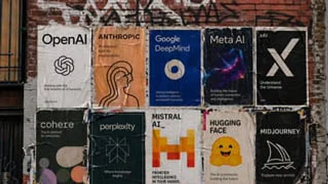

```text
Make a wheatpaste poster setup on a brick wall in sf featuring posters from various AI labs
```

Model: GPT Image 2
Author: Justine Moore

[ProjectD](https://aitoolsradar.com/en/prompts/1ff71e2fdbc6f7) · [Recorded source](https://x.com/venturetwins/status/2046700418554851630)
 · [Full original metadata and byte evidence](data/projectd-batch-0036.json)

## Juventus Cinematic Player Poster


```text
for{argument name="player name" default="Bernardo Silva"} Create a highly dramatic and luxurious sports poster, portraying a Juventus football star in a dark, cinematic black and gold editorial style. The vertical composition and high contrast create a melancholic stadium atmosphere, presenting a sophisticated poster design with layered photomontage effects. The background features a massive, waving Juventus flag occupying the upper half of the image; the black fabric is accented with wide white stripes, and a large, metallic gold Juventus "J" crest is printed on the right, adorned with three gold stars above. In front of the flag is a large, close-up portrait of the player, wearing a classic Juventus home jersey, facing left, with wet hair, a clearly visible neck tattoo, and strong edging effects. The face is partially obscured by shadow, conveying a mysterious, heroic feel. The player is positioned in the foreground in a full-body dynamic pose, dribbling the ball across a brightly lit pitch. He is positioned at the bottom center, wearing a black and white striped Juventus jersey, white shorts, white socks, and black boots. The shorts feature a gold number 20, and the Adidas details are gold. The Jeep sponsor logo is clearly visible. The lower half of the pitch should be covered by bright white floodlights, with dark stands filled with spectators, a light mist, and a faint haze on the ground. The composition incorporates elegant magazine poster layout: The top left corner features small gold text "JUVENTUS" and "FOUNDED 1897," adorned with three gold stars below; four white capital words are vertically arranged in the upper left: "CLASS," "VISION," "INTELLIGENCE," and "WORK RATE"; below this is a gold handwritten signature, with the year displayed in two lines as "20" and "26"; the middle left features large serif font player names, with smaller first names and larger last names displayed in white as "BERNARDO" and "SILVA"; below this is the smaller gold text "JUVENTUS"; the bottom right corner features three gold stars, below which are stacked three white words: "TRADITION," "PASSION," and "GLORY"; the bottom center features three gold stars, below which is the phrase "THE OLD LADY" and the smaller text "SINCE 1897." The color scheme is limited to black, white, charcoal gray, and metallic gold. Add subtle rain and mist, fabric textures, vignetting, and glowing highlights on team logos and text to create a sophisticated Champions League poster aesthetic.
```

Model: GPT Image 2
Author: GPT Image 2 Prompts

[ProjectD](https://aitoolsradar.com/en/prompts/1581da8b65a0f4) · [Recorded source](https://x.com/trexy1897/status/2046994539680788511#reversed-0)
 · [Full original metadata and byte evidence](data/projectd-batch-0036.json)

## Juventus Yamal Transfer Poster


```text
Create a highly impactful vertical football poster, featuring [the main character].{argument name="player name" default="Yamal"} Adopting the style of Juventus' official transfer announcement, the graphic boasts ultra-high detail and contrast, with a black and white color scheme accented by metallic gold, presenting a rugged yet sophisticated sports graphic design. The composition includes two portraits of the same young male football player with dark brown skin and short curly hair: the upper one is a large, half-body portrait from the side and rear, occupying the upper half, wearing a shirt printed with {argument name="jersey name" default="YAMAL"} Wearing a glossy white Juventus jersey with the lettering, the head is slightly turned to the left, revealing part of the ear and cheek; the lower center shows a full-body pose with arms outstretched, running or celebrating, wearing a modern Juventus home jersey with black and white vertical stripes, and white shorts with the number printed on them.{argument name="squad number" default="19"} White socks, light-colored sneakers with subtle pink accents on the soles. The facial area remains softly blurred, without detailed treatment. The background uses dark tones, overlaid with architectural images of Turin, including three landmark elements: a domed historical building faintly visible in the midground on the left, a tower resembling the Mole Antonelliana in the lower right, and a shadowed stadium structure spanning the lower center. Three Juventus logos are added: a small white logo in the upper left, a large semi-transparent logo in the background in the upper right, and a medium-sized white logo in the lower right. Striking typographic and editorial layout elements are added: words.{argument name="main vertical text" default="YAMAL"} The large, compressed white sans-serif font is vertically arranged on the left, next to smaller vertical gold text reading "JUVENTUS FOOTBALL CLUB," and gold text is on the right.{argument name="side name text" default="YAMAL"} Above the large gold number "19," below it is a gold signature graffiti, with the stacked gold slogan "FINO ALLA FINE" in the lower left corner, and below that, the smaller white text "JUVENTUS." The coordinates in the lower left corner are "45.0703° N, 7.6869° E" and "TORINO, ITALIA." The jersey for the action figure should include clear sponsor and badge details: the Juventus crest with three stars, the Adidas logo, the Jeep sponsorship, a circular tricolor badge on the chest, and a black armband with "azimut" printed on the cuffs. Add vibrant white paint stripes and brushstrokes to three main areas: the upper right corner, the lower part near the kicking leg, and subtle scratches on the left edge. Include marble-textured black panels, gold star embellishments, subtle V-shaped patterns, and a smoky atmosphere. The lighting should have a cinematic quality, with players outlined in light, and the jersey fabric having a glossy finish and strong contrast, creating a sophisticated transfer poster aesthetic suitable for social media football announcements.
```

Model: GPT Image 2
Author: GPT Image 2 Prompts

[ProjectD](https://aitoolsradar.com/en/prompts/9a73fdd05f8656) · [Recorded source](https://x.com/MiskinTV_/status/2047258567124861108#reversed-0)
 · [Full original metadata and byte evidence](data/projectd-batch-0036.json)

## K #139

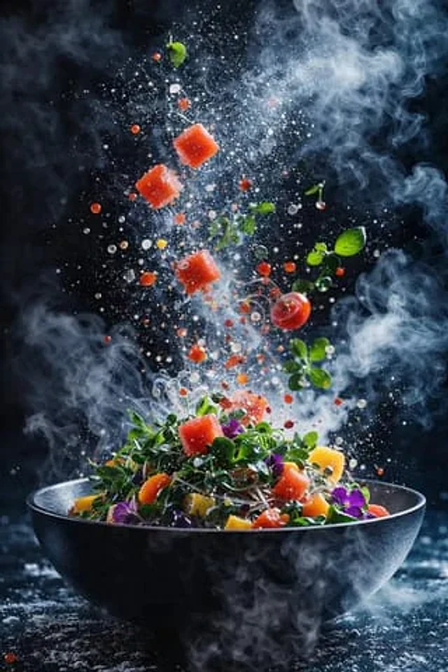

```text
{
  "global_settings": {
    "resolution": "8K ultra high definition",
    "aspect_ratio": "2:3 vertical",
    "style": "hyper-realistic AI-edited food photography",
    "clarity": "extreme sharpness, micro-texture visibility",
    "motion": "frozen action with suspended ingredients",
    "lighting_quality": "studio-grade, high-contrast, cinematic",
    "background_separation": "strong subject isolation with clean depth"
  },

  "module_1_image_1_style": {
    "scene_description": "A dynamic salad explosion emerging from a matte black bowl placed on a round wooden surface. Ingredients are mid-air, scattered upward and outward.",
    "ingredients_visible": [
      "green lettuce leaves",
      "cherry tomatoes (whole and sliced)",
      "cucumber slices arranged in a curved stack",
      "black olives",
      "white cheese cubes",
      "orange citrus slice",
      "small broccoli florets",
      "fresh green basil leaves"
    ],
    "motion_details": {
      "ingredients":
```

Model: GPT Image 2
Author: K

[ProjectD](https://aitoolsradar.com/en/prompts/0c6bfaaf39f0e6) · [Recorded source](https://x.com/ChillaiKalan__/status/2017200760631828679)
 · [Full original metadata and byte evidence](data/projectd-batch-0036.json)

## K-Pop Album Teaser Poster

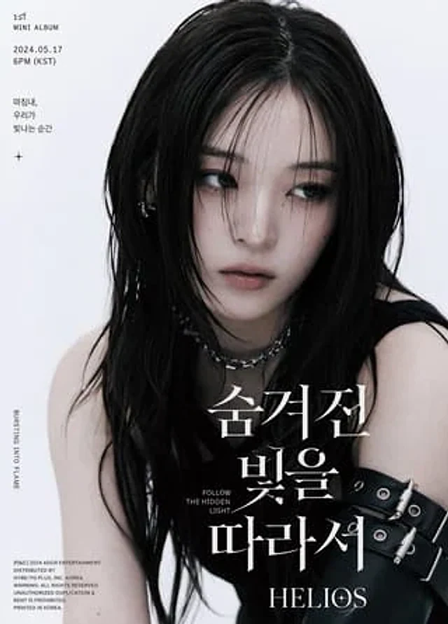

```text
A teaser poster for a K-pop album features a close-up portrait of a young Asian woman with {argument name="hair style" default="Wet-looking long black hair"} She looked seriously out of the camera's view, wearing {argument name="outfit" default="Black top with leather buckle armband and silver chain necklace"} The background is a white photography studio. The layout includes elegant typography: the text in the upper left corner reads "1ST MINI ALBUM" and "{argument name="release date" default="2024.05.17 6PM (KST)"} This is followed by the introduction "마침내, 우리가빛나는순간". The main title is highlighted in the bottom right corner.{argument name="main title" default="숨겨진 빛을 따라서"} ", accompanied by "FOLLOW THE HIDDEN LIGHT" and the subtitle "{argument name="subtitle" default="HELIOS"} The bottom left corner features the vertical text "BURSTING INTO FLAME" and a small copyright notice.
```

Model: GPT Image 2
Author: GPT Image 2 Prompts

[ProjectD](https://aitoolsradar.com/en/prompts/07287b8fff18f6) · [Recorded source](https://x.com/94vanAI/status/2044914754943435146#reversed-0)
 · [Full original metadata and byte evidence](data/projectd-batch-0036.json)

## K-pop Dance Choreography Infographic

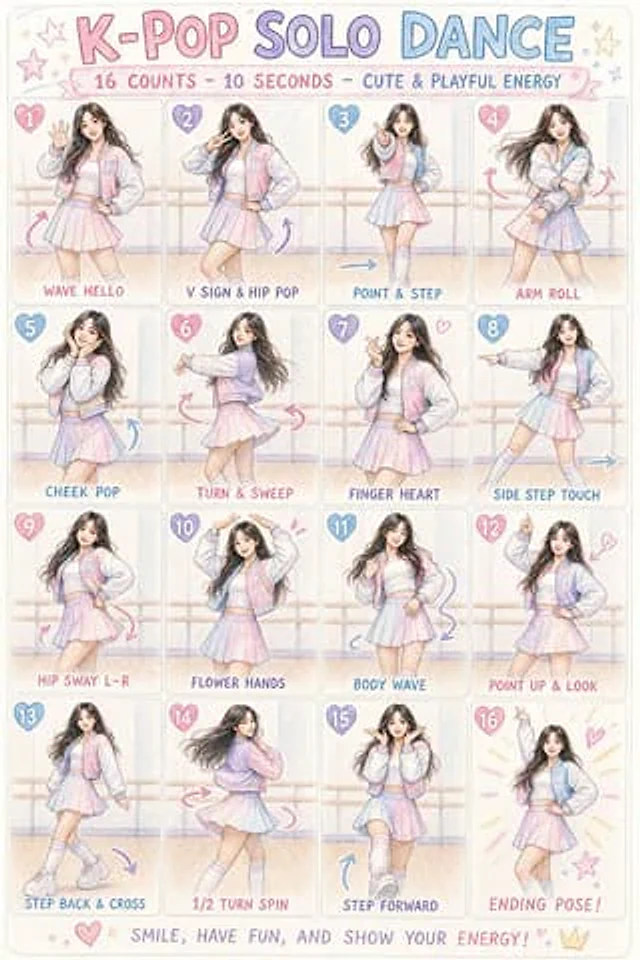

```text
A colored pencil sketch style choreography sheet infographic for a {argument name="dance type" default="K-pop solo dance"}.

Layout: 16 steps arranged in a clean 4x4 grid, each panel showing a different dance move.

Subject: a {argument name="character" default="teenage Asian girl"} with long wavy hair, wearing a {argument name="outfit" default="trendy pastel varsity jacket"} over a fitted white top, pleated tennis skirt, knee-high socks, and chunky platform sneakers. Outfit colors include soft pink, lavender, baby blue, and white, creating a cute and energetic K-pop idol aesthetic.

Style: hand-drawn colored pencil illustration, soft shading, visible pencil texture, slightly sketchy but clean lines, vibrant pastel palette, charming notebook-style artwork.

Movement: each frame shows smooth, expressive dance motions (arm waves, hip sways, spins, finger-heart gestures, footwork, turns, ending pose), with small arrows indicating direction and motion flow.

Design: modern K-pop aesthetic, minimal and stylish infographic layout, pastel highlights, decorative sparkles and stars, step numbers (1–16), short captions under each frame.

Text: Title at the top — “K-POP SOLO DANCE – 16 COUNTS – 10 SECONDS – CUTE & PLAYFUL ENERGY”.

Environment: simple dance practice studio background, soft lighting, minimal shadows.

Quality: ultra-detailed, sharp composition, balanced layout, editorial dance tutorial poster, professional infographic design.

Negative prompt: blurry, low quality, extra limbs, distorted anatomy, bad proportions, messy layout, overcrowded design, text errors, watermark, duplicate poses.
```

Model: GPT Image 2
Author: Aria

[ProjectD](https://aitoolsradar.com/en/prompts/2601a9c2ba6969) · [Recorded source](https://youmind.com/prompts/k-pop-dance-choreography-infographic-24879)
 · [Full original metadata and byte evidence](data/projectd-batch-0036.json)

## Kafka Architecture Diagram


```text
{argument name="technical subject" default="kafka"} The architecture diagram clearly illustrates its principles and includes core components.
```

Model: GPT Image 2
Author: GPT Image 2 Prompts

[ProjectD](https://aitoolsradar.com/en/prompts/2ad7acabc52918) · [Recorded source](https://x.com/LinearUncle/status/2046822752804573343)
 · [Full original metadata and byte evidence](data/projectd-batch-0036.json)

## Kana Anime Character Reference Sheet

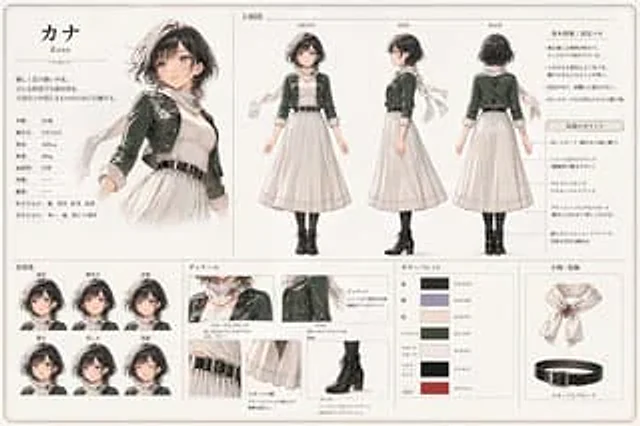

```text
{
  "type": "Anime Character Design Collection",
  "style": "A minimalist Japanese-style character design project, featuring elegant watercolor and ink line illustrations, a soft neutral paper background, delicate decorative borders, editorial layout, and exquisite fantasy fashion concept art.",
  "character": {
    "name": "{argument name=\"character name\" default=\"カナ\"}",
    "romanized_name": "Kana",
    "gender_presentation": "young women",
    "age": "20 years old",
    "birthday": "March 14",
    "height": "160cm",
    "weight": "48kg",
    "blood_type": "O type",
    "personality_summary": "Gentle yet strong-willed, she always forges ahead regardless of the situation and acts for those she cares about.",
    "likes": "Wind, scenery, black tea, reading",
    "dislikes": "Conflict, noise, enclosed space"
  },
  "outfit": {
    "silhouette": "An elegant long white dress paired with a short jacket, scarf, belt, black tights, and lace-up ankle boots.",
    "pieces": [
      "White scarf with a red gemstone brooch",
      "Dark gray-green short jacket",
      "A long-sleeved white dress with a soft pleated skirt.",
      "Black belt with silver buckle",
      "Black pantyhose",
      "Black lace-up high-heeled ankle boots"
    ]
  },
  "layout": {
    "orientation": "Horizontal",
    "sections": [
      {
        "title": "Character Information",
        "position": "Top left",
        "count": 1,
        "labels": [
          "カナ",
          "Kana"
        ]
      },
      {
        "title": "3-sided diagram",
        "position": "upper middle to upper right",
        "count": 3,
        "labels": [
          "front",
          "side",
          "back"
        ]
      },
      {
        "title": "Basic Information / Settings Notes",
        "position": "Top right",
        "count": 1,
        "labels": [
          "Basic Information / Settings Notes"
        ]
      },
      {
        "title": "Clothing essentials",
        "position": "Below the notes on the right",
        "count": 5,
        "labels": [
          "white scarf",
          "Short jacket",
          "belt",
          "Pleated scarf-style skirt",
          "Black tights and ankle boots"
        ]
      },
      {
        "title": "Emoji Collection",
        "position": "Bottom left",
        "count": 6,
        "labels": [
          "generally",
          "Smile",
          "serious",
          "surprise",
          "sad",
          "laughing out loud"
        ]
      },
      {
        "title": "detail",
        "position": "Middle to lower",
        "count": 5,
        "labels": [
          "scarves and brooches",
          "coat",
          "belt",
          "skirt",
          "boots"
        ]
      },
      {
        "title": "Color Palette",
        "position": "lower right center",
        "count": 7,
        "labels": [
          "hair",
          "Eye",
          "skin",
          "coat",
          "Skirts and scarves",
          "Belt and boots",
          "Adornment (with gemstones)"
        ]
      },
      {
        "title": "Small items/decorations",
        "position": "Bottom right",
        "count": 2,
        "labels": [
          "scarf with brooch",
          "belt"
        ]
      }
    ],
    "centerpiece": "A large three-quarter profile portrait of the figure on the left, with a gentle and composed expression, her scarf fluttering in the wind.",
    "spacing": "A balanced grid layout with thin dividing lines and ample white space."
  },
  "visual_details": {
    "hair": {
      "color": "{argument name=\"hair color\" default=\"A soft, deep brown with a grayish highlight.\"}",
      "style": "Short bob with distinct layers at the ends, side-swept bangs, and a slightly messy look."
    },
    "eyes": {
      "color": "Soft grayish-purple",
      "expression": "Gentle, calm, with a quiet firmness"
    },
    "palette": {
      "paper": "Warm ivory",
      "main_dark": "Dark charcoal brown",
      "accent_violet": "Grayish-gray",
      "skin": "Soft light peach",
      "jacket": "{argument name=\"jacket color\" default=\"Soft forest green\"}",
      "dress": "{argument name=\"dress color\" default=\"Creamy White\"}",
      "boots_and_belt": "Near black",
      "gem_accent": "Deep dark red"
    },
    "rendering": "Delicate lines, subtle shadows, light textures in watercolor rendering, presented in a professional concept art collection."
  },
  "text_language": "Japanese, supplemented with a small amount of English view orientation labels.",
  "quality": "A highly refined, unified, and professional game/anime pre-production artbook"
}
```

Model: GPT Image 2
Author: GPT Image 2 Prompts

[ProjectD](https://aitoolsradar.com/en/prompts/f4c37535ca057b) · [Recorded source](https://x.com/REd8358/status/2047465795005849818#reversed-3)
 · [Full original metadata and byte evidence](data/projectd-batch-0036.json)

## Katsudon Cooking Storyboard


```text
Goal: Create a monochrome cooking storyboard illustration showing the preparation and serving of a Japanese-style katsudon rice bowl, drawn like a detailed manga storyboard or recipe process sheet.

Canvas: Wide horizontal aspect ratio, about 2.4:1, white background, arranged as exactly 12 rectangular panels in a clean grid: 6 panels across the top row and 6 panels across the bottom row. Thin black borders separate every panel. No captions, no speech bubbles, no logos, no watermark.

Visual style: Highly detailed pencil sketch and light watercolor-wash look, mostly grayscale with subtle warm beige tones in the egg sauce and fried cutlet. Fine crosshatching, visible paper texture, realistic hand-drawn food textures, steam, highlights on oil and sauce, cinematic close-up framing in every panel.

Subject: A step-by-step cooking sequence for {argument name="dish name" default="katsudon"}, featuring sliced onion, breaded pork cutlet, simmering egg sauce, rice, and garnish. Use realistic adult hands when hands appear, cropped close to the food.

Panel layout and exact panel count: Show exactly 12 panels, ordered left to right, top row then bottom row:
1. Close-up of hands slicing a pale onion into thin crescent slices on a cutting board with a large kitchen knife.
2. Close-up of a breaded pork cutlet on a cutting board, held with tongs, covered in coarse crispy crumbs.
3. Close-up of the fried cutlet being cut into thick strips with a knife, fingers holding it steady.
4. Top-down close-up of clear liquid or broth being poured into a round metal pan, creating circular ripples.
5. Close-up of sliced onions simmering in bubbling broth in the pan, steam rising.
6. Close-up of the sliced cutlet being placed on top of the onions in the pan by hand.
7. Close-up of beaten egg mixture being poured over the cutlet and onions, creamy ribbons spreading through the pan.
8. Close-up of a metal lid covering the pan while steam surrounds the edges.
9. Close-up of a large bowl filled with fluffy white rice, rice grains clearly defined.
10. Close-up of the cooked cutlet, onion, and soft egg mixture being slid from the pan onto the rice bowl, strands of egg stretching.
11. Close-up of the finished bowl being sprinkled with thin dark seaweed strips and green garnish on top, steam rising.
12. Close-up serving shot of chopsticks lifting one saucy slice of cutlet with soft egg dripping, the rice bowl visible underneath.

Composition constraints: Keep each panel tightly framed and food-focused; maintain consistent lighting and hand-drawn pencil shading across all panels; make the sequence readable as a recipe storyboard; do not add text labels, numbers, extra panels, utensils not described, or colorful modern graphics.
```

Model: GPT Image 2
Author: オズ

[ProjectD](https://aitoolsradar.com/en/prompts/8630ebb7502349) · [Recorded source](https://youmind.com/prompts/katsudon-storyboard-illustration-23875)
 · [Full original metadata and byte evidence](data/projectd-batch-0036.json)

## Kawaii 3D Character Icon

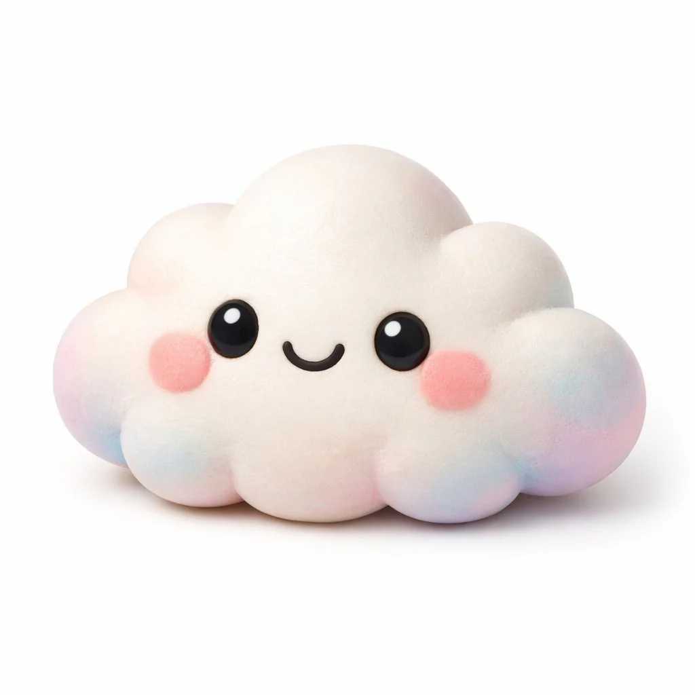

```text
A cute kawaii style{argument name="subject" default="Clouds"} The 3D rendering of the character against a pure white background. The character has a soft, matte, and bouncy texture, similar to clay or a stress-relieving toy. It has bright, large black eyes with white highlights, a simple, curved smile, and rounded pink blush. The edges and bottom of the character feature {argument name="accent colors" default="Pink, blue and purple"} The soft gradient colors, the gentle studio lighting, and the minimalist icon style cast subtle shadows.
```

Model: GPT Image 2
Author: GPT Image 2 Prompts

[ProjectD](https://aitoolsradar.com/en/prompts/7f508f997bdacb) · [Recorded source](https://x.com/yurunekofree/status/2046016054305145102#reversed-0)
 · [Full original metadata and byte evidence](data/projectd-batch-0036.json)

## Kawaii Animal Sticker Sheet Generator

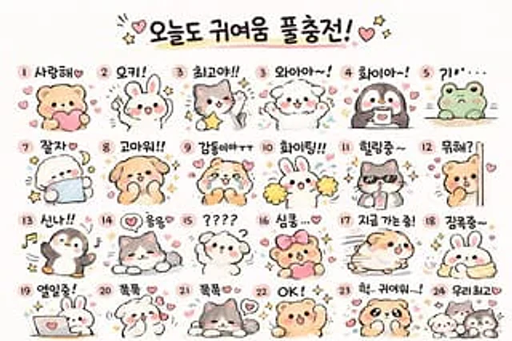

```text
{
  "type": "Cute animal sticker pages",
  "style": "{argument name=\"art style\" default=\"Hand-painted watercolor and colored pencil textures, soft tones, cute, simple outlines.\"}",
  "header": {
    "text": "{argument name=\"header text\" default=\"Today, my cuteness level is at its peak!\"}",
    "decorations": "Love and Stars"
  },
  "layout": {
    "grid": "4 rows and 6 columns",
    "total_stickers": 24
  },
  "stickers": [
    {
      "id": "1",
      "animal": "Bear holding a pink heart",
      "label": "I love you♡"
    },
    {
      "id": "2",
      "animal": "The cheering white rabbit",
      "label": "Okay!"
    },
    {
      "id": "3",
      "animal": "A gray and white cat holding a yellow star",
      "label": "That's the best!!"
    },
    {
      "id": "4",
      "animal": "Cheerful fluffy white dog",
      "label": "Wow!"
    },
    {
      "id": "5",
      "animal": "Penguin holding a coffee cup",
      "label": "Keep it up!"
    },
    {
      "id": "6",
      "animal": "A green frog peeking out from the edge",
      "label": "?10'..."
    },
    {
      "id": "7",
      "animal": "A fluffy white dog sleeping with the new moon",
      "label": "Good night♡"
    },
    {
      "id": "8",
      "animal": "A brown puppy with a gleaming smile",
      "label": "Thanks!!"
    },
    {
      "id": "9",
      "animal": "The brown bear in tears",
      "label": "So touching ㅜㅜ"
    },
    {
      "id": "10",
      "animal": "White Rabbit holding a yellow cheerleading ball",
      "label": "come on!!"
    },
    {
      "id": "11",
      "animal": "A gray cat wearing sunglasses and drinking a beverage",
      "label": "Healing in progress~"
    },
    {
      "id": "12",
      "animal": "A brown bear peeking out from behind the wall",
      "label": "What are you doing?"
    },
    {
      "id": "13",
      "animal": "Penguins dancing to the music",
      "label": "So happy!!"
    },
    {
      "id": "14",
      "animal": "A gray and white cat lying relaxed",
      "label": "Mmm♡"
    },
    {
      "id": "15",
      "animal": "A confused white dog with a head full of question marks",
      "label": "????"
    },
    {
      "id": "16",
      "animal": "A brown bear wearing a pink bow and holding a heart.",
      "label": "My heart is fluttering...♡"
    },
    {
      "id": "17",
      "animal": "Hamster running with dynamic lines",
      "label": "Coming right away!"
    },
    {
      "id": "18",
      "animal": "The white rabbit wrapped in a yellow blanket",
      "label": "Staying home~"
    },
    {
      "id": "19",
      "animal": "White Rabbit Typing on a Laptop",
      "label": "Keep working hard!"
    },
    {
      "id": "20",
      "animal": "A fluffy white dog blowing kisses",
      "label": "Mwah♡"
    },
    {
      "id": "21",
      "animal": "A gray and white cat lying down with a heart shape on its face.",
      "label": "Mwah♡♡"
    },
    {
      "id": "22",
      "animal": "Lifting a cheering brown bear with one hand",
      "label": "OK! ✧"
    },
    {
      "id": "23",
      "animal": "The brown puppy looked shocked.",
      "label": "Wow...so cute...!"
    },
    {
      "id": "24",
      "animal": "Three small animals pose for a photo.",
      "label": "We're the best! ♡"
    }
  ]
}
```

Model: GPT Image 2
Author: GPT Image 2 Prompts

[ProjectD](https://aitoolsradar.com/en/prompts/5215f84c2e2c80) · [Recorded source](https://x.com/ChoJaehun3/status/2045665083846733914#reversed-0)
 · [Full original metadata and byte evidence](data/projectd-batch-0036.json)

## Kawaii Bunny Garden Neon Scene

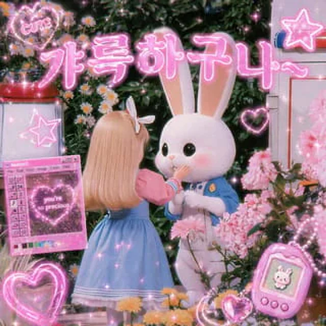

```text
A dreamy 3D kawaii-style rendering showcases a lush garden at night, filled with glowing pink neon graphics and soft shimmer. In the center, a petite, doll-like girl with her back to the camera, her long, flowing blonde hair adorned with a white bow headband, a pink puff-sleeved blouse, and a light blue suspender skirt with white trim, stands gently touching the mouth of a large white rabbit character in front of her. This rabbit has oversized, erect ears, bright black eyes, rosy cheeks, and a cute, fluffy face, wearing a light blue uniform-style jacket with small gold badges. Lush greenery, daisies, and abundant pink flowers in the foreground and background surround the rabbit. A large, glowing Korean neon sign is placed at the top.{argument name="headline text" default="가특하구나~"} It features a bright pink bubble font with a soft glow. It includes 7 additional neon or UI-style decorative elements: a heart-shaped logo in the top left corner with the text {argument name="top sign text" default="CUTE"} A neon star logo on the white cabinet in the upper right corner; a glowing heart outline near the rabbit on the right; a retro pink computer-style floating window on the left with tiny toolbar details and a central heart graphic containing text.{argument name="window text" default="you're so precious"} The bottom left corner features a large, glowing heart-shaped outline; the bottom right corner features a pink handheld virtual pet device displaying a little bunny sprite; and a small, glowing crystal heart is placed near the device. Soft blooms, glossy highlights, magical glitter particles, pink rim lighting, shallow depth of field, a toy photography style, and a retro-cute web aesthetic dominated by pale pink and blue tones.
```

Model: GPT Image 2
Author: GPT Image 2 Prompts

[ProjectD](https://aitoolsradar.com/en/prompts/bbfa2776cd0b5f) · [Recorded source](https://x.com/icedongai/status/2047042339231973577#reversed-0)
 · [Full original metadata and byte evidence](data/projectd-batch-0036.json)

## Kawaii Cactus Sticker


```text
Create a cute printable sticker illustration on a transparent background: a kawaii green cactus in a terracotta flower pot, centered and filling most of a square canvas. The cactus has one large oval ribbed central body and exactly 2 curved side arms, one on the left and one on the right, both raised upward. Give it a happy face with exactly 2 glossy black oval eyes, 2 pink circular blush cheeks, and 1 open smiling mouth with a dark interior and pink tongue. Add a red-pink flower on top-left of the cactus with exactly 6 rounded petals and a cluster of small yellow dots in the center. Cover the cactus with many small star-shaped cream spines with orange bases, distributed across the main body and both arms. Place the cactus in an orange terracotta pot with a thick rim, darker orange shading, small speckles, and glossy highlights; show brown soil and several rounded pebbles at the top. Use a polished digital cartoon style with thick dark green outlines, soft gradients, shiny highlights, saturated colors, and a clean die-cut sticker look with a thick white border around the entire cactus and pot. Background should be transparent, optionally previewed by a light gray checkerboard only to indicate transparency. No text, no watermark, no extra objects.
```

Model: GPT Image 2
Author: Tibo

[ProjectD](https://aitoolsradar.com/en/prompts/e409c80ed0c44d) · [Recorded source](https://youmind.com/prompts/kawaii-cactus-sticker-32139)
 · [Full original metadata and byte evidence](data/projectd-batch-0036.json)

## Kawaii Cat Sticker Sheet

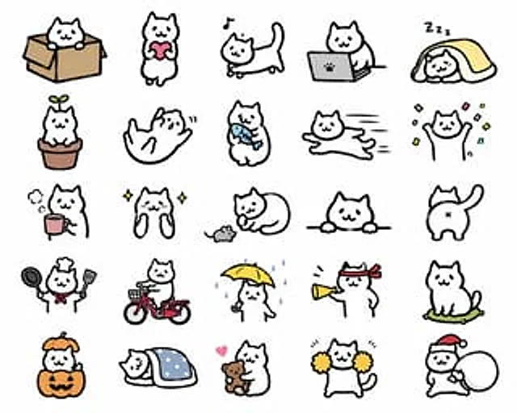

```text
{
  "type": "Cute sticker collection illustrations",
  "style": "A cute, hand-drawn cat doodle with a simple black outline, minimalist flat color scheme, white cat character, and clean light gray background. It has a LINE sticker style and is lively and engaging.",
  "subject": {
    "character": "A round, white cartoon cat with small dotted eyes, a tiny smiling mouth, triangular ears, a round body, short limbs, and a consistent, minimalist mascot design."
  },
  "layout": {
    "grid": {
      "rows": 5,
      "columns": 5,
      "count": 25
    },
    "sections": [
      {
        "title": "First line",
        "position": "top",
        "count": 5,
        "labels": [
          "The cat sat in the cardboard box",
          "The cat is standing upright and holding a pink heart.",
          "The cat walks with a musical note above its head.",
          "The cat uses a gray laptop with paw print markings.",
          "The cat is sleeping under a yellow blanket with Zzz markings."
        ]
      },
      {
        "title": "Second line",
        "position": "Upper Mid-to-Upper",
        "count": 5,
        "labels": [
          "The cat sat in the flowerpot, with a green sprout growing on its head.",
          "The cat rolled around playfully.",
          "The cat is standing upright and holding a small blue fish.",
          "Stretching posture of a cat running at high speed",
          "The cat raises its paws, surrounded by colorful confetti."
        ]
      },
      {
        "title": "Third line",
        "position": "Central",
        "count": 5,
        "labels": [
          "The cat is next to a steaming pink mug.",
          "A happy, sparkling cat with rosy cheeks and its paws close to its face.",
          "The cat curled up around the little gray mouse.",
          "The cat peeks its head out from the horizontal edge, revealing its paws.",
          "The cat's back view, tail held upright, with an X-shaped mark on its rear end."
        ]
      },
      {
        "title": "Fourth line",
        "position": "Mid-lower part",
        "count": 5,
        "labels": [
          "The cat is dressed as a chef, holding a frying pan and a spatula, wearing a red scarf and a chef's hat.",
          "The cat is riding a red bicycle with a front basket.",
          "The cat stands in the rain, holding a yellow umbrella, while blue raindrops fall.",
          "The cat, wearing a red headband, shouted through a yellow megaphone.",
          "The cat sat on the green cushion."
        ]
      },
      {
        "title": "Fifth line",
        "position": "bottom",
        "count": 5,
        "labels": [
          "The cat is dressed in a pumpkin lantern costume and wearing an orange hood.",
          "The cat is sleeping under a blue polka-dot blanket.",
          "A cat is hugging a brown teddy bear, with a pink heart next to it.",
          "The cat waves a yellow cheerleading pom-pom and cheers.",
          "The cat is wearing a Santa hat and carrying a large white bag."
        ]
      }
    ],
    "spacing": "Icons are evenly spaced, with ample white space, no borders, and no text."
  },
  "color_palette": {
    "background": "{argument name=\"background color\" default=\"light gray\"}",
    "accent_colors": [
      "pink",
      "yellow",
      "blue",
      "red",
      "orange color",
      "green",
      "brown",
      "grey"
    ]
  },
  "quality": "Clean sticker set composition, 25 poses with consistent proportions, charming and commercially usable chat stickers.",
  "size": "1024x1024"
}
```

Model: GPT Image 2
Author: GPT Image 2 Prompts

[ProjectD](https://aitoolsradar.com/en/prompts/bf03c945d0bbb1) · [Recorded source](https://x.com/webdesigner_go/status/2046804776684577086#reversed-1)
 · [Full original metadata and byte evidence](data/projectd-batch-0036.json)

## Kawaii coffee dog vector illustration


```text
A cute cartoon{argument name="animal" default="dog"} Holding a steaming hot{argument name="object" default="coffee mug"} A pure white background with a soft light green ground at the bottom, centered composition, flat 2D vector illustration, soft outlines, macaron color scheme, cute atmosphere, and text above: "{argument name="text" default="No Coffee No Coddee"} --ar 3:2
```

Model: GPT Image 2
Author: GPT Image 2 Prompts

[ProjectD](https://aitoolsradar.com/en/prompts/c3d8a3949f2b9c) · [Recorded source](https://x.com/dotey/status/2047058042055979044)
 · [Full original metadata and byte evidence](data/projectd-batch-0036.json)

## Kawaii Doodle Food Photography

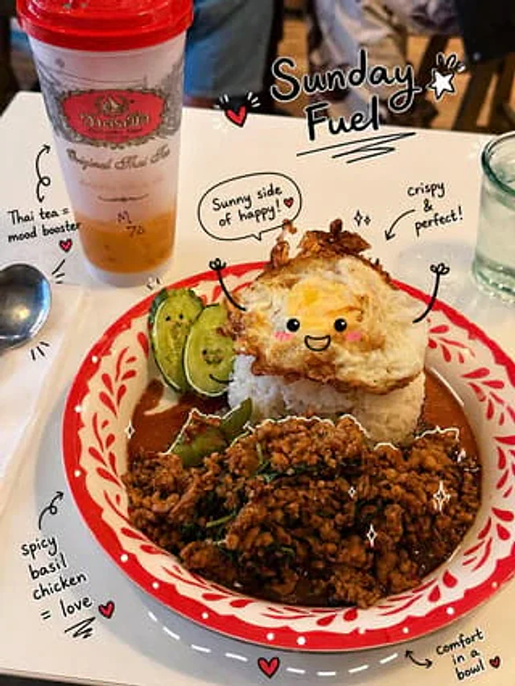

```text
Aesthetic food photography of {argument name="dish" default="a delicious meal (rice bowl / noodles / curry / grilled meat)"} on a table, shot from slightly above, warm cozy lighting, vibrant colors, soft depth of field. Add {argument name="illustration style" default="cute hand-drawn doodle illustrations on top of the food: tiny smiling faces on ingredients, blush cheeks, little arms, hearts, sparkles, arrows, and playful annotations"}. Include handwritten text phrases like “{argument name="caption" default="Sunday fuel”}, “comfort on a plate”, “so happy!”}, in a casual marker/brush style. Clean Instagram-style composition, cozy restaurant or cafe background, high detail textures, glossy food highlights, kawaii aesthetic, storytelling layout, ultra-realistic photo + illustrated overlay mix, 4K
```

Model: GPT Image 2
Author: Taaruk

[ProjectD](https://aitoolsradar.com/en/prompts/aa97d775088dcc) · [Recorded source](https://youmind.com/prompts/kawaii-doodle-food-photography-18068)
 · [Full original metadata and byte evidence](data/projectd-batch-0036.json)

## Kawaii Glass Dollhouse Diorama

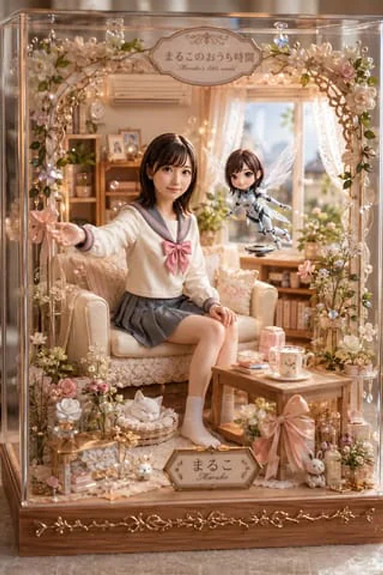

```text
Goal: Create a highly detailed vertical photorealistic miniature diorama inside a clear glass display case, styled like a warm pastel Japanese kawaii room box, with the feeling of a cozy personal world.

Canvas: Portrait 2:3 composition, close-up front view through transparent glass, shallow depth of field, warm golden afternoon light, soft bokeh fairy lights, ultra-detailed handcrafted textures, realistic reflections on the acrylic/glass walls.

Main subject: A seated teenage girl miniature with a softly obscured/featureless face, shoulder-length {argument name="hair color" default="dark brown"} hair, wearing a cream Japanese sailor school uniform with gray collar trim, a large {argument name="bow color" default="pink"} chest bow, gray pleated skirt, white socks, sitting sideways on a cream lace-covered armchair. Her left arm reaches outward holding a tiny pink flower or wand-like blossom; her right hand rests on her knee. Pose is gentle, relaxed, and inviting.

Companion subject: One small floating fairy-like robot girl to the right of the seated girl, also with a softly obscured/featureless face, short brown bob hair, translucent insect wings, white-and-silver futuristic body armor, tiny mechanical limbs, hovering above a small round flying base. Make it cute, delicate, and toy-like rather than threatening.

Display case and room: The scene is enclosed in a rectangular glass case with a wooden base and ornate gold vine decoration along the bottom. Inside is a miniature living room with a sofa/armchair, lace curtains, sunny window, bookshelves, framed photos, houseplants, cushions, a small wooden coffee table, pastel boxes, a cup and saucer, tiny cosmetics or perfume bottles, and a soft cream rug. Use peach, ivory, blush pink, champagne gold, and pale green as the main palette.

Decorative arch: At the top front of the case is a floral arch made of vines, pearls, crystal drops, warm micro string lights, and many small white and pink flowers. Add one ornate oval sign centered at the top reading {argument name="top sign text" default="まるこのおうち時間"}, with a small cursive English subtitle reading "Maruko's little world". Add one matching name plaque near the bottom front reading {argument name="name plaque text" default="まるこ"} with "Maruko" underneath.

Counted visible focal elements: Include exactly 2 human-like figures: 1 seated schoolgirl miniature and 1 floating winged robot fairy. Include exactly 1 sleeping white cat curled in a small woven basket on the floor near the girl's feet. Include exactly 2 readable signs: the top oval title sign and the bottom name plaque. Include exactly 1 small wooden coffee table, 1 cup-and-saucer set, 1 armchair, 1 window with lace curtains, and 1 wooden display-case base.

Style and lighting: Premium collectible dollhouse photography, hyperrealistic miniature craftsmanship, romantic kawaii aesthetic, cinematic warm sunlight from the back window, glowing fairy lights, crisp foreground details with soft background blur, glass reflections and refractions, delicate lace, pearl, resin, and gold-metal textures.

Constraints: Do not add extra characters, do not make it a flat illustration, do not use harsh colors, avoid horror or cyberpunk mood, keep both faces intentionally soft/blurred and non-identifiable, preserve the cute handcrafted display-case look.
```

Model: GPT Image 2
Author: まるこ♂🌷

[ProjectD](https://aitoolsradar.com/en/prompts/5c708d2b98edb0) · [Recorded source](https://youmind.com/prompts/kawaii-glass-dollhouse-diorama-19959)
 · [Full original metadata and byte evidence](data/projectd-batch-0036.json)

## Kawaii Mother's Day Bento Food Art


```text
Goal: Create an ultra-detailed handcrafted edible art world celebrating {argument name="celebration" default="Mother's Day"} in a kawaii Japanese spring bento style, transforming a full meal into a cute character centerpiece made entirely from real foods.

Canvas: Square 1:1 overhead food photography composition, bright pastel color palette, soft natural light, shallow depth but all main foods readable, festive blue tablecloth background covered with cherry blossoms, pink carnations, doodled hearts, clouds, sparkles, and tiny celebration decorations.

Main centerpiece: In the center of a large round pink bento plate, make one large edible girl character: rice face with shiny black eyes, lashes, rosy cheeks, smiling mouth, long blonde hair made from thin omelet/noodle strands, pink flower hair decoration, pink heart earrings, kimono-like outfit made from pink ham and blue rice/crepe layers, holding a bouquet of pink carnation flowers tied with a bow. The character should feel like a lovingly made Mother’s Day food-art doll.

Food elements to include, exactly 15 visible edible feature groups: 1) central girl character, 2) two smiling rice-ball onigiri behind her with nori rectangles and green shiso leaves, 3) small basket of strawberries with one halved strawberry, 4) heart-topped custard pudding on a pink saucer, 5) red sausage octopus with a face and bow tie, 6) cluster of cherry tomatoes and vegetable flowers, 7) pink carnation bouquet in the character’s hands, 8) rolled omelet/noodle roses near the top center, 9) pink bowl of fruit containing green grape, orange segments, and a pink heart sweet, 10) heart-shaped tamagoyaki block with two small red hearts, 11) two breaded fried shrimp with orange tails, 12) broccoli and lemon wedge garnish, 13) pink fluted cup of spaghetti napolitan with peas and flower-shaped toppings, 14) small rice or dumpling hand beside the pasta, 15) separate small plate at bottom right with sakura mochi wrapped in a leaf and topped with a pink flower.

Non-food props and decorations to include, exactly 8 visible groups: 1) teacup at upper right with warm tea and a cute anime girl illustration plus floral print, 2) woven coaster under the cup, 3) triangular pink bunting flags across the upper background, 4) two small fluffy white cloud cutouts near the Japanese writing, 5) floral greeting card sign in the strawberry basket, 6) floral apology/thanks card at bottom left tied with a pink ribbon, 7) two carp-streamer decorations at bottom center, 8) pink-handled small brush on floral paper at bottom right.

Text content: Add handwritten Japanese text in the sky area reading {argument name="background Japanese message" default="おかあさんへ いつもありがとう！！"}. Add a pink heart speech bubble near the top right reading {argument name="heart speech bubble" default="だいすき だよ〜♡"}. Add a small floral card in the strawberry basket reading {argument name="card text" default="Happy Mother's Day"}. Add a bottom-left floral card reading {argument name="bottom card Japanese text" default="感謝をこめて…"}. Keep text hand-drawn, cute, slightly imperfect, and integrated naturally into the scene.

Visual style: Hyper-detailed kawaii edible miniature art, Japanese bento craftsmanship, pastel pink and sky blue, glossy rice grains, crisp fried textures, soft omelet strands, realistic fruit and tea, abundant sakura and carnation motifs, whimsical hearts and sparkles. Make everything look handmade from food, cheerful, warm, and celebratory.

Constraints: Use an overhead flat-lay angle, no humans, no utensils except the small decorative brush, no watermark, no extra text beyond the specified messages, keep all counted food and prop groups clearly visible.
```

Model: GPT Image 2
Author: Marcio Lima 利真 マルシオ 💎

[ProjectD](https://aitoolsradar.com/en/prompts/d548aac75f04bc) · [Recorded source](https://youmind.com/prompts/mothers-day-bento-art-20346)
 · [Full original metadata and byte evidence](data/projectd-batch-0036.json)

## Kawaii Pink Kitten Escape Game Ad

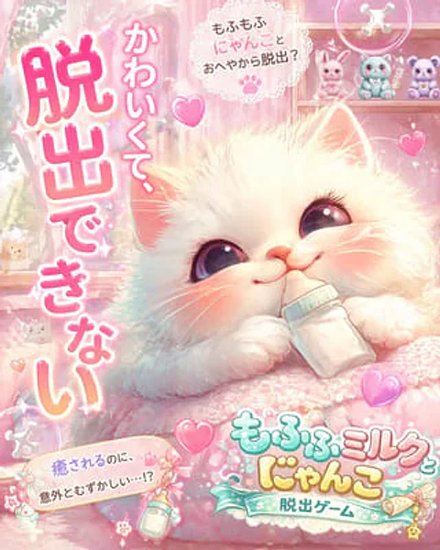

```text
A Japanese-style mobile game promotional poster in a dreamy pastel style, displayed vertically in a smartphone size. The poster is kawaii and fantastical, super cute and glossy. The main subject is a fluffy white kitten with huge, shimmering purple-blue eyes, a soft blush on its cheeks, a pink nose, and a mischievous smile. It lies on a pink cushion or blanket in the foreground, clutching a baby bottle in its paws. The kitten is extremely fluffy and round, with soft, shiny fur, giving it a plush toy-like texture, and looks especially adorable under the warm, magical lighting. The entire scene is filled with pink hearts, glitter, lace details, soft blurring effects, and candy-colored decorations, creating a healing yet playful atmosphere. The background is a pastel-colored bedroom or nursery, with three plush toys neatly arranged on a shelf: a pink rabbit, a mint blue cat, and a lavender purple bear. Translucent floating soap bubbles are added, containing white bone-shaped icons, as well as small decorative pendants, ribbons, and floral decorations. On the left is a prominent vertical Japanese title in a glossy bubble font, reading "脱出できない" (I can't escape), accompanied by smaller vertical text "かわいくて、" (I'll escape), all in bright pink with a white halo and bold outline. At the top is a circular badge with white lace trim containing the Japanese phrase "もふもふにゃんことおへやから脱出？" (Mofumofunnyanko to Oheyakara Escape?), below which is a pink cat paw print icon. At the bottom is a decorative game logo in large, rounded Japanese characters, "もふふミルクとにゃんこ" (Mofufu Milk to Nyanko), below which is a ribbon banner reading "脱出ゲーム" (Escape Game), using a color scheme of powder blue, cream, and pink with a shimmering outline style. A small, rounded text box has been added to the bottom left corner, reading "Is it unexpected that I'm feeling better...?!", and decorated with small flowers and a hanging baby bottle charm. It adopts a refined indie game promotional visual style, rich in detail, with soft, airbrushed illustrations, glossy typography, and a charming, comfortable, and irresistibly cute aesthetic.
```

Model: GPT Image 2
Author: GPT Image 2 Prompts

[ProjectD](https://aitoolsradar.com/en/prompts/c45fb063ef45cd) · [Recorded source](https://x.com/Akiyu0901/status/2047311383692497346#reversed-0)
 · [Full original metadata and byte evidence](data/projectd-batch-0036.json)

## Kawaii Street Fashion Duo Portrait

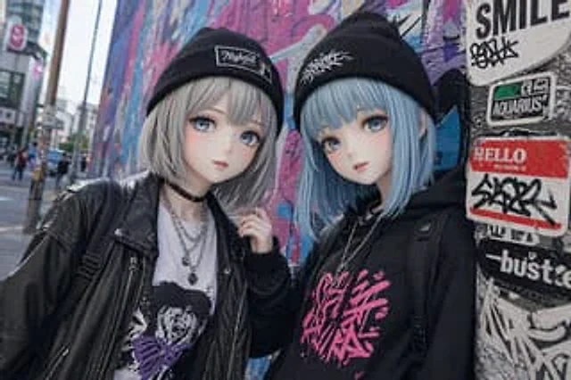

```text
A candid street style portrait shows two adorable anime-style girls standing side-by-side in front of a colorful graffiti wall on a sidewalk in a Japanese city. The photo was taken at eye level, creating a shallow depth of field and soft, overcast natural light. Both girls have fair, smooth skin and short, straight bob haircuts, with bangs partially obscuring their foreheads. Their faces are deliberately simplified or blurred, giving them an anonymous, doll-like appearance. The girl on the left has {argument name="hair color" default="silver-gray"} The girl on the right has icy blue hair, wears a black knit hat with a rectangular "Nightfall" logo patch, a black leather jacket over a white printed T-shirt (with dark distressed illustrations and purple accents), layered silver chain necklaces (including heart-shaped pendants), a black choker, and carries a black backpack on one shoulder. The girl on the right has icy blue hair, wears a black knit hat with a white graffiti-style logo, an oversized black hoodie with striking bright pink Japanese graffiti lettering on the chest, a silver chain necklace, and carries a black backpack. They are relaxed and stylish, leaning slightly towards each other, one hand lightly touching the shoulder of the hoodie. The background is a brightly colored pink, blue, and purple graffiti wall, with a telephone pole covered in stickers on the right edge, including layers of street stickers such as "SMILE," "AQUARIUS," and a red sticker that reads "HELLO my name is," covered in graffiti. It emphasizes Japanese street style, alternative fashion, cute and cool atmosphere, realistic fabric texture, clear clothing details, subtle cinematic color grading, and trendy Harajuku snapshot aesthetics.
```

Model: GPT Image 2
Author: GPT Image 2 Prompts

[ProjectD](https://aitoolsradar.com/en/prompts/82ec42727a05f8) · [Recorded source](https://x.com/_sengiu_/status/2047717538935787725#reversed-0)
 · [Full original metadata and byte evidence](data/projectd-batch-0036.json)

## KAWAISALES Ad Design


```text
Please generate an advertisement image based on the layout of this hand-drawn sketch (see attachment) and according to the following requirements. # Title/Project - A brand new AI sales support tool:{argument name="tool name" default="KAWAISALES"} # Purpose - To acquire registered users for the free demo version # Target Audience - Sales representatives from small and medium-sized enterprises struggling with sales performance # Content # Main Title - Why not let your sales performance "take off" with the power of AI? # Subtitle - AI fully supports your sales activities, from lead generation to closing! # CTA - Experience the free demo now! # Visual Element 1 - Photorealistic style, showing male and female sales representatives in their 30s, dressed in suits, smiling as they conduct online business meetings with clients via laptops. # Visual Element 2 - Abstract illustrations or graphics symbolizing service advantages, such as rising charts or icons representing target customers. # Impression - Trustworthy, innovative, efficient, and easy to use
```

Model: GPT Image 2
Author: GPT Image 2 Prompts

[ProjectD](https://aitoolsradar.com/en/prompts/e701b0faadf5c8) · [Recorded source](https://x.com/kawai_design/status/2045685117604204780)
 · [Full original metadata and byte evidence](data/projectd-batch-0036.json)

## KAWAISALES Ad Design


```text
この手書きラフ（添付画像）のレイアウトを再現し、下記の要件で広告画像を生成してください。

# タイトル・企画
- AIを活用した新しい営業支援ツール「{argument name="ツール名" default="KAWAISALES"}」

# 目的
- 無料デモの申し込み獲得

# ターゲット
- 営業成績に伸び悩む中小企業の営業担当者

# 内容
## メインコピー
- その営業、AIで「飛躍」しませんか？
## サブコピー
- リード獲得からクロージングまでAI があなたの営業活動を強力サポート！
## CTA
- 今すぐ無料デモを体験する## アイキャッチ1
- ノートPCを見ながら笑顔で顧客とオンライン商談をしている、スタイリッシュなスーツ姿の30代男女の営業担当者（フォトリアル）
## アイキャッチ2
- 右肩上がりのグラフや、ターゲット顧客を示すアイコンなど、サービスのメリットを象徴する抽象的なイラストや図形。

# 印象
- 信頼感、革新的、成果が出そう、使いやすそう
```

Model: GPT Image 2
Author: KAWAI

[ProjectD](https://aitoolsradar.com/en/prompts/2627f298901b33) · [Recorded source](https://youmind.com/prompts/handwritten-sales-ad-layout-13972)
 · [Full original metadata and byte evidence](data/projectd-batch-0036.json)

## KBO Baseball Broadcast Candid

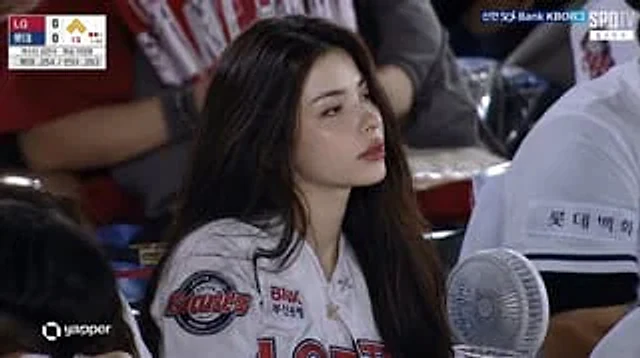

```text
Use the uploaded reference image as the strongest identity anchor. The woman must look like the exact same adult woman from the reference image, not just a similar Korean woman. Preserve her exact facial identity with high priority: same small oval face, same delicate jawline, same large clear eyes, same eye spacing, same eyelid shape, same straight nose, same soft muted pink lips, same pale clear skin tone, same refined calm expression, and same long black softly wavy hair. Create an ultra-realistic candid KBO baseball broadcast screenshot of the same woman accidentally caught by a live TV camera in the spectator seats. The team name is LG and F1. Her face should remain closer to the reference image than to a generic stadium fan. Do not change her into another person. Do not make her face wider, older, sharper, more westernized, or more idol-like. Keep the same delicate studio-portrait identity, but translated naturally into a real stadium environment. She is seated among a lively Korean baseball crowd, holding an iced drink and a cheering stick, wearing a clean white baseball jersey over a simple casual top. She is adjusting her hair with one hand .. She notices the camera and gives a small natural smile, slightly surprised but composed. Use a realistic far-distance broadcast camera look: telephoto compression, mild video softness, slight motion blur in the crowd, stadium lighting, natural skin texture, imperfect candid framing, 16:9 horizontal TV broadcast composition.
```

Model: GPT Image 2
Author: Smiling Khan

[ProjectD](https://aitoolsradar.com/en/prompts/e94f3804fc4059) · [Recorded source](https://youmind.com/prompts/kbo-baseball-broadcast-candid-19691)
 · [Full original metadata and byte evidence](data/projectd-batch-0036.json)

## KEVA Vegan Kebab Brand Moodboard

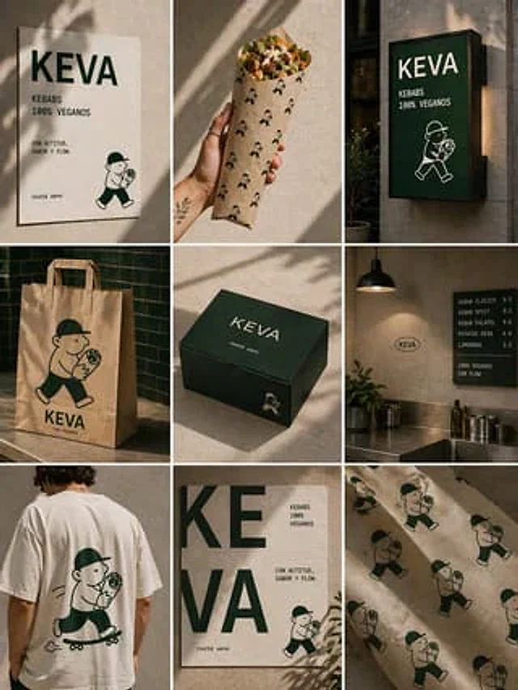

```text
{
  "type": "Brand Image Project Grid",
  "brand": {
    "name": "{argument name=\"brand name\" default=\"KEVA\"}",
    "category": "Vegan BBQ Fast Food Brand",
    "style": "Minimalist Mediterranean street food brand style, earth-toned editorial-level product photography, fun mascot system, high-end yet approachable.",
    "palette": {
      "primary": "Deep Forest Green",
      "secondary": "Warm beige kraft paper",
      "accent": "Soft grayish white",
      "lighting": "Afternoon sun accompanied by slanting shadows"
    }
  },
  "layout": {
    "grid": {
      "rows": 3,
      "columns": 3,
      "count": 9
    },
    "sections": [
      {
        "position": "Top left",
        "type": "Poster design",
        "count": 1,
        "text": [
          "KEVA",
          "KEBABS",
          "100% VEGANOS",
          "CON ACTITUD, SABOR Y FLOW.",
          "nostà ueno"
        ],
        "details": "The poster on the gray-white wall features a large dark green logo, and a walking mascot holding a roasted meat in the lower right corner; the layout is clean and in a Swiss style."
      },
      {
        "position": "Upper-middle",
        "type": "Real photos of food packaging",
        "count": 1,
        "details": "Holding a piece of roasted meat wrapped in brown paper with a repeating mascot pattern, the top opening reveals a colorful vegan filling, including vegetables, toppings, sauce, and plant-based meat chunks."
      },
      {
        "position": "Top right",
        "type": "Illuminated facade sign",
        "count": 1,
        "text": [
          "KEVA",
          "KEBABS",
          "100% VEGANOS"
        ],
        "details": "The dark green lightbox sign mounted on the stone wall, with its white mascot line drawing, is a storefront sign suitable for nighttime use, photographed under warm ambient light."
      },
      {
        "position": "Left and Middle",
        "type": "Shopping bag mockup",
        "count": 1,
        "text": [
          "KEVA",
          "100% VEGANOS"
        ],
        "details": "The kraft paper takeout bags on the counter feature a large mascot illustration in the center and the brand name prominently displayed below."
      },
      {
        "position": "middle",
        "type": "Packaging box prototype",
        "count": 1,
        "text": [
          "KEVA",
          "nostà ueno"
        ],
        "details": "A matte dark green rectangular takeout box under sunlight, with a minimalist logo printed in the center of the lid and a small mascot in the corner."
      },
      {
        "position": "Right Center",
        "type": "A corner of the indoor menu",
        "count": 1,
        "details": "The interior of the small restaurant features concrete-textured walls, black pendant lights, a stainless steel counter, an oval wall-mounted logo sign, and a framed dark green menu."
      },
      {
        "position": "Bottom left",
        "type": "Garment Sample",
        "count": 1,
        "details": "The silhouette of a person wearing an oversized white T-shirt, with a large dark green mascot printed on the back, riding a skateboard and holding a piece of grilled meat."
      },
      {
        "position": "Middle to lower",
        "type": "Edit Poster Variations",
        "count": 1,
        "text": [
          "KEVA",
          "KEBABS",
          "100% VEGANOS",
          "CON ACTITUD, SABOR Y FLOW.",
          "nostà ueno"
        ],
        "details": "The poster features an oversized stacked font that spans the entire page, with smaller text right-aligned. The mascot is positioned in the bottom right corner, accompanied by an artistic shadow cast by leaves."
      },
      {
        "position": "Bottom right",
        "type": "Pattern close-up",
        "count": 1,
        "details": "A close-up of kraft paper printed with a repeating mascot illustration, the packaging study created by the angled sunlight and shadows."
      }
    ]
  },
  "mascot": {
    "count": 4,
    "variants": [
      "A walking character holding a piece of grilled meat, filled with illustrations.",
      "A walking character holding a grilled meat, a signature line drawing.",
      "The T-shirt features a skateboarder holding a piece of grilled meat as a print on the back.",
      "Small repeating mascot pattern on the wrapping paper"
    ]
  },
  "environment": {
    "materials": [
      "Textured plaster wall",
      "stone or concrete surfaces",
      "Dark green tiles",
      "Stainless steel",
      "Kraft paper"
    ],
    "mood": "Calm, design-oriented, artisanal fast food brand showcase"
  },
  "camera": "Brand case study collages, realistic product visualizations, slightly cinematic editing and photography, consistent warm tones and shadows, and clean composition.",
  "quality": "The high-end mockups offer a realistic feel, providing a coherent brand system showcase for the launch of the fictional restaurant."
}
```

Model: GPT Image 2
Author: GPT Image 2 Prompts

[ProjectD](https://aitoolsradar.com/en/prompts/f0f65d18893d08) · [Recorded source](https://x.com/laEstefanIA_uh/status/2047676378846236785#reversed-0)
 · [Full original metadata and byte evidence](data/projectd-batch-0036.json)

## Kia Sportage Triptych Ad


```text
{"type":"premium automotive brand advertising triptych","format":"wide 16:9 digital campaign layout","brand":"{argument name=\"car brand\" default=\"Kia\"}","product":"{argument name=\"vehicle model\" default=\"Sportage\"}","overall_style":"dark luxury SUV launch advertisement, cinematic photography, high contrast black and charcoal palette, cool gray highlights, minimalist white typography, modern corporate brand guideline look, wet asphalt reflections, dramatic overcast sky, architectural concrete forms, thin vertical dividers between panels","layout":{"panel_count":3,"panels":[{"position":"left third","purpose":"brand manifesto panel","background":"very dark close-up lifestyle photo of a driver or passenger beside a car window, face intentionally obscured by a solid dark rectangular censor block, moody rim lighting","visible_text_count":4,"visible_text":["Movement that inspires","At Kia, we design more than cars. We create experiences that move you forward.","KIA","Movement that inspires"],"composition":"large stacked headline in lower-left, short horizontal rule below headline, body copy beneath, brand logo and tagline anchored at bottom-left"},{"position":"center third","purpose":"main vehicle launch panel","background":"front three-quarter view of a dark graphite compact SUV parked on wet pavement in front of brutalist concrete architecture, mountains and cloudy sky in the distance","visible_text_count":7,"visible_text":["KIA","The all-new","Sportage","Bold by design.","Empowered by technology.","Sportage","Advanced Safety | Next-level Connectivity | Refined Comfort | Sustainable Mobility"],"feature_icon_count":4,"feature_icons":["shield with star icon labeled Advanced Safety","screen and phone icon labeled Next-level Connectivity","car seat icon labeled Refined Comfort","leaf in circle icon labeled Sustainable Mobility"],"composition":"Kia logo at top-left, launch copy at upper-left, SUV centered low, four evenly spaced feature icons along bottom separated by thin vertical rules"},{"position":"right third","purpose":"rear detail and call-to-action panel","background":"close cropped rear three-quarter view of the same dark SUV, red tail light glowing, dark studio-like road scene","visible_text_count":5,"visible_text":["Designed for what's next.","From city streets to open roads, Kia is with you every mile of the way.","Discover more","kia.com","KIA"],"ui_element_count":1,"ui_elements":["outlined circular button with right arrow at bottom-right"],"composition":"headline and copy in upper-left, rear vehicle crop occupying lower and right side, call-to-action at lower-left with circular arrow button on lower-right"}]},"typography":"clean geometric sans-serif, crisp white text, large bold headlines, smaller regular body copy, generous spacing, all text aligned to a precise grid","logo_treatment":"white modern Kia wordmark, minimal and flat","vehicle_details":"dark gray Kia Sportage SUV, glossy black grille, angular LED headlights, black wheels, roof rails, visible Sportage plate in center panel, rear Sportage badge in right panel","custom_text":{"left_headline":"{argument name=\"brand headline\" default=\"Movement that inspires\"}","center_headline":"{argument name=\"launch headline\" default=\"The all-new Sportage\"}","right_headline":"{argument name=\"campaign headline\" default=\"Designed for what's next.\"}"},"rendering":"photorealistic commercial automotive photography blended with polished graphic design, sharp details, premium brochure quality, no extra panels, no misspelled text, no clutter"}
```

Model: GPT Image 2
Author: AmirMušić

[ProjectD](https://aitoolsradar.com/en/prompts/434f144ebe5847) · [Recorded source](https://youmind.com/prompts/kia-sportage-ad-layout-19493)
 · [Full original metadata and byte evidence](data/projectd-batch-0036.json)

## Kids Premium Fashion Advertisement

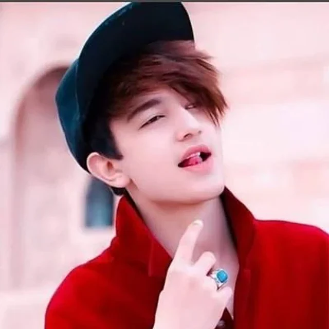

```text
Ultra-realistic premium kids fashion advertisement featuring an adorable little boy with fair glowing skin, stylish brown hair, wearing a {argument name="jacket" default="beige corduroy jacket"}, {argument name="shirt" default="white T-shirt"}, rolled-up dark blue jeans, and premium {argument name="footwear" default="brown leather lace-up ankle boots"}. Sitting confidently on modern concrete steps with a cheerful smile, clean minimal urban background, focus on stylish footwear, luxury fashion campaign, soft natural daylight, cinematic lighting, editorial composition, DSLR photography, ultra-detailed, masterpiece, 8K,
```

Model: GPT Image 2
Author: Zyro

[ProjectD](https://aitoolsradar.com/en/prompts/cdc019703af10c) · [Recorded source](https://youmind.com/prompts/kids-premium-fashion-urban-advertising-27411)
 · [Full original metadata and byte evidence](data/projectd-batch-0036.json)

## King Taejo Yi Seong-gye's X Page

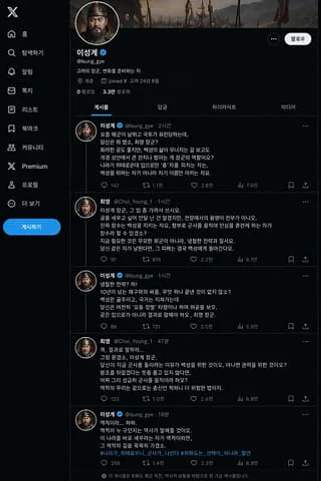

```text
태조 이성계의 X  페이지(위화도 회군을 벌이기 직전- 최영 장군과 서로 디스하는 내용이 담긴 게시글들)을 만들어 주세요.
```

Model: GPT Image 2
Author: @SKA_Neotype

[ProjectD](https://aitoolsradar.com/en/prompts/bc84773a569867) · [Recorded source](https://x.com/SKA_Neotype/status/2044637900978217334)
 · [Full original metadata and byte evidence](data/projectd-batch-0036.json)

## Knight Armor FIFA Hero Poster

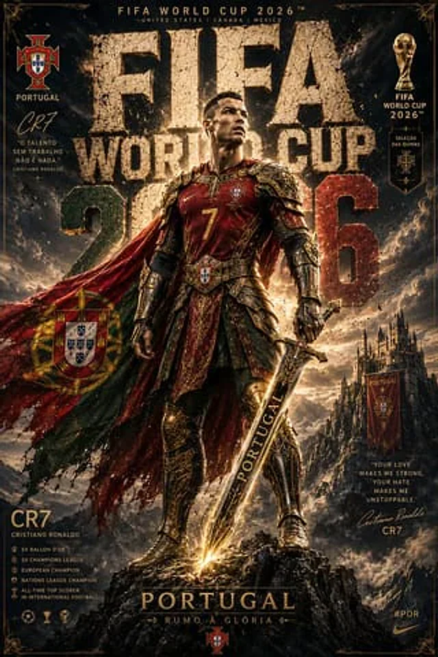

```text
Create an ultra-detailed epic FIFA World Cup 2026 poster featuring {argument name="player name" default="[PLAYER NAME]"} representing {argument name="country" default="[COUNTRY]"}. Full-body heroic composition, standing atop a jagged rocky mountain peak above a sea of clouds. The player wears a fusion of the official [COUNTRY] national team kit and magnificent medieval knight armor with intricate gold engravings, ornate shoulder plates, arm guards, greaves, and decorative battle details. A massive weathered cape made from the [COUNTRY] flag flows dramatically in the wind. The player holds an elaborate legendary sword engraved with the country's name, glowing with subtle energy. Behind the player, enormous distressed typography reading "FIFA WORLD CUP 2026" dominates the background, partially integrated with clouds, smoke, ice fragments, dust, and shattered particles. Add dramatic stormy skies, divine rays of sunlight breaking through the clouds, mist-covered mountain ranges, atmospheric depth, and cinematic volumetric lighting. Use the official colors of [COUNTRY] throughout the armor, cape, and lighting accents. Include subtle national emblems, calligraphy elements, and championship details along the borders. Powerful champion stance, intense expression, highly realistic facial features, dynamic wind effects, fantasy realism, legendary warrior aesthetic, dark epic atmosphere, premium sports poster design, center composition, movie poster quality, Unreal Engine 5, Octane Render, HDR, masterpiece, ultra-sharp focus, hyper-detailed textures, volumetric fog, dramatic contrast, cinematic color grading, award-winning artwork, 8K.Aspect Ratio: {argument name="aspect ratio" default="2:3"} Stylize: {argument name="stylize value" default="300-750"} Quality: High Chaos: 5-15 Seed: Fixed (for consistency)
```

Model: GPT Image 2
Author: Saul Goodman

[ProjectD](https://aitoolsradar.com/en/prompts/97b9b42c469372) · [Recorded source](https://youmind.com/prompts/knight-armor-football-hero-poster-25935)
 · [Full original metadata and byte evidence](data/projectd-batch-0036.json)

## Knight Mecha Girl Model Kit Poster

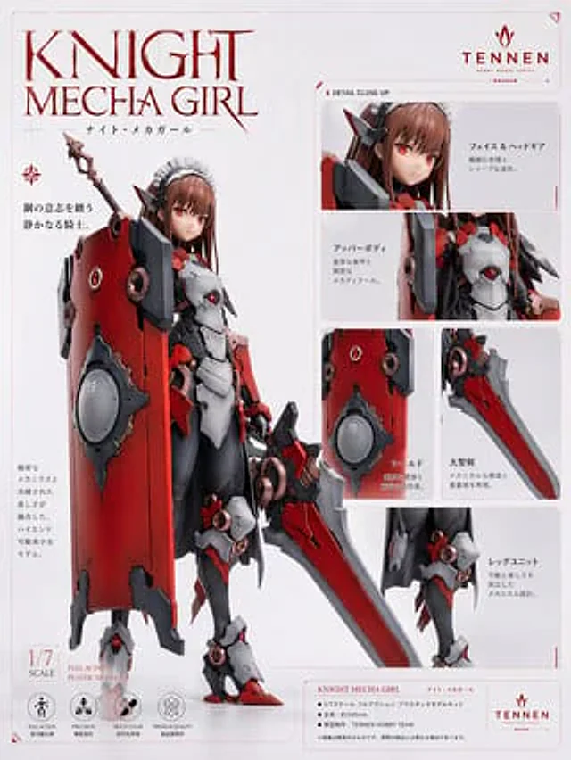

```text
{
  "type": "Anime Mecha Girl Plastic Model Kit Product Display Poster",
  "brand": {
    "name": "{argument name=\"brand name\" default=\"TENNEN\"}",
    "series": "HOBBY MODEL SERIES"
  },
  "product": {
    "title": "{argument name=\"product title\" default=\"KNIGHT MECHA GIRL\"}",
    "subtitle": "ナイト・メカガール",
    "scale": "1/7 scale",
    "category": "Fully movable plastic model kit"
  },
  "subject": {
    "character": "Faceless female knight mecha maid android",
    "pose": "He stands upright, his body slightly leaning to the left, holding a massive, downward-sloping red mechanical sword in his right hand, while a huge red tower shield on his left side obscures most of his body.",
    "design": {
      "hair": {
        "color": "{argument name=\"hair color\" default=\"Light brown\"}",
        "style": "Long straight hair, bangs"
      },
      "headwear": "A white maid-style ruffled headband paired with a dark mechanical horn-shaped side headpiece.",
      "face": "A face that is deliberately blurred or obscured, with no visible features.",
      "armor": "Exquisitely crafted feminine mecha armor in matte white, charcoal gray, and bright red tones. The segmented chest armor features a red core at its center, lined with a black bodysuit. Mechanical joints are visible at the shoulders, hips, knees, and ankles, adorned with bronze-colored circular joint details.",
      "legs": "High-tech armored thigh and calf components, featuring red accents and pointed armored high heels.",
      "back": "Spears or lances mounted diagonally on the back"
    },
    "weapons": [
      "1 Oversized red mechanical sword with a gray blade and bronze joint components.",
      "A tall, red kite-shaped shield with a dark gray border, a central circular module marked with the number 19, and a small badge near the top."
    ]
  },
  "layout": {
    "background": "A clean white studio background with subtle technical lines and a thin red border.",
    "style": "High-end Japanese model and figure advertising layout, simple and elegant, high-end catalog design.",
    "sections": [
      {
        "title": "Main visual rendering",
        "position": "Left and Middle",
        "count": 1,
        "labels": [
          "Full-body product image"
        ]
      },
      {
        "title": "Close-up details",
        "position": "Top right",
        "count": 5,
        "labels": [
          "Close-up of face and headdress",
          "upper body",
          "Shield",
          "Greatsword",
          "Leg components"
        ]
      },
      {
        "title": "Functional text block",
        "position": "left and right margins",
        "count": 6,
        "labels": [
          "Iron Will and the Silent Knight (text)",
          "Aesthetic and Precise Copywriting",
          "Face and headdress",
          "upper body",
          "Greatsword",
          "Leg components"
        ]
      },
      {
        "title": "Bottom Information Bar",
        "position": "bottom",
        "count": 6,
        "labels": [
          "1/7 scale",
          "Fully movable plastic model kit",
          "Fully movable",
          "High precision",
          "Multicolor molding",
          "High quality"
        ]
      },
      {
        "title": "Brand logo",
        "position": "Top right and bottom right",
        "count": 2,
        "labels": [
          "TENNEN",
          "TENNEN"
        ]
      }
    ],
    "text": "The layout uses a Japanese product advertising style, with a large serif headline in the upper left corner, a smaller Japanese subheading below, compact black explanatory text, a thin red dividing line, and small text resembling a disclaimer at the bottom."
  },
  "rendering": {
    "camera": "The product poster composition features figures with a slight perspective.",
    "lighting": "Soft studio lighting, sharp reflections on the armor, delicate shadows—the photographic quality of a high-end collectible.",
    "materials": "The painted plastic model kit features matte and silky textures, precise panel lines, metal joints, and a clean assembly finish.",
    "quality": "Ultra-high definition, clear, exquisite, commercial-grade promotional images"
  },
  "color_palette": {
    "primary": [
      "White",
      "Charcoal gray",
      "Dark red"
    ],
    "accent": [
      "Bronze",
      "black"
    ]
  }
}
```

Model: GPT Image 2
Author: GPT Image 2 Prompts

[ProjectD](https://aitoolsradar.com/en/prompts/47b773070ac399) · [Recorded source](https://x.com/munou_ac/status/2047110000339030405#reversed-1)
 · [Full original metadata and byte evidence](data/projectd-batch-0036.json)

## Knitted Skyline Scarf Macro

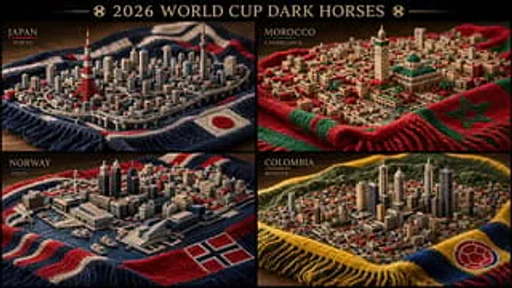

```text
2x2 grid, do this for 4 dark horses for world cup 2026: 16:9, Anchor: [{argument name="city" default="Country's famous city Skyline"}] :: [Knitted Supporter Scarf]  Morphology: Extreme macro shot of a thick, knitted soccer supporter's scarf. However, the threads, stitches, and physical fuzz of the yarn are woven together to physically form a highly detailed, 3D topographical map of the host city's skyline and streets. Material Physics: {argument name="material" default="Thick wool and acrylic yarn"}, visible individual fibers, slight pilling, physical depth of the knit stitches creating the "shadows" of the buildings. Illumination: {argument name="lighting" default="Soft, raking side-lighting"} to emphasize the physical depth and texture of the knit. Warm, nostalgic domestic lighting. Render Stack: Macro photography, tilt-shift, 8k, extreme textile detail, physical diorama. Negative: [Digital print, flat, smooth, 2D, glowing, plastic, clean] :: -1
```

Model: GPT Image 2
Author: Gadgetify

[ProjectD](https://aitoolsradar.com/en/prompts/4d38a79e4968b5) · [Recorded source](https://youmind.com/prompts/knitted-city-skyline-macro-25517)
 · [Full original metadata and byte evidence](data/projectd-batch-0036.json)

## konmari #48

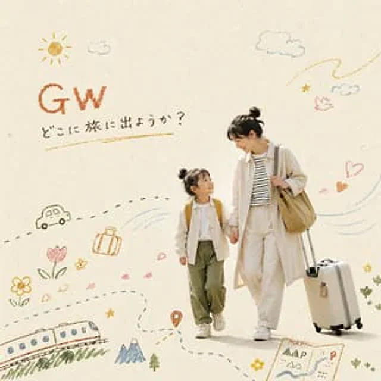

```text
【テーマ】
{ここにテーマを入力}

【写真】
{ここに使用する写真の内容を簡潔に入力}
（例：公園で遊ぶ子ども / 親子の笑顔 / 走る子ども など）

【タイトル】
{画像内に入れるタイトルを入力}
（例：こどもの日 / Happy Mother's Day / 春のはじまり など）

---

テーマ「{テーマ}」に基づいた、
写真とクレヨンイラストを融合したライフスタイル系エディトリアルビジュアル。

提供された写真をメインビジュアルとして使用する。

■ シーン
「{写真}」に合った自然な日常の瞬間。
作り込みすぎないリアルな空気感、やわらかい自然光、
人物の自然な動きや感情を重視。

■ 構図
人物を切り抜いたように配置し、
ざらっとした紙質のクラフト系背景
（生成り、ベージュ、淡いグレー、ミルクティー）の上にレイアウト。

・余白50%以上
・左右非対称構図
・抜け感のあるミニマルなエディトリアルデザイン

■ イラスト（最重要）
オイルパステル／クレヨンで描いたような、
ざらつきとかすれのある手描きイラストを重ねる。

▼ルール
・全体の30〜40%以内
・線にムラとかすれ、紙のテクスチャが残る
・力の入り具合で濃淡が変化（濃い部分・薄い部分が混在）
・子どもが描いたような少し不器用なタッチ
・影・立体表現は禁止（フラット）
・人物の動きと連動させる（風・軌跡・流れ）

▼モチーフ（テーマ連動）
・{テーマ}を象徴する要素をクレヨンタッチで追加
（例：こどもの日 → 鯉のぼり、風、空、草、雲、紙かぶと）
・風の線、動きの線、小さなアイコン、太陽、雲、お花、ハート、星、ジグザグの動線
・空気感をクレヨンの粗いストロークで演出

■ タイトル文字（重要）
画像内に「{タイトル}」を手描きクレヨン文字で配置する。
・配置は左上または右上の余白部分
・クレヨンで書いたようなざらつき・かすれのある文字
・少し不器用で味のある手書き風
・文字色はアースカラー（テラコッタ、マスタード、ダークブラウン）から選択
・サイズは控えめでミニマルに（主役は写真）
・装飾枠なし、フラット

■ 色
あたたかみのあるアースカラー、
やわらかいくすみカラー
（テラコッタ、マスタード、オリーブ、ミルクティー、淡いブルー）

■ 雰囲気
あたたかい、ノスタルジック、こども心、ハンドメイド感、
やさしい、エモーショナル、ストーリー性のある日常

■ スタイル
絵本的ぬくもり × 北欧ミニマル × 上質なライフスタイル広告

■ 品質
高解像度、商用レベルのクオリティ
```

Model: GPT Image 2
Author: konmari

[ProjectD](https://aitoolsradar.com/en/prompts/faa607455b5444) · [Recorded source](https://x.com/konmari_tweet/status/2048714101850071422)
 · [Full original metadata and byte evidence](data/projectd-batch-0036.json)

## Korean Doodle Editorial Illustration

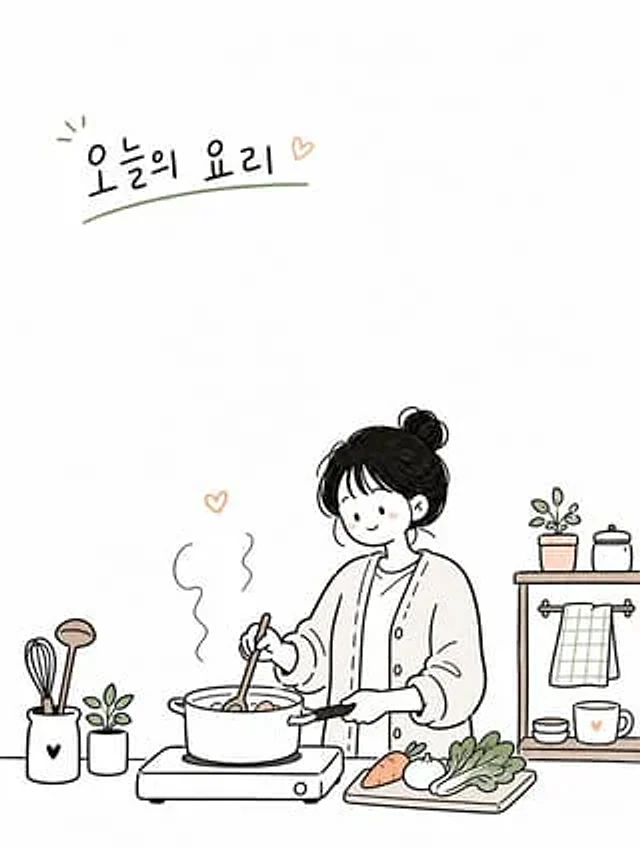

```text
Create a simple and cute Korean doodled editorial illustration based on {argument name="topic" default="a cozy everyday moment"}. Style: hand-drawn doodle cartoon, minimal editorial infographic illustration, clean black ink outlines, slightly imperfect sketchy lines, flat 2D composition, minimal line art, large clean white negative space, soft warm pastel accent colors only. Scene: design a cozy everyday moment around [TOPIC] featuring one young Korean woman. Use a simple background with only essential objects and props related to the topic. Character: cute simplified proportions, minimal facial features, small relaxed smile, natural pose, simple casual outfit, restrained doodle character style. Composition: vertical 3:4 ratio, eye-level view, main subject placed on one side or lower area, large empty space on the opposite side, sparse and airy layout. Objects: minimal doodle-style props such as books, coffee cups, plants, umbrellas, signs, clouds, hearts, notes, windows, etc. Typography: add small English handwritten text in the empty space. Mood: calm, cozy, warm, quiet, cute. Avoid: watercolor painting, anime style, realistic lighting, cinematic rendering, complex perspective, high detail, dense composition, luxury poster mood, painterly textures, over-rendered characters.
```

Model: GPT Image 2
Author: Sairah

[ProjectD](https://aitoolsradar.com/en/prompts/348f2d1da20882) · [Recorded source](https://youmind.com/prompts/korean-doodle-editorial-illustration-27331)
 · [Full original metadata and byte evidence](data/projectd-batch-0036.json)

## Korean English Learning App Promo


```text
{
  "type": "Mobile App Promotional Poster Mockup",
  "style": "The design features clean, modern graphics for Korean language education technology marketing, a soft light gray background, high-end iPhone-style device rendering, rounded corner UI cards, subtle shadows, a blue and purple gradient color scheme, and a minimalist sans-serif font.",
  "subject": "English learning mobile app ad layout",
  "branding": {
    "app icon": "The icon is a rounded square with a blue-purple gradient background, large white letters \"EN\", and a small flashing star in the upper right corner.",
    "headline": [
      "10 minutes a day",
      "Let English",
      "Make it your habit"
    ],
    "body": "Boost your confidence in English through fun lessons and practical exercises."
  },
  "layout": {
    "canvas": "Wide horizontal poster",
    "sections": [
      {
        "title": "Left-side marketing copy column",
        "position": "Leftmost",
        "count": 3,
        "labels": [
          "Diverse learning content",
          "Practical oral English practice",
          "Learning progress management"
        ]
      },
      {
        "title": "App home screen",
        "position": "Left-middle mobile phone",
        "count": 6,
        "labels": [
          "Top greeting",
          "Today's Course Banner",
          "Progress Card",
          "Workday Mini Tracker",
          "Recommended content card 1",
          "Recommended content card 2"
        ]
      },
      {
        "title": "Dialogue Practice Screen",
        "position": "Middle phone",
        "count": 6,
        "labels": [
          "Top progress bar",
          "Command Title",
          "A Speaker's Message Card",
          "B Speaker's Message Card",
          "Core phrase cards",
          "Bottom microphone button"
        ]
      },
      {
        "title": "Word learning screen",
        "position": "upper right corner of the phone",
        "count": 5,
        "labels": [
          "Top progress bar",
          "Large vocabulary",
          "Parts of speech and meaning",
          "Example Sentence Block",
          "Two option buttons at the bottom"
        ]
      },
      {
        "title": "Learning Statistics Screen",
        "position": "bottom right of the phone",
        "count": 5,
        "labels": [
          "Tag selector",
          "Date range rows",
          "2 Statistical Summary Cards",
          "Weekly bar chart",
          "Chart Labels"
        ]
      }
    ],
    "phone_count": 4
  },
  "screens": {
    "home": {
      "status_bar_time": "9:41",
      "greeting": "Hello,{argument name=\"character name\" default=\"Jimin\"} ! 👋",
      "streak": "🔥 7",
      "banner": {
        "korean_label": "Today's Learning",
        "title": "Daily conversation",
        "subtitle": "Learn commonly used expressions in daily life",
        "button": "Start learning",
        "illustration": "Coffee cup and small English flashcards on a blue gradient panel."
      },
      "progress": {
        "section_title": "Learning progress",
        "completion": "75%",
        "monthly_goal_text": "This week's goals",
        "monthly_goal_value": "Completed 3/4 of the learning session",
        "weekday_count": 7,
        "weekday_labels": [
          "one",
          "two",
          "three",
          "Four",
          "five",
          "six",
          "day"
        ]
      },
      "recommendations": {
        "section_title": "Recommended content",
        "items": [
          {
            "title": "Tourism English",
            "subtitle": "Practical expressions for travel",
            "level": "primary",
            "thumbnail": "Airplane window or travel scene"
          },
          {
            "title": "Business English",
            "subtitle": "Expression in business scenarios",
            "level": "intermediate",
            "thumbnail": "Two businessmen in suits"
          }
        ]
      },
      "bottom_nav": {
        "count": 4,
        "labels": [
          "front page",
          "study",
          "review",
          "mine"
        ]
      }
    },
    "conversation": {
      "title": "Daily conversation",
      "progress": "2/10",
      "header": "Please read and follow along with the following dialogue.",
      "subheader": "Read the dialogue and repeat after it.",
      "messages": [
        {
          "speaker": "A",
          "bubble_text": "What are you doing this weekend?",
          "translation": "What are your plans for this weekend?"
        },
        {
          "speaker": "B",
          "bubble_text": "I'm planning to go hiking with my friends.",
          "translation": "I'm planning a hiking trip with my friends."
        }
      ],
      "phrase_box": {
        "label": "core phrases",
        "phrase": "be planning to ~",
        "meaning": "Plan to do something",
        "button": "View example sentences"
      },
      "bottom_hint": "Click and speak",
      "controls": {
        "microphone": true,
        "keyboard": true
      }
    },
    "vocabulary": {
      "title": "Vocabulary learning",
      "progress": "5/12",
      "word": "{argument name=\"vocabulary word\" default=\"adventure\"}",
      "pronunciation": "[ədˈventʃər]",
      "meta": "Noun: adventure, exploration",
      "example_en": "It was a great adventure.",
      "example_ko": "This is a great adventure.",
      "illustration": "Foggy mountain scenery with backpackers",
      "buttons": [
        "I don't know",
        "know"
      ]
    },
    "stats": {
      "title": "Learning Statistics",
      "tabs": {
        "count": 3,
        "labels": [
          "Weekly",
          "Monthly",
          "all"
        ]
      },
      "date_range": "May 12 - May 18",
      "summary_cards": [
        {
          "label": "Study time",
          "value": "3 hours and 45 minutes"
        },
        {
          "label": "Continuous learning",
          "value": "7 days"
        }
      ],
      "chart": {
        "type": "Weekly Vertical Histogram",
        "bar_count": 7,
        "x_labels": [
          "one",
          "two",
          "three",
          "Four",
          "five",
          "six",
          "day"
        ],
        "y_labels": [
          "0 minutes",
          "30 minutes",
          "60 minutes"
        ]
      }
    }
  },
  "decor": {
    "background_shapes": [
      "Large, soft blue organic waves in the bottom left corner",
      "Three small, twinkling stars scattered around the composition"
    ]
  },
  "rendering": "High-resolution product marketing renderings, taken from a phone's perspective, with balanced spacing, clear Korean UI text, and a refined App Store display."
}
```

Model: GPT Image 2
Author: GPT Image 2 Prompts

[ProjectD](https://aitoolsradar.com/en/prompts/fd4cb7f212867c) · [Recorded source](https://x.com/_uyza_/status/2046481583109267873#reversed-0)
 · [Full original metadata and byte evidence](data/projectd-batch-0036.json)

## Korean Idol 3x3 Collage Portrait

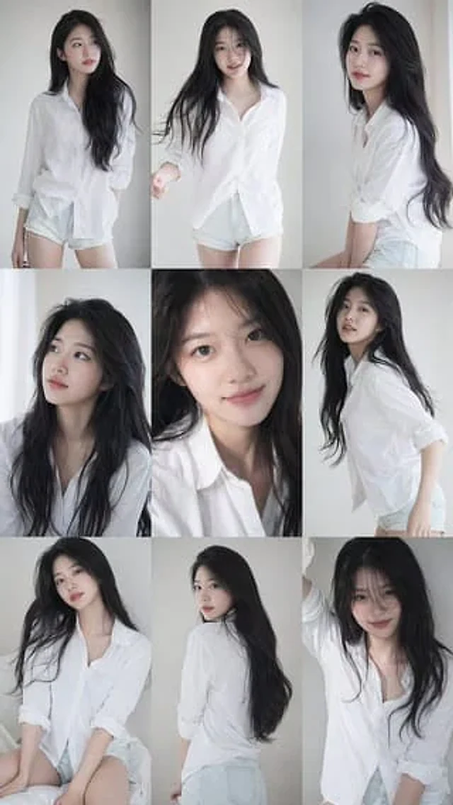

```text
9:16 vertical — a 3x3 grid collage (nine images) forming a Korean idol portrait photoshoot series. Each frame features the same young Korean female idol, maintaining 100% consistency in facial features, proportions, hairstyle, and identity across all nine shots.   Natural, ultra-realistic skin texture, no retouching, no smoothing. Clean idol-style minimal makeup, soft glow, subtle imperfections.   Hair: long, voluminous dark hair, slightly tousled, consistent across all frames (natural loose flow, slight movement).  Outfit: cohesive Korean idol photoshoot styling — white shirt + short bottoms (or simple neutral-toned outfit), youthful, clean, slightly casual but styled. Same outfit across all frames.  Setting: minimal studio or simple indoor environment (plain wall, soft window light, clean background). Focus on subject, not environment.  Lighting: soft diffused natural light, gentle highlights, low contrast, slightly airy tones, subtle film-like softness.  Camera style: intimate portrait photography, slightly handheld feel, subtle imperfections (minor grain, slight blur in motion frames, imperfect framing).  Frame breakdown (3x3 grid):  Top row: - Top left: standing naturally, looking slightly away, relaxed expression - Top center: facing camera, casual mid-motion (hair or body slight movement) - Top right: slight side angle, soft gaze, natural candid feel  Middle row: - Center left: looking slightly upward, soft thoughtful expression - Center: close-up portrait, direct eye contact, gentle idol smile - Center right: turning body slightly, mid-motion candid frame  Bottom row: - Bottom left: seated or leaning casually, relaxed posture - Bottom center: back partially turned, looking over shoulder toward camera - Bottom right: standing close to frame, slightly playful or soft expression  Mood: Korean idol photobook / photocard aesthetic, intimate, soft, natural, everyday charm.  Quality: ultra-realistic, 8K detail, subtle analog film grain, natural imperfections, soft dreamy tone
```

Model: GPT Image 2
Author: @BubbleBrain

[ProjectD](https://aitoolsradar.com/en/prompts/543ea485f2c86f) · [Recorded source](https://x.com/BubbleBrain/status/2046151898621993364)
 · [Full original metadata and byte evidence](data/projectd-batch-0036.json)

## Korean Idol 3x3 Grid Portrait

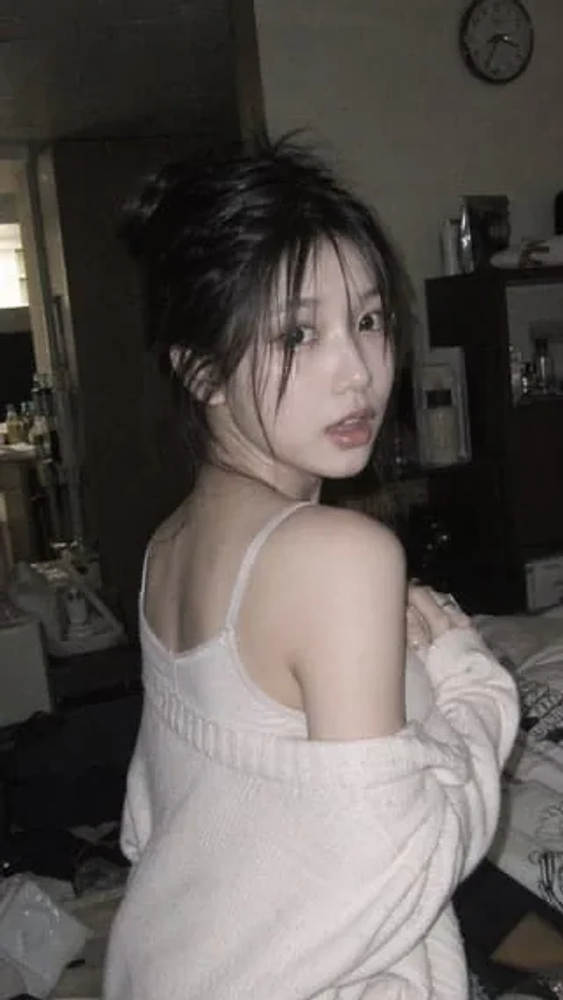

```text
9:16 vertical, Korean idol portrait photoshoot, 3x3 grid (nine frames), same person in all images, consistent facial features and styling, soft black mist filter effect, lowered contrast, blooming highlights, subtle glow around light sources
```

Model: GPT Image 2
Author: @BubbleBrain

[ProjectD](https://aitoolsradar.com/en/prompts/3965914a29d068) · [Recorded source](https://x.com/BubbleBrain/status/2046268941941850575)
 · [Full original metadata and byte evidence](data/projectd-batch-0036.json)

## Korean Idol Dreamy Portrait

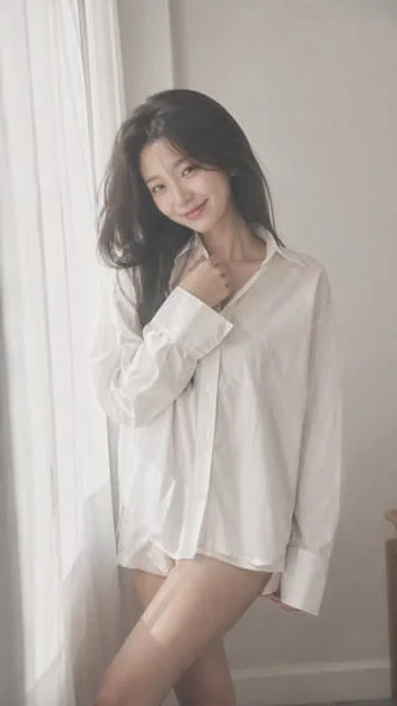

```text
{argument name="aspect ratio" default="9:16"} Vertical screen —{argument name="subject" default="Korean idol portrait photography"} A single subject, with a soft black filter effect, reduced contrast, soft highlight overflow, delicate halo, soft light diffusion, a slightly faded black minimalist interior scene by a window, white curtains, a clean light-colored background, a young Korean female idol, natural light makeup, dewy and realistic skin texture, minor imperfections in the clothing:{argument name="outfit" default="Loose white shirt + shorts"} A slightly loose fit, a soft and casual style, with no revealing elements. Hairstyle: Long black hair, slightly messy, naturally fluffy, smooth and flowing. Poise: Standing relaxed or leaning slightly, body slightly turned to the side, one leg slightly forward, shoulders relaxed; one hand lightly touching the collar or lingering near the collar, the other hand hanging naturally; soft body curves, understated expression: A gentle and lovely smile, eyes slightly playful, looking directly at the camera or with the gaze slightly turned to the side. Camera: Half-body to full-body shot, eye level, intimate distance, slightly handheld. Lighting: Diffuse natural sunlight, soft shadows, light gently enveloping the face and body. Atmosphere: Cute yet delicate sensuality, intimacy, everyday softness, quiet romance. Quality: Hyper-realistic, delicate film grain, slightly soft edges, natural imperfections, dreamy and understated color tone.
```

Model: GPT Image 2
Author: GPT Image 2 Prompts

[ProjectD](https://aitoolsradar.com/en/prompts/dbf047bbf75198) · [Recorded source](https://x.com/BubbleBrain/status/2046518189509734903)
 · [Full original metadata and byte evidence](data/projectd-batch-0036.json)

## Korean Infographic on Fair Selection

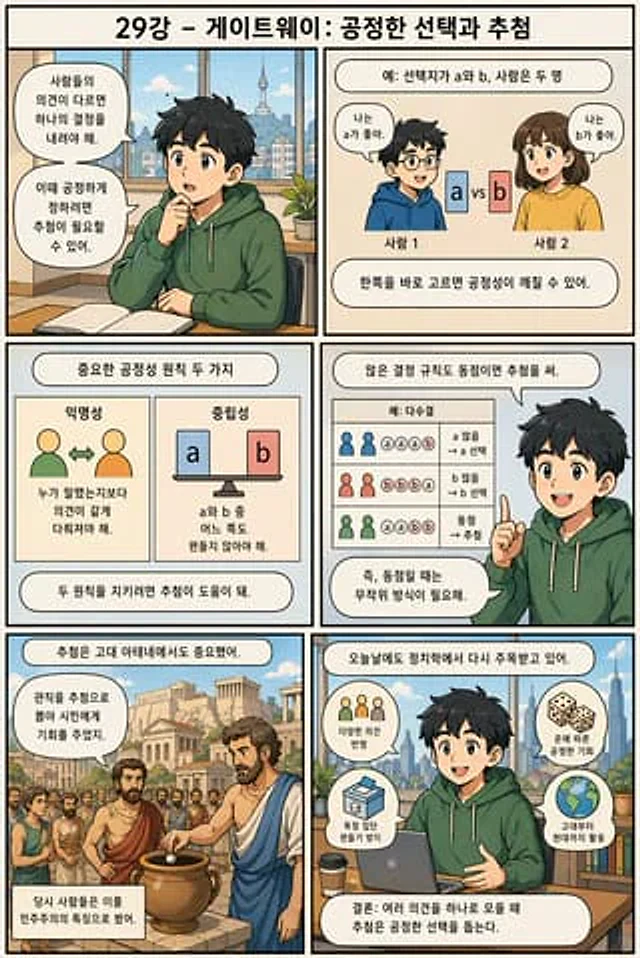

```text
{
  "type": "Educational Korean comic infographics",
  "style": "The illustrations are simple, textbook-style digital illustrations with thick black borders, soft, flat colors, slightly cartoonish, semi-realistic characters, rounded speech bubbles, and clear, easy-to-read Korean text, reminiscent of classroom handouts.",
  "topic": "Fair selection and random selection",
  "language": "Korean",
  "page": {
    "orientation": "Vertical",
    "background": "Light beige paper tone",
    "border": "Thin black outer frame",
    "panelCount": 6
  },
  "title": {
    "text": "{argument name=\"headline text\" default=\"Lesson 29 – Introduction: Fair Choice and Lottery\"}",
    "position": "Centered at the top",
    "style": "Large Bold Korean Sans-serif Font"
  },
  "layout": {
    "sections": [
      {
        "position": "Top left",
        "count": 1,
        "scene": "A male student in a green hoodie sits at a desk, chin in hand, with an open book on the table. Behind him, a large window offers a view of the city skyline. The study is furnished with potted plants.",
        "textElements": {
          "speechBubbles": [
            "When people disagree, a decision must be made.",
            "At this point, in order to be fair, a lottery may be necessary."
          ]
        }
      },
      {
        "position": "Top right",
        "count": 1,
        "scene": "Example panel: Two students face each other. On the left is a boy wearing a blue hoodie, and on the right is a girl wearing a yellow sweater. Small cards between them show \"blue 'a'\" and \"red 'b',\" with the word \"vs\" in the center.",
        "textElements": {
          "header": "For example: Options are a and b, and two people participate.",
          "speechBubbles": [
            "I like A.",
            "I like b."
          ],
          "labels": [
            "Person 1",
            "2 people"
          ],
          "footer": "Choosing one side directly might undermine fairness."
        }
      },
      {
        "position": "Left and Middle",
        "count": 1,
        "scene": "The principles panel is divided into two sub-panels with icons.",
        "textElements": {
          "header": "Two important principles of fairness",
          "subsections": [
            {
              "title": "Anonymity",
              "description": "Regardless of who speaks, their opinions should be treated equally."
            },
            {
              "title": "neutrality",
              "description": "Neither A nor B should be favored."
            }
          ],
          "footer": "Drawing lots is very helpful in adhering to these two principles."
        },
        "icons": [
          "Two-person icon with a double-headed arrow",
          "Balance scale with weights a and b"
        ]
      },
      {
        "position": "Right Center",
        "count": 1,
        "scene": "The male student wearing a green hoodie pointed upwards next to the majority vote tally sheet.",
        "textElements": {
          "speechBubble": "In majority voting rules, a draw is used in the event of a tie.",
          "tableHeader": "For example: majority voting",
          "rows": [
            "a Multiple Choice a",
            "b Multiple Choice b",
            "Draw"
          ],
          "footer": "In other words, a tie needs to be resolved randomly."
        },
        "table": {
          "rowCount": 3,
          "visuals": "Three groups of colored voters labeled a and b"
        }
      },
      {
        "position": "Bottom left",
        "count": 1,
        "scene": "A historical scene from ancient Athens, with five figures in the foreground and a crowd in the background. Two men are drawing lots from a large terracotta pot, with classical Greek architecture and the Acropolis in the background.",
        "textElements": {
          "header": "Drawing lots was also important in ancient Athens.",
          "speechBubble": "The selection of officials by lottery gives citizens an opportunity.",
          "footer": "People at the time viewed it as a characteristic of democracy."
        }
      },
      {
        "position": "Bottom right",
        "count": 1,
        "scene": "A modern student wears a green hoodie, uses a gray laptop at a desk with a coffee cup, bookshelf, and plant on it, and the city skyline is visible through the window.",
        "textElements": {
          "header": "It is now receiving renewed attention in political science.",
          "callouts": [
            "Reflecting diverse opinions",
            "Preventing favoritism towards specific groups",
            "Fair chance based on luck",
            "Applications from ancient times to the present"
          ],
          "footer": "Conclusion: When it is necessary to reach a consensus among multiple opinions, drawing lots helps to make a fair choice."
        },
        "icons": [
          "3-person symbol",
          "ballot box",
          "A pair of dice",
          "Earth"
        ]
      }
    ]
  },
  "characters": {
    "mainStudent": {
      "gender": "male",
      "age": "Teenagers or young people",
      "hair": "Messy short black hair",
      "outfit": "green hoodie"
    },
    "secondaryCharacters": [
      {
        "count": 1,
        "description": "Male student wearing a blue hoodie"
      },
      {
        "count": 1,
        "description": "A female student with a short brown bob haircut and wearing a yellow sweater"
      },
      {
        "count": 5,
        "description": "Ancient Greek figures in robes in the foreground of the Athens panel"
      }
    ]
  },
  "visualNotes": {
    "textLegibility": "Highly clear Korean typography",
    "colorPalette": "Soft cream, green, blue, yellow, terracotta, and gray.",
    "composition": "A 6-panel educational comic infographic, using equal-sized rectangular panels and rounded inner text boxes.",
    "mood": "Clear, informative, and accessible"
  }
}
```

Model: GPT Image 2
Author: GPT Image 2 Prompts

[ProjectD](https://aitoolsradar.com/en/prompts/d1bd30100a95b0) · [Recorded source](https://x.com/flow_edu_/status/2046802030115885385#reversed-1)
 · [Full original metadata and byte evidence](data/projectd-batch-0036.json)

## Korean Rice Drink Parody Ad Poster


```text
Create a bold, Korean-style beverage advertisement poster with a warm, golden liquid splash effect in the background and dramatic commercial lighting. The image should feature a {argument name="celebrity spokesperson" default="Older male politicians like Donald Trump"} The bust depicts a man in a navy blue suit, white shirt, and bright red tie, with a small American flag badge on his collar, confidently promoting a product to the camera. His face is obscured by a flat, skin-colored rectangular mask. His left hand, using forced perspective, extends towards the camera, holding a yellow aluminum can of Korean sweet rice drink. The can is prominently labeled in Korean, with red stripes on the top and bottom, and the main product text reading "비락식혜" and "Since 1993." Smaller Korean instructions, a picture of sweet rice drink on the bottom, and the capacity reading "238 ml (120 kcal)" are also printed on the can. His right hand is giving a thumbs-up. The composition employs a vibrant retro-commercial style, with splashes of sweet rice drink and droplets in the background, highlighted with shimmering gold, and framed from a slightly upward, heroic angle. At the top, there are three striking headlines: in the upper left corner is a handwritten black slogan, “전통의맛, 한국의DRINK!”; in the center is a large, distressed, bold Korean headline in dark brown and black text reading “걸죽는땐?”; in bright red text reading “비락식혜!”; and in the upper right corner is the brand logo “비락”, with the small red text “Since 1993” below. Two additional badges are added: on the left is a yellow circular stamp with a miniature crown icon, reading “대한민국국민음료No.1”; on the right is a white speech bubble containing the handwritten Korean “한국이만든맛있는전통!” and the red English “I LOVE IT!”. At the bottom foreground, place two food elements: on the left is a brass bowl filled with sweet rice porridge and floating rice grains, and on the right is a wooden bowl piled high with white rice. In the lower center, add two lines of large, calligraphy-style promotional text: the first line in white reads “달콤하게! 시원하게!”, and the second line in alternating white and yellow reads “속까지시~원하게!”, underlined with a vibrant yellow. At the very bottom, there are three circular function icons with Korean descriptions: “국내산쌀엄선된재료”, “시원하게갈증해소”, and “부드러운단맛속편한식혜”. In the bottom right corner, add a tiny disclaimer: "연출된이미지입니다". The overall visual effect should be glossy, exaggerated, humorous, and as convincing as a viral parody print ad.
```

Model: GPT Image 2
Author: GPT Image 2 Prompts

[ProjectD](https://aitoolsradar.com/en/prompts/2f15ed33c87fd6) · [Recorded source](https://x.com/ObserverKR/status/2046794478888042551#reversed-1)
 · [Full original metadata and byte evidence](data/projectd-batch-0036.json)

## Korean Sports Drink Celebrity Ad Poster


```text
A distinctive Korean-style beverage advertisement poster, employing a glossy commercial photography style. The main subject of the image is {argument name="spokesperson" default="Donald Trump stand-in"} He was dressed in a dark navy blue business suit, a white shirt underneath, and a bright blue tie, facing the camera directly. The background was a highly saturated bright blue sky, dotted with a few soft white clouds, and to the right, a modern city skyline was faintly visible, including a towering skyscraper resembling the Empire State Building. In his left hand, he held a bottle of chilled beverage {argument name="product name" default="POCARI SWEAT"} The bottle, with its exaggerated perspective extending towards the camera, appears enormous in the foreground, while the person is positioned slightly behind. The transparent bottle, adorned with condensation droplets, features a white cap and reveals the liquid inside. A dark blue label prominently displays the white "POCARI SWEAT" lettering, with smaller "ION SUPPLY DRINK" text above. Vibrant splashes and droplets of icy water are added around the bottle, the hand, and the foreground below to emphasize the refreshing and hydrating feel. The brand logo is placed in the upper left corner: white "POCARI SWEAT" lettering with a curved underline below. A large, distressed white Korean title is added to the top of the poster, slightly tilted and occupying most of the upper half.{argument name="headline text" default="갈증 해소? 이걸로 끝! 포카리스웨트!"} Add a striking line of italicized white and blue Korean quotation in the lower right corner, where the suit is located:{argument name="quote" default="WINNING은 수분 싸움! 포카리스웨트로 리프레시!"} The bottom left corner features three vertically arranged circular benefit icons, each accompanied by a short Korean label: a water droplet icon with "수분보충" (hydration replenishment), a lightning bolt icon with "전해질보충" (electrolyte replenishment), and a running figure icon with "빠른흡수" (rapid absorption). The high-contrast blue and white color scheme, combined with dramatic advertising lighting, keeps the bottle and hand clearly in focus while slightly softening the focus on the face and background, resulting in a vibrant and high-quality advertising poster aesthetic.
```

Model: GPT Image 2
Author: GPT Image 2 Prompts

[ProjectD](https://aitoolsradar.com/en/prompts/f09718cc22a710) · [Recorded source](https://x.com/ObserverKR/status/2046794478888042551#reversed-0)
 · [Full original metadata and byte evidence](data/projectd-batch-0036.json)

## Korean Sports Magazine Cover


```text
A high-quality Korean-style commercial photograph, mimicking the style of a sports magazine cover. [Composition and Pose] Half-body portrait (above chest), slightly angled frontal view, the subject slightly looking down at the camera. The {argument name="left hand object" default="left hand holds the FIFA World Cup Trophy aloft"}, while the {argument name="right hand object" default="right hand holds a classic black and white soccer ball"}.
```

Model: GPT Image 2
Author: simeon-sanai

[ProjectD](https://aitoolsradar.com/en/prompts/c67f31ac08bdf5) · [Recorded source](https://youmind.com/prompts/magazine-cover-sports-portrait-25900)
 · [Full original metadata and byte evidence](data/projectd-batch-0036.json)

## Korean Style Desktop Calendar 2027

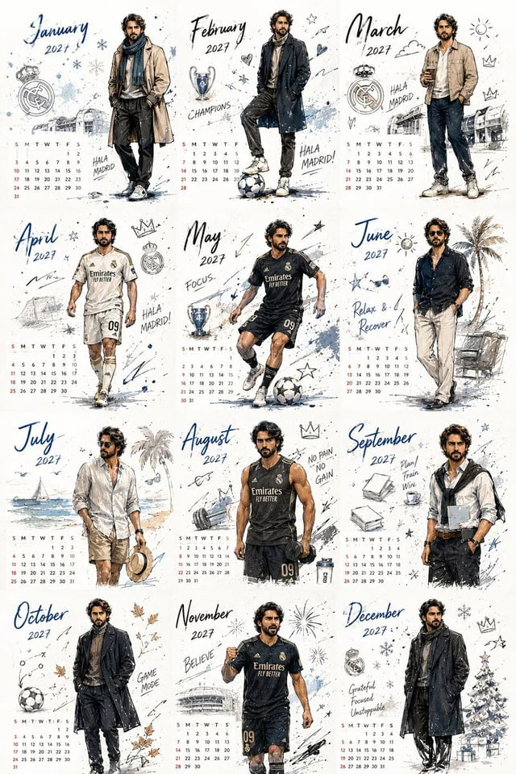

```text
Please use this photo to create a desktop calendar for {argument name="dates" default="January-December 2027"}. Format: A4 vertical. Features: {argument name="style" default="Korean illustration style"}, distinct character features, natural expressions, full-body composition, dynamic poses, exquisite clothing details, hand-drawn doodle style, splatter brushstrokes, free lines, a mix of pastels and ink, comic sketch texture, simple white background, symbolic elements around the edges, strong atmosphere, high detail, high quality.
```

Model: GPT Image 2
Author: Zar⭕on

[ProjectD](https://aitoolsradar.com/en/prompts/9df4809cc3d036) · [Recorded source](https://youmind.com/prompts/korean-illustration-calendar-2027-21048)
 · [Full original metadata and byte evidence](data/projectd-batch-0036.json)

## Kpop Summer World Cup Photoshoot

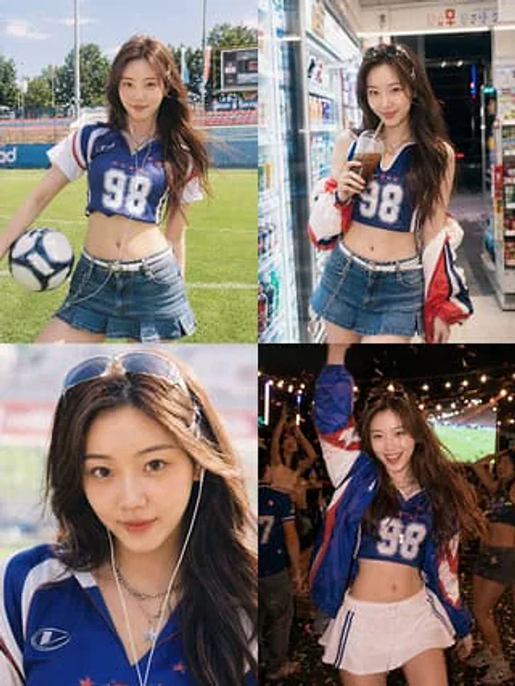

```text
基于上传的单人人像参考图，生成 {argument name="数量" default="9"} 张独立成片的 {argument name="纵横比" default="3:4"} 竖构图写真，主题为「{argument name="主题" default="夏日世界杯 × Y2K 千禧风 × Kpop × 复古胶片"}」。严格保留本人真实五官和身份辨识度，不换脸，不网红脸，不动漫化。整体像世界杯夏天期间被胶片相机记录下的 Kpop 风街头偶像写真，包含复古足球球衣、足球、绿茵场、彩色看台、街头大屏、便利店、海边、夜晚派对、黄昏球场等场景。服装为复古球衣、低腰牛仔、运动短裙、彩色运动外套、银色饰品、发夹、Y2K 墨镜、有线耳机。妆造为 Kpop 生活化妆面，亮片眼影、果冻唇、自然皮肤纹理、夏日汗水光沢。画面要有生命力、青春感、阳光、风、笑容、真实抓拍感，复古胶片颗粒、轻微过曝、闪光灯质感、高饱和但高级。不要出现真实球队 logo、FIFA 官方 logo、真实球星、商业品牌。9 张分别为：夏日球场开场、街头大屏看球、Kpop 打歌球衣造型、便利店冰饮、海边足球、夜晚进球派对、复古看台、Y2K 杂志封面近景、黄昏终场收束。
```

Model: GPT Image 2
Author: 麻酱AI实验室

[ProjectD](https://aitoolsradar.com/en/prompts/a46aa27b027af0) · [Recorded source](https://youmind.com/prompts/kpop-summer-world-cup-y2k-24623)
 · [Full original metadata and byte evidence](data/projectd-batch-0036.json)

## Kung Fu Action Storyboard

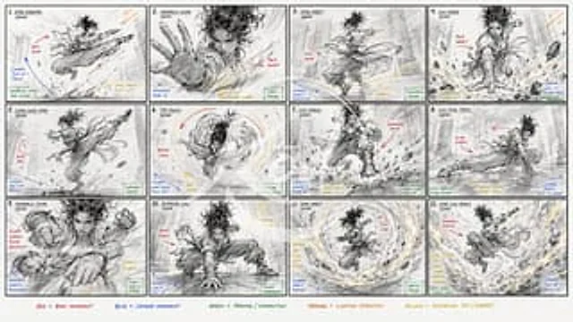

```text
Create a {argument name="action" default="raw kung fu performance"} storyboard focused on extreme physical action. Use reference image for the character. 16:9 storyboard sheet, {argument name="panels" default="12"} cinematic panels. The actual storyboard drawings must be black and white only: {argument name="technique" default="rough pencil lines"}
```

Model: GPT Image 2
Author: Kōda

[ProjectD](https://aitoolsradar.com/en/prompts/b865eeb93e2b51) · [Recorded source](https://youmind.com/prompts/kung-fu-performance-storyboard-20055)
 · [Full original metadata and byte evidence](data/projectd-batch-0036.json)

## Kylian Mbappé Devastated Photo


```text
Amateur photos taken with an iPhone, in the picture{argument name="player" default="Kylian Mbappé"} Tears streaming down her face, dressed in{argument name="team jersey" default="Real Madrid"} The player in the jersey stands on the pitch, looking dejected. Bayern Munich players in red jerseys can be seen in the background. (The camera angle is...){argument name="shooting angle" default="Stands near the stadium"} The scene takes place inside the Allianz Arena at night.
```

Model: GPT Image 2
Author: GPT Image 2 Prompts

[ProjectD](https://aitoolsradar.com/en/prompts/b9609a89051104) · [Recorded source](https://x.com/patrickassale/status/2044525891137511670)
 · [Full original metadata and byte evidence](data/projectd-batch-0036.json)

## Kyoto Bamboo Forest Minimalist Poster

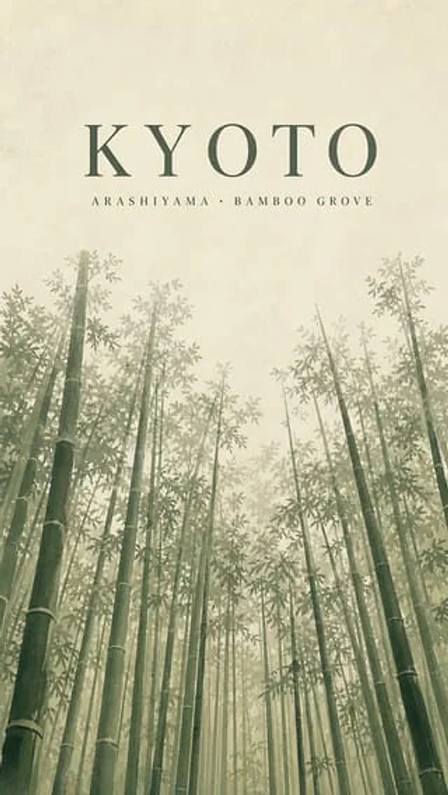

```text
Vertical 9:16 minimalist Japanese travel poster of the Arashiyama bamboo grove. Single muted sage-green tonal palette, towering vertical bamboo stalks rendered with simplified painterly brush strokes filling the lower two-thirds. Large negative space sky in soft pale cream above. A small bold serif title "KYOTO" centered in the upper third with a thinner subhead "ARASHIYAMA · BAMBOO GROVE" beneath. Subtle paper grain texture across the whole poster. Vertical composition. No watermark, no logo. Premium minimalist Japanese travel poster aesthetic, magazine cover quality.
```

Model: GPT Image 2
Author: @hiapi_ai

[ProjectD](https://aitoolsradar.com/en/prompts/d994ae68990801) · [Recorded source](https://github.com/HiAPIAI/awesome-gpt-image-2-prompts)
 · [Full original metadata and byte evidence](data/projectd-batch-0036.json)

## Lakers Arena Candid Portrait

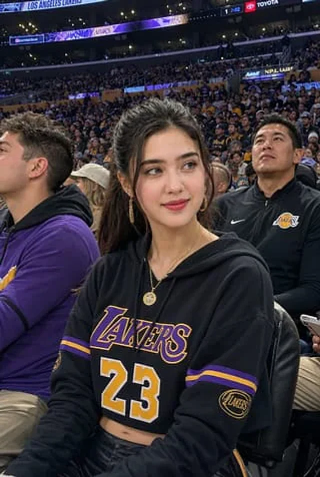

```text
Create a hyper-realistic vertical smartphone photo of {argument name="character description" default="a young Asian woman"} sitting courtside/in the lower audience section at a packed Los Angeles Lakers NBA game, framed waist-up in a close candid closeup. She is centered in the foreground, seated on a black arena chair, wearing {argument name="team hoodie" default="a black cropped Los Angeles Lakers hoodie with purple-and-gold sleeve stripes and a large number 23 on the front"}, black leather-look pants, and gold accessories including exactly 2 visible jewelry pieces: a thin gold necklace with a round pendant and a dangling gold earring. Her hair is dark, slightly messy, pulled back into a sleek ponytail with loose strands around the ears. Show her posture as calm and focused, hands resting low near her lap, watching the game action off-camera. Include exactly 3 prominent foreground spectators: the main woman in the center, a young man on the left in a purple Lakers hoodie looking left, and a young man on the right in a black Lakers zip hoodie holding a phone; obscure exactly 2 faces with flat rectangular skin-tone privacy blocks, one over the main woman's face and one over the right spectator's face. The background is a densely crowded basketball arena with hundreds of fans, upper seating tiers, bright stadium lights, LED ribbon boards, and readable arena signage such as {argument name="arena signage" default="LOS ANGELES LAKERS"} and a Toyota logo near the scoreboard. Use realistic indoor arena lighting, natural phone-camera perspective, high detail fabric texture, shallow-to-moderate depth of field, slight wide-angle distortion, authentic candid sports-event atmosphere, no glamour studio lighting, no watermark.
```

Model: GPT Image 2
Author: Hania Ai

[ProjectD](https://aitoolsradar.com/en/prompts/93283240b55406) · [Recorded source](https://youmind.com/prompts/lakers-arena-candid-portrait-20958)
 · [Full original metadata and byte evidence](data/projectd-batch-0036.json)

## Landscape Archive Model Map


```text
Please base on{argument name="subject" default="Great Wall / Mount Everest / The Bund / Pearl River"} Create a high-quality, professional "landscape archive model" visual suitable for a series of presentations. This is more than just a regular map or simple landscape illustration; it's a high-end archival visual presentation combining "2D cartography + 3D regional model + professional annotation system + museum exhibition feel." The image should resemble a realistic geographical research model, urban planning sand table, architectural scheme model, or world-building exhibit, possessing a professional, restrained, precise, and tactilely high-quality texture. [Basic Settings] Theme:{argument name="subject content" default="Crater Lake / Guangzhou / Chongqing"} Theme Type: [Natural Terrain / Urban Space / Mixed Landscape] Core Theme: [Core theme, e.g., crater, canyon, mountain range, lake, CBD, old town, landmark cluster, island city, historical site, main urban area] Content Focus: [Content focus, e.g., terrain elevation / city landmarks / road network / water system / relationship between nature and city / scene collection display] Style:{argument name="style" default="Geographical surveying style, paper art model style, architectural design style, museum archive style, urban planning style"} Primary Color: [Primary color, e.g., off-white, light gray, parchment white, sand, snow white] Secondary Color: [Secondary color, e.g., earth brown, rock gray, cool gray, light blue, moss green] Accent Color: [Accent color, e.g., thin black lines, red routes, blue water lines, yellow numbered markers] Aspect Ratio: [Aspect Ratio, e.g., 16:9 landscape / 3:4 portrait / 4:5 portrait / 1:1 square] [Composition] The main subject is a rectangular map project placed on a clean table or white cloth. The base has realistic thickness, with visible cross-sectional structures at the edges, like a delicate map slice or model base. The map surface is covered with a clear but restrained layer of information, including contour lines, road networks, water systems, regional boundaries, geographic textures, coordinates, subtle annotations, and drawing borders. In the center or off-center area, a 3D model "grows" from the 2D map, becoming the visual core of the entire image. If the [Theme Type] is Natural Terrain: The main body consists of mountains, canyons, craters, lakes, basins, islands, glaciers, faults, or coastlines, emphasizing elevation, layered contour lines, rock textures, and natural terrain undulations. If the [Theme Type] is Urban Space: The main body consists of core urban areas, CBDs, old town districts, landmark clusters, waterfront areas, road nodes, bridges, water systems, or parks, emphasizing building volume, urban characteristics, spatial hierarchy, and planning structure. If the [Theme Type] is Mixed Landscape: Blending natural terrain with man-made environments, such as mountain cities, island cities, ancient ruins, post-apocalyptic wastelands, fantasy capitals, or science fiction bases. [Detail Requirements] - The surface should retain the texture of a map paper and a professional information feel. - Terrain areas should have contour lines, slope layers, and a sense of depression. - Building areas should have a sense of volume, street relationships, and clear hierarchy. - Water bodies should use a low-saturation light blue. - Green spaces/forests should use moss green or low-saturation green. - Road networks should use thin lines to avoid being overwhelming. - Landmarks should be clearly identifiable. - Sci-fi/fantasy elements should maintain an archival model feel, rather than being pure scene illustrations. [Annotation System] Map items require complete and restrained annotation modules, including border lines, scale bars, legend areas, title areas, file numbers, index markers, annotation labels, and simple symbol explanations. The text does not need to be fully readable, but must present a realistic, clear, accurate, and orderly archival layout. [Camera and Lighting] Use an isometric or sandbox composition with a downward-sloping view, with a camera angle of approximately 30 to 45 degrees, to show the map plane, model height, edge thickness, and annotation areas. Lighting should be soft and natural, casting delicate and realistic shadows on a clean background, avoiding a cartoonish or cheap game UI feel.
```

Model: GPT Image 2
Author: GPT Image 2 Prompts

[ProjectD](https://aitoolsradar.com/en/prompts/c03ab1fb07ca1b) · [Recorded source](https://x.com/MrLarus/status/2047634434497622270)
 · [Full original metadata and byte evidence](data/projectd-batch-0036.json)

## Landscape Archive Model Map

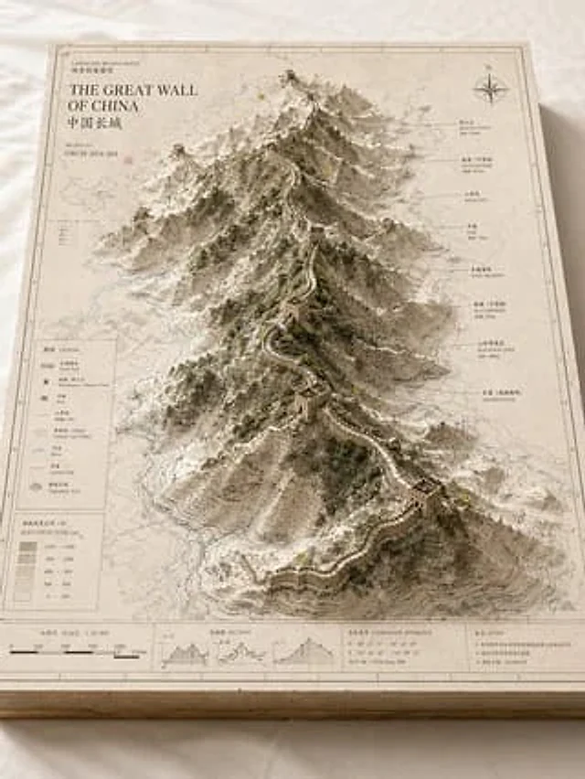

```text
请根据【{argument name="主题" default="主题"}】创作一张高完成度、高质感、适合系列化发布的「地景档案模型 / Landscape Archive Model」视觉图。

这不是普通地图，也不是普通风景插画或城市效果图，而是一张结合“二维地图图纸 + 三维立体区域模型 + 专业说明系统 + 博物馆展陈感”的高端档案式视觉图。画面需要像一件被真实制作出来的地理研究模型、城市规划沙盘、建筑提案模型或世界观设定展品，具有专业、克制、精密、可触摸的高级质感。

【基础设定】
主题：【{argument name="主题内容" default="主题，例如火山口湖 / 广州 / 重庆山城 / 海岛城市 / 古城遗址 / 末日废墟 / 幻想大陆 / 游戏主城"}】
主题类型：【自然地貌 / 城市空间 / 混合景观】
核心主体：【{argument name="核心主体" default="核心主体，例如火山口、峡谷、山脉、湖泊、CBD、老城区、地标群、岛屿城市、遗址群、主城区域"}】
内容重点：【内容重点，例如地形高差 / 城市地标 / 路网结构 / 水系关系 / 自然与城市关系 / 设定集展示】
风格方向：【风格方向，例如地理测绘风、纸雕模型风、建筑提案风、博物馆档案风、城市规划风、游戏设定集风】
主色调：【主色调，例如米白、浅灰、羊皮纸白、沙色、雪白】
辅助色：【辅助色，例如土褐、岩灰、冷灰、淡蓝、苔绿】
点缀色：【点缀色，例如黑色细线、红色路线、蓝色水文线、黄色编号标记】
画幅比例：【画幅比例，例如16:9横版 / 3:4竖版 / 4:5竖版 / 1:1方图】

【画面结构】
画面主体是一块放置在干净桌面或白色布面上的矩形地图模型板。底板具有真实厚度，边缘可见剖面结构，像一块精致的地图切片或模型底座。地图表面覆盖清晰但克制的信息层，包括等高线、道路网络、水文线、分区边界、地理纹理、坐标感、轻微标注和图纸边框。

在地图中央或偏中心区域，从二维地图中立体“生长”出一个三维主体模型，成为整张图的视觉核心。

如果【主题类型】为自然地貌：
主体可由山体、峡谷、火山口、湖泊、盆地、岛屿、冰川、断层、海岸线等构成，强调地形高差、层叠等高线结构、岩壁纹理和自然地貌起伏。

如果【主题类型】为城市空间：
主体可由核心城区、CBD、老城街区、地标建筑群、滨水区、路网节点、桥梁、水系、公园绿地等构成，强调建筑体块、城市识别度、空间层次与规划结构。

如果【主题类型】为混合景观：
需同时整合自然地形与人工建成环境，例如山城、海岛城市、古城遗址、末日废墟、幻想主城、科幻基地等，让自然地貌与城市结构共同构成核心视觉。

【细节要求】
- 模型表面保留地图图纸感与专业信息感
- 地形区域应有等高线、坡面层次、凹陷与起伏关系
- 建筑区域应有体块感、街区关系和清晰层次
- 水域使用低饱和淡蓝色表现
- 绿地、森林、公园、山体可用苔绿色或低饱和绿色表现
- 路网、路径、交通轴线或探索线路可用细线表现，但不要喧宾夺主
- 若有地标建筑或重点结构，应具备明确识别度
- 若有幻想、科幻或游戏设定元素，应保留档案模型 and 图纸展示感，而不是做成纯场景插画

【说明系统】
地图板边缘需要设计完整而克制的说明模块，包括：
- 外框线和内框线
- 比例尺
- 图例区
- 标题区
- 档案编号
- 索引标记
- 注释标签
- 简洁的符号说明
文字不必全部可读，但整体必须呈现真实、清晰、精密、有秩序的档案式排版结构。

【构图与镜头】
采用斜俯视等轴测或沙盘式构图，镜头从上方约30到45度观察整块模型板，让观众同时看到地图平面、立体主体高度、边缘厚度和说明区。视觉重心集中在中央主体模型，阅读路径为：先看核心主体，再看周边地形/路网/水系/街区信息，最后看图例、比例尺和说明区。

【材质与光影】
整体需要具有真实模型摄影质感：
- 纸张纹理
- 地图印刷质感
- 纸雕或沙盘模型感
- 建筑模型或地形切片质感
- 柔和自然光
- 细腻真实阴影
- 干净背景
- 低饱和、高级、克制
避免卡通化、廉价游戏UI感、过度杂乱、过度炫技，重点突出“地图底板 + 立体主体 + 专业说明系统”的统一视觉。

最终效果应像一张可以用于地理科普、城市研究、建筑提案、文旅视觉专题、世界观设定集或高端系列封面的地景档案模型图。
```

Model: GPT Image 2
Author: Larus Canus

[ProjectD](https://aitoolsradar.com/en/prompts/57569f9c780b28) · [Recorded source](https://youmind.com/prompts/landscape-archive-model-design-15575)
 · [Full original metadata and byte evidence](data/projectd-batch-0036.json)

## Language Learning Infographic Poster


```text
A simple infographic poster for English learning, titled "{argument name="title" default="20 common vegetables"} This app uses a clean grid layout (4x5), with each card showcasing a different vegetable. Each card includes: a realistic photo of the vegetable, its English name (in bold), British or American phonetic alphabet (IPA), and a brief English description. The overall style is minimalist, with a white background, soft green and light color scheme, rounded card-style UI, clean typography, and visual balance. Suitable for English beginners, it resembles a classroom poster. Ideal for social media sharing, it features high resolution, 4K resolution, and an infographic style. Size: 1080x1350.
```

Model: GPT Image 2
Author: GPT Image 2 Prompts

[ProjectD](https://aitoolsradar.com/en/prompts/e3b07edba92549) · [Recorded source](https://x.com/knowledgefxg/status/2046867699134022005)
 · [Full original metadata and byte evidence](data/projectd-batch-0036.json)

## Language Translation and Layout Modification

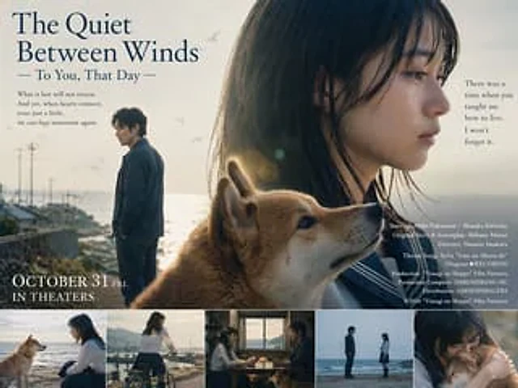

```text
Change to English version. Keep the images as is and translate the Japanese text into English. Title={argument name="title" default="The tranquility of the wind—To you on that day"}
```

Model: GPT Image 2
Author: GPT Image 2 Prompts

[ProjectD](https://aitoolsradar.com/en/prompts/3e16bb673ea7d9) · [Recorded source](https://x.com/old_pgmrs_will/status/2045384277924422030)
 · [Full original metadata and byte evidence](data/projectd-batch-0036.json)

## Laptop Technical Overview Infographic

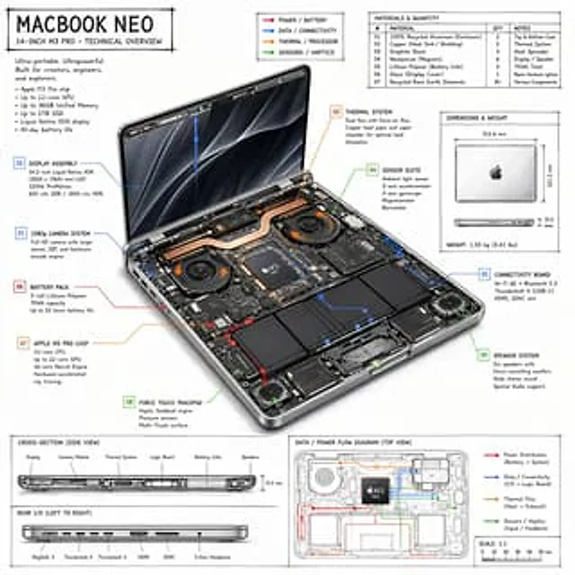

```text
{
  "type": "Technology Overview Infographic",
  "style": "{argument name=\"visual style\" default=\"Hand-drawn technical sketches with simple layout\"}",
  "product": {
    "name": "{argument name=\"product name\" default=\"MACBOOK NEO\"}",
    "subtitle": "14 inches{argument name=\"processor model\" default=\"M3 PRO\"} - Technology Overview"
  },
  "layout": {
    "centerpiece": {
      "description": "An open isometric view of the laptop reveals internal hardware components such as dual fans, copper heat pipes, battery cells, and logic modules.",
      "callouts_count": 9,
      "callout_labels": [
        "01 1080p Camera System",
        "02 Display Panel Components",
        "03 Cooling System",
        "04 Sensor Kit",
        "05 Connecting Projects",
        "06 Battery Pack",
        "07 {argument name=\"main component\" default=\"Apple M3 Pro chip\"}",
        "08 Force Touch Trackpad",
        "09 Speaker System"
      ]
    },
    "sections": [
      {
        "title": "Title text",
        "position": "Top left",
        "content": "Marketing slogans and a list of 5 specifications"
      },
      {
        "title": "legend",
        "position": "Upper-middle",
        "content": "Four color-coded arrows indicate{argument name=\"accent colors\" default=\"Red, blue, orange, green\"} Power, data, heat, and sensor flow lines"
      },
      {
        "title": "Material and quantity",
        "position": "Top right",
        "type": "sheet",
        "rows_count": 7,
        "columns": [
          "#",
          "Material",
          "quantity",
          "Remark"
        ]
      },
      {
        "title": "Size and weight",
        "position": "center right",
        "content": "Top and side views of a laptop computer in its closed state, with measurement data labeled."
      },
      {
        "title": "Cross-section (side view)",
        "position": "Bottom left (top half)",
        "content": "The side profile shows the internal component layout, with 6 labels."
      },
      {
        "title": "Backend I/O (from left to right)",
        "position": "Bottom left (lower half)",
        "content": "The side profile shows 6 ports."
      },
      {
        "title": "Data/Power Flow Diagram (Top View)",
        "position": "Bottom right",
        "content": "A wireframe top view with colored flow lines, a legend, and a scale bar."
      }
    ]
  }
}
```

Model: GPT Image 2
Author: GPT Image 2 Prompts

[ProjectD](https://aitoolsradar.com/en/prompts/ef068922e9fd29) · [Recorded source](https://x.com/BirdiePage71493/status/2046153405845147806#reversed-1)
 · [Full original metadata and byte evidence](data/projectd-batch-0036.json)

## Larus Canus #12

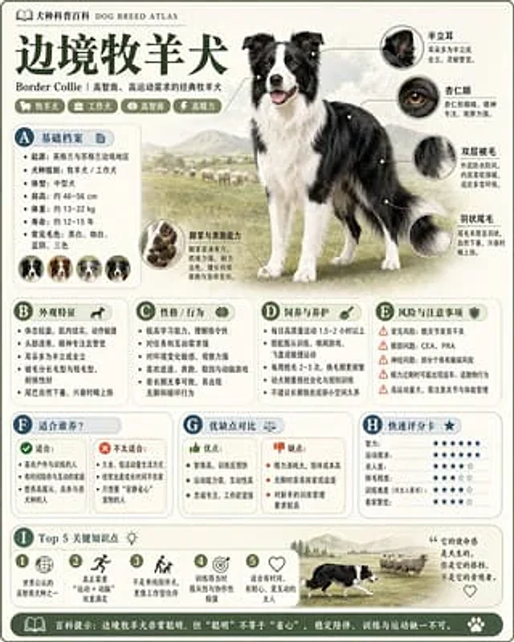

```text
请根据【主题】生成一张高质量竖版「科普百科图」。 

这张图不是普通海报，也不是单纯插画，而是一张兼具“图鉴感、百科感、信息结构感、收藏感”的模块化科普信息图。整体风格参考高级博物图鉴、现代百科书页、生活方式知识卡和社交媒体高传播信息图的结合。

请让画面包含：
- 一个清晰漂亮的主题主视觉
- 若干局部特征放大细节
- 多个圆角模块化信息分区
- 清楚的标题层级与重点标签
- 简洁但丰富的百科内容
- 可视化评分、要点总结或Top 5模块

内容栏目请根据主题自动适配，优先从这些方向中选择并合理组合：
基础档案、分类信息、外观特征、习性/生态、形成机制/结构组成、生长或使用条件、养护或维护建议、风险与注意事项、适合人群或适用场景、优缺点对比、快速评分卡。

视觉要求：
浅色干净背景，柔和配色，轻阴影，精致小图标，圆角信息框，整洁排版，信息密度高但不拥挤，阅读体验好。整体必须像真正可以发布、阅读、收藏、系列化生产的科普百科卡，而不是广告图。

请不要做成普通商业宣传海报。要突出“知识整理 + 模块信息 + 图鉴式展示”的特征。
```

Model: GPT Image 2
Author: Larus Canus

[ProjectD](https://aitoolsradar.com/en/prompts/3d34846e828f2b) · [Recorded source](https://x.com/MrLarus/status/2046231542817497392)
 · [Full original metadata and byte evidence](data/projectd-batch-0036.json)

## Larus Canus #270

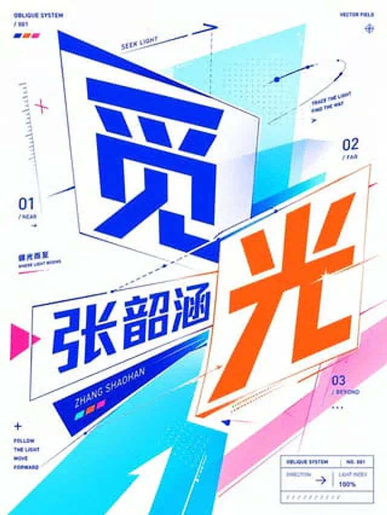

```text
请基于用户输入的【核心文字 / 单词 / 词组 / 短句 / 字母】，创作一张高完成度的「斜向透视平面字体概念海报 / Oblique Planar Perspective Typographic Poster」。

用户输入：[主题文字]；
文字语言：[中文 / 英文 / 中英混排]；
可选补充语境：[____]；
可选情绪倾向：[____]；
可选禁用元素：[____]。 

这不是普通插画，不是简单把文字放大后的字效海报，也不是传统正面平铺式平面排版，而是一张以“文字为主视觉核心”的现代实验性字体海报。整体必须采用「斜向透视平面字体构成 / Oblique Planar Perspective Typography」的方式来设计：文字不应完全贴在正面平面上，而应像被放置在不同倾斜角度的二维平面中，通过斜向基准线、透视压缩、平面偏转、角度切入、错位构成、向量指向、方向线条、半透明几何平面与模块化色块，共同建立一种“仍然是平面设计，但具有明显角度感、空间方向感、视觉张力和向量关系”的字体构成效果。

请先真正理解用户输入内容的字面含义、情绪气质、隐含象征、文化联想、心理感受与语义张力，再把这些理解转译成一个具有“方向性、倾斜关系、平面透视感和视觉对抗 / 连接关系”的字体海报系统。如果主题偏情绪型，请重点通过斜向文字平面的距离关系、重心偏移、留白方向、线条走势、模块密度变化和色块压迫 / 释放来表达；如果主题偏动作型，请重点通过倾斜推进、速度线、方向箭头、透视切片、错位平面和向量轨迹来表达；如果主题偏关系型，请重点通过多个文字主体、几何平面和图形模块之间的角度差、相交、重叠、对峙、包裹、切割和中介结构来表达；如果主题偏抽象概念型，请先找到一个简洁但具有视觉转译潜力的抽象隐喻，再通过斜向透视字体、向量辅助系统、局部遮挡、层级偏移、模块重复和变形网格来构建画面。

整体画面必须呈现为一张现代、锐利、清亮、时尚、有实验性、有传播力、有视觉记忆点的高完成度字体海报。用户输入的文字必须成为第一视觉主体，是整个海报的核心内容。文字可以横排、竖排、拆分、错位、分组、重组、局部裁切、局部遮挡、嵌套、倾斜、透视压缩、斜向旋转，甚至分别放置在不同角度的二维平面中，但必须始终保持较高识别度与清晰可读性。画面中至少要让观众明显感受到：文字不再是正面贴平，而是进入了一个由多个倾斜平面和方向关系组成的平面空间系统中。

请重点强化以下风格特征：文字有斜向角度感、近大远小的平面透视感、不同方向的向量关系、倾斜基准线、辅助箭头、几何切面、模块推进、局部框线、数据感标注、小型目录式辅助说明、少量点阵与路径线。可以让不同的文字或文字组处在不同倾斜平面中，形成彼此之间的视角差、方向冲突、视觉对话或张力关系。图形元素必须围绕文字构建，而不是独立装饰；它们应该支撑文字、切割文字、包裹文字、延伸文字的方向、强化文字的倾斜动势，并与文字共同构成一个完整的视觉句子。

视觉语言上，请采用 modern graphic design、oblique planar perspective typography、experimental typography、bold typographic composition、flat vector aesthetics、high-contrast graphic layout、contemporary editorial poster、crisp vector-like precision 的方向。整体不是写实，不是摄影，不是复古文学封面，不是包豪斯旧海报感，不是厚重肌理风，不是暗沉艺术海报，也不是普通 PPT 封面。它应当是更当代、更清亮、更锋利、更数字化、更具有设计公司提案感与展览海报感的视觉结果。

【新版配色要求】
配色必须鲜亮、透亮、清亮、艳丽、高对比，但不要固定使用蓝色与橙色组合，也不要默认落入常见的蓝橙撞色方案。请根据主题语义、情绪气质和视觉隐喻，自动生成一组更大胆、更有想象力、更有新鲜感的现代高对比配色。允许使用非常规组合、跳跃性色彩、强烈撞色、冷暖冲突、霓虹感、数码感、未来感或艺术化配色，但整体必须仍然有秩序、有审美控制、有设计感，不能杂乱失控。

请优先采用“2 个主色 + 1 到 2 个高亮点缀色 + 留白 / 结构支点色”的配色组织方式。可以探索但不限于以下方向：荧光绿 + 品红 + 冷白、亮黄 + 紫罗兰 + 黑色、酸橙绿 + 深紫 + 青蓝、玫红 + 青绿 + 银白、樱桃红 + 湖蓝 + 纯白、薄荷青 + 亮红 + 深蓝、荧光黄 + 桃红 + 紫色、珊瑚橙 + 青蓝 + 白色、多彩数码拼接配色等。每次生成时，请尽量形成一套独立的色彩记忆点，不要重复单一固定主配色，不要让作品系列都长得像同一张图换字。

文字颜色不要全部使用纯黑，可以根据构图关系，让不同文字主体使用不同高饱和色，或在同一组大字中形成主次色分配。允许少量深色作为结构支点，但整体画面应以鲜亮、清透、醒目、前卫的色彩印象为主。色彩应服务于语义表达，而不是仅仅为了热闹；要让观众觉得颜色是“被设计过的”，而不是随机堆砌的。

构图应大胆、倾斜、具有推进感和方向感，但同时要控制画面秩序。建议采用 1 组核心标题主体、1 组斜向透视文字平面系统、1 组几何向量与色块结构、少量辅助标注信息与点线符号。画面需要保留足够留白，让高饱和色与倾斜文字更有呼吸感和展览海报感。可以加入少量小字说明、标签、编号、英文关键词、极简副标题或短句，用来强化概念，但必须克制，不要抢夺主标题的视觉权重。辅助信息可模拟视觉识别系统或编辑设计中的注释语言，例如短词、参数、索引、方向说明、概念标签等。

字体与排版必须现代、清晰、醒目、有力量，并且具有一定实验性。中文适合使用几何无衬线、现代设计感强的标题字、窄长字形或有切面感的字形；英文适合使用 bold grotesk、condensed sans、geometric sans、editorial sans 等。允许局部拉伸、压缩、斜切、透视变形、切片错位，但不要把文字做成真实 3D 挤出字，不要厚重投影，不要真实立体建模，不要金属字，不要玻璃字，不要浮雕字。重点是“平面中的空间感”，而不是“物理三维立体感”。

图形元素可使用：斜向矩形、倾斜平面框、三角切角、圆点系统、箭头、路径线、细线辅助网格、透视边框、方向向量、点阵模块、数据感短线、色块面片、半透明几何切片、局部环形线、分区标签、小尺寸索引信息等。这些元素都必须服务主题语义和字体构成，不应沦为纯装饰。

请避免以下问题：不要做成普通正面平铺字体海报、不要做成传统极简主义排版封面、不要做成写实摄影或插画、不要做成厚重 3D 字、不要做成复古低饱和或米灰色调海报、不要堆砌无关图形、不要过度装饰、不要让文字不可读、不要让画面脏乱拥挤、不要让图形与主题词脱节、不要反复默认同一套主配色。

如果适合，请自动生成一句极短的副标题或概念短句，用来辅助解释主题，例如 “Between ____ and ____”、“The tension of ____”、“A state of ____”、“Where ____ begins”，或根据中文语境生成一句更简洁的中文短句，但必须保持简短、克制、设计化。

最终输出应是一张：高完成度、现代、鲜亮、高对比、平面、锐利、实验性强、具有斜向透视字体构成感、可读且有设计感、并且在配色上更大胆自由、更有想象力、更不落入固定蓝橙套路的现代字体概念海报。
```

Model: GPT Image 2
Author: Larus Canus

[ProjectD](https://aitoolsradar.com/en/prompts/c9ba8be9324317) · [Recorded source](https://x.com/MrLarus/status/2048816632613453900)
 · [Full original metadata and byte evidence](data/projectd-batch-0036.json)

## Larus Canus #287


```text
请为品牌[品牌名称]、类目为[品牌类目]创作一张高审美、高完成度的「品牌包装系统展示图」。这不是普通电商白底图，也不是单一产品图，而是一张具有品牌提案感、视觉识别系统感和商业摄影质感的包装家族陈列效果图。画面需要体现“同一品牌在多个包装载体上的统一落地”，呈现一个成熟消费品牌的完整包装系统。 

【画幅要求】整体必须为固定 4:5 的竖版海报构图，画面方向明确为纵向，禁止生成横版构图、宽幅桌面陈列或过于分散的横向展示。整体构图需符合海报阅读逻辑：上方保留呼吸感，中部为品牌包装系统的主要视觉焦点，下方安排辅助包装、标签和产品本体，整体重心集中，适合直接作为品牌展示海报发布。

【核心要求】根据【类目】自动匹配最合理、最自然的包装组合与产品形态，并围绕【品牌名字】建立统一的品牌视觉系统。画面中应选择少量但有代表性的包装形式，组成一组完整而精炼的品牌包装系统，不追求堆砌数量，而强调主次层级、品牌统一性与陈列美感。可根据类目合理选择以下包装类型中的一部分：手提袋 / 购物袋、纸盒 / 礼盒 / 外包装盒、长条盒 / 单品盒 / 套装盒、包装袋 / 封套 / 小样袋 / 软袋、杯子 / 瓶子 / 罐子 / 管状容器 / 喷雾瓶 / 泵头瓶、标签 / 贴纸 / 封签 / 吊牌 / 小卡片，以及与类目对应的真实产品本体。

【类目适配逻辑】包装形式与产品形态需要根据【类目】自动匹配，但不局限于单一方向。可参考以下适配逻辑自由发散：若类目为食品 / 烘焙 / 零食 / 饮品，则以纸袋、纸盒、包装袋、杯子、食品容器、贴纸、封签及真实产品本体为主；若类目为茶饮 / 咖啡 / 饮料，则以杯子、瓶子、罐装包装、提袋、杯套、封口贴、礼盒等为主；若类目为美妆 / 护肤 / 彩妆 / 香水，则以瓶、罐、管、盒、礼盒、手提袋、小样包装等为主；若类目为香氛 / 家居 / 生活方式，则以香薰瓶、蜡烛杯、包装盒、礼盒、提袋、吊卡、标签卡等为主；若类目为服饰 / 饰品 / 潮玩 / 文创，则以包装盒、抽屉盒、防尘袋、手提袋、贴纸、吊牌、配件包装等为主；若类目为数码配件 / 工具 / 小型消费品，则以硬盒、外包装盒、收纳袋、说明卡、贴纸、封套、标签等为主。整体必须体现“类目合理、品牌统一、包装成体系”的效果。

【数量与密度控制】请控制画面中的物件数量，不要过多堆砌，也不要把所有可能包装形式全部展示出来。整体应呈现“少而精、完整但不拥挤”的品牌包装系统效果。建议选择最具代表性的包装载体进行展示：大件包装 1～2 个，中型包装 2～3 个，小型包装或辅助物件 2～4 个，真实产品本体 1～3 个，总可见元素建议控制在 6～10 个之间。包装种类应体现层次变化与系统感，但不宜重复过多同类物件。画面需要有足够留白与呼吸感，确保每个包装都清晰可见、主次明确、摆放舒展，宁可少而精，也不要为了“完整”而过度塞满。

【品牌视觉系统要求】所有包装必须属于同一个品牌系统，统一使用【品牌名字】作为核心品牌识别元素。整体应具备一致的 logo / 标志呈现、字体风格、图形语言、插画语言或纹样系统、排版逻辑、配色体系、材质与印刷质感。品牌调性、色彩方向、图案元素、辅助图形和视觉氛围，请根据【类目】自动匹配并合理发散，不局限于任何固定风格。整体风格应统一、协调、具有品牌识别度，可以是简约高级、自然有机、时尚现代、轻奢精致、年轻清新、艺术感、潮流个性或经典优雅，但必须符合【类目】特征，并呈现成熟品牌的设计完成度。

【配色机制要求】整体配色不要固化为某一种固定组合，也不要连续多次出现高度相似的主色系统。每次生成时应根据【类目】与品牌气质，主动形成不同的主色方案与配色关系，采用“受控发散”的方式进行色彩演绎。色彩可以是低饱和自然色、现代中性色、轻复古色、明快清新色、轻奢深色系或艺术感综合色系，但必须保持高级、统一、克制、有品牌感。允许每次生成时呈现不同的视觉气质，例如奶油白与焦糖棕、雾灰蓝与暖白、橄榄绿与亚麻米、酒红与奶霜白、可可棕与象牙白、炭灰与麦秆金、雾粉灰与米白、海军蓝与暖灰等，仅作为参考方向而非固定模板。不要荧光色，不要廉价高饱和，不要杂乱失控的多色拼贴。

【画面构图与陈列要求】画面采用品牌包装家族陈列逻辑，而不是杂乱堆放。整体为商业摄影棚场景，使用 3/4 轻俯视角或略带透视的正面陈列角度，形成有层次、有秩序、有主次的包装展示画面。构图参考以下逻辑：后景摆放 1～2 个较大的包装作为视觉支撑，如手提袋、大礼盒、大外盒；中景安排品牌核心包装或主力单品包装，作为主要视觉焦点；前景摆放较小包装、辅助包装、标签、贴纸及真实产品本体；至少有一个真实产品与包装产生自然互动，如产品半露出、摆放在包装前方、与包装组合展示；整体形成平衡而有设计感的三角式或错落式构图。画面干净、有留白、不拥挤，内容丰富但克制，以有限而精准的包装组合体现完整的品牌包装生态。

【视觉风格要求】整体呈现高端商业摄影质感与品牌提案感，背景为干净的摄影棚环境，可为白色、暖白色、浅灰色，或根据品牌调性自动匹配的极简背景。画面应强调真实的包装材质表现、清晰的纸张折痕、盒型结构、瓶罐轮廓、标签细节、印刷质感、压纹 / 烫金 / 哑光 / 棉纸纹理 / 牛皮纸纹理等材质细节，以及统一而高级的配色搭配、精致现代干净的品牌视觉语言和强烈的“这是一整套品牌包装系统”的完整感。

【光影要求】采用真实商业摄影级光影，可为柔和棚拍光，也可带有轻微方向性的自然侧光。需要有清晰但克制的阴影，以增强立体感、空间感与高级感。整体光线通透、明亮、干净，不要阴暗，不要廉价感，不要杂乱背景。

【最终效果要求】最终画面应像一个成熟品牌的包装系统展示海报、包装家族提案图或品牌视觉落地效果图，而不是零散商品拼图。重点突出：固定 4:5 竖版海报感、品牌统一性、包装家族完整性、商业摄影感、设计提案感、类目适配性，以及高级审美与视觉完成度。
```

Model: GPT Image 2
Author: Larus Canus

[ProjectD](https://aitoolsradar.com/en/prompts/85dc0d734bd060) · [Recorded source](https://x.com/MrLarus/status/2047253028462317674)
 · [Full original metadata and byte evidence](data/projectd-batch-0036.json)

## Larus Canus #289

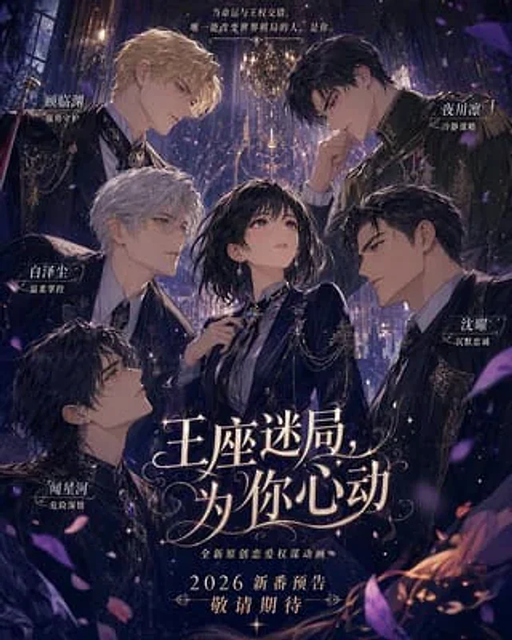

```text
请创作一张【主题为：】的[乙女恋爱游戏主视觉海报]风格的二次元宣传图。

整体设定为：多位具有强烈权力感、领袖气场、成熟魅力的男性角色，围绕一位女性主角展开情感与权谋交织的修罗场关系。画面不是普通群像，而是典型女性向恋爱手游的官方KV海报：所有男性角色从不同方向靠近女主，形成守护、凝视、占有欲、克制深情、危险暧昧等复杂张力。女主位于视觉中心，气质聪慧、冷静、优雅，既像外交核心人物，又像乙女游戏中让所有人倾心的唯一女主。

画风要求：高完成度日系二次元插画，女性向手游卡面质感，唯美、华丽、梦幻、精致，电影级光影，柔焦，镜头光晕，星光粒子，漂浮花瓣，细腻皮肤质感，精致发丝，服装高级，面部神情有戏剧张力。

构图要求：竖版海报构图，人物半身到近景特写混合，女主居中，其他男性角色从左上、右上、左下、右下等方位围拢，形成视觉包围感与情绪压迫感；人物彼此之间有明确视线关系，所有情绪都聚焦在女主身上。

背景要求：宫殿、议事厅、国际局势隐喻空间、权力中心、战争与秩序的象征性环境，但整体处理要浪漫化、幻想化，不要做成真实新闻照片，而是做成戏剧化的恋爱游戏世界观背景。

排版要求：画面中加入中文游戏海报文案，包括大标题、副标题、角色名字、CV字样、人物台词、预约开启中文字样，以及应用商店风格按钮。整体排版像正式上线前的手游宣传海报，设计精致统一，不能杂乱。
```

Model: GPT Image 2
Author: Larus Canus

[ProjectD](https://aitoolsradar.com/en/prompts/fcb2fb4db4f1bd) · [Recorded source](https://x.com/MrLarus/status/2047303787249803449)
 · [Full original metadata and byte evidence](data/projectd-batch-0036.json)

## Larus Canus #5

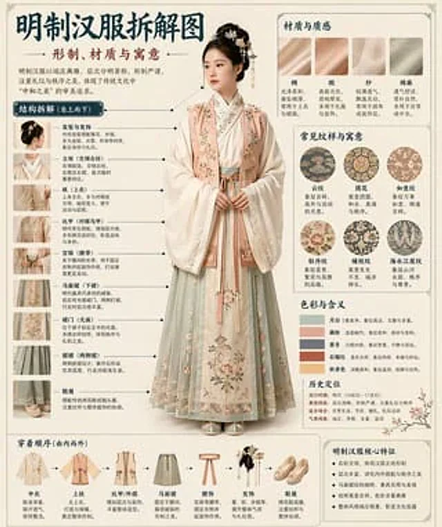

```text
请根据[主题]自动生成一张[博物馆图鉴式中文拆解信息图]。

要求整张图兼具真实写实主视觉、结构拆解、中文标注、材质说明、纹样寓意、色彩含义和核心特征总结。你需要根据[主题]自动判断最合适的主体对象、服饰体系、器物结构、时代风格、关键部件、材质工艺、颜色方案与版式结构，用户无需再提供其他信息。

整体风格应为：国家博物馆展板、历史服饰图鉴、文博专题信息图，而不是普通海报、古风写真、电商详情页或动漫插画。背景采用米白、绢纸白、浅茶色等纸张质感，整体高级、克制、专业、可收藏。

版式固定为：
- 顶部：中文主标题 + 副标题 + 导语
- 左侧：结构拆解区，中文引线标注关键部件，并配局部特写
- 右上：材质 / 工艺 / 质感区，展示真实纹理小样并附说明
- 右中：纹样 / 色彩 / 寓意区，展示主色板、纹样样本和文化解释
- 底部：穿着顺序 / 构成流程图 + 核心特征总结

若主题适合人物展示，则以真实人物全身站姿为中央主体；若更适合器物或单体结构，则改为中心主体拆解图，但整体仍保持完整中文信息图形式。所有文字必须为简体中文，清晰、规整、可读，不要乱码、错字、英文或拼音。重点突出真实结构、材质差异、文化说明与图鉴气质。

避免：海报感、影楼感、电商感、动漫感、cosplay感、乱标注、错结构、糊字、假材质、过度装饰。
```

Model: GPT Image 2
Author: Larus Canus

[ProjectD](https://aitoolsradar.com/en/prompts/51e3cda270485c) · [Recorded source](https://x.com/MrLarus/status/2045504669401653414)
 · [Full original metadata and byte evidence](data/projectd-batch-0036.json)

## Larus Canus #6


```text
生成一张[餐饮品牌触点矩阵]系列视觉图，用于展示一个完整的餐饮品牌视觉系统与包装应用方案。

这是一个面向餐饮行业的品牌VI样机展示板 / 包装系统陈列图 / 品牌提案页。画面不是单张宣传海报，而是将品牌主视觉、主打产品、包装物料、菜单信息、促销内容与小型延展物料整合成一张系统化品牌展示图。

【用户输入信息】
- 品牌名：[品牌名]
- 经营类目：[经营类目]

【可选补充信息】
- 主打产品：[主打产品]
- 品牌口号：[品牌口号]
- 风格方向：[风格方向]
- 主色调：[主色调]
- 辅助色：[辅助色]
- 客群定位：[客群定位]
- 价格定位：[价格定位]
- 地域风格：[地域风格]
- 画幅比例：[画幅比例]

【自动补全规则】
如果用户没有提供完整品牌信息，请根据【品牌名】与【经营类目】自动推导并完成最优组合，包括：
1. 判断品牌调性（年轻、亲和、国潮、复古、清新、治愈、精致、快餐感等）
2. 匹配适合该类目的视觉风格
3. 自动设定合理的主色、辅助色与点缀色
4. 自动补全主打产品与辅助产品
5. 自动生成适合餐饮传播的品牌口号、卖点文案、价格信息与推荐标签
6. 自动匹配合适的餐饮物料类型与展示内容

【画面内容要求】
画面中应围绕【品牌名】构建一整套餐饮品牌物料系统，包含但不限于以下内容：
- 核心包装：手提袋、外卖袋、包装盒、打包盒、纸袋、塑料袋
- 饮品 / 食品容器：纸杯、杯套、碗、餐盒、封口贴、标签
- 信息传播物料：菜单、促销海报、价格牌、桌牌、立牌、小卡片
- 小型品牌延展：贴纸、徽章、纸巾、餐具、包装封条、吊牌
- 产品表现：主打餐品照片、单品主视觉、食物特写、切面图、推荐组合图

【构图与版式要求】
采用竖版【画幅比例】构图，整体为白色、米白色或浅灰色背景，以品牌提案板 / 样机矩阵板的方式组织画面。
通过大中小物料混排形成视觉层级：
- 大型包装和主视觉物料作为视觉锚点
- 中型菜单、海报和价格模块负责信息传达
- 小型贴纸、餐具、标签与周边物料增强系统完整度

整体构图应具有明确秩序感，接近品牌方案展示页、作品集陈列页、包装提案页的视觉效果。元素要排列整齐但不呆板，丰富但不杂乱，具有模块化与可阅读性。

【风格与质感要求】
整体风格应符合【经营类目】与【品牌名】气质，具有明显的餐饮品牌感、商业传播感、样机展示感与系统设计感。
可融合以下风格倾向：现代简洁、国潮趣味、轻复古、生活方式感、快消感、温暖治愈感、年轻化传播感。
材质真实，包含纸张、塑料、布袋、包装盒、杯体、贴纸、餐具等真实物料质感；光影柔和统一，像在干净摄影棚环境中拍摄的品牌物料合集。

【文字与图形要求】
所有物料上应统一出现品牌名、Logo、品牌符号、主色块、口号或卖点文案。
文案可为中文或中英混排，但要符合餐饮传播表达，简洁直接，具备商品售卖感。
图形系统可以根据品牌调性选择简洁插画、几何图形、卡通吉祥物、符号化图标或辅助纹样，用于增强品牌记忆点。

【输出目标】
最终生成一张完整的【品牌名】餐饮品牌视觉系统展示图，像设计团队为该餐饮品牌制作的整套品牌提案样机板。
要求画面统一、精致、具备商业落地感与作品集展示质量，并能清楚体现品牌风格、主打类目与多触点包装延展能力。

Make the aspect ratio 9:16
```

Model: GPT Image 2
Author: Larus Canus

[ProjectD](https://aitoolsradar.com/en/prompts/348882ee5e345c) · [Recorded source](https://x.com/MrLarus/status/2048360321379701233)
 · [Full original metadata and byte evidence](data/projectd-batch-0036.json)

## Last Supper Selfie Scene

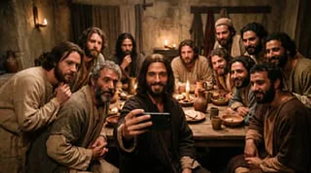

```text
This is a cinematic, photorealistic reconstruction of "The Last Supper," presenting a self-portrait scene brimming with a sense of modern displacement, set within a dimly lit, ancient stone chamber. [Exhibition]{argument name="central figure" default="Jesus"} Seated at the center of a long, rustic wooden table, dressed in a dark earth-toned biblical robe, one arm outstretched to the camera, he holds a modern black smartphone for a group selfie. Around him, twelve disciples huddle closely around the table, making a total of thirteen, all dressed in simple first-century robes of beige, brown, taupe, soft blue, and cream. The composition should create an intimate, slightly humorous yet authentic atmosphere, with each person tilting towards the phone as if posing for a photo. Warm candlelight and soft firelight, with a few candles visible on the table and in wall niches, create amber highlights, deep shadows, and a sacred, old-world ambiance. The table is set with rustic pottery, clay cups, wooden bowls, torn flatbread, and simple food. The background should feature rough plastered stone walls, hanging curtains, wooden pegs, and sparse historical decorations. Using a mobile phone camera perspective to create a mid-range wide-angle group portrait composition, it features shallow depth of field, cinematic realism, delicate fabric textures, natural skin tones, and rich warm brown tones.
```

Model: GPT Image 2
Author: GPT Image 2 Prompts

[ProjectD](https://aitoolsradar.com/en/prompts/bcf22da44a2264) · [Recorded source](https://x.com/techhalla/status/2047590978656047528#reversed-1)
 · [Full original metadata and byte evidence](data/projectd-batch-0036.json)

## Last Supper Selfie Scene


```text
A cinematic, photorealistic reimagining of the Last Supper as a modern anachronistic selfie scene inside a dim ancient stone room. Show {argument name="central figure" default="Jesus"} seated at the center front of a long rustic wooden table, wearing dark earth-toned biblical robes, extending one arm toward the camera and holding a modern black smartphone to take a group selfie. Surround him with exactly 12 disciples crowded closely around the table, making 13 people total, all dressed in simple first-century robes in beige, brown, taupe, muted blue, and cream. The composition should feel intimate and slightly humorous but still believable, with everyone leaning inward toward the phone as if posing for the photo. Use warm candlelight and soft firelit illumination, with several visible candles on the table and wall niches, creating amber highlights, deep shadows, and a sacred old-world atmosphere. Include rustic pottery, clay cups, wooden bowls, torn flatbread, and simple food on the table. The background should feature rough plastered stone walls, hanging cloth drapes, wooden pegs, and sparse historical decor. Frame it as a medium-wide group portrait from the phone camera’s point of view, with shallow depth of field, cinematic realism, detailed fabric textures, natural skin tones, and a rich warm brown color palette.
```

Model: GPT Image 2
Author: TechHalla

[ProjectD](https://aitoolsradar.com/en/prompts/9aca6c808a8814) · [Recorded source](https://youmind.com/prompts/last-supper-selfie-scene-15620)
 · [Full original metadata and byte evidence](data/projectd-batch-0036.json)

## Latin American Tech Festival Poster

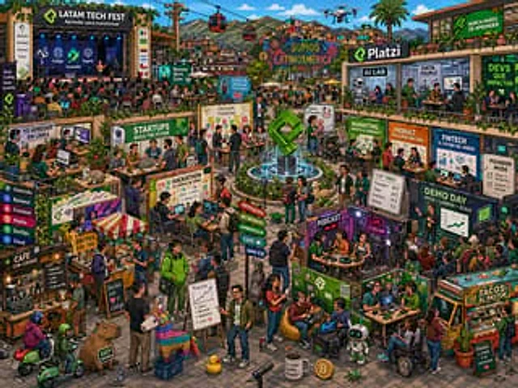

```text
Create a highly detailed, colorful, isometric illustration depicting a bustling Latin American technology expo in an open city plaza. Dozens of people are shown socializing, coding, giving presentations, dining, recording media, and attending lectures. The overall style should evoke the feel of a high-end editorial cityscape poster: vibrant, content-rich, optimistic, playful, with clear, legible signage, clean lines, a painterly quality, warm sunlight, and a celebratory atmosphere reminiscent of a startup community. The main title text on the large stage in the upper left corner is {argument name="headline text" default="LATAM TECH FEST"} The subtitle is "Aprender para transformar" in Spanish. The stage showcases a live conference illuminated in blue light, featuring a speaker and seated audience members; the stage area includes four vertical icon panels labeled "Educación," "Tecnología," "Innovación," and "Futuro," while three glowing theme icons are added to the back wall, labeled "Código," "Comunidad," and "Impacto." The plaza is constructed as a dense, multi-zone activity map, with 24 clearly marked signs or booths distributed throughout the scene: "Keep Coding Keep Growing", "YO APRENDÍ EN LÍNEA", "Remote Work Zone", "ENGLISH UPGRADE YOUR FUTURE", "STARTUPS BUILD THE FUTURE", "DESIGN THINKING", "HACKATHON 24 HORAS DE IDEAS", "Café con código", "AREPAS CON TODO", "Hechas con código y ♥", "Inspiración", "Networking", "Aprendizaje", "Café", "Baños", "SOMOS LATINOAMÉRICA", "AI LAB", "DATA PEOPLE", "DEVS QUE IMPACTAN", "MARKETING GROWTH &amp; COMMUNITY", "PRODUCT "BUILD WHAT MATTERS", "FINTECH EL FUTURO DEL DINERO", "FOUNDER MODE", and "DEMO DAY LAUNCH · SCALE" are displayed. A circular fountain is placed in the center of the square, with a large green geometric logo sculpture serving as a visual anchor. Tables, laptops, projects, crowds, flowerbeds, and benches surround the fountain. The background features a colorful hillside community with mountains, palm trees, power lines, and exactly two red cable cars spanning the sky; additionally, exactly one small drone is added overhead. A large brand logo is placed on a building in the upper right corner.{argument name="brand name" default="Platzi"} And a green billboard that reads "NUNCA PARES DE APRENDER". The lower and middle foregrounds are filled with miniature scenes: a podcast booth labeled "PODCAST ON AIR", a neon-lit "LIVE STREAM" corner, a startup workspace where people use laptops, a hackathon judging table, a founder pitching area, a fintech project with charts, and a coffee stand equipped with an espresso machine and menu board. Six animal or mascot details are added throughout the scene: an orange cat near the workbench on the left, a capybara in the lower left, a multicolored alpaca piñata in the lower left center, a yellow rubber duck near the bottom center, a small green robot near the bottom right, and a small turtle near the coin at the bottom. Additionally, exactly four vehicle elements are placed: two green scooters in the lower left, a beautifully decorated taco truck with "TACOS AL PASTOR" written on it in the lower right, and a wheelchair user weaving through the crowd. Include additional props to enhance the tech culture: a whiteboard with sticky notes, a project titled "Traction" (with an upward trend chart and key words like "Users," "Revenue," "Retention," and "Love"), a project titled "CAP TABLE" (with percentage lines), Bitcoin-style coins on the floor, microphones, cameras, cables, monitors, smartphones, and branded green merchandise. Clothing should be modern, casual, and entrepreneurial, including hoodies, jackets, backpacks, jeans, sneakers, and conference badges, showcasing diversity across age groups and Latin American identities. Use rich shades of green, cyan, orange, purple, and warm neutrals, and incorporate lush vegetation and vines into the architecture. Make every corner bustling and full of discovery, like a "Where's Willie?" style tech ecosystem celebration, but maintain a clear and engaging composition.
```

Model: GPT Image 2
Author: GPT Image 2 Prompts

[ProjectD](https://aitoolsradar.com/en/prompts/3c5ca94202552f) · [Recorded source](https://x.com/umbertoleon/status/2046997710264209420#reversed-0)
 · [Full original metadata and byte evidence](data/projectd-batch-0036.json)

## Latte Photo With Emotional Doodles

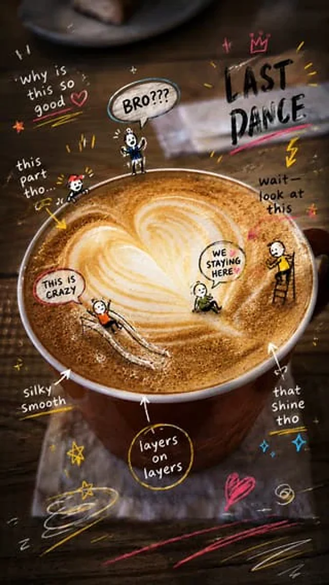

```text
Goal: Create a vertical social-media image where a realistic cafe photo is overlaid with playful hand-drawn imagination doodles, as if emotions and thoughts are spilling out onto the scene.

Canvas: Vertical 9:16 composition, close-up perspective, warm shallow-depth-of-field photography. The main subject is {argument name="drink" default="a latte in a brown ceramic cup"} on a dark wooden table, sitting on a gray square coaster. The latte art is a large creamy heart shape in the foam, with golden-brown espresso crema around it. Background is softly blurred with a dark plate and pastry near the top edge.

Visual style: Keep the base image photorealistic, cozy, warm, and slightly moody, with natural cafe lighting and visible foam texture. Add energetic mixed-media doodles on top: white marker handwriting, black brush lettering, red and yellow crayon strokes, arrows, sparkles, hearts, underlines, scribbles, and tiny cartoon stick characters. The doodles should feel spontaneous, imperfect, emotional, and layered over the photo, not digitally polished.

Doodle text and labels: Include exactly 9 handwritten text callouts around the cup: 1) “why is this so good” in white at upper left with a pink heart and underline, 2) “BRO???” inside a speech bubble above the cup, 3) “LAST DANCE” in large black brush letters at upper right with yellow emphasis marks and a pink underline, 4) “this part tho...” on the left with a yellow arrow pointing to the latte surface, 5) “THIS IS CRAZY” in a speech bubble near the lower-left latte foam, 6) “WE STAYING HERE” in a speech bubble on the right side of the latte art, 7) “wait— look at this” on the right with a pink arrow pointing to the foam, 8) “silky smooth” at lower left with a white arrow pointing to the cup rim, 9) “layers on layers” inside a yellow circle at the bottom center with an arrow up to the cup, and 10) “that shine tho” at lower right with a white arrow pointing to the glossy foam.

Tiny character count: Add exactly 5 small doodled cartoon people interacting with the latte: 1) one standing on the upper rim with arms raised and a speech bubble saying “BRO???”, 2) one tiny red-capped character on the left rim pointing toward the foam, 3) one sliding down the latte surface on white drawn slide lines with the speech bubble “THIS IS CRAZY”, 4) one sitting near the right-center latte art with the speech bubble “WE STAYING HERE”, and 5) one on a small ladder at the right rim looking toward the foam.

Decorative doodle count: Add exactly 15 extra decorative marks around the scene: a small red star at upper left, two yellow stars near the lower left, one pink crown above the “LAST DANCE” text, one yellow lightning bolt on the right, two blue sparkles at lower right, one pink heart near the bottom, one white spiral scribble at bottom left, one yellow oval swirl at bottom left, one small beige spiral at bottom right, two long pink swoosh lines across the bottom, one long yellow swoosh near the bottom, and one short white scribble near the top left.

Constraints: Preserve the latte and table as a normal realistic photograph while making only the surrounding world visually noisy and imaginative. Use {argument name="main lettering phrase" default="LAST DANCE"} as the largest readable text. Keep all handwriting legible, rough, and hand-drawn. No watermark, no border, no extra UI elements.
```

Model: GPT Image 2
Author: Kollab_AI

[ProjectD](https://aitoolsradar.com/en/prompts/acd4b377492a64) · [Recorded source](https://youmind.com/prompts/latte-doodle-photo-21123)
 · [Full original metadata and byte evidence](data/projectd-batch-0036.json)

## Laughing Woman on Japanese Veranda


```text
主題：
縁側でこぼれる笑い

主体：
{argument name="人物" default="木造家屋の縁側脇で腰から深く前屈みになり、片手で口を覆って笑う20代女性"}。画面中央から右に上半身を横長に大きく置き、白地に水色の小花柄ドレス、壁へ伸ばした手を描く。

人物・表情：
丸みのある頬、小さな鼻、笑って閉じた目。顔を画面右下へ向け、人物自身の左手で口元を覆い、頬を上げた大きな笑顔。濃い茶色の髪を左右二つの小さなお団子にまとめ、薄い前髪と頬に落ちる細い後れ毛を残す。

服装・ポーズ：
白地に淡い水色の細かな花柄を散らした細肩紐の短いフリルワンピース。背中で結ぶ細いリボン、ゆったりした上身頃、二段の波打つ裾を明确にする。腰から直角近くまで前へ曲げて立つ。左肘を曲げて左手で口を覆う。人物自身の右腕を斜め上へ伸ばし、右手のひらを白い壁へ置いて身体を支える。

背景・光：
画面右に白い漆喰壁、木枠の引き戸と縁側、左奥に瓦屋根の建物、緑の木々、砂利と飛び石の庭。画面左上から暖かな直射日光を入れ、背中、腕、脚、花柄布を明るく照らし、縁側側へ長い影を作る。

構図・カメラ：
縦3:4。腰の高さの横位置カメラによる腿上ポートレート。人物の腰を左半分、顔と口を覆う手を中央右、壁へ置く右手を右上に配置する。脚は下端、右手指は右端近くに収める。顔と両手にピントを合わせ、庭を柔らかくぼかす浅い被写界深度。

質感・スタイル：
暖かな夏の自然光で撮影したフォトリアルな実写写真。薄い花柄布、木材と漆喰、肌の光、髪の後れ毛、砂利庭を精細に描く。

ネガティブ：
口を覆う左手と壁を支える右手の変更；深い前傾姿勢の弱化
```

Model: GPT Image 2
Author: Prompt アトリエ｜AI画像プロンプト

[ProjectD](https://aitoolsradar.com/en/prompts/e5195864a3c867) · [Recorded source](https://youmind.com/prompts/laughing-woman-veranda-summer-afternoon-32269)
 · [Full original metadata and byte evidence](data/projectd-batch-0036.json)

## Laundry Balcony Vocabulary Journal

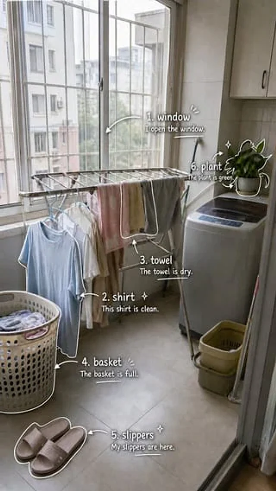

```text
{
  "type": "photo-based visual English vocabulary journal page",
  "source_scene": "a realistic vertical smartphone photo of a small apartment laundry balcony in soft daylight, seen from the doorway, with tall barred windows on the left, neighboring buildings visible outside, a metal drying rack with hanging clothes in the middle, a washing machine on the right with a potted green plant on top, a full perforated laundry basket at lower left, pink house slippers on the floor near the bottom, and gray tiled floor and beige wall cabinets",
  "style": "keep the original photo realistic and natural, then overlay cute handwritten study notes in white ink, with hand-drawn arrows, outlines, sparkles, curved brackets, and underline doodles; casual scrapbook / language-learning diary aesthetic; clean readable typography with subtle shadow for contrast",
  "format": {
    "orientation": "vertical 9:16 smartphone poster",
    "composition": "overlay labels directly beside the corresponding objects without blocking the scene; use white marker-like text and doodles"
  },
  "vocabulary_overlay": {
    "headline": "no main headline, only numbered vocabulary labels placed around the image",
    "count": 6,
    "items": [
      {
        "number": 1,
        "word": "{argument name=\"word 1\" default=\"window\"}",
        "example_sentence": "{argument name=\"sentence 1\" default=\"I open the window.\"}",
        "target_object": "large window panes and metal window bars in the upper left and center",
        "placement": "upper center-right near the window",
        "doodles": "curved arrow pointing left toward the window, small emphasis lines, short underline beneath the sentence"
      },
      {
        "number": 2,
        "word": "{argument name=\"word 2\" default=\"shirt\"}",
        "example_sentence": "{argument name=\"sentence 2\" default=\"This shirt is clean.\"}",
        "target_object": "light blue shirt hanging from the drying rack on a hanger",
        "placement": "lower left-middle beside the hanging shirt",
        "doodles": "white outline tracing the shirt edge, arrow pointing to the shirt, small sparkle"
      },
      {
        "number": 3,
        "word": "towel",
        "example_sentence": "The towel is dry.",
        "target_object": "gray towel draped over the metal drying rack",
        "placement": "middle right below the towel",
        "doodles": "upward arrow pointing to the towel and a simple underline"
      },
      {
        "number": 4,
        "word": "basket",
        "example_sentence": "The basket is full.",
        "target_object": "round plastic laundry basket filled with clothes at the lower left",
        "placement": "lower left-center beside the basket",
        "doodles": "white outline around the basket rim and side, arrow pointing to the basket, small emphasis strokes, underline"
      },
      {
        "number": 5,
        "word": "slippers",
        "example_sentence": "My slippers are here.",
        "target_object": "pair of pale pink slide slippers on the floor near the bottom",
        "placement": "bottom center-right above the slippers",
        "doodles": "white outline around both slippers, curved arrow pointing to them, small sparkle, underline"
      },
      {
        "number": 6,
        "word": "plant",
        "example_sentence": "The plant is green.",
        "target_object": "green potted plant on top of the washing machine",
        "placement": "upper right beside the plant",
        "doodles": "white outline around leaves and pot, arrows circling the plant, sparkles"
      }
    ]
  },
  "text_rendering": "Use clear white handwritten lettering with bold vocabulary words and smaller example sentences. Number each item exactly as shown from 1 to 6. Add playful notebook-style marks but keep all text legible.",
  "lighting_and_mood": "bright overcast daylight, cozy everyday home atmosphere, candid photo realism combined with charming study-note annotation"
}
```

Model: GPT Image 2
Author: Larus Canus

[ProjectD](https://aitoolsradar.com/en/prompts/72f9694f0bd901) · [Recorded source](https://youmind.com/prompts/english-vocabulary-journal-photo-18637)
 · [Full original metadata and byte evidence](data/projectd-batch-0036.json)

## Layered Paper-Cut Illustration Poster


```text
为原创文旅品牌“{argument name="品牌名" default="鹤望武汉"}”创作一幅高端分层纸雕插画海报，传播命题为“{argument name="传播命题" default="登楼望江，一眼看见武汉的山水骨架"}”，3:4 竖版。画面使用前景窗口构图，以五至七层厚纹理纸构成蛇山、黄鹤楼、长江、武汉长江大桥与对岸城市天际线；黄鹤楼位于后景山脊，屋檐层叠、金色琉璃瓦与朱红柱体关系准确，中景长江大桥横向延伸，江面两艘小型轮渡尺度克制，不能把晴川阁与黄鹤楼合并。纸张切边利落，统一左上柔光，层间阴影真实，综合色为黛青、暖米白、朱砂红和少量鎏金黄，金色只用于视觉焦点。主标题“{argument name="主标题" default="登楼见江城"}”置于右上大片留白区，两行现代宋体；副标题“从蛇山望向长江的壮阔日常”横排于标题下方；品牌名“鹤望武汉”置于左下纸质印章形品牌位，保持现代而非仿古。规范简体中文、无错字漏字，仅使用中文；禁止廉价红金模板、漫天祥云、古装人物、建筑比例失真、塑料材质、厚重发光描边、知名标识、水印与额外文案。
```

Model: GPT Image 2
Author: Mr.pinecone

[ProjectD](https://aitoolsradar.com/en/prompts/d1994ec060347d) · [Recorded source](https://youmind.com/prompts/layered-paper-cut-illustration-poster-30983)
 · [Full original metadata and byte evidence](data/projectd-batch-0036.json)

## Layered Papercut City Travel Poster

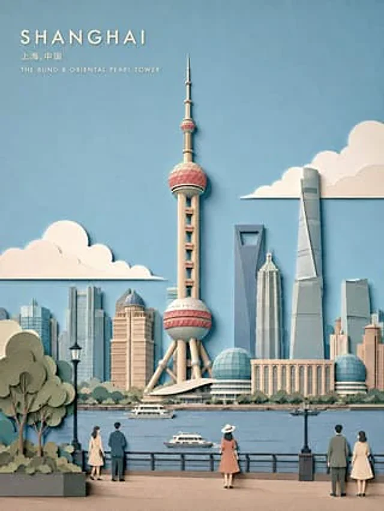

```text
Create a refined vertical 3:4 travel poster of {argument name="city" default="CITY"} as a handcrafted layered papercut illustration.

First identify the city, country, architecture, landscape, climate, and visual character. Choose ONE iconic HERO LANDMARK and establish one believable real-world viewpoint. All supporting buildings, streets, parks, water, and skyline elements must realistically fit that viewpoint. No landmark collage.

VISUAL COMPOSITION

Make the HERO landmark the dominant element, occupying roughly 45–60% of the image height. Preserve its authentic silhouette, proportions, roofline, structural details, and surrounding environment while simplifying minor details.

Use only 1–3 subtle secondary elements such as local buildings, skyline, bridge, park, waterfront, street trees, tiny pedestrians, or vehicles. Keep them smaller, flatter, and lower contrast.

Composition:

Top: 25–35% open sky and negative space

Middle: HERO landmark and distant city

Bottom: human-scale street, park, waterfront, or neighborhood

Keep at least 30% visually quiet.

PAPERCUT STYLE

Use shallow 2–6 layer cut-paper construction with matte handmade paper, subtle grain, clean cut edges, overlapping shapes, and delicate 1–3 mm shadows.

Graphic and editorial, not a miniature model.

Simplify architecture into clean paper masses. Avoid excessive windows, bricks, cables, railings, roof tiles, and tiny details. Create depth through scale, overlap, and atmospheric color rather than 3D modeling.

COLOR & LIGHT

Use an authentic 6–8 color muted pastel palette inspired by {argument name="city" default="CITY"}: pale sky blue, ivory, cream, muted brick, dusty blush, pale stone, sage, and blue-grey, adjusted to the city.

Use bright, soft, diffused daylight. Keep shadows subtle.

TYPOGRAPHY

Place a small uppercase {argument name="city" default="CITY"} title in the upper-left or upper-right negative space, optionally with the local name, country, or HERO landmark name.

Use clean geometric lettering, wide spacing, flat cream/white paper. Typography must remain secondary and occupy no more than 12–18% of the image.

FINAL TARGET

Premium contemporary travel illustration.
Elegant, airy, sophisticated, handcrafted, and geographically believable.
```

Model: GPT Image 2
Author: Saul Goodman

[ProjectD](https://aitoolsradar.com/en/prompts/859b60ab6d0c4e) · [Recorded source](https://youmind.com/prompts/layered-papercut-city-travel-poster-32272)
 · [Full original metadata and byte evidence](data/projectd-batch-0036.json)

## Leaked AI Benchmark Report Photo


```text
{
  "type": "Photograph of a computer monitor displaying academic and technical reports.",
  "style": "Slightly tilted screen photo, showing moiré patterns, LCD pixel grid, slight reflections, LaTeX document layout, serif font.",
  "document_header": {
    "left": "4. Benchmark Assessment",
    "right": "{argument name=\"report title\" default=\"DeepSeek-V4 Technical Report\"}"
  },
  "introductory_text": "Summarize{argument name=\"main model name\" default=\"DeepSeek-V4\"} contrast{argument name=\"competitor model 1\" default=\"GPT-5.3\"} ,{argument name=\"competitor model 2\" default=\"Claude Opus 4.6\"} as well as{argument name=\"competitor model 3\" default=\"Gemini 3.1 Pro Preview\"} The comprehensive evaluation section.",
  "visualizations": {
    "legend": "Five items with color codes: Dark blue, Gray, Light gray, Blue stripes, Light blue",
    "bar_charts": {
      "count": 6,
      "labels": [
        "MMLU-Pro (EM)",
        "GPQA-Diamond (Pass@1)",
        "AIME 2025 (Pass@1)",
        "LiveCodeBench (Pass@1-COT)",
        "SWE-bench Verified (Resolved)",
        "Tau-bench (Average)"
      ]
    },
    "caption": "Figure 1 | Performance comparison of core benchmarks. DeepSeek-V4 achieved industry-leading results in most benchmark tests."
  },
  "data_table": {
    "columns": [
      "Benchmarking",
      "{argument name=\"main model name\" default=\"DeepSeek-V4\"}",
      "{argument name=\"competitor model 1\" default=\"GPT-5.3\"}",
      "{argument name=\"competitor model 2\" default=\"Claude Opus 4.6\"}",
      "{argument name=\"competitor model 3\" default=\"Gemini 3.1 Pro Preview\"}",
      "GPT-4.1"
    ],
    "categories": {
      "count": 4,
      "rows": [
        {
          "label": "General",
          "icon": "globe/network",
          "sub_items": 3
        },
        {
          "label": "Reasoning and Mathematics",
          "icon": "calculator/clipboard",
          "sub_items": 3
        },
        {
          "label": "code",
          "icon": "code brackets",
          "sub_items": 3
        },
        {
          "label": "Agent",
          "icon": "robot face",
          "sub_items": 3
        }
      ]
    }
  }
}
```

Model: GPT Image 2
Author: GPT Image 2 Prompts

[ProjectD](https://aitoolsradar.com/en/prompts/da4f4a32f7473c) · [Recorded source](https://x.com/anneshu_nag/status/2045867360914227699#reversed-0)
 · [Full original metadata and byte evidence](data/projectd-batch-0036.json)

## Legendary Portuguese Footballer Portrait

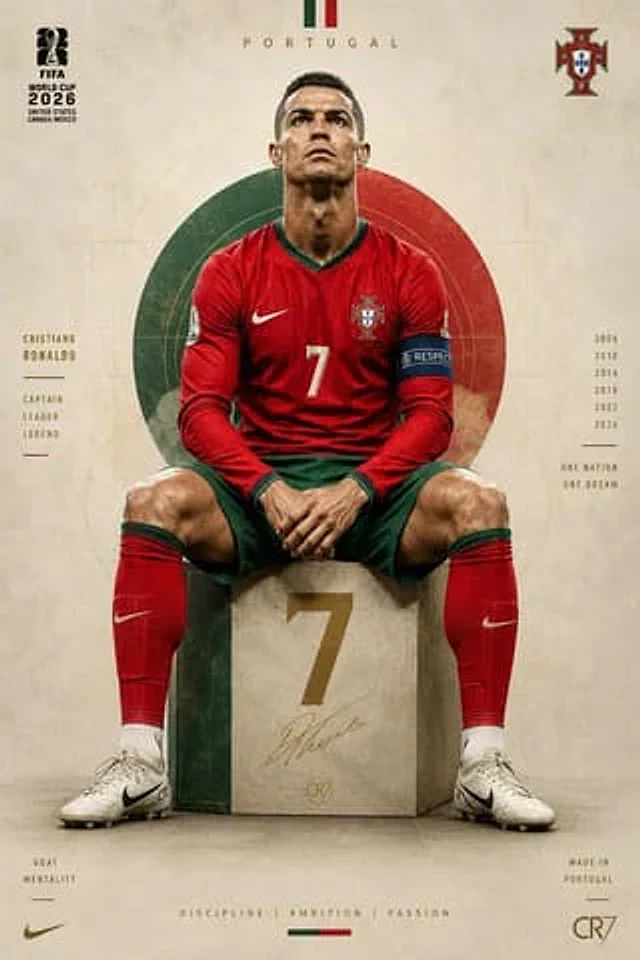

```text
Ultra-detailed football portrait poster of a {argument name="footballer" default="legendary Portuguese footballer"} sitting on a geometric cube with the {argument name="number" default="number 7"}, wearing a modern {argument name="team jersey" default="Portugal national team jersey"} in red and green, centered symmetrical composition, looking upward with a determined expression, cinematic soft studio lighting, minimal beige textured background, elegant sports editorial design, FIFA World Cup 2026 inspired branding, thin geometric line elements and abstract layout graphics around the subject, premium magazine aesthetic, realistic skin texture, sharp facial details, high-detail fabric folds, luxury sports poster, muted tones with red and green accents, clean negative space, subtle vintage paper texture, hyper-real illustration mixed with photorealism, front-facing full body shot, balanced composition, Nike football boots, elite athlete aura, 8k, highly detailed digital artwork.
```

Model: GPT Image 2
Author: Anissa

[ProjectD](https://aitoolsradar.com/en/prompts/572e3c08b05aed) · [Recorded source](https://youmind.com/prompts/portuguese-footballer-geometric-poster-25212)
 · [Full original metadata and byte evidence](data/projectd-batch-0036.json)

## LEGO Alhambra Courtyard at Sunset


```text
A highly detailed, photo-realistic image{argument name="landmark" default="Alhambra Palace, Granada"} This LEGO model depicts a magnificent Moorish courtyard at sunset. The entire scene is constructed entirely from LEGO bricks and minifigures, featuring warm amber lighting, cinematic depth of field, and rich textures. At the center of the composition is a narrow, reflective water channel leading to a small circular fountain in the midground and a grand horseshoe arch in the background. The courtyard is surrounded by intricate brown stone LEGO walls, adorned with sculpted geometric reliefs, slender columns, tiled arches, and terracotta roof lines made of densely layered reddish-brown bricks. The background includes two main towers and several palace buildings rising behind the courtyard, along with six tall, dark green cypress trees silhouetted against an orange glowing sky. Blue, green, and white mosaic-style tile details are added around the central arch and lower walls. Nine LEGO visitors are meticulously positioned within the courtyard: a traveler wearing a tan hat and light-colored clothing, next to a visitor in a blue jacket; a person with a green backpack in the left foreground; a photographer with a camera in the left foreground; a visitor kneeling and observing the garden along the right edge of the canal; two visitors standing and conversing in the right midground; and two visitors sitting on a tiled bench in the right foreground. The canal is flanked by low, neatly trimmed hedges and small pink flowers. Using a low-angle perspective starting from the reflection pool, with shallow depth of field, a clear focus on the central courtyard, and shimmering reflections on the water, the realistic texture of the LEGO bricks is achieved, creating a grand, playful, and museum-quality atmosphere.
```

Model: GPT Image 2
Author: GPT Image 2 Prompts

[ProjectD](https://aitoolsradar.com/en/prompts/ec80078a15b91d) · [Recorded source](https://x.com/chesnyfcb/status/2046957172945211443#reversed-1)
 · [Full original metadata and byte evidence](data/projectd-batch-0036.json)

## LEGO Alhambra Courtyard at Sunset

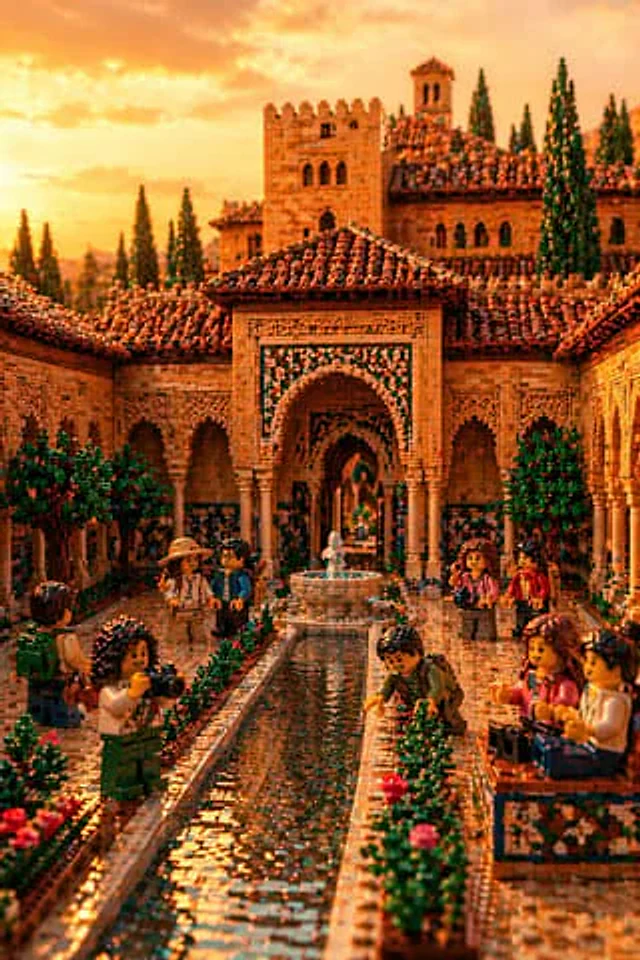

```text
A highly detailed photorealistic LEGO diorama of {argument name="landmark" default="the Alhambra in Granada"}, shown as an ornate Moorish courtyard at golden-hour sunset. The scene is built entirely from LEGO bricks and minifigure parts, with warm amber light, cinematic depth, and rich texture. Center the composition on a long narrow reflective water channel leading toward 1 small round fountain in the middle distance and a grand horseshoe arch beyond it. Surround the courtyard with intricate tan stone-like LEGO walls, carved-looking geometric relief patterns, slender columns, tiled archways, and terracotta rooflines made from densely layered reddish-brown pieces. In the background, include 2 main towers and several additional palace structures rising behind the courtyard, plus 6 tall dark green cypress trees silhouetted against a glowing orange sky. Add blue, green, and white mosaic-style tile details around the central arch and lower walls. Populate the courtyard with exactly 9 LEGO tourists and visitors: 1 traveler in a tan hat and light outfit, 1 visitor in a blue jacket beside them, 1 person with a green backpack at the left foreground, 1 photographer holding a camera in the left foreground, 1 kneeling visitor examining the garden at the right edge of the water channel, 2 standing visitors chatting in the right midground, and 2 seated visitors on a tiled bench in the right foreground. Frame the water channel with low manicured hedges and small pink flowers. Use a low eye-level perspective from the start of the reflecting pool, shallow depth of field, crisp focus on the central courtyard, glossy water reflections, realistic LEGO stud texture, and a mood that feels majestic, playful, and museum-quality.
```

Model: GPT Image 2
Author: Chesny

[ProjectD](https://aitoolsradar.com/en/prompts/82e128930d6022) · [Recorded source](https://youmind.com/prompts/lego-alhambra-courtyard-sunset-15046)
 · [Full original metadata and byte evidence](data/projectd-batch-0036.json)

## LEGO Plaza de España at Sunset


```text
This is a highly detailed, realistic LEGO version.{argument name="landmark" default="Plaza de España, Seville"} The image presents a magnificent architectural scene at the golden hour, viewed from the canal level. The vertical composition, with a cinematic quality, draws the viewer's eye along the narrow, curved canal to the horizon, where a magnificent Spanish Renaissance palace, entirely constructed from LEGO bricks, stands. The warm terracotta-colored architecture dominates the upper half of the image, featuring multiple towers, arched colonnades, balconies, decorative cornices, and intricate LEGO brick details. A Spanish flag flies atop the central tower. In the foreground, a LEGO rowing boat carrying two minifigures drifts along the canal, its back to the camera; one has reddish-brown hair, the other light brown, and they row with long brown oars. In the mid-ground, beneath or near an elegant arched bridge, a second rowing boat carries two more minifigures. In total, there are two boats and four rowing passengers. Along the right-hand corridor, four minifigures can be seen standing spaced apart beside a tiled railing. The canal is lined with richly detailed blue, white, and yellow ceramic-style LEGO mosaic railings and brick walls, complemented by black vintage streetlights; a total of seven streetlights are visible. The left edge includes two round pink flowering shrubs planted in pots. The bridge spanning the canal features a gorgeous blue and white LEGO tile pattern and a graceful single-arch structure. The water surface should appear realistic, composed of tiny, glossy LEGO bricks, reflecting the deep cyan buildings and sky. The lighting is soft sunset light, with an amber glow in the sky, accompanied by scattered clouds, long bright highlights, and rich, warm shadows. The design emphasizes realism, detailed textures, playful illusions of proportion, and a perfect blend of the grandeur of real architecture and the iconic LEGO building style.
```

Model: GPT Image 2
Author: GPT Image 2 Prompts

[ProjectD](https://aitoolsradar.com/en/prompts/277cfd71ff107b) · [Recorded source](https://x.com/chesnyfcb/status/2046957172945211443#reversed-0)
 · [Full original metadata and byte evidence](data/projectd-batch-0036.json)

## LEGO Video Game Mockup

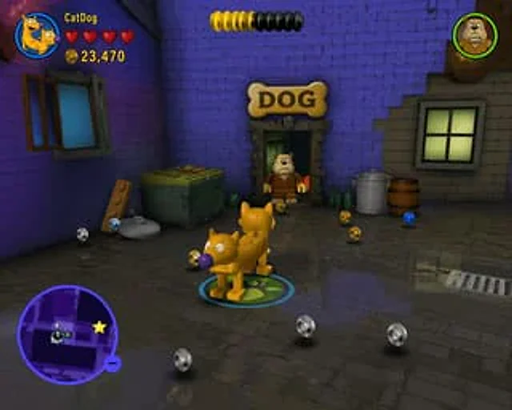

```text
{
  "type": "Video game screenshots",
  "style": "{argument name=\"game style\" default=\"Classic LEGO video games\"}",
  "scene": {
    "environment": "The dark alleyway had purple brick walls on the left and gray brick walls on the right, with reflections shimmering on the damp cobblestone pavement.",
    "props": [
      "1 green trash can",
      "A piece of wood with granules",
      "1 metal trash can",
      "1 wooden barrel",
      "3 green glass bottles",
      "A bone-shaped sign with the word 'DOG' written on it."
    ],
    "collectibles": "10 floating particles (4 silver, 4 gold, 2 blue)"
  },
  "characters": [
    {
      "description": "{argument name=\"player character\" default=\"CatDog\"} Rendered as a building block plastic doll",
      "action": "Standing in the center, beneath your feet is a glowing blue-green circular player marker."
    },
    {
      "description": "Bulldog rendered as a small plastic doll",
      "action": "Standing at the door"
    }
  ],
  "layout": {
    "ui_elements": [
      {
        "position": "Top left corner",
        "description": "Player HUD",
        "components": [
          "Circular character head",
          "text'{argument name=\"player name\" default=\"CatDog\"} '",
          "4 red hearts",
          "With text '{argument name=\"score\" default=\"23,470\"} The gold coin icon"
        ]
      },
      {
        "position": "Top center",
        "description": "Yellow and black cylindrical progress bar"
      },
      {
        "position": "Top right corner",
        "description": "Bulldog round character head"
      },
      {
        "position": "bottom left corner",
        "description": "A small circular map with a purple border, map layout, and yellow star icons."
      }
    ]
  }
}
```

Model: GPT Image 2
Author: GPT Image 2 Prompts

[ProjectD](https://aitoolsradar.com/en/prompts/75976dc1e3790e) · [Recorded source](https://x.com/Gc_qube/status/2046189202488881427#reversed-2)
 · [Full original metadata and byte evidence](data/projectd-batch-0036.json)

## LEGO Voxel Art Poster Style

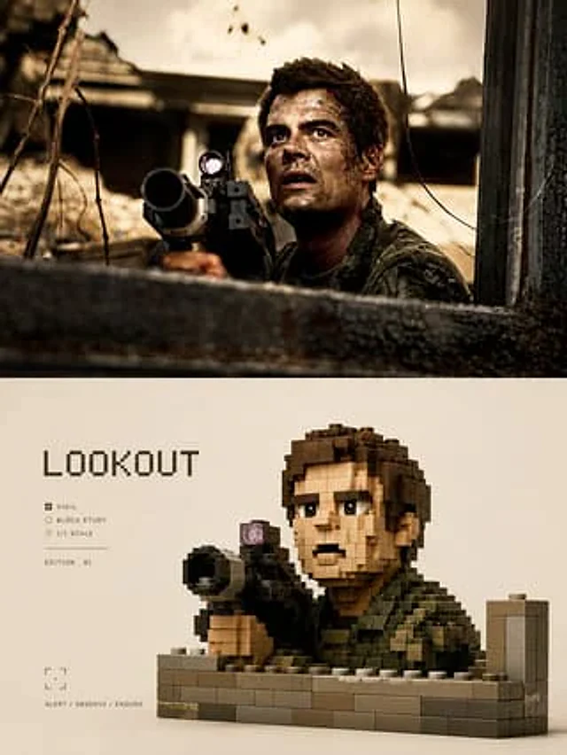

```text
请将我上传的每一张照片分别制作成一张独立的高级设计海报，不多图拼接，每张照片单独输出。整体采用3:4竖版构图，上下两个区域高度严格1:1，各占画面50%。\n\n上半部分保留原始照片，保持主体结构、真实质感、自然光影和原有色彩氛围，仅进行轻微高级摄影调色，使其具有艺术杂志、独立出版物和展览摄影质感。为适配画幅，可自然扩展天空、地面或环境背景，但不得拉伸、扭曲或改变主体。\n\n下半部分提取照片中最具识别性的主体、轮廓、姿态与叙事关系，先理解其核心身份、动作特征与寓意，再重构为乐高 / Minecraft式的像素积木视觉。不要简单卡通化，而是通过体素、积木、模块化几何和拼搭逻辑重新概括主体，使人物、动物、植物、建筑、器物、交通工具或自然景观都保留一眼可辨的核心特征，不强行拟人化。\n\n主体作为唯一视觉核心，通过方块化比例、清晰剪影、模块层级和局部夸张建立辨识度。背景保持极简、安静、低信息量，不还原完整环境，不铺设复杂地块和无关道具，以大面积纯色或极轻微色阶变化作为空间，只保留极少量底座、块面或阴影承托主体，形成“鲜明主体、大面积留白、环境退后”的高级玩具陈列感。\n\n配色从上方照片中提取最具辨识度和精气神的颜色，再转化为高纯度、高饱和、明艳清晰的积木色组。颜色应像真实注塑积木一样饱满、干净、直接，强调鲜红、亮黄、纯蓝、鲜绿、橙色、紫色等清晰色相之间的块面关系，同时保留原图自身的综合色彩身份。主体颜色可以比原图更纯、更亮、更有能量，但不要荧光、霓虹或糖果渐变；避免莫兰迪色、灰蒙色、粉彩化和刻意降低饱和度。背景应明显更浅、更单纯，让高饱和积木主体成为绝对焦点。\n\n材质强调真实哑光ABS积木塑料与体素拼搭感，表面平整而略带柔和塑料反光，模块之间保留清晰拼接缝隙、层级和自然接触阴影。光线柔和而清晰，让颜色保持鲜艳通透，同时表现积木厚度和立体结构，避免金属感、玻璃感、过度CG反光和廉价游戏截图质感。\n\n文字作为辅助设计元素，从照片的主体身份、动作、情绪或寓意中提炼一个简短英文标题，并搭配极少量标签词或微型注释。文字可使用模块化、像素化或积木说明书式的排版语言，与主体轮廓、底座和留白形成对齐或巧妙穿插，但始终保持克制，不抢主体。\n\n整体呈现真实摄影 × 明艳积木重构的视觉关系：上半部分是真实世界，下半部分像将同一主题重新搭建成一件精致的积木艺术品。画面应鲜活、清爽、可爱而不幼稚，具有高级玩具品牌、设计收藏品和现代编辑海报的视觉气质，避免低饱和、灰脏色、复杂Minecraft场景、满地积木、儿童游戏界面和电商玩具展示感。
```

Model: GPT Image 2
Author: 小小东

[ProjectD](https://aitoolsradar.com/en/prompts/86bce46cd9dfe1) · [Recorded source](https://youmind.com/prompts/lego-voxel-art-poster-style-32245)
 · [Full original metadata and byte evidence](data/projectd-batch-0036.json)

## Lemon Drink Ad Storyboard

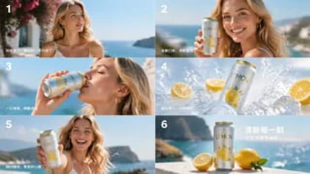

```text
{
  "type": "6. Visual Commercial Projects",
  "product": {
    "category": "Lemon sparkling beverage",
    "brand text": "{argument name=\"brand text\" default=\"LEMON\"}",
    "packaging": "The slender aluminum can features a white body adorned with realistic illustrations of yellow lemons, green leaves, delicate silver patterns, and a gold top, with condensation beads covering its surface."
  },
  "style": {
    "look": "High-end beverage advertisement, cinematic lifestyle photography, bright Mediterranean summer, clean commercial color grading, high realism.",
    "lighting": "Strong natural sunlight, warm golden highlights, crisp blue sky reflection, sparkling water highlights.",
    "aspect_ratio": "A 16:9 overall canvas, divided into 6 equal parts by a 3x2 grid."
  },
  "setting": {
    "location": "A sunny seaside terrace overlooking the blue bay, with distant cliffs and white buildings in the background.",
    "season": "summer",
    "mood": "Fresh, gentle breeze, pleasant, invigorating"
  },
  "cast": {
    "count": 1,
    "subject": "A smiling young blonde woman with shoulder-length wavy hair, light brown skin, hoop earrings, and a delicate necklace wore a white spaghetti strap summer dress."
  },
  "layout": {
    "sections": [
      {
        "title": "1",
        "position": "Top left",
        "count": 1,
        "labels": [
          "Opening lifestyle shot"
        ],
        "scene": "A medium-ground portrait of a woman standing outdoors on a beach, with blurry flowers in the distance to her left. She looks forward with a relaxed and joyful expression, with the ocean and cliffs behind her.",
        "on_screen_text": "The sun shines down, and a beautiful day begins."
      },
      {
        "title": "2",
        "position": "Top right",
        "count": 1,
        "labels": [
          "Product Introduction"
        ],
        "scene": "A smiling woman holds a canned beverage to her face, facing the camera; the label is clearly visible against a horizon background.",
        "on_screen_text": "A brand new flavor, a refreshing debut."
      },
      {
        "title": "3",
        "position": "Left and Middle",
        "count": 1,
        "labels": [
          "Instant drinking"
        ],
        "scene": "A close-up side view of a woman raising a canned beverage to her lips to drink, her hair backlit, with the beach and sea softly blurred in the background.",
        "on_screen_text": "A refreshing taste awakens your vitality."
      },
      {
        "title": "4",
        "position": "Right Center",
        "count": 1,
        "labels": [
          "Product close-up"
        ],
        "scene": "A single can of beverage stands upright in crushed ice water, surrounded by three visible lemon slices, capturing the dramatic splash of water, ultra-detailed water droplets, and the icy texture.",
        "on_screen_text": "Real fruit juice, refreshingly cool"
      },
      {
        "title": "5",
        "position": "Bottom left",
        "count": 1,
        "labels": [
          "Directly show the lens"
        ],
        "scene": "A woman extends her arm towards the camera, displaying canned drinks at the counter. Her body and face are slightly blurred in the background, which features a seaside cliff.",
        "on_screen_text": "Enjoy a good mood anytime, anywhere."
      },
      {
        "title": "6",
        "position": "Bottom right",
        "count": 1,
        "labels": [
          "Final product display"
        ],
        "scene": "A clean tabletop product display features a can of beverage standing in the center of a seaside setting, surrounded by two whole lemons and a sliced ​​lemon. Bright sunlight shimmers on the water, with a rocky coastline in the distance in the background.",
        "on_screen_text": "{argument name=\"headline text\" default=\"Freshness in every moment\"} Make life more flavorful"
      }
    ],
    "panel_numbers": "Place large, bold white numbers 1 to 6 in the top left corner of each image."
  },
  "typography": {
    "language": "Chinese",
    "style": "The advertisement features simple, bold, white sans-serif text. Smaller subtitles are located in the lower left corner of images 1 through 5, while the main title is in the upper right corner of image 6."
  },
  "constraints": [
    "Maintain visual consistency across all six frames as part of the same advertising campaign.",
    "Emphasizing condensation droplets, the freshness of citrus, and a bright seaside atmosphere.",
    "High-end beverage business layout",
    "No additional characters",
    "There are no other markings besides the brand name on the can."
  ]
}
```

Model: GPT Image 2
Author: GPT Image 2 Prompts

[ProjectD](https://aitoolsradar.com/en/prompts/6533b6e99087ad) · [Recorded source](https://x.com/OliviaMitc4151/status/2047634317451694179#reversed-0)
 · [Full original metadata and byte evidence](data/projectd-batch-0036.json)

## Leonardo Painting the Mona Lisa

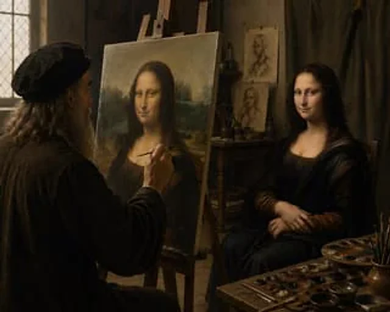

```text
Inside a Renaissance-era art studio with a cinematic feel, soft, warm light streams in. On the left, an elderly painter bearing a striking resemblance to Leonardo da Vinci sits before his easel, painting the Mona Lisa using a live model. The painter has long, gray hair and a thick gray beard, wears a dark vintage hat, and a heavy, dark robe. In the foreground, a wooden easel displays the composition of the Mona Lisa; on the right, a female model maintains her signature pose, hands clasped, wearing a dark Renaissance-style long dress and veil-like folds. The overall atmosphere is intimate, tranquil, and painterly, with rich browns and amber tones, employing dramatic chiaroscuro. The background is an old stucco wall, and on the left, a glass window with lead strips. Behind the model, a wooden table holds brushes and studies. In the background behind the model, two portrait sketches are pinned or leaned against. In the lower right foreground, a cluttered painter's workbench is displayed, featuring a palette, several small dots of paint, a few brushes stuck in a cup, and several shallow bowls. The scene is framed like a realistic historical photograph, capturing the moment of a masterpiece's creation. The medium-wide-angle lens, shot slightly over the painter's shoulder from behind, reveals extremely fine textures, presenting the artistic atmosphere of a classical master. The background is blurred and soft, devoid of any modern objects.
```

Model: GPT Image 2
Author: GPT Image 2 Prompts

[ProjectD](https://aitoolsradar.com/en/prompts/cb16458d559017) · [Recorded source](https://x.com/Sinandoqu/status/2046734344396411281#reversed-0)
 · [Full original metadata and byte evidence](data/projectd-batch-0036.json)

## Life Hack Visualization

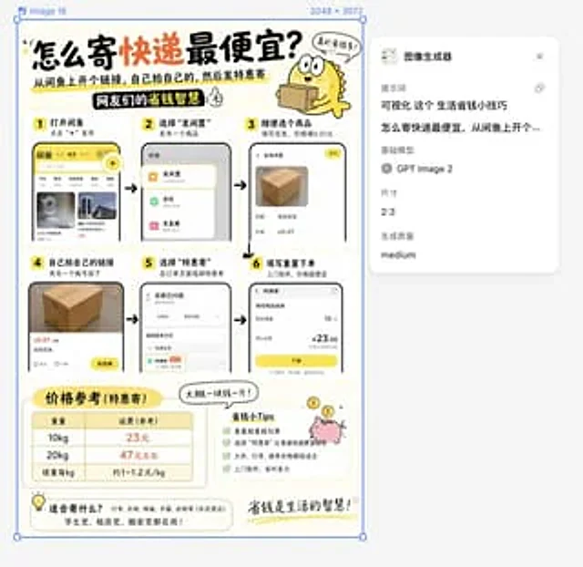

```text
Visualize this content{argument name="topic" default="Money-saving tips for daily life"}{argument name="specific tip" default="How to send a package at the cheapest price: Create a link on Xianyu (a second-hand marketplace), place the order yourself, and then use the discount for shipping. 10 kg costs 23 yuan, 20 kg costs about 47 yuan, which is about 1 yuan per kilogram—a money-saving tip from netizens."}
```

Model: GPT Image 2
Author: GPT Image 2 Prompts

[ProjectD](https://aitoolsradar.com/en/prompts/8cace53ddb724d) · [Recorded source](https://x.com/cellinlab/status/2047501980654809540)
 · [Full original metadata and byte evidence](data/projectd-batch-0036.json)

## Life Stages Composite Portrait


```text
Create a vertical cinematic composite portrait showing the same male person across exactly 6 life stages in one seamless family-lineage style image, arranged diagonally from lower left to upper right as if time is progressing upward. Use {argument name="person description" default="a South Asian male with dark hair, medium skin tone, and similar facial features at every age"}. Canvas: 3:4 portrait orientation, photorealistic, studio-quality, soft painterly background gradient from deep blue on the left to warm amber beige on the right, subtle mist/vignette around the lower edges. Composition: six full or half-body age versions overlap in depth, with the youngest in front at the bottom left and the oldest behind at the top right; each older version is larger and positioned slightly higher/right. The six visible stages must be: 1) Newborn Baby (0 months), swaddled in a thick white blanket at the bottom left, tiny head visible; 2) Toddler (1–2 years), sitting just above the baby, wearing a blue-and-white striped long-sleeve shirt; 3) Cheerful School Kid (6–8 years), standing behind the toddler, wearing a navy polo shirt and a dark backpack with visible shoulder straps; 4) Teenager (14–17 years), standing behind him, wearing a dark navy hoodie with light drawstrings; 5) College-Age Young Adult (20–30 years), standing behind and higher, wearing a crisp white button-up shirt with open collar; 6) Confident 57-Year-Old Adult (Adult), tallest in the back upper right, salt-and-pepper hair, wearing a dark suit jacket, white dress shirt, and dark tie. Add elegant white serif labels on the left side with thin horizontal leader lines pointing to each corresponding figure, except the oldest label placed near the upper center-left with a short line toward the suited adult. Text must read exactly: "Newborn Baby\n(0 months)", "Toddler\n(1–2 years)", "Cheerful\nSchool Kid\n(6–8 years)", "Teenager\n(14–17 years)", "College-Age\nYoung Adult\n(20–30 years)", and "Confident\n57-Year-Old\nAdult (Adult)". Use {argument name="overall mood" default="emotional, nostalgic, inspiring"}, natural studio lighting, realistic skin and hair texture, cohesive facial resemblance across all ages, shallow depth-of-field, no logos, no watermark, no extra people, no extra text.
```

Model: GPT Image 2
Author: Mr. Tariq

[ProjectD](https://aitoolsradar.com/en/prompts/11b9280ddd9d81) · [Recorded source](https://youmind.com/prompts/life-stages-portrait-23865)
 · [Full original metadata and byte evidence](data/projectd-batch-0036.json)

## Life Transition Emotional Pathway


```text
Create a cinematic visual titled: “THE PEOPLE WE BECOME.” The image should depict multiple stages of one human life existing simultaneously inside a single interconnected environment shaped by memory, growth and emotional transition. Avoid the feeling of: - a motivational poster, - a staircase timeline, - or separate portraits pasted together. Instead, the world itself should evolve naturally between life phases as if memories are physically blending into one another. The composition follows a winding stone pathway moving through different emotional spaces connected seamlessly across the image. At the bottom of the frame: A newborn sleeps inside a softly lit woven cradle near a dim bedside lamp. The atmosphere feels warm, silent and untouched. Nearby: - folded baby blankets, - soft shadows, - wooden toys, - faint moonlight through curtains, - dust particles drifting in warm air. The pathway slowly transitions into early childhood. A young child runs barefoot through a living room filled with scattered crayons, comic books, paper airplanes and half-built toy structures. Late-afternoon sunlight pours through large windows and reflects softly across wooden floors. The environment gradually changes again without hard separation. The next version appears around age 13: sitting alone on a rooftop during light rainfall wearing headphones and holding a notebook. Distant city lights blur softly behind him while unfinished sketches scatter beside him. The atmosphere becomes quieter and emotionally uncertain. Further along the path: A university-age version studies late at night at a cluttered desk illuminated only by a warm desk lamp and laptop screen. Around him: - highlighted textbooks, - coffee cups, - handwritten notes, - exhaustion, - ambition, - and isolation. Rain reflects softly across the apartment window behind him. At the highest point of the composition: An older version stands quietly overlooking a sunrise city skyline from a hillside path above the city. He looks calm rather than triumphant. His clothing is simple and grounded: rolled sleeves, slightly tired posture, hands in pockets, wind moving softly through his shirt. He should visibly feel like the same person shaped by every previous version. The transitions between life stages should contain subtle symbolic continuity: - flowers growing through cracks in concrete, - notebook pages blending into city architecture, - rainwater reflections becoming skyline lights, - old drawings faintly appearing on apartment walls, - childhood objects partially hidden inside later environments. Typography should remain minimal and restrained. Small serif text placed naturally near each stage: “Wonder.” “Becoming.” “Doubt.” “Discipline.” “Perspective.” No motivational quotes. No oversized typography. Lighting should evolve emotionally throughout the image: - warm soft childhood tones, - cooler rainy teenage atmosphere, - isolated tungsten lighting during study years, - balanced sunrise light in adulthood. The realism should feel grounded: - believable facial continuity across ages, - natural environmental texture, - subtle lens softness, - realistic lighting behavior, - physically believable spaces, - quiet cinematic atmosphere. The image should feel intimate and reflective rather than grand or overly dramatic. Mood: memory, identity, growth, loneliness, ambition, emotional evolution and the quiet passage of time.
```

Model: GPT Image 2
Author: Hemayxn.ai

[ProjectD](https://aitoolsradar.com/en/prompts/3bdb70908a0b65) · [Recorded source](https://youmind.com/prompts/human-lifecycle-cinematic-visual-21032)
 · [Full original metadata and byte evidence](data/projectd-batch-0036.json)

## Light Mode UI Design System Board


```text
{
  "type": "UI design system demonstration project",
  "theme": "{argument name=\"visual theme\" default=\"Optical Science and Light Refraction\"}",
  "overall_aesthetic": "A clean white background, light color mode, futuristic and sophisticated feel; its distinctive feature lies in {argument name=\"primary gradient colors\" default=\"Iridescent, soft orange, yellow, cyan, purple, pink\"} embellishment",
  "header": {
    "title": "{argument name=\"system name\" default=\"LIGHTCORE PRISM\"}",
    "subtitle": "UI Design System - Light Mode",
    "tags": [
      "Futuristic",
      "sense of sophistication",
      "Focus"
    ],
    "hero_graphic": "3D transparent glass ring that refracts iridescent light"
  },
  "layout": {
    "sections": [
      {
        "title": "color",
        "count": 5,
        "labels": [
          "White #FFFFFF",
          "Snowy #FAFAFC",
          "Slate color #F2F4F8",
          "Border color #E6E8EF",
          "Black #0A0A0C"
        ],
        "description": "5 rounded square solid color blocks"
      },
      {
        "title": "Prism Gradient",
        "count": 1,
        "description": "A long horizontal gradient bar with five hexadecimal color codes below."
      },
      {
        "title": "typesetting",
        "description": "The large 'Aa' font is listed in four weights (Light, Regular, Medium, Semibold) along with the complete alphabet/numbers."
      },
      {
        "title": "icon",
        "count": 12,
        "description": "12 minimalist line-style icons arranged in a 2x6 grid."
      },
      {
        "title": "Button",
        "count": 8,
        "categories": [
          "main",
          "secondary",
          "text",
          "icon"
        ],
        "description": "There are a total of 8 buttons, displaying the normal and disabled states for each category. The main button features an iridescent border and {argument name=\"primary button text\" default=\"Start using\"} text."
      },
      {
        "title": "navigation",
        "count": 2,
        "variants": [
          "Desktop",
          "mobile"
        ],
        "description": "The desktop navigation includes a logo, four text links, a search bar, a login button, and a mobile navigation bar."
      },
      {
        "title": "Components",
        "count": 6,
        "items": [
          "Card: 'Photon Engine' with abstract rainbow graphics and buttons",
          "Input boxes: a labeled search bar and an email input box.",
          "Progress bar: 68% rainbow progress bar",
          "Tabs: Overview, Analysis, Settings",
          "Switches: 2 switches (on/off)",
          "Data visualization: a pie chart with 3 legend items, and a 7-day line chart."
        ]
      },
      {
        "title": "Web page",
        "description": "Desktop browser model, including title '{argument name=\"hero headline\" default=\"Building the future with light and color\"} The design includes two buttons, a flowing 3D rainbow wave graphic, and five partner logos at the bottom."
      },
      {
        "title": "Mobile application",
        "description": "The smartphone model displays a balance of $24,880, a line chart, four quick action icons, a list of recent activities with three items, and a bottom navigation bar with four icons."
      }
    ]
  }
}
```

Model: GPT Image 2
Author: GPT Image 2 Prompts

[ProjectD](https://aitoolsradar.com/en/prompts/c45df480cf9611) · [Recorded source](https://x.com/cheatyyyy/status/2045973715280929275#reversed-1)
 · [Full original metadata and byte evidence](data/projectd-batch-0036.json)

## Light Novel Cover with Multi-Character Band Layout


```text
{
  "type": "Light novel cover illustrations",
  "style": "Anime art style, highly detailed, dramatic lighting and shadows, shattered glass elements.",
  "typography": {
    "title": "{argument name=\"main title\" default=\"An ordinary girl with no redeeming qualities, and a &quot;girl obsessed with sound&quot; I met on a street corner—a nameless story of geniuses awakened by my voice who shake the world.\"}",
    "subtitle": "{argument name=\"catchphrase\" default=\"—Only for the moment I sing do I become &quot;myself.&quot;\"}",
    "credits": [
      "author:{argument name=\"author name\" default=\"Sumire Kirishima\"}",
      "イラスト：{argument name=\"illustrator name\" default=\"Rio Amase\"}",
      "{argument name=\"label name\" default=\"Aurora Note\"}"
    ]
  },
  "layout": {
    "description": "Diagonal dynamic storyboard, separating 5 different character scenes",
    "panels": [
      {
        "position": "left half",
        "character": "An ordinary high school girl, with a brown bob haircut and a white nautical-style uniform.",
        "action": "Looking up in awe, I gently reached out my hand.",
        "background": "City streets during the day, bright sunlight"
      },
      {
        "position": "Top right corner",
        "character": "Rock girl, long silver hair, black gothic outfit, neck collar",
        "action": "Playing a glowing blue electric guitar",
        "background": "The stage at night, with shattered blue crystal special effects."
      },
      {
        "position": "Middle right",
        "character": "A bassist girl with long blue hair, wearing a casual T-shirt and shorts.",
        "action": "Playing bass while lying down",
        "background": "A messy room, music equipment, effects pedals, energy drink cans"
      },
      {
        "position": "bottom left corner",
        "character": "Keyboard player girl, long dark hair, maid outfit",
        "action": "Sitting in front of the synthesizer keyboard, live stream settings",
        "background": "Neon purple lighting in the room, monitor, ring light, microphone"
      },
      {
        "position": "bottom right corner",
        "character": "A drummer girl, with short black hair, wearing a black T-shirt and a neck collar.",
        "action": "Playing the drum kit with great energy",
        "background": "The dimly lit recording studio"
      }
    ]
  }
}
```

Model: GPT Image 2
Author: GPT Image 2 Prompts

[ProjectD](https://aitoolsradar.com/en/prompts/92e0b2e5e29d32) · [Recorded source](https://x.com/koshian_to/status/2046151314061881459#reversed-0)
 · [Full original metadata and byte evidence](data/projectd-batch-0036.json)

## Ligne Claire Suburban Landscape


```text
A painting rich in detail{argument name="art style" default="Ligne Claire comic illustrations"} It depicts a view overlooking from a high rooftop.{argument name="setting" default="Suburban communities"} The time is set to{argument name="time of day" default="Sunset"} The densely packed houses in the image feature roofs in various colors, including soft blues, reds, and browns, interspersed with lush trees and vegetation. Telegraph poles and crisscrossing power lines run through the midground. A winding dirt road is visible on the right. The sky displays a smooth gradient of orange, pink, and light blue, with a bright, round sun hanging low on the horizon against a backdrop of stylized, fluffy clouds. The work employs flat colors and clean black outlines to create a nostalgic and tranquil atmosphere reminiscent of classic animation background art.
```

Model: GPT Image 2
Author: GPT Image 2 Prompts

[ProjectD](https://aitoolsradar.com/en/prompts/db0612fd91d27d) · [Recorded source](https://x.com/kaihenthoiwane/status/2046048448462684663#reversed-0)
 · [Full original metadata and byte evidence](data/projectd-batch-0036.json)

## Line Art Animal Listening to Music


```text
One{argument name="art style" default="Minimalist Black and White Line Art"} The illustration features a cute animal as the main character.{argument name="animal type" default="fluffy alpacas"} It had its eyes closed, its expression serene, a gentle smile on its lips, and wore a large pair of headphones. The animal held a {argument name="device" default="Retro MP3 player with turntable"} It is connected to headphones via a thin wire. A musical note is displayed on the device's screen. The animal is leaning against a stack of exactly two books. Three musical notes and a small heart float around the animal's head, highlighting the relaxed musical atmosphere. The art style uses bold, smooth, pure black lines, without shadows or colors, and the background is pure white, making it look like a simple and cute coloring book doodle.
```

Model: GPT Image 2
Author: GPT Image 2 Prompts

[ProjectD](https://aitoolsradar.com/en/prompts/f73faa66405166) · [Recorded source](https://x.com/AlpacaNotes/status/2045079832107839784#reversed-0)
 · [Full original metadata and byte evidence](data/projectd-batch-0036.json)

## Linen Blazer Try-On Half-Body


```text
Half-body editorial fashion photograph of a young East Asian woman in her late twenties, wearing an oversized natural-color linen blazer over a plain white tee, hands relaxed at her sides. Standing against a sun-warmed pale beige wall, golden hour side light from the left casts a soft long shadow. Natural minimal makeup, hair loosely tucked behind one ear. Vertical 9:16 composition, head crop slightly above the eyes, no text, no brand label visible on the blazer, no watermark. Photorealistic, subtle film grain, magazine try-on photography quality.
```

Model: GPT Image 2
Author: @hiapi_ai

[ProjectD](https://aitoolsradar.com/en/prompts/31a86b7751d902) · [Recorded source](https://github.com/HiAPIAI/awesome-gpt-image-2-prompts)
 · [Full original metadata and byte evidence](data/projectd-batch-0036.json)

## Linen Shirt Folded on Wood Surface


```text
A pale oatmeal linen shirt neatly folded into a clean rectangle, photographed from directly above on a rustic light oak wooden tabletop. Beside it a small sprig of dried lavender and one tortoiseshell button. Soft diffuse natural window light from the upper left. Muji-style minimalist flat-lay, 4:3 horizontal composition, no text, no brand label visible, no watermark. Sharp linen weave texture, subtle wood grain, calm editorial mood.
```

Model: GPT Image 2
Author: @hiapi_ai

[ProjectD](https://aitoolsradar.com/en/prompts/0b1a31483e446b) · [Recorded source](https://github.com/HiAPIAI/awesome-gpt-image-2-prompts)
 · [Full original metadata and byte evidence](data/projectd-batch-0036.json)

## Lion Camel Ridge Dark Myth Scene


```text
中式怪异，黑暗神秘风格融合中式美学，完美细节，多重管线渲染，完美建模。西游记背景，狮驼岭，千妖万怪，坐在左边巨大王座上的大象王重甲妖精，坐在中间巨大王座上的狮王重甲妖精，坐在右边巨大王座上大鹏鸟王重甲妖精。渺小的背对镜头孙悟空肩抗金箍棒步行前进，孙悟空身穿铠甲，近地仰拍镜头，长焦镜头，强烈阴影。极致细节刻画，多次修改，正确透视和主体线条，精致细节
```

Model: GPT Image 2
Author: @MANISH1027512

[ProjectD](https://aitoolsradar.com/en/prompts/5fcd226e45d86d) · [Recorded source](https://x.com/MANISH1027512/status/2045743158860878312)
 · [Full original metadata and byte evidence](data/projectd-batch-0036.json)

## Lionel Messi Cinematic Watercolor Poster


```text
Epic cinematic watercolor poster of {argument name="subject" default="Lionel Messi"}, giant side-profile portrait dominating the left side, multiple moments of his football journey blended into the composition, Argentina national team jersey number 10, FIFA World Cup trophy glowing at the center, mystical cathedral architecture, fantasy kingdom elements, dramatic stadium, young boy wearing number 10 walking toward a bright golden gateway, ethereal fog, blue and silver color palette, emotional legacy theme, divine light rays, highly detailed digital painting, watercolor splashes, double exposure composition, cinematic storytelling, volumetric lighting, ultra detailed, masterpiece, poster design, fantasy realism, textured parchment background, inspirational sports artwork, award-winning concept art, 8k resolution, vertical movie poster, legendary atmosphere
```

Model: GPT Image 2
Author: Anissa

[ProjectD](https://aitoolsradar.com/en/prompts/5065c58ddb40f5) · [Recorded source](https://youmind.com/prompts/lionel-messi-watercolor-poster-25344)
 · [Full original metadata and byte evidence](data/projectd-batch-0036.json)

## Lionel Messi Lego Portrait


```text
A cinematic portrait of {argument name="subject" default="Lionel Messi"} (using a reference photo, faithfully preserving his facial features, hairstyle, beard, physique, and signature look), seated at a dark, polished table in a luxurious environment with {argument name="background" default="black and dark LEGO brick walls"}. Lionel Messi is wearing the {argument name="outfit" default="official Argentina national football team jersey"}. His expression is calm, confident, and introspective, conveying leadership, humility, and greatness.

On the table, positioned to his left, stands a highly detailed LEGO-built replica of the FIFA World Cup trophy, constructed from golden LEGO bricks with realistic proportions and subtle green accents. The official LEGO logo is clearly visible on the base of the trophy or subtly placed in the foreground.

Lionel Messi delicately holds in his right hand a LEGO minifigure representing himself, wearing the official Argentina national team uniform, including authentic sky-blue and white colors, number 10, captain’s armband, and facial features inspired by his real likeness.

The FIFA World Cup 2026 logo is subtly integrated into the background or softly embedded into the table surface, appearing slightly out of focus to enhance depth.

The image is ultra high-definition, with sharp focus on Messi and the foreground elements, complemented by a cinematic depth of field that creates a smooth, artistic background blur. Lighting is cinematic and dramatic, with refined contrasts, controlled highlights, warm golden tones, and a premium, elegant atmosphere.

Luxurious sports memorabilia room, black marble table reflections, golden accents, premium interior design, shallow depth of field, photorealistic details, realistic skin texture, professional studio photography, cinematic color grading, 8K quality.
```

Model: GPT Image 2
Author: Synthia

[ProjectD](https://aitoolsradar.com/en/prompts/b4863dd3829249) · [Recorded source](https://youmind.com/prompts/lionel-messi-lego-portrait-25341)
 · [Full original metadata and byte evidence](data/projectd-batch-0036.json)

## Lipstick Lineup on Velvet Tray


```text
Top-down product shot of five open lipstick bullets in a clean horizontal row on a deep burgundy velvet tray. The lipstick shades range from soft nude pink through coral, classic red, plum, to deep wine, each tube glossy black metal with a thin gold band. Soft directional studio light from the upper left, gentle even shadows under each tube. Square 1:1 composition, no brand text, no watermark, magazine beauty editorial styling. Ultra detailed fabric pile, sharp lipstick edges.
```

Model: GPT Image 2
Author: @hiapi_ai

[ProjectD](https://aitoolsradar.com/en/prompts/b64520a35aab14) · [Recorded source](https://github.com/HiAPIAI/awesome-gpt-image-2-prompts)
 · [Full original metadata and byte evidence](data/projectd-batch-0036.json)

## Lipstick Product Poster Prompt


```text
Please help me generate an image with a similar style, highlighting the key elements.{argument name="product" default="lipstick"} Product. The color scheme should be harmonious, aesthetically pleasing, and have a poster-like atmosphere. The text language should be set to Simplified Chinese.
```

Model: GPT Image 2
Author: GPT Image 2 Prompts

[ProjectD](https://aitoolsradar.com/en/prompts/7fb734e9b42aad) · [Recorded source](https://x.com/Adam38363368936/status/2047699753023242518)
 · [Full original metadata and byte evidence](data/projectd-batch-0036.json)

## Lisbon Tram Spring Travel Poster


```text
Vertical 9:16 illustrated travel poster of a bright yellow vintage Lisbon tram cresting a steep cobblestone hill, with pastel-colored buildings in soft pink, peach and mint stacked on either side of the street. A small flower box on a windowsill, laundry strung between two upper balconies. Soft warm spring afternoon light. Title text "LISBOA" rendered in clean elegant serif typography across the top of the poster, with the smaller subhead "ALFAMA · SPRING" beneath. Vertical poster composition. No real brand names on the tram, no watermark. Premium curated travel illustration aesthetic, painterly with crisp typography.
```

Model: GPT Image 2
Author: @hiapi_ai

[ProjectD](https://aitoolsradar.com/en/prompts/8bc5c6cb8ef5ea) · [Recorded source](https://github.com/HiAPIAI/awesome-gpt-image-2-prompts)
 · [Full original metadata and byte evidence](data/projectd-batch-0036.json)

## Little Prince Shanghai Rain Poster


```text
A cinematic vertical poster inspired by *The Little Prince*, set against the backdrop of a rainy street in modern Shanghai during a blues moment. In the foreground, a child dressed in Little Prince-style clothing stands sideways to the right, with tousled blonde curls and a long mustard-gold scarf dramatically billowing to the left. He wears a long, belted sage-green coat and holds a single red rose in his hands. The face is rendered simply and softly blurred, lacking detailed features. Neon lights, traffic, and the night sky are reflected in the wet ground. In the background, the Oriental Pearl Tower stands softly in the twilight, shimmering with pink light, surrounded by blurred city buildings, shops, pedestrians, and car lights, creating a dreamlike, blurred urban atmosphere. In the upper right corner, a street sign mounted on a traffic pole is included, with the text {argument name="street sign text" default="Planet Avenue\nPLANET AVE."} Also on the pole is a red pedestrian traffic light displaying a standing human figure. On the left is a large, handwritten, calligraphy-style Chinese quote in a warm, pale yellow.{argument name="main quote" default="What is important cannot be seen with the eyes."} Below that is a smaller signature:{argument name="author text" default="— The Little Prince"} Scattered around the text are several tiny hand-drawn star doodles and a small asteroid doodle. Near the bottom left corner, there is a stylized handwritten title.{argument name="title text" default="Le Petit Prince"} Add three lines of warm yellow Chinese messages at the top. Near the pole on the right, attach a handwritten note in Chinese with the message "What is truly important cannot be seen with the eyes," accompanied by simple doodles. Add a vertical shop sign with the word "Coffee" on the left. The composition should be poetic, nostalgic, gentle, and sophisticated, like an art film poster or a literary inspirational street poster. Color scheme: twilight blue sky, amber streetlights, soft gold lettering, sage green clothing, and vibrant red roses. Shallow depth of field, glossy rain reflections, soft cinematic lighting effects, and highly detailed illustrations blend a realistic urban atmosphere with picture book character design.
```

Model: GPT Image 2
Author: GPT Image 2 Prompts

[ProjectD](https://aitoolsradar.com/en/prompts/544bc7d7a8fa97) · [Recorded source](https://x.com/yun_zero401/status/2046830110041637005#reversed-1)
 · [Full original metadata and byte evidence](data/projectd-batch-0036.json)

## Live E-commerce UI Mockup


```text
{
  "type": "Mobile live-streaming e-commerce interface prototype",
  "subject": {
    "description": "A young Asian woman with long, dark hair is wearing a light-colored floral pajama set with a pink bow, showing off the fabric of the pajama set to the camera.",
    "background": "A cozy room, a clothes rack with pajamas, fresh flowers, and warm-toned lighting."
  },
  "ui_layout": {
    "top_bar": {
      "time": "20:34",
      "host_info": {
        "name": "{argument name=\"host name\" default=\"Rainy Pajamas\"}",
        "stats": "128,000 likes for this match",
        "button": "focus on"
      },
      "viewer_info": {
        "avatars_count": 3,
        "total_viewers": "12,000"
      }
    },
    "floating_tags": {
      "count": 2,
      "labels": [
        "3rd place on the overall sales ranking",
        "Popularity Ranking"
      ]
    },
    "widgets": {
      "top_left": "Red envelope icon with 03:45 countdown",
      "top_right": "A floating heart icon, accompanied by the text \"Live Stream Product Showcase: Discover New Passions\""
    },
    "marketing_text_overlay": {
      "position": "Middle right",
      "lines_count": 5,
      "lines": [
        "{argument name=\"main headline\" default=\"New pajamas\"}",
        "{argument name=\"sub headline\" default=\"Flash sale in progress...\"}",
        "Skin-friendly and breathable",
        "Soft and comfortable",
        "No pilling, no fading"
      ]
    },
    "chat_log": {
      "position": "Bottom left",
      "message_count": 7,
      "messages": [
        "User 32, Rain***, joined the live stream.",
        "Little***: It looks good, how much does it cost?",
        "Little***: I placed the order and am looking forward to receiving it.",
        "C***: The quality looks good.",
        "User ID: Height 165cm, Weight 120kg, what size should I wear?",
        "@***: Is this item in stock, as the streamer is wearing?",
        "Qing***: I've placed the order and am waiting to receive it!"
      ]
    },
    "product_card": {
      "position": "bottom right",
      "thumbnail": "Thumbnail of the streamer",
      "title": "{argument name=\"product title\" default=\"[Xiaoyu Pajamas] New Spring Home Wear Set\"}",
      "tags_count": 2,
      "tags": [
        "7-day no-reason return policy",
        "Freight Insurance"
      ],
      "price_section": "Flash sale price ¥{argument name=\"product price\" default=\"89.9\"}",
      "action_button": "Rob"
    },
    "bottom_bar": {
      "input_placeholder": "Say something...",
      "icon_count": 5,
      "icons": [
        "smiley face",
        "shopping cart",
        "Love/Gift",
        "gift box",
        "Three points"
      ]
    }
  }
}
```

Model: GPT Image 2
Author: GPT Image 2 Prompts

[ProjectD](https://aitoolsradar.com/en/prompts/b29a3db1b86b8a) · [Recorded source](https://x.com/linxiaobei888/status/2045174287976538200#reversed-0)
 · [Full original metadata and byte evidence](data/projectd-batch-0036.json)

## Live Stream App Screenshot Generator


```text
{
  "type": "Screenshot of mobile live streaming app",
  "aspect_ratio": "9:16",
  "subject": {
    "description": "{argument name=\"subject description\" default=\"A beautiful young Asian woman with long black hair, wearing an off-the-shoulder white top.\"}",
    "action": "Smiling warmly at the camera, holding up a white paper sign with both hands.",
    "sign_content": "{argument name=\"sign text\" default=\"Thank you so much, Brother ZhaMao, for the big rocket!\"} A small heart was drawn next to it."
  },
  "background": "A cozy and softly lit bedroom with warm-toned string lights, and teddy bears and decorative lamps displayed on shelves.",
  "ui_elements": {
    "top_header": {
      "broadcaster_profile": {
        "avatar": "Female portrait",
        "name": "{argument name=\"broadcaster name\" default=\"Xiaoya\"}",
        "subtitle": "235,000 likes for this match"
      },
      "follow_button": "focus on",
      "top_viewers_count": 3,
      "total_viewers": "26,000",
      "close_button": "X"
    },
    "floating_badges": [
      "Hourly Ranking",
      "More live streams &gt;",
      "Gift Pavilion 0/24"
    ],
    "gift_overlay": {
      "position": "Left and Middle",
      "style": "Purple capsule shape",
      "content": "{argument name=\"gift sender name\" default=\"Brother Scum Cat\"} deliver{argument name=\"gift name\" default=\"Big Rocket\"}",
      "icon": "3D Rocket",
      "multiplier": "x1"
    },
    "chat_area": {
      "position": "Bottom left",
      "message_count": 6,
      "messages": [
        "Sweetheart: You sing so well!",
        "Happy every day: So beautiful!",
        "{argument name=\"gift sender name\" default=\"Brother Scum Cat\"} Send{argument name=\"gift name\" default=\"Big Rocket\"} 🚀 x1",
        "Cute: The host is so pretty!",
        "Baby loves you! Support! Support! Support!",
        "Cool and aloof male god: Here I come."
      ]
    },
    "bottom_toolbar": {
      "input_placeholder": "Say something...",
      "icon_count": 5,
      "icons": [
        "microphone",
        "ellipsis",
        "Love",
        "gift box",
        "ellipsis"
      ]
    }
  }
}
```

Model: GPT Image 2
Author: GPT Image 2 Prompts

[ProjectD](https://aitoolsradar.com/en/prompts/68b494dc0fbe91) · [Recorded source](https://x.com/xzjken/status/2044802665390215182#reversed-1)
 · [Full original metadata and byte evidence](data/projectd-batch-0036.json)

## Live Stream App UI Mockup


```text
{
  "type": "Side-by-side mobile UI models",
  "theme": "{argument name=\"app style\" default=\"China Mobile Live Streaming App\"}",
  "panels": [
    {
      "position": "Left side",
      "subject": "{argument name=\"streamer appearance\" default=\"Young Asian woman, beautiful, smiling.\"} Long, wavy hair, holding a handwritten sign.",
      "sign_content": "{argument name=\"sign text\" default=\"Thanks for the big rocket, Ray!\"} Featuring small rockets and heart-shaped graffiti",
      "ui_elements": {
        "top_bar": "Personal profile information, follow button, 3 viewer avatars,{argument name=\"viewer count\" default=\"100,000+\"} Number of viewers, close button",
        "overlays": "Popularity ranking badges, gift bar widgets, display{argument name=\"gift name\" default=\"Big Rocket\"} The floating gift animation of x1",
        "chat_stream": "7 different chat message bubbles",
        "bottom_bar": "Text input box, 4 operation icons, floating like heart"
      }
    },
    {
      "position": "right side",
      "subject": "The same streamer, with her hair in a high ponytail and a hair tie, was holding a handwritten sign.",
      "sign_content": "{argument name=\"sign text\" default=\"Thanks for the big rocket, Ray!\"} It features graffiti with stars, hearts, and rockets.",
      "ui_elements": {
        "top_bar": "App Logo, LIVE Badge, 126,000 Viewers, Profile Information, Follow Button",
        "overlays": "Hourly ranking badge, gift goal widget, and two floating gift animations (1 rocket and 10 roses).",
        "chat_stream": "6 different chat message bubbles",
        "bottom_bar": "Text input box, 4 operation icons, follow button, floating like heart."
      }
    }
  ]
}
```

Model: GPT Image 2
Author: GPT Image 2 Prompts

[ProjectD](https://aitoolsradar.com/en/prompts/8645ff0ddd9ca6) · [Recorded source](https://x.com/wangray/status/2045079493648515072#reversed-0)
 · [Full original metadata and byte evidence](data/projectd-batch-0036.json)

## Live Stream Interface Mockup


```text
{
  "type": "Live Streaming Interface Model",
  "subject": {
    "description": "{argument name=\"streamer appearance\" default=\"A young Korean woman with long, dark, curly hair, wearing a light blue shirt.\"}",
    "action": "Speaking into the black broadcast microphone on the cantilever bracket",
    "setting": "Sitting in a gray ergonomic office chair"
  },
  "background": {
    "description": "The cozy room features wooden shelves, glowing Edison light bulbs, YouTube creator medals, framed posters, decorative figurines, and potted plants."
  },
  "layout": {
    "ui_components": [
      {
        "type": "Top bar",
        "elements": [
          "Video title text:{argument name=\"video title\" default=\"What will the AGI era bring us? | Technology, Employment, and the Meaning of Humanity\"}",
          "Red LIVE badge with dots"
        ]
      },
      {
        "type": "Real-time chat overlay",
        "position": "Left side",
        "count": 7,
        "description": "Seven different chat messages, each containing a small circular user avatar, username, and discussion.{argument name=\"chat topic\" default=\"AGI and the Future of Humanity\"} Message text"
      },
      {
        "type": "Theme Overlay Box",
        "position": "bottom left corner",
        "style": "Dark semi-transparent panel",
        "content": [
          "Small print: Today's topic",
          "Main title:{argument name=\"topic headline\" default=\"Where will we go in the AGI era?\"}",
          "subtitle:{argument name=\"topic sub-headline\" default=\"Technology, Employment, and the Meaning of Humanity\"}"
        ]
      },
      {
        "type": "Video player control",
        "position": "bottom edge",
        "elements": [
          "Play/Pause button",
          "Volume icon",
          "Red Live Stream Indicator",
          "Red progress bar",
          "Set gear icon",
          "Fullscreen icons"
        ]
      }
    ]
  }
}
```

Model: GPT Image 2
Author: GPT Image 2 Prompts

[ProjectD](https://aitoolsradar.com/en/prompts/dd0a2289367e78) · [Recorded source](https://x.com/adityarao310/status/2044608825332830486#reversed-0)
 · [Full original metadata and byte evidence](data/projectd-batch-0036.json)

## Live Stream Interface Mockup


```text
{
  "type": "Live Streaming Interface Model",
  "layout": {
    "main_feed": {
      "content": "A scene from a video game: a cowboy silhouette gazes at a tombstone bearing a Celtic cross at sunset.",
      "subtitle": "{argument name=\"game subtitle\" default=\"Arthur I gave you all I had.\"}",
      "ui_elements": [
        "The small circular map in the lower left corner"
      ]
    },
    "webcam": {
      "position": "Top left corner",
      "subject": "{argument name=\"webcam subject\" default=\"Sam Altman\"} His expression was focused and slightly sad.",
      "background": "A room with plants and a light-up lamp"
    },
    "stream_info": {
      "position": "bottom",
      "profile": {
        "name": "{argument name=\"streamer name\" default=\"SamAltman\"}",
        "verified": true,
        "avatar": "grayscale portrait of the anchor",
        "live_badge": "During the live stream"
      },
      "details": {
        "title": "{argument name=\"stream title\" default=\"first playthrough of RDR2 (no spoilers please!)\"}",
        "category": "{argument name=\"game title\" default=\"Red Dead Redemption 2\"}",
        "tags": [
          "English",
          "AMA",
          "OpenAI",
          "CEO",
          "AI"
        ]
      },
      "stats": {
        "viewers": "141,572",
        "uptime": "3:42:17"
      },
      "buttons": [
        "focus on",
        "subscription"
      ]
    },
    "chat_sidebar": {
      "position": "right side",
      "header": "Live chat",
      "messages_count": 17,
      "message_examples": [
        "spaghetti_code: Don't cry",
        "nicodemus88: We will all succeed.",
        "Quantumlance: A masterpiece",
        "souljaboytellem: Back pain (LUMBAGO)",
        "m4xw311: Riding the Highlands, Cowboy"
      ],
      "input_area": "Message input box with a purple \"Send\" button"
    }
  }
}
```

Model: GPT Image 2
Author: GPT Image 2 Prompts

[ProjectD](https://aitoolsradar.com/en/prompts/f2ee6a6a2b90e8) · [Recorded source](https://x.com/V1xies/status/2045497545930182999#reversed-0)
 · [Full original metadata and byte evidence](data/projectd-batch-0036.json)

## Live Stream Screenshot with Celebrity


```text
Generate a screenshot of a Douyin live stream at a 9:16 ratio, with the person in the picture being {argument name="character" default="Liu Yifei"} She was holding a sign that read, "{argument name="sign text" default="Join me for a live stream tonight and chat with Yifei!"} "
```

Model: GPT Image 2
Author: GPT Image 2 Prompts

[ProjectD](https://aitoolsradar.com/en/prompts/cf1f1aab5c55f4) · [Recorded source](https://x.com/alanblogsooo/status/2044784762594918516)
 · [Full original metadata and byte evidence](data/projectd-batch-0036.json)

## Live Stream UI Mockup with 3D Effects


```text
{
  "type": "Mobile live streaming app interface model",
  "main_subject": "A smiling young Asian woman, wearing a sparkly top, looks directly at the camera.",
  "foreground_3d_characters": {
    "left": "Pigsy, holding a golden alms bowl",
    "right": "Sun Wukong, wielding the golden cudgel",
    "bottom_right": "A cartoon-style elderly man with a beard, holding a glowing light bulb."
  },
  "center_effect": "The massive space shuttle launched upwards, accompanied by bright flames and smoke, positioned at the woman's chest.",
  "layout": {
    "top_bar": {
      "broadcaster_info": "Avatar, Name{argument name=\"broadcaster name\" default=\"Sweetheart ✨\"} The data shows '285,000 likes for this match', and the pink 'Follow' button.",
      "top_viewers": "Three profile pictures with data of '128,000', '89,000', and '66,000' respectively, and a close button '100,000+ X'.",
      "status_badges": "Tags: 'Ranked #1 on the Hourly Ranking', 'Gift Exhibition Hall 24/28', 'Wish Achievement Required: 32,000'",
      "right_stats": "Tags: 'More Live Streams', 'Streamer | Received 9.408 million in gifts'"
    },
    "middle_left_gift_notifications": {
      "count": 3,
      "items": [
        "Avatar, Name{argument name=\"gift sender 1\" default=\"Brother Bajie\"} The text is \"Send a Big Rocket\", the rocket icon is shown, and the multiplier is \"x188\".",
        "Avatar, Name{argument name=\"gift sender 2\" default=\"Monkey King\"} The text is \"Carnival Gift\", the carnival icon is \"Carnival\", and the multiplier is \"x1314\".",
        "Avatar, Name{argument name=\"gift sender 3\" default=\"Teacher Townsend\"} The text is 'Send a Dream Castle', the castle icon is 'castle', and the multiplier is 'x520'."
      ]
    },
    "bottom_left_chat": {
      "count": 7,
      "messages": [
        "Sweet little fanboy joined the live stream",
        "Starry Sky and the Sea: The goddess is so beautiful! Her voice is so lovely!",
        "TikTok user: 666666",
        "Happy Every Day: That was amazing, the rocket launched!",
        "Fortune Flower sends out a giant rocket x1",
        "Feng Qingyang: These special effects are amazing!",
        "Kekexili: I love you, host!"
      ],
      "input_box": "The text is 'Say something...'"
    },
    "bottom_right_elements": {
      "large_graphic_text": "{argument name=\"main title graphic\" default=\"The live stream was going all out.\"}",
      "floating_reactions": "A row of colorful hearts",
      "action_icons": "Four icons: smiley face, heart, gift box, and three dots."
    }
  }
}
```

Model: GPT Image 2
Author: GPT Image 2 Prompts

[ProjectD](https://aitoolsradar.com/en/prompts/ff626d25b664d6) · [Recorded source](https://x.com/berryxia/status/2046035090883703088#reversed-0)
 · [Full original metadata and byte evidence](data/projectd-batch-0036.json)

## Live Streamer UI Mockup


```text
{
  "type": "Mobile live streaming interface model",
  "subject": {
    "description": "A young and charming Asian woman with long, wavy black hair, a gentle smile, and wearing wired headphones and a silver four-leaf clover necklace.",
    "outfit": "{argument name=\"outfit\" default=\"White lace-trimmed camisole and light blue cardigan\"}",
    "action": "Looking directly at the camera, sitting at a desk with a keyboard on it."
  },
  "environment": {
    "setting": "Cozy game room",
    "equipment": [
      "A professional condenser microphone mounted on a cantilever bracket has a small white plush mascot pendant hanging from it.",
      "The computer monitor displays on the screen{argument name=\"game on monitor\" default=\"MOBA games similar to League of Legends\"}",
      "RGB mechanical keyboard"
    ],
    "background_decor": [
      "The neon sign reads '{argument name=\"neon sign text\" default=\"LIVE ♡\"} '",
      "A stand holding a glowing spherical moon lamp.",
      "Pink plush rabbit toy"
    ]
  },
  "ui_overlay": {
    "top_left": {
      "profile": {
        "avatar": "streamer thumbnail",
        "name": "{argument name=\"streamer name\" default=\"Strawberry-flavored lamb 🍓\"}",
        "subtext": "128,000 likes for this match",
        "button": "The red \"Follow\" button"
      },
      "tag": "The yellow label reads \"Ranked 3rd on the Hourly Ranking\"."
    },
    "top_right": {
      "viewers": {
        "avatars_count": 3,
        "total_count": "{argument name=\"viewer count\" default=\"67,000\"}",
        "close_button": "X icon"
      },
      "gift_gallery": "A gift box icon with the text \"Gift Pavilion 2/24\""
    },
    "bottom_left_chat": {
      "message_count": 7,
      "messages": [
        "Level 35, Iron Fan Icon, \"What should I fight next, baby?\"",
        "Level 18, \"Little Sheep Loves Strawberries: The streamer is so beautiful!!!\"",
        "Level 6, \"User_47956: Streamer, please help me!\"",
        "Level 21, \"Strawberry Jam: That voice is so gentle!\"",
        "Level 12, \"Go for it! That was awesome!\"",
        "Level 7, \"Little Sheep: Goodnight baby, mwah!\"",
        "Level 3, \"Pink Bear: I was immediately struck by its beauty upon entering~\""
      ]
    },
    "bottom_bar": {
      "input_placeholder": "Say something...",
      "icons": [
        "smiley face",
        "Love",
        "Pink gift box",
        "Three points"
      ]
    }
  }
}
```

Model: GPT Image 2
Author: GPT Image 2 Prompts

[ProjectD](https://aitoolsradar.com/en/prompts/a1d09527b006fa) · [Recorded source](https://x.com/underwoodxie96/status/2044773766048420301#reversed-0)
 · [Full original metadata and byte evidence](data/projectd-batch-0036.json)

## Live Streaming App Interface Mockup


```text
{
  "type": "Mobile live streaming app interface model",
  "subject": {
    "description": "{argument name=\"broadcaster appearance\" default=\"A young Asian woman with long black hair, wearing a white ruffled top.\"}",
    "action": "Holding a white paper sign with handwritten text and doodles of hearts.",
    "sign_text": "{argument name=\"sign text\" default=\"Thank you Gorden Sun for the big rocket!\"}",
    "background": "The cozy room features a teddy bear, picture frames, and a warm-glowing lamp on a shelf; a microphone is visible on the right."
  },
  "ui_layout": {
    "top_bar": {
      "left": {
        "broadcaster_info": {
          "name": "{argument name=\"broadcaster name\" default=\"Sweetheart ✨\"}",
          "stats": "286,000 likes for this match",
          "button": "focus on",
          "rank_badge": "3rd on the hourly ranking"
        }
      },
      "right": {
        "viewers": {
          "avatars_count": 3,
          "total_count": "12,000"
        },
        "controls": [
          "Close button",
          "More live streams &gt;",
          "Gift Pavilion 24/28"
        ]
      }
    },
    "mid_screen": {
      "gift_notification_banner": {
        "sender": "{argument name=\"gift sender name\" default=\"Gorden Sun\"}",
        "action": "sent",
        "gift": "{argument name=\"gift name\" default=\"Big Rocket\"}",
        "quantity": "x1",
        "icon": "Rocket"
      }
    },
    "bottom_area": {
      "chat_overlay": {
        "message_count": 7,
        "messages": [
          "Gorden Sun sent out a giant rocket 🚀 x1",
          "Peter Pan: Wow, a giant rocket!",
          "Donut: The host is so beautiful!",
          "Love you! 666666",
          "Heading North: Support!",
          "Pink Memories: The host is awesome!",
          "User 12345678910 followed the streamer."
        ]
      },
      "interaction_bar": {
        "input_placeholder": "Say something...",
        "icons_count": 5,
        "icons": [
          "smiley face",
          "Link",
          "Love",
          "gift box",
          "Three points"
        ]
      },
      "floating_animation": "A string of colorful floating hearts in the bottom right corner"
    }
  }
}
```

Model: GPT Image 2
Author: GPT Image 2 Prompts

[ProjectD](https://aitoolsradar.com/en/prompts/cce3a87f18c31d) · [Recorded source](https://x.com/finaltasy/status/2044737247090811315#reversed-1)
 · [Full original metadata and byte evidence](data/projectd-batch-0036.json)

## Live Streaming App UI Mockup


```text
{
  "type": "Mobile live streaming app interface prototype",
  "background_scene": {
    "subject": "{argument name=\"streamer appearance\" default=\"A young Asian woman with long black hair, wearing a white lace-trimmed top and a white cardigan, rests her chin on her hand and smiles gently.\"}",
    "setting": "The cozy room features a sofa, a teddy bear, a shelf displaying figurines, a picture frame with the word \"FLOWER\" on it, and a vase filled with pink roses."
  },
  "ui_layout": {
    "top_bar": {
      "status": [
        "20:34",
        "Location",
        "Signal",
        "Wi-Fi",
        "78% battery"
      ],
      "streamer_profile": {
        "name": "{argument name=\"streamer name\" default=\"Little Deer Sauce\"}",
        "stats": "128,000 likes for this match",
        "button": "focus on"
      },
      "rankings": [
        "3rd on the hourly ranking",
        "Popularity Ranking"
      ],
      "top_viewers": {
        "count": 3,
        "labels": [
          "1.2w",
          "9800",
          "8700"
        ]
      },
      "total_viewers": "{argument name=\"viewer count\" default=\"19,000\"}",
      "widgets": [
        "More live streams &gt;",
        "Make a wish and complete the mission together."
      ]
    },
    "middle_left_notifications": {
      "count": 2,
      "items": [
        {
          "user": "@hooligan",
          "action": "Send a little heart",
          "icon": "Pink Heart",
          "combo": "{argument name=\"gift combo multiplier\" default=\"x 66\"}"
        },
        {
          "user": "Growing towards the sun",
          "action": "Send flowers",
          "icon": "bouquet of flowers",
          "combo": "x 10"
        }
      ]
    },
    "bottom_left_chat": {
      "count": 7,
      "messages": [
        "Sweetie joined the live stream.",
        "Nicholas:{argument name=\"chat message\" default=\"The anchor looks so beautiful today!\"}",
        "Little Heart: Sing a song, I want to hear you sing~",
        "A little deer: Support! Support! I watch your live stream every day!",
        "Happy every day: Beautiful inside and out, and speaks so sweetly!",
        "Cutie: How do I join the streamer's fan club?",
        "System: Live streaming content must not violate regulations. Please stream in a civilized manner and work together to create a positive live streaming environment."
      ]
    },
    "bottom_action_bar": {
      "input_placeholder": "Say something...",
      "icons_count": 5,
      "icons": [
        "smiley face",
        "Pink Heart",
        "gift box",
        "Three points",
        "bar chart"
      ],
      "floating_elements": "Colorful hearts are floating on the right."
    }
  }
}
```

Model: GPT Image 2
Author: GPT Image 2 Prompts

[ProjectD](https://aitoolsradar.com/en/prompts/833d21c0ebb0bd) · [Recorded source](https://x.com/kevintao1024/status/2045074817339052095#reversed-0)
 · [Full original metadata and byte evidence](data/projectd-batch-0036.json)

