# ProjectD backfill batch 37

Complete original prompts and exact existing ProjectD images. Actual model labels and any available credits or notices are retained. Missing authors or license metadata are not filled in.

## Live-Action Movie Pitch & Character Sheet


```text
{
  "type": "Comprehensive film production design documents",
  "style": "Live-action cinematography style, high detail, Japanese film promotional materials",
  "theme": "{argument name=\"cinematic vibe\" default=\"A touching sunset drama film\"}",
  "layout": {
    "top_section": {
      "type": "Movie poster",
      "title": "{argument name=\"movie title\" default=\"The promise of the Rainbow Bridge\"}",
      "subtitle": "NIJINO HASHI NO YAKUSOKU",
      "release_date": "Released on Friday, November 7th.",
      "visuals": "Large-scale cinematic montage, the images include{argument name=\"male character description\" default=\"A young Japanese man with messy, dark short hair\"} Looking to the left, there was a {argument name=\"animal companion\" default=\"Orange tabby cat\"} The background is{argument name=\"female character description\" default=\"A young Japanese woman with shoulder-length brown hair\"} It is set against the backdrop of a sunset city landscape adorned with rainbows.",
      "film_strip": {
        "count": 5,
        "description": "The movie stills are arranged horizontally, showing the characters and cats in different scenes."
      }
    },
    "middle_left_section": {
      "type": "Female character references",
      "label": "Haru Fujiki",
      "full_body_turnaround": {
        "count": 4,
        "poses": [
          "front",
          "Side view (left)",
          "back",
          "3/4 side view"
        ],
        "outfit": "Beige long cardigan, brown top, brown wide-leg pants"
      },
      "facial_expressions": {
        "count": 3
      },
      "details": {
        "count": 3,
        "description": "Close-ups of hands, collar, and hair"
      },
      "footwear": {
        "count": 3,
        "description": "Multiple angles of brown flat shoes"
      },
      "silhouette": {
        "count": 2
      },
      "color_palette": {
        "count": 5,
        "description": "Color chart"
      }
    },
    "middle_right_section": {
      "type": "Male character reference",
      "label": "Rin Segawa",
      "full_body_turnaround": {
        "count": 4,
        "poses": [
          "front",
          "Side view (left)",
          "back",
          "3/4 side view"
        ],
        "outfit": "Dark gray jacket, white shirt, dark trousers"
      },
      "facial_expressions": {
        "count": 3
      },
      "details": {
        "count": 3,
        "description": "Close-ups of hands, collar, and hair"
      },
      "footwear": {
        "count": 3,
        "description": "Black sneakers from multiple angles"
      },
      "silhouette": {
        "count": 2
      }
    },
    "bottom_left_section": {
      "type": "Animal Reference",
      "label": "チェリー",
      "main_poses": {
        "count": 3,
        "description": "Sitting posture, standing posture, walking"
      },
      "face_closeup": {
        "count": 1
      },
      "fur_details": {
        "count": 2
      },
      "behavioral_poses": {
        "count": 2,
        "description": "prone"
      },
      "anatomy_details": {
        "count": 3,
        "description": "claws and tail"
      },
      "scale_reference": {
        "count": 1,
        "description": "Reference for the proportions of cat and human silhouettes"
      },
      "facial_angles": {
        "count": 4
      }
    },
    "bottom_right_section": {
      "type": "Film storyboard",
      "grid": {
        "count": 9,
        "description": "Movie stills show men, women, and cats in different lighting conditions, such as sunset and indoor twilight."
      }
    }
  }
}
```

Model: GPT Image 2
Author: GPT Image 2 Prompts

[ProjectD](https://aitoolsradar.com/en/prompts/1bcac453648b6d) · [Recorded source](https://x.com/old_pgmrs_will/status/2045108716501094794#reversed-0)
 · [Full original metadata and byte evidence](data/projectd-batch-0037.json)

## Live-Action Movie Pitch & Character Sheet


```text
{
  "type": "comprehensive movie production design document",
  "style": "live-action cinematic photography, highly detailed, Japanese movie promotional material",
  "theme": "{argument name=\"cinematic vibe\" default=\"emotional sunset drama\"}",
  "layout": {
    "top_section": {
      "type": "Movie Poster",
      "title": "{argument name=\"movie title\" default=\"虹の橋の約束\"}",
      "subtitle": "NIJINO HASHI NO YAKUSOKU",
      "release_date": "11.7 FRI roadshow",
      "visuals": "Large cinematic montage featuring {argument name=\"male character description\" default=\"young Japanese man with messy dark hair\"} looking left, an {argument name=\"animal companion\" default=\"orange tabby cat\"} on his shoulder, and a {argument name=\"female character description\" default=\"young Japanese woman with shoulder-length brown hair\"} in the background against a sunset cityscape with a rainbow.",
      "film_strip": {
        "count": 5,
        "description": "horizontal cinematic stills showing the characters and cat in various scenes"
      }
    },
    "middle_left_section": {
      "type": "Female Character Reference",
      "label": "藤木ハル",
      "full_body_turnaround": { "count": 4, "poses": ["Front", "Side (Left)", "Back", "3/4 View"], "outfit": "long beige cardigan, brown top, wide brown pants" },
      "facial_expressions": { "count": 3 },
      "details": { "count": 3, "description": "close-ups of hands, collar, and hair" },
      "footwear": { "count": 3, "description": "angles of brown slip-on shoes" },
      "silhouette": { "count": 2 },
      "color_palette": { "count": 5, "description": "swatches" }
    },
    "middle_right_section": {
      "type": "Male Character Reference",
      "label": "瀬川 凛",
      "full_body_turnaround": { "count": 4, "poses": ["Front", "Side (Left)", "Back", "3/4 View"], "outfit": "dark grey jacket, white shirt, dark pants" },
      "facial_expressions": { "count": 3 },
      "details": { "count": 3, "description": "close-ups of hands, collar, and hair" },
      "footwear": { "count": 3, "description": "angles of black sneakers" },
      "silhouette": { "count": 2 }
    },
    "bottom_left_section": {
      "type": "Animal Reference",
      "label": "チェリー",
      "main_poses": { "count": 3, "description": "sitting, standing, walking" },
      "face_closeup": { "count": 1 },
      "fur_details": { "count": 2 },
      "behavioral_poses": { "count": 2, "description": "lying down" },
      "anatomy_details": { "count": 3, "description": "paws and tail" },
      "scale_reference": { "count": 1, "description": "cat next to human silhouette" },
      "facial_angles": { "count": 4 }
    },
    "bottom_right_section": {
      "type": "Cinematic Storyboard",
      "grid": { "count": 9, "description": "cinematic stills featuring the man, woman, and cat in various lighting conditions like sunset and dusk indoors" }
    }
  }
}
```

Model: GPT Image 2
Author: いにしえ@AI Director & Creator｜Will Oldgram

[ProjectD](https://aitoolsradar.com/en/prompts/052d427f8254cd) · [Recorded source](https://youmind.com/prompts/live-action-movie-pitch-13955)
 · [Full original metadata and byte evidence](data/projectd-batch-0037.json)

## Live-Action Movie Poster & Character Sheet

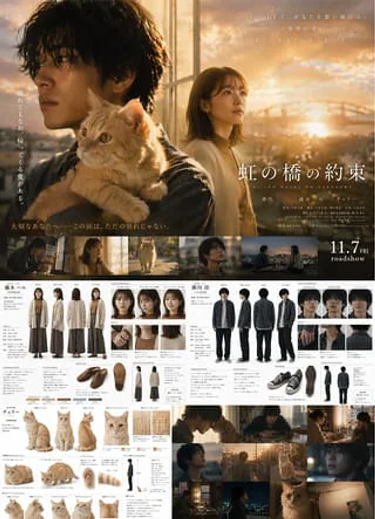

```text
{
  "type": "Live-action movie posters and composite character reference images",
  "layout": {
    "top_half": {
      "type": "Cinematic Poster",
      "visuals": "The foreground features a young Japanese man holding an orange tabby cat, while the background shows a young Japanese woman looking to the right, against a golden hour city skyline with bridges and a faint rainbow.",
      "typography": {
        "title": "{argument name=\"movie title\" default=\"The promise of the Rainbow Bridge\"}",
        "subtitle": "NIJI NO HASHI NO YAKUSOKU",
        "release_date": "{argument name=\"release date\" default=\"11.7 FRI roadshow\"}",
        "taglines": "Multiple blocks of Japanese text arranged vertically and horizontally."
      }
    },
    "middle_band": {
      "type": "film strip",
      "count": 5,
      "description": "A horizontal row consisting of 5 movie stills showcasing the characters in different scenes."
    },
    "bottom_half": {
      "type": "Character design sketches",
      "sections": [
        {
          "subject": "female characters",
          "name": "{argument name=\"female character name\" default=\"Haru Fujiki\"}",
          "full_body_poses": 4,
          "pose_labels": [
            "front",
            "Side view (left)",
            "back",
            "3/4 side view"
          ],
          "facial_expressions": 3,
          "detail_shots": 3,
          "footwear_angles": 3,
          "silhouette_postures": 2,
          "color_swatches": 5
        },
        {
          "subject": "Male characters",
          "name": "{argument name=\"male character name\" default=\"Rin Segawa\"}",
          "full_body_poses": 4,
          "pose_labels": [
            "front",
            "Side view (left)",
            "back",
            "3/4 side view"
          ],
          "facial_expressions": 3,
          "detail_shots": 3,
          "footwear_angles": 3,
          "silhouette_postures": 2
        },
        {
          "subject": "Orange tabby cat",
          "name": "{argument name=\"cat name\" default=\"チェリー\"}",
          "full_body_poses": 3,
          "large_headshot": 1,
          "small_headshots": 4,
          "detail_shots": 3,
          "color_swatches": 4,
          "scale_reference": 1
        },
        {
          "subject": "Additional stills",
          "count": 6,
          "description": "A grid consisting of 6 movie stills featuring characters and cats."
        }
      ]
    }
  }
}
```

Model: GPT Image 2
Author: GPT Image 2 Prompts

[ProjectD](https://aitoolsradar.com/en/prompts/76fb43abd614c1) · [Recorded source](https://x.com/FarAICoder/status/2045516955470147894#reversed-0)
 · [Full original metadata and byte evidence](data/projectd-batch-0037.json)

## Live-Streaming App Interface Mockup


```text
{
  "type": "Mobile live streaming app interface model",
  "subject": {
    "description": "A young Asian woman with long black hair smiles at the camera.",
    "outfit": "{argument name=\"broadcaster outfit\" default=\"White V-neck cardigan\"}",
    "background": "A cozy room, warm-toned lighting, pink flowers, and pink plush toys."
  },
  "layout": {
    "top_bar": {
      "time": "20:32",
      "broadcaster": {
        "name": "{argument name=\"broadcaster name\" default=\"Little deer 🦌\"}",
        "stats": "128,000 likes for this match"
      },
      "action_button": "focus on",
      "viewers": {
        "avatar_count": 3,
        "total": "{argument name=\"viewer count\" default=\"12,000\"}"
      },
      "close_button": "X"
    },
    "floating_widgets": [
      "23rd on the hourly ranking",
      "More live streams &gt;",
      "Gift Pavilion 4/24"
    ],
    "chat_area": {
      "message_count": 4,
      "gift_alert": "Go duck! Sending 1 popularity vote",
      "messages": [
        "I don't eat cilantro:{argument name=\"chat message 1\" default=\"The streamer sings so well!\"}",
        "Little nobody: Here I come!",
        "Evening Breeze: Where is the host from?",
        "Sunny Day: Followed the streamer"
      ]
    },
    "bottom_bar": {
      "input_placeholder": "{argument name=\"input placeholder\" default=\"Say something...\"}",
      "icon_count": 5,
      "icons": [
        "smiley face",
        "Link symbol",
        "Heart-shaped with a halo",
        "gift box",
        "Three points"
      ]
    },
    "overlay_effects": "There are 6 colorful heart-shaped vertical floating effects in the bottom right corner."
  }
}
```

Model: GPT Image 2
Author: GPT Image 2 Prompts

[ProjectD](https://aitoolsradar.com/en/prompts/f0157c865db415) · [Recorded source](https://x.com/wilsondu311/status/2044989301445066770#reversed-0)
 · [Full original metadata and byte evidence](data/projectd-batch-0037.json)

## Livestream App Interface Mockup

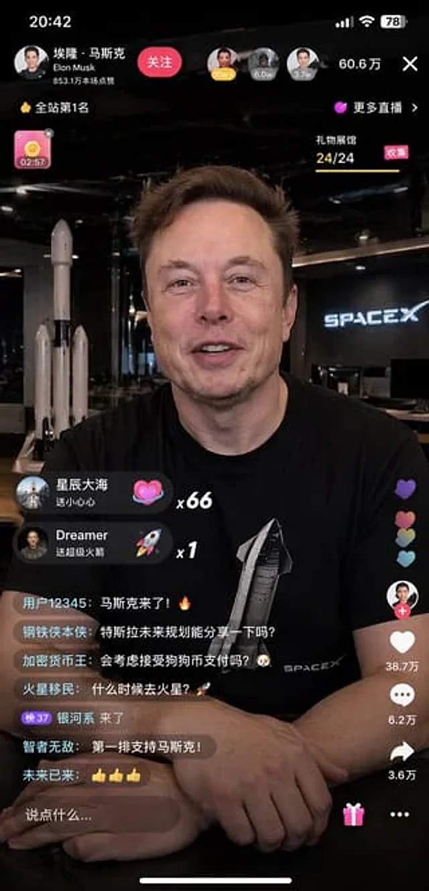

```text
{
  "type": "Mobile live streaming interface model",
  "subject": {
    "identity": "{argument name=\"subject name\" default=\"Elon Musk\"}",
    "appearance": "Wearing a black T-shirt with a print{argument name=\"t-shirt graphic\" default=\"Starship rockets and SPACEX text\"}",
    "pose": "{argument name=\"expression\" default=\"A warm smile, looking directly at the camera.\"} Hands clasped together on the dark table"
  },
  "environment": "{argument name=\"background\" default=\"The SpaceX office, with rocket models and neon signs in the background.\"}",
  "layout": {
    "sections": [
      {
        "title": "Top bar UI",
        "position": "top",
        "count": 4,
        "labels": [
          "Profile information, including \"Elon Musk\" and a \"Follow\" button.",
          "The audience's profile picture and number of attendees were listed as \"606,000\".",
          "Ranking badge: \"Number 1 in the entire site\"",
          "Close button \"X\""
        ]
      },
      {
        "title": "Gift pop-up",
        "position": "center left",
        "count": 2,
        "labels": [
          "Sending you 66 little hearts from the stars and the sea (heart icon)",
          "Dreamer will send you a Super Rocket x1 (rocket icon)."
        ]
      },
      {
        "title": "Chat stream",
        "position": "Bottom left",
        "count": 7,
        "labels": [
          "User 12345: Musk is here! 🔥",
          "Iron Man himself: Could you share Tesla's future plans?",
          "Crypto King: Would you consider accepting Dogecoin payments? 🐶",
          "Mars colonization: When will we go to Mars? 🚀",
          "The Milky Way is here",
          "The wise are invincible: First row, supporting Musk!",
          "The future is here: 👍👍👍"
        ]
      },
      {
        "title": "Side operation buttons",
        "position": "Bottom right",
        "count": 4,
        "labels": [
          "Anchor avatar and \"+\" sign",
          "The post received 387,000 likes and comments.",
          "The comment bubble shows \"62,000\".",
          "The share arrow reads \"36,000\"."
        ]
      },
      {
        "title": "Bottom input bar",
        "position": "bottom",
        "count": 3,
        "labels": [
          "The text input box says \"Say something...\"",
          "Gift box icon",
          "More options \"...\""
        ]
      }
    ]
  }
}
```

Model: GPT Image 2
Author: GPT Image 2 Prompts

[ProjectD](https://aitoolsradar.com/en/prompts/292b1a2575e749) · [Recorded source](https://x.com/LLAiTrade/status/2044786711180484784#reversed-0)
 · [Full original metadata and byte evidence](data/projectd-batch-0037.json)

## Livestream E-commerce Interface Mockup

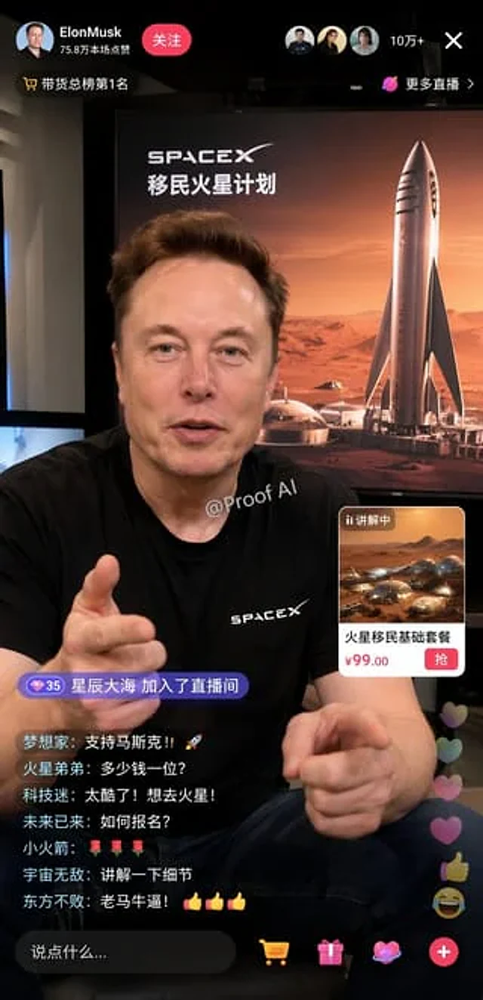

```text
{
  "type": "Mobile live-streaming e-commerce interface model",
  "subject": {
    "person": "Elon Musk",
    "clothing": "Black T-shirt with SPACEX logo",
    "pose": "He waved his hands toward the camera and enthusiastically gave his explanation.",
    "watermark": "@Proof AI"
  },
  "background": {
    "setting": "Large display screen",
    "image": "Martian landscape with starship rockets and dome habitat",
    "text": [
      "SPACEX",
      "{argument name=\"background title\" default=\"Mars colonization plan\"}"
    ]
  },
  "ui_layout": {
    "header": {
      "broadcaster_info": {
        "name": "{argument name=\"broadcaster name\" default=\"ElonMusk\"}",
        "stats": "758,000 likes for this match",
        "follow_button": "focus on"
      },
      "viewer_stats": {
        "avatars_count": 3,
        "text": "100,000+",
        "close_button": "X"
      },
      "tags": [
        "#1 on the overall sales ranking",
        "More live streams &gt;"
      ]
    },
    "product_card": {
      "position": "Middle right",
      "status": "During the explanation",
      "image": "Mars Dome Habitat",
      "title": "{argument name=\"product title\" default=\"Mars Colonization Basic Package\"}",
      "price": "{argument name=\"product price\" default=\"¥99.00\"}",
      "action_button": "Rob"
    },
    "chat_overlay": {
      "position": "bottom left corner",
      "join_alert": "The stars and the sea joined the live stream.",
      "messages_count": 7,
      "messages": [
        "{argument name=\"top chat message\" default=\"Dreamer: Support Musk!! 🚀\"}",
        "Mars Brother: How much per person?",
        "Tech enthusiast: That's so cool! I want to go to Mars!",
        "The future is here: How to register?",
        "Little Rocket: 🌹🌹🌹",
        "Unrivaled in the Universe: Let me explain the details.",
        "Dongfang Bubai: Old Ma is awesome! 👍👍👍"
      ]
    },
    "bottom_action_bar": {
      "input_placeholder": "Say something...",
      "icons_count": 4,
      "icons": [
        "shopping cart",
        "gift box",
        "Heart-shaped planet",
        "plus sign"
      ]
    },
    "floating_reactions": {
      "position": "bottom right corner",
      "elements": "Floating hearts, likes, and smiley faces stacked up"
    }
  }
}
```

Model: GPT Image 2
Author: GPT Image 2 Prompts

[ProjectD](https://aitoolsradar.com/en/prompts/64ae76f8b9b420) · [Recorded source](https://x.com/JCutcut47692/status/2045846999032008876#reversed-0)
 · [Full original metadata and byte evidence](data/projectd-batch-0037.json)

## Livestream Interface Mockup

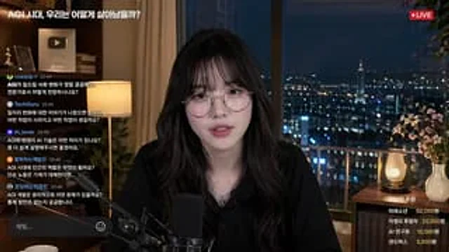

```text
{
  "type": "Live Streaming Interface Model",
  "subject": {
    "description": "{argument name=\"streamer description\" default=\"A young Asian woman with long, wavy hair and bangs, wearing round metal-framed glasses, a black shirt, and a silver necklace.\"}",
    "action": "Look directly into the camera and speak into a professional broadcast microphone."
  },
  "setting": {
    "location": "The interior of a high-rise apartment at night",
    "background": "Large windows with blurred city night view lights",
    "props": "YouTube play button medal on the shelf, warm-toned desk lamp"
  },
  "layout": {
    "top_left": {
      "element": "Live Stream Title",
      "text": "{argument name=\"stream title\" default=\"How should we survive in the AGI era?\"}"
    },
    "top_right": {
      "element": "Status Badge",
      "text": "During the live stream",
      "style": "Red round indicator light"
    },
    "left_panel": {
      "element": "Real-time chat stream",
      "message_count": 5,
      "messages": [
        "FutureExplorer 22:44: Curious about the social changes brought about by AGI.",
        "TechGuru 22:44: Which jobs will disappear or appear?",
        "AI_lover 22:45: What is the difference between AGI and current AI?",
        "PhilosophizingDev 22:45: What role will humans play in the AGI era?",
        "CodingOfficeWorker 22:46: What are the ethical issues and control methods for AGI?"
      ],
      "input_box": "Chat... with smiley face icon"
    },
    "bottom_right": {
      "element": "Donation Ranking",
      "title": "{argument name=\"donation title\" default=\"Today&#39;s tip\"}",
      "item_count": 4,
      "items": [
        "FutureBoy 50,000 Korean Won",
        "Anonymous 20,000 Korean Won",
        "AI Researcher 10,000 Korean Won",
        "Sandbox 5,000 Korean Won"
      ]
    }
  }
}
```

Model: GPT Image 2
Author: GPT Image 2 Prompts

[ProjectD](https://aitoolsradar.com/en/prompts/b54e07d4f08e80) · [Recorded source](https://x.com/sungchi/status/2044400278099906921#reversed-3)
 · [Full original metadata and byte evidence](data/projectd-batch-0037.json)

## Livestream Screenshot Prompt


```text
Generate a{argument name="platform" default="Tik Tok"} A screenshot from the live stream shows one person in the picture.{argument name="character" default="Beautiful Chinese women"} She was live-streaming. She was holding a sign that read:{argument name="thank you message" default="Thank you so much, Brother Shuimuyi, for the big yacht!"} The image ratio is 9:16.
```

Model: GPT Image 2
Author: GPT Image 2 Prompts

[ProjectD](https://aitoolsradar.com/en/prompts/c52c9758f92d01) · [Recorded source](https://x.com/ohmuyi/status/2044725395162107957)
 · [Full original metadata and byte evidence](data/projectd-batch-0037.json)

## Livestream UI Mockup with Host


```text
{
  "type": "Mobile live streaming interface design draft",
  "scene": {
    "subject": "{argument name=\"main subject\" default=\"Sam Altman\"} The portrait shows the subject wearing a dark green sweater, looking directly at the camera, with her right hand extended forward in an inviting gesture.",
    "background": "The scene is set in an office studio. On the left is a huge 'OpenAI' logo on the wall. On the right is a wooden shelf with three bottles of dark wine and two small square plaques, one of which reads 'AGI' and the other 'OpenAI'."
  },
  "layout": {
    "top_overlay": {
      "status_bar": "Time '20:34', Cellular signal bar, Wi-Fi icon, Battery '774'",
      "host_profile": "The OpenAI logo, the name 'OpenAI', the subtitle '483k people liked this live stream', and a red 'Follow' button.",
      "viewer_stats": "Three user avatars, text '100k+', and an 'X' close icon.",
      "banners": [
        "The top banner displays 'OpenAI Official Flagship Store Ranking #1'",
        "The link shows 'More Live Streams&gt;'",
        "Red envelope countdown icon '00:12'",
        "The gift box icon displays 'Recommended by Douyin Mall during the 520 Gift Season'."
      ]
    },
    "bottom_left_overlay": {
      "pinned_host_message": {
        "avatar": "Anchor Portrait",
        "name": "Sam Altman",
        "badge": "During the live stream",
        "message": "{argument name=\"host message\" default=\"Hello everyone, I&#39;m Ultraman Sam, and I invite you to join Kevin&#39;s academy.\"}"
      },
      "live_chat": {
        "count": 5,
        "messages": [
          "Level 32 badge, user 'AI beginner', content 'Just came to learn, I'm here!'",
          "Level 18 badge, user 'Xiaokai', content: 'Finally started streaming, let's go!'",
          "Level 7 badge, user 'Worker Kevin', post: 'A one-man company is awesome!'",
          "Level 26 badge, user 'Smart Future', content 'Followed, looking forward to more content!'",
          "Level 5 badge, user 'AI Side Hustle Guide', content 'How to join?'"
        ]
      }
    },
    "bottom_right_overlay": {
      "qr_code_card": {
        "graphic": "A large, scannable QR code with a blue logo in the center that reads 'KEVIN'.",
        "primary_text": "{argument name=\"promo headline\" default=\"Starting an AI-powered one-person company with zero experience\"}",
        "secondary_text": "{argument name=\"promo subheadline\" default=\"Turn entrepreneurship into a profitable business\"}",
        "call_to_action_button": "The red button displays {argument name=\"button text\" default=\"Scan the QR code to join\"}"
      }
    },
    "bottom_navigation_bar": {
      "input_field": "The text box displays 'Say something...'",
      "icons_count": 5,
      "icons": [
        "smiley face emoji",
        "Shopping cart icon",
        "Heart icon",
        "Gift box icon",
        "Three-dot menu icon"
      ],
      "system": "Bottom iOS Home Screen Indicator Bar"
    }
  }
}
```

Model: GPT Image 2
Author: GPT Image 2 Prompts

[ProjectD](https://aitoolsradar.com/en/prompts/b526aab4a6040b) · [Recorded source](https://x.com/kevintao1024/status/2045074817339052095#reversed-3)
 · [Full original metadata and byte evidence](data/projectd-batch-0037.json)

## Livestreaming Character Prompt


```text
Generate a screenshot of a Douyin live stream, showing a person {argument name="gender" default="male"} Wearing{argument name="clothing" default="Chinese traditional clothing"} Currently{argument name="action" default="Live streaming e-commerce"} .
```

Model: GPT Image 2
Author: GPT Image 2 Prompts

[ProjectD](https://aitoolsradar.com/en/prompts/44ec1e59556ba6) · [Recorded source](https://x.com/dwi13311/status/2047519294624350469)
 · [Full original metadata and byte evidence](data/projectd-batch-0037.json)

## Living Hanfu Fashion Sketch

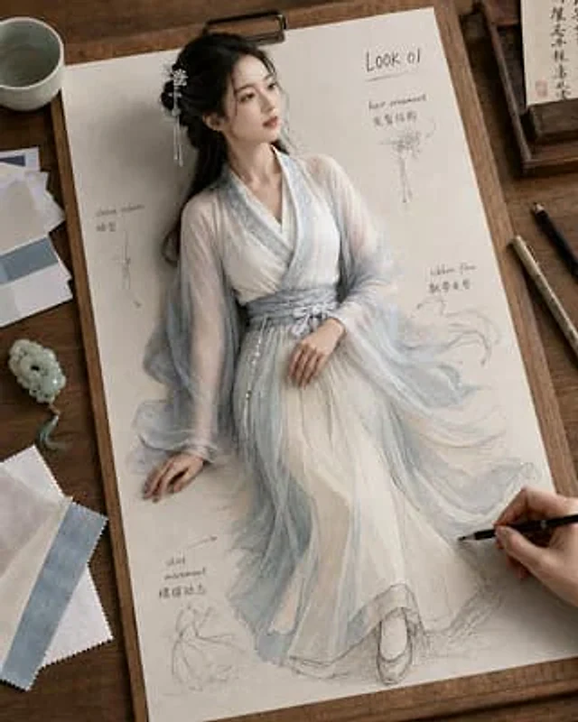

```text
Create a vertical photorealistic fantasy fashion design sheet on a wooden desk: a full-body ancient Chinese hanfu model appears to come alive from a cream sketch paper clipped to a drawing board, blending 3D realism in the upper body with pencil sketch and pale watercolor fashion illustration in the lower skirt. The model is {argument name="character name" default="Look 01"}, a delicate young East Asian woman with fair skin, soft makeup, long black hair in a loose half-up style, and a silver floral hair ornament with dangling beads. She wears {argument name="outfit color palette" default="moon-white and misty pale blue"} layered hanfu: translucent gauze sleeves, white inner robe, pale blue embroidered collar trim, wrapped blue-gray waist sash with a bow and pearl tassel, and a flowing semi-transparent skirt that dissolves into visible graphite construction lines near the hem and feet. The pose is graceful and seated/reclining on the paper, head turned slightly upward to the right, one hand resting near the waist and the other touching the paper. Add exactly 5 handwritten fashion annotation areas on the page: 1) top right title “Look 01” underlined, 2) “hair ornament” with Chinese note “发髻结构” and a small ornament sketch, 3) left side “sleeve volume” with Chinese note “袖型” and a sleeve diagram, 4) right middle “ribbon flow” with Chinese note “飘带走势” and flowing ribbon arrows, 5) lower left “skirt movement” with Chinese note “裙摆动态” and a skirt motion sketch. Surround the board with traditional design-studio props: a ceramic teacup at upper left, paper and color swatches at left, a pale jade pendant/tassel at lower left, fabric swatches in white and blue at bottom left, calligraphy paper and wooden tray at upper right, two drawing pens on the right, and a visible hand at lower right sketching the dress with a pencil. Use warm natural window light, shallow depth of field, realistic paper texture, graphite lines, soft watercolor washes, cinematic top-down three-quarter composition, high detail, elegant ancient Chinese aesthetic, no extra text beyond the specified annotations.
```

Model: GPT Image 2
Author: Larus Canus

[ProjectD](https://aitoolsradar.com/en/prompts/1874f210ecb091) · [Recorded source](https://youmind.com/prompts/living-hanfu-fashion-sketch-26701)
 · [Full original metadata and byte evidence](data/projectd-batch-0037.json)

## Lo-Fi Art Style Transformation

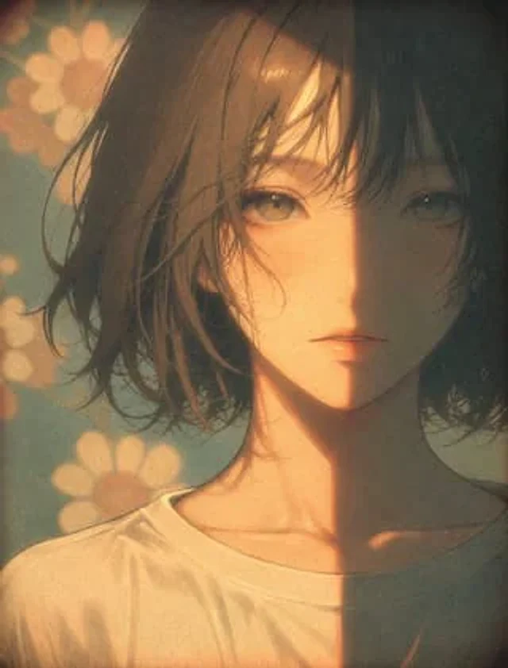

```text
このイラストを、{argument name="スタイル" default="本格的なLo-Fiアートスタイル"}で変換してください。暖かく少しくすんだパステル調の色味、フィルムグレイン、ソフトフォーカス、軽い色褪せとビネットを加えて、ノスタルジックでチルな雰囲気を強く表現してください。柔らかい自然光がキャラクターを優しく包み込み、肌や髪に温かみのある光と影を落とす。全体をゆったりと落ち着いた、どこか懐かしく心地よいLo-Fi特有のムードに仕上げてください。元の構図・キャラクターを完全に維持。
```

Model: GPT Image 2
Author: のとろ

[ProjectD](https://aitoolsradar.com/en/prompts/fcf23e77cafeb4) · [Recorded source](https://youmind.com/prompts/lofi-art-style-transformation-19676)
 · [Full original metadata and byte evidence](data/projectd-batch-0037.json)

## Local Edit: Mascot Robot Replacement


```text
Use the provided reference image for partial editing. Replace the robot character next to the woman with a cute green and white mascot robot version, maintaining the same pose, position, scarf, lighting, and comfortable watercolor anime style, while keeping the rest of the scene unchanged. Add two leaf-shaped ears to the new robot, a bud with three small white bell-shaped flowers on its head, and give it larger, bright blue eyes. It should also have a green heart-shaped badge on its chest. Simultaneously rotate the laptop in the lower left corner so that the back of the screen faces the viewer, and add a simple line art logo of the mascot robot to the center of the laptop lid.
```

Model: GPT Image 2
Author: GPT Image 2 Prompts

[ProjectD](https://aitoolsradar.com/en/prompts/821bb73d0de7dc) · [Recorded source](https://x.com/saskr_13/status/2046963478733447504#reversed-2)
 · [Full original metadata and byte evidence](data/projectd-batch-0037.json)

## Local Edit: Rotate Laptop and Add Logo


```text
Make some minor edits using the provided reference image: Rotate the laptop in the lower left corner so that the back of its screen faces the viewer instead of the keyboard, and add a cute robot mascot logo to the center of the back. Keep the rest of the illustration unchanged, including the characters, room decor, lighting, watercolor anime style, desktop items, and overall composition.
```

Model: GPT Image 2
Author: GPT Image 2 Prompts

[ProjectD](https://aitoolsradar.com/en/prompts/aa093f21bea9db) · [Recorded source](https://x.com/saskr_13/status/2046963478733447504#reversed-1)
 · [Full original metadata and byte evidence](data/projectd-batch-0037.json)

## Logo 与品牌身份系统提示词合集

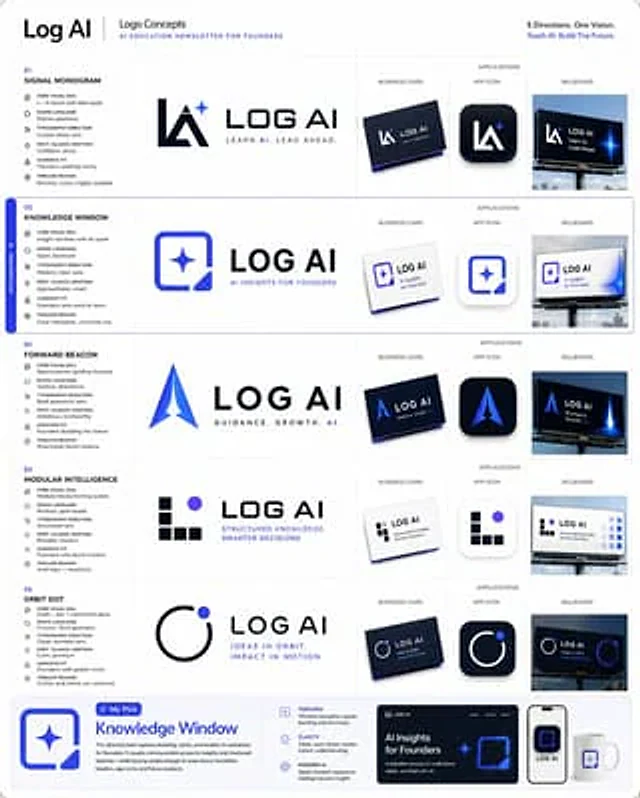

```text
1. Logo概念生成提示词

你是一位拥有20年经验的顶级Logo设计师，为全球知名品牌设计过即时识别且深具意义的标志。

品牌名称：[你的品牌名]
行业：[你的行业]
品牌个性：[描述]
目标受众：[描述]
欣赏的视觉身份：[列举3个]
讨厌的视觉身份：[列举3个]
偏好风格：[如极简、大胆、几何、有机、复古、未来]

为我的品牌生成5个完全不同的Logo概念。

对每个概念提供：

- 核心视觉理念及象征意义
- 形状语言及为何适合品牌
- 字体方向建议
- 第一眼的情感触发
- 为何适合目标受众
- 在名片、App图标和广告牌上的效果
- 何为永恒而非潮流

然后告诉我，如果这是你的品牌，你会选哪个以及原因。

2. 品牌身份基础提示词

你是为财富500强公司和初创企业建立品牌身份的顶级品牌战略师，这些企业后来融资数百万。

业务名称：[你的业务名]
业务描述：[一句话]
目标受众：[详细描述]
竞争对手：[列举3-5个]
想触发的感受：[如信任、兴奋、奢华、亲近、力量]
想关联的词汇：[列举5-10个]
不想关联的词汇：[列举5-10个]

在设计任何视觉效果之前建立完整的品牌身份基础。

为我提供：

- 品牌原型及为何完美契合
- 5个具体人类特征描述的品牌个性
- 带示例的品牌语调指南
- 核心品牌承诺（一句话）
- 3个品牌应触发的情感层级
- 与竞争对手的根本差异
- 定义品牌的唯一关键词

3. 配色方案提示词

你是色彩心理学专家和品牌设计师，深知色彩如何触发情感、建立信任和驱动购买决策。

品牌名称：[你的品牌名]
行业：[你的行业]
目标受众：[年龄、性别、收入、生活方式]
想触发的首要情感：[如信任、能量、奢华、平静、兴奋]
前3名竞争对手颜色：[列举]
喜欢的颜色：[列举]
讨厌的颜色：[列举]

为我建立完整品牌配色板。

为我提供：

- 主色及其HEX代码和心理学解释
- 两个辅助色及HEX代码
- 一个强调色用于CTA和高亮
- 一个中性色用于背景和文字
- 每种颜色对目标受众的影响
- 与竞争对手的差异化
- 在网站、社交媒体和包装上的应用示例
- 永远不要搭配的颜色组合及原因

4. 字体方向提示词

你是字体专家和品牌设计师，深知字体如何传达个性、建立可信度和实现品牌即时识别。

品牌名称：[你的品牌名]
品牌个性：[5个词]
行业：[你的行业]
目标受众：[描述]
字体应触发的感受：[如权威、友好、创新、优雅、能量]
喜欢的品牌字体：[列举3个]

为我建立完整字体系统。

为我提供：

- 标题用主显示字体名称及为何完美
- 长文本的辅助字体
- 引言或重点的强调字体
- 标题、副标题、正文、说明文字的精确字号层级
- 字距和行高建议
- 字体搭配方法
- 预算有限时的免费替代方案
- 你所在行业应避免的字体错误

5. 完整品牌身份包提示词

你是顶级品牌代理创意总监，交付覆盖每个触点的完整品牌身份系统。

业务名称：[你的业务名]
业务描述：[一句话]
目标受众：[详细描述]
品牌个性：[5个词]
行业：[你的行业]
竞争对手：[列举3个]
设计工具预算：[免费或付费]
时间表：[你需要的时间]

在一个回复中交付我的完整品牌身份系统。

包含所有元素：

- 品牌战略基础、原型、个性、承诺和定位
- Logo概念及3个变体
- 完整配色板、HEX代码和使用规则
- 字体系统、名称、字号和层级
- 视觉方向指南
- 品牌语调指南和标语选项
- 社交媒体视觉模板
- 3条永远不要打破的核心品牌规则

将一切作为结构化品牌手册交付，任何设计师、开发者或AI工具都能在10分钟内完全理解你的品牌。
```

Model: GPT Image 2
Author: @wanerfu

[ProjectD](https://aitoolsradar.com/en/prompts/f76040a878b5b8) · [Recorded source](https://x.com/wanerfu/status/2048659924822184026)
 · [Full original metadata and byte evidence](data/projectd-batch-0037.json)

## LOKII #288

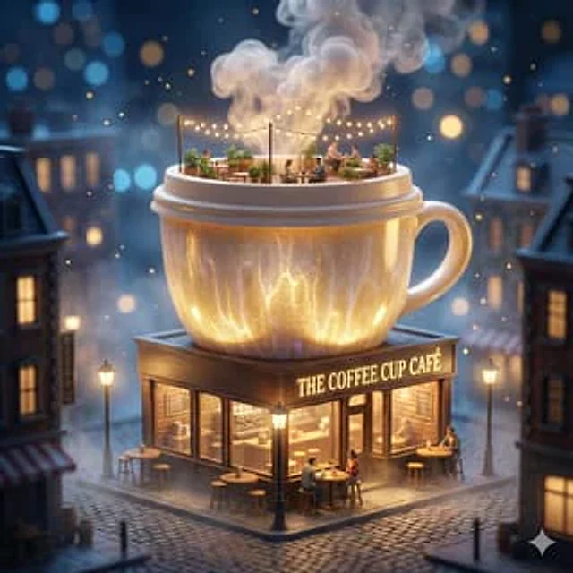

```text
ChatGPT Image 1.5 × Google Veo 3.1

→ Nano Banana Pro / GPT-Image 1.5
→ Copy & Paste the Prompt
→ View Results Below ⤵️

Prompt:

A surreal miniature city scene where a giant coffee cup transforms into a cozy café building. The coffee cup forms the main structure, with steam rising like clouds, ceramic textures glowing softly, and the lid acting as a rooftop terrace. The ground floor is a warmly lit café storefront with glass windows, tiny tables, stools, barista counters, and glowing street lamps. Nighttime atmosphere with cinematic bokeh lights, floating particles, soft fog, warm interior glow, hyper-detailed materials, fantasy realism, premium brand storytelling. Tilt-shift effect, ultra-sharp focus, dramatic lighting, square frame, 1080×1080, high-end commercial illustration, ultra-detailed 8K quality.
```

Model: GPT Image 2
Author: LOKII

[ProjectD](https://aitoolsradar.com/en/prompts/3b2e2426e6b47b) · [Recorded source](https://x.com/TheLOKII_/status/2009310549994283496)
 · [Full original metadata and byte evidence](data/projectd-batch-0037.json)

## Long Stretching Tabby Cat

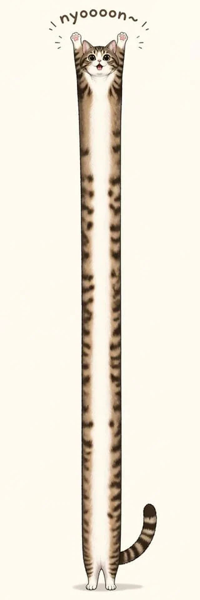

```text
A whimsical minimalist illustration, with a figure standing in the very center of the picture.{argument name="cat breed" default="Brown tabby kitten"} It sits at the center of a very tall, vertical canvas, its body exaggeratedly elongated, stretching from top to bottom like a noodle. The cat has a round face, large, glossy eyes, a slightly open, smiling face, erect ears, and two front paws raised high above its head in a cheering posture, revealing two pink paw pads. Its fur is soft and intricately detailed, with white muzzle, chest, abdomen, and inner legs, and brown and black tabby stripes on its sides, head, arms, and tail. Its extremely slender, vertically elongated body creates a comically exaggerated proportion, while its two hind paws are small and tucked together at the bottom. A curved striped tail is added to the lower right. Above its head, a playful handwritten text is placed {argument name="caption text" default="nyoooon~"} The font is a rounded dark brown, with a semi-circular arch, and six short, dynamic lines are added around the raised paws and text to emphasize the sense of extension. The background uses a clean off-white or warm light beige, with no scene, only a faint oval shadow at the feet. It has a cute and delicate digital illustration style, a centered composition, rich fur details, a humorous feel reminiscent of Japanese stickers or social media mascots, ample white space, and an extremely high aspect ratio.
```

Model: GPT Image 2
Author: GPT Image 2 Prompts

[ProjectD](https://aitoolsradar.com/en/prompts/2f7f3d7784c30d) · [Recorded source](https://x.com/Nico_Nico_Ch/status/2046499626593976518#reversed-0)
 · [Full original metadata and byte evidence](data/projectd-batch-0037.json)

## Lost in 国家旅行海报拼贴

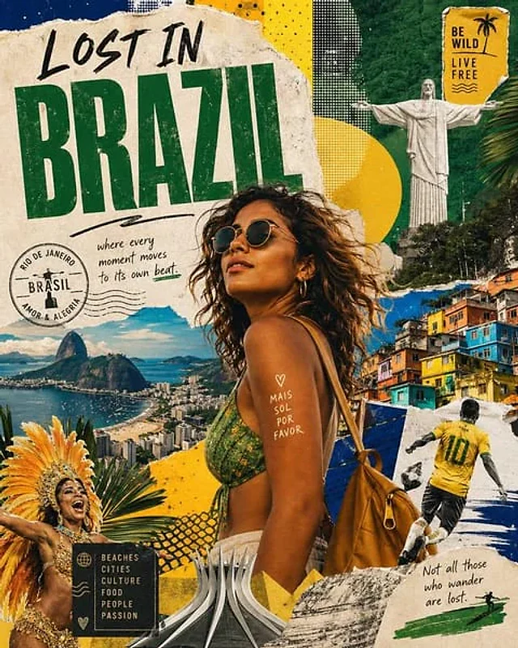

```text
Create a stylized travel poster / graphic collage for [country]. The main subject should be a stylish international tourist visiting [country], clearly presented as a traveler and not a local resident. Show the tourist wearing modern travel fashion, with details such as a camera, backpack, sunglasses, map, or suitcase, exploring the culture and atmosphere of [country]. Place the tourist in a dynamic composition surrounded by iconic architecture, streets, landscapes, landmarks, transportation, food, signage, and cultural elements associated with [country]. Blend realistic character detail with a graphic collage background made of layered paper textures, torn poster edges, sticker elements, halftone dots, editorial typography, and bold geometric shapes. Include authentic visual motifs from [country], but keep the tourist's appearance and styling globally fashionable and clearly foreign to the setting. Add a large readable headline: "LOST IN [country]". Modern, artistic, premium editorial travel poster aesthetic, balanced layout, print-worthy composition.
```

Model: GPT Image 2
Author: @SadiaMalik182

[ProjectD](https://aitoolsradar.com/en/prompts/54e6c14d42ae09) · [Recorded source](https://x.com/SadiaMalik182)
 · [Full original metadata and byte evidence](data/projectd-batch-0037.json)

## Low-Angle Anime Bunny Girls in Ruins

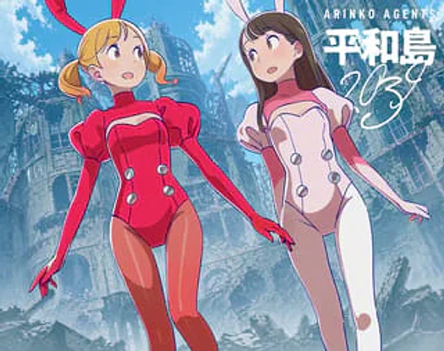

```text
A dynamic, anime-style illustration from a low angle depicts two young women wearing rabbit-themed bodysuits. The perspective is from below, as if the camera is tilted upwards, and they are looking slightly down at the viewer. The girl on the left has {argument name="hair color" default="blonde"} The girl on the right has short, curly pigtails, wears large red rabbit ears, and a shiny red high-slit bodysuit with puff sleeves, long opera gloves, a heart-shaped front panel, and four round silver button-like discs. The girl on the right has long, straight brown hair, wears light-colored rabbit ears, and a similarly designed shiny white and light pink bodysuit with puff sleeves, long gloves, a heart-shaped front panel, and four round silver discs. Both are slender with long legs and expressive, large anime eyes, their expressions slightly surprised and curious, their gazes meeting and glancing slightly at the audience. Their hands hang naturally at their sides, almost touching at the center. Imagine them in front of a vast, ruined cathedral or a dilapidated, magnificent stone building, with a background of broken arches, skeletal metal frames, shattered windows, and collapsed rubble, rendered in a soft, anime-style atmosphere. The dramatic Dutch angle and strong perspective create a sense of tilt in the architecture, making the characters appear tall and close to the camera. Behind the ruins lies a clear blue sky and vast white clouds. The characters are rendered with clean cel-shaded backgrounds, rich in detail and painterly quality, with sharp lines and vibrant yet slightly weathered colors, resulting in a cinematic composition. Three text elements are added in the upper right corner as a graphic design overlay: the small uppercase text "ARINKO AGENTS," the large bold Japanese characters "Heiwajima," and a large white handwritten signature-style font overlaid on the background.
```

Model: GPT Image 2
Author: GPT Image 2 Prompts

[ProjectD](https://aitoolsradar.com/en/prompts/cc8550b9c035c7) · [Recorded source](https://x.com/MireilleDartois/status/2046584744977318306#reversed-0)
 · [Full original metadata and byte evidence](data/projectd-batch-0037.json)

## Low-Angle Redhead Cargo Fashion Portrait

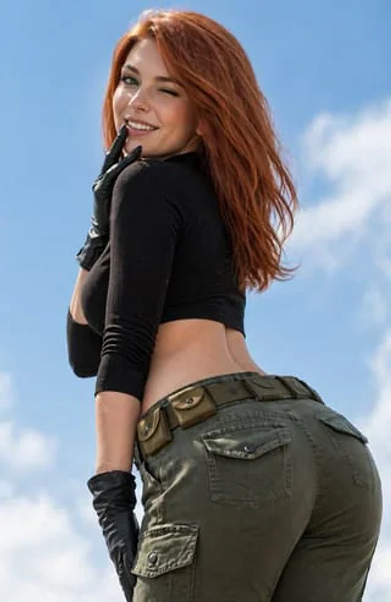

```text
A full-body cropped portrait in a realistic fashion photography style, the protagonist is{argument name="character type" default="young women"} The shot was taken from a high-angle angle with great tension, against a bright blue sky and two soft white clouds. She is three-quarters turned away from the camera, looking back at the lens with long, wavy hair.{argument name="hair color" default="reddish-brown"} Her hair cascaded down her back, flowing naturally in the breeze. She wore a fitted black ribbed long-sleeved cropped top, revealing her waist; paired with olive green low-waisted cargo pants, featuring five clearly visible practical pouches at the waistband, two flap pockets on the back, and one visible cargo pocket on the left thigh. She also wore a pair of glossy black leather gloves, one hand raised near her neck and chin, the other hanging naturally at her side. The image emphasizes cinematic quality and confident posture, natural sunlight, realistic skin texture, meticulous fabric stitching and seams, a slightly sensual editing style, a clean outdoor background, shallow depth of field, clear focus on the subject and clothing, and high-resolution realism.
```

Model: GPT Image 2
Author: GPT Image 2 Prompts

[ProjectD](https://aitoolsradar.com/en/prompts/ed9b4f736b12c5) · [Recorded source](https://x.com/agi_exec/status/2046942654294868443#reversed-0)
 · [Full original metadata and byte evidence](data/projectd-batch-0037.json)

## Low-Angle Running Woman Street Photo

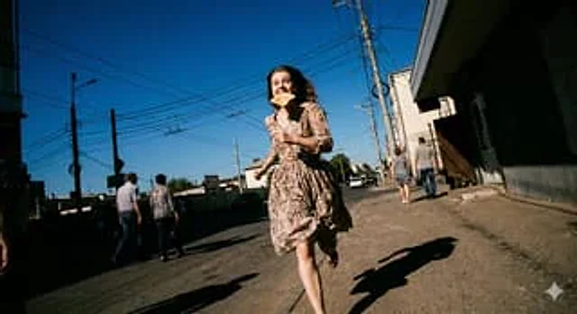

```text
A realistic candid street photo, in which {argument name="subject" default="A young Russian woman"} He was rushing to school, running towards the camera, one hand on his chest, and mouth {argument name="prop" default="Holding a slice of toast"} She was wearing{argument name="dress style" default="A light beige printed long-sleeved fitted waist flowy dress"} Flat shoes, skirt swaying with her movements. Shot from an extremely low, insect-eye perspective, against a backdrop of a rough roadside in a simple urban neighborhood, making her appear against a vast, unobstructed view.{argument name="sky color" default="Deep cobalt blue"} Against the backdrop of the sky, it appears exceptionally tall. A dense network of crisscrossing overhead power lines and poles spans the upper half of the frame, creating a strong geometric tension. The intense midday sunlight casts clear, deep shadows on the dusty ground. The image includes four slightly blurred figures in the background, walking away or crossing the street, along with several cars in the distance and low-rise buildings on either side of the road. The composition should convey a chaotic, youthful, cinematic, and frozen-in-a-moment visual effect, employing a wide-angle lens, high-fidelity realism, fine film grain, strong contrast, and a slightly nostalgic color palette.{argument name="film look" default="Fujifilm Classic Negative"} Its aesthetic style.
```

Model: GPT Image 2
Author: GPT Image 2 Prompts

[ProjectD](https://aitoolsradar.com/en/prompts/0e2b810ce53c50) · [Recorded source](https://x.com/HarshithLucky3/status/2046685886709104740#reversed-0)
 · [Full original metadata and byte evidence](data/projectd-batch-0037.json)

## Low-Hovering Spacecraft Over Neighborhood


```text
A realistic scene depicting a massive metal rocket in {argument name="setting" default="Residential area with palm trees"} It hovered horizontally at a very low altitude. The side of the silver spacecraft was clearly visible.{argument name="company name" default="SPACEX"} The words were visible. Bright orange flames and thick smoke billowed from the rear engine. The foreground was a dark concrete roof, the background hazy.{argument name="lighting" default="Sunset"} Under the light, the small, multi-story buildings nestled among tropical vegetation create a surreal juxtaposition of advanced aerospace technology and everyday life.
```

Model: GPT Image 2
Author: GPT Image 2 Prompts

[ProjectD](https://aitoolsradar.com/en/prompts/f60074a77c93b4) · [Recorded source](https://x.com/SadAlbert10/status/2045491882818679179#reversed-0)
 · [Full original metadata and byte evidence](data/projectd-batch-0037.json)

## Low-Key Fashion Portrait Character Swap

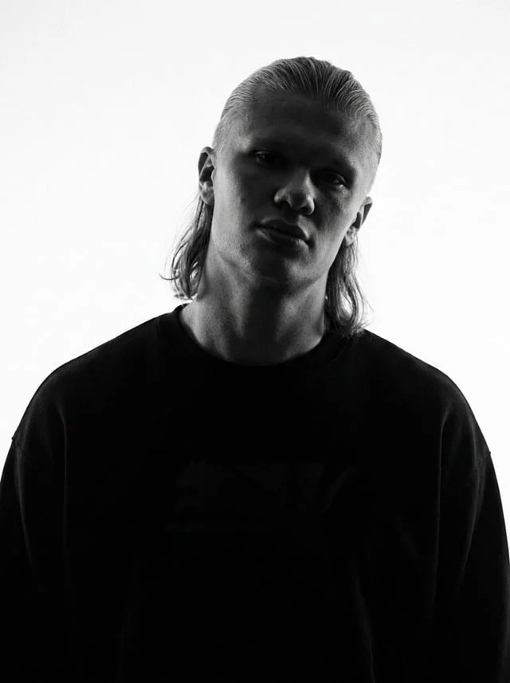

```text
Create a hyper-realistic black and white low-key fashion portrait based on the uploaded reference image. Keep the exact same composition, square framing, camera angle, subject placement, upper-body crop, head tilt, shoulder position, body angle, background, lighting direction, shadow placement, contrast, grain texture and overall dark editorial mood.
Replace only the original person with the character from the newly uploaded target reference image.
```

Model: GPT Image 2
Author: Sairah

[ProjectD](https://aitoolsradar.com/en/prompts/8cde0c283d772f) · [Recorded source](https://youmind.com/prompts/black-white-portrait-character-swap-27875)
 · [Full original metadata and byte evidence](data/projectd-batch-0037.json)

## Low-poly samurai strategy village

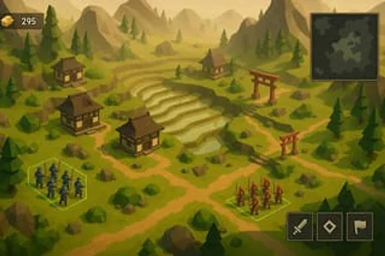

```text
Create an isometric low-poly strategy game screenshot of a mountainous Japanese village with rice terraces, torii gates, samurai and archer units in formation, and a tactical RTS interface. Include unit selection boxes, resource counters for rice and wood, fog-of-war minimap, command overlays, and warm daylight with soft shadows. Stylized but readable, modern indie strategy game key art, 16:9.
```

Model: GPT Image 2
Author: @reddit-community

[ProjectD](https://aitoolsradar.com/en/prompts/3461d73228dcc9) · [Recorded source](https://www.reddit.com/r/midjourney/comments/1l2d5dr/lowpoly_strategy_video_games_in_japan_prompts/)
 · [Full original metadata and byte evidence](data/projectd-batch-0037.json)

## Lu Bu Game Boss Dual Form Design

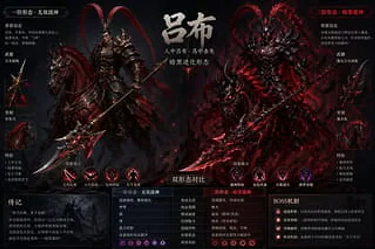

```text
{argument name="character" default="Lü Bu"} Game Boss settings, including{argument name="mount" default="Red Hare"} and{argument name="weapon" default="Fangtian Halberd"} Showing a comparison of the two forms of Dark Evolution
```

Model: GPT Image 2
Author: GPT Image 2 Prompts

[ProjectD](https://aitoolsradar.com/en/prompts/1451f667df2b7a) · [Recorded source](https://x.com/songguoxiansen/status/2047198090009190441)
 · [Full original metadata and byte evidence](data/projectd-batch-0037.json)

## Lu Xun Literature Themed Illustration

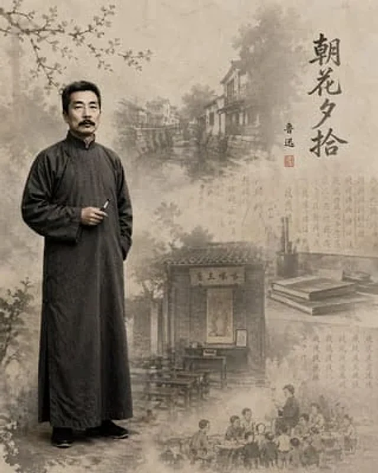

```text
According to Lu Xun's "{argument name="work name" default="Morning flowers, evening gathering"} "Content generates an image. The background should reflect..."{argument name="work name" default="Morning flowers, evening gathering"} The artistic conception of "" can be achieved, and a mask can be used. The foreground should include elements located on the left or right side of the image.{argument name="character" default="Lu Xun"} Full-body portrait.
```

Model: GPT Image 2
Author: GPT Image 2 Prompts

[ProjectD](https://aitoolsradar.com/en/prompts/91767e469eaeff) · [Recorded source](https://x.com/Aurora_62340/status/2047139992355680530)
 · [Full original metadata and byte evidence](data/projectd-batch-0037.json)

## Lumen iOS Wellness App Mockup

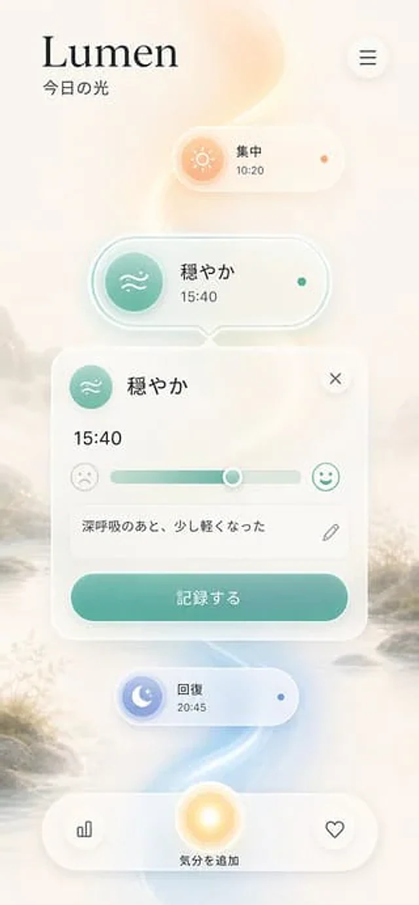

```text
Goal: Create a polished iOS-style wellness app mockup for {argument name="app name" default="Lumen"}, a light-themed mood and breathing tracker, with soft Apple-inspired glassmorphism and Japanese UI text.

Canvas: Vertical mobile screenshot, 9:16 aspect ratio, approximately 563 × 1008 px. Use an airy cream-white background with a misty watercolor landscape at the bottom and edges, subtle mountains, reeds, and a glowing winding light trail running vertically through the center in warm peach near the top and pale blue near the bottom.

Layout: Place the app title at top left in a refined serif font, large black text reading “Lumen”, with the subtitle “今日の光” underneath in smaller dark gray Japanese text. Place one circular hamburger menu button at top right with three dark horizontal lines and a soft shadow.

Main UI elements: Use exactly 5 floating rounded glass cards/buttons stacked vertically down the center:
1. Top small pill card: warm peach sun icon on the left, label “集中”, time “10:20”, and one small orange status dot on the right.
2. Middle selected pill card: larger white translucent pill with teal glow outline, teal circular wave/breath icon on the left, label “穏やか”, time “15:40”, and one small teal status dot on the right. Add a small downward notch centered at the bottom of this pill, visually connecting to the expanded card below.
3. Expanded mood entry card: large rounded white translucent panel. Top left has the same teal wave icon, title “穏やか”, and a circular close button with an “×” at top right. Show the time “15:40” in large text. Include one horizontal mood slider with exactly 3 visible parts: a sad face icon on the left, a teal-to-gray slider track with the knob slightly right of center, and a happy face icon on the right. Beneath it, include a rounded text input containing “深呼吸のあと、少し軽くなった” with a small pencil icon on the right. At the bottom, include a large teal gradient rounded button labeled “記録する”.
4. Lower small pill card: blue moon-and-star icon on the left, label “回復”, time “20:45”, and one small blue status dot on the right.
5. Bottom navigation / action bar: wide translucent rounded capsule near the bottom. It contains exactly 3 circular controls: left small circular button with a bar chart icon, center larger glowing golden circular button, and right small circular button with a heart outline. Under the center glowing button, show the label “気分を追加”.

Visual style: Minimal premium iOS app design, translucent frosted glass surfaces, rounded corners, soft drop shadows, delicate glow, subtle depth, clean spacing, calm wellness atmosphere. Use warm peach, mint teal, pale blue, cream white, and charcoal typography. Icons should be simple line icons and feel native to iOS.

Constraints: Keep all visible Japanese text exactly as specified. Do not add extra cards, extra text, logos, watermarks, device frame, or status bar. The mockup should look like a generated app UI concept rather than a screenshot of a real installed app.
```

Model: GPT Image 2
Author: Maki@Sunwood AI Labs.

[ProjectD](https://aitoolsradar.com/en/prompts/66780eacc8e847) · [Recorded source](https://youmind.com/prompts/lumen-ios-wellness-app-29237)
 · [Full original metadata and byte evidence](data/projectd-batch-0037.json)

## Luxurious Royal Palace Portrait

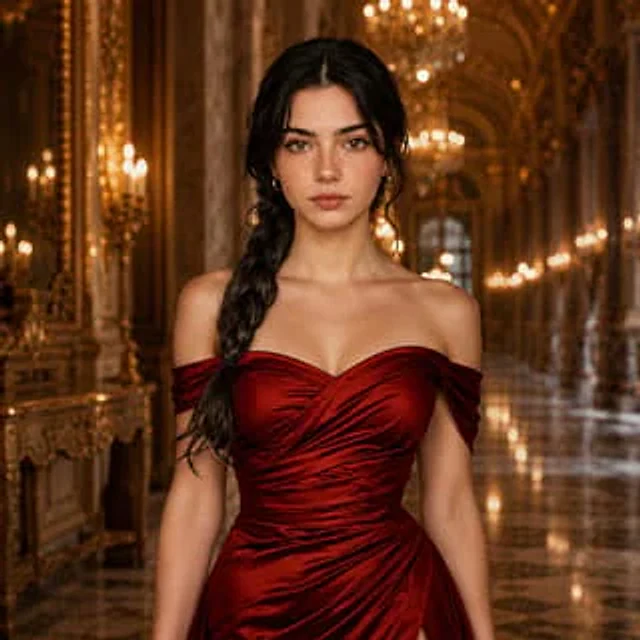

```text
Ultra-realistic portrait of a beautiful {argument name="subject" default="young woman, 24 years old"}, {argument name="hair" default="long black hair"}, glowing amber eyes, flawless skin, wearing a luxurious {argument name="clothing" default="red gown"}. Standing inside an elegant palace corridor with golden chandeliers and marble floors, dramatic cinematic lighting, realistic skin texture, detailed eyes, high-end fashion photography, ultra-detailed, photorealistic, masterpiece quality, cinematic color grading, 4K HDR.
```

Model: GPT Image 2
Author: Noor

[ProjectD](https://aitoolsradar.com/en/prompts/4c78a0ec24023c) · [Recorded source](https://youmind.com/prompts/realistic-portrait-royal-palace-gown-23602)
 · [Full original metadata and byte evidence](data/projectd-batch-0037.json)

## Luxury 3D Birthday Poster

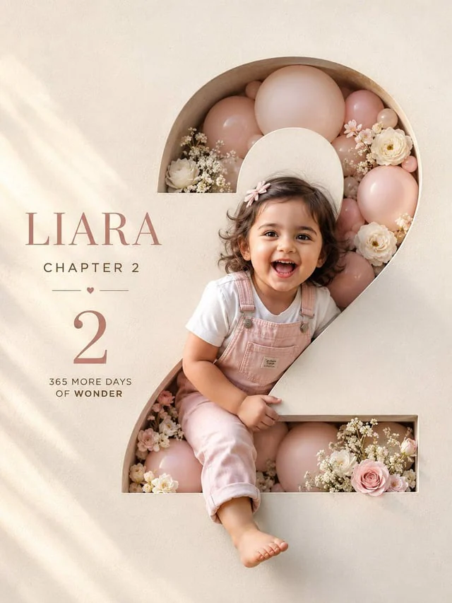

```text
Professional luxury birthday poster, 3:4 portrait composition, ultra high-end studio photography aesthetic. Premium off-white textured paper wall background with subtle grain and depth.

A large number {argument name="age" default="[AGE]"} is precisely carved into the wall with realistic thickness, beveled edges, and deep inner shadows creating strong 3D depth. Inside the number: {argument name="decor" default="soft pastel pink balloons, elegant white flowers, and luxury bouquet arrangement"} with minimal premium styling.

A happy {argument name="age value" default="[AGE]"}-year-old child with preserved facial identity, wearing a milky white T-shirt and pastel pink denim overalls, laughing naturally.

Face, shoulder, one hand, and one foot extend outside the carved number, creating a realistic 3D pop-out effect.

Warm cinematic golden sunlight from one side, soft rim light, ultra-realistic skin texture, studio-quality lighting, clean natural shadows, photorealistic rendering.

Typography on wall: {argument name="name" default="[NAME]"} CHAPTER [AGE] [AGE] 365 MORE DAYS OF WONDER.

Minimal luxury editorial layout, high-end magazine cover style, perfect composition, soft contrast, natural colors, no distortions, no Al artifacts.
```

Model: GPT Image 2
Author: Eesha

[ProjectD](https://aitoolsradar.com/en/prompts/7e05ac61d370aa) · [Recorded source](https://youmind.com/prompts/luxury-3d-birthday-poster-carving-25169)
 · [Full original metadata and byte evidence](data/projectd-batch-0037.json)

## Luxury Aesthetics Website Mockup

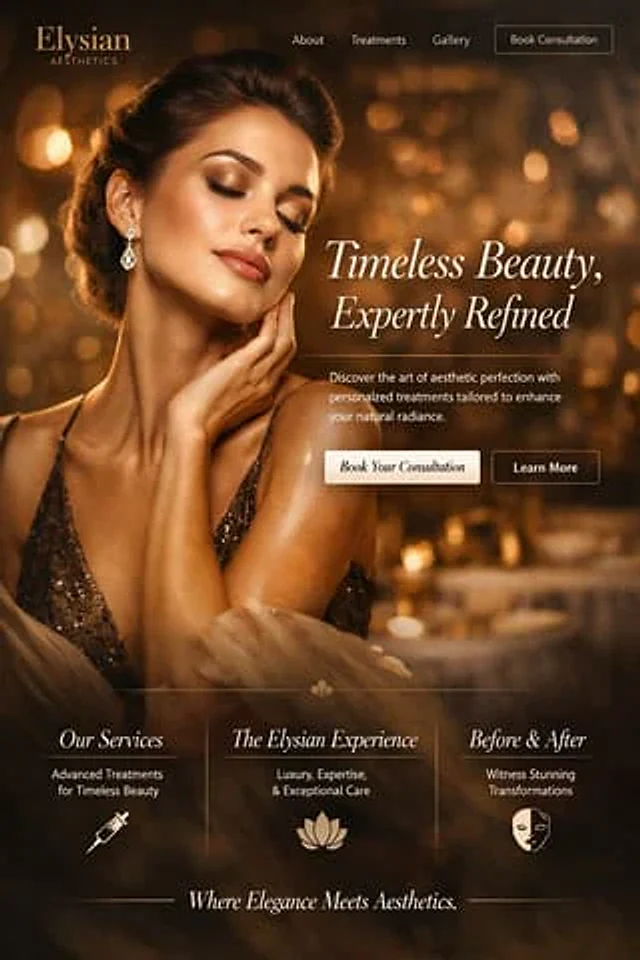

```text
{
  "type": "Website homepage sample",
  "theme": "High-end medical aesthetic clinics",
  "color_palette": "{argument name=\"primary color theme\" default=\"Warm gold and bronze\"} The background is dark brown and the lighting is soft bokeh.",
  "header": {
    "logo": "{argument name=\"brand name\" default=\"Elysian\"} AESTHETICS",
    "navigation_links": [
      "about Us",
      "Treatment Program",
      "Case Studies"
    ],
    "cta_button": "Appointment Consultation"
  },
  "hero_section": {
    "background_image": "{argument name=\"hero subject\" default=\"A stunningly beautiful woman with radiant skin, closed eyes, and her hand touching her neck.\"} Wearing a shimmering bronze gown and diamond pendant earrings, under soft, cinematic lighting.",
    "typography": {
      "headline": "{argument name=\"hero headline\" default=\"Eternal beauty, exquisitely crafted\"}",
      "subheadline": "Explore the art of medical aesthetics and enhance your natural radiance with customized solutions."
    },
    "buttons": [
      {
        "style": "Solid light color",
        "text": "Schedule your consultation"
      },
      {
        "style": "Outline",
        "text": "learn more"
      }
    ]
  },
  "features_section": {
    "divider": "Fine gold thread with a small central floral decoration",
    "columns_count": 3,
    "columns": [
      {
        "title": "Our Services",
        "description": "Advanced therapies that promote eternal beauty",
        "icon": "syringe"
      },
      {
        "title": "Elysian Experience",
        "description": "Luxury, professional and exceptional care",
        "icon": "lotus"
      },
      {
        "title": "Transformation Case",
        "description": "Witness amazing changes",
        "icon": "Half-face mask"
      }
    ]
  },
  "footer": {
    "text": "A perfect encounter between elegance and medical aesthetics."
  }
}
```

Model: GPT Image 2
Author: GPT Image 2 Prompts

[ProjectD](https://aitoolsradar.com/en/prompts/4bf4e24ab1d960) · [Recorded source](https://x.com/ivanjurashere/status/2044289258580574463#reversed-0)
 · [Full original metadata and byte evidence](data/projectd-batch-0037.json)

## Luxury AI Campaign Launch Poster

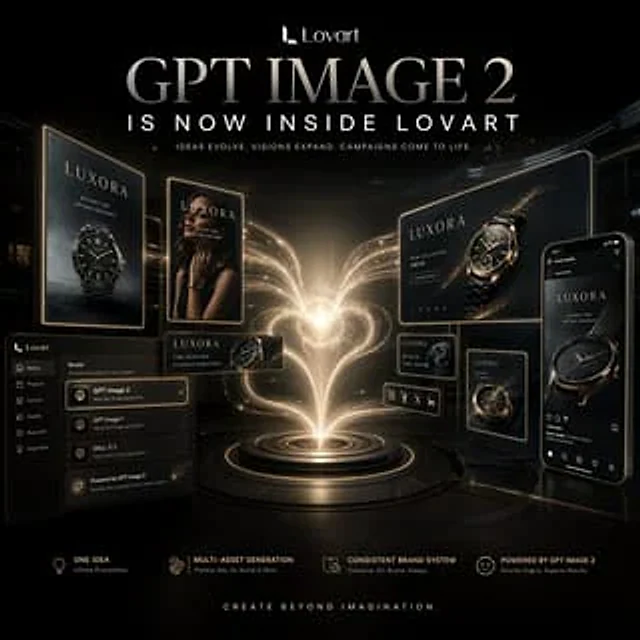

```text
{
  "type": "Luxury AI Creative Platform Promotional Poster",
  "style": "A cinematic, high-tech advertisement featuring a glossy black and gold color scheme, high contrast, a futuristic and luxurious brand style, and realistic 3D compositing incorporating elegant UI mockup elements.",
  "format": "Square social media marketing poster",
  "background": {
    "color": "Deep black",
    "environment": "A dark, futuristic studio space with subtle architectural shadows and reflective flooring.",
    "lighting": "A dramatic central beam of light, accompanied by warm golden volumetric light trails, with contour lighting at the edges of all floating screens."
  },
  "branding": {
    "logo_text": "Lovart",
    "headline": "{argument name=\"headline text\" default=\"GPT IMAGE 2\"}",
    "subheadline": "{argument name=\"subheadline text\" default=\"IS NOW INSIDE LOVART\"}",
    "tagline": "Creativity evolves. Vision expands. Marketing campaigns come alive.",
    "footer_tagline": "Create beyond imagination."
  },
  "centerpiece": {
    "description": "A dazzling heart-shaped plume of energy, emanating from the circular platform, is composed of flowing golden beams, resembling a creative fountain or a generative force.",
    "position": "center",
    "base": "Concentric metal base ring with luminous edge"
  },
  "product_brand": {
    "name": "{argument name=\"brand name\" default=\"LUXORA\"}",
    "category": "Luxury watch marketing visuals"
  },
  "floating_assets": {
    "count": 8,
    "items": [
      {
        "type": "Vertical poster billboards",
        "position": "Leftmost",
        "content": "Luxury watch main visual featuring brand title and deep-sea background"
      },
      {
        "type": "Vertical Fashion Poster",
        "position": "Left and Middle",
        "content": "The female model, dressed in black and wearing a luxury watch, has her face partially obscured by the composition."
      },
      {
        "type": "Small horizontal product card",
        "position": "Bottom left and middle",
        "content": "Watch close-up and brief marketing copy"
      },
      {
        "type": "Large horizontal billboard",
        "position": "Top right",
        "content": "Rendering of the watch's main visual, featuring shimmering gold glitter particles and a marketing layout."
      },
      {
        "type": "Small square information card",
        "position": "Right Center",
        "content": "Close-up details of the watch and brief descriptive text"
      },
      {
        "type": "Small vertical poster",
        "position": "Bottom right",
        "content": "Supporting watch marketing images"
      },
      {
        "type": "Social media snapshots or feed mockups",
        "position": "far right",
        "content": "Smartphone interface displaying advertisements for luxury watches"
      },
      {
        "type": "Creative Application UI Panel",
        "position": "Bottom left",
        "content": "Darkened software sidebar and model selector highlight GPT Image 2 and other image model options."
      }
    ]
  },
  "ui_panel": {
    "position": "Bottom left",
    "components": {
      "count": 8,
      "labels": [
        "Lovart",
        "front page",
        "project",
        "canvas",
        "assets",
        "Branded Kits",
        "inspiration",
        "GPT Image 2"
      ]
    }
  },
  "feature_row": {
    "position": "bottom",
    "count": 4,
    "items": [
      {
        "title": "An idea",
        "subtitle": "Infinite Possibilities"
      },
      {
        "title": "Multi-asset generation",
        "subtitle": "Posters, advertisements, UI, social media, etc."
      },
      {
        "title": "Consistent brand system",
        "subtitle": "Consistent, in line with brand image, and unwavering"
      },
      {
        "title": "Driven by GPT IMAGE 2",
        "subtitle": "A smarter engine, more outstanding results."
      }
    ]
  },
  "composition": "The symmetrical yet slightly dynamic layout features a central energy source surrounded by suspended marketing content, with all screens tilted towards the central beam of light, symbolizing an idea expanding into a complete brand system.",
  "materials": "Black glass, brushed metal, gold neon edges, glossy screen, subtle particle shimmer.",
  "mood": "Innovation, progress, high-end, magical, marketing release energy",
  "quality": "Ultra-refined and clear typography, exquisite brand presentation, high-end product visualization, studio-level advertising rendering."
}
```

Model: GPT Image 2
Author: GPT Image 2 Prompts

[ProjectD](https://aitoolsradar.com/en/prompts/d60c61ada2d396) · [Recorded source](https://x.com/dylannknox/status/2047321348314423477#reversed-0)
 · [Full original metadata and byte evidence](data/projectd-batch-0037.json)

## Luxury AI Campaign Launch Poster


```text
{"type":"luxury AI creative platform promotional poster","style":"cinematic premium tech advertising, glossy black and gold color palette, high contrast, futuristic luxury branding, photoreal 3D compositing with elegant UI mockup elements","format":"square social campaign poster","background":{"color":"deep black","environment":"dark futuristic studio space with subtle architectural shadows and reflective floor","lighting":"dramatic central glow with warm gold volumetric light trails and rim lighting around all floating screens"},"branding":{"logo_text":"Lovart","headline":"{argument name=\"headline text\" default=\"GPT IMAGE 2\"}","subheadline":"{argument name=\"subheadline text\" default=\"IS NOW INSIDE LOVART\"}","tagline":"IDEAS EVOLVE. VISIONS EXPAND. CAMPAIGNS COME TO LIFE.","footer_tagline":"CREATE BEYOND IMAGINATION."},"centerpiece":{"description":"a brilliant glowing heart-shaped energy plume erupting from a circular platform, made of flowing golden light strands, like a fountain of creativity or generative power","position":"center","base":"concentric metallic pedestal rings with illuminated edges"},"product_brand":{"name":"{argument name=\"brand name\" default=\"LUXORA\"}","category":"luxury wristwatch campaign visuals"},"floating_assets":{"count":8,"items":[{"type":"vertical poster billboard","position":"far left","content":"luxury watch hero shot with brand title and dark oceanic backdrop"},{"type":"vertical fashion poster","position":"left center","content":"female model in black styling wearing a luxury watch, face partially obscured by composition"},{"type":"small horizontal product card","position":"lower left center","content":"watch close-up with short campaign copy"},{"type":"large horizontal billboard","position":"upper right","content":"hero watch render with sparkling gold particles and campaign layout"},{"type":"small square info card","position":"mid right","content":"watch detail close-up and short descriptive text"},{"type":"small vertical poster","position":"lower right center","content":"secondary watch campaign image"},{"type":"social media story or feed mockup","position":"far right","content":"smartphone-style interface showing a luxury watch ad post"},{"type":"creative app UI panel","position":"bottom left","content":"dark software sidebar and model selector with GPT Image 2 highlighted, plus other image model options"}]},"ui_panel":{"position":"bottom left","components":{"count":8,"labels":["Lovart","Home","Projects","Canvas","Assets","Brand Kit","Inspiration","GPT Image 2"]}},"feature_row":{"position":"bottom","count":4,"items":[{"title":"ONE IDEA","subtitle":"Infinite Possibilities"},{"title":"MULTI-ASSET GENERATION","subtitle":"Posters, Ads, UI, Social & More"},{"title":"CONSISTENT BRAND SYSTEM","subtitle":"Cohesive, On-Brand, Always"},{"title":"POWERED BY GPT IMAGE 2","subtitle":"Smarter Engine, Superior Results."}]},"composition":"symmetrical but slightly dynamic layout, central energy source surrounded by floating campaign outputs, all screens angled inward toward the glow to suggest one idea expanding into a full brand system","materials":"black glass, brushed metal, gold neon edges, glossy screens, subtle particle sparkles","mood":"innovative, aspirational, premium, magical, campaign-launch energy","quality":"ultra-detailed, crisp typography, polished brand presentation, high-end product visualization, studio-grade advertising render"}
```

Model: GPT Image 2
Author: Dylan Knox

[ProjectD](https://aitoolsradar.com/en/prompts/68dcd63cb8248d) · [Recorded source](https://youmind.com/prompts/luxury-watch-campaign-poster-15279)
 · [Full original metadata and byte evidence](data/projectd-batch-0037.json)

## Luxury Amber Perfume Ad


```text
A luxurious, cinematic product photograph showcases a classic rectangular perfume bottle, inspired by {argument name="brand label" default="N°5 CHANEL PARIS PARFUM"} The bottle, placed vertically on a glossy black marble countertop with white textures, is positioned slightly to the right of center. Made of faceted glass and capped with a large, clear crystal, it contains a rich, amber-gold fragrance that radiates an inner glow. Tiny droplets of condensation cling to the glass surface, adding texture and realism. Dramatic warm light from the upper left creates golden highlights, a deep reflection on the marble, and a soft, luminous halo in the background. Elegant smoke curls around the sides of the bottle, enhancing the high-end advertising atmosphere. The dark background, shallow depth of field, ultra-refined studio product photography, luxurious beauty advertising aesthetics, sharp focus on the bottle, realistic reflection, and warm black and gold color scheme all contribute to the sophisticated aesthetic. A small white element is added in the upper right corner.{argument name="corner logo" default="Pollo.ai"} Square composition, high-end commercial advertising, photorealistic, high contrast, exquisite and sophisticated.
```

Model: GPT Image 2
Author: GPT Image 2 Prompts

[ProjectD](https://aitoolsradar.com/en/prompts/974615ac0246b9) · [Recorded source](https://x.com/Polanco_IA/status/2047689647967609037#reversed-0)
 · [Full original metadata and byte evidence](data/projectd-batch-0037.json)

## Luxury Amber Perfume Ad

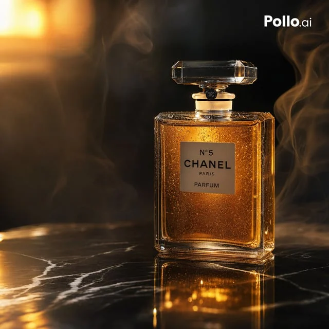

```text
A luxurious cinematic product photograph of a classic rectangular perfume bottle inspired by {argument name="brand label" default="N°5 CHANEL PARIS PARFUM"}, placed upright on a glossy black marble surface with white veining. The bottle is centered slightly to the right, made of clear faceted glass with a large transparent crystal stopper, filled with rich amber-gold perfume that glows from within. Tiny condensation droplets cover the glass, adding texture and realism. Dramatic warm lighting from the upper left creates golden highlights, deep reflections on the marble, and a soft luminous bloom in the background. Wisps of elegant smoke curl around the bottle on both sides, enhancing a moody high-end advertisement feel. Dark background, shallow depth of field, ultra-detailed studio product photography, luxury beauty campaign aesthetic, crisp focus on the bottle, realistic reflections, warm black-and-gold color palette. Add a small white {argument name="corner logo" default="Pollo.ai"} in the top-right corner. Square composition, premium commercial ad, photorealistic, high contrast, refined and sophisticated.
```

Model: GPT Image 2
Author: Polanco | IA

[ProjectD](https://aitoolsradar.com/en/prompts/784f49e93a5cb1) · [Recorded source](https://youmind.com/prompts/amber-perfume-bottle-marble-15778)
 · [Full original metadata and byte evidence](data/projectd-batch-0037.json)

## Luxury Art Deco Home Decor Email

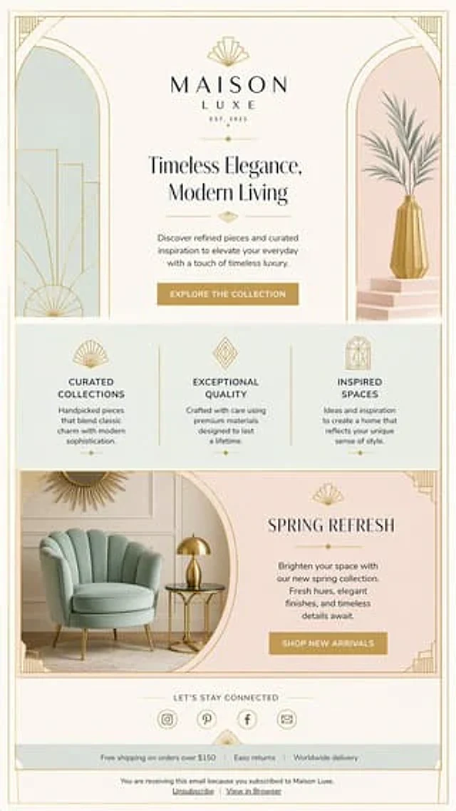

```text
{
  "type": "Luxury promotional email newsletter layout",
  "brand": {
    "name": "{argument name=\"brand name\" default=\"MAISON LUXE\"}",
    "tagline": "EST. 1925",
    "style": "An elegant Art Deco style home décor brand, featuring delicate gold lines and exquisite typography."
  },
  "canvas": {
    "aspect_ratio": "9:16 Vertical version",
    "background": "Warm Ivory White",
    "border": "Double-layered slim metal frame with delicate corner embellishments."
  },
  "palette": {
    "colors": [
      "Ivory White",
      "Soft blush powder",
      "Light sage green",
      "Soft beige",
      "Metallic gold",
      "Charcoal gray text"
    ]
  },
  "layout": {
    "sections": [
      {
        "title": "First screen",
        "position": "top",
        "count": 3,
        "labels": [
          "Left decorative arch panel",
          "Central brand and title block",
          "Decorative arch panel with vase on the right"
        ]
      },
      {
        "title": "Features and Highlights",
        "position": "Upper Mid-to-Upper",
        "count": 3,
        "labels": [
          "Selected Series",
          "Superior quality",
          "Inspiration Space"
        ]
      },
      {
        "title": "Seasonal promotions",
        "position": "Mid-lower part",
        "count": 2,
        "labels": [
          "Interior photos featuring decorative chairs and side tables.",
          "Spring Refresh Text Panel"
        ]
      },
      {
        "title": "Social media footer",
        "position": "bottom",
        "count": 4,
        "labels": [
          "Instagram",
          "Pinterest",
          "Facebook",
          "e-mail"
        ]
      },
      {
        "title": "Useful Information Footer",
        "position": "bottom",
        "count": 5,
        "labels": [
          "Free shipping on orders over $150",
          "Easy returns",
          "Global delivery",
          "Cancel subscription",
          "View in browser"
        ]
      }
    ],
    "spacing": "A symmetrical editing grid with ample white space and centered alignment.",
    "dividers": "Vertical separator between the thin gold line and the special column"
  },
  "hero": {
    "logo": "The fan-shaped decorative art logo above the brand name",
    "headline": "{argument name=\"headline text\" default=\"Timeless elegance, modern life\"}",
    "body": "Explore exquisite pieces and curated inspirations to elevate your daily life with a touch of timeless luxury.",
    "cta": {
      "text": "{argument name=\"button text\" default=\"Exploration Series\"}",
      "style": "Gold rectangular button with white capital lettering"
    },
    "left_panel": {
      "arch": "Tall Art Deco archway in light sage green",
      "details": "Simple geometric fan shapes and line patterns in gold"
    },
    "right_panel": {
      "arch": "A tall Art Deco archway in pink blush",
      "object": "A multifaceted gold vase on a display stand showcasing stacked blush powder, adorned with delicate leaf stems."
    }
  },
  "features": {
    "icons": 3,
    "items": [
      {
        "title": "Selected Series",
        "description": "A curated selection of pieces that blend classic charm with modern sophistication.",
        "icon": "Scallop logo"
      },
      {
        "title": "Superior quality",
        "description": "Meticulously crafted using premium materials designed for a lifetime of use.",
        "icon": "diamond-shaped logo"
      },
      {
        "title": "Inspiration Space",
        "description": "We provide you with creative ideas and inspiration to create a home space that showcases your unique style.",
        "icon": "Arched window logo"
      }
    ]
  },
  "promo": {
    "image_side": "left",
    "image": {
      "scene": "Luxury living room corner",
      "objects_count": 4,
      "objects": [
        "Mint green fan-shaped backrest velvet-trimmed chair with gold legs",
        "Round side table with dark top and gold frame",
        "Small gold table lamp with dome lampshade",
        "Golden sunburst mirror on the upper part of the paneled wall"
      ],
      "floor": "Light-colored textured carpet",
      "framing": "Large circular cut with embedded arched silhouette"
    },
    "text_side": "right",
    "title": "{argument name=\"promo title\" default=\"Spring Renewal\"}",
    "body": "Brighten up your space with our new spring collection. Fresh hues, elegant finishes, and timeless details await you.",
    "cta": {
      "text": "{argument name=\"secondary button text\" default=\"Selecting new products\"}",
      "style": "Gold rectangular button with white capital lettering"
    },
    "background": "Soft pink blush with gold trim"
  },
  "footer": {
    "social_header": "Stay in touch",
    "social_icons_count": 4,
    "shipping_bar": {
      "background": "Light sage green stripes",
      "items_count": 3,
      "items": [
        "Free shipping on orders over $150",
        "Easy returns",
        "Global delivery"
      ]
    },
    "legal": "You received this email because you have subscribed to Maison Luxe."
  },
  "render_style": "This premium email marketing template features a clean, luxurious design, combining crisp vector lines with soft, realistic product photography, balanced negative space, and exquisite high-end aesthetics."
}
```

Model: GPT Image 2
Author: GPT Image 2 Prompts

[ProjectD](https://aitoolsradar.com/en/prompts/eb770500f62ffd) · [Recorded source](https://x.com/StableTom/status/2046577842486477007#reversed-3)
 · [Full original metadata and byte evidence](data/projectd-batch-0037.json)

## Luxury Austria Travel Poster

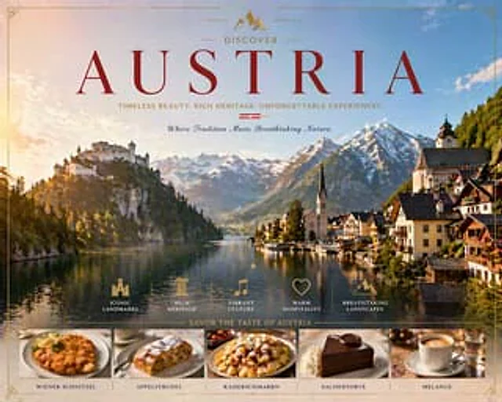

```text
A luxurious retro-style travel poster, themed as{argument name="country name" default="Austria"} The design evokes the feel of a high-end travel advertisement. It employs an elegant, symmetrical poster layout, complete with a delicate gold decorative border and refined corner details. A minimalist gold mountain logo sits at the top center, below which is the word "DISCOVER"; immediately following is a striking and sophisticated serif title containing the following text:{argument name="headline text" default="AUSTRIA"} The color is deep burgundy. Below it, add a line of small, capitalized gold text: “TIMELESS BEAUTY. RICH HERITAGE. UNFORGETTABLE EXPERIENCES.” Below that is a line of italicized handwritten text: “Where Tradition Meets Breathtaking Nature.” A small, horizontal Austrian flag is placed between these texts. The main image should be a stunning composite scene of a mountain lake at the Golden Hour: on the left is a magnificent mountaintop fortress, resembling Salzburg Fortress, perched on a rocky cliff overlooking the water; in the distance, a calm, reflecting lake extends into the towering Alpine valley; on the right is a picturesque Austrian lakeside village, reminiscent of Hallstatt, with houses with steep roofs, soaring church spires, a church on the hillside, and cascading wooden buildings extending to the water's edge. Warm sunlight streams in from the left, the sky is a clear, azure blue, the mountain peaks shimmer, and the lake reflects richly, creating a romantic, cinematic quality—exquisitely detailed, magnificent, and captivating. At the bottom of the image, five evenly spaced gold icons and labels highlight tourist attractions: a castle icon with "ICONIC LANDMARKS," a classical column icon with "RICH HERITAGE," a musical note icon with "VIBRANT CULTURE," a heart icon with "WARM HOSPITALITY," and a mountain icon with "BREATHTAKING LANDSCAPES." At the bottom, a horizontal food bar is created, displaying five framed cooking photos separated by thin dividing lines below the centered title "SAVOR THE TASTE OF AUSTRIA." These five dishes are: Wiener Schnitzel, Apple Strudel, Kaiserschmarrn, Sachertorte, and Melange. Each food photo should be realistic, warmly lit, and beautifully presented, with a caption in uppercase serif font below the image. Overall style: High-end European travel promotional posters, exquisite editing and design, romantic and nostalgic feel, sophisticated layout, harmonious gold and burgundy red accents, perfectly blending photorealistic scenery with luxurious brochure aesthetics.
```

Model: GPT Image 2
Author: GPT Image 2 Prompts

[ProjectD](https://aitoolsradar.com/en/prompts/61364cab23a33e) · [Recorded source](https://x.com/Redit007/status/2047524171987775961#reversed-2)
 · [Full original metadata and byte evidence](data/projectd-batch-0037.json)

## Luxury Bag Meets Discount Chaos Poster

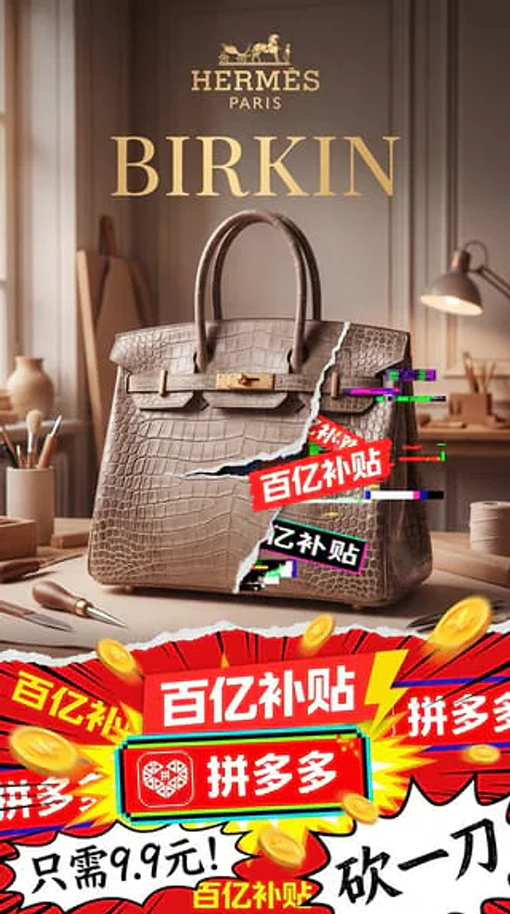

```text
A 9:16 vertical luxury fashion parody poster, featuring a single handbag as the central product, aims to showcase the stark contrast between an ultra-high-end brand image and the chaotic graphics of Chinese e-commerce discounts. The upper half should present an elegant Hermès-style advertising feel: a warm beige and taupe studio background, soft morning light streaming in from the window, a shallow depth of field effect, exquisite wall decorations, a wooden workbench, and six clearly visible artisan tools around the bag: a pen holder with several paintbrushes on the left, a small ceramic vase on the far left, a leather awl or polishing tool on the left side of the table, a leather knife on the edge of the table, an adjustable lamp on the right, and a spool of thread on the right. A gold luxury logo is placed at the top center, above which is a carriage icon, below which are the words HERMÈS and PARIS, followed by a large serif title: BIRKIN (gold). A large, structured crocodile-patterned Birkin bag is displayed in the center, its color {argument name="bag color" default="warm grayish brown"} The front of the bag features rich leather texture details, polished gold hardware, and a vertical handle. Presented on a table, it's photographed using high-end product photography techniques. A torn paper effect is added across the right side of the bag, revealing an aggressive discount advertisement below; five neon magenta, green, cyan, black, and white digital glitch effects are added around the tear. Three clearly visible Chinese promotional stickers are diagonally stacked in the torn area: a small red sticker reading "Welfare Price," a large red sticker reading "10 Billion Subsidy," and a black sticker with a bright outline reading "100 Million Subsidy." The lower third of the poster should present a boisterous comic book and live-streaming sales-style visual explosion, separated from the luxury area above by the torn paper effect. High-saturation red, yellow, white, black, and cyan colors are used, paired with sharp starburst shapes, speed lines, bold outlines, and flying gold coins. The design includes seven promotional text blocks at the bottom: a large central red banner reading "10 Billion Yuan Subsidy," a red rounded rectangle below with the Pinduoduo logo and the word "Pinduoduo," two partially cropped "Pinduoduo" side banners, two additional yellow and red "10 Billion Yuan Subsidy" pop-up stickers in the lower left and lower center, and a handwritten black calligraphy slogan "Cut it Down" in the lower right corner. An additional handwritten black phrase "Only 9.9 Yuan!" is added in the lower left corner. The overall composition should convey the feeling of an elite, fashionable advertisement being violently invaded by cheap viral marketing, possessing cinematic lighting, strong visual hierarchy, realistic product rendering, sophisticated typography at the top, explosive discount chaos at the bottom, and a deliberate aesthetic contrast between refined and low-cost internet commerce. It should resemble a {argument name="collaboration brand text" default="Pinduoduo × Hermes"} High-end brand collaboration main visual poster, used for promotion{argument name="promo text" default="10 Billion Yuan Subsidy Platinum Pack"} .
```

Model: GPT Image 2
Author: GPT Image 2 Prompts

[ProjectD](https://aitoolsradar.com/en/prompts/0e8c3012e38f34) · [Recorded source](https://x.com/ajie_run_CL/status/2046787747764187211#reversed-0)
 · [Full original metadata and byte evidence](data/projectd-batch-0037.json)

## Luxury Beauty Ad Storyboard

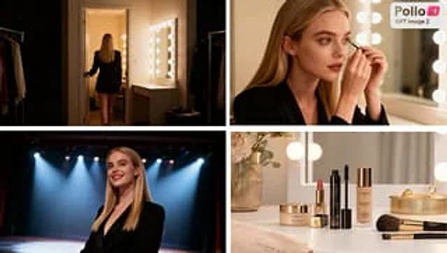

```text
{"type":"four-panel cinematic beauty ad storyboard","style":"luxury cosmetics campaign, warm editorial photography, soft amber vanity lighting, realistic high-end commercial look","subject":{"gender":"woman","age":"young adult","hair":{"color":"{argument name=\"hair color\" default=\"blonde\"}","style":"straight, long, sleek, center-parted"},"wardrobe":"tailored black blazer mini dress, elegant and minimalist"},"layout":{"grid":"2x2 panels with thin white dividers","panel_count":4,"panels":[{"position":"top-left","scene":"dressing room entrance","description":"rear view of the woman walking into a softly lit backstage dressing room, one hand on the door, illuminated vanity mirror with round bulbs on the right, clothing racks in shadow on both sides, moody warm ambience, full body visible from behind"},{"position":"top-right","scene":"makeup application close-up","description":"tight close-up at a vanity mirror as the woman applies eye makeup with a small brush or eyeliner tool, face partially turned in profile, warm bulbs reflected in the mirror creating creamy bokeh, black blazer visible"},{"position":"bottom-left","scene":"stage reveal portrait","description":"medium portrait of the woman standing confidently in front of a dark stage with bright cool spotlights aimed downward behind her, glamorous contrast between blue stage lights and black outfit, poised luxury campaign mood"},{"position":"bottom-right","scene":"product still life","description":"elegant vanity tabletop with {argument name=\"brand name\" default=\"GUERLAIN\"} makeup products arranged in a premium beauty display, 6 visible items total: 1 open lipstick, 1 small cream jar, 1 square perfume or cosmetic bottle, 1 black mascara tube, 1 white foundation bottle with gold cap, 1 makeup brush set consisting of 2 brushes; also include a pale cosmetic pouch with the brand name, a ribbed glass vase with soft flowers, glowing mirror bulbs, and a small gold jewelry box"}]},"branding":{"overlay_logo":"top-right corner small rounded badge reading 'Pollo AI' with 'GPT Image 2' beneath it"},"color_palette":{"tones":["warm beige","gold","soft white","black","muted blush"]},"camera":"cinematic commercial photography, shallow depth of field, polished product-shot styling, soft skin lighting, premium fashion ad composition"}
```

Model: GPT Image 2
Author: Proyecto Hygge

[ProjectD](https://aitoolsradar.com/en/prompts/b8cd4a37b8324b) · [Recorded source](https://youmind.com/prompts/luxury-beauty-ad-storyboard-17201)
 · [Full original metadata and byte evidence](data/projectd-batch-0037.json)

## Luxury Bilingual Tasting Menu Photo

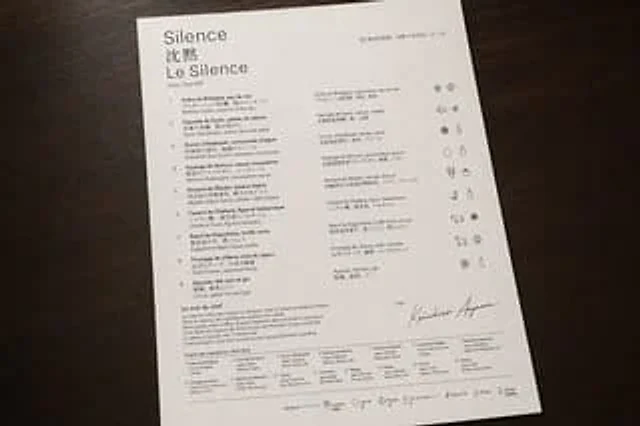

```text
A realistic, overhead photograph showcases a luxurious tasting menu printed on glossy white textured paper, placed on a dark walnut wood table, bathed in soft, warm ambient light and natural shadows. The menu, positioned vertically and slightly rotated clockwise, occupies most of the image, with clean margins around the edges. The design embodies a minimalist high-end dining style, featuring elegant typography, ample white space, precise alignment, and sophisticated black and gray tones. The restaurant logo is located in the upper left corner, arranged in three stacked lines: one line in large serif font.{argument name="restaurant name" default="Silence"} Below the title are two Chinese characters for "silence," followed by a line of large serif French text reading "Le Silence." Below the title is a line of smaller text displaying the address "Ginza, Tokyo B3F." The upper right corner shows a line of French date text, followed by Japanese date text.{argument name="date text" default="April 22, 2026 (Reiwa 8)"} The main content is divided into three vertical sections: a numbered list of dishes on the left, a translated list of dishes in the middle, and an icon column on the far right. The left-hand list contains nine numbered dishes, from 1 to 9. Each dish has a French title, a Japanese subtitle, and an English description of the ingredients below. The nine visible dish titles are: "Huître de Bretagne, eau de mer", "Daurade de Kyoto, pétale de sakura", "Oursin d'Hokkaidō, consommé d'algue", "Asperge de Nemuro, sauce mousseline", "Homard de Miyako, bisque légère", "Canard de Challans, figue et balsamique", "Boeuf de Kagoshima, truffe noire", "Fromage de chèvre, miel du Japon", and "Agrume, thé vert et gin". The middle list repeats these nine dishes in a second compact column, including French titles and Japanese descriptions. The rightmost column contains nine rows of horizontal icons aligned with the dishes, each displaying a small, monochrome hand-drawn pictogram of an ingredient or allergen; some rows have two icons, some have three, for a total of 19 icons. Near the bottom left is an area titled "Le mot du chef" (The mot of chef), followed by a short French text in small serif font. Below that is an area titled "Origine des ingrédients" (Origin of Ingredients), containing a two-line grid of ingredient origins, listing 15 numbered origin entries in extremely small text. In the bottom right quadrant is a small "Chef" label, above which is a large, flowing handwritten signature.{argument name="chef name" default="Keiichiro Aoyama"} The bottom edge features a thin horizontal line and a centered allergen information line containing seven small outline icons and labels: shellfish, crustaceans, eggs, fish, dairy, gluten, and sulfites. Each label is in French, with Japanese text below. The overall design evokes a high-end Michelin-style menu, showcasing restrained editing, perfect spacing, delicate paper texture, clear and legible text hierarchy, and a realistic photographic quality rather than a flat scan.
```

Model: GPT Image 2
Author: GPT Image 2 Prompts

[ProjectD](https://aitoolsradar.com/en/prompts/c9cb1787b0690d) · [Recorded source](https://x.com/JohnnyWang8802/status/2047258370059726932#reversed-0)
 · [Full original metadata and byte evidence](data/projectd-batch-0037.json)

## Luxury Birthday Milestone Poster

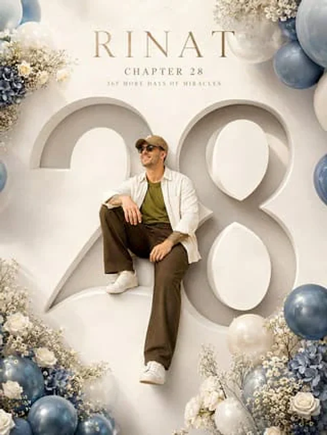

```text
Create a luxury minimalist birthday milestone poster featuring a giant 3D number “{argument name="age" default="[AGE]"}” carved into a premium ivory-white wall. A stylish person is naturally sitting, leaning, or hanging from the number, posing confidently. Elegant floral arrangements with white roses, baby's breath, hydrangeas, and {argument name="balloon color" default="pastel blue"} balloons frame the composition. Soft natural sunlight, premium editorial photography, modern celebration aesthetic, clean luxury design, subtle shadows, sophisticated typography. At the top, display the name “{argument name="name" default="[NAME]"}” in elegant serif font, followed by “CHAPTER [AGE]” and the quote “365 More Days of Miracles.” Neutral beige and white color palette, high-end event styling, dreamy atmosphere, photorealistic, magazine-quality portrait, ultra-detailed textures, luxury birthday photoshoot, Instagram-worthy, shallow depth of field, soft lighting, 8K masterpiece, professional fashion photography.
```

Model: GPT Image 2
Author: Taaruk

[ProjectD](https://aitoolsradar.com/en/prompts/32650b0024b879) · [Recorded source](https://youmind.com/prompts/minimalist-birthday-milestone-poster-design-25326)
 · [Full original metadata and byte evidence](data/projectd-batch-0037.json)

## Luxury Botanical Skincare Forest Ad

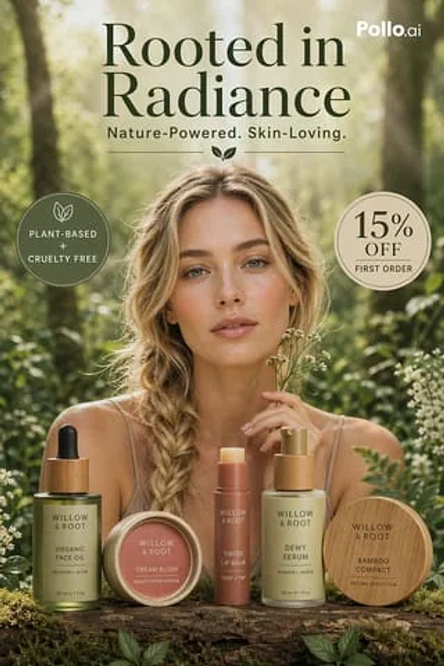

```text
A luxury natural skincare product advertisement, shot in a sun-dappled forest clearing, has a style similar to {argument name="brand name" default="WILLOW & ROOT"} A high-end beauty product poster. At the center of the image is a beautiful young woman with sun-kissed skin and loose, golden side-braided hair. She wears a soft beige sundress and sits behind a moss-covered rustic wooden table, holding delicate white wildflowers close to her face. Her face is partially obscured by a simple, warm brown rectangular block of color, creating an artistic effect reminiscent of an anonymous model. On the foreground wood, five exquisite e-commerce products are neatly arranged from left to right: a green glass dropper bottle labeled "Organic Facial Oil" (with a bamboo cap), a round blush with a gray-pink cap, a matte terracotta-colored tinted lipstick, a frosted light green pump bottle labeled "Hydrating Essence" (with a bamboo pump), and a closed bamboo compact powder case engraved with the brand name. Soft white wildflowers and lush green plants adorn the product areas and the edges of the image. Featuring warm, golden-moon backlighting, a creamy blurred background, shallow depth of field, soft lens flare, natural green and beige tones, a high-end botanical aesthetic, photorealistic skin and packaging textures, a centered composition, and a vertical 4:5 layout. An elegant dark serif font is overlaid at the top, displaying a two-line title.{argument name="headline text" default="Rooted in Radiance"} Below it is a smaller sans-serif slogan.{argument name="tagline" default="Nature-Powered. Skin-Loving."} The middle section is separated by a small leaf icon and a thin horizontal dividing line. Add two circular promotional badges: one in the upper left corner with a leaf icon and {argument name="left badge text" default="PLANT-BASED + CRUELTY FREE"} An olive green badge with text; the upper right corner features a {argument name="discount text" default="15% OFF FIRST ORDER"} A beige badge with text. A small white Pollo.ai watermark in the upper right corner. High-end beauty ad, simple yet luxurious design, a modern mobile-first e-commerce marketing campaign.
```

Model: GPT Image 2
Author: GPT Image 2 Prompts

[ProjectD](https://aitoolsradar.com/en/prompts/73033122ab1840) · [Recorded source](https://x.com/shedntcare_/status/2047219713256911332#reversed-0)
 · [Full original metadata and byte evidence](data/projectd-batch-0037.json)

## Luxury Business Leader Ink Portrait

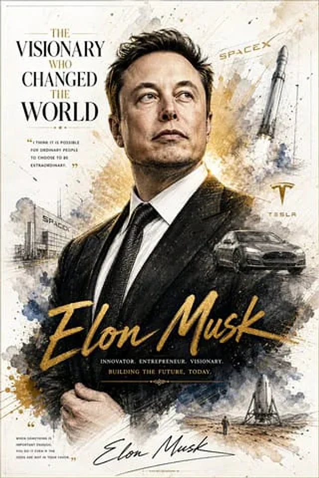

```text
A powerful portrait of a {argument name="subject" default="high-status business leader"} wearing a {argument name="outfit" default="premium luxury formal suit (tailored dark suit, crisp white shirt, elegant tie)"}. Sharp facial features, clean grooming, ultra-realistic detailing. Expression & Mood: Calm, confident, and highly authoritative expression — focused gaze symbolizing intelligence, control, and global influence. Pose & Composition: Half-body portrait (chest-up), Slight diagonal cinematic angle for depth and intensity, Strong executive posture (hands relaxed or adjusting suit). Art Style: Hand-drawn ink sketch lines blended with watercolor textures, Luxury-inspired gold, black, and deep blue/red paint splashes, Dynamic abstract brush strokes representing power and innovation, Highly detailed realistic face with subtle gritty texture. Background: Clean white or soft neutral base, Elegant watercolor splashes (gold + dark tones), Soft glowing aura behind the subject for a premium elite feel. Typography Elements: Main Title: “{argument name="title" default="TYPE HERE"}” Name: “TYPE HERE” (bold handwritten luxury brush style) Extra Details: Subtle gold accents for premium billionaire aesthetic, Light grunge texture overlay for cinematic depth, Minimal crown or abstract wealth/power symbols. Signature (Bottom): “TYPE HERE” Optional Quote Section: “TYPE HERE” Mood & Tone: Elite, powerful, cinematic, luxury-driven legacy aesthetic
```

Model: GPT Image 2
Author: Rossy

[ProjectD](https://aitoolsradar.com/en/prompts/a7446e5ca5c9ec) · [Recorded source](https://youmind.com/prompts/luxury-business-leader-watercolor-portrait-20549)
 · [Full original metadata and byte evidence](data/projectd-batch-0037.json)

## Luxury Car Golden Hour Shoot

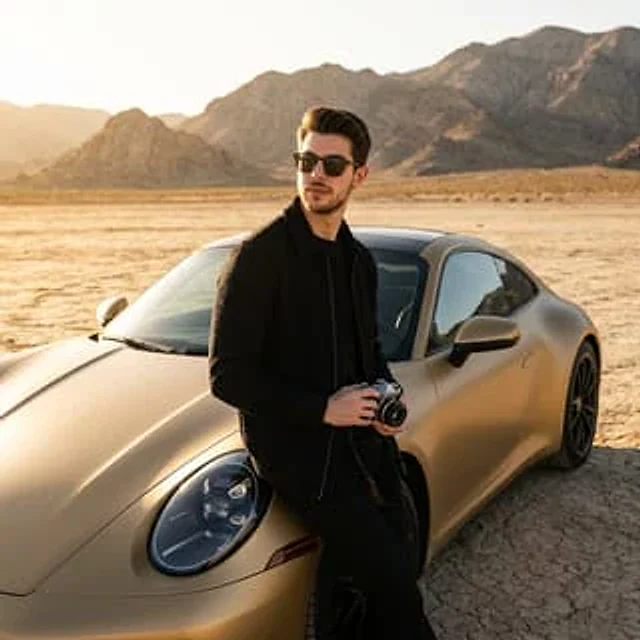

```text
A fashionable{argument name="subject" default="Men"} Standing on a matte gold{argument name="car" default="Luxury sports car (Porsche 911 style)"} Beside it, the background is vast.{argument name="landscape" default="desert landscape"} It was the perfect moment. He wore a sharp black suit, paired with a textured jacket and sunglasses, and held a vintage camera in his hand. The car had sleek lines, a premium feel, and modern LED headlights. The background was a vast expanse of parched land and rugged mountains, softly shimmering in the warm sunset. The natural, cinematic composition, soft shadows, warm highlights, and shallow depth of field created a subtle background blur. Shot in a high-end lifestyle magazine style, using an 85mm lens, f/2.0, for hyper-realistic, high dynamic range, 8K detail, and cinematic color grading.
```

Model: GPT Image 2
Author: GPT Image 2 Prompts

[ProjectD](https://aitoolsradar.com/en/prompts/3a28c5387adecf) · [Recorded source](https://x.com/Taaruk_/status/2048023165121532163)
 · [Full original metadata and byte evidence](data/projectd-batch-0037.json)

## Luxury Character-Themed Whole Cake

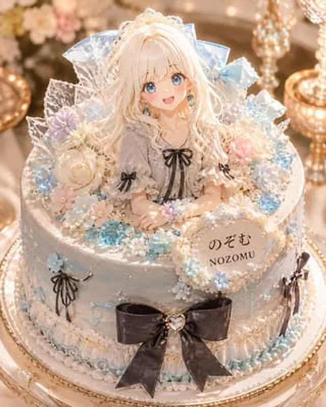

```text
Create a luxurious, photorealistic official character-themed whole cake product shot based on {argument name="character name" default="Nozomu"}. The cake is a tall round celebration cake on an ornate gold-rimmed glass cake stand, photographed in warm soft-focus lighting with sparkling gold candleholders and pastel flowers blurred in the background. The cake should feel like a real premium bakery item, not a flat printed cake. Turn the character into a handcrafted edible 3D doll emerging from the top center of the cake: a delicate anime-style girl with {argument name="hair color" default="long wavy platinum-blonde hair"}, pale skin, large blue jewel-like eyes, a grey frilly dress with puff sleeves, black ribbon bows at the collar and sleeves, and a dreamy elegant expression; obscure or avoid detailed facial identity if needed, but keep the doll-like luxury aesthetic. Surround her with translucent ice-crystal sugar shards, large pale blue ribbon shapes, white and pastel flowers, pearl sprinkles, blue sugar gems, and glossy edible beads. The frosting is pearly white with subtle silver-blue marbling and tiny piped pearls, with pastel blue drip accents and ornate cream piping around the top and bottom edges. Add exactly four visible black ribbon bow decorations: one large black bow with a heart-shaped jewel at the front center of the cake, one small black bow on the left side, one small black bow on the right side, and one small bow on the character's bodice. Add exactly two readable text areas: a cream oval plaque on the front-right side reading {argument name="Japanese plaque text" default="のぞむ"} above {argument name="English plaque text" default="NOZOMU"}, and no other prominent lettering. Use a color palette of {argument name="color palette" default="pearl white, icy blue, champagne gold, soft pink, lavender, and glossy black"}. Composition: vertical 4:5 close-up product photography, cake centered and filling most of the frame, shallow depth of field, high-end patisserie styling, intricate edible details, sparkling highlights, realistic frosting texture, no watermark, no logo, no extra characters, no flat printed character image.
```

Model: GPT Image 2
Author: のぞむ＊AIイラスト

[ProjectD](https://aitoolsradar.com/en/prompts/b02fc3796e333d) · [Recorded source](https://youmind.com/prompts/character-themed-whole-cake-24355)
 · [Full original metadata and byte evidence](data/projectd-batch-0037.json)

## Luxury Chicken Soup Ingredient Poster

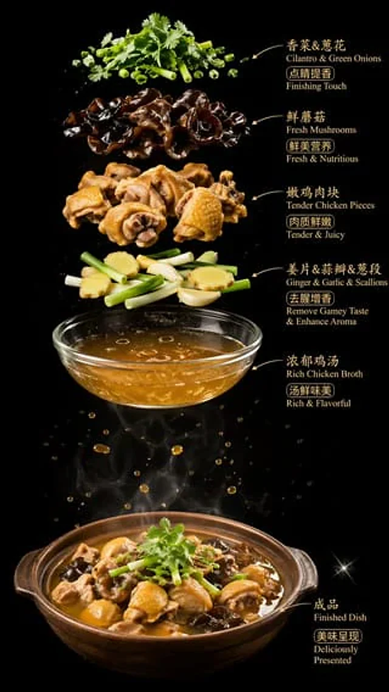

```text
{
  "type": "Food ingredient infographic poster",
  "style": "Luxury commercial food photography, high contrast, clean studio compositing, and a highly dynamic vertical layout.",
  "background": {
    "color": "pure black",
    "finish": "Deep matte black, with fine suspended water droplets and a soft vapor effect."
  },
  "canvas": {
    "orientation": "Vertical screen"
  },
  "subject": {
    "dish": "Chinese-style braised chicken and mushroom soup in a clay pot",
    "final presentation": "A brown ceramic casserole is filled with a rich, dark brown chicken broth, containing bone-in chicken pieces, black fungus, light yellow ginger slices, and light green scallion segments, and is garnished with cilantro."
  },
  "layout": {
    "composition": "The ingredients are stacked vertically above the finished dish, with each layer of ingredients floating independently. Bilingual labeling is provided on the right, and thin gold arrows point to the ingredients on the left.",
    "sections": [
      {
        "title": "Cilantro &amp; chopped green onions",
        "position": "top",
        "count": 1,
        "labels": [
          "Cilantro & Green Onions",
          "Finishing touch and enhancing fragrance",
          "Finishing Touch"
        ]
      },
      {
        "title": "Fresh mushrooms",
        "position": "Upper Mid-to-Upper",
        "count": 1,
        "labels": [
          "Fresh Mushrooms",
          "Delicious and nutritious",
          "Fresh & Nutritious"
        ]
      },
      {
        "title": "Tender chicken pieces",
        "position": "Central",
        "count": 1,
        "labels": [
          "Tender Chicken Pieces",
          "Tender meat",
          "Tender & Juicy"
        ]
      },
      {
        "title": "Ginger slices, garlic cloves, and scallion segments",
        "position": "Mid-lower part",
        "count": 1,
        "labels": [
          "Ginger & Garlic & Scallions",
          "Remove fishy smell and enhance aroma",
          "Remove Gamey Taste & Enhance Aroma"
        ]
      },
      {
        "title": "Rich chicken soup",
        "position": "Below the ingredients",
        "count": 1,
        "labels": [
          "Rich Chicken Broth",
          "The soup is fresh and delicious",
          "Rich & Flavorful"
        ]
      },
      {
        "title": "Finished product",
        "position": "bottom right corner",
        "count": 1,
        "labels": [
          "Finished Dish",
          "Delicious presentation",
          "Deliciously Presented"
        ]
      }
    ],
    "centerpiece": "A clear glass bowl holds golden chicken soup, suspended above a clay pot, surrounded by water droplets, while visible white steam rises from the finished dish below."
  },
  "ingredients": {
    "count": 6,
    "items": [
      "chopped cilantro and scallions",
      "Black fungus",
      "Chicken nuggets with skin and bone",
      "Ginger slices, whole cloves of garlic, and scallion segments",
      "Clear golden chicken soup in a glass bowl",
      "Finished casserole dishes"
    ]
  },
  "text": {
    "language": "Chinese and English bilingual",
    "font": "An elegant serif font with a warm gold tone.",
    "placement": "All text is right-aligned."
  },
  "lighting": {
    "setup": "Highly dynamic top and side studio lighting",
    "effects": [
      "The glossy highlights on the broth and mushrooms",
      "Clear texture of chicken skin",
      "Gentle steam plumes",
      "Tiny golden splatters",
      "There are tiny star-shaped flashes near the bottom right corner."
    ]
  },
  "color_palette": {
    "count": 5,
    "colors": [
      "black background",
      "Golden brown broth",
      "Dark brown mushroom",
      "warm brown chicken",
      "Fresh green herbs"
    ]
  }
}
```

Model: GPT Image 2
Author: GPT Image 2 Prompts

[ProjectD](https://aitoolsradar.com/en/prompts/1a1ac3400a5977) · [Recorded source](https://x.com/lijazzer/status/2046514612850626978#reversed-0)
 · [Full original metadata and byte evidence](data/projectd-batch-0037.json)

## Luxury Cosmetic Web Advertisement

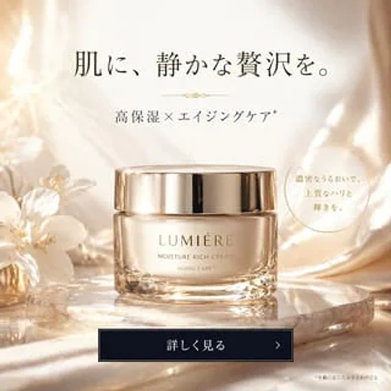

```text
An advertisement for a luxury cosmetic product features an elegant glass jar with a gleaming gold cap, placed on a round, light-colored marble slab. The jar is emblazoned with gold lettering.{argument name="brand name" default="LUMIÉRE"} and{argument name="product type" default="MOISTURE RICH CREAM"} Below, it is labeled "AGING CARE*". The background is composed of soft, draping silk fabric with a shimmering champagne sheen, adorned with delicate white flowers on the left. The lighting is warm and ethereal, as if bathed in sunlight, with a soft bokeh effect. At the top center, elegant dark brown Japanese typography is displayed as {argument name="main headline" default="Give your skin a quiet luxury."} Below is a small gold decorative divider and text.{argument name="subheadline" default="High moisturizing × anti-aging care*"} On the right side of the jar, a thin gold circle contains Japanese characters that mean "to provide rich hydration, giving high-quality firmness and radiance." At the bottom center is a dark rectangular call-to-action button with a thin gold border and text inside.{argument name="button text" default="View details"} And a right-pointing arrow symbol. In the bottom right corner is very small text that reads "*refers to age-based care".
```

Model: GPT Image 2
Author: GPT Image 2 Prompts

[ProjectD](https://aitoolsradar.com/en/prompts/813334551e92a0) · [Recorded source](https://x.com/panchaaan_2/status/2046107762686652666#reversed-2)
 · [Full original metadata and byte evidence](data/projectd-batch-0037.json)

## Luxury Dark Chocolate Commercial Photography

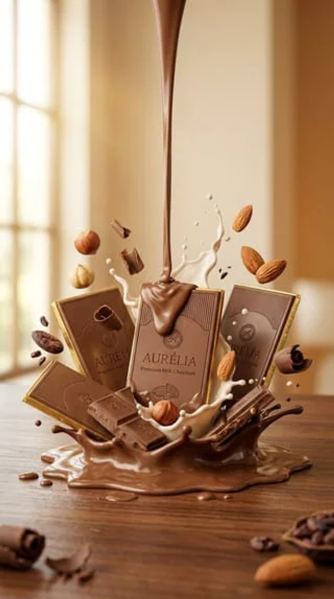

```text
Ultra-realistic luxury commercial product photography of premium dark chocolate bars elegantly stacked on a glossy black marble surface. Rich melted chocolate flows smoothly around the bars, with chocolate shards, cocoa powder, roasted cocoa beans, and subtle floating chocolate particles creating a sense of motion. Deep brown and black background with luxurious golden highlights, dramatic cinematic lighting, premium confectionery advertising, ultra-detailed, photorealistic, 8K, sharp focus, shallow depth of field, elegant composition, luxury branding aesthetic, clean negative space for logo and text, portrait aspect ratio 4:5. Ultra-realistic luxury commercial product photography of premium milk chocolate bars arranged elegantly on a polished wooden surface. Smooth melted milk chocolate pours around the bars with creamy milk splashes, whole hazelnuts, almonds, cocoa beans, and delicate chocolate curls floating naturally. Warm caramel and cream-colored background with soft golden sunlight, cinematic studio lighting, ultra-detailed, photorealistic, 8K, premium food advertisement, luxurious composition, appetizing textures, shallow depth of field, clean negative space for branding and text, portrait aspect ratio
```

Model: GPT Image 2
Author: Hope Ai

[ProjectD](https://aitoolsradar.com/en/prompts/450826a1ff7f0f) · [Recorded source](https://youmind.com/prompts/luxury-dark-chocolate-product-photography-27345)
 · [Full original metadata and byte evidence](data/projectd-batch-0037.json)

## Luxury Desert Handbag Campaign

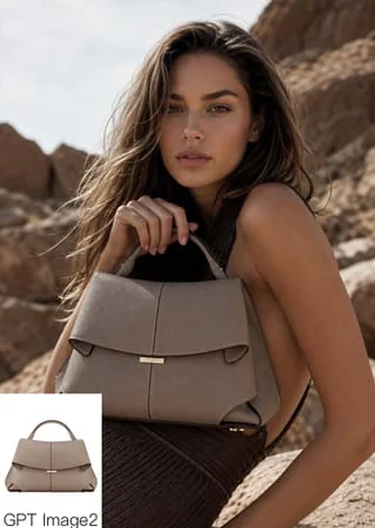

```text
Luxury fashion editorial style product photography, with a single product as the main subject.{argument name="bag color" default="grayish brown"} A structured leather handbag, featuring a top handle, wide folding flap, centered vertical seam, small gold bar clasp, and sharply angled side gussets, is displayed by a captivating woman against a rocky desert landscape. The medium close-up composition places the handbag in the center of the foreground, held by the handle in front of her chest. The model's body is slightly turned to the side, revealing bare shoulders and arms, and she wears a dark brown pleated or textured dress. Her long, windswept wavy hair is [color missing].{argument name="hair color" default="Light brown with sun-kissed highlights"} With warm, bronzed skin, a high-end advertising campaign look, and a confident, elegant posture, the image is captured in natural outdoor sunlight. The warm earth tones, the soft-focus beige and sandstone background, and the shallow depth of field create a realistic luxury advertising photograph. The rich leather texture and the delicate luster of the metal hardware details convey a high-fashion magazine feel. A white rectangular picture-in-picture illustration is added to the lower left corner, showcasing the same handbag against a pure white background, accompanied by {argument name="caption text" default="GPT Image2"} The text uses a simple black sans-serif font.
```

Model: GPT Image 2
Author: GPT Image 2 Prompts

[ProjectD](https://aitoolsradar.com/en/prompts/88b5b0061ca4f9) · [Recorded source](https://x.com/towi27266777031/status/2047139201637089307#reversed-3)
 · [Full original metadata and byte evidence](data/projectd-batch-0037.json)

## Luxury E-Commerce Landing Page Mockup

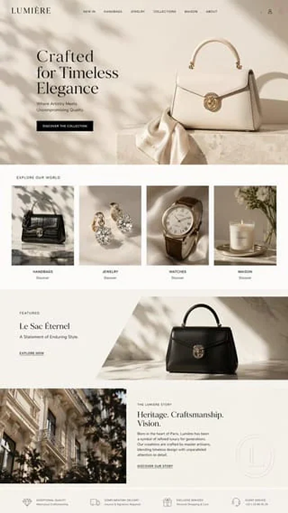

```text
{
  "type": "E-commerce landing page design draft",
  "brand": "{argument name=\"brand name\" default=\"LUMIÈRE\"}",
  "aesthetic": "{argument name=\"aesthetic\" default=\"Luxury, minimalism, elegance, neutral tones\"}",
  "layout": {
    "header": {
      "logo": "{argument name=\"brand name\" default=\"LUMIÈRE\"}",
      "navigation": [
        "New product launch",
        "gloves",
        "Jewelry",
        "series",
        "Brand Home",
        "about Us"
      ],
      "icons": [
        "search",
        "user",
        "shopping cart"
      ]
    },
    "sections": [
      {
        "name": "Hero",
        "text": {
          "headline": "{argument name=\"hero headline\" default=\"Forging Eternal Elegance\"}",
          "subheadline": "A convergence of art and ultimate quality.",
          "button": "Exploration Series"
        },
        "imagery": "A cream-colored, structured handbag rests on a stone base, accompanied by a silk scarf bearing the brand name and soft leaf shadows."
      },
      {
        "name": "Product Grid",
        "title": "Explore our world",
        "count": 4,
        "items": [
          {
            "image": "Black crocodile-patterned handbag on marble",
            "label": "gloves",
            "sublabel": "explore"
          },
          {
            "image": "Diamond earrings on silk",
            "label": "Jewelry",
            "sublabel": "explore"
          },
          {
            "image": "Classic watches with silk and leather straps",
            "label": "wristwatch",
            "sublabel": "explore"
          },
          {
            "image": "White candles on a gold tray",
            "label": "Brand Home",
            "sublabel": "explore"
          }
        ]
      },
      {
        "name": "Featured Product",
        "layout": "Diagonal division",
        "text": {
          "kicker": "Selected",
          "title": "{argument name=\"featured product name\" default=\"Le Sac Éternel\"}",
          "description": "A manifesto of enduring style.",
          "link": "Explore now"
        },
        "imagery": "A black, structured handbag with gold clasps on a marble countertop."
      },
      {
        "name": "Brand Story",
        "layout": "Double column layout",
        "imagery": "Parisian Haussmannian buildings surrounded by greenery",
        "text": {
          "kicker": "LUMIÈRE Story",
          "headline": "{argument name=\"story headline\" default=\"Heritage. Craftsmanship. Vision.\"}",
          "body": "Born in the heart of Paris, Lumière has been a symbol of refined luxury for generations. Our pieces are meticulously crafted by master artisans, blending timeless design with an unwavering pursuit of detail.",
          "link": "Explore our story",
          "watermark": "The elegant round L logo"
        }
      },
      {
        "name": "Trust Bar",
        "count": 4,
        "items": [
          {
            "icon": "diamond",
            "title": "Superior quality",
            "subtitle": "Exquisite craftsmanship"
          },
          {
            "icon": "truck",
            "title": "Free shipping",
            "subtitle": "Insurance has been purchased and a signature is required upon receipt."
          },
          {
            "icon": "gift box",
            "title": "Exclusive service",
            "subtitle": "Personal shopping and care"
          },
          {
            "icon": "earphone",
            "title": "Customer Service",
            "subtitle": "+33 1 42 86 95 28"
          }
        ]
      }
    ]
  }
}
```

Model: GPT Image 2
Author: GPT Image 2 Prompts

[ProjectD](https://aitoolsradar.com/en/prompts/791dd98fa4b1da) · [Recorded source](https://x.com/hupuzuqiu/status/2044740735124291709#reversed-0)
 · [Full original metadata and byte evidence](data/projectd-batch-0037.json)

## Luxury Fashion Ad Portrait


```text
A luxury fashion advertisement, featuring a cinematic editorial portrait: a tall, elegant woman wears a striking two-tone belted trench coat in burnt orange and deep black, over which she wears a cream-colored ribbed turtleneck sweater. One hand is in her pocket; the shot is a half-body composition, centered and facing the camera, with the wind blowing through her hair.{argument name="hair color" default="copper red"} The hair is loosely tied back, and the face is intentionally obscured by shadows or stylized cropping, creating a mysterious and high-fashion feel. The image is surrounded by fragments of torn orange and dark fabric, like layers of fabric being ripped apart to reveal the central subject. The background is a stormy sunset sky, with towering clouds emitting amber and bronze glows, creating a melancholic atmosphere, accompanied by subtle sparks and smoke at the bottom. It incorporates the aesthetics of a luxury brand advertisement: ultra-fine fabric textures, visible stitching, exquisite belt hardware, strong contrast, warm orange tones, photorealistic lighting, and high-end magazine advertising composition. A large, white, luxurious carriage emblem is placed above the chest area, below which is centered, bold serif text.{argument name="brand name" default="HERMES"} It features a clean, high-end typography and a vertical poster layout designed specifically for mobile-friendly, stylish advertising.
```

Model: GPT Image 2
Author: GPT Image 2 Prompts

[ProjectD](https://aitoolsradar.com/en/prompts/47f6ac3975dceb) · [Recorded source](https://x.com/Mairaa_804/status/2047521527789154771#reversed-0)
 · [Full original metadata and byte evidence](data/projectd-batch-0037.json)

## Luxury Fashion Book Spread

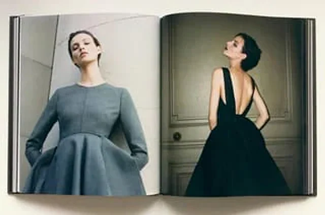

```text
A high-end fashion editorial photograph showcases an open, large-format hardcover magazine or art book, laid flat on a clean, off-white surface, taken from a top-down perspective. The double-page spread contains two full-page portraits of the same elegant woman, her face softened by a square blur, creating a sense of privacy. On the left page, she stands before a light-colored stone or concrete building wall, wearing a {argument name="dress color" default="Soft slate lime"} The structured long-sleeved dress features a fitted corset, round neck, clean-cut seams, and an exaggerated, sculptural bell-shaped skirt; the slightly low angle of the shot makes her neck appear long and her posture elegantly sculpted. On the right page, she wears a dramatic {argument name="second dress color" default="black"} A backless evening gown, with a large open back, wide shoulder straps, and a voluminous, flowing skirt, stands in a dimly lit, emotionally charged room against a backdrop of a classic paneled wall or door. The design employs a luxurious fashion magazine style: minimalist composition, soft colors, natural lighting, delicate shadows, realistic paper texture, clearly visible spine binding, slightly curved pages, and crisp printing details. The overall atmosphere is sophisticated, haute couture-like, cinematic yet understated, resembling the pages of a top-tier fashion magazine.
```

Model: GPT Image 2
Author: GPT Image 2 Prompts

[ProjectD](https://aitoolsradar.com/en/prompts/2ee5fb6138d7ba) · [Recorded source](https://x.com/levelsio/status/2046735438128333096#reversed-3)
 · [Full original metadata and byte evidence](data/projectd-batch-0037.json)

## Luxury Fashion Book Spread


```text
A high-end editorial fashion photograph shown as an open large-format hardcover magazine or art book lying flat on a clean off-white surface, viewed from directly above. The two-page spread contains 2 full-page portraits of the same elegant woman with her face obscured by a soft square blur, creating a privacy-censored look. On the left page, she stands against a pale stone or concrete architectural wall wearing a structured long-sleeve dress in {argument name="dress color" default="soft slate gray"}, with a fitted bodice, round neckline, sharply tailored seams, and an exaggerated sculptural bell-shaped skirt; the camera angle is slightly low, making her neck appear long and her posture statuesque. On the right page, she is photographed from the back in a dramatic {argument name="second dress color" default="black"} evening gown with a very deep open back, wide shoulder straps, and a voluminous full skirt, standing in front of a classic paneled wall or door in a dim, moody interior. Use luxury fashion magazine styling, minimal composition, muted tones, soft natural-looking light, refined shadows, realistic paper texture, visible book gutter, slightly curved pages, and crisp print detail. The overall mood is sophisticated, couture, cinematic, and understated, like a premium fashion editorial spread.
```

Model: GPT Image 2
Author: @levelsio

[ProjectD](https://aitoolsradar.com/en/prompts/bcef2ef4378709) · [Recorded source](https://youmind.com/prompts/luxury-fashion-book-spread-14676)
 · [Full original metadata and byte evidence](data/projectd-batch-0037.json)

## Luxury Fashion Editorial Portrait

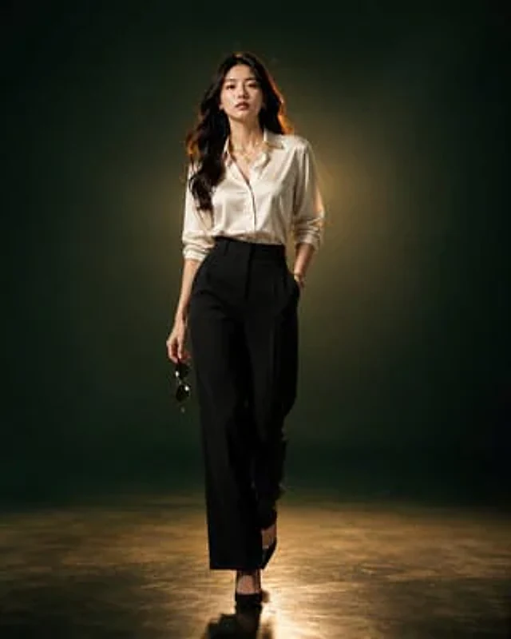

```text
An ultra-premium luxury fashion editorial portrait of a beautiful young {argument name="ethnicity" default="East Asian"} woman with long, naturally wavy black hair and flawless natural makeup, walking confidently toward the camera with a calm, powerful CEO-like presence. She wears an elegant {argument name="shirt material" default="ivory silk satin"} button-up blouse with soft natural folds, tucked into high-waisted tailored black wide-leg trousers, paired with black pointed-toe leather heels. One hand rests casually inside the trouser pocket while the other hand loosely holds a pair of luxury black sunglasses. She wears minimal refined gold jewelry including a delicate necklace, small earrings, a luxury gold wristwatch, and a subtle bracelet.
Background: A seamless premium studio backdrop featuring a {argument name="background color" default="deep emerald green"} fading into dark forest green with a perfectly smooth gradient. Behind the subject is a large soft warm golden circular spotlight creating beautiful depth and luxury separation. The polished studio floor has a very subtle cinematic reflection without appearing glossy.
Pose: Walking naturally toward the camera with crossed strides, shoulders relaxed, spine perfectly straight, chin slightly raised, confident posture, elegant runway-inspired movement, natural arm swing, luxurious body language, eyes looking directly into the lens with a composed editorial expression.
Lighting: Premium Vogue-style three-point studio lighting with a large soft diffused key light, warm golden rim light outlining the hair and shoulders, subtle fill light preserving realistic shadows, cinematic HDR lighting, soft highlight roll-off, realistic reflections on the satin fabric, rich contrast, luxury commercial photography lighting.
Camera: Full-body portrait, eye-level angle, 85mm full-frame lens, f/2.2 aperture, shallow depth of field, razor-sharp focus on the eyes and face, realistic optical perspective, premium fashion campaign composition.
Color Grading: Luxury editorial color grading with deep emerald greens, warm golden highlights, rich blacks, natural ivory fabric tones, balanced skin tones, soft bloom, HDR dynamic range, subtle filmic contrast, premium Vogue, Zara, Ralph Lauren and COS campaign aesthetic.
Quality: Hyper-realistic, photorealistic, ultra-detailed skin texture, natural hair strands, realistic fabric physics, luxury commercial fashion photography, editorial masterpiece, magazine cover quality, 8K ultra-HD, award-winning fashion campaign, clean composition, no text, no watermark.
```

Model: GPT Image 2
Author: Nexora

[ProjectD](https://aitoolsradar.com/en/prompts/0d47ab7888680b) · [Recorded source](https://youmind.com/prompts/luxury-fashion-editorial-portrait-27880)
 · [Full original metadata and byte evidence](data/projectd-batch-0037.json)

## Luxury Fashion Illustration

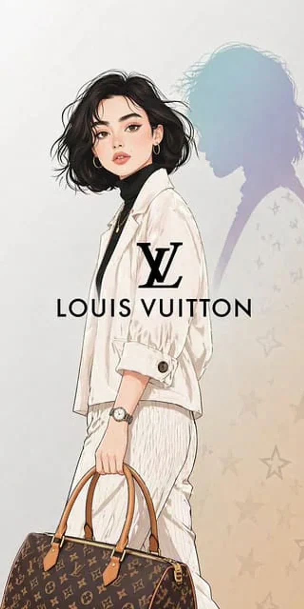

```text
A luxurious and fashionable illustration, in the style of{argument name="brand style" default="Louis Vuitton advertising style"} A fashionable{argument name="subject" default="young women"} She walks sideways forward, carrying a designer monogrammed handbag. Her face is soft yet detailed, with short, wavy black hair, natural makeup, slightly moist lips, and faint freckles. She wears a black turtleneck top, layered with an elegant light beige coat, and matching pleated trousers. She wears minimalist gold jewelry (small hoop earrings and a delicate necklace). The artwork is a semi-realistic illustration with clean lines, soft shadows, and rich details. The background is minimalist white, with a soft pastel gradient shadow outline behind her (blue fading to warm beige), containing subtle luxurious monogrammed elements. The centered composition evokes high-end fashion magazine aesthetics, modern, elegant, and sophisticated brand style. A striking "..." is added at the center.{argument name="logo" default="LV"} The logo is displayed below with the words "LOUIS VUITTON" in a simple font. Soft lighting, smooth texture, exquisite color palette, and ultra-high quality.
```

Model: GPT Image 2
Author: GPT Image 2 Prompts

[ProjectD](https://aitoolsradar.com/en/prompts/151a2c10b78b69) · [Recorded source](https://x.com/Noor_ul_ain43/status/2047847258046283974)
 · [Full original metadata and byte evidence](data/projectd-batch-0037.json)

## Luxury Fashion Magazine Cover Prompt

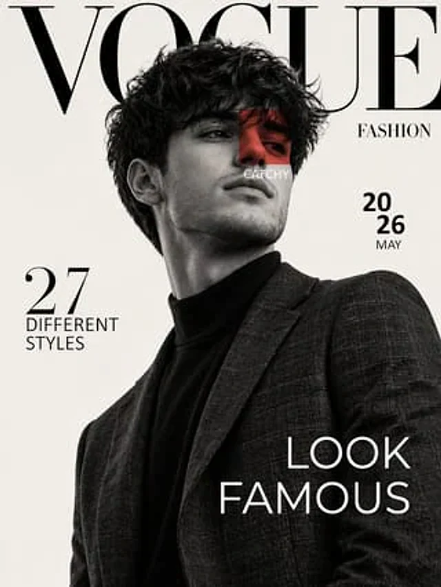

```text
Create a high-fashion magazine cover inspired by luxury fashion publications. Use a reference image of a male subject. Black and white portrait photography against a clean, off-white studio background. The subject poses confidently from a low angle, head slightly tilted back, jawline defined, lips slightly parted, and tousled, naturally voluminous waves. Clothing consists of a dark turtleneck sweater layered under a textured, tailored plaid blazer. Soft, dramatic lighting creates sculpted facial shadows and elegant contrast. Magazine layout design, with an oversized serif masthead at the top.{argument name="masthead text" default="VOGUE"} The text is partially obscured by the main header. The page uses a minimalist advanced layout. The side text "FASHION" and the release date have been added.{argument name="issue date" default="2026 MAY"} The cover features the title "27 DIFFERENT STYLES" on the left and the bold slogan "LOOK FAMOUS" in the lower right corner. A small, semi-transparent red square overlay with the word "CATCHY" is added to one of the eye areas. The style should embody sophistication, modernity, cinematic quality, clean composition, sharp focus, hyper-realistic skin texture, editorial luxury aesthetics, balanced white space, and timeless fashion cover design. It should be a vertical magazine format with high resolution.
```

Model: GPT Image 2
Author: GPT Image 2 Prompts

[ProjectD](https://aitoolsradar.com/en/prompts/8721a93b647fa0) · [Recorded source](https://x.com/harboriis/status/2047858777895133671)
 · [Full original metadata and byte evidence](data/projectd-batch-0037.json)

## Luxury Fashion Torn-Paper Ad Collage

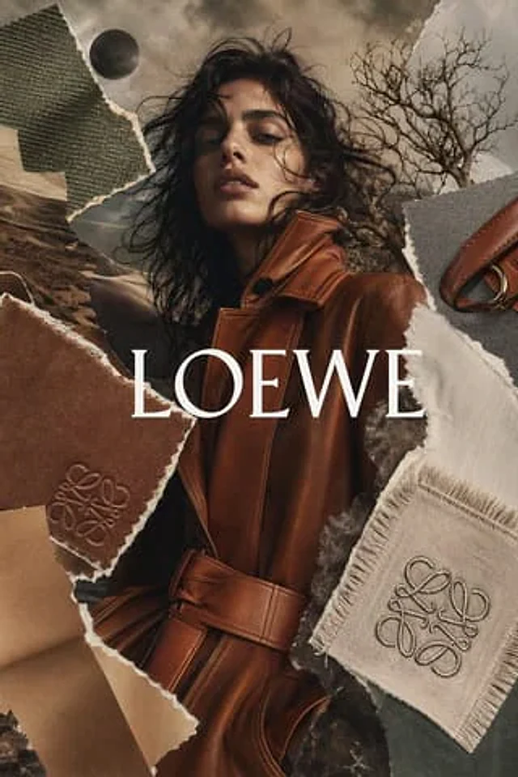

```text
for{argument name="brand name" default="LOEWE"} This luxurious fashion editorial collage poster features a vertical composition and deep autumnal earth tones, reminiscent of a high-fashion magazine advertisement composed of layers of torn paper scraps. At the center is a female fashion model, from the waist up, with wild, windswept dark waves in a deep cognac-brown belted leather coat. The high collar creates soft, natural folds, and she stands sideways, her pose highly dramatic. Her face is partially obscured and minimized, focusing the attention on her styling and clothing. Surrounding her are eight clearly visible collage fragments: a portrait of the central model, a sample of dark textured fabric in the upper left corner, a fragment of a rocky desert landscape in the upper left, a black circular moon or planet against a cloud background in the upper center, a silhouette of a leafless tree in the upper right, a sample of gray textile on the right (containing parts of a brown belt and metal rings), a sample of brown leather embossed with a monogrammed logo in the lower left, and a cream-colored fringed fabric patch embroidered with the same logo in the lower right. A layer of soft beige paper is added in the lower left corner to enhance the sense of depth. The design utilizes a frayed, torn edge effect throughout, employing overlapping paper-cut combinations, strong tactile contrasts, and subtle shadows between layers. The background, a blend of a cloudy, stormy sky and a desolate landscape, evokes a resonance between primal nature and handcrafted artistry. A striking and elegant white serif text is placed above the coat in the lower center.{argument name="headline text" default="LOEWE"} Centered and spanning most of its width, the logo features an embossed monogram on the leather sample and an embroidered monogram on the fabric patches. The light is soft, cinematic, and evenly diffused, with rich textures in the leather, fabric, paper fibers, and landscape details. Overall atmosphere: refined, tactile, artistic, high-end luxury advertising, handcrafted collage, fashion house advertising, high-end print editorial style.
```

Model: GPT Image 2
Author: GPT Image 2 Prompts

[ProjectD](https://aitoolsradar.com/en/prompts/478ccb02a9609b) · [Recorded source](https://x.com/aibytekat/status/2046879116117606500#reversed-2)
 · [Full original metadata and byte evidence](data/projectd-batch-0037.json)

## Luxury Football Captain Infographic Poster

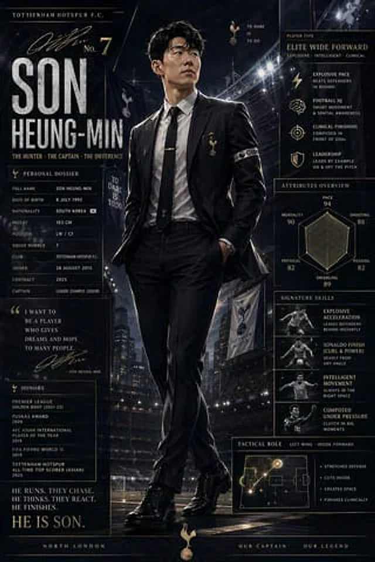

```text
{
  "type": "Cinematic Football Poster Infographic",
  "subject": {
    "person": "{argument name=\"player name\" default=\"Son Heung-min\"}",
    "club": "{argument name=\"club name\" default=\"Tottenham Hotspur Football Club\"}",
    "jersey number": "{argument name=\"squad number\" default=\"7\"}",
    "appearance": "The tall and muscular South Korean football star, in his early 30s, exudes a charismatic captain's presence.",
    "wardrobe": "A tailored black suit, white shirt, thin black tie with tie clip, black leather shoes, captain's armband on the right sleeve, and club crest on the breast pocket.",
    "pose": "With a heroic air, he confidently strides forward, one hand in his pocket, the other relaxed, shoulders back, head slightly turned.",
    "expression": "Serious, calm, elite, composed"
  },
  "style": {
    "mood": "Luxury, heroism, intensity, elite sports brand image",
    "rendering": "Ultra-detailed digital paintings with realistic anatomical structures and an editor-grade texture with a glossy finish.",
    "lighting": "The dramatic stadium floodlights at night, the intense contour lighting, the reflective highlights on the suit fabric, the deep shadows...",
    "palette": "Navy blue, black, charcoal gray, warm gold, matte silver, white",
    "texture": "Metallic gold lines, brushed paper poster texture, delicate graininess, and a hazy stadium atmosphere."
  },
  "environment": {
    "location": "At night, the football stadium is visible, with its stands, floodlights, banners, and the city skyline rising above the stadium.",
    "details": [
      "Tottenham Hotspur banners hanging around the stadium",
      "The club's rooster logo runs throughout the entire design.",
      "The wet or shiny side of the court reflects the lights.",
      "The dimly lit stands were filled with spectators",
      "High-rise buildings in the background"
    ]
  },
  "layout": {
    "format": "Vertical high-end sports posters",
    "aspect_ratio": "2:3",
    "sections": [
      {
        "title": "Left title bar",
        "position": "Top left to middle left",
        "count": 6,
        "labels": [
          "Tottenham Hotspur Football Club",
          "Signature Graffiti",
          "No. 7",
          "Sun",
          "Heung Min",
          "Hunter, Captain, Key Player"
        ]
      },
      {
        "title": "Personal Profile",
        "position": "Left and Middle",
        "count": 9,
        "labels": [
          "Full name — Son Heung-min",
          "Date of birth—July 8, 1992",
          "Nationality — South Korea",
          "Height - 183 cm",
          "Position — Left winger / Center forward",
          "Jersey number — 7",
          "Club – Tottenham Hotspur Football Club",
          "Joined on August 28, 2015",
          "Contract term – 2025"
        ]
      },
      {
        "title": "Captain's slogan",
        "position": "bottom of the file",
        "count": 1,
        "labels": [
          "Captain—Leader. Role model. Legend."
        ]
      },
      {
        "title": "Introduction box",
        "position": "Left center bottom",
        "count": 3,
        "labels": [
          "I want to become",
          "It can bring to many people",
          "Players who embody dreams and hopes."
        ]
      },
      {
        "title": "honor",
        "position": "Bottom left",
        "count": 5,
        "labels": [
          "Premier League Golden Boot (2021-22)",
          "Puskás Prize 2020",
          "AFC Overseas Player of the Year 2015",
          "FIFA Team of the Year 2019",
          "Tottenham Hotspur's all-time top scorer (Asia) 2023"
        ]
      },
      {
        "title": "Slogan in the lower left corner",
        "position": "Bottom left footer area",
        "count": 5,
        "labels": [
          "He ran.",
          "They chased after them.",
          "He pondered.",
          "Their reaction.",
          "He ended it."
        ]
      },
      {
        "title": "Core Declaration",
        "position": "Large font in the lower left corner",
        "count": 1,
        "labels": [
          "He is Sun."
        ]
      },
      {
        "title": "Top center motto",
        "position": "Near the hanging banner in the upper right corner",
        "count": 1,
        "labels": [
          "To dare to do (TO DARE IS TO DO)"
        ]
      },
      {
        "title": "Player Type",
        "position": "Top right",
        "count": 5,
        "labels": [
          "Elite winger",
          "Explosiveness—Instantly shaking off the defender",
          "Football IQ – Intelligent positioning and spatial awareness",
          "Finishing in front of goal – Calm and composed in front of the goal",
          "Leadership – Leading by Example Both On and Off the Field"
        ]
      },
      {
        "title": "Capabilities Overview",
        "position": "Right Center",
        "count": 5,
        "labels": [
          "Speed ​​94",
          "88 shots",
          "89",
          "Passing 82",
          "Body 82"
        ]
      },
      {
        "title": "Mindset Value",
        "position": "Left side of radar image",
        "count": 1,
        "labels": [
          "Mindset 90"
        ]
      },
      {
        "title": "Core skills",
        "position": "Right center bottom",
        "count": 4,
        "labels": [
          "Explosive acceleration—instantly break free from the defense",
          "Sun-style Finish (Arc and Power) — A lethal strike from any angle.",
          "Intelligent positioning—always appearing in the right position.",
          "Composure under pressure—the ability to deliver a decisive blow in crucial moments."
        ]
      },
      {
        "title": "Tactical role",
        "position": "Bottom right",
        "count": 5,
        "labels": [
          "Left winger/Inside-cutting winger",
          "Draw up the defense line",
          "Inside cut",
          "Create space",
          "Calm End"
        ]
      },
      {
        "title": "Footer text",
        "position": "Bottom border",
        "count": 3,
        "labels": [
          "North London",
          "Our captain",
          "Our Legend"
        ]
      }
    ],
    "centerpiece": "The central figure occupies most of the poster's height, flanked by narrow information panels.",
    "graphic_elements": [
      "Thin gold border and dividing lines",
      "radar chart",
      "Small tactical court map with glowing nodes and path lines",
      "Four vertically stacked monochrome motion thumbnails",
      "Club Badge",
      "Signature mark",
      "Hanging flags"
    ]
  },
  "composition": {
    "camera": "Low-angle full-body portraits showcase dominance and presence.",
    "depth": "The focus is on the central figure, while the background buildings and crowds are slightly blurred.",
    "design": "A combination of luxury magazine covers, player scout profiles, and tribute posters."
  },
  "quality": "High-end, exquisite, poster-quality, for{argument name=\"headline name\" default=\"Son Heung-min\"} exist{argument name=\"team city\" default=\"North London\"} Creating high-quality sports marketing artworks"
}
```

Model: GPT Image 2
Author: GPT Image 2 Prompts

[ProjectD](https://aitoolsradar.com/en/prompts/e5a2aba90a685f) · [Recorded source](https://x.com/Youtae/status/2046633092711157769#reversed-0)
 · [Full original metadata and byte evidence](data/projectd-batch-0037.json)

## Luxury Football Captain Infographic Poster


```text
{"type":"cinematic football poster infographic","subject":{"person":"{argument name=\"player name\" default=\"Son Heung-Min\"}","club":"{argument name=\"club name\" default=\"Tottenham Hotspur F.C.\"}","jersey number":"{argument name=\"squad number\" default=\"7\"}","appearance":"tall athletic Korean male football star in his early 30s, styled as a charismatic captain","wardrobe":"tailored black suit, white dress shirt, slim black tie with tie clip, black dress shoes, captain armband on right sleeve, club crest on blazer chest pocket","pose":"full-body hero pose, walking forward confidently with one hand in trouser pocket and the other relaxed, shoulders back, head slightly turned","expression":"serious, calm, elite, composed"},"style":{"mood":"luxury, heroic, intense, elite sports branding","rendering":"ultra-detailed digital painting with realistic anatomy and glossy editorial finish","lighting":"dramatic stadium floodlights at night, strong rim light, reflective highlights on suit fabric, deep shadows","palette":"navy blue, black, charcoal, warm gold, muted silver, white","texture":"metallic gold linework, brushed paper poster texture, subtle grain, smoky stadium atmosphere"},"environment":{"location":"football stadium at night with visible stands, floodlights, banners, and a city skyline rising beyond the arena","details":["Tottenham banners hanging around the stadium","club cockerel logos throughout the design","wet or glossy pitch-side ground reflecting lights","packed darkened stands","high-rise buildings in the background"]},"layout":{"format":"vertical premium sports poster","aspect_ratio":"2:3","sections":[{"title":"left headline block","position":"top-left to mid-left","count":6,"labels":["TOTTENHAM HOTSPUR F.C.","signature scribble","No. 7","SON","HEUNG-MIN","THE HUNTER · THE CAPTAIN · THE DIFFERENCE"]},{"title":"PERSONAL DOSSIER","position":"left-middle","count":9,"labels":["FULL NAME — SON HEUNG-MIN","DATE OF BIRTH — 8 JULY 1992","NATIONALITY — SOUTH KOREA","HEIGHT — 183 CM","POSITION — LW / CF","SQUAD NUMBER — 7","CLUB — TOTTENHAM HOTSPUR F.C.","JOINED — 28 AUGUST 2015","CONTRACT — 2025"]},{"title":"captain line","position":"bottom of dossier","count":1,"labels":["CAPTAIN — LEADER. EXAMPLE. LEGEND."]},{"title":"quote box","position":"left-lower middle","count":3,"labels":["I WANT TO BE A PLAYER","WHO GIVES DREAMS AND HOPE","TO MANY PEOPLE."]},{"title":"HONORS","position":"left-bottom","count":5,"labels":["PREMIER LEAGUE GOLDEN BOOT (2021-22)","PUSKÁS AWARD 2020","AFC ASIAN INTERNATIONAL PLAYER OF THE YEAR 2015","FIFA FIFPRO WORLD 11 2019","TOTTENHAM HOTSPUR ALL-TIME TOP SCORER (ASIAN) 2023"]},{"title":"bottom-left slogan","position":"left-bottom footer area","count":5,"labels":["HE RUNS.","THEY CHASE.","HE THINKS.","THEY REACT.","HE FINISHES."]},{"title":"main declaration","position":"lower-left large type","count":1,"labels":["HE IS SON."]},{"title":"top-center motto","position":"upper center-right near hanging banner","count":1,"labels":["TO DARE IS TO DO"]},{"title":"PLAYER TYPE","position":"upper-right","count":5,"labels":["ELITE WIDE FORWARD","EXPLOSIVE PACE — BEATS DEFENDERS IN BEHIND","FOOTBALL IQ — SMART MOVEMENT & SPATIAL AWARENESS","CLINICAL FINISHING — COMPOSED IN FRONT OF GOAL","LEADERSHIP — LEADS BY EXAMPLE ON & OFF THE PITCH"]},{"title":"ATTRIBUTES OVERVIEW","position":"right-middle","count":5,"labels":["PACE 94","SHOOTING 88","DRIBBLING 89","PASSING 82","PHYSICAL 82"]},{"title":"MENTALITY stat","position":"left side of radar chart","count":1,"labels":["MENTALITY 90"]},{"title":"SIGNATURE SKILLS","position":"right-lower middle","count":4,"labels":["EXPLOSIVE ACCELERATION — LEAVES DEFENDERS BEHIND INSTANTLY","SONALDO FINISH (CURL & POWER) — DEADLY FROM ANY ANGLE","INTELLIGENT MOVEMENT — ALWAYS IN THE RIGHT SPACE","COMPOSED UNDER PRESSURE — CLUTCH IN BIG MOMENTS"]},{"title":"TACTICAL ROLE","position":"bottom-right","count":5,"labels":["LEFT WING · INSIDE FORWARD","STRETCHES DEFENSE","CUTS INSIDE","CREATES SPACE","FINISHES CLINICALLY"]},{"title":"footer text","position":"bottom border","count":3,"labels":["NORTH LONDON","OUR CAPTAIN","OUR LEGEND"]}],"centerpiece":"full-body central figure occupying most of the poster height, framed by narrow information panels on both sides","graphic_elements":["thin gold borders and dividers","radar chart","small tactical pitch diagram with glowing nodes and path lines","4 monochrome action thumbnails stacked vertically","club emblems","signature marks","hanging flags"]},"composition":{"camera":"low-angle full-body portrait for dominance and stature","depth":"sharp focus on central figure, slightly softer background architecture and crowd","design":"luxury magazine cover meets player scouting dossier and tribute poster"},"quality":"high-end, polished, poster-ready, premium sports marketing artwork for {argument name=\"headline name\" default=\"Son Heung-Min\"} at {argument name=\"team city\" default=\"North London\"}"}
```

Model: GPT Image 2
Author: NullException

[ProjectD](https://aitoolsradar.com/en/prompts/d9e2baa298917f) · [Recorded source](https://youmind.com/prompts/luxury-football-captain-infographic-poster-14688)
 · [Full original metadata and byte evidence](data/projectd-batch-0037.json)

## Luxury Football Victory Campaign Poster

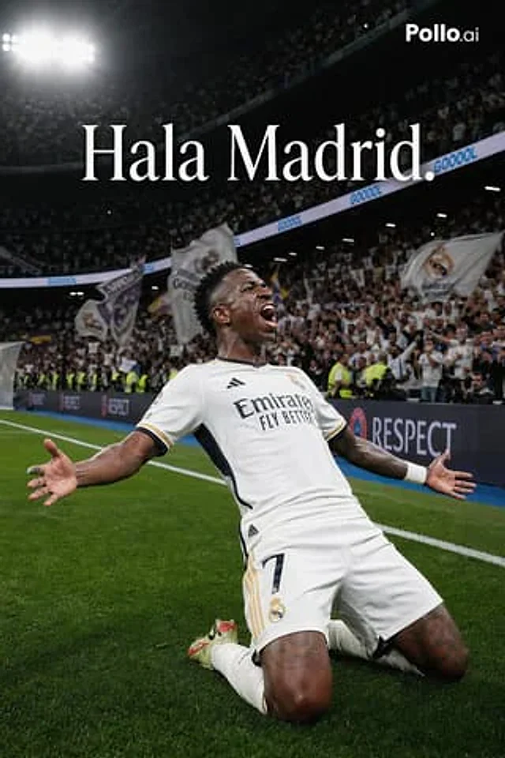

```text
A highly dramatic, vertical high-end sports fashion promotional photo, featuring a {argument name="football player" default="Young Black male forward"} Wearing white{argument name="team kit" default="Real Madrid home jersey"} A player is performing a knee slide celebration on the grass near the sideline of the football field. Positioned in the lower center of the frame, he leans back, chest out, arms outstretched, wearing a white jersey with dark trim and gold accents, paired with white shorts bearing the number 7, white socks, and light-colored football boots with red details. His face is softly blurred in a rectangular pattern, while his body remains sharp and photorealistic. The stadium is vast and packed, with thousands of fans in white jerseys cheering. Four large, clearly visible support banners stand in the background, security personnel in fluorescent yellow jackets stand along the edge of the pitch, and bright floodlights flash in the upper left corner. The image includes sideline advertising projects with the football brand logo, a dark blue project displaying the word "RESPECT," and a curved stadium screen displaying repeated celebratory text. An elegant white serif headline is added at the top center, with the text {argument name="headline text" default="Hala Madrid."} Place a small white [item] in the upper right corner{argument name="brand text" default="Pollo.ai"} The logo. Shot from a low angle with a wide-angle lens, it creates a heroic sense of victory, with cinematic contrast, clear jersey texture, realistic grass details, and shallow depth of field, presenting a luxurious sportswear advertising aesthetic in a hyper-realistic photographic style.
```

Model: GPT Image 2
Author: GPT Image 2 Prompts

[ProjectD](https://aitoolsradar.com/en/prompts/84327a66733876) · [Recorded source](https://x.com/garlotic/status/2047413947368911312#reversed-1)
 · [Full original metadata and byte evidence](data/projectd-batch-0037.json)

## Luxury Fragrance Expo Invitation Poster

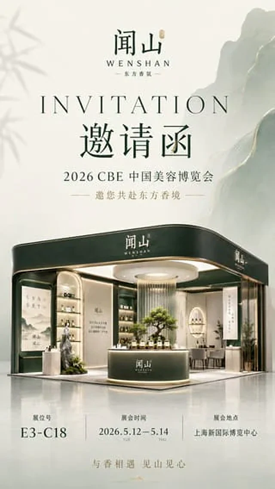

```text
Goal: Create a vertical luxury trade-show invitation poster for an oriental fragrance brand, combining elegant Chinese typography, exhibition information, and a realistic 3D booth rendering.

Canvas: Tall 9:16 poster, soft warm ivory background with subtle paper texture. Use a refined dark forest green and muted gold palette. Add pale ink-wash mountain silhouettes on the upper-right background and faint bamboo shadows on the upper-left edge.

Top branding: Center the brand logo at the top with large Chinese characters “闻山”, small romanized text “WENSHAN”, and the subtitle “东方香氛”. Add a tiny gold seal-like mark beside the logo.

Main headline area: Below the logo, place the large spaced serif English word “INVITATION” in dark green. Under it, set oversized Chinese calligraphy-style text “邀请函”. Below that, write “2026 CBE 中国美容博览会”, then a smaller line framed by thin gold horizontal rules: “邀您共赴东方香境”.

Main visual: The lower-middle of the poster features a realistic high-end 3D exhibition booth for {argument name="brand name" default="闻山 WENSHAN"}. The booth is a corner stand with a rounded rectangular dark green fascia, thin gold trim, warm interior lighting, cream stone walls, glass partitions, and glossy floor reflections. Use a premium oriental fragrance showroom style.

Counted booth elements: Include exactly 1 main curved front reception counter with logo, exactly 1 bonsai tree centerpiece on the counter, exactly 1 circular ceiling light feature above it with hanging bead-like strands, exactly 2 illuminated arched shelving niches on the left, exactly 1 tall back shelving wall with small perfume bottles, exactly 1 left poster panel showing misty mountains and Chinese fragrance copy, exactly 1 decorative rock-and-moss landscape installation near the left entrance, exactly 1 right vertical text panel, exactly 1 small consultation table area with 2 chairs on the right, and multiple neatly aligned small fragrance bottles displayed on shelves and counter surfaces.

Booth text details: Put “闻山 WENSHAN” on the front counter and booth fascia. Include understated Chinese display copy such as “东方为源 香至于心” and “以东方山水为意境 以天然香材制香”. Keep all booth text small, elegant, and secondary.

Bottom information band: Place three evenly spaced information blocks separated by thin vertical divider lines. Left block label “展位号” with large booth number {argument name="booth number" default="E3-C18"}. Middle block label “展会时间” with date {argument name="exhibition dates" default="2026.5.12—5.14"} and tiny weekday text “TUE” and “THU” beneath. Right block label “展会地点” with venue {argument name="venue" default="上海新国际博览中心"}. At the very bottom center, add the tagline {argument name="bottom tagline" default="与香相遇 见山见心"} with a small gold ornamental line below.

Visual style: Photorealistic architectural rendering mixed with premium editorial poster design, soft ambient shadows, elegant spacing, clean luxury composition, no clutter, no people, no watermark, no extra logos beyond the brand mark.
```

Model: GPT Image 2
Author: Larus Canus

[ProjectD](https://aitoolsradar.com/en/prompts/6d9ae80d169eb1) · [Recorded source](https://youmind.com/prompts/fragrance-expo-invitation-poster-26180)
 · [Full original metadata and byte evidence](data/projectd-batch-0037.json)

## Luxury Fur-Lined Loafer Lifestyle Photo

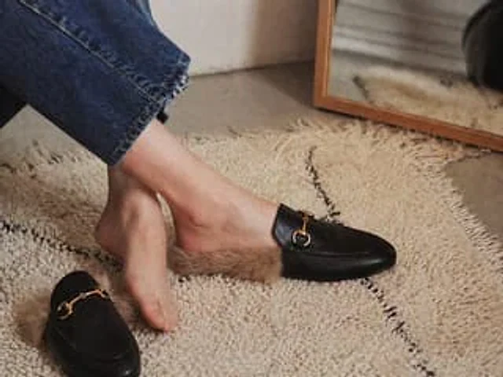

```text
A warm, editorial-style lifestyle product photo, shot indoors from a low angle and close up. The image focuses on the lower body of a woman trying on a pair of black leather slingback loafers lined with tan faux fur. She wears one loafer on her right foot and is barefoot on her left, hovering above a luxurious cream-colored shag rug; a matching loafer rests on a foreground rug in the lower left corner. The loafer features a smooth black leather upper, a rounded almond toe, a mule-style slingback design, and soft tan fur oozing from the opening. A delicate gold horsebit metal piece adorns the upper. The model wears tailored mid-blue jeans with frayed hems. The scene is set in a comfortable, minimalist space, with two thin, irregular black lines on the cream-colored rug, a neutral-toned wall background, and a rectangular floor-length mirror with a neutral-toned wooden frame in the upper right corner, softly reflecting the rug and parts of the scene. Utilizing soft, natural window lighting, shallow depth of field, subtle film grain, realistic skin texture, soft beige and black tones, relaxed and natural composition, high-end fashion catalog quality, high detail, and photorealistic feel.
```

Model: GPT Image 2
Author: GPT Image 2 Prompts

[ProjectD](https://aitoolsradar.com/en/prompts/f7ecf366729180) · [Recorded source](https://x.com/dynamicwangs/status/2047580984342925545#reversed-2)
 · [Full original metadata and byte evidence](data/projectd-batch-0037.json)

## Luxury Germany Travel Poster

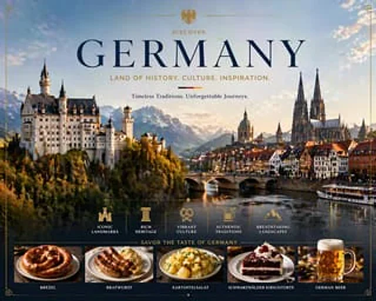

```text
Create a retro style{argument name="country name" default="Germany"} This luxury travel poster boasts a design reminiscent of high-end travel advertisements. It employs a grand, symmetrical composition, paired with elegant typography and a gold border featuring delicate corner details. At the top center is a small gold coat of arms, below which is the word "DISCOVER," followed by a striking dark navy blue serif title.{argument name="headline country" default="GERMANY"} Below this, add the gold-letter slogan "LAND OF HISTORY. CULTURE. INSPIRATION.", followed by a smaller, classic serif subtitle "Timeless Traditions. Unforgettable Journeys.", accented with small horizontal decorative lines in black, red, and gold. Present a magnificent panoramic montage of iconic German scenery against a backdrop of a sparsely clouded, softly glowing blue sky at the golden hour. On the left, a fairytale-like white hilltop castle, reminiscent of Neuschwanstein, sits atop autumnal trees. The majestic Alps are placed in the center of the background. On the right, a historic European riverside city is showcased, with its dense red-roofed houses, arched stone bridges spanning the water, a domed cathedral, and a Gothic cathedral with twin spires. Add reflections on the calm river surface, and a white sightseeing boat in the lower right corner. The image should be imbued with a nostalgic, romantic, and alluring atmosphere, featuring warm sunlight, clear architectural details, and rich, cinematic color gradation. At the bottom center, five gold-lined cultural icons are arranged horizontally, each labeled: “ICONIC LANDMARKS,” “RICH HERITAGE,” “VIBRANT CULTURE,” “AUTHENTIC TRADITIONS,” and “BREATHTAKING LANDSCAPES.” Below this is a dark-colored horizontal food display bar, centered with the gold title “SAVOR THE TASTE OF GERMANY.” Within this bar are five bordered food panels, each with a white capital text below it: “BREZEL,” “BRATWURST,” “KARTOFFELSALAT,” “SCHWARZWÄLDER KIRSCHTORTE,” and “GERMAN BEER.” Each food item is presented in an enticing close-up: glistening pretzel bread on a plate, sausages with sauerkraut, creamy potato salad, slices of Black Forest cake garnished with cream and cherries, and a frothy beer mug. The overall design should maintain a sophisticated, upscale, poster-like feel, suitable for promotional campaigns in luxury destinations.
```

Model: GPT Image 2
Author: GPT Image 2 Prompts

[ProjectD](https://aitoolsradar.com/en/prompts/927041ab776369) · [Recorded source](https://x.com/Redit007/status/2047524171987775961#reversed-0)
 · [Full original metadata and byte evidence](data/projectd-batch-0037.json)

## Luxury Glam Beauty Portrait

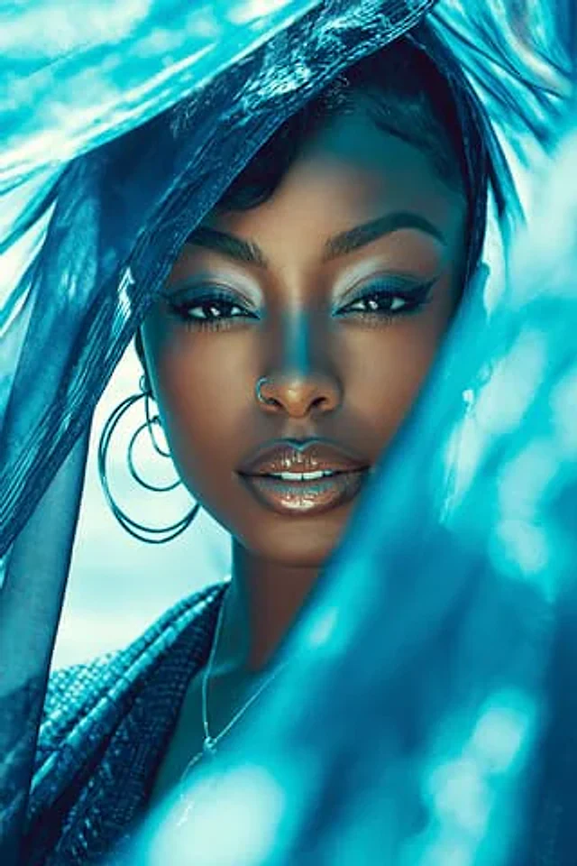

```text
Luxury Glam Beauty Portrait:, Beautiful Black woman, youthful spirit, creamy vanilla, silk press, mahogany red, subtle confidence, textured fabric, sapphire blue, minimal jewelry, beachside breeze, lens flare effect, nostalgic, cinematic lens, symmetrical composition, soft focus, high fashion photography, monochromatic, dewy finish, mysterious tension, layered elements
```

Model: GPT Image 2
Author: @patrickassale

[ProjectD](https://aitoolsradar.com/en/prompts/64d8f12f1dae84) · [Recorded source](https://x.com/patrickassale/status/2044581766309060765)
 · [Full original metadata and byte evidence](data/projectd-batch-0037.json)

## Luxury GT3 Dealership Poster

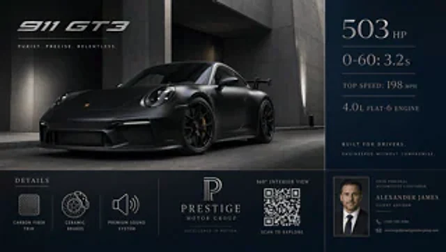

```text
{
  "type": "Luxury car advertising posters",
  "subject": {
    "vehicle": "{argument name=\"car model\" default=\"Porsche 911 GT3\"}",
    "color": "{argument name=\"car color\" default=\"Matte Black\"}",
    "view": "Left front 45-degree angle",
    "features": [
      "Large fixed tail fin",
      "Black multi-spoke wheels",
      "Yellow brake calipers",
      "Low-profile aerodynamic front lip",
      "Streamlined LED headlights"
    ]
  },
  "style": {
    "mood": "Ultimate high-end, profound, precise, and focused on performance.",
    "lighting": "Cinematic-grade low-profile lighting with soft reflective surfaces on the vehicle body.",
    "environment": "The Brutalist concrete building at night, with its towering monolithic walls and subtle ground reflections.",
    "palette": [
      "Matte Black",
      "Charcoal gray",
      "Steel Gray",
      "Midnight Blue",
      "Soft silver font"
    ]
  },
  "composition": {
    "format": "Wide horizontal poster",
    "main_image_area": "The vehicle occupies the area on the left and above the center.",
    "right_sidebar": "Vertical Navy Blue Gradient Specification Panel",
    "bottom_band": "Full-width premium information bar, including icons, brand logo, QR code, and contact card."
  },
  "text": {
    "headline": "{argument name=\"headline text\" default=\"911 GT3\"}",
    "tagline": "Pure. Precise. Fearless.",
    "specs": [
      "503 horsepower",
      "0-60 mph acceleration: 3.2 seconds",
      "Top speed: 198 mph",
      "4.0L horizontally opposed 6-cylinder engine"
    ],
    "brand_block": {
      "logo_text": "PRESTIGE",
      "subtext": "MOTOR GROUP",
      "tagline": "Excellent dynamism"
    },
    "dealer_copy": [
      "Born for drivers.",
      "Uncompromising engineering design."
    ],
    "interior_cta": [
      "360° panoramic interior view",
      "Scan to explore"
    ],
    "advisor": {
      "name": "{argument name=\"advisor name\" default=\"ALEXANDER JAMES\"}",
      "title": "Customer Consultant",
      "phone": "{argument name=\"phone number\" default=\"(310) 555-0186\"}",
      "email": "concierge@prestigemotorgroup.com",
      "header": "Your exclusive car concierge service"
    }
  },
  "layout": {
    "sections": [
      {
        "title": "Main vehicle area",
        "position": "From top left to center",
        "count": 1,
        "labels": [
          "Rendering of a sports car at a 45-degree angle from the front."
        ]
      },
      {
        "title": "Specification panel",
        "position": "Top right",
        "count": 4,
        "labels": [
          "503 horsepower",
          "0-60 mph acceleration: 3.2 seconds",
          "Top speed: 198 mph",
          "4.0L horizontally opposed 6-cylinder engine"
        ]
      },
      {
        "title": "detail",
        "position": "Bottom left",
        "count": 3,
        "labels": [
          "carbon fiber trim",
          "Ceramic Braking System",
          "High-end audio system"
        ]
      },
      {
        "title": "Brand Center Section",
        "position": "Bottom Center",
        "count": 3,
        "labels": [
          "PRESTIGE",
          "MOTOR GROUP",
          "Excellent dynamism"
        ]
      },
      {
        "title": "360° interior QR area",
        "position": "Bottom Middle Right",
        "count": 2,
        "labels": [
          "360° panoramic interior view",
          "Scan to explore"
        ]
      },
      {
        "title": "Consultant Contact Card",
        "position": "Bottom right",
        "count": 5,
        "labels": [
          "Your exclusive car concierge service",
          "ALEXANDER JAMES",
          "Customer Consultant",
          "(310) 555-0186",
          "concierge@prestigemotorgroup.com"
        ]
      }
    ],
    "dividers": "Thin metal lines separating panels and content sections"
  },
  "graphic_elements": {
    "icons": [
      "carbon fiber textured square icon",
      "Brake disc icon",
      "Speaker icon"
    ],
    "qr_code": 1,
    "portrait": 1
  },
  "rendering": "Photorealistic high-fidelity CGI for commercial vehicles, with extremely sharp details, elegant luxury manual aesthetics, perfect typography, and a clean, commercial layout."
}
```

Model: GPT Image 2
Author: GPT Image 2 Prompts

[ProjectD](https://aitoolsradar.com/en/prompts/cddb2a62afd186) · [Recorded source](https://x.com/AIwithSynthia/status/2046963412589215802#reversed-0)
 · [Full original metadata and byte evidence](data/projectd-batch-0037.json)

## Luxury Hair Dryer Beauty Ad


```text
Create a high-end minimalist beauty advertisement against a clean, light gray studio backdrop. The left side displays a captivating bust of a female model.{argument name="hair color" default="Dark brown"} Her hair flows to the left, displaying a smooth, glossy wave that emphasizes shine and movement. She wears an elegant white halter-neck dress with a knotted neckline. Her face is minimized, not the visual focus. To her right sits a stylish, modern cylindrical hair dryer with a metallic silver finish and a rose gold ring surrounding a black hollow center. It is displayed upright, showing the handle buttons, lower air intake, and connected power cord. The lighting is luxurious commercial product photography lighting, soft shadows, ultra-clean retouching, and a high-end cosmetics advertising style. A striking modern sans-serif title text is added to the upper right corner: First line displays {argument name="headline text" default="Effortlessly dazzling."} The text below is displayed in a lighter font weight.{argument name="subheadline text" default="Everyday life is perfect."} In the bottom left corner, there are four vertically arranged function labels with thin-outlined circular icons and small sans-serif text: 1) A flashing icon, titled "Quick Drying," with the text "Powerful digital motor for fast and efficient drying." 2) A thermometer icon, titled "Intelligent Temperature Control," with the text "Monitors air temperature 40 times per second." 3) A wave-shaped heating element icon, titled "Designed for healthy hair," with the text "Helps protect hair's natural shine and smoothness." 4) A silent icon, titled "Engineered for Balance," with the text "Lightweight, quiet, and comfortable to use." In the bottom right corner, the luxury brand name is added.{argument name="brand name" default="LUXÉO"} Below, it is accompanied by the small capital letters "PROFESSIONAL". The vertical poster layout, exquisite mobile advertising aesthetics, the desirable beauty technology brand feel, realistic hair texture, realistic skin texture, clear layout, and high-end editorial composition.
```

Model: GPT Image 2
Author: GPT Image 2 Prompts

[ProjectD](https://aitoolsradar.com/en/prompts/1658e96cf269a7) · [Recorded source](https://x.com/choyamymuna/status/2047220515841208628#reversed-1)
 · [Full original metadata and byte evidence](data/projectd-batch-0037.json)

## Luxury Handbag Sunset Ad


```text
A luxurious fashion advertisement, a vertically edited product campaign, shot at the golden hour, against the backdrop of a skyscraper balcony overlooking a modern city skyline, at sunset. A stylish woman stands confidently in a two-thirds profile, the frame angled upwards from mid-thigh, her face partially obscured by a simple rectangular block of color echoing warm brown-orange tones. Her long, dark brown, slightly wavy hair shimmers in the warm backlight of the setting sun. She wears a black fitted blazer over a white round-neck ribbed vest, paired with high-waisted light beige trousers. One hand is in her pocket, the other carrying a structured taupe leather handbag with a top handle, flap closure, delicate gold-plated hardware, and a hanging leather tag. The handbag is the visual focal point, conveying a high-end, elegant, and meticulously detailed feel. Cinematic warm lighting is used, with soft contour lighting on the hair, employing subtle luxurious color gradations and a shallow depth of field effect, blurring the skyscrapers in the background. The layout references high-end brand advertising, with large text and icons arranged on the left. A sophisticated serif lettering logo is placed in the upper left corner.{argument name="brand monogram" default="L"} Below is the large white serif capital title:{argument name="headline text" default="CARRY CONFIDENCE. EVERYDAY."} Add four lines of short, white serif body text below the title:{argument name="body text" default="Timeless design. Effortless elegance. Made for every moment that moves you forward."} Three vertically arranged circular line icons with labels: premium leather, timeless design, and durability. The brand name in large, elegant serif capital letters is placed in the lower left corner.{argument name="brand name" default="LUMIÈRE"} Below this is a smaller, all-caps slogan:{argument name="tagline" default="BAGS THAT DEFINE YOU."} Add a bordered "SHOP THE COLLECTION" call-to-action button with a small right-pointing arrow. Overall style: high-end, desirable, sophisticated e-commerce advertising; photorealistic fashion editorial; luxurious and modern; clean layout; balanced negative space; magazine-quality composition.
```

Model: GPT Image 2
Author: GPT Image 2 Prompts

[ProjectD](https://aitoolsradar.com/en/prompts/7968b580bf130b) · [Recorded source](https://x.com/Fatima_RP120/status/2046848720084537359#reversed-1)
 · [Full original metadata and byte evidence](data/projectd-batch-0037.json)

## Luxury Indoor Mirror Selfie Portrait


```text
A realistic indoor mirror selfie featuring a slender, glamorous young woman. She stands in a softly lit upscale living room or hotel suite, shot in a vertical composition from head to knee. She wears a fitted cream or ivory midi dress with elegant pleats and gathers, featuring an asymmetrical neckline with a single shoulder strap across her chest, revealing one shoulder. She has long, slightly wavy, dark brown hair parted in the middle or side, falling naturally over her shoulders. She holds a smartphone in her right hand, partially obscuring her face, with the phone facing the mirror on the wall; the phone has a dark case with a red cloud pattern. Her left arm hangs naturally at her side. Adding delicate jewelry: a delicate necklace with a small pendant, a silver bracelet or bangle on her right wrist, and a ring on the finger holding the phone. The design emphasizes the realistic female silhouette, smooth skin, soft, warm ambient lighting, and a sophisticated, editorial social media photography style. The background should include a beige sofa behind her, a brown leather handbag to her right, a textured stone or concrete accent wall behind the mirror, and a warm hallway to her left with two wall art pieces. The design utilizes natural interior shadows, delicate skin textures, realistic fabric folds, and a sculpted waist and hips to create a luxurious apartment aesthetic, characterized by a simple composition and rich details.
```

Model: GPT Image 2
Author: GPT Image 2 Prompts

[ProjectD](https://aitoolsradar.com/en/prompts/baeb7f0967cda4) · [Recorded source](https://x.com/daaaaanc/status/2046678589739839969#reversed-1)
 · [Full original metadata and byte evidence](data/projectd-batch-0037.json)

## Luxury Instagram Profile Creator Poster


```text
{"type":"vertical photorealistic luxury social media growth poster with futuristic Instagram profile interface","aspect_ratio":"2:3 portrait","style":"clean professional viral AI aesthetic, cinematic studio lighting, premium influencer branding, glossy neon UI, realistic fashion photography, shallow depth of field","main_subject":{"description":"confident female digital creator standing beside a huge floating smartphone-like Instagram profile panel, pointing toward the profile screen with one hand","name":"{argument name=\"creator name\" default=\"Hania AI\"}","appearance":"long wavy dark brown hair, elegant makeup, face intentionally anonymized or softly blurred, medium skin tone","outfit":"tailored beige blazer and matching high-waisted trousers over a black top, subtle necklace, watch, polished business-influencer styling","pose":"standing slightly angled, leaning near the display, right index finger pointing at the profile panel"},"environment":{"setting":"luxury content creator studio or beauty room at night","background_elements_count":4,"background_elements":["large circular pink neon ring light on the right","vanity desk with cosmetic bottles and warm reflections","large green plant behind the display","dark glass and soft mauve curtains creating a premium interior"],"lighting":"warm amber key light mixed with pink neon rim light and soft reflections"},"main_display":{"position":"left side, occupying nearly half the image","description":"oversized vertical transparent black glass Instagram profile screen with rounded corners, glowing peach and pink edge light, floating like a futuristic digital billboard","visible_platform_text":"Instagram","profile":{"avatar":"round profile photo with pink story ring, face blurred","username":"{argument name=\"profile username\" default=\"Hania AI\"}","verification":"blue verified checkmark","stats_count":3,"stats":["215 Posts","1M Followers","180 Following"],"bio_lines_count":5,"bio_lines":["Digital Creator | AI Artist | Influencer","Inspiring the world with creativity & AI","Luxury lifestyle & content creation ✨","DM for collabs","www.haniaai.com"]},"action_buttons_count":4,"action_buttons":["Follow","Message","Email","down-arrow dropdown"],"highlight_icons_count":4,"highlight_icons":[{"label":"AI Art","icon":"brain outline inside neon circle"},{"label":"Life","icon":"heart outline inside neon circle"},{"label":"Fashion","icon":"dress outline inside neon circle"},{"label":"Travel","icon":"airplane outline inside neon circle"}],"engagement_row_count":3,"engagement_row":["heart icon with 356K","comment bubble with 12K","paper plane/share icon with 8,6K"],"analytics_cards_count":3,"analytics_cards":[{"label":"356K Likes","icon":"large glowing heart in rounded square"},{"label":"12K Comments","icon":"large glowing comment bubble in rounded square"},{"label":"8,6K Reels Views","icon":"large glowing reels/play icon in rounded square"}],"bottom_navigation_count":5,"bottom_navigation_icons":["home","search","plus create","reels","profile"]},"typography":{"brand_text_bottom":"{argument name=\"bottom brand text\" default=\"Design by HANIA AI\"}","brand_style":"gold serif luxury lettering with small crown and decorative divider at the bottom center","ui_text_style":"clean white sans-serif mixed with neon icon labels"},"color_palette":{"primary":"black glass, beige suit, warm gold, pink neon, peach glow","accent":"blue Follow button and blue verification badge"},"composition":"subject on the right, futuristic Instagram UI panel on the left, diagonal pointing gesture connecting the subject to the profile, premium brand logo centered at the bottom","rendering_instructions":"make the image photorealistic and polished, with crisp readable UI text, glowing neon outlines, realistic fabric texture, cinematic bokeh, and no extra limbs or distorted hands"}
```

Model: GPT Image 2
Author: Hania Ai

[ProjectD](https://aitoolsradar.com/en/prompts/e447e57e4ad92a) · [Recorded source](https://youmind.com/prompts/luxury-instagram-profile-poster-18607)
 · [Full original metadata and byte evidence](data/projectd-batch-0037.json)

## Luxury Japanese Legal Services Poster


```text
{
  "type": "Japanese-style corporate promotional poster",
  "style": "Luxurious, cinematic, high-contrast, and exquisite advertising visuals, with a realistic, composite photographic quality.",
  "format": "Vertical poster",
  "subject": {
    "primary": "Confident Japanese businessman",
    "appearance": "An adult male with short black hair, wearing a well-tailored dark blue suit, a white open-collar shirt, and a pocket square, casually leans against the car with one hand in his pocket.",
    "face": "The face is deliberately softened or slightly obscured, without emphasizing details."
  },
  "vehicle": {
    "count": 1,
    "type": "Hyundai hatchback",
    "brand_visibility": "The front car logo and license plate show AZELA.",
    "color": "Deep metallic blue",
    "position": "The foreground is facing the camera at a three-quarter profile angle."
  },
  "environment": {
    "time": "night",
    "sky": "A dense starry sky, with the bright Milky Way band stretching diagonally across the upper right corner.",
    "lighting": "A cool moonlight blue hue, reflecting city lights, with a dramatic lens halo passing through the main title.",
    "location": "From the mountaintop roadside viewing platform, you can overlook the large lake or bay below, and in the distance, you can see the shimmering city coastline.",
    "foreground_details": "Asphalt road surface and low stone guardrails"
  },
  "layout": {
    "sections": [
      {
        "title": "The \"Jiang Yu Mo\" of the administrative scriveners' circle will protect you!",
        "position": "The upper part features a prominent headline.",
        "count": 1,
        "labels": [
          "The \"Jiang Yu Mo\" of the administrative scriveners' circle will protect you!"
        ],
        "style": "The massive, metallic silver Japanese Ming Dynasty-style font features a 3D embossed effect with dramatic highlights and shadows."
      },
      {
        "title": "Support small and medium-sized enterprises, micro-business owners and entrepreneurs",
        "position": "Mid-lower part",
        "count": 1,
        "labels": [
          "Support small and medium-sized enterprises, micro-business owners and entrepreneurs"
        ],
        "style": "Centered white Japanese text, separated by thin horizontal lines on both sides."
      },
      {
        "title": "The No.1 administrative scrivener office in Shiga Prefecture, boasting a leading track record in intellectual property management and support nationwide.",
        "position": "Below the subtitle",
        "count": 1,
        "labels": [
          "The No.1 administrative scrivener office in Shiga Prefecture, boasting a leading track record in intellectual property management and support nationwide."
        ],
        "style": "Smaller gold and white Japanese text, elegant serif font."
      },
      {
        "title": "text",
        "position": "Mid-lower part",
        "count": 2,
        "labels": [
          "Leveraging strengths (knowledge assets) for strategic planning, business planning, and other consulting services.",
          "For company/legal entity establishment, articles of association amendments, and permits for construction and traditional businesses, please entrust them to us."
        ],
        "style": "Small, centered white Japanese text, two lines"
      },
      {
        "title": "Service bar",
        "position": "Bottom bar",
        "count": 3,
        "labels": [
          "Company/Legal Entity Establishment and Articles of Association Amendment",
          "Construction Industry Permit, Customs Business Permit",
          "Business Strategy/Business Plan Consulting"
        ],
        "style": "Three evenly spaced gold line icons on a dark blue footer bar, accompanied by white Japanese labels."
      }
    ],
    "footer_icons": {
      "count": 3,
      "items": [
        "Building icon",
        "Document and pen icon",
        "Consulting/Team Icon"
      ]
    }
  },
  "color_palette": {
    "count": 5,
    "colors": [
      "Midnight Blue",
      "metallic silver",
      "White",
      "gold",
      "City lights amber"
    ]
  },
  "composition": "The headline dominates the sky, a businessman stands slightly to the right of the center, leaning against a vehicle, which is positioned at the bottom center. In the distance, a glowing coastline stretches across the horizon, while informational text and icons are neatly arranged in the lower area.",
  "text_rendering": "All Japanese texts should be clear, elegant, and correctly written, without any character distortion.",
  "quality": "High-end advertising posters, ultra-high detail, sharp typography, realistic reflections, and a dramatic atmosphere."
}
```

Model: GPT Image 2
Author: GPT Image 2 Prompts

[ProjectD](https://aitoolsradar.com/en/prompts/6a062bbaff528a) · [Recorded source](https://x.com/koutan_effort/status/2047586728123474237#reversed-0)
 · [Full original metadata and byte evidence](data/projectd-batch-0037.json)

## Luxury Lavender Skincare Ad


```text
This luxury women's skincare advertisement features a 9:16 vertical aspect ratio and a hyper-realistic studio close-up of the makeup product, with a dreamy soft-focus effect and warm golden morning light. In the center foreground, an elegant pump-style serum sits atop a fluffy lavender-purple faux fur surface. The bottle, made of translucent pale purple glass, features a shimmering metallic gold pump and neck, showcasing a sophisticated sheen, soft shadows, and subtle shimmer within the liquid. The label on the front is printed in gold serif font {argument name="brand name" default="LUMIÈRE"} The smaller text below is{argument name="product name" default="RADIANCE ELIXIR"} Next comes "NOURISH • HYDRATE • GLOW" and "FOR SOFT, SMOOTH &amp; GLOWING SKIN," with tiny lettering at the bottom. The bottle is surrounded by a luxurious vanity setting: a magnificent vintage mirror in the background, a lit ribbed glass candle jar in the lower left, a faceted glass perfume bottle with a gold neck on the right, its surface adorned with a string of creamy pearls, and delicate white baby's breath embellishments on the sides and lower right foreground. The background uses soft beige and blush pink, with a creamy blurring effect, creating a comfortable, high-end beauty brand atmosphere. Cute white and purple hand-drawn graffiti elements are added: exactly three heart-shaped graffiti, two glitter/star graffiti, one small jagged graffiti, one curved arrow pointing towards the bottle, and two sets of short decorative lines above the title. Add exactly four handwritten sticky notes with a torn edge effect and a washi tape scrapbook style: the left sticky note reads "Self care ♡ Everyday," the top right sticky note reads "For Soft, Smooth &amp; Glowing Skin.♡," the bottom right sticky note reads "Radiant Confident You ♡," and next to the candle is a purple heart-shaped sticker that says "Glow is my favorite color ♡." Place a striking, large handwritten title in the upper half.{argument name="headline text" default="Glowy Skin In A Bottle"} The text uses a white brush font with a soft, pale purple outline or halo. Below it is a horizontal, pale purple banner with a subtitle.{argument name="tagline text" default="Nourish • Hydrate • Glow"} The logo features a white handwritten font, a simple composition, and a sophisticated, elegant brand feel, making it suitable for viral beauty ads on Instagram/TikTok. It boasts exquisite, editor-quality product photography, a light purple and gold color scheme, and a comfortable and captivating atmosphere.
```

Model: GPT Image 2
Author: GPT Image 2 Prompts

[ProjectD](https://aitoolsradar.com/en/prompts/a357c4146b4223) · [Recorded source](https://x.com/Naiknelofar788/status/2047645038147166555#reversed-0)
 · [Full original metadata and byte evidence](data/projectd-batch-0037.json)

## Luxury Leather Fashion Ad Poster


```text
A vertical, mobile-format luxury fashion editorial poster features a half-length portrait of a female model at its center. She wears a structured olive green leather jacket with a pointed collar, and a round brown button is visible at the neck. Her dark, wet-look hair is slicked back, slightly tousled, her head tilted upwards, highlighting her elegant, long neck. Most of her face is obscured by borders and shadows, creating a mysterious and sophisticated high-fashion atmosphere. The brand name is placed at the center of the image.{argument name="brand name" default="LOEWE"} The image features oversized, high-contrast white serif capital letters that almost span the entire width of the image. The composition employs a border made of five pieces of torn material: an olive-green suede piece embossed with luxurious lettering in the upper left corner; a rough, gray-brown canvas piece connected to a warm brown leather belt with prominent white stitching in the upper right corner; a light-colored textured fabric fragment with worn edges in the lower left corner; a dark brown glossy leather piece with subtle lettering in the lower right corner; and a narrow, vertical, weathered beige panel along the left edge. Within this left panel are slender, dark desert plant stems and small seed heads. The model's background is a dramatic golden-brown sunset sky with soft clouds, and a rocky desert landscape faintly visible in the lower right corner, creating a warm earthy tone. The lighting should be cinematic, emotional, and directional, showcasing rich shadows, delicate material details, a high-fashion magazine style, and elegant artisan luxury aesthetics. The color scheme uses olive green, camel, tan, beige, chocolate brown, and sunset gold. The overall feel is exquisite, handcrafted, minimalist, and expensive, much like an advertising campaign for luxury leather goods with a rich heritage.
```

Model: GPT Image 2
Author: GPT Image 2 Prompts

[ProjectD](https://aitoolsradar.com/en/prompts/aa79d7ffb3004b) · [Recorded source](https://x.com/aibytekat/status/2046879116117606500#reversed-3)
 · [Full original metadata and byte evidence](data/projectd-batch-0037.json)

## Luxury Leather Fashion Collage Ad


```text
A high-fashion luxury advertisement with a vertical composition centers on a half-length female model, slightly turned to the side, wearing a dark olive oversized leather jacket with a high collar and striking buckle details near the neck. Her face is softly blurred with a rectangular blur, but her dark, wavy, shoulder-length hair remains clearly defined and voluminous. She carries a loose black leather shoulder bag with a gold chain strap and a small gold logo in the bottom corner. The brand name is displayed in a large serif font.{argument name="brand text" default="LOEWE"} An elegant white capital letter is placed at the center of the image, overlaying the subject. The entire composition is made up of torn and layered fabric and leather samples: eight visible material fragments surround the subject and partially overlap, including beige linen in the upper left corner, olive-stitched leather panel on the left, soft beige fabric on the lower left edge, dark brown embossed leather with a monogram pattern in the upper right corner, rocky coastal photography in the right and lower right corners, textured taupe stitched fabric in the lower center, a fragment of dark denim in the lower left corner, and a dark brown leather panel in the lower right corner. The background presents a dramatic coastal landscape, including rocks, waves, and a somber, cloudy sky reminiscent of dusk or sunset. Rich earth tones, soft olive, dark brown, taupe, and black, along with warm highlights, are used. The overall visual effect should convey a high-end, cinematic, atmospheric, handcrafted, and minimalist style, like a luxurious fashion editorial combining leather craftsmanship, collage art direction, and editorial photography.
```

Model: GPT Image 2
Author: GPT Image 2 Prompts

[ProjectD](https://aitoolsradar.com/en/prompts/4c5dc52c41cd3c) · [Recorded source](https://x.com/aibytekat/status/2046879116117606500#reversed-1)
 · [Full original metadata and byte evidence](data/projectd-batch-0037.json)

## Luxury Leather Fashion Collage Ad


```text
One for{argument name="brand name" default="LOEWE"} This luxurious fashion editorial collage is shot in an emotional, high-end magazine style. At the center of the image is a seated young woman wearing an oversized black leather coat and black leather gloves, leaning slightly forward with her arms crossed, her tousled dark hair blowing in the wind. Her face is mostly obscured and minimized, creating an atmosphere of anonymous editorialism. She holds or leans against a black leather bag with a gold chain and a hanging gold monogram charm. The brand name is displayed in large white serif font.{argument name="brand name" default="LOEWE"} Prominently placed in the center of the image, overlapping the model. The background is constructed as a dramatic outdoor scene at dusk, with a cloudy sky, a rocky ground, and a sculptural stacked stone pedestal on the left, topped with a large gold abstract monogram. The entire image is composed as a torn paper mixed-media collage, containing five clearly visible material fragments around the subject: a black embossed leather sample in the lower left corner, a warm brown leather sample with an embossed logo in the lower left foreground, a cream-colored woven fabric sample in the lower right corner, a dark olive-colored textured torn paper panel on the right, and a small beige leather sample superimposed on the right panel. The design employs soft earthy tones of black, charcoal gray, bronze, cream, brown, and storm blue-gray, combined with cinematic lighting, rich textural detail, a high-end product photography feel, and a sophisticated, surreal luxury advertising aesthetic.
```

Model: GPT Image 2
Author: GPT Image 2 Prompts

[ProjectD](https://aitoolsradar.com/en/prompts/29ff0cc3f0308d) · [Recorded source](https://x.com/aibytekat/status/2046879116117606500#reversed-0)
 · [Full original metadata and byte evidence](data/projectd-batch-0037.json)

## Luxury Lionel Messi Advertising Poster


```text
Create a luxurious {argument name="poster type" default="FIFA World Cup advertising poster"}. Clean white background. No stadium. No crowd. No smoke. No busy or cluttered backgrounds. Minimalist premium sports poster in a high-end editorial style. Portrait aspect ratio 4:5. TYPOGRAPHIC LAYER — BEHIND THE PORTRAIT A giant vertical typographic rendering of “{argument name="player name" default="MESSI"}” using ultra-condensed bold lettering. The letters are divided into horizontal segmented sections with irregular spacing, creating a contemporary sports graphic design aesthetic. Typography colors: sky blue and white, inspired by Argentina. Thin white gaps between segments add depth and dimension. The letters partially merge into the portrait and integrate with it, as if the name is embedded into the image itself. PORTRAIT LAYER — MAIN BACKGROUND An ultra-realistic black-and-white close-up portrait of Lionel Messi. Extremely high contrast, cinematic lighting, deep shadows beneath the cheekbones and jawline. Calm, focused, confident expression. Highly detailed skin texture. The typography partially overlaps the face and fades into the portrait, creating a seamless integration between text and image. FOREGROUND LAYER — PLAYER FIGURE Lionel Messi celebrating a goal in the Argentina national team kit. Fully photorealistic color image. Ultra-sharp details with absolutely no motion blur. Positioned in the lower center third of the composition, standing in front of the typography to create depth, dominance, and visual hierarchy. GRAPHIC ELEMENTS • Minimalist Argentina national team crest in the upper-left corner • Thin vertical accent stripe in Argentina’s colors along the right edge • Player signature “Messi” in the lower-right corner, rendered in elegant handwritten gold or black calligraphy • FIFA World Cup 2026 emblem positioned in the upper-right area • Editorial tagline: “{argument name="tagline" default="The Genius. The Legacy. The Greatest."}” • Micro-typography beneath: “#10 · 2026 · ARG” COMPOSITION STRUCTURE • 35% — large dimensional typography (left side, vertically aligned) • 45% — monochrome portrait (center to right side, integrated with typography) • 20% — full-color player figure in the foreground (lower center) • Large areas of clean white negative space surrounding the composition VISUAL STYLE Premium sports advertising poster inspired by Nike campaigns. FIFA elite campaign aesthetic. High-end minimalism. Behance award-winning design quality. Ultra-realism. 4K detail. Cinematic lighting. Luxury editorial art direction. Global-brand print campaign quality. Crisp professional photography. Museum-grade poster design. Sophisticated depth, layering, and premium visual hierarchy.
```

Model: GPT Image 2
Author: Kashberg

[ProjectD](https://aitoolsradar.com/en/prompts/101ec83bc71681) · [Recorded source](https://youmind.com/prompts/luxury-messi-advertising-poster-25934)
 · [Full original metadata and byte evidence](data/projectd-batch-0037.json)

## Luxury Lipstick Ad Transformation


```text
Using the provided reference image, transform the portrait into a luxury lipstick advertisement while retaining the original girl's image, hairstyle, clothing, accessories, and elegant anime illustration style. Adjust the composition to a sophisticated beauty advertisement style, using a luxurious background in deep crimson to black hues, paired with glossy lighting and high-end cosmetics brand aesthetics. Add a lipstick product to the raised hand on the right, and add a large foreground product close-up in the lower left corner, showcasing an open lipstick tube and a separate cap, placed on a reflective surface with a deep red glossy splatter effect. Add Japanese advertising layout elements: In the top left corner, add a small square label that says "新発売" (New Release), a large title "ROUGE," a vertical text block that reads "视見を夺う、ひと涂り." (Take away the view, paint it.), followed by three lines of smaller text: "鲜やかな発色." (Fresh color.), "上品なツヤ." (High-quality color.), "忘れられない印象へ." (Forget the impression.), then "2026 SPRING NEW COLOR" and a badge that says "All 6 colors," next to which are 6 lipstick swatches. In the top right corner, add a luxurious logo with the letters "GB" and the brand name "GUFU BEAUTY." In the bottom right corner, add an advertising block containing a large "NEW" and the text "うるおい続く、密着ルージュ." (Continue with the close-up, rouge.) The overall design features a rich ruby ​​color, gold accents, glossy highlights, and soft shimmer, giving it the feel of a high-end magazine beauty poster.
```

Model: GPT Image 2
Author: GPT Image 2 Prompts

[ProjectD](https://aitoolsradar.com/en/prompts/66d91b2a52e82e) · [Recorded source](https://x.com/gufutokuku999/status/2046891772186697806#reversed-0)
 · [Full original metadata and byte evidence](data/projectd-batch-0037.json)

## Luxury Magazine Cover With Featured Book


```text
A photorealistic high-end magazine cover, employing international design and commercial publication styles, presents an exquisite editorial still-life photography effect. The cover background is a dimly lit, atmospheric interior space with shallow depth of field and warm ambient light. On the right center, a cream-colored paperback book stands upright on a glossy black marble table; the title is {argument name="book title" default="The Pathless Path"} The author is{argument name="author name" default="Paul Millerd"} The books are tilted slightly to the left to display both the cover and spine. The cover illustration is a minimalist dark blue line drawing depicting an office interior scene: an open door leading to a winding outdoor path, framed pictures on the wall, a water dispenser, a desk piled high with files, and a person slumped in an office chair. The author's name appears near the lower left corner of the cover, and the title is printed vertically on the spine. To the left of the books on the marble tabletop is a small stack of four blurred books, with a dark coffee cup with a tray in the lower left foreground. The background is a dimly lit, elegant room with blurred shelves and soft green plant silhouettes. The magazine masthead occupies the top:{argument name="magazine title" default="MONOCLE"} It features a large white serif font spanning the entire width, with a smaller white issue number in the upper left corner.{argument name="issue text" default="MAY 2024 • ISSUE 167"} The top right corner features a small white tagline reading "THE ENTREPRENEURS' MAGAZINE". Below the masthead is a thin line and a small gold serif font category bar containing six categories separated by dots: "AFFAIRS • BUSINESS • CULTURE • DESIGN • ENTERTAINING • FASHION". On the left, a prominent white serif headline reads "Rethinking Success". Below this is a white serif subheading about breaking free from default paths and building meaningful lives and work, followed by a small gold page number. The lower left sidebar contains four editorial preview blocks, each with a gold circular icon, a gold capital title, white descriptive text, and a gold page number. These four titles are "ESCAPE THE DEFAULT", "WORK WITH PURPOSE", "A NEW STORY", and a framed preview "DESIGN SPECIAL". The bottom right corner features a realistic barcode block with small price text above and a small issue number next to it. The overall layout should convey the feel of a real luxury magazine cover mockup: clear typography, elegant serif fonts, black and white cream gold color scheme, marble-like glossy reflections, cinematic shadows, delicate product reflections below the book, and a high-end editorial photography style.
```

Model: GPT Image 2
Author: GPT Image 2 Prompts

[ProjectD](https://aitoolsradar.com/en/prompts/aafe95210002b1) · [Recorded source](https://x.com/p_millerd/status/2047500927444386265#reversed-0)
 · [Full original metadata and byte evidence](data/projectd-batch-0037.json)

## Luxury Magazine Layout


```text
for{argument name="issue" default="April issue"} of{argument name="theme" default="ChatGPT Fund Manager"} Create a luxury magazine cover
```

Model: GPT Image 2
Author: GPT Image 2 Prompts

[ProjectD](https://aitoolsradar.com/en/prompts/6c453a7ad1b45a) · [Recorded source](https://x.com/entry20210104/status/2045087372740907405)
 · [Full original metadata and byte evidence](data/projectd-batch-0037.json)

## Luxury Male Fashion Studio Portrait


```text
A {argument name="subject" default="handsome young European man"} in a high-end fashion studio photoshoot, standing confidently against a seamless dark charcoal backdrop. He wears a perfectly tailored luxury designer suit in {argument name="suit color" default="deep black"}, paired with a crisp white shirt and refined accessories, showcasing timeless elegance and modern sophistication. Minimalist studio environment with no distracting props, all attention directed toward his presence, expression, and confident posture.
{argument name="lighting style" default="Cinematic low-key lighting setup"} with a single large softbox creating soft highlights across his face and outfit, subtle rim light separating him from the background, deep shadows, dramatic contrast, and a moody editorial atmosphere. Natural skin texture, well-groomed hairstyle, sharp facial features, confident gaze, powerful stance, luxury fashion campaign aesthetic.
Ultra-realistic DSLR photography, premium men's fashion editorial, shallow depth of field, 85mm lens, f/1.8, tack-sharp focus on the model, background fading into darkness, exceptional tailoring detail, realistic lighting falloff, rich tonal depth, cinematic color grading, luxury magazine cover quality, masterpiece composition, photorealistic, RAW photo quality, 8K resolution, highly detailed, professional studio fashion campaign, focused entirely on the model.
```

Model: GPT Image 2
Author: Johnn

[ProjectD](https://aitoolsradar.com/en/prompts/a57e7f4acf0a84) · [Recorded source](https://youmind.com/prompts/luxury-male-fashion-studio-portrait-28097)
 · [Full original metadata and byte evidence](data/projectd-batch-0037.json)

## Luxury Melon Poster from Food Reference


```text
Using the provided reference image of the melon slices in a glass bowl, transform it into a premium luxury product advertisement poster. Keep the same fruit and bowl as the hero subject, but restage it with dramatic warm golden lighting, a dark black-and-gold upscale interior background, and a polished marble tabletop. Improve the fruit styling so it looks fresher, juicier, and more expensive, with refined commercial food photography retouching. Compose it as a vertical poster with elegant centered typography in metallic gold. Include 6 text elements: small top line “LIMITED RESERVE”, brand line “珀蜜”, large main headline “臻选蜜瓜”, subheadline “头茬限定・稀贵甄选”, body copy “不是水果，是收藏级鲜甜。”, and small bottom line “POMEE LUXURY FRUIT COLLECTION”. Overall mood: high-end, exclusive, sophisticated, like a luxury perfume or jewelry campaign but for fruit.
```

Model: GPT Image 2
Author: Berryxia.AI

[ProjectD](https://aitoolsradar.com/en/prompts/5a9773df9840fb) · [Recorded source](https://youmind.com/prompts/luxury-melon-poster-16416)
 · [Full original metadata and byte evidence](data/projectd-batch-0037.json)

## Luxury Northern Europe Travel Poster


```text
Create an elegant Nordic luxury travel poster with the theme of{argument name="region name" default="NORTHERN EUROPE"} The design style is inspired by high-end travel brochure covers. It employs a wide, symmetrical layout with a delicate gold decorative border and sophisticated typography. A small compass star icon is placed at the top center, below which is the word "DISCOVER," followed by a prominent serif title with the following content:{argument name="headline text" default="NORTHERN EUROPE"} The color is dark navy blue. Below it, add a line of gold capital letters:{argument name="tagline" default="BREATHTAKING NATURE. RICH CULTURE. TIMELESS EXPERIENCES."} Below that is a smaller, elegant italic subheading:{argument name="subheading" default="Four Countries. Countless Memories."} The main image area is divided into four vertical landscape sections, showcasing iconic destinations during the golden hour, presented with soft sunset light and cinematic realism. Section 1: Copenhagen, Denmark, a colorful harbor with historical buildings, ships, calm reflections on the water, and domed landmarks in the background; add a small Danish flag above the labels DENMARK and COPENHAGEN. Section 2: Stockholm, Sweden, the skyline of the waterfront old town, with church spires reflected in the water under the warm sunset light; add a small Swedish flag above the labels SWEDEN and STOCKHOLM. Section 3: Helsinki, Finland, a small stone castle-like island fortress against a backdrop of blue sky and water; add a small Finnish flag above the labels FINLAND and HELSINKI. Section 4: Norway, magnificent fjords, steep and rugged mountains, waterfalls, and small red-roofed coastal villages by the water; add a small Norwegian flag above the labels NORWAY and FJORDS OF NORWAY. Below the four country sections, add a row of four evenly distributed gold line icons with descriptions: mountain icon with ICONIC LANDSCAPES, Viking ship icon with RICH HERITAGE, moose icon with WILD NATURE, and camera icon with UNFORGETTABLE JOURNEYS. Near the bottom center, place a gold separator and the title A TASTE OF THE NORTH. Below this, arrange five horizontally arranged food thumbnail sections, each displayed on a plate or bowl, with warm, inviting lighting and a deep blue border: 1) Smørrebrød — Denmark, an open sandwich topped with shrimp; 2) Köttbullar — Sweden, Swedish meatballs with cream sauce and blueberries; 3) Gravad lax — Finland, marinated salmon slices in a bowl; 4) Fish soup — Norway, creamy fish soup with herbs and seafood; 5) Kanelbulle — Sweden, glistening cinnamon rolls on a plate. The overall design employs sophisticated high-end tourism advertising aesthetics, featuring photorealistic landscapes, soft sunset color gradations, navy blue and gold graphic design, balanced composition, and clear typography, creating a nostalgic yet upscale European tourism atmosphere.
```

Model: GPT Image 2
Author: GPT Image 2 Prompts

[ProjectD](https://aitoolsradar.com/en/prompts/47e458d7d817be) · [Recorded source](https://x.com/Redit007/status/2047524171987775961#reversed-3)
 · [Full original metadata and byte evidence](data/projectd-batch-0037.json)

## Luxury Paris Beauty Campaign


```text
A luxurious high-end beauty advertisement is set in a sun-drenched Parisian marble bathroom. An elegant woman, dressed in an ivory silk robe, leans against a polished marble countertop with her arms crossed. Her long, dark brown hair is styled in a casual, romantic updo, with a few strands cascading around her neck. The overall atmosphere is serene, refined, and exudes sophistication. To the left is a large window, through which the Eiffel Tower and Parisian rooftops are faintly visible in the soft, hazy morning light. To the right of the countertop sits a glass vase filled with white roses and a bottle of luxurious skincare serum with a gold dropper cap, strikingly prominent like a high-end product advertisement. The interior décor includes cream and gray textured marble walls, gold fixtures, mirrors, and illuminated wall lamps. The use of soft, natural gold light, clear highlights, delicate reflections, shallow depth of field, and cinematic editing creates realistic skin and fabric textures, showcasing understated French elegance—a perfect fit for beauty advertising aesthetics—and crafting a hyper-realistic image of a luxurious lifestyle.
```

Model: GPT Image 2
Author: GPT Image 2 Prompts

[ProjectD](https://aitoolsradar.com/en/prompts/dde87c400d49a9) · [Recorded source](https://x.com/LufzzLiz/status/2047616386877497600#reversed-2)
 · [Full original metadata and byte evidence](data/projectd-batch-0037.json)

## Luxury Parisian Cafe Fashion Photo


```text
Ultra-realistic Instagram fashion photograph inside a {argument name="location" default="luxurious PAUL café in Paris"} during golden morning sunlight. A {argument name="subject" default="beautiful young woman"} with the EXACT SAME FACE STRUCTURE, eyes, eyebrows, lips, nose, jawline, hairstyle, and natural expression as the reference image sits elegantly at a marble café table beside a large glass window with iconic PAUL branding visible softly in the background.

IMPORTANT:

preserve facial identity consistency 100%
no makeup
natural skin texture
soft healthy skin glow
natural lips
realistic under-eye details
no beauty filter look
no AI plastic skin
remove glasses completely
keep her original natural beauty and innocent expression

STYLE & OUTFIT:

{argument name="outfit" default="soft light cream oversized knitted sweater"}
cozy luxury aesthetic
minimal jewelry
relaxed elegant sitting posture
one hand gently supporting face
cinematic candid vibe
effortless rich-girl café aesthetic

SCENE DETAILS:

warm golden sunlight flooding through windows
vibrant soft beige and warm cream color palette
luxurious French café atmosphere
PAUL coffee cup on tabl
fresh croissant beside coffee
small flowers in glass vase
blurry Paris street outside window
soft depth of field
realistic reflections on glass
premium editorial photography feel
calm luxury lifestyle mood
cozy Instagram aesthetic
fashion influencer vibe
subtle cinematic shadows
vibrant but soft natural tone

CAMERA:

shot on Canon EOS R5
85mm lens
shallow depth of field
ultra realistic skin texture
cinematic color grading
editorial fashion photography
highly detailed
realistic hair strands
luxury Instagram post composition
4K ultra detailed
vertical 4:5 Instagram ratio
```

Model: GPT Image 2
Author: Mira

[ProjectD](https://aitoolsradar.com/en/prompts/39efcb6138fda9) · [Recorded source](https://youmind.com/prompts/luxury-cafe-fashion-portrait-22582)
 · [Full original metadata and byte evidence](data/projectd-batch-0037.json)

## Luxury Perfume Ad on Marble Vanity


```text
A luxurious e-commerce advertisement photo of a high-end perfume bottle on a polished gray-white marble vanity employs a warm, cinematic style, featuring soft golden lighting, shallow depth of field, and elegant reflections. The composition is square and highly textured, with the perfume bottle positioned slightly to the right of the frame, leaving space for promotional text on the left. The bottle is a tall, sculptural, hourglass-shaped glass bottle with a gradient smoky transparent gray base, a glossy gold spherical cap, a gold neck engraved with the exquisite brand logo, and a large, interwoven metallic gold monogram on the front. Maintain the brand identity without adding other products. The left foreground includes a cut crystal bowl with gold trim, partially cropped. The right background features a frosted gold cylindrical vase containing a soft white bouquet, blurred in the background. Behind the bottle is a black marble rectangular box with delicate white texture and gold trim. A champagne-colored satin fabric is softly blurred in the lower right foreground. The background should have a deep, luxurious, and softly blurred effect with a rich brown-black tone, and a vertical shadow panel on the left to complement the typography. Add an elegant serif font title in the upper left corner, with the content {argument name="headline text" default="Premium Perfume,"} It uses large, warm beige lettering; below it is a smaller serif subheading with the following content:{argument name="tagline" default="Subtlety and Elegance"} Add a thin, short, gold horizontal line below the subtitle. Place a small white logo in the upper right corner with the following text:{argument name="brand logo" default="Pollo.ai"} It emphasizes high-end materials, realistic glass refraction, golden metallic highlights, luxury product photography, exquisite composition, soft bokeh, and high-end beauty advertising aesthetics.
```

Model: GPT Image 2
Author: GPT Image 2 Prompts

[ProjectD](https://aitoolsradar.com/en/prompts/3a9d5b4a3719b8) · [Recorded source](https://x.com/MiguelMaestroIA/status/2047555836252151831#reversed-3)
 · [Full original metadata and byte evidence](data/projectd-batch-0037.json)

## Luxury Perfume Ad on Marble Vanity


```text
A luxury e-commerce advertising photo of a premium perfume bottle on a polished gray-and-white marble vanity, shot in a warm cinematic studio style with soft golden lighting, shallow depth of field, and elegant reflections. The composition is square and high-end, with the perfume bottle centered slightly right of frame and promotional text on the left. The bottle is a tall sculpted hourglass-shaped glass flacon with smoky transparent gray glass fading darker at the base, a glossy gold spherical cap, a gold collar engraved with fine branding, and a large metallic gold interlocking monogram on the front. Keep the branding-inspired feel but do not add extra products. In the foreground left, include 1 cut-crystal bowl with a gold rim, partially cropped. In the background right, include 1 brushed gold cylindrical vase holding 1 bouquet of soft white flowers, blurred. Behind the bottle, add 1 black marble rectangular box with subtle white veining and gold trim. In the lower right foreground, include 1 draped piece of champagne-colored satin fabric, softly out of focus. The background should be dark, luxurious, and softly blurred, with rich brown-black tones and a vertical shadowed panel on the left to support typography. Add elegant serif headline text on the upper left reading {argument name="headline text" default="Premium Perfume,"} in large warm beige letters, with a smaller serif subheading beneath reading {argument name="tagline" default="Subtlety and Elegance"}, plus a thin short gold horizontal line below the subheading. Place a small white logo in the top-right corner reading {argument name="brand logo" default="Pollo.ai"}. Emphasize premium materials, realistic glass refraction, gold metallic highlights, luxury product photography, refined composition, soft bokeh, and upscale beauty-ad aesthetics.
```

Model: GPT Image 2
Author: Miguel Ángel | Educador en IA

[ProjectD](https://aitoolsradar.com/en/prompts/dda9683cb55ac7) · [Recorded source](https://youmind.com/prompts/luxury-perfume-marble-vanity-15776)
 · [Full original metadata and byte evidence](data/projectd-batch-0037.json)

## Luxury Perfume Ad Shot


```text
A luxurious, cinematic product photograph featuring a classic rectangular perfume bottle, inspired by {argument name="brand label" default="N°5 CHANEL PARIS PARFUM"} The perfume bottle sits vertically on a glossy black marble tabletop with white textures, reflecting a warm golden light. Slightly off-center to the right, the thick, clear glass bottle has sharp edges and contains a rich, amber-gold fragrance, its surface covered with tiny droplets of condensation. It is topped with a multifaceted, clear crystal cap. Dramatic, understated lighting is used against a deep black background, with a strong warm highlight from the upper left, reflecting a bright amber light onto the tabletop and creating a soft, contoured glow around the bottle's edges. Elegant, translucent smoke curls upwards from either side of the bottle, creating a sensual, luxurious advertising aesthetic. A simple cream-colored rectangular label with black lettering adorns the front of the bottle. A small white logo with the text "..." is placed in the upper right corner.{argument name="corner logo" default="Pollo.ai"} High-end commercial photography, featuring a sophisticated fragrance advertising style, shallow depth of field, sharp focus on the bottle, strong atmosphere, high contrast, realistic glass bokeh effect, exquisite reflections, and a square composition.
```

Model: GPT Image 2
Author: GPT Image 2 Prompts

[ProjectD](https://aitoolsradar.com/en/prompts/3a24e7b7482273) · [Recorded source](https://x.com/Polanco_IA/status/2047316043589366031#reversed-0)
 · [Full original metadata and byte evidence](data/projectd-batch-0037.json)

## Luxury Perfume Editorial Ad


```text
Create a high-end luxury perfume advertisement with a vertical editing style suitable for smartphone viewing. The image is a close-up portrait of an elegant woman, shot from the left rear, showing only the lower half of her face, neck, and shoulders. Her head is slightly turned to one side, highlighting her ears, jawline, neck, and shoulders, while most of her upper face is outside the frame. She has a loose, soft, dark brown updo with a few strands falling naturally, creating a refined look. She wears an ivory silk slip dress. Her skin is radiant with a warm, diffused glow. One of her hands gracefully rests a rectangular glass perfume bottle against her neck and collarbone, her fingers moving with elegant grace. The perfume bottle contains a pale gold liquid, with a faceted transparent cap and a cream-colored square label printed with {argument name="brand name" default="LUMIÈRE"} Below is the smaller text "EAU DE PARFUM". The campaign employs a minimalist art-inspired beauty advertising style, using soft beige, champagne, ivory, and blush pink as the primary color palette, complemented by bright natural studio lighting, soft shadows, shallow depth of field, clear glass reflections, and a clean gray-white background. Ample white space is left on the right for the advertising copy. An elegant shirt-style headline text, in a soft gray-brown color, is added on the right, divided into three lines, containing the following content:{argument name="headline text" default="A scent that lingers in silence."} The overall effect is a subtle, high-fashion magazine quality, featuring hyper-realistic skin textures, luxurious product photography effects, and exquisite commercial beauty retouching.
```

Model: GPT Image 2
Author: GPT Image 2 Prompts

[ProjectD](https://aitoolsradar.com/en/prompts/71ac2e0306b963) · [Recorded source](https://x.com/choyamymuna/status/2047220515841208628#reversed-0)
 · [Full original metadata and byte evidence](data/projectd-batch-0037.json)

## Luxury Perfume Splash Ad


```text
Create a luxury, cinematic fragrance advertisement featuring a dark glass men's fragrance bottle labeled as {argument name="brand name" default="DIOR"} and{argument name="product name" default="SAUVAGE"} The composition employs a widescreen, high-end product photography perspective, with the bottle standing upright on a glossy, wet black surface, positioned slightly to the right of center and tilted slightly towards the viewer. The bottle is made of deep, smoky navy black transparent glass, fitted with a reflective metal cap featuring a circular pattern, elegant serif lettering on the front, and a warm amber glow emanating from the bottom. A dramatic, frozen liquid splatter surrounds the bottle, with countless shimmering golden droplets and lines bursting upwards and outwards from the lower half. The background is a deep, melancholic, high-contrast style, featuring blurred silhouettes of rocks or cities, with the afterglow of a setting sun in the distance; the overall color scheme is dominated by black, bronze, amber, and gold. A sophisticated, luxurious advertising typography is added on the left, with a spacious layout: a large serif headline {argument name="headline text" default="SAUVAGE"} The smaller serif brand name text below is{argument name="subheadline text" default="DIOR"} Below is a thin horizontal dividing line and a line of small-sized capital sans-serif slogans.{argument name="tagline" default="THE POWER OF INSTINCT"} Add a minimalist yet luxurious monogram logo near the bottom left corner. Emphasize glossy reflections, sharp bottle edges, realistic liquid physics, shimmering highlights, cinematic backlighting, shallow depth of field, and the feel of a high-end beauty advertisement.
```

Model: GPT Image 2
Author: GPT Image 2 Prompts

[ProjectD](https://aitoolsradar.com/en/prompts/6ed37631e456a5) · [Recorded source](https://x.com/azed_ai/status/2046980650440544368#reversed-1)
 · [Full original metadata and byte evidence](data/projectd-batch-0037.json)

## Luxury Publishing Branding Editorial Spread


```text
Create a luxurious Japanese magazine-style PR layout for publishing and branding services, designed as a two-page brochure. The left half features a dark, cinematic portrait scene set in an elegant office lounge: a Japanese businessman in a navy blue bespoke suit, white shirt, dark tie, white pocket square, and wristwatch sits in a leather chair, one hand supporting his chin, lost in thought, with a gleaming wooden table beside him. His face is softly blurred in a rectangular pattern. The lighting is warm and inviting, with reflections from the floor-to-ceiling windows creating a sophisticated executive atmosphere. On this dark left page, a striking and elegant serif English title is placed.{argument name="headline text" default="PUBLISHING BRANDING"} The top left corner features a matte gold finish stacked in two rows. Below this are multiple lines of white Japanese text, including a large subheading and several short, vertically aligned body text paragraphs. Near the bottom left corner is a dark box with a border containing four checkmarked list items with accompanying Japanese text. Page number "02" is placed in the bottom left corner. The right half is a clean white editorial information page, employing sophisticated minimalist typography and ample white space. A striking black Japanese headline is placed slightly to the right of the top center, below which are two short blocks of Japanese text; the upper right corner contains a small image showing four stacked hardcover books and a glass vase near a bright window and greenery. A centered Japanese headline highlighting five key advantages is added to the center of the page, below which are five numbered columns (1 to 5), each containing a short Japanese headline and several lines of smaller Japanese explanatory text. Below, add another centered Japanese workflow title, followed by four horizontally arranged step blocks: STEP 01 with a speech bubble icon, STEP 02 with a pencil icon, STEP 03 with an open book icon, and STEP 04 with a megaphone icon. Each step includes the English word STEP and a two-digit number, a brief Japanese subtitle, and a few lines of smaller Japanese description, connected by small arrows. At the bottom of the right page, place three rectangular photographs side-by-side: a cityscape at an office meeting table, a close-up of someone writing with a pen, and a stack of books near an open book. Below these images, add a striking serif-style Japanese conclusion on the left and a smaller Japanese paragraph on the right. Place the page number "03" in the bottom right corner. A sophisticated color scheme of deep navy blue, black, warm brown, ivory white, and matte gold is used to balance editorial luxury, corporate credibility, and high-end publishing aesthetics. The overall composition should evoke the feel of a genuine magazine advertisement or consulting brochure—refined, realistic, elegant, and credible.
```

Model: GPT Image 2
Author: GPT Image 2 Prompts

[ProjectD](https://aitoolsradar.com/en/prompts/700e72ab9611d4) · [Recorded source](https://x.com/PB_JPN/status/2047221797293261204#reversed-0)
 · [Full original metadata and byte evidence](data/projectd-batch-0037.json)

## Luxury Real Estate App UI Mockup


```text
{
  "type": "Mobile Real Estate App Showcase",
  "style": "High-fidelity modern fintech style UI design draft, featuring a high-end luxury aesthetic, a deep navy blue gradient background, luminous cobalt blue highlights, glass-like cards, delicate inner shadows, rounded corners, a clean white sans-serif font, and a realistic iPhone-style device frame on the front.",
  "brand": {
    "name": "{argument name=\"brand name\" default=\"PrimeHaus\"}",
    "subtitle": "IMÓVEIS"
  },
  "layout": {
    "canvas": "Three smartphone screens are placed side by side on a light, neutral background.",
    "count": 3,
    "sections": [
      {
        "title": "front page",
        "position": "left",
        "count": 7,
        "labels": [
          "Top brand title and notification icon",
          "Main title",
          "Search bar",
          "4 shortcut operation buttons",
          "Featured property titles and links to view all listings",
          "Featured property listings",
          "Bottom tab bar"
        ]
      },
      {
        "title": "Search results page",
        "position": "center",
        "count": 6,
        "labels": [
          "Top back button and search box",
          "3 filter labels and filter buttons",
          "Result Quantity Text",
          "4 vertical property listing cards",
          "Collection icon on the card",
          "Bottom tab bar"
        ]
      },
      {
        "title": "Property Details Page",
        "position": "right",
        "count": 6,
        "labels": [
          "Top back, share, and favorite icons",
          "Large main image",
          "Property Information Card",
          "Feature lines",
          "Description block",
          "Two call-to-action buttons and a bottom tab bar"
        ]
      }
    ]
  },
  "screens": {
    "left": {
      "time": "9:41",
      "headline": "{argument name=\"headline text\" default=\"Find your dream home\"}",
      "search_placeholder": "Search location, community, or zip code",
      "shortcut_buttons": {
        "count": 4,
        "labels": [
          "Buy",
          "lease",
          "New developments",
          "collect"
        ]
      },
      "section_title": "Selected properties",
      "link_text": "View all",
      "featured_card": {
        "badge": "Selected",
        "title": "Alphaville Villa",
        "location": "Santana de Panaíba, São Paulo",
        "features": {
          "count": 3,
          "items": [
            "4",
            "5",
            "320 square meters"
          ]
        },
        "price": "R$ 3,450,000"
      },
      "bottom_tabs": {
        "count": 5,
        "labels": [
          "front page",
          "search",
          "collect",
          "information",
          "Personal Center"
        ]
      }
    },
    "center": {
      "search_placeholder": "Search for properties",
      "filter_chips": {
        "count": 3,
        "labels": [
          "Buy",
          "Property Types",
          "price"
        ]
      },
      "results_text": "128 properties found",
      "cards": {
        "count": 4,
        "items": [
          {
            "title": "apartment",
            "location": "Vila Nova Conceição, São Paulo State",
            "features": [
              "3",
              "4",
              "178 square meters"
            ],
            "price": "R$ 2,980,000"
          },
          {
            "title": "Townhouse",
            "location": "Santana de Panaíba, São Paulo, Alphaville",
            "features": [
              "4",
              "6",
              "450 square meters"
            ],
            "price": "R$ 5,600,000"
          },
          {
            "title": "apartment",
            "location": "Itaim Bibi, São Paulo, São Paulo",
            "features": [
              "2",
              "3",
              "112 square meters"
            ],
            "price": "R$ 1,850,000"
          },
          {
            "title": "duplex penthouse",
            "location": "Moema, São Paulo State",
            "features": [
              "4",
              "5",
              "280 square meters"
            ],
            "price": "R$ 4,750,000"
          }
        ]
      },
      "bottom_tabs": {
        "count": 5,
        "labels": [
          "front page",
          "search",
          "collect",
          "information",
          "Personal Center"
        ]
      }
    },
    "right": {
      "image_counter": "1/24",
      "title": "{argument name=\"property title\" default=\"Alphaville Villa\"}",
      "location": "Santana de Panaíba, São Paulo",
      "price": "{argument name=\"price\" default=\"R$ 3,450,000\"}",
      "features": {
        "count": 4,
        "items": [
          "4 suites",
          "5 bathrooms",
          "320 square meters",
          "2 parking spaces"
        ]
      },
      "description_title": "describe",
      "description": "{argument name=\"description text\" default=\"This upscale residence features modern architectural design, an integrated environment, abundant natural light, and top-notch finishes. Located in one of Alphaville&#39;s most valuable neighborhoods.\"}",
      "more_link": "View more",
      "buttons": {
        "count": 2,
        "labels": [
          "Contact information",
          "Schedule a viewing"
        ]
      },
      "bottom_tabs": {
        "count": 5,
        "labels": [
          "front page",
          "search",
          "collect",
          "information",
          "Personal Center"
        ]
      }
    }
  },
  "imagery": {
    "property_photo_style": "A luxurious modern mansion at dusk, with warm interior lighting, expansive glass walls, sharply defined architecture, landscaped courtyards, a large reflective swimming pool, and realistic real estate photography.",
    "card_thumbnails": {
      "count": 5,
      "style": "The interior and exterior design of this high-end residence features a unified blue color scheme."
    }
  },
  "color_palette": {
    "primary": "Deep Navy Blue",
    "secondary": "Royal Blue",
    "accent": "Electric Blue",
    "text": "White and light gray"
  }
}
```

Model: GPT Image 2
Author: GPT Image 2 Prompts

[ProjectD](https://aitoolsradar.com/en/prompts/63670e9cbbf76e) · [Recorded source](https://x.com/NossaCoisa1/status/2046619828606136508#reversed-0)
 · [Full original metadata and byte evidence](data/projectd-batch-0037.json)

## Luxury Real Estate Flyer Layout


```text
{
  "type": "Luxury real estate listing flyers",
  "style": "A clean and sophisticated editorial style, a modern minimalist layout, photorealistic architectural and interior photography, and elegant black-and-white and warm gold tones.",
  "property": {
    "brand": "MILLER & CO. REAL ESTATE",
    "headline": "Modern luxury. Quality living.",
    "price": "{argument name=\"price\" default=\"$2,495,000\"}",
    "location": "{argument name=\"property address\" default=\"2100 Jefferson St, Unit 28A San Francisco, CA 94123\"}",
    "square_footage": "1,850 square feet",
    "stats": [
      {
        "label": "bedroom",
        "value": "3"
      },
      {
        "label": "bathroom",
        "value": "2.5"
      },
      {
        "label": "parking spaces",
        "value": "2"
      }
    ],
    "website": "millerandcorealestate.com"
  },
  "image": {
    "scene": "The bright and airy interior of this ultra-luxurious high-rise apartment features an open-plan living room, dining room, and kitchen.",
    "view": "Floor-to-ceiling windows offering panoramic views of the San Francisco skyline and bay, with a clear view of the Transamerica Pyramid.",
    "furnishings": [
      "Large beige sectional sofa",
      "A black marble rectangular coffee table, with books and floral arrangements on it.",
      "Round cushioned lounge chair",
      "Small side table and cup",
      "Light-colored textured carpet",
      "Minimalist kitchen and island with wood paneling",
      "3 black bar stools",
      "6-seater dining table",
      "Modern sculptural chandelier",
      "2 Large Indoor Bonsai"
    ],
    "materials": "Light oak flooring, warm-toned wooden cabinets, white walls, soft neutral textiles, and large windows."
  },
  "layout": {
    "sections": [
      {
        "title": "Left sidebar",
        "position": "Left vertical column",
        "count": 6,
        "labels": [
          "MILLER & CO. REAL ESTATE",
          "Modern luxury. Quality living.",
          "price",
          "Location",
          "area",
          "Website"
        ]
      },
      {
        "title": "Main visual image",
        "position": "Top right corner",
        "count": 1,
        "labels": [
          "Luxury apartment interior photos"
        ]
      },
      {
        "title": "Key Highlights",
        "position": "Bottom Middle Left",
        "count": 6,
        "labels": [
          "Floor-to-ceiling windows offer stunning views of the city and bay.",
          "Gourmet chef kitchen, equipped with high-end home appliances",
          "An open-plan living and dining area, perfect for entertaining.",
          "Spacious master suite with walk-in closet",
          "Spa-style bathroom with luxurious decor",
          "24/7 Concierge Service and Security Access"
        ]
      },
      {
        "title": "Agent Contact Panel",
        "position": "Bottom Middle Right",
        "count": 6,
        "labels": [
          "Agent avatar",
          "DANIEL MILLER",
          "Luxury Real Estate Consultant",
          "415.555.0123",
          "daniel@millerandcorealestate.com",
          "DRE # 01973645"
        ]
      },
      {
        "title": "QR code panel",
        "position": "Bottom right",
        "count": 2,
        "labels": [
          "QR code",
          "Scan to view virtual tour"
        ]
      }
    ],
    "composition": "On the left is a large black vertical sidebar occupying about a quarter of the screen, in the upper right corner is a large indoor photograph, and in the lower right corner is a white information strip containing highlights, agent details, and a QR code.",
    "aspect_ratio": "16:9"
  },
  "typography": {
    "look": "The deluxe brochure features elegant sans-serif capital headings and sophisticated serif numbers (for prices).",
    "colors": "Platinum lettering on a black background, charcoal gray lettering on a white background, and thin gold dividing lines."
  },
  "agent": {
    "name": "{argument name=\"agent name\" default=\"DANIEL MILLER\"}",
    "phone": "{argument name=\"phone number\" default=\"415.555.0123\"}",
    "email": "{argument name=\"email address\" default=\"daniel@millerandcorealestate.com\"}",
    "tagline": "Book a private guided tour",
    "subtext": "Experience luxury. Inspire."
  },
  "render_requirements": "High-end real estate marketing brochures, exquisite and realistic, with clear and easy-to-read layout, balanced spacing, professional brochure design, luxurious brand feel, and bright natural light."
}
```

Model: GPT Image 2
Author: GPT Image 2 Prompts

[ProjectD](https://aitoolsradar.com/en/prompts/71e50ea5707b0b) · [Recorded source](https://x.com/heyDhavall/status/2046866158561984657#reversed-0)
 · [Full original metadata and byte evidence](data/projectd-batch-0037.json)

## Luxury Real Estate Flyer Layout


```text
{"type":"luxury real estate listing flyer","style":"clean premium editorial brochure, modern minimalist layout, photorealistic architectural interior photography, elegant black white and warm gold palette","property":{"brand":"MILLER & CO. REAL ESTATE","headline":"MODERN LUXURY. ELEVATED LIVING.","price":"{argument name=\"price\" default=\"$2,495,000\"}","location":"{argument name=\"property address\" default=\"2100 Jefferson St, Unit 28A San Francisco, CA 94123\"}","square_footage":"1,850 SQ FT","stats":[{"label":"BEDROOMS","value":"3"},{"label":"BATHROOMS","value":"2.5"},{"label":"PARKING SPACES","value":"2"}],"website":"millerandcorealestate.com"},"image":{"scene":"sunlit ultra-luxury high-rise condo interior with open-plan living room, dining area, and kitchen","view":"panoramic floor-to-ceiling windows overlooking San Francisco skyline and bay, with the Transamerica Pyramid clearly visible","furnishings":["large cream sectional sofa","black marble rectangular coffee table with books and floral arrangement","round upholstered lounge chair","small side table with cup","light textured area rug","wood-paneled minimalist kitchen with island","3 black bar stools","6-seat dining table","modern sculptural chandelier","2 large indoor potted trees"],"materials":"light oak flooring, warm wood cabinetry, white walls, soft neutral textiles, expansive glass"},"layout":{"sections":[{"title":"left sidebar","position":"left vertical column","count":6,"labels":["MILLER & CO. REAL ESTATE","MODERN LUXURY. ELEVATED LIVING.","PRICE","LOCATION","SQUARE FOOTAGE","website row"]},{"title":"main hero image","position":"upper right","count":1,"labels":["luxury condo interior photo"]},{"title":"KEY FEATURES","position":"bottom center-left","count":6,"labels":["Floor-to-ceiling windows with breathtaking city & bay views","Gourmet chef's kitchen with premium appliances","Open-concept living & dining perfect for entertaining","Spacious primary suite with walk-in closet","Spa-inspired bathrooms with luxury finishes","24/7 concierge & secure building access"]},{"title":"agent contact panel","position":"bottom center-right","count":6,"labels":["agent headshot","DANIEL MILLER","Luxury Real Estate Advisor","415.555.0123","daniel@millerandcorealestate.com","DRE # 01973645"]},{"title":"QR panel","position":"bottom far right","count":2,"labels":["QR code","SCAN TO VIEW VIRTUAL TOUR"]}],"composition":"large vertical black sidebar on the left taking about one quarter of the canvas, expansive interior photo across the upper right, white information band across the bottom right with features, agent details, and QR code","aspect_ratio":"16:9"},"typography":{"look":"luxury brochure typography with refined sans serif uppercase headings and elegant serif numerals for the price","colors":"white and gold text on black, charcoal text on white, thin gold divider lines"},"agent":{"name":"{argument name=\"agent name\" default=\"DANIEL MILLER\"}","phone":"{argument name=\"phone number\" default=\"415.555.0123\"}","email":"{argument name=\"email address\" default=\"daniel@millerandcorealestate.com\"}","tagline":"SCHEDULE A PRIVATE TOUR","subtext":"Experience luxury. Live inspired."},"render_requirements":"high-end real estate marketing flyer, polished and realistic, crisp legible typography, balanced spacing, professional brochure design, luxury branding, bright natural daylight"}
```

Model: GPT Image 2
Author: Dhaval Makwana

[ProjectD](https://aitoolsradar.com/en/prompts/7f5b44c4fc865c) · [Recorded source](https://youmind.com/prompts/luxury-real-estate-flyer-15080)
 · [Full original metadata and byte evidence](data/projectd-batch-0037.json)

## Luxury Red Lipstick Ad Poster


```text
A luxury cosmetics advertisement poster, with a vertical [something] in the center of the image.{argument name="product type" default="lipstick"} It is placed on a glossy black cube base against a rich monochrome background.{argument name="background color" default="Deep crimson"} Studio background. The product is a bold silk satin texture.{argument name="product shade" default="bright red"} The lipstick features a dramatically sculpted tip that twists out completely; the tube has a two-tone design: a vibrant red at the top and a matte black at the bottom. The brand name is printed vertically in white on the front of the black base.{argument name="brand name" default="BOBBI BROWN"} On the left, elegant editorial text, presented in a sophisticated haute couture serif font and displayed across multiple lines, contains the following content:{argument name="headline text" default="It’s not just a lipstick, it’s an attitude."} The last word is in italics and has a slightly brighter coral red hue than the rest of the text. A small white brand watermark is added to the upper right corner.{argument name="logo text" default="Pollo.ai"} Utilizing cinematic lighting techniques, it features soft yet high-contrast light and shadow effects, with delicate reflections on the base and sharp edges, showcasing a high-end beauty advertising style, minimalist composition, square format, clean white space, and exquisite e-commerce-grade luxury advertising aesthetics.
```

Model: GPT Image 2
Author: GPT Image 2 Prompts

[ProjectD](https://aitoolsradar.com/en/prompts/335e4d3b355a3f) · [Recorded source](https://x.com/MiguelMaestroIA/status/2047555836252151831#reversed-1)
 · [Full original metadata and byte evidence](data/projectd-batch-0037.json)

## Luxury Restroom Mirror Selfie


```text
A high-quality mirror selfie captured{argument name="subject" default="A young woman with long, wavy, reddish-brown hair and bold burgundy lipstick."} A scene of her standing inside a stylish, modern restroom. She is wearing a {argument name="outfit" default="A vibrant cobalt blue short-sleeved mesh T-shirt with a large, luxurious white and grey marble-patterned &quot;LV&quot; logo printed on the chest."} She wore a dark-colored base layer underneath. Her outfit featured dark, slim-fitting leggings adorned with a vintage-style floral print, composed of soft beige and pale pink roses. The background displayed a {argument name="setting" default="The upscale interior features polished black marble walls, a row of minimalist white rectangular countertop basins, and polished chrome fixtures."} The scene is illuminated by warm-toned vertical light strips behind the mirror and striking neon blue LED lights outlined at the bottom of the dressing table, casting modern, high-contrast light and shadow on the charcoal gray tile floor. She is taking photos with a black smartphone.
```

Model: GPT Image 2
Author: GPT Image 2 Prompts

[ProjectD](https://aitoolsradar.com/en/prompts/e28baf055563a6) · [Recorded source](https://x.com/XSydneyFan/status/2047498741545087207)
 · [Full original metadata and byte evidence](data/projectd-batch-0037.json)

## Luxury Skincare Brand Key Visual (KV)


```text
This minimalist, oriental-inspired luxury advertising poster for a high-end skincare brand, "BRAND," exudes a pure and restrained atmosphere, blending technological sophistication with Eastern aesthetics. The centerpiece is a premium serum in a glass bottle with a transparent gradient (transparent at the top → cool turquoise at the bottom), featuring a liquid sheen at the base and a champagne gold metal cap. The product rests on a circular, high-gloss base made of polished stone and metal. The exquisite details make it the undisputed visual focal point. Surrounding the product are delicate golden halos and flowing light bands, forming a subtle S-shaped motion, symbolizing repair and regeneration. The light diffuses outwards to enhance the visualization of efficacy. Slightly behind on the right side of the background is an Eastern woman, turning her head to look back. Her demeanor is composed and elegant, with delicate, natural features and a radiant, cool-toned fair complexion (emphasizing skincare effects). Her low-saturation orange-pink makeup is accented with subtle gold highlights. Her long black hair flows in the wind, with golden specks and faint bands of light woven into the strands. The overall effect is clean and restrained, without excessive embellishment, echoing the product's luminous effect. Dressed in semi-transparent silk attire and a shawl, the figure is light and flowing, the material translucent with delicate gold leaf textures and soft reflections, presenting a high-end feel. The lighting system uses a clean, warm gold main light source (side and rear), with the product as the focal point and the figure as auxiliary light. The edge lighting is soft, with subtle volumetric lighting, and tiny gold particles floating in the air, resulting in clear and unexposed overall lighting. The background features a minimalist gradient of light and shadow (off-white + warm gold transition), with large areas of white space, creating a clean and uncluttered image that allows for ample space for the advertisement's layout. Cool-toned turquoise water ripples or mineral-like elements are added to the bottom (symbolizing pure technology and the source of ingredients), enhancing the brand's "pure technology" feel. The color scheme is strictly controlled: the main colors are gold + off-white, accented with cool turquoise and champagne gold, resulting in an overall low-saturation, sophisticated color palette. The composition uses a stable central composition with a slight S-curve, ensuring clear visual focus and hierarchy (product &gt; light and shadow &gt; figure). Overall style: High-end, pure, restorative, regenerative, and anti-aging technology; the quality of an international high-end skincare advertisement (similar to La Mer/SK-II). Ultra-refined, 8K texture, commercial photography-grade lighting, realistic material representation. Negative keywords: product distortion, typos, excessive decoration, crowded image, cheap gold look, chaotic lighting, overexposure, low resolution.
```

Model: GPT Image 2
Author: GPT Image 2 Prompts

[ProjectD](https://aitoolsradar.com/en/prompts/d396856947f1eb) · [Recorded source](https://x.com/liyue_ai/status/2047328553503731896)
 · [Full original metadata and byte evidence](data/projectd-batch-0037.json)

## Luxury Skincare Product Page Mockup


```text
{
  "type": "E-commerce skincare product page model",
  "brand": {
    "name": "GLOW.",
    "style": "Minimalist luxury skincare brand style"
  },
  "product": {
    "name": "{argument name=\"product name\" default=\"Hyaluronic acid serum\"}",
    "category": "serum",
    "price": "{argument name=\"price\" default=\"$36.00\"}",
    "rating": {
      "stars": 5,
      "score": "4.8",
      "reviews": "(1200 reviews)"
    },
    "badge": "Bestselling products",
    "description": "A lightweight, easily absorbed serum that provides deep hydration, noticeably plumps the skin, and helps reduce the appearance of fine lines.",
    "size": "30ml / 1 fl oz",
    "payment_note": "With Afterpay, you can pay in 4 interest-free installments of $9.00 each.",
    "benefits": [
      "Deep hydration",
      "plump and smooth",
      "Fragrance-free"
    ],
    "shipping_note": "Free shipping on orders over $50"
  },
  "visual": {
    "primary_packshot": "A clear glass dropper bottle with a white cap and label, featuring minimalist black lettering, sits on a warm beige surface. A small beige stone sphere sits on the left, while a large, round marble disc sits on the right. Soft studio shadows and clean, high-end skincare advertising lighting complete the ambiance.",
    "gallery_thumbnails": {
      "count": 4,
      "items": [
        "Product front bottle on beige background",
        "Serum droplets dripping onto a beige background",
        "The open bottle cap and the serum dropper above the bottle neck",
        "Soft skin tone, natural close-up with blurred background"
      ]
    }
  },
  "layout": {
    "background": "Light gray studio background",
    "canvas": "Widescreen desktop website model, with the mobile version shown on the right.",
    "sections": [
      {
        "title": "Desktop product page",
        "position": "Left side",
        "count": 12,
        "labels": [
          "Top shipping fee section",
          "Brand header and navigation",
          "Breadcrumb navigation",
          "Thumbnail Gallery",
          "Main product image",
          "Bestselling product badges",
          "Product Title",
          "Ratings and Reviews",
          "Price and Payment Instructions",
          "Specification selector",
          "Quantity stepper",
          "Add to cart and buy now button"
        ]
      },
      {
        "title": "Function icon row",
        "position": "Main image, bottom left",
        "count": 3,
        "labels": [
          "Deep hydration",
          "plump and smooth",
          "Fragrance-free"
        ]
      },
      {
        "title": "Mobile product page preview",
        "position": "right side",
        "count": 11,
        "labels": [
          "Top shipping fee section",
          "Mobile header with menu and shopping cart",
          "Breadcrumb navigation",
          "Main product image",
          "Carousel dots",
          "Bestselling product badges",
          "Product Title",
          "Ratings and Reviews",
          "Price and Payment Instructions",
          "Quantity stepper",
          "Add to cart and buy now button"
        ]
      }
    ],
    "desktop_header": {
      "announcement": "Free shipping on orders over $50",
      "nav_items": [
        "shop",
        "Bestselling products",
        "Skin type test",
        "about Us",
        "Brand Log"
      ],
      "icons": [
        "search",
        "Account",
        "Shopping cart (containing 2 items)"
      ]
    },
    "breadcrumb": [
      "front page",
      "shop",
      "serum",
      "Hyaluronic acid serum"
    ],
    "mobile_header": {
      "announcement": "Free shipping on orders over $50",
      "icons": [
        "menu",
        "Shopping cart (containing 2 items)"
      ]
    }
  },
  "style": {
    "aesthetic": "Clean and modern Shopify-style product pages",
    "color_palette": [
      "White",
      "Soft beige",
      "Light gray",
      "black",
      "warm stone color"
    ],
    "typography": "Elegant serif font product titles paired with minimalist sans-serif UI text.",
    "render_quality": "Ultra-clean, clear, realistic, high-end e-commerce design, high resolution, advertising-grade quality."
  }
}
```

Model: GPT Image 2
Author: GPT Image 2 Prompts

[ProjectD](https://aitoolsradar.com/en/prompts/908239c13ac875) · [Recorded source](https://x.com/Raul_IA_Prod/status/2047028367841804582#reversed-0)
 · [Full original metadata and byte evidence](data/projectd-batch-0037.json)

## Luxury Spain Sunset Travel Poster


```text
A romantic, high-end travel promotional image, set against the backdrop of a sun-drenched Spanish coastal village at the golden hour, follows a narrow, cobblestone street leading to the sea. Mediterranean-style white houses line both sides of the alley, their textured walls adorned with terracotta roofs, black wrought-iron balconies, wall-mounted lanterns, and numerous potted plants and flowers. On the right, two wrought-iron balconies, two wall-mounted lanterns, a vibrant dark blue door, and at least eight terracotta pots filled with greenery are displayed along the exterior walls. On the left edge, bright pink bougainvillea flowers in the foreground define the scene. In the distance, the calm sea reflects a warm sunset, the rocky coastline and shimmering horizon appearing particularly enchanting against a soft, peach-gold sky. In the lower part of the street, a couple walks hand-in-hand into the distance: the woman in a flowing light-colored summer dress, the man in a light-colored shirt and shorts, their small proportions emphasizing the surrounding environment. The composition employs a vertically edited poster style, exuding luxury, tranquility, a cinematic quality, and a sense of allure. Warm golden sunlight casts long shadows, making the white walls gleam. An elegant layered typography is added to the upper left, using a refined serif font in a warm brown color: large line readability.{argument name="headline text" default="España,"} Read the italic serif font below.{argument name="quote" default="siempre en mi corazón."} The text is adorned with delicate decorative patterns. A subtle white accent is present in the upper right corner.{argument name="brand name" default="Pollo.ai"} The logo is ultra-refined, photorealistic, and features high-end travel advertising aesthetics, a soft atmospheric fog effect, and natural depth, achieving magazine cover-level quality.
```

Model: GPT Image 2
Author: GPT Image 2 Prompts

[ProjectD](https://aitoolsradar.com/en/prompts/d6cb477ffd3418) · [Recorded source](https://x.com/garlotic/status/2047413947368911312#reversed-3)
 · [Full original metadata and byte evidence](data/projectd-batch-0037.json)

## Luxury Sports Poster Design


```text
Sports poster design, vertical layout, black background with gold outline and accents.

Composition: Large number '{argument name="number" default="26"}' cut out as a frame filled with layered imagery.
- Top section of the number: Close-up portrait of a male soccer player in a {argument name="jersey color" default="red"} jersey with green trim, smiling confidently, with a stylized national crest and flag colors in the background
- Middle section: Full-body shot of the same player in a red kit with number 7, celebrating with a clenched fist, running on a soccer field
- Bottom section: Stadium scene with golden light, crowd, and a golden FIFA World Cup trophy centered at the bottom

Details: Golden spark and light particle effects, dramatic lighting, cinematic glow, triumphant and celebratory mood. 
Text: Player name and number '7' in elegant sans-serif font at bottom right, stylized signature on the right side.

Style: Modern sports graphic design, photorealistic rendering, high contrast, luxury sports poster aesthetic, 2:3 aspect ratio. Use an original player likeness and fictional crest to avoid copyright issues.
```

Model: GPT Image 2
Author: Anissa

[ProjectD](https://aitoolsradar.com/en/prompts/493bdb4adb2665) · [Recorded source](https://youmind.com/prompts/luxury-sports-poster-design-22522)
 · [Full original metadata and byte evidence](data/projectd-batch-0037.json)

## Luxury Sunglasses Summer Sale Ad


```text
A stylish, high-end e-commerce ad showcases a pair of glossy black designer sunglasses, positioned at the center of a futuristic metal base with rounded corners and a luminous blue-white rim. Presented at a three-quarter front view, slightly tilted, the sunglasses feature thick, oversized square cat-eye frames with dark grey gradient lenses. The temples bear a delicate gold TOUS logo, and a small gold bear logo is located near the hinges. The background is a dark, sci-fi studio with reflective black and gunmetal grey surfaces, vertical architectural lighting strips, soft volumetric lighting, and cool-toned neon accents. A prominent promotional text layout in the upper right corner prominently displays the brand name.{argument name="brand name" default="Pollo.ai"} Placed in a huge stacked header{argument name="headline text" default="SUMMER SALE"} Above, SUMMER is white, SALE is a bright electric blue, followed by a huge white discount number.{argument name="discount" default="50%"} A thin, futuristic blue border is added around the title area. The design employs dramatic commercial lighting, sharp reflections, a luxurious product photography style, shallow depth of field, ultra-minimalist composition, advanced online store advertising aesthetics, photorealistic rendering, high contrast, and crisp detail.
```

Model: GPT Image 2
Author: GPT Image 2 Prompts

[ProjectD](https://aitoolsradar.com/en/prompts/ac2eace5de6911) · [Recorded source](https://x.com/MiguelMaestroIA/status/2047555836252151831#reversed-2)
 · [Full original metadata and byte evidence](data/projectd-batch-0037.json)

## Luxury Sunset Equestrian Portrait


```text
A cinematic, hyper-realistic equestrian portrait capturing the golden moment, featuring a horse {argument name="horse color" default="Dark chestnut"} Ma and one{argument name="rider gender" default="young men"} They stood closely together in the quiet outdoor paddock at sunset. The horses were tall and elegant, shown in a three-quarter profile with a close-up of their chests and above, their coats glossy, their long, dark manes flowing, their ears alert and erect, and they wore black leather reins and harnesses; a portion of an English saddle was visible on the left side of the image. The riders wore well-fitting {argument name="rider outfit" default="Black long-sleeved riding shirt and black riding breeches"} Standing to the right of the horse, leaning forward, one hand gently cradling the horse's cheek and muzzle, the pose is intimate. The composition employs a close-up portrait, with the horse occupying the left half of the frame and the rider on the right, their faces almost touching, emphasizing emotional connection and trust. The scene is set in a fenced meadow, with a blurred wooden fence, distant rolling hills, and an orange sky illuminated by the low-hanging sun on the horizon. Warm backlighting, rich amber highlights, realistic skin and fur textures, shallow depth of field, a high-end advertising photography style, natural shadows, high contrast, and a sophisticated, luxurious editing feel are used. The overall atmosphere should be warm, tranquil, and refined, like an advertisement for a high-end lifestyle of equestrian fashion or horse care.
```

Model: GPT Image 2
Author: GPT Image 2 Prompts

[ProjectD](https://aitoolsradar.com/en/prompts/15484d6190ad94) · [Recorded source](https://x.com/Jawad_Rahman_/status/2046871100521632071#reversed-0)
 · [Full original metadata and byte evidence](data/projectd-batch-0037.json)

## Luxury Trench Fashion Ad


```text
A 9:16 vertical high-end luxury fashion advertising poster depicts a tall, elegant female model with her face deliberately obscured, standing dramatically in a three-quarter profile against a golden sunset backdrop of a cinematic stormy sky. Her wind-blown, auburn hair is loosely swept back, with a few strands fluttering in the wind. She wears a two-tone belted trench coat, a combination of rich burnt orange and deep black, over a cream-colored ribbed turtleneck sweater, one hand casually in the coat pocket. The trench coat features a structured collar, double-breasted design, and a thin black leather belt with a polished gold circular buckle. Six large panels of torn fabric surround the model, framing the composition from the left and right edges, showcasing orange, tan, and charcoal gray textile textures with prominent stitching and frayed edges, as if the fabric is being torn apart around her. Warm amber, copper, and ember tones are used, with a hazy, luminous, and smoky effect at the bottom. A dramatic, volumetric cloud formation in the background, illuminated by the fiery glow of a sunset, creates an epic, editorial atmosphere. A white, luxurious logo and branding text are centrally placed around the model's chest area: the carriage emblem is positioned {argument name="brand text" default="HERMES"} Above the text are striking and elegant serif capital letters, giving it the look of a high-end fashion campaign: ultra-refined, photorealistic, glossy magazine ad, high contrast, exquisite fabric texture, fashion photography lighting, heroic composition, sharp focus on clothing, and a cinematic atmosphere.
```

Model: GPT Image 2
Author: GPT Image 2 Prompts

[ProjectD](https://aitoolsradar.com/en/prompts/20d8567dbfa468) · [Recorded source](https://x.com/AiwithLariab/status/2046875527471153526#reversed-0)
 · [Full original metadata and byte evidence](data/projectd-batch-0037.json)

