# ProjectD backfill batch 38

Complete original prompts and exact existing ProjectD images. Actual model labels and any available credits or notices are retained. Missing authors or license metadata are not filled in.

## Luxury Truffle Wagyu Burger Poster

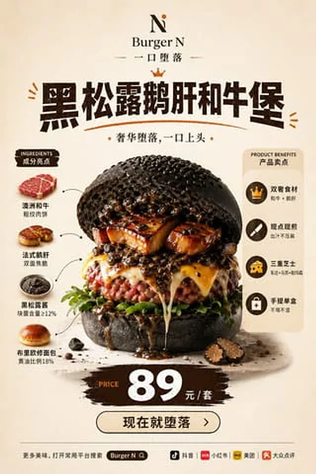

```text
Goal: Create a premium vertical restaurant launch poster for a decadent gourmet burger, branded as {argument name="brand name" default="Burger N"}, with a beige luxury food-ad background and realistic appetizing photography.

Canvas: Vertical poster, 3:4 ratio, warm cream paper texture background, centered composition, high-end casual dining aesthetic, black, dark brown, caramel orange, and cream color palette.

Top branding: At the top center place a minimalist black “N” logo with a small orange dot, then the brand text “Burger N”, then the Chinese tagline “一口堕落” with thin orange divider strokes. Below it add a tiny crown icon above the main headline.

Main headline: Large bold distressed Chinese display type across the upper middle: {argument name="headline text" default="黑松露鹅肝和牛堡"}. Underline it with a curved orange brush stroke and add small orange decorative burst marks on both sides. Beneath the headline add the subheading “奢华堕落，一口上头” with two small orange stars.

Main food subject: Center a huge hyper-realistic black truffle foie gras wagyu burger. Use a matte charcoal-black bun with black sesame seeds, thick glossy seared foie gras slabs, chunky black truffle sauce dripping heavily, melted yellow cheese stretching downward, a juicy coarse-ground wagyu beef patty with pink-red texture, leafy greens, and a dark bottom bun. Put truffle crumbs, peppercorns, sauce splashes, and sliced black truffle pieces around the base. Lighting should be soft studio food photography, glossy highlights, shallow depth of field, very appetizing and premium.

Left ingredients column: Add exactly 4 ingredient callouts on the left under a dark rounded label that says “INGREDIENTS / 成分亮点”. Each callout has a small realistic ingredient image, a dotted curved pointer line toward the burger, and Chinese text. The 4 callouts are: 1) marbled raw wagyu steak labeled “澳洲和牛 / 粗绞肉饼”; 2) seared foie gras medallions labeled “法式鹅肝 / 双面焦脆”; 3) black truffle sauce bowl labeled “黑松露酱 / 块菌含量≥12%”; 4) glossy brioche-style bun labeled “布里欧修面包 / 黄油比例18%”.

Right benefits panel: Add a rounded vertical cream card on the right titled “PRODUCT BENEFITS / 产品卖点”. Include exactly 4 stacked benefit rows with circular dark icons and Chinese copy: 1) crown icon, “双奢食材 / 和牛 + 鹅肝”; 2) spatula or knife icon, “现点现煎 / 出汁不压扁”; 3) cheese icon, “三重芝士 / 车达+马苏+帕森”; 4) takeout box icon, “手提单盒 / 不塌不湿”.

Price and CTA: Near the lower center place a dark brown rough brush-stroke price banner. On it write small orange “PRICE” and a huge white price {argument name="price" default="89"}, followed by “元 / 套”. Below, add a rounded outlined call-to-action button with bold Chinese text {argument name="call to action" default="现在就堕落"} and a right arrow.

Footer: Add a thin horizontal line, then small Chinese footer text: “更多美味，打开常用平台搜索”. Add a dark search pill reading “Burger N” with a magnifying-glass icon, followed by exactly 5 platform badges/icons labeled: 抖音, 小红书, 美团, 大众点评, and one small orange dining-app style icon. Keep all footer elements small and aligned along the bottom.

Visual style: Premium Chinese food advertising poster, realistic product photography blended with clean graphic design, strong central hero food, crisp typography, subtle paper grain, tasteful shadows, no people, no extra objects beyond the listed ingredients, icons, and text.
```

Model: GPT Image 2
Author: Larus Canus

[ProjectD](https://aitoolsradar.com/en/prompts/bd8839f9ee7d05) · [Recorded source](https://youmind.com/prompts/truffle-wagyu-burger-poster-21426)
 · [Full original metadata and byte evidence](data/projectd-batch-0038.json)

## Luxury University Co-Branded Gift Poster

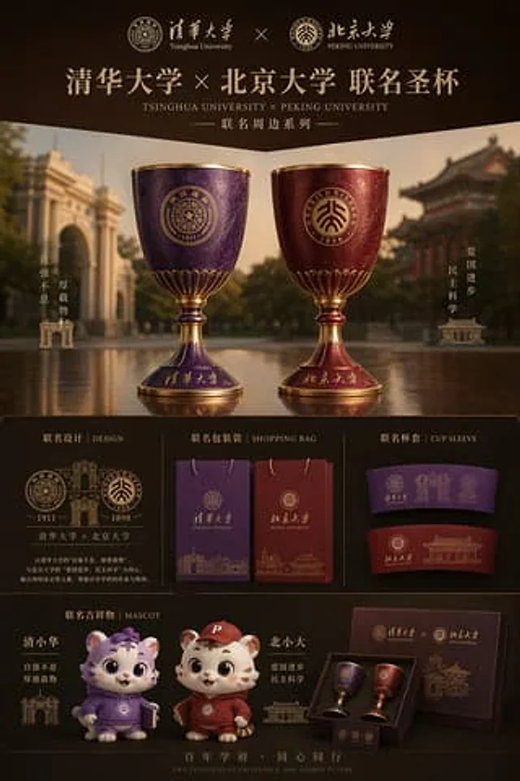

```text
{
  "type": "High-end co-branded product poster",
  "theme": "Top University Collaboration Commemorative Gift Series",
  "style": "A high-quality brand project integrating graphic design, product visualization, mascot IP design, and packaging mockups.",
  "colorPalette": {
    "primary": [
      "Dark brown",
      "Dark gold",
      "Royal Purple",
      "Oxblood Red"
    ],
    "finish": "Metallic gold leaf, embossed texture, gloss reflection"
  },
  "text": {
    "topLogos": [
      "Tsinghua University",
      "Tsinghua University",
      "Beijing University",
      "PEKING UNIVERSITY"
    ],
    "mainHeadline": "{argument name=\"headline text\" default=\"Tsinghua University x Peking University Joint Holy Grail\"}",
    "subheadline": "TSINGHUA UNIVERSITY × PEKING UNIVERSITY",
    "seriesLine": "Collaboration Merchandise Series",
    "bottomTagline": "A Century-Old University, Moving Forward Together",
    "bottomEnglish": "TWO CENTURIES OF EXCELLENCE, ONE SHARED FUTURE"
  },
  "layout": {
    "format": "Vertical poster",
    "background": "A deep, warm brown gradient, complemented by elegant dark corners, symmetrical composition, and delicate gold dividing lines.",
    "sections": [
      {
        "title": "Core Product Showcase",
        "position": "Upper Middle",
        "count": 2,
        "labels": [
          "Tsinghua Holy Grail",
          "Peking University Holy Grail"
        ]
      },
      {
        "title": "Collaboration Design | DESIGN",
        "position": "Bottom left",
        "count": 3,
        "labels": [
          "Combination circular logo",
          "Tsinghua University gate line icon",
          "Peking University gate line icon"
        ]
      },
      {
        "title": "Collaboration Packaging Bag | SHOPPING BAG",
        "position": "Shimonaka",
        "count": 2,
        "labels": [
          "Purple shopping bag",
          "Red shopping bag"
        ]
      },
      {
        "title": "Collaboration Cup Sleeve | CUP SLEEVE",
        "position": "Bottom right",
        "count": 2,
        "labels": [
          "Purple cup sleeve",
          "Red cup sleeve"
        ]
      },
      {
        "title": "Collaboration Mascot | MASCOT",
        "position": "Bottom left to center",
        "count": 2,
        "labels": [
          "Qing Xiaohua",
          "Beixiaoda"
        ]
      },
      {
        "title": "Gift Box Set",
        "position": "Bottom right",
        "count": 3,
        "labels": [
          "Gift box containing 2 Holy Grails",
          "Closed outer box",
          "Inner tray"
        ]
      }
    ],
    "countTotalDiscreteProducts": 14
  },
  "hero": {
    "scene": "Two magnificent chalices are placed side by side on a reflective surface, with a softly blurred campus landscape as the background.",
    "backgroundElements": {
      "count": 2,
      "labels": [
        "The solemn light-colored stone school gate on the left",
        "The teaching building on the right is in the style of a traditional Chinese pavilion."
      ]
    },
    "products": [
      {
        "name": "Tsinghua Holy Grail",
        "position": "left",
        "bodyColor": "{argument name=\"left cup color\" default=\"Royal Purple\"}",
        "material": "Textured enamel with gold-plated metal handle and rim",
        "details": [
          "The cup features a round Tsinghua University emblem.",
          "Exquisite brocade texture",
          "Gold fan-shaped decoration above the cup handle",
          "The base is engraved with the Chinese characters 'Tsinghua University'."
        ]
      },
      {
        "name": "Peking University Holy Grail",
        "position": "right",
        "bodyColor": "{argument name=\"right cup color\" default=\"Oxblood Red\"}",
        "material": "Textured enamel with gold-plated metal handle and rim",
        "details": [
          "The cup is round with the Peking University emblem.",
          "Exquisite brocade texture",
          "Gold fan-shaped decoration above the cup handle",
          "The base is engraved with the Chinese characters 'Peking University'."
        ]
      }
    ],
    "sideMottos": {
      "left": {
        "count": 2,
        "labels": [
          "Strive for self-improvement",
          "Great virtue carries all things"
        ]
      },
      "right": {
        "count": 2,
        "labels": [
          "Patriotism and Progress",
          "Democracy and Science"
        ]
      }
    },
    "lighting": "Directional lighting, similar to warm sunlight, with luxurious highlights and soft shadows."
  },
  "designPanel": {
    "emblems": {
      "count": 2,
      "labels": [
        "Tsinghua University Emblem (1911)",
        "Peking University emblem, 1898"
      ]
    },
    "architectureIcons": {
      "count": 2,
      "labels": [
        "Tsinghua University gate illustration",
        "Peking University gate illustration"
      ]
    },
    "connector": "Tsinghua University × Peking University",
    "bodyText": "A concise descriptive text in Chinese elucidates the academic spirit of collaboration and sharing."
  },
  "shoppingBags": {
    "count": 2,
    "items": [
      {
        "color": "Purple",
        "branding": "Golden Tsinghua University emblem and campus line drawing"
      },
      {
        "color": "red",
        "branding": "Golden Peking University emblem and campus line drawing"
      }
    ]
  },
  "cupSleeves": {
    "count": 2,
    "items": [
      {
        "color": "Purple",
        "graphics": "Gold logo and Tsinghua University gate line illustration"
      },
      {
        "color": "red",
        "graphics": "Gold logo and line drawing of Peking University gate"
      }
    ]
  },
  "mascots": {
    "style": "This high-end 3D Chibi-style plush tiger mascot features oversized, glossy eyes, soft fur, and a collectible toy-like scale.",
    "count": 2,
    "items": [
      {
        "name": "{argument name=\"left mascot name\" default=\"Qing Xiaohua\"}",
        "position": "left",
        "fur": "White with light purple stripes",
        "outfit": "Purple hoodie with school badge",
        "accessories": "Purple flower on its head, a small book in its paws"
      },
      {
        "name": "{argument name=\"right mascot name\" default=\"Beixiaoda\"}",
        "position": "right",
        "fur": "White with reddish-brown stripes",
        "outfit": "Red hoodie with school badge",
        "accessories": "A red hat with the letter P printed on it, and a small book in its paw."
      }
    ]
  },
  "giftSet": {
    "count": 2,
    "contents": [
      "Purple Grail",
      "Red Grail"
    ],
    "packaging": "A luxurious deep purple gift box, adorned with a gold-stamped co-branded logo, line drawings of campus architecture, and a custom lining."
  },
  "rendering": "Highly detailed commercial posters, perfect layout, realistic materials, superior product mockup quality, balanced symmetry, and exquisite advertising texture."
}
```

Model: GPT Image 2
Author: GPT Image 2 Prompts

[ProjectD](https://aitoolsradar.com/en/prompts/f1cac6996ff7be) · [Recorded source](https://x.com/Jackywine/status/2046603022365839777#reversed-0)
 · [Full original metadata and byte evidence](data/projectd-batch-0038.json)

## Luxury University Co-Branded Gift Poster


```text
{"type":"luxury collaborative merchandise poster","theme":"prestigious university co-branded commemorative gift series","style":"premium brand presentation board blending graphic design, product visualization, mascot IP design, and packaging mockup","colorPalette":{"primary":["deep brown","dark gold","royal purple","oxblood red"],"finish":"metallic gold foil, embossed textures, glossy reflections"},"text":{"topLogos":["清华大学","Tsinghua University","北京大学","PEKING UNIVERSITY"],"mainHeadline":"{argument name=\"headline text\" default=\"清华大学 × 北京大学 联名圣杯\"}","subheadline":"TSINGHUA UNIVERSITY × PEKING UNIVERSITY","seriesLine":"联名周边系列","bottomTagline":"百年学府 · 同心同行","bottomEnglish":"TWO CENTURIES OF EXCELLENCE, ONE SHARED FUTURE"},"layout":{"format":"vertical poster","background":"dark warm brown gradient with elegant vignette, symmetrical composition, thin gold divider lines","sections":[{"title":"hero product showcase","position":"upper center","count":2,"labels":["Tsinghua goblet","Peking goblet"]},{"title":"联名设计 | DESIGN","position":"lower left","count":3,"labels":["combined round emblem","Tsinghua gate line-art icon","Peking gate line-art icon"]},{"title":"联名包装袋 | SHOPPING BAG","position":"lower middle","count":2,"labels":["purple shopping bag","red shopping bag"]},{"title":"联名杯套 | CUP SLEEVE","position":"lower right","count":2,"labels":["purple cup sleeve","red cup sleeve"]},{"title":"联名吉祥物 | MASCOT","position":"bottom left to center","count":2,"labels":["清小华","北小大"]},{"title":"gift box set","position":"bottom right","count":3,"labels":["open box with 2 goblets","closed outer box","inner tray"]}],"countTotalDiscreteProducts":14},"hero":{"scene":"two ornate goblets standing side by side on a glossy reflective surface with a softly blurred campus backdrop","backgroundElements":{"count":2,"labels":["monumental pale stone university gate on the left","traditional Chinese pavilion-like academic building on the right"]},"products":[{"name":"Tsinghua goblet","position":"left","bodyColor":"{argument name=\"left cup color\" default=\"royal purple\"}","material":"textured enamel with gold metal stem and rim","details":["circular Tsinghua University emblem on bowl","subtle brocade pattern","gold scalloped ornament above stem","Chinese characters on base reading 清华大学"]},{"name":"Peking goblet","position":"right","bodyColor":"{argument name=\"right cup color\" default=\"oxblood red\"}","material":"textured enamel with gold metal stem and rim","details":["circular Peking University emblem on bowl","subtle brocade pattern","gold scalloped ornament above stem","Chinese characters on base reading 北京大学"]}],"sideMottos":{"left":{"count":2,"labels":["自强不息","厚德载物"]},"right":{"count":2,"labels":["爱国进步","民主科学"]}} ,"lighting":"warm sunset-like directional light with luxurious highlights and soft shadows"},"designPanel":{"emblems":{"count":2,"labels":["1911 Tsinghua emblem","1898 Peking emblem"]},"architectureIcons":{"count":2,"labels":["Tsinghua gate illustration","Peking gate illustration"]},"connector":"清华大学 × 北京大学","bodyText":"small Chinese descriptive copy explaining the collaboration and shared academic spirit"},"shoppingBags":{"count":2,"items":[{"color":"purple","branding":"Tsinghua University logo and campus line-art in gold"},{"color":"red","branding":"Peking University logo and campus line-art in gold"}]},"cupSleeves":{"count":2,"items":[{"color":"purple","graphics":"gold logos and Tsinghua gate line illustration"},{"color":"red","graphics":"gold logos and Peking gate line illustration"}]},"mascots":{"style":"high-end 3D chibi plush-like tiger mascots with oversized glossy eyes, soft fur, and collectible toy proportions","count":2,"items":[{"name":"{argument name=\"left mascot name\" default=\"清小华\"}","position":"left","fur":"white with lavender stripes","outfit":"purple hoodie with university emblem","accessories":"purple flower on head, small book in paw"},{"name":"{argument name=\"right mascot name\" default=\"北小大\"}","position":"right","fur":"white with red-brown stripes","outfit":"red hoodie with university emblem","accessories":"red cap with letter P, small book in paw"}]},"giftSet":{"count":2,"contents":["purple goblet","red goblet"],"packaging":"luxury deep purple presentation box with gold-foil co-branding, campus architecture line art, and fitted insert"},"rendering":"ultra-detailed commercial poster, immaculate typography, realistic materials, premium product mockup quality, balanced symmetry, polished advertising finish"}
```

Model: GPT Image 2
Author: Jackywine

[ProjectD](https://aitoolsradar.com/en/prompts/c33712da91a866) · [Recorded source](https://youmind.com/prompts/tsinghua-peking-goblet-poster-14671)
 · [Full original metadata and byte evidence](data/projectd-batch-0038.json)

## Luxury Watch Technical Poster

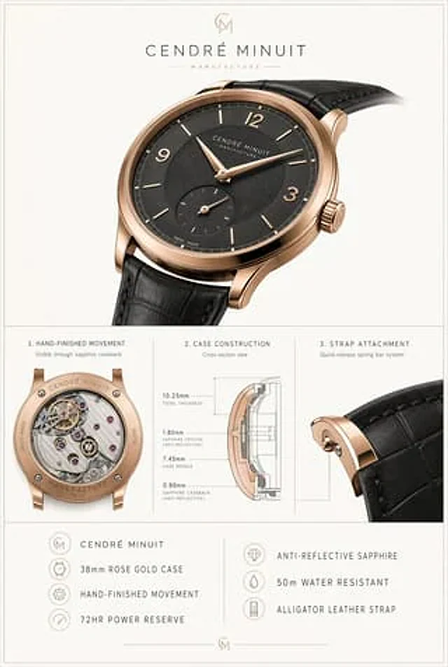

```text
{
  "type": "Luxury watch product specifications poster",
  "brand": {
    "name": "{argument name=\"brand name\" default=\"CENDRÉ MINUIT\"}",
    "tagline": "MANUFACTURE",
    "monogram": "CM"
  },
  "subject": {
    "product": "dress watch",
    "case": {
      "diameter": "{argument name=\"case size\" default=\"38mm\"}",
      "material": "{argument name=\"case material\" default=\"Rose gold\"}",
      "finish": "High-gloss warm rose gold tone",
      "shape": "A round, ultra-thin case with elegant curved lugs.",
      "crown": "Grooved crown with engraved brand name"
    },
    "dial": {
      "color": "{argument name=\"dial color\" default=\"charcoal black\"}",
      "style": "Minimalist fan-shaped textured dial",
      "markers": {
        "count": 10,
        "details": "It features 8 slender bar-shaped scales, with Arabic numerals at the 12, 3, and 9 o'clock positions, and no scale at the 6 o'clock position due to the small seconds dial."
      },
      "hands": "Leaf-shaped rose gold hour and minute hands",
      "subdials": {
        "count": 1,
        "type": "6 o'clock position small seconds dial"
      },
      "text": [
        "CENDRÉ MINUIT",
        "MANUFACTURE",
        "SWISS MADE"
      ]
    },
    "strap": {
      "material": "{argument name=\"strap material\" default=\"Black crocodile skin\"}",
      "color": "black",
      "attachment": "Quick-release spring ear system"
    },
    "movement": {
      "type": "Mechanical hand-polishing mechanism",
      "visible_caseback": true,
      "power_reserve": "72 hours"
    }
  },
  "layout": {
    "background": "Soft warm gray, the canvas is surrounded by a thin double-line border.",
    "orientation": "Vertical poster",
    "sections": [
      {
        "title": "Main visual product image",
        "position": "top",
        "count": 1,
        "labels": [
          "Main watch"
        ]
      },
      {
        "title": "1. Hand-polished movement",
        "position": "center left",
        "count": 1,
        "labels": [
          "Visible through the sapphire crystal case back"
        ]
      },
      {
        "title": "2. Case structure",
        "position": "Zhong Zhong",
        "count": 1,
        "labels": [
          "Cross-sectional view",
          "Total thickness 10.25mm",
          "1.80mm sapphire crystal glass (anti-reflective)",
          "7.45mm case frame",
          "0.90mm sapphire crystal case back (anti-reflective)"
        ]
      },
      {
        "title": "3. Watch strap connection",
        "position": "center right",
        "count": 1,
        "labels": [
          "Quick-release spring ear system"
        ]
      },
      {
        "title": "Left-side function list",
        "position": "Bottom left",
        "count": 4,
        "labels": [
          "CENDRÉ MINUIT",
          "38mm rose gold case",
          "Hand-polished movement",
          "72-hour power reserve"
        ]
      },
      {
        "title": "Right-hand function list",
        "position": "Bottom right",
        "count": 3,
        "labels": [
          "Anti-reflective sapphire glass",
          "50-meter waterproof",
          "Alligator leather watch strap"
        ]
      }
    ],
    "dividers": "Thin gray vertical and horizontal lines divide the areas."
  },
  "visual_style": {
    "look": "High-end Swiss watch advertisements and technical specifications",
    "lighting": "Soft studio lighting creates realistic metallic reflections and subtle shadows.",
    "camera": "The main watch is presented in a large, three-quarter view, slightly tilted to the right, with the strap extending beyond the frame; the lower section displays detailed macro close-ups.",
    "typography": "Exquisite uppercase luxury sans-serif font with ample letter spacing",
    "render_quality": "Photorealistic quality, high-end catalog quality, precise engraving details, lifelike leather texture, and clear technical diagram lines."
  }
}
```

Model: GPT Image 2
Author: GPT Image 2 Prompts

[ProjectD](https://aitoolsradar.com/en/prompts/37caf585b109f9) · [Recorded source](https://x.com/AllaAisling/status/2047011543548932582#reversed-0)
 · [Full original metadata and byte evidence](data/projectd-batch-0038.json)

## Luxury Water Bottle Product Photography

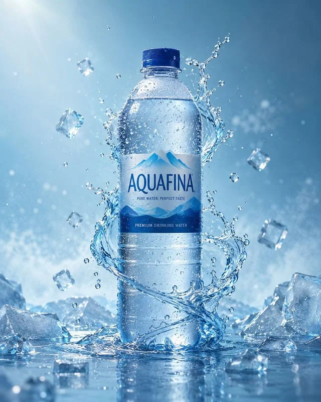

```text
Ultra-realistic luxury commercial product photography of a premium transparent water bottle standing upright on a glossy reflective surface. The bottle is covered with tiny cold water droplets, symbolizing freshness. A dramatic splash of crystal-clear water wraps around the bottle in a dynamic spiral. Background features cool icy blue gradients with soft white lighting, floating ice cubes, light mist, and subtle glowing particles. High-end studio lighting with cinematic rim light, premium advertising style, sharp focus, ultra-detailed, photorealistic, 8K, clean composition, luxury beverage campaign, minimalistic yet eye-catching, plenty of copy space for branding and text. Ultra-realistic luxury commercial product photography of the same premium transparent water bottle standing upright on a reflective wet surface. The bottle is covered with fresh condensation droplets. A powerful splash of crystal-clear water rises around the bottle with small floating bubbles. Background features refreshing aqua green and turquoise gradients with soft sunlight rays, tropical leaves slightly blurred in the distance, fresh mist, and glowing highlights. High-end commercial studio lighting, cinematic product advertisement, ultra-detailed, photorealistic, 8K, elegant composition, premium hydration campaign, minimal branding space, vibrant yet clean aesthetic.
```

Model: GPT Image 2
Author: Zyro

[ProjectD](https://aitoolsradar.com/en/prompts/53789e339a537c) · [Recorded source](https://youmind.com/prompts/luxury-water-bottle-product-photography-27170)
 · [Full original metadata and byte evidence](data/projectd-batch-0038.json)

## Luxury x E-commerce Split Poster

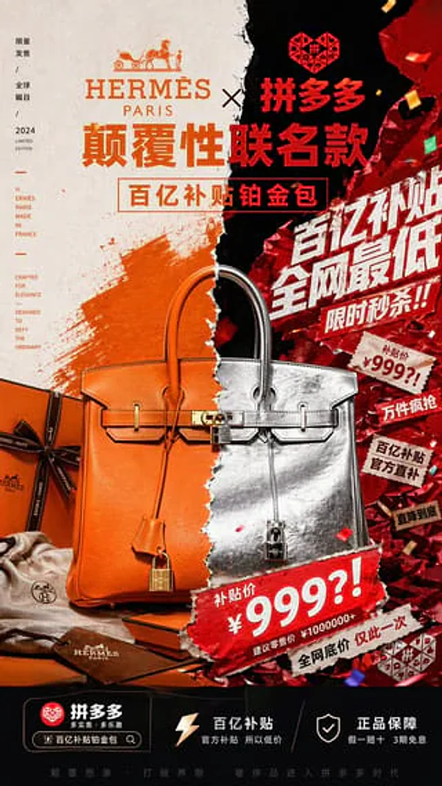

```text
Create a 9:16 vertical luxury marketing poster to showcase a fictional crossover product, namely {argument name="brand one" default="HERMÈS PARIS"} and{argument name="brand two" default="Pinduoduo"} This is a highly subversive collaborative handbag advertisement. The composition employs a striking collage style, with a vertical tear in the paper running through the center of the image, dividing two conflicting aesthetics in two: the left side presents a refined high-end luxury brand style, using Hermès orange and cream-colored paper and elegant editorial minimalism; the right side adopts an aggressive Chinese e-commerce promotional style, based on black and metallic red foil, with eye-catching promotional graphics, confetti, torn stickers, and explosive discount fonts. At the top center, both brands are prominently displayed, accompanied by a striking Chinese collaboration headline; the left logo area presents a classic luxury brand style, using serif fonts and a carriage logo, while the right logo area adopts a striking red Chinese brand style. A large Chinese main headline is added below:{argument name="headline text" default="revolutionary collaboration"} and a bordered subtitle:{argument name="subheadline text" default="10 Billion Yuan Subsidy Platinum Pack"} At the center of the image is a Birkin-style luxury handbag, facing forward and enormous in size, perfectly centered but divided in two by a tear in the middle: the left half is orange pebbled leather with gold hardware, and the right half is wrinkled metallic silver leather with silver hardware, the two halves seamlessly merging into a surreal handbag. Around or above the handbag should be five clearly visible accessory/product elements: an orange keychain hanging on the left, a locked metallic silver strap on the right, a central rotating clasp and padlock, an orange Hermès-style gift box with a dark ribbon in the lower left corner, and a beige dust bag with a small logo near the lower left corner. To the left rear of the handbag are oil-painting-like orange brushstrokes on textured cream paper; to the right rear of the handbag is a crushed red metallic wrapping paper surface with sparkling highlights and falling paper scraps. On the right side, eight aggressive promotional text highlights and stickers are added, arranged diagonally like a shopping festival poster: one huge white Chinese banner reading "Billions in Subsidies, Lowest Price Online," two "Limited-Time Flash Sale!!", three price-tear stickers reading "Subsidized Price ¥999?!", four "Tens of Thousands of Items Sold Out," five "Billions in Subsidies, Official Direct Subsidy," six "Lowest Price Ever," seven large price-tear banners repeating "Subsidized Price ¥999?!" at the bottom, and eight smaller prints reading "Suggested Retail Price ¥1,000,000+." On the left edge, a thin, vertically edited text column containing four grouped text blocks is added, featuring a luxurious layout: one "Limited Release / Global Attention / 2024 LIMITED EDITION," two "HERMÈS PARIS MADE IN FRANCE," three "CRAFTED FOR ELEGANCE," and four "DESIGNED TO DEFY THE ORDINARY." Create a black, app-style information bar at the bottom, containing three functional blocks from left to right: a red brand icon with the words "Pinduoduo," a search bar-style capsule button containing "10 Billion Yuan Subsidy Platinum Bag," two areas with lightning bolt icons and the text "10 Billion Yuan Subsidy Official Subsidy, So Low Price," and three areas with shield icons and the text "Authenticity Guaranteed, Tenfold Compensation for Fakes, 3-Month Interest-Free Installments." Add a small Chinese final slogan at the very bottom. Utilize ultra-refined commercial product photography, high-end graphic design, sharp lighting, embossed textures, foil reflections, paper tearing effects, and strong depth of field. The overall atmosphere must resemble a top art director forcefully merging traditional luxury advertising with chaotic discount promotional posters, creating extreme visual tension, irony, and a high-impact contrast.
```

Model: GPT Image 2
Author: GPT Image 2 Prompts

[ProjectD](https://aitoolsradar.com/en/prompts/1a6217ba2926e3) · [Recorded source](https://x.com/ajie_run_CL/status/2046787747764187211#reversed-1)
 · [Full original metadata and byte evidence](data/projectd-batch-0038.json)

## 𝐌 #115

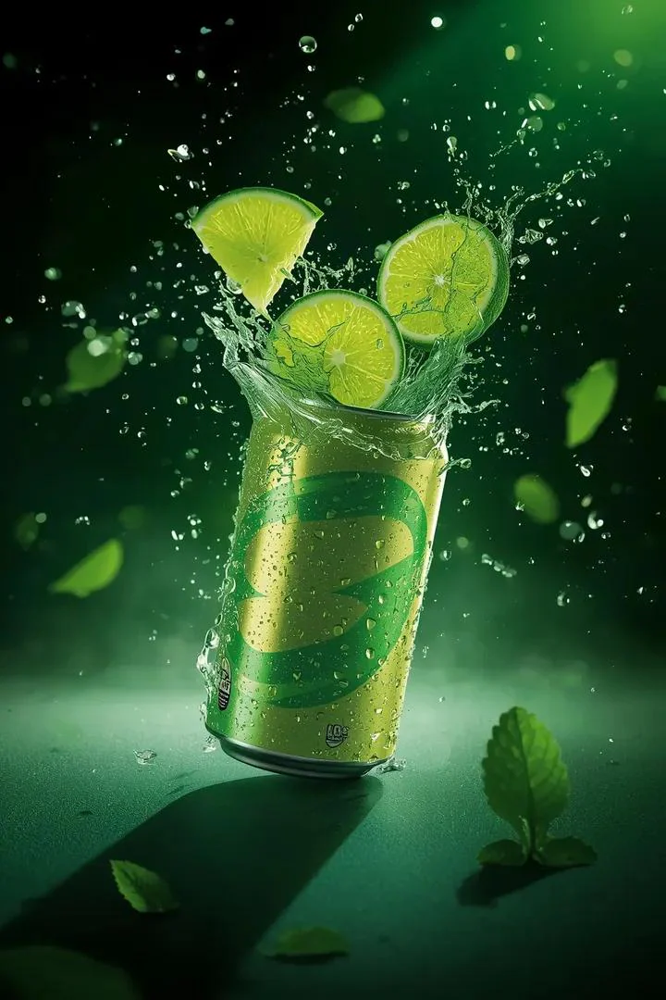

```text
- Ultra-cinematic beverage advertising shot of a sparkling lime soda can, captured from a low three-quarter angle with the camera positioned slightly below the product for a heroic, powerful perspective; the can appears partially torn open as vivid lime wedges explode outward in slow motion, frozen mid-air with high-energy splashes of neon-green liquid and micro droplets; intense backlighting makes the citrus flesh glow translucently while sharp rim light outlines
```

Model: GPT Image 2
Author: 𝐌

[ProjectD](https://aitoolsradar.com/en/prompts/6171c1aa12fa29) · [Recorded source](https://x.com/Strength04_X/status/2011078719734235390)
 · [Full original metadata and byte evidence](data/projectd-batch-0038.json)

## 𝐌 #168

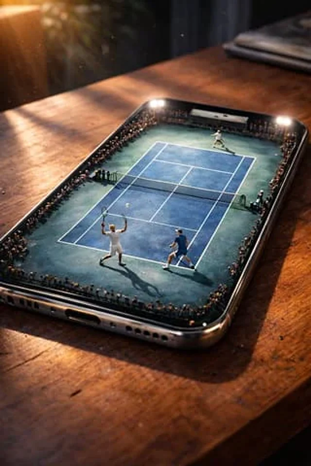

```text
{
  "type": "image_generation",
  "style": "ultra_realistic_cinematic",
  "aspect_ratio": "3:4",
  "resolution": "8K",
  "camera": {
    "model": "DSLR",
    "lens": "50mm",
    "angle": "dynamic slight tilt, courtside perspective",
    "depth_of_field": "shallow",
    "focus": "sharp on phone and players, soft background blur"
  },
  "scene": {
    "subject": "smartphone lying on a wooden table",
    "concept": "phone screen transformed into a professional tennis court",
    "court_surface": "pristine blue hardcourt with fine scratches and chalk marks",
    "players": "miniature tennis players serving, volleying, diving for shots",
    "scale": "realistic miniature proportions"
  },
  "lighting": {
    "type": "dramatic directional lighting",
    "source": "stadium-style lights from the side",
    "effect": "strong highlights and long shadows",
    "reflection": "soft reflection of floodlights on phone glass"
  },
  "details": {
    "phone_surface": [
      "visible fingerprints",
      "subtle smudges",
      "micro scratches on edges"
    ],
    "atmosphere": [
      "floating dust particles",
      "light haze for depth"
    ],
    "textures": "hyper-detailed court surface, realistic materials"
  },
  "environment": {
    "table": "natural wood with grain texture",
    "background": "softly blurred, cinematic indoor setting"
  },
  "color_grading": {
    "palette": "vibrant yet natural",
    "contrast": "high but balanced",
    "tone": "cinematic realism"
  },
  "aesthetic": {
    "mood": "dynamic, energetic, premium sports visual",
    "style": "high-end sports advertisement"
  },
  "render_quality": {
    "sharpness": "ultra-crisp",
    "detail_level": "extreme",
    "photorealism": "DSLR-grade realism"
  }
}
```

Model: GPT Image 2
Author: 𝐌

[ProjectD](https://aitoolsradar.com/en/prompts/d97be8e9741308) · [Recorded source](https://x.com/Strength04_X/status/2006986719590248769)
 · [Full original metadata and byte evidence](data/projectd-batch-0038.json)

## 𝐌 #259

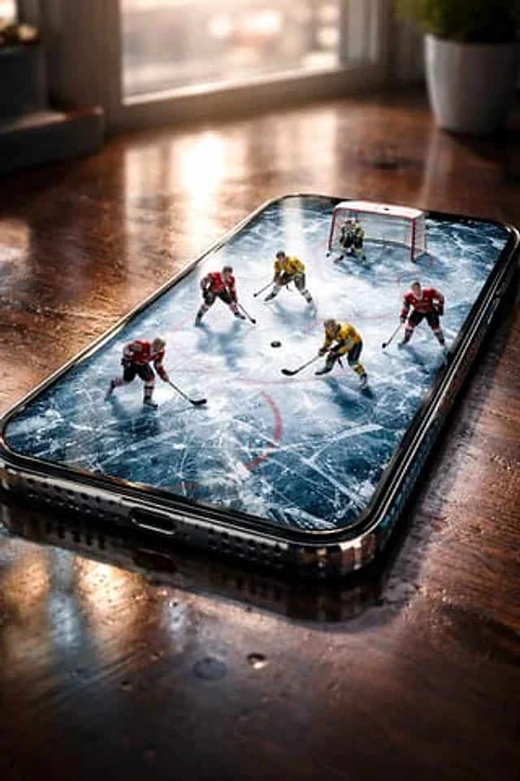

```text
Create a hyper-realistic, stylish vertical poster featuring a smartphone lying on a table, transformed into a hockey rink. The screen resembles cracked ice with deep fissures, while tiny hockey players compete in an intense game Use diffused daylight with elegant reflections and refractions to enhance depth. Add realistic details like fingerprints, smudges, and subtle scratches on the phone's surface for authenticity. Craft a dynamic perspective with an intriguing camera angle-slightly tilted for dramatic effect. The image should look like a high-quality DSLR photograph, with sharp focus, rich textures, and cinematic lighting to amplify the surreal yet lifelike atmosphere
```

Model: GPT Image 2
Author: 𝐌

[ProjectD](https://aitoolsradar.com/en/prompts/629d2e4af66f84) · [Recorded source](https://x.com/Strength04_X/status/2007711515458318421)
 · [Full original metadata and byte evidence](data/projectd-batch-0038.json)

## 𝐌 #292

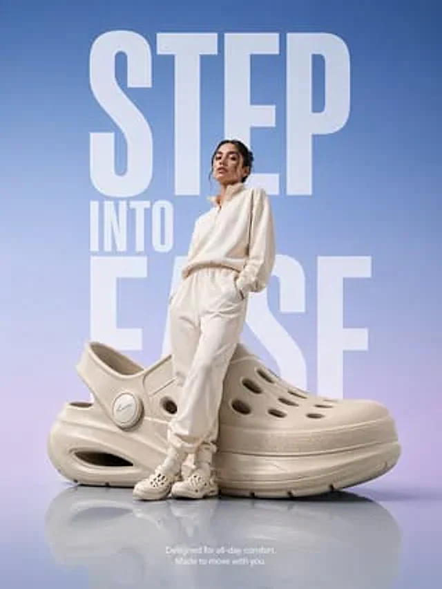

```text
A hyper-realistic premium product advertisement featuring an oversized futuristic comfort clog placed on a smooth glossy reflective floor. A modern model dressed in soft neutral-toned athleisure (off-white / beige) stands slightly leaning against the giant shoe with a relaxed, confident posture.

Background: clean gradient blending soft sky blue into subtle lavender tones, with massive bold typography in the background reading “STEP INTO EASE” in a modern sans-serif font, stretched vertically and partially behind the subject.

Lighting: high-end studio lighting with soft highlights, gentle reflections on the floor, and subtle rim light outlining the model and product for depth.

Composition: editorial magazine layout, perfectly centered subject, strong negative space, luxury branding feel.

Additional text (small, minimal placement at bottom): “Designed for all-day comfort. Made to move with you.”

Style: ultra-clean, Apple-style minimalism meets fashion campaign, hyper-realistic, premium commercial photography, 8K, sharp details.
```

Model: GPT Image 2
Author: 𝐌

[ProjectD](https://aitoolsradar.com/en/prompts/d4cc6ae3e94156) · [Recorded source](https://x.com/Strength04_X/status/2047729312384901449)
 · [Full original metadata and byte evidence](data/projectd-batch-0038.json)

## 𝐌 #36

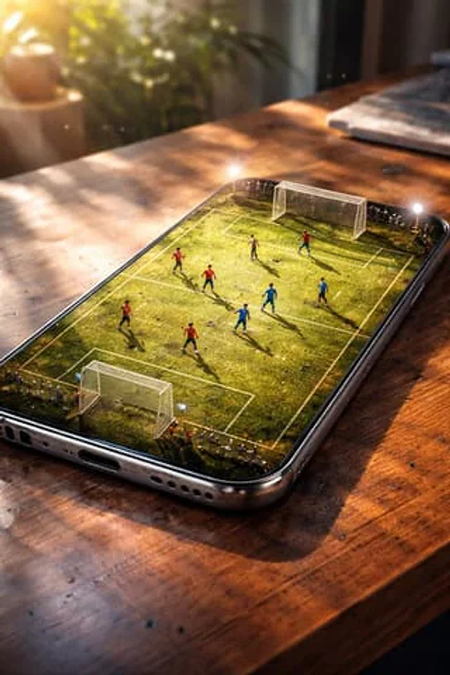

```text
{
  "type": "image_generation",
  "style": "hyper_realistic",
  "quality": "8K DSLR",
  "aspect_ratio": "4:5",
  "camera": {
    "angle": "slightly tilted cinematic perspective",
    "lens": "50mm DSLR",
    "depth_of_field": "shallow",
    "focus": "smartphone and football action"
  },
  "scene": {
    "setting": "smartphone placed on a wooden table",
    "concept": "phone screen transformed into a miniature football stadium",
    "environment": "indoor, soft daylight coming from the side",
    "atmosphere": "cinematic, immersive, realistic"
  },
  "details": {
    "screen": "weathered green football pitch with visible wear, dirt patches, and grass texture",
    "players": "miniature football players actively playing a match with dynamic poses",
    "lighting": "soft diffused daylight with subtle lens flares and realistic reflections",
    "realism_effects": [
      "fingerprints on screen",
      "light scratches on phone body",
      "natural smudges",
      "micro dust particles"
    ]
  },
  "materials": {
    "phone": "metallic frame with realistic reflections",
    "table": "textured wooden surface with warm tones"
  },
  "mood": "high-end cinematic, dramatic, premium advertising look",
  "rendering": {
    "sharpness": "ultra sharp",
    "texture_detail": "extreme",
    "lighting_quality": "studio grade",
    "photorealism": true
  }
}
```

Model: GPT Image 2
Author: 𝐌

[ProjectD](https://aitoolsradar.com/en/prompts/cb49abc88be974) · [Recorded source](https://x.com/Strength04_X/status/2006679801256656925)
 · [Full original metadata and byte evidence](data/projectd-batch-0038.json)

## 𝐌 #78

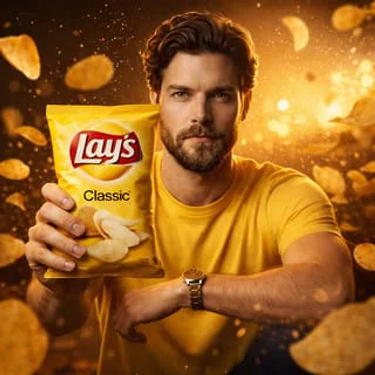

```text
A cinematic, ultra-realistic advertising shot of a man holding a Lay’s [FLAVOR NAME] chips packet in his hand.
The packet color, branding, and typography are perfectly accurate to Lay’s official design.
The man’s outfit color, texture, and style match the packet theme (same color palette and mood), modern and stylish, premium fashion look.
His pose is confident and natural, hand clearly gripping the Lay’s packet in the foreground.
Background environment matches the flavor theme

spices, ingredients, atmosphere, and lighting inspired by the flavor (for example: fiery spices for masala, fresh greens for sour cream, smoky tones for barbecue).

Chips are flying in slow motion around the scene with realistic motion blur and seasoning particles in the air.

Dramatic golden-hour lighting, cinematic depth of field, sharp focus on the packet, soft background bokeh.

Hyper-realistic textures, commercial food photography, high contrast, rich colors,

ultra-detailed, 8K quality, professional brand advertisement

style
```

Model: GPT Image 2
Author: 𝐌

[ProjectD](https://aitoolsradar.com/en/prompts/46a35e9943ade8) · [Recorded source](https://x.com/Strength04_X/status/2012780826715619644)
 · [Full original metadata and byte evidence](data/projectd-batch-0038.json)

## 𝐌 #85

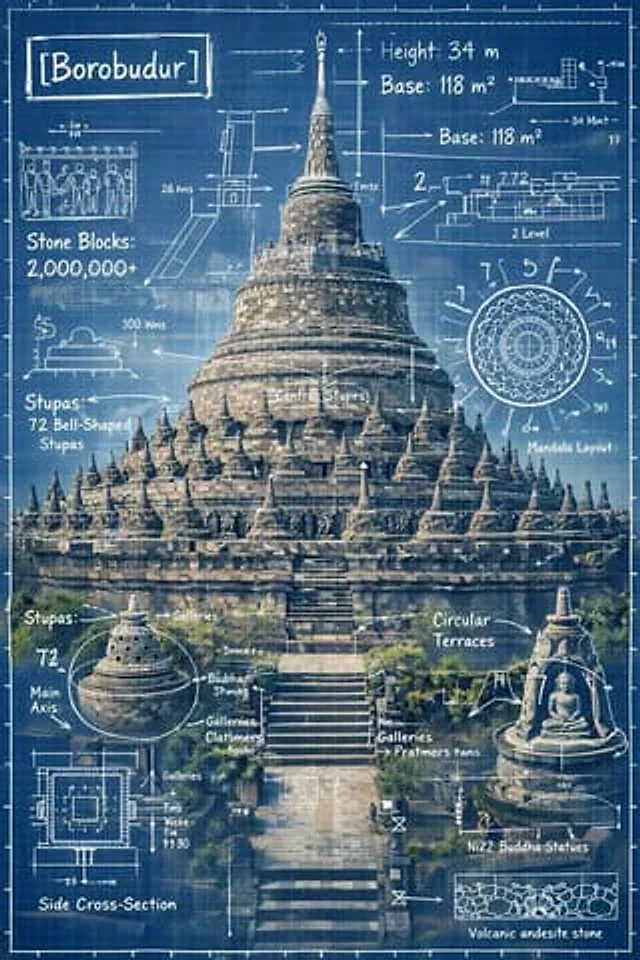

```text
Create an infographic image of [LANDMARK], combining a real photograph of the landmark with blueprint-style technical annotations and diagrams overlaid on the image. Include the title “[LANDMARK]” in a hand-drawn box in the corner. Add white chalk-style sketches showing key structural data, important measurements, material quantities, internal diagrams, load-flow arrows, cross-sections, floor plans, and notable architectural or engineering features. Style: blueprint aesthetic with white line drawings on the photograph, technical/architectural annotation style, educational infographic feel, with the real environment visible behind the annotations.
```

Model: GPT Image 2
Author: 𝐌

[ProjectD](https://aitoolsradar.com/en/prompts/05708b7f6dbfad) · [Recorded source](https://x.com/Strength04_X/status/2008190630317764651)
 · [Full original metadata and byte evidence](data/projectd-batch-0038.json)

## Ma Chao Historical Cavalry Timeline Poster

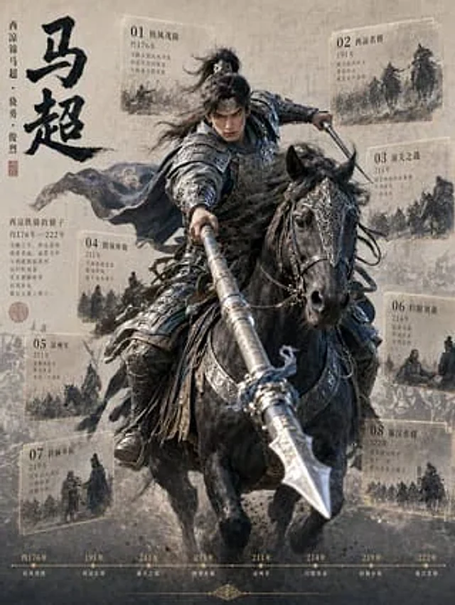

```text
Goal: Create a vertical historical hero infographic poster about {argument name="character name" default="马超"}, a fierce ancient Chinese cavalry general, combining cinematic fantasy realism with an antique manuscript timeline design.

Canvas: Portrait 3:4 poster, aged beige parchment background with faint map lines, battle sketches, dust, ink wash texture, and subtle sepia-gray atmosphere. High-detail digital painting / cinematic historical concept art, dramatic depth of field, gritty battlefield energy.

Main subject: Center composition shows {argument name="character name" default="马超"} charging forward on a powerful black warhorse. The rider wears ornate dark silver lamellar armor with engraved patterns, layered pauldrons, leather straps, flowing dark cloak, and a high tied topknot with loose windblown hair. His face is partially covered by a centered dark rectangular censor/blur block. He thrusts a long silver spear directly toward the viewer, creating strong foreshortening; the spear tip dominates the lower-right foreground. The black horse has elaborate metal head armor, reins, ornamental tack, flared nostrils, and galloping motion with dust and debris underfoot.

Left title area: Large vertical black Chinese calligraphy reading {argument name="main calligraphy title" default="马超"} along the upper-left side. Beside it, smaller vertical text reads “西凉锦马超 · 骁勇 · 俊烈” with a small red seal stamp beneath. Below, add a short Chinese biography block in small serif-style text beginning with “西凉铁骑的骄子” and mentioning “约176年—222年”; keep it visually authentic, compact, and slightly faded.

Timeline/event cards: Add exactly 8 translucent parchment cards around the rider, each with a thin pale-gold border, a large two-digit number, a Chinese title, a year, several tiny Chinese annotation lines, and a small monochrome ink-battle illustration. The 8 cards are:
1. “01 扶风茂陵”, year “约176年”, upper left of rider.
2. “02 西凉名将”, year “191年”, upper right.
3. “03 潼关之战”, year “211年”, mid right.
4. “04 割须弃袍”, year “211年”, lower left-center.
5. “05 凉州军”, year “211年”, lower left.
6. “06 归附刘备”, year “214年”, lower right-center.
7. “07 射鹤乡侯”, year “219年”, bottom left-center.
8. “08 蜀汉名将”, year “222年”, bottom right.

Bottom timeline: Along the bottom edge, create a thin horizontal gold timeline with exactly 8 marked dots and labels matching the same sequence and years: “约176年 扶风茂陵”, “191年 西凉名将”, “211年 潼关之战”, “211年 割须弃袍”, “211年 凉州军”, “214年 归附刘备”, “219年 射鹤乡侯”, “222年 蜀汉名将”. Add a small ornamental flourish centered below the line.

Visual style: Realistic Chinese historical war epic, antique museum-poster layout, muted beige, charcoal, steel blue, black, and pale gold palette. Use dust, torn-paper translucency, faint battlefield silhouettes, and ink-wash overlays. The central rider and horse should be sharp and dramatic, while background cards and maps are slightly faded.

Constraints: Use exactly 8 event cards and 8 bottom timeline markers. Keep all visible typography Chinese-style and integrated into the poster. No modern objects, no watermark, no logo, no extra characters in the foreground, no bright saturated colors.
```

Model: GPT Image 2
Author: Larus Canus

[ProjectD](https://aitoolsradar.com/en/prompts/c8a278e9014022) · [Recorded source](https://youmind.com/prompts/ma-chao-timeline-poster-20333)
 · [Full original metadata and byte evidence](data/projectd-batch-0038.json)

## Mac Terminal World Sim UI


```text
Show a{argument name="operating system" default="mac"} The desktop screenshot shows a large terminal window where actions are being performed, and the content is presented in a manner consistent with {argument name="topic" default="world sim"} Related expressive{argument name="interface type" default="TUI"} layout
```

Model: GPT Image 2
Author: GPT Image 2 Prompts

[ProjectD](https://aitoolsradar.com/en/prompts/12494bd760bf5b) · [Recorded source](https://x.com/fofrAI/status/2046603571286720769)
 · [Full original metadata and byte evidence](data/projectd-batch-0038.json)

## Mac Terminal World Sim UI

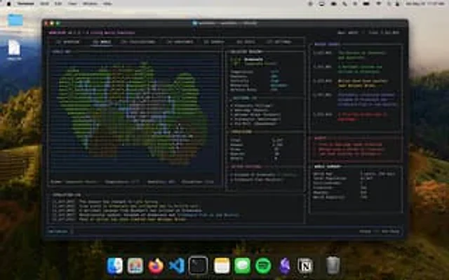

```text
show me a screenshot of a {argument name="operating system" default="mac"} desktop, large terminal window visible, doing something in the terminal with an expressive {argument name="interface type" default="TUI"} layout related to a {argument name="topic" default="world sim"}
```

Model: GPT Image 2
Author: fofr

[ProjectD](https://aitoolsradar.com/en/prompts/c4abeabc1ee209) · [Recorded source](https://youmind.com/prompts/mac-terminal-world-sim-tui-14385)
 · [Full original metadata and byte evidence](data/projectd-batch-0038.json)

## MacOS Kanban Review App UI

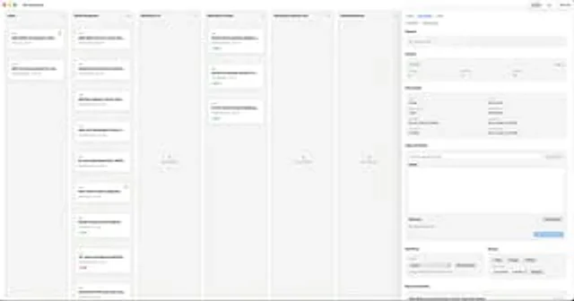

```text
{
  "type": "Desktop application UI model",
  "platform": "macOS",
  "style": "A clean, light-colored productivity dashboard with a soft gray background, rounded cards, subtle shadows, and fine dividing lines—a minimalist, modern SaaS aesthetic with a compact yet uncluttered layout.",
  "app": {
    "name": "ReviewBoard",
    "window_controls": "Top left macOS red, yellow, and green traffic light button"
  },
  "layout": {
    "structure": "A single widescreen application window, divided into 7 vertical columns and a right-side inspector panel.",
    "sections": [
      {
        "title": "Inbox",
        "position": "Leftmost column",
        "count": 2,
        "labels": [
          "Add wallet and reorder to the side...",
          "Add Tor proxy support to enable node..."
        ]
      },
      {
        "title": "Response required",
        "position": "Second column from the left",
        "count": 7,
        "labels": [
          "Add wallet to restore mnemonic phrase status...",
          "Implement transaction monitoring...",
          "Add Key Teleport receiving process...",
          "Add cove-keyteleport crate: K...",
          "Allow users to download its TAPSI...",
          "Function: Cache the receiving address...",
          "[Features] Custom block explorer"
        ]
      },
      {
        "title": "Waiting for CI",
        "position": "Third column",
        "count": 0,
        "labels": []
      },
      {
        "title": "Waiting for Codex",
        "position": "Fourth column",
        "count": 3,
        "labels": [
          "Detecting silent payment addresses...",
          "Extracting pi and pjs parameters from...",
          "Fixed the issue of truncation when pasting fiat currency amounts..."
        ]
      },
      {
        "title": "Waiting for manual testing",
        "position": "Fifth column",
        "count": 0,
        "labels": []
      },
      {
        "title": "Observation and Merging",
        "position": "Column 6",
        "count": 0,
        "labels": []
      },
      {
        "title": "Inspector",
        "position": "Rightmost sidebar",
        "count": 8,
        "labels": [
          "Signal",
          "examine",
          "PR context",
          "Tags and Notes",
          "Remark",
          "Blocking items",
          "Workflow",
          "Recent submissions"
        ]
      }
    ],
    "top_right_controls": {
      "count": 3,
      "labels": [
        "project",
        "List",
        "refresh"
      ]
    }
  },
  "board": {
    "column_style": "The tall, light gray Kanban aisle features title labels, miniature counting arrows, and a centrally located empty target within the aisle.",
    "cards": {
      "shape": "Small white rounded rectangle with subtle shadows and thin borders",
      "metadata": "The top left corner displays the issue or PR number, with a bold truncated title. Below are the author and date lines, and occasionally small colored status capsules (such as green Code or red Codex). Some cards have a tiny orange notification dot in the top right corner."
    }
  },
  "inspector": {
    "tabs": {
      "count": 3,
      "labels": [
        "Open",
        "Design required",
        "draft"
      ],
      "active": "Design required"
    },
    "signals": "An empty light gray panel displays text indicating no blocking signal.",
    "checks": {
      "summary": "The horizontal status card contains three columns: Pass, Pending, and Failed, with a total of 9 items displayed on the right.",
      "counts": {
        "Passing": 9,
        "Pending": 0,
        "Failing": 0
      }
    },
    "pr_context": {
      "fields": [
        "Baseline branch",
        "Head branch",
        "Merged status",
        "CI Approval",
        "Cleaned",
        "Last request",
        "Update time",
        "April 21, 2026, 2:36 PM",
        "Last post",
        "April 20, 2026, 2:03 PM",
        "SHA",
        "a7c48b5a"
      ]
    },
    "tags_and_notes": {
      "elements": 3,
      "labels": [
        "Comma-separated tags",
        "Save tags",
        "Remark"
      ]
    },
    "blockers": {
      "elements": 3,
      "labels": [
        "No saved blocked items",
        "Add blocking item",
        "Save review notes"
      ]
    },
    "workflow": {
      "groups": 2,
      "labels": [
        "Inbox",
        "nap"
      ],
      "buttons": [
        "Marked as unread",
        "1 day",
        "3 days",
        "1 week",
        "nap"
      ]
    },
    "recent_commits": {
      "visible_count": 1,
      "labels": [
        "Add the ability to send directly to other imported wallets"
      ]
    }
  },
  "camera": "Forward full window screenshot",
  "text_rendering": "Tiny, clear UI text, realistic product design presentation.",
  "color_palette": {
    "background": "Very light warm gray",
    "columns": "Light gray",
    "cards": "White",
    "accent": "Green active status, light blue selected label, orange notification dot, soft black text."
  }
}
```

Model: GPT Image 2
Author: GPT Image 2 Prompts

[ProjectD](https://aitoolsradar.com/en/prompts/623fe2955f909c) · [Recorded source](https://x.com/PraveenPerera/status/2046677441330995376#reversed-0)
 · [Full original metadata and byte evidence](data/projectd-batch-0038.json)

## Macro Stained Glass Jellyfish

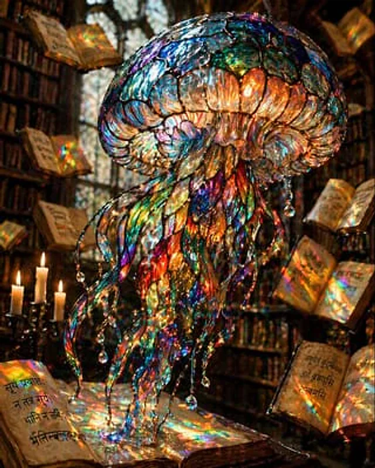

```text
A super-detailed macro photograph, taken of a {argument name="subject" default="A translucent jellyfish made entirely of colored glass"} , suspended{argument name="location" default="Victorian Library"} Inside, the candlelight is refracted into a fractal rainbow that passes through the floating ancient books, with recognizable {argument name="text style" default="Sanskrit text"} Photorealistic
```

Model: GPT Image 2
Author: GPT Image 2 Prompts

[ProjectD](https://aitoolsradar.com/en/prompts/d6c7c0632a04ad) · [Recorded source](https://x.com/ggg78g89/status/2044997171645391153)
 · [Full original metadata and byte evidence](data/projectd-batch-0038.json)

## Macro Wildlife Photography

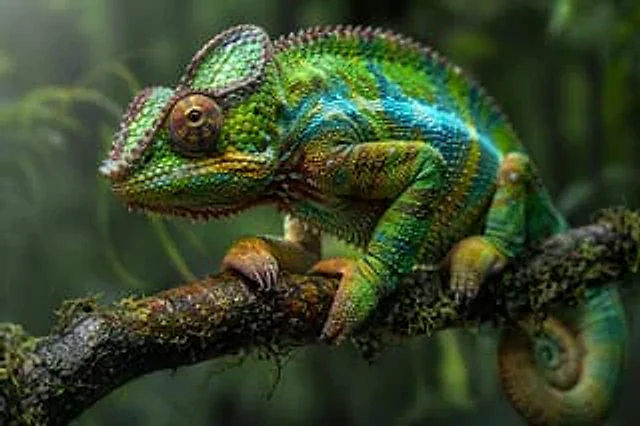

```text
One{argument name="photography style" default="Hyperrealistic macro photography works"} The main body is a{argument name="primary color" default="Vibrant green and blue"} Chameleons, inhabiting{argument name="background environment" default="dense jungle"} On a damp, moss-covered branch, a chameleon with intricate, raised scales, accented with yellow and red, and a large, incredibly detailed eye, stands. Its sharp claws grip the dark, textured wood, and its tail is tightly coiled into a spiral, dangling below the branch. The background is a soft, deep green, blurred leaf, highlighting the reptile's remarkably clear 8K resolution details. Soft natural light accentuates the damp texture.
```

Model: GPT Image 2
Author: GPT Image 2 Prompts

[ProjectD](https://aitoolsradar.com/en/prompts/ad4421d51b9d3e) · [Recorded source](https://x.com/John82924749/status/2044347291600113933#reversed-0)
 · [Full original metadata and byte evidence](data/projectd-batch-0038.json)

## Magazine Cover on Desk with Cowboy Chameleon

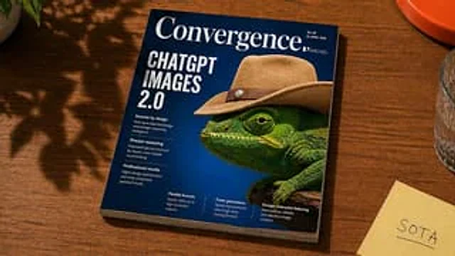

```text
A photorealistic scene depicting the editorial lifestyle, shot from a slightly elevated three-quarter angle, shows a glossy magazine tilted at an angle on a warm, medium-brown wooden table. The magazine is the clear visual focus, occupying most of the frame. The cover background is a deep cobalt to navy blue, featuring a large close-up portrait of a bright green chameleon facing left, with clearly visible macro details—scale textures, bright eyes, and wearing a tan suede cowboy hat with a brown leather belt and small silver studs. The magazine title at the top is displayed in an elegant white large serif font.{argument name="magazine title" default="Convergence"} On the left side of the cover, a prominent stacked white sans-serif title is displayed.{argument name="headline text" default="CHATGPT IMAGES 2.0"} The magazine includes seven smaller cover text blocks: three brief feature summaries in a column below the title on the left, and four compact preview summaries at the bottom edge. Small, realistic magazine details are added to the upper right corner, including the price, date, and short lines of code, all in extremely small white font. The scene should evoke a snapshot of a casually arranged desktop in natural afternoon sunlight, with soft shadows of leaves and windows casting patterns on the wood and parts of the magazine. Around the magazine are four desktop elements: a partial view of a potted plant extending into the upper left corner, a partial view of an orange plate or bowl at the upper right edge, a multifaceted glass with a truncated right edge, and a piece of paper with handwritten text in the lower right corner.{argument name="sticky note text" default="SOTA"} The pale yellow sticky notes emphasize the authentic print quality, subtle cover reflections, the thickness of the paper on the magazine spine and bottom, warm shadows, and a sophisticated, modern product photography style.
```

Model: GPT Image 2
Author: GPT Image 2 Prompts

[ProjectD](https://aitoolsradar.com/en/prompts/eefbc81cce5e08) · [Recorded source](https://x.com/CeotechI/status/2046684498515861650#reversed-0)
 · [Full original metadata and byte evidence](data/projectd-batch-0038.json)

## Magical Chibi Cafe Mascot at Sunrise

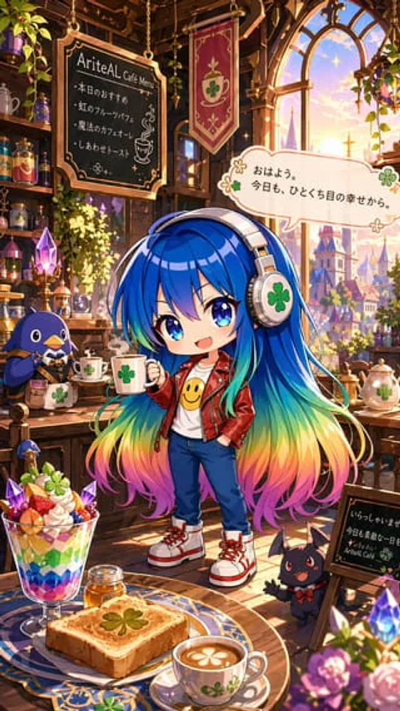

```text
A richly detailed and fantastical vertical illustration of an anime café depicts a chibi-style girl standing in the center of a cozy, whimsical café in the early morning. She has extremely long, voluminous hair with a vibrant rainbow gradient, transitioning from deep blue at the top to cyan, green, yellow, orange, pink, and purple at the ends; she has large, sparkling eyes and a happy smile. She wears oversized silver headphones with green four-leaf clover logos on the earcups, a red leather jacket, a white T-shirt with a yellow smiley face, slim-fit blue jeans, and thick-soled white high-top sneakers with red laces. She holds a white mug with a green four-leaf clover print, her posture relaxed and friendly. Around her is a warm, magical café interior, crafted from polished dark wood, filled with hanging plants, shelves overflowing with bottles and jars, glowing crystals, teapots, and mugs, with golden morning light streaming through tall, arched windows. Outside, a dreamlike European fantasy town stands, its towers and rooftops rising under the soft morning sky. The image features two small mascots: on the left, a round, blue penguin barista wearing a vest and bow tie, holding a four-leaf clover mug; and on the lower right, a black bat-cat creature with red eyes, small wings, and a red bow tie. Three clearly visible menu items are also present: a large blackboard in the upper left displays "AriteAL Cafe Menu" with Japanese text below; a speech bubble above the girl's right displays the Japanese phrase "おはよう。今日も、ひとくち目の幸せから。"; and a small black welcome item in the lower right displays the Japanese words "AriteAL Cafe". On the round table in the foreground are four specialty dishes: a thick slice of toast adorned with green four-leaf clovers, a latte in a four-leaf clover mug with latte art, a tall rainbow parfait layered with colorful jellies or fruits, whipped cream, strawberries, berries, and crystal decorations, and a small glass jar of honey or syrup. Four-leaf clover patterns are found throughout the scene, decorating cups, items, and furnishings. High-saturation colors, glossy highlights, intricate lines, soft magical glitter, and golden hour rim lighting create a captivating, fantastical café atmosphere, showcasing exquisite, high-end anime illustration quality.
```

Model: GPT Image 2
Author: GPT Image 2 Prompts

[ProjectD](https://aitoolsradar.com/en/prompts/623a2261b6c393) · [Recorded source](https://x.com/arite_al/status/2047088858601554248#reversed-0)
 · [Full original metadata and byte evidence](data/projectd-batch-0038.json)

## Magical Girl Transformation Storyboard

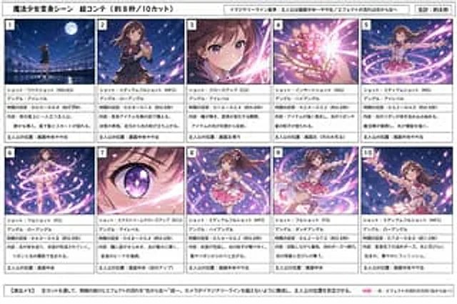

```text
{
  "type": "Animation Transformation Storyboard",
  "subject": "Magical Girl Transformation Sequence",
  "style": "Concise and professional storyboards for image generation planning, exquisite animated illustration thumbnails, vibrant night sky fantasy effects, and aesthetically pleasing comic book production.",
  "canvas": {
    "orientation": "Horizontal",
    "aspect_ratio": "16:9"
  },
  "header": {
    "title": "Storyboard of magical girl transformation scene (approximately 8 seconds / 10 shots)",
    "notes": [
      "Imaginary line reference: The main character is positioned from the center to the left of the screen / the special effects flow from right to left.",
      "Total: Approximately 8 seconds"
    ]
  },
  "character": {
    "name": "{argument name=\"character name\" default=\"main character\"}",
    "appearance": "A teenage magical girl with long, wavy hair.{argument name=\"hair color\" default=\"brown\"} Her hair was styled in large, expressive eyes. Her school uniform transformed into a magical girl outfit, featuring a pink ruffled dress with ribbons, a short layered skirt, bow details, white gloves, and a wand-like transformation item with heart and wing patterns."
  },
  "layout": {
    "grid": {
      "columns": 5,
      "rows": 2,
      "count": 10
    },
    "sections": [
      {
        "title": "1",
        "position": "Top left",
        "count": 1,
        "labels": [
          "Lens: Long shot (WS/ES)",
          "Angle: Eye level",
          "Estimated time: 0.0-0.8 (approximately 0.8 seconds)",
          "Content: The protagonist stands alone on a rooftop at night. A quiet opening scene, with the wind blowing through her hair and skirt.",
          "Main character's position: Slightly left of center in the frame"
        ]
      },
      {
        "title": "2",
        "position": "Second in the top row",
        "count": 1,
        "labels": [
          "Lens: Medium Horizon (MFS)",
          "Angle: Low angle",
          "Estimated time: 0.8-1.6 (approximately 0.8 seconds)",
          "Content: Holding the transformation item to his chest. A determined expression. Light rising from beneath his feet.",
          "Main character's position: Slightly left of center in the frame"
        ]
      },
      {
        "title": "3",
        "position": "Third in the top row",
        "count": 1,
        "labels": [
          "Shot: Close-up (CU)",
          "Angle: Eye level",
          "Estimated time: 1.6-2.4 seconds (approximately 0.8 seconds)",
          "Content: The fleeting moment of a blinking eye and changing expression. The light from the props reflects off the right side.",
          "Main character's position: Slightly to the left of the screen"
        ]
      },
      {
        "title": "4",
        "position": "Fourth in the top row",
        "count": 1,
        "labels": [
          "Lens: Insert Lens (INS)",
          "Angle: High angle",
          "Estimated time: 2.4-3.2 seconds (approximately 0.8 seconds)",
          "Content: The prop emits a strong light, releasing ribbons of light and star-shaped particles.",
          "Main character's position: Left side of the screen (only hands are visible)"
        ]
      },
      {
        "title": "5",
        "position": "Top right",
        "count": 1,
        "labels": [
          "Lens: Medium shot (MS)",
          "Angle: Eye level",
          "Estimated time: 3.2-4.0 seconds (approximately 0.8 seconds)",
          "Content: Ribbons of light begin to wrap around the body. A magic circle unfolds, the light spiraling out of shape.",
          "Main character's position: Slightly left of center in the frame"
        ]
      },
      {
        "title": "6",
        "position": "Bottom left",
        "count": 1,
        "labels": [
          "Lens: Panorama (FS)",
          "Angle: Low angle",
          "Estimated time: 4.0-4.8 seconds (approximately 0.8 seconds)",
          "Content: Light surrounds the body, and clothing gradually takes shape. Enveloped by ribbons and spirals of light.",
          "Main character's position: Center of the screen"
        ]
      },
      {
        "title": "7",
        "position": "Second from the bottom row",
        "count": 1,
        "labels": [
          "Shot: Extreme close-up (ECU)",
          "Angle: Eye level",
          "Estimated time: 4.8-5.4 seconds (approximately 0.6 seconds)",
          "Content: Stars twinkle in his eyes, reaching their peak of brilliance. Emphasizing the climax of the transformation.",
          "Main character's position: Center of the frame (close-up of the eyes)"
        ]
      },
      {
        "title": "8",
        "position": "Third from the bottom row",
        "count": 1,
        "labels": [
          "Lens: Medium Horizon (MFS)",
          "Angle: High angle",
          "Estimated time: 5.4-6.2 seconds (approximately 0.8 seconds)",
          "Contents: The costume is complete, and the particles of light slowly converge. Hair and ribbons gently spread out.",
          "Main character's position: Slightly left of center in the frame"
        ]
      },
      {
        "title": "9",
        "position": "Fourth from the bottom row",
        "count": 1,
        "labels": [
          "Lens: Panorama (FS)",
          "Angle: Dutch tilt",
          "Estimated time: 6.2-7.0 seconds (approximately 0.8 seconds)",
          "Content: Spinning as it lands. Transitioning to a frozen pose. Afterimages of light and shadow, and fluttering petals.",
          "Main character's position: Center of the screen"
        ]
      },
      {
        "title": "10",
        "position": "Bottom right",
        "count": 1,
        "labels": [
          "Lens: Medium Horizon (MFS)",
          "Angle: Low angle",
          "Estimated time: 7.0-8.0 seconds (approximately 1.0 second)",
          "Content: A frozen pose after the transformation is complete. Surrounded by light and petals, a magnificent ending.",
          "Main character's position: Slightly left of center in the frame"
        ]
      }
    ],
    "footer": {
      "title": "[Performance Notes]",
      "count": 2,
      "labels": [
        "In all shots, the line of sight and the flow of special effects are consistently from right to left. The composition ensures the camera does not cross imaginary lines, maintaining the protagonist's stable position.",
        "The direction of light and special effects flow (from right to left)"
      ]
    }
  },
  "visuals": {
    "panel_style": "The 10 storyboard frames each contain a fully rendered thumbnail of the animation at the top, a text description box at the bottom, and a storyboard number in bold at the top left.",
    "background": "White storyboard with black border and thin dividing lines",
    "thumbnail_consistency": "The characters remain consistent across all 10 panels, featuring a nighttime rooftop, a bright moon, a deep blue-purple sky, pink and white magical light bands, shimmering petals, and dynamic transformation energy.",
    "text_language": "Japanese",
    "color_palette": [
      "Deep Navy Blue",
      "violet",
      "pink",
      "White",
      "Soft magenta"
    ]
  },
  "quality": "High-resolution editing and layout, clear and easy-to-read Japanese text, balanced margins, and printable panel design."
}
```

Model: GPT Image 2
Author: GPT Image 2 Prompts

[ProjectD](https://aitoolsradar.com/en/prompts/2542b3ba2cca02) · [Recorded source](https://x.com/nyaa_toraneko/status/2046603329271480353#reversed-0)
 · [Full original metadata and byte evidence](data/projectd-batch-0038.json)

## Magical Glowing Ribbon Style Transformation

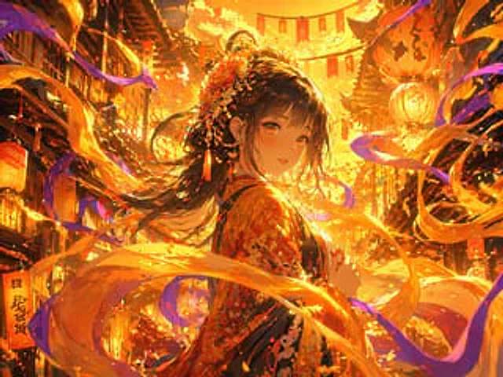

```text
Using the provided reference image, apply a strong {argument name="lighting color" default="Gold and orange"} Use lighting effects to transition scenes. Add dynamic, rotating effects.{argument name="magical element" default="Glowing ribbons and energy trails"} This allows the light to surround the character and move through the foreground and background. The character's hair is made to dynamically flow in the wind, and the air is filled with shimmering light particles. While retaining the original character design, pose, and lantern-lit street background, the overall visual effect is elevated to a higher level.{argument name="aesthetic style" default="A magical anime with dazzling light"} Aesthetic style.
```

Model: GPT Image 2
Author: GPT Image 2 Prompts

[ProjectD](https://aitoolsradar.com/en/prompts/88630a8f08f9e5) · [Recorded source](https://x.com/Tanemomi_Ver2/status/2044853185140142099#reversed-2)
 · [Full original metadata and byte evidence](data/projectd-batch-0038.json)

## Magical Seed Packet Diorama

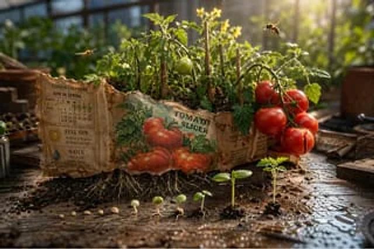

```text
A grand 3D scene: a weathered seed packet lies open on a potted planter, its promised contents bursting forth to transform into the garden it describes. The illustration on the front of the packaging comes to life. Fully scale, the seeds grow from the paper.{argument name="plant type" default="[Plants/Flowers]"} The roots are clearly visible through the bottom of the packaging, penetrating the soil below. Blooming in the corner {argument name="detail left" default="[Detail 1]"} On the other side, it is in the middle of its growth phase.{argument name="detail right" default="[Detail 2]"} It is not yet fully formed. Tiny insects belonging to this plant.{argument name="insect type" default="[Bee/Butterfly/Beetle]"} The seed packet floats in the air in perfect proportion. The written instructions on the back transform into a garden calendar, and "Spring Sowing" becomes a realistic spring morning light. "Abundant Sunlight" becomes a beam of light, precisely illuminating the highest blooming flower. Seeds are scattered between the seed packet and the soil, each showcasing a different stage of germination: seed coat cracking, primary root, primary bud, primary leaf. The torn top edge of the packaging becomes a tree line. Soil and water droplets are scattered on the surface of the potted planter. The tilt-shift depth of field and the greenhouse morning light allow the seed packet to become the garden it was meant to be.
```

Model: GPT Image 2
Author: GPT Image 2 Prompts

[ProjectD](https://aitoolsradar.com/en/prompts/d7eeb83eb16753) · [Recorded source](https://x.com/AllaAisling/status/2048156345518768190)
 · [Full original metadata and byte evidence](data/projectd-batch-0038.json)

## Magical Sleep Website Mockup


```text
{
  "type": "Website landing page model",
  "theme": "Magical realism, cozy night, fantasy",
  "color_palette": [
    "Deep Navy Blue",
    "warm gold",
    "Glowing amber"
  ],
  "header": {
    "logo": "{argument name=\"brand name\" default=\"BiblioSleep\"} Icons featuring a crescent moon and an open book",
    "navigation_links": {
      "count": 6,
      "labels": [
        "Design Concept",
        "Experience mechanism",
        "Bedding craftsmanship",
        "Experience List",
        "User Reviews",
        "Frequently Asked Questions"
      ]
    },
    "utilities": {
      "count": 2,
      "icons": [
        "User Profile",
        "shopping bags"
      ]
    },
    "cta_button": "Book Now"
  },
  "hero_section": {
    "left_panel": {
      "headline": "{argument name=\"main headline\" default=\"Before reading, drift into that world and find peace.\"}",
      "subheadline": "{argument name=\"subheadline\" default=\"This is a bedtime blanket for reading, allowing you to experience the atmosphere, temperature, emotions, and scenery of the world in the book before you even open the pages.\"}",
      "buttons": {
        "count": 2,
        "styles": [
          "Solid gold with book icon",
          "Outline with open book icon"
        ],
        "labels": [
          "Enter the story &gt;",
          "Experience List &gt;"
        ]
      },
      "feature_icons": {
        "count": 3,
        "layout": "Horizontal arrangement in the bottom left corner",
        "items": [
          {
            "icon": "Books with mountains and stars",
            "label": "Worldview experience from unread books"
          },
          {
            "icon": "Crescent Moon on the Waves",
            "label": "Sleep regulation"
          },
          {
            "icon": "Open the book with sparkling details",
            "label": "Enhance reading desire"
          }
        ]
      }
    },
    "right_panel_and_background": {
      "subject": "The young woman was sleeping peacefully in bed.",
      "environment": "A dimly lit, comfortable bedroom with distant city lights visible through the window, and a warm-toned bedside lamp.",
      "focal_point": "A dark blue quilt covered with luminous gold constellation lines.",
      "magical_elements": {
        "description": "{argument name=\"magical element\" default=\"Miniature fantasy scenes emerging from the folds of the bedding\"}",
        "scene_count": 5,
        "scene_details": [
          "Steam train crossing the stone arch bridge",
          "Gothic castle",
          "Stylized sailboats on waves",
          "A cozy cabin in the pine forest",
          "Domed Palace"
        ],
        "effects": "Surrounded by volumetric luminescent clouds, warm miniature lights, and floating sparkles."
      },
      "corner_badge": {
        "position": "bottom right corner",
        "style": "Golden Laurel Wreath",
        "text": "Extend your reading experience with goodnight by BiblioSleep"
      }
    }
  }
}
```

Model: GPT Image 2
Author: GPT Image 2 Prompts

[ProjectD](https://aitoolsradar.com/en/prompts/70d2d1bf1b56ef) · [Recorded source](https://x.com/masapark95/status/2046189362933858580#reversed-3)
 · [Full original metadata and byte evidence](data/projectd-batch-0038.json)

## Magical Sleep Website Mockup

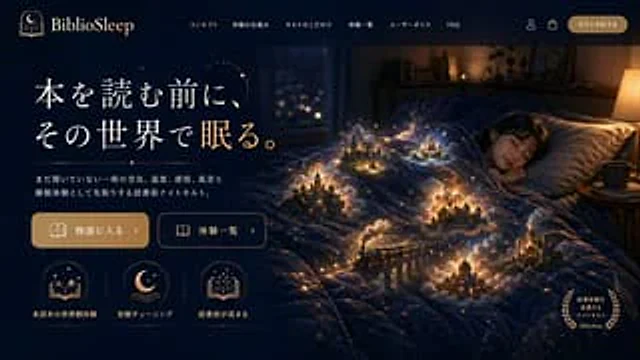

```text
{
  "type": "website landing page mockup",
  "theme": "magical realism, cozy night, fantasy",
  "color_palette": ["deep navy blue", "warm gold", "glowing amber"],
  "header": {
    "logo": "{argument name=\"brand name\" default=\"BiblioSleep\"} with crescent moon and open book icon",
    "navigation_links": {
      "count": 6,
      "labels": ["コンセプト", "体験の仕組み", "キルトのこだわり", "体験一覧", "ユーザーボイス", "FAQ"]
    },
    "utilities": {
      "count": 2,
      "icons": ["user profile", "shopping bag"]
    },
    "cta_button": "今すぐ予約する"
  },
  "hero_section": {
    "left_panel": {
      "headline": "{argument name=\"main headline\" default=\"本を読む前に、その世界で眠る。\"}",
      "subheadline": "{argument name=\"subheadline\" default=\"まだ開いていない一冊の空気、温度、感情、風景を睡眠体験として先取りする読書前ナイトキルト。\"}",
      "buttons": {
        "count": 2,
        "styles": ["solid gold with book icon", "outlined with open book icon"],
        "labels": ["物語に入る >", "体験一覧 >"]
      },
      "feature_icons": {
        "count": 3,
        "layout": "horizontal row at the bottom left",
        "items": [
          {"icon": "book with mountains and stars", "label": "未読本の世界観体験"},
          {"icon": "crescent moon over waves", "label": "安眠チューニング"},
          {"icon": "open book with sparkles", "label": "読書欲が高まる"}
        ]
      }
    },
    "right_panel_and_background": {
      "subject": "young woman sleeping peacefully in a bed",
      "environment": "dimly lit cozy bedroom with a window showing distant city lights and a warm bedside lamp",
      "focal_point": "a dark blue quilt covered in glowing golden constellation lines",
      "magical_elements": {
        "description": "{argument name=\"magical element\" default=\"miniature glowing fantasy scenes emerging from the folds of the quilt\"}",
        "scene_count": 5,
        "scene_details": ["steam train crossing a stone viaduct", "gothic castle", "sailing ship on stylized waves", "cozy cabin in a pine forest", "domed palace"],
        "effects": "surrounded by volumetric glowing clouds, warm miniature lights, and floating sparkles"
      },
      "corner_badge": {
        "position": "bottom right",
        "style": "golden laurel wreath",
        "text": "読書体験を拡張するナイトキルト BiblioSleep"
      }
    }
  }
}
```

Model: GPT Image 2
Author: パク🎈動画広告分析Pro × AI

[ProjectD](https://aitoolsradar.com/en/prompts/725b5686e92f60) · [Recorded source](https://youmind.com/prompts/magical-sleep-mockup-14185)
 · [Full original metadata and byte evidence](data/projectd-batch-0038.json)

## Manaka Takane Character Prompt

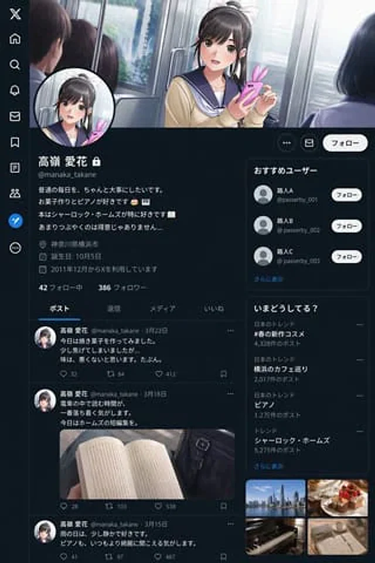

```text
{argument name="work" default="loveplus"} {argument name="character" default="Takane Aika"}
```

Model: GPT Image 2
Author: GPT Image 2 Prompts

[ProjectD](https://aitoolsradar.com/en/prompts/6670676c4d7124) · [Recorded source](https://x.com/ZhiZi3795/status/2047691546267676989)
 · [Full original metadata and byte evidence](data/projectd-batch-0038.json)

## Manchester City Haaland Poster

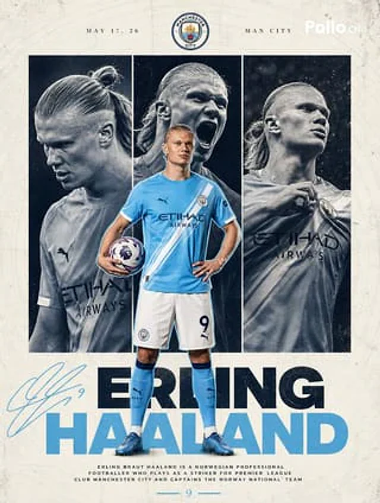

```text
Goal: Create a premium football poster for Manchester City striker {argument name="player name" default="Erling Haaland"}, with a dramatic editorial sports-design look.

Canvas: Vertical portrait poster, roughly 4:5 ratio, off-white aged paper background with subtle grain, scuffs, faint circular pitch-map lines, and a centered composition.

Layout: At the very top center place the Manchester City crest. Add small spaced uppercase text on the top left reading “MAY 17, 26” and on the top right reading “MAN CITY”. In the upper right corner include a small white “Pollo ai” watermark. The main image area contains exactly 3 tall vertical rectangular panels side by side with narrow white dividers: left panel shows a grayscale close-up side profile of the player in a Manchester City shirt; center panel shows a grayscale close-up portrait behind the main figure; right panel shows a grayscale close-up of the player kissing or holding the club badge on the shirt. Use dark navy, high-contrast, grainy photo treatment in the panels.

Subject details: In front of the 3 panels, place a full-body cutout of the player standing confidently, centered and overlapping the title. He wears the {argument name="team kit" default="Manchester City sky-blue home kit"} with Etihad Airways sponsor, white shorts, sky-blue socks, blue football boots, and number 9 on the shorts. He holds a Premier League football tucked under his left arm and rests his right hand on his hip. Use realistic sports photography lighting, crisp cutout edges, and a subtle shadow.

Typography and text: Across the lower third, create a huge bold uppercase player-name title in two stacked lines: “ERLING” in dark navy, then “HAALAND” in bright sky blue, partially behind the player’s legs. Add a light blue autograph-style signature with a small number 9 on the lower left. Below the title, add a small centered uppercase biography line: “ERLING BRAUT HAALAND IS A NORWEGIAN PROFESSIONAL FOOTBALLER WHO PLAYS AS A STRIKER FOR PREMIER LEAGUE CLUB MANCHESTER CITY AND CAPTAINS THE NORWAY NATIONAL TEAM”. At the very bottom center, place a small decorative line with the number “9”.

Visual style: Modern football transfer-announcement poster, realistic photographic collage, navy and sky-blue Manchester City palette, distressed print texture, elegant spacing, high-end magazine cover quality.

Constraints: Use exactly 3 background portrait panels, exactly 1 full-body foreground player, exactly 1 club crest, exactly 1 signature mark, and exactly 1 football. Keep the poster clean and centered, with no extra players, no extra logos beyond the crest and watermark, and no unrelated text.
```

Model: GPT Image 2
Author: Chesny

[ProjectD](https://aitoolsradar.com/en/prompts/968925b5d8bcf2) · [Recorded source](https://youmind.com/prompts/man-city-haaland-poster-21593)
 · [Full original metadata and byte evidence](data/projectd-batch-0038.json)

## Manga Cover With Bass Girl and Designer Boy

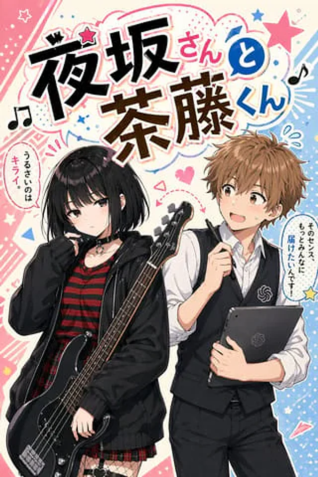

```text
A vibrant Japanese manga-style cover illustration features two anime characters standing side-by-side against a background of pink and blue pop art graphics, adorned with stars, dots, musical notes, hearts, shimmering lines, and playful doodles. At the top is a large, bold Japanese title in thick, dark brown kanji with white outlines and pink shading: "Yasaka-san to Chafuji-kun," arranged in a vibrant, layered composition within a fluffy, cloud-shaped title frame. The left half of the background is pink, while the right half is light blue, creating a rhythmic diagonal division and incorporating decorative manga cover elements. The image must showcase both characters, framed from mid-thigh up. On the left is a rebellious girl with straight black bob haircut and bangs, fair skin, dressed in punk rock style clothing, her posture slightly agitated and reserved, one hand near her mouth. She wore an oversized black zip-up hoodie over a red and black striped shirt, a red plaid pleated skirt, fishnet stockings, and a black heart-shaped choker. She held a black electric bass, the headstock, strings, pickups, and chrome hardware clearly visible. To her right was a cheerful young man with messy light brown short hair, fair skin, and a friendly, lively expression. He wore a white shirt with the sleeves rolled up to his elbows, a black fitted vest with a small badge on the chest, and black trousers. He held a stylus close to his face in one hand and a dark drawing tablet tucked under his other arm. Add two vertical Japanese speech bubbles: the left bubble has a pink outline and reads "うるさいのはキライ."; the right bubble has a blue outline and reads "そのセンスもっとみんなに届けたいです…". Small floating icons are added between and around the characters: two black musical notes, two pink hearts, two blue stars, and some curved arrows and glittering symbols to create a vibrant chemistry. The overall style is sophisticated modern comic book cover art with clean lines, glossy shadows, expressive character designs, bright and soft pop colors, and rich details, reminiscent of commercial light novel or comic book covers.
```

Model: GPT Image 2
Author: GPT Image 2 Prompts

[ProjectD](https://aitoolsradar.com/en/prompts/994175e7dcb5d0) · [Recorded source](https://x.com/wtry1102/status/2047674937306182009#reversed-0)
 · [Full original metadata and byte evidence](data/projectd-batch-0038.json)

## Manga Spread: Fantasy Game Developer

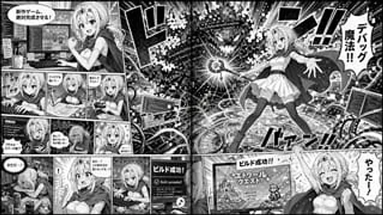

```text
{
  "type": "2-page comic strip",
  "style": "Black and white anime comics, halftone paper effect",
  "theme": "{argument name=\"main action\" default=\"Fantasy Wizard is developing a video game\"}",
  "character": "{argument name=\"character appearance\" default=\"A blonde anime girl, wearing a crown, a cloak, a white dress, and over-the-knee socks.\"}",
  "layout": {
    "left_page": {
      "panel_count": 11,
      "rows": [
        {
          "panels": 1,
          "action": "With a determined expression, he stood before the dual-monitor desk, a speech bubble appearing: 'The new game is absolutely finished!'"
        },
        {
          "panels": 3,
          "action": "Typing, drawing on a graphics tablet, testing with a controller"
        },
        {
          "panels": 3,
          "action": "Shocked, frustrated, and determined by the error screen."
        },
        {
          "panels": 4,
          "action": "Exhausted, I suddenly had a flash of inspiration, started typing frantically, and the monitor displayed 'Build succeeded!'"
        }
      ]
    },
    "right_page": {
      "panel_count": 2,
      "panels": [
        {
          "type": "Large double-page spread",
          "action": "Cast spells from the glowing ring to attack those marked '{argument name=\"error text\" default=\"NullReferenceException\"} The code error monster. Dialogue bubble: '{argument name=\"spell text\" default=\"Debugging magic!!\"} '"
        },
        {
          "type": "Bottom Banner",
          "action": "Cheers in front of the RPG title screen. Dialogue bubble: '{argument name=\"success text\" default=\"やったー！\"} '"
        }
      ]
    }
  }
}
```

Model: GPT Image 2
Author: GPT Image 2 Prompts

[ProjectD](https://aitoolsradar.com/en/prompts/1a3d8773e06f5d) · [Recorded source](https://x.com/gamemangaanime/status/2046299699452506121#reversed-0)
 · [Full original metadata and byte evidence](data/projectd-batch-0038.json)

## Manga Style Family Disney Trip

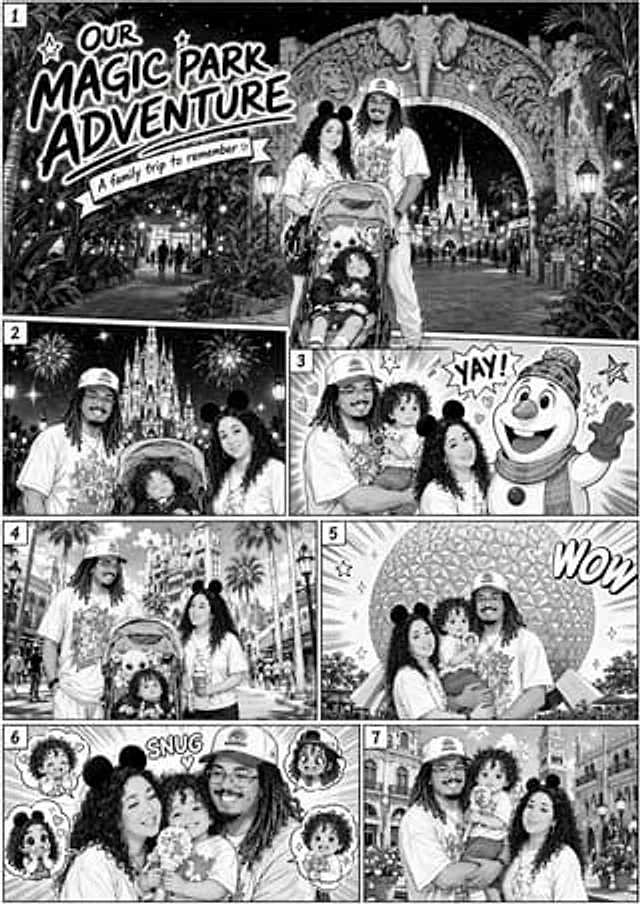

```text
Please refer to these images and create a [image/sheet].{argument name="style" default="MANGA"} The style of the pictures, the content is{argument name="subjects" default="My wife, my son, and I"} of{argument name="event" default="Disney Trip"}
```

Model: GPT Image 2
Author: GPT Image 2 Prompts

[ProjectD](https://aitoolsradar.com/en/prompts/1d77acb9a79aa3) · [Recorded source](https://x.com/ToNYD2WiLD/status/2046684364852035816)
 · [Full original metadata and byte evidence](data/projectd-batch-0038.json)

## Manga Style Project Management Intro

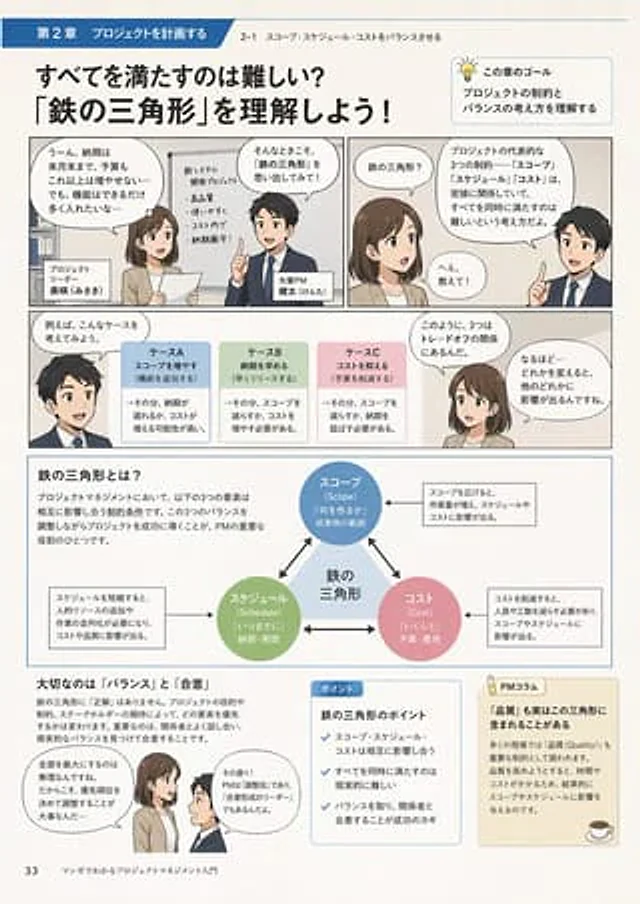

```text
{argument name="subject" default="Learn project management through comics"}
```

Model: GPT Image 2
Author: GPT Image 2 Prompts

[ProjectD](https://aitoolsradar.com/en/prompts/283889a676858c) · [Recorded source](https://x.com/d2moro/status/2045243931315851696)
 · [Full original metadata and byte evidence](data/projectd-batch-0038.json)

## Manga Surf Wipeout Comic Poster

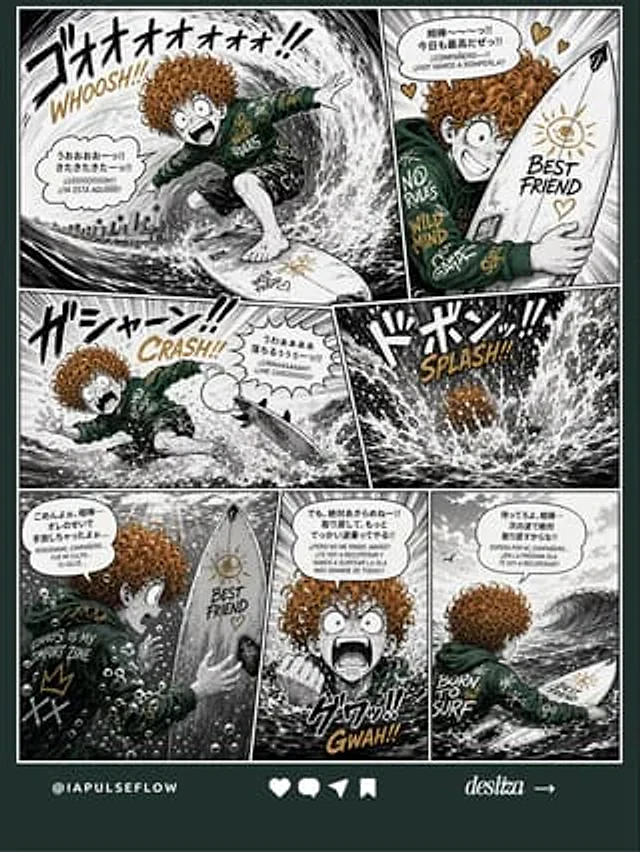

```text
{"type":"Comic-style social media comic poster","format":"Vertical Instagram-style page","style":{"overall":"High-contrast black and white ink wash comic, embellished with soft colors","influences":["Shonen manga action panels","Hand-drawn halftone paper shadows","Dramatic speed lines","Comic onomatopoeia"],"accent_colors":["Burnt orange hair","Dark forest green hoodie","Warm gold font and icons"],"rendering":"Delicate line art, vivid expressions, foam water texture, dynamic perspective"},"subject":{"character":{"count :1,"description":"A teenage surfer with thick, curly orange hair, fair skin, exaggerated round, cartoonish eyes, and a lively and expressive face."},"wardrobe":["Dark green oversized hoodie covered in graffiti-style handwritten phrases and graffiti","Black knee-length shorts"],"barefoot":true},"prop":{"count":1,"description":"White short surfboard with a black tail fin and black leash plug, a hand-drawn sun symbol near the nose, and the words 'BEST' in large handwriting."} The word "FRIEND" and a small heart"}},"layout":{"background":"Dark cyan outer border, outlining the comic page","sections":[{"title":"Top Left Panel","position":"Top Left","count":1,"labels":["Googoogoo!!","WHOOSH!!"],"description":"Large action panel, surfer crouches in the churning waves, grinning wildly, one hand outstretched forward, the other backward, the outline of a city coastline faintly visible in the distance, the dialogue box in Spanish, expressing the excitement of finally arriving"},{"title":"Top Right Panel","position":"Top Right","count":1,"labels":["BEST FRIEND"],"description":"Close-up shot, affectionately embracing the surfboard, revealing a bright smile, with small golden hearts floating above his head, the dialogue box is in Spanish, directly encouraging the waves or surfing buddies with excitement"},{"title":"Left Center Shot","position":"Left Center","count":1,"labels":["Gaschaan!!","CRASH!!"],"description":"Wipeout In an instant, the surfer lost his balance, his arms flailing, the surfboard tilting, water splashing everywhere, a shocked scream on his face, the dialogue box containing the Spanish exclamation "},{"title":"Right Center Shot","position":"Right Center","count":1,"labels":["Dobon!!","SPLASH!!"],"description":"Impact shot, showing the character almost completely submerged in the violent splash, only curly hair and a raised hand are visible"},{"title":"Left Bottom Shot","position":"Left Bottom","count":1,"labels":["BEST FRIEND"],"description":"Underwater perspective: The surfer is next to an upright surfboard, one hand on the board, looking guilty and worried. Bubbles rise around him, and the back of his hoodie is covered in graffiti. The dialogue box contains an apology in Spanish."},{"title":"Lower middle shot","position":"Lower middle","count":1,"labels":["GWAH!!","GWAH!!"],"description":"Close-up: The surfer surfaces, clenching his fist and shouting. His eyes are wide open, his curly hair is soaking wet, and his expression is determined. The dialogue box contains a declaration in Spanish, indicating that there are still waves waiting to be conquered."},{"title":"Lower right shot","position":"Lower right","count":1,"labels":["BORN TO SURF","BEST"],"description":"Underwater perspective: The surfer is next to an upright surfboard, one hand on the board, looking guilty and worried. Bubbles rise around him, and the back of his hoodie is covered in graffiti. The dialogue box contains an apology in Spanish."} FRIEND"],"description":"A rear-side view, surfers paddle towards the giant wave on the horizon, calm and determined. Birds fly overhead, and the dialogue box is in Spanish, shouting for the waves to come back, because they will recover and return."}],"section_count":7,"footer":{"count":3,"elements":["Creator ID ' @IAPULSEFLOW ' in the bottom left corner","Three white social media icons centered at the bottom: heart, dialogue box, and bookmark icon","Italic text 'desliza →' in the bottom right corner"]}},"text_treatment":{"dialogue_language":"Spanish","sound_effect_language":"Japanese with English translation","allow_text":true},"composition":{"camera":"Diverse comic-style shots, including wide-angle action shots, close-up portraits, underwater medium shots, and rear-paddle shots","mood":"Chaotic, humorous, touching, determined","theme":"Surfers experiencing a dramatic Wipeout..."] Later, the narrative of regarding the surfboard as a close friend"}}
```

Model: GPT Image 2
Author: GPT Image 2 Prompts

[ProjectD](https://aitoolsradar.com/en/prompts/713436b27474d5) · [Recorded source](https://x.com/iaPulse_/status/2046903739429097660#reversed-1)
 · [Full original metadata and byte evidence](data/projectd-batch-0038.json)

## Manga Tankobon Cover Illustrator

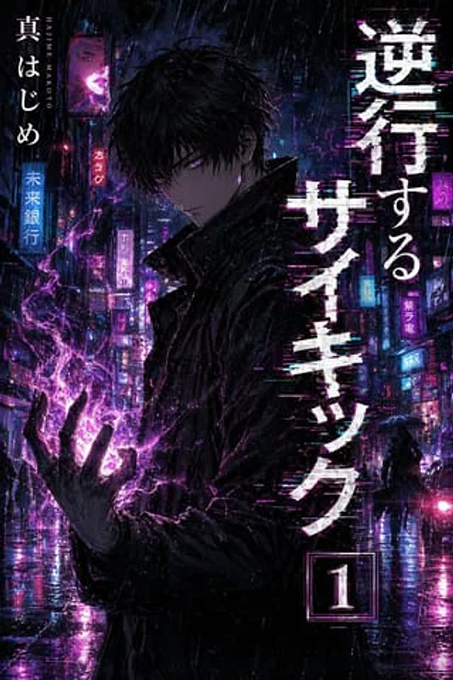

```text
Professional manga volume cover art. A charismatic protagonist, posing dynamically and strikingly, gazes intently at the reader with a determined expression. **Background:** A complex and atmospheric environment reflecting the story's themes, featuring dramatic lighting, floating particles, and cinematic depth-of-field effects. **Typography and Layout:** - Main Title:{argument name="title" default="[title]"} Displayed prominently in a stylized, high-impact font. - Signature:{argument name="author" default="[author name]"} "Shown in a smaller, elegant font at the bottom or side. - Design: A clean layout with dedicated space for the volume number, ensuring a professional publishing aesthetic. **Visual Style:** - Sharp, clean lines, complemented by professional cel shading and digital painting highlights. - High-contrast color scheme with vibrant accent lighting effects. - Composition: A vertical 2:3 aspect ratio balances the spine and cover layout. **Quality:** Ultra-refined, masterpiece, popular on Pixiv, high-end commercial illustration style."
```

Model: GPT Image 2
Author: GPT Image 2 Prompts

[ProjectD](https://aitoolsradar.com/en/prompts/8b39d26e063ef3) · [Recorded source](https://x.com/yudotanaka/status/2046898809049940407)
 · [Full original metadata and byte evidence](data/projectd-batch-0038.json)

## Manhwa Style Boss Adjusting Tie

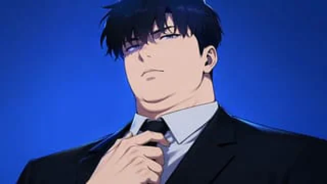

```text
A low-angle portrait in the style of Korean anime/manga depicts a burly, muscular man with a thick neck, double chin, and an arrogant, downcast expression. He has messy hair {argument name="hair color" default="Dark blue"} Hair, with{argument name="eye color" default="Glowing light blue"} Eyes, Clothing{argument name="suit color" default="black"} He was wearing a suit with a white shirt. One hand was adjusting his black tie.{argument name="background color" default="Solid color gradient blue"} Background, dramatic lighting, and sharp lines.
```

Model: GPT Image 2
Author: GPT Image 2 Prompts

[ProjectD](https://aitoolsradar.com/en/prompts/44b4d16ee7436a) · [Recorded source](https://x.com/mirochill/status/2044444292232405310#reversed-0)
 · [Full original metadata and byte evidence](data/projectd-batch-0038.json)

## Maradona Boca Juniors Infographic Poster

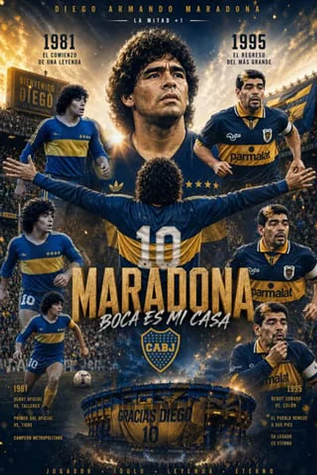

```text
{argument name="player" default="Maradona"} exist{argument name="team" default="Boca Juniors"} infographic poster
```

Model: GPT Image 2
Author: GPT Image 2 Prompts

[ProjectD](https://aitoolsradar.com/en/prompts/e85dde034fe255) · [Recorded source](https://x.com/zanoni/status/2047044897740386333)
 · [Full original metadata and byte evidence](data/projectd-batch-0038.json)

## Marcio Lima 利真 マルシオ 💎 #236

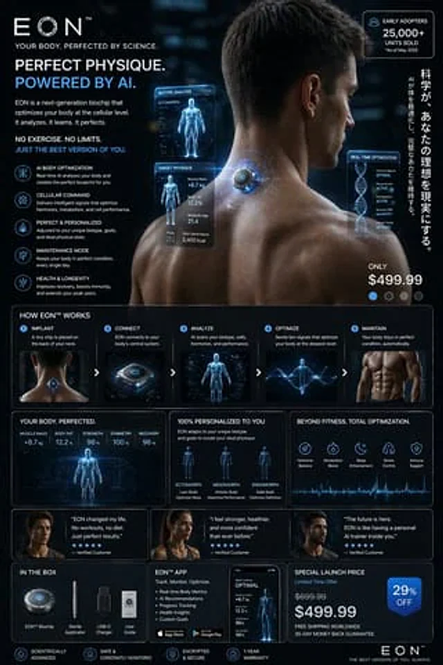

```text
Create a hyper-realistic Japanese-style futuristic product advertisement, ultra-detailed, cinematic lighting, premium clean layout.

The product is:

[DESCRIBE YOUR IDEA]

Scene:
Place the product in a real-world, emotionally impactful environment where its function is clearly visible.

Focus on:
– a strong central moment
– natural human interaction
– clear demonstration of the benefit

Include:
– product name
– headline
– subheadline
– feature icons, colors, shape, etc
– pricing
– “how it works” section
```

Model: GPT Image 2
Author: Marcio Lima 利真 マルシオ 💎

[ProjectD](https://aitoolsradar.com/en/prompts/ed491a2da65345) · [Recorded source](https://x.com/Preda2005/status/2047226077760901445)
 · [Full original metadata and byte evidence](data/projectd-batch-0038.json)

## Marcio Lima 利真 マルシオ 💎 #92

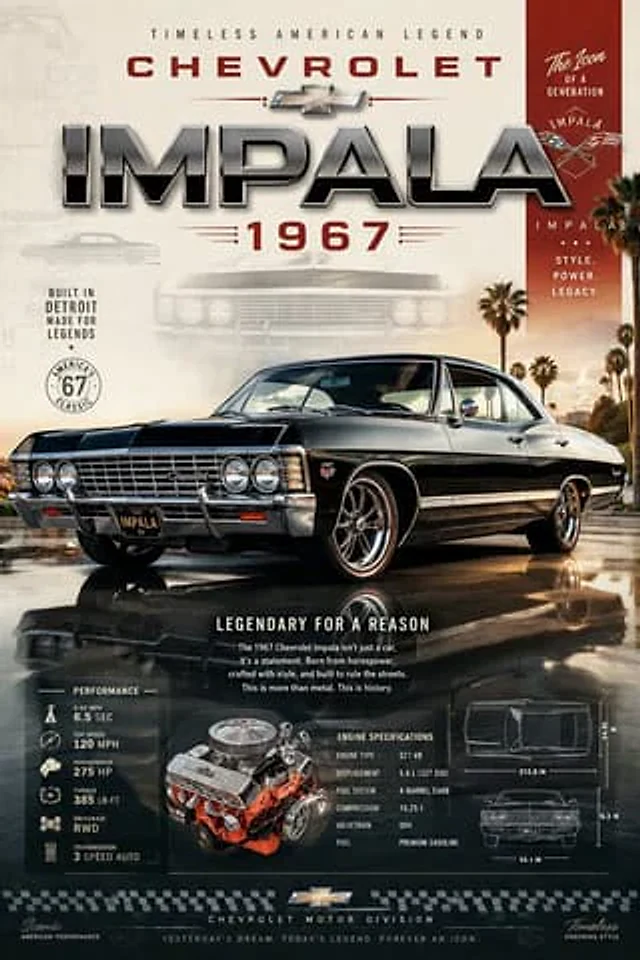

```text
Create an epic premium automotive poster of 
[CAR MODEL].

Place the car as the heroic central subject in a dynamic three-quarter side profile, visually dominant and impossible to ignore.

Show the full beauty of the vehicle with aggressive stance, perfect proportions, premium wheels, signature headlights, aerodynamic lines, spoilers, performance details, and luxury design language.

Add bold premium typography with the brand name, model name, performance stats, horsepower, acceleration, top speed, engine specs, and iconic achievements beautifully integrated into the composition.

Include subtle background elements inspired by the car’s heritage: faded blueprint lines, racing legacy, silhouette overlays, iconic tracks, engineering details, speed graphics, and collector-poster aesthetics.

Use strong visual contrast, bright premium colors (avoid dark black-heavy backgrounds), cinematic lighting, ultra-detailed reflections, glossy paint finish, luxury magazine quality, modern graphic design, and scroll-stopping masterpiece energy.

Clean composition, high-end automotive advertisement style, collector poster aesthetic, highly detailed, visually powerful, premium masterpiece.
```

Model: GPT Image 2
Author: Marcio Lima 利真 マルシオ 💎

[ProjectD](https://aitoolsradar.com/en/prompts/8ee17a16473762) · [Recorded source](https://x.com/Preda2005/status/2048752153343545390)
 · [Full original metadata and byte evidence](data/projectd-batch-0038.json)

## Marcus Rashford Inter Milan Wallpaper

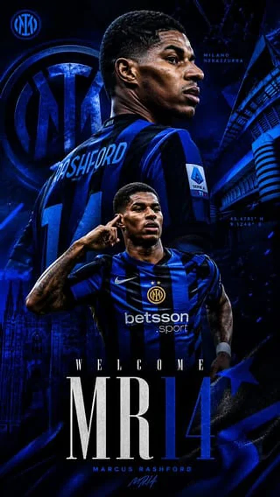

```text
Generate an image, design a{argument name="player" default="Marcus Rashford"} Theme, background is{argument name="team" default="inter milan"} High-quality design, 9:16 aspect ratio, mobile wallpaper, text content is "{argument name="text" default="Welcome MR14"} "
```

Model: GPT Image 2
Author: GPT Image 2 Prompts

[ProjectD](https://aitoolsradar.com/en/prompts/87cce58882a94b) · [Recorded source](https://x.com/arn_madi/status/2047090014123651307)
 · [Full original metadata and byte evidence](data/projectd-batch-0038.json)

## Marine Lucent Fantasy Tea Poster

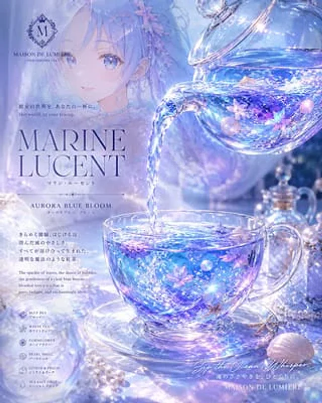

```text
Goal: Create a luxury fantasy tea advertisement poster for {argument name="product name" default="MARINE LUCENT"}, themed as an oceanic, character-inspired magical tea extracted from an ethereal mermaid-like heroine. The mood is translucent, premium, dreamy, and not a normal cafe menu.

Canvas: Vertical 4:5 high-resolution poster, soft pastel blue, lavender, pearl white, and iridescent aqua palette. Use glossy commercial advertising composition with delicate typography and a high-fashion fantasy tea brand atmosphere.

Layout: Place the main product scene on the right and lower center: a clear glass teapot in the upper-right pours glowing blue-violet tea in a sparkling stream into a transparent glass teacup on a saucer at the lower center. On the left side, create a refined editorial text column with the brand logo at top, product title in large serif letters, subtitle, flavor copy, and ingredient list. Add a pale lavender rectangular placeholder block near the upper-left/center, partially covering the background character art. Keep the whole design airy, luminous, and layered with bokeh, water reflections, and glass highlights.

Background and subject details: Behind the tea, show a barely visible ethereal anime-style marine princess figure as a soft-focus illustration: long flowing aqua-blue hair, shell and pearl accessories, pale skin, delicate floral/starfish ornaments, translucent fabric, and an underwater fantasy aura. She should feel like the source of the tea’s identity and world, but remain mostly hidden behind mist, glass, and typography.

Main visual: The teapot is round, transparent, crystal-like, and filled with vivid magical tea in gradients of electric blue, cobalt, violet, and cyan. Inside the tea, show exactly 8 visible floating decorative elements: 3 lavender star-shaped flowers, 2 pale pearl-shell spheres, 1 small golden starfish, 1 purple blossom cluster, and 1 cloud of glittering bubbles. The pouring stream should look like liquid starlight, with tiny bubbles and radiant sparkles. The teacup contains the same glowing ocean tea, with suspended flowers, bubbles, shell-like pearls, and refracted light. Add a glass saucer, a small starfish charm, pearls, seashells, crystalline ice-like rocks, and a tiny ornate perfume-bottle-like vessel in the background.

Text content: At the top-left, create a diamond monogram logo with the letter “M”, then the brand name “MAISON DE LUMIÈRE” and small line “FINE FANTASY TEA”. Add the tagline in Japanese “彼女の世界を、あなたの一杯に。” and below it “Her world, in your teacup.” Set the product title as large elegant serif text: “{argument name="headline text" default="MARINE LUCENT"}”. Below it add small Japanese reading “マリン・ルーセント”. Add the flavor name “{argument name="flavor name" default="AURORA BLUE BLOOM"}” and Japanese reading “オーロラブルー・ブルーム”. Add a short Japanese body copy block, then English copy: “The sparkle of waves, the dance of bubbles, the gentleness of a clear blue breeze—blended into a tea that is pure, radiant, and enchantingly alive.” Add an ingredient list with exactly 6 items and small matching icons: “BLUE PEA”, “WHITE TEA”, “CORNFLOWER”, “PEARL SHELL”, “CITRUS & PEACH”, and “SEA SALT DROP”, each with smaller Japanese text underneath. At bottom-right, add handwritten script: “{argument name="signature phrase" default="Sip the Ocean’s Whisper."}” with Japanese “海のささやきを、ひとくちに。” and the brand name “MAISON DE LUMIÈRE”.

Visual style: Ultra-detailed glossy fantasy advertising, premium cosmetics-ad lighting, crystalline glass refractions, shimmering caustics, pearlescent highlights, soft bloom, layered transparency, pastel marine glow, elegant serif typography mixed with delicate script. Make the typography readable and balanced, with the title dominating the left lower half.

Constraints: Use exactly one teapot and one teacup. Use exactly 6 listed ingredient rows. Preserve the luxury tea poster format, do not make it a cafe menu, product package, or character sheet. Avoid extra brand logos, watermarks, QR codes, or unrelated objects.
```

Model: GPT Image 2
Author: あまり🖋️AI &フリー素材配布

[ProjectD](https://aitoolsradar.com/en/prompts/32cd5b43eaf506) · [Recorded source](https://youmind.com/prompts/marine-fantasy-tea-poster-22652)
 · [Full original metadata and byte evidence](data/projectd-batch-0038.json)

## Mars Panorama Generator

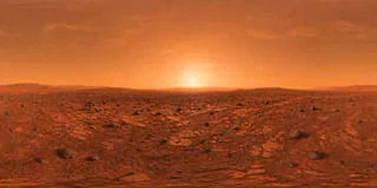

```text
generate{argument name="planet" default="Mars"} Isometric cylindrical projection panoramic image
```

Model: GPT Image 2
Author: GPT Image 2 Prompts

[ProjectD](https://aitoolsradar.com/en/prompts/e6c8b7021156d5) · [Recorded source](https://x.com/icreatelife/status/2046953229578080593)
 · [Full original metadata and byte evidence](data/projectd-batch-0038.json)

## Mars Rover Discovery Photo

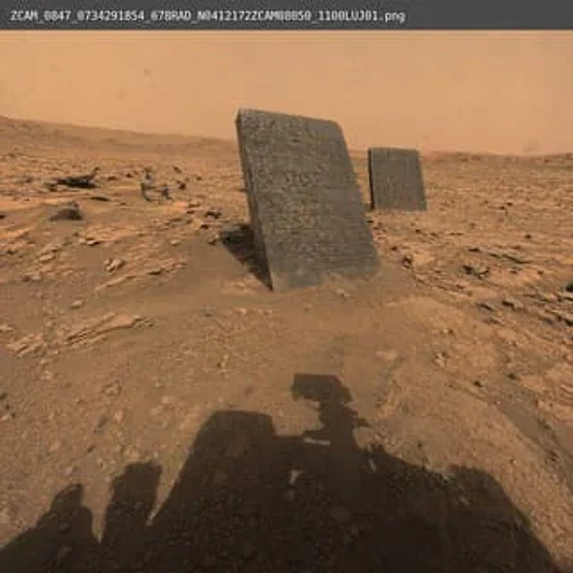

```text
A photo with a realistic, original space agency style, with a background of{argument name="setting" default="Martian terrain"} It includes red soil, scattered rocks, and a hazy orange sky. In the midground,{argument name="objects" default="Two dark stone slabs engraved with ancient hieroglyphs"} It protrudes from the ground at a slight angle. In the foreground, it is clearly visible.{argument name="foreground element" default="The shadow of the Mars rover"} Projected onto the rocky terrain, it reveals the perspective of the photograph. At the top edge of the image, there is a simple white text overlay, similar to the original filename, displaying as "{argument name="overlay text" default="ZCAM_0847_0734291854_678RAD_N0412172ZCAM08050_1100LUJ01.png"} The lighting is intense and realistic, simulating the effects of actual extraterrestrial surface photography.
```

Model: GPT Image 2
Author: GPT Image 2 Prompts

[ProjectD](https://aitoolsradar.com/en/prompts/816da9da9e79a0) · [Recorded source](https://x.com/MullerScot19970/status/2044613172641108240#reversed-3)
 · [Full original metadata and byte evidence](data/projectd-batch-0038.json)

## Mars Selfie Social Media Mockup

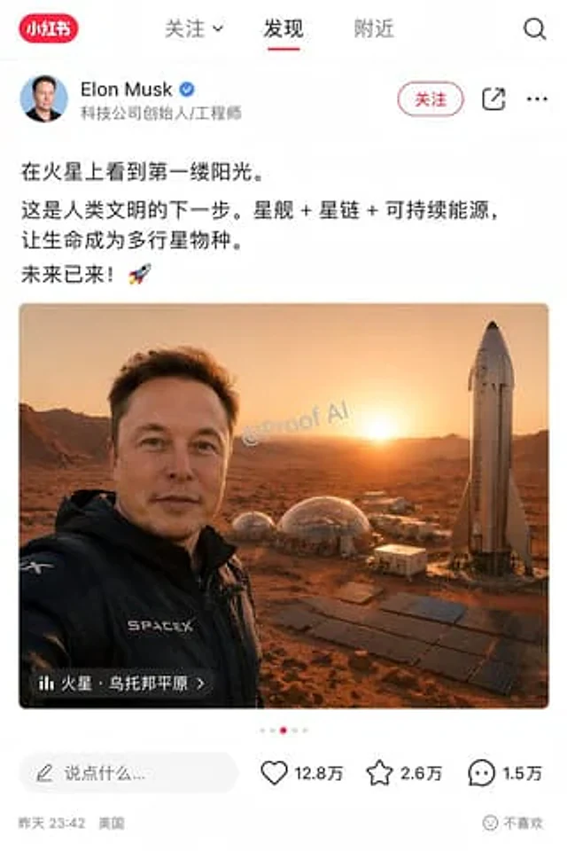

```text
{
  "type": "Social media application interface simulation diagram",
  "platform_style": "Xiaohongshu",
  "layout": {
    "header": {
      "logo": "A red pill icon with the words \"Xiaohongshu\" on it",
      "tabs": [
        "Follow v",
        "Discover",
        "nearby"
      ],
      "active_tab": "Discover",
      "icons": 1,
      "icon_types": [
        "search"
      ]
    },
    "user_profile": {
      "avatar": "portrait of Elon Musk",
      "name": "{argument name=\"user name\" default=\"Elon Musk\"}",
      "verified_badge": "Blue certification checkmark",
      "subtitle": "Technology company founder/engineer",
      "action_buttons": 3,
      "button_labels": [
        "focus on",
        "Share icon",
        "Ellipsis icon"
      ]
    },
    "post_content": {
      "text": "{argument name=\"post text\" default=\"Seeing the first rays of sunlight on Mars. This is the next step for human civilization. Starships + Starlink + sustainable energy will enable life to spread across multiple planets. The future is here! 🚀\"}",
      "image": {
        "description": "{argument name=\"image subject\" default=\"Elon Musk takes a selfie on Mars\"}",
        "clothing": "Black jacket with SPACEX logo",
        "background": "{argument name=\"background elements\" default=\"Starship rocket, geodesic habitat dome, solar array, Martian sunrise view\"}",
        "watermark": "@Proof AI",
        "location_overlay": {
          "icon": "bar chart",
          "text": "{argument name=\"location tag\" default=\"Mars - Utopia Plain &gt;\"}"
        }
      },
      "pagination_dots": 5
    },
    "footer": {
      "comment_input": "Say something...",
      "interaction_stats": 3,
      "stats_details": [
        {
          "icon": "Heart-shaped",
          "count": "128,000"
        },
        {
          "icon": "Star",
          "count": "26,000"
        },
        {
          "icon": "Bubble dialog box",
          "count": "15,000"
        }
      ],
      "metadata": "Yesterday at 23:42, USA",
      "feedback_button": "dislike"
    }
  }
}
```

Model: GPT Image 2
Author: GPT Image 2 Prompts

[ProjectD](https://aitoolsradar.com/en/prompts/d0f813453c5f48) · [Recorded source](https://x.com/JCutcut47692/status/2045846999032008876#reversed-1)
 · [Full original metadata and byte evidence](data/projectd-batch-0038.json)

## Mars Selfie With Alien and Rocket

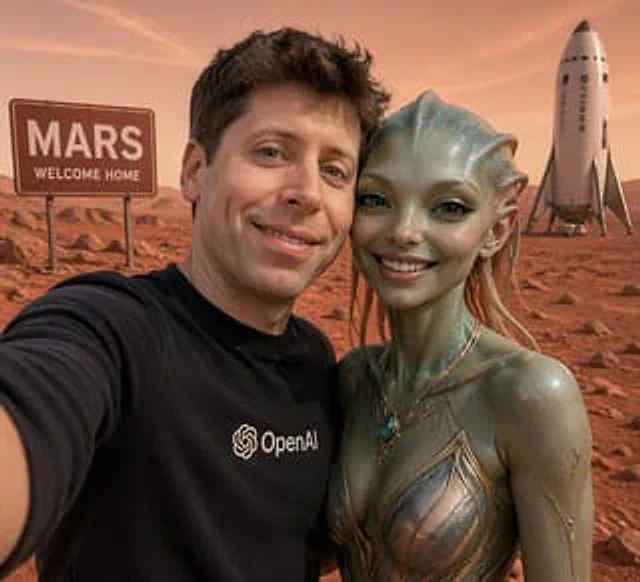

```text
A realistic selfie taken on the surface of Mars, presented from a casual wide-angle perspective using a smartphone, as if an arm is outstretched to take the picture. In the foreground are two busts: on the left is a human male wearing a black crew-neck shirt with a clear white OpenAI logo on the chest; on the right is a tall, elegant female alien with skin shimmering with a blue-green metallic sheen, long, slender ears, and delicate facial features. She wears a streamlined biomechanical-style outfit with bronze and silver tones, a deep neckline adorned with intricate decorative seams, and layered necklaces with a prominent blue gemstone pendant. The man has messy, short dark hair, and his left arm is outstretched towards the camera in a selfie pose. The alien stands close beside him, the two seemingly taking a friendly commemorative photo. The background is a red Martian rocky desert, scattered with pebbles and low hills, with a dusty, orange sunset in the sky. On the far left stands a road sign with two lines of text:{argument name="sign headline" default="MARS"} and{argument name="sign subtext" default="WELCOME HOME"} On the far right, in the distance, stands a huge, retro-futuristic white rocket, upright on landing supports, with clear vertical text on it.{argument name="rocket text" default="SPACEX"} The warm orange lighting, cinematic realism, rich detail and texture, subtle atmospheric haze, and social media announcement vibes, along with high detail and natural depth of field, create a stunning visual experience.
```

Model: GPT Image 2
Author: GPT Image 2 Prompts

[ProjectD](https://aitoolsradar.com/en/prompts/57e8f084ca7b24) · [Recorded source](https://x.com/aibiceps/status/2046512568332681686#reversed-0)
 · [Full original metadata and byte evidence](data/projectd-batch-0038.json)

## Mathematical Visualization Infographic Prompt

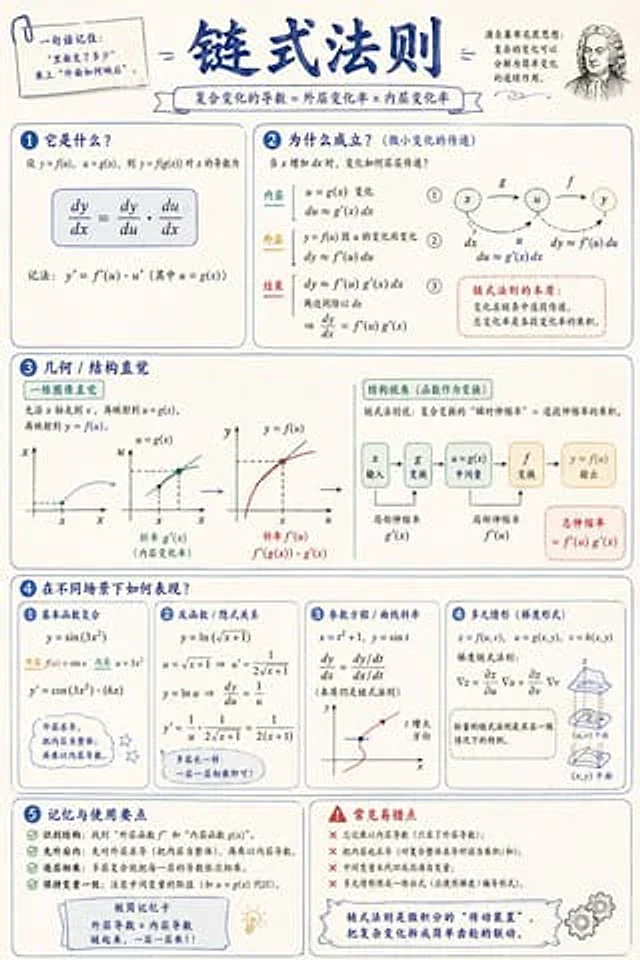

```text
请创作一张关于「{argument name="知识点" default="数学概念/知识点"}」的数学可视化信息图，目标是帮助读者直观理解：它是什么、为什么成立、几何/结构直觉是什么、在不同场景下如何表现。画面要像高质量数学讲义 + 手绘教育海报，优雅、清晰、信息丰富，但不要杂乱。

视觉风格：{argument name="画面比例" default="竖版或横版均可"}，干净的浅色纸张背景，深蓝标题，黑色/深灰正文线条，搭配少量优雅的蓝色、青绿色、金色、红色强调色。使用圆角卡片、细线边框、编号标签、手绘箭头、局部放大框和总结栏。整体要美观、平衡、有学术感，让人一眼看懂这个概念的“结构”和“为什么”。
```

Model: GPT Image 2
Author: 宝玉

[ProjectD](https://aitoolsradar.com/en/prompts/82f2a59b2e411a) · [Recorded source](https://youmind.com/prompts/hand-drawn-math-infographic-16260)
 · [Full original metadata and byte evidence](data/projectd-batch-0038.json)

## Matrix Sci-Fi Infographic Poster

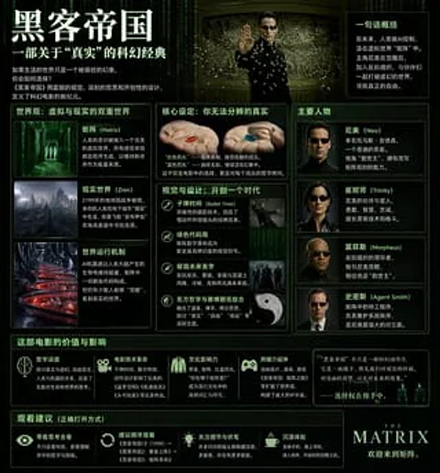

```text
{
  "type": "Cinematic Sci-Fi Infographic Poster",
  "subject": "The Matrix movie overview poster with a dark cyberpunk style",
  "language": "Chinese",
  "style": {
    "palette": [
      "black",
      "Dark green",
      "Neon Green",
      "dark gray",
      "White"
    ],
    "mood": "Mystery, philosophy, technology, dystopia",
    "finish": "High-detail digital posters featuring glowing green outlines, subtle matrix code ambiance, and a glossy sci-fi UI panel."
  },
  "headline": {
    "title": "{argument name=\"headline text\" default=\"The Matrix\"}",
    "subtitle": "A science fiction classic about \"reality\""
  },
  "layout": {
    "background": "Black background with subtle vertical green numerical codes, layered semi-transparent panels, slim glowing borders, and a cinematic sci-fi interface design.",
    "sections": [
      {
        "title": "In short",
        "position": "Top right corner",
        "count": 1,
        "labels": [
          "Summary text box"
        ]
      },
      {
        "title": "Worldview: A dual world of virtual and reality",
        "position": "upper left sidebar",
        "count": 3,
        "labels": [
          "Matrix",
          "Real World (Zion)",
          "World Operating Mechanism"
        ]
      },
      {
        "title": "Core concept: A reality you cannot distinguish.",
        "position": "upper center",
        "count": 1,
        "labels": [
          "Red Pills and Blue Pills"
        ]
      },
      {
        "title": "Visuals and Design: Ushering in a New Era",
        "position": "lower center",
        "count": 4,
        "labels": [
          "Bullet Time",
          "Green Code Rain",
          "Minimalist Future Aesthetics",
          "Combining Eastern philosophy with cyberpunk"
        ]
      },
      {
        "title": "Main characters",
        "position": "Middle of the right column",
        "count": 4,
        "labels": [
          "Neo",
          "Trinity",
          "Morpheus",
          "Agent Smith"
        ]
      },
      {
        "title": "The value and impact of this film",
        "position": "Lower middle section full width",
        "count": 4,
        "labels": [
          "philosophical depth",
          "Film technology revolution",
          "Cultural influence",
          "Cross-media extension"
        ]
      },
      {
        "title": "Viewing suggestions (correct way to watch)",
        "position": "bottom left wide",
        "count": 4,
        "labels": [
          "Look with thought",
          "It is recommended to watch them in order.",
          "Pay attention to details and foreshadowing",
          "Immersive experience"
        ]
      }
    ],
    "additional_elements": {
      "count": 4,
      "labels": [
        "Large title block in the upper left corner",
        "A blurred figure in the center raises a hand in front of an ornate wall.",
        "The Matrix logo in the bottom right corner",
        "Quote box above the logo"
      ]
    }
  },
  "imagery": {
    "top_center_image": "A figure dressed in black with reflective metallic dots and a blurred face stands in front of an ornate relief wall inside the building, raising one hand towards the audience.",
    "worldview_images": [
      "The green-toned corridor entrance representing the matrix",
      "The gray-blue cityscape representing ruins in the real world",
      "An organic machine cabin with a red glowing interior, representing the system's mechanism."
    ],
    "core_concept_image": "Two outstretched hands, against a dark background, offer red and blue pills.",
    "visual_design_images": [
      "Small stills of bullet time action poses",
      "Vertical green matrix code screen",
      "Group of characters wearing black coats and sunglasses",
      "The Yin-Yang symbol represents the fusion of Eastern philosophy and cyberpunk."
    ],
    "character_portraits": "On the right are four stacked portrait cards, each with a blurred face, dark clothing, and a brief description in Chinese.",
    "bottom_quote": "A dark quote panel with green quotation marks and two tiny silhouette figures."
  },
  "text_density": "Information-dense, magazine-like educational posters, with multiple paragraphs under each heading.",
  "rendering_notes": "All Chinese characters are presented clearly in a bold poster style, with cinematic spacing and glowing green accents; exquisite infographic composition, symmetrical grid, high contrast, and advanced streaming platform editing graphics."
}
```

Model: GPT Image 2
Author: GPT Image 2 Prompts

[ProjectD](https://aitoolsradar.com/en/prompts/b4524a96f1e349) · [Recorded source](https://x.com/run4want/status/2047471137404370982#reversed-2)
 · [Full original metadata and byte evidence](data/projectd-batch-0038.json)

## Maximalist Create Everything Poster

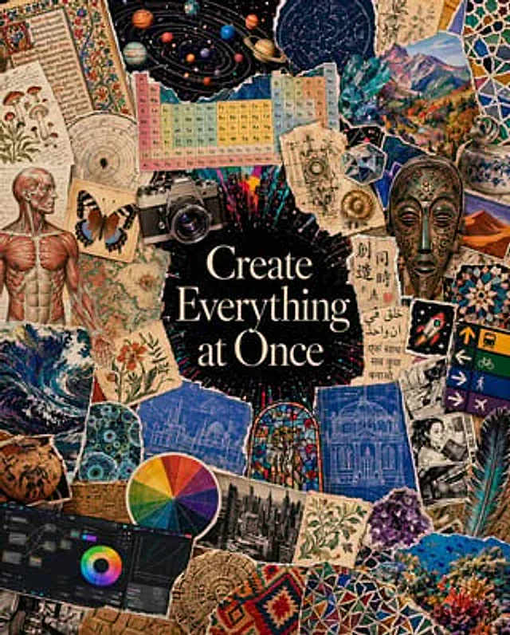

```text
A richly composed and layered maximalist collage poster, arranged vertically, aims to celebrate art, science, history, and human creativity. A large, irregular black ink blot or torn paper blank space is placed at the center, surrounded by radiating colorful stripes. The blank space is punctuated with elegant, large serif fonts bearing the following text:{argument name="headline text" default="Create Everything at Once"} The font color is a warm ivory. Around the center, 33 clearly visible items are arranged in a dense scrapbook style, their edges overlapping, like a meticulously curated mood board: In the upper left corner is a beautiful medieval manuscript with an ornate floral border, next to which is a botanical illustration of mushrooms, a star chart or astronomical map, at the top center an illustration of the solar system with planetary orbits against a backdrop of deep space, to the left center is a periodic table, to the right center is a circular night sky constellation map, a cluster of blue crystals, an oil painting of a mountain landscape, in the upper right corner is a fragment of a geometric mosaic tile, along the right edge is a blue-and-white porcelain teapot, to the right center is an ancient tribal mask, a torn vertical calligraphy page with multiple languages, a small isometric polyhedron or gemstone drawing, a pixel art rocket icon card, and a colorful directional sign with arrows and traffic symbols. On the right is a black and white architectural sketch, with an iridescent feather at the bottom right edge. The bottom right corner features a photograph of an underwater coral reef, a cluster of purple amethysts, a triangular geometric mosaic textile or tile pattern, a sample of a colorful woven textile, a circular carved stone calendar, and a black and white city skyline print. Near the bottom center is a drawing of plants and flowers, an illustration of a stained glass window, a blue architectural blueprint, a color wheel, and an abstract blue cellular or mineral micrograph. The bottom left corner features a print of a Japanese seascape in the style of "The Great Wave off Kanagawa," a fragment of ancient Greek pottery, an anatomical illustration of human muscles on the left, a butterfly specimen card, and a vintage silver camera in the center left. A second small plant and flower sketch is added near the bottom left center, and a fragment of a parchment map is inserted behind the camera area as subtle filler, while maintaining a total of 33 main objects. The design blends various media styles, including prints, scientific charts, vintage prints, fine art paintings, photography, textile patterns, blueprints, and digital design UI. Near the bottom left, add a dark computer interface panel displaying node-based creative software and color mixing tools with charts and circular color pickers, hinting at modern AI-assisted creation. Use torn paper edges, aged parchment textures, ink stains, saturated jewel tones, deep blues, golds, creams, and accents of neon cyan, magenta, oranges, and purples. The overall composition should appear vibrant, intelligent, and inspiring, with each object clearly discernible and carefully arranged into a seamless collage that blends museum and studio elements. High detail, editorial poster design, premium print quality, balanced chaos, strong contrasts, soft paper shadows, subtle depth created through layering, and no blank background outside the collage.
```

Model: GPT Image 2
Author: GPT Image 2 Prompts

[ProjectD](https://aitoolsradar.com/en/prompts/534c9b7f700169) · [Recorded source](https://x.com/weplash/status/2046688464293306676#reversed-0)
 · [Full original metadata and byte evidence](data/projectd-batch-0038.json)

## MayorkingAI #141

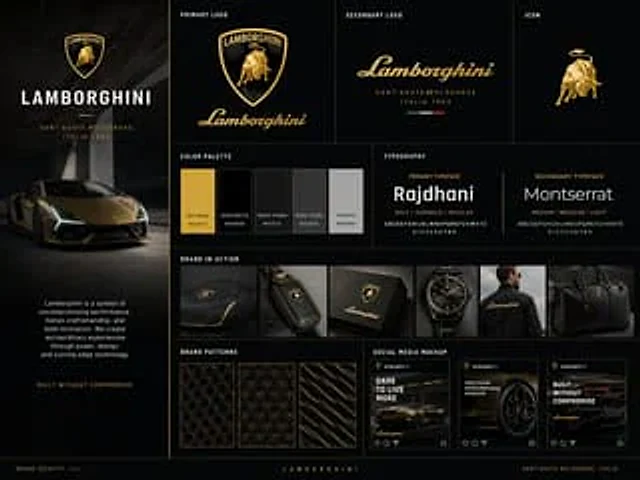

```text
Create a premium brand kit board for [BRAND NAME], presented like a professional branding studio slide. Show the existing brand identity in a clean, organized visual presentation. Include primary logo, secondary logo, icon, [COLOR PALETTE], typography pairing, branded packaging or product mockups, social media mockup, and simple brand pattern elements. Style: [STYLE]. Use a clean editorial grid, realistic materials, strong hierarchy, and polished presentation. Text to include: "[BRAND NAME]
```

Model: GPT Image 2
Author: MayorkingAI

[ProjectD](https://aitoolsradar.com/en/prompts/5de1f105fe67f8) · [Recorded source](https://x.com/MayorKingAI/status/2047375056125428013)
 · [Full original metadata and byte evidence](data/projectd-batch-0038.json)

## Maze Solver Transformation

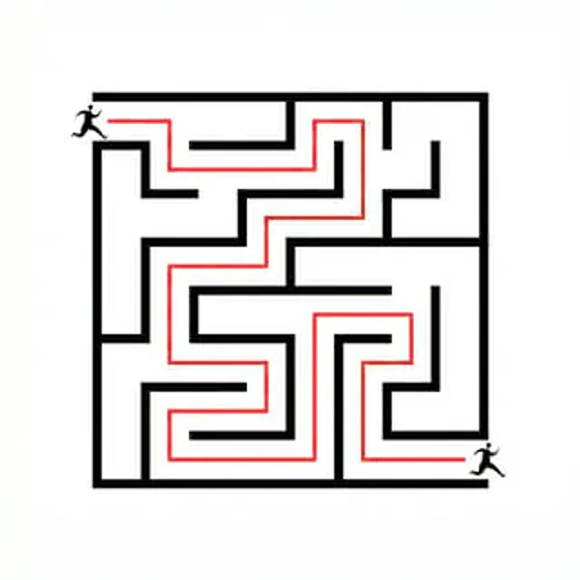

```text
Using the provided reference image, draw a continuous {argument name="path color" default="red"} Solve the maze using a line that traces the correct route from the top left entrance to the bottom right exit. Keep the maze walls and the two running figures unchanged.
```

Model: GPT Image 2
Author: GPT Image 2 Prompts

[ProjectD](https://aitoolsradar.com/en/prompts/fc0faec0ef5919) · [Recorded source](https://x.com/patelnamra573/status/2044470938125967861#reversed-1)
 · [Full original metadata and byte evidence](data/projectd-batch-0038.json)

## McDonald's x Starbucks Promo Poster

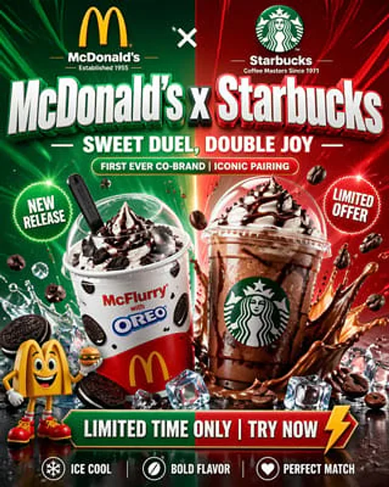

```text
{
  "type": "Fast food co-branded promotional poster",
  "style": "Highly refined commercial advertising style, glossy 3D product rendering, high contrast, dramatic lighting and shadows, ultra-high detail, social media ad design, combining near-photorealistic realism with stylized brand graphics.",
  "format": "Vertical Poster",
  "aspect_ratio": "2:3",
  "scene": {
    "background": "It is vertically divided in the middle, with the left half glowing green and the right half glowing red, featuring radiating beams of light, lens flare, floating particles, and a bright slit in the center.",
    "surface": "The damp, reflective black tabletop is scattered with ice cubes, coffee beans, cookie crumbs, water droplets, and condensation."
  },
  "branding": {
    "top_left": {
      "logo": "McDonald's Golden Arches",
      "subtext": "McDonald’s",
      "small_text": "Began in 1955"
    },
    "top_right": {
      "logo": "Starbucks Siren logo",
      "subtext": "Starbucks",
      "small_text": "The Barista began in 1971."
    },
    "top_center": "The white x symbol between the two brands"
  },
  "headline": {
    "main": "{argument name=\"headline text\" default=\"McDonald’s x Starbucks\"}",
    "subheadline": "Sweet showdown, double the joy",
    "banner_text": "First collaboration | Signature pairing"
  },
  "products": {
    "count": 2,
    "items": [
      {
        "position": "Left foreground",
        "name": "Oreo McFlurry",
        "cup": "Red and white McDonald's McFlurry cup featuring Oreo cookie design and yellow arches logo",
        "topping": "A swirl of vanilla soft serve ice cream, topped with glossy chocolate sauce.",
        "mix_ins": "Oreo cookie crumbs are visible around the cup and on top.",
        "spoon": "Insert a black McFlurry spoon into the dome area of ​​the dessert.",
        "temperature": "Cold drinks with ice cubes and splashing water effects"
      },
      {
        "position": "Right foreground",
        "name": "Starbucks Iced Chocolate Drinks",
        "cup": "Clear Starbucks plastic cup with a dome lid and the green siren logo",
        "drink": "A rich, mixed or iced chocolate coffee drink, with the inside of the cup coated with dark chocolate sauce.",
        "topping": "Topped with cream and drizzled with chocolate syrup",
        "temperature": "The cold drink features condensation droplets, is surrounded by ice cubes, and has a dramatic chocolate splatter effect around the base."
      }
    ]
  },
  "badges": {
    "count": 2,
    "items": [
      {
        "position": "Left middle",
        "shape": "Green star-shaped stamp",
        "text": "New Product Launch"
      },
      {
        "position": "Right middle",
        "shape": "Red star-shaped stamp",
        "text": "Limited-time offer"
      }
    ]
  },
  "character": {
    "count": 1,
    "position": "bottom left corner",
    "description": "A small, cheerful McDonald's mascot-style golden arch character with big cartoon eyes, a smiling face, white gloves, and red shoes, posing while holding a small hamburger."
  },
  "bottom_cta": {
    "main_bar": "Limited-time offer | Try it now",
    "accent": "The yellow lightning symbol on the right"
  },
  "feature_row": {
    "count": 3,
    "items": [
      {
        "icon": "Snowflakes in a circle",
        "text": "Cool and refreshing"
      },
      {
        "icon": "Coffee beans in a circle",
        "text": "Rich flavor"
      },
      {
        "icon": "Heart in the circle",
        "text": "Perfect match"
      }
    ]
  },
  "floating_elements": {
    "count": 6,
    "types": [
      "coffee beans",
      "Oreo cookies",
      "ice cubes",
      "water splash",
      "Chocolate splatter",
      "Spark particles"
    ]
  },
  "color_palette": {
    "primary": [
      "McDonald's Green Brand Halo",
      "Starbucks Red Promotional Halo",
      "White text",
      "Yellow accents",
      "Dark brown chocolate",
      "Black coffee",
      "Ice Blue Highlight"
    ]
  },
  "composition": "The symmetrical, confrontational layout centers on two beverages, with oversized embossed lettering in the upper center. Each beverage is surrounded by vibrant splash effects. The compact commercial poster layers and clear, legible text create a high-end collaborative aesthetic."
}
```

Model: GPT Image 2
Author: GPT Image 2 Prompts

[ProjectD](https://aitoolsradar.com/en/prompts/707d6fac0ff9ae) · [Recorded source](https://x.com/MindBodyIsLife/status/2047355054747787556#reversed-0)
 · [Full original metadata and byte evidence](data/projectd-batch-0038.json)

## McLaren GT3X Technical Blueprint Poster


```text
{
  "type": "Automotive Technology Blueprint Poster",
  "subject": {
    "vehicle": "{argument name=\"car model\" default=\"McLaren 720S GT3X\"}",
    "category": "Track-focused concept supercar",
    "brand": "McLaren",
    "primary render": {
      "view": "Front side low angle main visual image",
      "finish": "The body features a glossy dark metallic blue-grey finish, complemented by exposed carbon fiber aerodynamic components.",
      "accent color": "{argument name=\"accent color\" default=\"McLaren Orange\"}",
      "livery details": "The hood, front lip, side skirts, doors, diffuser, and rear are adorned with thin orange stripes; white 720 racing number plaques adorn the doors; black multi-spoke center-lock racing wheels; low-profile slick tires with yellow sidewall lettering; an oversized rear wing; an aggressive front lip; roof air intakes; a ventilated hood; deep side air intakes; and an extreme rear diffuser."
    },
    "poster text": {
      "headline": "{argument name=\"headline text\" default=\"McLAREN 720S GT3X\"}",
      "subheadline": "Track weapon concept",
      "project": "Project: M720S GT3X",
      "title block": "General layout and concept"
    },
    "palette": {
      "background": "Light gray drawing paper",
      "linework": "Blue-gray pencil and ink sketch lines",
      "text": "Charcoal gray and black",
      "highlight": "Orange accent text and thin stripes"
    }
  },
  "layout": {
    "style": "A clean and tidy engineering presentation project, with a grid background including technical annotations, dimension arrows, section frames, and a style that blends realistic renderings with hand-drawn blueprint sketches.",
    "sections": [
      {
        "title": "Orthographic view",
        "position": "upper half",
        "count": 4,
        "labels": [
          "Front view",
          "Rear view",
          "Side view",
          "Top view"
        ]
      },
      {
        "title": "Specification Block",
        "position": "upper left",
        "count": 2,
        "labels": [
          "Project/Chassis/Engine/Power/Torque/Transmission/Weight/Fuel/Class",
          "Aerodynamic Highlights"
        ]
      },
      {
        "title": "Component details box",
        "position": "The lower half surrounds the center rear view",
        "count": 8,
        "labels": [
          "Wheel and tire kit",
          "widebody fenders",
          "Suspension system",
          "Racing car specifications",
          "Rear diffuser and exhaust details",
          "Roof air intake and lighting system",
          "GT rear wing assembly",
          "Color and Coating Concepts"
        ]
      },
      {
        "title": "Main vehicle rendering view",
        "position": "Center and lower middle part",
        "count": 2,
        "labels": [
          "Front side main rendering image",
          "Rear view rendering"
        ]
      }
    ],
    "counts": {
      "orthographic drawings": 4,
      "main photoreal renders": 2,
      "component diagrams": 8,
      "color swatches": 4
    },
    "color swatches": [
      "Main color:{argument name=\"primary color\" default=\"McLaren Orange\"}",
      "Secondary color: Naru Grey",
      "Accent color: Carbon black",
      "Detail color: Satin white"
    ],
    "dimension annotations": "The orthographic view includes multiple metric measurements in millimeters, accompanied by horizontal and vertical arrows.",
    "branding": "The top right corner features the McLaren logo and signature mark, while the bottom right corner displays the project title block containing the date, scale, units, and drawing number."
  },
  "composition": "The poster is vertically oriented, highly detailed, and features a symmetrical layout of technical infographics. It showcases precise industrial design aesthetics, with a realistic reflection effect on the main vehicle rendering. The remaining areas are rendered in a Blueprint-style sketch with shadows, and the white-gray paper has a subtle worn look and drawing texture.",
  "quality": "Ultra-refined, accuracy-first, clear layout, a combination of conceptual art and engineering blueprints, a high-end automotive demonstration project."
}
```

Model: GPT Image 2
Author: GPT Image 2 Prompts

[ProjectD](https://aitoolsradar.com/en/prompts/d03b5b0c13e443) · [Recorded source](https://x.com/Ambani_Wessley/status/2046799050994053618#reversed-1)
 · [Full original metadata and byte evidence](data/projectd-batch-0038.json)

## McLaren GT3X Technical Blueprint Poster

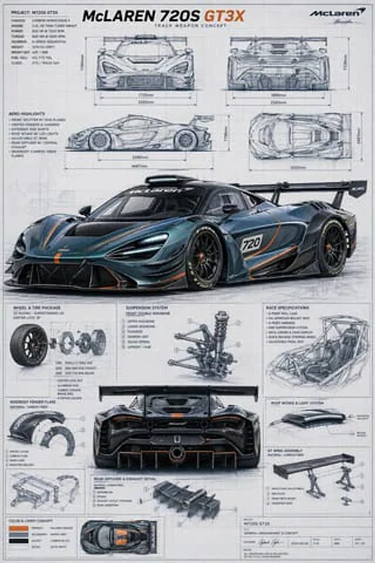

```text
{"type":"automotive technical blueprint poster","subject":{"vehicle":"{argument name=\"car model\" default=\"McLaren 720S GT3X\"}","category":"track weapon concept supercar","brand":"McLaren","primary render":{"view":"front three-quarter low angle hero shot","finish":"glossy dark metallic blue-gray body with exposed carbon fiber aero parts","accent color":"{argument name=\"accent color\" default=\"McLaren orange\"}","livery details":"thin orange striping across hood, splitter, side skirts, doors, diffuser, and rear surfaces, white race number panel with 720 on the door, black multi-spoke center-lock racing wheels, low-profile slick tires with yellow sidewall lettering, very large rear wing, aggressive front splitter, roof scoop, vented hood, deep side intakes, extreme rear diffuser"},"poster text":{"headline":"{argument name=\"headline text\" default=\"McLAREN 720S GT3X\"}","subheadline":"TRACK WEAPON CONCEPT","project":"PROJECT: M720S GT3X","title block":"GENERAL ARRANGEMENT & CONCEPT"},"palette":{"background":"light gray drafting paper","linework":"blue-gray pencil and ink sketch lines","text":"charcoal gray and black","highlight":"orange accent text and pinstripes"}},"layout":{"style":"clean engineering presentation board with grid background, technical callouts, dimension arrows, section boxes, and mixed photoreal render plus hand-drawn blueprint sketches","sections":[{"title":"orthographic views","position":"top half","count":4,"labels":["front view","rear view","side view","top view"]},{"title":"specification blocks","position":"upper left","count":2,"labels":["PROJECT / CHASSIS / ENGINE / POWER / TORQUE / GEARBOX / WEIGHT / FUEL / CLASS","AERO HIGHLIGHTS"]},{"title":"component detail boxes","position":"lower half around center rear view","count":8,"labels":["WHEEL & TIRE PACKAGE","WIDEBODY FENDER FLARE","SUSPENSION SYSTEM","RACE SPECIFICATIONS","REAR DIFFUSER & EXHAUST DETAIL","ROOF INTAKE & LIGHT SYSTEM","GT WING ASSEMBLY","COLOR & LIVERY CONCEPT"]},{"title":"main rendered vehicle views","position":"center and lower middle","count":2,"labels":["front three-quarter hero render","rear view render"]}],"counts":{"orthographic drawings":4,"main photoreal renders":2,"component diagrams":8,"color swatches":4},"color swatches":["primary: {argument name=\"primary color\" default=\"McLaren orange\"}","secondary: naroo grey","accent: carbon black","detail: satin white"],"dimension annotations":"include multiple metric measurements in millimeters around the orthographic views with horizontal and vertical arrows","branding":"top-right McLaren logo and signature-like mark, bottom-right project title block with date, scale, units, and sheet numbering"},"composition":"portrait poster, highly detailed, symmetrical technical infographic layout, precise industrial design aesthetic, realistic reflections on the hero car render, blueprint-style sketch shading everywhere else, white-gray paper with subtle wear and drafting texture","quality":"ultra-detailed, accuracy-first, crisp typography, concept-art meets engineering blueprint, premium automotive presentation board"}
```

Model: GPT Image 2
Author: Wesley

[ProjectD](https://aitoolsradar.com/en/prompts/04beaea97df63c) · [Recorded source](https://youmind.com/prompts/mclaren-gt3x-blueprint-poster-14866)
 · [Full original metadata and byte evidence](data/projectd-batch-0038.json)

## Mecha Base Technical Spec Sheet


```text
{
  "type": "mecha base technical specifications",
  "header": {
    "title": "{argument name=\"base name\" default=\"ネストベース・アウラ\"}",
    "subtitle": "{argument name=\"mecha name\" default=\"アークセリオン\"} Dedicated tactical deployment and maintenance base"
  },
  "mecha_design": "Highly detailed humanoid mechs, employing{argument name=\"mecha color scheme\" default=\"White and blue color scheme\"} Armor, equipped with{argument name=\"accent color\" default=\"Glowing blue\"} Energy-enhancing elements; complex mechanical joint structure.",
  "layout": {
    "structure": "The grid-based infographic consists of three rows of panels and features a dark industrial aesthetic with a dark background and white text or light gray panels.",
    "sections": [
      {
        "row": 1,
        "panels": [
          {
            "title": "Facilities Overview",
            "type": "text block"
          },
          {
            "title": "Basic Specifications",
            "type": "data table"
          },
          {
            "title": "Overall cross-section of the base",
            "type": "illustration",
            "description": "A large, detailed cross-section shows the four-story underground hangar and the mech located at the center."
          },
          {
            "title": "Host library internal",
            "type": "illustration",
            "description": "The mech stands inside a highly detailed industrial maintenance bay, complete with walkways."
          },
          {
            "title": "Host library size",
            "type": "diagram",
            "count": 3,
            "labels": [
              "Top view",
              "Front view",
              "Side view"
            ],
            "description": "Orthographic blueprint of the hangar."
          }
        ]
      },
      {
        "row": 2,
        "panels": [
          {
            "title": "boarding equipment",
            "type": "illustration",
            "description": "A close-up of the mech's torso, connecting to the pilot's boarding arm."
          },
          {
            "title": "Weapon replacement/transportation area",
            "type": "illustration",
            "description": "Industrial grounds, equipped with automated transport vehicles and weapon racks."
          },
          {
            "title": "Back component maintenance equipment",
            "type": "illustration",
            "description": "Rear view of the mech, showing the thruster wings being maintained."
          },
          {
            "title": "Main energy/cooling infrastructure",
            "type": "illustration",
            "description": "Heavy industrial pipes, generators, and cooling tanks."
          }
        ]
      },
      {
        "row": 3,
        "panels": [
          {
            "title": "Launching system: Spinal ejector",
            "type": "illustration",
            "description": "Long-range perspective lens of the electromagnetic catapult tunnel."
          },
          {
            "title": "transmission sequence",
            "type": "sequence",
            "count": 10,
            "description": "A series of thumbnails show the process of the mech starting up, moving along the track, and launching."
          },
          {
            "title": "External launch port",
            "type": "illustration",
            "description": "External perspective, showcasing embedded{argument name=\"environment\" default=\"mountainous terrain\"} The heavy-duty reinforced explosion-proof door is inside, and the mech is flying out of it."
          }
        ]
      }
    ]
  }
}
```

Model: GPT Image 2
Author: GPT Image 2 Prompts

[ProjectD](https://aitoolsradar.com/en/prompts/80bbcaa3730483) · [Recorded source](https://x.com/old_pgmrs_will/status/2044439170870026306#reversed-0)
 · [Full original metadata and byte evidence](data/projectd-batch-0038.json)

## Mecha Base Technical Spec Sheet

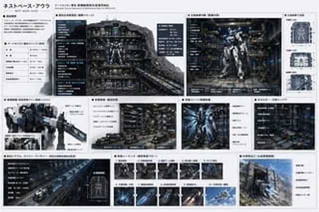

```text
{
  "type": "sci-fi mecha base technical specification sheet",
  "style": "{argument name=\"ui theme\" default=\"technical schematic with dark grey panels and white text\"}",
  "header": {
    "title": "{argument name=\"base name\" default=\"ネストベース・アウラ\"}",
    "subtitle": "Dedicated Tactical Deployment & Maintenance Base for {argument name=\"mecha name\" default=\"アークセリオン\"}"
  },
  "layout": {
    "structure": "grid-based infographic with 3 main horizontal rows",
    "row_1": [
      {
        "title": "Facility Overview & Basic Specs",
        "content": "2 text blocks including a specification table with 5 rows"
      },
      {
        "title": "Base Overall Cross-section",
        "content": "Large cutaway view of the underground base showing 4 distinct levels (LEVEL 1 to LEVEL 4)"
      },
      {
        "title": "Main Hangar Interior",
        "content": "Front view of a {argument name=\"mecha color scheme\" default=\"white and blue\"} mecha in a maintenance bay, with 4 deck levels labeled on the left"
      },
      {
        "title": "Hangar Dimensions",
        "content": "3 orthographic wireframe-style views (Top, Front, Side) with dimension lines"
      }
    ],
    "row_2": [
      {
        "title": "Boarding Equipment",
        "content": "Close-up of the mecha's upper body and cockpit boarding arm"
      },
      {
        "title": "Weapon Transport Area",
        "content": "Detailed view of automated transport vehicles and magnetic rails"
      },
      {
        "title": "Rear Unit Maintenance",
        "content": "Back view of the mecha showing glowing blue thrusters and maintenance frames"
      },
      {
        "title": "Energy & Cooling Infrastructure",
        "content": "Dense machinery wall with pipes and super-conducting equipment"
      }
    ],
    "row_3": [
      {
        "title": "Launch System: Spine Launcher",
        "content": "Long perspective view of an electromagnetic catapult tunnel, plus 1 small cross-section diagram"
      },
      {
        "title": "Launch Sequence",
        "content": "Grid of 10 sequential images showing the mecha's launch process step-by-step"
      },
      {
        "title": "External Launch Port",
        "content": "Exterior view of the base built into a {argument name=\"base location\" default=\"Mountain fortress\"} wall, showing camouflage armor and blast doors"
      }
    ]
  }
}
```

Model: GPT Image 2
Author: いにしえ@AI Director & Creator｜Will Oldgram

[ProjectD](https://aitoolsradar.com/en/prompts/cbcd2fd1064889) · [Recorded source](https://youmind.com/prompts/mecha-base-technical-specs-13688)
 · [Full original metadata and byte evidence](data/projectd-batch-0038.json)

## Mecha Girl Sea-City Key Visual

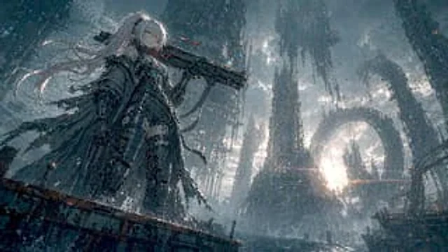

```text
A mecha girl mid-teens, pale skin smudged with soot and salt spray, sharp amber eyes with glowing HUD reticles, waist-length ash-white hair tied in a high ponytail whipping in the sea wind, matte gunmetal exoskeleton armor plating her shoulders, forearms and shins, exposed hydraulic pistons at the joints, chest rig with glowing cyan coolant lines, oversized oil-stained hangar jacket half slipping off one shoulder, a massive rail cannon resting on her right shoulder, dog tags and frayed red ribbon at her collar , standing off-center to the left on the rusted edge of a tilted steel platform jutting out over dark water, weight shifted onto one leg, left hand gripping the cannon strap, head turned slightly toward camera with a quiet defiant stare, steam venting from her back thrusters, her ponytail and jacket streaming sideways in the salt wind , a vast derelict sea-city at dusk, colossal megastructures of unknown purpose rising from the ocean in staggered silhouettes, bone-white monolithic towers fused with barnacled steel, cyclopean ring-shaped constructs canted at broken angles, rusted skeletal gantries threaded with dead cables, dark swells rolling between the pylons, shipwrecks half-swallowed at their feet, thick sea fog clinging to the bases while the upper structures pierce into a bruised sky, scattered faint lights blinking high in the towers like distant eyes , moody low-key lighting, cold teal ambient from the overcast sky, warm amber sodium glow leaking from a distant structure camera-right, hard backlight from a low sun behind the towers carving her silhouette, volumetric god rays cutting through sea mist, wet specular highlights on her armor , 35mm anamorphic lens, slight low angle looking up past her shoulder toward the structures, medium-wide shot, shallow depth of field with foreground rust in soft focus, horizontal lens flares, fine atmospheric haze compressing the distant megastructures into layered silhouettes , cinematic anime key visual, painterly digital illustration with crisp line art, desaturated oceanic palette of teal, bone-white and rust punched by small warm accent lights, film grain, high-contrast editorial poster aesthetic . Format 16:9.
```

Model: GPT Image 2
Author: @old_pgmrs_will

[ProjectD](https://aitoolsradar.com/en/prompts/02d69403beb866) · [Recorded source](https://x.com/old_pgmrs_will/status/2046144801071079612)
 · [Full original metadata and byte evidence](data/projectd-batch-0038.json)

## Mecha Ink Wash Landscape Painting


```text
A picture{argument name="art style" default="Traditional Chinese ink painting"} It depicts a huge{argument name="mecha subject" default="Unit-01"} Blending into the misty, mountainous landscape. The purple of the mecha and {argument name="accent color" default="Jade Green"} The aircraft blends seamlessly with the rugged rocks and dark ink marks, its horned head emerging from the thick fog. The scene includes steep cliffs, waterfalls, pine trees, a small traditional pagoda, and a flock of birds flying through the central mist. Vertical Chinese calligraphy in the upper left corner reads…{argument name="main calligraphy text" default="Unit-01"} "and"{argument name="secondary calligraphy text" default="Human creations also include mountains and rivers."} The work is marked with a red seal. There is a second red seal in the lower right corner. The entire work presents expressive brushstrokes, ink washes, and the texture of vintage paper.
```

Model: GPT Image 2
Author: GPT Image 2 Prompts

[ProjectD](https://aitoolsradar.com/en/prompts/ca258e6d096a4e) · [Recorded source](https://x.com/passluo/status/2045101968960766108#reversed-0)
 · [Full original metadata and byte evidence](data/projectd-batch-0038.json)

## Mecha Protagonist Design


```text
for{argument name="anime genre" default="Robot Animation"} The protagonist designs a cutting-edge mech.
```

Model: GPT Image 2
Author: GPT Image 2 Prompts

[ProjectD](https://aitoolsradar.com/en/prompts/46abd60004735b) · [Recorded source](https://x.com/old_pgmrs_will/status/2044432354979328317)
 · [Full original metadata and byte evidence](data/projectd-batch-0038.json)

## Mecha Protagonist Design


```text
{argument name="作品ジャンル" default="ロボットアニメ"}の主人公が乗る最先端のデザインを設計して
```

Model: GPT Image 2
Author: いにしえ@AI Director & Creator｜Will Oldgram

[ProjectD](https://aitoolsradar.com/en/prompts/03e263fe906a33) · [Recorded source](https://youmind.com/prompts/futuristic-mecha-protagonist-14056)
 · [Full original metadata and byte evidence](data/projectd-batch-0038.json)

## Mecha-Girl Character Design Sheet


```text
A document about{argument name="gender" default="woman"}{argument name="character type" default="androids"} Character design sketches; this character can transform into a streamlined form.{argument name="vehicle type" default="Space combat vehicles"} The language is Korean.
```

Model: GPT Image 2
Author: GPT Image 2 Prompts

[ProjectD](https://aitoolsradar.com/en/prompts/3c18b48195bf17) · [Recorded source](https://x.com/iceemperor/status/2044747172617630015)
 · [Full original metadata and byte evidence](data/projectd-batch-0038.json)

## Mechanical Keyboard Product Page Mockup


```text
Create a clean and modern e-commerce product detail page to display a product named {argument name="brand name" default="KeyForge"} This is a high-end mechanical keyboard brand. The page presents a high-fidelity desktop website model with a white background, light gray dividing lines, and ample white space. The layout is a unified store scene, including a top navigation bar, a left-hand product thumbnail bar, a large central product image, and a right-hand purchase information panel. At the top left of the header is a bold brand logo, followed by seven navigation items: "Keyboards," "Switches," "Keycaps," "Accessories," "Sale," "Blog," and "Support." On the far right are three icons: search, account, and shopping cart. The shopping cart icon has a small black notification badge showing a "1." The main product displayed in the center is a 75% layout compact mechanical keyboard, photographed from a slightly downward front angle, placed on a light gray display stand. It features a silver aluminum alloy casing, white and gray keycaps, a few light purple function keys, and a silver volume knob in the upper right corner. The left-hand vertical gallery contains five thumbnails: a selected front view of the product, a side view of the keyboard, a close-up of the mechanical switches, a close-up of the keycap texture, and a dark video thumbnail with a circular play icon. The right-hand product panel includes a small capsule label that reads "NEW" and the product name in bold font.{argument name="product name" default="KeyForge K75 Pro"} The subtitle is "75% Mechanical Keyboard," followed by a 5-star rating of 4.8 stars and "(126 reviews)," and the price in bold font.{argument name="price" default="$129.99"} The subsequent green "In Stock" status is followed by a brief description of its superior performance, Gasket design, QMK/VIA support, and RGB lighting effects. Below this is a "Switch Type" selector with four capsule buttons labeled "Cherry MX Red," "Gateron Brown," "Gateron Blue," and "TTC Gold Pink," with the first one selected by default; a "Color" selector with three capsule buttons labeled "White/Purple," "Black/Gray," and "Navy/Blue," with the first one selected by default; a "Quantity" dropdown menu set to "1"; a large black main button with a shopping cart icon labeled "Add to Cart"; and a secondary button with a heart-shaped outline labeled "Add to Wishlist." Below the button, three horizontal service highlights with small icons are displayed: "Free Shipping" with the subtitle "On orders over $99", "30-Day Returns" with the subtitle "Hassle-free returns", and "2-Year Warranty" with the subtitle "Peace of mind". Below this content area, a two-column layout is created, separated by thin lines. The left side features a vertical list of labels containing five items: "Overview" (selected), "Specifications", "What's in the Box", "Shipping &amp; Returns", and "Reviews (126)". To the right of the labels, a rounded white grid of function cards is placed, containing six function blocks in two rows and three columns. Each function block has a simple line icon, a bold title, and a brief description: "75% Layout", "Gasket-Mounted", "QMK/VIA Support", "Hot-Swappable", "RGB Backlighting", and "Premium Build". On the far right of this area, a specification list containing seven key points is added: “Layout: 75% (82 Keys)”, “Switch Type: Cherry MX Red”, “Mounting: Gasket-Mounted”, “Connectivity: USB-C (Wired)”, “Backlight: RGB, South-facing”, “Material: Aluminum Case”, and “Dimensions: 322 x 135 x 42 mm”, with a final point: “Weight: 1.25 kg”. It adopts a refined minimalist product design aesthetic, featuring realistic UI spacing, a clean sans-serif font similar to Intel or SF Pro, soft shadows, subtle rounded corners, monochrome icons, and a sophisticated startup-style consumer electronics presentation.
```

Model: GPT Image 2
Author: GPT Image 2 Prompts

[ProjectD](https://aitoolsradar.com/en/prompts/92d41a70227e17) · [Recorded source](https://x.com/xuanyuanzhifeng/status/2046533787329458305#reversed-1)
 · [Full original metadata and byte evidence](data/projectd-batch-0038.json)

## Medical Infographic JSON Prompt


```text
{
  "type": "Comprehensive Medical Infographic",
  "style": "Highly detailed 3D medical illustrations with a clinical white background and clean typography.",
  "header": {
    "title_cn": "The causal chain of a heart attack",
    "title_en": "{argument name=\"english title\" default=\"THE CAUSAL CHAIN OF HEART ATTACK\"}",
    "subtitle": "Chest pain is not the starting point; vascular damage is.",
    "top_right_sequence": {
      "count": 6,
      "labels": [
        "Risk factors",
        "plaque formation",
        "plaque rupture",
        "thrombosis",
        "ischemia",
        "damage"
      ]
    }
  },
  "centerpiece": {
    "description": "{argument name=\"central figure\" default=\"A transparent human anatomical model showcasing the heart, coronary arteries, lungs, and vascular system.\"}",
    "details": "by{argument name=\"highlight color\" default=\"glowing red\"} The highlighted path emphasizes the coronary artery and the pain radiating to the chest and left arm."
  },
  "layout": {
    "left_column": [
      {
        "id": "01",
        "title": "Key risk factors",
        "elements": 6,
        "labels": [
          "Smoking",
          "High LDL cholesterol",
          "hypertension",
          "diabetes",
          "obesity",
          "Chronic stress"
        ]
      },
      {
        "id": "02",
        "title": "The development of atherosclerosis",
        "elements": 2,
        "labels": [
          "From fatty streaks to plaques",
          "Coronary artery wall"
        ]
      },
      {
        "id": "03",
        "title": "Reduced coronary blood flow",
        "elements": 2,
        "labels": [
          "Arterial stenosis",
          "oxygen delivery decrease"
        ]
      },
      {
        "id": "04",
        "title": "Vulnerable plaques",
        "elements": 2,
        "labels": [
          "Thin fiber cap",
          "lipid-rich core"
        ]
      }
    ],
    "center_overlay": [
      {
        "id": "05",
        "title": "Plaque rupture and thrombosis",
        "elements": 3,
        "labels": [
          "Schematic diagram of plaque rupture",
          "Platelet aggregation",
          "Occlusive thrombosis"
        ]
      },
      {
        "id": "06",
        "title": "Myocardial ischemia",
        "elements": 1,
        "labels": [
          "Cross-section of myocardium in coronary artery obstruction"
        ]
      }
    ],
    "right_column": [
      {
        "id": "07",
        "title": "Cell damage cascade",
        "elements": 4,
        "labels": [
          "hypoxia",
          "Mitochondrial failure",
          "Cell membrane rupture",
          "Troponin release"
        ]
      },
      {
        "id": "08",
        "title": "acute heart attack",
        "elements": 1,
        "labels": [
          "The patient clutching his chest"
        ]
      },
      {
        "id": "09",
        "title": "Permanent myocardial damage",
        "elements": 1,
        "labels": [
          "Necrotic myocardial tissue"
        ]
      },
      {
        "id": "10",
        "title": "complication",
        "elements": 2,
        "labels": [
          "arrhythmia",
          "Heart failure"
        ]
      },
      {
        "id": "11",
        "title": "Effects outside the heart",
        "elements": 2,
        "labels": [
          "Reduced systemic perfusion",
          "Effects on the brain and kidneys"
        ]
      }
    ],
    "bottom_row": [
      {
        "id": "12",
        "title": "Pain is the final signal",
        "elements": 7,
        "labels": [
          "Risk Exposure",
          "plaque buildup",
          "Arterial stenosis",
          "plaque rupture",
          "thrombosis",
          "Myocardial necrosis",
          "People in pain"
        ]
      }
    ]
  },
  "theme": "{argument name=\"disease focus\" default=\"Heart attack and coronary artery blockage\"}"
}
```

Model: GPT Image 2
Author: GPT Image 2 Prompts

[ProjectD](https://aitoolsradar.com/en/prompts/7d4a70fb76493a) · [Recorded source](https://x.com/LudovicCreator/status/2046891801072501046)
 · [Full original metadata and byte evidence](data/projectd-batch-0038.json)

## Medical Infographic Prompt


```text
Create a detailed{argument name="infographic topic" default="Human medical information diagram"} It displays major organs and the survival time a person can have after losing each organ. It uses a centrally transparent human model, clearly labeled organs, and a simple layout.{argument name="design style" default="Modern Poster Design"} .
```

Model: GPT Image 2
Author: GPT Image 2 Prompts

[ProjectD](https://aitoolsradar.com/en/prompts/59b899928a4d8a) · [Recorded source](https://x.com/SciTechera/status/2047275850878640596)
 · [Full original metadata and byte evidence](data/projectd-batch-0038.json)

## Medical Program Promotional Flyer


```text
{
  "type": "flyers",
  "style": "Simple, medical, professional, and transparent",
  "color_palette": [
    "White",
    "Dark green",
    "black"
  ],
  "layout": {
    "hero": {
      "headline": "{argument name=\"main headline\" default=\"Two weeks to understand the truth about your body.\"}",
      "subheadline": "{argument name=\"program name\" default=\"Blood glucose monitoring program\"}",
      "image": "{argument name=\"hero image subject\" default=\"An Asian woman in a white T-shirt smiles and looks to the upper right, a round, white dynamic blood glucose monitoring sensor attached to her upper arm. The background is bright and clear, with blurry vegetation.\"}",
      "intro_text_paragraphs": 4
    },
    "middle_section": {
      "box_title": "Project Content",
      "checklist_count": 7,
      "checklist_items": [
        "Libre sensor wearable and dedicated app installation support",
        "Diet and lifestyle inquiry",
        "Blood glucose level learning materials",
        "2-week blood glucose monitoring",
        "Mid-term feedback (LINE)",
        "Final Feedback (LINE)",
        "Personal blood glucose report"
      ],
      "visuals": [
        "A smartphone UI model displaying a blood glucose reading of '112' and a green line graph.",
        "A dark green circular badge with the text 'Gain insights into your daily life through data.'"
      ]
    },
    "bottom_section": {
      "recommendations_title": "Recommended audience",
      "recommendations_count": 3,
      "recommendations_items": [
        "I was told during the physical exam that I needed to monitor my blood sugar levels.",
        "I paid attention to my diet, but the numbers didn't improve.",
        "Want to know what kind of diet suits you?"
      ],
      "pricing": {
        "label": "cost",
        "amount": "{argument name=\"price\" default=\"¥35,000\"}",
        "note": "(Includes tax and sensor costs)"
      }
    },
    "footer": {
      "background_color": "Dark green",
      "provider": "{argument name=\"company name\" default=\"Centenarian Manufacturing Plant\"}",
      "representative": "Health consultant Lin Lisheng",
      "contact_info": "Telephone placeholders and supporting text",
      "badge": "A round badge with the text 'Feel free to contact us anytime'."
    }
  }
}
```

Model: GPT Image 2
Author: GPT Image 2 Prompts

[ProjectD](https://aitoolsradar.com/en/prompts/3c1b2a91230c94) · [Recorded source](https://x.com/ryuta_fit/status/2045370162627629275#reversed-0)
 · [Full original metadata and byte evidence](data/projectd-batch-0038.json)

## Medieval Shot Reverse Shot


```text
A series of cinematic medieval reverse shots, presented as grainy historical film stills, utilize a 21:9 ultrawide aspect ratio, overcast natural light, soft earth tones, a damp autumn atmosphere, realistic muddy textures, shallow depth of field, and strong over-the-shoulder composition. The scene is set on a muddy country road winding through a rural valley, flanked by rough wooden fences. In the distance are low, rolling hills covered with sparse trees, open fields, and a light-colored stone farmhouse or church on a hillside to the right. Two characters stand facing each other on the road. One is a weary medieval peasant, wearing a dirty brown tunic and hat, of medium build, carrying a wooden-handled axe on his shoulder and a leather belt across his chest. The other is a knight or armed traveler, wearing dark, weathered chainmail and a tattered hooded blouse, standing warily. Please create a reverse shot demonstration using cinematic grammar: First frame shown.{argument name="foreground character" default="Farmer carrying an axe"} From the perspective of his back in the right foreground, his shoulders and back occupy the right foreground of the image, while{argument name="background character" default="Knight in chainmail"} The first frame shows the knight in a full-body shot on the left, facing the camera and standing on a muddy road; the second frame reverses the angle, showing the knight's shoulders and hooded back blurred in the left foreground, while the farmer stands in the right mid-ground, carrying an axe. Maintaining consistency in location, weather, clothing, lens quality, and spacing between characters in both shots creates a restrained dramatic realism and a tense confrontational atmosphere.
```

Model: GPT Image 2
Author: GPT Image 2 Prompts

[ProjectD](https://aitoolsradar.com/en/prompts/d102bbb58a034a) · [Recorded source](https://x.com/Martinolli/status/2047603946202485009#reversed-0)
 · [Full original metadata and byte evidence](data/projectd-batch-0038.json)

## Meem #112


```text
{
  "master_prompt": {
    "product": {
      "type": "luxury body deodorant",
      "brand_name": "VELORÉ",
      "product_line": "Pure Aura",
      "container_style": "sleek cylindrical deodorant stick with softly rounded edges",
      "material": "frosted glass body with brushed champagne-gold metal accents",
      "finish": "velvety matte surface with refined metallic detailing",
      "cap_design": "magnetic cap with polished gold rim and engraved crest",
      "branding": "minimal serif logo etched vertically with understated elegance",
      "dispense_style": "precision twist-up deodorant balm with smooth surface finish",
      "color": "warm ivory body with subtle golden undertones",
      "accent_details": "champagne gold band and minimal crest emblem",
      "texture_details": "soft satin deodorant balm surface visible at top"
    },

    "composition": {
      "scene_type": "ultra-cinematic luxury personal care advertising photography",
      "orientation": "vertical",
      "aspect_ratio": "4:5",
      "camera_angle": "low hero angle emphasizing elegance and premium form",
      "subject_position": "deodorant standing upright on reflective surface",
      "motion": "fine mist spray particles suspended mid-air for freshness effect"
    },

    "environment": {
      "background": "soft warm marble gradient fading into shadow",
      "atmosphere": "light spa mist creating a serene premium ambiance",
      "floating_elements": [
        "delicate mist particles suspended in air",
        "white orchid petals drifting gently",
        "tiny golden light particles shimmering softly",
        "fresh eucalyptus leaves floating nearby",
        "soft vapor trails suggesting freshness"
      ],
      "surface_effects": "glossy reflections with micro condensation droplets enhancing freshness"
    },

    "lighting": {
      "style": "soft spa-inspired studio lighting",
      "key_light": "diffused overhead light revealing frosted texture",
      "rim_lights": "subtle warm highlights outlining silhouette",
      "accent_lights": "soft golden glow enhancing luxury appeal",
      "shadow_depth": "gentle shadows for calm elegance",
      "contrast": "balanced contrast with luminous clean highlights"
    },

    "color_palette": {
      "primary_colors": ["warm ivory", "soft cream", "clean white"],
      "accent_colors": ["champagne gold", "botanical green"]
    },

    "camera_settings": {
      "lens": "macro cinema lens",
      "depth_of_field": "shallow depth isolating product",
      "focus_point": "engraved logo and frosted glass texture",
      "bokeh": "soft luminous bokeh from mist particles",
      "detail_capture": "extreme micro-detail clarity"
    },

    "render_quality": {
      "resolution": "8K ultra high definition",
      "render_style": "hyper-realistic luxury personal care commercial render",
      "material_physics": "accurate frosted glass translucency and metallic reflections",
      "particle_simulation": "physically accurate mist and condensation droplets",
      "textures": "ultra-detailed frosted glass, metallic accents, and balm surface",
      "sharpness": "tack sharp product focus with soft cinematic background",
      "noise": "none",
      "artifacts": "none"
    },

    "mood": {
      "tone": "pure, refined, and ultra-premium",
      "emotion": "freshness, confidence, and indulgent self-care luxury"
    },

    "final_output": {
      "usage": "luxury personal care campaign and premium wellness advertising",
      "branding_focus": "hero product freshness with elite wellness appeal",
      "visual_style": "cinematic luxury spa aesthetic"
    }
  }
}
```

Model: GPT Image 2
Author: Meem

[ProjectD](https://aitoolsradar.com/en/prompts/b6083e770d1b69) · [Recorded source](https://x.com/mehvishs25/status/2025391098437529837)
 · [Full original metadata and byte evidence](data/projectd-batch-0038.json)

## Meem #117


```text
{
  "global_settings": {
    "resolution": "8K ultra-high-definition",
    "aspect_ratio": "3:4 vertical",
    "render_style": "hyper-realistic commercial food photography",
    "quality": "premium advertising grade",
    "sharpness": "extreme micro-detail, crisp edges",
    "noise": "none",
    "artifacts": "none",
    "depth_of_field": "shallow, subject-focused",
    "motion": "frozen mid-air ingredients",
    "background_style": "solid single-color studio backdrop"
  },

  "subject": {
    "main_food": "chocolate chip cookies",
    "quantity": 3,
    "appearance": [
      "golden-brown freshly baked cookies",
      "soft cracked surface",
      "visible melted chocolate chips",
      "slightly crisp edges",
      "natural handmade texture"
    ],
    "branding_rules": [
      "no text",
      "no logo",
      "no embossing",
      "no patterns",
      "no symbols"
    ]
  },

  "secondary_elements": {
    "ingredients_flying": [
      "dark chocolate chunks",
      "cookie crumbs",
      "fine sugar crystals"
    ],
    "motion_style": "dynamic floating explosion",
    "distribution": "balanced around the cookies, natural randomness",
    "particle_detail": "sharp, frozen motion with depth separation"
  },

  "composition": {
    "camera_angle": "slightly low angle",
    "framing": "center-weighted hero composition",
    "spacing": "clean negative space around subject",
    "focus_priority": "front cookie in razor-sharp focus"
  },

  "lighting": {
    "type": "professional studio lighting",
    "key_light": "soft directional key light",
    "fill_light": "gentle fill for texture clarity",
    "rim_light": "subtle rim highlight for separation",
    "shadows": "soft and natural, no harsh contrast"
  },

  "color_palette": {
    "background_color": "pastel blue",
    "cookie_tones": "warm golden browns",
    "accent_colors": "rich chocolate browns, crystal sugar whites",
    "contrast": "high subject-background separation"
  },

  "photography_style": {
    "genre": "luxury food advertising",
    "mood": "fresh, indulgent, premium",
    "cleanliness": "spotless studio look",
    "post_processing": "minimal, natural, high-end retouching"
  },

  "exclusions": [
    "text",
    "logos",
    "watermarks",
    "hands",
    "plates",
    "props",
    "packaging",
    "background objects",
    "cartoon style",
    "illustration style"
  ]
}
```

Model: GPT Image 2
Author: Meem

[ProjectD](https://aitoolsradar.com/en/prompts/1afc11fbbf48e3) · [Recorded source](https://x.com/mehvishs25/status/2019457811370164329)
 · [Full original metadata and byte evidence](data/projectd-batch-0038.json)

## Meem #135


```text
{
"master_prompt": {
"global_settings": {
"resolution": "8K ultra high definition",
"aspect_ratio": "3:4 vertical",
"image_quality": "extreme sharpness, high dynamic range, professional studio lighting",
"style": "AI-edited hyperreal food photography",
"focus": "crisp textures, frozen motion, liquid dynamics, surface details",
"background_quality": "clean, controlled, noise-free"
},

"module_1": {  
  "identity": "Image 1 – Ice Cream Cone with Purple Splash",  
  "subject": {  
    "main_object": "waffle cone ice cream",  
    "cone": "light brown waffle cone with diamond grid texture, matte finish",  
    "ice_cream_scoops": [  
      {  
        "color": "off-white / vanilla",  
        "texture": "creamy with visible scoop ridges"  
      },  
      {  
        "color": "off-white / vanilla",  
        "texture": "slightly uneven surface, melting edges"  
      }  
    ],  
    "toppings": [  
      "raspberries",  
      "blackberries"  
    ],  
    "sauce": {  
      "color": "glossy purple",  
      "behavior": "thick liquid splashing outward and downward",  
      "coverage": "dripping over scoops and cone"  
    }  
  },  
  "motion": {  
    "action": "frozen splash moment",  
    "details": "liquid droplets suspended mid-air, see-through splash edges"  
  },  
  "background": {  
    "color": "deep dark maroon / black",  
    "style": "studio backdrop with subtle gradient"  
  },  
  "lighting": {  
    "type": "high-contrast studio lighting",  
    "effects": "specular highlights on sauce and ice cream, shadow depth under cone"  
  }  
},  

"module_2": {  
  "identity": "Image 2 – Chocolate Ice Cream Bar with Bite",  
  "subject": {  
    "main_object": "chocolate-coated ice cream bar on wooden stick",  
    "coating": {  
      "exploded_view": false,  
      "surface": "milk chocolate coating with embedded nut pieces",  
      "texture": "rough, uneven, crunchy appearance"  
    },  
    "bite_detail": {  
      "location": "top edge",  
      "interior_layers": [  
        "chocolate ice cream",  
        "thin darker chocolate layer"  
      ],  
      "edges": "jagged bite marks"  
    },  
    "stick": {  
      "material": "light wood",  
      "finish": "smooth, rounded end"  
    }  
  },  
  "motion": {  
    "elements": "small chocolate fragments floating in air",  
    "behavior": "scattered outward from the bar"  
  },  
  "background": {  
    "color": "warm brown gradient",  
    "style": "clean studio environment"  
  },  
  "lighting": {  
    "type": "directional studio lighting",  
    "effects": "strong highlights on chocolate bumps, soft shadows"  
  }  
},  

"module_3": {  
  "identity": "Image 3 –Purple Berry Popsicle with Fruits",  
  "subject": {  
    "main_object": "rectangular red popsicle",  
    "surface": {  
      "texture": "frosted, icy crystals visible",  
      "shape": "rounded corners, vertical grooves"  
    },  
    "stick": {  
      "material": "light wooden stick",  
      "visible": true  
    },  
    "surroundings": [  
      "whole strawberries with green tops",  
      "blueberries",  
      "raspberries",  
      "mint leaves",  
      "crushed ice pieces"  
    ]  
  },  
  "color_palette": [  
    "bright red",  
    "deep blue",  
    "fresh green",  
    "clear ice"  
  ],  
  "background": {  
    "composition": "entire frame filled with fruits and ice",  
    "style": "top-down macro food arrangement"  
  },  
  "lighting": {  
    "type": "even bright lighting",  
    "effects": "wet shine on fruit skins, crystalline ice reflections"  
  }  
},
```

Model: GPT Image 2
Author: Meem

[ProjectD](https://aitoolsradar.com/en/prompts/6928b918e047cf) · [Recorded source](https://x.com/mehvishs25/status/2015977087161794591)
 · [Full original metadata and byte evidence](data/projectd-batch-0038.json)

## Meem #177


```text
Advertising-style food photography of a stack of pancakes arranged on a rustic table, with maple syrup droplets floating above in mid-air and a splash of syrup frozen in motion. High-resolution photo manipulation with selective soft focus, clean negative space for text, dramatic lighting, and crisp detail. --ar 3:2 --v 7
```

Model: GPT Image 2
Author: Meem

[ProjectD](https://aitoolsradar.com/en/prompts/5e6666049acbec) · [Recorded source](https://x.com/mehvishs25/status/2015786436696637532)
 · [Full original metadata and byte evidence](data/projectd-batch-0038.json)

## Meem #191


```text
Ultra-premium cinematic food photography, 8K UHD, 3:4 aspect ratio.
A high-end studio composition featuring a single floating bowl as the hero subject, captured in a high-speed moment with ingredients suspended mid-air. The image conveys controlled energy, freshness, and indulgence.
Lighting is soft, directional, and studio-grade, sculpting textures with clean highlights and natural shadows. Depth of field is shallow-to-medium, isolating the subject while maintaining dimensional realism.
Colors are rich yet natural, with balanced contrast and refined saturation. No artificial glow or exaggerated effects.
The background is a seamless solid or smooth gradient, carefully chosen to complement the ingredients and enhance visual separation.
The bowl is centered, weightless, and dominant. Liquids form elegant arcs and droplets; solid ingredients float naturally with believable physics. Textures are hyper-realistic — creamy bases show organic swirls, crunchy elements appear crisp, herbs look fresh and vibrant.
Shot with a luxury commercial food advertising aesthetic — modern, clean, minimal, bold, and premium.
```

Model: GPT Image 2
Author: Meem

[ProjectD](https://aitoolsradar.com/en/prompts/2afa9d91dcfe90) · [Recorded source](https://x.com/mehvishs25/status/2014162814739611701)
 · [Full original metadata and byte evidence](data/projectd-batch-0038.json)

## Meem #192


```text
{
  "ENVIRONMENT": {
    "Background": "Gradient(Dark_Warm_Brown)",
    "Atmospheric_FX": ["Floating_Particles", "Depth_Blur", "Cinematic_Bokeh"],
    "Lighting": {
      "Type": "Directional_Studio_Warmer",
      "Highlights": "Specular_Glossy_Reflections",
      "Shadow_Softness": "High"
    }
  },

  "CORE_ASSETS": {
    "Primary_Subject": "Wafer_Rolls",
    "Physics": "Zero_Gravity_Diagonal_X_Composition",
    "Material_Properties": {
      "Outer": "Milk_Chocolate_Coating",
      "Surface_Texture": "Irregular_Nut_Clusters_Embedded",
      "Interior_Cross_Section": {
        "Structure": "Crispy_Hollow_Wafer",
        "Core": "Silky_Chocolate_Cream_Filling"
      }
    }
  },

  "PARTICLE_SYSTEMS": [
    {
      "Object": "Chocolate_Blocks",
      "Detail": "Rectangular_Embossed_Letter_B",
      "State": "Floating"
    },
    {
      "Object": "Hazelnuts",
      "State": "Halved_and_Fragmented",
      "Distribution": "Random_Orbit"
    }
  ],

  "FLUID_DYNAMICS": {
    "Element": "Chocolate_Splash",
    "Behavior": "Dynamic_Backdrop_Flow",
    "Viscosity": "Thick_Glossy"
  },

  "RENDER_OUTPUT": {
    "Resolution": "8K_UHD",
    "Aspect_Ratio": "3:4",
    "Quality_Flags": ["Hyper_Realistic", "Sharp_Foreground", "Indulgent_Mood"]
  }
}
```

Model: GPT Image 2
Author: Meem

[ProjectD](https://aitoolsradar.com/en/prompts/9ea96c86bf7d3a) · [Recorded source](https://x.com/mehvishs25/status/2020693181730598932)
 · [Full original metadata and byte evidence](data/projectd-batch-0038.json)

## Meem #196


```text
{
  "master_prompt": {
    "scene_type": "high-speed commercial luxury shake photography",
    "product": {
      "type": "elegant frosted glass bottle filled with velvety strawberry shake",
      "brand_name": "ROSÉ VELVET",
      "label_design": "minimalist vertical blush label with embossed rose-gold serif typography",
      "liquid_color": "creamy pastel pink with natural strawberry swirls"
    },
    "composition": {
      "action": "dynamic high-velocity creamy splash explosion",
      "surrounding_elements": [
        "sculptural waves of thick strawberry shake splashing outward",
        "silky ribbons of strawberry puree suspended mid-air",
        "floating fresh strawberry halves with visible seeds and juicy texture",
        "soft dusting of powdered sugar diffusing delicately",
        "fine droplets of creamy pink mist catching the light"
      ],
      "placement": "centered hero bottle with a crisp reflection on a polished white marble surface"
    },
    "lighting": {
      "style": "luxury glossy studio product lighting",
      "effects": [
        "sharp rim lighting to define bottle silhouette",
        "brilliant highlights on creamy splashes and glossy strawberry surfaces",
        "soft rosy glow in the background for warmth and elegance"
      ]
    },
    "color_palette": {
      "background": "smooth gradient of blush pink fading into soft champagne ivory",
      "accents": "fresh strawberry red, rose gold, and creamy vanilla tones"
    },
    "technical_specs": {
      "camera": "macro lens, eye-level angle",
      "shutter": "ultra-fast freeze-motion capture",
      "depth_of_field": "shallow focus on the label, gentle blur on dynamic splash elements",
      "quality": "8K resolution, ultra-photorealistic texture"
    }
  }
}
```

Model: GPT Image 2
Author: Meem

[ProjectD](https://aitoolsradar.com/en/prompts/1bbc2fab7f7662) · [Recorded source](https://x.com/mehvishs25/status/2028279420419752307)
 · [Full original metadata and byte evidence](data/projectd-batch-0038.json)

## Meem #2


```text
{
  "master_prompt": {
    "global_settings": {
      "resolution": "8K ultra-high-definition",
      "aspect_ratio": "3:4 vertical",
      "style": "hyper-realistic AI-edited commercial product photography",
      "sharpness": "extreme clarity, micro-detail visibility",
      "lighting_quality": "cinematic studio lighting with controlled highlights and shadows",
      "motion_freeze": "high-speed capture, frozen splashes and particles",
      "noise": "none",
      "artifacts": "none"
    },

"module_1_image_1_style": {
      "subject": {
        "type": "plastic protein drink bottle",
        "color": "deep matte blue",
        "surface_details": "condensation droplets across entire bottle",
        "label_text_visible": [
          "milk & yogurt",
          "mock up",
          "protein",
          "SEPARATED SHADOWS"
        ]
      },
      "pose_and_orientation": {
        "position": "slightly tilted to the right",
        "angle": "three-quarter view",
        "motion_feel": "dynamic, leaning into splash"
      },
      "liquid_and_motion": {
        "liquid_color": "white and light beige milk mixture",
        "texture": "smooth, creamy, fluid",
        "motion": "swirling splash rising around bottle base and sides"
      },
      "floating_elements": {
        "blueberries": "whole and halved blueberries at different depths",
        "mint_leaves": "small green leaves with visible veins",
        "droplets": "milk droplets and spheres suspended mid-air"
      },
      "background": {
        "color_gradient": "dark blue to warm amber",
        "bokeh": "soft circular light particles scattered throughout"
      },
      "surface_and_reflection": {
        "base": "matte ground with light liquid pooling",
        "shadow_style": "soft separated shadow under bottle"
      }
    },
"module_2_image_2_style": {
      "subject": {
        "type": "metal coffee can",
        "color": "warm gold",
        "surface_details": "heavy condensation with visible droplets",
        "branding_text_visible": [
          "NESCAFÉ",
          "Latte",
          "NEW LOOK",
          "ICED COFFEE WITH MILK",
          "SUGAR AND SWEETENER OPTIONAL"
        ]
      },
      "pose_and_orientation": {
        "position": "upright, centered",
        "angle": "front-facing",
        "presence": "hero product stance"
      },
      "liquid_and_motion": {
        "liquid_color": "coffee and milk blend",
        "motion": "splash erupting from base",
        "droplet_behavior": "fine droplets scattered outward"
      },
      "floating_elements": {
        "coffee_beans": "whole roasted beans floating around can",
        "steam": "thick swirling steam rising upward",
        "embers": "tiny glowing particles in background"
      },
      "background": {
        "color_palette": "deep brown, amber, gold",
        "atmosphere": "warm, smoky, intense"
      },
      "surface_and_reflection": {
        "base": "wet surface with liquid splash crown",
        "reflection_quality": "subtle reflective highlights"
      }
    }
```

Model: GPT Image 2
Author: Meem

[ProjectD](https://aitoolsradar.com/en/prompts/9f71b4aeee5954) · [Recorded source](https://x.com/mehvishs25/status/2017420332458774791)
 · [Full original metadata and byte evidence](data/projectd-batch-0038.json)

## Meem #202


```text
{
"master_prompt": {
"scene_type": "ultra-realistic luxury skincare commercial photography",

"product": {  
  "type": "premium beauty elixir vial",  
  "brand_name": "VÉRÉLLE",  
  "product_name": "Lumière Nectar — Youth Infusions",  
  "container_shape": "tall faceted crystal vial with elegant vertical geometry",  
  "material": "optical crystal glass",  
  "finish": "prismatic clarity with soft light dispersion",  
  "cap_design": "brushed champagne-gold cap with beveled edge",  

  "label_design": {  
    "style": "Parisian luxury serif typography",  
    "primary_text": "Lumière Nectar",  
    "secondary_text": "Youth Infusions",  
    "finish": "champagne foil emboss with micro-engraved detailing"  
  },  

  "liquid_color": "soft golden nectar with luminous micro-pearl shimmer"  
},  

"composition": {  
  "placement": "center hero placement",  
  "pedestal": "ivory marble pedestal with subtle gold veining",  
  "base_surface": "polished reflective stone surface",  

  "surrounding_elements": [  
    "white orchid petals",  
    "golden honey droplets",  
    "chamomile blossoms",  
    "glass dew spheres"  
  ],  

  "liquid_effect": "soft golden mist swirl behind the vial"  
},  

"lighting": {  
  "style": "high-end beauty studio lighting",  
  "key_light": "soft frontal glow for glass clarity",  
  "rim_light": "warm rim highlights enhancing crystal edges",  
  "fill_light": "luxury soft diffusion",  
  "reflections": "controlled highlights for premium finish"  
},  

"background": {  
  "color": "warm ivory to champagne gradient",  
  "style": "clean editorial luxury backdrop",  
  "depth": "cinematic shallow depth with elegant falloff"  
},  

"camera": {  
  "angle": "slightly low hero angle",  
  "focus": "crystal edges and typography",  
  "depth_of_field": "cinematic shallow depth",  
  "resolution": "8K ultra-detailed clarity"  
},  

"mood_keywords": [  
  "Parisian luxury",  
  "timeless beauty",  
  "radiant skin",  
  "elegant purity",  
  "premium skincare campaign",  
  "refined sophistication"  
]

}
}
```

Model: GPT Image 2
Author: Meem

[ProjectD](https://aitoolsradar.com/en/prompts/c78561d9ec61aa) · [Recorded source](https://x.com/mehvishs25/status/2026285999660397026)
 · [Full original metadata and byte evidence](data/projectd-batch-0038.json)

## Meem #63


```text
{
  "master_prompt": {
    "global_settings": {
      "resolution": "8K ultra-high-definition",
      "aspect_ratio": "3:4 vertical",
      "style": "hyper-realistic AI-edited commercial product photography",
      "sharpness": "extreme clarity, micro-detail visibility",
      "lighting_quality": "cinematic studio lighting with controlled highlights and shadows",
      "motion_freeze": "high-speed capture, frozen splashes and particles",
      "noise": "none",
      "artifacts": "none"
    },

"module_1_image_1_style": {
      "subject": {
        "type": "orange-flavored soda can",
        "color": "bright orange",
        "surface_details": "condensation droplets across can",
        "branding_text_visible": [
          "Sesla",
          "cola"
        ]
      },
      "pose_and_orientation": {
        "position": "upright, slightly embedded in splash",
        "angle": "centered frontal view"
      },
      "liquid_and_motion": {
        "liquid_color": "transparent orange-tinted liquid",
        "motion": "high-energy splash bursting upward and outward",
        "splash_detail": "clear liquid arcs with suspended droplets"
      },
      "floating_elements": {
        "oranges": [
          "whole oranges",
          "halved oranges with visible pulp"
        ],
        "ice_cubes": "clear sharp-edged cubes floating mid-air",
        "droplets": "numerous spherical liquid droplets"
      },
      "background": {
        "color": "solid bright orange",
        "lighting": "high-key, evenly lit"
      },
      "surface_and_reflection": {
        "base": "shallow liquid pool",
        "reflection_quality": "strong mirror-like reflection with ripples"
      }
    }
  }
}
```

Model: GPT Image 2
Author: Meem

[ProjectD](https://aitoolsradar.com/en/prompts/83eabbc5b7e8e8) · [Recorded source](https://x.com/mehvishs25/status/2018525109041135790)
 · [Full original metadata and byte evidence](data/projectd-batch-0038.json)

## Meem #71


```text
{
  "master_prompt": {
    "product": {
      "type": "luxury perfume bottle",
      "brand_name": "AURUM NOCTIS",
      "fragrance_line": "Velvet Obsidian",
      "container_shape": "sleek monolithic oval bottle with sculpted contours",
      "material": "obsidian-black glass with subtle smoked transparency",
      "finish": "high-gloss reflective body with satin matte side panels",
      "cap_design": "heavy magnetic cap in brushed antique gold with engraved crest",
      "label_style": "minimal gold foil typography floating on glass surface",
      "liquid_color": "dark amber with molten gold undertones"
    },
    "composition": {
      "scene_type": "ultra-cinematic luxury fragrance advertising photography",
      "orientation": "vertical",
      "aspect_ratio": "4:5",
      "camera_angle": "low hero angle for power and prestige",
      "subject_position": "floating mid-air with elegant slow rotation",
      "motion": "fluid golden fragrance trails and aromatic vapor ribbons suspended in motion"
    },
    "environment": {
      "background": "deep charcoal-to-black gradient fading into shadow",
      "atmosphere": "soft volumetric haze enhancing depth and mystery",
      "floating_elements": [
        "molten gold dust particles glowing softly",
        "dark cocoa shards catching highlights",
        "black orchid petals drifting slowly",
        "smoked vanilla pods suspended in air",
        "tiny amber resin fragments sparkling"
      ],
      "surface_effects": "micro condensation droplets and polished reflections enhancing realism"
    },
    "lighting": {
      "style": "dramatically sculpted low-key studio lighting",
      "key_light": "soft directional light defining contours and glass curvature",
      "rim_lights": "warm golden rim lights outlining silhouette",
      "accent_lights": "subtle amber highlights emphasizing cap and liquid glow",
      "shadow_depth": "deep shadows for cinematic luxury mood",
      "contrast": "rich contrast with controlled highlights and luminous reflections"
    },
    "color_palette": {
      "primary_colors": ["obsidian black", "charcoal shadow", "deep amber"],
      "accent_colors": ["antique gold", "warm bronze glow"]
    },
    "camera_settings": {
      "lens": "macro cinema prime lens",
      "depth_of_field": "shallow depth isolating product",
      "focus_point": "brand crest and glass curvature",
      "bokeh": "soft golden bokeh from reflective particles",
      "detail_capture": "extreme micro-detail clarity"
    },
    "render_quality": {
      "resolution": "8K ultra high definition",
      "render_style": "hyper-realistic luxury commercial render",
      "glass_physics": "accurate refraction and internal reflections",
      "liquid_simulation": "physically accurate fluid glow and viscosity",
      "textures": "ultra-detailed glass, metal, vapor, and dust textures",
      "sharpness": "tack sharp product focus with cinematic background softness",
      "noise": "none",
      "artifacts": "none"
    },
    "mood": {
      "tone": "mysterious, opulent, and powerful",
      "emotion": "nighttime luxury, sensual elegance, timeless prestige"
    },
    "final_output": {
      "usage": "luxury fragrance campaign and premium magazine advertising",
      "branding_focus": "hero product dominance with elite brand presence",
      "visual_style": "cinematic haute parfumerie commercial aesthetic"
    }
  }
}
```

Model: GPT Image 2
Author: Meem

[ProjectD](https://aitoolsradar.com/en/prompts/45a6f7a043efe8) · [Recorded source](https://x.com/mehvishs25/status/2025013736139096574)
 · [Full original metadata and byte evidence](data/projectd-batch-0038.json)

## Meem #84


```text
{
"global_settings": {
"resolution": "8K ultra high definition",
"aspect_ratio": "3:4",
"camera_style": "studio food photography with cinematic lighting",
"depth_of_field": "shallow depth of field, sharp subject, soft background",
"lighting": "soft directional key light, subtle rim light, controlled highlights",
"style": "hyper-realistic food illustration with editorial infographic overlays",
"composition_rules": [
"no zoom",
"no crop",
"center-weighted vertical composition",
"floating elements frozen in motion"
],
"text_design": {
"ingredient_name_color": "metallic gold",
"ingredient_description_color": "pure white",
"font_style": "elegant serif for titles, clean sans-serif for descriptions",
"indicator_lines": "long, thin, smooth golden lines with rounded corners"
}
},

"module_1_image_1_style": {
"scene_description": "A vertical stack of assorted cake slices floating above a white ceramic plate against a soft pink gradient background.",
"background": {
"color": "soft pastel pink",
"texture": "smooth gradient",
"lighting": "even, studio-lit, no harsh shadows"
},
"main_subjects": [
"multiple layered sponge cake slices",
"white whipped cream layers",
"raspberry cream layer",
"chocolate cream topping"
],
"visible_ingredients": [
"vanilla sponge cake",
"whipped cream",
"raspberries",
"blueberries",
"strawberries",
"macarons (vanilla and chocolate)",
"chocolate bar pieces",
"mint leaves",
"small nut fragments"
],
"motion_elements": [
"floating fruits",
"floating macarons",
"crumbs suspended in air"
],
"text_labels": [
"Vanilla Cake – soft, fluffy sponge cake layered with white cream filling",
"Macaron – creamy filling between almond meringue shells",
"Raspberries – juicy, fresh raspberries",
"Chocolate Bar – chunks of smooth milk chocolate",
"Raspberry Cream – soft sponge cake layered with creamy, fruity raspberry cream"
]
},
```

Model: GPT Image 2
Author: Meem

[ProjectD](https://aitoolsradar.com/en/prompts/29710f614486d8) · [Recorded source](https://x.com/mehvishs25/status/2015252863333929304)
 · [Full original metadata and byte evidence](data/projectd-batch-0038.json)

## Melancholic Portrait Cinema Style


```text
A cinematic close-up portrait of a {argument name="subject" default="young East Asian woman"} with long slightly messy black hair falling across her face, porcelain skin, soft pink lips, and deep expressive eyes. She gazes directly into the camera with a {argument name="expression" default="calm, melancholic"} expression. Dramatic low-key lighting illuminates only parts of her face, creating strong contrast against a dark shadowy background. Subtle strands of hair move gently as if touched by a breeze, adding a natural and emotional feel. Moody atmosphere, minimalist composition, soft skin texture, delicate facial details, editorial beauty photography, subtle grain, muted colors, intimate and mysterious mood, ultra-realistic, high detail, captured like an artistic film still.
```

Model: GPT Image 2
Author: 𝗦𝗮𝗻𝗶𝗮

[ProjectD](https://aitoolsradar.com/en/prompts/1b238d4e336f83) · [Recorded source](https://youmind.com/prompts/cinematic-melancholic-portrait-photography-27632)
 · [Full original metadata and byte evidence](data/projectd-batch-0038.json)

## Meme Generation Prompt


```text
A humorous parody image featuring a classic movie character, including a caption that reads "{argument name="text" default="You&#39;re absolutely right."} A speech bubble with the word "...".
```

Model: GPT Image 2
Author: GPT Image 2 Prompts

[ProjectD](https://aitoolsradar.com/en/prompts/bc8abed6e1c8cf) · [Recorded source](https://x.com/songguoxiansen/status/2046761780920381490)
 · [Full original metadata and byte evidence](data/projectd-batch-0038.json)

## Meme Generation Prompt


```text
经典影视角色鬼畜表情包，配上"{argument name="文字" default="你说的都对"}"文字气泡
```

Model: GPT Image 2
Author: 松果先森

[ProjectD](https://aitoolsradar.com/en/prompts/dc160ab3c1f300) · [Recorded source](https://youmind.com/prompts/classic-movie-meme-text-14752)
 · [Full original metadata and byte evidence](data/projectd-batch-0038.json)

## Meme Lifecycle Editorial Infographic


```text
{
  "type": "Edit infographic poster",
  "style": "Swiss modern graphic design, blending Brutalist typography, minimalist grid layout, monochromatic tones accented with lime orange, halftone textures, collage elements, minimal white space, and high-contrast black text on a very light warm gray background.",
  "subject": "An infographic explaining the life cycle of internet memes as a cultural system.",
  "canvas": {
    "orientation": "Vertical",
    "background": "Very light gray paper texture"
  },
  "layout": {
    "headline_block": {
      "position": "Top left corner",
      "title": "Meme Lifecycle",
      "subtitle_top": "It's a viral sensation today, but it'll be gone tomorrow.",
      "body": "Memes spread incredibly fast. They are born, spread, evolve, reach their peak, and gradually fade away—ultimately remembered, remixed, or forgotten. This is the cycle."
    },
    "intro_icon": {
      "position": "near the top left corner title",
      "description": "A small, outlined square containing a globe icon, with a brief explanation on the right.",
      "caption": "// The general cycle in the attention economy"
    },
    "left_sidebar": {
      "position": "Vertical arrangement on the far left",
      "count": 4,
      "items": [
        "Heart-shaped outline icon",
        "Speech bubble outline icon",
        "Forward/Tweet outline icon",
        "Bookmark outline icon"
      ]
    },
    "main_sections": {
      "count": 5,
      "path": "Connected by thin black curved arrows, forming a loop path on the page.",
      "sections": [
        {
          "number": "01",
          "title": "Birth",
          "position": "Top right corner",
          "visual": "A black and white halftone cat portrait, facing forward, wearing oversized neon lime star-shaped sunglasses; behind the cat is a jagged lime starburst pattern with a lowercase 'a' and a lime dotted rectangle.",
          "body": "A spark of inspiration. A new format, a new joke, a new context. It's niche. It's everything."
        },
        {
          "number": "02",
          "title": "spread",
          "position": "Middle right",
          "visual": "The huge, distorted black text 'SPREAD' is stretched vertically and liquefied, surrounded by several small lime square arrow icons and tiny black crop/corner marks.",
          "body": "Share, forward, and share again. It has broken free from its original context. It has found its audience."
        },
        {
          "number": "03",
          "title": "Evolution",
          "position": "Middle left",
          "visual": "A collage of four overlapping elements: a grayscale Mona Lisa cropped with a browser window border, a large lowercase lime 'e' in the foreground, a black and white pixel art block shape on the right, and a small lime sticky note box listing the word 'evolve' five times, with the last line fading out.",
          "body": "Remixing. Recontextualizing. It mutates into a new form. Jokes either adapt or die out."
        },
        {
          "number": "04",
          "title": "peak",
          "position": "Right side of the middle (below the propagation level)",
          "visual": "A lime-orange bell-shaped histogram composed of thin vertical bars, located within a black measurement frame, with a small central crosshair.",
          "body": "Highest visibility. Mainstream adoption. Everyone understands it. Then it starts to become obsolete."
        },
        {
          "number": "05",
          "title": "fade",
          "position": "Bottom left to bottom middle",
          "visual": "The bold, lowercase black word 'fade' gradually breaks down into scattered black particles to the right.",
          "body": "Interest waned. New memes took its place. It faded into obscurity—or became a legacy."
        }
      ]
    },
    "bottom_callout": {
      "position": "bottom left corner",
      "icon": "Small black square with a white asterisk/star symbol",
      "text": "Memes are temporary. But influence is not...",
      "button": "What will you create?"
    },
    "footer": {
      "position": "Bottom full width",
      "count": 4,
      "columns": [
        {
          "label": "Format:",
          "value": "Digital cultural products"
        },
        {
          "label": "Cycle duration:",
          "value": "From a few seconds to a few years (or perhaps forever)"
        },
        {
          "label": "fuel:",
          "value": "Creativity, context, community"
        },
        {
          "label": "result:",
          "value": "Laughter, connection, culture"
        }
      ],
      "extra_icon": "The small target/crosshair icon in the bottom right corner"
    }
  },
  "typography": {
    "headline": "Extra Large Bold New Grotesque Sans-serif Font",
    "section_numbers": "Extra Large Bold Compressed Sans-serif Font",
    "section_titles": "Bold uppercase sans-serif font with lime underline emphasis",
    "body": "Small, simple sans-serif font, left-aligned",
    "footer": "Small capital letters label, paired with lighter body text."
  },
  "color_palette": {
    "base": "Black and off-white",
    "accent": "Lime orange / Yellow-green",
    "secondary": "Gray halftone"
  },
  "composition_notes": "The poster maintains a sense of balance, featuring an oversized title on the left and a modular infographic panel on the right. Ample white space and precise alignment reflect contemporary design magazine aesthetics, blending clean vector lines with a rough, grid-like texture."
}
```

Model: GPT Image 2
Author: GPT Image 2 Prompts

[ProjectD](https://aitoolsradar.com/en/prompts/5bdc4da9f2c593) · [Recorded source](https://x.com/8fstudioz/status/2047412755976552812#reversed-2)
 · [Full original metadata and byte evidence](data/projectd-batch-0038.json)

## Memory Archive Manga Page


```text
{
  "type": "Cinematic comic page",
  "style": "High-detail anime illustrations with painterly lighting and shadows, a dramatic sci-fi fantasy atmosphere, and exquisite commercial comic book composition.",
  "page": {
    "reading": "Comic layout from right to left",
    "panel_count": 6,
    "gutter_color": "black",
    "panels": [
      {
        "position": "Top banner",
        "scene": "A grand yet dilapidated cathedral-like archive hall, with towering, cracked windows, wrought-iron balconies, and beams of dust-filled light. A black grand piano sits in the center of the floor, above which floats a massive sphere composed of tangled black machinery, red cables, glowing threads, and hundreds of fluttering sheet music and documents.",
        "text_boxes": [
          {
            "shape": "Vertical sidebar",
            "side": "right",
            "text": "There is a world where sound connects memories."
          },
          {
            "shape": "Vertical sidebar",
            "side": "left",
            "text": "In this hall, which everyone thought had been forgotten—"
          }
        ]
      },
      {
        "position": "Central Column",
        "scene": "A young man with messy dark hair, wearing a long dark coat, stood below the floating sphere, holding sheet music and looking up; scattered papers floated around him; the hall and the huge archive sphere overhead created a sense of oppression.",
        "speech_bubbles": [
          {
            "shape": "oval",
            "side": "right",
            "text": "This is... \"The Star of Memories.\""
          }
        ]
      },
      {
        "position": "Bottom left",
        "scene": "A close-up of the few pages of printed paper and photographs in his hand reveals images and text in dark brown tones, as if old memories were embedded in the document.",
        "counted_elements": {
          "printed pages visible": 3
        },
        "sound_effects": [
          {
            "text": "ザワ…",
            "placement": "left"
          }
        ]
      },
      {
        "position": "Bottom right",
        "scene": "A close-up of a young man's profile as he reads sheet music, his face mostly in shadow, surrounded by floating sheets of paper and warm backlighting.",
        "speech_bubbles": [
          {
            "shape": "oval",
            "side": "right",
            "text": "If you were really made of sound..."
          }
        ]
      },
      {
        "position": "Bottom left",
        "scene": "A young man sits at a grand piano, reaching out to touch the keys, his posture quiet and focused, against a backdrop of an empty hall and a memory sphere suspended above.",
        "speech_bubbles": [
          {
            "shape": "oval",
            "side": "left",
            "text": "Please answer me."
          }
        ]
      },
      {
        "position": "Bottom right",
        "scene": "A wide-angle, dramatic shot from behind the pianist shows, as he plays, orange-red glowing musical notes, treble clefs, and circular energy trails swirling around the piano and rising towards a giant, suspended sphere that begins to shimmer with blue and red light.",
        "sound_effects": [
          {
            "text": "ポーン",
            "placement": "right"
          }
        ]
      }
    ]
  },
  "subject": {
    "character": {
      "type": "Anime Boy",
      "age_appearance": "teenager",
      "hair": {
        "color": "{argument name=\"hair color\" default=\"Dark blue-black\"}",
        "style": "Messy short hair, irregular bangs"
      },
      "outfit": [
        "Long dark-colored preppy style coat",
        "High-neck inner layer",
        "Dark trousers"
      ],
      "expression": "Serious, contemplative"
    },
    "environment": {
      "location": "{argument name=\"location\" default=\"Abandoned Memory Archive Concert Hall\"}",
      "key_elements": [
        "A black grand piano",
        "A giant suspended archive sphere",
        "Hundreds of floating sheets of paper",
        "Glowing red cable-like threads",
        "Tall, shattered windows",
        "Multi-tiered bookshelves and balconies"
      ]
    }
  },
  "art_direction": {
    "mood": "Melancholy, mysterious, awe-inspiring, and full of emotional tension",
    "palette": [
      "Deep Navy Blue",
      "Slate Blue",
      "Warm ivory white light",
      "Dark red",
      "Orange light"
    ],
    "lighting": "The intense backlighting through the high windows, with its voluminous beams, blends with the magical red-orange glow from within.",
    "camera": "Switching between epic wide-angle shots, medium shots of characters, close-up insert shots, and behind-the-shoulder performance shots.",
    "detail": "Complex environmental narratives, dense lines, paper-like textures, exquisite architecture, dynamic fragments and cables."
  },
  "customization": {
    "theme": "{argument name=\"core theme\" default=\"Music connects memories\"}",
    "character name": "{argument name=\"character name\" default=\"Unnamed young pianist\"}",
    "page tone": "{argument name=\"page tone\" default=\"Solemn and wondrous\"}"
  }
}
```

Model: GPT Image 2
Author: GPT Image 2 Prompts

[ProjectD](https://aitoolsradar.com/en/prompts/64dd6db4a48641) · [Recorded source](https://x.com/akira_papa_IT/status/2046649953888731390#reversed-0)
 · [Full original metadata and byte evidence](data/projectd-batch-0038.json)

## Men's Skincare Landing Page Mockup


```text
{
  "type": "Website landing page homepage",
  "theme": {
    "style": "Fashionable, Professional, Modern, Dark Mode",
    "colors": "{argument name=\"primary color theme\" default=\"Dark Navy Blue and Black\"}"
  },
  "layout": {
    "header": {
      "logo": "{argument name=\"brand name\" default=\"NEX SKIN\"}",
      "navigation_links": 5,
      "cta_button": "Start Now &gt;"
    },
    "hero_content_left": {
      "headline": "{argument name=\"main headline\" default=\"A refreshing texture, derived from daily skincare.\"}",
      "subheadline": "For men's skincare, simplicity is key.",
      "body_text": "3 lines of descriptive text about the benefits of skincare",
      "action_buttons": 2,
      "features": {
        "count": 3,
        "labels": [
          "Oil control",
          "Moisturizing",
          "Multi-functional"
        ],
        "format": "Icon with title and subtitle"
      }
    },
    "hero_visuals_right": {
      "model": "{argument name=\"model description\" default=\"Handsome young Asian men with clean and radiant skin\"} Touching her chin, wearing a black shirt",
      "product": "{argument name=\"product type\" default=\"Men&#39;s multi-effect skin care lotion\"} A deep blue cylindrical bottle, adorned with water droplets, sits against a dark rock surface, its backlighting effect enhanced.",
      "floating_element": "Circular badge with text"
    },
    "bottom_statistics_bar": {
      "count": 3,
      "metrics": [
        "Cumulative sales exceeded 1.2 million bottles",
        "User satisfaction rate: 92.1%",
        "Repurchase rate: 85.3%"
      ],
      "format": "Icons, labels, and large percentages/numbers",
      "footnotes": "small text in the bottom right corner"
    }
  }
}
```

Model: GPT Image 2
Author: GPT Image 2 Prompts

[ProjectD](https://aitoolsradar.com/en/prompts/59832836ee6f17) · [Recorded source](https://x.com/masapark95/status/2046180792897007851#reversed-2)
 · [Full original metadata and byte evidence](data/projectd-batch-0038.json)

## Men's Skincare Website Landing Page Mockup


```text
{
  "type": "Website landing page design draft",
  "theme": "Men's skincare, stylish, professional, dark mode",
  "color_palette": "{argument name=\"color scheme\" default=\"Deep Navy Blue\"} White text with a subtle blue gradient",
  "header": {
    "logo": "{argument name=\"brand name\" default=\"NEX SKIN\"}",
    "navigation": [
      "front page",
      "product",
      "about Us",
      "Features",
      "Frequently Asked Questions"
    ],
    "cta_button": "Start Now &gt;"
  },
  "hero_section": {
    "left_column": {
      "headline": "{argument name=\"main headline\" default=\"A refreshing texture, derived from daily skincare.\"}",
      "sub_headline": "Men's skincare should be this simple.",
      "body_text": "3 lines of descriptive text about the benefits of skincare",
      "buttons": [
        {
          "style": "solid blue",
          "text": "Start Now &gt;"
        },
        {
          "style": "Outline",
          "text": "Learn more &gt;"
        }
      ],
      "feature_highlights": {
        "count": 3,
        "items": [
          {
            "icon": "sparkle",
            "title": "Oil control and acne prevention",
            "subtitle": "Balance oil secretion"
          },
          {
            "icon": "water drop",
            "title": "Deep hydration",
            "subtitle": "Long-lasting moisture retention"
          },
          {
            "icon": "shield/bottle",
            "title": "All-in-one",
            "subtitle": "One bottle does it all: toner, serum, and lotion."
          }
        ]
      }
    },
    "center_image": {
      "subject": "handsome{argument name=\"target demographic\" default=\"Young Asian male\"}",
      "appearance": "Neat and clean-cut, with dark hair and flawless, radiant skin, wearing a black shirt.",
      "pose": "He rested his chin on his hand, lost in thought.",
      "lighting": "Dramatic studio lighting accentuates facial contours."
    },
    "right_column": {
      "product_shot": {
        "bottle": "Tall cylindrical dark blue bottle with water droplets",
        "labels": [
          "{argument name=\"brand name\" default=\"NEX SKIN\"}",
          "{argument name=\"product type\" default=\"All-in-one lotion\"}",
          "150mL"
        ],
        "base": "Textured dark rock surface",
        "badge": "The badge features a circular outline and the text \"One bottle solves men's skin problems.\""
      }
    }
  },
  "bottom_stats_bar": {
    "count": 3,
    "items": [
      {
        "icon": "users",
        "label": "Cumulative sales",
        "value": "Over 1.2 million bottles"
      },
      {
        "icon": "star",
        "label": "User satisfaction",
        "value": "92.1%"
      },
      {
        "icon": "checklist",
        "label": "repurchase rate",
        "value": "85.3%"
      }
    ],
    "footnotes": "Small legal notice on the right"
  }
}
```

Model: GPT Image 2
Author: GPT Image 2 Prompts

[ProjectD](https://aitoolsradar.com/en/prompts/d223cdd8092387) · [Recorded source](https://x.com/ryuya__31/status/2046360073736495255#reversed-2)
 · [Full original metadata and byte evidence](data/projectd-batch-0038.json)

## Merl iOS Personalization Screenshot


```text
{"type":"app store promotional screenshot","platform":"iOS","style":"clean premium branding, soft 3D mascot illustration, warm minimalist product marketing","brand":{"name":"{argument name=\"app name\" default=\"Merl\"}","primary colors":["warm cream","golden yellow","black","soft orange","lavender accent"]},"canvas":{"aspect_ratio":"9:16 vertical","background":"light beige upper field with a large curved golden-yellow wave rising from the bottom"},"layout":{"sections":[{"title":"hero headline","position":"top-left","count":2,"labels":["Personalize your","Merl experience"]},{"title":"supporting copy","position":"upper-left below headline","count":4,"labels":["Customize agents,","memory, and how","Merl shapes prompts","for your best outputs."]},{"title":"phone mockup","position":"center-right","count":1,"labels":["iPhone displaying the app customization screen"]},{"title":"mascot","position":"bottom-left of phone","count":1,"labels":["small white mascot wearing wizard hat and cape, one arm pointing toward the phone"]},{"title":"brand signature","position":"bottom-center","count":2,"labels":["mascot face icon","Merl"]}]},"device":{"model":"modern iPhone Pro style with dynamic island","angle":"slight rightward perspective tilt","finish":"glossy black metal frame","screen":{"header":{"time":"9:41","center title":"Your Merl","right action":"Done"},"content_sections":[{"title":"BESTIE","count":1,"labels":["bestie"]},{"title":"YEAR","count":4,"labels":["Student","Working pro","Creator","Just curious"]},{"title":"AGE","count":5,"labels":["Under 18","18–24","25–34","35–49","50+"]},{"title":"INTERESTS","count":5,"labels":["Resumes & cover letters","Photos","Image gen","Video","Writing"]},{"title":"HOW MERL WORKS FOR YOU","count":5,"labels":["Memory","Prompt style","Adapt to you","Default model","Response length"]},{"title":"bottom navigation","count":3,"labels":["home icon","center pill button: 288 Merls","profile icon"]}],"selected states":["Just curious","18–24","Resumes & cover letters","Photos","Image gen","Writing"],"toggles":{"count":2,"labels":["Memory on","Adapt to you on"]},"descriptive_rows":["Memory — Merl remembers your preferences and past chats","Prompt style — Friendly, clear, and concise","Adapt to you — Merl adapts prompts and workflows based on your activity","Default model — Merl chooses the best model for every task","Response length — Balanced"]}},"mascot":{"design":"rounded chibi-like white character with dot eyes, small smile, peach blush cheeks","outfit_count":3,"outfit_pieces":["brown wizard hat","golden cape","round neck clasp or bow"],"pose":"standing beside the phone, slightly waving or presenting it"},"typography":{"headline":"large elegant high-contrast serif in black","body":"small clean sans-serif in muted dark gray","logo":"serif wordmark matching the headline"},"lighting":"soft studio lighting with gentle shadows, polished app-advertisement finish","quality":"high-resolution, highly legible UI, consistent brand identity, premium iOS App Store screenshot aesthetic"}
```

Model: GPT Image 2
Author: ashen

[ProjectD](https://aitoolsradar.com/en/prompts/66376b2784e92a) · [Recorded source](https://youmind.com/prompts/merl-ios-personalization-screenshot-16944)
 · [Full original metadata and byte evidence](data/projectd-batch-0038.json)

## Messi Comic Portal Bedroom


```text
Create an ultra-detailed cinematic fantasy scene inside a messy teenage football fan bedroom at night, filled with comic book posters, football scarves, trading-card displays, scattered clothes, gaming controllers, magazines, and warm LED strip lighting around the ceiling. The central subject is {argument name="football player" default="Lionel Messi"}, shown from behind in an Argentina-style white-and-sky-blue striped jersey with the name MESSI and number 10, black shorts, white socks, cleats, and a captain armband, stepping into a gigantic open illustrated comic book leaning upright against the wall. The comic cover should be titled in huge bold letters “{argument name="comic title" default="MESSI"}” with the subtitle “{argument name="subtitle" default="THE CELESTIAL JOURNEY"}”; add small faux comic issue details in the upper left. Inside the comic page, depict a cracked paper portal with a swirling electric-blue cosmic vortex, glowing stadium floodlights, torn panels, flying paper shards, blue sparks, and the golden World Cup trophy floating in the center. Make the player appear halfway between the real bedroom and the illustrated comic world, with dramatic rim light from the portal and warm room light from a desk lamp. Include exactly 6 major bedroom fan-detail groups: 1 football scarves across the top walls, 2 framed/poster football images, 3 a grid of collectible cards on the left wall, 4 a white desk with lamp and pencil cup, 5 a black gaming chair, and 6 floor clutter with two game controllers, loose comics/magazines, and piles of clothing. Use a vertical 9:16 composition, cinematic depth of field, hyperrealistic texture mixed with comic-book illustration, dynamic motion, glowing particles, detailed shadows, and a magical sports-adventure mood. Avoid logos that exactly copy real clubs except the player name and football-inspired colors; no watermark.
```

Model: GPT Image 2
Author: GPTProto Official

[ProjectD](https://aitoolsradar.com/en/prompts/6df2292931bb9c) · [Recorded source](https://youmind.com/prompts/messi-comic-portal-bedroom-21358)
 · [Full original metadata and byte evidence](data/projectd-batch-0038.json)

## Messi Comic Portal Bedroom


```text
Create a cinematic vertical bedroom scene showing {argument name="footballer name" default="Messi"} stepping out of an enormous glowing comic book portal. The room is a cozy football-fan bedroom at night, lit by warm LED strip lights around the ceiling and a desk lamp on the left, with shelves, posters, trading-card displays, scarves and banners in blue-red football club colors covering the walls. In the center-right, a giant open hardback comic book stands upright like a doorway, its cover reading “MESSI” in huge bold white letters and “THE CELESTIAL JOURNEY” beneath it, with small fake comic issue details on the left margin. The illustrated comic cover shows a cracked stadium scene, bright floodlights, a swirling electric blue vortex, flying paper shards, and a golden World Cup trophy floating inside the portal. The player is seen mostly from behind in an Argentina-style sky-blue-and-white striped jersey with “MESSI” and the number “10” on the back, black shorts, white socks, football boots, a captain armband, and tattooed arm, one foot still in the messy bedroom and the other moving into the glowing page; keep his face indistinct or softly obscured. Around the floor place exactly 9 visible scattered room items: 2 game controllers, 3 loose comic/magazine pages, 1 striped football shirt, 1 red garment, 1 green hoodie, and 1 small pile of broken white paper fragments near the book. Add blue magical particles and sparks spilling from the book onto the carpet. Use a dramatic ultra-detailed digital art style, realistic lighting mixed with comic-book illustration, deep perspective, high contrast teal-and-orange color grading, volumetric glow, sharp focus on the portal and jersey, vertical 9:16 composition, no watermark.
```

Model: GPT Image 2
Author: GPTProto Official

[ProjectD](https://aitoolsradar.com/en/prompts/7843e96b7d85ef) · [Recorded source](https://youmind.com/prompts/messi-comic-portal-bedroom-21418)
 · [Full original metadata and byte evidence](data/projectd-batch-0038.json)

## Messy Handwritten Notebook Photo


```text
Generate a hyper-realistic, mobile-shot-style photo showing a notebook page with messy, illegible handwriting. The notebook lies flat on a wooden table. Due to the shadows cast by the photographer and the phone, parts of the page are darker. The photo appears to be a casual shot, with slight motion blur caused by camera movement, making the handwriting somewhat blurry and difficult to decipher. The notebook page has horizontal lines. The handwritten content on the page is {argument name="content" default="A narrative book review of &quot;Nineteen Eighty-Four&quot;"} .
```

Model: GPT Image 2
Author: GPT Image 2 Prompts

[ProjectD](https://aitoolsradar.com/en/prompts/7d78b47e4d4196) · [Recorded source](https://x.com/BLCNYY/status/2045165565858496942)
 · [Full original metadata and byte evidence](data/projectd-batch-0038.json)

## Messy Room Student Hangout


```text
Using REFERENCE_1 as the main room base and REFERENCE_0 only as a cue for ordinary lived-in apartment realism, transform the room into a natural candid photo of {argument name="group description" default="three 20-year-old female college students hanging out"}. Keep the original cramped room layout, dark curtains, air conditioner, stained beige walls, low table, bedding/futon area, TV shelf, microwave area, scattered trash, drinks, and messy lived-in atmosphere. Add exactly 3 young women into the scene: one seated near the front-right foreground holding a canned drink, one seated by the low table opening or holding snacks, and one seated casually on the bedding at the back-right holding a phone. Dress them in casual Japanese school-uniform-like outfits: white shirts, dark ribbon ties, and plaid skirts. Make the photo feel completely unposed and realistic, like a smartphone snapshot taken during a small hangout, with warm dim indoor lighting and natural shadows. Faces should be anonymized/blurred or indistinct for privacy. Do not clean the room, do not make it stylish, and do not change the camera angle significantly. Emphasize that this is the same uploaded room, now looking like {argument name="scenario" default="a hangout spot for three 20-year-old female college students"}.
```

Model: GPT Image 2
Author: 藍沢あいせ Aise｜妄想写真家

[ProjectD](https://aitoolsradar.com/en/prompts/bc0f17e70185f4) · [Recorded source](https://youmind.com/prompts/student-hangout-room-photo-20630)
 · [Full original metadata and byte evidence](data/projectd-batch-0038.json)

## Meta Quest 3 Exploded View Poster


```text
Create a simple, high-end Japanese-style technology infographic poster for use in {argument name="product name" default="Meta Quest 3"} The image centers on a vertically stacked, white mixed reality headset explosion view, suspended against a soft, pale purple-to-blue gradient background. A blue Meta logo sits at the top, followed by a striking black, bold sans-serif title.{argument name="headline text" default="Meta Quest 3"} Below is a smaller Japanese slogan: "まったく新しい現実を、まったく新しい结构から。". The central element is a highly detailed 3D product rendering, presented in an engineering disassembly format, containing nine numbered layers, each evenly separated from top to bottom, with blue circular numbers 1 to 9 on the left. The nine visible layers are: 1) a white outer shell panel with three front-facing sensor/camera openings, 2) a row of three black tracking camera modules, 3) a main logic board with a chip in the center and a clearly visible Snapdragon XR2 Gen 2 processor graphic, 4) a pair of large pancake lens assemblies with a vibrant purple-blue glass reflection, 5) a black internal frame chassis with optical openings, 6) a battery/electronic component strip with luminous blue accents, 7) two white hinged side strap arms, 8) a white fabric headband loop, and 9) a black soft faceplate pad at the bottom. Add rounded rectangular label boxes with thin white borders and slight transparency on both sides. Each label box is connected to the corresponding layer by a thin white guide line. There are a total of 7 function label boxes: 3 on the left and 4 on the right. The label boxes on the left, from top to bottom, are: "Snapdragon XR2 Gen 2" (with chip icon and small Japanese text), "Adjustable IPD mechanism" (with optical adjustment icon and small Japanese text), and "Headband design" (with headband icon and small Japanese text). The label boxes on the right, from top to bottom, are: "Face Plate" (with a simple panel icon and small Japanese text), "Trucking Camera" (with a camera icon and small Japanese text), "Pan-Camera Lenses" (with a dual-lens icon and small Japanese text), and "High-Performance Battery" (with a battery icon and small Japanese text). The bottom right label box reads "Soft Face Interface Face" (with a soft pad icon and small Japanese text), maintaining overall visual balance and symmetry. A large, white, rounded-corner banner spanning most of the width is added at the bottom. On the left is a striking blue Japanese statement: "体験は、构から进化する。" (Experience is the evolution of structure), with smaller black Japanese explanatory text below. The banner features a blue Meta logo and the word "Meta" on the right. It adopts a stylish product marketing style similar to Apple, with ultra-clear 3D rendering, soft studio lighting, subtle glows, precise shadows, a glossy plastic texture, realistic materials, a minimalist layout, and high-end corporate presentation aesthetics.
```

Model: GPT Image 2
Author: GPT Image 2 Prompts

[ProjectD](https://aitoolsradar.com/en/prompts/0ec73cdf0d66ef) · [Recorded source](https://x.com/jaredliu_bravo/status/2046784335886553233#reversed-1)
 · [Full original metadata and byte evidence](data/projectd-batch-0038.json)

## Mexico Fan Home Viewing Retouch


```text
Using the provided reference image, perform a realistic beauty and lifestyle photo retouch while preserving the same room, camera angle, Mexican soccer viewing context, black wavy hair, and general seated pose. Transform the outfit from jeans into a coordinated Mexico soccer fan look: keep the black jersey but make it slightly cropped at the waist, and replace the pants with short black athletic soccer shorts with white trim and a small Mexico crest on the side. Refine the subject’s body proportions and skin rendering to look polished, fit, and photorealistic, with smoother lighting, cleaner contours, and more flattering posture, while keeping the face intentionally obscured by the same rectangular anonymizing block. Improve the TV image so the soccer match looks sharper and more legible, showing an on-screen scoreboard with {argument name="scoreboard text" default="MEX 1 0 GER 52:28"} and visible stadium advertising. Keep the Mexican flag, Mexico scarf, couch, blanket, TV console, plants, and warm home lighting consistent, but enhance overall sharpness, color balance, and professional photo quality. Avoid changing the scene into a studio shot, avoid adding extra people, and keep the result like a natural candid photo of watching the World Cup at home.
```

Model: GPT Image 2
Author: 邪修玩AI-诗泳

[ProjectD](https://aitoolsradar.com/en/prompts/1797de44dd2acb) · [Recorded source](https://youmind.com/prompts/mexico-fan-retouch-25229)
 · [Full original metadata and byte evidence](data/projectd-batch-0038.json)

## Michael Jordan Sports Graphic Wallpaper


```text
Design a high-quality{argument name="aspect ratio" default="9:16"} Vertical mobile wallpaper, featuring [character name]{argument name="player" default="Michael Jordan"} Wearing{argument name="team kit" default="Chicago Bulls jersey"} Advanced sports graphic design style: Layered composition, including player portraits and full-body close-ups, integrated team logo, dynamic red/white energy effects, United Center silhouette background, striking vertical typography, "JORDAN" and "AIR LEGEND" lettering, deep cinematic color grading, accented with electric red, photorealistic details, and 4K resolution.
```

Model: GPT Image 2
Author: GPT Image 2 Prompts

[ProjectD](https://aitoolsradar.com/en/prompts/71dbced69cbcbd) · [Recorded source](https://x.com/Naiknelofar788/status/2047719581784109559)
 · [Full original metadata and byte evidence](data/projectd-batch-0038.json)

## Michael Jordan Sports Graphic Wallpaper


```text
Design a premium {argument name="aspect ratio" default="9:16"} vertical phone wallpaper featuring {argument name="player" default="Michael Jordan"} in {argument name="team kit" default="Chicago Bulls kit"}. Advanced sports graphic design style: layered composition with player portrait + full-body action shot, team logo integration, dynamic red/white energy effects, United Center silhouette backdrop, bold vertical typography with "JORDAN" and "AIR LEGEND" callouts, dark cinematic color grading with electric red accents, photorealistic detail, 4K resolution.
```

Model: GPT Image 2
Author: simeon-sanai

[ProjectD](https://aitoolsradar.com/en/prompts/157b59ffa40dec) · [Recorded source](https://youmind.com/prompts/michael-jordan-sports-wallpaper-15521)
 · [Full original metadata and byte evidence](data/projectd-batch-0038.json)

## Michael Saylor Shonen Jump Manga Style


```text
{argument name="character" default="Michael Saylor"} Presentation{argument name="style" default="Weekly Shonen Jump"} style
```

Model: GPT Image 2
Author: GPT Image 2 Prompts

[ProjectD](https://aitoolsradar.com/en/prompts/e92bcc64039db4) · [Recorded source](https://x.com/bayagagaaa/status/2047324752281477594)
 · [Full original metadata and byte evidence](data/projectd-batch-0038.json)

## Microsoft Office Parody Banner


```text
A clean, minimalist white background promotional image, adopting the official Microsoft product launch style. On the left, a layered, glossy 3D application icon group is created, consisting of four overlapping Office-style elements: a large blue rounded square tile with a bold white capital letter P in the foreground; an orange rounded square tile with a light cream pie chart symbol in the upper left; a white document page folded in the upper right corner in the center, with three horizontal blue lines and three blue bar charts near the bottom; and a green rounded square spreadsheet tile with a white grid in the back right. Soft shadows, subtle reflections, smooth rounded corners, and a sophisticated, modern Fluent design look are used. On the right, small gray text {argument name="brand text" default="Microsoft"} Placed in a large rainbow gradient product title{argument name="product name" default="Power harassment Ex"} Above, the gradient transitions from orange-red to purple and blue, finally settling into cyan. Maintaining a wide and balanced composition, the icon group occupies the left third, while the text occupies the right two-thirds, leaving ample negative space. The edges are sharp, like vector graphics, presenting a slightly humorous, satirical aesthetic of fictional corporate software.
```

Model: GPT Image 2
Author: GPT Image 2 Prompts

[ProjectD](https://aitoolsradar.com/en/prompts/f86c5225140156) · [Recorded source](https://x.com/akatuki_me/status/2047123658024652905#reversed-1)
 · [Full original metadata and byte evidence](data/projectd-batch-0038.json)

## Microsoft PowerWordEx Logo Mockup


```text
A minimalist corporate promotional image with a very light gray background, horizontally centered. On the left, a 3D glossy stack of four overlapping Microsoft Office-style application icons is created, featuring rounded corners and soft shadows: at the forefront is a large blue PowerPoint icon containing a raised blue square with a bold white capital letter P; behind it is a white-blue Word document icon with a fold-out in the upper right corner and three lines of blue horizontal text; next is a green Excel spreadsheet icon with a white grid; and finally, an orange presentation slides icon with a light pie chart. These icons should be tightly stacked into a compact cluster with modern, smooth gradients, subtle reflections, and a soft sense of depth. To the right of the icon cluster is the black "Microsoft" lettering in a clean sans-serif font, below which is a striking large title "PowerWordEx," visually merging the three product names into one word: "Power" uses an orange-to-red gradient, "Word" uses a dark blue gradient, and "Ex" uses a cyan-to-blue gradient. Maintain a clear and balanced layout with ample white space to present a sophisticated aesthetic for the technology brand, and adopt a wide banner-style composition.
```

Model: GPT Image 2
Author: GPT Image 2 Prompts

[ProjectD](https://aitoolsradar.com/en/prompts/0932562c5743ab) · [Recorded source](https://x.com/akatuki_me/status/2047123658024652905#reversed-0)
 · [Full original metadata and byte evidence](data/projectd-batch-0038.json)

## Mid-Century City Travel Picture Book


```text
[DESTINATION] = {argument name="destination" default="[CITY NAME]"}

Create a charming vertical 4:5 mid-century travel picture-book illustration of [DESTINATION], inspired by playful 1950s–60s European city books.

Depict the city as an affectionate, imperfect travel memory—not a map, postcard, architectural rendering, landmark collage, or cinematic panorama.

Include:
• 1 distinctive primary landmark
• 1 smaller secondary landmark
• 1 distant/partially hidden local feature
• 1 recognizable local vehicle
• 3–5 subtle everyday city details
• 5–6 ordinary people doing simple local activities

Compress these naturally into one imaginary street, plaza, park, or waterfront. Keep the primary landmark slightly off-center, with open foreground, shallow theatrical depth, gentle curves, and generous museum-white negative space. The city should be recognizable without feeling geographically accurate.

STYLE:
Hand-drawn picture-book illustration with loose charcoal/navy ink, trembling contours, crooked architecture, uneven proportions, sparse windows, simplified silhouettes, occasional double strokes, and minimal detail. Use the fewest lines necessary. Slightly awkward, intelligent, warm, humorous, and handmade.

PEOPLE:
Simple expressive figures with oversized heads, thin legs, narrow bodies, tiny faces, tilted accessories, and awkward but readable gestures. Show ordinary local life, not celebrities, models, stereotypes, or tourist clichés.

COLOR:
Use a restrained 6–7 color destination-specific palette with flat matte gouache shapes, uneven brush edges, white gaps, slight misregistration, and occasional color spilling beyond ink. Mostly unpainted sky/paper. No gradients or realistic shading.

MEMORY DISTORTION:
Gently compress geography and distort scale: distant landmarks may appear nearby, roads may curve strangely, buildings may overlap, and people/vehicles may be slightly oversized or undersized. Keep it balanced, affectionate, and culturally respectful.

OPTIONAL TEXT:
“[DESTINATION]” in small uneven hand-drawn capitals near the bottom. No slogans, dates, labels, logos, or promotional text.

AVOID:
Photorealism, map-like accuracy, landmark checklists, aerial views, cinematic lighting, technical perspective, dense crowds, detailed ornament, polished vector art, CGI, 3D rendering, gradients, sepia/beige paper, artificial aging, distressed textures, and hyper-detailed watercolor.

Overall feeling: [DESTINATION] remembered lovingly-recognizable, spacious, human, humorous, slightly improbable, and beautifully imperfect.
```

Model: GPT Image 2
Author: Saul Goodman

[ProjectD](https://aitoolsradar.com/en/prompts/3849cc2f564272) · [Recorded source](https://youmind.com/prompts/mid-century-city-travel-illustration-30973)
 · [Full original metadata and byte evidence](data/projectd-batch-0038.json)

## Milano Soft Luxe Living Board


```text
Goal: Create a polished interior design proposal board for {argument name="project title" default="Milano Soft Luxe Living Proposal"}, with a Chinese main title reading “米兰意式轻奢客厅提案” and an elegant Italian soft-luxury living room concept.

Canvas: Square presentation board, warm ivory paper background, thin charcoal divider lines, refined editorial layout, high-end interior design studio style. Use a balanced beige, walnut, taupe, ivory, champagne metal, and olive palette. Typography should feel premium: large Chinese serif title at top left, smaller English subtitle below, and a centered tagline at top reading “Elegant · Textured · Soft Luxe · Comfortable · Timeless” with Chinese keywords above it.

Layout: The board has a large central hero render framed in white with a subtle drop shadow. On the left is a vertical “Material Inspiration” column with exactly 6 stacked material swatches. On the right is a vertical “Color Palette” column with exactly 6 stacked color blocks. Along the bottom is a “Key Soft Furnishings” strip with exactly 8 cutout product icons and labels. The bottom footer contains exactly 2 text analysis panels: “Material Analysis” on the left with an arch-window line icon, and “Style Positioning” on the right with a classical column line icon.

Central hero image: Show a serene Milanese soft-luxury living room in {argument name="interior style" default="Italian light luxury contemporary"} style. The room includes a long cream modular sofa with many cushions, a pair of round stone coffee tables, a textured area rug, a walnut media console with a dark TV on the left wall, sheer curtains over a large window, warm recessed cove lighting, beige stone-textured walls, a vertical fluted wall panel behind the sofa, a framed abstract artwork above the sofa, a brass arc floor lamp, an olive-toned lounge chair, indoor greenery, and glossy stone flooring. Lighting is warm, natural, and atmospheric, like a high-end architectural visualization.

Left material column: Include exactly 6 labeled swatches, top to bottom: 1. Travertine, light beige stone texture; 2. Walnut, dark brown wood grain; 3. Textured Fabric, woven beige textile; 4. Soft Leather, smooth warm beige leather; 5. Champagne Metal, brushed gold metal; 6. Sheer Fabric, translucent ivory curtain fabric.

Right color palette column: Include exactly 6 labeled rectangular color blocks, top to bottom: 1. Ivory; 2. Mist Gray; 3. Mocha; 4. Walnut; 5. Stone Gray; 6. Olive. Keep labels bilingual-style with small English names under Chinese labels.

Bottom key soft furnishings: Include exactly 8 cutout items with small shadows and labels, left to right: 1. Modular Sofa; 2. Coffee Table; 3. Lounge Chair; 4. Area Rug; 5. Media Console; 6. Floor Lamp; 7. Plant; 8. Decor Tray. Use miniature product renderings matching the central living room.

Footer text panels: Add compact bilingual-style explanatory paragraphs. The Material Analysis panel should describe natural stone, walnut wood, textured fabrics, champagne metal accents, and soft leather creating a warm, refined, comfortable luxury space. The Style Positioning panel should describe Italian light luxury blending modern minimalism with classical materials, balanced proportions, soft lighting, and a subtle sophisticated urban living aesthetic.

Constraints: Keep the board clean, luxurious, and information-dense but not cluttered. Use accurate alignment, consistent margins, thin separator lines, subtle shadows, and no watermark. Preserve the listed counts exactly: 6 material swatches, 6 color palette blocks, 8 furnishing icons, and 2 footer analysis panels. Make the overall mood {argument name="mood" default="warm, timeless, textured, comfortable, sophisticated"}.
```

Model: GPT Image 2
Author: Larus Canus

[ProjectD](https://aitoolsradar.com/en/prompts/e44131a17ff605) · [Recorded source](https://youmind.com/prompts/milano-luxe-living-board-27962)
 · [Full original metadata and byte evidence](data/projectd-batch-0038.json)

## Milo Cocoa Energy Poster


```text
Goal: Create a premium square advertising poster for a cocoa malt drink brand, styled like a polished real-world grocery beverage campaign. Use {argument name="brand name" default="Nestlé MILO"} as the featured brand and make the poster feel energetic, sporty, nutritious, and chocolatey.

Canvas: Square 1:1 poster, high-resolution commercial print look. Split background with a warm cream panel on the left and a deep emerald green panel on the right, divided by a soft organic wavy vertical edge. Use studio lighting, glossy product rendering, crisp shadows, and realistic splashes.

Layout: Place the brand logo at the top left. Under it, create a huge stacked headline in bold condensed uppercase typography reading {argument name="headline text" default="ACTIVE MILO ENERGY"}; make “ACTIVE” dark chocolate brown, “MILO” bright green, and “ENERGY” dark chocolate brown. Center-right should feature a realistic glass of chocolate malt drink in front of a large green product tin. The drink splash erupts upward from the glass with both cream-colored milk and chocolate liquid, plus airborne cocoa powder particles. Put the product tin behind and slightly to the right of the glass. Add a spoonful of cocoa powder and loose cocoa powder at the lower right foreground.

Main product details: The product tin is a glossy green cylindrical can with a large MILO logo on the front, a dynamic athlete in a green sports uniform jumping with a ball, a cocoa cup image, and a small red nutrition badge. The glass is clear, filled with cold brown chocolate malt drink, condensation droplets, foam on top, and the MILO logo printed on the front.

Text content and badges: Include exactly 8 text areas: 1) top-left brand logo text “Nestlé MILO”; 2) main headline “ACTIVE MILO ENERGY”; 3) tagline below headline “ENERGY IN EVERY SIP”; 4) top-right circular badge “ENERGY TO GO FURTHER” with a small lightning icon; 5) three left-side benefit rows with icons and text: “ACTIVATES BODY & MIND”, “MADE WITH MALT, MILK & COCOA”, and “SOURCE OF VITAMINS & MINERALS”; 6) bottom-left price badge reading {argument name="price text" default="ONLY $3.49 PER PACK"}; 7) lower-right rounded rectangle reading “GREAT TASTE RICH CHOCOLATE MALT GOODNESS” with a simple glass icon; 8) bottom footer with website/social information: “VISIT US www.milo.com”, “FOLLOW US @milonestle”, and “GOODNESS OF MILO ENERGY EVERY DAY”.

Counted visual elements: Include exactly 1 glass of chocolate malt drink, exactly 1 large product tin, exactly 1 spoon filled with cocoa powder, exactly 1 cocoa powder mound, exactly 2 floating malt grains near the upper middle-right, exactly 3 small malt grains near the lower left of the glass, exactly 1 top-right circular energy badge, exactly 3 benefit icons on the left, exactly 1 bottom-left circular price badge, exactly 1 lower-right rounded taste badge, and exactly 3 footer icon groups.

Visual style: Bold FMCG advertising design inspired by Milo or Nesquik-style cocoa drink posters, with saturated green, cream, chocolate brown, gold accents, thick condensed type, clean iconography, glossy packaging, and photorealistic food splashes. Make the cocoa and milk splash look frozen in motion with powder burst details. Keep the poster clean, balanced, and highly legible.

Constraints: Do not add extra products, characters, text blocks, badges, or icons beyond the counted elements. Avoid clutter. No watermark. No spelling errors. Maintain strong brand hierarchy with the headline dominating the left half and the drink/tin dominating the right half.
```

Model: GPT Image 2
Author: 크롱

[ProjectD](https://aitoolsradar.com/en/prompts/fdff4334e4ab65) · [Recorded source](https://youmind.com/prompts/milo-cocoa-poster-22424)
 · [Full original metadata and byte evidence](data/projectd-batch-0038.json)

## Minecraft Ender Dragon Fantasy Poster


```text
Create a dramatic, vertical dark fantasy poster with a Minecraft-style voxel art style, reminiscent of an epic movie or game cover. At the very top of the poster, place a large, ornate, metallic gold-black title with the following text:{argument name="headline text" default="[Heliocore.C6]"} Below is a subtitle in a smaller, elegant serif font.{argument name="subtitle" default="The Final Convergence"} The main scene features a colossal Ender Dragon composed of black cubes, swooping down from the sky with its wings spread. Its mouth is wide open, its eyes glow with purple light, and purple energy gathers in its throat. Broken voxel fragments are scattered around its body. Behind the dragon, three enormous concentric glowing magic circles float in the sky, inscribed with arcane runes and geometric symbols, like summoning seals. In the foreground, a blocky hero (similar to Steve) stands with his back to the camera on a ruined stone throne, raising an enchanted sword glowing purple towards the dragon. Four Endermen surround the platform; they are tall and slender, with black blocky bodies and glowing purple eyes, serving as ominous witnesses. The environment is set in a vast Ender City-style abyss, filled with towering ruins, floating block fragments, crystal clusters, and distant buildings shrouded in purple mist. The color palette features black, charcoal gray, deep purple, magenta glow, and antique gold highlights, while employing cinematic volumetric lighting, a rich atmosphere, sparks, dust, and magical particles to create a highly dynamic sense of scale, high contrast, and exquisite, ultra-detailed poster composition.
```

Model: GPT Image 2
Author: GPT Image 2 Prompts

[ProjectD](https://aitoolsradar.com/en/prompts/1b7c12afd625d0) · [Recorded source](https://x.com/chenoh61/status/2046584887327764725#reversed-3)
 · [Full original metadata and byte evidence](data/projectd-batch-0038.json)

## Minecraft Speedrun Screenshot


```text
{
  "type": "Screenshots from first-person video games",
  "style": "block voxel graphics",
  "scene": {
    "environment": "The End dimension, with its dark sky and pale yellow End stone ground, features a bedrock fountain structure with a torch in the center. Towering black obsidian pillars are topped with glowing End crystals, and a tall, dark figure can be seen in the distance.",
    "subject": "Flying Black Dragon Spraying Purple Particles",
    "perspective": "First-person perspective, right hand holding{argument name=\"selected weapon\" default=\"The drawn bow\"} Aim at the dragon; the white crosshair is in the center."
  },
  "ui_elements": {
    "boss_bar": {
      "position": "Top center",
      "color": "pink",
      "label": "{argument name=\"boss name\" default=\"Ender Dragon\"}"
    },
    "speedrun_timer": {
      "position": "Top left corner",
      "style": "Dark semi-transparent panel",
      "header": "Minecraft: Java Edition, {argument name=\"speedrun category\" default=\"Any% - Random Seed\"} 1795",
      "splits_count": 4,
      "splits_labels": [
        "Main World",
        "The Lower World",
        "Find the End Portal",
        "Ender Dragon"
      ],
      "main_time": "{argument name=\"current time\" default=\"29:11.23\"} Large green font",
      "footer": "PB (Personal Best), Best, Previous Segment Statistics"
    },
    "player_hud": {
      "position": "Bottom Center",
      "status_bars": "A chicken leg with full armor, full hearts, and full hunger, and a level 9 green experience bar.",
      "hotbar_slots_count": 9,
      "hotbar_contents": [
        "Diamond Sword",
        "Diamond pickaxe",
        "Diamond Axe",
        "Bow (highlighted)",
        "61 blocks",
        "bucket",
        "11 Ender Pearls",
        "20 golden apples",
        "workbench"
      ]
    },
    "subtitles": {
      "position": "bottom right corner",
      "style": "Dark semi-transparent frame",
      "lines_count": 3,
      "text": [
        "{argument name=\"subtitle text\" default=\"Dragon flaps its wings\"}",
        "Dragon Roar",
        "< 脚步声"
      ]
    }
  }
}
```

Model: GPT Image 2
Author: GPT Image 2 Prompts

[ProjectD](https://aitoolsradar.com/en/prompts/43041b3a305b4a) · [Recorded source](https://x.com/im_yeyito/status/2044290987875275215#reversed-1)
 · [Full original metadata and byte evidence](data/projectd-batch-0038.json)

