# ProjectD backfill batch 39

Complete original prompts and exact existing ProjectD images. Actual model labels and any available credits or notices are retained. Missing authors or license metadata are not filled in.

## Minecraft Statue of Musashi

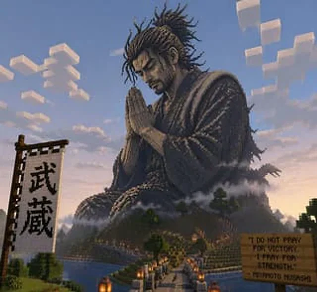

```text
exist{argument name="style" default="minecraft"} Praying in the middle{argument name="subject" default="musashi"} Giant statue
```

Model: GPT Image 2
Author: GPT Image 2 Prompts

[ProjectD](https://aitoolsradar.com/en/prompts/86f5bd8b7027f6) · [Recorded source](https://x.com/nicdunz/status/2046254631521484857)
 · [Full original metadata and byte evidence](data/projectd-batch-0039.json)

## Ming Dynasty Social Media Post

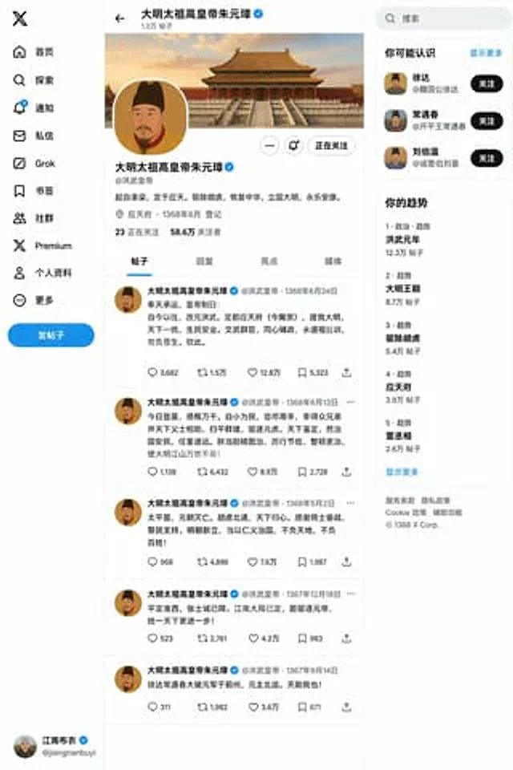

```text
for{argument name="dynasty and figure" default="Zhu Yuanzhang of the Ming Dynasty"} exist{argument name="event" default="Ascension to the throne"} Then create an X post page.
```

Model: GPT Image 2
Author: GPT Image 2 Prompts

[ProjectD](https://aitoolsradar.com/en/prompts/650d77042a6363) · [Recorded source](https://x.com/liyue_ai/status/2045021302315249738)
 · [Full original metadata and byte evidence](data/projectd-batch-0039.json)

## Ming Dynasty Social Media Post


```text
创建一个{argument name="朝代人物" default="明朝朱元璋"}{argument name="事件" default="登基"}之后的X帖子页面
```

Model: GPT Image 2
Author: 李岳

[ProjectD](https://aitoolsradar.com/en/prompts/c2d65164516763) · [Recorded source](https://youmind.com/prompts/ming-dynasty-x-post-13717)
 · [Full original metadata and byte evidence](data/projectd-batch-0039.json)

## Miniature 3D City Diorama Map

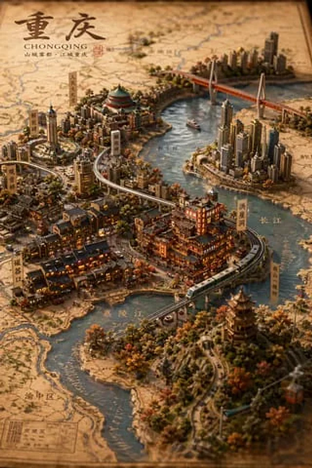

```text
A highly detailed isometric 3D miniature city model map, showcasing{argument name="city name" default="Chongqing"} The scene blends traditional Chinese architecture with modern skyscrapers against a backdrop of vintage parchment maps. A winding river flows through the scene, with a modern bridge connecting a densely packed peninsula of skyscrapers to warmly lit, ancient multi-story traditional buildings. A monorail train meanders along its waterfront tracks. Major landmarks are marked with vertical flags bearing Chinese characters, such as "Hongyadong" and "Liberation Monument." The upper left corner displays prominent calligraphic characters.{argument name="main title" default="Chongqing"} Below is the English text "".{argument name="english subtitle" default="CHONGQING"} The image also includes smaller Chinese text reading "Mountain City, Foggy City, River City, Chongqing" and a red seal. The warm, cinematic lighting highlights the intricate textures of the miniature buildings, trees, and water, creating a tilt-shift photography effect.
```

Model: GPT Image 2
Author: GPT Image 2 Prompts

[ProjectD](https://aitoolsradar.com/en/prompts/edd461c71335c4) · [Recorded source](https://x.com/A9Quant/status/2046197741685260384#reversed-1)
 · [Full original metadata and byte evidence](data/projectd-batch-0039.json)

## Miniature Diorama Skincare Advertisement

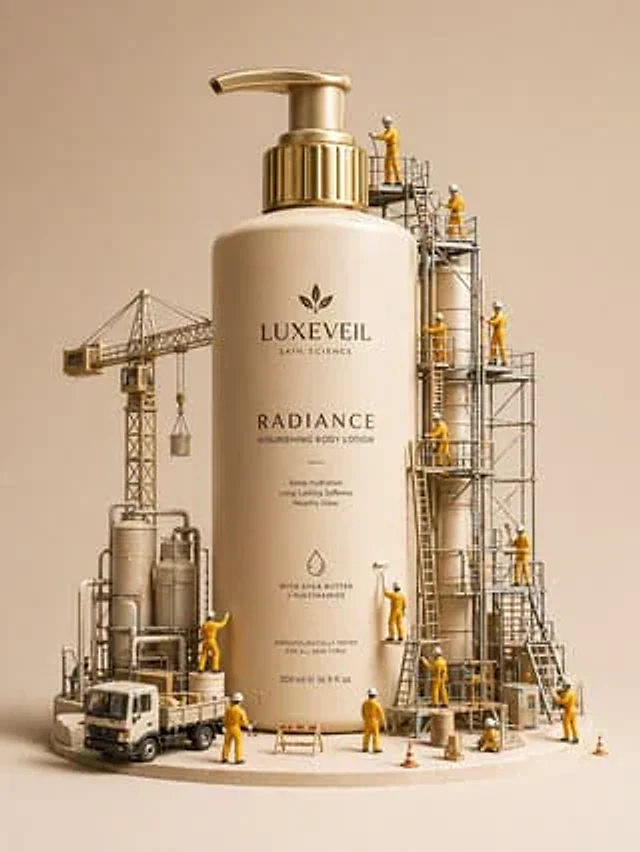

```text
A hyper-realistic miniature product advertisement centers on a giant luxury skincare pump bottle labeled "LUXEVEIL Skin Science – Radiance Nourishing Body Lotion." The cream/beige bottle, complete with a polished gold pump, sits on a circular platform. Miniature construction workers in yellow overalls and white hard hats bustle around the bottle: they climb scaffolding, roller-paint the bottle, operate tower cranes, work alongside industrial tanks and pipes, and unload from miniature flatbed trucks. The scene includes metal scaffolding structures, industrial silos, orange traffic cones, wooden barriers, and storage bins. The overall color palette is warm beige, cream, gold, and mustard yellow. Studio-style shooting with soft, even lighting, no shadows, and a clean beige background. The concept metaphorically represents the workers meticulously crafting or building this perfect lotion. Tilt-shift miniature aesthetics, ultra-high detail, commercial product photography, 8K resolution, photorealistic CGI rendering.
```

Model: GPT Image 2
Author: GPT Image 2 Prompts

[ProjectD](https://aitoolsradar.com/en/prompts/eb7027a2e0169f) · [Recorded source](https://x.com/Strength04_X/status/2048074514278563949)
 · [Full original metadata and byte evidence](data/projectd-batch-0039.json)

## Miniature Starbucks Renovation Scene

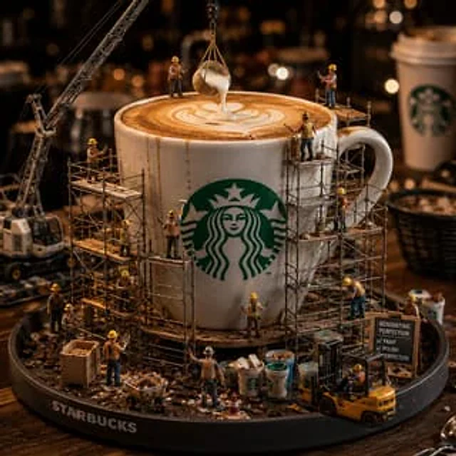

```text
A hyper-realistic scene featuring {argument name="workers" default="miniature construction workers"} renovating a {argument name="target" default="giant Starbucks coffee cup"}. Tiny painters perfect the logo, cranes lift foam art into place, workers climb scaffolding around the cup. The oversized coffee cup rests on a {argument name="tray" default="branded Starbucks tray"}. Warm café lighting, premium commercial photography, playful miniature world, highly detailed textures.
```

Model: GPT Image 2
Author: 𝐌

[ProjectD](https://aitoolsradar.com/en/prompts/1933d2de728902) · [Recorded source](https://youmind.com/prompts/miniature-workers-starbucks-renovation-25759)
 · [Full original metadata and byte evidence](data/projectd-batch-0039.json)

## Minimal Analog Wall Clock at 05:29

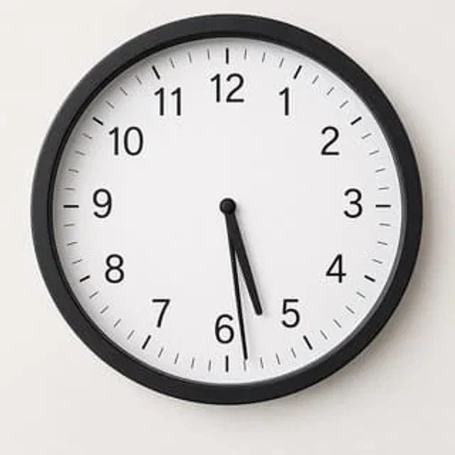

```text
A minimalist photograph showcases a round analog wall clock mounted on a smooth, light gray wall, centered and from a frontal perspective. The clock features a matte black circular bezel, a simple white dial, black Arabic numerals from 1 to 12, thin black minute markers around the dial, and thicker hour markers at each numeral. It displays all 12 numerals and 60 minute markers. The time is displayed as {argument name="clock time" default="05:29"} The short hour hand is slightly past 5 o'clock, the long minute hand points to the 29-minute mark before 6 o'clock, and the ultra-thin black second hand is located at approximately 31 seconds on the lower half of the dial. Soft, even lighting creates delicate, realistic shadows on the wall, showcasing high-detail product photography quality, a neutral, modern interior aesthetic, no brand logos, no extraneous objects, and a square composition.
```

Model: GPT Image 2
Author: GPT Image 2 Prompts

[ProjectD](https://aitoolsradar.com/en/prompts/d04ca7b2e56427) · [Recorded source](https://x.com/ku_uy_2024/status/2046865623142351157#reversed-0)
 · [Full original metadata and byte evidence](data/projectd-batch-0039.json)

## Minimal Anti-Itch Cream Poster

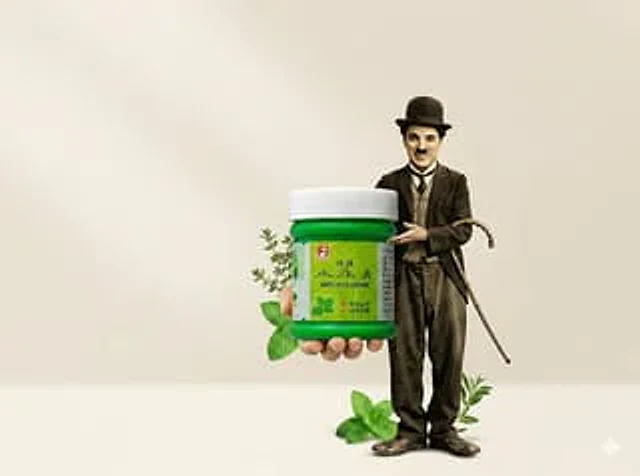

```text
A minimalist, clean poster against a warm, light beige studio background with subtle horizontal lines between the walls and tabletops, ample negative space, and soft, diffused lighting. On the right side of the image stands a figure dressed entirely in retro silent film attire, resembling {argument name="character type" default="Charlie Chaplin"} He wore a black bowler hat, a dark, worn suit, waistcoat, white shirt, and tie, oversized trousers, and old leather shoes. He held a slender, curved cane in one hand and wore a gentle smile. His other arm was outstretched in a gesture of display, pointing to a large jar located in the foreground center of the image.{argument name="product name" default="anti-itch cream"} The jar features a white screw cap, a translucent green body, and a bright yellow-green label with Chinese herbal packaging details, including small Chinese and English characters.{argument name="label text" default="ANTI-ITCH CREAM"} A realistic human hand extends from below, supporting the bottom of the jar, making the product the visual focus. Fresh mint leaves are added to the bottom of the jar and near the figure's feet to emphasize natural herbal elements. The composition should have a modern advertising poster feel: the product is centered and enlarged, with the figure positioned slightly to the right behind it, presenting a clean cutout effect with soft shadows, sharp edges, and an overall soft, neutral color scheme, accented by the green jar as the main color. There is no title, no additional typographical elements, no cluttered content, and no borders. A small four-pointed star icon is added to the lower right corner. The composition is vertical, with a sophisticated commercial photo-compositing style.
```

Model: GPT Image 2
Author: GPT Image 2 Prompts

[ProjectD](https://aitoolsradar.com/en/prompts/a654e0d256e3f3) · [Recorded source](https://x.com/chenenpei/status/2046985783715025135#reversed-1)
 · [Full original metadata and byte evidence](data/projectd-batch-0039.json)

## Minimal Anti-Itch Cream Poster

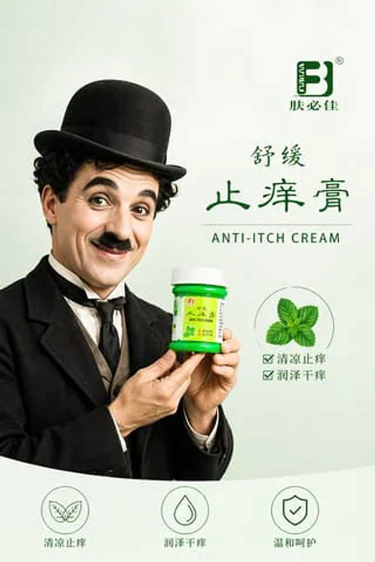

```text
A simple, minimalist vertical product poster with a soft, light gray background tinged with a hint of green, its design inspired by modern Chinese skincare or pharmaceutical advertisements. A [product name/brand] is displayed on the left.{argument name="character type" default="Resembling Charlie Chaplin"} The figure is depicted in a half-length portrait, wearing a black bowler hat, black suit jacket, white shirt, dark tie, and gray waistcoat. His posture is formal, and he holds a bright green object with a white lid in his hands at the center left.{argument name="product name" default="Anti-itch cream"} Plastic jar. Hold the jar by the bottom with one hand and point to the body with the other, presenting a clear product display. The facial expression should be soft and pleasant, but the focus should be more on the clothing, hands, and product than facial details. Place the green brand logo and Chinese brand name in the upper right corner. Below, add a striking and elegant green Chinese title “Soothing Itch Cream” and a smaller English subtitle “ANTI-ITCH CREAM”. On the right side of the jar, add a […].{argument name="herb" default="mint leaves"} The poster features a circular plant graphic with two Chinese efficacy descriptions below it. At the bottom of the poster, an arc-shaped white panel spanning the width of the poster contains three evenly spaced green line icons and Chinese descriptions: a leaf icon for cooling and relieving itching, a water droplet icon for moisturizing dryness and itching, and a shield icon for gentle protection. The product label should be yellowish-green, featuring Chinese text and small herbal illustrations, echoing the overall green brand color scheme. Overall style: sparse, clean, commercial poster-like, with ample white space, high-end pharmacy advertising aesthetics, soft studio lighting, a combination of realistic photography and simple graphic typography, and a green and white color scheme.
```

Model: GPT Image 2
Author: GPT Image 2 Prompts

[ProjectD](https://aitoolsradar.com/en/prompts/ad19ae2f4ab6d8) · [Recorded source](https://x.com/chenenpei/status/2046985783715025135#reversed-0)
 · [Full original metadata and byte evidence](data/projectd-batch-0039.json)

## Minimal Brand Guideline Board

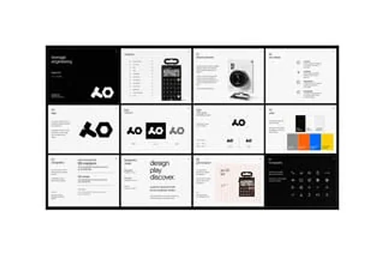

```text
{
  "type": "Modern Brand Guide Showcase Project",
  "style": "The minimalist Swiss editorial design features a monochromatic palette accented with carefully selected accent colors, a clear grid system, ample white space, a slender sans-serif font, and a clean, crisp product aesthetic.",
  "brand": {
    "name": "{argument name=\"brand name\" default=\"teenage engineering\"}",
    "subtitle": "Branded tool kit",
    "issue": "v18 - May 2024",
    "logo_style": "Bold geometric abstract text logo with thick, angular shapes."
  },
  "canvas": {
    "aspect_ratio": "16:9",
    "background": "The background is light gray, and the central display item is surrounded by a thick black border."
  },
  "layout": {
    "structure": "4 columns and 3 rows",
    "total_panels": 12,
    "sections": [
      {
        "title": "Cover",
        "position": "Row 1, Column 1",
        "count": 1,
        "theme": "The cover features a black background with small white text and an oversized white logo on the bottom right."
      },
      {
        "title": "Table of contents",
        "position": "Row 1, Column 2",
        "count": 1,
        "theme": "The table of contents features a product image of the handheld calculator in the center, with a vertical list of chapters with page numbers on the right."
      },
      {
        "title": "01 Brand Overview",
        "position": "Row 1, Column 3",
        "count": 1,
        "theme": "The left side displays an introductory text block, while the right side shows a realistic rendering of a compact camera."
      },
      {
        "title": "02 Our Values",
        "position": "Row 1, Column 4",
        "count": 1,
        "theme": "A list containing four values, accompanied by simple outline icons.",
        "labels": [
          "curiosity",
          "creativity",
          "project",
          "personality"
        ]
      },
      {
        "title": "03 Logo",
        "position": "Row 2, Column 1",
        "count": 1,
        "theme": "The left side shows the logo description text, and the right side shows a large black logo on a white background."
      },
      {
        "title": "Logo Variations",
        "position": "Row 2, Column 2",
        "count": 1,
        "theme": "Three logo tiles displayed side by side",
        "labels": [
          "black",
          "White",
          "grey"
        ]
      },
      {
        "title": "Logo safety space and minimum size",
        "position": "Row 2, Column 3",
        "count": 1,
        "theme": "The chart page shows the protective area around the logo and two minimum size examples."
      },
      {
        "title": "04 Color",
        "position": "Row 2, Column 4",
        "count": 1,
        "theme": "The color palette page contains 6 rectangular color blocks arranged in two rows and three columns.",
        "labels": [
          "black",
          "White",
          "Light gray",
          "Medium gray",
          "orange color",
          "blue",
          "yellow"
        ]
      },
      {
        "title": "05 Layout",
        "position": "Row 3, Column 1",
        "count": 1,
        "theme": "The font sample page showcases three font weights and examples of letters and numbers.",
        "labels": [
          "65 medium",
          "55 roman",
          "45 light"
        ]
      },
      {
        "title": "Typesetting applications",
        "position": "Row 3, Column 2",
        "count": 1,
        "theme": "Large-scale editing and layout, including stacked text and smaller auxiliary body text."
      },
      {
        "title": "06 Grids and Layouts",
        "position": "Row 3, Column 3",
        "count": 1,
        "theme": "The page displays a pink vertical grid overlay, aligned annotations, and a product image placed on the right."
      },
      {
        "title": "07 Icon",
        "position": "Row 3, Column 4",
        "count": 1,
        "theme": "A black background page containing a matrix of 24 minimalist white line icons.",
        "labels": [
          "waveform",
          "pause",
          "speaker",
          "stop",
          "Right arrow",
          "Rewind",
          "Turn down the volume",
          "round",
          "plus sign",
          "Recording",
          "Play",
          "download",
          "closure",
          "Check",
          "minus sign",
          "Upload",
          "Link",
          "menu",
          "And 6 other simple media/system icons"
        ]
      }
    ]
  },
  "visual_details": {
    "products": [
      {
        "type": "Calculator/synthesizer style handheld device",
        "appearance": "A small, black rectangular device with a round button and a hanging retail label."
      },
      {
        "type": "compact camera",
        "appearance": "The white body features a large black lens for shooting at narrow angles."
      }
    ],
    "typography": "The neutral Grotesk sans-serif font features extremely small descriptive text, neat alignment, and a magazine-like sense of hierarchy.",
    "color_palette": "The design is primarily black and white, supplemented by light gray, orange, blue, yellow, and a light pink grid line.",
    "rendering": "High-resolution demo unit, perfect front view, sharp edges, professional brand case study aesthetics."
  },
  "text_treatment": "It primarily uses small, editable placeholder text and concise brand copy, retaining a minimalist corporate design language.",
  "quality": "Neat, high-end, modern, award-winning design projects"
}
```

Model: GPT Image 2
Author: GPT Image 2 Prompts

[ProjectD](https://aitoolsradar.com/en/prompts/d23545d8799a98) · [Recorded source](https://x.com/FranromeGraph/status/2047644322883920047#reversed-0)
 · [Full original metadata and byte evidence](data/projectd-batch-0039.json)

## Minimal Futuristic Anime Girl Portrait


```text
Against a light gray solid background, create a simple anime-style upper-body illustration. The character is centered, in a calm two-thirds profile, with their face slightly turned to the left. The character is a young, futuristic android or virtual idol.{argument name="hair color" default="Platinum"} Her hair is styled in a thick, braided bun on the left side of her head, with long, straight strands cascading down her shoulders. She wears a geometrically shaped sci-fi headset in her left ear, featuring a glowing cyan rectangular panel and a sharp-edged metal frame. She wears a fitted white bodysuit with black structural straps and trim, a high collar, and delicate, vertically and diagonally arranged glowing cyan lines along her chest and torso. Her arms are fitted with separate white sleeves and black straps, with a small, dark diamond-shaped decoration on her upper arm. The image is presented in a clean, minimalist sketch style, with lines as delicate as pencil drawings, employing subtle celluloid shading, soft pastel tones, and subtle cyan highlights, resulting in a refined conceptual art feel. The composition cuts off from the top of her head to below her chest, leaving ample negative space and omitting any props, text, or complex backgrounds.
```

Model: GPT Image 2
Author: GPT Image 2 Prompts

[ProjectD](https://aitoolsradar.com/en/prompts/68f5c0744d9075) · [Recorded source](https://x.com/506Farley/status/2047085107979419924#reversed-0)
 · [Full original metadata and byte evidence](data/projectd-batch-0039.json)

## Minimal Japanese Curry Plate Poster

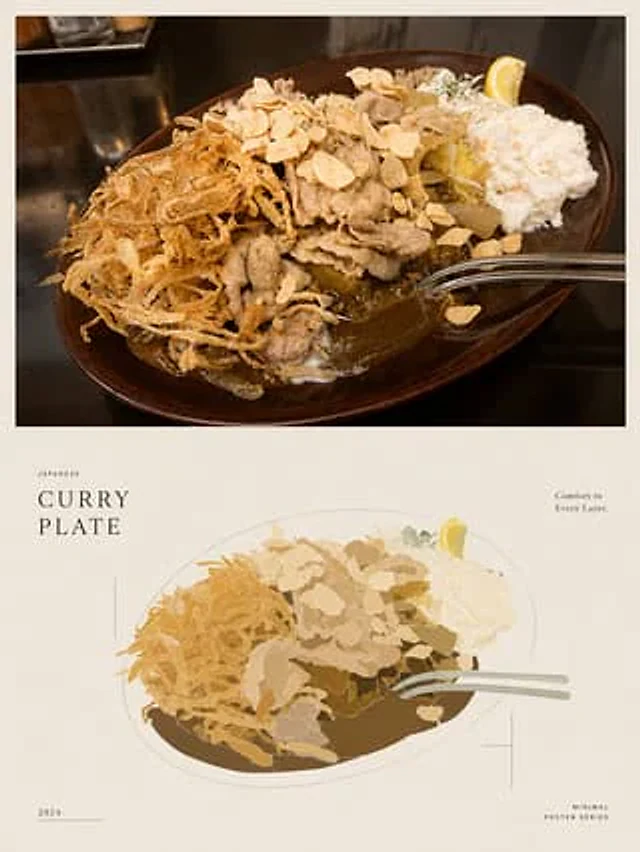

```text
Goal: Create a minimalist editorial food poster that demonstrates reducing a realistic food photo into a clean low-detail illustration while preserving the composition.

Canvas: Vertical poster in a 3:4 aspect ratio, warm off-white paper background, generous margins, quiet Japanese magazine/poster design.

Layout: Divide the poster into exactly 2 main visual panels. The top half contains a realistic rectangular food photograph with a thin off-white border around it. The bottom half contains a simplified vector-style illustration of the same dish, centered and slightly smaller, surrounded by sparse typography and fine registration-mark lines.

Top panel: Show a close-up restaurant photograph of a {argument name="dish name" default="Japanese curry plate"} on a dark glossy tabletop. The dish sits on an oval dark brown ceramic plate viewed from a high three-quarter angle. Include exactly 8 visible food components: 1 large pool of brown curry sauce, 1 mound of white rice mostly hidden under toppings, 1 pile of thin fried shredded onions on the left, 1 heap of sliced pork or beef in the center, 1 scattering of pale garlic chips across the top, 1 scoop of white potato salad on the right, 1 small garnish of chopped greens near the back, and 1 lemon wedge at the back right. Add exactly 1 shiny metal spoon entering from the right edge into the curry. Use natural warm restaurant lighting, realistic texture, shallow shadows, and no people.

Bottom panel illustration: Recreate the same plate as a flattened minimal vector illustration using reduced information and reduced color. Keep the exact same 8 food components and 1 spoon, but simplify them into layered organic shapes with thin light outlines and a limited palette of curry brown, tan, cream, pale yellow, muted green, and soft gray. The oval plate is suggested by a fine gray outline and a dark brown curry shape beneath the toppings. Avoid photorealistic detail; make it look like a tasteful poster illustration.

Text content: Add exactly 5 text blocks. Left of the illustration, small spaced uppercase text reads "JAPANESE" above a large elegant serif title reading "CURRY\nPLATE". Upper right, small serif copy reads "Comfort in\nEvery Layer." Bottom left, small text reads "2024" with a thin horizontal line beside it. Bottom right, small spaced uppercase text reads "MINIMAL\nPOSTER SERIES". Use refined black or dark brown typography.

Graphic details: Add exactly 3 fine-line decorative marks around the lower illustration: 1 thin vertical line near the left of the title area, 1 small crosshair mark on the lower right of the illustrated plate, and 1 subtle horizontal line near the year. Maintain a restrained, premium editorial look with lots of negative space.

Style constraints: Minimal colors, low visual noise, no extra captions, no logos, no watermark, no additional utensils, no extra plates, and no people. The final image should feel like a polished Japanese food poster comparing a realistic curry plate photograph with its simplified illustration.
```

Model: GPT Image 2
Author: Torishima / INTP

[ProjectD](https://aitoolsradar.com/en/prompts/5360f1f38e942b) · [Recorded source](https://youmind.com/prompts/japanese-curry-poster-32150)
 · [Full original metadata and byte evidence](data/projectd-batch-0039.json)

## Minimal Magnus Effect Infographic

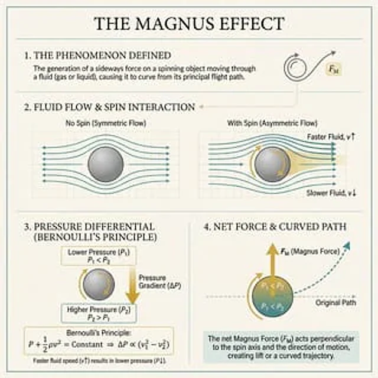

```text
{
  "type": "Educational Physics Infographic Poster",
  "topic": "Magnus effect",
  "style": "This minimalist academic poster combines high-end textbook design with modern aesthetics. It features symmetrical simplicity, balanced spacing, a soft, neutral cream background, and a thin cyan border. The title uses an elegant serif font, while the explanatory text employs a minimalist sans-serif font. The color scheme is limited to cyan, soft gold, dark gray, and light beige.",
  "layout": {
    "orientation": "Square poster",
    "sections": [
      {
        "title": "Magnus effect",
        "position": "Centered at the top",
        "count": 1,
        "labels": [
          "Main title"
        ]
      },
      {
        "title": "1. Definition of the phenomenon",
        "position": "Upper area",
        "count": 2,
        "labels": [
          "Define text box",
          "The small icon in the upper right corner shows a rotating sphere with a curved arrow and a gold force label F_M."
        ]
      },
      {
        "title": "2. Interaction between fluid flow and rotation",
        "position": "Central region",
        "count": 2,
        "labels": [
          "Non-rotational (symmetric flow)",
          "There is rotation (asymmetric flow)"
        ]
      },
      {
        "title": "3. Pressure difference (Bernoulli's principle)",
        "position": "bottom left corner",
        "count": 4,
        "labels": [
          "Low pressure (P1) / P1 &lt; P2",
          "Rotating sphere with a golden rotating arrow",
          "High voltage (P2) / P2 &gt; P1",
          "Bernoulli's Principle Formula Box"
        ]
      },
      {
        "title": "4. Resultant force and bending path",
        "position": "bottom right corner",
        "count": 4,
        "labels": [
          "The sphere is marked with pressure labels P1 &lt; P2 on the top and bottom.",
          "An upward-pointing gold arrow marked F_M (Magnus force)",
          "The gray dashed line represents the original path.",
          "The cyan dashed line represents the curved trajectory."
        ]
      }
    ],
    "dividers": "Four thin cyan horizontal and vertical dividing lines divide the poster into different areas and a two-column panel at the bottom."
  },
  "content_details": {
    "section_1": {
      "heading": "1. Definition of the phenomenon",
      "body": "When a rotating object moves in a fluid (gas or liquid), a lateral force is generated, causing it to deviate from its original flight path.",
      "diagram": "A simple gray sphere icon with a curved rotating arrow at the top, an outward-curving motion arrow, and a small rounded gold square containing F_M."
    },
    "section_2": {
      "heading": "2. Interaction between fluid flow and rotation",
      "panels": [
        {
          "title": "Non-rotational (symmetric flow)",
          "diagram": "A gray sphere is located at the center of a light-colored grid. Six cyan horizontal streamlines flow from left to right and curve symmetrically around the sphere. Small cyan arrows indicate that the flow velocity is equal above and below the sphere."
        },
        {
          "title": "There is rotation (asymmetric flow)",
          "diagram": "The gray sphere is surrounded by two rotating gold arrows at the center of a light-colored grid. Six cyan streamlines are compressed and flow faster above the sphere, while they are sparser below. The label on the right indicates that the area near the upper streamlines is 'fast flow, v↑', and the area near the lower streamlines is 'slow flow, v↓'. There is a subtle gold highlight wedge behind the fluid area in the upper right corner."
        }
      ]
    },
    "section_3": {
      "heading": "3. Pressure difference (Bernoulli's principle)",
      "elements": [
        "Rounded rectangle at the top with a low-pressure label",
        "A central rotating sphere with a golden curved arrow.",
        "A large, vertically downward gold arrow indicates the pressure gradient (ΔP).",
        "Rounded rectangle at the bottom, with high voltage label",
        "A large formula box containing Bernoulli's equation"
      ],
      "text_boxes": {
        "top": "Low pressure (P1) P1 &lt; P2",
        "bottom": "High voltage (P2) P2 &gt; P1",
        "formula": "Bernoulli's Principle: P + 1/2 ρv^2 = constant ⇒ ΔP ∝ (v1^2 − v2^2)",
        "caption": "The faster the flow rate (v↑), the lower the pressure (P↓)."
      }
    },
    "section_4": {
      "heading": "4. Resultant force and bending path",
      "diagram": "A large central sphere, filled with a gradient from cyan to gold, has a gold, curved, rotating arrow encircling its left side. A thick, upward-pointing gold arrow extends from the top, labeled F_M (Magnus Force). A thin, gray, dashed horizontal arrow marks the original path and extends to the right. A cyan, dashed, curved trajectory extends upwards and to the right in an arc, also bearing an arrow.",
      "caption_box": "The net Magnus force (F_M) acts at a position perpendicular to the axis of rotation and the direction of motion, thereby generating lift or a bending trajectory."
    }
  },
  "rendering": "Clear vector-style infographics, subtle paper texture, high readability, slight shading only within rounded label boxes, precise alignment, and understated scientific aesthetics."
}
```

Model: GPT Image 2
Author: GPT Image 2 Prompts

[ProjectD](https://aitoolsradar.com/en/prompts/473755d3b15ae2) · [Recorded source](https://x.com/1littlecoder/status/2046695203004985466#reversed-1)
 · [Full original metadata and byte evidence](data/projectd-batch-0039.json)

## Minimal Male Avatar Logo Grid

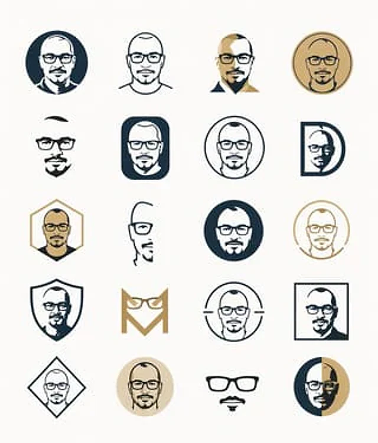

```text
{
  "type": "Minimalist Vector Logo Chart",
  "subject": "Professional male half-body head icon set",
  "style": {
    "design": "Flat geometric vectors, a minimalist corporate brand style, simplified facial features, mostly bald or short-haired men, some with glasses or beards, no gradients except for a subtle metallic central mask, clear lines, and symmetrical composition.",
    "palette": [
      "Deep Navy Blue",
      "warm gold",
      "Light beige",
      "White",
      "Soft gray background"
    ]
  },
  "layout": {
    "background": "Pure light gray",
    "grid": {
      "rows": 5,
      "columns": 4,
      "count": 20,
      "spacing": "Wide and uniform spacing",
      "alignment": "Center"
    },
    "items": [
      {
        "position": "Row 1, Column 1",
        "shape": "Solid dark navy blue round",
        "icon": "A half-length portrait of a man in a suit and tie, with a white facial outline and a silver rectangular shading over his face."
      },
      {
        "position": "Row 1, Column 2",
        "shape": "Circle with shoulder outline",
        "icon": "Navy blue bald male head outline, paired with a silver rectangular face mask."
      },
      {
        "position": "Row 1, Column 3",
        "shape": "Bust silhouette",
        "icon": "A male bust in navy blue and gold, with a gold rectangular face mask."
      },
      {
        "position": "Row 1, Column 4",
        "shape": "Double-ring gold round coin badge",
        "icon": "Minimalist male head with a gold rectangular face mask"
      },
      {
        "position": "Row 2, Column 1",
        "shape": "The outline of the cropped half-body portrait",
        "icon": "Minimalist black hairstyle and jawline contours, paired with a silver rectangular face mask."
      },
      {
        "position": "Row 2, Column 2",
        "shape": "Rounded corner vertical navy blue rectangle",
        "icon": "The interior features a white male head with a silver rectangular face mask."
      },
      {
        "position": "Row 2, Column 3",
        "shape": "Thin lines and navy blue circles",
        "icon": "Male head outline, with a silver rectangular face mask."
      },
      {
        "position": "Row 2, Column 4",
        "shape": "Navy blue capital letter D border",
        "icon": "Internally cut male head with a silver rectangular face mask."
      },
      {
        "position": "Row 3, Column 1",
        "shape": "Golden hexagonal outline",
        "icon": "A male bust wearing a dark shirt, with tan skin and a gold rectangular face mask."
      },
      {
        "position": "Row 3, Column 2",
        "shape": "Local head outline",
        "icon": "Minimalist side-cut head with a silver rectangular face mask."
      },
      {
        "position": "Row 3, Column 3",
        "shape": "Solid dark navy blue round",
        "icon": "White male head outline with silver rectangular face mask"
      },
      {
        "position": "3rd row, 4th column",
        "shape": "The gold ring with a notch in the lower left corner",
        "icon": "Minimalist male headpiece with a light cream-colored rectangular face mask."
      },
      {
        "position": "Row 4, Column 1",
        "shape": "Navy Blue Shield Outline",
        "icon": "The interior features the outline of a male half-body figure, paired with a silver rectangular face mask."
      },
      {
        "position": "Row 4, Column 2",
        "shape": "Stylized gold letter M composed of glasses and corner lines",
        "icon": "Abstract glasses logo, without face obscuring blocks."
      },
      {
        "position": "Row 4, Column 3",
        "shape": "A circular outline with two horizontal sidebars",
        "icon": "Male head outline, with a silver rectangular face mask."
      },
      {
        "position": "Row 4, Column 4",
        "shape": "Navy blue square outline",
        "icon": "A male bust cut out from the inside, with a silver rectangular face mask."
      },
      {
        "position": "Row 5, Column 1",
        "shape": "Navy blue diamond outline",
        "icon": "The interior features a small male head with a silver rectangular face shield."
      },
      {
        "position": "Row 5, Column 2",
        "shape": "Solid light beige round",
        "icon": "Minimalist male head with a gold rectangular face mask"
      },
      {
        "position": "Row 5, Column 3",
        "shape": "Borderless",
        "icon": "Black glasses, a beard, and a goatee float against a blank background."
      },
      {
        "position": "Row 5, Column 4",
        "shape": "Vertically divided circles, half navy blue and half gold",
        "icon": "Minimalist male head with a gold rectangular face mask"
      }
    ]
  },
  "composition": "All 20 icons are displayed as a unified brand identity exploration chart, with consistent stroke thickness and spacing, centered on the page, and with ample negative space, reflecting a modern masculine brand aesthetic.",
  "rendering": "Clear SVG-style vector graphics, no shadows, no textures, no text, portrait canvas."
}
```

Model: GPT Image 2
Author: GPT Image 2 Prompts

[ProjectD](https://aitoolsradar.com/en/prompts/134e123454ef6a) · [Recorded source](https://x.com/fmontes/status/2046946960720998553#reversed-1)
 · [Full original metadata and byte evidence](data/projectd-batch-0039.json)

## Minimal Pelican Riding Bicycle

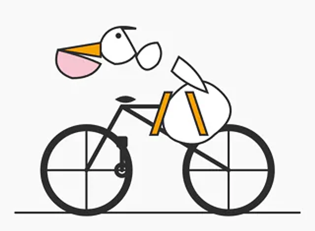

```text
A minimalist vector illustration against a flat, light gray background depicts a pelican riding a bicycle. The illustration is composed of simple geometric shapes with bold, dark charcoal gray outlines. The composition is wide and centered, with the bicycle occupying the lower two-thirds of the image. The bird's head is positioned slightly forward above the handlebars, creating a deliberately abstract, illustrative feel. The bicycle is a simple black road bike silhouette with two large wheels, each with a thick outer rim and four spokes forming a cross. A straight horizontal line runs along the ground beneath the wheels. It features a triangular frame, a short black seat, and simplified crank and pedal details at the rear of the frame. The pelican is composed of simple, abstract elements: a white, round head with a small black round eye; a long, left-open beak composed of two parts: an orange triangle at the top and a pale pink throat pouch at the bottom; a short, dark curve on the top of the head; a small, separate white oval where the neck connects to the body; a large white circle above the bicycle; and an upward-sloping white wing-like shape on the upper back. Add two orange leg shapes, long, narrow rectangles extending from the body down to the frame, suggesting the bird is pedaling. Maintain the deliberate sparseness and slight surrealism of the form, similar to a logo test or simple code editor doodles, with no shadows, gradients, textures, or text, and plenty of negative space.
```

Model: GPT Image 2
Author: GPT Image 2 Prompts

[ProjectD](https://aitoolsradar.com/en/prompts/ba7ed2ced799ad) · [Recorded source](https://x.com/jpschroeder/status/2046714718790816171#reversed-1)
 · [Full original metadata and byte evidence](data/projectd-batch-0039.json)

## Minimal Pelican Riding Bicycle


```text
A minimalist vector-style illustration on a flat light gray background showing a pelican riding a bicycle, drawn from simple geometric shapes with thick dark charcoal outlines. The composition is wide and centered, with the bicycle occupying the lower two-thirds of the image and the bird’s head floating slightly above and forward of the handlebars in a deliberately abstract, diagram-like way. The bicycle is a simple black road-bike silhouette in side view with exactly 2 large wheels, each with a thick outer rim and exactly 4 visible spoke lines forming a cross, a straight horizontal ground line beneath both wheels, a triangular frame, a short black saddle, and simplified crank and pedal details near the rear of the frame. The pelican is constructed from clean abstract pieces: a white rounded head with a small black circular eye, a long open beak pointing left made of 2 parts with an upper orange triangular section and a lower pale pink pouch section, a short dark curve on top of the head, a small separate white oval neck/body connector, a larger white rounded body positioned over the bike, and a single white wing-like shape angled upward over the back. Add exactly 2 orange leg shapes, long narrow rectangles leaning downward from the body toward the bicycle frame, suggesting the bird is pedaling. Keep the forms intentionally sparse and slightly surreal, like a logo test or simple code-editor doodle, with no shading, no gradients, no textures, no text, and lots of negative space.
```

Model: GPT Image 2
Author: Justin Schroeder

[ProjectD](https://aitoolsradar.com/en/prompts/73d59f872748a2) · [Recorded source](https://youmind.com/prompts/minimal-pelican-bicycle-icon-14657)
 · [Full original metadata and byte evidence](data/projectd-batch-0039.json)

## Minimal research illustration prompt

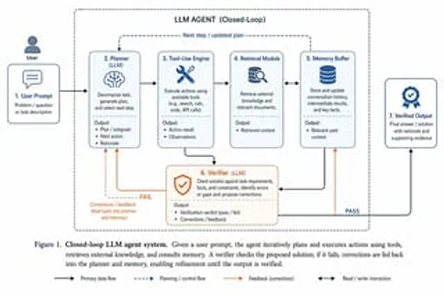

```text
Draw a research-paper illustration showing a closed-loop LLM agent system. The left side begins with a user prompt, then flows into a planner, tool-use engine, retrieval module, memory buffer, and a final verifier that feeds corrections back into the system. Use a restrained academic palette of blue, slate, and orange accents. Style it like a clean paper illustration: vector-like blocks, precise arrows, sparse labels, balanced whitespace, and a clear Figure 1 narrative from problem input to verified output.
```

Model: GPT Image 2
Author: @xiaohongshu-community

[ProjectD](https://aitoolsradar.com/en/prompts/68e7cd13bdfe90) · [Recorded source](https://www.xiaohongshu.com/explore/67e414010000000007037315)
 · [Full original metadata and byte evidence](data/projectd-batch-0039.json)

## Minimal SaaS Ad With Invoice Mockup

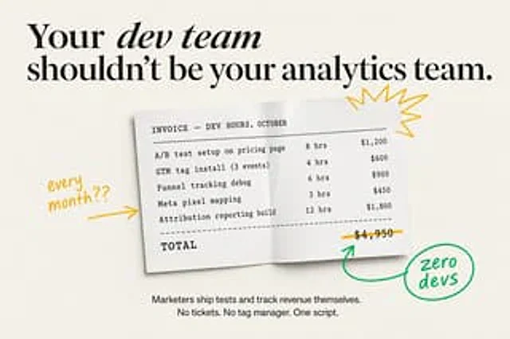

```text
Create a minimalist static SaaS ad with a warm off-white background, elegant typography, and crisp, high-fidelity text rendering. Place a large, two-line black serif headline at the top that reads:{argument name="headline text" default="Your dev team shouldn’t be your analytics team."} The word "dev team" should be in italic serif font, while the rest should be in bold, high-contrast serif font with ample white space and a luxurious magazine-style layout. Below, centered, is a slightly tilted white paper invoice with a soft shadow and a subtle vertical crease in the middle, as if photographed from above. The invoice uses black, monospaced typewriter-style text, clearly stating the title: "INVOICE — DEV HOURS, OCTOBER," followed by five lines of aligned work hours and pricing details: "A/B test setup on pricing page 8 hrs $1,200", "GTM tag install (3 events) 4 hrs $600", "Funnel tracking debug 6 hrs $900", "Meta pixel mapping 3 hrs $450", and "Attribution reporting build 12 hrs $1,800". Add a dotted line separator below each item, and write "TOTAL" in bold, equal-width text in the lower left corner, and the total price "$4,950" in the lower right corner. Cross out the total price with a hand-drawn yellow line. Add four doodle-style annotation elements around the invoice: on the left, handwritten yellow text "every month??" with a yellow arrow pointing to the paper; a yellow star doodle in the upper right corner of the paper; a green curved arrow pointing to the crossed-out price below the total price; and a green hand-drawn circle in the lower right corner containing the handwritten text "zero devs," connected to the green arrow. At the bottom center of the advertisement, add two lines of smaller black sans-serif text:{argument name="body text" default="Marketers ship tests and track revenue themselves.\nNo tickets. No tag manager. One script."} "Maintaining a transparent, sophisticated, and conversion-oriented composition, it integrates modern startup advertising design with the feel of authentic paper and playful annotations."
```

Model: GPT Image 2
Author: GPT Image 2 Prompts

[ProjectD](https://aitoolsradar.com/en/prompts/cebcbd0c55ce25) · [Recorded source](https://x.com/amirmxt/status/2046824933146149114#reversed-0)
 · [Full original metadata and byte evidence](data/projectd-batch-0039.json)

## Minimal SaaS Poster with Pink Mascot


```text
A bold, minimalist brand poster with a matte black background and a soft, grainy print texture, reminiscent of a startup's landing page graphic. A simple cream-colored logo icon is placed in the top left corner, followed by the brand name.{argument name="brand name" default="Biscuit"} The text uses a refined serif font. Below it, a large, left-aligned typographic block is created, occupying approximately half of the left side of the composition. The main title is {argument name="headline text" default="Built for solopreneurs."} The text uses an oversized, elegant cream serif font with strong contrast and ample line spacing. Directly below it, a second line heading is added, using a vibrant bright pink italic serif font, containing the following content:{argument name="tagline text" default="Backed by simplicity."} Add a smaller white sans-serif text block below, left-aligned, with the following content:{argument name="body text" default="Everything you need to launch, run, and grow—all in one place."} Place the URL near the bottom left corner.{argument name="website text" default="biscuit.so"} The design uses a bold, bright pink sans-serif font. The right half features a cute, abstract mascot: a rounded, irregularly shaped, cloud-like pink blob with scalloped edges, two large, round, cream-colored and black eyes, a tiny, curved, smiling mouth, and two small, rounded hands resting on a large, curved pink shape that rises from the bottom edge, resembling a small mountain or product surface. Dense bright pink splatter-like spots and particles are added to the upper right quadrant, grading towards the center to create a playful cosmic ink splatter effect. The design utilizes a limited color palette of black, cream, white, and saturated pink; high-contrast editorial layout; ample white space; a clean, modern, approachable, and founder-friendly SaaS brand aesthetic; a centered, right-side character; and a vertical poster composition.
```

Model: GPT Image 2
Author: GPT Image 2 Prompts

[ProjectD](https://aitoolsradar.com/en/prompts/9c140ff367168d) · [Recorded source](https://x.com/blixt/status/2046986230185759055#reversed-1)
 · [Full original metadata and byte evidence](data/projectd-batch-0039.json)

## Minimal SaaS Poster with Pink Mascot

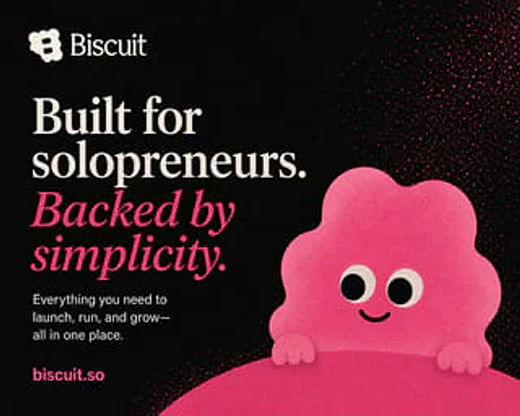

```text
A bold minimalist brand poster on a matte black background with a soft grainy print texture, designed like a startup landing-page hero graphic. In the top left, place a simple cream-colored logo icon followed by the brand name {argument name="brand name" default="Biscuit"} in a refined serif wordmark. Below it, create a large left-aligned typographic block occupying roughly the left half of the composition. The main headline reads: {argument name="headline text" default="Built for solopreneurs."} in oversized elegant cream serif type with strong contrast and generous line spacing. Directly beneath it, add a second headline line in vivid hot pink italic serif reading {argument name="tagline text" default="Backed by simplicity."}. Below that, add a smaller white sans-serif body copy block, left aligned, reading {argument name="body text" default="Everything you need to launch, run, and grow—all in one place."}. Near the bottom left, place the URL {argument name="website text" default="biscuit.so"} in bold hot pink sans-serif. On the right half, feature a cute abstract mascot: a rounded irregular cloud-like pink blob character with scalloped edges, 2 large cream-and-black circular eyes, 1 small curved smiling mouth, and 2 tiny rounded hands resting on top of a large curved pink foreground shape that rises from the bottom edge like a hill or product surface. Add a dense field of hot pink spray-like speckles and particles in the upper-right quadrant fading toward the center, giving a playful cosmic ink-splatter effect. Use a limited palette of black, cream, white, and saturated pink; high contrast editorial typography; lots of negative space; a clean, modern, approachable, founder-friendly SaaS branding aesthetic; centered-right character placement; portrait poster composition.
```

Model: GPT Image 2
Author: Blixt

[ProjectD](https://aitoolsradar.com/en/prompts/e631d8ec3edeb0) · [Recorded source](https://youmind.com/prompts/minimal-saas-poster-mascot-15114)
 · [Full original metadata and byte evidence](data/projectd-batch-0039.json)

## Minimal Sci-Fi Anime Girl Portrait


```text
A simple, anime-style upper-body portrait depicts a futuristic girl. Centered against a pure light gray background, the portrait employs casual, sketch-like lines and soft pastel colors. She has long, flowing, very pale pinkish-purple hair that falls to her shoulders, light and with a soft sheen. Her face is completely obscured by a centrally located, gray-toned lavender square blur/mosaic block. She wears a wide-brimmed white beret with a deep navy blue brim and two deep navy blue angular decorations on either side, accented with cyan details. On one visible side of her head, she wears sophisticated sci-fi style headphones with translucent cyan luminous elements. She wears a fitted white sleeveless turtleneck jumpsuit with two bright cyan vertical panels on the front, featuring thin, dark seams. Small, angular, deep navy blue armor-style decorations adorn the chest and waist. One upper arm wears a dark armband with four thin, cyan-white stripes. The image shows the body from chest to head, slightly turned to the viewer's left, with a simple and elegant silhouette. It employs a minimalist illustration style with delicate brushstrokes and subtle cel-shading. The main colors are white, cyan, navy blue, and light pink, and there are no background objects or text.
```

Model: GPT Image 2
Author: GPT Image 2 Prompts

[ProjectD](https://aitoolsradar.com/en/prompts/ab772cdc3954e0) · [Recorded source](https://x.com/506Farley/status/2047085107979419924#reversed-1)
 · [Full original metadata and byte evidence](data/projectd-batch-0039.json)

## Minimal Skincare Brand Kit Board

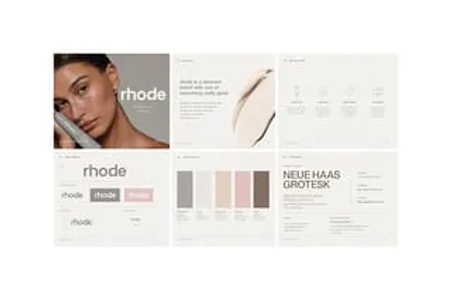

```text
{
  "type": "Minimalist skincare brand manual layout",
  "brand": {
    "name": "{argument name=\"brand name\" default=\"rhode\"}",
    "industry": "skincare",
    "style": "Quiet luxury style, clean, editorial feel, minimalism, soft neutral tones"
  },
  "canvas": {
    "background": "Very light warm gray",
    "format": "Widescreen landscape presentation project",
    "grid": "2 rows x 3 columns",
    "count": 6,
    "gutters": "Fine white spacing between panels"
  },
  "layout": {
    "sections": [
      {
        "title": "Cover",
        "position": "Top left",
        "count": 1,
        "elements": [
          "A close-up of a woman's hair, styled in a dark, slicked-back style, revealing her ears, neck, and shoulders.",
          "Large and small lowercase lettering above the portrait",
          "Subheadings display brand guides and seasonal/yearly sections.",
          "Soft gray-brown background",
          "A large square color block overlay covering the center left side of the face."
        ]
      },
      {
        "title": "01. Brand Introduction",
        "position": "Upper-middle",
        "count": 1,
        "elements": [
          "Top section numbering and heading",
          "Left-aligned paragraph block",
          "The title declares that the brand is a skincare brand that pursues simplicity and prioritizes quality.",
          "Short body text in small light gray font",
          "The image on the right shows a large area of ​​creamy skincare product application."
        ]
      },
      {
        "title": "02. Brand Pillars",
        "position": "Top right",
        "count": 1,
        "elements": [
          "Top section numbering and heading",
          "4 columns of icons and text",
          "Tags: ESSENTIAL, EFFECTIVE, INTENTIONAL, INCLUSIVE",
          "Icons: hose, smiley face, heart, interlocking rings",
          "Below each pillar is a short descriptive text."
        ]
      },
      {
        "title": "03. Visual Recognition",
        "position": "Bottom left",
        "count": 1,
        "elements": [
          "Top section numbering and heading",
          "Central Large Small Character Mark",
          "Flag variant row containing 3 variants",
          "Auxiliary area labels including logo, logo variations, white space, and minimum size.",
          "White space diagram",
          "Minimum size example"
        ]
      },
      {
        "title": "04. Color Scheme",
        "position": "Middle to lower",
        "count": 1,
        "elements": [
          "Top section numbering and heading",
          "5 vertical rectangular color blocks",
          "Tags: PEPTIDE GRAY, GLAZE, VANILLA SKIN, PINK GLAZE, TOAST",
          "Below each color block is a thin specification line."
        ]
      },
      {
        "title": "05. Typography",
        "position": "Bottom right",
        "count": 1,
        "elements": [
          "Top section numbering and heading",
          "Example text with large main font size",
          "The main font name is displayed as{argument name=\"primary typeface\" default=\"NEUE HAAS GROTESK\"}",
          "Examples of letters and numbers",
          "Three font weight samples, labeled 55 ROMAN, 65 MEDIUM, and 75 BOLD, are provided, along with the sample sentence 'The quick brown fox'.",
          "Displays the secondary font line of Georgia Regular.",
          "Small usage instructions block"
        ]
      }
    ],
    "footer": "Micro-page markers and brand guide instructions on each panel"
  },
  "palette": {
    "overall": [
      "Warm beige",
      "Light gray",
      "grayish brown",
      "Beige",
      "blush powder",
      "Soft Brown"
    ]
  },
  "typography": {
    "wordmark": "Bold, rounded, lowercase sans-serif font",
    "body": "Small, understated, editorial-style sans-serif font",
    "mood": "High-end, restrained, transparent"
  },
  "rendering": {
    "look": "High-end Brand Guide Demonstration Mockup",
    "lighting": "Soft and even studio lighting",
    "detail": "Clear layout, subtle contrast, and ample white space."
  }
}
```

Model: GPT Image 2
Author: GPT Image 2 Prompts

[ProjectD](https://aitoolsradar.com/en/prompts/fb7824268737cb) · [Recorded source](https://x.com/FranromeGraph/status/2047644322883920047#reversed-1)
 · [Full original metadata and byte evidence](data/projectd-batch-0039.json)

## Minimal Slot Machine Attribution Ad


```text
Against a gray-white studio backdrop, create a clean, minimalist static ad with a centered layout. At the top is a large, luxurious, high-fashion serif headline with the following text:{argument name="headline text" default="Stop gambling with your ad spend."} The word "gambling" is emphasized using italic serifs. The image shows a vintage metal slot machine window viewed directly from the center, slightly weathered and authentic. Inside the rectangular steel casing are three vertical reels, with a lever with a black knob on the right. The three reels display "$", "$", and "?" from left to right. The rightmost reel has a light pink background, while the first two are a worn white. Hand-drawn neon pink annotations are added to the image: an arrow pointing to the first reel and a note on the left, stating {argument name="left annotation" default="your attribution"} Add a star-shaped doodle above the pink question mark wheel; draw an arrow from the question mark wheel to the circled annotation on the right, the content of which is:{argument name="right annotation" default="actual revenue"} Add a large, curved arrow pointing to the main text area in the bottom left corner. Below the slot machine, place a short, centered black sans-serif paragraph containing the following content:{argument name="body text" default="See which campaigns drive revenue, not just clicks. Connect Meta, Google, and Stripe in 60 seconds."} A simple black analytical-style bar chart logo icon is placed in the center at the bottom, followed by the brand name in bold sans-serif.{argument name="brand name" default="Humblytics"} The requirements include high text clarity, exquisite product advertising composition, soft studio shadows, a color scheme limited to black, steel gray, off-white, and bright pink, and an aesthetic that embodies modern, direct-response advertising.
```

Model: GPT Image 2
Author: GPT Image 2 Prompts

[ProjectD](https://aitoolsradar.com/en/prompts/5d222aa127b1c4) · [Recorded source](https://x.com/amirmxt/status/2046824933146149114#reversed-2)
 · [Full original metadata and byte evidence](data/projectd-batch-0039.json)

## Minimal Slot Machine Attribution Ad


```text
Create a clean minimalist static ad on an off-white light gray studio background with a centered editorial layout. At the top, place a large luxury-fashion-style serif headline in black reading {argument name="headline text" default="Stop gambling with your ad spend."}, with the word "gambling" set in italic serif for emphasis. In the middle, show a vintage metal slot-machine window viewed straight on, slightly weathered and realistic, with 3 vertical reels inside a rectangular steel housing and a lever with a black knob on the right side. The 3 reels must display, from left to right, "$", "$", and "?". Make the rightmost reel background pale pink while the first 2 reels are aged white. Add a hand-drawn neon-pink annotation style over the image: 1 arrow-and-note on the left pointing to the first reel reading {argument name="left annotation" default="your attribution"}, 1 starburst scribble above the pink question-mark reel, 1 arrow from the question-mark reel to a circled note on the right reading {argument name="right annotation" default="actual revenue"}, and 1 large curved arrow in the lower left pointing toward the body copy area. Below the slot machine, center a short sans-serif paragraph in black reading {argument name="body text" default="See which campaigns drive revenue, not just clicks. Connect Meta, Google, and Stripe in 60 seconds."}. At the bottom center, place a simple black analytics-style bar logo icon followed by the bold sans-serif brand name {argument name="brand name" default="Humblytics"}. Use strong text fidelity, polished product-ad composition, soft studio shadows, restrained palette of black, steel gray, off-white, and hot pink, and a modern direct-response ad aesthetic.
```

Model: GPT Image 2
Author: amirmxt

[ProjectD](https://aitoolsradar.com/en/prompts/59aa1baf948783) · [Recorded source](https://youmind.com/prompts/minimal-slot-machine-attribution-ad-14833)
 · [Full original metadata and byte evidence](data/projectd-batch-0039.json)

## Minimal Spring Fashion Editorial Board


```text
{
  "type": "Fashion editor layout poster",
  "brand": "MANGO",
  "collection": "25 SPRING COLLECTION",
  "style": "Minimalist luxury magazine layout, clean white background, soft sunlight, transparent and modern editorial design, high-end fashion lookbook project.",
  "subject": {
    "gender_presentation": "woman",
    "pose": "Sitting in a light-colored rattan chair, relaxed, torso tilted to the left, head turned to one side",
    "face": "Intentionally blurring/obscuring",
    "outfit": {
      "outerwear": {
        "item": "Short, lightweight zip-up jacket",
        "color": "{argument name=\"jacket color\" default=\"bright red\"}"
      },
      "top": {
        "item": "Semi-sheer fitted long-sleeved knit top",
        "color": "Soft white"
      },
      "bottom": {
        "item": "Midi skirt",
        "color": "White",
        "pattern": "Large black polka dots"
      }
    },
    "accessories": {
      "bag": "The structured black tote bag showcased in product lines and styling variations",
      "shoes": "Black flat shoes displayed in the product line"
    }
  },
  "layout": {
    "format": "A single-page fashion project features a large main image on the left and an information panel on the right.",
    "sections": [
      {
        "title": "Style keywords",
        "position": "Top right corner",
        "count": 3,
        "labels": [
          "01 Lightweight Sheer",
          "02 Relaxation",
          "03 Details"
        ]
      },
      {
        "title": "Combination Variations",
        "position": "upper right",
        "count": 2,
        "labels": [
          "Zhu Heyi — / OFF WHITE",
          "Light Blue"
        ]
      },
      {
        "title": "detail",
        "position": "Pairing with the variant below right",
        "count": 3,
        "labels": [
          "Transparent edges",
          "Fabric drape",
          "Soft structure"
        ]
      },
      {
        "title": "Single item recommendations",
        "position": "Middle to lower right",
        "count": 5,
        "labels": [
          "trench coat",
          "Jacket",
          "Pants",
          "Bag",
          "shoe"
        ]
      }
    ],
    "hero_text": {
      "headline": "{argument name=\"headline text\" default=\"LIGHT LAYERS\"}",
      "subheadline": "Light layering",
      "body": [
        "Spring's lightness and gentleness begin in the air.",
        "Light layering for spring, built on air and softness.",
        "The layering of lightweight materials and relaxed silhouettes is not for showcasing a particular style, but rather for allowing the body to connect with the air.",
        "Layering is not about structure, it's about how fabric meets air."
      ]
    },
    "additional_note": {
      "title": "Editor's Note",
      "text": "Spring outfits don't need to be elaborate; the combination of lightness and softness is the gentle language that the season gives us."
    },
    "bottom_right_inset": "Small minimalist interior window photo strip"
  },
  "visual_details": {
    "color_palette": [
      "red",
      "White",
      "black",
      "Soft beige",
      "light blue"
    ],
    "materials": [
      "Sheer Knitwear",
      "Soft and draping fabric",
      "Smooth zipper details"
    ],
    "lighting": "Soft, natural morning light from the side",
    "composition": "The left side features a large image of the main model, while the right side displays a neat, grid-based layout with fine dividing lines and ample white space."
  },
  "rendering_notes": "Create sophisticated fashion advertising slides or magazine-style clothing showcases, featuring bilingual (Chinese and English) layouts, realistic clothing photography, elegant spacing, a subtly sophisticated brand image, and a tranquil springtime atmosphere."
}
```

Model: GPT Image 2
Author: GPT Image 2 Prompts

[ProjectD](https://aitoolsradar.com/en/prompts/8bd6377b2d3325) · [Recorded source](https://x.com/hx831126/status/2046557123124027728#reversed-1)
 · [Full original metadata and byte evidence](data/projectd-batch-0039.json)

## Minimal Spring Fashion Editorial Board

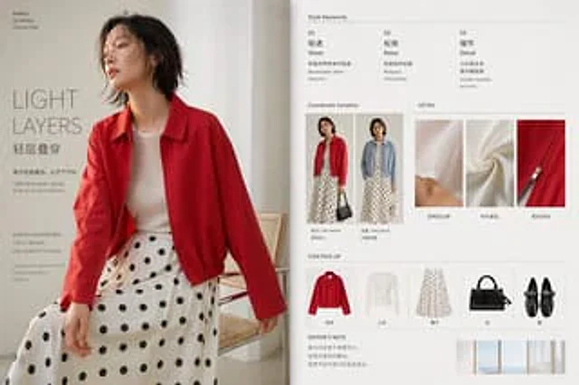

```text
{"type":"fashion editorial layout poster","brand":"MANGO","collection":"25 SPRING COLLECTION","style":"minimal luxury magazine spread, clean white background, soft daylight, airy modern editorial design, high-end fashion lookbook board","subject":{"gender_presentation":"female","pose":"seated in a relaxed pose on a light cane chair, torso angled left, head turned away","face":"intentionally blurred/obscured","outfit":{"outerwear":{"item":"cropped lightweight zip jacket","color":"{argument name=\"jacket color\" default=\"vivid red\"}"},"top":{"item":"semi-sheer fitted long-sleeve knit top","color":"soft white"},"bottom":{"item":"midi skirt","color":"white","pattern":"large black polka dots"}},"accessories":{"bag":"structured black handbag shown in product row and styling variation","shoes":"black flat shoes shown in product row"}},"layout":{"format":"single fashion board with large left hero image and right information column","sections":[{"title":"Style Keywords","position":"top-right","count":3,"labels":["01 轻透 Sheer","02 松弛 Relax","03 细节 Detail"]},{"title":"Coordinate Variation","position":"upper-mid-right","count":2,"labels":["朱和一— / OFF WHITE","浅蓝 / PALE BLUE"]},{"title":"DETAIL","position":"upper-right below coordinate variation","count":3,"labels":["透明边缘感","布料垂坠","柔软结构"]},{"title":"ITEM PICK UP","position":"lower-mid-right","count":5,"labels":["风衣","上衣","裤子","包","鞋"]}],"hero_text":{"headline":"{argument name=\"headline text\" default=\"LIGHT LAYERS\"}","subheadline":"轻层叠穿","body":["春日轻盈叠加，从空气开始","Light layering for spring, built on air and softness.","轻透材质与松弛轮廓的叠加，不是为了展示造型，而是让身体与空气形成关系。","Layering is not about structure, it's about how fabric meets air."]},"additional_note":{"title":"EDITOR'S NOTE","text":"春天的穿搭不需要用力，轻透与柔软的叠加，是季节给予我们的温柔语言。"},"bottom_right_inset":"small minimalist interior window photo strip"},"visual_details":{"color_palette":["red","white","black","soft beige","pale blue"],"materials":["sheer knit","soft draped fabric","smooth zipper detail"],"lighting":"soft natural morning light from the side","composition":"left side dominated by large model image, right side arranged as neat editorial grid with thin divider lines and generous margins"},"rendering_notes":"create a polished fashion campaign slide or magazine-style apparel presentation in bilingual Chinese-English typography, with realistic clothing photography, elegant spacing, understated premium branding, and a calm spring atmosphere"}
```

Model: GPT Image 2
Author: 虎小象

[ProjectD](https://aitoolsradar.com/en/prompts/d856ebeb236378) · [Recorded source](https://youmind.com/prompts/minimal-spring-editorial-board-14456)
 · [Full original metadata and byte evidence](data/projectd-batch-0039.json)

## Minimal Streetwear Merch Campaign Grid

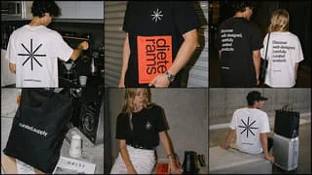

```text
{"type":"Editorial style streetwear collage","brand":{"name":"curated.supply","logo":"Minimalist 8-spoked star symbol","aesthetic":"Clean contemporary design brand merchandise, understated high-end basics, unisex modern lifestyle"},"products":[{"type":"T-shirt","color":"white","graphics":{"front":"Small black 8-spoked star centered on the chest","back":"Large black 8-spoked star centered on the back, with small brand text 'curated.supply' near the lower back"}},{"type":"T-shirt","color":"black","graphics":{"front":"Small white 8-spoked star centered on the chest","back":"Large stacked white sans-serif slogan on the back"}}{argument name="back slogan" default="Discover well-designed, carefully curated products"} The lower back area has small brand text "curated.supply"}},{"type":"Tote bag","color":"Black","graphics":{"front":"The lower left area has white lowercase sans-serif brand text "curated.supply"}}],"layout":{"grid":{"rows":2,"columns":3,"count":6},"sections":[{"position":"Top left","count":1,"scene":"A male model wearing{argument name="shirt color" default="White"} A male model wearing a black T-shirt with a small star on the chest, holding a bright red design book with oversized black typography, is seen brewing coffee in a dimly lit modern kitchen. The image shows the back of two models walking at night, one in a black T-shirt and the other in a white T-shirt, both displaying large stacked slogans on their backs. A still-life product sample includes a black tote bag, two white paper cups with star logos, and a magazine placed on a concrete base next to a large speaker. A female model sits in front of a raw concrete wall, wearing a black T-shirt with a small star on the chest. A male model wearing a white T-shirt with a large asterisk on the back sits in an urban concrete environment with his back to the camera, next to a black shopping bag with a small asterisk and a silver hard-shell suitcase. The model is wearing a white T-shirt with a large asterisk on the back and a black shopping bag with a small asterisk on the back. The model is wearing a white T-shirt with a large asterisk on the back and a black shopping bag with a small asterisk on the back. The model is wearing a white T-shirt with a large asterisk on the back and a silver hard-shell suitcase. The model is wearing a white T-shirt with a large asterisk on the back and a black shopping bag with a small asterisk on the back. The model is wearing a white T-shirt with a large asterisk on the back and a silver hard-shell suitcase. The model is wearing a white T-shirt with a large asterisk on the back and a black and white background ...
```

Model: GPT Image 2
Author: GPT Image 2 Prompts

[ProjectD](https://aitoolsradar.com/en/prompts/197c0ae3bb39e0) · [Recorded source](https://x.com/justinmfarrugia/status/2047293707364307367#reversed-1)
 · [Full original metadata and byte evidence](data/projectd-batch-0039.json)

## Minimal Streetwear Merch Moodboard

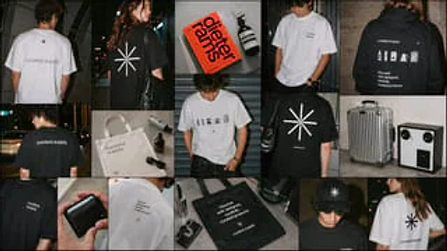

```text
{
  "type": "Streetwear promotional projects",
  "brand": {
    "name": "{argument name=\"brand name\" default=\"curated.supply\"}",
    "logo": "Minimalist eight-spoked star symbol",
    "tagline": "{argument name=\"tagline\" default=\"Explore meticulously designed and carefully selected products\"}",
    "aesthetic": "A minimalist, high-end industrial lifestyle brand, featuring monochromatic color schemes and editorial-style fashion photography."
  },
  "image": {
    "aspect_ratio": "16:9",
    "background": "The dimly lit city at night and the concrete interior environment",
    "lighting": "Flash photography blends dim urban ambient light, creating a melancholic atmosphere with glossy highlights and realistic graininess.",
    "composition": "A compact 4-row grid containing 15 tiles separated by thin black lines."
  },
  "layout": {
    "sections": [
      {
        "title": "Model Clothing",
        "position": "Spanning the entire collage",
        "count": 9,
        "labels": [
          "The white T-shirt has a small asterisk on the back near the neck, and the brand name is centered.",
          "The back of the black T-shirt features a large white star graphic.",
          "The white T-shirt has a small brand logo on the left chest.",
          "The back of the black hoodie features the brand name, a small asterisk, four product icons, and a multi-line slogan at the top.",
          "The back of the black T-shirt features only the brand logo centered.",
          "The white T-shirt features four small product icons arranged horizontally on the chest, with tiny asterisks below them.",
          "The black T-shirt features a large white star on the back and tiny text labels near the hem.",
          "A close-up of the brand logo centered on the back of the black T-shirt.",
          "The back of the white T-shirt, worn by a model, features a large black star on the back and the brand name on the lower back."
        ]
      },
      {
        "title": "Accessories and objects",
        "position": "The two lines in the middle and bottom",
        "count": 6,
        "labels": [
          "Place a monochrome pump bottle next to the bright orange book",
          "A cream-colored canvas tote bag with the brand name on it, along with sunglasses, a small bottle, and some small accessories.",
          "Place a black and white speaker or appliance box next to the silver aluminum suitcase.",
          "Hand-held slim black wallet with a small asterisk logo",
          "A black tote bag with a large multiline slogan and brand name, paired with a camera, spray bottle, and dark packaging.",
          "Black baseball cap with white star logo."
        ]
      }
    ],
    "text_elements_count": 6
  },
  "subjects": {
    "models": "Young people, faces deliberately obscured or cropped, casual poses, mostly from behind or below the chest.",
    "styling": "Black and white oversized streetwear, jeans, leather shoulder bags, minimalist jewelry and watches",
    "props": "Luxury everyday essentials and tech-savvy lifestyle items"
  },
  "design_details": {
    "graphics": [
      "Small chest logo",
      "Large back star symbol",
      "Small Neck Star",
      "Four miniature product pictographs: a bottle, a rectangular device, a draped fabric or garment, and the outline of a kettle or bag.",
      "Multiple lines of declarative text on hoodies and tote bags"
    ],
    "color_palette": [
      "black",
      "White",
      "Charcoal gray",
      "Concrete dust",
      "metallic silver",
      "Orange accents"
    ]
  },
  "camera": {
    "lens": "35mm to 50mm editorial style lifestyle photography",
    "framing": "A mix of photos of models from the waist up, product close-ups, and flat lay images.",
    "focus": "Clear clothing graphics and textures"
  },
  "quality": "High-end fashion advertising, realistic and exquisite, for{argument name=\"product line\" default=\"Streetwear and Lifestyle Accessories\"} Create a coherent series of related picture books to promote{argument name=\"brand name\" default=\"curated.supply\"} Keep visible text clear and legible, including text labels, logos, and text on orange books.{argument name=\"book title\" default=\"dieter rams\"}"
}
```

Model: GPT Image 2
Author: GPT Image 2 Prompts

[ProjectD](https://aitoolsradar.com/en/prompts/b15c0ef4fb5f12) · [Recorded source](https://x.com/justinmfarrugia/status/2047293707364307367#reversed-2)
 · [Full original metadata and byte evidence](data/projectd-batch-0039.json)

## Minimal Studio Portrait in Neutral Tones

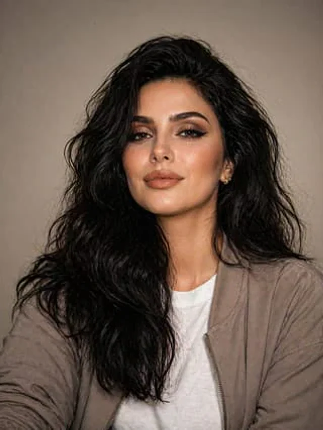

```text
A highly realistic studio portrait, featuring a woman in her twenties with a well-proportioned figure.{argument name="subject gender" default="woman"} The shot is taken from eye level, focusing on the upper body, and is centered against a smooth, warm beige studio background, free of clutter. She has thick, long hair, the color of which is {argument name="hair color" default="black"} Her hairstyle is a loose, slightly messy, natural wave, full of volume, softly parted in the middle, falling over her shoulders. She poses relaxed and confidently, facing the camera with a calm, neutral, and composed expression. She wears two visible layers: a pure white crew-neck T-shirt underneath a light, open, gray-brown casual zip-up jacket, presenting a minimalist modern street style in neutral tones. A delicate, small earring adorns one ear. Professional studio lighting was used, employing soft main light and gentle fill light to create natural shadows, realistic skin tone, and a subtle sense of depth against the background. Shot with an 85mm portrait lens at f/2.8, the subject is sharply focused with a shallow depth of field, presenting an edited, fashionable portrait style. Color balance is natural, minimal retouching is used, resulting in ultra-high-definition detail, no filters, no noise, no motion blur, and no cartoonish characteristics.
```

Model: GPT Image 2
Author: GPT Image 2 Prompts

[ProjectD](https://aitoolsradar.com/en/prompts/e352937f9213e3) · [Recorded source](https://x.com/mehvishs25/status/2047497929993363758#reversed-0)
 · [Full original metadata and byte evidence](data/projectd-batch-0039.json)

## Minimal Studio Seated Fashion Portrait

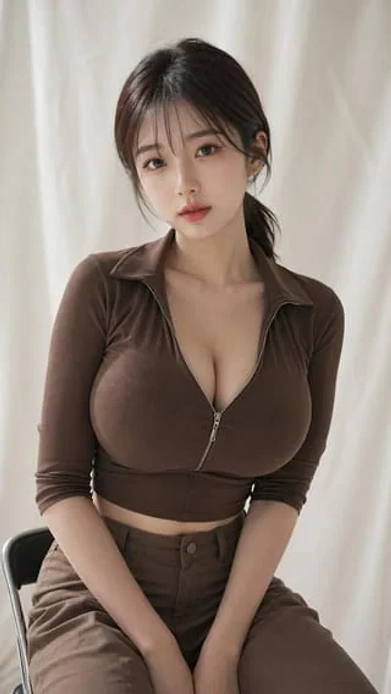

```text
A realistic indoor portrait of a young East Asian woman, seated in a simple black folding chair. The composition is vertical, framing the image from her thighs to her head. She has {argument name="hair color" default="Dark brown"} Her hair was parted in the middle and tied into a low ponytail, with a few soft strands framing her face. She wore delicate earrings, her skin was fair and smooth, and her posture was calm and natural, with her hands clasped together between her knees. She was wearing a {argument name="top color" default="Dark chocolate brown"} A fitted ribbed zip-up cropped top with a pointed collar and three-quarter sleeves; the zipper is slightly open to create a deep neckline. Pair it with bottoms in the same color family.{argument name="pants color" default="warm brown"} High-waisted straight-leg trousers. The overall look uses a monochromatic brown color scheme, showcasing the delicate fabric texture and natural body contours. The background is a softly draped off-white fabric with gentle pleats, and the lighting uses soft natural window light to create a clean and gentle editorial-style interior visual effect. Realistic style, shallow depth of field, soft shadows, understated fashion portrait, minimalist setting, centered subject, relaxed sitting posture, high detail in skin and fabric texture.
```

Model: GPT Image 2
Author: GPT Image 2 Prompts

[ProjectD](https://aitoolsradar.com/en/prompts/f060331637894f) · [Recorded source](https://x.com/Asan0_Misaki/status/2046904727674462560#reversed-0)
 · [Full original metadata and byte evidence](data/projectd-batch-0039.json)

## Minimal SVG Pelican on Bicycle


```text
A minimalist flat vector illustration against a light gray background depicts a stylized pelican riding a bicycle. The image is composed of simple geometric SVG shapes with bold, dark charcoal outlines and clean details. The bicycle, presented in a side view, has two large wheels, each with a round rim and a simple four-spoke cross, along with a black frame, seat, cranks, and handlebars, with a thin horizontal line at the bottom. The pelican's form is abstract and slightly clumsy, constructed from clean outlines: a white, rounded oval body positioned above the bicycle; two narrow, orange-yellow leg shapes extending downwards to the pedals; a white neck and head stretching forward, featuring a small black eye, a long, triangular, orange-yellow upper beak, and a large, pale pink throat pouch. A single, upward-sloping white wing shape is added above the body. The composition is deliberately simple and slightly imperfect, like an SVG demo drawing generated from code in a code editor screenshot, but only rendering the artwork itself, without any interface, text, shadows, or additional backgrounds.
```

Model: GPT Image 2
Author: GPT Image 2 Prompts

[ProjectD](https://aitoolsradar.com/en/prompts/be28fa8f0d4805) · [Recorded source](https://x.com/JoiLaboratory/status/2047721479601811696#reversed-1)
 · [Full original metadata and byte evidence](data/projectd-batch-0039.json)

## Minimalist 9-Look Fashion Collage

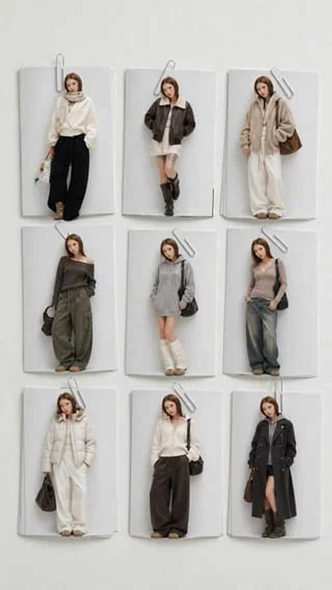

```text
{
  "type": "Fashion Lookbook Collage",
  "subject": {
    "gender_presentation": "young women",
    "face_visibility": "The faces in each photo are deliberately blurred and indistinct.",
    "hair": {
      "color": "{argument name=\"hair color\" default=\"Light brown\"}",
      "style": "Straight hair, shoulder-length, parted in the middle or slightly to the side."
    },
    "body_type": "slim",
    "aesthetic": "A soft, unisex Korean streetwear style, a comfortable autumn/winter capsule wardrobe."
  },
  "layout": {
    "background": "Clean light gray studio walls",
    "presentation": "Nine vertically printed photo cards are arranged in a precise 3x3 grid, each clipped at the top with an oversized silver paperclip, and feature subtle shadows and a delicate paper-stacking effect on the back.",
    "count": 9,
    "sections": [
      {
        "title": "Top row",
        "position": "upper third",
        "count": 3,
        "labels": [
          "Beige shirt paired with a scarf and black wide-leg pants",
          "Dark brown bomber jacket with shearling collar paired with a beige mini skirt and brown over-the-knee boots",
          "A beige teddy bear jacket paired with white loose-fitting trousers and a brown shoulder bag."
        ]
      },
      {
        "title": "Bank of China",
        "position": "center",
        "count": 3,
        "labels": [
          "Off-the-shoulder dark gray-brown knit sweater paired with olive green cargo pants",
          "Wearing an oversized grey hoodie as a mini skirt, paired with white leg warmers",
          "A fitted gray-brown long-sleeved top paired with light blue loose-fitting jeans"
        ]
      },
      {
        "title": "bottom row",
        "position": "The lower third",
        "count": 3,
        "labels": [
          "A white down jacket paired with white loose-fitting trousers and a dark handbag.",
          "Soft beige zip-up cardigan paired with dark brown wide-leg pants",
          "A charcoal gray long trench coat layered over a gray hoodie and black shorts, paired with brown boots."
        ]
      }
    ]
  },
  "styling": {
    "palette": "Soft neutral colors: beige, light brown, taupe, gray, brown, black, olive green, washed denim blue",
    "footwear": "Mainly tan or brown casual shoes and boots.",
    "bags": "Most outfits are paired with a brown shoulder bag or handbag.",
    "pose_style": "A stylish and relaxed pose, hands in pockets or carrying a handbag, exuding an editorial yet casual vibe."
  },
  "camera": {
    "angle": "Display effect facing the tiled wall",
    "framing": "The entire 3x3 arrangement is vertically centered.",
    "lighting": "Soft, diffused studio lighting with extremely low contrast."
  },
  "rendering": "Photorealistic fashion editorial collages, clean minimalist composition, delicate paper texture, and rich details in fabrics and layering.",
  "prompt": "Create a photorealistic minimalist fashion lookbook collage, including {argument name=\"number of outfits\" default=\"9\"} Zhang Tongyi{argument name=\"model type\" default=\"young women\"} Full-body costume photos were printed on cards and clipped to a light gray wall with oversized silver paperclips. A 3x3 grid was used, resulting in exactly nine different looks. Faces in each image were kept blurred and devoid of detail. The costume style was {argument name=\"fashion aesthetic\" default=\"Soft and unisex Korean street style\"} The collection features soft color palettes and layering techniques suitable for autumn and winter. It includes the following 9 looks: 1) Beige shirt, scarf, black wide-leg pants, printed tote bag; 2) Dark brown shearling-trimmed bomber jacket, beige mini skirt, brown over-the-knee boots; 3) Beige teddy bear jacket, white loose-fitting trousers, brown shoulder bag; 4) Off-the-shoulder dark gray-brown knit sweater, olive green cargo pants, dark handbag; 5) Oversized gray hooded mini skirt, white leg warmers, dark shoulder bag; 6) Slim-fit gray-brown long-sleeved top, washed loose-fitting jeans, dark shoulder bag; 7) White down jacket, white loose-fitting trousers, dark handbag; 8) Beige zip-up cardigan, dark brown wide-leg pants, dark shoulder bag; 9) Charcoal gray long trench coat layered over a gray hoodie and black shorts, brown boots, dark handbag. Soft, diffused studio lighting, subtle shadows, and clean paper textures create a sophisticated look for the catalog against a simple, neutral background."
}
```

Model: GPT Image 2
Author: GPT Image 2 Prompts

[ProjectD](https://aitoolsradar.com/en/prompts/6bd34062865a5b) · [Recorded source](https://x.com/stwk26/status/2046814681957118114#reversed-0)
 · [Full original metadata and byte evidence](data/projectd-batch-0039.json)

## Minimalist Aesthetic Commercial Poster

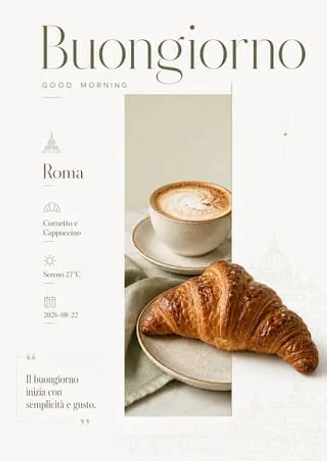

```text
设计一张具有高级商业审美的极简海报，核心视觉语言是“真实物象穿越几何情绪窗口”。画面中设置一个窄长的低饱和色块，作为视觉锚点和空间容器，色块颜色根据主题选择柔和浅色，如雾蓝、浅青、米白、淡粉、暖灰或浅金。将{argument name="核心物象" default="[核心物象]"}以真实摄影质感或精细写实方式置入色块之中，但不要完全困在色块内，要让主体局部越界、破框、延伸到留白区域，形成自然生长感和空间穿透感。背景保持极简，使用大面积白色或浅灰留白，加入几乎透明的文化纹样、线性图形、地形线、水波线、光影轮廓或抽象符号，作为若隐若现的视觉细节。整体排版要像高端地产、奢侈品、美学杂志或节气海报，文字细长、克制、字距舒展，标题可竖排，辅助信息用小字号规整排列。画面需要有东方留白、现代秩序、自然生命力、轻奢品质感。避免杂乱、避免高饱和、避免厚重阴影、避免廉价模板感。
```

Model: GPT Image 2
Author: 小小东

[ProjectD](https://aitoolsradar.com/en/prompts/49e656ebe050ce) · [Recorded source](https://youmind.com/prompts/minimalist-commercial-aesthetic-poster-32240)
 · [Full original metadata and byte evidence](data/projectd-batch-0039.json)

## Minimalist AI Fashion Comparison Board

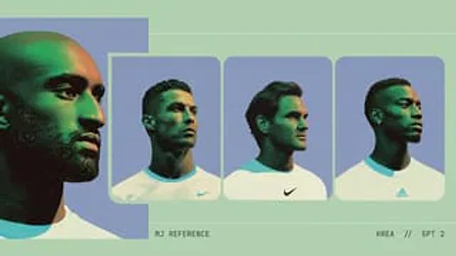

```text
A minimalist fashion project against a light sage green background, employing a wide, horizontally contrasting layout, features four portrait panels of young male models wearing oversized white athletic T-shirts. The soft, editorial studio style, with cool periwinkle blue backgrounds within the portrait frames, possesses a delicate film grain, soft contrast, and a highly consistent palette of sage green, cyan trim, off-white, deep shadows, and blue lavender. The far left contains a large reference portrait cropped at the edge of the canvas, showing a dark-skinned male model with a shaved or very short head, the profile of his ears, jawline, neck, and shoulders, wearing a white shirt with a bright aquamarine ribbed collar; two semi-transparent, overlapping rectangular blocks are placed in the facial area, creating a graphic review/collage effect. Three rounded portrait cards are placed side-by-side on the right, evenly spaced. Each card features a different young male model, all appearing from the chest up, against the same blue studio background: Card 1 shows a man with light to medium skin tone, short slicked-back hair, slightly turned to the left, wearing a white sweatshirt with a light blue collar trim and a small Nike Swoosh logo on the lower right chest; Card 2 shows a light-skinned man with medium-length dark slicked-back hair, turned three-quarters of the way to the left, wearing a white Nike shirt with a black Swoosh logo on the chest; Card 3 shows a dark-skinned man with short, gradient hair, turned three-quarters of the way to the right, wearing a white Adidas shirt with a cyan Adidas logo on the chest, and small hoop or cross earrings. Above the face of each smaller portrait, a gradient rectangle that transitions from dark green to grayish-green is added, vertically aligned, like a graphic overlay. Add two thin horizontal dividing lines to the overall composition, one near the top and one near the bottom third, in a slightly lighter sage color. Add small, monospaced capitalized edited text at the bottom: "MJ REFERENCE" near the bottom left and "KREA // GPT 2" near the bottom right. The overall image should evoke the feel of a high-end AI fashion contrast project, graphic design presentation, or concept consistency sheet, with clean spacing, a flat background, and sophisticated art direction.
```

Model: GPT Image 2
Author: GPT Image 2 Prompts

[ProjectD](https://aitoolsradar.com/en/prompts/2f15144d079b12) · [Recorded source](https://x.com/lloydcreates/status/2046775099747954984#reversed-2)
 · [Full original metadata and byte evidence](data/projectd-batch-0039.json)

## Minimalist Anime Girl Side Profile

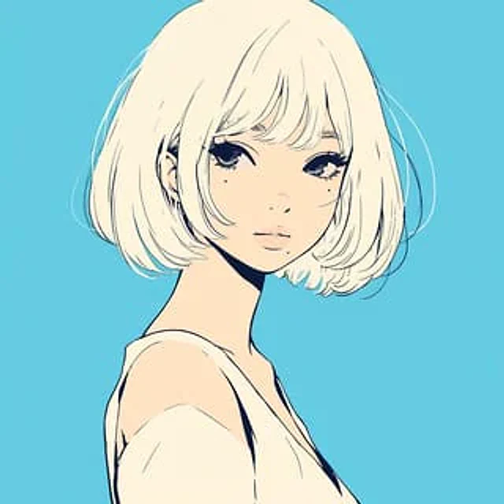

```text
A minimalist anime-style portrait of a young woman, showing her from the chest up, her face turned to the left, her head slightly turned, revealing only part of her eyes and ears. She has a neat short bob haircut, with slightly inward-curling ends and a few slightly messy strands; her hair color is {argument name="hair color" default="Platinum"} Her skin is fair and smooth, and she wears a loose-fitting white off-shoulder top or sweater that slips down to one shoulder, revealing her collarbone and upper back. The composition is simple yet graphic, using fine lines in a deep navy blue, with flat, soft colors and almost no shadows, presenting a cool, editorial illustration quality. Solid colors are used.{argument name="background color" default="Bright blue"} The background should contain no objects, scenes, or text. Position the half-body portrait slightly to the left of the frame, with negative space around the subject. The overall atmosphere should be quiet, stylish, modern, and elegant, similar to anime girl illustrations on Japanese social media. Do not add any accessories, jewelry, or additional background elements.
```

Model: GPT Image 2
Author: GPT Image 2 Prompts

[ProjectD](https://aitoolsradar.com/en/prompts/7c245b49187f31) · [Recorded source](https://x.com/maku67879787/status/2047643632015159517#reversed-1)
 · [Full original metadata and byte evidence](data/projectd-batch-0039.json)

## Minimalist Anime Portrait with Censored Face

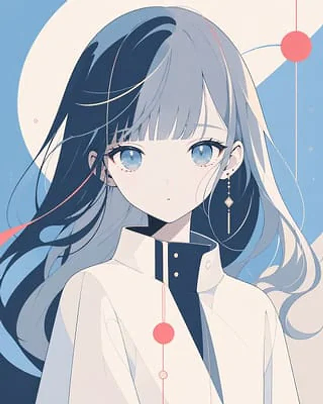

```text
A minimalist anime-style half-body portrait of a woman is positioned in the center of the image. Her face is completely obscured by a large, vertically oriented, softly edged gray rectangle, creating a censorship effect. She has extremely long, flowing hair in a two-tone style: one side is deep navy blue, and the other is pale silver-gray, with strands flowing outwards as if blown by a gentle breeze. A few strands of coral pink are added as embellishments. She wears a high-necked, off-white coat or uniform jacket with a deep navy blue inner collar and two small gold buttons, creating a stylish, modern sci-fi feel. Her visible skin is pale, and she wears a small earring in one ear. The painting employs a flat, elegant illustration style with smooth, vector-like shadows, no heavy textures, and a restrained, soft color palette, primarily using powder blue, cream, navy blue, and coral pink. The background is an abstract geometric composition rather than a realistic scene: large cream-colored circles and diagonal shapes are superimposed on a sky-blue background, decorated with five coral-colored circular graphics connected by thin vertical lines or curves, arranged decoratively around the character. The overall composition remains transparent, balanced, and modern, with soft lines and clever use of negative space, presenting a cool and sophisticated editorial aesthetic.
```

Model: GPT Image 2
Author: GPT Image 2 Prompts

[ProjectD](https://aitoolsradar.com/en/prompts/062e5db3c1364d) · [Recorded source](https://x.com/hoshi122221/status/2046774923432284233#reversed-0)
 · [Full original metadata and byte evidence](data/projectd-batch-0039.json)

## Minimalist ASMR Unboxing Storyboard Infographic

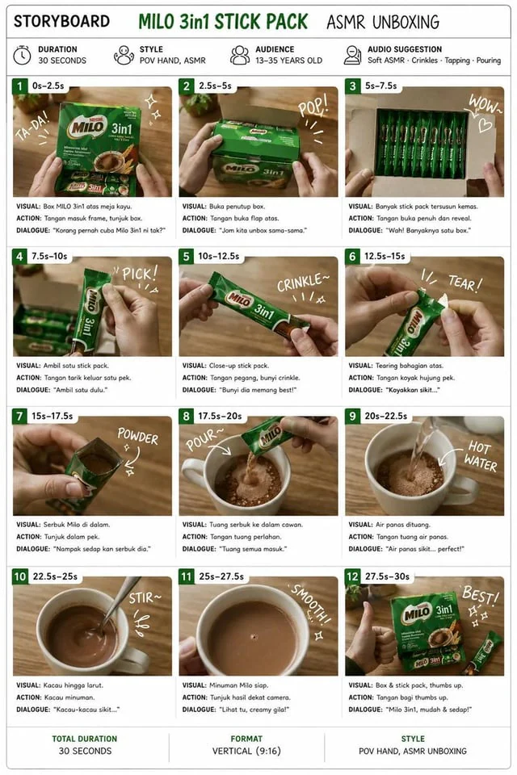

```text
Create a clean, premium storyboard infographic for a {argument name="video type" default="product ASMR unboxing"} video. Design specifications: White background with a modern, minimalist layout. Title at the top: STORYBOARD. Product name in bold green (replace with: {argument name="product name" default="[PRODUCT NAME]"}). Subtitle: ASMR UNBOXING. Include four information boxes below the title: Duration: 30 Seconds, Style: POV Hands, ASMR, Audience: 18–35 years old, Audio Suggestion: Soft ASMR • Crinkles • Tapping • Pouring. Create 12 storyboard panels arranged in a 3-column × 4-row grid. Each panel should contain: A numbered green badge (1–12), Timestamp (0–2.5s, 2.5–5s, etc.), A realistic cinematic image showing the scene, Handwritten white doodle text like: TA-DA!, POP!, WOW!, PICK!, CRINKLE~, TEAR!, POUR~, HOT WATER, STIR~, SMOOTH!, BEST!. Three text sections below every image: VISUAL:, ACTION:, DIALOGUE:. Use realistic product photography, warm wooden table, soft natural lighting, shallow depth of field, POV hands only (no face visible), premium commercial advertising style. Storyboard sequence: 1 (0–2.5s) Visual: Product box on wooden table. Action: Hands enter frame and point to the box. Dialogue: "Have you tried this before?"; 2 (2.5–5s) Visual: Opening the box. Action: Lift the top flap slowly. Dialogue: "Let's unbox it together."; 3 (5–7.5s) Visual: Multiple individual sachets neatly arranged. Action: Fully reveal the inside. Dialogue: "Wow, look how many!"; 4 (7.5–10s) Visual: Pick up one sachet. Action: Remove a single stick pack. Dialogue: "Let's start with one."; 5 (10–12.5s) Visual: Close-up of sachet. Action: Hold and gently crinkle it. Dialogue: "That crinkle sound is satisfying."; 6 (12.5–15s) Visual: Tear open the top. Action: Slow ASMR tearing. Dialogue: "Just a small tear."; 7 (15–17.5s) Visual: Powder visible inside. Action: Show the powder close-up. Dialogue: "Looks delicious."; 8 (17.5–20s) Visual: Pour powder into mug. Action: Slow pouring. Dialogue: "Pour everything in."; 9 (20–22.5s) Visual: Hot water being poured. Action: Steam visible. Dialogue: "Add hot water."; 10 (22.5–25s) Visual: Stir drink. Action: Slow circular stirring. Dialogue: "Mix it well."; 11 (25–27.5s) Visual: Finished drink. Action: Show creamy texture from above. Dialogue: "Looks smooth and creamy."; 12 (27.5–30s) Visual: Product box beside finished drink with thumbs up. Action: Hand gives thumbs up. Dialogue: "Easy, delicious, and ready!". Footer: Total Duration: 30 Seconds, Format: Vertical (9:16), Style: POV Hands, ASMR Unboxing. Typography should resemble a professional creative agency storyboard, with clean spacing, green accents, rounded panel borders, and high-end presentation suitable for client pitches.
```

Model: GPT Image 2
Author: Ciri

[ProjectD](https://aitoolsradar.com/en/prompts/6d621223bbb439) · [Recorded source](https://youmind.com/prompts/asmr-unboxing-storyboard-infographic-28494)
 · [Full original metadata and byte evidence](data/projectd-batch-0039.json)

## Minimalist Black and White Outbound Illustration

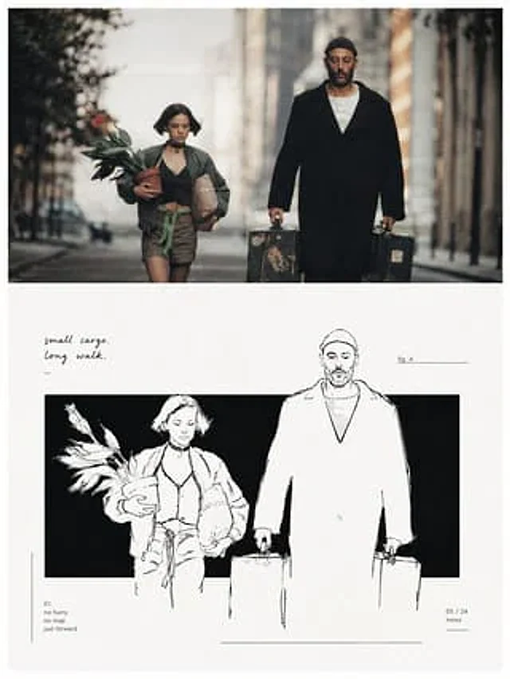

```text
请将我上传的每一张照片分别制作成一张独立的高级设计海报，不多图拼接，每张照片单独输出。整体采用{argument name="构图比例" default="3:4竖版构图"}，上下两个区域高度严格1:1，各占画面50%。

上半部分保留原始照片，保持主体结构、真实质感、自然光影和原有色彩氛围，仅进行轻微高级摄影调色，使其具有艺术杂志、独立出版物与展览摄影质感。为适配画幅，可自然扩展环境背景，但不得拉伸、扭曲或改变主体。

下半部分提取照片中最具识别性的主体、轮廓、姿态与叙事关系，重构为极简黑白手绘编辑插画。以一个横向或纵向的纯黑矩形色域作为主要视觉场，让主体大部分存在于矩形内部，同时选择最具识别度的头部、顶部轮廓、枝叶、屋顶、肢体、器物边缘或其他关键结构自然突破矩形边界，形成明确的“越界”关系。主体不是贴在黑色矩形上，而像从黑色空间中探出、穿过或生长出来，使矩形既是背景，也是构图的一部分。

主体仅保留最必要的外轮廓、姿态和关键结构，以{argument name="线条风格" default="黑色手绘线 + 白色负形 + 少量灰色块面"}表现。线条像墨笔、针管笔或复印线稿，粗细略有变化，边缘带轻微抖动、断裂、重复描线和手工误差，不追求光滑矢量精度；内部细节极少，只用几笔表情、结构线、折线或局部阴影建立辨识度。无论人物、动物、植物、建筑、器物或风景，都优先找到一个最有性格的局部作为越界焦点。

构图强调黑色矩形的几何秩序与主体自由轮廓之间的冲突。矩形承担稳定、沉重的视觉基座，主体以不对称位置、局部裁切和越界制造活力；大面积白色纸面留白包围黑色区域，使黑、白、灰形成强烈而克制的面积关系。辅助结构可以转化为极少量直线、斜面、平台、边缘或几何切片，但不得形成第二主体。

文字建立轻巧的黑白编辑式微排版系统，从照片的动作、情绪、状态或隐喻中提炼一个{argument name="标题内容" default="简短英文标题"}，并搭配1–3组极小注释、编号、状态词或短句。文字可贴近黑色矩形边缘、藏在负形中、顺着越界方向排列，或与主体轮廓形成对齐和错位；使用黑色手写字、细瘦无衬线或克制衬线字体，保持小尺度，让文字像插画师留下的签注和编辑标记，而不是商业标题。

整体呈现纯白纸面 × 黑色几何色域 × 稚拙手绘线条 × 主体越界 × 极少灰阶的视觉气质，幽默、克制、聪明、略带古怪和艺术出版感。避免彩色卡通、复杂场景、光滑矢量描边、写实明暗、3D质感、纯黑剪影、规整图标化和模板式居中构图。
```

Model: GPT Image 2
Author: 小小东

[ProjectD](https://aitoolsradar.com/en/prompts/3d2799dcbcc230) · [Recorded source](https://youmind.com/prompts/minimalist-outbound-illustration-poster-32128)
 · [Full original metadata and byte evidence](data/projectd-batch-0039.json)

## Minimalist Cinematic Vertical Poster with Character Reference

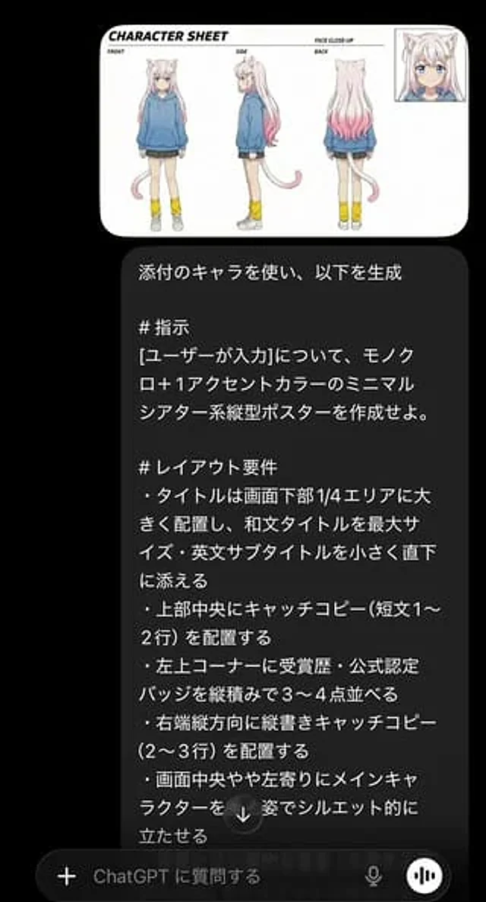

```text
Using the attached role, generate the following: # Command is{argument name="user input" default="[User Input]"} Create a minimalist, theatrical-style vertical poster using monochrome +{argument name="accent color" default="An accent color"} # Layout Requirements - Place the title in large font in the bottom 1/4 area, maximizing the Japanese title, followed immediately by the English subtitle in a smaller font size. - Place a tagline (1-2 lines) at the top center. - Vertically stack 3-4 award/official certification badges in the top left corner. - Place a vertical tagline (2-3 lines) along the right edge. - Place the main character in silhouette form slightly to the left of the center. - Present fantasy elements (floating islands, giant creatures) in silhouette form in the background. - Arrange the cast and crew, release date, and distribution information in small horizontal lines at the bottom. - Highlight the release date in large font in the bottom right corner. # Design Requirements - Keep the background a single color (black to gray gradient). - Use only one accent color (e.g., vibrant cobalt blue or gold). - Combine silhouette and thin-line art style. - Emphasize the title text using white + accent color. - Create an overall cinematic and artistic atmosphere. - Avoid using colored backgrounds, excessive decoration, or large gradient effects. - Format: Portrait, aspect ratio 2:3, high resolution.
```

Model: GPT Image 2
Author: GPT Image 2 Prompts

[ProjectD](https://aitoolsradar.com/en/prompts/264341bb6fe8cb) · [Recorded source](https://x.com/tetumemo/status/2046740325335790021)
 · [Full original metadata and byte evidence](data/projectd-batch-0039.json)

## Minimalist City Poster Prompt

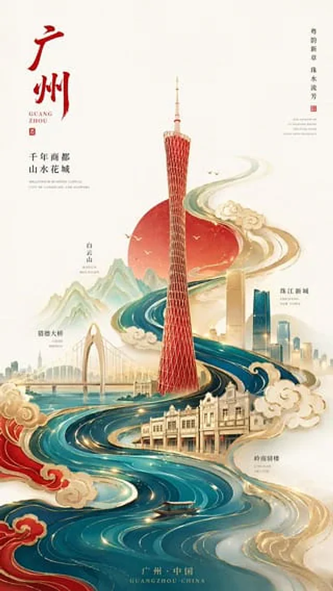

```text
New Chinese minimalist style high-end city poster.{argument name="aspect ratio" default="9:16"} Vertical composition, with{argument name="city" default="Guangzhou"} The central theme is an abstract geometric version of the Canton Tower, simple yet highly recognizable. The overall composition employs an S-shaped flow, extending upwards from the bottom. The Pearl River system is designed as flowing ripples, incorporating traditional auspicious cloud patterns to create a visual flow around the entire image. Landmark embellishments utilize a combination of negative space, lines, and localized color blocks. Style: Minimalist + Sophisticated + Eastern aesthetic. Color scheme: Based on {argument name="color scheme" default="Chinese red, sky blue and gold"} The main color scheme is accented with touches of warm gold. Background: Large areas of pure white or light-colored rice paper texture. Overall style: High-end Chinese-style illustration/brand poster quality/8K/ultra-high definition details.
```

Model: GPT Image 2
Author: GPT Image 2 Prompts

[ProjectD](https://aitoolsradar.com/en/prompts/87db5fbf11826d) · [Recorded source](https://x.com/liyue_ai/status/2045744531686166878)
 · [Full original metadata and byte evidence](data/projectd-batch-0039.json)

## Minimalist Educational Infographic Template


```text
一张干净的教育类信息图海报，讲解「{argument name="知识主题" default="知识主题"}」，

【整体风格】
现代极简UI风格，
背景使用柔和浅色（如奶油色 #FAF7F2 / 浅灰蓝），
配色克制、舒适，适合长时间阅读，

【核心要求（关键）】
根据“知识主题”的信息结构，自然组织内容模块，
不要强制固定模块数量或顺序，
优先保证信息逻辑清晰，而不是形式对称，

【布局（自适应）】
- 使用网格布局（自动选择 2列 / 3列 / 不规则分布）
- 卡片数量根据内容自动调整（通常 5–9 个）
- 信息密度高的模块可适当放大（视觉权重更高）
- 简单内容模块可缩小或合并

【卡片设计】
- 白色卡片（#FFFFFF）
- 圆角 + 轻微阴影（柔和层级）
- 保持统一间距和对齐

【每个信息模块包含】
- 简洁插图（统一风格）
- 清晰标题（强层级）
- 1–3句核心说明（避免冗长）
- 必要时提供示例 / 对比 / 小结

【内容组织原则（重点）】
根据主题自动选择合适结构，例如：
- 概念类 → 定义 + 原理 + 特点 + 示例
- 对比类 → A vs B（对照结构）
- 流程类 → 步骤 / 流程图
- 系统类 → 组成部分 + 关系
- 技能类 → 方法 + 技巧 + 常见误区

【视觉层级】
- 标题 > 模块标题 > 正文 > 辅助信息
- 重要信息可用颜色或图标强调

【配色建议】
- 主色：根据主题选择（科技=蓝，学习=绿，警告=橙）
- 辅色：1–2种即可
- 避免高饱和、避免花哨

【风格要求】
- 大量留白，呼吸感强
- 图标统一（线性或扁平）
- 高可读性优先
- 教学导向清晰

【额外优化（可选）】
- 可以加入：对比块 / 流程箭头 / 结构图
- 可以有一个“核心总结”模块作为视觉收尾
```

Model: GPT Image 2
Author: 知识分享官

[ProjectD](https://aitoolsradar.com/en/prompts/b705a36cbeaeca) · [Recorded source](https://youmind.com/prompts/minimalist-educational-infographic-16270)
 · [Full original metadata and byte evidence](data/projectd-batch-0039.json)

## Minimalist facial beauty report

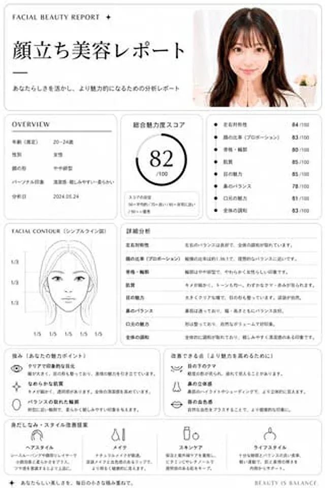

```text
この写真をもとに、清潔感がありミニマルで高級感のある顔立ち美容レポートを作成してください。 {argument name="配色" default="白地に黒"}を基調としたデザインで、細いライン、角の丸いカード、ラグジュアリーな美しさを取り入れてください。 顔のシンプルな輪郭線イラストを含め、率直な魅力度分析（左右対称性、比率、骨格、肌質など）、明確なスコア、強み、改善できる点、そして実行しやすい身だしなみ・スタイル改善の提案を記載してください。 データに基づいた内容で、視覚的に洗練されており、過度にお世辞っぽくならないようにしてください。
```

Model: GPT Image 2
Author: そう｜Claude Codeで始めるAI自動化

[ProjectD](https://aitoolsradar.com/en/prompts/48d606263fc57e) · [Recorded source](https://youmind.com/prompts/minimalist-facial-beauty-report-16541)
 · [Full original metadata and byte evidence](data/projectd-batch-0039.json)

## Minimalist Fairy-Tale Children's Illustration

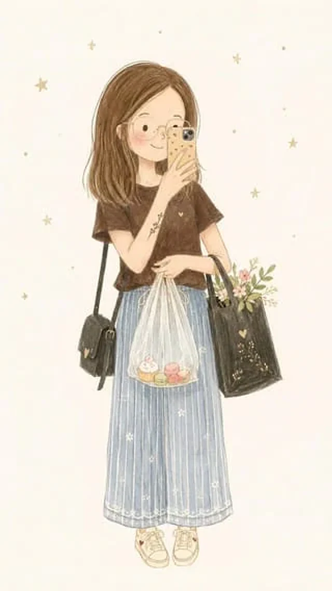

```text
Transform the photo into a delicate minimalist hand-drawn children’s illustration with a soft whimsical fairy-tale aesthetic. Use simple elongated shapes, thin imperfect hand-drawn lines, flat pastel colors, minimal details, and a cute doll-like character style with rosy cheeks, tiny facial features, and simplified anatomy. Add subtle paper texture, soft pencil and pastel shading, watercolor softness, and a clean white background with small stars or sparkles. Stylize the clothing in a playful storybook way with simplified shapes and gentle decorative details. The overall mood should feel airy, cozy, naive, and charming, like a modern Scandinavian nursery postcard or children’s book illustration. Avoid photorealism, 3D, cinematic lighting, glossy surfaces, complex shadows, realistic anatomy, and hyper-detail.
```

Model: GPT Image 2
Author: Ciri

[ProjectD](https://aitoolsradar.com/en/prompts/955953ffc1e547) · [Recorded source](https://youmind.com/prompts/minimalist-fairytale-children-illustration-20796)
 · [Full original metadata and byte evidence](data/projectd-batch-0039.json)

## Minimalist fashion campaign with typography


```text
Ultra-realistic editorial fashion portrait of a confident model standing against a seamless monochromatic studio background, minimal composition, high-end luxury campaign aesthetic, dramatic softbox lighting with subtle rim light, centered composition, eye-level camera, sharp facial details, natural skin texture, stylish contemporary outfit in a matching color palette, confident pose, cinematic color grading, clean negative space. At the top of the image, a large hand-painted brush typography word in all caps (e.g., "STILL", "UNSTOPPABLE", "BREATHE", "FORWARD"), matching the background color scheme with slightly lighter contrast. Premium magazine cover look, bold modern branding, ultra-detailed, 85mm lens, f/2, shallow depth of field, HDR, photorealistic, 8K, highly detailed, luxury fashion advertising, minimalist design. Negative Prompt: low quality, blurry, noisy, overexposed, oversaturated, watermark, logo, extra limbs, distorted face, bad anatomy, cropped head, text artifacts, duplicated body parts, cartoon, illustration, CGI, low resolution. Aspect Ratio: 4:5 (Instagram Portrait). Stylize: Medium. Quality: High. Lighting: Soft studio + subtle rim light. Lens: 85mm portrait lens. Background color: navy, mustard yellow, emerald green, teal, burgundy, charcoal. Typography word: STILL, UNSTOPPABLE, BREATHE, FORWARD, FEARLESS, FOCUSED, RELENTLESS, LIMITLESS, RISE, ELEVATE. Outfit: tailored suit, turtleneck, bomber jacket, off-shoulder knit, trench coat, monochrome fashion ensemble.
```

Model: GPT Image 2
Author: K

[ProjectD](https://aitoolsradar.com/en/prompts/dccc804dc1609e) · [Recorded source](https://youmind.com/prompts/minimalist-fashion-campaign-brush-typography-30242)
 · [Full original metadata and byte evidence](data/projectd-batch-0039.json)

## Minimalist Fashion Magazine Portrait

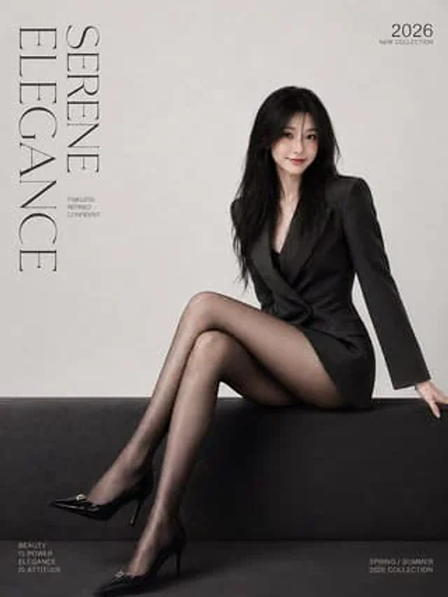

```text
把一张老师生活照拉进{argument name="杂志风格" default="极简时尚杂志"}里，{argument name="服装" default="黑色西装"}，{argument name="排版" default="冷淡排版"}，再加一点{argument name="眼神描述" default="不太好接近的眼神"}
```

Model: GPT Image 2
Author: serein

[ProjectD](https://aitoolsradar.com/en/prompts/cac9e3d6a97320) · [Recorded source](https://youmind.com/prompts/minimalist-fashion-magazine-portrait-25949)
 · [Full original metadata and byte evidence](data/projectd-batch-0039.json)

## Minimalist Fashion Moodboard Outfit

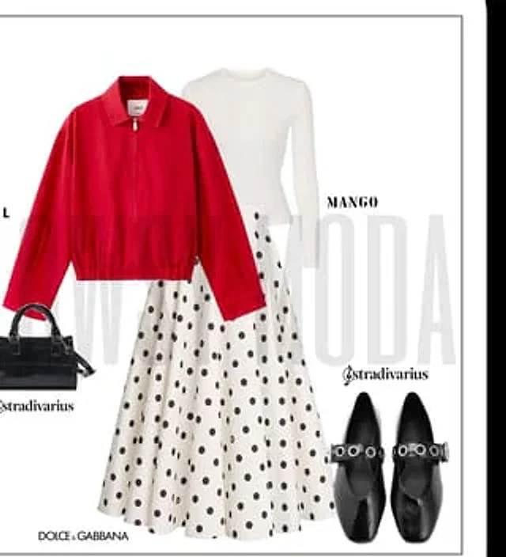

```text
A clean, editorial-style fashion collage is presented against a light gray-white background, bordered by thin black rectangles, reflecting a minimalist magazine-style fashion project. The outfit is placed in the center in a tiled composition, featuring five visible fashion items: a bright-colored piece is layered on the left.{argument name="jacket color" default="Dark red"} A cropped zip-up jacket with a pointed collar and elasticated hem; layered underneath a fitted top.{argument name="top color" default="White"} A long-sleeved, round-neck knit top, revealing the shoulders and sleeves; below, a beige, oversized, mid-length A-line skirt with evenly spaced large black polka dots; a structured small black handbag with short handles and a delicate, glossy crocodile texture placed in the lower left corner; and a pair of black square-toed Mary Jane flats with wide straps and silver metal ring buckles placed in the lower right corner. Oversized, very light gray text is added to the center of the back of the garment.{argument name="background brand text" default="MANGO"} And stretch it. Place a small black fashion brand logo around the layout: place it near the upper right corner of the outfit.{argument name="top right logo" default="MANGO"} Place "Stradivarius" near the handbag and shoes, and "DOLCE &amp; GABBANA" in the lower left corner near the hem of the skirt. The overall composition should be balanced, stylish, and modern, using soft studio lighting with no shadows or only subtle, soft shadows, and clean-cut edges to present a sophisticated social media fashion project aesthetic.
```

Model: GPT Image 2
Author: GPT Image 2 Prompts

[ProjectD](https://aitoolsradar.com/en/prompts/abb332658a04bc) · [Recorded source](https://x.com/hx831126/status/2046557123124027728#reversed-0)
 · [Full original metadata and byte evidence](data/projectd-batch-0039.json)

## Minimalist Film Noir Poster


```text
Subject and Composition: Central Figure:{argument name="subject profile" default="Profile of a man wearing a classic 1940s fedora and a suit."} Melting effect: The lower half of the man's torso should melt or "drip" into thin, vertical black ink streaks and splatter effects, creating a surreal sense of liquid seepage against the background. Graphic element: A huge {argument name="background shape" default="Solid red circle"} Located directly behind the man's head and shoulders, forming a halo-like or sun-like pattern, it serves as a visual anchor point in the composition. Style and Color Scheme: Color Scheme: Strictly follows{argument name="color scheme" default="A minimalist color scheme consisting of bright red, deep black, and off-white/cream."} Photography Style: The subject adopts a high-contrast black-and-white noir style. The texture conveys a high-resolution, fashion-movie feel with a shallow depth of field. Background: A clean, slightly textured off-white paper or canvas background gives it a high-end, physical poster quality. Technical Details: Lighting: Strong Rembrandt lighting outlines the facial contours, emphasizing the bridge of the nose and jawline through deep shadows. Atmosphere: Melancholy, intellectual, and suspenseful. The design is modern yet reflects the characteristics of the mid-20th century. Composition: Vertical poster orientation (A-frame), with ample negative space on both sides to emphasize the central vertical axis. Aspect ratio: 9:16.
```

Model: GPT Image 2
Author: GPT Image 2 Prompts

[ProjectD](https://aitoolsradar.com/en/prompts/46bda2e9bc7e4a) · [Recorded source](https://x.com/Goodmanprotocol/status/2047165794325500353)
 · [Full original metadata and byte evidence](data/projectd-batch-0039.json)

## Minimalist Film Noir Poster

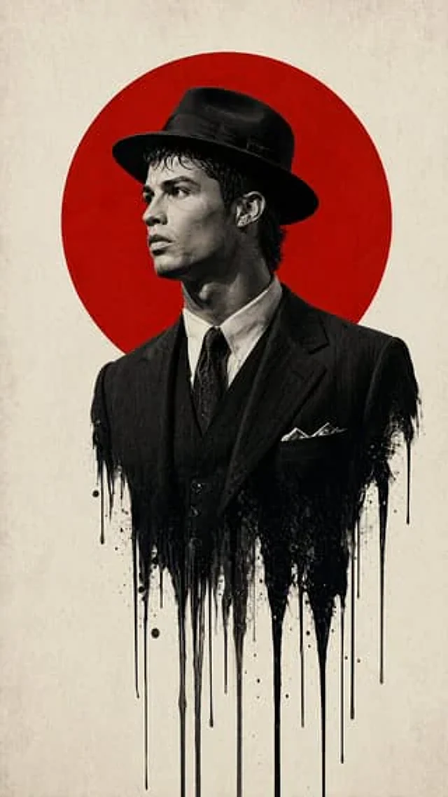

```text
Subject & Composition:\n\nCentral Figure: A {argument name="subject profile" default="sharp profile view of a man wearing a classic 1940s fedora and a formal suit"}.\n\nMelting Effect: The lower half of the man's torso should dissolve or \"drip\" into long, vertical black ink streaks and splatters, creating a surreal, liquid-bleed effect against the background.\n\nGraphic Element: A large, {argument name="background shape" default="solid vibrant red circle"} is positioned directly behind the man's head and shoulders, creating a \"halo\" or \"rising sun\" motif that anchors the composition.\n\nStyle & Color Palette:\n\nColor Scheme: A strict {argument name="color scheme" default="minimalist palette of True Red, Deep Black, and Off-White/Cream"}.\n\nPhotography Style: High-contrast, black and white film noir photography for the subject. The texture should look like a high-resolution fashion editorial with a shallow depth of field.\n\nBackground: A clean, slightly textured off-white paper or canvas background to give it a premium, physical poster feel.\n\nTechnical Details:\n\nLighting: Strong \"Rembrandt\" lighting to define the facial contours, emphasizing the bridge of the nose and the jawline with deep shadows.\n\nAtmosphere: Somber, intellectual, and high-stakes. The design should feel modern yet period-accurate to the mid-20th century.\n\nFraming: Vertical poster orientation (A-frame), with significant negative space on the left and right to emphasize the central vertical axis.\n\nAspect ratio is 9:16
```

Model: GPT Image 2
Author: Saul Goodman

[ProjectD](https://aitoolsradar.com/en/prompts/4848d1f46d604e) · [Recorded source](https://youmind.com/prompts/minimalist-film-noir-poster-15160)
 · [Full original metadata and byte evidence](data/projectd-batch-0039.json)

## Minimalist Hand-Drawn Children Illustration

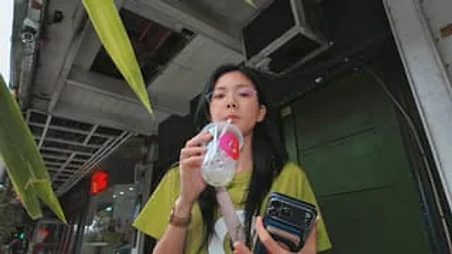

```text
Transform the photo into a delicate minimalist hand-drawn children’s illustration with a soft whimsical fairy-tale aesthetic. Use simple elongated shapes, thin imperfect hand-drawn lines, flat pastel colors, minimal details, and a cute doll-like character style with rosy cheeks, tiny facial features, and simplified anatomy. Add subtle paper texture, soft pencil and pastel shading, watercolor softness, and a clean white background with small stars or sparkles.Stylize the clothing in a playful storybook way with simplified shapes and gentle decorative details. The overall mood should feel airy, cozy, naive, and charming, like a modern Scandinavian nursery postcard or children’s book illustration. Avoid photorealism, 3D, cinematic lighting, glossy surfaces, complex shadows, realistic anatomy, and hyper-detail.
```

Model: GPT Image 2
Author: Kashberg

[ProjectD](https://aitoolsradar.com/en/prompts/6234096c414e8c) · [Recorded source](https://youmind.com/prompts/minimalist-hand-drawn-child-illustration-21281)
 · [Full original metadata and byte evidence](data/projectd-batch-0039.json)

## Minimalist Hand-Drawn Childrens Illustration

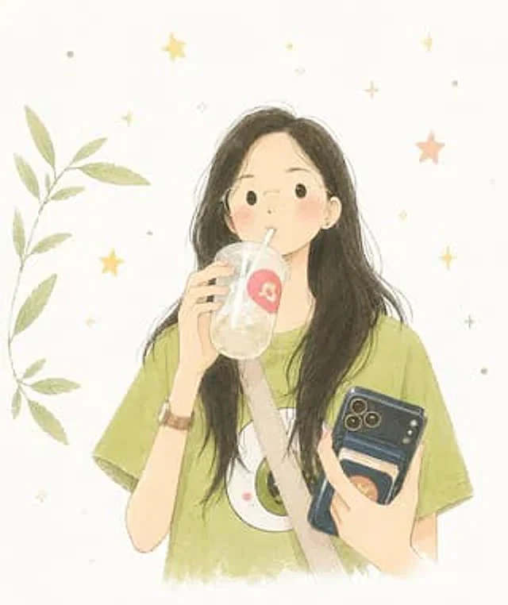

```text
将照片转换为精致的{argument name="插画风格" default="极简手绘儿童插画"}，具有柔和的童话美感。使用简单的细长形状、细薄的不完美手绘线条、扁平的粉彩色、最少细节，以及具有红润脸颊、微小面部特征和简化解剖结构的可爱娃娃角色风格。

添加微妙的{argument name="表面纹理" default="纸质纹理"}、柔软的铅笔和粉彩阴影、水彩柔和感，以及干净的白色背景配小星星或闪光。

服装采用有趣的故事书风格，简化的形状和温柔的装饰细节。整体氛围应该感觉通透、舒适、天真和迷人，如现代斯堪的纳维亚风格托儿所明信片或儿童书插画。

避免照相写实主义、3D、电影灯光、光泽表面、复杂阴影、逼真解剖和超级细节。
```

Model: GPT Image 2
Author: 路飞 🏴‍☠️ AI 研究员🧐

[ProjectD](https://aitoolsradar.com/en/prompts/23167b9e52bc2d) · [Recorded source](https://youmind.com/prompts/minimalist-hand-drawn-child-art-21681)
 · [Full original metadata and byte evidence](data/projectd-batch-0039.json)

## Minimalist Hydrating Serum Product Shot


```text
A minimalist luxury skincare photograph features a frosted glass serum bottle, placed vertically in the center of a large, light beige ceramic tray with slightly convex edges. The bottle has a simple cylindrical shape, equipped with a matte silver pump head and short side nozzles. Elegant black serif lettering is printed on the bottle, with the first line displaying…{argument name="brand name" default="AURA"} The following is displayed{argument name="product name" default="Hydrating Serum"} Four small, off-white cards are scattered around the bottle on the tray, one in the foreground and one on the right. Each card is printed with a phrase in a different language: an English card that reads "Quiet skin, every morning," a French card that reads "Peau calme, chaque matin," a card with vertical East Asian script, and a card with Arabic script. Warm, natural morning light shines in from the upper left, casting long, soft shadows on the sandy texture of the tray onto the bottle and cards. The background is soft-focused, presenting a neutral tone with creamy beige architectural lines, creating a tranquil, editorial spa aesthetic. Photorealistic studio lifestyle product photography, high-end beauty advertising quality, soft warm tones, delicate textures, shallow depth of field, exquisite minimalist composition, high-end packaging photography.
```

Model: GPT Image 2
Author: GPT Image 2 Prompts

[ProjectD](https://aitoolsradar.com/en/prompts/020cd9d0dfb1aa) · [Recorded source](https://x.com/hasantoxr/status/2046929307227078723#reversed-0)
 · [Full original metadata and byte evidence](data/projectd-batch-0039.json)

## Minimalist Layered Travel Poster Illustration

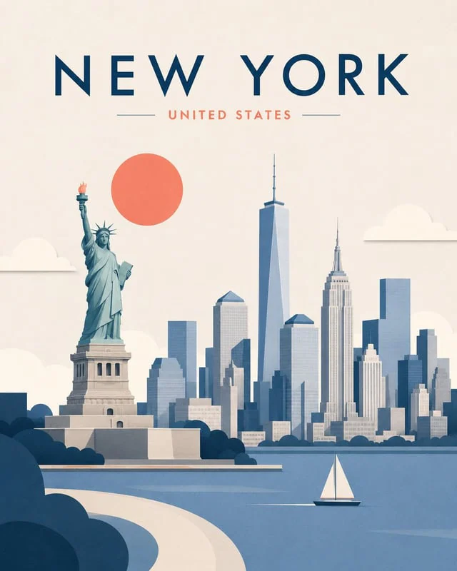

```text
Create a premium editorial travel illustration of {argument name="destination" default="DESTINATION"}, {argument name="country" default="COUNTRY/REGION"} using a minimal layered cutout illustration style. IMPORTANT: This must NOT look like a busy handmade paper craft artwork. Instead, it should feel like a premium Scandinavian editorial poster, a modern travel magazine cover, a sophisticated museum-shop print, and an elegant minimalist paper collage design. STYLE: minimal layered cutout illustration, large clean paper shapes, editorial paper collage aesthetic, bold geometric masses, simplified layered depth, soft subtle shadows, clean cut edges with slightly rounded corners, ultra simplified shape language. COLOR & LIGHTING: limited color palette (4–6 colors) featuring {argument name="primary color" default="PRIMARY COLOR"}, [SECONDARY COLOR], crisp white, soft slate blue, and pale grey, vibrant but restrained tones. MOOD: calm, modern, refined, premium, slightly whimsical, mature high-end travel branding aesthetic. TYPOGRAPHY: minimal elegant sans-serif typography with the text "[DESTINATION]", clean spacing and alignment, suitable size. ASPECT RATIO: 4:5 vertical poster format.
```

Model: GPT Image 2
Author: Saul Goodman

[ProjectD](https://aitoolsradar.com/en/prompts/88989da66a91e7) · [Recorded source](https://youmind.com/prompts/minimalist-layered-travel-illustration-31006)
 · [Full original metadata and byte evidence](data/projectd-batch-0039.json)

## Minimalist Layout and Document Prompts

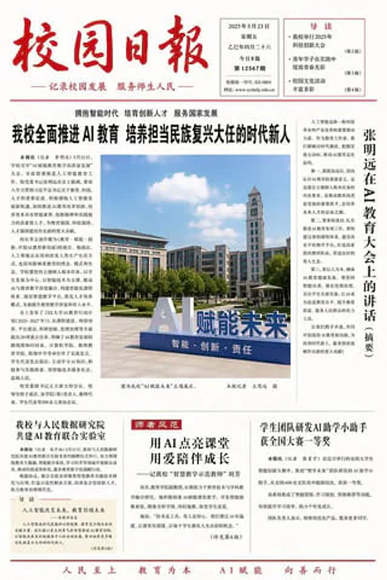

```text
Generate a copy of{argument name="theme" default="AI Education"} Theme{argument name="type" default="Campus Newspaper"}
```

Model: GPT Image 2
Author: GPT Image 2 Prompts

[ProjectD](https://aitoolsradar.com/en/prompts/9cedcf3b70762c) · [Recorded source](https://x.com/MrLarus/status/2044824800909054181)
 · [Full original metadata and byte evidence](data/projectd-batch-0039.json)

## Minimalist Layout and Document Prompts


```text
1、生成一张{argument name="主题" default="校园日报"}，主题{argument name="内容" default="AI教育"}
2、生成一张{argument name="餐厅类型" default="潮菜馆"}菜单图
3、生成{argument name="教材版本" default="人教版小学三年级语文"}课本的一页
4、生成一张2026年4月18日的老黄历
```

Model: GPT Image 2
Author: Larus Canus

[ProjectD](https://aitoolsradar.com/en/prompts/464f349054be81) · [Recorded source](https://youmind.com/prompts/minimalist-document-layouts-13704)
 · [Full original metadata and byte evidence](data/projectd-batch-0039.json)

## Minimalist Luxury Watch Ad

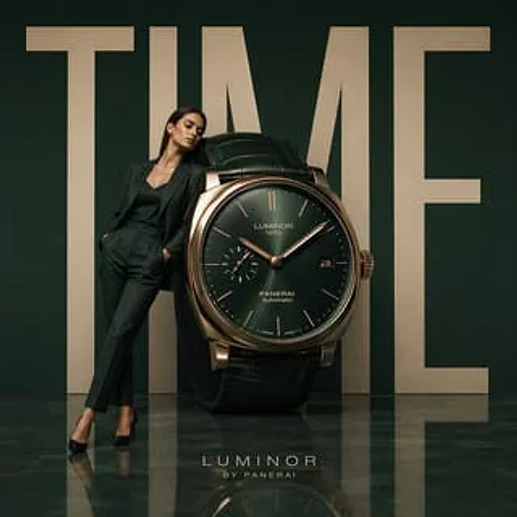

```text
{argument name="product" default="Minimalist luxury watches"} The advertising campaign features an oversized watch with a modern sculptural quality, with a model leaning against the dial against a backdrop of bold, eye-catching text.{argument name="text" default="TIME"} "{argument name="background color" default="Deep Emerald"} Colored studio background, reflective polished floor, Swiss luxury advertising aesthetics, cinematic editing style, extremely simple composition, 1:1
```

Model: GPT Image 2
Author: GPT Image 2 Prompts

[ProjectD](https://aitoolsradar.com/en/prompts/309e1d28e5a2da) · [Recorded source](https://x.com/AIwithkhan/status/2047704906904330554)
 · [Full original metadata and byte evidence](data/projectd-batch-0039.json)

## Minimalist Mid-Century Travel Poster

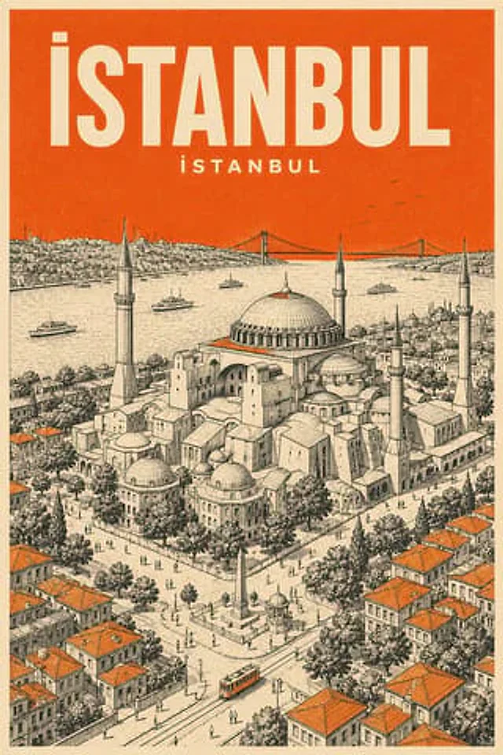

```text
Create a vertical mid-century travel poster for {argument name="city" default="[CITY NAME]"} featuring {argument name="landmark" default="[LANDMARK]"}. Use a strict 3-color palette: cream paper, black technical linework, and {argument name="accent color" default="[COLOR]"}.
Style: Minimalist isometric bird's-eye view with ultra-fine hatching and screen-print texture.
Color usage: Solid flat {argument name="accent color" default="[COLOR]"} for the entire sky and small accents on roofs or streets. No gradients.
Text: Bold sans-serif "{argument name="city" default="[CITY NAME]"}" at top in cream, with the local language name in smaller cream text below.
```

Model: GPT Image 2
Author: simeon-sanai

[ProjectD](https://aitoolsradar.com/en/prompts/e6fce4bec3abde) · [Recorded source](https://youmind.com/prompts/mid-century-minimalist-travel-poster-19660)
 · [Full original metadata and byte evidence](data/projectd-batch-0039.json)

## Minimalist Modern Magazine Illustration Style

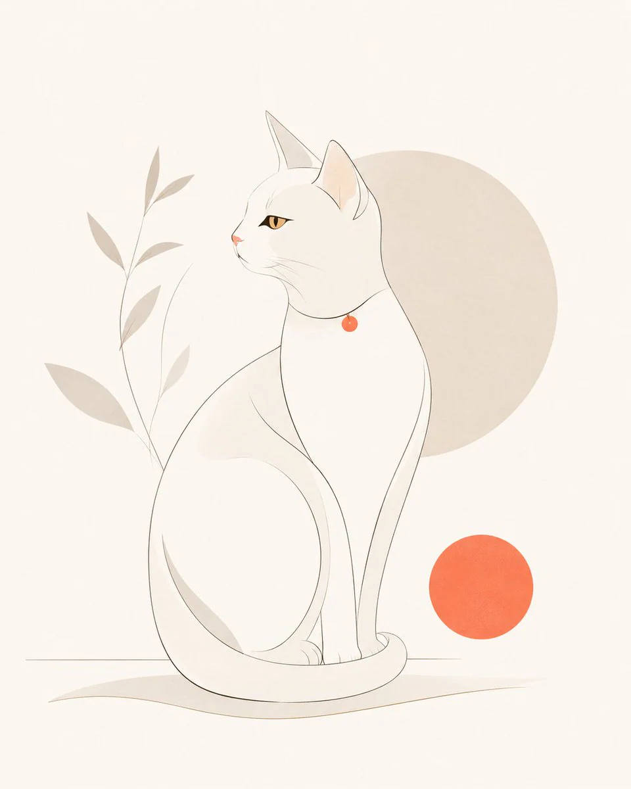

```text
一张极简主义现代杂志风格插画，主体为[xxx]。画面以干净流畅的线条塑造形象，造型简洁但富有美感，背景保留大面积留白，配色以柔和中性色为主，并加入少量鲜艳色彩作为视觉焦点。整体构图精致平衡，氛围优雅清新，具有高级杂志插画与现代艺术海报质感，无文字。
```

Model: GPT Image 2
Author: 沐阳

[ProjectD](https://aitoolsradar.com/en/prompts/152a66e414e27c) · [Recorded source](https://youmind.com/prompts/minimalist-modern-magazine-illustration-style-23706)
 · [Full original metadata and byte evidence](data/projectd-batch-0039.json)

## Minimalist Naive Hand-Drawn Sketch

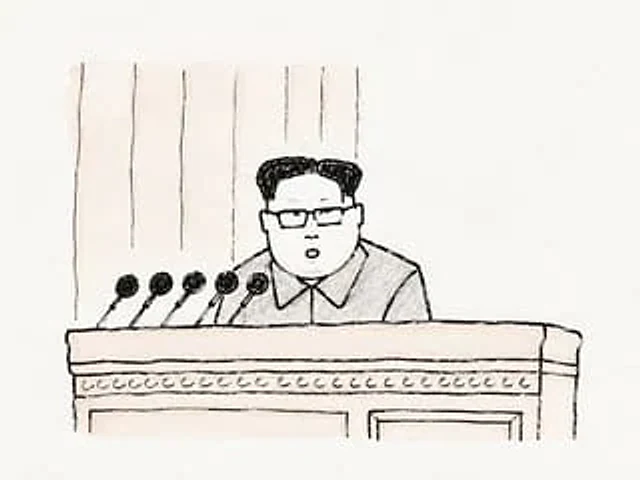

```text
围绕具体主题内容生成一张极简稚拙的纸面手绘图像，先把主题从完整照片式信息中抽离出来，压缩成几笔仍能认出的抖动黑线、最低识别轮廓和少量关键符号，再让大片干净空白托住它。主体靠外轮廓、姿态、孔洞、边缘、物体关系和一两个手写标记被读懂；线条像黑色墨水笔或粗铅笔画在纸上，粗细不均，转折处略有堆黑，圆形带着手抖的偏差，长线微微漂移，内部细节只留下必要短线。对象的复杂度要降到识别临界点，少一笔会难认，多一笔会太精，衣物、器具、植物、建筑、食物、机器或抽象符号都转成白色块面、黑色边缘、松散连接线和一处最能说明身份的小特征。若出现人物，脸保持纸白，只用点状眼睛、短鼻线和极少表情，头发、胡子、衣褶、手脚都压成涂黑块、断线或松散轮廓，让人物像被记住的符号而不是肖像。背景是纸面场或浅色平场，承担呼吸、尺度和安静观看的功能，上方和四周保留明显空白；单主体落在中部或偏下位置，多元素内容压成低位横向关系带，用几条颤动底线串联，让上方空场保持沉默。色彩服从黑线和空白，白色或近白底占最大面积，黑线拥有结构权，低饱和淡色只用于形体分组和情绪温度，小面积暖色或深色只作为语义重音；填色略不均匀，边缘轻微错开轮廓，保留纸白漏出、颗粒和手工涂抹感。文字若出现，应像同一支黑笔写在物体表面的低精度标签或小注，字形不齐、间距松、略有错位，但仍能读懂，文字属于物体本身而不是外部版式。整体保持低完成度与高清识别之间的张力，像一张被认真留下的随手画，空、轻、笨拙、可读，带轻微扫描纸感、墨水残差、断线、重复描痕和非均匀涂色痕迹。
```

Model: GPT Image 2
Author: 小小东

[ProjectD](https://aitoolsradar.com/en/prompts/f260f0b62c93ee) · [Recorded source](https://youmind.com/prompts/minimalist-naive-hand-drawn-sketch-23632)
 · [Full original metadata and byte evidence](data/projectd-batch-0039.json)

## Minimalist Oriental Commercial Illustration


```text
Minimalist Eastern aesthetics × commercial illustration style, theme "{argument name="theme" default="Miracles of the Pen"} The vertical composition and S-shaped visual flow create a simple yet stylish image. The background is {argument name="background color" default="Light beige"} The texture of the rice paper features a soft gradient effect. Starting with a brush, the strokes extend into flowing, colorful ink, gradually transforming into flowers blooming in the air; the flowers are elegant yet possess a touch of realism. A harmonious and rich color scheme is employed.{argument name="color scheme" default="Cyan + Pink + Light Orange + Gold Leaf"} The embellishments feature soft, translucent colors that are not overly saturated. Subtle grainy lighting effects and a sense of fluidity are added, with fine gold lines outlining the details. Overall style: High-end commercial illustration, blending Eastern aesthetics with modern design. The image is clean and breathable, with a clear visual center, suitable for posters or brand key visuals. High-precision details, soft lighting, delicate textures, elegant style, cinematic visual quality, trendy style, digital art feel, and modern graphic design elements.
```

Model: GPT Image 2
Author: GPT Image 2 Prompts

[ProjectD](https://aitoolsradar.com/en/prompts/fe30197ff0d7db) · [Recorded source](https://x.com/liyue_ai/status/2046798164162916741)
 · [Full original metadata and byte evidence](data/projectd-batch-0039.json)

## Minimalist Philosophical Poster Grid

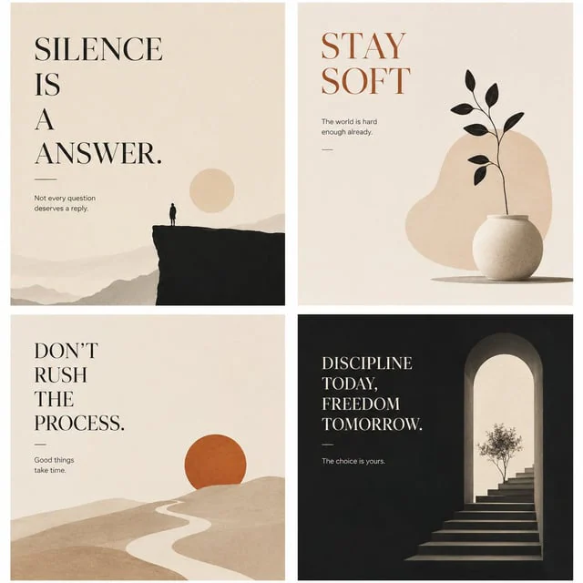

```text
Goal: Create a refined 2x2 grid of four minimalist philosophical wall-art posters with restrained illustration, spacious typography, and a quiet editorial mood.

Canvas: Square format, four equal poster panels separated by clean white gutters. Use warm off-white paper texture for three panels and deep charcoal black for the bottom-right panel. Overall style is calm, premium, minimalist, suitable for interior prints and poster collections.

Layout: Exactly 4 posters in a 2-by-2 arrangement. Each poster uses large high-contrast serif typography, generous negative space, a tiny subtitle line, a short horizontal rule, and one simple symbolic illustration.

Poster 1, top-left: Cream background. Large black serif headline in the upper-left reads “{argument name="top left headline" default="SILENCE IS A ANSWER."}” with stacked line breaks. Below it, a thin horizontal rule and small text: “Not every question deserves a reply.” Illustration: distant beige mountain layers across the bottom, a dark black cliff occupying the lower right, a tiny lone human silhouette standing on the cliff edge, and a pale beige sun disk near the right side.

Poster 2, top-right: Cream background. Large warm rust-brown serif headline in the upper-left reads “{argument name="top right headline" default="STAY SOFT"}”. Small text beneath: “The world is hard enough already.” Add a short horizontal rule. Illustration: a rounded beige abstract blob in the center-right background, a matte white round ceramic vase at the lower right, and one thin black plant stem with exactly 8 black leaves emerging upward.

Poster 3, bottom-left: Cream background. Large black serif headline in the upper-left reads “{argument name="bottom left headline" default="DON’T RUSH THE PROCESS."}” arranged on multiple lines. Below it, a thin horizontal rule and small text: “Good things take time.” Illustration: soft rolling beige sand-like hills filling the lower half, a winding pale path leading toward the horizon, and one burnt-orange sun circle partly sitting behind a hill on the right.

Poster 4, bottom-right: Deep charcoal black background. Large cream serif headline in the upper-left reads “{argument name="bottom right headline" default="DISCIPLINE TODAY, FREEDOM TOMORROW."}” stacked on four lines. Below it, a thin cream rule and small text: “The choice is yours.” Illustration: on the right side, a tall arched doorway glowing with warm cream light, stone steps rising into the arch, and a small delicate tree silhouette near the top of the stairs.

Visual style: Elegant serif typography similar to classic editorial poster design, muted earth palette of cream, beige, black, rust orange, and charcoal. Soft grain, subtle paper texture, flat minimal forms, balanced asymmetry, quiet contemplative atmosphere. Keep all four posters consistent as a cohesive collection.

Constraints: Use exactly 4 poster panels. Keep typography crisp and legible. Do not add extra quotes, logos, signatures, frames, mockup walls, people beyond the single tiny silhouette in the first poster, or decorative clutter.
```

Model: GPT Image 2
Author: Kami AI

[ProjectD](https://aitoolsradar.com/en/prompts/0b1604e820f5f4) · [Recorded source](https://youmind.com/prompts/minimalist-philosophical-posters-24649)
 · [Full original metadata and byte evidence](data/projectd-batch-0039.json)

## Minimalist Product Ad: PURE CRUNCH

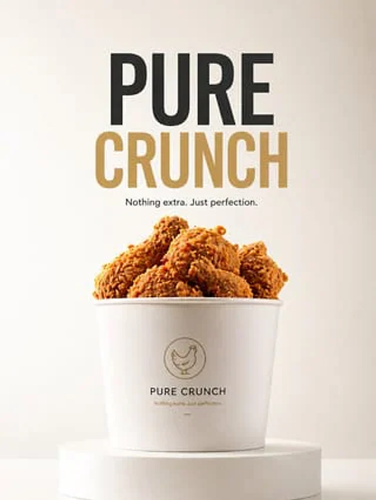

```text
A minimalist product advertisement will{argument name="product" default="Fried Chicken Bucket"} Placed on a clean white display stand. Background: Soft gradient ({argument name="background gradient" default="Light cream to white"} A clean studio environment. Lighting: soft, diffused light, high-end Apple style. Layout (centered):{argument name="headline" default="PURE CRUNCH"} The small print below reads: "Nothing extra. Just perfection." Style: Extremely clean, editorially minimalist, high-end brand feel, 8K resolution.
```

Model: GPT Image 2
Author: GPT Image 2 Prompts

[ProjectD](https://aitoolsradar.com/en/prompts/a796e680be4537) · [Recorded source](https://x.com/Strength04_X/status/2047917220165231011)
 · [Full original metadata and byte evidence](data/projectd-batch-0039.json)

## Minimalist Saint Augustine Book Cover

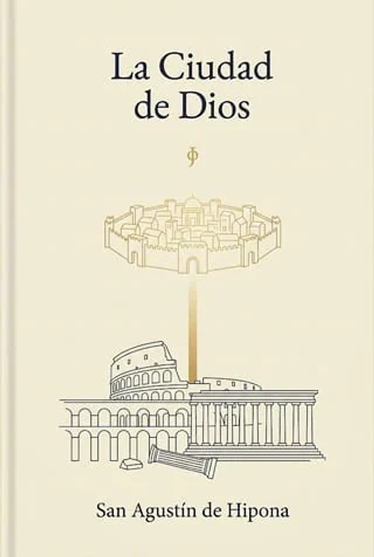

```text
A minimalist, classic book cover with a vertical composition, set against a warm ivory or parchment background. At the top center, the title is formatted in two lines in an elegant, large, dark navy blue serif font:{argument name="title text" default="La Ciudad de Dios"} Below this, leave ample space and center a small gold phi symbol. In the upper-middle area, draw a delicate, fine-lined gold illustration depicting a sturdy, circular heavenly city with eight clearly visible outer towers or gate structures, crenellated walls, and compact classical architecture within (including a central dome). From the center of the city's base, a soft, vertical beam of gold extends downwards. In the lower-middle area, draw classical ruins on the ground in deep navy blue fine lines: the Roman Colosseum on the left, a large Greek or Roman temple with a triangular pediment and long rows of columns on the right, with a broken, collapsed column, a small stone, and an arched ruin structure spanning the lower left. Maintain symmetry and openness in the composition, leaving ample white space to achieve a delicate editorial balance and create a subtle contrast between the golden heavenly imagery and the deep navy blue secular architecture. At the bottom center, place the author's name in a matching deep navy blue serif font.{argument name="author name" default="San Agustín de Hipona"} The design is simple yet sophisticated, imbued with a sacred philosophical aesthetic, devoid of extraneous text, heavy textures, or photographic elements.
```

Model: GPT Image 2
Author: GPT Image 2 Prompts

[ProjectD](https://aitoolsradar.com/en/prompts/70570c6840efb6) · [Recorded source](https://x.com/luicho9_/status/2046674657697243428#reversed-0)
 · [Full original metadata and byte evidence](data/projectd-batch-0039.json)

## Minimalist Serum Product Collage

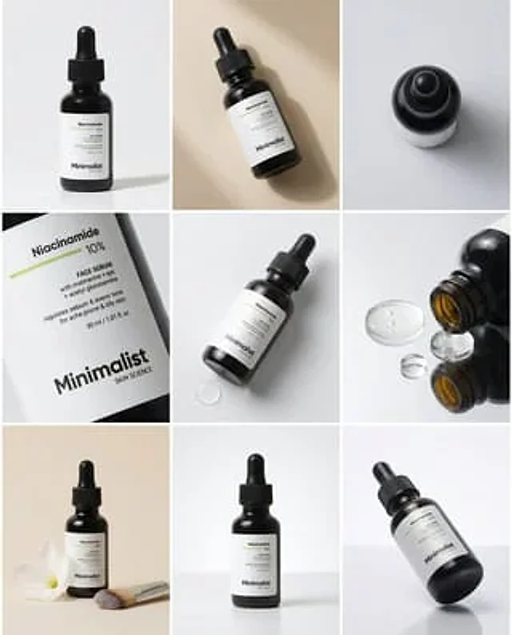

```text
{
  "type": "Skincare product photo collage",
  "subject": {
    "product": "Dark amber glass dropper bottle, containing{argument name=\"product name\" default=\"10% Niacinamide Facial Serum\"}",
    "brand": "{argument name=\"brand name\" default=\"Minimalist\"}",
    "category": "Facial serum",
    "label": {
      "style": "The minimalist white rectangular label features a clean black sans-serif font and a thin, light green decorative line near the top.",
      "visible_text": [
        "10% Niacinamide",
        "Facial serum",
        "Contains Matmarine + 1% Zinc + acetylglucosamine",
        "It regulates sebum production and evens out skin tone, making it suitable for acne-prone and oily skin.",
        "30 ml / 1.01 fl ounces",
        "Minimalist",
        "Dermatology"
      ]
    },
    "packaging": {
      "count": 1,
      "components": [
        "amber glass bottle",
        "Black rubber dropper tip",
        "Black screw cap",
        "White front label"
      ]
    }
  },
  "layout": {
    "grid": {
      "rows": 3,
      "columns": 3,
      "count": 9,
      "gutter": "Thin white dividing line"
    },
    "sections": [
      {
        "position": "Top left",
        "count": 1,
        "description": "The bottle stands upright against a light gray background, with soft shadows."
      },
      {
        "position": "Upper-middle",
        "count": 1,
        "description": "A single bottle of product is placed diagonally against a warm beige background, illuminated from the upper right corner, creating long, soft shadows."
      },
      {
        "position": "Top right",
        "count": 1,
        "description": "Top view of dropper cap and neck against a cool light gray background."
      },
      {
        "position": "Left and Middle",
        "count": 1,
        "description": "A very close-up of the label clearly shows the product name and brand font."
      },
      {
        "position": "middle",
        "count": 1,
        "description": "A single bottle of product is placed diagonally against a light gray background, with a drop of clear serum next to it."
      },
      {
        "position": "Right Center",
        "count": 1,
        "description": "A close-up composition of two open amber bottle openings on the right edge, with three drops of clear serum or liquid floating on a white background."
      },
      {
        "position": "Bottom left",
        "count": 1,
        "description": "The bottle stands upright against a warm beige background, with a white petal and a makeup brush in the lower right corner."
      },
      {
        "position": "Middle to lower",
        "count": 1,
        "description": "The bottle stands upright in the center against a clean, light gray studio background, with subtle shadows at the bottom."
      },
      {
        "position": "Bottom right",
        "count": 1,
        "description": "A single bottle of product is placed at an angle on a light gray reflective surface, with a faint reflection below it."
      }
    ]
  },
  "style": {
    "photography": "High-end commercial skincare product advertising, ultra-clean photography studio product photography",
    "lighting": "Soft, diffused sunlight, gentle shadows, high-end editorial lighting.",
    "color_palette": [
      "White",
      "Light gray",
      "Warm beige",
      "black",
      "Amber Brown",
      "Soft green accents"
    ],
    "mood": "Minimalism, clinical feel, elegance, modern",
    "detail": "High resolution, clear label text, realistic glass reflection, and visible serum transparency."
  }
}
```

Model: GPT Image 2
Author: GPT Image 2 Prompts

[ProjectD](https://aitoolsradar.com/en/prompts/079a30213c55c9) · [Recorded source](https://x.com/Taaruk_/status/2047505334651249135#reversed-0)
 · [Full original metadata and byte evidence](data/projectd-batch-0039.json)

## Minimalist Single Line Social Media Avatar

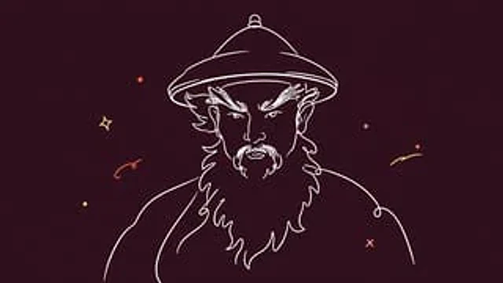

```text
请将输入图片转换成一张适合社交媒体头像使用的极简主义单线条插画，默认画幅比例为 1:1。主体可以是人物、猫、狗、其他动物，或植物。请根据输入主体类型，自动提取最具辨识度的外轮廓与关键特征，并将其概括为具有艺术感的极简单线条头像 / 形象插画。整体目标不是机械描边，而是保留主体神韵与识别度，用更高级、更有灵气的方式进行单线条重构。【主体处理逻辑】如果主体是人物：保留脸型、额头、鼻梁、嘴部转折、下巴、耳朵、发型等关键轮廓，只保留少量必要五官特征，避免细碎刻画。如果主体是猫、狗或其他动物：保留头部外形、耳朵、口鼻轮廓、眼部神态、毛发的大轮廓走势等关键识别特征，避免复杂毛发细节。如果主体是植物：保留花朵、叶片、枝条、果实或整体轮廓中最有识别度的形态特征，用简洁线条概括其姿态和节奏感。【线条风格要求】线条必须流畅、圆润、舒展、张扬、自然，尽量连续，一气呵成，具有呼吸感和即兴感。整体以柔和弧线为主，少用尖锐、生硬、刻板的折线。不要把轮廓画成死板的 logo 式描边，不要机械，不要僵硬，不要碎裂，不要过度规整。线条应简洁但有生命力，带一点随性和艺术气质，看起来轻松、灵动、有收藏感。【构图与头像适配逻辑】整体构图按 1:1 方形设计，主体应明确、集中、醒目，适合用作社交媒体头像。主体建议居中或略微偏中构图，轮廓完整，视觉重心清晰。请预留合理留白，避免主体过大贴边，确保即使在头像圆形裁切后，主体关键部分依然完整清楚、识别度高。画面应在小尺寸下依然简洁有力、容易辨认。【背景色逻辑】背景色不要固定为某一种颜色，不要默认总是蓝色。请优先根据输入图片本身的综合色彩气质，提取适合作为背景的“暗色调逻辑”，从主体相关的深色倾向中选择合适的背景颜色。如果用户明确指定背景颜色，则优先使用用户指定的颜色，并在此基础上保持整体高级、克制、有张力的暗色调处理。背景色选择应遵循以下原则：- 以深色、纯净、有情绪张力的纯色背景为主- 背景应能有效衬托主体线条，形成清晰对比- 不要固定某个色相，可根据图片气质灵活选择深蓝、深绿、深紫、深棕、深灰、酒红、墨黑、蓝灰、橄榄深色等偏暗色调- 如果图片本身适合冷色背景，则采用偏冷的暗色逻辑- 如果图片本身适合暖色背景，则采用偏暖的暗色逻辑- 如果用户指定颜色，则在该颜色基础上选择更沉稳、更适合头像展示的暗色版本- 避免荧光感、廉价鲜艳感- 避免灰闷、发脏、低对比、无精神的背景【主体线条颜色逻辑】主体主轮廓线建议使用白色细线，或使用与背景形成鲜明对比的浅色细线。线条不宜过粗，也不要细到失去存在感，要轻盈、清晰、干净。如果背景较深，优先使用白色或浅暖白色线条，以增强识别度与清爽感。【点缀元素逻辑】在主体周围加入少量随机、即兴、自然的小型彩色点缀元素，用来增强灵气、趣味和轻松感。点缀元素可以是：小圆点、小弧线、小星形、小笑脸、小短笔触、小闪电、简单几何符号等。点缀风格要圆润、俏皮、松弛、自然，像随手加上的灵感装饰，而不是刻意排版出来的模板元素。点缀必须控制得当：- 数量少，点到为止- 分布自然，略带随机感- 不要过密，不要对称得太死- 不要喧宾夺主- 只作为辅助氛围存在- 点缀色可从背景色的邻近或互补色逻辑中少量提取，也可使用少量跳色，如黄、橙、粉、淡紫、浅珊瑚色等- 点缀整体要和主体及背景协调，不要显得生硬拼贴【整体风格目标】整体画面应当极简、轻盈、现代、灵动、有艺术气质。既有单线条插画的干净感，又有即兴涂鸦般的松弛感和生命力。要让主体显得圆润、舒展、有神韵，而不是僵硬、呆板、模板化。最终效果应适合作为社交媒体头像：醒目、有辨识度、有趣、有设计感，同时具备轻松愉快、自然生动、值得收藏的艺术气质。【避免出现的问题】不要写实，不要阴影，不要明暗体积，不要复杂纹理，不要复杂场景。不要机械描边，不要僵硬死板，不要尖锐刻薄，不要过度规整。不要把背景色固定成单一蓝色模板。不要背景过亮刺眼，也不要背景灰闷无精神。不要装饰过多，不要抢走主体。不要因为极简而失去灵气，也不要因为装饰而失去克制感。比例16:9
```

Model: GPT Image 2
Author: 小小东

[ProjectD](https://aitoolsradar.com/en/prompts/6044b542fd49ff) · [Recorded source](https://youmind.com/prompts/minimalist-single-line-avatar-illustration-19267)
 · [Full original metadata and byte evidence](data/projectd-batch-0039.json)

## Minimalist Travel Poster Template

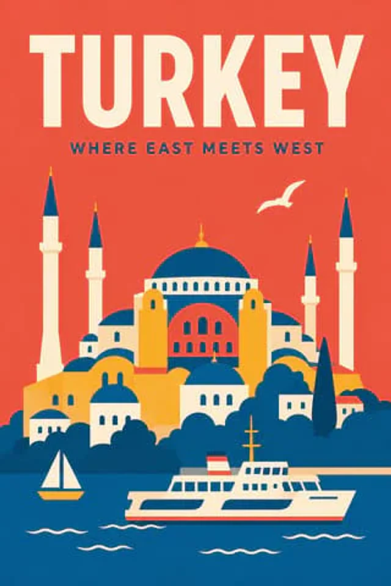

```text
A flat minimalist travel poster for the city of {argument name="city name" default="[City Name]"}, featuring a stylized illustration of {argument name="main subject" default="[Main Subject]"}.
Use clean vector shapes with a playful and simplified silhouette.
Bold sans-serif text at the top spells the city name, with a smaller subheading beneath.
Apply a {argument name="color palette" default="[Color Palette]"} color palette consisting of 2–4 saturated, high-contrast or pastel tones.
Use a solid color background and avoid gradients or shadows.
Poster design should evoke modern wanderlust and pop art poster vibes.
Image ratio is 2:3.
```

Model: GPT Image 2
Author: simeon-sanai

[ProjectD](https://aitoolsradar.com/en/prompts/cb40dd3b64bf90) · [Recorded source](https://youmind.com/prompts/minimalist-travel-poster-art-26839)
 · [Full original metadata and byte evidence](data/projectd-batch-0039.json)

## Minimalist World Cup poster


```text
Create a file with "{argument name="theme" default="World Cup"} "Poster of the picture"
```

Model: GPT Image 2
Author: GPT Image 2 Prompts

[ProjectD](https://aitoolsradar.com/en/prompts/299b9c3be8777b) · [Recorded source](https://x.com/saya_glado/status/2047148917515845823)
 · [Full original metadata and byte evidence](data/projectd-batch-0039.json)

## Minimalist World Cup poster


```text
{argument name="テーマ" default="World Cup"} のイメージでポスターつくって
```

Model: GPT Image 2
Author: さや©︎

[ProjectD](https://aitoolsradar.com/en/prompts/6a11af690e409d) · [Recorded source](https://youmind.com/prompts/minimalist-world-cup-poster-15231)
 · [Full original metadata and byte evidence](data/projectd-batch-0039.json)

## Mirassol FC Signing Announcement Poster


```text
Create a 2:3 vertical composition poster for the official signing announcement of a Brazilian football club, using a color scheme of yellow, dark green, black, and gold to present a rugged and high-contrast sports marketing aesthetic. The main subject is a muscular, tattooed male football player wearing a bright yellow Mirassol FC home jersey. His upper-body portrait is centered, facing the camera with a serious and intimidating expression. He has a buzz cut, clearly visible tattoos on his neck and arms, and a robust physique. The jersey collar and cuffs are trimmed in dark green, the Mirassol crest with two stars is printed on the chest, the ATHLETA logo is on the other side, the large green sponsor logo "Poty" is printed on the torso, the brand logo is on the shoulders, and there are circular sponsor patches on the cuffs. Behind him, in the upper right corner, a fluttering dark green and yellow Mirassol flag is placed, featuring a large club crest and two stars. The background includes shimmering stadium lights, swirling golden particles, and the stadium stands at night. On the left, a bold, compressed font is stacked, displaying the Portuguese text: "BEM-VINDO AO" at the top, followed by a large yellow "MIRASOL" below, then the player's name displayed in two lines, with the large white letters "ALEX" and "POATAN," and a handwritten yellow signature "Poatan" below. Below this is a four-line motivational section in uppercase white text, the last line highlighted in yellow: "DE CAMPEÃO / NO OCTÓGONO / PARA GUERREIRO / EM CAMPO. / A LUTA CONTINUA." On the right, a vertical information panel is added, featuring three icons and text, all in yellow with corresponding symbols: a target icon with "FOCO," a fist icon with "DISCIPLINA," and a helmet icon with "GARRA," below which is a striking yellow slogan: "AGORA É PELO LEÃO!" The bottom includes two smaller images of supporting players: one in the lower left corner showing a sideways pose kissing the team crest on their jersey; and another in the lower right corner showing a back view with arms raised and index finger pointing to the sky. The jersey displays the sponsor's name "DS TECNOLOGIA AUTOMOTIVA," the name "POATAN," and a large green number "10" on the upper back. A black and gold horizontal bar is added at the bottom, containing four values ​​separated by icons: a lion's head icon with "MENTALIDADE DE CAMPEÃO," a shield icon with "FORÇA E HONRA," a star icon with "HUMILDADE E TRABALHO," and a football icon with "PAIXÃO PELO JOGO." Below this is a yellow banner with the slogan "NOVO DESAFIO. MESMA MISSÃO." At the very bottom is a handwritten white phrase "FÉ, FOCO E FAMÍLIA!" followed by the hashtag "#POATANÉLEÃO." It utilizes cinematic contour lighting, strong contrast, metallic gold glow, textured smoke, and a sophisticated club announcement poster design style.
```

Model: GPT Image 2
Author: GPT Image 2 Prompts

[ProjectD](https://aitoolsradar.com/en/prompts/8776c819f125ac) · [Recorded source](https://x.com/JonSold3ra/status/2047028103340249243#reversed-0)
 · [Full original metadata and byte evidence](data/projectd-batch-0039.json)

## Mirror Selfie Bedroom Portrait


```text
A stunning 18-year-old Chinese girl with a youthful, pure face and realistic skin texture, sitting on a cozy, slightly messy bed in her bedroom. She is taking a mirror selfie with a smartphone, capturing a natural and intimate moment. Wearing casual gray loungewear and neat white crew socks. Soft natural light (golden hour) streams in from a side window, creating a warm, moody, and cinematic atmosphere. 35mm lens, sharp focus on the subject in the mirror, depth of field with a beautifully blurred background (bokeh). Photorealistic, 8K, high resolution, studio quality, masterpiece.
Negative Prompts: no extra limbs, no deformed hands, no blur, no noise, no watermark, no text, no cartoon/anime style. Aspect Ratio: 3:4.
```

Model: GPT Image 2
Author: @Shinning1010

[ProjectD](https://aitoolsradar.com/en/prompts/7476ddd1dbc726) · [Recorded source](https://x.com/Shinning1010/status/2045002808903020962)
 · [Full original metadata and byte evidence](data/projectd-batch-0039.json)

## Mirrored Actor Retrospective Poster


```text
Reorganize the poster layout using the provided reference image. Adjust the main title {argument name="main title" default="LEONARDO A LIFE IN ROLES"} Move it to the top right corner. Move the large profile portrait in the center to the top right quadrant and flip it horizontally to face right. Reposition the timeline text to the right and add four new era categories on the far right:{argument name="era categories" default="YOUTH 1990s, ASCENT 2000s, EXCESS 2010s, SURVIVAL 2020s"} Thirteen smaller character portraits are grouped together on the left and at the bottom. New background elements are integrated behind these portraits.{argument name="background elements" default="Titanic ship, airplane, cityscapes, Hollywood sign, oil derrick"} Add one in the bottom left corner.{argument name="added objects" default="pocket watch with chain and blood splatters"} Update the bottom text, adding two laurel wreath icons and a slogan.{argument name="bottom tagline" default="SAME MAN. ENDLESS TRUTHS."} .
```

Model: GPT Image 2
Author: GPT Image 2 Prompts

[ProjectD](https://aitoolsradar.com/en/prompts/651b9068966355) · [Recorded source](https://x.com/hx831126/status/2046061884798087670#reversed-0)
 · [Full original metadata and byte evidence](data/projectd-batch-0039.json)

## Mixed-Media Editorial Shot with Cartoon Character


```text
In a full-body fashion shoot, a confident young model sits casually on concrete steps, legs slightly apart, one arm resting on her knee, the other relaxed, looking directly at the camera with a calm and commanding expression. She wears a light-colored denim jacket over a simple white T-shirt, unisex shorts, bright socks, and modern sneakers. The styling is simple, the posture natural, a gentle breeze ruffling her hair and clothing. A stylized cartoon character stands nearby.{argument name="animal" default="dog"} And interact with it to some extent, their positions natural, as if they were in the same space.{argument name="animal" default="dog"} Drawing in a bold cartoon style, it features heavy black outlines, vibrant neon hues (with blue, green, and yellow accents), exaggerated proportions, and lively expressions, creating a playful yet dynamic effect. Background: A bright outdoor urban environment with azure skies, soft clouds, and the texture of concrete under sunlight, strong natural light, and clear shadows. A fusion of hyper-realistic photography and graphic illustration, seamlessly integrating the subject with cartoon elements. Added graphic overlay elements: graffiti arrows, scribbles, abstract shapes, comic-style symbols, and dynamic lines. High contrast, HDR lighting effects, sharp focus, stylish cinematic composition, surreal mixed-media aesthetics, exquisite detail, and 8K resolution.
```

Model: GPT Image 2
Author: GPT Image 2 Prompts

[ProjectD](https://aitoolsradar.com/en/prompts/552292bd8ce996) · [Recorded source](https://x.com/Goodmanprotocol/status/2048051277867954359)
 · [Full original metadata and byte evidence](data/projectd-batch-0039.json)

## Mixed-Media Editorial Shot with Cartoon Character


```text
Full-body fashion editorial shot of a confident young person model sitting casually on a concrete ledge, legs slightly apart, one arm resting on knee, the other relaxed, looking straight at camera with a calm dominant expression.

Wearing a light denim jacket over a plain white t-shirt, neutral shorts, bright socks, and modern sneakers. Clean styling, natural pose, wind slightly moving hair and fabric.

Beside and partially interacting with a stylized cartoon {argument name="animal" default="dog"}, positioned naturally as if sharing the same space.

The {argument name="animal" default="dog"} is illustrated in bold cartoon style with thick black outlines, vibrant neon color palette (blue, green, yellow accents), exaggerated proportions, expressive features, playful yet powerful presence.

Background: bright outdoor urban setting with clear blue sky, soft clouds, sunlit concrete textures, strong natural daylight, crisp shadows.

Fusion of hyper-realistic photography and graphic illustration, seamless integration between subject and cartoon.

Add graphic overlay elements: doodle arrows, scribbles, abstract shapes, comic-style symbols, dynamic motion lines.

High contrast, HDR lighting, sharp focus, fashion editorial composition, surreal mixed-media aesthetic, ultra-detailed, 8k resolution.
```

Model: GPT Image 2
Author: Saul Goodman

[ProjectD](https://aitoolsradar.com/en/prompts/69d8f10bb05073) · [Recorded source](https://youmind.com/prompts/mixed-media-editorial-cartoon-15876)
 · [Full original metadata and byte evidence](data/projectd-batch-0039.json)

## Mixue x Starbucks Matcha Promo Poster


```text
{
  "type": "Chinese-style co-branded beverage promotional poster",
  "style": "High-end commercial food advertising, bright outdoor lifestyle promotion, exquisite graphic design, shallow depth of field, and a cheerful summer atmosphere.",
  "branding": {
    "top_logos_count": 2,
    "top_logos": [
      "Mixue Ice Cream",
      "STARBUCKS"
    ],
    "collaboration_mark_count": 2
  },
  "scene": {
    "setting": "The sunlit outdoor cafe terrace features wooden tables against a backdrop of hazy greenery and city views. A Starbucks awning is faintly visible to the left, and leaves extend into the upper right corner.",
    "lighting": "Natural sunlight, with soft highlights and clear reflections from the drinks.",
    "camera": "A frontal main visual shot taken at tabletop height, with a slightly wide-angle commercial composition."
  },
  "layout": {
    "headline_area": {
      "count": 4,
      "texts": [
        "Snow King Meets Star Friends",
        "Mixue Ice Cream x Starbucks Collaboration Launched",
        "Double the sweetness, double the happiness",
        "Limited Edition Collaboration"
      ]
    },
    "product_area": {
      "count": 2,
      "labels": [
        "Snow-topped Matcha Frappuccino",
        "Matcha Snow King Oreo"
      ]
    },
    "price_area": {
      "count": 2,
      "texts": [
        "Co-branded Packages",
        "¥19.9"
      ]
    },
    "bonus_area": {
      "count": 2,
      "texts": [
        "Ministry of Establishment ¥6",
        "Collaboration merchandise"
      ]
    },
    "bottom_strip": {
      "count": 1,
      "text": "You love me♡ I love you, Mixue Ice Cream &amp; Sweet Honey"
    },
    "signboard_area": {
      "count": 1,
      "text": "ICE CREAM & COFFEE"
    },
    "stamp_area": {
      "count": 2,
      "texts": [
        "Limited Edition Collaboration",
        "I tasted star quality while not working."
      ]
    }
  },
  "main_products": [
    {
      "type": "Smoothie drinks in transparent plastic cups",
      "position": "Left foreground",
      "flavor": "Matcha",
      "appearance": "A vibrant green smoothie in a clear glass, topped with a towering swirl of vanilla soft serve ice cream, drizzled with rich, glossy matcha sauce, and sprinkled with colorful sugar pearls.",
      "branding": "The cup features a large Mixue Ice Cream &amp; Snow King mascot printed on it, with the Chinese brand name below.",
      "label_text": "Snow-topped Matcha Frappuccino"
    },
    {
      "type": "Iced milk drinks in transparent Starbucks plastic cups",
      "position": "Right foreground",
      "flavor": "Matcha Oreo Latte or Frappuccino Style Mix",
      "appearance": "The creamy beige drink is topped with black cookie crumbs and visible ice cubes, while a matcha green swirl at the bottom reflects upwards.",
      "branding": "The cup features a large green Starbucks logo.",
      "label_text": "Matcha Snow King Oreo"
    }
  ],
  "mascot": {
    "count": 1,
    "type": "3D toy-style Snow King mascot",
    "position": "Directly in front of the two drinks",
    "appearance": "A round, white body, wearing a small golden crown, blue eyebrows, one blinking eye, an orange carrot nose, an open mouth in a smile, pink blush, a red cloak, and a sitting posture.",
    "prop": "Holding a small white Starbucks takeaway cup with a green logo."
  },
  "props": [
    {
      "type": "Blackboard Project",
      "position": "Right-side mid-range",
      "text": "ICE CREAM & COFFEE",
      "drawing_count": 2,
      "drawings": [
        "Ice cream cone",
        "coffee cup"
      ]
    },
    {
      "type": "Round wooden pallet",
      "position": "Located below the drinks and mascot"
    },
    {
      "type": "Promotional peripheral icons",
      "position": "bottom right corner",
      "count": 4,
      "items": [
        "Cup sleeve",
        "Round sticker logo set",
        "Die-cut mascot stickers holding drinks",
        "Small brand badges or stickers"
      ]
    }
  ],
  "graphic_elements": {
    "count": 7,
    "items": [
      "A large, playful Chinese title in pink, black, and green, with a white outline.",
      "Green ribbon banner below the title",
      "The circular joint seal on the left",
      "The circular stamp in the upper right corner is in the style of a postmark.",
      "The small crown icon near the flavor label and mascot on the side.",
      "Little butterfly doodle near the title",
      "tear-off paper collage panel at the bottom"
    ]
  },
  "color_palette": {
    "primary": [
      "Starbucks Green",
      "Matcha Green",
      "White",
      "Cream",
      "Light wood brown"
    ],
    "accent": [
      "Coral powder",
      "gold",
      "black"
    ]
  },
  "text_customization": {
    "headline": "{argument name=\"headline text\" default=\"Snow King Meets Star Friends\"}",
    "subheadline": "{argument name=\"subheadline text\" default=\"Mixue Ice Cream x Starbucks Collaboration Launched\"}",
    "price": "{argument name=\"price text\" default=\"¥19.9\"}",
    "left_drink_name": "{argument name=\"left drink name\" default=\"Snow-topped Matcha Frappuccino\"}",
    "right_drink_name": "{argument name=\"right drink name\" default=\"Matcha Snow King Oreo\"}"
  },
  "rendering_notes": "The design makes the drinks look huge and appetizing, with a clearly visible logo, a glossy finish, and a softly blurred background. It also maintains a highly sophisticated balance between the photography and graphic overlay design."
}
```

Model: GPT Image 2
Author: GPT Image 2 Prompts

[ProjectD](https://aitoolsradar.com/en/prompts/83533674ffa3ed) · [Recorded source](https://x.com/iDnlong/status/2046749282833981743#reversed-3)
 · [Full original metadata and byte evidence](data/projectd-batch-0039.json)

## MMO Game World Screenshot


```text
Please generate a screenshot of an ARPG MMO open-world game with the theme "{argument name="theme" default="A Will Eternal"} "
```

Model: GPT Image 2
Author: GPT Image 2 Prompts

[ProjectD](https://aitoolsradar.com/en/prompts/de71b16a8faf32) · [Recorded source](https://x.com/hugecoolcn/status/2047139590625173546)
 · [Full original metadata and byte evidence](data/projectd-batch-0039.json)

## MOBA Game Combat Scene


```text
Please help me generate a file with {argument name="game theme" default="Honor of Kings"} The game interface and battle scenes are themed around this theme.
```

Model: GPT Image 2
Author: GPT Image 2 Prompts

[ProjectD](https://aitoolsradar.com/en/prompts/75d7ae8b60c663) · [Recorded source](https://x.com/yigeman8/status/2046555920344445292)
 · [Full original metadata and byte evidence](data/projectd-batch-0039.json)

## Mobile AI Chat Screenshot with Transformer Poster


```text
A screenshot of a portrait-oriented smartphone app showcases a Japanese AI chat interface, featuring a clean white background and an iOS-style top bar. At the top are a hamburger menu icon on the left, the blue text "Thinking," an arrow on the right, an edit/completion icon, and a three-dot menu. A huge light gray chat bubble with rounded corners is shown below, containing 6 Line Japanese text, the content is as follows: "モーフSenseFloating senseのあるSenseじ＋かつReflectionするダス" The トキスト多め, the important ーアーキテクチャは are highly readable. and A line of light gray system text "Thought" is displayed below the bubble. for a couple of The text begins with "seconds," followed by a larger line of gray Japanese text: "像が作成されました" (The image was created). The lower half displays a thumbnail of a rounded-corner generated image: a dense, futuristic infographic poster about the Transformer neural network architecture, rendered as a glowing neon sci-fi holographic UI art. The poster's background is a deep cosmic space, featuring stars, purple, magenta, blue, and cyan light trails, reflecting particles, volumetric light, and floating geometric crystals. The top left corner displays the large title "TRANSFORMER," with the subtitle "THE ARCHITECTURE." It contains two large central glowing frames labeled "ENCODER LAYER" and "DECODER LAYER," connected by arrows and smaller modules labeled "ENCODER STACK (N×)" and "DECODER STACK (N×)." Numerous surrounding annotation panels and formulas have been added, including sections such as "KEY INNOVATIONS," "WHY TRANSFORMERS?", "POSITIONAL ENCODING," "FEED FORWARD NETWORK," "COMPUTATIONAL COMPLEXITY," "OVERALL FLOW," "SELF-ATTENTION MECHANISM," "MULTI-HEAD ATTENTION," "APPLICATIONS," and "MODEL SCALING." A token row is displayed at the bottom, including English input sequences like "[CLS] the cat sat on the mat [SEP]" and French-like output sequences ending with "[EOS]." Small charts, formulas, attention mechanism diagrams, and connections are added throughout, but the overall look leans towards artistic and glowing effects rather than strict readability. A white circular download button with a black downward arrow is overlaid at the bottom center of the poster thumbnail. The overall screenshot should present a realistic mobile ChatGPT-style interface, showcasing AI-generated image results in a clear and modern manner.
```

Model: GPT Image 2
Author: GPT Image 2 Prompts

[ProjectD](https://aitoolsradar.com/en/prompts/956c0f44a3d833) · [Recorded source](https://x.com/Masimo_Blue/status/2046617819803201838#reversed-2)
 · [Full original metadata and byte evidence](data/projectd-batch-0039.json)

## Mobile App UI Screenshots


```text
Generate a{argument name="platform" default="Channels"} Screenshot of content, subject:{argument name="theme" default="Middle-aged and elderly people should not be pressured to get married."} ,{argument name="device" default="iPhone"} size
```

Model: GPT Image 2
Author: GPT Image 2 Prompts

[ProjectD](https://aitoolsradar.com/en/prompts/c01a93373d0b55) · [Recorded source](https://x.com/MrLarus/status/2045373105041007013)
 · [Full original metadata and byte evidence](data/projectd-batch-0039.json)

## Mobile Banking App Dashboard Mock


```text
Vertical 9:16 fintech banking app dashboard screen mockup. Phone-shaped frame. Background is a clean deep navy blue gradient. At the top a friendly greeting "Hi, Alex" in white sans-serif. Below it a large rounded card in slightly lighter navy showing a placeholder balance "$ 4,820.32" with a smaller line "Available". Below the card a horizontal segmented bar chart showing spending categories in mint, peach, and lavender bars. At the bottom three small icon buttons "Send / Receive / Top up" with simple flat icons. Vertical 9:16 composition, crisp pixel-aligned UI. No real bank brand, no watermark. Premium fintech UI design quality.
```

Model: GPT Image 2
Author: @hiapi_ai

[ProjectD](https://aitoolsradar.com/en/prompts/448dbd70c27b32) · [Recorded source](https://github.com/HiAPIAI/awesome-gpt-image-2-prompts)
 · [Full original metadata and byte evidence](data/projectd-batch-0039.json)

## Mobile Game Gacha Interface Design


```text
Imitating the gacha page of mainstream mobile games, this is for a game called "{argument name="game name" default="xxxx"} The new mobile game's gacha interface design requires a lot of {argument name="style" default="xxxx"} Style, current role is{argument name="character" default="xxxx"} .
```

Model: GPT Image 2
Author: GPT Image 2 Prompts

[ProjectD](https://aitoolsradar.com/en/prompts/87b1f017a6dc0f) · [Recorded source](https://x.com/LxRexme/status/2047542460101112239)
 · [Full original metadata and byte evidence](data/projectd-batch-0039.json)

## Mobile Live Streaming App Interface


```text
{
  "type": "Mobile live streaming app interface model",
  "subject": "A young Asian female anchor, with long black hair, wearing a white top, smiling, speaks into a black studio microphone.",
  "background": "A cozy room, soft pink lighting, teddy bears, decorative paintings.",
  "ui_elements": {
    "status_bar": "Time 21:34, Cellular network, 5G, Battery icon",
    "top_navigation": [
      "live streaming",
      "Same city",
      "focus on",
      "{argument name=\"active tab\" default=\"recommend\"}",
      "Search icon"
    ],
    "streamer_info": {
      "name": "{argument name=\"streamer name\" default=\"Sweetheart ✨\"}",
      "status": "During the live stream",
      "likes": "236,000 likes for this match"
    },
    "right_action_buttons": {
      "count": 6,
      "items": [
        "Avatar with a plus sign",
        "A heart shape with 32,000 likes",
        "Pop-up dialog box with 2516",
        "Stars with 5280",
        "Share arrow with 1223",
        "Spinning record"
      ]
    },
    "chat_overlay": {
      "count": 5,
      "messages": [
        "Maruko:{argument name=\"chat message 1\" default=\"You sang so beautifully!\"}",
        "Light clouds and gentle breeze:{argument name=\"chat message 2\" default=\"Her voice is so gentle, I love it!\"}",
        "Traveling the World: Can the host request the song \"Later\"?",
        "Your little bear: Here it comes!",
        "Tangtang joined the live stream."
      ]
    },
    "bottom_input": "Text box display{argument name=\"input placeholder\" default=\"Say something...\"} And emoticons, hearts, gifts, and menu icons.",
    "bottom_navigation": {
      "count": 5,
      "tabs": [
        "front page",
        "friend",
        "Plus button",
        "information",
        "I"
      ]
    }
  }
}
```

Model: GPT Image 2
Author: GPT Image 2 Prompts

[ProjectD](https://aitoolsradar.com/en/prompts/2c115d82d1d087) · [Recorded source](https://x.com/pengchujin/status/2044787490352193928#reversed-1)
 · [Full original metadata and byte evidence](data/projectd-batch-0039.json)

## Mobile Live Streaming App Interface


```text
{
  "type": "mobile live streaming app interface mockup",
  "subject": "young Asian woman streamer, long dark hair, white top, smiling, speaking into a black studio microphone",
  "background": "cozy room, soft pink lighting, teddy bear, framed poster",
  "ui_elements": {
    "status_bar": "time 21:34, cellular, 5G, battery icons",
    "top_navigation": ["直播", "同城", "关注", "{argument name=\"active tab\" default=\"推荐\"}", "search icon"],
    "streamer_info": {
      "name": "{argument name=\"streamer name\" default=\"小甜心✨\"}",
      "status": "直播中",
      "likes": "23.6万本场点赞"
    },
    "right_action_buttons": {
      "count": 6,
      "items": ["profile with plus", "heart with 3.2万", "speech bubble with 2516", "star with 5280", "share arrow with 1223", "spinning record album"]
    },
    "chat_overlay": {
      "count": 5,
      "messages": [
        "小丸子: {argument name=\"chat message 1\" default=\"唱得太好听了吧～\"}",
        "云淡风轻: {argument name=\"chat message 2\" default=\"声音好温柔，爱了爱了\"}",
        "走遍人间: 主播可以点首《后来》吗？",
        "你的小熊: 来了来了",
        "糖糖 加入了直播间"
      ]
    },
    "bottom_input": "text field saying {argument name=\"input placeholder\" default=\"说点什么...\"}, emoji, heart, gift, menu icons",
    "bottom_navigation": {
      "count": 5,
      "tabs": ["首页", "朋友", "plus button", "消息", "我"]
    }
  }
}
```

Model: GPT Image 2
Author: 酱紫表

[ProjectD](https://aitoolsradar.com/en/prompts/451a16bc8f5e32) · [Recorded source](https://youmind.com/prompts/live-streaming-app-interface-13777)
 · [Full original metadata and byte evidence](data/projectd-batch-0039.json)

## Mobile Live-Streaming Interface Mockup


```text
{
  "type": "Mobile live streaming app interface model",
  "video_feed": {
    "subject": "{argument name=\"host appearance\" default=\"A young Asian woman with long black hair, wearing a white lace top, resting her chin on her hand, and smiling gently.\"}",
    "background": "The room is cozy, with a sofa adorned with animal-shaped cushions, a shelf displaying picture frames labeled 'FLOWER,' a vase filled with pink roses, and warm-toned lighting."
  },
  "ui_overlay": {
    "status_bar": {
      "elements": [
        "20:34",
        "Location icon",
        "signal bar",
        "WiFi",
        "78% battery"
      ]
    },
    "top_header": {
      "host_info": {
        "name": "{argument name=\"host name\" default=\"Little Deer Sauce 💕\"}",
        "subtitle": "128,000 likes for this match",
        "button": "focus on"
      },
      "top_viewers_count": 3,
      "top_viewers_labels": [
        "1.2w",
        "9800",
        "8700"
      ],
      "total_viewers": "19,000",
      "close_button": "X"
    },
    "badges_and_prompts": {
      "top_left_count": 2,
      "top_left_labels": [
        "3rd on the hourly ranking",
        "Popularity Ranking"
      ],
      "top_right_count": 2,
      "top_right_labels": [
        "More live streams &gt;",
        "Make a wish and complete the mission together."
      ]
    },
    "gift_notifications": {
      "count": 2,
      "items": [
        {
          "user": "@hooligan",
          "action": "Send a little heart",
          "multiplier": "{argument name=\"gift multiplier\" default=\"x 66\"}"
        },
        {
          "user": "Growing towards the sun",
          "action": "Send flowers",
          "multiplier": "x 10"
        }
      ]
    },
    "chat_stream": {
      "count": 7,
      "messages": [
        "Sweetie joined the live stream.",
        "Nicholas:{argument name=\"chat message 1\" default=\"The anchor looks so beautiful today!\"}",
        "Little heart:{argument name=\"chat message 2\" default=\"Sing a song, I want to hear you sing~\"}",
        "A little deer: Support! Support! I watch your live stream every day 😘",
        "Happy every day: Beautiful inside and out, and speaks so sweetly!",
        "Cutie: How do I join the streamer's fan club?",
        "System: Live streaming content must not violate regulations. Please stream in a civilized manner and work together to create a positive live streaming environment."
      ]
    },
    "bottom_bar": {
      "input_placeholder": "Say something...",
      "icon_count": 5,
      "icons": [
        "smiley face",
        "Pink Heart",
        "gift box",
        "Three points",
        "bar chart"
      ],
      "floating_elements": "Pink and blue hearts floating on the right"
    }
  }
}
```

Model: GPT Image 2
Author: GPT Image 2 Prompts

[ProjectD](https://aitoolsradar.com/en/prompts/f8950cdbf77f5f) · [Recorded source](https://x.com/wilsondu311/status/2044781525942821206#reversed-3)
 · [Full original metadata and byte evidence](data/projectd-batch-0039.json)

## Mobster Cats Playing Poker


```text
A cinematic, ultra-detailed film noir scene unfolds: seven anthropomorphic house cats sit around a round, green felt poker table in a dimly lit, smoky underground bar. The central cat is the leader: a serious-looking tabby, dressed in a dark pinstripe suit, white shirt, tie, black fedora, and black sunglasses, calmly puffing on a thick cigar, the smoke dramatically rising to the overhead light fixture. Around him sit six other cats, all holding playing cards and dressed like gangster gamblers: on the far left is a gray tabby wearing a textured baseball cap and round sunglasses; next to it is a ginger cat wearing a dark fedora, thick gold chain, and sunglasses; to the right of center is a fluffy gray cat wearing a brown fedora; further to the right is a white tabby wearing a dark New York Yankees baseball cap and pendant necklace; and closer to the right is a striped cat in profile wearing a fedora and sunglasses; all the cats are dressed in gangster attire. The table is piled high with precise poker details: seven cats, each holding cards in its paws; stacks of red, blue, white, and black chips; scattered dollar bills; a whiskey glass to the right; and five community cards face up in the center. Warm amber lighting from a single overhead chandelier creates deep shadows, richly textured fur, realistic whiskers, reflective sunglasses, and a thick cigar smoke atmosphere. The background appears to be a dark wood-paneled gambling den, with vintage posters and signs on the walls, including a large poker poster on the left and a "ALL IN OR FOLD" sign on the right, along with bottles of liquor on shelves. The composition is a level, slightly wide-angle shot, centered on the cigar-smoking cats, creating a rugged yet luxurious gangster atmosphere with photorealistic realism, dramatic depth of field, high contrast, and cinematic color gradation.
```

Model: GPT Image 2
Author: GPT Image 2 Prompts

[ProjectD](https://aitoolsradar.com/en/prompts/e83ee9065360eb) · [Recorded source](https://x.com/sandor_bal6746/status/2047771487659082077#reversed-0)
 · [Full original metadata and byte evidence](data/projectd-batch-0039.json)

## Modern Ad Layout Design


```text
- Main text:{argument name="main copy" default="GPT Image 2 has been released!!!"} - Subtitle:{argument name="sub copy" default="The top-notch image generation model was finally released on April 22nd! I&#39;ve already started using it, and the accuracy is amazing!"} - Visual focus: A Japanese couple in their twenties are laughing and celebrating. - Style:{argument name="style" default="Japanese advertisements/posters: modern and vivid."} - Aspect Ratio: 3:4 (Portrait)
```

Model: GPT Image 2
Author: GPT Image 2 Prompts

[ProjectD](https://aitoolsradar.com/en/prompts/e75d6d34ff8c11) · [Recorded source](https://x.com/kawai_design/status/2046721792233128001)
 · [Full original metadata and byte evidence](data/projectd-batch-0039.json)

## Modern Ad Layout Design


```text
- メインコピー: {argument name="メインコピー" default="GPT Image 2 解禁!!!"}
- サブコピー: {argument name="サブコピー" default="4月22日、ついに画像生成最高峰モデルがリリースされました！川合も早速使っています。この精度はすごい！"}
- アイキャッチ: 20代日本人男性と女性が笑っている、喜んでいる
- スタイル: {argument name="スタイル" default="日本の広告・ポスター、モダン、にぎやか"}
- アスペクト比: 3:4縦長
```

Model: GPT Image 2
Author: KAWAI

[ProjectD](https://aitoolsradar.com/en/prompts/d6384fe12adc4f) · [Recorded source](https://youmind.com/prompts/japanese-ad-poster-14356)
 · [Full original metadata and byte evidence](data/projectd-batch-0039.json)

## Modern Boardroom Analytics Meeting


```text
A wide-angle photograph capturing the realistic scene of a corporate boardroom meeting, showcasing a high-level business conference from the back corner of the room.{argument name="number of attendees" default="18"} Business professionals in formal attire sat around a large, U-shaped, light-colored wooden conference table. Most had open laptops, notebooks, coffee cups, water glasses, and smartphones in front of them. The team members, men and women of diverse ethnicities, were all focused on a large digital presentation screen mounted on a warm wood-paneled wall. The screen displayed a deep blue analytics dashboard with various charts and data panels, such as bar charts, line charts, KPI tiles, a world map, percentage rings, and trend graphs, suggesting financial, operational, or executive reporting scenarios. A presenter sat on the right-hand side facing the screen, while the rest of the team watched intently in a formal strategy meeting. This office was a modern executive conference room with a full-length window on the left wall, showcasing the city's skyscraper skyline under the hazy light of day. It featured stylish black leather office chairs with chrome frames, polished wood floors, recessed linear ceiling lights, and a tall potted plant next to the display wall. Natural light filled the room, balancing it with clean architectural interior lighting. The design emphasized realism, professionalism, clear details, subtle reflections, believable skin tones, and high-end corporate interior design. Shot in a cinematic architectural photography style, featuring ultra-fine detail, high resolution, and wide-angle composition.
```

Model: GPT Image 2
Author: GPT Image 2 Prompts

[ProjectD](https://aitoolsradar.com/en/prompts/da2c14028ca109) · [Recorded source](https://x.com/Blog_Nico/status/2047389340024615365#reversed-2)
 · [Full original metadata and byte evidence](data/projectd-batch-0039.json)

## Modern Boardroom Analytics Meeting


```text
A wide-angle photorealistic corporate boardroom scene during a high-level business meeting, viewed from the back corner of the room. Around {argument name="number of attendees" default="18"} professionals in business attire sit around a large U-shaped light wood conference table, most with open laptops, notebooks, coffee cups, glasses of water, and smartphones in front of them. The group includes men and women of varied ethnicities, all focused toward a huge wall-mounted digital presentation screen on a warm wood-paneled wall. The screen shows a dark blue analytics dashboard with multiple charts and data panels, including bar charts, line graphs, KPI tiles, a world map, percentage circles, and trend visuals, suggesting finance, operations, or executive reporting. A presenter sits near the center-right side facing the screen, while the rest of the team watches attentively in a formal strategy session. The office is a modern executive meeting room with floor-to-ceiling windows along the entire left side, revealing a hazy urban skyline of high-rise buildings in daylight. Include sleek black leather office chairs with chrome frames, a polished wood floor, recessed linear ceiling lights, and a tall green potted plant near the display wall. Natural daylight fills the room, balanced with clean architectural interior lighting. Emphasize realism, professional atmosphere, sharp detail, subtle reflections, believable skin tones, and premium corporate interior design. Shot in a cinematic architectural photography style, ultra-detailed, high resolution, wide composition.
```

Model: GPT Image 2
Author: Nicolas HENRY

[ProjectD](https://aitoolsradar.com/en/prompts/e821016061d6df) · [Recorded source](https://youmind.com/prompts/modern-boardroom-analytics-meeting-15390)
 · [Full original metadata and byte evidence](data/projectd-batch-0039.json)

## Modern Grocery Store Lifestyle Portrait


```text
A young woman shopping in a modern grocery store produce section, {argument name="action" default="holding a green apple near her face"} and smiling softly at the camera. She has {argument name="hair style" default="straight, shoulder-length black hair"} and a natural, fresh look. She is wearing a {argument name="outfit" default="fitted sleeveless olive-green top and high-waisted cream-colored pants"}. She stands beside a shopping cart partially filled with fruits and packaged snacks. The background shows neatly arranged colorful fruits on shelves, including apples, oranges, and pears, with bright, even supermarket lighting. The environment is clean, contemporary, and well-organized, with other shoppers slightly blurred in the background. The perspective is eye-level, with a shallow depth of field emphasizing the subject.
```

Model: GPT Image 2
Author: Kashberg

[ProjectD](https://aitoolsradar.com/en/prompts/58812a81020327) · [Recorded source](https://youmind.com/prompts/supermarket-lifestyle-portrait-17828)
 · [Full original metadata and byte evidence](data/projectd-batch-0039.json)

## Modern Iced Coffee Advertisement Design


```text
for{argument name="product" default="Iced coffee"} Create an advertisement. (Using data from...){argument name="country" default="Japan"} A stylish and modern design style. European fonts are used for dynamic layout. Target audience:{argument name="target" default="10-30 years old"} The aspect ratio is 1:1.
```

Model: GPT Image 2
Author: GPT Image 2 Prompts

[ProjectD](https://aitoolsradar.com/en/prompts/899b842677fa5c) · [Recorded source](https://x.com/kawai_design/status/2046727724455354395)
 · [Full original metadata and byte evidence](data/projectd-batch-0039.json)

## Modern Iced Coffee Advertisement Design


```text
{argument name="商品" default="アイスコーヒー"}の広告を作って。{argument name="国" default="日本"}のおしゃれでモダンなデザイン。欧文フォントがダイナミックにレイアウトされている。{argument name="ターゲット" default="10~30代"}向け。アスペクト比1:1。
```

Model: GPT Image 2
Author: KAWAI

[ProjectD](https://aitoolsradar.com/en/prompts/9c28e2ac2991c8) · [Recorded source](https://youmind.com/prompts/modern-japanese-iced-coffee-ad-14355)
 · [Full original metadata and byte evidence](data/projectd-batch-0039.json)

## Modern Luxury Mansion Exterior


```text
A realistic architectural rendering showcases a large, modern luxury detached villa, photographed directly from the front entrance with a perfectly centered and symmetrical composition. This two-story modern mansion features smooth, greyish-white stone or stucco walls, complemented by a dark charcoal roof, large black-framed windows, and a grand, recessed entrance with tall, dark double doors under a flat-roofed canopy. To the left is an open garage, clearly showing a white luxury SUV parked inside. To the right are floor-to-ceiling windows in the living room, revealing a black grand piano and subtly glimpsing elegant interior lighting. In the foreground, two tall grey stone pillars frame the entrance, each topped with a classic black lantern (two in total), while a gold plaque engraved with Japanese characters is embedded in the right pillar.{argument name="nameplate text" default="Fujisaki"} A wide, light gray tiled walkway extends from the main gate to the front door, flanked by neatly manicured lawns and lush white rosebeds. Trimmed shrubs, slender cypress trees near the entrance, low hedges, and greenery on the rooftop terrace are added. Lush trees encircle the perimeter of the scene. Bright summer midday sunlight, crisp shadows, a clear blue sky, and a few small white clouds create an ultra-clean look, showcasing high-end residential design, realistic reflections on the glass, and a sophisticated and desirable real estate advertising visual effect.
```

Model: GPT Image 2
Author: GPT Image 2 Prompts

[ProjectD](https://aitoolsradar.com/en/prompts/3be96098c85db6) · [Recorded source](https://x.com/memeAIkrm/status/2046915586324861239#reversed-0)
 · [Full original metadata and byte evidence](data/projectd-batch-0039.json)

## Modern Queen on Iron Throne Poster


```text
An epic, medieval throne room-style cinematic fantasy poster depicts a modern woman confidently seated on a dark throne of iron swords. She is positioned at the center of the full-body portrait, legs crossed, arms casually resting on the throne's armrests, exuding an relaxed yet regal confidence. She has long, wavy hair.{argument name="hair color" default="gold"} Her hair fell over her shoulders, and she wore modern casual wear rather than traditional costume: a fitted long-sleeved top.{argument name="top color" default="Deep red"} A top, dark blue skinny jeans, and black ankle boots. The massive, jagged throne, forged from overlapping weathered sword blades, dominates the background. The scene is set in a dimly lit, melancholic royal hall, with warm candlelight, soft candle flames, and faint sparks or embers floating in the air. Two vertical banners bearing red three-headed dragon emblems hang in the distance. Dramatic high-contrast lighting, rich dark metallic textures, and warm orange highlights create a sophisticated, high-fantasy poster feel. Blurred, handwritten-style text is added near the curved area in the upper left of the throne, containing the following text:{argument name="name text" default="LAREENA STARKER"} At the bottom, add a striking and ornate metallic gold fantasy serif font title, displayed on the first line.{argument name="main title" default="BABE"} The smaller "OF" is displayed in the center at the bottom, and the larger "OF" is displayed at the very bottom.{argument name="subtitle" default="THRONES"} The letter "O" is designed as a circular badge with vertical stripes. The vertical poster composition, symmetrical frame, ultra-detailed, photorealistic feel, is a gorgeous and playful modern parody of the iconic fantasy throne poster.
```

Model: GPT Image 2
Author: GPT Image 2 Prompts

[ProjectD](https://aitoolsradar.com/en/prompts/37cd5fef267e7b) · [Recorded source](https://x.com/LareenaS_AI/status/2047759082535485513#reversed-0)
 · [Full original metadata and byte evidence](data/projectd-batch-0039.json)

## Modern Webinar Promotional Banner


```text
{
  "type": "Webinar promotional banner",
  "style": "Modern style, eye-catching layout, high contrast, diagonal division layout",
  "background": {
    "pattern": "A light grid consisting of 40 sequential numbers from 01 to 40 covering the entire canvas.",
    "left_color": "Bright magenta",
    "right_color": "black",
    "split_style": "A sharp diagonal line from the top center to the bottom left corner"
  },
  "left_section": {
    "top_label": "{argument name=\"top label\" default=\"Note: Member-only webinars\"}",
    "title": "{argument name=\"main title\" default=\"Claude Code\"}",
    "highlight_box_1": {
      "text": "{argument name=\"highlight text 1\" default=\"If you don&#39;t know, you will\"}",
      "style": "Black text on a white slanted rectangular background"
    },
    "highlight_box_2": {
      "text": "{argument name=\"highlight text 2\" default=\"suffer a loss\"}",
      "style": "Black text on a white slanted rectangular background"
    },
    "bottom_text": "40 Tips"
  },
  "right_section": {
    "top_right_label": "KAWAI LAB Vol.5",
    "subject": "A portrait of a young Japanese woman with shoulder-length dark hair and bangs, wearing a black crew-neck sweater, looking naturally at the camera.",
    "middle_badge": {
      "text": "Limited to the first 100 people",
      "style": "White text with vertical lines"
    },
    "bottom_right_date": "{argument name=\"date and time\" default=\"Friday, April 24th, 12:10 - 12:50\"}"
  }
}
```

Model: GPT Image 2
Author: GPT Image 2 Prompts

[ProjectD](https://aitoolsradar.com/en/prompts/cf367abe4d9bfe) · [Recorded source](https://x.com/kawai_design/status/2044739028420079840#reversed-1)
 · [Full original metadata and byte evidence](data/projectd-batch-0039.json)

## Modular encyclopedia infographic card


```text
Generate a high-quality vertical science encyclopedia card about "雪豹 Snow Leopard". It should feel like a collectible modular knowledge infographic rather than a normal poster. Include one beautiful hero illustration, several zoomed-in detail callouts, rounded information modules, clear title hierarchy, compact encyclopedia content, rating cards, and a Top 5 facts module. Suggested sections: basic profile, habitat, appearance, hunting behavior, conservation risks, climate adaptation, suitable environment, and quick scorecard. Visual style: clean light background, soft palette, subtle shadows, refined icons, rounded info boxes, dense but readable information, polished editorial layout, high collection value.
```

Model: GPT Image 2
Author: @xiaohongshu-community

[ProjectD](https://aitoolsradar.com/en/prompts/b8849cdbf79f54) · [Recorded source](https://www.xiaohongshu.com/explore/69e832170000000023012116)
 · [Full original metadata and byte evidence](data/projectd-batch-0039.json)

## Modular Knowledge Encyclopedia Infographic


```text
Please refer to the topic: [{argument name="theme" default="theme"} Generate a high-quality, vertical "science encyclopedia infographic." This should be a modular infographic with a "handbook, encyclopedia, and structured" feel. The style should combine elements of a high-end museum guide, modern encyclopedia pages, and knowledge cards. It should include: a clear main visual, close-up details, rounded corners in modular information areas, a clear heading hierarchy, and concise encyclopedic content. Each section should automatically adapt to the theme, choosing from the following options: basic profile, classification, appearance, habits/ecology, mechanism/structure, growth conditions, maintenance, risks, target audience, advantages/disadvantages, or rating cards. Visuals: clean, light-colored background, soft colors, subtle shadows, refined icons, and a neat, high-density yet easily readable layout. It must look like a collectible, publication-quality knowledge card, not a commercial advertisement.
```

Model: GPT Image 2
Author: GPT Image 2 Prompts

[ProjectD](https://aitoolsradar.com/en/prompts/ff4af5e5df33e8) · [Recorded source](https://x.com/origan260224/status/2046554700364050659)
 · [Full original metadata and byte evidence](data/projectd-batch-0039.json)

## Momotaro Explainer Slide


```text
「いらすとや」のほのぼのとした雰囲気と、「霞ヶ関スライド」の圧倒的な情報密度を融合させた、桃太郎の解説スライド（ポンチ絵）を作成して
```

Model: GPT Image 2
Author: @yammamon

[ProjectD](https://aitoolsradar.com/en/prompts/bfca02df939aab) · [Recorded source](https://x.com/yammamon/status/2045778624092254603)
 · [Full original metadata and byte evidence](data/projectd-batch-0039.json)

## Momotaro Explainer Slide in Hybrid Style


```text
Create an explanatory slide ({argument name="format" default="ponchi-e diagram"} ), with the theme{argument name="theme" default="Momotaro"} It perfectly blends the gentle atmosphere of "Irasutoya" with the extremely high information density of "Kasumigaseki-style Slides".
```

Model: GPT Image 2
Author: GPT Image 2 Prompts

[ProjectD](https://aitoolsradar.com/en/prompts/4912886efbc9d8) · [Recorded source](https://x.com/yammamon/status/2045778624092254603)
 · [Full original metadata and byte evidence](data/projectd-batch-0039.json)

## Momotaro Explainer Slide in Hybrid Style


```text
「いらすとや」のほのぼのとした雰囲気と、「霞ヶ関スライド」の圧倒的な情報密度を融合させた、{argument name="テーマ" default="桃太郎"}の解説スライド（{argument name="形式" default="ポンチ絵"}）を作成して
```

Model: GPT Image 2
Author: やまもん

[ProjectD](https://aitoolsradar.com/en/prompts/062784ed7c373b) · [Recorded source](https://youmind.com/prompts/momotaro-irasutoya-hybrid-slide-13983)
 · [Full original metadata and byte evidence](data/projectd-batch-0039.json)

## Mona Lisa Drinking Coke Oil Painting


```text
Generate a picture{argument name="character" default="Mona Lisa"} Drinking{argument name="beverage" default="Cola"} Oil paintings.
```

Model: GPT Image 2
Author: GPT Image 2 Prompts

[ProjectD](https://aitoolsradar.com/en/prompts/e75a22c5177ab0) · [Recorded source](https://x.com/liyue_ai/status/2045058142858555733)
 · [Full original metadata and byte evidence](data/projectd-batch-0039.json)

## Monika Anime Banner Illustration


```text
An exquisitely crafted anime banner illustration, set against a warm, golden background of the Literature Club classroom, employing a wide-format, cinematic composition. The left half features a large, elegantly glowing, handwritten title, displayed as {argument name="headline text" default="Monika"} The design features an oversized calligraphic font in white and light green, with a soft neon halo, metallic highlights, decorative patterns, hearts, glitter, and surrounding swirling decorative lines. The right half depicts a beautiful anime high school girl, inspired by {argument name="character name" default="Monika"} She sat at the wooden desk, leaning slightly to the left, her long, flowing hair {argument name="hair color" default="chestnut brown"} Her hair is tied with a large white bow, and she has warm brown eyes, a thoughtful yet confident expression. She wears a Japanese high school uniform, consisting of four clearly visible pieces: a brown blazer, a white shirt, a red silk bow tie, and a brown diamond-patterned sweater vest. She holds a pen in one hand on a piece of paper on the table, and the other hand is close to her face, assuming an elegant writing posture. The room is filled with the afterglow of the setting sun streaming in through the high windows; dust particles, ribbons of green, and petals float in the air; handwritten notes hang in the background, and the blackboard is covered with blurred cursive and geometric scribbles. The scene includes nine prominent desks and room props: a bunch of white roses in the lower left corner, a stack of books on the left, an hourglass in the middle left, a sealed envelope with a green leaf badge, scattered manuscript pages on the table, a pen cap next to her writing hand, a green upholstered chair, a piano in the right rear, and a stack of four books on the right. The spines of the four books on the right, from top to bottom, read: “Save Me,” “My Feelings,” “Poems for the Literature Club,” and “Just Monika.” The game features rich volumetric lighting, shimmering particles, harmonious green and gold color schemes, delicate lines, ultra-detailed painterly shadows, key visual quality for romantic visual novels, and sophisticated thumbnail/banner aesthetics.
```

Model: GPT Image 2
Author: GPT Image 2 Prompts

[ProjectD](https://aitoolsradar.com/en/prompts/23b5ff6a3b6cf6) · [Recorded source](https://x.com/mirochill/status/2047639852485620070#reversed-3)
 · [Full original metadata and byte evidence](data/projectd-batch-0039.json)

