# ProjectD backfill batch 40

Complete original prompts and exact existing ProjectD images. Actual model labels and any available credits or notices are retained. Missing authors or license metadata are not filled in.

## Monkey Patrol in Cardboard Police Car

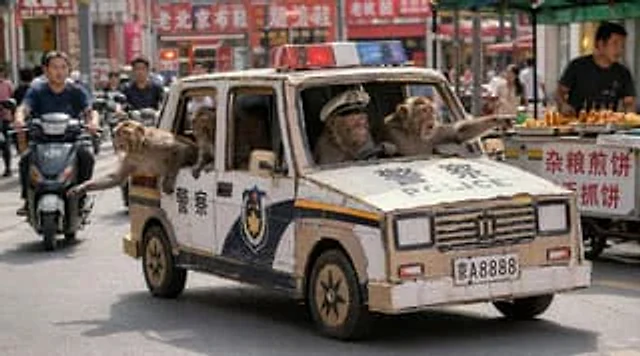

```text
A humorous, realistic street photograph taken in a busy Chinese market district shows a miniature, handcrafted police car patrolling the streets. The vehicle resembles a crudely made, life-size toy or parade prop, constructed from corrugated cardboard and tape. It's boxy and slightly crooked, painted white with dark blue police markings, and features red and blue police lights on the roof. The Chinese characters for "police" are printed on the hood and side doors, along with the English word "POLICE." Police badges adorn the front doors, and the license plate reads "京A8888". Four macaques are visible inside and outside the vehicle: one sits in the driver's seat wearing a white police hat, one hand on the steering wheel; another sits in the passenger seat, leaning out the window and pointing forward; and two more monkeys are sticking out of the left rear window, each extending an arm outwards. The monkeys' alert expressions and brown fur make the scene look like a monkey patrol. The surrounding environment is a real city street, with scooters, pedestrians, market stalls, green awnings, and dense red Chinese shop signs in the background, all slightly out of focus. Shot from a three-quarters angle to the left front of the street level, the cardboard cart is in the center of the frame and driving towards the viewer. Bright, natural midday light, documentary style, shallow depth of field, realistic textures, a comedic absurdity, and rich detail.
```

Model: GPT Image 2
Author: GPT Image 2 Prompts

[ProjectD](https://aitoolsradar.com/en/prompts/99e7ef8354cfb6) · [Recorded source](https://x.com/techhalla/status/2047590995991122303#reversed-0)
 · [Full original metadata and byte evidence](data/projectd-batch-0040.json)

## Monochrome Halftone Print Poster Design

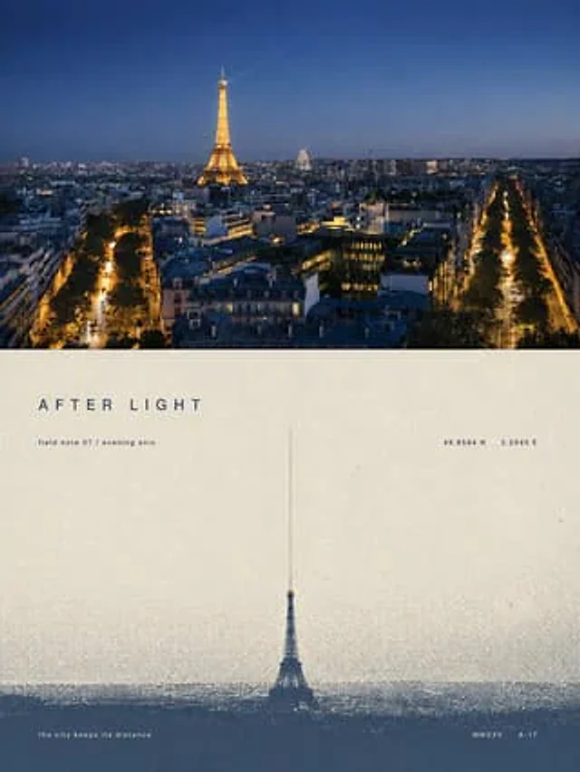

```text
请将我上传的每一张照片分别制作成一张独立的高级设计海报，不多图拼接，每张照片单独输出。整体采用3:4竖版构图，上下两个区域高度严格1:1，各占画面50%。

上半部分保留原始照片，保持主体结构、真实质感、自然光影和原有色彩氛围，仅进行轻微高级摄影调色，使其具有艺术杂志与展览摄影质感。为适配画幅，可自然扩展天空、地面或环境背景，但不得拉伸、扭曲或改变主体。

下半部分提取照片中最具识别性的**主体、轮廓、姿态与叙事关系**，将复杂信息压缩成一个唯一视觉锚点，重构为极简丝网版画与网点印刷海报。不要描摹照片，也不要加入丰富插画细节，只保留一个最关键的形状、动作或空间关系，让主体以极少的信息仍能被一眼识别。

构图遵循“**一个主体、一个方向、一个空间关系**”。主体通常保持较小尺度，以大面积留白制造距离感和诗意；根据原图自身关系，只选择一种最自然的结构：水平延展、纵向延伸、孤立悬置、向外消散或由浅入深，不同时使用多种构图技巧。可以利用一条地平线、边界、阴影或网点带建立空间，让空白本身成为画面的主要组成部分。

配色不直接复制照片，而从原图提炼综合色温、明度与情绪，重新归纳成**纸张底色 + 主墨色 + 雾层色**的有限专色体系。以米白、暖灰或自然纸色承担大面积留白，以一个沉静而有重量的综合色作为主墨色，再用同色系更浅、更灰的颜色表现空气、距离或层次。整体控制在2–3种颜色，以色彩面积、明度和网点密度建立层次，仅在具有明确叙事意义时允许极小面积点色。

所有雾气、距离、阴影、消散和空间过渡均使用 **halftone网点由密至疏自然消失**，不要使用数字模糊或普通渐变。保留纸张颗粒、丝网油墨、轻微套印偏差和不均匀着墨，使画面像真正印刷在旧纸上的艺术版画。

**保留少量具有高级编辑感的装饰性文字系统。** 不局限于地点名称，而从照片的主题、情绪、时间、动作、材质、距离或隐喻中生成极短英文标题，并搭配微型副文、编号、年份、章节号、坐标式数字、档案标记或一句含蓄的英文短句。文案可以略带抽象、文学性和策展语气，不需要完整解释画面，例如关于“距离、静止、经过、回声、边界、时间、光线、痕迹”等概念，使其像艺术书、建筑期刊或独立展览中的编辑注释。

文字本身必须参与构图，而不是后期贴在空白处。可让小字**沿地平线排列、贴合主体轮廓、成为纵向视觉轴、跨越网点边界、隐藏在负形中，或与主体发生遮挡、穿插、断开和对齐关系**；也可通过极细竖线、短横线、编号、页码感符号与大面积留白建立节奏。允许一个词被拆开、纵排、拉开字距或局部被图形遮住，但始终保持阅读秩序。

文字层级保持克制：**一个极短主标题 + 1–3组极小辅助文字即可**。字体参考高级艺术出版物与现代主义编辑设计，使用克制的无衬线、温和衬线或极简窄体字，通过极端字号反差、宽字距、细字重、上下标、小型大写和不对称排版制造精致感。文字颜色与主墨色或雾层色统一，可带轻微套印错位与油墨颗粒，使文字和图形属于同一次印刷，而不是数字排版覆盖层。

整体追求**极少元素、极大留白、极小主体、极强秩序，以及微妙而聪明的文字介入**，呈现安静、孤独、辽阔、含蓄、诗意、知识感和收藏感。避免复杂构图、多个焦点、无意义装饰、大标题压画面、商业广告文案、普通渐变、廉价复古滤镜和模板感。
```

Model: GPT Image 2
Author: 小小东

[ProjectD](https://aitoolsradar.com/en/prompts/36843883ca8add) · [Recorded source](https://youmind.com/prompts/monochrome-halftone-print-poster-32026)
 · [Full original metadata and byte evidence](data/projectd-batch-0040.json)

## Monochrome Infra Brand Kit Board

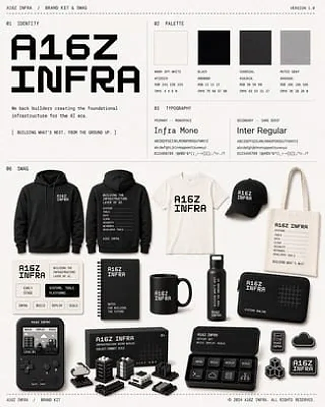

```text
{
  "type": "Monochrome brand toolkits and related merchandise display projects",
  "brand": {
    "name": "{argument name=\"brand name\" default=\"A16Z INFRA\"}",
    "tagline": "We support builders in creating infrastructure for the AI ​​era.",
    "campaign_line": "[Build the future from scratch.]",
    "version": "Version 1.0"
  },
  "style": {
    "overall": "A clean, Swiss-style brand guide page, featuring minimalist industrial and technological aesthetics, limited to black, white, and gray tones, with a cream-colored paper background, clear studio-style product cutouts, soft shadows, precise grid layout, and an editorial-grade presentation.",
    "mood": "Professional, high-end, futuristic, and focused on infrastructure"
  },
  "layout": {
    "header": {
      "left": "A16Z INFRA / Branded Toolkits and Accessories",
      "right": "Version 1.0",
      "divider": "Dashed horizontal dividing line"
    },
    "sections": [
      {
        "title": "01 Brand Identity",
        "position": "Top left",
        "count": 3,
        "labels": [
          "Large logo",
          "Brand statement paragraph",
          "The slogan in parentheses"
        ]
      },
      {
        "title": "02 Color Scheme",
        "position": "Top right",
        "count": 4,
        "labels": [
          "Warm beige",
          "black",
          "Charcoal gray",
          "Soft gray"
        ]
      },
      {
        "title": "03 Typography",
        "position": "Color scheme, bottom right",
        "count": 2,
        "labels": [
          "Main font -- Monospace font",
          "Secondary font -- sans-serif font"
        ]
      },
      {
        "title": "06 Peripheral Products",
        "position": "bottom two-thirds area",
        "count": 16,
        "labels": [
          "Black hoodie front",
          "Black hoodie back",
          "Off-white T-shirt",
          "Black baseball cap",
          "off-white tote bag",
          "6 square sticker/card sets",
          "Black Spiral Notebook",
          "Black mug",
          "Black water bottle",
          "Black zippered storage bag",
          "Handheld retro game console",
          "Boxed mini building block set",
          "Open keyboard kit box",
          "Cloud Keycap Badge",
          "Stacked cube keycap badges",
          "Rectangular brand patch badge"
        ]
      }
    ],
    "footer": {
      "left": "A16Z INFRA / Brand Tool Kit",
      "right": "© 2024 A16Z INFRA. All rights reserved.",
      "divider": "Dashed horizontal dividing line"
    }
  },
  "identity": {
    "logotype": {
      "text": "{argument name=\"logo text\" default=\"A16Z INFRA\"}",
      "appearance": "Oversized custom geometric block text logo with angular cuts, thick black font, stacked in two lines."
    }
  },
  "palette": {
    "swatches": [
      {
        "name": "Warm beige",
        "hex": "#F2EEE9",
        "rgb": "243 238 233",
        "cmyk": "4 4 6 0"
      },
      {
        "name": "black",
        "hex": "#000000",
        "rgb": "13 13 13",
        "cmyk": "75 68 67 90"
      },
      {
        "name": "Charcoal gray",
        "hex": "#3A3A3A",
        "rgb": "58 58 58",
        "cmyk": "63 53 51 27"
      },
      {
        "name": "Soft gray",
        "hex": "#A6A6A6",
        "rgb": "166 166 166",
        "cmyk": "36 28 28 0"
      }
    ]
  },
  "typography": {
    "primary": {
      "label": "Main font -- Monospace font",
      "family": "{argument name=\"primary font\" default=\"Infra Mono\"}",
      "sample": "ABCDEFGHIJKLMNOPQRSTUVWXYZ abcdefghijklmnopqrstuvwxyz 0123456789 !@#$%^&*()_+-=[]{}`~;:'\",.<>/?"
    },
    "secondary": {
      "label": "Secondary font -- sans-serif font",
      "family": "{argument name=\"secondary font\" default=\"Inter Regular\"}",
      "sample": "ABCDEFGHIJKLMNOPQRSTUVWXYZ abcdefghijklmnopqrstuvwxyz 0123456789 !@#$%^&*()_+-=[]{}`~;:'\",.<>/?"
    }
  },
  "swag": {
    "items": [
      {
        "name": "hoodie front",
        "color": "black",
        "print": "Small chest logo"
      },
      {
        "name": "Back of hoodie",
        "color": "black",
        "print": "The multi-line manifesto list, titled \"BUILDING THE INFRASTRUCTURE LAYER OF AI,\" is accompanied by a dotted guide line and categories, including SYSTEMS, TOOLS, DATA, CLOUD, SECURITY, NETWORKS, and DEVELOPER TOOLS."
      },
      {
        "name": "T-SHIRT",
        "color": "off white",
        "print": "Large logo centered"
      },
      {
        "name": "Baseball cap",
        "color": "black",
        "print": "Embroidered front label"
      },
      {
        "name": "Tote bag",
        "color": "off white",
        "print": "Stacked manifestos and bottom slogan: BUILDING WHAT'S NEXT."
      },
      {
        "name": "Sticker/Card Set",
        "count": 6,
        "layout": "2x3 grid",
        "labels": [
          "A16Z INFRA",
          "BUILDING THE INFRASTRUCTURE LAYER OF AI.",
          "EARLY STAGE",
          "SYSTEMS. TOOLS. PLATFORMS.",
          "INFRA",
          "BUILD",
          "DEPLOY",
          "SCALE"
        ]
      },
      {
        "name": "Spiral Notebook",
        "color": "black",
        "print": "Logo 及 NOTES FOR BUILDING THE FUTURE"
      },
      {
        "name": "mug",
        "color": "black",
        "print": "White Logo"
      },
      {
        "name": "water bottle",
        "color": "black",
        "print": "Vertical text: BUILDING WHAT'S NEXT. FROM THE GROUND UP."
      },
      {
        "name": "Zippered storage bag",
        "color": "black",
        "print": "Logo, dotted grid pattern, small text \"SYSTEMS ONLINE\"."
      },
      {
        "name": "Retro handheld devices",
        "color": "charcoal black",
        "screen": "A pixel-art city/infrastructure game interface with a BUILD DEPLOY SCALE tag and a level indicator LEVEL 01."
      },
      {
        "name": "Miniature building block box",
        "color": "black",
        "print": "A16Z INFRA, INFRASTRUCTURE MICRO BUILDS, COLLECT.CONNECT.SCALE.",
        "contents": "The box displays small, modular building block models in black, gray, and white."
      },
      {
        "name": "Keyboard Kit Box",
        "color": "black",
        "print": "A16Z INFRA KEYPAD SET BUILD. DEPLOY. SCALE.",
        "keys": 8,
        "labels": [
          "INFRA",
          "BUILD",
          "DEPLOY",
          "SCALE",
          ">_",
          "cloud icon",
          "Chip/Grid Icon",
          "Network chart icon"
        ]
      },
      {
        "name": "Cloud Badge",
        "style": "Small black enamel badge with a white border"
      },
      {
        "name": "Cube Badge",
        "style": "Small black enamel badges displaying stacked isometric cubes"
      },
      {
        "name": "Brand patch badge",
        "style": "Small rectangular black enamel badge with a white logo"
      }
    ]
  },
  "rendering": {
    "camera": "Combining frontal tiling and frontal projection product project composition",
    "lighting": "Soft and even studio lighting",
    "background": "Light warm beige paper",
    "quality": "High-resolution commercial prototypes suitable for professional brand showcases"
  }
}
```

Model: GPT Image 2
Author: GPT Image 2 Prompts

[ProjectD](https://aitoolsradar.com/en/prompts/e601639776bab7) · [Recorded source](https://x.com/Capitaine/status/2046844345081336299#reversed-0)
 · [Full original metadata and byte evidence](data/projectd-batch-0040.json)

## Monochrome Tennis Streetwear Moodboard

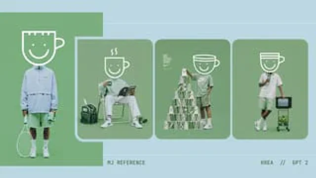

```text
A clean, fashion editorial concept project, set against a pale pinkish-blue background with a minimalist green monochromatic palette, features four horizontally arranged full-body photos of the same young, street-style tennis-inspired character. On the far left is a tall, vertical photo panel, partially obscuring the background, showcasing a model standing in an oversized light gray-blue Nike windbreaker, mint green shorts, white mid-calf socks, and white sneakers, holding a white tennis racket in one hand and a small mint green towel or accessory in the other. The character's head is replaced by a large white graffiti-style coffee mug icon with a smiling expression and ruler-like markings along the top edge. To the right are three evenly spaced rounded rectangular photo panels. In panel 1, the model sits in a folding chair reading a magazine and holding a green mug; a dark Nike sports bag sits on the floor, and several mugs are scattered nearby; two wisps of steam rise above the white graffiti-style mug. In Panel 2, the model stands beside a pyramid made up of approximately 28 stacked green and white paper cups, one arm resting on top; they wear soft green Nike T-shirts and shorts sets, paired with white socks and white sneakers; a small white typographic logo in the upper left corner looks like a brand logo for a café or service court. The graffiti cuphead here is a simple smiling cup with a wide rim. In Panel 3, the model leans casually with her legs crossed, holding a green cup, next to a small metal cart filled with green tennis balls and a vintage CRT television; they wear white polo shirts, mint green shorts, white socks, and white sneakers. The graffiti cuphead in this panel has horizontal stripes at the top. Ensure all faces are completely replaced by graphic cup icons, without showing any real facial features. Use a soft studio set, flat and even lighting, subtle shadows, a matte finish, and a highly unified color scheme of mint green, sage green, olive green, and white. Add thin, white horizontal guide lines at the top and bottom of the blue background. Add small gray editable footer text at the bottom: on the left is "{argument name="left footer text" default="MJ REFERENCE"} The right side is “”;{argument name="right footer text" default="KREA // GPT 2"} Overall style: High-end streetwear promotional project, playful surreal brand design, minimalist graphic design, and exquisite commercial photography; the four styles maintain a high degree of consistency.
```

Model: GPT Image 2
Author: GPT Image 2 Prompts

[ProjectD](https://aitoolsradar.com/en/prompts/baf9021abcfbd9) · [Recorded source](https://x.com/lloydcreates/status/2046775099747954984#reversed-1)
 · [Full original metadata and byte evidence](data/projectd-batch-0040.json)

## Monument Architectural Infographic Poster

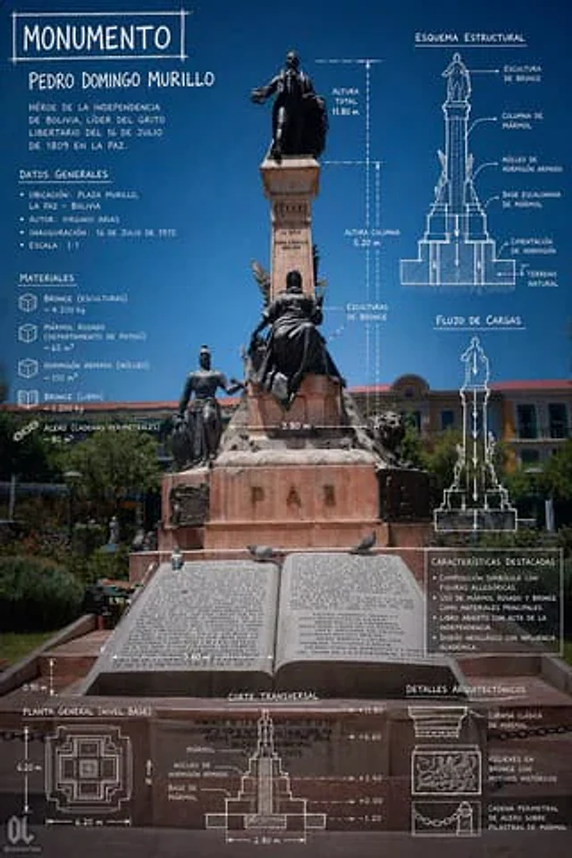

```text
{
  "type": "Architectural Monument Infographic Poster",
  "subject": {
    "monument_name": "{argument name=\"monument name\" default=\"Pedro Domingo Murillo\"}",
    "headline": "{argument name=\"headline text\" default=\"MONUMENTO\"}",
    "location": "{argument name=\"location\" default=\"Plaza Murillo, La Paz - Bolivia\"}",
    "historical_text": "{argument name=\"historical summary\" default=\"Bolivian independence hero and leader of the La Paz uprising on July 16, 1809.\"}",
    "main_view": "Under a deep, clear blue sky, a full-height frontal view of the monument in the public square, centered composition, realistic light and shadow, fully showcasing the base and the forecourt below.",
    "monument_description": "The towering marble column monument is topped with a bronze statue. The central front features a seated bronze allegorical female figure, with an additional bronze statue to the lower left. The sides feature sculptural details, and the base is flanked by lions. A large stone plaque is located in the foreground at the base.",
    "inscription": "The base is engraved with the huge letters PAZ."
  },
  "style": {
    "visual_language": "Infographics based on photographs, with white hand-drawn architectural annotations.",
    "mood": "Academic, civic, historical, precise",
    "colors": {
      "background": "A rich cobalt blue to deep blue sky",
      "overlay": "White sketch lines and handwritten capital letters",
      "stone": "Pink marble and light brown stone",
      "metal": "Dark bronze"
    },
    "typography": "Chalk-like handwritten all-caps letters, slightly irregular technical drawing labels",
    "rendering": "High-resolution edited poster, realistic monument photography overlaid with blueprints"
  },
  "layout": {
    "sections": [
      {
        "title": "Regular data",
        "position": "Top left",
        "count": 4,
        "labels": [
          "Location",
          "author",
          "Completion date",
          "Proportion"
        ]
      },
      {
        "title": "Material",
        "position": "Left and Middle",
        "count": 5,
        "labels": [
          "Bronze (sculpture)",
          "Pink marble (Potosi Province)",
          "Reinforced concrete (core)",
          "Bronze (book)",
          "Steel (peripheral chains)"
        ]
      },
      {
        "title": "Structural scheme",
        "position": "Top right",
        "count": 5,
        "labels": [
          "Bronze sculpture",
          "Marble column",
          "reinforced concrete core",
          "Stepped marble base",
          "Concrete foundation on natural ground"
        ]
      },
      {
        "title": "Load flow direction",
        "position": "Right Center",
        "count": 1,
        "labels": [
          "From sculpture to foundational vertical load arrows"
        ]
      },
      {
        "title": "Main features",
        "position": "Right center bottom",
        "count": 4,
        "labels": [
          "Symbolic compositions featuring allegorical figures",
          "The main materials are pink marble and bronze.",
          "An open book with the Declaration of Independence",
          "Neoclassical design with academic influence"
        ]
      },
      {
        "title": "Site plan (datum plane)",
        "position": "Bottom left",
        "count": 1,
        "labels": [
          "Square stepped floor plan with north marker and dimension lines"
        ]
      },
      {
        "title": "Cross-sectional view",
        "position": "Middle to lower",
        "count": 1,
        "labels": [
          "Sectional view including internal core, marble base, elevation marks, and width dimensions."
        ]
      },
      {
        "title": "Architectural details",
        "position": "Bottom right",
        "count": 3,
        "labels": [
          "Classic marble cornice",
          "Bronze reliefs with historical themes",
          "Steel peripheral chains on marble piers"
        ]
      }
    ],
    "dimension_annotations": [
      "Total height: 11.80 meters",
      "Pillar height 5.20 meters",
      "3.80 meters",
      "3.60 meters",
      "2.80 meters",
      "6.20 meters",
      "1.90 meters",
      "0.90 meters",
      "+11.80",
      "+6.60",
      "+1.40",
      "+0.00",
      "-1.20"
    ],
    "centerpiece": "The monument occupies the vertical center, with annotations symmetrically surrounding it.",
    "text_distribution": "The main title is located at the top left, followed by a descriptive paragraph below. Technical notes are placed on the left and right sides, with the measurement diagrams and floor plans aligned along the bottom edge."
  },
  "camera": {
    "perspective": "Architectural documentary photography from a level perspective",
    "framing": "The poster is designed to be vertical, with the monument centered, ample space in the foreground to display an open book and the lower section, and the background featuring municipal buildings and greenery."
  },
  "quality": {
    "finish": "Simple infographic layouts are suitable for museum display boards, heritage posters, or educational social media posts.",
    "detail_level": "Extremely high quality, clear label, clean lines, realistic texture."
  }
}
```

Model: GPT Image 2
Author: GPT Image 2 Prompts

[ProjectD](https://aitoolsradar.com/en/prompts/3dd0a376169c59) · [Recorded source](https://x.com/oscarlau/status/2047710173863559439#reversed-2)
 · [Full original metadata and byte evidence](data/projectd-batch-0040.json)

## Moody Censored Indoor Selfie Portrait

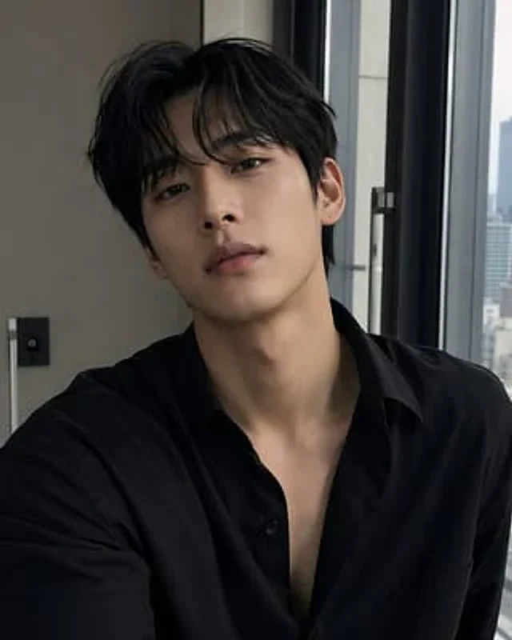

```text
A realistic, indoor self-portrait of a young East Asian man, half-length. He sits by a large, modern window in a high-rise apartment or hotel room, bathed in soft sunlight. He has {argument name="hair color" default="black"} His hair was thick and slightly messy, parted in the middle, with natural volume at the forehead and sides. He was slender, with a long neck and fair, delicate skin. He was wearing a {argument name="shirt color" default="black"} A matte cotton or poplin shirt, slightly loose-fitting, with a few buttons undone at the top of the collar, creating a deep V-neck and a casual, relaxed style. The camera is used to capture a close-up shot from a natural selfie angle, in a vertical composition, including the shoulders, chest, neck, and head. His face is completely obscured by a large rectangular blurred or mosaic block in the center, but his ears, jawline, neck, and hair are clearly visible. The overall atmosphere is understated, melancholic, and elegant, with soft, neutral tones. Soft window light streams in from the right, creating delicate shadows and a realistic social media selfie feel. Background details include a beige wall on the left, a small dark-colored control panel, a vertical metal strip or light fixture edge, and two tall, dark-framed windows on the right, offering a blurred city skyline view. Realistic smartphone photography, a clean, modern interior environment, shallow depth of field, natural skin texture, subtle contrast, the smile obscured by the obscuring block, minimalist post-processing, a stylish and authentic personal selfie.
```

Model: GPT Image 2
Author: GPT Image 2 Prompts

[ProjectD](https://aitoolsradar.com/en/prompts/bbfce981ea570e) · [Recorded source](https://x.com/MathMedix/status/2046802557872562478#reversed-0)
 · [Full original metadata and byte evidence](data/projectd-batch-0040.json)

## Moody Coastal Road Trip Portrait

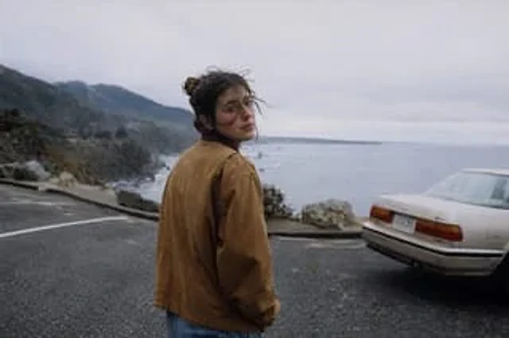

```text
A candid photo with a cinematic feel, showing a {argument name="person" default="young women"} Standing in a damp, overcast coastal roadside parking area. Shot from behind and slightly to the side, she is looking back at the camera. Her dark, tousled hair is loosely tied in a bun, strands ruffled by the wind, her facial features soft and blurred. She wears two visible garments: a worn tan canvas jacket and medium blue jeans. She is relaxed, one hand near or inside her pocket. The background is a melancholic cliffside roadside viewpoint, with dark rocky mountains on the left and a greyish-white sea stretching into the distance on the right, the sky overcast and pale. The right edge of the frame includes a light-colored late 1980s or early 1990s sedan parked, its rear facing the viewer, and a large rock railing near the viewpoint. The dark, wet asphalt road, with blurred parking lines, suggests recent rain. Using natural light, the soft, cool tones, with slight film grain, soft focus, and a light mist, evoke a nostalgic 35mm road trip photography aesthetic.
```

Model: GPT Image 2
Author: GPT Image 2 Prompts

[ProjectD](https://aitoolsradar.com/en/prompts/6ae70d75335bcf) · [Recorded source](https://x.com/levelsio/status/2046735438128333096#reversed-0)
 · [Full original metadata and byte evidence](data/projectd-batch-0040.json)

## Moody Cyberpunk Cityscape

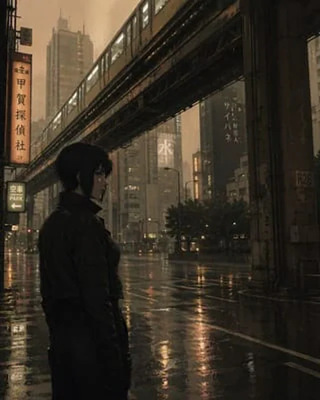

```text
An illustration with a strong cinematic feel and atmosphere depicts a young woman with short black hair standing on a wet city street at night. She wears a dark jacket and looks to one side. Above her, an elevated railway track diagonally cuts across the street, and a yellow train roars past. The city is filled with skyscrapers, some adorned with neon signs featuring Japanese characters. The rain-soaked streets reflect the warm, soft lights of the city and the train. The overall color scheme, dominated by dark brown, tan, and soft yellow, creates a melancholic, dystopian, or cyberpunk atmosphere. The dim, diffused lighting evokes a typical scene of a rainy night in a metropolis.
```

Model: GPT Image 2
Author: GPT Image 2 Prompts

[ProjectD](https://aitoolsradar.com/en/prompts/2094da68f00d58) · [Recorded source](https://x.com/nicdunz/status/2046306963605352841#reversed-2)
 · [Full original metadata and byte evidence](data/projectd-batch-0040.json)

## Moody Engagement Party Invitation

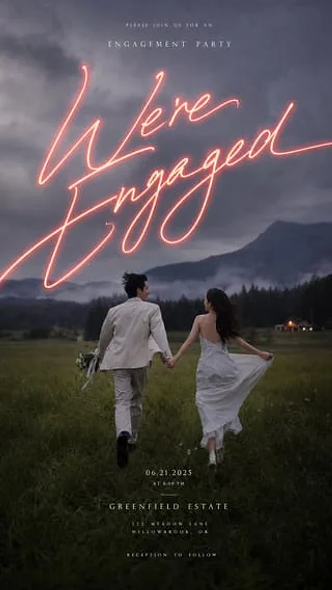

```text
Create a vertical cinematic engagement party invitation poster using a moody outdoor photo-realistic style. The scene shows an engaged couple from behind, holding hands and running away through a dark green meadow at dusk toward misty forested mountains under a dramatic cloudy blue-gray sky. The groom wears a light cream suit and carries a small bouquet with trailing ribbons in his left hand; the bride wears a flowing white slip-style dress with an open back, holding the skirt out slightly as her long dark hair blows in the wind. Add a tiny warm-lit cabin or venue in the far right background, soft fog in the valley, natural film grain, low-contrast shadows, romantic editorial wedding photography, atmospheric and slightly underexposed. Overlay elegant invitation typography: at the top, small widely spaced uppercase serif text reading “PLEASE JOIN US FOR AN”, beneath it larger spaced uppercase serif text reading “ENGAGEMENT PARTY”. Across the upper-middle sky, place huge glowing handwritten neon script in warm coral-pink reading “{argument name="main script text" default="We're Engaged"}”, with realistic neon bloom and long sweeping strokes extending partly off the sides. Near the bottom center, add small centered white serif event details in four stacked groups: “{argument name="date" default="06.21.2025"}”, “AT {argument name="time" default="6:00 PM"}”, then larger spaced uppercase “{argument name="venue name" default="GREENFIELD ESTATE"}”, then small spaced uppercase “123 MEADOW LANE” and “WILLOWBROOK, OR”, and finally “RECEPTION TO FOLLOW”. Use a 9:16 portrait invitation layout, refined luxury wedding aesthetic, all text centered, crisp white letterspacing, no border, no watermark, keep the couple in the lower half and the glowing script dominant in the sky.
```

Model: GPT Image 2
Author: 小小东

[ProjectD](https://aitoolsradar.com/en/prompts/c2c39997099d70) · [Recorded source](https://youmind.com/prompts/engagement-party-invitation-29315)
 · [Full original metadata and byte evidence](data/projectd-batch-0040.json)

## Moody Guitarist Portrait

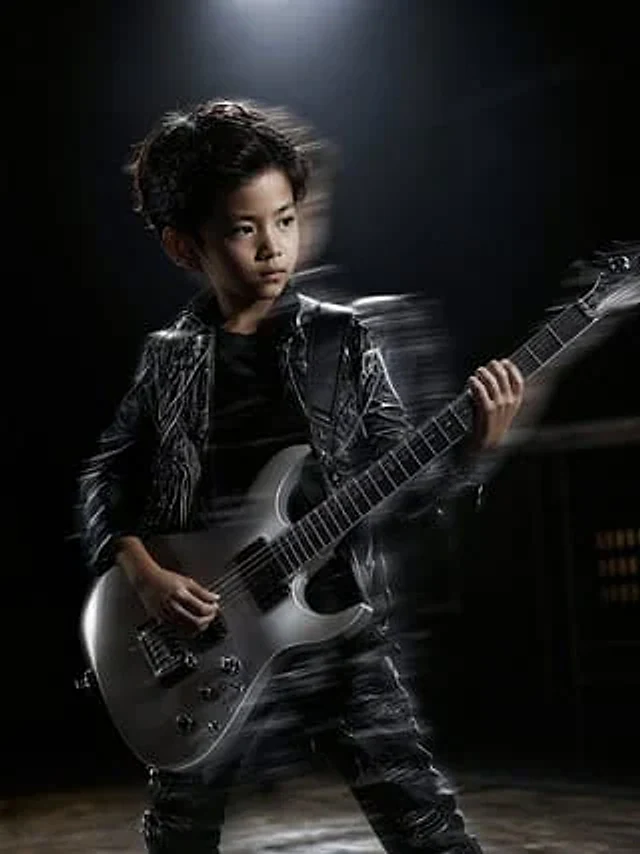

```text
Preserve the model's face, proportions, and external features from the reference image.{argument name="subject" default="8-year-old boy"} Located in a dimly lit, somber rehearsal hall. Dramatic rim lighting and a single overhead spotlight create a silhouette effect. He holds a {argument name="instrument" default="Silver electric guitar"} The texture of the metal strings is visible. The motion blur effect from the strobe light creates high contrast, perfect for commercial magazine photography, capturing the realistic style of a fashion editor with a focused and intense expression.
```

Model: GPT Image 2
Author: GPT Image 2 Prompts

[ProjectD](https://aitoolsradar.com/en/prompts/f56de8f0df8483) · [Recorded source](https://x.com/harboriis/status/2046944962349351038)
 · [Full original metadata and byte evidence](data/projectd-batch-0040.json)

## Moody Street Portrait at Dusk


```text
A realistic street portrait, capturing a young East Asian woman standing in the middle of a quiet city road. Taken during the blues hour, the shot is a half-body composition with a shallow depth of field. She has {argument name="hair color" default="Dark brown"} Her long hair was smooth and natural, slightly wavy, parted in the middle, with a few strands falling naturally on either side of her face. She wore a fitted top.{argument name="top color" default="black"} She wears a ribbed turtleneck sweater with long sleeves and no obvious embellishments or patterns. Her posture is relaxed, facing the camera, her shoulders slightly tilted, her expression calm and composed. The background is a narrow Japanese street, with two parked or passing cars visible in the blurred background. Low-rise buildings are on the left, and a row of trees is on the right. Telegraph poles and overhead power lines extend into the distance. The ambient light is soft evening light. The use of natural skin tones, a realistic photographic style, delicate cinematic color grading, soft bokeh, and clear fabric details creates an intimate and emotional atmosphere, as if shot with an 85mm lens at a wide aperture.
```

Model: GPT Image 2
Author: GPT Image 2 Prompts

[ProjectD](https://aitoolsradar.com/en/prompts/54cc4932be405f) · [Recorded source](https://x.com/SakuraRenge/status/2046612071719342322#reversed-0)
 · [Full original metadata and byte evidence](data/projectd-batch-0040.json)

## Moody Woman Looking at Phone

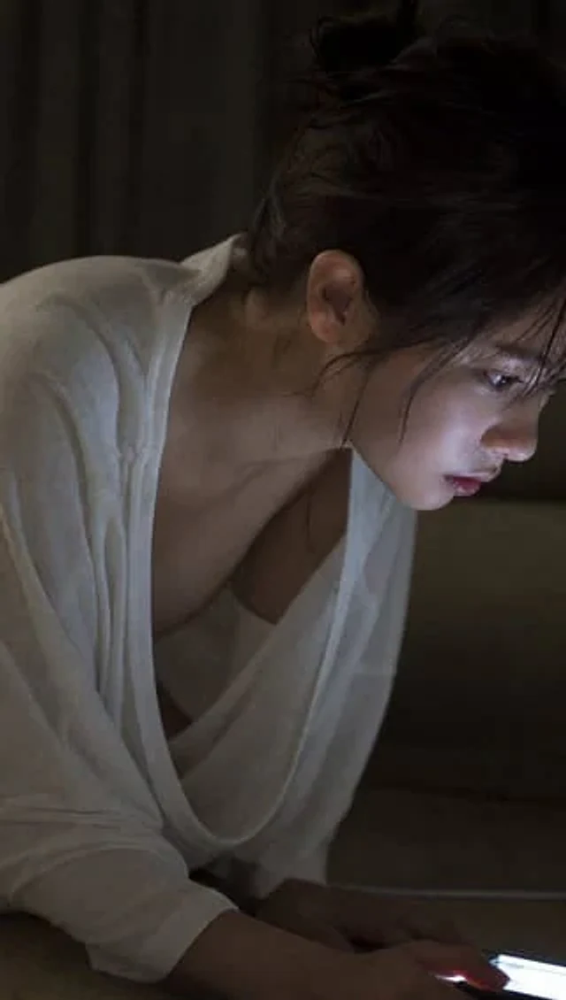

```text
Create a moody, realistic vertical photo of a young woman with {argument name="hair color" default="dark brown"} hair tied in a messy bun, sitting or leaning forward on a sofa in a dimly lit room at night. She wears a loose, semi-sheer {argument name="shirt color" default="white"} button-up shirt falling open at the collar, with soft folds and natural fabric texture. Her head is bent downward toward a glowing smartphone near the bottom right edge of the frame, one hand touching the screen so the phone casts a small cool white-blue light on her fingers. Compose the image as an intimate close-up from chest to head, cropped tightly, with her face mostly hidden by her posture and covered by a large opaque rectangular privacy block in muted dark brown-gray over the right-center face area. Background is dark, soft, and out of focus, suggesting a couch or wall, with low-key cinematic lighting, subtle grain, shallow depth of field, realistic skin tones, and a quiet melancholic atmosphere. Use a vertical {argument name="aspect ratio" default="9:16"} composition, no visible text, no watermark, no extra objects.
```

Model: GPT Image 2
Author: 俺の娘たち / プロンプトの人

[ProjectD](https://aitoolsradar.com/en/prompts/4b09133888ca94) · [Recorded source](https://youmind.com/prompts/moody-woman-phone-portrait-21124)
 · [Full original metadata and byte evidence](data/projectd-batch-0040.json)

## Moon Bathhouse Manga Page

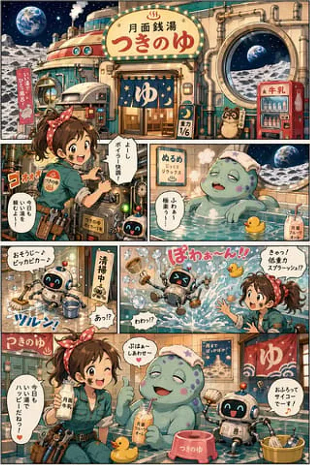

```text
A vibrant Japanese manga page set in a whimsical public bathhouse on the moon. The artwork employs a refined retro-futuristic anime style, with warm lighting, thick and clear panel borders, vivid sound effects and text, and rich environmental narrative details. The scene is a lunar hot spring called "Tsukimichi Tsuki no Yu," featuring a huge illuminated sign, a blue curtain with a white "Yu" character, exposed pipes, dashboards, rounded architectural structures, and a large circular window offering views of the lunar surface and Earth in space. Please include 8 manga panels arranged in a dynamic page layout. Panel 1: An exterior shot of the lunar bathhouse, with a sign reading "Tsukimichi Tsuki no Yu," a small sign next to it reading "Gravity 1/6," a red "milk" vending machine, a tanuki statue, lunar terrain, and a vertical poster advertising the bathhouse. Panel 2: A young female bathhouse mechanic {argument name="character design" default="She wore a brown ponytail with a red polka dot headscarf, green overalls, and a tool belt, and her expression was full of energy."} Adjusting machine or boiler controls, side-rear view, with speech bubbles about preparing today's bath water and boiler status. Scene 3: A cute alien customer ({argument name="alien appearance" default="A round, mint-green body with purple spots, sleepy eyes, pink cheeks, a small mouth, and a white towel with purple stars printed on its head."} Relaxing in a steaming bath, half-submerged in the water, with a rubber duck floating beside you, and a wooden sign that reads "ぬるめじっくりリラックス" (warm water, soak slowly, relax). Scene 4: A small cleaning robot ({argument name="robot design" default="Silver body, blue accents, black electronic face with glowing blue eyes, red antenna lights, slender mechanical arms and legs"} Scene 5: The robot is happily sweeping and wiping the floor next to a sign that says "Cleaning in Progress." Scene 6: The robot suddenly slips or dramatically splashes into the bath, creating a huge spray of water and many bubbles, accompanied by a loud sound effect of "Powaa~n!!", while the staff reacts in surprise. Scene 7: The staff member sits smiling by the bath, holding a bottle of milk labeled "Lunar Milk." Scene 8: The alien in the bath gives a thumbs up, holding a bottle of beverage labeled "Lunar Fruit Oré," looking very satisfied, with the rubber duck still beside him. Scene 9: The happy robot poses by the bath, with cleaning tools and a bucket beside him, in the background a shower curtain with the character "yu" and a pink washbasin labeled "tsukinoyu," saying that the bathhouse is the best. Maintaining a warm and comedic tone, the comic combines retro Showa-era bathhouse details with space technology, showcasing glossy tile surfaces, steam, bubbles, and adorable character interactions. The overall feel of the comic should be a charming, episodic comedy about working in a lunar bathhouse.
```

Model: GPT Image 2
Author: GPT Image 2 Prompts

[ProjectD](https://aitoolsradar.com/en/prompts/614f99f755ab01) · [Recorded source](https://x.com/mar_vn_nv_cie/status/2046799393307996376#reversed-0)
 · [Full original metadata and byte evidence](data/projectd-batch-0040.json)

## Moon Mark Adventure Comic Page

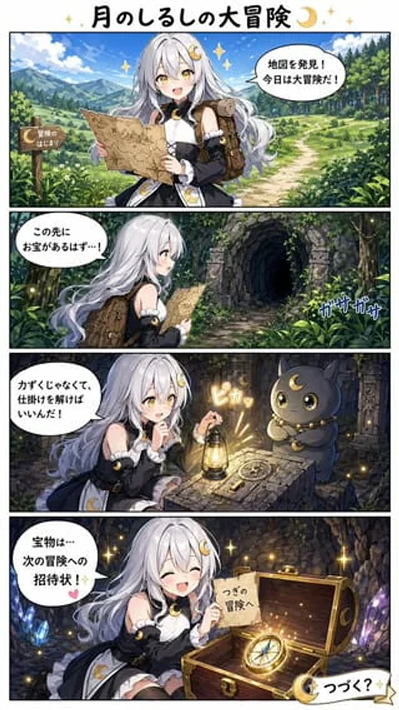

```text
{
  "type": "Four-panel comic page",
  "style": "Adorable fantasy comic illustrations, exquisite GPT-Image-2 anime rendering, vibrant colors, sharp lines, soft painterly shadows, and a magical fantasy atmosphere.",
  "page": {
    "background": "White page with black border",
    "title": "{argument name=\"headline text\" default=\"The Great Adventure of Moon&#39;s Mark\"}",
    "title_position": "Centered at the top",
    "decorations": [
      "There are small golden sparks around the title.",
      "There is a crescent moon icon on the right side of the title."
    ],
    "panel_count": 4,
    "reading_direction": "From top to bottom"
  },
  "character": {
    "appearance": "A young anime-style female adventurer with long, wavy silver hair, fair skin, large, bright eyes, and a slender figure.",
    "outfit": [
      "Black and white fantasy dress with ruffle trim",
      "Crescent hair accessory",
      "Crescent collar",
      "Off-shoulder sleeves",
      "Brown leather backpack",
      "Dark over-the-knee socks"
    ],
    "theme": "The moon theme runs throughout the costumes and props."
  },
  "panels": [
    {
      "position": "top",
      "scene": "Under a blue sky and white clouds, a sunlit mountain path and meadow stretch out; to the right lies a forest, the winding path leading into the distance, and to the left, a wooden signpost marks the way.",
      "action": "The girl stood there, holding and reading an ancient treasure map, facing forward.",
      "props": [
        "Old map",
        "wooden road signs",
        "Backpack"
      ],
      "text": {
        "sign": "The beginning of the adventure",
        "speech": "{argument name=\"panel 1 speech\" default=\"A map has been found! Today is a big adventure!\"}"
      }
    },
    {
      "position": "Upper-middle",
      "scene": "The entrance to the lush jungle ruins, the dark cave entrance formed by ancient stone pillars carved with crescent symbols and covered with vines.",
      "action": "The girl cautiously approached from a three-quarters perspective from behind, while simultaneously reading the map.",
      "props": [
        "map",
        "Abandoned cave entrance",
        "Dense vegetation"
      ],
      "text": {
        "speech": "{argument name=\"panel 2 speech\" default=\"The treasure should be just ahead...!\"}",
        "sound_effect": "rustling sound"
      }
    },
    {
      "position": "Middle to lower",
      "scene": "Inside the cave ruins, the light was dim, and in the center was a stone altar or puzzle table.",
      "action": "The girl knelt beside the lit lantern, reaching out to touch a puzzle device instead of the keyhole beside it, while a round, black cat mascot watched from the side.",
      "props": [
        "Lanterns emitting a warm glow",
        "Stone puzzle board engraved with circular symbols",
        "The little golden key on the table",
        "A black cat creature with a crescent moon mark and a beaded collar."
      ],
      "text": {
        "speech": "{argument name=\"panel 3 speech\" default=\"It&#39;s not a key, it&#39;s about unlocking a mechanism!\"}",
        "sound_effect": "flash"
      }
    },
    {
      "position": "bottom",
      "scene": "The treasure chamber, with its cave walls inlaid with crystals and sparks floating around it.",
      "action": "The girl, with her eyes closed, smiled brightly beside the open treasure chest and held up a paper invitation.",
      "props": [
        "An open wooden treasure chest with a crescent moon emblem",
        "A glowing compass inside the treasure chest",
        "A paper card that reads \"On the way to the next adventure\"",
        "Blue and purple crystals"
      ],
      "text": {
        "speech": "{argument name=\"panel 4 speech\" default=\"The treasure is... an invitation to the next adventure!\"}",
        "tag": "To be continued?"
      }
    }
  ]
}
```

Model: GPT Image 2
Author: GPT Image 2 Prompts

[ProjectD](https://aitoolsradar.com/en/prompts/8d907b9d9a0ce6) · [Recorded source](https://x.com/wing_sky_nine/status/2046700437785792566#reversed-0)
 · [Full original metadata and byte evidence](data/projectd-batch-0040.json)

## Moon Phase Mooncake Brand Hero Board

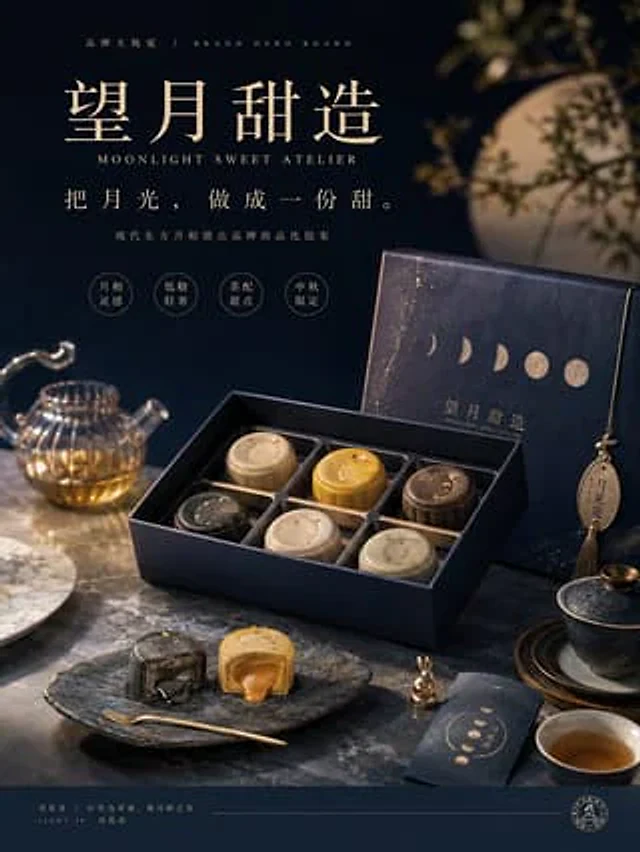

```text
Goal: Create a premium brand hero board for a modern Oriental mooncake dessert gift brand named {argument name="brand name" default="望月甜造"}, with the English subtitle {argument name="English brand subtitle" default="MOONLIGHT SWEET ATELIER"}, inspired by moon phases, quiet moonlight, tea culture, and luxury Mid-Autumn gifting.

Canvas: Vertical 4:5 commercial poster, dark navy and warm gold palette, elegant high-end food photography blended with refined graphic design. Use cinematic low-key lighting, shallow depth of field, realistic textures, soft moon glow, and a luxurious editorial product-advertising composition.

Layout: Top-left typography block, large Chinese brand title in refined serif calligraphy, English subtitle beneath it, then the slogan {argument name="main slogan" default="把月光，做成一份甜。"}. Add a small line of descriptive copy below: “现代东方月相甜点品牌商品化提案”. Include exactly 4 small circular feature badges under the copy, labeled: 1) “月相灵感”, 2) “低糖轻奢”, 3) “茶配甜点”, 4) “中秋限定”. Put a tiny top label reading “品牌主视觉 / BRAND HERO BOARD”. Add a thin footer band at the bottom with small brand-system text and a round seal logo.

Main scene: On a dark marble tabletop, show an open luxury mooncake gift box in deep midnight blue with gold edging. Inside the box are exactly 6 round mooncakes in individual square compartments: 1 black mooncake with gold flakes, 1 pale cream mooncake with a crescent motif, 1 golden yellow mooncake, 1 ivory mooncake, 1 dark brown mooncake, and 1 light beige mooncake with subtle marbling. Each mooncake should look like a refined modern dessert rather than a traditional red-gold pastry.

Packaging details: Behind the open box, place the upright matching gift box lid in navy leather-like texture with gold speckled star dust, five moon phase symbols across the front, the brand name {argument name="brand name" default="望月甜造"}, and the English subtitle below. Add a hanging oval tag and tassel on the right side of the box, with the text “月见定”.

Foreground food details: In front of the box, place exactly 2 cut mooncake pieces on a dark stone serving plate: 1 black mooncake half with glossy dark filling and 1 golden mooncake half with flowing caramel-colored filling. Add a slim gold dessert fork beside them and a tiny gold rabbit figurine nearby.

Surrounding props: Include exactly 5 supporting table props: 1 glass teapot filled with amber tea on the left, 1 white round plate partially visible at the far left, 1 dark lidded teacup on a wooden saucer to the right, 1 small white teacup with tea at the bottom right, and 1 navy invitation card with moon phase graphics and gold lettering near the cup. In the background, show a large blurred full moon and soft silhouetted branches, creating a poetic night garden atmosphere.

Visual style: Premium Chinese luxury dessert branding, dark navy, champagne gold, warm amber highlights, realistic product photography, delicate gold foil, marble texture, soft reflections, elegant serif typography, poetic Mid-Autumn mood. Avoid cartoon styling, avoid bright red traditional packaging, avoid clutter, keep the design clean and sale-ready.
```

Model: GPT Image 2
Author: Larus Canus

[ProjectD](https://aitoolsradar.com/en/prompts/c8697e0203723f) · [Recorded source](https://youmind.com/prompts/moon-phase-mooncake-brand-23365)
 · [Full original metadata and byte evidence](data/projectd-batch-0040.json)

## Mooncake Gift Box Open Reveal


```text
Top-down view of an open premium Mid-Autumn Festival mooncake gift box, deep crimson lacquered exterior with subtle gold cloud patterns embossed on the lid, interior tray showing four neatly arranged round mooncakes with intricate flower patterns on top. A single sprig of fresh osmanthus blossom rests beside the box. Soft warm overhead light, square 1:1 composition. No brand text, no calligraphy logo, no watermark. Premium traditional Chinese seasonal product photography, photorealistic lacquer sheen and pastry texture.
```

Model: GPT Image 2
Author: @hiapi_ai

[ProjectD](https://aitoolsradar.com/en/prompts/8784bcbfc90862) · [Recorded source](https://github.com/HiAPIAI/awesome-gpt-image-2-prompts)
 · [Full original metadata and byte evidence](data/projectd-batch-0040.json)

## Moonlit Anime Chocolate Box

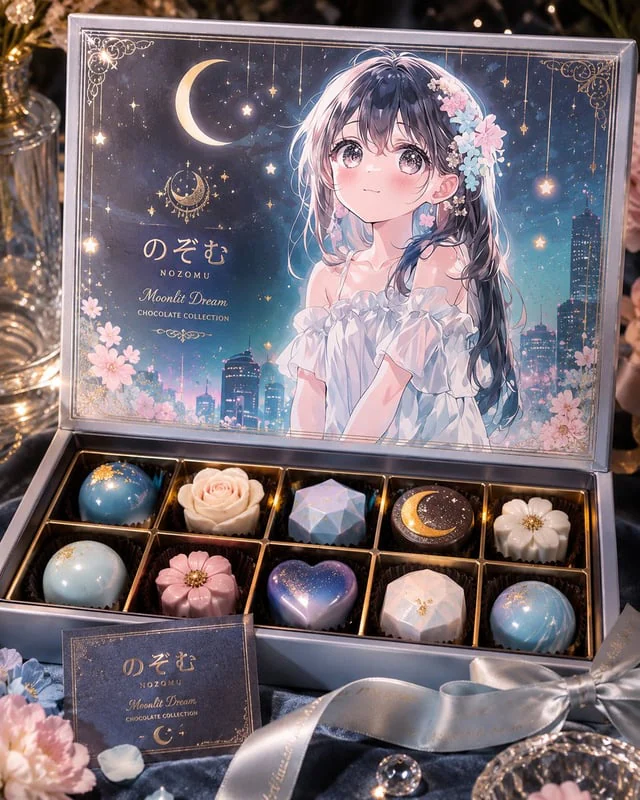

```text
Create a luxurious square product photo of an open premium chocolate gift box themed around an original anime girl character named {argument name="character name" default="Nozomu"}. The box lid is a custom limited-edition package illustration: a soft, dreamy anime girl with long dark navy-black hair with pale pink highlights, large sparkling eyes, blush cheeks, and small pastel blue and pink flowers tucked in her hair, wearing a white ruffled off-shoulder dress. Behind her is a moonlit night city skyline in teal and navy, a large crescent moon, tiny stars, hanging celestial ornaments, delicate gold filigree corner borders, and scattered cherry blossoms. Include elegant package typography on the lid: Japanese-style title “のぞむ”, small romanization “NOZOMU”, script subtitle “Moonlit Dream”, and “CHOCOLATE COLLECTION”. Inside the box, show exactly 10 artisan chocolates arranged in a 2-by-5 grid in black paper cups with thin gold dividers: 1 glossy blue sphere with gold flakes, 1 cream rose-shaped chocolate, 1 faceted pale blue gem chocolate, 1 dark round chocolate with a gold crescent moon and starry top, 1 white flower chocolate with gold center, 1 pale blue-white sphere with gold speckles, 1 pink flower chocolate with gold center, 1 glossy purple heart chocolate with tiny stars, 1 faceted white crystal chocolate with gold accents, and 1 blue marbled sphere with gold swirls. In front of the box, place a small matching dark navy product card with the same “のぞむ / NOZOMU / Moonlit Dream / CHOCOLATE COLLECTION” branding and crescent motif. Surround the scene with satin fabric, a pale silver ribbon bow, crystal glassware, small flowers, warm fairy lights, and sparkling highlights. Use a high-end romantic confectionery advertisement style, shallow depth of field, soft cinematic lighting, pastel blue pink gold palette, glossy textures, intricate packaging details, elegant and magical atmosphere, ultra-detailed photorealistic product photography mixed with polished anime illustration. Keep all text legible and avoid extra logos or watermarks.
```

Model: GPT Image 2
Author: のぞむ＊AIイラスト

[ProjectD](https://aitoolsradar.com/en/prompts/b0182e6f4021ca) · [Recorded source](https://youmind.com/prompts/anime-chocolate-gift-box-22786)
 · [Full original metadata and byte evidence](data/projectd-batch-0040.json)

## Moonlit Anime Horror Cosplay Poster

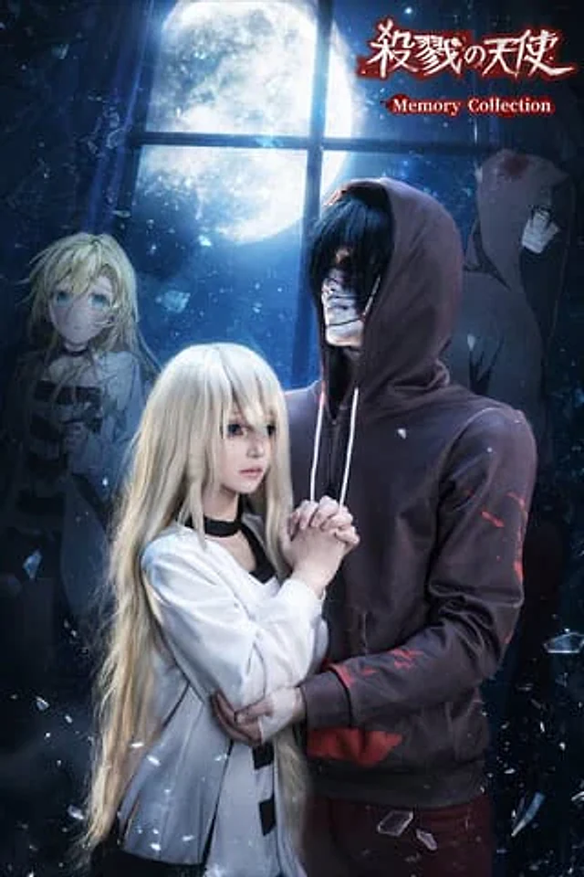

```text
A dark, cinematic, anime-style horror key visual, presented in a vertical poster format. The background is set at night, inside or near a broken window, with a huge, glowing full moon dominating the background. In the center of the foreground, a young couple embraces tightly. The male character is tall and slender, wearing a dark brown or charcoal gray hoodie with a white drawstring, subtle bloodstains on the cuffs and hem, and dark red trousers. He has pale skin, long black hair obscuring one eye, and a blood-stained, dirty white bandage wrapped around the lower half of his face, giving him an unsettling yet protective anti-heroic aura. One of his hands and wrists is also bandaged. His expression is solemn and melancholic, his gaze slightly upward, as he embraces the girl. The female character is petite, with waist-length, straight, platinum blonde hair, wearing a loose white coat or cardigan over black and white clothing, and a black choker. She faces him, her hands clasped tightly to his chest, creating a tender contrast within the terrifying atmosphere. Add two ghostly supporting characters to the background: on the left, a pale blonde girl in a striped outfit carrying an object; on the right, a hooded man with glasses or sharp facial features, a dark bloodstain on his hood. The environment is filled with floating shards of glass, blue moonlight, dust particles, and starlight-like particles, with an overall color scheme of deep navy blue, black, and ice blue. Place a stylized red Japanese title in the upper right corner.{argument name="headline text" default="Angels of Death"} Below is a smaller red serif English subtitle.{argument name="subtitle text" default="Memory Collection"} The overall style is a combination of exquisite live-action cosplay posters and anime horror cover art, rich in detail, with dramatic contour lighting, glossy fabric texture, supernatural atmosphere, tragic romantic tone, and high-end promotional aesthetics of games or visual novels.
```

Model: GPT Image 2
Author: GPT Image 2 Prompts

[ProjectD](https://aitoolsradar.com/en/prompts/8530958f3c497f) · [Recorded source](https://x.com/JpSCYEOPI97EEfm/status/2046579044402282723#reversed-1)
 · [Full original metadata and byte evidence](data/projectd-batch-0040.json)

## Moonlit Barn Fashion Portrait

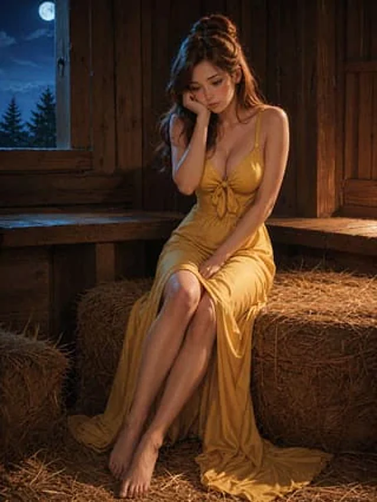

```text
A cinematic, realistic portrait depicts a young woman sitting barefoot on a rectangular bundle of hay in a rural wooden barn at night. She wears a flowing mustard-yellow satin dress with thin straps, a deep neckline, and a small bow at the center of the chest. The fitted waist and long, cascading skirt spread across the straw-covered ground. Her long, wavy, auburn hair is loosely tied in a half-updo, with a few strands falling softly over her shoulders. Her pose is elegant and dignified: her legs are crossed at the ankles and extended forward, one hand resting near her knee, the other raised to gently veil her face. Warm golden light from the right illuminates her skin and dress, creating soft highlights and deep shadows, while cool blue moonlight streams through a small window on the left. Outside, a bright full moon hangs in the deep blue night sky, and the silhouettes of pine trees can be seen. The barn's interior is constructed of dark-stained vertical wooden planks, with built-in benches along the walls and scattered straw on the floor. Two bundles of hay are visible, including the one she's sitting on. The composition uses a full-body vertical angle, with the subject slightly tilted to the right of the frame. The shallow depth of field creates a private and melancholic atmosphere. The skin and fabric textures are richly detailed, exhibiting editorial-grade fashion photography quality and a soft, cinematic contrast.
```

Model: GPT Image 2
Author: GPT Image 2 Prompts

[ProjectD](https://aitoolsradar.com/en/prompts/34d997a655c2cd) · [Recorded source](https://x.com/agi_exec/status/2047541842091057262#reversed-0)
 · [Full original metadata and byte evidence](data/projectd-batch-0040.json)

## Moonlit Cat Princess Fairy-Tale Card

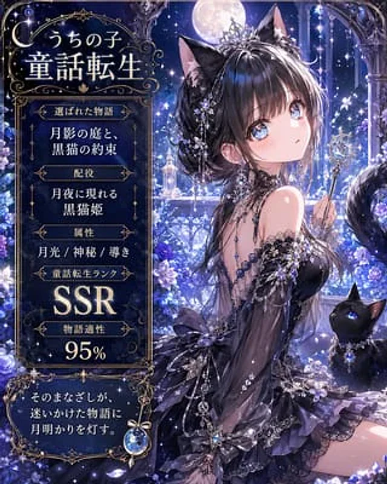

```text
Goal: Create a vertical fantasy anime story-card poster that transforms {argument name="character name" default="うちの子"} into a personalized fairy-tale heroine, with an ornate gothic-luxury interface panel on the left and a detailed character illustration on the right.

Canvas: Portrait 4:5 composition, high-resolution, dark midnight blue and silver palette, luminous moonlit atmosphere, sparkling magical particles, ornate gold filigree borders, elegant Japanese fantasy gacha-card design.

Layout: Split composition with two main zones. Left third is an information panel framed by thin gold ornamental lines and curling Art Nouveau flourishes. Right two-thirds is a full-body/three-quarter anime illustration set in a moonlit palace garden balcony. Add a large full moon near the top center, starry sky, crystal columns, hanging jewels, blue flowers, glowing petals, and deep perspective into a magical castle courtyard.

Text content: Use Japanese typography in glowing ivory-gold serif style. Top title inside the left panel reads 「うちの子」 above large 「童話転生」. Below it, create exactly 5 stacked information sections with small gold-framed label plaques and centered values: 1) label 「選ばれた物語」, value 「月影の庭と、黒猫の約束」; 2) label 「配役」, value 「月夜に現れる 黒猫姫」; 3) label 「属性」, value 「月光 / 神秘 / 尊き」; 4) label 「童話転生ランク」, value 「SSR」 in very large glowing letters; 5) label 「物語適性」, value 「95%」 in large numerals. At the bottom, add a separate ornate caption box containing 「そのまなざしが、迷いかけた物語に 月明かりを灯す。」 with a small crescent-moon jewel charm hanging from the frame.

Subject details: The main character is an elegant anime cat princess with {argument name="hair color" default="glossy black hair"}, long layered hair, black cat ears, a jeweled silver tiara, crystal hair ornaments, dangling chains, blue gemstones, and a mysterious refined expression; leave the face area optionally unobstructed unless the user requests privacy masking. She wears a black and dark violet off-shoulder gothic-lolita evening dress with lace, translucent sleeves, layered ruffles, ribbons, silver embroidery, floral appliqués, and many sapphire-like jewels. She holds a delicate crescent-moon wand in one hand. Include a glossy black cat companion with bright blue eyes and a jeweled collar sitting near her side. Include a fluffy black cat tail behind the heroine.

Visual style: Ultra-detailed Japanese anime illustration, romantic fairy-tale reincarnation theme, luxurious gacha SSR card aesthetic, moonlight rim lighting, blue-white sparkles, ornate gold linework, luminous flowers, soft bloom, intricate jewelry, elegant melancholy mood, highly polished digital painting.

Constraints: Countable elements must remain exact: 1 main heroine, 1 black cat companion, 1 crescent wand, 1 large moon, 5 information sections, 1 bottom quote box. Do not add extra UI panels, extra animals, logos, watermarks, or modern objects. Keep all visible text crisp and placed only in the left panel and bottom caption box.
```

Model: GPT Image 2
Author: のぞむ＊AIイラスト

[ProjectD](https://aitoolsradar.com/en/prompts/d4b9b3424422e6) · [Recorded source](https://youmind.com/prompts/moonlit-cat-princess-card-25846)
 · [Full original metadata and byte evidence](data/projectd-batch-0040.json)

## Moonlit Celestial Kimono Dancer

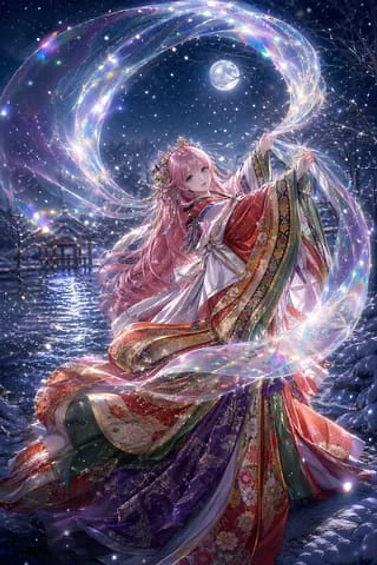

```text
A stunning fantasy anime illustration depicting{argument name="character name" default="A celestial witch"} Against the backdrop of a snowy night landscape, she stood gracefully on the shimmering lakeshore, her entire body swaying in a dance-like pose. She possessed an exceptionally long, flowing {argument name="hair color" default="Rose Pink"} Her hair, partially visible from the back and sides, is adorned with delicate gold floral ornaments and dangling chains. Her face is mostly obscured by the angle. She wears a magnificent, multi-layered Japanese court kimono inspired by the twelve-layered kimono, with wide sleeves and tiered lapels interwoven with crimson, pure white, purple, green, gold, and soft pink, decorated with floral brocade, embroidered flowers, metallic trim, and shimmering patterns. She gracefully raises her arms, as if guiding two enormous, translucent, iridescent ribbons or magical silks, which swirl around her in luminous circles, capturing rainbow highlights like the aurora borealis. The ribbons emit prism-like reflections and tiny sparks, setting her against the backdrop of the celestial sky. The background is a moonlit lake shore covered in fresh snow; to the right, bare winter trees; to the left, across the water, a traditional pavilion or shrine; a bright full moon hangs in the deep indigo sky, studded with stars, and snowflakes drift lightly down. The lake reflects the moonlight and shimmering particles. Emphasizing cinematic lighting and shadows, an ethereal atmosphere, ultra-fine fabric textures, dynamic fluidity, magical shimmering effects, elegant composition, and a dreamlike celestial ambiance. High-quality anime key visuals, vertical composition, intricate details, striking highlights, no text, and no watermark.
```

Model: GPT Image 2
Author: GPT Image 2 Prompts

[ProjectD](https://aitoolsradar.com/en/prompts/44be1ff1d79cda) · [Recorded source](https://x.com/NeneneAI/status/2046507711064572013#reversed-0)
 · [Full original metadata and byte evidence](data/projectd-batch-0040.json)

## Moonlit Tiger and Rose Fantasy Poster

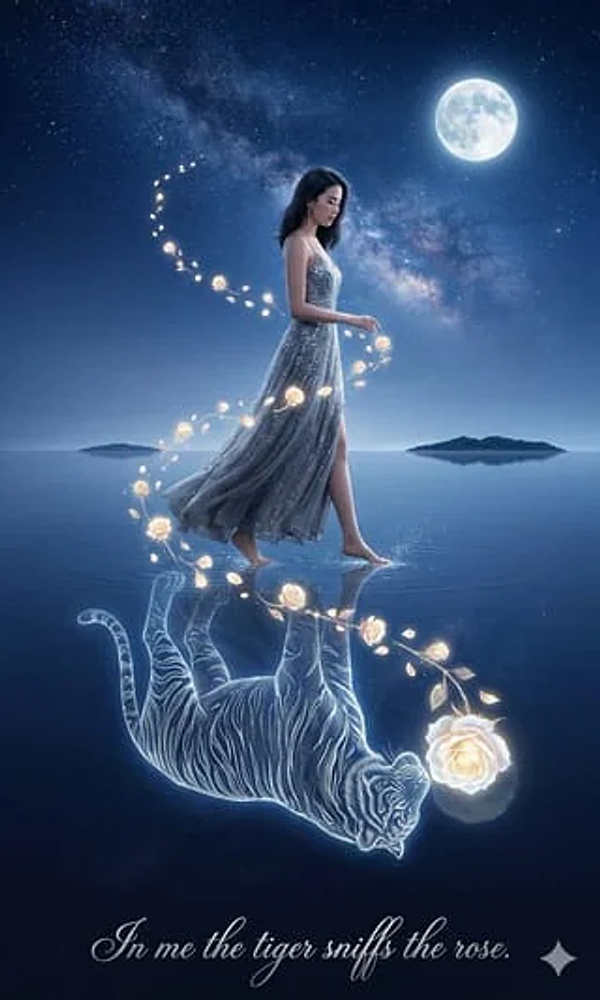

```text
A dreamlike, cinematic fantasy illustration, presented in a vertical poster format. The image showcases {argument name="celebrity model" default="Liu Yifei"} Her profile was silhouetted against the backdrop of a silver, mirror-like lake at midnight. A bright full moon and a richly detailed starry sky hung overhead, the Milky Way stretching diagonally behind her. She was an elegant East Asian woman with shoulder-length black hair, wearing a flowing, high-slit silver sleeveless evening gown that shimmered like stardust. Her expression was serene and introspective, facing to her right, one foot touching the water, creating delicate, luminous ripples. On either side of the horizon, low islands accentuated the vast expanse of water and sky. A luminous, soft white rose vine, its graceful S-curve winding around her, began above her back, spiraled over her waist and legs, and extended downwards into her reflection in the water. Beneath the surface, the reflection was not an ordinary mirror, but a gigantic, luminous tiger composed of slender, neon-colored lines, inverted from the woman above. The tiger's body was dynamically coiled, its head near a large, luminous white rose in the lower right corner; the tiger appeared majestic, lean, and ethereal, rather than aggressive. The overall color scheme is cool blue, silver, and white, accompanied by soft moonlight, halo effects, mirror reflections, magical realism, minimalist composition, and high detail, creating a romantic and fantastical atmosphere. Elegant cursive text is added to the center of the bottom.{argument name="quote" default="A tiger in the heart, yet a rose in the hand."} A small four-pointed star icon was added to the bottom right corner. The overall style is exquisite and poetic, visually symbolizing inner strength and gentleness.
```

Model: GPT Image 2
Author: GPT Image 2 Prompts

[ProjectD](https://aitoolsradar.com/en/prompts/31b4617a3a9f51) · [Recorded source](https://x.com/NemoZhuge/status/2047677282467377311#reversed-0)
 · [Full original metadata and byte evidence](data/projectd-batch-0040.json)

## Moonlit Woman and Tiger Reflection

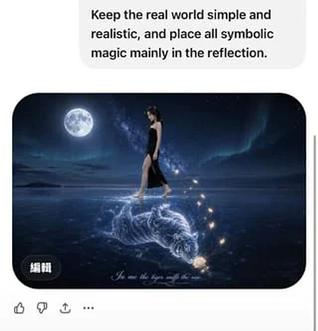

```text
A surreal, photorealistic night scene: a vast, calm, mirror-like expanse of water against a deep, star-studded sky. A bright full moon hangs in the upper left, with the Milky Way and faint blue-green aurora extending into the background. In the real world, everything remains simple and realistic: a slender woman with shoulder-length dark hair walks barefoot across the water from left to right, wearing a {argument name="dress color" default="black"} She wore an elegant, slit evening gown. Her posture was natural and composed, her face softly blurred or out of focus. The water was smooth as a mirror, with subtle ripples and a realistic moonlight reflection. The symbolic magic was primarily placed in the reflection: at her feet, instead of a normal reflection, a luminous, ethereal blue-white line art tiger appeared in the water, its body curled up, shimmering like energy or moonlight. The tiger was sniffing or approaching a luminous rose near the lower right corner of the reflection. Around the rose, six tiny, rising, luminous butterfly-shaped points of light were added, forming soft arcs. The work employed cinematic lighting, high contrast, cool blue tones, a dreamlike atmosphere, ultra-refined reflection effects, and a clean, artistic fantasy photography style. A delicate cursive title was added at the center of the bottom edge of the image, containing the following text:{argument name="caption text" default="In me the tiger sniff the rose."} The composition uses rounded corners to present the aesthetic appeal of a vertical social media screenshot, but the main artwork should be the visual focal point.
```

Model: GPT Image 2
Author: GPT Image 2 Prompts

[ProjectD](https://aitoolsradar.com/en/prompts/36bae613f26103) · [Recorded source](https://x.com/NemoZhuge/status/2047298096854708691#reversed-0)
 · [Full original metadata and byte evidence](data/projectd-batch-0040.json)

## Moonlit Woman and Tiger Reflection

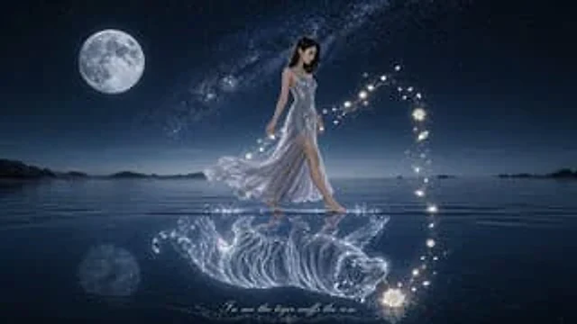

```text
A dreamlike, cinematic, fantastical night scene, with a deep indigo starry sky as the backdrop, the calm sea reflecting everything like a mirror. A huge full moon hangs in the upper left, and the Milky Way stretches diagonally across the entire background. In the center of the image, a slender woman with {argument name="hair color" default="black"} Her long, straight hair flowed freely as she walked barefoot across the shallow, mirror-like water, her elegant profile silhouetted against the light. She wore a shimmering, semi-transparent silver evening gown, its tight bodice sparkling, its thin straps creating a flowing, light skirt with a high slit revealing one leg, the hem swaying gently in the breeze. To her right, a curved arc of magical particles formed a crescent-shaped trajectory, composed of glowing white roses, petals, and tiny specks of light, rising from the water near her reflection and swirling upwards beside her. Below her, a fantastical reflection shone on the water: a glowing, transparent white tiger lay on its side, its form like liquid light and stardust, with bright stripes and a softly luminous face. The water, smooth as glass, rippled delicately, clearly reflecting the woman, the moon, the stars, and the magical light. Low, dark islands sat on the distant horizon. At the bottom center, elegant, glowing cursive script was added.{argument name="quote" default="A tiger in the heart, yet a rose in the gentle scent."} Ultra-refined, ethereal, poetic, and realistic fantasy art; soft moonlight, cool color palette, high contrast, soft lighting effect, mysterious atmosphere, and widescreen composition.
```

Model: GPT Image 2
Author: GPT Image 2 Prompts

[ProjectD](https://aitoolsradar.com/en/prompts/34dd799b579409) · [Recorded source](https://x.com/NemoZhuge/status/2047348609985994853#reversed-0)
 · [Full original metadata and byte evidence](data/projectd-batch-0040.json)

## Morning Run Benefits Infographic

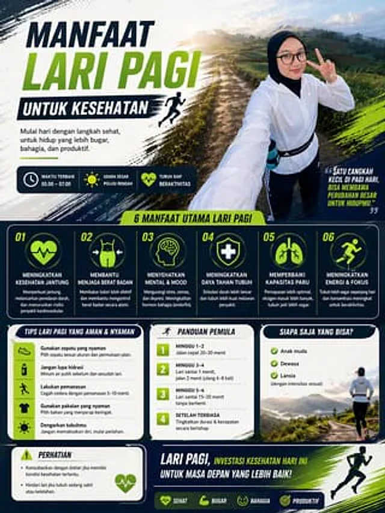

```text
{
  "type": "Fitness and health infographic poster",
  "topic": "{argument name=\"headline text\" default=\"Benefits of morning running\"}",
  "language": "Chinese",
  "style": {
    "look": "Simple and modern sports infographic",
    "palette": [
      "Navy Blue",
      "Bright green",
      "White",
      "Yellow accents"
    ],
    "finish": "High-contrast, sophisticated posters suitable for social media",
    "graphics": "Bold italic compressed headings, brushstroke textures, rounded dark panels, clean vector fitness icons, and vibrant diagonal decorations."
  },
  "canvas": {
    "aspect_ratio": "3:4",
    "background": "The layout is divided into left and right sections. The left side features a white textured graphic design, while the right side shows a photo of a country jogging trail at sunrise."
  },
  "main_visual": {
    "subject": "{argument name=\"main subject\" default=\"A woman taking a selfie while running\"}",
    "appearance": "Wearing a white windbreaker, dark trousers, and a dark headscarf, with a water bottle tied around his waist, he made a peace sign with one hand.",
    "placement": "Top right corner, overlapping with the landscape background",
    "background_scene": "Golden morning light spills onto the dirt path that winds through green hills and fields."
  },
  "layout": {
    "sections": [
      {
        "title": "Health benefits of morning running",
        "position": "Top left main visual area",
        "count": 1,
        "labels": [
          "Heading paragraphs with subheadings"
        ]
      },
      {
        "title": "Quick Benefits",
        "position": "upper middle left",
        "count": 3,
        "labels": [
          "Best time: 05:00 – 07:00",
          "Fresh air and less pollution",
          "Wake up your body and start your day with energy!"
        ]
      },
      {
        "title": "6 Core Benefits of Morning Running",
        "position": "Center wide panel",
        "count": 6,
        "labels": [
          "01 Improve heart health",
          "02 Helps maintain weight",
          "03 Improve mental health and mood",
          "04 Boost Immunity",
          "05. Improve lung capacity",
          "06 Boost Energy and Focus"
        ]
      },
      {
        "title": "Recommendations for safe and comfortable morning runs",
        "position": "card in the lower left corner",
        "count": 5,
        "labels": [
          "Wearing comfortable sneakers",
          "Remember to drink water.",
          "Warm up thoroughly",
          "Wearing comfortable sportswear",
          "Listen to your body's feedback"
        ]
      },
      {
        "title": "Beginner's Guide",
        "position": "Middle and lower cards",
        "count": 4,
        "labels": [
          "Week 1: Brisk walking 1–2 times, 20–30 minutes each time.",
          "Week 2: Jog for 1 minute, brisk walk for 2 minutes (repeat 6–8 times), 3–4 times per week.",
          "Week 3: Jog slowly for 15–20 minutes, 5–6 times per week.",
          "Week 4 and beyond: Gradually increase duration and speed according to your habits."
        ]
      },
      {
        "title": "Suitable for",
        "position": "Card in the bottom right corner",
        "count": 3,
        "labels": [
          "young people",
          "Adults",
          "For older adults (adjust intensity according to your own situation)"
        ]
      },
      {
        "title": "Precautions",
        "position": "bottom left corner prompt box",
        "count": 2,
        "labels": [
          "If you have any specific health conditions, please consult your doctor.",
          "Avoid running if you are feeling unwell or extremely fatigued."
        ]
      },
      {
        "title": "Bottom slogan banner",
        "position": "Bottom center to right side",
        "count": 4,
        "labels": [
          "healthy",
          "strong",
          "hapiness",
          "High efficiency"
        ]
      }
    ],
    "quote": {
      "text": "{argument name=\"quote\" default=\"A small step you take in the morning can make a huge difference in your life.\"}",
      "position": "Above the dark overlay on the right, closer to the main visual character."
    }
  },
  "text_blocks": {
    "intro": "Start your day with a healthy routine and make your life healthier, happier, and more productive.",
    "closing": "Going for a run in the morning is a health investment you make for a better future version of yourself!"
  },
  "iconography": {
    "count": 21,
    "items": [
      "Running silhouette near the title",
      "Clock icon",
      "Sun icon",
      "Heart/Fitness Icon",
      "Heart rate icon",
      "Waist/Body Icon",
      "Brain icon",
      "Medical shield icon",
      "Lung icon",
      "Running figure icon",
      "sneaker icon",
      "Kettle icon",
      "Stretching/Warm-up Icons",
      "sweatshirt icon",
      "Sun/Weather Icon",
      "The little running icon above the beginner's guide",
      "The three green checkmarks on the qualification card",
      "Warning triangle icon",
      "Heart rate badge in the notification box",
      "The silhouette of the runner in the bottom right corner"
    ]
  },
  "composition_notes": "The bold, oversized, bright green title, navy blue title bar with white text, each section enclosed within a rounded rectangular card, six core benefits evenly distributed, combined with a realistic outdoor background and vector infographic elements, and dynamic ink-splatter effects in navy blue and bright green at the corners—a sophisticated Indonesian health poster aesthetic.",
  "rendering": "Clear typesetting, editor-level layout, clean spacing, and easy-to-read information layers."
}
```

Model: GPT Image 2
Author: GPT Image 2 Prompts

[ProjectD](https://aitoolsradar.com/en/prompts/75a31008022af8) · [Recorded source](https://x.com/nurayuofficial/status/2047811472928207215#reversed-0)
 · [Full original metadata and byte evidence](data/projectd-batch-0040.json)

## Moroccan Restaurant Brand Board

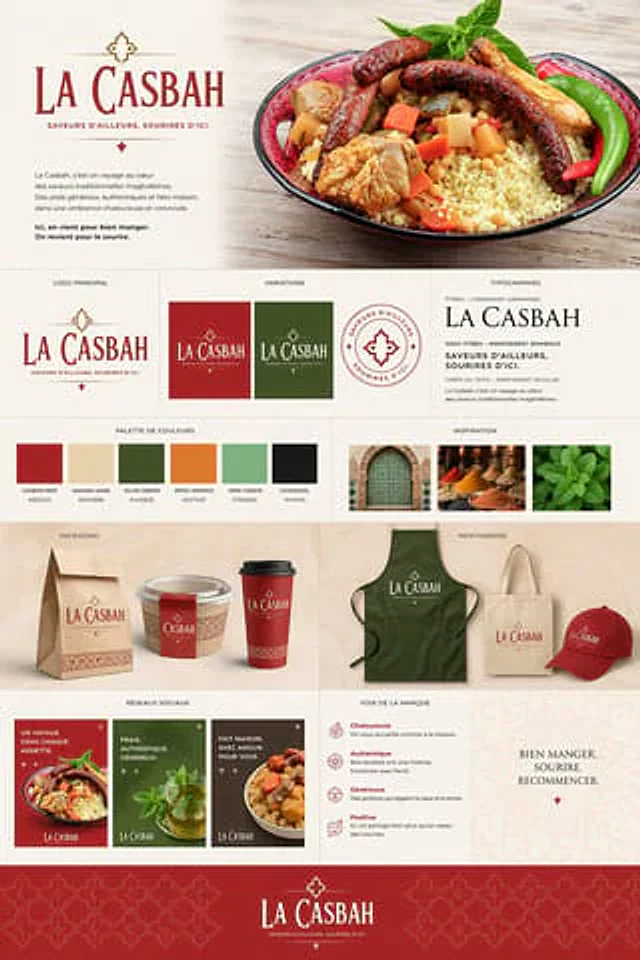

```text
Using the provided reference image of a North African millet (couscous) dish as the main visual food photo, it was transformed into a dish called {argument name="restaurant name" default="La Casbah"} This is a beautifully designed branding project for a Moroccan restaurant. While maintaining the recognizability of the dishes themselves, the restaurant uses its name as the main visual element in the upper right corner, and builds a complete, high-quality brand presentation around it within a warm beige editorial layout, incorporating sophisticated Moroccan design elements. A brand section is added in the upper left corner, displaying the restaurant name in a large serif font, topped with a small geometric logo and the French phrase "SAVEURS D'AILLEURS, SOURIRES D'ICI." Below this is a brief French brand introduction and a striking closing statement. A structured brand guide grid was then created, comprising nine sections: 1) “LOGO PRINCIPAL”: Displaying the main logo on a light background; 2) “VARIATIONS”: Showcasing three logo variations—a red square, a green square, and a circular stamp version; 3) “TYPOGRAPHIES”: Showcasing three font styles—headings, subheadings, and body text; 4) “PALETTE DE COULEURS”: Showcasing six color blocks, labeled Casbah Red, Sahara Sand, Olive Green, Spice Orange, Mint Green, and Charcoal, with hexadecimal color codes; 5) “INSPIRATION”: Showcasing three image sections—Moroccan arch tiles, colorful spices, and fresh mint leaves; 6) “PACKAGING”: Showcasing three mockups—a paper takeaway bag, a sealed bowl, and a takeaway coffee cup; 7) “MERCHANDISE”: Showcasing three mockups—an apron, a tote bag, and a baseball cap; 8) “RÉSEAUX”: Showcasing… “SOCIAUX”: Showcases 3 social media post designs using food and ingredient images accompanied by brief French marketing copy; 9) “VOIX DE LA MARQUE”: Showcases 4 brand tone characteristics and brief French descriptions. A minimalist quote box is added to the right, stating “BIEN MANGER. SOURIRE. RECOMMENCER.” The presentation concludes with a full-width deep red footer, centered on the logo and adorned with subtle Moroccan geometric patterns. Overall aesthetics: Luxury restaurant brand project, concise agency presentation, unified Moroccan visual identity, elegant typography, realistic mockups, soft, natural textures, and editorial-grade spacing.
```

Model: GPT Image 2
Author: GPT Image 2 Prompts

[ProjectD](https://aitoolsradar.com/en/prompts/1ecaac945d98dc) · [Recorded source](https://x.com/SitgesFranck/status/2047165798595141875#reversed-1)
 · [Full original metadata and byte evidence](data/projectd-batch-0040.json)

## Mother's Day Flower Gift Promotional Banner


```text
{
  "type": "Promotional banner ads",
  "theme": "Mother's Day Flowers and Gifts",
  "visual_style": "Soft, elegant, feminine, and muted colors, with pink petals scattered in the background.",
  "imagery": {
    "bouquet": "a big bunch{argument name=\"color theme\" default=\"pink\"} Carnations and roses, wrapped in pink paper and tied with ribbons, are placed on the right side.",
    "tag": "A white rectangular tag hanging on the bouquet, with the words '{argument name=\"tag text\" default=\"Thank you, Mom!\"} And it is decorated with a heart."
  },
  "layout": {
    "main_typography": {
      "position": "Top left to middle left",
      "top_arch": "To my dearest mother,",
      "sub_arch": "Entrusting gratitude to the flowers.",
      "headline_1": "exist{argument name=\"main event\" default=\"Mother&#39;s Day\"}",
      "headline_2": "Send one{argument name=\"product name\" default=\"Flowers and Gifts\"}",
      "headline_3": "Expressing feelings"
    },
    "details_section": {
      "position": "The bottom left corner above the footer",
      "badge": "A round badge with the text '{argument name=\"event date\" default=\"5.12\"} Sunday Mother's Day",
      "description_text": "Infuse your gratitude into the flowers, making this special day even more vibrant and colorful."
    },
    "footer": {
      "position": "bottom edge",
      "style": "White horizontal stripes",
      "count": 3,
      "items": [
        {
          "icon": "delivery truck",
          "text": "Nationwide delivery supported",
          "subtext": "※Except for some areas"
        },
        {
          "icon": "gift box",
          "text": "Free gift wrapping"
        },
        {
          "icon": "calendar",
          "text": "Orders placed before May 10th (Friday) will be delivered on Mother's Day."
        }
      ]
    }
  }
}
```

Model: GPT Image 2
Author: GPT Image 2 Prompts

[ProjectD](https://aitoolsradar.com/en/prompts/46888c2a9810d1) · [Recorded source](https://x.com/panchaaan_2/status/2046107762686652666#reversed-0)
 · [Full original metadata and byte evidence](data/projectd-batch-0040.json)

## Move Display Stand Onto Deck

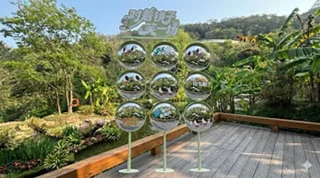

```text
Using the provided reference image, maintain the same perspective of the garden, pond, trees, hillside, and wooden terrace, but reposition the decorative signage installation to stand on the foreground wooden terrace, rather than in the water. Enlarge it and place it more prominently in the center of the shot, while preserving realistic outdoor perspective, natural daylight, and consistent shadows. Keep the installation structure as 9 circular signage panels in 3 columns and 3 rows, placed on slender green supports, with the top title bar reading “Laugh in the Mirror.” Make the panels appear more reflective and mirror-like, realistically reflecting the surrounding greenery, while retaining the cute emojis and Chinese characters on the circular panels. The final result should be a realistic advertising mockup/composite photograph demonstrating the installation correctly placed in the scene.
```

Model: GPT Image 2
Author: GPT Image 2 Prompts

[ProjectD](https://aitoolsradar.com/en/prompts/4566e1261a2312) · [Recorded source](https://x.com/xiaojietongxue/status/2046739970283724964#reversed-3)
 · [Full original metadata and byte evidence](data/projectd-batch-0040.json)

## Mr Das #172

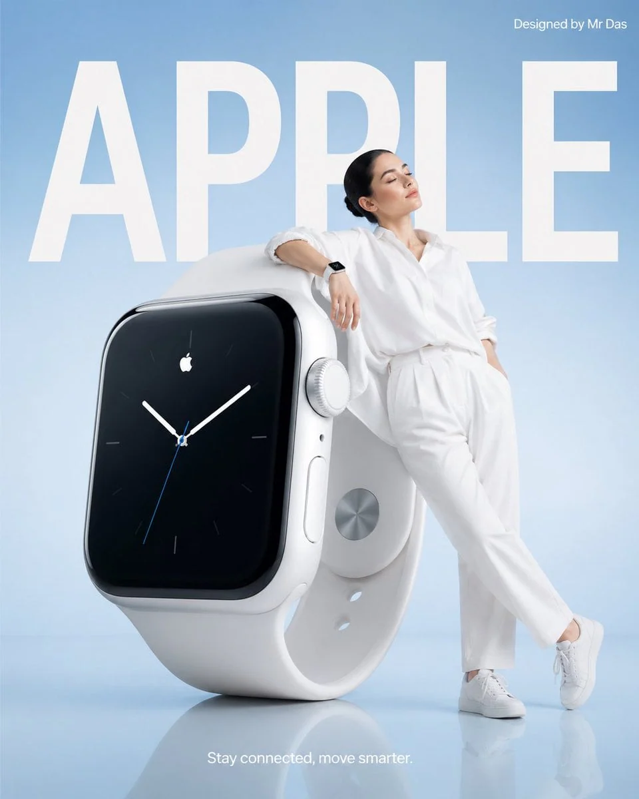

```text
Minimalist commercial ad featuring oversized white smartwatch, ultra-clean design. A young woman in all-white outfit leans casually against the giant watch, relaxed confident pose, eyes closed, also wearing the same smartwatch on her wrist. Soft gradient blue background with large bold white “APPLE” text behind. Glossy reflective floor, soft studio lighting, modern high-end fashion/product photography. Small top-right text “Designed by Mr Das”. Bottom center tagline in small white font: “Stay connected, move smarter.”
```

Model: GPT Image 2
Author: Mr Das

[ProjectD](https://aitoolsradar.com/en/prompts/b8ec0d662aee8c) · [Recorded source](https://x.com/MrDasOnX/status/2048643867222962518)
 · [Full original metadata and byte evidence](data/projectd-batch-0040.json)

## Multi-Angle Character Reference Sheet

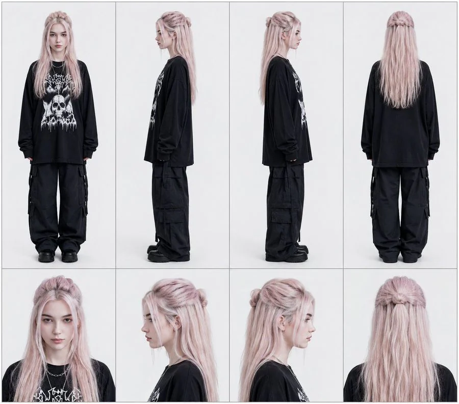

```text
Create a professional character reference sheet of {argument name="source" default="uploaded image"}. Arrange into {argument name="columns" default="four vertical columns"}, each representing one viewing angle. Each column contains a full-body view on top and a matching close-up portrait directly beneath it. Columns (left → right): Column 1: front view (full body above, front portrait below) Column 2: left profile (fullbody character facing left) with portrait facing left below Column 3: right profile (fullbody character facing right) with portrait facing right below Column 4: back view, with matching portrait below. Maintain even spacing and framing around the character portraits. Clean silhouette, consistent alignment, and clean panel separation. No Text. Thin borders. Flat lighting
```

Model: GPT Image 2
Author: 𝗦𝗮𝗻𝗶𝗮

[ProjectD](https://aitoolsradar.com/en/prompts/b19327d7b2bacb) · [Recorded source](https://youmind.com/prompts/character-reference-sheet-layout-20199)
 · [Full original metadata and byte evidence](data/projectd-batch-0040.json)

## Multi-Angle Studio Character Sheet

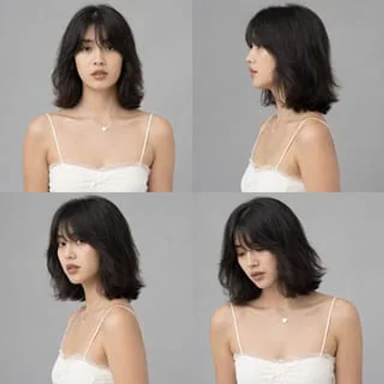

```text
Using the provided reference image, generate a {argument name="number of panels" default="4"} Character design sketches in the style of a professional studio. The black and white reference images were converted to full color, with natural skin tones and black hair applied. The original environment was removed, and the subject was placed in a more natural setting.{argument name="background color" default="pure gray"} In this context, in coordination{argument name="lighting style" default="Clean, neutral studio lighting"} The generated mesh must display the exact same character, wearing the same white lace camisole and heart-shaped necklace, presented in a specific way.{argument name="number of panels" default="4"} Different poses: 1) front view, 2) right side view, 3) left 3/4 view (looking back), and 4) right 3/4 view (slightly bowing).
```

Model: GPT Image 2
Author: GPT Image 2 Prompts

[ProjectD](https://aitoolsradar.com/en/prompts/ee62b9d21a0b95) · [Recorded source](https://x.com/D_studioproject/status/2045743293284180465#reversed-0)
 · [Full original metadata and byte evidence](data/projectd-batch-0040.json)

## Multi-Concept Battle Poster Set

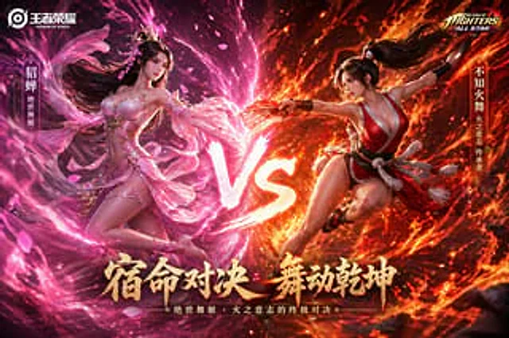

```text
1、生成不知火舞和貂蝉的游戏对战海报图
2、生成一张K-pop团体时尚专辑封面
3、请你生成 《斗破苍穹》 的关键人物关系图
4、帮我截一张上传图片的抖音首页的女网红图
```

Model: GPT Image 2
Author: @joshesye

[ProjectD](https://aitoolsradar.com/en/prompts/40ced7fd720335) · [Recorded source](https://x.com/joshesye/status/2046493442428039212)
 · [Full original metadata and byte evidence](data/projectd-batch-0040.json)

## Multi-Exposure Indian Woman Fashion Poster

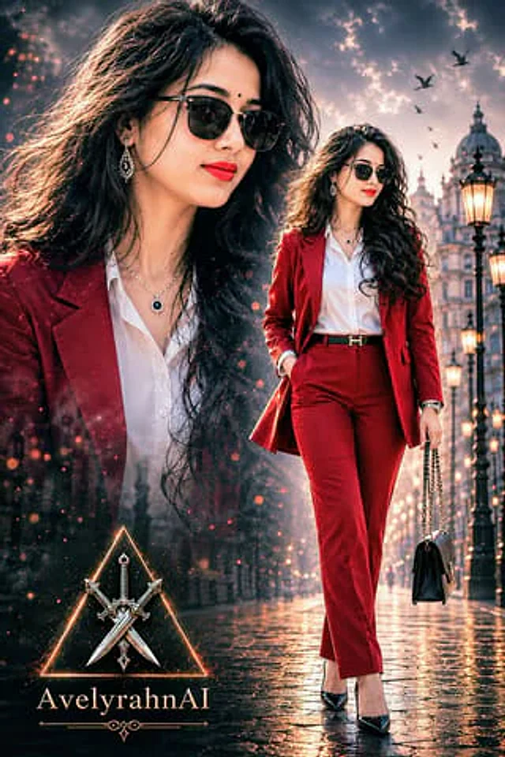

```text
multi-exposure poster design featuring an {argument name="subject" default="Over-sized body young Indian woman"} portrait. wavy shoulder hair bouncy part of the middle of hair,, wearing dark sunglasses, {argument name="outfit" default="red formal coat pant with white shirt"} , and a silver chain necklace with black heels. The composition features a large, expressive close-up portrait of the woman left, blending into a full-body shot of the same women walking confidently forward on the right, photography like model .The background is a dramatic, ethereal scene In the left bottom corner add a small triangle with a stylized "⚔️" inside it and a text "{argument name="text" default="AvelyrahnAi"}" beneath it. Keep the face 100% same as in the uploaded picture. Over-sized body portrait.
```

Model: GPT Image 2
Author: Avelyrah

[ProjectD](https://aitoolsradar.com/en/prompts/65fd1d14b97de1) · [Recorded source](https://youmind.com/prompts/indian-woman-multi-exposure-poster-23585)
 · [Full original metadata and byte evidence](data/projectd-batch-0040.json)

## Multi-Frame Banner Advertisement


```text
Create a containing{argument name="layout" default="Four frames"} of{argument name="dimensions" default="300x250"} Banner advertisement image, product is{argument name="product" default="Ozempic"}
```

Model: GPT Image 2
Author: GPT Image 2 Prompts

[ProjectD](https://aitoolsradar.com/en/prompts/656fa23b4455ec) · [Recorded source](https://x.com/_simonsmith/status/2046680113643761861)
 · [Full original metadata and byte evidence](data/projectd-batch-0040.json)

## Multi-industry Japanese Ad Collage

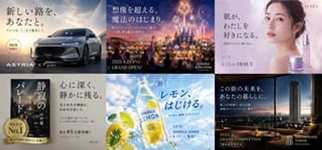

```text
A fictional Japanese advertisement. It uses a horizontal 6-panel layout to showcase {argument name="industry list" default="The automotive industry (new car launches), theme parks (new events), cosmetics industry (new products), book industry (bestsellers), beverage industry (new drinks), and real estate industry (luxury apartment introductions)."} The advertisement was created by top creators using the latest trendy styles.
```

Model: GPT Image 2
Author: GPT Image 2 Prompts

[ProjectD](https://aitoolsradar.com/en/prompts/64092d8e778351) · [Recorded source](https://x.com/Aki_LIG/status/2046737496118268058)
 · [Full original metadata and byte evidence](data/projectd-batch-0040.json)

## Multi-page Brand Kit Generator


```text
for{argument name="brand name" default="___________"} Create a beautiful multi-page (multi-image) branding toolkit
```

Model: GPT Image 2
Author: GPT Image 2 Prompts

[ProjectD](https://aitoolsradar.com/en/prompts/1c7f0971d73a2f) · [Recorded source](https://x.com/jameygannon/status/2046709371007058096)
 · [Full original metadata and byte evidence](data/projectd-batch-0040.json)

## Multi-page Brand Kit Generator

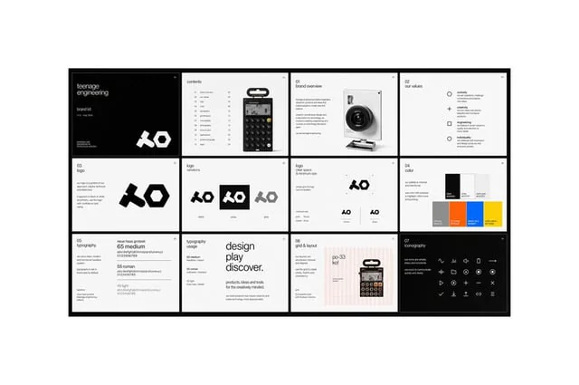

```text
Create a polished multi-page (multiple images) brand kit for {argument name="brand name" default="___________"}
```

Model: GPT Image 2
Author: techbimbo

[ProjectD](https://aitoolsradar.com/en/prompts/f149372f0d9dcd) · [Recorded source](https://youmind.com/prompts/multi-page-brand-kit-14382)
 · [Full original metadata and byte evidence](data/projectd-batch-0040.json)

## Multi-Panel Comic Book Page

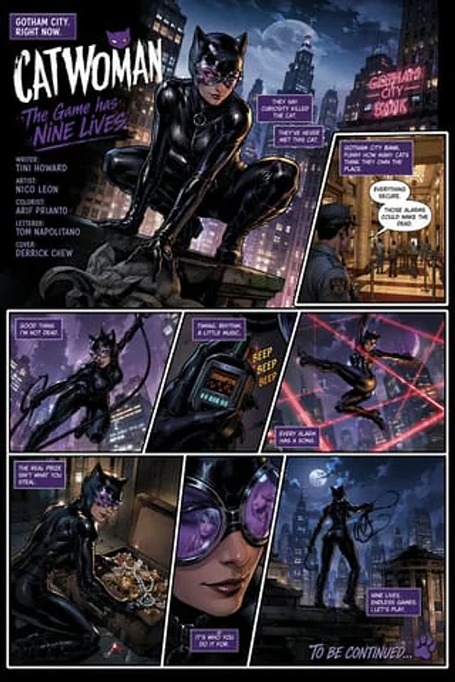

```text
{
  "type": "Comic page",
  "style": "Modern American comic book style, dynamic lighting and shadows, richly detailed backgrounds, and a purple and black color scheme.",
  "character": "{argument name=\"character description\" default=\"A female cat thief wearing a black latex bodysuit, cat ears, and purple goggles\"}",
  "layout": {
    "structure": "3-layer layout, 7 independent storyboards",
    "panels": [
      {
        "position": "Top floor, full width",
        "scene": "The character crouches atop a gargoyle statue, overlooking the vast nighttime cityscape.",
        "text_elements": [
          {
            "type": "Location box",
            "text": "{argument name=\"city name\" default=\"Gotham City\"} At this very moment."
          },
          {
            "type": "Main title",
            "text": "{argument name=\"main title\" default=\"Catwoman\"}"
          },
          {
            "type": "subtitle",
            "text": "{argument name=\"subtitle\" default=\"The game has nine lives.\"}"
          },
          {
            "type": "Production staff",
            "text": "Scriptwriter: TINI HOWARD, Illustrator: NICO LEON, Colorist: ARIF PRIANTO, Font: TOM NAPOLITANO, Cover Designer: DERRICK CHEW"
          },
          {
            "type": "Narration box",
            "count": 2,
            "text": [
              "People often say that curiosity killed the cat.",
              "But they had never seen the cat."
            ]
          }
        ],
        "inset_panel": {
          "scene": "Inside the bank, there is a security guard.",
          "text_elements": [
            {
              "type": "Narration box",
              "text": "{argument name=\"city name\" default=\"Gotham City\"} A bank. How amusing, how many cats think they're the masters here."
            },
            {
              "type": "speech bubbles",
              "count": 2,
              "text": [
                "Everything is normal.",
                "These alarms are loud enough to wake a dead person."
              ]
            }
          ]
        }
      },
      {
        "position": "Middle layer, left side",
        "scene": "The character swings a long whip through the night sky.",
        "text_elements": [
          {
            "type": "Narration box",
            "text": "Luckily, I'm still alive."
          }
        ]
      },
      {
        "position": "Middle level, central",
        "scene": "Close-up of a gloved hand holding hacking equipment",
        "text_elements": [
          {
            "type": "Narration box",
            "text": "Timing. Rhythm. A little music."
          },
          {
            "type": "Device screen",
            "text": "jammer"
          },
          {
            "type": "Sound effects",
            "text": "Beep beep beep"
          }
        ]
      },
      {
        "position": "Middle layer, right side",
        "scene": "The character dodges the red laser net with acrobatic moves.",
        "text_elements": [
          {
            "type": "Narration box",
            "text": "Every alarm has its own melody."
          }
        ]
      },
      {
        "position": "Bottom layer, left side",
        "scene": "The character opens a wooden box filled with jewels and pearls.",
        "text_elements": [
          {
            "type": "Narration box",
            "text": "The real reward is not what you stole."
          }
        ]
      },
      {
        "position": "bottom layer, central layer",
        "scene": "An extreme close-up of the character's smiling face, with two figures reflected in the goggles.",
        "text_elements": [
          {
            "type": "Narration box",
            "text": "It depends on who you are doing it for."
          }
        ]
      },
      {
        "position": "Bottom layer, right side",
        "scene": "The character stands on the edge of the rooftop, holding a long whip, gazing at the full moon.",
        "text_elements": [
          {
            "type": "Narration box",
            "text": "Nine lives. An endless game. Come and play."
          },
          {
            "type": "footer",
            "text": "{argument name=\"ending text\" default=\"To be continued...\"} Includes a purple cat paw print icon."
          }
        ]
      }
    ]
  }
}
```

Model: GPT Image 2
Author: GPT Image 2 Prompts

[ProjectD](https://aitoolsradar.com/en/prompts/4fd4b4b2a9d2b0) · [Recorded source](https://x.com/HbTteok/status/2044241756523507788#reversed-3)
 · [Full original metadata and byte evidence](data/projectd-batch-0040.json)

## Multi-Panel Comic Book Page

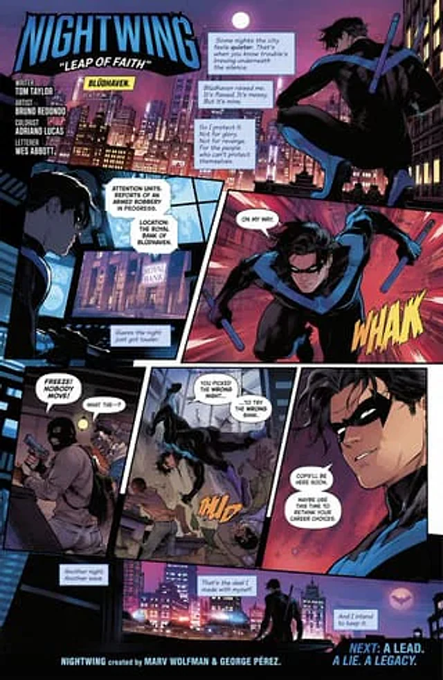

```text
{
  "type": "Comic page",
  "style": "Modern American comic book style, dynamic composition, neon night scene lighting effects.",
  "character": "{argument name=\"hero description\" default=\"A sporty male vigilante dressed in a black bodysuit, adorned with a blue bird badge and a domino mask, wielding two short batons.\"}",
  "layout": {
    "description": "7. A grid layout with overlapping elements and text boxes.",
    "panels": [
      {
        "position": "Top width",
        "scene": "The protagonist crouches atop a gargoyle statue on a rooftop, overlooking the neon-lit city.",
        "text_elements": [
          "title:{argument name=\"main title\" default=\"NIGHTWING\"}",
          "subtitle:{argument name=\"subtitle\" default=\"Leap of Faith\"}",
          "Place:{argument name=\"location\" default=\"Brudhaven\"} 11:47 PM.",
          "Production staff (screenwriter, illustrator, colorist, typist)",
          "3 narrative narration boxes"
        ]
      },
      {
        "position": "left side of the middle",
        "scene": "The protagonist stares at the glowing computer screen displaying the bank's information.",
        "text_elements": [
          "2 police dispatch chat bubbles",
          "1 character dialogue bubble"
        ]
      },
      {
        "position": "Right side of the middle",
        "scene": "The protagonist leaps forward, weapon in hand.",
        "text_elements": [
          "1 speech bubble",
          "Yellow sound effect text:{argument name=\"action sound\" default=\"WHAK\"}"
        ]
      },
      {
        "position": "Bottom left",
        "scene": "Two masked, armed robbers took civilians hostage inside a bank.",
        "text_elements": [
          "2 speech bubbles"
        ]
      },
      {
        "position": "Bottom Middle",
        "scene": "The protagonist descends from the sky to fight off the robbers.",
        "text_elements": [
          "2 speech bubbles",
          "Orange sound effect text: THUD"
        ]
      },
      {
        "position": "Bottom right",
        "scene": "Close-up portrait of the protagonist's confident smile",
        "text_elements": [
          "2 speech bubbles"
        ]
      },
      {
        "position": "Bottom width",
        "scene": "The protagonist stands on the rooftop watching the police cars arrive, as bat-shaped flares light up in the sky.",
        "text_elements": [
          "3 narrative narration boxes",
          "Footer creation team",
          "Preview text: Next episode preview: Clues. Lies. Legacy."
        ]
      }
    ]
  }
}
```

Model: GPT Image 2
Author: GPT Image 2 Prompts

[ProjectD](https://aitoolsradar.com/en/prompts/89a400005014dd) · [Recorded source](https://x.com/HbTteok/status/2044241756523507788#reversed-2)
 · [Full original metadata and byte evidence](data/projectd-batch-0040.json)

## Multi-Platform Content Screenshots


```text
1、生成视频号内容截图，主题：中老年不要盲目催婚，iPhone尺寸
2、生成抖音内容截图，主题：跟上AI浪潮9.9包教会，iPhone尺寸
3、生成小红书内容截图，主题：精致女孩背后都有网贷，iPhone尺寸
4、生成快手内容截图：主题：直播离婚预告，iPhone尺寸
```

Model: GPT Image 2
Author: @MrLarus

[ProjectD](https://aitoolsradar.com/en/prompts/3507b0710e8749) · [Recorded source](https://x.com/MrLarus/status/2045373105041007013)
 · [Full original metadata and byte evidence](data/projectd-batch-0040.json)

## Multilingual font specimen sheet prompt

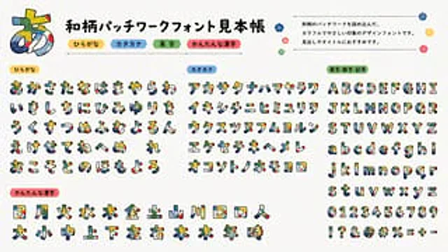

```text
Based on this character design, create a character containing{argument name="character types" default="Hiragana, Katakana, English letters and simple kanji"} An image of an arranged font sample book. The format is {argument name="aspect ratio" default="16:9"} I want to specify the image generation model as {argument name="model name" default="duct-tape-1、duct-tape-2 或 3"} .
```

Model: GPT Image 2
Author: GPT Image 2 Prompts

[ProjectD](https://aitoolsradar.com/en/prompts/fcdc60668f6cfb) · [Recorded source](https://x.com/aiehon_aya/status/2046108588318597233)
 · [Full original metadata and byte evidence](data/projectd-batch-0040.json)

## Multilingual font specimen sheet prompt


```text
この文字デザインをもとに、{argument name="文字の種類" default="ひらがな・カタカナ・英字・簡単な漢字"}を並べたフォント見本帳画像をつくって。 Format {argument name="アスペクト比" default="16:9"} 画像生成モデルは {argument name="モデル名" default="duct-tape-1か duct-tape-2、3"} を指定したいです。
```

Model: GPT Image 2
Author: 妖精アーヤさん

[ProjectD](https://aitoolsradar.com/en/prompts/92750d6d6225b9) · [Recorded source](https://youmind.com/prompts/multilingual-font-specimen-14142)
 · [Full original metadata and byte evidence](data/projectd-batch-0040.json)

## Multimedia Collage Fashion Portrait


```text
One{argument name="subject" default="young women"} A high-fashion, cinematic portrait of her, her expression thoughtful, her head slightly tilted upward. The image is presented in a deconstructivist multimedia collage style: her face is superimposed with faint, intricate architectural blueprints, geometric grid lines, and technical diagrams. The composition uses charcoal and white paint strokes to create an explosive, splattered edge effect. Scattered hyperrealism {argument name="decor" default="Orange Autumn Maple Leaves"} It drifted down her neck and hair. She was wearing a thick {argument name="accessory" default="Brown knitted scarf"} High-contrast lighting and shadows, 8K resolution, focused on the eyes, showcasing hyper-realistic skin textures, using soft earth tones and accented with vibrant orange, presenting an editorial-grade photographic style.
```

Model: GPT Image 2
Author: GPT Image 2 Prompts

[ProjectD](https://aitoolsradar.com/en/prompts/f0f7fc632db2bb) · [Recorded source](https://x.com/Goodmanprotocol/status/2047537816532549643)
 · [Full original metadata and byte evidence](data/projectd-batch-0040.json)

## Multimedia Collage Fashion Portrait

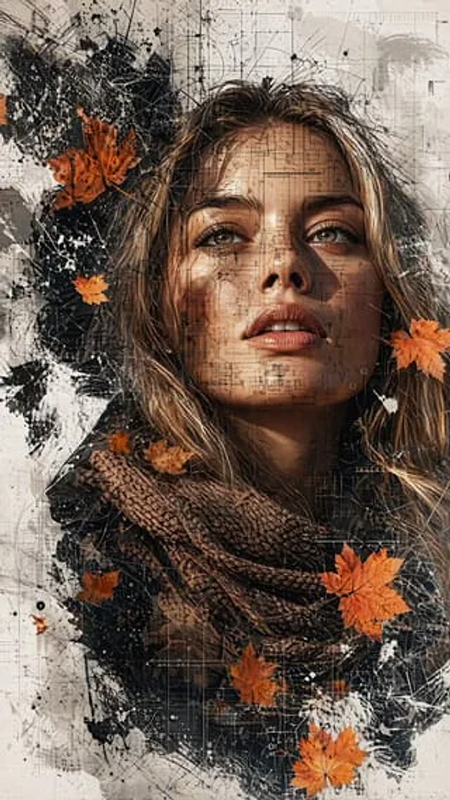

```text
A high-fashion cinematic portrait of a {argument name="subject" default="young woman"} with a thoughtful expression, looking slightly upward. The image is a deconstructed multimedia collage: her face is overlaid with faint, intricate architectural blueprints, geometric grid lines, and technical schematics. The composition features an explosive, splattered edge effect with charcoal and white paint strokes. Scattered hyper-realistic {argument name="decor" default="orange autumn maple leaves"} drift around her neck and hair. She wears a thick, {argument name="accessory" default="textured brown knit scarf"}. High-contrast lighting, 8k resolution, ultra-sharp focus on the eyes, featuring hyper-realistic skin textures, muted earth-tone color palette with pops of vibrant orange, editorial photography style.
```

Model: GPT Image 2
Author: Saul Goodman

[ProjectD](https://aitoolsradar.com/en/prompts/58d19b14de8d1a) · [Recorded source](https://youmind.com/prompts/blueprint-splatter-fashion-portrait-15530)
 · [Full original metadata and byte evidence](data/projectd-batch-0040.json)

## Multipage Presentation Slide Series

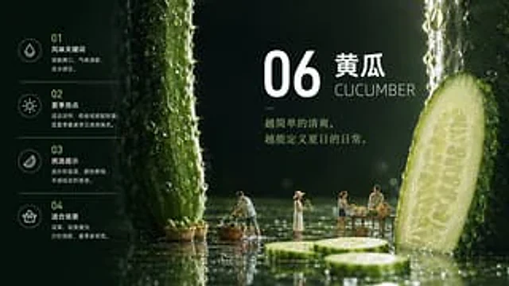

```text
主题：{argument name="主题" default="介绍10种夏季蔬果"} 
连续生成10张图片，每张都是不同的蔬果介绍，还有金句逻辑、知识逻辑，还有配色和排版逻辑 
类似于ppt，生成10张，确保彼此的排版差异 
比例16:9
```

Model: GPT Image 2
Author: 小小东

[ProjectD](https://aitoolsradar.com/en/prompts/798dceb6a11381) · [Recorded source](https://youmind.com/prompts/presentation-slide-series-generator-27553)
 · [Full original metadata and byte evidence](data/projectd-batch-0040.json)

## Multiplication Domino Classroom Activity

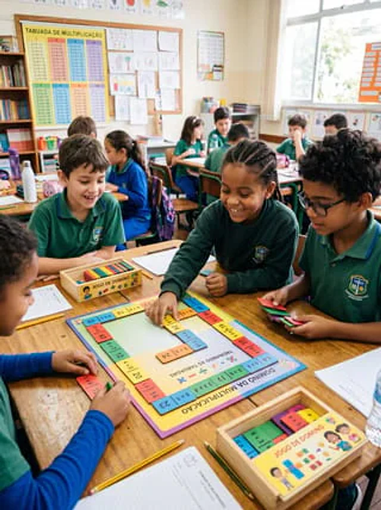

```text
A realistic, documentary-style photograph captures a scene of a math activity in an elementary school classroom. About ten children in blue-green school uniforms sit around a makeshift wooden table, actively playing a brightly colored multiplication domino game. The camera is positioned at the children's eye level, tilted slightly downwards, pointing at the main table in the foreground. At the center of the scene is a square educational project labeled in Portuguese, with the title "DOMINÓ DA MULTIPLICAÇÃO" printed on the bottom edge and "TREINANDO AS TABUADAS" in the center, surrounded by brightly colored domino-shaped multiplication blocks. Four children are intently focused on this main project: one is placing a yellow domino into the project, another holds a stack of colored dominoes, one watches from the left, and another, wearing blue sleeves, organizes the dominoes at the bottom edge. Two light-colored wooden boxes labeled "JOGO DE DOMINÓ" are also present, one in the center left and the other in the lower right corner, containing colorful rectangular dominoes. School supplies are casually scattered on the desks: three pencils, two sheets of worksheets, a water bottle, a pencil case, a notebook, and extra play cards. In the background, the rest of the classroom is softly out of focus, showing other students sitting at desks, bookshelves, a corkboard covered with children's drawings, and a large multiplication table poster on the left wall that reads "TABUADA DE MULTIPLICAÇÃO". Bright natural light streams in from the high window on the right, creating a warm, lively, and authentic school atmosphere. Educational items and cards should use vibrant classroom colors such as yellow, blue, pink, green, and orange. Faces should be blurred or softened, emphasizing hands-on learning, collaboration, and the multiplication domino activity. A vertical composition, a highly realistic photograph, capturing a genuine classroom moment with clear foreground details and a soft depth of field in the background.
```

Model: GPT Image 2
Author: GPT Image 2 Prompts

[ProjectD](https://aitoolsradar.com/en/prompts/eeeb4665bbd1e1) · [Recorded source](https://x.com/olusrodri/status/2046710556208288008#reversed-1)
 · [Full original metadata and byte evidence](data/projectd-batch-0040.json)

## Museum Catalog Artifact Breakdown

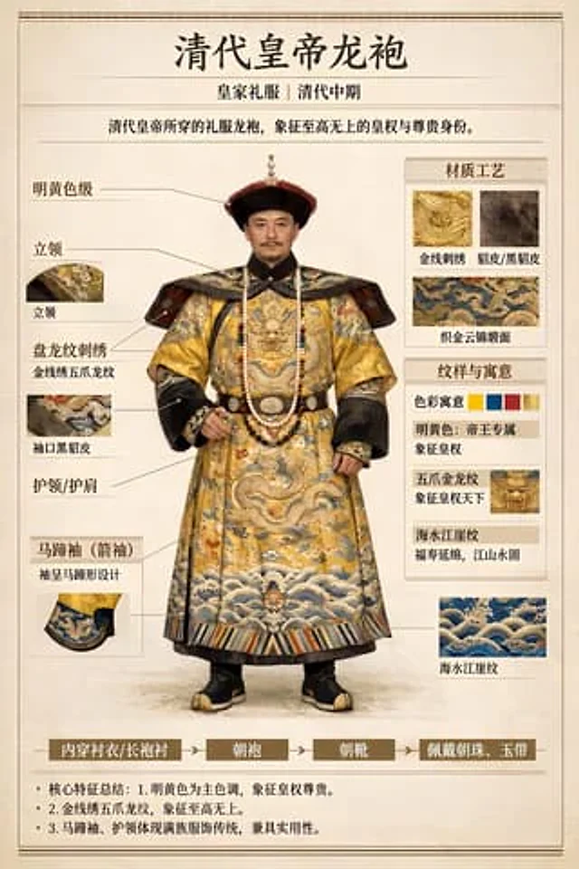

```text
Please refer to{argument name="subject" default="Qing Dynasty Emperor&#39;s Dragon Robe"} Automatically generate a "museum-style illustrated Chinese infographic". The final image must include a realistic main visual, structural breakdown, Chinese annotations, material descriptions, pattern symbolism, color meanings, and a summary of core features. You need to automatically determine the most suitable subject matter, clothing system, artifact structure, era style, key components, material craftsmanship, color scheme, and layout structure based on the main subject, without requiring additional information from the user. The overall style should resemble a national museum exhibition project, historical costume illustration, or cultural heritage themed infographic, rather than a regular poster, ancient-style portrait, e-commerce product detail page, or anime illustration. The background should use textures such as off-white, silk paper white, or light brown to create a high-end, understated, professional, and collectible appearance. The fixed layout is as follows: - Top: Main Chinese title + subtitle + introduction - Left: Structural breakdown area, using Chinese leader lines to mark key parts, with close-up details - Top right: Material/Craftsmanship/Texture area, showcasing realistic texture samples with explanations - Center right: Pattern/Color/Symbolic meaning area, showcasing the main color palette, pattern samples, and cultural interpretations - Bottom: Dressing order/Composition flowchart + Summary of core features If the theme is suitable for showcasing figures, please use a full-body standing pose as the central subject; if it is more suitable for cultural relics or a single structure, change it to a breakdown diagram of the central subject, while maintaining a complete Chinese infographic format. All text must be in Simplified Chinese, clear, standardized, and easy to read, avoiding garbled characters, typos, English, or pinyin. Emphasize realistic structure, material differences, cultural interpretation, and illustrative style. Avoid: poster-like, studio-like, e-commerce-like, anime-like, cosplay-like, incorrect labeling, structural errors, blurry text, false materials, or excessive decoration.
```

Model: GPT Image 2
Author: GPT Image 2 Prompts

[ProjectD](https://aitoolsradar.com/en/prompts/2b163a276d5531) · [Recorded source](https://x.com/j_zou93/status/2046043859726303709)
 · [Full original metadata and byte evidence](data/projectd-batch-0040.json)

## Museum Style Infographic Breakdown


```text
Please refer to [Theme:]{argument name="theme" default="Hanfu"} Automatically generate a "museum-style Chinese infographic." Requirements: The entire image must combine a realistic main visual, structural breakdown, Chinese annotations, material descriptions, pattern symbolism, color symbolism, and a summary of core features. You need to automatically determine the most suitable theme, costume system, artifact structure, era style, key components, material craftsmanship, color scheme, and layout based on the [Theme], without requiring further user input. The overall style should resemble a National Museum exhibition panel, a historical costume guide, or a cultural museum infographic, rather than a regular poster, ancient-style photo, e-commerce product detail page, or anime illustration. The background should use a paper texture such as off-white, silk white, or light brown. The overall visual effect should be high-end, restrained, professional, and collectible. The layout is fixed as follows: - Top: Main Chinese title + subtitle + introduction - Left: Structural breakdown area, using Chinese leader lines to label key components and accompanied by close-up details - Top right: Material/Craftsmanship/Texture area, showcasing real-texture samples and explanations - Center right: Pattern/Color/Meaning area, showcasing the main color palette, pattern samples, and cultural interpretations - Bottom: Dressing order/composition flowchart + summary of core features. If the theme is suitable for a human figure display, please use a full-body standing pose as the central subject; if it is more suitable for cultural relics, use a breakdown of the central subject, but maintain the complete Chinese infographic format. All text must be in Simplified Chinese, clear, neat, and easy to read, without garbled characters or typos.
```

Model: GPT Image 2
Author: GPT Image 2 Prompts

[ProjectD](https://aitoolsradar.com/en/prompts/8b7917ea7a22d8) · [Recorded source](https://x.com/MrLarus/status/2045504669401653414)
 · [Full original metadata and byte evidence](data/projectd-batch-0040.json)

## Museum Style Infographic Breakdown


```text
请根据【主题：{argument name="主题" default="汉服"}】自动生成一张“博物馆图鉴式中文拆解信息图”。

要求整张图兼具真实写实主视觉、结构拆解、中文标注、材质说明、纹样寓意、色彩含义和核心特征总结。你需要根据【主题】自动判断最合适的主体对象、服饰体系、器物结构、时代风格、关键部件、材质工艺、颜色方案与版式结构，用户无需再提供其他信息。

整体风格应为：国家博物馆展板、历史服饰图鉴、文博专题信息图，而不是普通海报、古风写真、电商详情页或动漫插画。背景采用米白、绢纸白、浅茶色等纸张质感，整体高级、克制、专业、可收藏。

版式固定为：
- 顶部：中文主标题 + 副标题 + 导语
- 左侧：结构拆解区，中文引线标注关键部件，并配局部特写
- 右上：材质 / 工艺 / 质感区，展示真实纹理小样并附说明
- 右中：纹样 / 色彩 / 寓意区，展示主色板、纹样样本和文化解释
- 底部：穿着顺序 / 构成流程图 + 核心特征总结

若主题适合人物展示，则以真实人物全身站姿为中央主体；若更适合器物或单体结构，则改为中心主体拆解图，但整体仍保持完整中文信息图形式。所有文字必须为简体中文，清晰、规整、可读，不要乱码、错字、英文或拼音。重点突出真实结构、材质差异、文化说明与图鉴气质。
```

Model: GPT Image 2
Author: Larus Canus

[ProjectD](https://aitoolsradar.com/en/prompts/d3a166267c559a) · [Recorded source](https://youmind.com/prompts/museum-style-infographic-breakdown-13977)
 · [Full original metadata and byte evidence](data/projectd-batch-0040.json)

## Museum-grade Crying Dragon Dome Mural

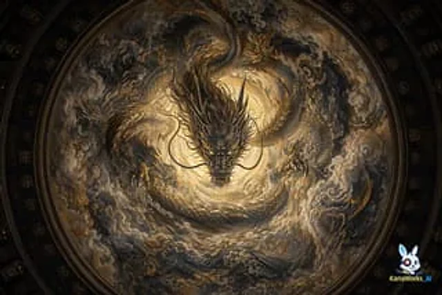

```text
A kind of{argument name="location" default="Nikko Toshogu Shrine"} Inspired by the "roaring dragon"{argument name="style" default="Museum-level high-end murals"} Painted on the ceiling of a circular dome, the composition is strictly centered and uses a low-angle perspective to create a strong sense of sacred architectural depth. A colossal dragon, exuding an imposing aura, emerges from the very center of the dome, its head pointing directly at the viewer below. Its torso, claws, and surrounding clouds radiate outward in a swirling pattern, forming a dynamic ring that bursts forth from the center. The entire scene is encased within the dome structure, with subtle architectural curves and implicit boundary markers further enhancing the immersive experience of looking up at the space above. Light and shadow: Soft, sacred light emanates from the center and gradually fades into darkness at the edges. Mist, gaps in the clouds, and delicate use of negative space create a transparent and atmospheric depth.
```

Model: GPT Image 2
Author: GPT Image 2 Prompts

[ProjectD](https://aitoolsradar.com/en/prompts/6ac5e776c0126e) · [Recorded source](https://x.com/KanaWorks_AI/status/2047324021717615067)
 · [Full original metadata and byte evidence](data/projectd-batch-0040.json)

## Museum-Style Hanfu Breakdown Infographic

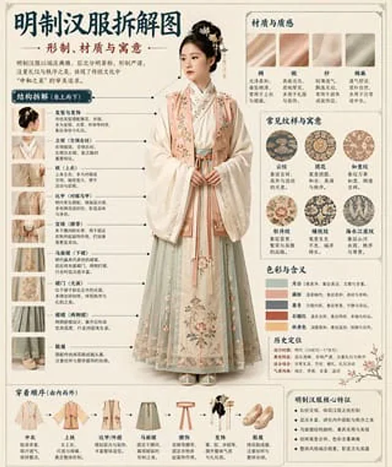

```text
请根据【主题】自动生成一张“博物馆图鉴式中文拆解信息图”。

要求整张图兼具真实写实主视觉、结构拆解、中文标注、材质说明、纹样寓意、色彩含义和核心特征总结。你需要根据【主题】自动判断最合适的主体对象、服饰体系、器物结构、时代风格、关键部件、材质工艺、颜色方案与版式结构，用户无需再提供其他信息。

整体风格应为：国家博物馆展板、历史服饰图鉴、文博专题信息图，而不是普通海报、古风写真、电商详情页或动漫插画。背景采用米白、绢纸白、浅茶色等纸张质感，整体高级、克制、专业、可收藏。

版式固定为：
- 顶部：中文主标题 + 副标题 + 导语
- 左侧：结构拆解区，中文引线标注关键部件，并配局部特写
- 右上：材质 / 工艺 / 质感区，展示真实纹理小样并附说明
- 右中：纹样 / 色彩 / 寓意区，展示主色板、纹样样本和文化解释
- 底部：穿着顺序 / 构成流程图 + 核心特征总结

若主题适合人物展示，则以真实人物全身站姿为中央主体；若更适合器物或单体结构，则改为中心主体拆解图，但整体仍保持完整中文信息图形式。所有文字必须为简体中文，清晰、规整、可读，不要乱码、错字、英文或拼音。重点突出真实结构、材质差异、文化说明与图鉴气质。

避免：海报感、影楼感、电商感、动漫感、cosplay感、乱标注、错结构、糊字、假材质、过度装饰。
```

Model: GPT Image 2
Author: @MrLarus

[ProjectD](https://aitoolsradar.com/en/prompts/a397195051811f) · [Recorded source](https://x.com/MrLarus/status/2045504669401653414)
 · [Full original metadata and byte evidence](data/projectd-batch-0040.json)

## Music Festival Headliner Poster

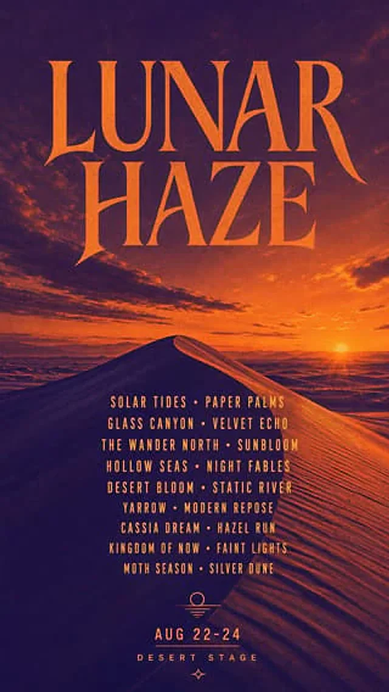

```text
Vertical 9:16 indie music festival lineup poster. Duotone treatment of a dramatic photographic background of a desert dune at sunset, processed in deep violet and bright tangerine. Massive headliner name "LUNAR HAZE" rendered in a custom display serif at the upper third of the poster. Below it a stacked lineup of smaller fictional band names in clean condensed sans-serif type, separated by small dot bullets. At the bottom a thin line of festival date "AUG 22-24" and a generic "DESERT STAGE" venue line. Vertical poster composition with subtle film grain texture. No real artist names, no real festival branding, no watermark. Premium indie festival poster design quality.
```

Model: GPT Image 2
Author: @hiapi_ai

[ProjectD](https://aitoolsradar.com/en/prompts/8b80d2c5a67a64) · [Recorded source](https://github.com/HiAPIAI/awesome-gpt-image-2-prompts)
 · [Full original metadata and byte evidence](data/projectd-batch-0040.json)

## Music Magazine Character Profile

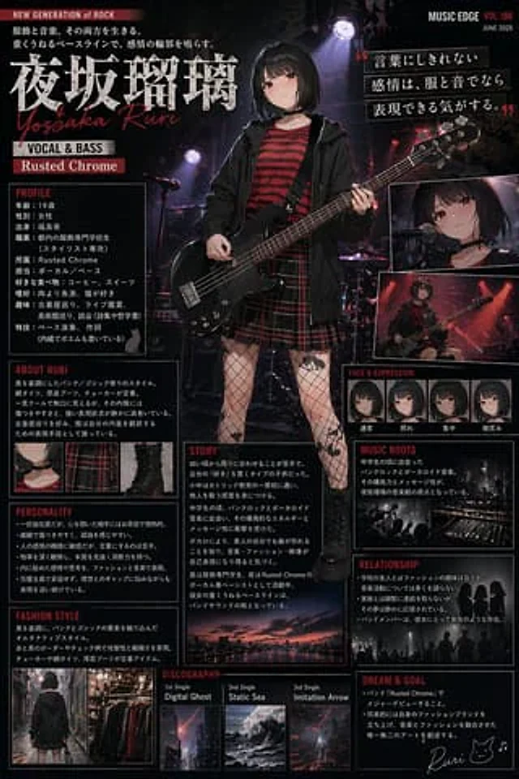

```text
{
  "type": "Music magazine artist biography page",
  "theme": "Dark, decadent rock aesthetics, with a dark background and subtle stage lighting.",
  "header": {
    "left": "New Generation of Rock",
    "right": "MUSIC EDGE VOL.186, June 2025 issue"
  },
  "character": {
    "name": "{argument name=\"character name\" default=\"Yosaka Ruri\"}",
    "romaji": "Yosaka Ruri",
    "role": "Lead vocalist &amp; bassist",
    "band": "{argument name=\"band name\" default=\"Rusted Chrome\"}",
    "appearance": {
      "hair": "{argument name=\"hair color\" default=\"black\"} bob haircut",
      "eyes": "red",
      "outfit": "Black hoodie, red and black striped shirt, red and black plaid skirt, fishnet stockings with star and moon pattern, black boots, and choker.",
      "instrument": "{argument name=\"instrument\" default=\"Black bass guitar\"}"
    }
  },
  "layout": {
    "centerpiece": "A full-body portrait of a character holding a bass guitar standing on stage.",
    "top_right_insets": {
      "count": 2,
      "descriptions": [
        "The character sings into the microphone",
        "The character plays bass on stage"
      ]
    },
    "quote": "{argument name=\"quote text\" default=\"I feel like I can express emotions that I can&#39;t put into words through clothes and sound.\"}",
    "sections": [
      {
        "title": "Personal Profile",
        "position": "Top left",
        "content_type": "Personal profile text list"
      },
      {
        "title": "Regarding Ruri",
        "position": "Left and Middle",
        "content_type": "Text description",
        "inset_images": {
          "count": 3,
          "descriptions": [
            "Close-up of choker and striped shirt",
            "Close-up of plaid mini skirt and fishnet stockings",
            "Close-up of black boots"
          ]
        }
      },
      {
        "title": "character",
        "position": "Bottom left",
        "content_type": "Bullet text list"
      },
      {
        "title": "Fashion Style",
        "position": "Bottom left",
        "content_type": "Text description"
      },
      {
        "title": "Facial expressions and demeanor",
        "position": "Right Center",
        "count": 4,
        "labels": [
          "generally",
          "Shy",
          "concentrated",
          "smile"
        ]
      },
      {
        "title": "story",
        "position": "Middle to lower",
        "content_type": "Long text paragraph"
      },
      {
        "title": "Musical Roots",
        "position": "Right Center",
        "content_type": "Text with live band silhouette illustrations"
      },
      {
        "title": "Interpersonal relationships",
        "position": "Bottom right",
        "content_type": "Text with 2 silhouette illustrations (girls talking with a stage band)"
      },
      {
        "title": "Album Catalog",
        "position": "Middle to lower",
        "count": 3,
        "labels": [
          "1st Single Digital Ghost",
          "2nd Single Static Sea",
          "3rd Single Imitation Arrow"
        ],
        "inset_images": {
          "count": 3,
          "descriptions": [
            "Cityscape at dusk",
            "deep ocean",
            "Abstract beam of light"
          ]
        }
      },
      {
        "title": "Dreams and Goals",
        "position": "Bottom right",
        "content_type": "Bullet text list with handwritten signature \"Ruri\" and cat icon"
      }
    ]
  }
}
```

Model: GPT Image 2
Author: GPT Image 2 Prompts

[ProjectD](https://aitoolsradar.com/en/prompts/de6cbd33c757b3) · [Recorded source](https://x.com/wtry1102/status/2046080527896314302#reversed-0)
 · [Full original metadata and byte evidence](data/projectd-batch-0040.json)

## Music Player Now-Playing Screen

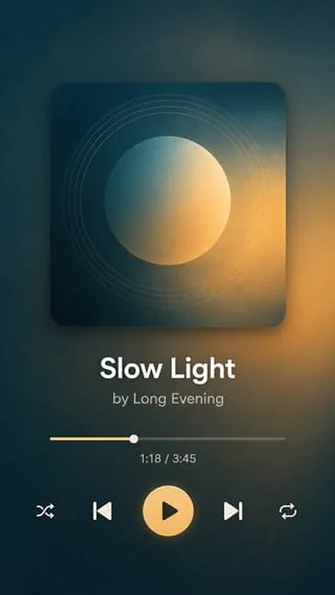

```text
Vertical 9:16 music player now-playing screen mockup. Background is a soft blurred gradient extracted from an album cover, dominant in deep teal and warm gold. Centered upper area shows a clean rounded square album artwork placeholder, a stylized abstract circle with concentric rings, no text. Below the artwork a bold sans-serif track title "Slow Light" and a smaller subhead "by Long Evening". Beneath that a thin progress bar at about one-third, with small timestamps "1:18 / 3:45". At the very bottom three large playback control icons: previous, play, next, plus two smaller side icons for shuffle and repeat. Vertical 9:16 composition, crisp pixel-aligned UI. No real artist name, no real app name, no watermark. Premium music player UI design quality.
```

Model: GPT Image 2
Author: @hiapi_ai

[ProjectD](https://aitoolsradar.com/en/prompts/8841e6df9c5240) · [Recorded source](https://github.com/HiAPIAI/awesome-gpt-image-2-prompts)
 · [Full original metadata and byte evidence](data/projectd-batch-0040.json)

## Music Video Production Storyboard Blueprint

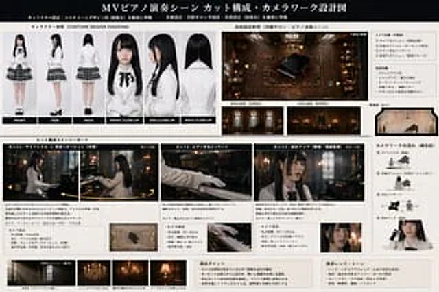

```text
{
  "type": "Production design and storyboard blueprints",
  "header": {
    "title": "{argument name=\"project title\" default=\"MV Piano Performance Scene Shot Composition and Camera Movement Design\"}",
    "subtitles": [
      "Character settings",
      "Art Design"
    ]
  },
  "character_reference": {
    "title": "Character reference (COSTUME DESIGN DIAGRAM)",
    "description": "{argument name=\"character description\" default=\"A young woman with long, black hair, wearing a white shirt, a black ribbon, and a plaid skirt.\"}",
    "views_count": 6,
    "labels": [
      "front",
      "side",
      "back",
      "Front close-up",
      "Side close-up",
      "Back view"
    ]
  },
  "art_setting": {
    "title": "Art design reference",
    "setting": "{argument name=\"scene setting\" default=\"A classic Western-style salon with stained glass and chandeliers\"}",
    "diagrams_count": 4,
    "diagram_types": [
      "Top view with camera nodes",
      "North Elevation",
      "East Elevation",
      "Cross-sectional view"
    ],
    "text_boxes": [
      "Camera position",
      "Environmental characteristics"
    ]
  },
  "storyboard": {
    "title": "Shot composition storyboard",
    "action": "{argument name=\"action\" default=\"Playing grand piano\"}",
    "panels_count": 3,
    "panels": [
      {
        "cut": "Shot 1",
        "description": "Side view, mid-range, and back view.",
        "elements": [
          "Main image",
          "Description text",
          "Camera settings box",
          "small icon"
        ]
      },
      {
        "cut": "Shot 2",
        "description": "Close-up of pianist's hands",
        "elements": [
          "Main image",
          "Description text",
          "Camera settings box",
          "small icon"
        ]
      },
      {
        "cut": "Shot 3",
        "description": "Diagonal close-up",
        "elements": [
          "Main image",
          "Description text",
          "Camera settings box",
          "small icon"
        ]
      }
    ]
  },
  "camera_workflow": {
    "title": "Camera movement process (concept diagram)",
    "steps_count": 4,
    "descriptions": [
      "Side view medium shot",
      "Rear camera position",
      "Hand close-up",
      "Diagonal close-up"
    ]
  },
  "lighting_reference": {
    "title": "Lighting Impressions (Reference)",
    "images_count": 4,
    "labels": [
      "Natural light",
      "chandelier",
      "wall lamp",
      "desk lamp"
    ]
  },
  "notes": {
    "boxes_count": 2,
    "labels": [
      "Director's Guide",
      "Recommended lenses and color tones"
    ]
  }
}
```

Model: GPT Image 2
Author: GPT Image 2 Prompts

[ProjectD](https://aitoolsradar.com/en/prompts/9d95719b68eac0) · [Recorded source](https://x.com/JPAI_HEAVEN/status/2043687975662580206#reversed-0)
 · [Full original metadata and byte evidence](data/projectd-batch-0040.json)

## Musk Writing Chinese Calligraphy


```text
A realistic, edited photograph that showcases{argument name="public figure" default="Elon Musk"} Standing before the desk in a traditional Chinese study, leaning forward, he was writing Chinese calligraphy with a brush on a long horizontal strip of white paper. He wore a dark blue suit jacket over a black shirt, a watch on his wrist, and his expression was focused and serious. The room had a warm and elegant atmosphere, with a wooden bookshelf filled with books as a backdrop, several scrolls beside it, and a carved wooden chair. Soft natural light streamed in through the traditional lattice window to the left, and a traditional Chinese landscape painting hung on the wall. On the desk were four unique calligraphy tools and materials: a rectangular black inkstone (containing ink), a brush rest, a long wooden paperweight, and a large sheet of paper or scroll with poems written on it.{argument name="calligraphy text" default="Man Jiang Hong"} The bold black Chinese characters. The composition is a medium-range full-body indoor shot taken from the left front, with the pen tip touching the paper, shallow depth of field, and a rich wood tone as the main color, with a delicate cinematic contrast. It has a documentary style, rich details, presents an authentic Chinese literati atmosphere, and is carefully rendered with ink brushstrokes.
```

Model: GPT Image 2
Author: GPT Image 2 Prompts

[ProjectD](https://aitoolsradar.com/en/prompts/5f9389363b40c9) · [Recorded source](https://x.com/YTkexue/status/2046623205981319339#reversed-1)
 · [Full original metadata and byte evidence](data/projectd-batch-0040.json)

## MV Pre-visualization Blueprint

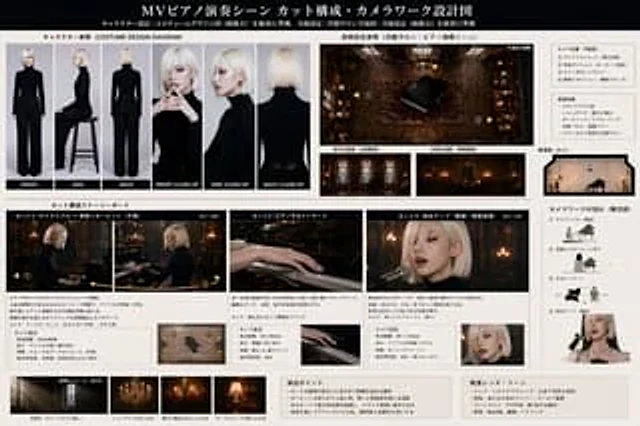

```text
{
  "type": "Music Video Preview Blueprint",
  "header": {
    "title": "{argument name=\"document title\" default=\"MV Piano Performance Scene Shot Composition and Camera Movement Design\"}",
    "subtitle": "Character design: Strictly follows the costume design drawings (left image); Art design: Strictly follows the floor plan and art design of the mansion salon (right image)."
  },
  "character": {
    "description": "{argument name=\"character description\" default=\"A young woman with a platinum blonde bob haircut was wearing a fitted black turtleneck sweater and black trousers.\"}"
  },
  "setting": {
    "description": "{argument name=\"scene setting\" default=\"A dimly lit, opulent Western-style mansion salon, furnished with a grand piano, patterned carpets, and chandeliers.\"}"
  },
  "layout": {
    "sections": [
      {
        "title": "Character reference (COSTUME DESIGN DIAGRAM)",
        "position": "top-left",
        "count": 6,
        "labels": [
          "front",
          "side",
          "back",
          "Front close-up",
          "Side close-up",
          "Back view"
        ],
        "description": "Reference images of character transitions and close-ups against a pure gray background."
      },
      {
        "title": "Art design reference (Western-style mansion salon: piano performance scene)",
        "position": "top-right",
        "count": 4,
        "labels": [
          "Floor plan (overhead view)",
          "Interior elevation drawing (left wall)",
          "Right side elevation view (right wall)",
          "Cross-sectional view (A-A')"
        ],
        "description": "The plan shows the top view of the piano room, the location of the camera, as well as the side elevation and section views."
      },
      {
        "title": "Shot composition storyboard",
        "position": "middle",
        "count": 3,
        "labels": [
          "Shot 1: Medium side shot → Shot via a back track (prologue)",
          "Scene 2: Close-up of the pianist's hands",
          "Shot 3: Oblique close-up (singing and emotional expression)"
        ],
        "description": "exhibit{argument name=\"main action\" default=\"Playing the piano and singing with deep emotion\"} The storyboard panels. Each panel contains descriptive text and a small camera layout diagram below it."
      },
      {
        "title": "Camera movement process (concept diagram)",
        "position": "middle-right",
        "count": 4,
        "labels": [
          "① Side view, medium shot (beginning)",
          "② The back track is completed.",
          "③ Close-up of the hand",
          "④ Slanted close-up (of the performance)"
        ],
        "description": "A conceptual diagram showing the movement of a camera relative to a piano and a singer."
      },
      {
        "title": "Lighting concept (for reference)",
        "position": "bottom-left",
        "count": 4,
        "labels": [
          "Natural light (through stained glass)",
          "The flickering of the chandelier",
          "The warm light of the wall-mounted candlestick",
          "The soft light of the desk lamp"
        ],
        "description": "Showing reference thumbnails of different indoor light sources."
      },
      {
        "title": "Director and Tone Notes",
        "position": "bottom-right",
        "count": 2,
        "labels": [
          "Direction points",
          "Recommended lenses and color tones"
        ],
        "description": "A text box detailing key performance elements and recommended shots and color settings."
      }
    ]
  }
}
```

Model: GPT Image 2
Author: GPT Image 2 Prompts

[ProjectD](https://aitoolsradar.com/en/prompts/6677260841f658) · [Recorded source](https://x.com/lpxwd/status/2044987195170378078#reversed-0)
 · [Full original metadata and byte evidence](data/projectd-batch-0040.json)

## Mystery Forest Barrier Book Cover

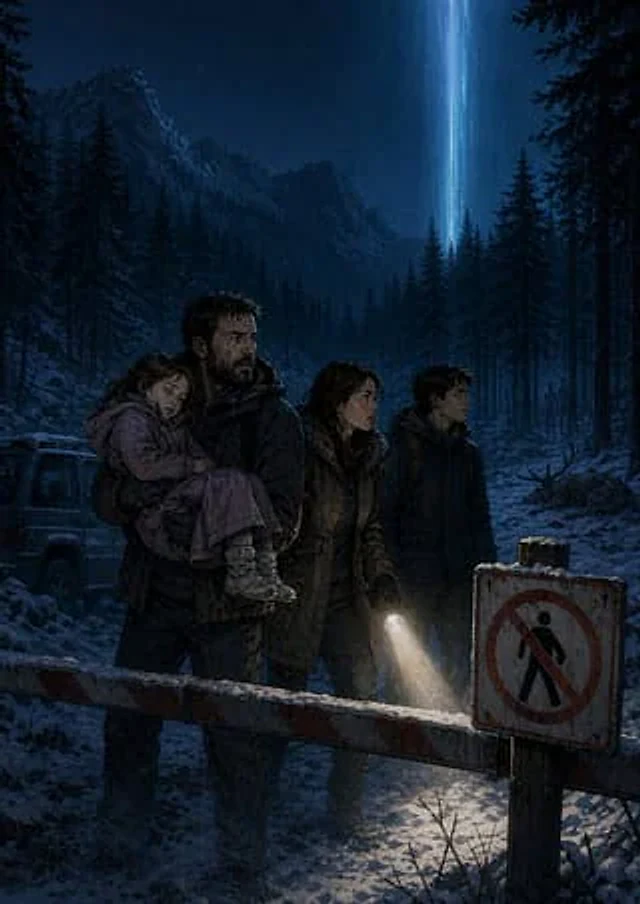

```text
A dark, cinematic graphic novel-style book cover illustration, set in a snowy mountain forest at night, employs cool blue tones and a dramatic vertical composition. In the foreground, four figures stand behind a red and white fence blocking a forest path. The first is an adult man in heavy dark winter clothing, cradling a sleeping little girl in his arms; the girl wears a pink cotton snowsuit and light-colored winter boots, her head resting on his shoulder. Beside him stands an adult woman in a winter coat with a fur collar, holding a flashlight whose beam tilts downwards, its warm light slicing through the snow. Next to her stands a boy or young man in a dark hooded winter coat, gazing at the forest. In the right foreground, a weathering warning sign mounted on a wooden post displays a silhouette of a black pedestrian within a red prohibition circle and diagonal lines. In the left midground, partially obscured by trees, is a dark-colored SUV parked on the snowy roadside. In the right midground, on the ground among the bushes, lies a dead deer with visible antlers. In the distance, nestled between tree trunks, are two blurry, eerie human silhouettes standing motionless in the forest. Towering pine trees frame the scene on either side, against a backdrop of snow-capped, steep peaks and a starry sky. From the upper right, a bright, pale blue-white beam of light descends vertically, piercing the forest and illuminating the mist, hinting at some mysterious anomaly. The atmosphere is tense, taboo, supernatural, and filled with a sense of existential crisis, as if foreshadowing the title {argument name="title text" default="La Réserve"} The cover designs are for thriller or science fiction graphic novels. The highly detailed realistic painting style is combined with comic book lines, with subtle rim lighting, deep shadows, a realistic winter texture, and a cinematic sense of suspense. There are no visible facial details, and the composition is vertical.
```

Model: GPT Image 2
Author: GPT Image 2 Prompts

[ProjectD](https://aitoolsradar.com/en/prompts/cdb0c690cc987e) · [Recorded source](https://x.com/Martinolli/status/2046680566532128946#reversed-1)
 · [Full original metadata and byte evidence](data/projectd-batch-0040.json)

## Mystic Ruins Platformer Screenshot

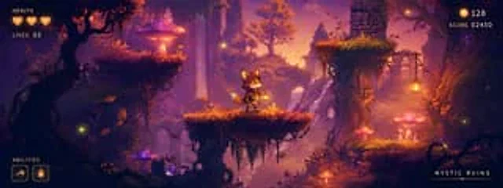

```text
Goal: Create a polished 2D side-scrolling platformer concept screenshot for a fantasy game level called {argument name="level title" default="MYSTIC RUINS"}, showing a playable prototype scene with HUD elements overlaid.

Canvas: Wide cinematic 24:9 game screenshot, approximately 1200×450 px. Use a layered parallax composition with strong depth: dark foreground silhouettes, midground playable platforms, and a misty glowing background. No borders or watermark.

Scene: A magical ancient forest ruin at sunset/night, with warm orange, magenta, purple, and deep navy lighting. The environment is dense with gnarled trees, hanging vines, moss, floating dust/fireflies, crumbling stone arches, waterfalls in the distance, and oversized bioluminescent mushrooms glowing pink, violet, and amber. The mood is cozy, mysterious, adventurous, and high-fantasy.

Layout and counted scene elements: Include exactly 4 main walkable platforms: 1 large dark mossy ledge on the upper left with a giant glowing purple-pink mushroom on it, 1 central moss-covered platform where the hero stands, 1 elevated upper-right ruined stone platform with a broken stone column and hanging lantern, and 1 lower-right mossy platform with glowing mushrooms. Add distant ruined arches and cliffs in the background, but keep them non-playable and atmospheric. Place the hero slightly left of center on the central platform.

Hero character: A small cute anthropomorphic fox adventurer, chibi proportions, orange fur, cream muzzle and tail tip, wearing a small brown adventurer outfit with boots, belt, scarf or capelet, and holding a warm glowing lantern. The character should face right in an idle pose, readable as a playable sprite against the environment.

HUD and text content: Top left HUD has the label “HEALTH” in small pale-gold pixel/fantasy UI text, with exactly 3 glowing heart icons underneath. Below that show “LIVES 03”. Bottom left HUD has the label “ABILITIES” and exactly 2 square ability icons: one dash/slash icon and one lantern/light icon. Top right HUD shows a small gold coin icon followed by “128”, and below it “SCORE 02450”. Bottom right shows the level title “{argument name="level title" default="MYSTIC RUINS"}” in widely spaced white-gold capitals with a thin decorative line beneath it.

Visual style: High-quality painterly 2D game art, whimsical platformer concept art, soft bloom, volumetric mist, cinematic rim lighting, sharp readable silhouettes, detailed foliage and moss, glowing particles, warm lantern light, vibrant fantasy color grading, suitable for a playable 2D platformer prototype.

Constraints: Keep the image as a single gameplay screenshot, not a menu or poster. Make all HUD text clean and legible. Do not add extra hearts, ability icons, characters, enemies, dialogue boxes, logos, or watermarks.
```

Model: GPT Image 2
Author: Givros

[ProjectD](https://aitoolsradar.com/en/prompts/4d19ee228074af) · [Recorded source](https://youmind.com/prompts/mystic-ruins-platformer-20062)
 · [Full original metadata and byte evidence](data/projectd-batch-0040.json)

## Mystical Luminous Outline Style

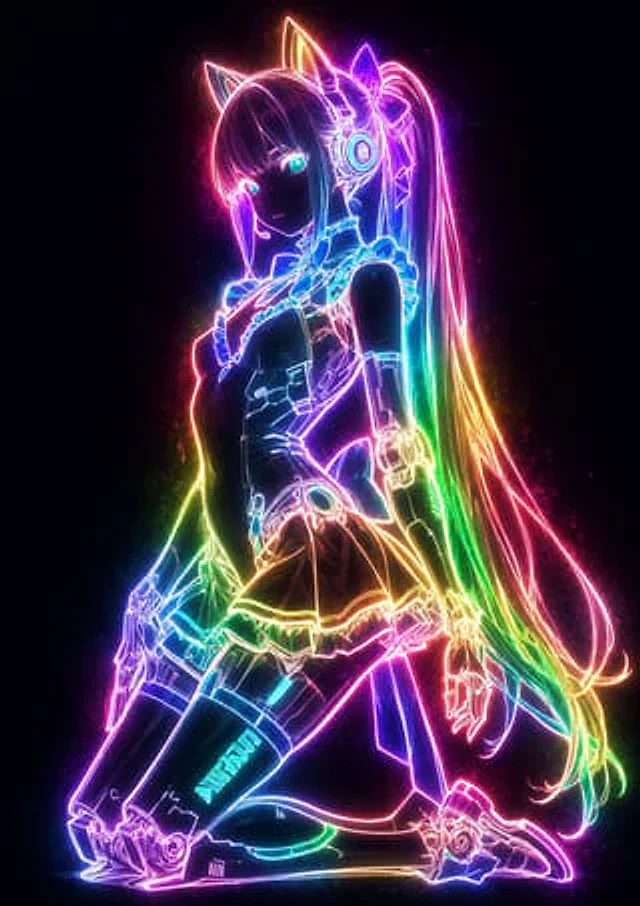

```text
このイラストを、神秘的で幻想的な発光スタイルで変換してください。 【発光色：{argument name="発光色" default="虹色"}】 キャラクターの輪郭線・衣装のライン・アクセサリーのディテール・髪の流れなど全ての線だけが、【発光色】の美しい光で強く発光するようにしてください。線は内側からじんわりと輝き、ゆっくりと浮かび上がるような柔らかいネオン光を放ち、光の粒を僅かに散らしながら周囲を優しく照らす表現に。面で光らせるのではなく、線のみが主役として発光し、他の部分（肌・髪・衣装の塗り面など）は極めて控えめに、僅かに透ける程度に抑えてください。 線の発光が暗い背景に対して非常に強いコントラストを生み、【発光色】の光のスペクトルが穏やかに広がる様子を強調。キャラクターの各線が幻想的で神々しい輝きを放ち、光が線に沿って流れるように美しく表現してください。全体の雰囲気はクールで神秘的、魔法のような幻想的な【発光色】の光の輪郭のみが浮かび上がる、息を飲むほど美しいシルエットに仕上げてください。 元のイラストの構図・キャラクターの表情・ポーズ・シルエット・主要な特徴は一切崩さず忠実に維持。
```

Model: GPT Image 2
Author: のとろ

[ProjectD](https://aitoolsradar.com/en/prompts/78a845876366fc) · [Recorded source](https://youmind.com/prompts/glowing-neon-outline-illustration-19068)
 · [Full original metadata and byte evidence](data/projectd-batch-0040.json)

## Mythical Beast Character Personality Prompt

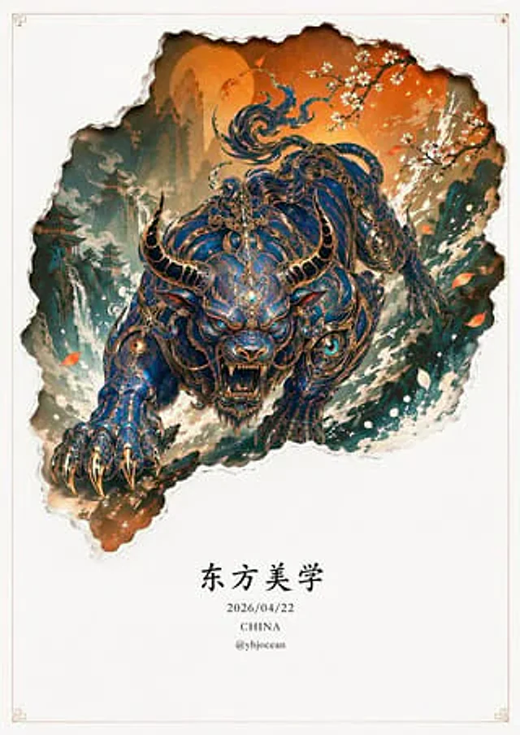

```text
Taotie: Greedy and fierce eyes, ferocious expression, and highly aggressive posture; Hun Dun: Half-open and half-closed eyes, a confused and ignorant expression, and a lazy posture; Qiongqi: Cunning and vicious eyes, a look of hatred towards good people, and a shifty and unpredictable posture; Taowu: Eyes full of disdain, an arrogant expression, and a stubborn, domineering, and arrogant posture.
```

Model: GPT Image 2
Author: GPT Image 2 Prompts

[ProjectD](https://aitoolsradar.com/en/prompts/34756ead737cd6) · [Recorded source](https://x.com/yhjocean/status/2047581894926286901)
 · [Full original metadata and byte evidence](data/projectd-batch-0040.json)

## Mythological Action Game Screenshot


```text
A cinematic third-person video game screenshot shows a bald warrior and a boy battling a colossal Egyptian god in a sand-filled temple. The warrior has his back to the camera, wielding a scimitar; the boy is drawing his bow and aiming. The massive boss has a jackal's head, glowing white eyes, wears a golden headdress, and wields a staff. The environment features massive hieroglyphic pillars, falcon statues, and volumetric light dust. The image includes four UI components: a red boss health bar at the top center, labeled "..."{argument name="boss name" default="ANUBIS"} The task tracker in the upper right corner displays {argument name="quest title" default="THE JACKAL'S PATH"} " and"{argument name="quest objective" default="Defeat Anubis"} The player HUD in the lower left corner includes a green health bar, a red rage bar, directional icons, and a "L3 + R3" prompt; and the HUD in the lower right corner includes two diamond-shaped skill icons.
```

Model: GPT Image 2
Author: GPT Image 2 Prompts

[ProjectD](https://aitoolsradar.com/en/prompts/fb3d86f1decd80) · [Recorded source](https://x.com/Pixel_Beaky/status/2044593832470130868#reversed-0)
 · [Full original metadata and byte evidence](data/projectd-batch-0040.json)

## Mythological Character Avatar Grid


```text
{
  "type": "Character Avatar Grid",
  "theme": "{argument name=\"theme\" default=\"Journey to the West mythology\"}",
  "style": "{argument name=\"art style\" default=\"Simple 2D cartoon vector illustration, with bold outlines and tiled colors.\"}",
  "layout": {
    "background": "{argument name=\"background color\" default=\"Light gray\"} Fine texture",
    "format": "Circular avatar grid, with a text label centered below each circle.",
    "rows": [
      {
        "count": 4,
        "items": [
          {
            "label": "Sun Wukong",
            "description": "Monkey boy wearing a golden headband and a red scarf"
          },
          {
            "label": "Tang Sanzang",
            "description": "monks wearing magnificent golden crowns"
          },
          {
            "label": "Pigsy",
            "description": "Pigman with a rake"
          },
          {
            "label": "Sha Wujing",
            "description": "Bearded man holding a crescent-shaped shovel"
          }
        ]
      },
      {
        "count": 4,
        "items": [
          {
            "label": "White Dragon Horse",
            "description": "A white horse with golden reins"
          },
          {
            "label": "Jade Emperor",
            "description": "An elderly man with a white beard and wearing a golden crown"
          },
          {
            "label": "Guanyin",
            "description": "Goddess holding a willow branch"
          },
          {
            "label": "Bull Demon King",
            "description": "Fierce Bull Demon in Armor"
          }
        ]
      },
      {
        "count": 4,
        "items": [
          {
            "label": "Princess Iron Fan",
            "description": "A woman holding a green banana leaf fan"
          },
          {
            "label": "Red Boy",
            "description": "A boy with red hair, long horns, and small flames."
          },
          {
            "label": "Black Wind Monster",
            "description": "Shadow Demon with flashing red eyes"
          },
          {
            "label": "Nezha",
            "description": "A boy with double buns and holding a fire-tipped spear."
          }
        ]
      },
      {
        "count": 3,
        "description": "Repeat sections of Princess Iron Fan, the Black Wind Monster, and Nezha, with slight cropping at the bottom."
      }
    ]
  }
}
```

Model: GPT Image 2
Author: GPT Image 2 Prompts

[ProjectD](https://aitoolsradar.com/en/prompts/be3276b678add2) · [Recorded source](https://x.com/Ryan_Suo/status/2045555581487137125#reversed-0)
 · [Full original metadata and byte evidence](data/projectd-batch-0040.json)

## ᴍᴜʀᴘʜʏ #103


```text
Cinematic automotive billboard poster, [CAR MODEL + VARIANT] in [PAINT COLOR + FINISH], parked center-frame, dominant stance, [CAMERA ANGLE — e.g. low angle / front three-quarter / elevated SUV angle], ultra controlled composition

dramatic studio lighting setup with [PRIMARY LIGHT COLOR/TONE] key light, [RIM LIGHT COLOR] rim lighting defining silhouette, high contrast shadow falloff, precise specular highlights across body panels

massive billboard-style typography composition, bold condensed sans-serif white text "[BRAND NAME]" filling entire background wall behind the car, perfectly centered and spanning edge-to-edge, with thin vertical dark lines slicing through each letter evenly, consistent spacing, no distortion

environment designed to match brand mood: [ENVIRONMENT DESCRIPTION — e.g. minimal concrete / desert haze / forest stone / industrial steel], seamlessly fading into deep gradient background, zero clutter

ground surface: [SURFACE TYPE — wet asphalt / gloss studio floor / textured terrain] with subtle realistic reflections, controlled diffusion, no noise

atmosphere: [FOG / HAZE / PARTICLES — optional but controlled], only at ground level for depth

top right corner: [BRAND LOGO DESCRIPTION], small and elegant, paired with minimal uppercase text "[YOUR SIGNATURE — e.g. MURPHY AI]" aligned cleanly

STRICT RULES:
— no extra taglines  
— no performance specs  
— no additional typography  
— no random elements  
— maintain premium minimal billboard aesthetic  

render quality: hyper-detailed photorealism, ultra sharp reflections, realistic paint microtexture, cinematic color grade matching environment

composition: perfectly balanced, symmetrical, professional automotive advertising layout

format: 1:1 square, ultra high resolution, print-ready billboard finish
```

Model: GPT Image 2
Author: ᴍᴜʀᴘʜʏ

[ProjectD](https://aitoolsradar.com/en/prompts/45613ebf7ef3e3) · [Recorded source](https://x.com/Diplomeme/status/2045830975318610408)
 · [Full original metadata and byte evidence](data/projectd-batch-0040.json)

## ᴍᴜʀᴘʜʏ #14


```text
4:5 vertical social poster, ultra high resolution, 8K

SCENE / BACKGROUND:
Flat racing yellow with subtle gradient (light → deep amber)
Grain texture 2–3%
Soft rectangular overlays at 3% opacity

PRODUCT:
Porsche 911 GT3 RS
Gloss yellow with carbon details
Rear 3/4 angle, slightly elevated
Wing dominant

Position:
Right of center

TYPOGRAPHY:
“PORSCHE”
Ultra tall, condensed, stretched
Deep charcoal

Secondary:
“PORSCHE 911 GT3 RS”

EDITORIAL:
“Porsche — Where Precision Meets Passion”

Focus:
engineering, obsession, track DNA

FADED TEXT:
“GT3 RS” at 3–5%

SPECS:
386 kW / 525 PS
3.2 s
296 km/h

LIGHTING:
Clean studio, sharp highlights

MOOD:
Precision.
Iconic.
Timeless performance.

FORMAT:
4:5 vertical social poster, ultra high resolution, 8K, print-quality sharpness

SCENE / BACKGROUND:
Flat, high-saturation BMW blue background

Gradient:
Top → slightly lighter electric blue
Bottom → deep navy blue

Surface:
- Subtle grain texture (2–3%)
- Faint rectangular overlays (2–4% opacity)
- Clean, graphic — no realism

Shadow:
Soft contact shadow under car

PRODUCT (CAR):
BMW M4 CSL

Color:
Matte frozen blue / deep metallic navy

Angle:
Rear 3/4 perspective (IMPORTANT — match Porsche angle for consistency)
Slightly elevated camera

Position:
Slightly right of center

Details:
- Carbon roof visible
- Aggressive diffuser
- Sharp reflections
- Subtle brake detail

COMPOSITION:
IDENTICAL to Porsche:
Top → branding
Middle → giant type
Center → car overlap
Bottom → editorial + specs

TYPOGRAPHY:

PRIMARY:
“BMW”

Style:
Ultra condensed bold sans serif
Tall vertical scaling (same as Porsche)

Color:
Deep navy / near black

Behavior:
Static (NO distortion — unlike previous version)
Acts as structural backdrop

SECONDARY HEADER:
“BMW M4 CSL”
Thin, wide tracking

LOGO AREA:
BMW roundel centered above

EDITORIAL BLOCK:

Headline:
“BMW — Where Driving Becomes Instinct”

Body:
Focus on:
- driver connection
- control
- performance precision

Boxed layout, same structure as Porsche

FADED TEXT:
“CSL” large, 3–5% opacity behind box

BOTTOM LEFT:
“M4 CSL”

BOTTOM RIGHT SPECS:

405 kW / 550 PS
3.4 s
307 km/h

LIGHTING:
Clean studio lighting
Sharp but controlled highlights

COLOR GRADING:
Deep blues, high contrast, clean blacks

CAMERA:
50mm, slightly elevated rear 3/4

MOOD:
Performance.
Precision.
Driver focus.
```

Model: GPT Image 2
Author: ᴍᴜʀᴘʜʏ

[ProjectD](https://aitoolsradar.com/en/prompts/ea0be03e84c5b8) · [Recorded source](https://x.com/Diplomeme/status/2047986905896427670)
 · [Full original metadata and byte evidence](data/projectd-batch-0040.json)

## ᴍᴜʀᴘʜʏ #173


```text
Ultra-realistic 3D miniature diorama of a [BRAND NAME] environment built inside a giant [ICONIC OBJECT OF BRAND], shown in a clean cross-section or partially cut-open view revealing a detailed interior world.

Inside the structure, a fully detailed miniature [brand-specific environment: store / café / restaurant / showroom] exists, with realistic human activity such as staff working, customers interacting, and natural storytelling moments.

The [object] acts as both container and environment, with its materials and elements integrated into the architecture (e.g., layers, textures, surfaces forming terrain and structure).

Add dynamic storytelling elements: objects or particles suspended mid-air, subtle motion frozen in time (liquid splashes, falling elements, steam, crumbs, etc.).

Include volumetric atmosphere such as steam, fog, or light rays interacting with particles in the air to enhance cinematic depth.

Surfaces must be hyper-realistic with micro details: imperfections, condensation, reflections, dust, oil sheen, texture variations depending on the material.

Lighting should follow a cinematic high-end advertising style, with strong contrast between warm and cool tones, soft rim lighting outlining the subject, and natural light direction enhancing depth and realism.

Composition: slightly angled hero shot, clear cross-section visibility, centered subject, minimal but cinematic background with soft bokeh.

Shot on a macro lens, shallow depth of field, creamy bokeh background, ultra-detailed textures, 8K resolution, filmic color grading, luxury commercial photography style.
```

Model: GPT Image 2
Author: ᴍᴜʀᴘʜʏ

[ProjectD](https://aitoolsradar.com/en/prompts/1e30b5c115d1f5) · [Recorded source](https://x.com/Diplomeme/status/2036427989718802509)
 · [Full original metadata and byte evidence](data/projectd-batch-0040.json)

## ᴍᴜʀᴘʜʏ #206


```text
Cinematic luxury tourism poster, Spain, iconic view of Sagrada Família in Barcelona rising prominently above the city, detailed organic architecture with surrounding urban grid softly visible, clean and centered composition

camera angle: elevated wide perspective capturing full structure symmetry with city depth behind

lighting: warm golden hour sunlight casting soft highlights across stone textures, gentle shadows, glowing atmosphere

typography: elegant high-fashion editorial serif font, large refined text "SPAIN" integrated across sky and upper architecture, subtly blending with light and structure

text hierarchy:
small top text: "Visit"
main: "SPAIN"
small bottom line: "FEEL THE PASSION"

environment: clean Barcelona cityscape simplified for clarity, no clutter, focus on architecture

color palette: warm gold, sandstone beige, soft blue sky

atmosphere: light haze with sun glow enhancing depth and warmth

branding: top right minimal text "MURPHY AI"

STRICT RULES:
— Sagrada Família must be the dominant focal point
— maintain elegance and warmth
— avoid overcrowded city details

render quality: ultra photorealistic, cinematic warm Mediterranean grade, premium tourism campaign style

composition: balanced, symmetrical, editorial luxury layout

format: 1:1 square, ultra high resolution

Cinematic luxury tourism poster, Brazil, iconic aerial view of Christ the Redeemer statue overlooking Rio de Janeiro with coastline and mountains visible, perfectly centered composition

camera angle: elevated aerial perspective behind or slightly above statue, revealing city and ocean depth

lighting: warm sunrise or sunset golden light with vibrant yet controlled tones

typography: elegant editorial serif font, large refined text "BRAZIL" integrated across sky and horizon, softly blending with clouds

text hierarchy:
small top text: "Visit"
main: "BRAZIL"
small bottom line: "FEEL THE ENERGY"

environment: lush mountains, coastline, cityscape simplified for clarity

color palette: green, blue, gold highlights

atmosphere: light haze, soft clouds catching sunlight

branding: top right minimal text "MURPHY AI"

STRICT RULES:
— Christ statue must be clear focal point
— avoid over-saturation
— keep composition clean

render quality: ultra photorealistic, cinematic vibrant grade

composition: balanced, iconic, postcard-level framing

format: 1:1 square

Cinematic luxury tourism poster, United Arab Emirates, iconic centered view of Burj Khalifa dominating Dubai skyline, seen from elevated perspective with surrounding skyscrapers and subtle desert tones

camera angle: wide symmetrical aerial framing emphasizing vertical dominance

lighting: warm golden sunset light reflecting across glass buildings, soft glow, controlled highlights

typography: elegant high-end serif font, large refined text "DUBAI" integrated into sky and skyline, partially blending with architecture

text hierarchy:
small top text: "Visit"
main: "DUBAI"
small bottom line: "FEEL THE POWER"

environment: ultra modern skyline, clean composition, no clutter

color palette: gold, warm amber, deep shadows

atmosphere: light haze, glowing skyline diffusion

branding: top right minimal text "MURPHY AI"

STRICT RULES:
— Burj Khalifa must be dominant focal point
— clean luxury aesthetic
— no distractions

render quality: ultra photorealistic, cinematic warm grade

composition: symmetrical, powerful, iconic skyline shot

format: 1:1 square
```

Model: GPT Image 2
Author: ᴍᴜʀᴘʜʏ

[ProjectD](https://aitoolsradar.com/en/prompts/493dccb7387172) · [Recorded source](https://x.com/Diplomeme/status/2046089486719930845)
 · [Full original metadata and byte evidence](data/projectd-batch-0040.json)

## ᴍᴜʀᴘʜʏ #221


```text
TAG Heuer — Track Surface (REAL, NOT FAKE)

High-end commercial watch advertisement, TAG Heuer chronograph, single watch leaning against its box, centered composition, slight front three-quarter angle

environment: real wet asphalt surface inspired by race track texture, subtle tire marks, light moisture, NOT full scene

background: soft dark depth with slight motion blur light streak hints, minimal, not literal track

lighting: controlled studio lighting with strong key for dial clarity, subtle red rim light for racing identity, crisp reflections on metal and glass

composition: tight grouping, grounded, realistic spacing

perspective typography (primary): large “PRECISION” in background, soft perspective, slightly diffused, low opacity, blending into depth

secondary typography:
“CHRONOGRAPH SERIES”
“SWISS MADE”

branding: logo top center, “MURPHY AI” beneath

surface: wet asphalt reflection, controlled, not exaggerated

color palette: black, steel, red accents

ultra-realistic materials (brushed metal, sapphire reflections, lume details)

1:1 square format

Casio G-Shock — Rugged Ground (LIKE YOUR CHARCOAL SHOT)

High-end commercial watch advertisement, G-Shock rugged watch, single watch leaning against its box, centered

environment: controlled rough stone / cracked surface with dust particles, minimal debris (like your Nivea charcoal setup)

background: dark soft gradient with slight haze, no literal landscape

lighting: directional studio lighting, strong highlights on edges, controlled shadow depth

composition: grounded, tight product grouping

perspective typography (primary): bold “TOUGH” in background, slightly broken texture, soft perspective depth, low opacity

secondary typography:
“SHOCK RESISTANT”
“BUILT TO LAST”

branding: logo top center, “MURPHY AI” beneath

surface: matte rough texture, minimal reflection

color palette: charcoal, black, muted tones

ultra-detailed rugged material finish

1:1 square format

Garmin — Outdoor Tech (CONTROLLED, NOT LANDSCAPE)

High-end commercial watch advertisement, Garmin GPS smartwatch, single watch leaning against its box, centered

environment: textured rock surface with subtle moisture and fine dust, clean minimal outdoor feel (not full mountain scene)

background: deep cool gradient with faint mist layers for depth

lighting: soft controlled lighting, cool rim highlights, clean display visibility

composition: tight, balanced, grounded

perspective typography (primary): “ENDURANCE” large in background, geometric, fading into depth with soft haze

secondary typography:
“GPS MULTISPORT”
“PERFORMANCE TRACKING”

branding: logo top center, “MURPHY AI” beneath

surface: natural rock with subtle reflection

color palette: blue-grey, black

ultra-clean product rendering

1:1 square format

Fastrack — Urban Surface (LIKE GARNIER WATER BUT DRY)

High-end commercial watch advertisement, Fastrack sports watch, single watch leaning against its box, centered

environment: dark smooth surface with slight gloss and subtle texture, faint moisture or light reflection, urban tone

background: soft gradient with slight haze, minimal depth

lighting: contrast studio lighting with subtle colored accent reflections, controlled highlights

composition: tight and clean

perspective typography (primary): “MOVE FAST” large in background, soft perspective, slightly glowing edges, integrated subtly

secondary typography:
“SPORT MODE”
“URBAN ACTIVE”

branding: logo top center, “MURPHY AI” beneath

surface: controlled reflection, not mirror-like

color palette: black, grey, subtle accent color

ultra-detailed modern finish
```

Model: GPT Image 2
Author: ᴍᴜʀᴘʜʏ

[ProjectD](https://aitoolsradar.com/en/prompts/e9300521eea4e2) · [Recorded source](https://x.com/Diplomeme/status/2047170094716051776)
 · [Full original metadata and byte evidence](data/projectd-batch-0040.json)

## ᴍᴜʀᴘʜʏ #253


```text
FORMAT:
4:5 vertical poster, ultra high resolution, 8K, ultra-premium automotive campaign, minimal cinematic realism

CORE CONCEPT:
“CONTROLLED UNSEALING”

A precision-engineered object revealed with intent.
Nothing breaks.
Everything separates perfectly.

ENVIRONMENT:

Deep matte black studio

Background:
- almost pure black
- soft, controlled yellow glow diffused behind subject
- no visible light source

Surface:
- ultra clean dark floor
- very soft reflection (5–8%)
- no scratches, no noise

Air:
- almost clean (NO visible dust)

HERO STRUCTURE:

A **precision-engineered display case** — not industrial, not damaged.

Design language:
- monolithic black form
- seamless panels
- razor-sharp edges
- minimal visible joints

Opening behavior:
- panels slide apart with mechanical precision
- no tearing, no debris
- perfect separation lines
- slight offset gaps emitting soft yellow light

Interior:
- Porsche yellow inner chamber
- smooth, matte-satin finish
- soft controlled glow (not bright)

PRODUCT:
[Porsche 911 GT3 RS](chatgpt://generic-entity?number=0)

Angle:
Rear 3/4, slightly low

Position:
Centered, emerging forward subtly

Stance:
- perfectly planted
- minimal steering angle (almost straight)
- composed, not aggressive

DETAILING:

Surface:
- ultra refined gloss
- clean, sharp reflections
- no exaggerated highlights

Carbon:
- visible but subtle
- premium, not loud

Tires:
- clean satin finish
- realistic, not shiny

Integration:
- faint yellow light wrap from interior
- soft contact shadow
- barely visible reflection

COMPOSITION:

Top:
small Porsche crest

Center:
car framed by opening panels

Typography:
secondary to structure

Bottom:
clean editorial + specs

Negative space:
dominant and intentional

TYPOGRAPHY:

PRIMARY:
“PORSCHE”

Style:
Ultra condensed

Treatment:
- subtly embedded into background
- low contrast (dark graphite on black)
- almost discovered, not announced

SECONDARY:
“911 GT3 RS”
thin, technical

EDITORIAL BLOCK:

Headline:
“Porsche — Precisely Unsealed”

Body:
Engineered precision revealed with absolute control.

Minimal copy. No storytelling overload.

SPECS:

386 kW / 525 PS  
3.2 s  
296 km/h  

Clean, technical alignment

LIGHTING:

- soft internal yellow glow (primary)
- controlled top light (soft, even)
- subtle rim separation
- NO harsh contrast spikes

Focus:
surface quality > drama

COLOR GRADING:

- deep neutral blacks
- controlled Porsche yellow
- low saturation outside focal area
- ultra clean finish

CAMERA:

50mm  
eye-level to slightly low  
no distortion  

MOOD:

Calm.
Precise.
Obsessive.

Power under control.
```

Model: GPT Image 2
Author: ᴍᴜʀᴘʜʏ

[ProjectD](https://aitoolsradar.com/en/prompts/13ae76f5597d83) · [Recorded source](https://x.com/Diplomeme/status/2048765001817805295)
 · [Full original metadata and byte evidence](data/projectd-batch-0040.json)

## ᴍᴜʀᴘʜʏ #263


```text
Cinematic product poster for WELLBI, India's premium bamboo apparel brand.

SCENE: A lone young Indian man emerges from a dense, luminous bamboo forest 
at golden hour. Wears a perfectly draped, ultra-clean ivory WELLBI bamboo polo. 
Bamboo stalks alive with warm amber and jade light filtering through canopy.

VISUAL STORYTELLING: The bamboo forest IS the fabric — seamless living metaphor. 
Thin golden light rays land on the polo, suggesting softness and breathability.

COMPOSITION: Low angle, subject centre-frame, bamboo framing both sides like 
a natural arch. Horizon at lower third. Cinematic 2.39:1 anamorphic crop.

— TYPOGRAPHY SYSTEM —
Hero line: "GROWN." — single word, massive scale, Helvetica Neue Ultra Light, 
all caps, extreme letter-spacing +600, ghost white at 15% opacity overlaid 
across the ENTIRE poster width — architectural, not decorative.

Sub-line: "Not manufactured." — set in sharp Aktiv Grotesk Regular, 
sentence case, 18pt, tracking +80, positioned directly below hero word.
White. Full opacity. Feels like a whisper after a shout.

Brand name: "WELLBI" — bottom right corner. Neutral Grotesk Medium, 
all caps, tracking +300, 11pt. Separated by a 0.5pt hairline rule 
above it, 40px wide. Restrained. Premium.

Legal/descriptor: "100% Bamboo Apparel — India" — micro text, 
7pt, tracking +150, bottom left. Rotated 90° vertical. 
Acts as a structural edge element, not an afterthought.

COLOUR PALETTE: Deep jungle green, warm amber, ivory white, earth brown.

LIGHTING: ARRI Alexa Mini LF — golden hour rim, diffused fill, 
subtle lens flare grazing the polo fabric.

MOOD: Grounded luxury. Like a Loro Piana campaign shot in Assam.

CAMERA: 85mm f/1.4, shallow DOF, anamorphic lens flare.

Editorial brand poster for WELLBI sustainable Indian fashion.

SCENE: Extreme close-up of a weathered artisan's hands spinning bamboo thread. 
Blurred WELLBI tee draped elegantly in background. Warm-lit rural Indian 
workshop — clay walls, raw natural light.

VISUAL STORYTELLING: Rough hands against silk-smooth bamboo fabric. 
Heritage craftsmanship. The contrast IS the message.

COMPOSITION: Split tonal — dark warm left (hands, workshop), 
light cream right (garment). Hands at cross-point. Leica 50mm documentary realism.

— TYPOGRAPHY SYSTEM —
Hero line: "ONE LAKH HANDS." — Canela Display Thin, mixed case, 
enormous scale, set across 80% of poster width. 
The word "HANDS" drops to second line, indented right — 
staggered layout creates visual rhythm like musical notation.

Counter-line: Below "HANDS", flush right: "One fabric." — 
same Canela Thin but 28pt, italic. The tonal shift from 
all-caps to italic sentence case creates emotional contrast — 
like going from statement to confession.

Brand stamp: "WELLBI" centred bottom — pressed as if letterpress embossed. 
Freight Display Pro Bold, tracked tight at -20. Earthen cream on warm brown.
Feels physical. Tactile.

Descriptor line: "Handcrafted bamboo apparel since 2021 — India" — 
9pt, Suisse Int'l Light, tracking +200, full width, very bottom edge. 
Reads like a footnote on a heritage certificate.

COLOUR: Terracotta, aged ivory, saffron gold, deep walnut.

LIGHTING: Soft natural window light, warm practical lamp. 
Documentary-editorial quality.

MOOD: Deeply human. D&AD craft award energy.

CAMERA: Leica 50mm Summilux, skin texture visible, 
documentary realism with fashion editorial polish.
```

Model: GPT Image 2
Author: ᴍᴜʀᴘʜʏ

[ProjectD](https://aitoolsradar.com/en/prompts/a9e4bc9816838a) · [Recorded source](https://x.com/Diplomeme/status/2047654588657156577)
 · [Full original metadata and byte evidence](data/projectd-batch-0040.json)

## ᴍᴜʀᴘʜʏ #276


```text
[BRAND NAME]

Act as a Social Media Art Director and Digital Collage Artist specializing in bold, youth-oriented brand content for Instagram and digital campaigns.

PHASE 1: CONCEPTUAL FRAMEWORK
Create a dynamic digital collage that merges fashion photography with graphic design chaos.

This is controlled rebellion — a composition that feels spontaneous, energetic, and expressive while maintaining strong brand coherence.

Aesthetic direction:
- Anti-polished
- Raw textures
- Layered imperfections
- Youth-driven visual noise
- High confidence, high movement energy

Visual language:
Torn edges, brush strokes, grain overlays, hand-drawn elements, and bold color blocking.

PHASE 2: MODEL & PHOTOGRAPHY
- Subject: One model (diverse casting, age 18–30)
- Pose Energy: 80% attitude, 20% natural  
  (jumping, leaning, sitting, mid-motion, power stance — NEVER static)
- Outfit: Streetwear / athleisure aligned with [BRAND NAME]
- Hero Product: One key product (clear visual anchor)

- Photography Style: Editorial fashion cutout
- Background Removal: Clean, sharp extraction
- Camera Angle: Slight low angle (hero perspective)
- Crop: Full body or 3/4 body (product clearly visible)

PHASE 3: COLOR BLOCKING FOUNDATION
- Primary Color Blob:
  Large organic shape (40–60% of frame)

- Color Selection:
  1 dominant brand color (auto-adapt from [BRAND NAME])

- Shape Style:
  Irregular, hand-painted / torn paper (NO perfect geometry)

- Texture:
  Brush grain / noise (15–25% opacity)

- Placement:
  Behind or wrapping around subject  
  (must frame, not hide product)

PHASE 4: GRAPHIC ELEMENTS LAYER
Add 3–5 abstract elements:

Element types (auto-select based on brand tone):
- Scribbles / hand-drawn marks
- Arrows / motion indicators
- Circles / blobs
- Texture overlays (dust, grain, fabric, noise)
- Doodles / symbolic icons

Rules:
- Colors: 2–3 total (primary + 1–2 accents)
- Placement: Asymmetric (top-left + bottom-right bias)
- Scale: Small (5%) + medium (15%)
- Avoid center clutter
- Keep imperfect, handmade feel

PHASE 5: TYPOGRAPHY INTEGRATION
- Logo:
  Upper-left or upper-right (10–15% width)

- Slogan/Headline:
  Use brand slogan OR create one aligned to brand tone

- Supporting Copy:
  Optional 1-line descriptor

- Type Style:
  Bold sans-serif / grotesk / geometric (brand dependent)

- Treatment:
  Mix straight + slight rotation (2–5°)

- Hierarchy:
  Logo → Headline → Supporting copy

PHASE 6: TEXTURE & BACKGROUND
- Base Layer:
  Off-white / light grey (NOT pure white)

- Color Range:
  RGB 245–250 (warm neutral)

- Texture Options:
  Paper grain / fabric texture / subtle noise

- Rule:
  Texture should be FELT, not dominant

PHASE 7: COMPOSITION RULES
- Layout:
  Asymmetric balance (model off-center)

- Breathing Room:
  15–20% negative space

- Layering Order:
  Background → Color blob → Graphics → Model → Typography

- Focal Point:
  Model + product = 60%  
  Graphics = 40% support

- Movement:
  Strong diagonal flow  
  (top-left → bottom-right OR reverse)

PHASE 8: BRAND INTELLIGENCE (AUTO-ADAPT)

Adapt energy based on brand type:

→ Streetwear / Sportswear  
Bold contrast, aggressive motion, louder graphics

→ Luxury Streetwear  
Minimal chaos, sharper spacing, refined typography

→ Outdoor / Utility  
Texture-heavy, grounded tones, functional realism

→ Beauty / Lifestyle  
Soft chaos, clean spacing, pastel or skin tones

→ Tech / Modern  
Minimal graphics, structured layout, sharp geometry

PHASE 9: SOCIAL MEDIA FOOTER (OPTIONAL)
- Bottom strip (8–10% height)
- Light neutral background
- Social handles / icons
- Clean grid layout
- Keep minimal (contrast to collage)

TECHNICAL SPECS:
- Aspect Ratio: 4:5 (primary) or 1:1
- Resolution: 2400x3000px+
- Color Mode: sRGB (Instagram optimized)
- Sharpness: High detail, slight grain allowed
- Output Style: Digital collage mimicking analog craft

- Photography Base (before cutout):
  85mm lens, f/2.8, shallow depth of field
```

Model: GPT Image 2
Author: ᴍᴜʀᴘʜʏ

[ProjectD](https://aitoolsradar.com/en/prompts/81d69b9b126fc6) · [Recorded source](https://x.com/Diplomeme/status/2048963140222861357)
 · [Full original metadata and byte evidence](data/projectd-batch-0040.json)

## ᴍᴜʀᴘʜʏ #286


```text
Hyper-realistic cinematic perfume billboard poster for Vera Moss Tavernier Blue Eau De Parfum, built around freshness, clarity, and modern sharp identity

Scene: minimal architectural environment with smooth stone surfaces and cool-toned textures, soft air-like mist flowing horizontally across frame, creating a sense of movement and freshness

Product placement:
perfume bottle placed center on a clean elevated platform, perfectly upright, label facing camera
subtle reflective surface beneath with soft diffused reflection

Environment styling:
abstract stone formations + soft gradient sky tones (light blue to grey), inspired by open air and water freshness
no clutter, strong negative space

Composition:
centered hero product
strong breathing space around
background depth layers for cinematic feel

Typography system (Nike-style, strict hierarchy):

top-left — Vera Moss logo
beneath — small thin uppercase “MURPHY AI”

center massive —
“STAY SHARP.”
bold condensed sans-serif, high impact

background typography (very faint, oversized):
“FRESH / CLEAN / MODERN / TIMELESS”
layered subtly into environment

mid-lower —
“Your everyday signature, bottled.”

bottom strip (clean spec line):
“EAU DE PARFUM · 6–8 HOURS · AQUA FRESH NOTES”

bottom right — website

Lighting:
soft cool daylight with slight blue tint
gentle highlights on glass edges
subtle rim light for separation

Color palette:
icy blue, soft grey, white, silver accents

Atmosphere:
light mist / air particles to represent freshness

Camera:
50mm lens, slight low angle for presence
shallow depth of field, ultra sharp product focus

Mood:
calm, confident, modern, effortless

Output:
4:5 billboard format
ultra high resolution
luxury commercial finish

Hyper-realistic cinematic perfume billboard poster for Vera Moss Tsunami Eau De Parfum, built around energy, motion, and explosive freshness

Scene: dynamic water environment where a powerful wave is frozen mid-impact, curling around the perfume bottle, capturing the exact moment of motion and force

Product placement:
perfume bottle placed center, emerging from the water surface
partially surrounded by a rising wave arc
glass and liquid reflecting blue tones

Environment styling:
deep aqua-blue gradient background transitioning from dark ocean tones to bright fresh highlights
water particles suspended in air
fine droplets and mist frozen in motion

Composition:
central hero bottle
diagonal motion created by wave direction
strong depth and perspective

Typography system (Nike-style, high energy):

top-left — Vera Moss logo
beneath — small thin uppercase “MURPHY AI”

center massive —
“FEEL THE RUSH.”
bold condensed sans-serif, slightly stretched vertically

background typography (layered, kinetic):
“WAVE / POWER / MOTION / ENERGY”

subtly warped as if affected by water movement

mid-lower —
“Powerful freshness in motion.”

bottom strip —
“EAU DE PARFUM · STRONG INTENSITY · AQUATIC CITRUS NOTES”

bottom right — website

Lighting:
high contrast lighting
strong highlights on water edges
reflective glow on bottle
subtle backlight through water for depth

Color palette:
aqua blue, deep navy, white highlights

Atmosphere:
water spray, mist, droplets, motion particles

Camera:
low angle + slight tilt for dynamism
35mm cinematic lens feel

Mood:
energetic, powerful, refreshing, bold

Output:
4:5 billboard format
ultra high resolution
premium commercial finish
```

Model: GPT Image 2
Author: ᴍᴜʀᴘʜʏ

[ProjectD](https://aitoolsradar.com/en/prompts/dea51cc23450b6) · [Recorded source](https://x.com/Diplomeme/status/2047711520059252891)
 · [Full original metadata and byte evidence](data/projectd-batch-0040.json)

## ᴍᴜʀᴘʜʏ #297


```text
[BRAND NAME = AUTO VAULT MOTORS]
[CAR MODEL = HYUNDAI CRETA 2025 • SX (O) TOP MODEL]
[PRICE = ₹17.45 LAKH]
[KEY HIGHLIGHTS = 12,500 KM • 1st OWNER • PETROL • FULL SERVICE RECORD • UNDER WARRANTY]
[CONTACT = +91 98765 43210 • WHATSAPP AVAILABLE • JAMMU]

Act as a Social Media Art Director and Digital Collage Artist specializing in bold, youth-oriented automotive resale promotions for Instagram and digital campaigns.

PHASE 1: CONCEPTUAL FRAMEWORK
Create a high-conversion digital collage that positions this Creta as a premium smart buy.

This is not “used”.
This is “upgrade for less”.

Visual strategy:
- Blend premium SUV aspiration with deal urgency
- Controlled chaos with refined execution
- Price + car as dual hero

Aesthetic:
Clean chaos — less messy, more premium energy

PHASE 2: MODEL & PHOTOGRAPHY
- Subject: Hyundai Creta 2025 SX (O)
- Pose Energy: Front 3/4 angle, slightly turned, confident stance
- Hero Product: Full car body with emphasis on grill + DRLs

- Photography Style: Clean high-resolution cutout
- Camera Angle: Slight low angle (premium presence)
- Crop: Full car visible

- Optional Human Element:
  Subtle driver silhouette inside for realism

PHASE 3: COLOR BLOCKING FOUNDATION
- Primary Color Blob:
  Deep metallic blue (premium tone)

- Size:
  ~50% of composition

- Shape Style:
  Smooth torn-brush hybrid (refined, not aggressive)

- Texture:
  Light metallic grain (15%)

- Placement:
  Diagonal behind car (top-left → bottom-right flow)

PHASE 4: GRAPHIC ELEMENTS LAYER
- Price badge (bold, high contrast) — PRIMARY
- “CERTIFIED” stamp badge
- Minimal arrow accents pointing toward car
- Soft glow lines (premium touch)

Rules:
- Colors: Blue + white + subtle neon accent
- Placement: Corners, avoid cluttering car
- Scale: Price = largest graphic element

PHASE 5: TYPOGRAPHY INTEGRATION
- Logo:
  Top-left (clean, small)

- Headline:
  “SMART UPGRADE”

- Price (DOMINANT):
  “₹17.45 LAKH”

- Supporting Copy:
  “2025 • 12,500 KM • 1st OWNER”
  “PETROL • UNDER WARRANTY”

- CTA:
  “BOOK TEST DRIVE NOW”

- Type Treatment:
  Clean bold sans-serif, minimal rotation (2° max)

- Hierarchy:
  Price → Headline → Car name → Details → CTA → Logo

PHASE 6: TEXTURE & BACKGROUND
- Base:
  Light grey premium tone (RGB ~246)

- Texture:
  Subtle paper + metallic grain blend

- Rule:
  Very controlled — premium feel

PHASE 7: COMPOSITION RULES
- Layout:
  Car slightly right of center

- Breathing Room:
  20% clean space

- Layering:
  Background → Blob → Graphics → Car → Typography

- Focal Split:
  60% car + price  
  40% support elements

- Movement:
  Diagonal guiding eye → price → CTA

PHASE 8: BRAND INTELLIGENCE
Premium used dealer:
- Clean layout
- Strong trust signals
- Minimal chaos vs streetwear style

PHASE 9: SOCIAL MEDIA FOOTER
- Bottom strip (clean white)
- Content:
  📞 +91 98765 43210  
  📍 Jammu  
  💬 WhatsApp Available

- Layout:
  Minimal grid

TECHNICAL SPECS:
- 4:5 ratio (Instagram)
- 2400x3000px+
- sRGB
- High clarity (car ultra sharp)
- Controlled grain

- Style:
  Gen-Z collage × premium dealership aesthetic

FINAL OUTPUT MOOD:
Premium.
Trustworthy.
Urgent.
Smart purchase.
High conversion intent.
```

Model: GPT Image 2
Author: ᴍᴜʀᴘʜʏ

[ProjectD](https://aitoolsradar.com/en/prompts/91b7d6debd5e3f) · [Recorded source](https://x.com/Diplomeme/status/2049019141093528045)
 · [Full original metadata and byte evidence](data/projectd-batch-0040.json)

## Nanjing Classic Tourism Atlas Poster


```text
{
  "type": "China Tourism Information Map Poster",
  "topic": "{argument name=\"city name\" default=\"Nanjing\"} Representative Classic Tourism Map",
  "style": "Elegant editorial infographics, blending the aesthetics of Jiangnan culture, featuring a clean beige Xuan paper background, delicate ink-wash texture, exquisite gold-gray typography, soft natural lighting, and a sophisticated travel magazine layout.",
  "format": "Horizontal wide poster",
  "header": {
    "title": "{argument name=\"headline text\" default=\"A classic tourist map of Nanjing\"}",
    "subtitle": "Capital of Six Dynasties, Metropolis of Ten Dynasties, Landscape of Mountains, Rivers, and Forests",
    "decorations": {
      "top_left": "The relief carving features cloud patterns in shades of light blue and ivory white.",
      "top_right": "Five round color swatches, including soft sage green, light gray-green, pale gray, warm beige, and terracotta."
    }
  },
  "layout": {
    "main_cards_count": 8,
    "main_cards": [
      {
        "position": "Leftmost",
        "title": "Sun Yat-sen Mausoleum Scenic Area",
        "subtitle": "Stone steps arched hall",
        "description_lines": [
          "Highlights: Historical buildings",
          "Suitable for: Historical reflection"
        ],
        "image": "The magnificent sacrificial steps and memorial arches rise from the forested hills, offering a symmetrical, bird's-eye view, enveloped in a misty atmosphere.",
        "badge": "A circular inlaid image showcasing details of the carved stone relief."
      },
      {
        "position": "Second from the left",
        "title": "Ming City Wall",
        "subtitle": "texture of city bricks",
        "description_lines": [
          "Highlights: The city walls are magnificent",
          "Suitable for: walking and cycling"
        ],
        "image": "The ancient city walls and gates extend diagonally through the green trees, offering a high vantage point.",
        "badge": "A circular inset image showcases the texture of weathered gray bricks."
      },
      {
        "position": "Third from the left",
        "title": "Xuanwu Lake Scenic Area",
        "subtitle": "Tile patterns",
        "description_lines": [
          "Highlights: Scenic views of lakes and mountains",
          "Suitable for: leisurely walks"
        ],
        "image": "Lakeside pavilions and boats on the water, distant wooded hills, and a soft mist.",
        "badge": "Circular inset image showcasing dark traditional roof tiles"
      },
      {
        "position": "Fourth from the left",
        "title": "Jiming Temple",
        "subtitle": "Dragon Pattern Stone Carving",
        "description_lines": [
          "Highlights: The Zen Spirit of Ancient Temples",
          "Suitable for: Praying for blessings and calming the mind"
        ],
        "image": "The golden-roofed Buddhist temple courtyard, nestled among autumn trees, is viewed from a slightly upward angle.",
        "badge": "A circular inlaid image showcasing a carved dragon pattern on stone."
      },
      {
        "position": "Center Right 1",
        "title": "Nanjing Museum",
        "subtitle": "Bronze decorations",
        "description_lines": [
          "Highlights: A collection of cultural relics",
          "Suitable for: Cultural exploration"
        ],
        "image": "The formal museum building, reflected in the calm pool, features a balanced composition on its facade.",
        "badge": "The circular inlaid image showcases the texture of the dark green bronze decoration."
      },
      {
        "position": "Second from the right in the middle",
        "title": "Confucius Temple-Qinhuai Scenic Belt",
        "subtitle": "Window patterns",
        "description_lines": [
          "Highlights: Dazzling night view",
          "Suitable for: Nighttime sightseeing"
        ],
        "image": "Traditional water town buildings and long corridors along the canal, with white walls and black tiles.",
        "badge": "A circular inset image showcasing geometric Chinese lattice window patterns."
      },
      {
        "position": "Second from the right",
        "title": "Presidential Palace Scenic Area",
        "subtitle": "Republic of China column style",
        "description_lines": [
          "Highlights: Modern historical sites",
          "Suitable for: Parent-child study tours"
        ],
        "image": "A tree-lined avenue leading to neoclassical historical government buildings, golden autumn leaves.",
        "badge": "A circular inset depicting details of a classical capital."
      },
      {
        "position": "far right",
        "title": "Nanjing Eye Pedestrian Bridge",
        "subtitle": "Geometric texture",
        "description_lines": [
          "Highlights: Modern landmarks",
          "Suitable for: taking photos and checking in"
        ],
        "image": "A modern white, eye-shaped pedestrian bridge spanning the river, an aerial view of the city landscape.",
        "badge": "Circular embedded image showcasing multifaceted geometric steel or glass structures."
      }
    ],
    "bottom_sections_count": 4,
    "bottom_sections": [
      {
        "title": "Destination Overview",
        "position": "Bottom left",
        "count": 1,
        "content": "Nanjing, the ancient capital of six dynasties, is a historical and cultural city where mountains, rivers, cities, and forests blend harmoniously.",
        "visual": "Small monochrome ink landscape painting, featuring a small boat and hills."
      },
      {
        "title": "Tour Suggestions",
        "position": "Bottom left and middle",
        "count": 3,
        "items": [
          "Spring and autumn are the best seasons for travel.",
          "Convenient travel by subway and bus",
          "Enjoy the lanterns on a night tour of Qinhuai River"
        ]
      },
      {
        "title": "Cultural trivia",
        "position": "Bottom Center",
        "count": 2,
        "items": [
          "Nanjing was the capital of six dynasties and ten dynasties.",
          "The Ming Dynasty city wall is one of the longest existing ancient city walls in the world."
        ]
      },
      {
        "title": "Historical Timeline",
        "position": "Bottom right",
        "count": 5,
        "items": [
          {
            "year": "333 BC",
            "label": "King Wei of Chu built a city in Jinling."
          },
          {
            "year": "229 years",
            "label": "Eastern Wu established its capital at Jianye"
          },
          {
            "year": "317",
            "label": "Jiankang flourished during the Eastern Jin Dynasty"
          },
          {
            "year": "1366",
            "label": "Nanjing was the capital in the early Ming Dynasty"
          },
          {
            "year": "1912",
            "label": "The Republic of China established its capital in Nanjing."
          }
        ]
      }
    ]
  },
  "card_design": {
    "shape": "Rounded corner vertical panel with soft shadows and a thin gold-beige border.",
    "count_per_card_elements": 4,
    "elements": [
      "Main scenic views",
      "Subheading above the title",
      "Circular material detail inset image superimposed below the image",
      "Two brief recommendations"
    ]
  },
  "color_palette": {
    "background": "Warm ivory white and light parchment color",
    "text": "Dark blue and soft brown",
    "accents": "Stone gray, sage green, antique gold, autumn yellow"
  },
  "rendering": "High-detail semi-realistic collage, unified color tone, premium travel brochure texture, balanced spacing, and clear Chinese typography."
}
```

Model: GPT Image 2
Author: GPT Image 2 Prompts

[ProjectD](https://aitoolsradar.com/en/prompts/6519852a70798e) · [Recorded source](https://x.com/aidavid125/status/2046504856060670389#reversed-1)
 · [Full original metadata and byte evidence](data/projectd-batch-0040.json)

## Nanyang Brunch Chalk Menu Poster


```text
Goal: Create a premium vertical restaurant menu poster for a Nanyang brunch tasting, combining realistic food photography with hand-drawn chalk annotations and refined brand-menu layout.

Canvas: Vertical 2:3 poster, warm olive-green linen/tablecloth background with soft natural sunlight and leaf shadows from the upper left. Use a high-end editorial food photography look, realistic dishes, shallow depth of field, appetizing warm highlights, and white handwritten chalk-style graphics.

Layout: Large hand-drawn Chinese headline centered near the top reading {argument name="headline text" default="南洋早午餐灵感"}, with the English subtitle “Nanyang Brunch Tasting” underneath in casual handwritten script and a thin underline. Arrange exactly 6 photographed menu items across the poster with white annotation arrows, doodles, and bilingual labels. Keep generous spacing and an elegant restaurant poster composition. Add a dark green brand footer strip at the bottom.

Menu items: Include exactly 6 dishes/drinks with these labels and prices: 1) Kaya Toast, ¥32, shown at upper left as stacked golden toast triangles with a square of butter on a patterned ceramic plate; 2) Laksa Noodles, ¥48, shown at upper right in a ceramic bowl with orange curry broth, noodles, shrimp, herbs, and a lime half; 3) Pandan Kaya Cake, ¥36, shown left-middle as a neat green layered cake slice topped with shredded coconut on a small ceramic plate; 4) Nasi Lemak, ¥58, shown as the largest hero dish in the center-lower area on an oval plate lined with banana leaf, including a dome of coconut rice, fried chicken leg, cucumber slices, sambal in a small metal cup, peanuts, and anchovies; 5) Fried Spring Rolls, ¥28, shown lower left in a small woven basket on banana leaf with several golden rolls and garnish; 6) Iced Coffee, ¥26, shown lower right in a clear glass with ice cubes, creamy coffee layers, on a small woven coaster.

Hand-drawn details: Add white chalk doodles throughout the negative space: palm tree sketch near top left, small stars, flying birds, leaf outlines, arrows pointing to dishes, little sparkle marks, a lime sketch near the spring rolls, a coffee cup doodle near the iced coffee, and playful scribbles around labels. Use thin irregular chalk lines, not digital-perfect vectors.

Brand footer: Bottom dark green band with a simple line-art palm logo on the left and the restaurant name {argument name="brand name" default="NANYA HOUSE"} in large white serif uppercase centered. Add Chinese text “南也咖啡馆” below or beside it, and the tagline {argument name="tagline" default="KEEP IT WARM, KEEP IT EASY"} in small spaced uppercase at the bottom. Include a small leaf line drawing on the right.

Visual style: Realistic food photography composited into a designed poster, premium handmade café aesthetic, Southeast Asian brunch mood, olive green, cream, white chalk, golden-brown food tones, natural shadows, crisp but warm. Avoid clutter, avoid extra menu items, avoid watermarks, and keep all text legible.
```

Model: GPT Image 2
Author: Larus Canus

[ProjectD](https://aitoolsradar.com/en/prompts/6cc49b0e75e274) · [Recorded source](https://youmind.com/prompts/nanyang-brunch-menu-poster-27117)
 · [Full original metadata and byte evidence](data/projectd-batch-0040.json)

## NASA Spacecraft Hull in Orbit


```text
A cinematic, ultra-high-resolution close-up of a NASA spacecraft in low Earth orbit, taken from an extremely close distance at a dramatic diagonal angle, showing the curved metal fuselage extending from the left foreground to the right midground, dominating most of the frame. The spacecraft's exterior is a matte silver-grey metal, revealing visible seams, access panels, latches, rivets, minor scratches, and realistic weathering textures. The classic NASA "meatball" logo is prominently displayed in the upper left corner of the hull, while the mission text in bold black stencil font is printed on the side.{argument name="mission code" default="ASTRA-99"} The exhibit showcases the spacecraft's structure, which tapers towards the right-hand cylindrical engine or docking module. The background includes the blue edge of Earth, white cloud patterns, and the edge of a thin, luminous atmosphere in the depths of space. Strong sunlight from the upper right creates sharp highlights, soft reflections, and deep shadows along the hull. The realistic aerospace engineering texture, focused on the spacecraft's surface, boasts high contrast, epic realism, and a high-end science fiction documentary style.
```

Model: GPT Image 2
Author: GPT Image 2 Prompts

[ProjectD](https://aitoolsradar.com/en/prompts/9f15b94c3cefee) · [Recorded source](https://x.com/Aiwithkumail/status/2047593854443114973#reversed-0)
 · [Full original metadata and byte evidence](data/projectd-batch-0040.json)

## Natural Japanese Woman at Beach


```text
{argument name="年齢" default="20"}歳のAIぽくないどこにでもいそうな自然な日本人女性、ウェービーなロングヘアー。南国のリゾートビーチ、透明度の高いターコイズブルーの波打ち際で、無邪気に波と戯れている。白いツーピースのビーチウェア。砂時計のようなシルエット、メリハリの効いたスタイル、立体感のあるボリュームのある体型
```

Model: GPT Image 2
Author: 千田結穂（せんだゆいほ）

[ProjectD](https://aitoolsradar.com/en/prompts/ee3e046a359ac7) · [Recorded source](https://youmind.com/prompts/natural-japanese-beach-portrait-21343)
 · [Full original metadata and byte evidence](data/projectd-batch-0040.json)

## Natural Language Travel Guide Prompt


```text
Help me generate{argument name="travel itinerary" default="May Day Sichuan-West Travel Guide: Day 1: Mount Siguniang and Danba; Day 2: Yala Snow Mountain, Moshishi Park, and Xinduqiao; Day 3: Yuzixi, Honghaizi, and Mugecuo, then return to Chengdu via Provincial Highway 434."} .
```

Model: GPT Image 2
Author: GPT Image 2 Prompts

[ProjectD](https://aitoolsradar.com/en/prompts/2bb3e371f07df3) · [Recorded source](https://x.com/Zoulinshen/status/2046868428183752713)
 · [Full original metadata and byte evidence](data/projectd-batch-0040.json)

## Natural Skincare Forest Ad Poster


```text
Luxury natural skincare and beauty advertisement poster in a sun-dappled forest setting, vertical composition. A young woman is centered in the background from chest up, wearing a thin beige camisole, with tousled blonde hair styled in a loose side braid over her left shoulder, softly backlit by warm morning sunlight. Her face is obscured by a solid rectangular block in a medium tan color. She gently holds a small sprig of delicate white wildflowers near her chin. The background is a dreamy woodland with tall blurred tree trunks, soft green foliage, creamy bokeh, and a serene botanical atmosphere. In the foreground, 5 beauty products are arranged in a neat row on a mossy log with bits of greenery and tiny white flowers: 1) a green glass dropper bottle with a black pipette cap and bamboo collar labeled “WILLOW & ROOT” and “ORGANIC FACE OIL” with small text “NOURISH + GLOW” and “30 ml e 1 fl oz”; 2) a round cosmetic jar angled slightly upward with a pale beige lid and dusty rose label reading “WILLOW & ROOT” and “CREAM BLUSH” with small text “BEAUTY FROM NATURE”; 3) a tinted lip balm stick in muted terracotta packaging labeled “WILLOW & ROOT” and “TINTED LIP BALM” with small text “TREAT + TINT”; 4) a frosted light sage pump bottle with bamboo pump cap labeled “WILLOW & ROOT” and “DEWY SERUM” with small text “HYDRATE + RENEW” and “30 ml e 1 fl oz”; 5) a round bamboo compact standing upright on the right labeled “WILLOW & ROOT” and “BAMBOO COMPACT” with small text “NATURAL PERFECTION.” At the top, large elegant dark green high-fashion serif typography reads {argument name="headline text" default="Rooted in Radiance"} on two lines, with the smaller uppercase sans-serif tagline below reading {argument name="tagline text" default="Nature-Powered. Skin-Loving."}. A thin horizontal divider line with a small two-leaf icon sits under the tagline. On the upper left-middle is a dark olive green circular badge with a fine border and a leaf icon, containing the text “PLANT-BASED + CRUELTY FREE.” On the upper right-middle is a beige circular promotional badge with serif text reading “15% OFF” and smaller text “FIRST ORDER.” Brand identity on all products reads {argument name="brand name" default="WILLOW & ROOT"}. Use an earthy palette of olive green, beige, bamboo wood, cream, blush pink, and golden sunlight. Premium clean beauty campaign aesthetic, photorealistic product photography, soft focus background, crisp labels, editorial wellness ad styling, natural textures, subtle glow, polished commercial composition. Add a small translucent app watermark in the top-right corner reading {argument name="watermark text" default="Pollo AI GPT Image 2"}.
```

Model: GPT Image 2
Author: Jami

[ProjectD](https://aitoolsradar.com/en/prompts/3e82d45049fc84) · [Recorded source](https://youmind.com/prompts/natural-skincare-forest-ad-16951)
 · [Full original metadata and byte evidence](data/projectd-batch-0040.json)

## Neon AI Side Hustle YouTube Thumbnail


```text
{
  "type": "Promotional banner thumbnail",
  "style": "Vibrant neon lights, cosmic galaxy background, anime illustration style, high-density Japanese typography, and glowing text effects.",
  "character": {
    "description": "A smiling young woman, her right index finger pointing diagonally upwards.",
    "appearance": "long{argument name=\"character hair color\" default=\"brown\"} Hair, purple teardrop earrings, textured purple sweater",
    "position": "right side"
  },
  "layout": {
    "background": "Purple, pink and blue starry sky nebulae",
    "center_typography": {
      "top_small_text": "For those who are unsure where to begin",
      "main_title": "{argument name=\"main title\" default=\"AI side hustle explained for beginners\"}",
      "subtitle": "Recommended for your first bottle",
      "floating_text_near_character": "A gentle explanation ♡"
    },
    "top_left": {
      "yellow_ribbon": "{argument name=\"top left ribbon text\" default=\"Starting from scratch\"}"
    },
    "top_right": {
      "pink_circle_badge": "Beginners welcome"
    },
    "left_column": {
      "count": 7,
      "description": "Pill-shaped badge stacks",
      "labels": [
        "Smartphones are OK (带手机图标)",
        "Side Hustle Debut (with beginner icon)",
        "With specific examples",
        "Template included",
        "Recommended Tools",
        "Monetization process",
        "How to get started without making mistakes"
      ]
    },
    "bottom_left_graphics": {
      "count": 3,
      "items": [
        "Laptop displaying AI brain circuit diagrams",
        "Light bulb",
        "Rocket taking off"
      ]
    },
    "bottom_center": {
      "large_purple_button": "{argument name=\"bottom center button text\" default=\"Complete explanation\"}",
      "checklist_text_below": "✓How to get started ✓How to earn money ✓Important points to note ✓How to continue – everything you need to know!"
    },
    "bottom_right": {
      "pink_cloud_shape": {
        "count": 3,
        "bullet_points": [
          "✓ No difficult knowledge required",
          "✓ You can start today",
          "✓ Explained gently and carefully"
        ]
      },
      "gold_medal_seal": "Saved version",
      "purple_badge": "{argument name=\"year badge text\" default=\"2026 Latest Version\"}"
    }
  }
}
```

Model: GPT Image 2
Author: GPT Image 2 Prompts

[ProjectD](https://aitoolsradar.com/en/prompts/37d197d42d8f7e) · [Recorded source](https://x.com/naga_zyashin/status/2045113428952678447#reversed-1)
 · [Full original metadata and byte evidence](data/projectd-batch-0040.json)

## Neon AI Thumbnail Comparison


```text
Create a futuristic, neon cyberpunk-style Japanese YouTube thumbnail in a 16:9 aspect ratio. The background uses a dark, tech-city theme, incorporating blurred skyscrapers, digital grid lines, glowing particles, and high-contrast blue, pink, and gold lighting. A half-length female figure with long, straight, light blue hair, wearing a pure white short-sleeved T-shirt and a light pink skirt, is placed in the center of the image. She rests her chin on one hand and crosses the other arm, posing thoughtfully. Apply a soft rectangular blur to her face. Add a large, distressed, bold white Japanese title at the top: “The Dominant Power Has Weakened,” and directly below it, add striking bold yellow text: “…”{argument name="subheadline text" default="Nano Bananaから"} On the left, create a glowing blue hexagonal panel titled "Nano Banana" with the subtitle "Image Generation". The panel contains four 2x2 image tiles: 1) a fantastical floating island landscape at sunset, 2) a sunlit forest path, 3) a neon-lit futuristic city street at night, and 4) an outer space planet scene with stars and spacecraft. Below the left panel, add a glowing blue ribbon label with the text "かつては优位だった". On the right, create a glowing magenta hexagonal panel titled "{argument name="right panel title" default="GPT Image 2"} ", the subtitle below is "実物で使える出力へ". The panel contains 4 sample thumbnail cards arranged in a 2x2 manner, each card showing the same blue-haired woman (face blurred) and eye-catching Japanese text. 4 The labels above each card are: サムネイル's portrait, Memo's のアイキャッチ's portrait, LP's のセクション's portrait, and the large font content in the card are: 1). AI is the future of the company, 2) Conditions for the success of the company in the AI ​​era, 3) AI is accelerating the growth of the company, 4) The future is AI×Anata's idol. Between the left and right panels, place a bright, glowing gold arrow pointing from left to right with a sparkling particle trail, symbolizing transition or a shift in advantage. At the bottom, add a large black banner with a glowing gold border and bold gold text: "{argument name="bottom banner text" default="GPT Image 2へ"} The overall composition should present a sense of contrast, showcasing the shift from old-fashioned image generation to more commercially viable output, combined with impactful thumbnail typography, strong glowing effects, metallic textures for the main text, and a sophisticated social media marketing visual style.
```

Model: GPT Image 2
Author: GPT Image 2 Prompts

[ProjectD](https://aitoolsradar.com/en/prompts/3137fc9b4b3576) · [Recorded source](https://x.com/MoveHiro1219/status/2047698611665096732#reversed-3)
 · [Full original metadata and byte evidence](data/projectd-batch-0040.json)

## Neon Anime Idol Fan Poster


```text
Goal: Create a vivid, high-density anime-style digital illustration of a neon idol fan poster centered on a fashionable cyberpunk girl named {argument name="character name" default="Neo"}.

Canvas: Vertical 4:5 composition, close-up waist-up framing, intense magenta, purple, cyan, and black color palette, glossy lighting, crowded concert atmosphere, glowing rounded rectangular neon border around the entire image.

Main subject: A stylish anime girl with short dark purple-black hair with electric violet highlights and some cyan streaks, wearing yellow-rimmed goggles on top of her head. She wears a black cropped top with a purple skull-bunny emblem, a black-and-purple oversized jacket covered with small punk patches, bunny/skull motifs, zippers, pins, and glossy reflections, plus a choker with a small purple flower-like charm. Her two hands are raised close to the camera and form a heart shape in front of her face, heavily foreshortened and softly blurred by depth of field. Place a large muted mauve square censor/placeholder block over the central face area, covering most facial features while leaving hair, goggles, hands, neck, chest, and outfit visible.

Visible text and graphic elements: Include exactly 3 major glowing fan-message elements: 1) a pink neon heart speech bubble in the upper left containing Japanese text 「今日はネオだけ見ててね？約束だよっ♡」, 2) a black round fan sign in the lower left with bright pink neon Japanese text 「ネオ」 and smaller white text 「しか勝たん」 plus tiny hearts and bunny doodles, 3) a rounded neon nameplate in the lower right containing a small pixel heart, the cyan-and-white Japanese name 「ネオ」, and a pink skull-bunny icon. Use the character name consistently in these signs if customized.

Foreground crowd details: Show exactly 4 visible glow sticks at the bottom/front: two bright purple sticks near the center, one cyan-blue stick at the lower right edge, and one small pink/purple stick partially visible. Add soft bokeh, luminous hearts, scribbles, and concert light streaks in the background.

Style: Hyper-saturated Japanese anime illustration, glossy idol-concert aesthetic, sharp detail on clothing and neon signage, soft motion blur on the hands and glow sticks, vibrant rim lighting, high contrast, energetic composition, cute-yet-edgy cyberpunk-punk mood.

Constraints: Keep the central mauve square face block clearly visible and rectangular; do not add extra large signs beyond the 3 specified message elements; keep the overall image packed with neon details but maintain the main heart-hand pose as the focal point.
```

Model: GPT Image 2
Author: あまり🖋️AI &フリー素材配布

[ProjectD](https://aitoolsradar.com/en/prompts/3cec38d7af4d4e) · [Recorded source](https://youmind.com/prompts/neon-anime-idol-poster-20730)
 · [Full original metadata and byte evidence](data/projectd-batch-0040.json)

## Neon Anime Stairway Encounter


```text
Create a dramatic vertical anime-style illustration of two stylish young adults on an outdoor apartment stairway, seen from a low tilted angle with strong perspective and cinematic depth. The scene contains exactly 2 characters: 1 blonde young woman in the foreground and 1 dark-haired young man higher up the stairs. The woman has long messy flowing {argument name="hair color" default="pale blonde hair"}, a soft melancholic gaze looking back toward the viewer, a loose oversized white shirt, wide black trousers, and a dark jacket hanging from one arm; her body is turned away while her face turns over her shoulder. The man has tousled black hair, glasses, a serious distant expression, a black button-up shirt with sleeves rolled up, and slim black trousers; he stands one or two steps above her, looking down toward her. Place them on a red-and-blue lit exterior staircase with exactly 4 visible stair levels, a metal railing, a bright white sky with soft cyan clouds, 1 open red-edged door on the upper right, and 1 small shoe shelf beside the door holding several shoes. Use intense stylized lighting: saturated cyan daylight from the sky, hot magenta-red rim light and shadows across the stairs, high contrast cel shading, neon color separation, sharp ink-like linework, glossy highlights on hair and fabric, and a slightly blurred lower foreground foot/step for motion and depth. Composition should feel like a fashionable romantic tension scene, wide-angle lens distortion, diagonal architecture, elegant anime concept art, clean white negative space in the sky, no added captions or watermark.
```

Model: GPT Image 2
Author: 𝟡𝟜 ᴾᴸᴬʸᶠᴼᴿᴳᴱ

[ProjectD](https://aitoolsradar.com/en/prompts/0a086e343a08e4) · [Recorded source](https://youmind.com/prompts/anime-stairway-romance-31829)
 · [Full original metadata and byte evidence](data/projectd-batch-0040.json)

## Neon Arena Concert Ad Poster


```text
A dramatically stylized vertical concert poster, taken from the audience's perspective at stage level. At the center of the image is a full-body silhouette of a male performer, standing with legs apart in a powerful pose, a microphone held to his mouth in one hand. He wears a dark, oversized T-shirt, very loose cargo pants, a hat, and a chain necklace, his face mostly hidden in shadow. Behind him is a massive indoor arena packed with thousands of fans, flashing cell phone lights, raised hands, and the curved stadium stands. The lighting is intense magenta, purple, and pink, accompanied by mist, backlighting, lens flares, and atmospheric smoke, creating a high-energy reggae or urban pop concert atmosphere. Scrap paper floats in the frame. In the foreground, five smartphones held up and recording the performance are clearly visible, framing the image from the crowd's perspective. At the top center, a striking Spanish title in large, calligraphic lettering is added.{argument name="headline text" default="La noche es nuestra."} The text is in white, and "es nuestra." is a vibrant bright pink, with a hand-drawn underline below the pink text. A simple white [unclear text] is placed in the upper right corner.{argument name="brand name" default="Pollo.ai"} Logo. High-contrast, cinematic live event photography, glossy social media ad aesthetics, crisp crowd details and silhouette artists, vibrant neon nightlife energy, optimized for mobile promotional posters.
```

Model: GPT Image 2
Author: GPT Image 2 Prompts

[ProjectD](https://aitoolsradar.com/en/prompts/427d7feec3105e) · [Recorded source](https://x.com/garlotic/status/2047413947368911312#reversed-2)
 · [Full original metadata and byte evidence](data/projectd-batch-0040.json)

## Neon Blue AI Video Editing Thumbnail


```text
Create a bold Japanese-style YouTube thumbnail with the theme of{argument name="headline text" default="AI-powered video editing for beginners"} The design employs a futuristic neon blue cyberpunk style. It uses a 16:9 widescreen composition with a deep electric blue background filled with glowing circuit lines, digital stripes, lens flares, and high-energy dynamic effects. A tilted, glowing banner containing Japanese text is placed in the upper left corner.{argument name="top banner text" default="Even beginners can do it"} The first part is bright yellow, and the rest is white. The main title should occupy the left and center positions: a huge white glowing text "AI×" sits above the larger white glowing text "Animation Compilation," with a thick blue neon outer glow, a slight forward tilt dynamic, beveled 3D shadows, and a strong perspective effect. In the upper right corner, add a circular holographic interface with the lettering in the center.{argument name="ai badge text" default="AI"} The screen is surrounded by concentric circles and tiny HUD markers. Nearby are three floating application-style icons: a play button icon, a square "Pr" icon, and an audio waveform icon, all glowing blue. In the bottom right corner, a stylish tilted video editing monitor displays a neon city nightscape with a play symbol overlaid; below the preview is a timeline with four visible tracks: two rows of video thumbnails and two colored audio bars in magenta and turquoise. At the bottom, three glowing circular function badges with icons and Japanese text are added: a book icon with "Knowledge Zero OK," a clock icon with "Time is short," and a flashing icon with "Professional Craftsmanship." A tall, solid blue vertical rectangle serves as a placeholder at the top center-right. The overall design is dynamic, high-contrast, sophisticated, and technologically advanced, optimized for the highest click-through rates of modern AI and video editing tutorial thumbnails.
```

Model: GPT Image 2
Author: GPT Image 2 Prompts

[ProjectD](https://aitoolsradar.com/en/prompts/3e4eefd4b600e6) · [Recorded source](https://x.com/dyki_studio/status/2047163229517078599#reversed-0)
 · [Full original metadata and byte evidence](data/projectd-batch-0040.json)

## Neon Business Info-Product Thumbnail


```text
{
  "type": "YouTube thumbnails",
  "style": "High-impact design, neon green and black color scheme, cyberpunk business aesthetics",
  "background": "Dark background with a glowing green grid, upward-pointing chart lines, and a large green arrow.",
  "subject": {
    "description": "{argument name=\"subject description\" default=\"A serious Japanese man in a black suit\"}",
    "position": "right side",
    "props": "The stack of 10,000 yen banknotes in the bottom right corner"
  },
  "layout": {
    "main_title": {
      "text": "{argument name=\"main title\" default=\"Earn 300,000 RMB per month with ChatGPT as a side hustle – anyone can do it!\"}",
      "position": "Centered, large, bold white and green gradient text"
    },
    "top_left_badge": {
      "text": "{argument name=\"top left badge\" default=\"High reproducibility\"}",
      "style": "Slanted neon green border"
    },
    "top_tags": {
      "count": 4,
      "labels": [
        "Beginner-friendly",
        "Operate via mobile phone",
        "Quickly monetize",
        "Specific cases are attached."
      ]
    },
    "left_bullet_points": {
      "count": 6,
      "style": "Dark box with neon green border and icon",
      "items": [
        "Light bulb icon: Zero-failure start method",
        "Japanese Yen Coin Icon: Side Hustle Recommendation",
        "Chart Icons: Monetization Process",
        "Search icon: How to find projects",
        "Chat icon: with example prompts",
        "Clipboard icon: Template included"
      ]
    },
    "bottom_banner": {
      "text": "{argument name=\"bottom banner text\" default=\"Detailed Steps\"}",
      "icons": "ChatGPT logo on the left, chart pointing upwards on the right."
    },
    "bottom_tags": {
      "count": 2,
      "labels": [
        "{argument name=\"year tag\" default=\"2026 Latest Version\"}",
        "Immediately skilled"
      ]
    }
  }
}
```

Model: GPT Image 2
Author: GPT Image 2 Prompts

[ProjectD](https://aitoolsradar.com/en/prompts/609b3f4380ce2d) · [Recorded source](https://x.com/naga_zyashin/status/2045113428952678447#reversed-0)
 · [Full original metadata and byte evidence](data/projectd-batch-0040.json)

## Neon Creative Cloud Promo Poster


```text
{
  "type": "Software promotion banner",
  "brand": {
    "name": "Adobe",
    "logoPosition": "Top left corner"
  },
  "scene": {
    "style": "Stylish, futuristic tech ads, dark mode, glossy neon UI, high contrast, premium marketing visuals.",
    "background": "A gradient from deep black to deep navy blue, featuring subtle diagonal lines, delicate halos, dotted grid decorations, fine rounded outlines, tiny sparkling particles, and abstract geometric overlays.",
    "accentEffect": "The main app icon features a large, multi-colored powder explosion effect, blending magenta, pink, purple, blue, cyan, green, and yellow."
  },
  "text": {
    "headline": "Creative Cloud",
    "subheadline": "7 apps. Endless possibilities.",
    "body": "Empower every creative idea and creator with industry-leading tools.",
    "footerTagline": "Create the infinite. Creative Cloud."
  },
  "layout": {
    "sections": [
      {
        "title": "Top Brand Area",
        "position": "Top left corner",
        "count": 3,
        "labels": [
          "Adobe logo",
          "Creative Cloud",
          "7 apps. Endless possibilities."
        ]
      },
      {
        "title": "Main application showcase",
        "position": "Center to top right corner",
        "count": 1,
        "labels": [
          "Creative Cloud icon"
        ]
      },
      {
        "title": "Application Cards",
        "position": "middle row",
        "count": 7,
        "labels": [
          "Photoshop",
          "Illustrator",
          "Premiere Pro",
          "After Effects",
          "InDesign",
          "Lightroom",
          "XD"
        ]
      },
      {
        "title": "Function bar",
        "position": "bottom",
        "count": 4,
        "labels": [
          "Seamless integration",
          "Built for collaboration",
          "Cross-device synchronization",
          "Learn and grow with Creative Cloud"
        ]
      }
    ],
    "appCardArrangement": "Seven evenly distributed rounded rectangular cards are arranged horizontally in the bottom center.",
    "footerTaglinePosition": "bottom right corner"
  },
  "objects": {
    "mainIcon": {
      "shape": "Rounded square app icon",
      "colors": "Rainbow gradient fill, paired with a white Creative Cloud logo.",
      "position": "Top right corner of the center",
      "glow": "Soft external glow"
    },
    "appCards": [
      {
        "code": "Ps",
        "name": "Photoshop",
        "borderColor": "Electric Blue",
        "icon": "Image frame with mountains and dashed cropped corners",
        "description": "Photo editing"
      },
      {
        "code": "Ai",
        "name": "Illustrator",
        "borderColor": "orange color",
        "icon": "Vector fountain pen nib with Bezier curve handle",
        "description": "Vector graphics"
      },
      {
        "code": "Pr",
        "name": "Premiere Pro",
        "borderColor": "violet",
        "icon": "Video frames with play button",
        "description": "Video editing"
      },
      {
        "code": "Ae",
        "name": "After Effects",
        "borderColor": "Purple",
        "icon": "Stacked dynamic graphics layers",
        "description": "Dynamic graphics"
      },
      {
        "code": "Id",
        "name": "InDesign",
        "borderColor": "Bright pink",
        "icon": "Text layout page",
        "description": "Typesetting and Publishing"
      },
      {
        "code": "Lr",
        "name": "Lightroom",
        "borderColor": "blue",
        "icon": "Photo Landscape Frame",
        "description": "Photo Management"
      },
      {
        "code": "Xd",
        "name": "XD",
        "borderColor": "pink",
        "icon": "Mobile application wireframe cards",
        "description": "UI/UX Design"
      }
    ],
    "featureBar": [
      {
        "icon": "cloud outline",
        "text": "Seamless integration"
      },
      {
        "icon": "Crowd icon",
        "text": "Built for collaboration"
      },
      {
        "icon": "Upload to the cloud",
        "text": "Cross-device synchronization"
      },
      {
        "icon": "Graduation cap",
        "text": "Learn and grow with Creative Cloud"
      }
    ]
  },
  "rendering": {
    "camera": "Facing the perspective of a flat poster",
    "composition": "Simple and centrally located business layout",
    "lighting": "Neon edge light and soft halo",
    "finish": "Clear vector text blending effects, exquisite advertising aesthetics, and ultra-sharp typography."
  }
}
```

Model: GPT Image 2
Author: GPT Image 2 Prompts

[ProjectD](https://aitoolsradar.com/en/prompts/a951e616df017a) · [Recorded source](https://x.com/LudovicCreator/status/2046634445826871572#reversed-0)
 · [Full original metadata and byte evidence](data/projectd-batch-0040.json)

## Neon Crime Game Cover at the Marina


```text
A stylized cinematic illustration inspired by a neon-soaked Florida crime-game cover scene at sunset, showing two armed protagonists standing heroically on a wooden marina dock in the foreground, facing the viewer. The scene has a polished modern video game key-art look with pastel vaporwave colors, warm pink and peach highlights, turquoise water, and a clear blue sky. On the right, a tall athletic young man in a white t-shirt, open short-sleeve blue tropical print shirt, tan cargo pants, and a wristwatch stands in a dominant forward pose with both hands aiming a silver semi-automatic pistol toward the camera. On the left, a curvy young woman with long dark curly hair tied half-up wears a black crop top, denim shorts, layered gold necklaces, and a crossbody bag at her hip, holding a handgun pointed downward in a relaxed but ready pose. Both characters are centered and framed like iconic action-game cover art. Behind them is a bright waterfront city skyline with high-rise hotels and apartment towers, a low bridge crossing the water, several palm trees on the left, and glossy reflections across the bay. Include 1 helicopter in the upper left sky, 1 police speedboat racing across the water on the right with a white wake, 1 sleek black speedboat docked in the lower right foreground with visible bullet cracks in the windshield, and 1 white seabird standing in the shallow water near the left side. Strong late-afternoon sunlight, long shadows, saturated retro Miami palette, crisp cel-shaded digital painting style, dramatic action-poster composition, ultra-clean lines, highly detailed environment, wide 16:9 framing.
```

Model: GPT Image 2
Author: Coinvo

[ProjectD](https://aitoolsradar.com/en/prompts/da87a063c1ec1f) · [Recorded source](https://youmind.com/prompts/neon-crime-game-cover-17471)
 · [Full original metadata and byte evidence](data/projectd-batch-0040.json)

## Neon Japanese AI Canvas Ad


```text
Goal: Create a high-impact Japanese cyberpunk-style advertising poster for an AI creative canvas tool called {argument name="product name" default="Banas"}, with a loud yellow-and-black street magazine layout and a dramatic fashion photo centerpiece.

Canvas: Landscape 16:9 poster, bright fluorescent yellow background with black ink texture, diagonal perspective, gritty halftone scratches, skewed panels, thick black borders, and dense promotional typography. Overall look should feel like a Japanese web banner or transit ad for a next-generation AI design app.

Main subject: One young male creator photographed from an extreme low angle, occupying the left and center of the poster. He wears an oversized glossy cobalt-blue windbreaker jacket, messy black hair, and reaches one hand toward the camera with motion blur and shallow depth of field. His face is intentionally obscured by a soft square blur/mosaic censor block. Lighting is harsh and editorial, with strong contrast against the yellow background.

Layout: Place a huge slanted black logo wordmark reading {argument name="product name" default="Banas"} on the upper right-center, with a small trademark mark. Above it, add a narrow black headline strip with energetic Japanese marketing copy. Around the logo, use multiple tilted yellow and black text boxes. On the far right, add one tall vertical framed headline panel. At bottom, add a black navigation bar with product feature icons and labels.

Text content: The largest Japanese headline should be {argument name="main Japanese headline" default="AIで、想像を超えろ。レイヤーも、ポーズも、すべて自由自在。"}. The main logo area should include the supporting phrase {argument name="supporting Japanese tagline" default="次世代AIキャンバスツール"}. Add a bold central callout reading {argument name="big benefit text" default="無限大。"}. Add one circular call-to-action badge on the right reading {argument name="call to action" default="今すぐ無料で始める!"}. Keep all visible copy in bold Japanese display typography, mixing horizontal and vertical writing.

Discrete visible elements to include: exactly 1 censored human model; exactly 1 giant product logo; exactly 1 laptop/tablet-like app preview screen near the lower center-right; exactly 1 smartphone app mockup in the bottom-right corner; exactly 1 circular call-to-action badge; exactly 1 tall vertical headline panel on the far right; exactly 2 large numeric statistic blocks on the left, one showing 70% and one showing 50万人; exactly 6 stacked feature labels on the left side; exactly 4 small rectangular feature badges on the right side; exactly 5 bottom navigation items with simple white icons: sparkle/AI generation, layers, grid/template, cloud upload, and search/experience button.

App mockups: The larger tilted screen should show a dark UI labeled with the product name and a surreal generated image of a person in yellow clothing looking up at floating islands and vegetation in a bright blue sky. The smartphone mockup should show a dark mobile interface with thumbnail rows and a create button.

Visual style: Ultra-bold Japanese commercial graphic design, black typography on neon yellow, skewed perspective, energetic composition, dramatic lens distortion, glossy fashion photography mixed with UI mockups, high contrast, crisp print-ad finish, no clean minimalism, no white background, no watermark.
```

Model: GPT Image 2
Author: 塚本 賢志 / Kenshi Tsukamoto

[ProjectD](https://aitoolsradar.com/en/prompts/6b2c1d855b911c) · [Recorded source](https://youmind.com/prompts/japanese-ai-canvas-ad-24508)
 · [Full original metadata and byte evidence](data/projectd-batch-0040.json)

## Neon Lip Balm Launch Ad


```text
Create a futuristic social media ad poster for a beauty product launch with a high-gloss finish and highly saturated colors, similar in style to Canva marketing images. The composition is a centered, widescreen promotional banner with a cyan-to-purple gradient background featuring rounded corners and vibrant neon pink tones. The banner displays a half-length portrait of a young woman against a backdrop of a sci-fi glowing tunnel composed of concentric pink and white halos. Her face is partially obscured by a soft, square blur; her hair is styled in two small buns, adorned with hoop earrings, a multi-layered chain necklace, a metallic silver top, and an iridescent pink holographic jacket. She extends a hand towards the camera, holding a transparent lip balm tube close to the lens, creating a strong sense of close-up perspective. The tube's label reads "GLOW MODE Lip Balm." At the top center, a prominent neon headline reads "GLOW MODE," followed by a handwritten subtitle "Lip Balm," and below that, a smaller line reads "JUICY SHINE. HYDRATING CARE. ZERO STICKINESS." In the top left corner, add a handwritten neon label that reads "NEW!". In the top right corner, place an orange rounded sticker with the white text "gpt-image-2" and a small orange pointer label below it. To the right of the banner, include two circular badges: a pink starburst badge that reads "ONLY $14.99" and a black glowing circular badge that reads "VIRAL ON TikTok 2M+ views". In the bottom right corner, display two product elements: an upright open lip balm tube with its applicator, next to a whole peach and half a mango with green leaves, all placed on a smooth, reflective surface with pink light swirls. At the bottom center, add three labeled icons: a teardrop icon labeled "HYALURONIC HYDRATION", a fruit icon labeled "PEACH MANGO SCENT", and a rabbit icon labeled "100% VEGAN &amp; CRUELTY-FREE". In the lower left corner of the banner, add a vertically stacked row of three social media buttons, each containing a platform icon and account: TikTok account "#GlowMode", Instagram account " @LunaBeatty ", and Snapchat account " @LunaGlow ". Below them is a glowing QR code card with the handwritten text "Shop Now!" and an arrow pointing to the QR code. In the lower left outer corner of the banner, place a slanted cyan rounded label that reads "Canva AI", next to a small cyan paper airplane-style decoration. The overall design incorporates glossy reflections, lens flares, glows, neon outlines, glitter, and a sophisticated advertising style, blending clean commercial product photography with futuristic graphic design.
```

Model: GPT Image 2
Author: GPT Image 2 Prompts

[ProjectD](https://aitoolsradar.com/en/prompts/bbfeb85040612a) · [Recorded source](https://x.com/canva/status/2046665346161988062#reversed-0)
 · [Full original metadata and byte evidence](data/projectd-batch-0040.json)

## Neon Lip Balm Launch Ad


```text
Create a glossy, hyper-saturated social media ad poster for a futuristic beauty product launch, designed like a Canva marketing graphic. The composition is a single widescreen promotional banner centered on a cyan-to-purple gradient background, with rounded corners and a vivid neon pink color palette. Inside the banner, show a young woman from the chest up in a glowing sci-fi tunnel made of concentric pink and white light rings. Her face is obscured by a soft square blur block, but her hair is styled in two small buns, and she wears hoop earrings, layered chain necklaces, a metallic silver top, and an iridescent pink holographic jacket. She extends one hand toward the camera holding a clear lip balm tube close to the lens, creating strong foreground perspective. The tube label reads “GLOW MODE Lip Balm.” At the top center, large neon headline text reads “GLOW MODE” with a script subtitle “Lip Balm,” and below it a smaller line reads “JUICY SHINE. HYDRATING CARE. ZERO STICKINESS.” In the upper left corner, add a handwritten neon note reading “NEW!” In the upper right corner, place an orange rounded sticker with white text reading “gpt-image-2,” plus a small orange pointer tab beneath it. On the right side of the banner, include 2 circular callout badges: a pink starburst badge that says “ONLY $14.99” and a black glowing circular badge that says “VIRAL ON TikTok 2M+ views.” At the lower right, show 2 product display elements: one upright open lip balm tube with wand applicator beside it, and one whole sliced peach plus one cut mango half with green leaves, all sitting on a glossy reflective surface with pink light swirls. Along the lower center, add 3 feature icons with labels: a droplet icon labeled “HYALURONIC HYDRATION,” a fruit icon labeled “PEACH MANGO SCENT,” and a bunny icon labeled “100% VEGAN & CRUELTY-FREE.” In the lower left inside the banner, add a vertical stack of 3 social buttons with platform icons and handles: TikTok with “#GlowMode,” Instagram with “@LunaBeatty,” and Snapchat with “@LunaGlow.” Beneath them place 1 glowing QR code card, and next to it handwritten script text reading “Shop Now!” with an arrow pointing toward the QR code. Outside the banner at the bottom left, place a tilted teal rounded label reading “Canva AI,” with a small teal paper-plane style accent nearby. Add glossy reflections, lens flares, bloom, neon rim lighting, sparkles, and polished ad-design styling throughout, with crisp commercial product photography mixed with futuristic graphic design.
```

Model: GPT Image 2
Author: Canva

[ProjectD](https://aitoolsradar.com/en/prompts/e9ee88bc344864) · [Recorded source](https://youmind.com/prompts/neon-lip-balm-launch-14664)
 · [Full original metadata and byte evidence](data/projectd-batch-0040.json)

## Neon Macau RPG Street Battle HUD


```text
A screenshot of a cinematic third-person action RPG game, set in {argument name="city setting" default="Macao"} of{argument name="year" default="1995"} The scene, set in 2018, is from behind a lone male protagonist walking through a crowded, damp street at night. The scene is filled with neon signs in Chinese characters, casino logos, jewelry stores, banks, and rows of old-fashioned mid-rise buildings. In the distance, a glowing iconic tower, shaped like a giant, luminous lotus flower or a stylized casino facade, stands prominently. The protagonist, centered in the frame, wears a dark leather jacket and jeans, his back to the camera, holding a blue-glowing energy sword in his right hand and a second short weapon or baton in his left. Six cars, including vintage sedans and two taxis, are clearly visible on either side of the street. Numerous pedestrians stand on the sidewalks and flood into the street, creating a bustling urban nightlife atmosphere. The wet, highly reflective pavement reflects red, blue, gold, and green neon lights, creating an atmosphere that blends cyberpunk with 1990s crime drama. A full in-game HUD overlay has been added: a circular character portrait and player name in the upper left corner.{argument name="player name" default="Mayar"} The map displays a red health bar showing 1230/1930, a blue energy bar showing 508/1160, and a small green status icon; there is a small circular map and location text in the upper right corner.{argument name="location label" default="MACAU CHRONICLES: 1995"} The bottom left corner features a semi-transparent chat box containing multiple lines of player chat text; the bottom right corner has a shortcut bar with six numbered skill icons, including a blue sword slash skill, a silhouette movement skill, a hand strength icon, a gold weapon skill, and a glowing ultimate skill icon. The game boasts highly detailed, photorealistic rendering by a game engine, centered composition, dramatic ambient lighting effects, realistic crowd proportions, an immersive AAA open-world RPG interface, a nostalgic 1990s East Asian street atmosphere, and subtle science fiction/fantasy elements.
```

Model: GPT Image 2
Author: GPT Image 2 Prompts

[ProjectD](https://aitoolsradar.com/en/prompts/2704ce5bfc8d59) · [Recorded source](https://x.com/stevent05950966/status/2046615894273769481#reversed-1)
 · [Full original metadata and byte evidence](data/projectd-batch-0040.json)

## Neon Rain Snack Bag Ad


```text
A cinematic commercial product photograph shows a bright red snack bag standing upright on a damp, nighttime city street. Centered and shot at eye level, the image features a shallow depth of field and dramatic orange neon lighting. The brand name on the bag is displayed as {argument name="brand name" default="CRUNCHY CHIPZ"} The logo features oversized, bold white bubble font with a thick, dark outline, stacked in two lines in the center. Behind the logo is a jagged, yellow-orange cartoon-style starburst graphic. Smaller flavor information is printed in the lower right corner of the packaging.{argument name="flavor text" default="ZESTY CHEDDAR"} Below is a small subtitle, "FLAVORED CORN SNACKS." Near the lower left edge of the packaging, the tiny text "SAVORY TRIANGLES" is printed. The image showcases a total of three triangular corn chips: two printed on the front of the packaging, and one real corn chip placed on a wet pavement in front of the packaging, slightly tilted backward. The corn chip is orange, richly seasoned, and realistically textured. The background is an emotionally charged urban alleyway with blurred neon signs and circular light spots, presented in deep amber, orange, and red tones, with shimmering reflections on the rain-soaked ground. The ultra-high-resolution advertising photography, with high contrast, clearly focuses on the packaging and the corn chip in front, creating a high-end snack packaging mockup. Realistic condensation droplets, rich and saturated colors, and studio-level product retouching perfectly blend with the rainy street scene.
```

Model: GPT Image 2
Author: GPT Image 2 Prompts

[ProjectD](https://aitoolsradar.com/en/prompts/c19cfccb76db70) · [Recorded source](https://x.com/NovaIAHQ/status/2046812524738203835#reversed-1)
 · [Full original metadata and byte evidence](data/projectd-batch-0040.json)

## Netflix 首页主视觉 UI


```text
Create a Netflix homepage UI featuring a main hero film with its title and still generated from the uploaded reference.
```

Model: GPT Image 2
Author: @aimikoda

[ProjectD](https://aitoolsradar.com/en/prompts/8cb4e1dab08d4b) · [Recorded source](https://x.com/aimikoda/status/2051420440451801240)
 · [Full original metadata and byte evidence](data/projectd-batch-0040.json)

## Netflix-Style Vibe Coder Poster


```text
A cinematic parody of a streaming media poster, in a 2:3 vertical aspect ratio, employing a style similar to the teaser posters for Netflix's original dark comedy AI programming series. At the top, small white text displays {argument name="top banner text" default="A NETFLIX ORIGINAL"} Dominating the center of the image is a huge, glowing, sci-fi sans-serif title text, ice-white with a faint pale purple neon halo, displayed as {argument name="title text" default="VIBE CODER"} The text is arranged in two lines. Below that is the smaller white text "STARRING," and below that is the actor's name in bold pink all capital letters.{argument name="cast name" default="HUNKINS"} The scene depicts a dimly lit, emotionally charged programmer's bedroom or office, illuminated by monitors and violet-blue neon lights. In the center of the foreground, a plush teddy bear-like mascot sits lazily in a black office chair, wearing a black hoodie, its face mostly hidden in shadow, creating a mysterious comedic effect. The hoodie bears four lines of small, off-white text on the chest: "// SHIP IT", "// VIBE CHECK", "// NO BUGS", and "// JUST VIBES". In front of the character is an open laptop with four visible stickers: "vibe &gt; spec", "DON'T THINK JUST PROMPT", a smiley face sticker, "Claude 3.5", and an abstract AI-style logo sticker. Behind the laptop are two widescreen monitors displaying dense code on a dark theme. The background includes two wall-mounted sticky notes/slogans on the left: one reads "IDEAS &gt; PLANS"; on the right is a project with three lines of handwritten text above it: "BUILD FAST," "BREAK THINGS," and "ASK AI," followed by a fourth line below: "REPEAT," and a hand-drawn smiley face. Next to the project is a pinkish-purple neon light.</> A code icon is displayed. On the table in the lower right corner sits a matte black beverage can with "FOCUS (optional)" written in pink, and the edge of a pizza box reads "ITERATE LATER." The design utilizes rich shadows, soft, utilitarian lighting, purple and cyan rim lighting, subtle monitor glow, shallow depth of field, high contrast, a glossy, high-poster-like finish, and a slightly absurd, self-aware, comedic tone typical of startups. White slogan text is displayed in the center at the bottom.{argument name="tagline text" default="HE’S NOT A PROGRAMMER. HE’S A VIBE CODER."} The word "VIBE" is highlighted in pink. Below it are the release date lines in white and red.{argument name="release line" default="ONLY ON NETFLIX | COMING SOON"} The word "NETFLIX" is highlighted in bold red, making it look like a sophisticated official teaser poster for a fictional streaming series.
```

Model: GPT Image 2
Author: GPT Image 2 Prompts

[ProjectD](https://aitoolsradar.com/en/prompts/2194fb9e6652f9) · [Recorded source](https://x.com/greghunkins/status/2047775076095865255#reversed-0)
 · [Full original metadata and byte evidence](data/projectd-batch-0040.json)

## Neumorphic Glass UI Kit Board


```text
The design showcases clean, skeuomorphic UI components against a soft, light gray background. The layout comprises 18 individual interface elements in a balanced design, featuring subtle shadows, a frosted, translucent white plastic surface, rounded corners, and a polished glass-like texture. Employing a sophisticated minimalist product design aesthetic, it combines a white-on-white layered effect, soft ambient light masking, refined internal shadows, and restrained accents of deep turquoise and vibrant orange. Includes 18 unique components: a large circular rotary knob in the upper left corner with a deep cyan center, fine radial scale, and a small orange position indicator; a small circular directional control with a cyan center button and four tiny arrow icons around it; a circular play button with a cyan triangle icon and a short orange progress arc around the edge; a horizontal pill-shaped toggle switch in the upper right corner with a cyan knob on the right; a rounded square heart-shaped button with a simple cyan outline heart; a small circular indicator button with an orange dot in the center; a pill-shaped plus/minus control with a cyan minus sign on the left and a cyan plus sign on the right, separated by a vertical dividing line; a long horizontal volume slider with a cyan speaker icon, fine slider scale, cyan track, a cyan knob near the right, and a faint waveform icon on the far right; a circular percentage dial displaying 60% with radial scale and several orange highlights near the upper right; a rounded square bell notification button with a cyan outline bell icon; 1 A compact music player card, with a small square album art of evergreen trees shrouded in mist on the left, titled "..."{argument name="track title" default="Forest Drive"} The subtitle is{argument name="track subtitle" default="Ambient Journey"} The interface features a thin progress bar and a circular play button on the right; a row of four small, circular utility icon buttons displaying slider/settings, search, share, and ellipsis respectively; a large circular compass with directional letters N, E, S, W and diagonal labels, featuring a cyan and orange pointer and a metal center; a tall, vertical slider on the right with a cyan track, a cyan knob in the center, small dots on the side, orange accents near the bottom, and a tiny speaker icon below; a bottom navigation bar, shaped like a pill with rounded corners, containing four icons separated by subtle lines: Home, bar chart, compass, and user profile, with the Home label in cyan activation; and a large, rounded pill-shaped call-to-action button in a glossy dark cyan color, labeled as {argument name="button text" default="Explore"} On the right side is a circular orange arrow button and a rounded square fingerprint button with a cyan fingerprint icon. With ample spacing and grid-based alignment, the overall rendering is highly refined, tactile, and futuristic, resembling a prototype of a luxury smart device UI suite.
```

Model: GPT Image 2
Author: GPT Image 2 Prompts

[ProjectD](https://aitoolsradar.com/en/prompts/47a95a00672cdb) · [Recorded source](https://x.com/lukfan/status/2047631265206255622#reversed-0)
 · [Full original metadata and byte evidence](data/projectd-batch-0040.json)

## Neumorphic Smart Dashboard UI


```text
A minimalist, skeuomorphic mobile dashboard UI mockup, viewed from the front, is centered on a soft light gray background and embedded within a white, rounded smartphone bezel with delicate embossed shadows and soft highlights. The interface features a minimalist white background with touches of turquoise and warm orange. A small circular menu button is located at the top left of the screen, with a speaker grille and front-facing camera dot in the center, and icons displaying Wi-Fi, signal strength, 100% battery level, and battery status on the right. The main layout comprises 12 unique UI modules: The top left corner features a large time card displaying "AM," "10:24," and "Friday, May 24th," with three miniature pagination dots below; the top right corner features a weather card displaying a soft 3D cloudy-to-sunny icon, "24°," "partly cloudy," and "New York"; below the time card are four small circular operation buttons arranged in a row: a grid icon, a heart, a bell, and a gear, with the grid button filled in dark cyan; to the right of the buttons is a slender horizontal slider card with a water droplet icon, "40%," and a cyan progress bar; the center left features a large circular volume controller with a thick, beveled silver knob, a surrounding scale ring (cyan on the left, orange on the right), a short orange indicator line near the top right, small speaker icons on either side, and a capsule-shaped label that reads "VOLUME"; the center right features a music player card with a square album cover featuring a dark cyan wave pattern, titled "Ocean Drive," with the subtitle "Miami." "Nights" features a thin orange progress bar displaying the times "1:45" and "3:48", along with three circular play control buttons for previous, play, and next tracks, with the play button filled in cyan. Below the music player are three small, rounded buttons: a cyan equalizer icon, a radio icon, and a slider icon. In the lower left corner is a compass card with a small circular button at the top corner, displaying the heading text "320° NW" above, and a fine analog compass with the letters N, E, S, and W and a cyan-orange pointer pointing northwest. In the lower right corner is an equalizer card with four vertical sliders, markings "+12", "0", and "-12", and frequency labels at the bottom "60", "250", "1K", "4K", and "16K", using orange sliders and white knobs. The bottom dock contains five control buttons: an orange circular power button, a small Bluetooth button, a central capsule-shaped waveform panel, a crescent button, and a sun brightness button. Utilizing soft ambient shadows, delicate internal embossing, rounded corners, and precise spacing, it creates a futuristic smart home or control center aesthetic inspired by the high-end Dribbble skeuomorphic style, featuring an ultra-refined, clear vector UI with a realistic sense of depth and exquisite product quality.
```

Model: GPT Image 2
Author: GPT Image 2 Prompts

[ProjectD](https://aitoolsradar.com/en/prompts/f2210a445b54ce) · [Recorded source](https://x.com/lukfan/status/2047631265206255622#reversed-1)
 · [Full original metadata and byte evidence](data/projectd-batch-0040.json)

## Neumorphic Smart UI Kit


```text
Create a high-end, futuristic smart home and media control UI suite against a clean, light gray background. The layout is balanced with a dashboard-style design, featuring floating rounded cards and circular controls with soft, squeezed shadows, subtle internal highlights, a matte white surface, and elegant cyan and orange accents. The overall style is minimalist, futuristic, tactilely realistic, and highly refined, reminiscent of high-end mobile interface concepts. It includes 18 independent UI modules and icons: a large circular volume knob card in the top left corner with a dark cyan center, dotted edges, plus/minus symbols, and the text "VOLUME 67%"; a vertical volume slider card with a "VOLUME" label, a white knob, an orange level bar, a small speaker icon, and "67%"; a large circular balance dial in the top right center with 25, 50, 75, and 100 numerical scales, a central value of "72%", a label "BALANCE", and a small orange indicator; a circular compass widget in the top right corner with N, E, S, and W labels, a metallic cyan pointer, and a small orange accent dot on the edge; a smaller circular minimum-maximum knob in the center left center with a cyan center, textured white dial edges, an orange indicator, and "MIN" and "MAX" labels; three small circular function buttons in the bottom row, displaying a power symbol, a connection or wireless symbol, and a heart outline; below these buttons is a... A horizontal toggle switch with a cyan knob and the word "ON"; a large media player card in the center with a square album cover displaying abstract, layered cyan dunes or waves, the track title "Beyond The Horizon," the artist name "Aurora Nights," a heart icon in the upper right corner, a waveform progress display, timestamps "1:45" and "3:58," and four playback controls in the bottom row: shuffle, previous track, a central orange play button, next track, and loop; two columns of three rows of six rounded square application icons on the right, precisely displaying the following symbols: paper airplane arrow, stacked layers, a shield with a checkmark, clouds, a bell with a small orange notification dot, and a gear; a rectangular clock card in the lower left corner with a circular analog clock face, a large digital time "10:58 AM," a date line "Thursday, May 23," and sunrise/sunset times "06:15 AM" and "08:24 PM"; and a weather card at the bottom center displaying the location "San The screen displays "Francisco," current temperature "18°," weather condition "Partly Cloudy," high/low temperature "H: 21° L: 13°," a large inset of the sun behind clouds, and five columns of hourly forecasts labeled "11 AM," "12 PM," "1 PM," "2 PM," and "3 PM." In the lower right corner, a pill-shaped label selector contains three labels; the left label is active (cyan with an audio waveform icon), while the other two display a user icon and a folder icon. Directly below it is a search bar with a magnifying glass and the placeholder text "Search...". Below the search bar is a horizontal slider with a cyan progress bar and a white knob. In the lower right corner is a large, rounded CTA button with the text "...".{argument name="button text" default="EXPLORE"} The design features a centrally located icon with an orange arrow pointing to the right. Five circular navigation icons are centered at the bottom edge, displaying the homepage, a bar chart, a calendar with "23" on it, a chat bubble, and the user profile. Two floating action buttons are also present: a camera icon and an orange plus sign. The design uses a restrained color scheme primarily of white and very light gray surfaces, with a deep cyan-green gradient for active states and warm orange for highlights and notifications. Depth is emphasized through soft ambient shadows, subtle bevels, glossy reflections, and realistic material rendering. The layout remains spacious, symmetrical, yet not rigid, making it suitable for high-end mobile application concept demonstrations.
```

Model: GPT Image 2
Author: GPT Image 2 Prompts

[ProjectD](https://aitoolsradar.com/en/prompts/160be34b00a610) · [Recorded source](https://x.com/lukfan/status/2047631265206255622#reversed-3)
 · [Full original metadata and byte evidence](data/projectd-batch-0040.json)

## Neumorphic Smart UI Kit


```text
Create a premium neumorphic smart-home and media control UI kit on a clean light gray background, arranged as a balanced dashboard-style composition of floating rounded cards and circular controls with soft extruded shadows, subtle inner highlights, frosted white surfaces, and elegant teal-and-orange accents. The overall style is minimalist, futuristic, tactile, and highly polished, like a high-end mobile interface concept. Include exactly 18 discrete UI modules and icons: 1 large circular volume knob card in the upper left with a glossy deep teal center, dotted perimeter, plus and minus symbols, and the text “VOLUME 67%”; 1 vertical volume slider card with the label “VOLUME”, a white knob, orange level bars, small speaker icons, and “67%”; 1 large circular balance dial at the top center-right with numeric markings 25, 50, 75, 100, the central value “72%”, the label “BALANCE”, and a small orange indicator dot; 1 circular compass widget in the upper right with N, E, S, W labels, a metallic teal compass needle, and a small orange accent dot on the rim; 1 smaller circular min-max knob on the left middle with a teal center, textured white dial edge, orange indicator dot, and “MIN” and “MAX” labels; 3 small circular utility buttons beneath it in one row, showing a power symbol, a connectivity or wireless symbol, and a heart outline; 1 horizontal toggle switch below those buttons with a teal knob and the text “ON”; 1 large media player card in the center with a square album cover showing abstract layered teal dunes or waves, the track title “Beyond The Horizon”, the artist name “Aurora Nights”, a heart icon in the top right, a waveform progress display, timestamps “1:45” and “3:58”, and 4 playback controls along the bottom row: shuffle, previous, central orange play button, next, and repeat; 6 rounded-square app icons in two columns on the right side, arranged in 3 rows, showing exactly these symbols: paper plane arrow, stacked layers, shield with check mark, cloud, bell with a small orange notification dot, and gear; 1 rectangular clock card at the bottom left with a circular analog clock face, large digital time “10:58 AM”, the date line “Thursday, May 23”, and sunrise/sunset times “06:15 AM” and “08:24 PM”; 1 weather card at the bottom center with the location “San Francisco”, current temperature “18°”, condition “Partly Cloudy”, high/low “H: 21°  L: 13°”, a large sun-behind-cloud illustration, and a 5-column hourly forecast labeled “11 AM”, “12 PM”, “1 PM”, “2 PM”, “3 PM”; 1 pill-shaped tab selector at the lower right with 3 tabs, where the left tab is active in teal with an audio waveform icon, and the other 2 tabs show a user icon and a folder icon; 1 search bar directly beneath it with a magnifying glass and placeholder text “Search...” ; 1 horizontal slider below the search bar with a teal progress line and a white knob; 1 large rounded CTA button at the bottom right reading “{argument name="button text" default="EXPLORE"}” with a right-facing orange arrow; and 5 circular bottom navigation icons centered along the bottom edge, showing home, bar chart, calendar with “23”, chat bubble, and user profile, plus 2 floating action buttons beside them: a camera icon and an orange plus sign. Use a restrained palette with white and very light gray surfaces, deep teal-green gradients for active states, and warm orange for highlights and notifications. Emphasize depth through soft ambient shadows, subtle bevels, glossy reflections, and realistic material rendering. Keep the layout spacious, symmetric but not rigid, and suitable for a luxury mobile app concept presentation.
```

Model: GPT Image 2
Author: 老范讲故事🎙️

[ProjectD](https://aitoolsradar.com/en/prompts/4a29d2821f8c38) · [Recorded source](https://youmind.com/prompts/neumorphic-smart-ui-kit-15649)
 · [Full original metadata and byte evidence](data/projectd-batch-0040.json)

## Neuro-AI 混合系统信息图


```text
Create a premium square “neuro-AI hybrid system infographic” designed as a scientific cognitive engineering handbook page.

Visual Direction:
• 1:1 composition
• dark neutral background with glowing neural network overlays
• palette: electric blue, violet, soft white, silver
• elegant scientific typography and modular panels
• central ultra-detailed human brain + AI circuit fusion render

Main Subject:
A realistic human brain merging with AI neural networks and digital circuitry.

Include callouts:
• memory encoding system
• AI augmentation layer
• cognitive signal pathways
• emotional response mapping
• sensory integration nodes
• neural data transfer system
• learning adaptation loops

Modules:
• Brain Function Overview
• AI Enhancement Layers
• Signal Flow Diagram
• Cognitive Performance Metrics
• Human vs AI Comparison Chart
• Neural Safety Protocols
• Future Evolution Path

Style:
“neuroscience + AI engineering manual”, “high-end cognitive systems diagram”
```

Model: GPT Image 2
Author: @YaZoraiz

[ProjectD](https://aitoolsradar.com/en/prompts/443286f6200ac6) · [Recorded source](https://x.com/YaZoraiz/status/2052968427514708371)
 · [Full original metadata and byte evidence](data/projectd-batch-0040.json)

