# ProjectD backfill batch 41

Complete original prompts and exact existing ProjectD images. Actual model labels and any available credits or notices are retained. Missing authors or license metadata are not filled in.

## Neuron on a San Francisco Cable Car

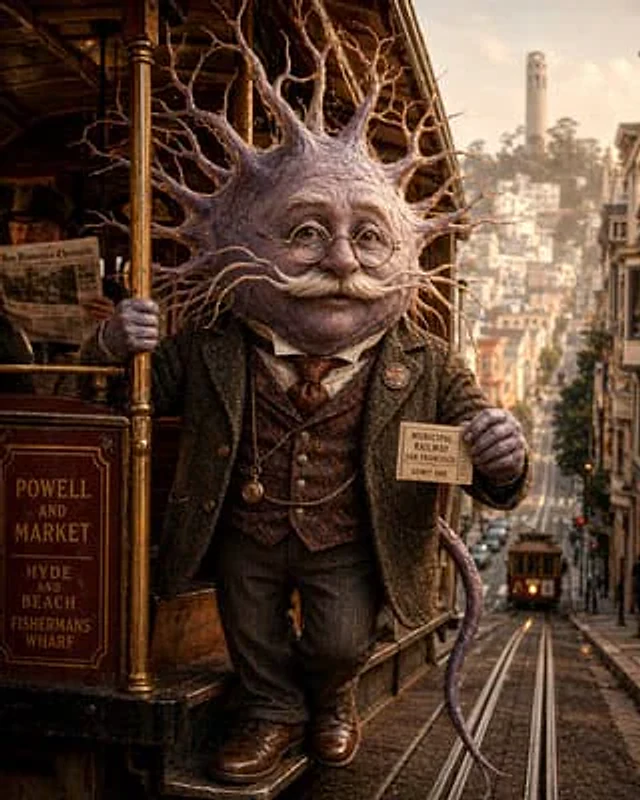

```text
A fantastical, cinematic portrait depicts an anthropomorphic neuron riding the outer footboard of a classic San Francisco cable car during prime time. The character possesses a massive, circular neuronal head with dozens of long dendrites radiating outwards like a crown, displaying a texture of pale purple, magenta, and flesh-gray with a subtle organic sheen. The face is blurred and featureless. The figure is dressed in Victorian or Edwardian gentleman's attire: a dark tweed jacket, patterned vest, shirt, tie, pinstripe trousers, polished brown shoes, and a pocket watch chain. One hand grips the brass pole of the cable car, while the other holds a vintage transit ticket inscribed "MUNICIPAL RAILWAY SAN FRANCISCO ADMIT ONE," accompanied by a small, round lapel badge bearing the word "MUNI." A slender, purple, axonal tail curls behind the body. The cable car is richly detailed, made of lacquered wood and brass, with a route sign on the side reading "POWELL AND MARKET / HYDE AND BEACH / FISHERMANS WHARF". The background shows a steep San Francisco street, with the cable car track extending into the distance. A second cable car is visible below a hillside in the distance, flanked by dense city buildings, and the Coit Tower is visible on the hazy mountaintop. The warm, nostalgic lighting, shallow depth of field, ultra-fine textures, surrealism, humorous yet elegant atmosphere, and centered full-body vertical composition all contribute to the overall effect.
```

Model: GPT Image 2
Author: GPT Image 2 Prompts

[ProjectD](https://aitoolsradar.com/en/prompts/534af5f1aa83af) · [Recorded source](https://x.com/hive_echo/status/2047760111284928727#reversed-0)
 · [Full original metadata and byte evidence](data/projectd-batch-0041.json)

## New Chinese Aesthetics Style Atlas

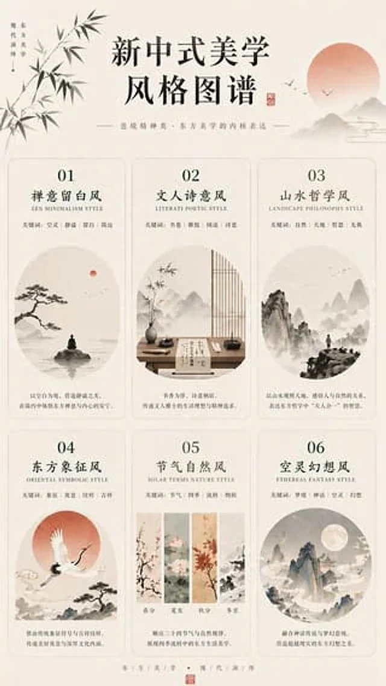

```text
{
  "type": "New Chinese Aesthetics Infographic Poster",
  "theme": "New Chinese aesthetics project",
  "canvas": {
    "orientation": "Vertical",
    "aspect_ratio": "John 2:3",
    "background": "The warm ivory white Xuan paper has a delicate grainy texture and an elegant, minimalist design."
  },
  "headline": {
    "main": "{argument name=\"headline text\" default=\"New Chinese Aesthetic Style Map\"}",
    "sub": "The essence of Eastern aesthetics: artistic conception and spirituality.",
    "style": "At the top center is a large black Chinese calligraphy serif title, below which are delicate thin gray dividing lines and a smaller subtitle."
  },
  "decorative_elements": {
    "left_side": "A bamboo branch extends diagonally from the upper left corner, accompanied by a line of slender, vertical text that reads \"Modern Interpretation\" and \"Eastern Aesthetics.\"",
    "right_side": "A large, soft terracotta sun, misty mountains, three flying birds, and delicate gold cloud patterns.",
    "bottom": "Small, well-spaced Chinese footer text and a red stamp"
  },
  "layout": {
    "grid": {
      "columns": 3,
      "rows": 2,
      "count": 6,
      "card_style": "High-rounded rectangular cards with thin light gray borders, evenly arranged."
    },
    "sections": [
      {
        "title": "01 Zen-inspired minimalist style",
        "subtitle": "ZEN MINIMALISM STYLE",
        "keywords": [
          "ethereal",
          "Tranquility",
          "White space",
          "Jian Yuan"
        ],
        "image": "An oval halo depicts a person meditating on a rock in still water, with sparse pine trees extending to the left, a tiny red sun, and soft distant mist—a monochrome ink wash landscape painting.",
        "caption": "Using blank space as a backdrop, it creates a tranquil beauty, embodying Eastern Zen and inner peace in its simplicity."
      },
      {
        "title": "02 Literati Poetic Style",
        "subtitle": "LITERATI POETIC STYLE",
        "keywords": [
          "Books",
          "Elegant",
          "Leisure",
          "poetry"
        ],
        "image": "An oval halo depicts a scholar's desk scene, complete with calligraphy scrolls, inkstones, ceramics, bamboo ornaments in vases, screens, or vertical latticework, against a backdrop of layered, misty mountains.",
        "caption": "Accompanied by books, living a poetic life, conveying the life ideals and spiritual pursuits of literati."
      },
      {
        "title": "03 Landscape Philosophy Style",
        "subtitle": "LANDSCAPE PHILOSOPHY STYLE",
        "keywords": [
          "nature",
          "world",
          "Philosophical thoughts",
          "No self"
        ],
        "image": "An oval-shaped ink-wash landscape painting, towering peaks amidst clouds and mist, with a tiny figure standing on a cliff overlooking the panoramic view.",
        "caption": "By observing the world through mountains and rivers, we can understand the relationship between humanity and nature and express the wisdom of \"harmony between humanity and nature\" in Eastern philosophy."
      },
      {
        "title": "04 Eastern Symbol of Wind",
        "subtitle": "ORIENTAL SYMBOLIC STYLE",
        "keywords": [
          "Symbol",
          "Gao Yi",
          "Pattern",
          "auspicious"
        ],
        "image": "An oval halo depicts a white crane spreading its wings across a coral-colored sky, with stylized blue-grey mountains and auspicious clouds below.",
        "caption": "Through traditional symbols and auspicious patterns, it conveys beautiful meanings and profound cultural connotations."
      },
      {
        "title": "05 Solar Terms Natural Wind",
        "subtitle": "SOLAR TERMS NATURE STYLE",
        "keywords": [
          "Solar Terms",
          "four seasons",
          "circulation",
          "phenology"
        ],
        "image": "The card contains four narrow, vertical seasonal panels labeled \"Vernal Equinox,\" \"Summer Solstice,\" \"Autumnal Equinox,\" and \"Winter Solstice,\" showcasing flowers, lotus blossoms, lush summer flowers, autumn foliage, and a winter pavilion in the snow.",
        "caption": "Following the twenty-four solar terms and the laws of nature, it showcases the aesthetics of Eastern life in the changing seasons."
      },
      {
        "title": "06 Ethereal Fantasy Style",
        "subtitle": "ETHEREAL FANTASY STYLE",
        "keywords": [
          "Dreams",
          "myth",
          "ethereal",
          "fantasy"
        ],
        "image": "An oval-shaped fantasy landscape, a bright full moon, layered blue-gold mountains, flowing white mist rivers, floating palace buildings, and a surreal fairyland atmosphere.",
        "caption": "It blends mythology and fantasy with a dreamlike atmosphere to create an oriental fantasy beauty that transcends reality."
      }
    ],
    "centerpiece": "The six cards together form a complete visual style map."
  },
  "style": {
    "palette": [
      "Ivory White",
      "warm beige",
      "Ink Black",
      "Soft gray",
      "Fog White",
      "Soft terracotta color",
      "gray-blue",
      "pale gold"
    ],
    "rendering": "High-end editorial posters, elegant Chinese-style typography, combining ink painting with exquisite digital collage, restrained luxury, and a calm composition with ample white space.",
    "mood": "Tranquil, intellectual, poetic, thoughtful, sophisticated"
  },
  "constraints": {
    "text_language": "Chinese title and body text, with a few English subheadings.",
    "overall_quality": "Neat, printable infographic posters with precise alignment and ample white space."
  }
}
```

Model: GPT Image 2
Author: GPT Image 2 Prompts

[ProjectD](https://aitoolsradar.com/en/prompts/02a4bb5a7bddf5) · [Recorded source](https://x.com/liyue_ai/status/2046824148304048381#reversed-3)
 · [Full original metadata and byte evidence](data/projectd-batch-0041.json)

## New Chinese Aesthetics Style Atlas

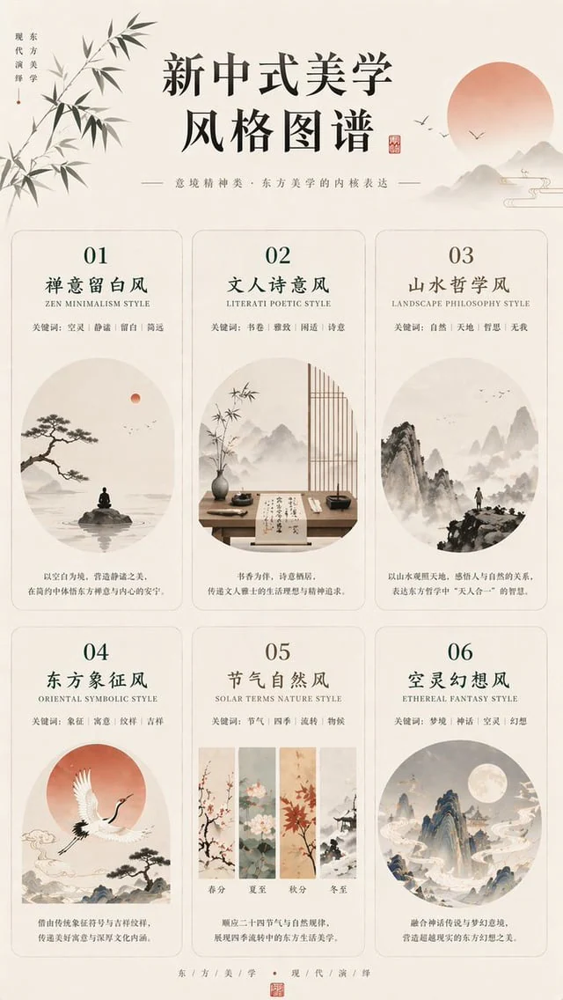

```text
{"type":"Chinese aesthetic style infographic poster","theme":"new Chinese aesthetics mood board","canvas":{"orientation":"portrait","aspect_ratio":"roughly 2:3","background":"warm ivory rice-paper texture with subtle grain, elegant minimalist editorial design"},"headline":{"main":"{argument name=\"headline text\" default=\"新中式美学 风格图谱\"}","sub":"意境精神类 · 东方美学的内核表达","style":"large black Chinese calligraphic serif title centered near the top, with a refined thin gray divider line and smaller subtitle beneath"},"decorative_elements":{"left_side":"ink bamboo branch extending diagonally from upper left, with a slim vertical line of small Chinese text reading 现代演绎 and 东方美学","right_side":"large muted terracotta sun, pale misty mountains, 3 small birds in flight, and thin gold cloud-like line ornament","bottom":"small spaced Chinese footer text and a red seal stamp"},"layout":{"grid":{"columns":3,"rows":2,"count":6,"card_style":"tall rounded-rectangle cards with thin light-gray borders, evenly spaced"},"sections":[{"title":"01 禅意留白风","subtitle":"ZEN MINIMALISM STYLE","keywords":["空灵","静谧","留白","简远"],"image":"oval vignette showing a lone person meditating on a rock in still water, sparse pine tree extending from the left, tiny red sun, soft distant mist, monochrome ink-wash landscape","caption":"以空白为境，营造静谧之美，在简约中体现东方禅意与内心的安宁。"},{"title":"02 文人诗意风","subtitle":"LITERATI POETIC STYLE","keywords":["书卷","雅致","闲适","诗意"],"image":"oval vignette of a scholar's desk scene with brush calligraphy scroll, inkstone, ceramics, bamboo arrangement in vase, folding screen or vertical lattice, layered misty mountains behind","caption":"书香为伴，诗意栖居，传递文人雅士的生活理想与精神追求。"},{"title":"03 山水哲学风","subtitle":"LANDSCAPE PHILOSOPHY STYLE","keywords":["自然","天地","哲思","无我"],"image":"oval ink landscape with towering mountains and fog, a tiny standing figure on a cliff overlooking the scene","caption":"以山水观照天地，感悟人与自然的关系，表达东方哲学中“天人合一”的智慧。"},{"title":"04 东方象征风","subtitle":"ORIENTAL SYMBOLIC STYLE","keywords":["象征","高意","纹样","吉祥"],"image":"oval vignette featuring 1 white crane with wings spread flying across a coral-tinted sky above stylized blue-gray mountains and auspicious clouds","caption":"借由传统象征符号与吉祥纹样，传递美好寓意与深厚文化内涵。"},{"title":"05 节气自然风","subtitle":"SOLAR TERMS NATURE STYLE","keywords":["节气","四季","流转","物候"],"image":"inside the card, 4 narrow vertical seasonal panels labeled 春分, 夏至, 秋分, 冬至, showing blossoms, lotus or lush summer flowers, autumn leaves, and snowy winter pavilion","caption":"顺应二十四节气与自然规律，展现四季流转中的东方生活美学。"},{"title":"06 空灵幻想风","subtitle":"ETHEREAL FANTASY STYLE","keywords":["梦境","神话","空灵","幻想"],"image":"oval fantasy landscape with luminous full moon, layered blue-gold mountains, flowing white mist-rivers, floating palace architecture, and surreal celestial atmosphere","caption":"融合神话传说与梦幻意境，营造超越现实的东方幻想之美。"}],"centerpiece":"the 6 cards as a complete visual atlas of styles"},"style":{"palette":["ivory","warm beige","ink black","soft gray","mist white","muted terracotta","dusty blue","pale gold"],"rendering":"high-end editorial poster, elegant Chinese typography, ink wash painting mixed with refined digital collage, restrained luxury, calm spacious composition","mood":"serene, intellectual, poetic, contemplative, premium"},"constraints":{"text_language":"Chinese titles and body text with small English subtitles","overall_quality":"clean print-ready infographic poster with precise alignment and generous negative space"}}
```

Model: GPT Image 2
Author: 李岳

[ProjectD](https://aitoolsradar.com/en/prompts/aaf726e0ca76bb) · [Recorded source](https://youmind.com/prompts/chinese-aesthetic-style-atlas-14877)
 · [Full original metadata and byte evidence](data/projectd-batch-0041.json)

## New Chinese Aesthetics Style Chart

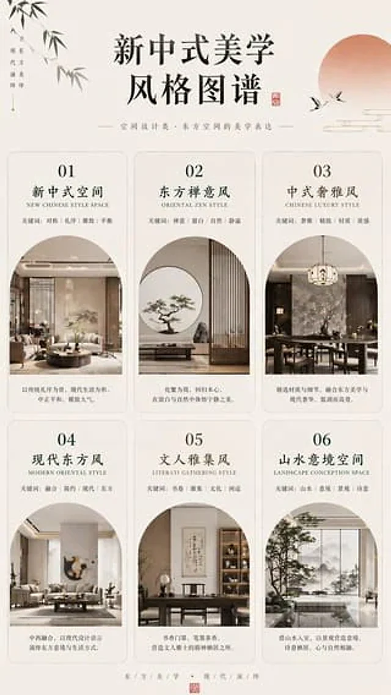

```text
{
  "type": "New Chinese Style Interior Design Infographic Poster",
  "style": "The poster features an elegant editorial style, employing traditional Chinese visual language, a minimalist yet luxurious layout, soft neutral tones, exquisite typography, and ample negative space.",
  "canvas": {
    "orientation": "Vertical",
    "background": "Warm off-white Xuan paper texture"
  },
  "headline": {
    "main": "{argument name=\"headline text\" default=\"New Chinese Aesthetic Style Map\"}",
    "subtitle": "Spatial Design Category: Aesthetic Expression of Eastern Space",
    "position": "Centered at the top",
    "font": "Large, bold, Chinese serif calligraphy font, black."
  },
  "decorative_elements": {
    "count": 6,
    "items": [
      "The ink-wash style bamboo branch hanging in the upper left corner",
      "Vertical small text at the top left edge",
      "The thin gold line below the title",
      "The red square stamp near the title",
      "The large, light terracotta-colored sun or moon ring in the upper right corner",
      "Two flying cranes with fine cloud patterns near the upper right corner"
    ]
  },
  "layout": {
    "grid": {
      "columns": 3,
      "rows": 2,
      "count": 6
    },
    "cards": [
      {
        "index": "01",
        "title_cn": "New Chinese style space",
        "title_en": "NEW CHINESE STYLE SPACE",
        "keywords": "Symmetrical order, elegant balance",
        "image": "The bright and luxurious living room features a symmetrical composition, soft beige tones, a Chinese-style screen, a landscape painting, a round coffee table, and layered lighting.",
        "caption": "It takes traditional etiquette as its foundation and modern life as its form, embodying moderation, harmony, elegance, and grandeur."
      },
      {
        "index": "02",
        "title_cn": "Eastern Zen Style",
        "title_en": "ORIENTAL ZEN STYLE",
        "keywords": "Zen-like blank space creates natural tranquility",
        "image": "The minimalist Zen-inspired interior features a circular moon gate, bonsai trees, a low table, stone carvings, vertical wooden latticework, and tranquil blank spaces.",
        "caption": "Simplify the complex, return to your true self, and experience the beauty of tranquility in blank spaces and nature."
      },
      {
        "index": "03",
        "title_cn": "Chinese luxury style",
        "title_en": "CHINESE LUXURY STYLE",
        "keywords": "Luxurious and exquisite material texture",
        "image": "A high-end Chinese restaurant with marble walls, dark wood furniture, elegant chandeliers, floral decorations, and warm ambient lighting.",
        "caption": "Exquisite materials and details, blending Eastern aesthetics with modern luxury, understated yet noble."
      },
      {
        "index": "04",
        "title_cn": "Modern Oriental Style",
        "title_en": "MODERN ORIENTAL STYLE",
        "keywords": "A blend of minimalist modern and oriental styles",
        "image": "A modern minimalist living room, featuring cream and gray tones, abstract circular wall art, low-profile furniture, clean lines, and a subtle Asian style.",
        "caption": "A fusion of East and West, using modern design language to interpret Eastern aesthetics and lifestyle."
      },
      {
        "index": "05",
        "title_cn": "Literati gatherings",
        "title_en": "LITERATI GATHERING STYLE",
        "keywords": "Book gatherings, culture, and leisure",
        "image": "A study or tea room, furnished with calligraphy scrolls, a wooden desk, shelves, ceramics, and warm lighting, creating a tranquil atmosphere full of cultural charm.",
        "caption": "A scholarly family, surrounded by the fragrance of ink, brush, and tea, creating a spiritual haven for literati and scholars."
      },
      {
        "index": "06",
        "title_cn": "Landscape Artistic Conception Space",
        "title_en": "LANDSCAPE CONCEPTION SPACE",
        "keywords": "Poetic Landscape",
        "image": "A poetic indoor landscape courtyard, featuring indoor trees, reflecting water features, floor-to-ceiling windows, hazy mountain views outside, and tranquil sunlight.",
        "caption": "Bringing mountains and waters indoors, creating an artistic conception through landscape, living poetically, and merging the heart with nature."
      }
    ]
  },
  "footer": {
    "text": "{argument name=\"footer text\" default=\"Eastern Aesthetics: A Modern Interpretation\"}",
    "position": "Centered at the bottom",
    "decoration": "The small red stamp at the bottom of the page"
  },
  "color_palette": {
    "count": 5,
    "colors": [
      "Warm Ivory White",
      "Light beige",
      "grayish brown",
      "Deep charcoal ink color",
      "Soft terracotta color"
    ]
  },
  "rendering": {
    "quality": "High-resolution minimalist graphic design poster",
    "lighting": "Each interior image uses soft, diffused editing lighting.",
    "composition": "A balanced, symmetrical poster design, featuring rounded rectangular cards and an arched image window."
  }
}
```

Model: GPT Image 2
Author: GPT Image 2 Prompts

[ProjectD](https://aitoolsradar.com/en/prompts/c7cf525dba2a9c) · [Recorded source](https://x.com/liyue_ai/status/2046824148304048381#reversed-1)
 · [Full original metadata and byte evidence](data/projectd-batch-0041.json)

## New Chinese Aesthetics Style Chart

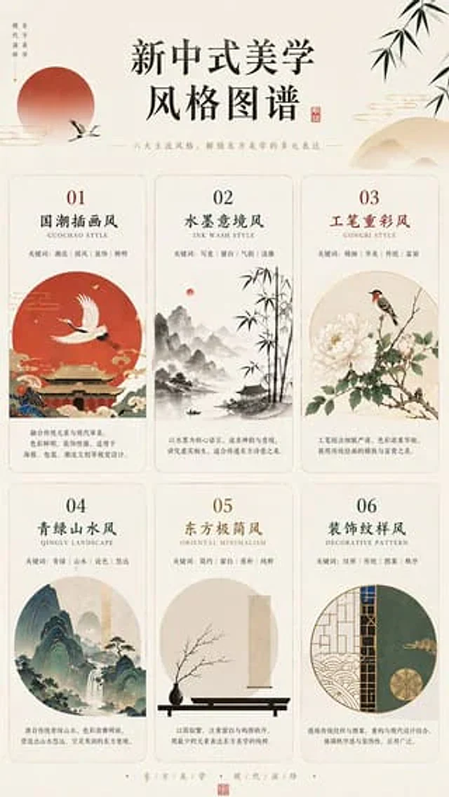

```text
{
  "type": "New Chinese Aesthetic Style Poster",
  "theme": "{argument name=\"headline text\" default=\"New Chinese Aesthetic Style Map\"}",
  "subtitle": "Six mainstream styles unlock diverse expressions of Eastern aesthetics",
  "orientation": "Vertical poster",
  "aspect_ratio": "2:3",
  "background": {
    "color": "Warm ivory parchment",
    "texture": "Delicate Xuan paper texture",
    "decorative_elements_count": 7,
    "decorative_elements": [
      "Big red sun in the upper left corner",
      "Two cranes fly together beside the sun.",
      "Bamboo leaves hanging in the upper right corner",
      "Abstract mountains in soft beige in the upper right corner",
      "The delicate golden cloud pattern on the left",
      "The delicate golden cloud pattern on the right",
      "The small red stamp near the title area and the bottom center"
    ]
  },
  "style": "Elegant Neo-Chinese design, exquisitely edited infographics, balanced use of white space, high-end printed posters.",
  "layout": {
    "grid": {
      "columns": 3,
      "rows": 2,
      "card_count": 6
    },
    "sections": [
      {
        "title": "01 Chinese-style illustration",
        "subtitle": "GUOCHAO STYLE",
        "position": "Top left",
        "count": 1,
        "keywords": [
          "trend",
          "Chinese style",
          "decorate",
          "vivid"
        ],
        "image": "A bold illustration featuring a bright red sun, white cranes spreading their wings, ornate traditional palace eaves, and stylized blue waves and cloud patterns in saturated red, gold, cyan, and cream colors.",
        "description": "It blends traditional elements with modern aesthetics, features vibrant colors and strong decorative appeal, and is suitable for visual design such as posters, packaging, and trendy cultural and creative products."
      },
      {
        "title": "02 Ink Painting Style",
        "subtitle": "INK WASH STYLE",
        "position": "Upper-middle",
        "count": 1,
        "keywords": [
          "freehand brushwork",
          "White space",
          "Qi Yun",
          "elegant"
        ],
        "image": "A hazy, monochrome landscape, with layered mountains, lake, boats, pavilions, bamboo poles, and a small red sun, rendered in soft ink wash.",
        "description": "Using ink painting as its core language, it pursues charm and artistic conception, emphasizes the interplay of emptiness and fullness, and is suitable for conveying the beauty of Eastern poetry."
      },
      {
        "title": "03 Fine Brushwork and Heavy Color Style",
        "subtitle": "GONGBI STYLE",
        "position": "Top right",
        "count": 1,
        "keywords": [
          "fine",
          "Huamei",
          "Tradition",
          "Magnificent"
        ],
        "image": "The painting is a delicate and meticulous work, depicting birds perched on flowering branches and large white peonies. Fine lines and rich, soft colors are used within a light-colored circular border.",
        "description": "The meticulous and rigorous brushwork technique, along with the rich and gorgeous colors, showcases the exquisite and opulent beauty of traditional painting."
      },
      {
        "title": "04 Green Mountains and Waters",
        "subtitle": "QINGLÜ LANDSCAPE",
        "position": "Bottom left",
        "count": 1,
        "keywords": [
          "Green",
          "landscape",
          "Coloring",
          "distant"
        ],
        "image": "The landscape within the circular border features layered mountains, waterfalls, pine trees, and clouds, rendered using mineral pigments such as cyan, azurite, and matte gold.",
        "description": "Inspired by traditional green landscapes, the colors are elegant and bright, creating a timeless, ethereal, and beautiful oriental atmosphere."
      },
      {
        "title": "05. Oriental Minimalist Style",
        "subtitle": "ORIENTAL MINIMALISM",
        "position": "Middle to lower",
        "count": 1,
        "keywords": [
          "Simple",
          "White space",
          "Simple",
          "purely"
        ],
        "image": "A minimalist still life scene: a black vase filled with withered branches, a low, dark wooden table, and a background of a hanging scroll and a large expanse of light-colored wall with minimal white space.",
        "description": "It uses simplicity to control complexity, emphasizes white space and compositional order, and expresses the purity of Eastern aesthetics with the fewest elements."
      },
      {
        "title": "06 Decorative Pattern Style",
        "subtitle": "DECORATIVE PATTERN",
        "position": "Bottom right",
        "count": 1,
        "keywords": [
          "Pattern",
          "Tradition",
          "pattern",
          "order"
        ],
        "image": "The decorative geometric composition within the circular frame combines window lattice patterns, wave patterns, dark green blocks, gold lines, and circular decorative badges.",
        "description": "It extracts traditional patterns and designs, reconstructs and combines them with modern design, emphasizes a sense of order and decoration, and has a wide range of applications."
      }
    ],
    "header": {
      "top_left_vertical_text": "Modern Interpretation of Eastern Aesthetics",
      "bottom_text": "Eastern Aesthetics: A Modern Interpretation"
    }
  },
  "typography": {
    "title_font": "Large, bold Song-style serif font",
    "subtitle_font": "Small elegant serif font",
    "number_style": "The large colored numbers 01 to 06 at the top of each card",
    "body_text": "Small Chinese serif font paragraph",
    "english_labels": true
  },
  "color_palette": {
    "main": [
      "Ivory White",
      "black",
      "Dark red",
      "gold",
      "Sage Green",
      "blue",
      "Fog gray",
      "Beige"
    ]
  },
  "rendering": "Clean, high-resolution poster design; crisp, clear typography; exquisite Chinese-style illustration details; symmetrical spacing; museum-quality editorial aesthetics."
}
```

Model: GPT Image 2
Author: GPT Image 2 Prompts

[ProjectD](https://aitoolsradar.com/en/prompts/dc7446ef17f2fb) · [Recorded source](https://x.com/liyue_ai/status/2046824148304048381#reversed-0)
 · [Full original metadata and byte evidence](data/projectd-batch-0041.json)

## New Chinese Aesthetics Style Chart

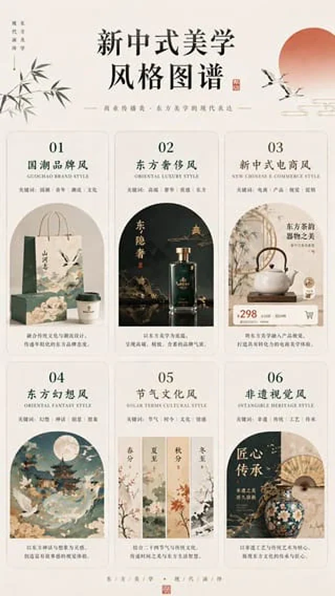

```text
{
  "type": "New Chinese Aesthetics Infographic Poster",
  "topic": "{argument name=\"headline text\" default=\"New Chinese Aesthetic Style Map\"}",
  "style": "Elegant Neo-Chinese style, exquisitely edited infographics, high-end cultural brand project.",
  "canvas": {
    "orientation": "portrait",
    "background": "The paper has a warm ivory color and a very fine grainy texture.",
    "palette": [
      "Ivory White",
      "Ink Black",
      "Deep Forest Green",
      "Morandi Jade",
      "gold",
      "Red Ceramic Red",
      "Soft beige"
    ]
  },
  "header": {
    "title": "New Chinese Aesthetic Style Map",
    "subtitle": "Business Communication: A Modern Expression of Eastern Aesthetics",
    "decorations": {
      "left": "The bamboo branch, painted in the style of ink painting, is accompanied by a slender vertical label that reads \"Modern Interpretation\" and a small hanging ornament.",
      "right": "A giant Morandi red sun disc, two flying cranes, fine cloud patterns, and small red stamps."
    }
  },
  "layout": {
    "structure": "Six rounded rectangular cards are arranged in 2 rows and 3 columns.",
    "card_count": 6,
    "sections": [
      {
        "title": "01 Chinese Brand Style",
        "position": "top-left",
        "count": 1,
        "labels": [
          "GUOCHAO BRAND STYLE"
        ],
        "keywords": [
          "Kunishio",
          "youth",
          "trend",
          "culture"
        ],
        "image": "An arched product display featuring three items: a shopping bag with an illustration of cranes and mountains, a matching rectangular product box, and a takeaway cup; soft studio lighting.",
        "caption": "It blends traditional culture with trendy design to convey a youthful Eastern brand attitude."
      },
      {
        "title": "02 Eastern Luxury Style",
        "position": "top-center",
        "count": 1,
        "labels": [
          "ORIENTAL LUXURY STYLE"
        ],
        "keywords": [
          "high-end",
          "luxurious",
          "texture",
          "East"
        ],
        "image": "An arched advertisement for a high-end perfume features a dark glass bottle at the center of a black and dark green background, with artistic lines of gold mountains reflecting off the surface, and the vertical Chinese characters \"东隐奢香\" (Dongyin Shexiang).",
        "caption": "With Eastern aesthetics as its foundation, it presents a high-end, refined, and understated brand image."
      },
      {
        "title": "03 New Chinese Style E-commerce",
        "position": "top-right",
        "count": 1,
        "labels": [
          "NEW CHINESE E-COMMERCE STYLE"
        ],
        "keywords": [
          "e-commerce",
          "product",
          "Visual",
          "Promotion"
        ],
        "image": "An arched e-commerce product card features a white teapot on a wooden base, against a background of bamboo and a moon gate. The promotional layout displays the price as ¥298 and a small shopping cart icon.",
        "caption": "Integrate Eastern aesthetics into product visuals to create an e-commerce aesthetic experience that drives conversion."
      },
      {
        "title": "04 Eastern Fantasy Style",
        "position": "bottom-left",
        "count": 1,
        "labels": [
          "ORIENTAL FANTASY STYLE"
        ],
        "keywords": [
          "fantasy",
          "myth",
          "Creativity",
          "Imagine"
        ],
        "image": "An arched fantasy illustration featuring a giant full moon, a traditional palace, swirling clouds and water, two white cranes, flowers, and a dramatic blue and gold atmosphere.",
        "caption": "Inspired by Eastern mythology and imagination, we create a visually engaging experience that tells a story."
      },
      {
        "title": "05 Solar Terms Culture",
        "position": "bottom-center",
        "count": 4,
        "labels": [
          "spring equinox",
          "Summer Solstice",
          "Autumn Equinox",
          "winter solstice"
        ],
        "keywords": [
          "Solar Terms",
          "season",
          "culture",
          "emotion"
        ],
        "image": "Four narrow, vertical panels display the solar terms: plum blossoms in spring, lotus flowers in summer, maple leaves in autumn, and snow-covered branches and mountains in winter.",
        "caption": "Combining the 24 solar terms with traditional culture, it conveys the beauty of time and the wisdom of Eastern life."
      },
      {
        "title": "06 Intangible Cultural Heritage Visual Style",
        "position": "bottom-right",
        "count": 1,
        "labels": [
          "INTANGIBLE HERITAGE STYLE"
        ],
        "keywords": [
          "Intangible Cultural Heritage",
          "Tradition",
          "process",
          "Inheritance"
        ],
        "image": "The arched intangible cultural heritage themed display includes two handicrafts: an ornate floral porcelain vase and a folding fan, set against a dark circular background with gold decorative lines and the striking Chinese characters \"Craftsmanship Inheritance\".",
        "caption": "With intangible cultural heritage crafts and traditional arts as its core, it showcases the inheritance and craftsmanship of Eastern culture."
      }
    ],
    "footer": {
      "text": "Eastern Aesthetics: A Modern Interpretation",
      "seal": "Small red square stamp at the bottom center"
    }
  },
  "typography": {
    "title_font": "Large Song-style Chinese font",
    "body_font": "Simple serif font, with a small English subheading",
    "numbers": "The chapter numbers, 01 to 06, are highlighted in bold dark green."
  },
  "rendering": "A clean, print-quality poster with balanced spacing, sophisticated editorial design, high legibility, soft shadows, and a well-composed layout."
}
```

Model: GPT Image 2
Author: GPT Image 2 Prompts

[ProjectD](https://aitoolsradar.com/en/prompts/5be49091eec824) · [Recorded source](https://x.com/liyue_ai/status/2046824148304048381#reversed-2)
 · [Full original metadata and byte evidence](data/projectd-batch-0041.json)

## New Chinese Ink Landscape Poster

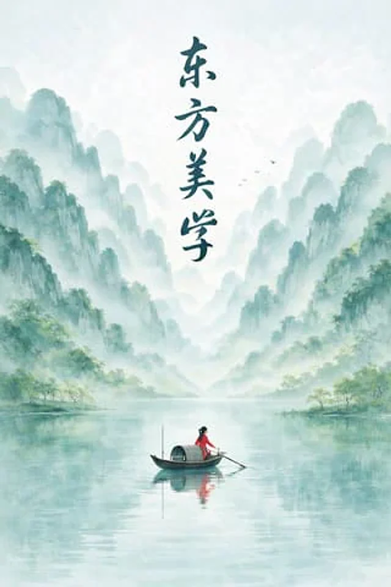

```text
新中式水墨山水海报，竖版9:16构图，东方极简美学风格，大面积留白，主题是春岚一叶红。
```

Model: GPT Image 2
Author: @liyue_ai

[ProjectD](https://aitoolsradar.com/en/prompts/650000bc7e3c35) · [Recorded source](https://x.com/liyue_ai/status/2046215276249993720)
 · [Full original metadata and byte evidence](data/projectd-batch-0041.json)

## New Zealand Travel Guide Poster

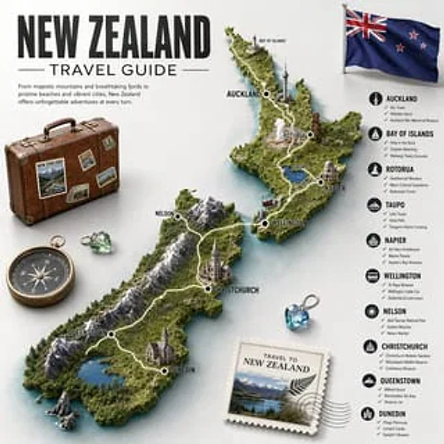

```text
{
  "type": "Travel poster infographic",
  "theme": "Retro-style premium travel guide map",
  "subject": {
    "country": "{argument name=\"destination country\" default=\"New Zealand\"}",
    "map_style": "A 3D illustrative topographic map showing the shape of New Zealand against a clean, light gray background, viewed from above.",
    "terrain": "Lush green land, rising terrain, rocky mountains, lakes, coastline, and soft ocean shadows.",
    "route": "A bright white road network connects major destinations and circular city landmarks."
  },
  "layout": {
    "format": "Square poster",
    "sections": [
      {
        "title": "Main title",
        "position": "Top left corner",
        "count": 3,
        "labels": [
          "New Zealand",
          "Travel Guide",
          "Introduction Paragraph"
        ]
      },
      {
        "title": "Map Destination",
        "position": "Center and right side",
        "count": 10,
        "labels": [
          "Bay of Islands",
          "Auckland",
          "Rotorua",
          "Tao Bo",
          "Napier",
          "Wellington",
          "Nelson",
          "Christchurch",
          "Queenstown",
          "Dunedin"
        ]
      },
      {
        "title": "Destination Highlights List",
        "position": "Rightmost vertical column",
        "count": 9,
        "labels": [
          "Auckland",
          "Bay of Islands",
          "Rotorua",
          "Tao Bo",
          "Napier",
          "Wellington",
          "Nelson",
          "Christchurch",
          "Queenstown",
          "Dunedin"
        ]
      },
      {
        "title": "Travel gear",
        "position": "Left side and bottom right corner",
        "count": 5,
        "labels": [
          "Vintage brown suitcase with travel stickers",
          "Antique compass",
          "Green faceted gemstone souvenir",
          "Blue faceted gemstone souvenir",
          "stamp"
        ]
      }
    ],
    "centerpiece": "A large sculptural map of New Zealand's North and South Islands, complete with miniature landmarks and labeled cities."
  },
  "text": {
    "headline": "{argument name=\"headline text\" default=\"New Zealand\"}",
    "subheadline": "{argument name=\"subheadline text\" default=\"Travel Guide\"}",
    "intro": "{argument name=\"intro text\" default=\"From majestic mountains and stunning fjords to pristine beaches and vibrant cities, New Zealand offers unforgettable adventures at every turn.\"}",
    "stamp_text": "{argument name=\"stamp text\" default=\"New Zealand trip\"}"
  },
  "map_details": {
    "north_island": {
      "count": 6,
      "labels": [
        "Bay of Islands",
        "Auckland",
        "Rotorua",
        "Tao Bo",
        "Napier",
        "Wellington"
      ]
    },
    "south_island": {
      "count": 4,
      "labels": [
        "Nelson",
        "Christchurch",
        "Queenstown",
        "Dunedin"
      ]
    },
    "mini_landmarks": {
      "count": 8,
      "labels": [
        "Sky Tower near Auckland",
        "Traditional Maori-style statues near Rotorua",
        "Classical domed buildings near Napier",
        "Mountain ranges spanning the South Island",
        "Cathedral-style buildings near Christchurch",
        "Churches near Dunedin",
        "Small red vehicles near the central route",
        "Sea stacks of rocks near the southwest coast"
      ]
    },
    "flag": {
      "count": 1,
      "description": "The New Zealand flag on the silver flagpole in the upper right corner"
    }
  },
  "style": {
    "color_palette": "Natural green, slate grey mountains, white roads, soft blue waters, brown leather, black typography",
    "lighting": "Soft studio lighting creates realistic shadows.",
    "typography": "Bold, compact sans-serif headings; clean editing and layout.",
    "render_quality": "Highly detailed and exquisite business posters, combining infographic design with realistic miniature models."
  }
}
```

Model: GPT Image 2
Author: GPT Image 2 Prompts

[ProjectD](https://aitoolsradar.com/en/prompts/216f16feb18fae) · [Recorded source](https://x.com/Naiknelofar788/status/2047135588378362280#reversed-0)
 · [Full original metadata and byte evidence](data/projectd-batch-0041.json)

## Newsletter Header — Tech Bulletin


```text
Square 1:1 newsletter header illustration in a flat editorial vector style. Soft warm cream background. Centered illustration of a single hand holding up a folded paper newspaper with the word "TECH" subtly readable on the front, surrounded by floating small abstract icons: envelope, lightbulb, terminal cursor, graph line, in muted teal and warm orange. Above the illustration a bold serif title reads "The Weekly Bulletin". Below it a small line "Sent every Friday, 7 AM". Square 1:1 composition. No real publication name, no logos, no watermark. Premium editorial newsletter design quality.
```

Model: GPT Image 2
Author: @hiapi_ai

[ProjectD](https://aitoolsradar.com/en/prompts/89e2f5d2252f62) · [Recorded source](https://github.com/HiAPIAI/awesome-gpt-image-2-prompts)
 · [Full original metadata and byte evidence](data/projectd-batch-0041.json)

## Next-Gen Voxel Game Screenshot

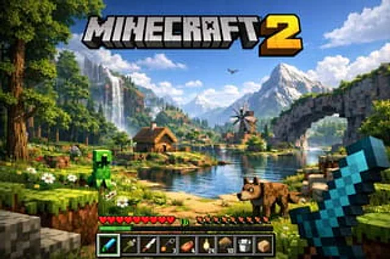

```text
A highly detailed and realistic screenshot of a next-generation voxel-based first-person video game. At the top center, a large, bold 3D logo is displayed.{argument name="game title" default="MINECRAFT 2"} The scene presented{argument name="environment" default="A lush, blocky landscape featuring rivers, cabins, windmills, waterfalls, and majestic mountains in the background."} This world blends realistic lighting, volumetric clouds, and high-resolution textures with cubic voxel geometry. In the left foreground, a {argument name="mob 1" default="Green Creeper in a cube shape"} Standing on the grass, and one{argument name="mob 2" default="Square-shaped brown wolf"} Standing on the dirt road to the right. On the far right, the player's hand is holding a weapon in a first-person perspective.{argument name="held item" default="Pixelated Blue Diamond Sword"} At the bottom of the screen is the game's user interface, which includes a health bar consisting of 10 red hearts, a green experience bar displaying the number "16", a hunger bar consisting of 10 brown meat icon icons, and a 9-slot item quick slot. From left to right, the quick slot contains: a blue tool highlighted in green, a green tool, a knife, a wrench with the number "3", a meat icon with the number "6", a lantern with the number "24", a dirt block with the number "10", a bucket, and a sponge block.
```

Model: GPT Image 2
Author: GPT Image 2 Prompts

[ProjectD](https://aitoolsradar.com/en/prompts/1608de3d4141a9) · [Recorded source](https://x.com/wolfaidev/status/2046294034411667620#reversed-0)
 · [Full original metadata and byte evidence](data/projectd-batch-0041.json)

## Night Beach Sparkler Snapshot

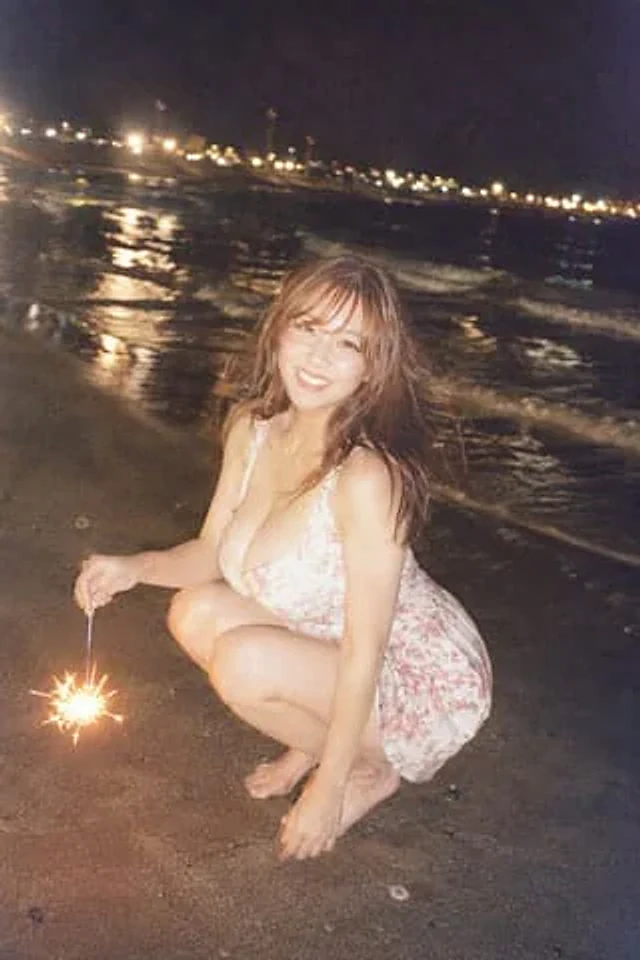

```text
Create a candid flash-photo style nighttime beach snapshot of an adult {argument name="subject" default="young woman"} crouching low on wet sand near the shoreline, barefoot, wearing a short white floral summer dress with pink flower pattern and thin straps. She is holding one lit handheld sparkler in her left hand close to the sand, producing a bright golden flare and star-shaped sparks that illuminate her hand and the lower-left foreground. Her right hand rests near her toes, knees bent, body angled three-quarters toward the camera. Her medium-length {argument name="hair color" default="brown"} hair is loose and slightly windblown. Cover the face completely with a centered solid beige rectangular blur/censor block, with no facial details visible. The background is a dark ocean at night with small waves rolling in, wet sand reflecting warm streetlights, and a long diagonal line of blurry yellow-white promenade lights receding into the distance along the shore. Use a grainy, imperfect disposable-camera aesthetic with direct flash on the subject, high ISO noise, slight motion blur, warm highlights, dark blue-black sky, and a vertical smartphone composition. No text, no watermark, no extra people, exactly one visible sparkler, exactly one crouching subject, exactly one beige face-obscuring rectangle.
```

Model: GPT Image 2
Author: AI Girl's Photo Studio

[ProjectD](https://aitoolsradar.com/en/prompts/075187b7be710d) · [Recorded source](https://youmind.com/prompts/night-beach-sparkler-photo-21413)
 · [Full original metadata and byte evidence](data/projectd-batch-0041.json)

## Night Car Portrait With Popcorn


```text
A cinematic vertical mobile phone photograph depicting a glamorous young woman sitting in the passenger seat of a car at night, shot in a tight mid-shot slightly above chest level. She has {argument name="hair color" default="dark brown"} Her hair is loosely tied back, with a few soft strands framing her face. She wears a fitted brown ribbed zip-up top or dress with a deep neckline and the zipper half-open, creating a stylish nightlife look. Her face is mostly out of frame or obscured, focusing attention on her pose, clothing, and atmosphere rather than her personal identity. One hand rests on her knee, holding a large black bucket of caramel popcorn, while the other is gently raised near her chin, her posture casual and natural. The scene is inside a car, showing a beige passenger seat, a door panel with window controls, and blurred colored city lights outside the side window, hinting at nighttime traffic. Warm, low-key lighting from the left front creates realistic skin texture, glossy highlights on the collarbone and fabric, a shallow depth of field, and a blurred effect on the streetlights. The realistic details and intimate composition create a luxurious nightlife atmosphere and a melancholic editorial style. The clothing and color scheme should maintain a harmonious blend of brown and neutral tones, with clear details in the popcorn and a slightly glossy caramel coating. Rendered in a realistic photographic style, with high contrast, soft shadows, and a 9:16 vertical composition.
```

Model: GPT Image 2
Author: GPT Image 2 Prompts

[ProjectD](https://aitoolsradar.com/en/prompts/788c2f69e0020d) · [Recorded source](https://x.com/Asan0_Misaki/status/2046904727674462560#reversed-3)
 · [Full original metadata and byte evidence](data/projectd-batch-0041.json)

## Night Car Portrait With Popcorn

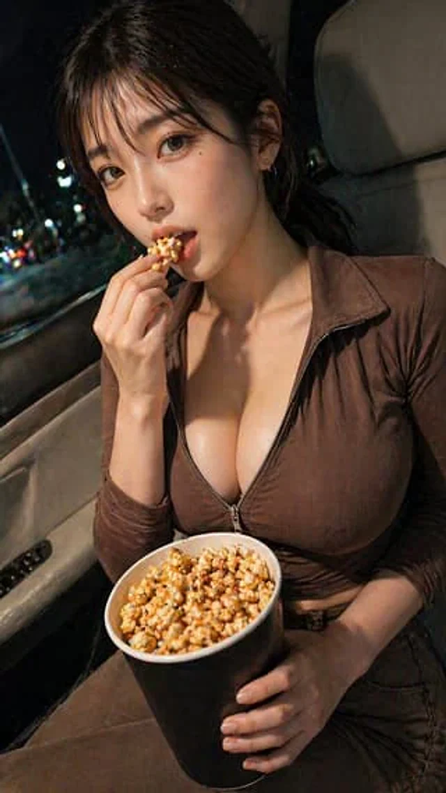

```text
A cinematic vertical smartphone photo of a glamorous young woman sitting in the front passenger seat of a car at night, shot from slightly above chest level in a tight mid-shot. She has {argument name="hair color" default="dark brown"} hair pulled back loosely with soft strands near the ears, and is wearing a fitted ribbed brown zip-front top or dress with a deep neckline, partially unzipped, creating a sleek nightlife look. Her face is mostly out of frame or obscured, keeping the focus on pose, outfit, and mood rather than identity. She holds 1 large black tub of caramel popcorn in her lap with one hand, while her other hand is raised lightly near her chin in a casual, candid pose. The setting is the interior of a car with 1 visible beige passenger seat, 1 visible door panel with window controls, and a side window showing blurred colorful city lights outside, suggesting nighttime urban traffic. Use warm low-key lighting from the front-left, realistic skin texture, glossy highlights on the collarbone and fabric, shallow depth of field, bokeh streetlights, photorealistic detail, intimate composition, luxury nightlife atmosphere, and a moody editorial aesthetic. Outfit and palette should stay in coordinated brown and neutral tones, with the popcorn sharply detailed and slightly glossy from caramel coating. Render as realistic photography, high contrast, soft shadows, vertical 9:16 framing.
```

Model: GPT Image 2
Author: 浅野 美咲（Asano Misaki）

[ProjectD](https://aitoolsradar.com/en/prompts/5726c2366fde19) · [Recorded source](https://youmind.com/prompts/night-car-portrait-popcorn-14845)
 · [Full original metadata and byte evidence](data/projectd-batch-0041.json)

## Night City Soccer Kickoff Visual

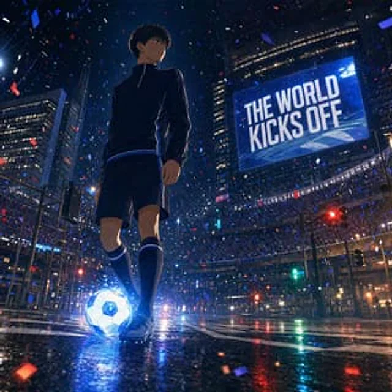

```text
Create a cinematic anime-style key visual of {argument name="character name" default="a young male soccer player"} standing in the middle of a rain-soaked futuristic city street at night as the urban skyline transforms into a colossal stadium atmosphere. Use a low-angle wide shot with the player centered slightly left, full body visible, wearing a dark navy soccer training jacket, matching shorts, knee-high socks with blue stripes, and athletic cleats. His face should be mostly hidden in shadow or softly blurred, with messy dark hair silhouetted against the lights. Place exactly 1 glowing soccer ball at his front foot, emitting intense electric blue light that reflects across the wet asphalt. On the right side, show exactly 1 huge digital billboard mounted on a glass high-rise, displaying the bold white all-caps slogan {argument name="billboard text" default="THE WORLD KICKS OFF"} on a blue stadium-like background. Include exactly 1 main human subject, exactly 1 soccer ball, exactly 1 prominent billboard, and exactly 3 visible traffic signals with red, green, and amber city lights contributing to the atmosphere. Surround the scene with dense high-rise buildings, packed stadium-like crowds implied in the architecture, bright windows, floodlights, and falling red, blue, and white confetti. The street must be glossy with puddles and mirror-like reflections of blue ball light, neon signs, traffic lights, and skyscraper windows. Mood: epic World Cup opening moment, dramatic, anticipatory, rain-drenched, high contrast, volumetric light, ultra-detailed anime realism, cinematic composition, sharp foreground reflections, deep blue color grading with red accents, no logos or watermarks.
```

Model: GPT Image 2
Author: くまがあゆむ🪼

[ProjectD](https://aitoolsradar.com/en/prompts/33bcd072e8ab9b) · [Recorded source](https://youmind.com/prompts/night-city-soccer-kickoff-26164)
 · [Full original metadata and byte evidence](data/projectd-batch-0041.json)

## Night Drift Futuristic Sports Sedan

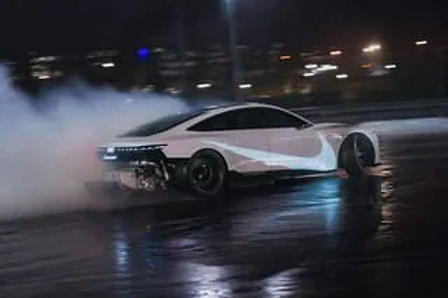

```text
A cinematic nighttime car action photo features a futuristic white electric sports sedan inspired by the Audi e-tron GT, captured in a fast-paced side-view shot as it aggressively drifts through wet city streets. The vehicle's left profile is clearly defined, with the front facing right, its low-slung and aggressive stance accentuated by a black roof, dark windows, black wheels, and a continuous, thin strip of red LED taillights. The rear of the car has been heavily modified and partially removed, revealing metal turbine-like pipes and mechanical components behind the rear wheels. Thick white tire smoke billows from the rear, filling the entire left side of the frame. The road surface, glistening with rain, reflects the blue, white, and amber city lights. The background is extremely deep, with distant buildings and streetlights softly blurred, complemented by blurred vertical pillars and guardrails, emphasizing the sense of speed through strong motion blur. Employing a melancholic urban color palette composed of black, steel blue, cool white, and warm orange highlights, this work features a realistic photographic style, high detail, a low-angle tracking shot, telephoto panning, dramatic reflections, shallow depth of field, and a strong sense of motorsport energy.
```

Model: GPT Image 2
Author: GPT Image 2 Prompts

[ProjectD](https://aitoolsradar.com/en/prompts/bf5e810ac92a70) · [Recorded source](https://x.com/AllarHaltsonen/status/2047255361409675314#reversed-1)
 · [Full original metadata and byte evidence](data/projectd-batch-0041.json)

## Night Flash Portrait Outside Restaurant

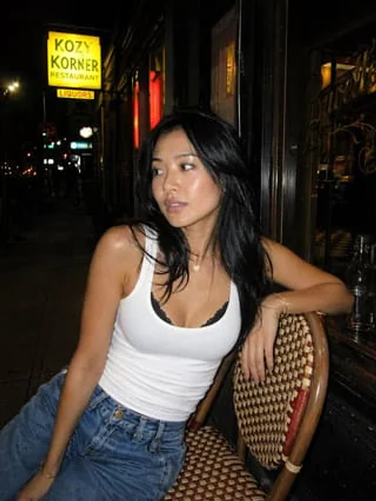

```text
A candid street portrait taken at night, in which {argument name="subject" default="A young woman"} She sat casually on a woven French-style dining chair outside a small city restaurant. She had long hair {argument name="hair color" default="black"} Her long, slightly tousled hair and tanned complexion, combined with her natural, simple makeup, shimmered under the soft flash. She wore a fitted white tank top over a black lace bralette, high-waisted loose blue jeans, and delicate gold jewelry: two thin bracelets on one wrist, a delicate necklace with a miniature heart pendant around her neck, and a single, slender bracelet on the other. She leaned slightly towards the camera, one arm resting on the back of a bent chair, the other near her thigh, her expression calm and looking away from the lens. The vertical composition, capturing a half-body shot from the thigh up, created a sense of intimacy. The direct flash produced bright highlights, deep shadows, and a slightly grainy, raw film-like effect. The background was a dark city sidewalk, revealing shop windows, black facades, and warm interior reflections. A yellow-glowing sign in the upper left corner read…{argument name="restaurant sign" default="KOZY KORNER RESTAURANT"} Below, a small, illuminated sign reads "LIQUORS." A narrow, vertical red neon light is added to the background, with distant streetlights and blurred city lights on the left, and faint gold lettering on a glass door on the right. A clear glass bottle sits on a table at the far right of the image. The composition creates an authentic nightlife atmosphere, stylish yet unadorned, with shallow depth of field, realistic proportions, and flash photography aesthetics, resulting in a cinematic urban snapshot.
```

Model: GPT Image 2
Author: GPT Image 2 Prompts

[ProjectD](https://aitoolsradar.com/en/prompts/73bb233a0f3518) · [Recorded source](https://x.com/craftian_keskin/status/2046774231900287107#reversed-0)
 · [Full original metadata and byte evidence](data/projectd-batch-0041.json)

## Night Flash Portrait Outside Restaurant


```text
A candid nighttime street portrait of {argument name="subject" default="a young woman"} sitting casually on a woven bistro café chair outside a small urban restaurant. She has long {argument name="hair color" default="black"} hair worn loose and slightly tousled, tan skin, and minimal natural makeup with a soft flash-lit glow. She wears a fitted white tank top layered over a visible black lace bralette and high-waisted relaxed blue jeans, with subtle gold jewelry: 2 thin bracelets on one wrist, 1 delicate necklace with a tiny heart pendant, and 1 slim bracelet on the other wrist. She leans diagonally toward the camera with one arm draped over the curved chair back and the other hand resting near her lap, giving an off-camera calm, detached expression. Shot vertically as a medium portrait from about thigh-up, slightly close and intimate, direct on-camera flash creating bright skin highlights, deep shadows, and a raw film-snapshot look with slight grain. The setting is a dark city sidewalk at night with storefront windows, black-painted exterior walls, warm interior reflections, and a glowing yellow sign in the upper left reading {argument name="restaurant sign" default="KOZY KORNER RESTAURANT"}, with a smaller lit sign below reading LIQUORS. Add a narrow red vertical neon glow in the background, distant streetlights and blurred city bokeh along the left side, and faint gold lettering on the glass door to the right. Include a clear glass bottle on the table edge at the far right. Authentic nightlife mood, stylish but unfiltered, shallow depth of field, realistic proportions, flash photography aesthetic, cinematic urban candid.
```

Model: GPT Image 2
Author: Keskin

[ProjectD](https://aitoolsradar.com/en/prompts/8f1036dc8456bb) · [Recorded source](https://youmind.com/prompts/night-flash-portrait-restaurant-14814)
 · [Full original metadata and byte evidence](data/projectd-batch-0041.json)

## Night Forest Thriller Cover

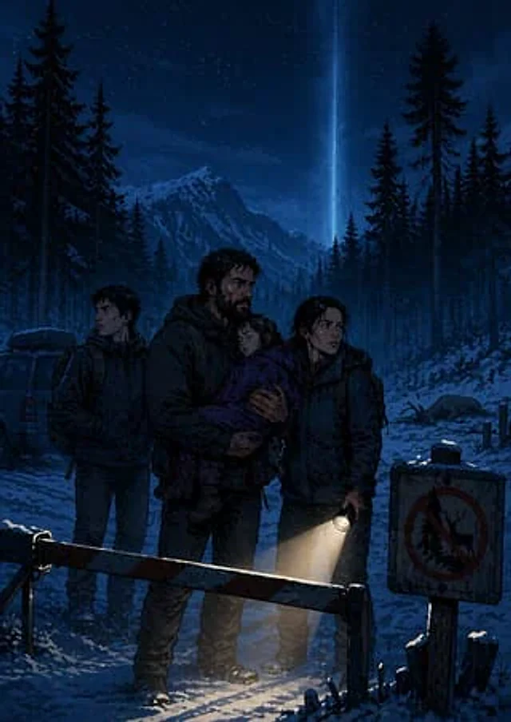

```text
An emotionally charged graphic novel-style book cover illustration, set against a backdrop of a snow-covered coniferous forest at night, using deep blue tones with cinematic contrast. In the foreground, four figures stand behind a low striped roadblock: three adults and one child. The middle adult is a tall, broad-shouldered man in a dark winter coat, cradling a sleeping or limp child in his arms; the child is dressed in a {argument name="child coat color" default="Purple"} The image shows a man in a snowsuit. To his left stands a teenage or young man with a backpack, next to a dark SUV faintly visible at the edge of the frame. To his right stands an adult woman in a dark hooded winter coat, holding a flashlight and projecting a warm beam of light onto the snow and roadblocks. All faces should be mostly in shadow, unrecognizable, to emphasize mystery and danger. Place two prominent artificial warning elements in the foreground: a red and white striped gate blocking the road, and a deer silhouette warning sign with a red prohibition circle and diagonal stripe atop a wooden post. In the midground and background, fill with tall black pine trees, a narrow snow-covered road or clearing, and the shape of a partially buried animal carcass in the snow on the right. In the distance, show a rugged, snow-covered mountain range under a starry sky. From behind the mountain, a narrow, vertical blue beam of light shoots into the sky as the visual focus. The composition should be vertical, dramatic, and poster-like, suitable as a {argument name="book title" default="La Réserve"} Covers of thriller or survival graphic novels. Style: Delicate Faber-style/realistic comic book drawing with ink outlines, rich brushstroke texture, a cold nighttime atmosphere, subtle rim lighting, high contrast, full of ominousness and suspense.
```

Model: GPT Image 2
Author: GPT Image 2 Prompts

[ProjectD](https://aitoolsradar.com/en/prompts/9dee56d4930a6e) · [Recorded source](https://x.com/Martinolli/status/2046680566532128946#reversed-0)
 · [Full original metadata and byte evidence](data/projectd-batch-0041.json)

## Nine Chibi Kitten Costume Variants

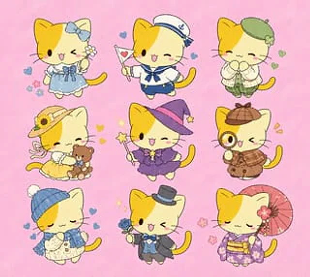

```text
{
  "type": "Cute character costume design illustrations",
  "subject": {
    "species": "Q-version kitten",
    "design": "A plump, cream-colored kitten with large golden spots on its left cheek and ear, small oval black eyes, a pink mouth, rosy cheeks, simple whiskers, and a thick yellow tail. The design is cute, hand-drawn in a kawaii style, with a soft colored pencil texture and detailed sketched outlines."
  },
  "style": {
    "aesthetic": "Similar to Sanrio style, the illustrations feature children dressed up, soft colors, whimsical ideas, and a clean, independent image.",
    "background": "Solid color soft pink paper background"
  },
  "layout": {
    "grid": {
      "rows": 3,
      "columns": 3
    },
    "count": 9,
    "arrangement": "Nine evenly distributed full-body cat variants, each centered and surrounded by tiny floating hearts, flowers, or glitter."
  },
  "variants": [
    {
      "position": "Top left",
      "outfit": "A light blue ruffled dress with white lace trim and a blue ribbon at the chest.",
      "accessories": [
        "The large blue bow on the right ear",
        "The little white daisy held in her paws"
      ],
      "expression": "Blink, a happy, toothy smile.",
      "decor": [
        "Three small, soft-colored flowers in the bottom left corner",
        "One blue heart on the left"
      ]
    },
    {
      "position": "Upper-middle",
      "outfit": "Navy blue and white sailor uniform, with a blue neckerchief and blue shorts.",
      "accessories": [
        "White sailor hat with blue trim and anchor badge",
        "small white flag with pink hearts"
      ],
      "expression": "Blink, a happy, toothy smile.",
      "decor": [
        "2 blue hearts"
      ]
    },
    {
      "position": "Top right",
      "outfit": "A light green top layered under a soft beige cardigan, paired with loose-fitting green plaid pants.",
      "accessories": [
        "Green beret with clover decoration"
      ],
      "expression": "With eyes closed and a happy expression, paws clasped together under the chin.",
      "decor": [
        "2 green hearts"
      ]
    },
    {
      "position": "Left and Middle",
      "outfit": "A light yellow summer dress with a ruffled hem",
      "accessories": [
        "Wide-brimmed straw hat with sunflower and ribbon ties",
        "Holding a brown teddy bear in her arms"
      ],
      "expression": "With eyes closed, a happy expression, and a gentle smile.",
      "decor": [
        "2 yellow hearts"
      ]
    },
    {
      "position": "middle",
      "outfit": "Purple witch dress with tiered skirt and star brooch",
      "accessories": [
        "Purple pointed witch hat with pink ribbon",
        "Magic wand at the tip of a star"
      ],
      "expression": "Blink, a happy, toothy smile.",
      "decor": [
        "2 yellow stars",
        "2 flashes"
      ]
    },
    {
      "position": "Right Center",
      "outfit": "Brown detective suit, with a plaid cape and double-breasted coat.",
      "accessories": [
        "Brown deerstalker hat",
        "Magnifying glass placed in front of one eye"
      ],
      "expression": "Blink, a happy, toothy smile.",
      "decor": [
        "2 orange emphasis marks"
      ]
    },
    {
      "position": "Bottom left",
      "outfit": "Cream-colored knitted sweater dress, paired with a blue scarf",
      "accessories": [
        "Blue knitted hat with white pom-poms"
      ],
      "expression": "With eyes closed and a calm expression, a shy smile, and paws clasped together.",
      "decor": [
        "3 blue hearts"
      ]
    },
    {
      "position": "Middle to lower",
      "outfit": "A formal grey suit, paired with a light blue vest, blue bow tie, and short cape.",
      "accessories": [
        "Black top hat with blue ribbon",
        "The blue rose held in her paws"
      ],
      "expression": "Blink, a happy, toothy smile.",
      "decor": [
        "2 flashes"
      ]
    },
    {
      "position": "Bottom right",
      "outfit": "A light purple floral kimono with a yellow obi (sash).",
      "accessories": [
        "Pink paper umbrella",
        "Pink flower hair accessory"
      ],
      "expression": "With eyes closed, calm and with a gentle smile",
      "decor": [
        "3 pink cherry blossoms"
      ]
    }
  ],
  "rendering": {
    "lighting": "Flat and soft",
    "detail": "Simple, cute, and easy to understand",
    "composition": "A complete 3x3 clothing collection, with ample spacing, no text, and no borders."
  }
}
```

Model: GPT Image 2
Author: GPT Image 2 Prompts

[ProjectD](https://aitoolsradar.com/en/prompts/877e3634794a27) · [Recorded source](https://x.com/Pajoca_/status/2046631477400805661#reversed-0)
 · [Full original metadata and byte evidence](data/projectd-batch-0041.json)

## Nine-Photo ID Portrait Sheet

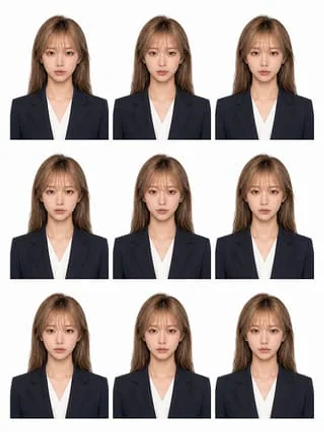

```text
Create a clean printable sheet of nine identical ID photo portraits arranged in a 3 by 3 grid on a white background. Each portrait shows the same adult woman from the chest up, centered and facing forward, with long light brown/blonde hair worn down, wearing a dark navy business blazer over a white V-neck blouse. Use neutral passport-photo lighting, a plain white studio backdrop, symmetrical composition, realistic photographic style, and consistent scale across all copies. The face must be anonymized/covered in every copy by a smooth vertical rectangular blur block in a natural skin-tone color, placed over the full face area from forehead to chin while leaving hair, neck, ears, blazer, and blouse visible. The sheet contains exactly 9 portraits: top-left, top-center, top-right, middle-left, middle-center, middle-right, bottom-left, bottom-center, and bottom-right. Keep generous white gutters between portraits, crop each photo just below the shoulders, no text, no borders, no watermark, no decorative elements. Use {argument name="subject gender" default="adult woman"}, {argument name="hair color" default="light brown blonde"}, {argument name="outfit" default="dark navy blazer and white V-neck blouse"}, {argument name="grid count" default="3 by 3, nine portraits"}, and {argument name="face anonymization" default="smooth skin-tone rectangular blur over the face"}.
```

Model: GPT Image 2
Author: 冰零

[ProjectD](https://aitoolsradar.com/en/prompts/56c4e55cc46143) · [Recorded source](https://youmind.com/prompts/id-photo-sheet-grid-23110)
 · [Full original metadata and byte evidence](data/projectd-batch-0041.json)

## Nintendo Switch Game Cover Design


```text
Switch game cover:{argument name="game theme" default="Discord Mod Simulator"}
```

Model: GPT Image 2
Author: GPT Image 2 Prompts

[ProjectD](https://aitoolsradar.com/en/prompts/8b03ad9ea050e6) · [Recorded source](https://x.com/mirochill/status/2044366023122464816)
 · [Full original metadata and byte evidence](data/projectd-batch-0041.json)

## Noir Man With Red Sun Poster

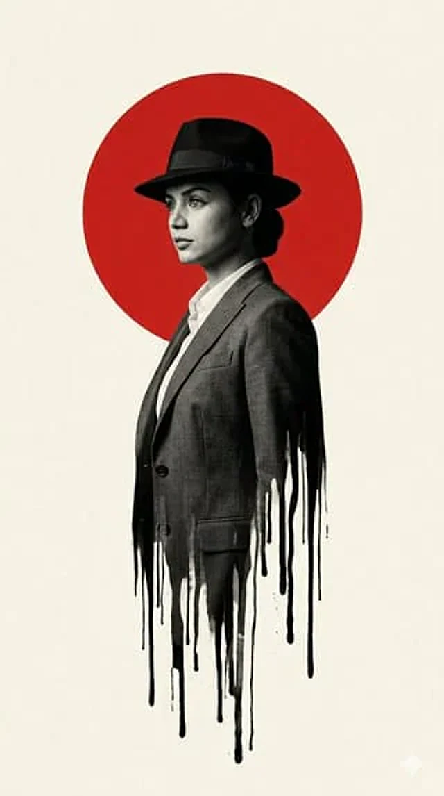

```text
Create a minimalist vertical art poster featuring the profile of a man in a sharp suit, facing left, with the perspective rising from mid-thigh. He wears a well-tailored dark suit jacket, a crisp white shirt, and a vintage 1940s black fedora adorned with a ribbon. His posture is upright, composed, and confident, exuding the aura of a classic film noir protagonist. Render the figure in a refined monochrome photographic style, with clear details and strong tonal contrasts, employing dramatic lighting inspired by Rembrandt to delineate deep shadows on the cheeks, ears, jawline, hat brim, and shoulders. Place a striking, perfectly round red disc directly behind the head and upper body, centered like a halo or rising sun, creating a strong visual focal point. The background should be a clean, off-white or beige paper texture with a subtle grain, and ample white space should be maintained around the subject. The lower half of the figure should dissolve into thin, elongated black ink droplets: twelve distinct drips of varying thicknesses hang from the hem of the suit and the lower part of the body, some long and straight, others gradually tapering, accompanied by a few tiny splatters, as if the body is merging into the canvas. The color scheme is strictly limited to black, red, and warm gray-white. The overall atmosphere should be somber, contemplative, elegant, slightly ominous, and modern, resembling a high-end gallery poster combining film noir portraiture with surreal ink abstract art.
```

Model: GPT Image 2
Author: GPT Image 2 Prompts

[ProjectD](https://aitoolsradar.com/en/prompts/891789ea801c25) · [Recorded source](https://x.com/john_my07/status/2047558961172476196#reversed-0)
 · [Full original metadata and byte evidence](data/projectd-batch-0041.json)

## Noir Woman With Red Halo Poster

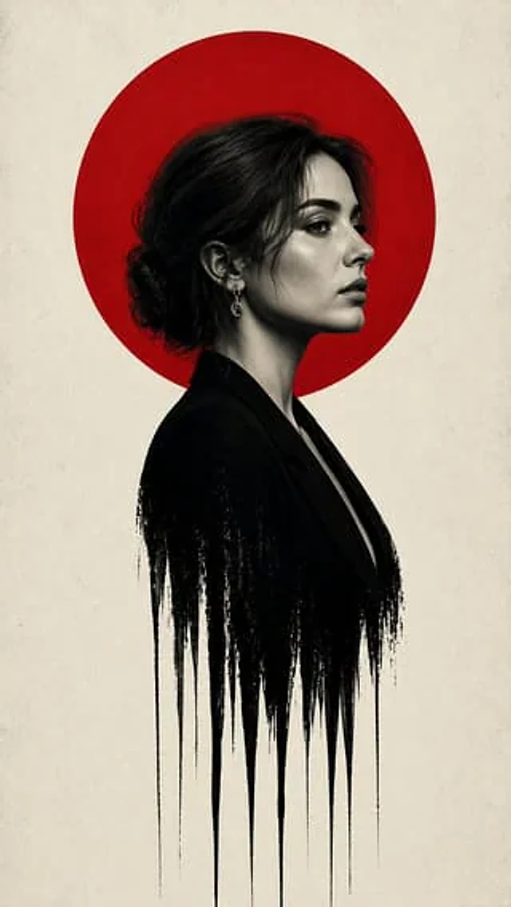

```text
A minimalist art poster portrait depicting a woman in clean profile, facing right, showcasing approximately her upper body. Her face is partially obscured by a softly blurred rectangular effect in front of her head. She has deep black hair styled in a low, loose bun with natural volume and wispy strands, and a single silver pendant earring is visible on her ear. She is dressed in a structured black blazer or tailored coat with a deep collar. The lower half of the figure dissolves into elongated drops of black ink, with numerous uneven vertical stripes extending downwards like wet paint pulled by gravity, creating a dramatic, melting silhouette. A large, perfectly placed, bright red disc is placed directly behind her head and upper shoulders, centered like a halo or a rising sun. A strictly limited palette of black, red, and warm off-white is used. The background is set on soft cream-colored paper or a subtly textured canvas. The lighting employs a high-end film noir approach to portraiture, emphasizing strong contrasts and highlighting the contours of the ears, jawline, neck, and cheeks, while casting deep shadows on the clothing. The composition remains vertically centered with ample negative space, creating an elegant, poster-like balance and an atmosphere of melancholy contemplation, seamlessly blending crisp, refined photographic detail with painterly graphic design.
```

Model: GPT Image 2
Author: GPT Image 2 Prompts

[ProjectD](https://aitoolsradar.com/en/prompts/63f3420442fcd9) · [Recorded source](https://x.com/john_my07/status/2047558961172476196#reversed-1)
 · [Full original metadata and byte evidence](data/projectd-batch-0041.json)

## NOIR 街头服饰 Campaign

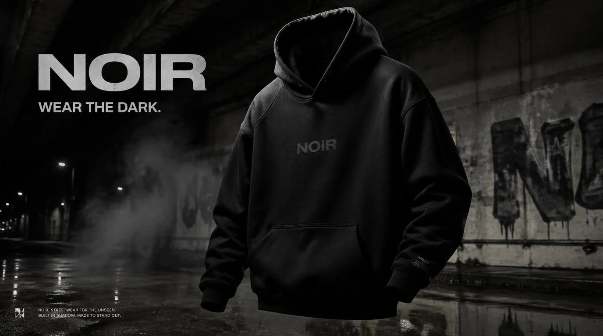

```text
Create a premium, highly realistic 1:1 campaign poster for NOIR, a modern streetwear brand. Show one hero oversized hoodie as the main focus against a gritty urban backdrop with wet concrete floors, dramatic low lighting, subtle smoke in the air and a raw street energy. Add bold minimal typography with the brand name NOIR and a short campaign headline like "Wear the Dark." Make it feel like a real high-end streetwear editorial, sharp detail, realistic fabric textures, modern and edgy, deep black tones with subtle grey accents, no clutter, no collage.
```

Model: GPT Image 2
Author: @Daniel_adsss

[ProjectD](https://aitoolsradar.com/en/prompts/9bf2c73b6756fa) · [Recorded source](https://x.com/Daniel_adsss/status/2048542581638701446)
 · [Full original metadata and byte evidence](data/projectd-batch-0041.json)

## Noor 🌸 #114

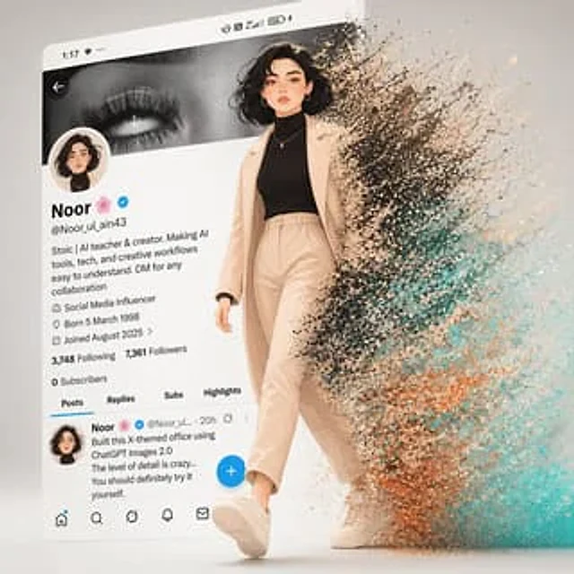

```text
A cinematic digital artwork of a stylish animated girl walking out of a modern X (Twitter) profile interface. The background shows a real mobile UI profile screen with the name "Noor 🌸", verified badge, username @Noor_ul_ain43, and detailed bio.
The girl matches the profile picture — soft aesthetic illustration style, short wavy black hair, gold hoop earrings, minimal makeup, wearing a black turtleneck and beige coat with matching pants and sneakers.
She is stepping forward confidently from the screen into real space. The right half of her body dissolves into dynamic particles — a mix of black dust, teal, and orange energy splashes, flowing outward like liquid + digital fragments.
Clean composition: left side = structured UI, right side = abstract particle explosion. Soft cinematic lighting, depth of field, ultra-detailed textures, smooth shadows, 4K render, octane render, Unreal Engine 5 style, trending on ArtStation.
```

Model: GPT Image 2
Author: Noor 🌸

[ProjectD](https://aitoolsradar.com/en/prompts/ab81a831ee8ee3) · [Recorded source](https://x.com/Noor_ul_ain43/status/2047227731839184901)
 · [Full original metadata and byte evidence](data/projectd-batch-0041.json)

## Noor 🌸 #145

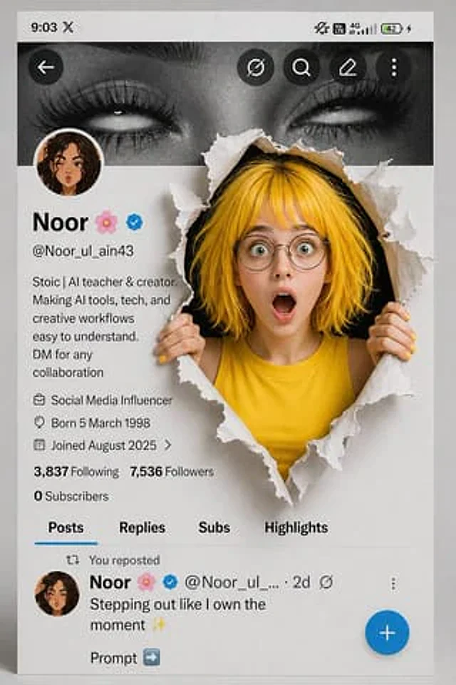

```text
A creative 3D photo manipulation of a social media profile interface, featuring a surprised young woman with short messy yellow hair, round glasses, and expressive wide eyes, wearing a sleeveless yellow top. She is breaking through a torn paper effect from the screen, holding the ripped edges with both hands. The tear reveals a dark background behind her, adding depth. The UI resembles a modern social media profile page with profile picture, username “Noor 🌸”, verified badge, bio text, and follower stats. Top banner shows a black-and-white close-up of eyes. Clean minimal layout, soft shadows, realistic lighting, high detail, depth-of-field, ultra-realistic textures, cinematic composition, vibrant color contrast, trending AI art style, 4K resolution.
```

Model: GPT Image 2
Author: Noor 🌸

[ProjectD](https://aitoolsradar.com/en/prompts/8b573fc11b18ad) · [Recorded source](https://x.com/Noor_ul_ain43/status/2048088005836173316)
 · [Full original metadata and byte evidence](data/projectd-batch-0041.json)

## Noor 🌸 #272

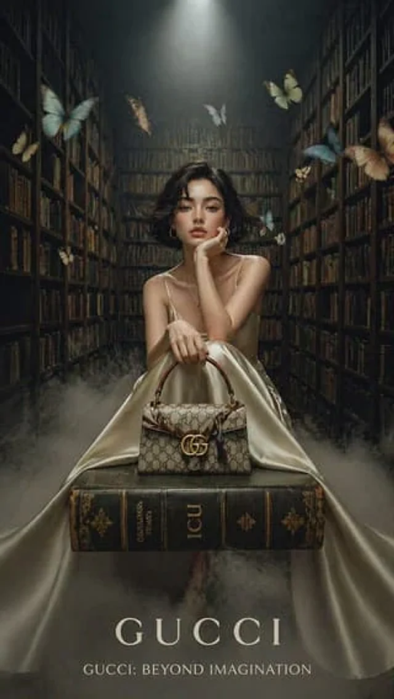

```text
A cinematic luxury fashion editorial set inside a grand vintage library with tall wooden bookshelves, soft fog covering the floor, and glowing butterflies floating in the air. A beautiful young woman with short wavy bob hair and soft natural makeup sits centered on a stack of antique books. She wears an elegant flowing satin gown in champagne color, posed gracefully with one hand resting on her face. A luxury designer handbag is placed prominently in front. Dramatic spotlight from above, symmetrical composition, moody atmosphere, shallow depth of field, ultra-realistic, high detail, 8K, fashion magazine style, premium aesthetic, soft shadows, rich tones.
```

Model: GPT Image 2
Author: Noor 🌸

[ProjectD](https://aitoolsradar.com/en/prompts/767db39032c679) · [Recorded source](https://x.com/Noor_ul_ain43/status/2047949150222778710)
 · [Full original metadata and byte evidence](data/projectd-batch-0041.json)

## Nostalgic 2003 Family Apartment Photo

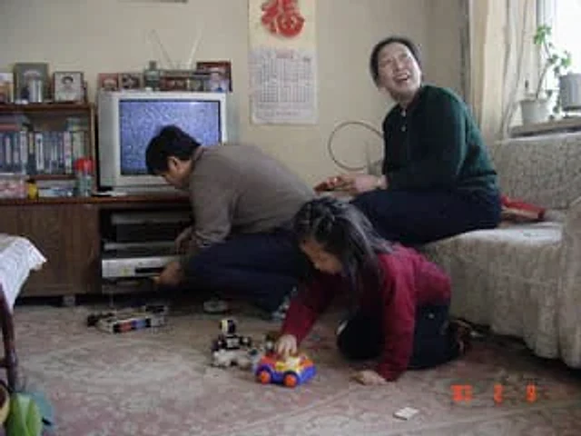

```text
An unedited, candid indoor photograph taken with a consumer-grade digital camera or inexpensive film camera from the early 21st century. The image shows {argument name="family description" default="A happy Chinese family of three"} exist{argument name="year" default="2003"} Around 2000{argument name="living room description" default="A simple apartment living room in Beijing"} The scene captures a mother, father, and their young daughter (around 6 years old) in a cluttered yet authentic home environment. The mother looks up at the camera with a surprised and smiling expression; the father is trying to repair an old VCR; and the daughter plays with a brightly colored toy car on a patterned rug. The photo is clearly a candid shot, lit by dim natural window light from the right. The composition is off-center, slightly blurry and grainy, with muted, washed-out colors and a faint yellow tint. In the background is a bulky beige television with static on the screen, a 2003 calendar on the wall, shelves piled high with VHS tapes, framed family photos, a fabric sofa, and a small plant. The perspective is at eye level, but gives the impression of a handheld, slightly shaky shot. The soft focus and shallow depth of field emphasize this natural moment. Shot with an older Nikon Coolpix or Canon PowerShot, digital noise is visible, and a date and time stamp is visible in the corner. This photo captures a fragment of ordinary daily life, with the daughter's messy hair and scattered toys, creating a real, memory-like feeling.
```

Model: GPT Image 2
Author: GPT Image 2 Prompts

[ProjectD](https://aitoolsradar.com/en/prompts/a22aef213f4bcb) · [Recorded source](https://x.com/Cryptohaifeng_/status/2046917045175071037)
 · [Full original metadata and byte evidence](data/projectd-batch-0041.json)

## Nostalgic 2003 Family Living Room Photo


```text
A candid family interior photograph taken in early 21st-century mainland China using a consumer-grade digital camera. The focus is slightly soft, the colors are muted, and there is a slight amount of noise. The lower right corner displays the camera's built-in date stamp.{argument name="date stamp" default="2003.12.28"} The scene depicts a simple living room, with the faces of three figures deliberately blurred: To the left foreground, an adult woman in a light pinkish-purple sweater sits on the edge of a bed or sofa, her body slightly turned towards the camera; in the center of the background, an adult man in dark clothing squats in front of a wooden TV cabinet, adjusting a silver DVD or VCD player; to the right foreground, a little girl in a light pink sweater and dark pants kneels on an intricately patterned red carpet, holding a colorful toy car. Behind them is a bulky silver CRT television, its screen displaying gray static, covered with a lace fabric. The wall behind the television is full of life: above a calendar hangs a large red poster with the character "福" (fortune/blessing), along with several framed family photos and scattered pictures. On the far right is a tall black shelf neatly stacked with VHS tapes or media boxes, books, and topped with a potted plant with cascading green leaves. On the left edge, part of a bed or sofa is visible, furnished with light-colored bedding and red cushions. Add eye-catching red bold Chinese characters to the top left corner.{argument name="headline text" default="AI-generated"} The overall composition presents a genuine and believable family moment, unstaged, featuring authentic household items, a nostalgic realism, natural indoor lighting, and the unique texture of old personal photographs.
```

Model: GPT Image 2
Author: GPT Image 2 Prompts

[ProjectD](https://aitoolsradar.com/en/prompts/e7a73934b8a960) · [Recorded source](https://x.com/xcbnbcrypto/status/2047145057980203411#reversed-2)
 · [Full original metadata and byte evidence](data/projectd-batch-0041.json)

## Nostalgic 2008 Internet Cafe Photo

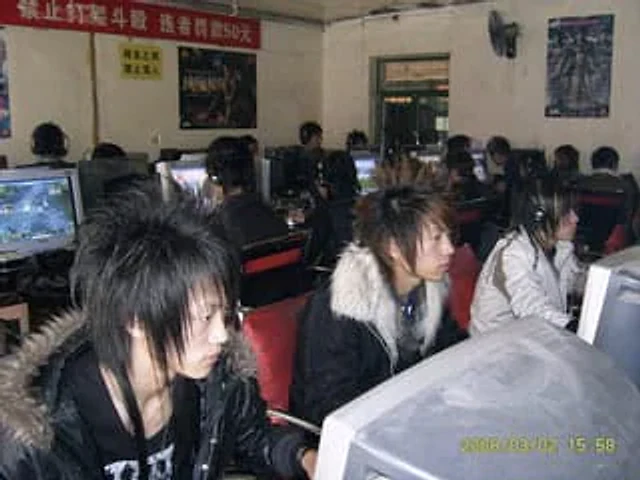

```text
Generate a{argument name="year" default="2008"} China{argument name="location" default="Internet cafes in small towns"} An old photo with a time stamp in the lower right corner.
```

Model: GPT Image 2
Author: GPT Image 2 Prompts

[ProjectD](https://aitoolsradar.com/en/prompts/0aac7c7347a306) · [Recorded source](https://x.com/Panda20230902/status/2047705136395690385)
 · [Full original metadata and byte evidence](data/projectd-batch-0041.json)

## Nostalgic 2010s School Photo

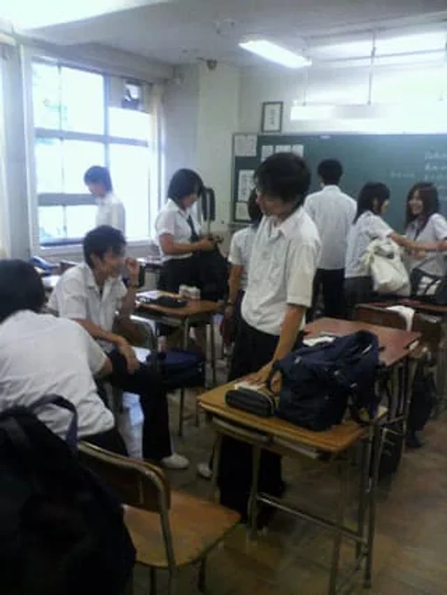

```text
A low-resolution photo of Japanese high school students after school in 2010, taken with a flip phone.{argument name="number of people" default="Approximately 8 to 10 boys and girls"} They are chatting or playing in the classroom or near the bicycle parking area. The season is {argument name="season" default="Early summer to early autumn, that is, between June and September"} .
```

Model: GPT Image 2
Author: GPT Image 2 Prompts

[ProjectD](https://aitoolsradar.com/en/prompts/64d43f3e6dd457) · [Recorded source](https://x.com/disablesleep1/status/2047651314973458631)
 · [Full original metadata and byte evidence](data/projectd-batch-0041.json)

## Nostalgic 80s 90s China Memory Poster

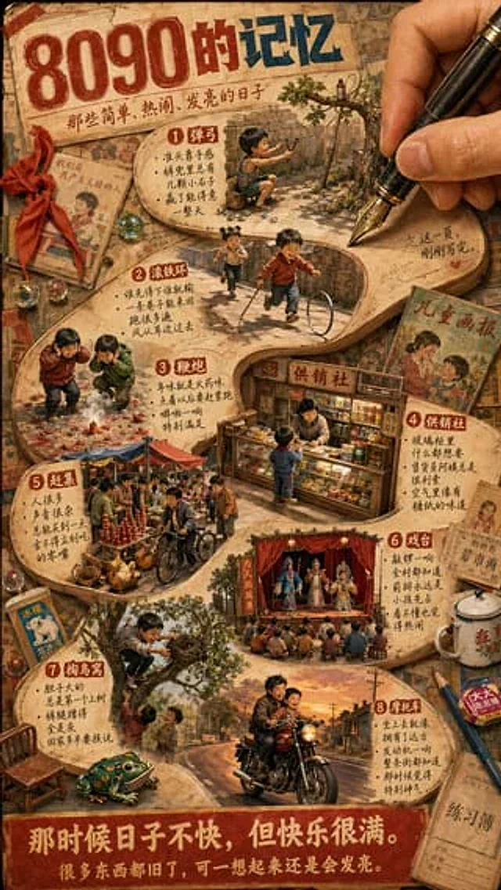

```text
A document about{argument name="theme title" default="Memories of the 80s and 90s"} This nostalgic Chinese-style retro collage poster combines the design of worn scrapbook pages with hand-drawn memory maps. It features a vertical composition and a warm color palette of dark brown, grey-red, faded orange, and the beige of aged paper. The background consists of old, cracked paper, yellowed magazine clippings, and worn, vintage printing textures. In the upper right corner, a realistic figure holds a black fountain pen with a gold nib, as if writing these memories on the page. At the center of the poster is a large, irregularly shaped wooden plaque or scrapbook project containing eight numbered memory scenes, each embedded like a miniature 3D model, accompanied by a handwritten Chinese title and brief key points. Scene 1, labeled "1 Slingshot," shows a young boy crouching beside an outdoor stone wall and tree, aiming a slingshot; Scene 2, labeled "2 Rolling Hoops," shows two children running and pushing hoops in an alley; Scene 3, labeled "3 Firecrackers," shows two children crouching beside lit firecrackers, accompanied by smoke and red paper scraps; Scene 4, labeled "4 Supply and Marketing Cooperative," shows an old-fashioned community supply and marketing cooperative counter with a salesperson and a young customer, with shelves full of goods behind them; Scene 5, labeled "5 Market Day," shows a bustling rural market with many adults, chickens, agricultural products, baskets, and a vendor on a bicycle; Scene 6, labeled "6 Stage," shows a rural stage with four actors in traditional costumes performing under a red curtain, and an audience sitting below; Scene 7, labeled "7 Bird's Nest Raid," shows two boys beside a tree, one climbing the tree or reaching into a bird's nest, while the other watches from below; Scene 8, labeled "8 The "Motorcycle" exhibit showcases two riders on a vintage motorcycle cruising down an old street at sunset. Surrounding the main exhibit are ten nostalgic items: an old children's handbook tied with a red ribbon in the upper left corner, two glass marbles next to it; a vintage comic book or magazine in the center right; a small blue illustrated booklet in the lower left corner; a green tin frog toy in the lower left corner; a small wooden chair along the lower left edge; an enamel mug with red Chinese characters printed on it in the lower right corner, two colored pencils next to it; and a school workbook labeled "Exercise Book" in the lower right corner. At the top is a prominent, bold Chinese title.{argument name="headline text" default="Memories of the 80s and 90s"} It uses an aged red and blue font, with a smaller, handwritten-style subtitle below.{argument name="subtitle text" default="Those simple, lively, and bright days"} To the right of the central project, add the handwritten text "This page was just finished." At the bottom, add a large red banner with the main quote.{argument name="bottom quote" default="Life wasn&#39;t fast-paced back then, but it was full of happiness."} Below is a line of smaller text{argument name="bottom subquote" default="Many things are old, but they still shine when you think about them."} The overall image should be rich in detail, cinematic, tactile, and emotional, and deeply rooted in Chinese childhood memories from the 1980s to the 1990s, blending illustration, miniature realism, poster design, scrapbook layers, and editorial nostalgia.
```

Model: GPT Image 2
Author: GPT Image 2 Prompts

[ProjectD](https://aitoolsradar.com/en/prompts/d645b1b0946eb9) · [Recorded source](https://x.com/mate_mattt/status/2046802491304735208#reversed-0)
 · [Full original metadata and byte evidence](data/projectd-batch-0041.json)

## Nostalgic Chinese Family Living Room Photo

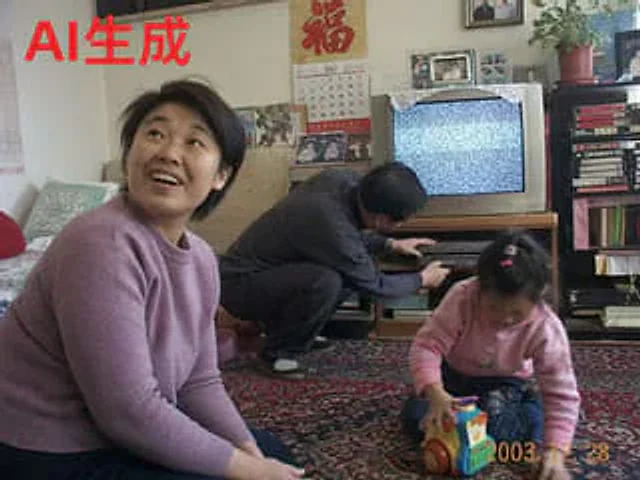

```text
A snapshot of an ordinary Chinese family living room in the early 21st century, capturing the quality of a consumer-grade digital camera. In the foreground to the left, a middle-aged woman in a light purple knitted sweater sits on a patterned rug, her body slightly turned towards the camera. In the center of the mid-range, a middle-aged man in dark clothing squats in front of a wooden TV cabinet, adjusting a silver DVD or VCD player. In the foreground to the right, a little girl in a pink sweater and jeans kneels on the rug, playing with a colorful plastic toy car. Their faces are deliberately blurred or obscured. Behind them is a bulky CRT television, its screen displaying static. The room is filled with a sense of everyday life: a red "福" (good fortune) poster hangs on the wall, below which hangs a calendar; four family photos surround the TV area; the TV is covered with a lace cloth; to the right is a tall shelf piled with VHS tapes, books, and media boxes, with a potted plant on top. To the left, a bed or sofa bed with light-colored bedding and pillows is visible. Add a striking red overlay in the top left corner with the text "{argument name="headline text" default="AI-generated"} Add an orange camera-style date stamp in the bottom right corner, displaying it as "".{argument name="date stamp" default="2003. 12. 28"} Natural indoor lighting, slightly soft colors, documentary-style realism, nostalgic family atmosphere, cluttered yet cozy home furnishings, imperfect composition, authentic snapshot aesthetics, 4:3 aspect ratio.
```

Model: GPT Image 2
Author: GPT Image 2 Prompts

[ProjectD](https://aitoolsradar.com/en/prompts/a9a870a68f7a91) · [Recorded source](https://x.com/0xJoveXu/status/2047145057980203411#reversed-2)
 · [Full original metadata and byte evidence](data/projectd-batch-0041.json)

## Nostalgic Disposable Camera Snap Prompt


```text
An everyday photograph taken with a low-quality disposable camera. A photograph taken by {argument name="photographer" default="Japanese high school students"} Poorly taken photos. Scene:{argument name="scene" default="School hike"} .
```

Model: GPT Image 2
Author: GPT Image 2 Prompts

[ProjectD](https://aitoolsradar.com/en/prompts/820fd941f665f1) · [Recorded source](https://x.com/SSSS_CRYPTOMAN/status/2047593204674077139)
 · [Full original metadata and byte evidence](data/projectd-batch-0041.json)

## Nostalgic Disposable Camera Snap Prompt

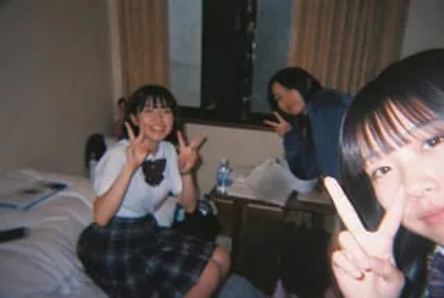

```text
低画質な使い捨てカメラで撮影した1枚の日常写真。{argument name="撮影者" default="日本の高校生"}が撮影した下手くそな写真。{argument name="シーン" default="修学旅行"}
```

Model: GPT Image 2
Author: SSSS.CRYPTOMAN⚡️AI

[ProjectD](https://aitoolsradar.com/en/prompts/64daa3a660f109) · [Recorded source](https://youmind.com/prompts/nostalgic-disposable-camera-snap-15594)
 · [Full original metadata and byte evidence](data/projectd-batch-0041.json)

## Nostalgic Japanese Gal Grid Images

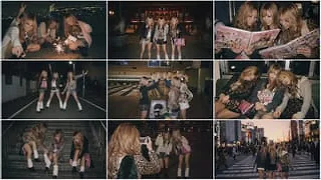

```text
Please create four 3x3 nine-grid images with a 16:9 aspect ratio and 2K resolution, based on the following prompts.{argument name="theme" default="Heisei Gyaru"} The theme is to showcase emotionally resonant images from late night to dawn. Please see below.<Theme> Shooting scenes are randomly selected from the list, and no two scenes are repeated. The snapshot style is achieved using direct flash from a film camera, featuring film grain, vignetting, and warm faded tones, presenting the texture of portable cameras from the 1990s to the 2000s, creating a nostalgic and fleeting atmosphere.<Theme> - Late-night downtown area - Street benches - Clinking glasses with canned soju - Midnight park - In front of an arcade - Displaying claw machine loot - Inside a photo booth - Dance machine in an arcade - Claw machine - Izakaya seating - Clinking glasses with peace signs - Karaoke booth - Singing passionately with microphone and tambourine - Late-night family restaurant (Gusto/Denny's) - Ramen stand - Eating ramen at the end of the night - Nightclub VIP booth - Bar counter - Making a phone call while holding a cocktail - Beef bowl restaurant (Yoshinoya/Sukiya) - Pre-dawn meal - Last train - Back seat of a taxi - Bus stop platform near the last train - Running in platform shoes - Internet cafe waiting for the first train - Wrapped in a blanket - Passenger seat of a modified car (VIP style) - Plush dashboard and LED lights - Taxi waiting area - Ferris wheel - Shooting photos inside the elevator car against a nighttime backdrop - Rainbow Bridge at night - Leaning against the railing by the sea - Love hotel street signs - Neon pink lights illuminating the alley - Rooftop parking lot - Chatting while overlooking the night view - Park swing - The light from the phone screen while swinging at midnight - Seaside (Shonan/Odaiba) - Fireworks on the beach at night - Shrine grounds - Midnight courage contest - Taking selfies with a flip phone - Exchanging photo albums - Showing off the ornately decorated sticker books - Practicing Para Para dance on the street - Dancing in sync under the streetlights - Bowling alley - High-fiving under the lane lights - Taking the first train home in the morning - Falling asleep exhausted while clutching a bag of photo albums - Inside the elevator - Sitting on the station steps adjusting bubble socks - Videotape (DVD) rental shop - Choosing a horror movie late at night - Playing the flip phone's ringtone - Shibuya Crossing at sunrise
```

Model: GPT Image 2
Author: GPT Image 2 Prompts

[ProjectD](https://aitoolsradar.com/en/prompts/e590f4c54db1af) · [Recorded source](https://x.com/JPAI_HEAVEN/status/2047280669374677255)
 · [Full original metadata and byte evidence](data/projectd-batch-0041.json)

## Nostalgic movie ticket stub prompt

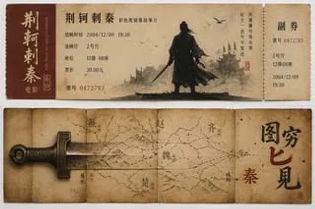

```text
{argument name="电影名称" default="荆轲刺秦"}电影票根，{argument name="图案" default="匕首地图展开图案"}，文案"{argument name="文案" default="图穷匕见"}"
```

Model: GPT Image 2
Author: 松果先森

[ProjectD](https://aitoolsradar.com/en/prompts/c07677754e0e46) · [Recorded source](https://youmind.com/prompts/nostalgic-movie-ticket-stub-15928)
 · [Full original metadata and byte evidence](data/projectd-batch-0041.json)

## Nostalgic Polaroid Portrait Prompt

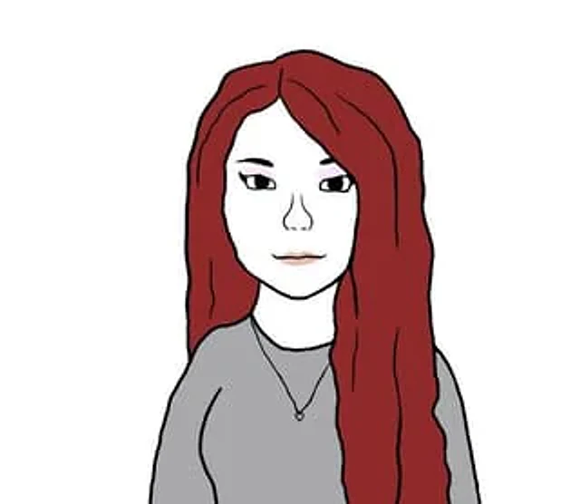

```text
Will{argument name="subject" default="she"} Become real. Polaroid photos, with {argument name="effect" default="Film grain effect"}
```

Model: GPT Image 2
Author: GPT Image 2 Prompts

[ProjectD](https://aitoolsradar.com/en/prompts/496c618ca02964) · [Recorded source](https://x.com/dejavucoder/status/2047723352417329411)
 · [Full original metadata and byte evidence](data/projectd-batch-0041.json)

## Nostalgic Polaroid Portrait Prompt


```text
make {argument name="subject" default="her"} real. polaroid photograph with {argument name="effect" default="film grain effect"}
```

Model: GPT Image 2
Author: sankalp

[ProjectD](https://aitoolsradar.com/en/prompts/7b3b32fc27c414) · [Recorded source](https://youmind.com/prompts/nostalgic-polaroid-portrait-15507)
 · [Full original metadata and byte evidence](data/projectd-batch-0041.json)

## Nostalgic Software Interface

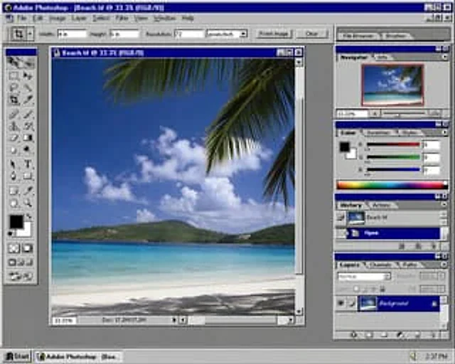

```text
One{argument name="software" default="Photoshop"} exist{argument name="era" default="90s"} Screenshot from that era
```

Model: GPT Image 2
Author: GPT Image 2 Prompts

[ProjectD](https://aitoolsradar.com/en/prompts/475a752f009bb9) · [Recorded source](https://x.com/icreatelife/status/2046718694567321891)
 · [Full original metadata and byte evidence](data/projectd-batch-0041.json)

## Nostalgic Vacation iPhone Snapshot Grid

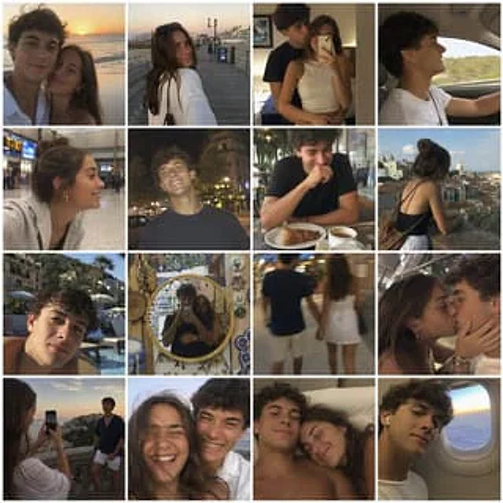

```text
4x4 网格，由 iPhone 拍摄的一对{argument name="主体" default="年轻情侣"}在度假时的抓拍怀旧照片，包含彼此自拍和一起自拍。大量镜头抖动、业余构图，以及充满情绪感的复古氛围。
```

Model: GPT Image 2
Author: AI Will

[ProjectD](https://aitoolsradar.com/en/prompts/f4d4cef21ad76b) · [Recorded source](https://youmind.com/prompts/nostalgic-vacation-iphone-snapshot-grid-16532)
 · [Full original metadata and byte evidence](data/projectd-batch-0041.json)

## Nostalgic Watercolor Anime Adventure Poster

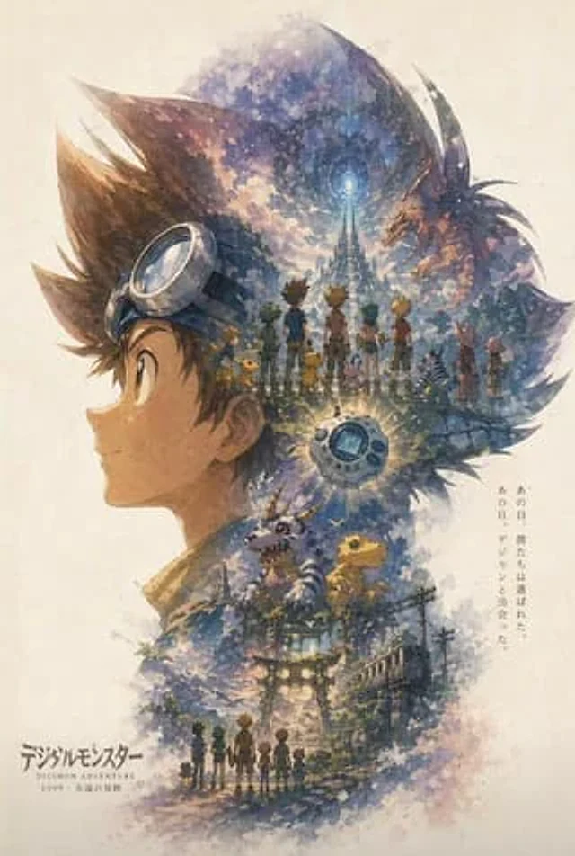

```text
A nostalgic watercolor anime poster printed on textured off-white paper, employing a vertical double-exposure illustration composition inspired by late 1990s adventure anime. The main silhouette is the left profile of a young boy wearing upturned goggles, his face turned to the right, filled with a montage of dreamlike memories and fantastical scenes. Above the silhouette, in the center, eight children stand with their backs to the camera on a ridge, gazing at a distant, glowing crystal tower beneath a circular celestial portal in a misty, blue-purple sky; they are accompanied by seven small creature companions. In the upper right corner inside the silhouette, a giant dragon-like monster emerges from the clouds. Near the center, a glowing circular handheld digital device is added, its screen dimly lit and radiating light outwards. In the lower center area, two iconic small dinosaur-like creatures are depicted sitting atop an ancient shrine path, one a purple-horned creature, the other a small yellow reptile. At the bottom, a moss-covered torii gate, overgrown stone steps, a telephone pole, and a small country train on the right are displayed, all shrouded in mist and vegetation. At the very bottom, eight children are again depicted as tiny silhouettes walking side-by-side along a path, reinforcing the themes of friendship and memories. The artwork is rendered using soft ink and watercolor techniques, with tones of gentle blues, indigo, lavender, dark brown, and warm gold highlights, featuring splattered paint edges and painterly cloud textures. Maintaining a transparent and elegant composition, it possesses a sophisticated modern poster design feel, almost entirely free of the plasticky look often seen in AI (artificial intelligence) designs. Add the vertical Japanese text "あの日、也ちは选ばれた.あの日、デジモンと出会った." on the right, and The Japanese title Logo "デジモンアドベンチャー" is placed in the lower left corner, accompanied by a small English subtitle "DIGIMON ADVENTURE" and the date line "1999 - Eternal Adventure".
```

Model: GPT Image 2
Author: GPT Image 2 Prompts

[ProjectD](https://aitoolsradar.com/en/prompts/f326e8548e19b1) · [Recorded source](https://x.com/Xiaoniu6161/status/2047609689790382396#reversed-0)
 · [Full original metadata and byte evidence](data/projectd-batch-0041.json)

## Nostalgic Youth Memory Photo Grid

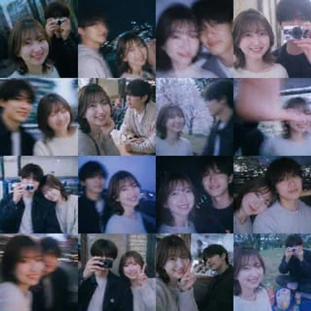

```text
A nostalgic collage containing 16 snapshots of youth, arranged in a neat 4x4 grid with a square composition, reminiscent of fictional memories from Japanese coming-of-age films. It showcases the time spent together by a couple or a small group of college students, imbued with a dreamy, sensual atmosphere. The photos feature soft blue and pink tones, a slight film grain, low-light halos, motion blur, shallow depth of field, and the imperfect quality of casual mobile phone photography. The main, recurring subject is a young woman with {argument name="hair style" default="shortwave head"} Young women, wearing{argument name="top color" default="White or light gray knit top"} The image shows a young man with dark hair, wearing a casual dark jacket or a light-colored hoodie, who appears to be close friends or a shy couple. All visible faces are deliberately obscured by soft, rectangular blurs, but the body language remains warm, intimate, and natural. Contains 16 squares: 1) A solo woman's street portrait at night; 2) A man and woman side-by-side in an outdoor photo at night with city lights as the background; 3) Two friends taking a close-up selfie indoors, side-by-side; 4) An indoor photo near curtains; 5) A blurred street selfie of two people moving; 6) A cozy cafe table scene with drinks on the table, the woman touching her face, and the man sitting opposite her; 7) A spring park scene under blooming cherry blossoms; 8) A playful outdoor shot with hands partially obscuring the lens; 9) An indoor sofa or booth snapshot, one person holding a small camera; 10) A viewpoint or rooftop shot during the Blue Hour, with city lights as the background, two people standing together; 11) A portrait of two friends by the water at night or against a backdrop of city lights; 12) A close-up snapshot of two people side-by-side at night; 13) A heavily blurred close-up selfie, one person in motion; 14) An indoor snapshot in a mirrored area or restaurant, one person holding a camera; 15) A casual indoor pose with a peace sign next to a brick or tile wall; 16) A picnic scene in the park, with snacks on the table, and one of the friends holding a camera. Overall feeling: nostalgic, cinematic, intimate, youthful, spontaneous, and bittersweet, like a scrapbook of memories that never really happened.
```

Model: GPT Image 2
Author: GPT Image 2 Prompts

[ProjectD](https://aitoolsradar.com/en/prompts/5e902319dea2b5) · [Recorded source](https://x.com/Ayu_AI_0912/status/2047946655207657777#reversed-0)
 · [Full original metadata and byte evidence](data/projectd-batch-0041.json)

## Notebook Spread with 3D Model Analysis Diagrams

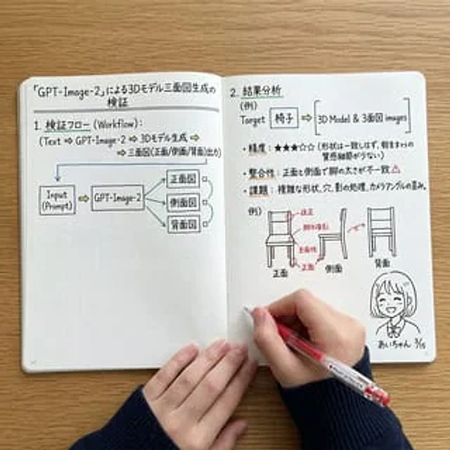

```text
{
  "type": "A bird's-eye view of an open dot-matrix notebook on a wooden desk.",
  "subject": {
    "description": "A hand wearing a dark blue ribbed sweater is writing in a notebook.",
    "tool": "Holding a{argument name=\"pen color\" default=\"red\"} gel pen"
  },
  "layout": {
    "left_page": {
      "header": "{argument name=\"main title\" default=\"Validation of 3D model three-view generation based on &quot;GPT-Image-2&quot;\"}",
      "sections": [
        {
          "title": "1. Validation Workflow:",
          "content": "Text sequence (text =&gt; GPT-Image-2 =&gt; 3D model generation =&gt; three-view output (front/side/back))"
        },
        {
          "type": "block diagram",
          "elements": 5,
          "description": "The box labeled 'Input (Prompt)' points to 'GPT-Image-2', which then branches into three boxes labeled 'Front View', 'Side View', and 'Rear View', connected by a green line."
        }
      ]
    },
    "right_page": {
      "sections": [
        {
          "title": "2. Results Analysis",
          "subtitle": "(Example) Target{argument name=\"target object\" default=\"chair\"} =&gt; [3D Model &amp; Three-View Images]",
          "bullet_points": {
            "count": 3,
            "topics": [
              "Accuracy (3 out of 5 stars)",
              "consistency",
              "challenge"
            ]
          }
        },
        {
          "type": "sketches",
          "count": 3,
          "subject": "chair",
          "labels": [
            "front",
            "side",
            "back"
          ],
          "annotations": "Red ink arrows and correction notes on the chair drawing"
        },
        {
          "type": "doodle",
          "position": "bottom right corner",
          "description": "Cute anime girl face",
          "signature": "{argument name=\"doodle signature\" default=\"Ai-chan 3/15\"}"
        }
      ]
    }
  }
}
```

Model: GPT Image 2
Author: GPT Image 2 Prompts

[ProjectD](https://aitoolsradar.com/en/prompts/51223f7c4dd38d) · [Recorded source](https://x.com/ai_watch_jp/status/2044552425177325723#reversed-0)
 · [Full original metadata and byte evidence](data/projectd-batch-0041.json)

## Notion Template Cover — Project Tracker


```text
Vertical 9:16 Notion-style template cover mockup. Soft pastel cream background with subtle paper grain texture. Centered minimal flat illustration of a stack of three layered project cards in pale sage, peach, and lavender, each with a tiny placeholder progress bar and a small icon. Above the illustration a bold modern serif title reads "Project Tracker". Below it in smaller clean sans-serif type reads "A simple template for shipping things". Vertical composition with generous margins. No real brand name, no Notion logo, no watermark. Premium productivity template cover aesthetic, magazine layout quality.
```

Model: GPT Image 2
Author: @hiapi_ai

[ProjectD](https://aitoolsradar.com/en/prompts/4865fce01c3b6d) · [Recorded source](https://github.com/HiAPIAI/awesome-gpt-image-2-prompts)
 · [Full original metadata and byte evidence](data/projectd-batch-0041.json)

## NOZOMU Capsule Figure Product Display

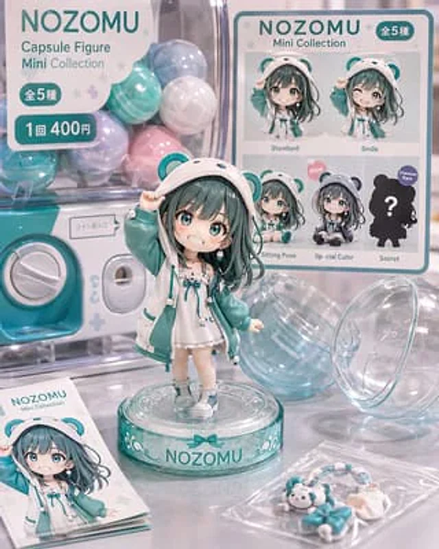

```text
Goal: Create a highly polished pastel product advertisement photo for a fictional gashapon toy line featuring {argument name="character name" default="NOZOMU"}, designed like a collectible capsule figure display.

Canvas: Square 1:1 image, high-resolution commercial product photography with soft studio lighting, shallow depth of field, glossy reflections, and a cute teal, white, lavender, and pale pink palette.

Main subject: Center foreground shows one chibi anime capsule figure standing on a transparent round display base labeled “NOZOMU.” The figure is a small girl with long dark teal hair, large teal eyes, a cheerful open-mouth smile, and a white bear-ear hoodie with teal bear ears. She wears a teal oversized jacket over a white frilly dress, teal ribbons, tiny bear charms, white socks, and white sneakers. Her right hand lifts the edge of the hood, and her left arm is slightly out to the side. The base is clear acrylic with teal trim, decorative white scrollwork, a small bow motif, and the character name on the front.

Background and props: Place the figure in front of a transparent capsule vending machine filled with pastel capsules. Include exactly 9 visible capsule balls: 3 teal capsules, 2 lavender capsules, 2 white capsules, 1 pale blue capsule, and 1 pale pink capsule. The machine has a teal coin panel and a white dial, with small Japanese-style coin-insertion signage. On the right foreground, place exactly 2 large empty transparent capsule halves, slightly open and reflective. On the lower left, place exactly 1 mini brochure/card showing the same character artwork and the text “NOZOMU Mini Collection.” On the lower right, place exactly 1 clear plastic accessory bag containing small teal-and-white toy parts: a tiny bear-face charm, teal ribbon-like pieces, and small white accessories.

Left vending-machine sign: Add a rounded white sign with teal text at upper left. It must read “NOZOMU” in large letters, then “Capsule Figure” and “Mini Collection.” Include two teal rounded labels: one says “全5種” and one says “1回 400円.” Decorate the sign with small pale stars and soft pastel shapes.

Right collection board: Add a large rectangular collection lineup board on the right side with teal border and rounded corners. Header reads “NOZOMU Mini Collection” with a small teal badge reading “全5種.” The board displays exactly 5 variants in a 2-row grid: 1) “Standard” standing pose, 2) “Smile” winking/smiling pose, 3) “Sitting Pose” standing or seated variant image, 4) “Special Color” gray-toned seated version with a pink “New” sticker, and 5) “Secret” as a dark bear-eared silhouette with a white question mark and a small “Premium Rare” badge. Make the labels small but legible, matching the product mockup style.

Visual style: Cute Japanese collectible toy aesthetic, realistic miniature figure material, glossy plastic capsules, pastel teal branding, clean merchandising layout, bokeh highlights, soft shadows, premium catalog photography, detailed anime face and hair sculpt, realistic acrylic reflections.

Constraints: Use exactly one main figure on the central base, exactly one lineup board with five variant entries, exactly one left price/collection sign, exactly one brochure, exactly one accessory bag, exactly two open capsule halves, and exactly nine filled capsules in the machine. Keep all text crisp and integrated into the product design. Do not add extra characters, logos, watermarks, or unrelated objects.
```

Model: GPT Image 2
Author: のぞむ＊AIイラスト

[ProjectD](https://aitoolsradar.com/en/prompts/7150413f5c19bf) · [Recorded source](https://youmind.com/prompts/nozomu-capsule-figure-display-25849)
 · [Full original metadata and byte evidence](data/projectd-batch-0041.json)

## NYC Romance Grade Comparison

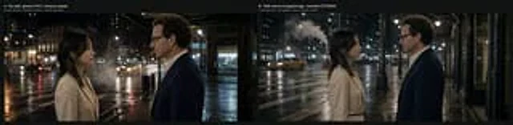

```text
Goal: Create a cinematic side-by-side comparison frame showing how different grading constraints affect the same nighttime romance scene in New York City.

Canvas: Very wide horizontal comparison image, approximately 4:1 aspect ratio, with a thin black outer border and a black divider between two equal panoramic panels.

Layout: Use exactly 2 side-by-side panels. The left panel is labeled at the top-left: “A  No skill: generic NYC romance grade” with a smaller subtitle beneath it: “normal saturation / brighter sky volume / modern night polish”. The right panel is labeled at the top-left: “B  With eterna-image2image: standard ETERNA” with a smaller subtitle beneath it: “muted night color / soft highlights / deeper readable shadows”. Keep the labels small, clean, white, and unobtrusive, like a film test contact sheet.

Scene content: Both panels show the same setup: exactly 2 human subjects, a woman on the left and a man on the right, standing face-to-face on a rainy New York street at night. The woman has {argument name="woman appearance" default="dark shoulder-length hair with bangs, light beige wool coat, soft natural makeup"}. The man has {argument name="man appearance" default="curly dark hair, glasses, navy suit jacket, white shirt"}. They stand in profile, emotionally restrained, as if in a quiet romantic conversation. The street is wet and reflective, with blurred traffic, storefronts, streetlights, building windows, and a yellow taxi in the distance. Include visible steam or mist rising from the street in the background.

Left panel look: A generic modern NYC romance grade, with brighter lifted shadows, slightly exaggerated cool moonlit highlights on faces and coats, higher saturation, glossy wet-road reflections, visible bokeh lights, and a more polished digital night look. The woman and man are placed closer to the foreground, cropped at mid torso, with the woman near the left third and the man near the right third.

Right panel look: A more restrained Fuji ETERNA-inspired cinematic grade, using muted colors, soft highlights, deeper but still readable shadows, lower saturation, natural practical streetlight warmth, less artificial blue spill, smoother tonal rolloff, and a more grounded filmic night atmosphere. The composition is slightly wider than the left panel, with more negative space and more visible sidewalk, columns, taxi, steam, and wet street environment. The woman and man remain facing each other in profile, centered in the panel.

Visual style: Photorealistic cinematic still, anamorphic-feeling wide frame, natural rain-slick pavement, shallow depth of field, realistic skin tones, soft practical lighting, subtle film grain, restrained contrast, no fantasy elements.

Constraints: Use exactly 2 panels, exactly 2 people per panel, exactly the 2 panel labels and 2 subtitles listed above, no extra captions, no logos, no watermark, no UI controls, no additional characters in the foreground.
```

Model: GPT Image 2
Author: CuiMao

[ProjectD](https://aitoolsradar.com/en/prompts/9a2342ecfbd93e) · [Recorded source](https://youmind.com/prompts/nyc-romance-grade-comparison-26894)
 · [Full original metadata and byte evidence](data/projectd-batch-0041.json)

## Occult Cyber-Gothic Collage Poster

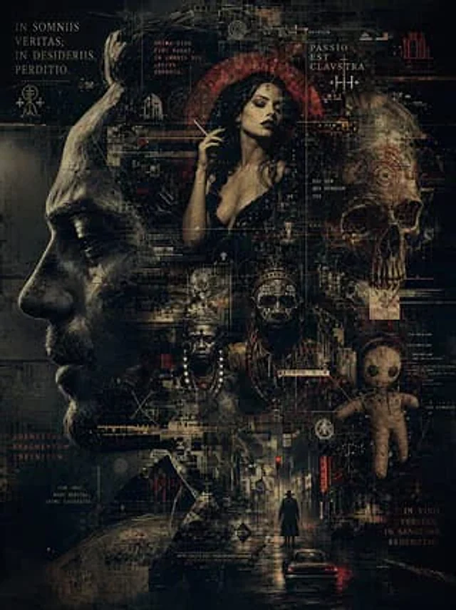

```text
A dark, mysterious, cyberpunk-gothic vertical collage poster, densely packed and layered like a ritualistic film noir album cover, employs aged black, tan, bronze, and deep red tones. It blends simulated decay, glitch textures, scanned paper, technical schematics, surveillance graphics, sacred geometry, and fragmented photographic montage. On the right, a large, highly detailed, weathered profile of an aged human skull is displayed, partially obscured by circles, target markings, runes, fine grid lines, and red chart annotations. Near the top center, a mysterious woman with long, dark hair and pale skin, dressed in a low-cut black outfit, poses sensually, one hand raised near her face; a large, dark red halo is added behind her head. In the upper left quadrant, the back or shoulder of a pale, classically sculpted figure is depicted with a ghostly, fragmented quality. In the lower right center, a dark-skinned ritual figure or priestess is placed, adorned with layers of beads, necklaces, and ritual ornaments, partially obscured by textures and collage distractions. In the bottom right corner, a tattered rag doll or voodoo-style ragged puppet is displayed, suspended with visible seams and outstretched limbs. At the bottom center, a rainy night street scene is depicted, with a lone figure in a trench coat walking away in the dim light, and a car parked or stopped on the wet road, the surface reflecting a reddish glow. In the bottom left corner, a multifaceted black pyramid or crystalline geometric shape emerges from the darkness. Scattered throughout the design are seven distinct blocks of Latin text, styled in an aged serif font and mysterious inscriptions: “IN SOMNIIS VERITAS; IN DESIDERIIS, PERDITIO.”, “ANIMA SINE FINE VAGAT, IN UMBRIS SUI IPSIUS INVENTA.”, “PASSIO EST CLAVISTRA”, “EGO SUM QUI NUNQUAM FUI.”, “III FRAGMENTUM INFINITUM.”, “COR AMAT; MENS DUBITAT; ANIMA LACERATUR.”, and “IN VINO VERITAS IN SANGUINE REDEMPTIO.” Tiny UI-style microtext, barcode fragments, micro-charts, mysterious badges, crosshairs, and barely legible data panels are added throughout the image. The overall composition aims to create a somber, profound, cinematic, and surreal atmosphere, with heavy textures, layered transparency, subtle red accents, contrasting lighting, and the feel of a sophisticated dark art poster.
```

Model: GPT Image 2
Author: GPT Image 2 Prompts

[ProjectD](https://aitoolsradar.com/en/prompts/058646ee6cd8b2) · [Recorded source](https://x.com/MuratAykul/status/2047760031186104358#reversed-2)
 · [Full original metadata and byte evidence](data/projectd-batch-0041.json)

## Occult Eye Motif Anime Portrait

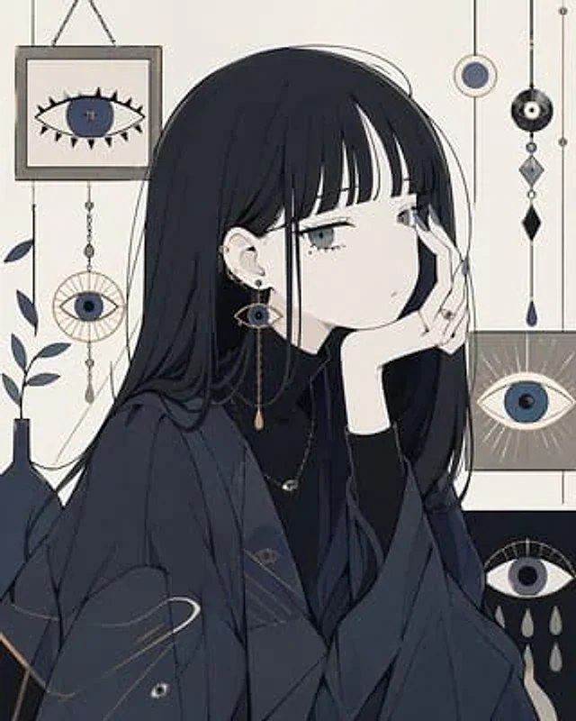

```text
A simple, minimalist anime illustration depicts a melancholic young woman in a three-quarter profile, sitting and resting her cheek on her hand. She has long, straight hair.{argument name="hair color" default="blue-black"} Her hair was styled with blunt bangs, her skin was very pale, and her grey-blue eyes held a distant and weary expression. Her face was small and delicate, with a tiny beauty mark beneath one eye, and her eyelashes were fine. She wore a dark, oversized layered outfit in deep navy and charcoal grey: a high-necked black top under a loose, flowing coat or kimono-style overcoat, the fabric adorned with subtle gold lines and tiny eye patterns. Her accessories were elegant and mysterious: multiple ear piercings, a long, dangling earring shaped like an eye with a teardrop pendant, a delicate necklace with a small eye pendant, and several rings on her hands, including an eye-shaped ring on the hand that rested her face on her hand. Her nails were painted a soft slate blue. The background was a flat, warm off-white, meticulously arranged with a series of mysterious eye symbols and hanging decorations. The wall features six precisely chosen eye-themed elements: a framed eye painting in the upper left, a circular eye pendant below it, a small, bullseye-like circular decoration near the upper right, a black pendant with an eye and geometric crystals on the far right, a square panel with radiating eyes on the right center, and a dark rectangular panel with an eye and four teardrop shapes in the lower right. A dark bottle silhouette and a few soft blue-grey leaves are added as secondary decorations on the left. A restrained palette of navy, black, cream, grey-blue, and a touch of soft gold is used. The composition should evoke a quiet, gothic, soft, and introspective atmosphere, employing flat graphic shapes, clean lines, minimal shadows, and an aesthetic reminiscent of modern decorative posters.
```

Model: GPT Image 2
Author: GPT Image 2 Prompts

[ProjectD](https://aitoolsradar.com/en/prompts/cc37dce09a5709) · [Recorded source](https://x.com/hoshi122221/status/2046890409302049187#reversed-0)
 · [Full original metadata and byte evidence](data/projectd-batch-0041.json)

## Occult Tarot Club Map

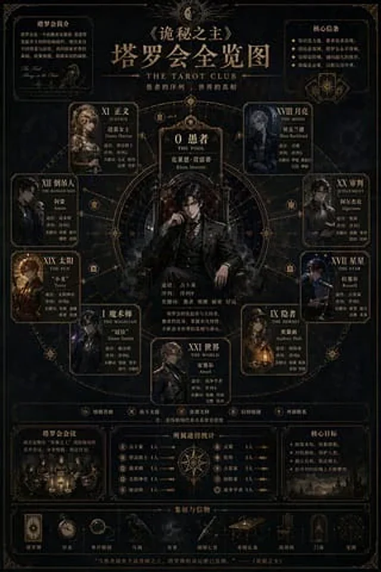

```text
Generate a{argument name="subject" default="Tarot Club in Lord of Mysteries"} Overview map, using{argument name="occult style" default="Victorian Mysticism"} and{argument name="archive style" default="Black and gold archive style"}
```

Model: GPT Image 2
Author: GPT Image 2 Prompts

[ProjectD](https://aitoolsradar.com/en/prompts/6a8d5db0988f1c) · [Recorded source](https://x.com/MrLarus/status/2045108338766041356)
 · [Full original metadata and byte evidence](data/projectd-batch-0041.json)

## Office Fashion Magazine Cover

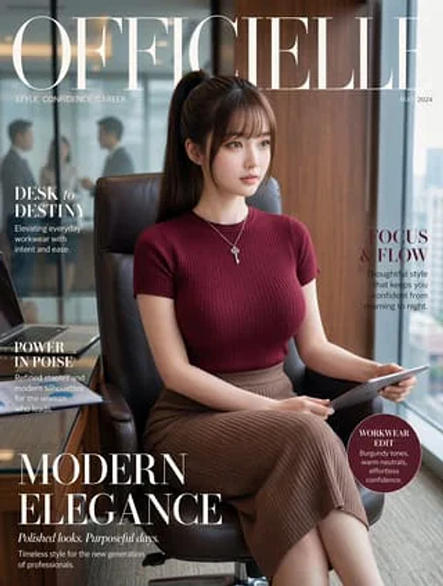

```text
The cover of a luxury fashion magazine features a vertical portrait of a composed and capable young professional woman, seated in a black leather office chair in a modern high-rise office. She has {argument name="hair color" default="Dark brown"} Her hair was styled into a neat high ponytail with soft side-swept bangs; she wore {argument name="top color" default="Deep red"} She wore a fitted ribbed short-sleeved knit top paired with a gray-brown high-waisted pleated midi skirt, and a delicate silver necklace with a small, key-shaped, layered pendant. She sat with her legs crossed, a slim tablet resting on her lap, her expression calm, composed, and exuding a restrained strength. The background was a sophisticated executive office, with wooden paneling on the right and floor-to-ceiling windows behind her. Behind the glass on the left, a blurred meeting scene and two indistinct business figures could be seen. In the lower left corner, an open laptop and stacks of documents sat on the edge of a desk. Soft natural light, a refined editorial style, realistic fashion photography, warm neutral tones, and subtle background blur—all hallmarks of high-end magazine aesthetics. The elegant magazine layout was further enhanced by a large serif masthead at the top, displaying…{argument name="magazine title" default="OFFICIELLE"} It is ivory white; there is a small subtitle in the lower left corner that reads "STYLE. CONFIDENCE. CAREER."; the date is in the upper right corner.{argument name="cover date" default="May 2024"} A total of five cover headlines were added: Top left: "DESK to DESTINY," with a smaller subtitle "Elevating everyday workwear with intent and ease."; Middle left: "POWER IN POISE," with a smaller subtitle "Refined staples and modern silhouettes for the woman who leads."; Middle right: "FOCUS &amp; FLOW," with a smaller subtitle "Thoughtful style that keeps you confident from morning to night."; Bottom left: Large headline "MODERN ELEGANCE," with italicized subtitle "Polished looks. Purposeful days." and smaller text "Timeless style for the new generation of professionals."; Bottom right: A circular badge containing "WORKWEAR EDIT" and smaller text "Burgundy tones, warm neutrals, effortless confidence." The layout is clean and balanced, creating a high-end women's fashion magazine cover, exuding a confident, runway-like atmosphere in the workplace, highly realistic, exquisite, and with a cinematic soft lighting.
```

Model: GPT Image 2
Author: GPT Image 2 Prompts

[ProjectD](https://aitoolsradar.com/en/prompts/54390e21e5a6e9) · [Recorded source](https://x.com/yunaelegant/status/2047722486511661527#reversed-0)
 · [Full original metadata and byte evidence](data/projectd-batch-0041.json)

## Office Fashion Magazine Cover

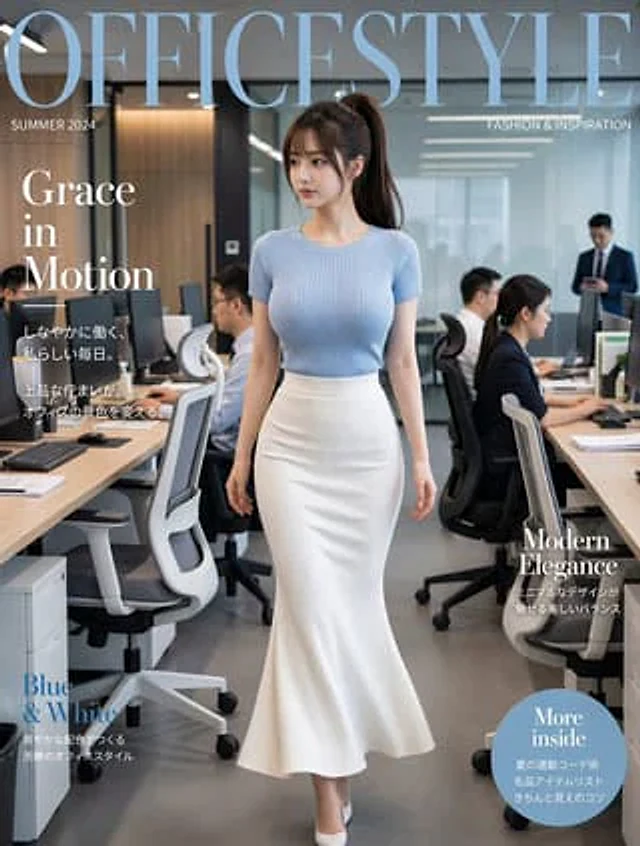

```text
A fashion magazine cover set in a modern open-plan office features sophisticated, realistic photography, complemented by soft commercial lighting and a luxurious, fashionable atmosphere. At the center of the image is a tall, slender East Asian businesswoman, confidently walking down an aisle between desks, as if on a runway. Her shoulders are back, her arms are relaxed, and her gaze is fixed straight ahead. She is wearing a…{argument name="top color" default="powder blue"} A fitted ribbed knit short-sleeved top, paired with a {argument name="skirt color" default="White"} She wore a high-waisted, long ribbed fishtail skirt and crisp white pointed-toe heels. Her hair was styled in a high ponytail, ranging from dark brown to black. The surrounding office was bright, elegant, and modern, with desks, flat-screen computer monitors, ergonomic black and white office chairs, glass meeting room partitions, warm-toned wood paneling, and ceiling strip lights. In the background, several indistinct office workers were working, and a figure in a suit stood. The composition adopted a high-fashion magazine cover style, with the woman occupying the center of the frame, and the office appearing deep within the background. An oversized light blue serif font was added at the top as a masthead, containing the following text:{argument name="magazine title" default="OFFICESTYLE"} Add a small white cover title in the top left corner:{argument name="issue text" default="Summer 2024"} Add "FASHION &amp; INSPIRATION" to the top right corner. On the left, place a large white serif headline in three lines: "Grace in Motion," below which are two smaller Japanese teaser blocks. Add a blue serif subheading: "Blue &amp; White," to the bottom left corner, below which are two smaller lines of Japanese text. On the right, add a white serif headline: "Modern Elegance," below which are two smaller lines of Japanese text. In the bottom right corner, place a large light blue circle containing the white serif text "More inside," below which are three short lines of Japanese teaser text. The overall color scheme remains light and sophisticated, primarily using blue, white, gray, and soft beige, presenting a clean magazine cover layout, luxurious typography, subtle depth effects, and an alluring haute couture aesthetic for the workplace.
```

Model: GPT Image 2
Author: GPT Image 2 Prompts

[ProjectD](https://aitoolsradar.com/en/prompts/058f758b4054d0) · [Recorded source](https://x.com/yunaelegant/status/2047722486511661527#reversed-1)
 · [Full original metadata and byte evidence](data/projectd-batch-0041.json)

## Office Fashion Magazine Cover

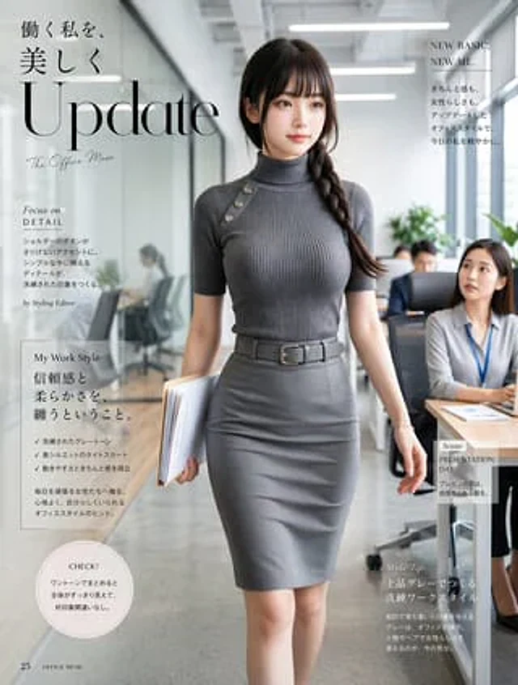

```text
A sophisticated Japanese fashion magazine cover, set in a bright, modern office corridor, features a beautiful career woman confidently walking towards the camera in a full-body portrait. She wears a sharp, monochrome gray business suit: a fitted ribbed turtleneck short-sleeved knit top with four metal buttons adorning the off-shoulder strap, paired with a high-waisted gray pencil skirt and a matching gray belt with rectangular buckles. She carries a folder and documents in one hand, while her other arm swings naturally as she walks. She has long, dark brown hair, braided into a thick side plait that falls over her shoulder, with neatly styled bangs. The overall atmosphere is elegant, mature, and exudes feminine charm with understated strength. The scene is a sophisticated open-plan office; to the left is a glass conference room, and to the right are desks and colleagues working. Soft sunlight intertwines with clean office overhead lighting, accented by delicate indoor greenery. A shallow depth of field keeps the subject in sharp focus, while the background is softly blurred. The image employs a vertical composition reminiscent of a high-end magazine cover, with the model centered and occupying most of the frame from head to knee. Meticulously edited and retouched, it showcases realistic fabric textures, natural skin tones, and understated luxury. Overlaid with stylish Japanese and English magazine layouts: a large serif headline in the upper left corner.{argument name="headline text" default="Update"} The magazine features small Japanese text at the top, with the subtitle "The Office Muse" in handwritten font. To the right is a preview section titled "NEW BASIC, NEW ME." To the left is a special section titled "Focus on DETAIL." In the center left is an article box titled "My Work Style," and to the bottom right is a special section titled "Style Tip." A small box on the right reads "Scene PRESENTATION DAY," and to the bottom left is a circular "CHECK!" Page 25 is printed in small print at the bottom. Employing a luxurious fashion magazine aesthetic, the layout is clean and simple, with a restrained grayscale color scheme. The text and main content achieve an editorial balance, featuring realistic photography, rich detail, and soft contrast, creating an appealing, high-fashion look for workplace attire.
```

Model: GPT Image 2
Author: GPT Image 2 Prompts

[ProjectD](https://aitoolsradar.com/en/prompts/e5f2cfca7be140) · [Recorded source](https://x.com/JiroJohn558192/status/2047588855755206837#reversed-1)
 · [Full original metadata and byte evidence](data/projectd-batch-0041.json)

## Office Muse Fashion Cover

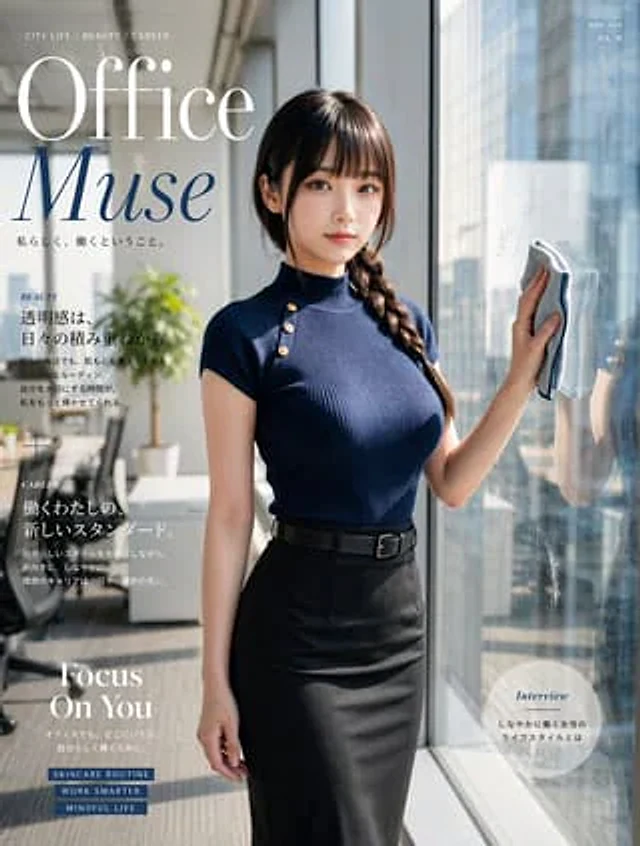

```text
A sophisticated high-fashion magazine cover portrait features a beautiful young professional woman standing by the floor-to-ceiling windows of a bright, modern corporate office, shot in a refined editorial style. She is slightly turned to the side, her expression calm, elegant, and confident, her face deliberately obscured by a soft, rectangular blurring effect. She has long, dark brown hair, braided into a thick side braid that falls over her shoulder. She is wearing a {argument name="top color" default="Deep Navy Blue"} She wears a fitted ribbed turtleneck sweater with short sleeves and three gold buttons on the left shoulder, paired with a high-waisted black pencil skirt and a thin black belt. Her right hand is raised, holding a light-colored cleaning cloth against the glass, presenting a symbolic lifestyle fashion scene rather than an actual cleaning action; her left arm hangs naturally at her side. Warm sunlight streams in from the window, creating soft highlights on her clothes and skin, with subtle reflections on the glass. Outside, a bright cityscape of towering office buildings stretches out. The interior background is soft-focused, revealing a minimalist office with a potted plant, a desk, and an office chair. The composition uses a vertical layout reminiscent of a high-end magazine cover, with the full-body shot cropped to mid-calf, and the model slightly to the right to allow for layout space on the left. Elegant Japanese fashion magazine-style cover text is added: a very large serif masthead in the upper left corner, with the text {argument name="main title" default="Office Muse"} The "Office" section is white, and the "Muse" section is dark blue. The top left corner features small, uppercase text: "CITY LIFE / BEAUTY / CAREER." The top right corner displays the issue number: "JUNE 2024" and "VOL. 28." It includes five additional text blocks: a Japanese subtitle below the main title; the "BEAUTY" section and Japanese text in the left sidebar; the "CAREER" section and Japanese text in the left sidebar; the prominent "Focus On You" title and a Japanese subtitle in the bottom left corner; and the "Interview" section and Japanese text within a semi-transparent light-colored circle in the bottom right corner. Three small blue rectangular labels are added near the bottom left corner, with content {argument name="tag line 1" default="SKINCARE ROUTINE"} ,{argument name="tag line 2" default="WORK SMARTER"} and{argument name="tag line 3" default="MINDFUL LIFE"} Overall atmosphere: exquisite, feminine, desirable, urban, elegant, professional, luxurious, clean natural light, realistic digital photography with a subtle fashion retouching feel, high-end Japanese magazine cover design.
```

Model: GPT Image 2
Author: GPT Image 2 Prompts

[ProjectD](https://aitoolsradar.com/en/prompts/88be93b13ab392) · [Recorded source](https://x.com/JiroJohn558192/status/2047588855755206837#reversed-2)
 · [Full original metadata and byte evidence](data/projectd-batch-0041.json)

## Office Style Fashion Magazine Cover

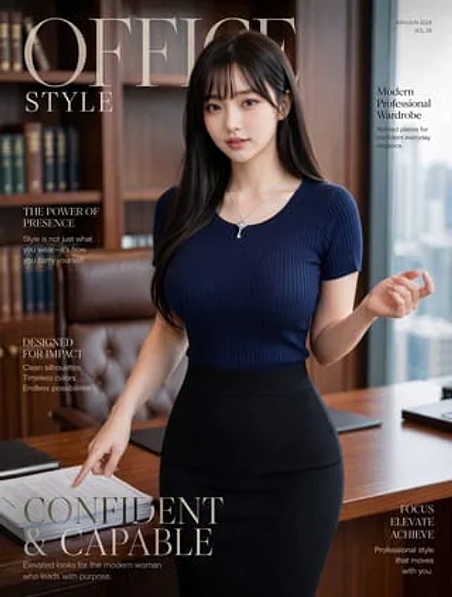

```text
A luxury fashion magazine cover, shot in a modern executive office, features a stylish young East Asian businesswoman striking a confident editorial pose beside a wooden desk. She has long, flowing, dark brown to black hair, parted in the middle and cascading over her shoulders, and wears a {argument name="top color" default="Deep Navy Blue"} A fitted ribbed knit short-sleeved top, paired with a {argument name="skirt color" default="black"} She wears a high-waisted ribbed pencil skirt and a delicate silver necklace with a small key pendant. Her body is slightly turned towards the camera, one hand casually raised to shoulder height, the other pointing to documents on the table, exuding a composed authority and effortless elegance. The background is a sophisticated corner office with warm-toned wooden bookshelves filled with books, a tufted brown leather executive chair, a polished wooden desk with neatly arranged documents and a dark placemat, and a large window on the right revealing a softly blurred city skyline. The use of soft natural light from the window blends with the warm interior tones, creating a shallow depth of field, a high-end magazine photography feel, delicate skin textures, realistic fabric textures, elegant retouching style, and a refined editorial atmosphere. The elegant serif magazine layout is overlaid: a large masthead in the upper left corner.{argument name="magazine title" default="OFFICE STYLE"} The upper right corner contains text from a small journal.{argument name="issue text" default="Volume 28, May/June 2024"} The cover features a total of five introductory phrases: The top right corner reads "Modern Professional Wardrobe," with the subtitle "Creating Exquisite Pieces for Confident Everyday Elegance."; the top left corner reads "The Power of Presence," with the subtitle "Style is Not Just What You Wear, But How You Present Yourself."; the center left corner reads "Designed for Influence," with the subtitle "Clean Cuts. Timeless Colors. Infinite Possibilities."; and the bottom left corner features an oversized serif font.{argument name="main cover line" default="Confidence and competence"} The bottom right corner reads "Focus on Enhancing Achievement," with the subtitle "A Professional Style That Moves with You." The vertical portrait composition, high-end fashion magazine cover layout, clean spacing, understated yet luxurious color scheme, realistic office styling, and the chic, confident demeanor of a professional woman are all present.
```

Model: GPT Image 2
Author: GPT Image 2 Prompts

[ProjectD](https://aitoolsradar.com/en/prompts/dc92570b97a2b0) · [Recorded source](https://x.com/yunaelegant/status/2047722486511661527#reversed-2)
 · [Full original metadata and byte evidence](data/projectd-batch-0041.json)

## Office Transfer Announcement Poster


```text
Design a dramatic square promotional poster in the style of a TV actor transfer announcement, with a dark navy blue and black office theme background. It should have a rugged sports poster feel, complemented by striking blue brushstrokes, distressed white typography, and layered collage composition. Place a confident woman at the center of the image.{argument name="character name" default="Penny"} A half-length portrait shows her with her arms crossed, wearing a light beige floral V-neck dress and a messy high bun of blonde hair, the outline of which has a soft, shimmering edge. Behind her, eight office colleagues are shown as a blurred ensemble cast, arranged in a staggered manner within an office with blinds, desks, and company signage; they are kept in a secondary position and slightly shaded to highlight the central woman's dominance. In the upper left corner, a slanted blue company logo block is added, bearing the words "DUNDER MIFFLIN INC. PAPER COMPANY" along with a small office icon. At the top center, a large, distressed white headline "TRANSFER" is added, below which is the larger blue handwritten word "CONFIRMED." In the upper right corner, a small stacked slogan, "NEW CHAPTER. NEW SCRANTON," is added. On the left, place a torn-paper style transfer form with a stamped photocopy appearance; it should contain two clearly defined label sections: "FROM:" corresponding to "DUNDER MIFFLIN PAPER COMPANY, SCRANTON, PA, EST. 1949," and "TO:" corresponding to "THE OFFICE, SCRANTON, PA," with a small office icon at the bottom. Draw a hand-drawn blue arrow from this form pointing to the central woman. At the woman's torso, place a nameplate with blue strokes, bearing the words "..." in white handwriting.{argument name="character name" default="Penny"} This is followed by a small black bar with "IS" written on it, and below that is a large stacked title bar in an aged white and blue block font that reads "JOINING THE OFFICE". To the right, a glowing dark information panel is added, containing three lines of clear labels: "NEW ROLE" corresponding to {argument name="job title" default="SALES REPRESENTATIVE"} "NEW TEAM" corresponds to "{argument name="team tagline" default="SAME PAPER"} The text includes a heading and a message: "NEW MEMORIES" followed by "LOADING...", with a horizontal progress bar below. At the bottom center, a narrow blue banner reads "DUNDER MIFFLIN, INC. WELCOMES".{argument name="character name" default="Penny"} At the very bottom, create a footer containing four elements: a briefcase icon and "NEW JOB," a team icon and "NEW TEAM," a document icon and "NEW MEMORIES," and a handwritten blue phrase on the far right.{argument name="footer text" default="LET'S GO!"} It uses a high-contrast blue, white, and black color scheme, cinematic compositing effects, subtle dust and texture overlays, vibrant paint smear effects, and sophisticated fan-edited social media announcement aesthetics.
```

Model: GPT Image 2
Author: GPT Image 2 Prompts

[ProjectD](https://aitoolsradar.com/en/prompts/0183416c37eb20) · [Recorded source](https://x.com/Dawidrrr9/status/2047740402673885466#reversed-0)
 · [Full original metadata and byte evidence](data/projectd-batch-0041.json)

## Official Character Sheet (JP)

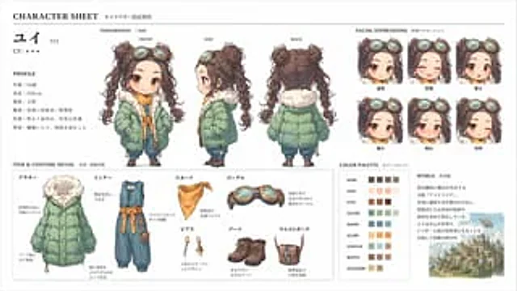

```text
このキャラクターと背景を元に、 公式設定資料のようなキャラクターシートを作成してください。 
・正面、側面、背面の3面図を含める ・キャラクターの表情バリエーションを追加 
・衣装や装備の詳細パーツを分解して表示 ・カラーパレットを追加 ・世界観の簡単な説明を入れる 
・全体は整理されたレイアウト
（白背景、図解風） 
・アスペクト比16：9

高解像度、プロのコンセプトアートスタイル
```

Model: GPT Image 2
Author: @Toshi_nyaruo_AI

[ProjectD](https://aitoolsradar.com/en/prompts/e6ba8fb4d4194e) · [Recorded source](https://x.com/Toshi_nyaruo_AI/status/2045025277538107420)
 · [Full original metadata and byte evidence](data/projectd-batch-0041.json)

## Official Style Character Concept Sheet Prompt

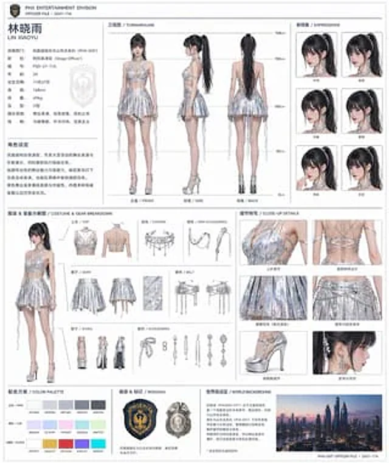

```text
Based on this character and background, please create a character design document that resembles an official character design file. Include: • Three views (front, side, and back) • Add character facial expressions • Show detailed breakdowns of clothing or equipment • Add a color scheme • Include a brief world-building description • Clean overall layout (white background, chart style) High resolution, professional concept art style
```

Model: GPT Image 2
Author: GPT Image 2 Prompts

[ProjectD](https://aitoolsradar.com/en/prompts/07d6a198bc5b3d) · [Recorded source](https://x.com/HNicotine1233/status/2045031501457453196)
 · [Full original metadata and byte evidence](data/projectd-batch-0041.json)

## Okinawa Summer Travel Banner


```text
Create a sophisticated and eye-catching Okinawa summer banner advertisement for a Japanese travel agency. Use a wide, horizontal layout with a vibrant tropical beach scene as the entire background: crystal-clear turquoise ocean, white sand, green islands in the mid-to-far distance, deep blue sky, and large, fluffy white clouds, with palm leaves hanging in the upper right corner. In the right foreground, place a traditional Okinawan wind lion statue perched on a stone wall, surrounded by red hibiscus and lush tropical greenery. Near the water, add a small glass-bottomed sightseeing boat close to the shore. Add two simple fish graffiti icons to the sea surface. Use typography as the core element. Place the prominent Japanese calligraphy title text in the center left-to-center position.{argument name="headline text" default="Summer in Okinawa"} The design employs a blue gradient effect with white halos or soft outlines, resulting in a clean and elegant look. Above it, a handwritten Japanese slogan is added.{argument name="catchphrase" default="Blue sea, blue sky, and relaxing island time."} It is decorated with casual underlines. Below the main title, add a smaller Japanese subtitle.{argument name="subheading" default="Embark on a journey to encounter breathtaking scenery and warm hospitality."} In the top left corner, add a circular summer badge with a radiant, sunlit feel, against a soft cream background, adorned with delicate wavy lines, a small hibiscus decoration, and the Japanese text "この夏は沖縄で最高の思い出を！". Decorate the left side of the title area with a pink hibiscus and subtle wave-like graphic lines. In the lower center, place three rounded-corner white function cards side-by-side, partially overlapping the beach scene. Please clearly present all three cards: The first card features a circular photo of a sea turtle swimming underwater, accompanied by the Japanese title "Enjoying Beautiful Nature" and a brief text about the clear water and attractions; the second card features a circular photo of a bowl of Okinawa soba noodles, accompanied by the title "Able to Eat Okinawa Gourmet Noodles" and a brief text mentioning "Okinawa soba" and "Goat Chanpuru"; the third card features a circular photo of Shuri Castle, accompanied by the title "Enjoying the Viewpoint" and a brief text mentioning "Okinawa Churaumi Aquarium" and "Shuri Castle". Add small corals, seashells, hibiscus flowers, and starfish decorations around these cards. In the lower right corner, overlay a slanted light blue and cream-colored circular promotional sticker against a beach background, topped with a small yellow tag. The yellow label reads "Early Bird Booking!", and the main circle reads "Natsu no Okinawa Tour - Reviews Accepted!". Add a white frangipani flower near the sticker as an embellishment. Create a full-width dark blue footer at the bottom. On the left side of the footer, place the white travel agency logo icon and the company name text.{argument name="company name" default="XX Travel Co., Ltd."} Below this is a smaller Japanese caption. In the center of the footer are three circular line icons with brief Japanese descriptions: a calendar icon for travel planning, a customer service icon for travel assistance, and a suitcase icon for comfortable travel. On the right side of the footer is a framed CTA area containing the Japanese phrase "詳しくはこちらから" and a simulated search box containing {argument name="search text" default="XX trip to Okinawa"} And search icons. The overall design should present a high-end, cheerful, summery, and highly marketable style, like a professional Japanese website banner or tourism event visual.
```

Model: GPT Image 2
Author: GPT Image 2 Prompts

[ProjectD](https://aitoolsradar.com/en/prompts/4e2ce92c949bc4) · [Recorded source](https://x.com/og_og/status/2047481467106976244#reversed-0)
 · [Full original metadata and byte evidence](data/projectd-batch-0041.json)

## Okinawa Travel Memory Collage

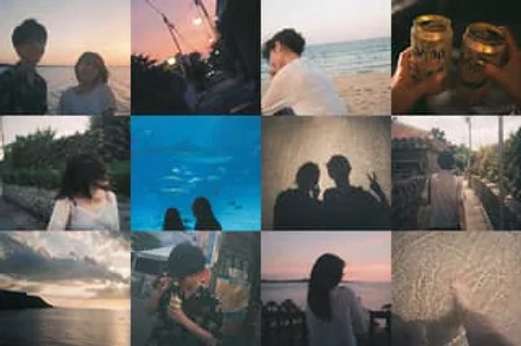

```text
日本人の若い男女が{argument name="地点" default="沖縄旅行中"}にスマホで何気なく撮影した、エモーショナルな写真。12枚をコラージュ。
思い出の中の1枚のような、色あせたシネマティックな質感。 
映画のワンシーンで使えそうなカット。
手振れ感や、適当に撮影した雑な構図を再現。
```

Model: GPT Image 2
Author: GENEL | AIを用いた動画制作

[ProjectD](https://aitoolsradar.com/en/prompts/2353113b1dfadc) · [Recorded source](https://youmind.com/prompts/okinawa-travel-photo-collage-aesthetic-23999)
 · [Full original metadata and byte evidence](data/projectd-batch-0041.json)

## Old Photo Restoration Prompt


```text
Without altering the layout, text, composition, or design, please only repair deterioration caused by the passage of time (such as yellowing, stains, fading, creases, and scratches).
```

Model: GPT Image 2
Author: GPT Image 2 Prompts

[ProjectD](https://aitoolsradar.com/en/prompts/4c70d3eeb45400) · [Recorded source](https://x.com/pony_pon471/status/2047580866860486797)
 · [Full original metadata and byte evidence](data/projectd-batch-0041.json)

## Old Photo Restoration to DSLR Portrait


```text
Using the provided reference image, restore the damaged old family photo into a natural-looking modern high-resolution portrait while keeping the same 4 people, pose, framing, clothing, and outdoor rural setting unchanged. Remove all visible age damage including tears, cracks, creases, stains, worn paper edges, scratches, and fading. Convert the black-and-white sepia image into realistic soft color, preserving accurate skin tones and neutral earth-toned clothing. Enhance fine detail, sharpen fabric and hair texture, improve contrast and dynamic range, and upscale it to professional DSLR-quality realism with clean focus and a subtle shallow depth of field, as if photographed on a {argument name="camera model" default="Canon EOS R6 II"}. Keep the result highly realistic, natural, and faithful to the original faces and proportions.
```

Model: GPT Image 2
Author: 摆烂程序媛

[ProjectD](https://aitoolsradar.com/en/prompts/7ae349a8527ba4) · [Recorded source](https://youmind.com/prompts/vintage-family-photo-restoration-16890)
 · [Full original metadata and byte evidence](data/projectd-batch-0041.json)

## Oliver Kenyon #37


```text
Create a high-converting carousel image for Grüns (greens gummies).
Bold hook, clear outcome, premium DTC design.
Mobile-first, 4:5, advanced design level.
```

Model: GPT Image 2
Author: Oliver Kenyon

[ProjectD](https://aitoolsradar.com/en/prompts/95d3101f49cf4a) · [Recorded source](https://x.com/oliverkenyon/status/2047064581051142166)
 · [Full original metadata and byte evidence](data/projectd-batch-0041.json)

## One Flower, One World City Illustration


```text
Neo-Chinese minimalist Eastern aesthetics × high-end commercial illustration, with the theme "{argument name="theme" default="One flower, one world"} "Minimalist, ethereal, and surreal Eastern aesthetics. A giant lotus flower grows from the calm water, serving as the container. Inside is a luminous 3D miniature..."{argument name="city" default="Guangzhou"} ,Include{argument name="landmarks" default="Guangzhou Tower, Zhujiang New Town, Liede Bridge and waterfront area"} The city lights glow a warm gold, contrasting with the cool bluish-green shadows. The background is a warm off-white paper texture with ample white space. At the bottom, a small boat carrying a fisherwoman in red is looking up. High-end CG quality, featuring cinematic lighting and 8K detail.
```

Model: GPT Image 2
Author: GPT Image 2 Prompts

[ProjectD](https://aitoolsradar.com/en/prompts/7eefd141b73f86) · [Recorded source](https://x.com/liyue_ai/status/2047180347448914195)
 · [Full original metadata and byte evidence](data/projectd-batch-0041.json)

## One Piece Manga Coloring Cover Page


```text
A simple manga coloring test page, adopting the style of official One Piece chapter covers, with a light gray background. At the top is a large black and white ONE PIECE logo, featuring a skull wearing a yellow straw hat with red stripes and incorporating rope elements, with silhouettes inside the letters. Below the logo, centered, is the subtitle text.{argument name="chapter title" default="Episode 1177: Anger"} Use bold black serif italics. Below, create a large, full-color illustration surrounded by a thin black border. The scene features Nico Robin, a woman with long, straight hair.{argument name="hair color" default="black"} A young woman with fair skin and white hair sits curled up in a garden, planting flowers. Her face is partially obscured by a soft, rectangular blur. She wears a loose white short-sleeved shirt and black and white striped knee-high socks, looking casual and slightly playful. Around her are three miniature One Piece characters helping or watching: on the left is Tony Tony Chopper, wearing a straw hat and blue overalls, holding a small shovel beside freshly dug soil; in the foreground on the right is another chibi-style Chopper, wearing a yellow round earmuff and blue hat with the word "MOGO" on it, and pink shorts, his body slightly turned away; near the center left foreground, a miniature assistant wearing goggles and a hat stands beside a flower bed. The garden is whimsical, like something out of a fairy tale: on the left is a towering ancient tree with a thick, twisted trunk; behind the flower bed is a row of white pointed fences; on the right is a crooked, cozy little house with a blue fan-shaped roof, dormer windows, flower boxes, and a round wooden door. The sky was a clear blue, dotted with a few fluffy white clouds. In the flowerbed, three clusters of flowers were displayed: Robin held a cluster of pink blossoms, to her right a cluster of white flowers, and further to her right an orange cluster. Several dug holes were visible in the brown soil, and in the foreground were fallen tree stumps. A title bar was overlaid at the bottom of the illustration, using a capital serif font:{argument name="caption text" default="A reader&#39;s letter: &quot;Robin is planting flowers in the flowerbed dug by the mole&quot; — Mrs. Fuji"} Below the image, place a bold, black line indicating the production staff, centered.{argument name="author text" default="Author: Eiichiro Oda"} Below is a line of smaller text{argument name="credit line" default="Translation: STEPHEN PAUL • Subtitles: VANESSA SATONE"} Using clear comic book ink lines, paired with vibrant hand-drawn coloring and slightly textured shadows, it presents an authentic color comic book cover aesthetic.
```

Model: GPT Image 2
Author: GPT Image 2 Prompts

[ProjectD](https://aitoolsradar.com/en/prompts/ba3ad3bb55eb5b) · [Recorded source](https://x.com/Kokoboy886711/status/2046787515433316810#reversed-0)
 · [Full original metadata and byte evidence](data/projectd-batch-0041.json)

## One Piece Marine POV Photography


```text
比例：9:16
主题：用iPhone 16 Pro后置摄像头拍摄的POV视角的{argument name="场景" default="场景"}；注意，POV看到的是真实世界，而不是二次元或者2.5D的！
场景：ONE PIECE中{argument name="角色名" default="娜美"}施展技能
POV：随机海军小兵视角
```

Model: GPT Image 2
Author: draco

[ProjectD](https://aitoolsradar.com/en/prompts/d2dc1d3e6796d0) · [Recorded source](https://youmind.com/prompts/one-piece-marine-pov-realism-25371)
 · [Full original metadata and byte evidence](data/projectd-batch-0041.json)

## One Piece Straw Hat Crew at Sunset


```text
{argument name="characters" default="Straw Hat Pirates"} Gathering{argument name="ship" default="The Thousand Sunny"} On the deck, just as{argument name="time of day" default="Golden Moment"} Every character is laughing, moving, or relaxing. Luffy grins as he leans against the railing, Nami is drawing a nautical chart at the table, and Chopper is clutching a cotton candy tightly in his hand. The polished wood on the ship gleams in the warm sunlight, and several seabirds fly across the coral-colored horizon in the distance.
```

Model: GPT Image 2
Author: GPT Image 2 Prompts

[ProjectD](https://aitoolsradar.com/en/prompts/0c7e9302e03f60) · [Recorded source](https://x.com/dotey/status/2047114473253838969)
 · [Full original metadata and byte evidence](data/projectd-batch-0041.json)

## One-Prompt UI Design Generation


```text
用这种风格帮我生成一套UI设计系统，包含网页、移动端、卡片、控件、按钮 以及其它
```

Model: GPT Image 2
Author: @austinit

[ProjectD](https://aitoolsradar.com/en/prompts/f4b2ccb6707b08) · [Recorded source](https://x.com/austinit/status/2044968740782272596)
 · [Full original metadata and byte evidence](data/projectd-batch-0041.json)

## Oogie #229


```text
A stunning anime theatrical movie poster in portrait format. Studio Ghibli meets Makoto Shinkai visual language. A teenage girl in a tattered white shrine maiden robe stands on the wing of a crumbling giant stone deity — an ancient colossus covered in moss and glowing golden kanji script, slowly falling through a sea of clouds. Her long black hair streams upward against gravity. She reaches one hand toward the sky where a vast celestial rift tears open the heavens — beyond it, an inverted ocean floats above the clouds, ancient wooden cities hanging upside down from its surface, lanterns drifting like stars. The sky transitions from deep twilight blue at the bottom to a luminous peach and rose gold at the top. Volumetric god rays pierce through cloud layers. Cherry blossom petals and torn paper talismans spiral everywhere. Her expression is calm determination. Art style: hand-drawn 2D animation, ultra-detailed background painting, expressive linework, rich cel shading. Palette: deep indigo, peach, rose gold, warm amber, soft white. Title in large elegant Japanese kanji at the bottom with English subtitle beneath in a clean modern font. Tagline in small white italic text above the title. Mood: mythological, spiritual, bittersweet wonder. Theatrical release quality, Toho Films.
```

Model: GPT Image 2
Author: Oogie

[ProjectD](https://aitoolsradar.com/en/prompts/1796db1b121a2f) · [Recorded source](https://x.com/oggii_0/status/2047890555250610457)
 · [Full original metadata and byte evidence](data/projectd-batch-0041.json)

## Oogie #245


```text
A 3x3 grid storyboard contact sheet comprised of nine candid, cinematic movie stills showing a continuous sequence of a young man, approximately 20-25 years old. He has tousled brown hair and a youthful, expressive face, clean-shaven. Across all nine panels, he is consistently wearing a brown short-sleeved linen button-down shirt and is seated at a wooden dining table during a family dinner. The panels show varied natural actions: gesturing with his hands while animatedly talking, laughing, eating lasagna from a large dish, listening intently, and smiling. The environment is a warm, cozy home dining room with a wooden hutch filled with china and patterned wallpaper visible in the background. The lighting is soft, warm tungsten evening light creating natural shadows. The shots are a mix of medium angles and close-ups with a shallow depth of field, rendered with a film photography aesthetic and slight grain.
```

Model: GPT Image 2
Author: Oogie

[ProjectD](https://aitoolsradar.com/en/prompts/b31a1a2ab6cd81) · [Recorded source](https://x.com/oggii_0/status/2001975468577403099)
 · [Full original metadata and byte evidence](data/projectd-batch-0041.json)

## Open Notebook with French Handwritten Plans


```text
A realistic, overhead lifestyle photograph shows an open, lined notebook lying flat on a dark wood table, photographed in soft, natural indoor light with a warm, neutral tone. The notebook occupies most of the frame and is vertically centered. The two open pages contain neat, black French handwritten notes in rounded, casual handwriting, with slight imperfections, a few doodles, and a few lines of crossed-out text. A black ribbon bookmark hangs from the bottom center of the notebook. A partial view of a stack of books or papers is visible in the upper left corner, and a partial view of a white mug is visible in the upper right corner. The pages should be cream-colored, with faint horizontal lines and subtle creases along the seam. Near the top of the left page, write the underlined title "Plan articles blog", followed by six bullet points: "Écris intro + pourquoi j'ai lancé le blog", "10 idées reçues sur le minimalisme" (circle the number 10), "Ma routine du matin (version réaliste)", "Témoignages / retours lecteurs", "Outils que j'utilise au quotidien", and a crossed-out line of text "bons plans (liens affiliés)". At the bottom of the left page, add the underlined subtitle "Idées à creuser :", followed by three bullet points: "article sur les achats impulsifs", "parler d'argent sans tabou" (draw a small star next to it), and "digital declutter : par où commencer ?", and add an additional line of completely crossed-out handwritten text below. In the bottom left corner, draw a large cloud-shaped outline containing the text "Objectif : publier 2x/mois et rester authentique !", and draw a small heart doodle near the bottom right corner of the left page. At the top of the right page, write the underlined title "Routine matin idéale", followed by a six-line schedule: "6h30 : réveil (sans tel !!)", "6h40 : eau citron + respiration", "6h50 : 10 min de lecture", "7h05 : écriture / gratitude", "7h20 : sport / yoga / marche", "7h45 : douche + préparation", and below that, write "8h15 : focus boulot", accompanied by a hand-drawn star doodle on the right. Below this, add an underlined subtitle "Pensées du jour :", followed by three lines of quotes: "La discipline, c'est choisir entre", "ce que tu veux maintenant et", and "ce que tu veux vraiment.", with a small heart doodle below. In the bottom right corner, add an underlined subtitle "À ne pas oublier :", followed by three bullet points: "appeler la banque", "prendre rdv médecin", and a crossed-out line "annuler abo salle (too cher)". Keep the composition simple, minimalist, and authentic, like a casually taken snapshot of a real productivity diary or blog planning notebook.
```

Model: GPT Image 2
Author: GPT Image 2 Prompts

[ProjectD](https://aitoolsradar.com/en/prompts/eecaf0514c88ed) · [Recorded source](https://x.com/edimakorfr/status/2047635133466124726#reversed-0)
 · [Full original metadata and byte evidence](data/projectd-batch-0041.json)

## Open Source Project README Hero


```text
Square 1:1 README hero banner for an open source project. Background is a clean deep midnight indigo color with a subtle low-opacity geometric pattern of intersecting thin lines suggesting code or graphs. Centered upper area shows the project name "Lighthouse" in a bold modern monospaced font in pure white. Beneath it a smaller line in soft mint green reads "// A tiny scheduler for tired developers". At the lower right corner three small abstract badge placeholders, rectangles labeled "MIT", "v1.0", "CI". Square 1:1 composition. No real GitHub URL text, no watermark. Premium developer README cover design quality.
```

Model: GPT Image 2
Author: @hiapi_ai

[ProjectD](https://aitoolsradar.com/en/prompts/efe8e8524b5004) · [Recorded source](https://github.com/HiAPIAI/awesome-gpt-image-2-prompts)
 · [Full original metadata and byte evidence](data/projectd-batch-0041.json)

## Open World Environment Shot


```text
A screenshot from GTA 6, in which{argument name="character" default="Jason"} In progress{argument name="location" default="leonida keys"} Walking in the middle
```

Model: GPT Image 2
Author: GPT Image 2 Prompts

[ProjectD](https://aitoolsradar.com/en/prompts/7d622353fcf507) · [Recorded source](https://x.com/GTAInfinity_YT/status/2045514278229209571)
 · [Full original metadata and byte evidence](data/projectd-batch-0041.json)

## Open World Environment Shot


```text
a screenshot from gta 6 with {argument name="character" default="Jason"} walking in {argument name="location" default="leonida keys"}
```

Model: GPT Image 2
Author: GTA Infinity

[ProjectD](https://aitoolsradar.com/en/prompts/c12656f4ec754b) · [Recorded source](https://youmind.com/prompts/gta-6-walking-leonida-keys-13980)
 · [Full original metadata and byte evidence](data/projectd-batch-0041.json)

## Open-World Action Game HUD Screenshot


```text
{
  "type": "Game screenshot simulation",
  "scene": "High-speed police chase on a slippery highway bridge at sunset",
  "vehicles": {
    "player_car": "A red sports car with motion blur, license plate '{argument name=\"license plate\" default=\"VICECITY\"} '",
    "police": "Two police cars with flashing lights and one police helicopter equipped with a searchlight.",
    "traffic": "Three civilian vehicles collided on their left sides, with sparks flying everywhere."
  },
  "environment": {
    "sky": "A vibrant orange-purple sunset",
    "cityscape": "Coastal city skyline with neon lights and Ferris wheel",
    "road": "The wet asphalt road surface reflected the red taillights",
    "signage": [
      "Two green highway signs (VCI Airport, Vice City Downtown)",
      "A glowing billboard with the text '{argument name=\"billboard text\" default=\"IT CURES EMOTIONS!\"} '"
    ]
  },
  "ui_elements": {
    "count": 5,
    "top_left": "Black background with white text: 'Press RT to accelerate. Press LT to brake, or reverse while stopped.'",
    "top_right": "5-star wanted level and green text{argument name=\"money amount\" default=\"$2,394,500\"} '",
    "bottom_left": "A small circular map with GPS route, time '13:57', location 'VCI Airport', distance '0.7 mi'.",
    "bottom_center": "Subtitle text'{argument name=\"subtitle text\" default=\"Jason: There are police everywhere! We need to shake them off and get Lucia out of here!\"} '",
    "bottom_right": "Game Logo{argument name=\"game title\" default=\"Grand Theft Auto VI\"} '"
  }
}
```

Model: GPT Image 2
Author: GPT Image 2 Prompts

[ProjectD](https://aitoolsradar.com/en/prompts/39b9067676b3de) · [Recorded source](https://x.com/Pixel_Beaky/status/2044593832470130868#reversed-3)
 · [Full original metadata and byte evidence](data/projectd-batch-0041.json)

## Open-World Game Screenshot Mockup


```text
{
  "type": "Video game screenshot mockup",
  "perspective": "Third-person over-the-shoulder perspective",
  "character": {
    "description": "The male protagonist seen from behind",
    "clothing": "Gray vest with \"{argument name=\"shirt graphic\" default=\"LEONIDA MARINE CENTER\"} Pattern, camouflage cargo shorts"
  },
  "environment": {
    "setting": "A tropical coastal town, dirt roads, a bright sunny day with a few scattered clouds.",
    "left_side": "A wooden welcome sign reads \"Welcome to\"{argument name=\"location name\" default=\"LEONIDA KEYS\"} \"Your Paradise,\" pink plastic flamingos, tropical plants, and a water tower in the distance.",
    "center": "The green building, bearing the \"FISH\" logo and a marlin motif, has a sign that reads \"BAIT TACKLE ICE BEER WINE,\" and pedestrians are seen walking around.",
    "right_side": "The two-story wooden building \"Brian's Boat Works &amp; Marina\" features a neon sign that reads \"Brian's Bar,\" parked pickup trucks, and motorboats on trailers."
  },
  "ui_elements": {
    "count": 5,
    "components": [
      {
        "position": "Top left corner",
        "type": "Mission Objectives",
        "text": "{argument name=\"mission title\" default=\"MEET RAUL\"}\n{argument name=\"mission description\" default=\"Raul has some work for you at his boatyard\"}"
      },
      {
        "position": "Top right corner",
        "type": "Status HUD",
        "text": "13:47\n$1,142",
        "icon": "Pink palm tree"
      },
      {
        "position": "bottom left corner",
        "type": "Minimap",
        "description": "A circular map with a purple border, containing a white map icon, where \"N\" represents North."
      },
      {
        "position": "Bottom left corner, to the right of the minimap",
        "type": "Location characters",
        "text": "{argument name=\"location name\" default=\"LEONIDA KEYS\"}\nPALM ISLAND"
      },
      {
        "position": "bottom right corner",
        "type": "watermark",
        "text": "{argument name=\"game title\" default=\"GTA VI\"}\nPRE-ALPHA FOOTAGE"
      }
    ]
  }
}
```

Model: GPT Image 2
Author: GPT Image 2 Prompts

[ProjectD](https://aitoolsradar.com/en/prompts/dd34d631b8e87c) · [Recorded source](https://x.com/DanDaniDaniel01/status/2046301764371259589#reversed-0)
 · [Full original metadata and byte evidence](data/projectd-batch-0041.json)

## Open-World Game Screenshot Mockup


```text
{
  "type": "video game screenshot mockup",
  "perspective": "third-person over-the-shoulder",
  "character": {
    "description": "male protagonist seen from behind",
    "clothing": "grey tank top with graphic '{argument name=\"shirt graphic\" default=\"LEONIDA MARINE CENTER\"}', camouflage cargo shorts"
  },
  "environment": {
    "setting": "tropical coastal town, dirt road, sunny daytime with scattered clouds",
    "left_side": "wooden welcome sign reading 'Welcome to {argument name=\"location name\" default=\"LEONIDA KEYS\"} YOUR PARADISE', pink plastic flamingo, tropical foliage, distant water tower",
    "center": "green building with 'FISH' sign and marlin graphic, sign reading 'BAIT TACKLE ICE BEER WINE', pedestrians walking",
    "right_side": "two-story wooden building 'Brian's Boat Works & Marina', 'Brian's Bar' neon sign, parked pickup truck, jet skis on a trailer"
  },
  "ui_elements": {
    "count": 5,
    "components": [
      {
        "position": "top-left",
        "type": "mission objective",
        "text": "{argument name=\"mission title\" default=\"MEET RAUL\"}\n{argument name=\"mission description\" default=\"Raul has some work for you at his boatyard\"}"
      },
      {
        "position": "top-right",
        "type": "status HUD",
        "text": "13:47\n$1,142",
        "icon": "pink palm tree"
      },
      {
        "position": "bottom-left",
        "type": "minimap",
        "description": "circular map with purple border, white map icons including 'N' for north"
      },
      {
        "position": "bottom-left, right of minimap",
        "type": "location text",
        "text": "{argument name=\"location name\" default=\"LEONIDA KEYS\"}\nPALM ISLAND"
      },
      {
        "position": "bottom-right",
        "type": "watermark",
        "text": "{argument name=\"game title\" default=\"GTA VI\"}\nPRE-ALPHA FOOTAGE"
      }
    ]
  }
}
```

Model: GPT Image 2
Author: Dan

[ProjectD](https://aitoolsradar.com/en/prompts/cd018b2d95868b) · [Recorded source](https://youmind.com/prompts/open-world-game-screenshot-mockup-14273)
 · [Full original metadata and byte evidence](data/projectd-batch-0041.json)

## Open-world RPG screenshot style


```text
{argument name="game genre" default="Open World RPG"} Game screenshot style
```

Model: GPT Image 2
Author: GPT Image 2 Prompts

[ProjectD](https://aitoolsradar.com/en/prompts/cd5ae1a57fe266) · [Recorded source](https://x.com/Belgram_games/status/2046745866774749585)
 · [Full original metadata and byte evidence](data/projectd-batch-0041.json)

## OpenAI CEO Announcement Mockup


```text
Create a{argument name="company" default="OpenAI"} A screenshot of the tweet posted by X, announcing{argument name="person" default="Sundar Pichai"} For his new appointment{argument name="job title" default="CEO"}
```

Model: GPT Image 2
Author: GPT Image 2 Prompts

[ProjectD](https://aitoolsradar.com/en/prompts/24fc107afddb32) · [Recorded source](https://x.com/gangadhar__s/status/2046567392336322849)
 · [Full original metadata and byte evidence](data/projectd-batch-0041.json)

## OpenAI Merch Poster Grid


```text
A simple, minimalist promotional poster, using a gray-white background to present a modern technology brand style. The top left corner features a very large, bold sans-serif title in a deep cobalt blue color, with text {argument name="headline text" default="Thinking Mode Searches"} The text is displayed in two lines. Below is a smaller, gray explanatory text explaining that, through its thinking mode, the model can automatically browse the internet and find relevant content for reference. A small, blue, knot-shaped OpenAI logo is placed in the upper right corner. Below the introductory text, a thin blue horizontal dividing line is added, with a tiny flashing icon at the right end. Below this is a small prompt in blue text: "Prompt:" followed by a sentence.{argument name="prompt text" default="Make a poster about OpenAI merch available on the official website right now."} The main section is a centered 3x2 product grid showcasing eight items, presented as simple catalog cutouts with soft shadows, housed within rounded light-colored cards. The top row features three larger items: 1) a white long-sleeved striped rugby-style jersey with a black collar and cuffs, small blue patches, and blue "Research &amp; Deployment Co." lettering on the chest, labeled "10 Year Jersey"; 2) a dark brown pullover hoodie with front pockets, small centered "Research Deployment Co." lettering on the chest, and a printed cuff, labeled "Diagram Hoodie"; 3) a black T-shirt (back view) with a metallic knotted graphic and light pink "Research &amp; Deployment Co." lettering, labeled "Chrome Blossom Tee". The bottom row contains five smaller products: 4) a blue folding chair-shaped keychain labeled "Blue Chair Keychain"; 5) a black baseball cap with a white flame graphic and "GPT-5" lettering on the front labeled "GPT-5 Flame Cap"; 6) a white notebook with a striking blue background and a minimalist OpenAI brand logo labeled "OpenAI Notebook"; 7) a glossy black mug with the white "OpenAI" lettering printed on it labeled "OpenAI Office Mug"; and 8) a dark green baseball cap with the small white text "Thinking deeply" labeled "Thinking Deeply Cap". All product labels should be centered below the product and use a small blue sans-serif font. At the bottom footer, "Research &amp; Deployment Co." should be placed on the left, the OpenAI knot-shaped logo and text label in the center, and "Designed with care." on the right. Employing a balanced editorial layout with ample white space, the design presents a sophisticated aesthetic for product advertising posters, utilizing subtle shadows, clear studio lighting, and a restrained color scheme of gray, white, blue, black, brown, and green.
```

Model: GPT Image 2
Author: GPT Image 2 Prompts

[ProjectD](https://aitoolsradar.com/en/prompts/0cfa64f04cef0d) · [Recorded source](https://x.com/DGLru/status/2047218442030166086#reversed-1)
 · [Full original metadata and byte evidence](data/projectd-batch-0041.json)

## Optical Hardware Setup Diagram


```text
{
  "type": "Scientific Optics Setup Diagram",
  "main_setup": {
    "base": "Optical breadboard with mounting hole array",
    "beam": "A red laser beam passes horizontally through all components.",
    "top_grouping_brackets": [
      "{argument name=\"first component group\" default=\"Dual modulation\"}",
      "4f relay optical system",
      "Imaging Optical System",
      "Detection"
    ],
    "components_left_to_right": [
      {
        "name": "laser",
        "label": "{argument name=\"laser wavelength\" default=\"λ = 632.8 nm\"}",
        "appearance": "black rectangular box"
      },
      {
        "name": "SLM1",
        "label": "(Phase/Polarization Modulation)",
        "appearance": "Black square equipment mounted on a support column"
      },
      {
        "name": "Lens L1",
        "label": "(f1)",
        "appearance": "Lens in black circular bracket"
      },
      {
        "name": "Aperture",
        "label": "Fourier plane (pupil plane) / (higher-order filtering)",
        "appearance": "Black ring-shaped bracket with dotted line at the top"
      },
      {
        "name": "HWP",
        "label": "(λ/2)",
        "appearance": "Optical elements with purple hues in a black ring-shaped bracket."
      },
      {
        "name": "Lens L2",
        "label": "(f1)",
        "appearance": "Lens in black circular bracket"
      },
      {
        "name": "SLM2",
        "label": "(Phase/Polarization Modulation)",
        "appearance": "Black square equipment mounted on a support column"
      },
      {
        "name": "Lens L3",
        "label": "(f2)",
        "appearance": "Lens in black circular bracket"
      },
      {
        "name": "Lens L4",
        "label": "(f2)",
        "appearance": "Lens in black circular bracket"
      },
      {
        "name": "Linear polarizer",
        "label": "(Global Analyzer)",
        "appearance": "Lens in black circular bracket"
      },
      {
        "name": "polarization camera",
        "label": "polarization camera",
        "appearance": "Blue and black box camera"
      }
    ]
  },
  "inset_diagram": {
    "position": "Bottom right corner, dashed border",
    "title": "{argument name=\"inset title\" default=\"Polarization camera micro polarizer array\"}(Pixel-by-pixel analyzer)",
    "visuals": "4x4 colored square array with white directional arrows",
    "legend_count": 4,
    "legend_labels": [
      "Red right arrow 0° (H)",
      "Green up arrow at 90° (V)",
      "Blue diagonal arrow at 45° (D)",
      "Yellow diagonal arrow 135° (A)"
    ]
  },
  "bottom_caption": {
    "figure_number": "Figure 5.",
    "title": "{argument name=\"setup title\" default=\"Hardware setup for elliptic polarization measurement.\"}",
    "description": "{argument name=\"figure caption\" default=\"Our prototype display system employs a dual modulation configuration to achieve synchronous control of phase and polarization. A 4f relay optics system transmits the modulated wavefront…\"}"
  }
}
```

Model: GPT Image 2
Author: GPT Image 2 Prompts

[ProjectD](https://aitoolsradar.com/en/prompts/4256466572f27d) · [Recorded source](https://x.com/HumanOS_v2/status/2046317327134638212#reversed-0)
 · [Full original metadata and byte evidence](data/projectd-batch-0041.json)

## Optimistic AI Portfolio Landing Page


```text
{
  "type": "Editing Style Portfolio Website Landing Page Template",
  "style": "The website boasts a clean and modern design, a light and sophisticated aesthetic, soft layout and editing, a gentle coastal color palette, and a subtle frosted glass effect, giving it the feel of a high-end startup portfolio.",
  "canvas": {
    "aspect_ratio": "3:2",
    "background": "Soft blue sky outside the browser frame"
  },
  "browser": {
    "type": "Desktop browser window model",
    "top_bar": {
      "traffic_lights": 3,
      "address_text": "angaisb._ai",
      "right_icons": 3
    },
    "corner_radius": "big",
    "shadow": "Soft floating shadows"
  },
  "brand": {
    "logo_text": "Angaisb_"
  },
  "header": {
    "nav_count": 5,
    "nav_items": [
      "front page",
      "project",
      "writing",
      "tool",
      "about"
    ],
    "active_item": "front page",
    "cta_button": {
      "text": "{argument name=\"button text\" default=\"Contact me\"}",
      "style": "Yellow rounded capsule button"
    }
  },
  "hero": {
    "layout": "The homepage features a split-screen editing style, with text on the left and an image/scene on the right, spanning the entire width.",
    "background_scene": "A sunny coastal viewpoint, a blue ocean horizon, fluffy white clouds, and pink and orange flowers in the foreground create a soft and dreamy atmosphere.",
    "headline": "{argument name=\"headline text\" default=\"AI, Creativity, and an Optimistic Future\"}",
    "subheadline": "{argument name=\"subheadline text\" default=\"Experiments, tools, and reflections on artificial intelligence\"}",
    "primary_cta": {
      "text": "Exploration Project",
      "style": "Yellow rounded button with arrow"
    },
    "secondary_cta": {
      "text": "Read the latest articles",
      "style": "Text links with arrows"
    },
    "human_figure": {
      "count": 1,
      "description": "A young man with short brown hair, wearing a bright yellow sweater, is shown from behind on the right side of the main screen, gazing at the ocean."
    },
    "overlay_card": {
      "count": 1,
      "style": "Semi-transparent frosted glass rounded corner card",
      "icon": "Small yellow circular icon",
      "text_lines": [
        "Build it with curiosity.",
        "Designed for impact.",
        "Open sharing."
      ]
    },
    "network_graphic": {
      "count": 1,
      "description": "The delicate white nodes and lines of constellations in the sky at the top right corner"
    }
  },
  "main_sections": [
    {
      "title": "Featured Projects",
      "position": "upper content area",
      "count": 3,
      "labels": [
        "BloomBench",
        "ThoughtGarden",
        "Open Prompts"
      ],
      "cards": [
        {
          "title": "BloomBench",
          "tag": "Research",
          "description": "A benchmark for evaluating the real-world visual reasoning capabilities of multimodal LLMs.",
          "thumbnail": "Seaside flowers overlaid with a lightweight UI"
        },
        {
          "title": "ThoughtGarden",
          "tag": "tool",
          "description": "A personal knowledge garden where ideas connect and evolve.",
          "thumbnail": "Rolling green hills under a blue sky and a semi-transparent interface panel"
        },
        {
          "title": "Open Prompts",
          "tag": "resource",
          "description": "A collection of prompts, patterns, and pipelines for AI builders.",
          "thumbnail": "Flowers and sky, with a semi-transparent interface panel"
        }
      ],
      "top_right_link": "View all projects"
    },
    {
      "title": "Latest Writing",
      "position": "bottom left corner",
      "count": 1,
      "labels": [
        "Optimistic Cycles in AI"
      ],
      "card": {
        "title": "Optimistic Cycles in AI",
        "description": "Why optimism is a multiplier for creativity, research, and responsible AI.",
        "date": "May 12, 2024",
        "thumbnail": "A person wearing a yellow sweater standing in a flower bush (back view)"
      },
      "top_right_link": "View all"
    },
    {
      "title": "Current exploration",
      "position": "Bottom Center",
      "count": 3,
      "labels": [
        "Multimodal reasoning",
        "Scientific Discovery AI",
        "Human-machine collaboration"
      ],
      "style": "Three soft, rounded-corner theme capsules with small icons"
    },
    {
      "title": "about",
      "position": "bottom right corner",
      "count": 1,
      "labels": [
        "More about me"
      ],
      "text": "I am an AI creator and researcher who firmly believe that technology should amplify human potential and help build a better future.",
      "decoration": "Delicate pink flower illustration in the bottom right corner"
    }
  ],
  "visual_details": {
    "cards": "White rounded corner card with a thin light gray border and soft shadow",
    "spacing": "Ample white space and a balanced grid",
    "typography": "An elegant large serif heading font paired with clean sans-serif UI text.",
    "colors": {
      "primary_text": "Deep Navy Blue",
      "accent": "warm yellow",
      "background": "White and light sky blue",
      "secondary_accents": "Soft pinks, greens, and lavender colors"
    }
  }
}
```

Model: GPT Image 2
Author: GPT Image 2 Prompts

[ProjectD](https://aitoolsradar.com/en/prompts/7bafe4c6a8aba6) · [Recorded source](https://x.com/Angaisb_/status/2046706923941114242#reversed-0)
 · [Full original metadata and byte evidence](data/projectd-batch-0041.json)

## Opulent Autumn Empress at Sunset


```text
An extravagantly luxurious fantasy portrait depicts an elegant woman in profile, slightly tilted to the left. She wears a magnificent autumn headdress and a robe adorned with red maple leaves, chrysanthemum-like flowers, gold thread ornaments, gemstones, crystal pendants, and translucent stained glass. Her long, dark hair cascades over her shoulders, and her face is mostly obscured by shadows and angles, creating a mysterious and idealized beauty. She is surrounded by a large circular frame and curved ribbons made of transparent amber, ruby, and orange glass, inlaid with multifaceted jewels and reflective crystal droplets. Nine clearly visible floating maple leaves must be precisely depicted as they drift down through the air. The background is set as a glowing valley at sunset, the sun low on the horizon casting warm golden light, with distant peaks, autumn forests, and the reflective river below all reflecting each other. The entire image should be immersed in fiery orange, copper, gold, and crimson hues, presenting ultimate visual richness, dazzling highlights, dense tonal details, shimmering bokeh, cinematic backlighting, and a deliberately crafted, mesmerizing, and opulent aesthetic. Ultra-high detail, maximalism, ethereal quality, radiant light, fantastical haute couture, glossy texture, jewel-like lighting, and a wide-angle cinematic composition.
```

Model: GPT Image 2
Author: GPT Image 2 Prompts

[ProjectD](https://aitoolsradar.com/en/prompts/5f0d7416ea2f4f) · [Recorded source](https://x.com/AIojisan1952/status/2046881419344134446#reversed-0)
 · [Full original metadata and byte evidence](data/projectd-batch-0041.json)

## Oriental Aesthetics Ink Wash Poster


```text
A modern Chinese ink wash landscape poster, 9:16 vertical composition, featuring an oriental minimalist aesthetic. Extensive use of white space, the overall color scheme evokes a spring morning (cyan-green, hazy blue, light gray, and pale ink), low saturation, clear and soft, with a sophisticated feel. The main subject is the majestic mountains rising abruptly from both sides of a lake, occupying the left and right sides of the image. The mountains are rendered using ink wash techniques, showcasing rich variations in shade and dryness, with touches of pale green to evoke the feeling of spring. The peaks are shrouded in a soft, moist morning mist, layered and blending into the pale blue-gray sky, creating an atmospheric perspective and spatial depth. The lake surface is like a mirror, reflecting a faint cyan, mirroring the mountains and sky, presenting a soft-focus and diffused mist effect, enhancing the moist and dreamy spring atmosphere. In the middle ground, a small wooden boat with a curved canopy floats slowly, its oars lightly touching the water, creating naturally spreading ripples, maintaining the overall sense of tranquility. On the boat sits a small, red-clad fisherwoman (from a distant view), simplified as a pale ink-wash silhouette. She wears a low-saturation vermilion traditional dress (not bright red), the color softened by the mist. No facial details are shown, only her silhouette and posture (such as gently touching the boat's awning or holding an oar). The red hue forms a faint reflection on the water, becoming the only warm visual focal point. The shore is dotted with sparse woods and new spring vegetation, rendered with light ink and pale green, combining realism and abstraction to enhance rhythm and vitality. A few birds fly across the distant horizon, their sparse distribution adding depth and dynamism to the space. At the top center is a vertical line of calligraphy:{argument name="title" default="Eastern aesthetics"} The calligraphy employs a traditional handwritten running or cursive style (reminiscent of Wang Xizhi), with natural brushstrokes, clear transitions, and an ink-bleed effect, avoiding the look of digital fonts. The calligraphy color is a deep ink blue or soft black, consistent with the overall design. Style: A fusion of ink painting and modern minimalist design, evoking a Zen-like springtime atmosphere, ethereal and moist, tranquil, with restrained contrasts of warm and cool tones, cinematic lighting, high-end art poster quality, and 8K ultra-high-definition details.
```

Model: GPT Image 2
Author: GPT Image 2 Prompts

[ProjectD](https://aitoolsradar.com/en/prompts/f1b2e11d9f2965) · [Recorded source](https://x.com/liyue_ai/status/2046215276249993720)
 · [Full original metadata and byte evidence](data/projectd-batch-0041.json)

## Oriental Aesthetics Silhouette Poster


```text
Each poster uses the upper and lower hierarchy: the most recognizable head, face outline, mask or outer outline of the figure is the large visual subject, forming a highly recognizable silhouette main shape; the middle and lower part is arranged with the complete figure as the second subject, showing a stable standing or slight movement posture, forming the visual core of the picture.Double exposure and collage narrative compositions inside and around the large outline, combining multiple scenes, images, small character relationships, auxiliary elements and environmental layers in clouds, ink, and whitening. The left and right side is equipped with an echoing side of the scene, which creates story tension and space changes. Link the main character, internal collage, and large outline above with a flow of clues across the screen to enhance integrity and vision guidance.The overall picture retains a large area of whiteness, and the edge is stained with ink and virtual broken, creating a real relationship and breath in the Oriental aesthetics. Overall style uniform, advanced and restrained, emphasizing layers, narrative, main visual impact and serialized poster language. Size: 9:16.
```

Model: GPT Image 2
Author: Anissa

[ProjectD](https://aitoolsradar.com/en/prompts/1209d9107d31ff) · [Recorded source](https://youmind.com/prompts/oriental-silhouette-double-exposure-poster-17062)
 · [Full original metadata and byte evidence](data/projectd-batch-0041.json)

## Oriental Fantasy City Poster


```text
Flat illustration, high-end Eastern fantasy style city poster design, 9:16 vertical composition. The layout uses a diagonal line extending from the lower left to the upper right, plus an S-shaped flow. The background is a deep black gradient to a rich dark red, creating a strong contrast between warm and cool colors and spatial depth, with subtle stardust and grainy textures. At the center of the image, a flowing golden energy line meanders like a flame, extending from the bottom upwards, presenting a fluid texture, particle effects, and gradient highlights, accompanied by delicate energy fragments and volumetric light. Within the golden flow {argument name="city" default="Guangzhou"} Landmark buildings emerge layer by layer: the Canton Tower, as the visual core, stands out in proportion, surrounded by the Zhujiang New Town skyline, the Liede Bridge, and modern Lingnan architectural elements. The buildings are rendered using a technique of "fine lines outlining + golden luminous blocks," resulting in clear outlines and rich details, seemingly suspended in a golden halo above the void. A slight haze in the background creates a surreal sense of spatial layering. At the bottom of the image is an Eastern woman with white hair, her hair flowing like mist, naturally connecting and blending with the golden light. Her hair exhibits a semi-transparent gradient effect; her posture is elegant, her eyes slightly closed, her expression serene, holding a bouquet of colorful flowers adorned with shimmering particles, symbolizing the spiritual connection between humanity and the city's energy. The details of the figure are appropriately simplified to highlight the overall design. Light and shadow are concentrated on the golden lines, the building outlines, and the figure's silhouette, creating a strong contrast and visual focus. The overall atmosphere is grand and mysterious, full of Eastern mythology, and possesses a subtle sense of healing. The color scheme is based on black and dark red, with dazzling gold as the main visual focus. Gold, with its rich tonal variations, is complemented by small areas of highly saturated floral colors, maintaining a refined and restrained aesthetic. Text and layout integration: The top is centered and uses Song typeface, displaying "..."{argument name="city" default="Guangzhou"} "China", followed by smaller text "China"{argument name="date" default="2026/04/20"} "and"{argument name="author" default="LIYUE"} The text is rendered in a light gold or soft warm white, harmonizing with the overall lighting. High-quality details, cinematic lighting effects, rich volume and particle detail, clean and noise-free image, ultra-high-definition 8K resolution, commercial-grade poster quality.
```

Model: GPT Image 2
Author: GPT Image 2 Prompts

[ProjectD](https://aitoolsradar.com/en/prompts/85c50c3e3b5c55) · [Recorded source](https://x.com/liyue_ai/status/2046243132774494607)
 · [Full original metadata and byte evidence](data/projectd-batch-0041.json)

## Oriental Fantasy Female Portrait Prompt


```text
Eastern fantasy style{argument name="gender" default="female"} A half-length portrait, turned to the side, glancing back, exuding an ethereal and elegant, gentle and sacred aura. The features are delicate, with slightly lowered eyelids, fair and smooth skin, and pale orange-pink makeup accented with gold highlights. Long, flowing hair is interspersed with colorful flowers and points of light (red, blue, orange, purple); the hair has a fluid and airy quality. She wears a semi-transparent silk dress and shawl, the material light and translucent, the fabric fluttering in the wind, its surface adorned with gilded textures and shimmering particles. The overall lighting is warm gold backlighting, strong contour lighting, distinct volumetric lighting, floating points of light, and soft halos, creating a dreamlike atmosphere. The background is simple, with a light gradient, presenting subtle light and particle effects; the overall atmosphere is ethereal, dreamlike, and sacred. Style: High-end CG illustration, ultra-detailed, cinematic lighting, soft lighting rendering, 8K detail, popular ArtStation style.
```

Model: GPT Image 2
Author: GPT Image 2 Prompts

[ProjectD](https://aitoolsradar.com/en/prompts/ab90bb01379d8e) · [Recorded source](https://x.com/liyue_ai/status/2046962895775580442)
 · [Full original metadata and byte evidence](data/projectd-batch-0041.json)

## Ornamental Kimono Girl with Cats


```text
An incredibly detailed anime illustration depicts a seated young woman in an elegant Japanese fantasy-style kimono. The composition is exquisite, with a clean, warm off-white background. She has long, straight hair.{argument name="hair color" default="Black with a dark blue-purple base color."} She had straight bangs, and very long hair on the sides, adorned with red and blue ribbons. Her eyes were bright and large, and their color was {argument name="eye color" default="Dark red"} Her expression was calm, gentle, and slightly melancholic. She wore a magnificent floral headdress on the right side of her head, composed of four main flowers in red, white, light blue, and blue, adorned with dangling gold decorations and tassels. Her attire was an intricately patterned kimono, the colors of which were {argument name="kimono colors" default="Red, black, light blue, cream, and accented with purple"} The painting is adorned with cherry blossoms, stylized flowers, butterflies, knots, bows, and hanging tassels. The sleeves are wide and flowing, revealing details of red knots and floral appliqués. She sits in an elegant, curled-up pose, one hand near her face, her bare legs clearly visible, wearing white tabi socks and delicate red and black platform sandals with bows. Four cats surround her: a black cat sits on a branch to the left, looking upwards; three white cats are positioned to her lower left, right center, and lower right respectively. Two birds are present: a bluebird perches on a branch to the left, and a small red and blue bird perches in the lower right flowerbed. Three butterflies are included: two in the upper left and one near the center below her legs. The composition is surrounded by plum blossom branches, hanging Japanese ornaments, tassels, diamond-shaped hanging ornaments, and long, flowing fabric ribbons. A large circular decorative pattern is added behind her upper body, and a tall, vertical banner-style decoration is added to the right side. The overall color scheme balances vermilion, black, ivory, light cyan, sky blue, and lavender. The style is a refined 2D anime-inspired key visual, with extremely clean lines, delicate textile textures, flat decorative shapes combined with subtle shadows, elegant white space, and a highly decorative yet harmonious composition. It is imaginative and elegant, a vertical full-body character poster.
```

Model: GPT Image 2
Author: GPT Image 2 Prompts

[ProjectD](https://aitoolsradar.com/en/prompts/c28442208b542f) · [Recorded source](https://x.com/hoshi122221/status/2046774389090463847#reversed-0)
 · [Full original metadata and byte evidence](data/projectd-batch-0041.json)

## Orthographic Reference Sheet Generation


```text
Output{argument name="design material" default="Front view design materials including three views"} .
```

Model: GPT Image 2
Author: GPT Image 2 Prompts

[ProjectD](https://aitoolsradar.com/en/prompts/dea5f8956b8771) · [Recorded source](https://x.com/yuzora_yu/status/2045053904262668658)
 · [Full original metadata and byte evidence](data/projectd-batch-0041.json)

## Otaku-Friendly Gyaru in Sunset Classroom


```text
This heartwarming golden-moment anime illustration depicts a stylish gyaru high school girl casually leaning against an empty desk in a Japanese classroom. Positioned at the center of a mid-shot full-body portrait, she faces the viewer, leaning slightly forward, one hand resting on the desk, the other in her cardigan pocket, exuding a friendly, approachable, and otaku-esque gyaru charm. She has long, wavy hair.{argument name="hair color" default="Bleached blonde hair"} Her hair was loose and naturally wavy at her shoulders, possessing a slightly messy yet charming quality. She wore multiple earrings, a delicate necklace, and long, manicured nails, her makeup fresh and youthful. Her attire was a stylishly tailored Japanese school uniform: a loose beige cardigan worn open over a white shirt, the shirt collar unbuttoned and tied with a large dark blue plaid bow, paired with a short, dark plaid pleated skirt. The classroom was illuminated by the low-angle afternoon sunlight streaming through the large window on the left, creating long shadows. The edges of her hair shimmered with soft contour light, creating a nostalgic amber atmosphere. In the background were several wooden desks and chairs, a green blackboard with Japanese thank-you notes and chalk doodles, and the gentle atmosphere of a quiet scene after school. High-detail anime rendering, exquisite light novel/visual novel key visual quality, soft cinematic lighting, elegant shadow treatment, romantic nostalgia, and vertical composition.
```

Model: GPT Image 2
Author: GPT Image 2 Prompts

[ProjectD](https://aitoolsradar.com/en/prompts/b30340d4d6237c) · [Recorded source](https://x.com/yume00112211/status/2047693634846564824#reversed-0)
 · [Full original metadata and byte evidence](data/projectd-batch-0041.json)

## Otome Game Choice Ad Mockup


```text
{
  "type": "Mobile Otome Game Advertising Model",
  "characters": {
    "male_target": "{argument name=\"男性角色描述\" default=\"A handsome young man with messy black hair and golden eyes was smoking and holding a smartphone.\"}",
    "female_player": "{argument name=\"女性角色描述\" default=\"A cute anime girl with pink twin tails, purple eyes, and a blushing face, holding a smartphone.\"}"
  },
  "layout": {
    "top_section": {
      "main_headline": "Conquer that dangerous guy!",
      "sub_headline": "Which one would you choose?",
      "game_logo": "{argument name=\"游戏标题\" default=\"Midnight Love Panic\"}"
    },
    "status_ui": {
      "love_meter": "LOVE 99%, accompanied by a nearly full pink progress bar.",
      "male_level": "Lv.99, with 6 hearts (5 solid red hearts, 1 hollow heart).",
      "female_level": "Level 1 Night Owl, comes with 5 hearts (1 solid purple heart, 4 hollow hearts)."
    },
    "interaction_elements": {
      "male_message_box": "{argument name=\"男性聊天消息\" default=\"Are you free tonight? Can you come to my room? 😈\"}",
      "female_thought_bubble": "Eh, I've been called away...? What will happen if I go...?",
      "warning_badge": "A red, jagged star-shaped badge that reads \"99% Failure\" and is covered in sweat droplets."
    },
    "decision_section": {
      "prompt_text": "Whether you can win his heart depends entirely on your choice.",
      "buttons": [
        {
          "color": "green",
          "text": "{argument name=\"选项 1 文本\" default=\"Go see him\"}",
          "indicator": "Green down arrow"
        },
        {
          "color": "red",
          "text": "Read but not replied",
          "indicator": "Red down arrow"
        }
      ]
    },
    "bottom_section": {
      "call_to_action": "Play now, complete with angel wings",
      "sub_text": "Click to change your destiny...",
      "currency_display": "9,999+, with a purple diamond icon."
    }
  }
}
```

Model: GPT Image 2
Author: GPT Image 2 Prompts

[ProjectD](https://aitoolsradar.com/en/prompts/c267f96176f6b9) · [Recorded source](https://x.com/n_e_o_c_h_i/status/2046232854087286848#reversed-0)
 · [Full original metadata and byte evidence](data/projectd-batch-0041.json)

## Otome Game Gacha Screen Prompt


```text
For a{argument name="game genre" default="Otome games"} The application creates a gacha (card drawing) interface. Please use landscape mode and set the screen size accordingly.{argument name="gacha type" default="SSR guaranteed pull"} And create a sense of exclusivity.
```

Model: GPT Image 2
Author: GPT Image 2 Prompts

[ProjectD](https://aitoolsradar.com/en/prompts/0addff33262baf) · [Recorded source](https://x.com/Lilium907stella/status/2046771797316759808)
 · [Full original metadata and byte evidence](data/projectd-batch-0041.json)

## Otter Scientist Presentation Slide


```text
A photorealistic and humorous academic presentation scene takes place in a conference room: an anthropomorphic otter scientist stands on the left side of the frame, dressed in a crisp white lab coat, holding a slender pointer stick and pointing to a large presentation project on an easel. The otter stands upright like a human, possessing realistic brown fur, dark paws, and a professional posture. A name tag reading "Dr. Otter" is sewn onto the lab coat, with "Aquatic Systems Lab" in smaller print below, and two pens are tucked into its breast pocket. The otter's face is partially obscured by a blurred square block. Behind the otter is a whiteboard with blurred handwritten notes and doodles, including "WiFi &gt; Fish," "H2O," "Hydration," a sketch of a fish, and a WiFi symbol. The focal point is a large, clear presentation slide with sharp, legible text and a sophisticated corporate academic layout. At the top is a bold title that reads, "..."{argument name="headline text" default="Ethan Mollick&#39;s Otter Test"} The subtitle below reads "Prompt: \"{argument name="prompt text" default="An otter sat in an airplane seat, using the in-flight Wi-Fi on its laptop."} Below is a boxed area titled "AI-Generated Image Samples," containing four side-by-side sample images showing realistic otters sitting in airplane seats using laptops or tablets. Each image is framed like a model output, with one displaying a large WiFi symbol above the seat. Below the images is a section labeled "Performance Results (via = Otter, Airplane Seat, In-flight WiFi, Laptop/Tablet)," containing five score boxes: "DALL·E 3" with no visible numerical score, "GPT-4o" with "4/4" and "100%", "Midjourney v6" with "3/4" and "75%", "Stable Diffusion XL" with "2/4" and "50%", and "SD 1.5" with "0/4" and "0%". On the right is a prominent highlighted box labeled "Average Score" and "{argument name="average score" default="70%"} The text is in large blue font. At the bottom of the slides is a "Key Findings" box containing three key points: "The modern model's understanding of complex, specific cues is astonishing.", "Otter + Airplane + WiFi = A Reliable Benchmark.", and "Further research is absolutely necessary." A simple cartoon otter doodle appears in the lower right corner of the slides. The room is warmly lit, with wood paneling on the walls, a shallow depth of field, and several blurry audience members in the foreground, including a laptop at the edge displaying an image of an otter, and a glass water jug ​​on the table. Style: Hyperrealistic editorial photography, cold-blooded scientific satire, believable conference presentation, high detail, natural indoor lighting, professional lens compression, easy-to-read slide layout, sophisticated yet absurd.
```

Model: GPT Image 2
Author: GPT Image 2 Prompts

[ProjectD](https://aitoolsradar.com/en/prompts/81e76d25819344) · [Recorded source](https://x.com/emollick/status/2046665274535854146#reversed-0)
 · [Full original metadata and byte evidence](data/projectd-batch-0041.json)

## Otter Scientist Presentation Slide


```text
A photorealistic humorous academic presentation in a conference room: an anthropomorphic otter scientist stands at the left side of the frame wearing a crisp white lab coat and holding a thin pointing stick toward a large presentation board on an easel. The otter is upright like a human, with realistic brown fur, dark paws, and a professional posture. The lab coat has a stitched name tag reading "Dr. Otter" and a smaller line reading "Aquatic Systems Lab," plus two pens in the chest pocket. The otter’s face is partially censored by a square blur block. Behind the otter is a whiteboard with faint handwritten notes and doodles, including "WiFi > Fish," "H2O," "Hydration," a fish sketch, and a wifi symbol. The main focus is a large clean presentation slide with sharp readable text and polished corporate-academic layout. At the top, a bold title reads "{argument name="headline text" default="Ethan Mollick’s Otter Test"}" and beneath it a subtitle reads "Prompt: \"{argument name="prompt text" default="An otter sitting on an airplane seat using in-flight wifi on a laptop"}\"". Below that is a boxed section titled "Sample AI-Generated Images" containing exactly 4 side-by-side sample images of a realistic otter seated in an airplane seat using a laptop or tablet, each framed like model outputs, with one showing a large wifi symbol above the seat. Beneath the images is a section labeled "Performance Results (Pass = otter, airplane seat, in-flight wifi, laptop/tablet)" with exactly 5 score boxes: "DALL·E 3" with no visible numeric score, "GPT-4o" with "4/4" and "100%", "Midjourney v6" with "3/4" and "75%", "Stable Diffusion XL" with "2/4" and "50%", and "SD 1.5" with "0/4" and "0%". On the right side is a large highlighted box reading "Average Score" and "{argument name="average score" default="70%"}" in large blue type. At the bottom of the slide is a "Key Findings" box with exactly 3 bullet points: "Modern models understand complex, specific prompts surprisingly well.", "Otters + airplanes + wifi = a reliable benchmark.", and "Further research is otter-ly necessary." A small simple cartoon otter doodle appears in the lower-right corner of the slide. The room is warmly lit with wood-paneled walls, shallow depth of field, and a few blurred audience members in the foreground, including a laptop at the bottom edge showing an otter image on its screen and a glass pitcher on a table. Style: ultra-realistic editorial photography, deadpan scientific satire, believable conference presentation, high detail, natural indoor lighting, professional lens compression, readable slide typography, polished yet absurd.
```

Model: GPT Image 2
Author: Ethan Mollick

[ProjectD](https://aitoolsradar.com/en/prompts/432bf06dc41b82) · [Recorded source](https://youmind.com/prompts/otter-scientist-presentation-14696)
 · [Full original metadata and byte evidence](data/projectd-batch-0041.json)

## Out the Window meme comic prompt


```text
Create a "{argument name="meme style" default="Out the Window"} A meme-style four-panel comic strip titled "{argument name="title" default="How to improve development efficiency with AI?"} ", and includes speech bubbles. --ar 9:16 Characters: - Boss: Asian male, wearing a suit, neatly styled hair. - Employee Xiaoming: Male, wearing a blue plaid shirt. - Employee Xiaohong: Female. - Employee Xiaohu: Female, Asian, with bangs, wearing red-rimmed glasses. Storyboard Description: - First frame (single widescreen): The boss asks in a meeting: "How can we use AI to improve development efficiency?" The three employees sit and listen. - Second frame (single widescreen): Each employee answers: - Xiaoming: "We use AI to write unit tests." - Xiaohong: "We use AI for code reviews." - Xiaohu: "Vibe Coding." - Third line (two frames): - Left side: The boss looks very angry. - Right side: Employee Xiaohu is comically kicked out of a high-rise window.
```

Model: GPT Image 2
Author: GPT Image 2 Prompts

[ProjectD](https://aitoolsradar.com/en/prompts/2230c816a0b745) · [Recorded source](https://x.com/dotey/status/2046752332596093437)
 · [Full original metadata and byte evidence](data/projectd-batch-0041.json)

## Overdecorated Sophie Magic Poster


```text
A highly decorative full-body anime fantasy illustration, the main character is{argument name="character name" default="SOPHIE"} A young, elegant female alchemist and mage stood in the center of the vast celestial library laboratory. She kept {argument name="hair color" default="platinum blonde"} She has short bob haircuts, tied in a side ponytail, adorned with a huge crystal flower hair ornament, but her face is obscured by a flat, light-colored square veil. She wears a magnificent white and blue gown with silver filigree, a tight-fitting bodice with tiered ruffles, a semi-transparent train, flowing, split sleeves, gemstone pendants, thigh-high garter belts, and white high-heeled ankle boots with metallic trim. Two glowing blue potion bottles hang from her waist. Her posture is elegant and confident: one hand is raised, a multifaceted blue crystal floating above her palm; the other holds an open spellbook, projecting transparent holographic pages and neon-blue arcane interfaces. The environment is a grand, circular, observatory-style library, complete with towering bookshelves, alchemical instruments, astrolabes, hanging ornaments, glassware, candles, and glowing magical symbols. Behind her, a large, backlit arched window casts a cool, celestial light. The ground beneath her feet is covered with glowing concentric magic circles and reflections, surrounded by shimmering blue flowers and sparkling particles. The composition is vertically centered, exquisitely detailed, featuring dense decorative details, ethereal lighting, layered translucency, and shimmering highlights. The color palette is dominated by white, silver, sapphire blue, and pale purple. A striking decorative title text is located on the left.{argument name="title text" default="SOPHIE"} Below is a smaller Japanese text.{argument name="subtitle text" default="ソフィー"} Below is a small line of "CV:" text, in the lower left corner is a small piece of English-style text, and on the right is a glowing blue holographic panel with the following text:{argument name="panel text" default="SOPHIC"} This gives it the feel of a luxurious character visual or a promotional poster for a magical science heroine, with ultra-detailed, glossy, and radiant finish, deliberately pursuing the ultimate in gorgeousness.
```

Model: GPT Image 2
Author: GPT Image 2 Prompts

[ProjectD](https://aitoolsradar.com/en/prompts/dfaa075910790e) · [Recorded source](https://x.com/Lize_san_suki/status/2047583012280553760#reversed-0)
 · [Full original metadata and byte evidence](data/projectd-batch-0041.json)

## Overhead Anime Girl Peace Sign Portrait


```text
One{argument name="character name" default="Anna Yanami"} Lying on your back{argument name="setting" default="classroom desks"} A top-down anime illustration. She has messy hair.{argument name="hair color" default="blue"} She has hair, with a single tuft of hair sticking up on top, and bright blue eyes.{argument name="expression" default="Her face was flushed, and she was smiling happily."} ,and{argument name="pose" default="Make a peace sign with both hands"} She wore a white short-sleeved school uniform shirt with four alternating colored bows (dark blue, light blue, and yellow) on the front, paired with a light blue pleated skirt with white stripes at the hem. The scene was bathed in the warm afternoon sunlight, casting distinct shadows on the desk and her body, with the wooden floor visible in the background.
```

Model: GPT Image 2
Author: GPT Image 2 Prompts

[ProjectD](https://aitoolsradar.com/en/prompts/5527bd7819bbe3) · [Recorded source](https://x.com/mirochill/status/2044860120350310642#reversed-0)
 · [Full original metadata and byte evidence](data/projectd-batch-0041.json)

## Overwatch Hero Concept Page


```text
Create an Overwatch hero showcase page and {argument name="character" default="Trump"} Set as a new hero.
```

Model: GPT Image 2
Author: GPT Image 2 Prompts

[ProjectD](https://aitoolsradar.com/en/prompts/bd738581f14d32) · [Recorded source](https://x.com/Yuuhann1999/status/2045033189752852662)
 · [Full original metadata and byte evidence](data/projectd-batch-0041.json)

## Owl-Shaped Nebula in Deep Space


```text
A majestic deep-space scene: an owl-shaped nebula floats in the darkness of a star field. Using a central composition, cosmic gas and dust naturally form the clearly defined owl's face. Two large, luminous, round eyes possess bright electric blue nuclei, a pointed beak composed of amber light, and long, upward-reaching ear clusters formed by pillars of burnt orange and golden-brown nebulae. The body is composed of translucent clouds layered in warm copper, dark brown, ivory, and cool smoky blue, with softly glowing edges and intricate filamentous textures. Surrounding the main body are numerous sharp stars of varying sizes, including several bright blue-white stars with subtle diffraction. The owl's shape is clearly discernible, yet entirely composed of astronomical nebula structures, presenting a realistic, photographic aesthetic with strong contrasts, incredibly rich detail, and an ethereal glow, inspired by {argument name="cosmic subject" default="nebula"} Formed{argument name="animal silhouette" default="owl"} The color tone is{argument name="primary glow color" default="amber and blue"} The vertical composition, centered and symmetrical, has a cinematic, stunning effect.
```

Model: GPT Image 2
Author: GPT Image 2 Prompts

[ProjectD](https://aitoolsradar.com/en/prompts/775c262b684a69) · [Recorded source](https://x.com/cooldude6688/status/2046415445645791361#reversed-2)
 · [Full original metadata and byte evidence](data/projectd-batch-0041.json)

## Ozair AI #133


```text
A luxury high-fashion magazine cover. Magazine name at the very top in massive elegant serif font reads "LUMIÈRE" — the letters are large, slightly transparent/ghost-style overlapping the model's head just like ELLE magazine, in soft platinum silver color blending into the background.
Character: A young beautiful white woman, early 20s, soft feminine features, big blue eyes, naturally full lips, flawless porcelain skin, subtle makeup — rosy cheeks, nude lips, defined brows. Her hair is platinum blonde, long and wavy, loosely flowing over one shoulder. She looks directly into the camera with a soft yet powerful gaze. Slight tilt of the head, naturally elegant posture.
Outfit: She is wearing a dramatic deep burgundy wine-red ballgown — structured corset top with off-shoulder neckline, voluminous layered satin skirt billowing around her dramatically. Behind her shoulders, large sculptural fabric rises like rose petals — same architectural drama as reference. She leans slightly forward, both hands resting gently on her knees.
Background: Pure soft warm white/ivory background — completely clean, minimal, high-end studio editorial. Soft diffused light, no harsh shadows.
Typography — placed EXACTLY like ELLE magazine reference:
Top: "LUMIÈRE" massive serif, platinum/silver, overlapping model's head slightly
Left mid: "GRACE & POWER" bold serif, then smaller below "THE NEW VISION OF LUXURY"
Right mid: "TIMELESS & FEARLESS" bold, then "PURE OPULENCE" smaller below
Bottom right large: "ICONIC & UNSTOPPABLE" elegant large serif
All text in deep charcoal/dark navy. Font style: classic high fashion serif — same weight, spacing, and elegance as ELLE. Text naturally integrated into the composition, NOT floating randomly.
Ultra photorealistic, 8K, real magazine cover quality, perfect typography placement, vertical 9:13 format.
```

Model: GPT Image 2
Author: Ozair AI

[ProjectD](https://aitoolsradar.com/en/prompts/2cf62a5b94e572) · [Recorded source](https://x.com/Ozayrr_irl/status/2047178898375426212)
 · [Full original metadata and byte evidence](data/projectd-batch-0041.json)

