# ProjectD backfill batch 42

Complete original prompts and exact existing ProjectD images. Actual model labels and any available credits or notices are retained. Missing authors or license metadata are not filled in.

## Ozair AI #225

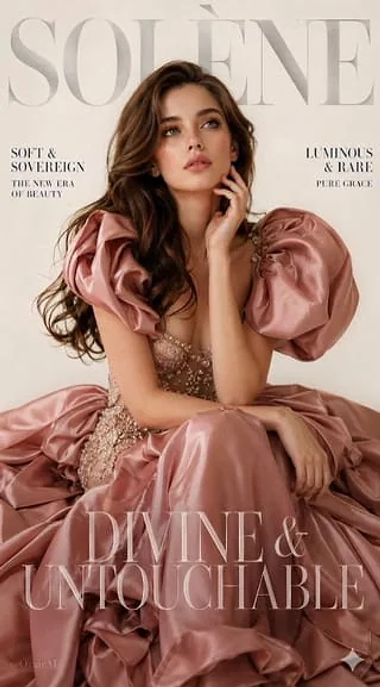

```text
A breathtaking luxury fashion magazine cover. Large bold silver serif brand name "SOLÈNE" elegantly placed at the very top of the frame, slightly transparent and overlapping the model's hair — exactly like a high-end fashion magazine masthead. Clean cream-white background, seamless studio, soft warm-toned lighting.

A young, extremely cute and beautiful white woman with soft angelic facial features, full lips, big dreamy green eyes with long lashes, and long silky chocolate brown wavy hair cascading freely over both shoulders. She sits gracefully — upper body leaning slightly forward, one arm resting on her knee, the other hand delicately touching her jaw, her gaze looking slightly upward and off-camera with a soft mysterious expression — elegant and effortless.

She wears a dramatic floor-length dusty rose blush satin ballgown with exaggerated sculptural puff shoulders that billow outward like rose petals — the bodice is a sheer champagne silk mesh embroidered with tiny pearl and crystal details, fitted through the waist and blooming into an enormous tiered skirt pooling around her. The fabric catches the light with a soft luminous sheen.

Magazine text overlaid naturally into the composition — left side in deep charcoal navy small serif caps: "SOFT & SOVEREIGN / THE NEW ERA OF BEAUTY" — right side: "LUMINOUS & RARE / PURE GRACE" — bottom of frame in large elegant serif display font, slightly transparent: "DIVINE & UNTOUCHABLE"
Vertical 9:13 format. Ultra photorealistic, 8K, no text overlays, cinematic color grading.
```

Model: GPT Image 2
Author: Ozair AI

[ProjectD](https://aitoolsradar.com/en/prompts/9d3b1cbcfeff11) · [Recorded source](https://x.com/Ozayrr_irl/status/2047541284005453933)
 · [Full original metadata and byte evidence](data/projectd-batch-0042.json)

## Ozair AI #234


```text
A clean, refreshing vertical advertising poster design for a face wash product, using a graphic illustration style with soft watercolor and vector elements. The poster is set against a clean white and light teal background. The central figure is a beautiful, smiling young woman with natural, glowing, radiant skin and her hair loosely tied back in a messy bun, looking confidently towards the viewer with fresh-faced appearance. She has a touch of natural makeup.
The overall style is clean, modern, and graphic, with flowing organic shapes, stylized leaves, flowers, and water splashes in shades of aqua, teal, light green, and white. The background features delicate, stylized illustrations of botanical ingredients like aloe vera, green tea leaves, and lavender.
At the top, large, friendly, rounded sans-serif font reads: "RADIANT SKIN STARTS HERE". Below this, a catchy tagline: "Cleanse, Refresh, Glow."
The main product, a stylized bottle of face wash with a white pump and green and blue labeling, is illustrated to the right of the woman. The bottle is labeled "FRESH FACE DAILY CLEANSER" and mentions "With Aloe Vera & Green Tea." There are small graphical icons around the bottle with text: "Deep Pore Cleansing", "Soothes & Hydrates", "For All Skin Types", "Paraben Free".
Small illustrative bubbles, stars, and botanical accents float around the composition, adding a sense of lightness and freshness. At the bottom, in a clean, modern font, it says: "AVAILABLE NOW AT ALL MAJOR RETAILERS" followed by a stylized logo "FRESH FACE" and the website "https://t.co/OUIoDMOWF6" and social media icons (freshfacecare). The poster has a clean layout with ample negative space and soft, natural lighting.
```

Model: GPT Image 2
Author: Ozair AI

[ProjectD](https://aitoolsradar.com/en/prompts/6d228bdf74baea) · [Recorded source](https://x.com/Ozayrr_irl/status/2048662802475409637)
 · [Full original metadata and byte evidence](data/projectd-batch-0042.json)

## Ozair AI #293

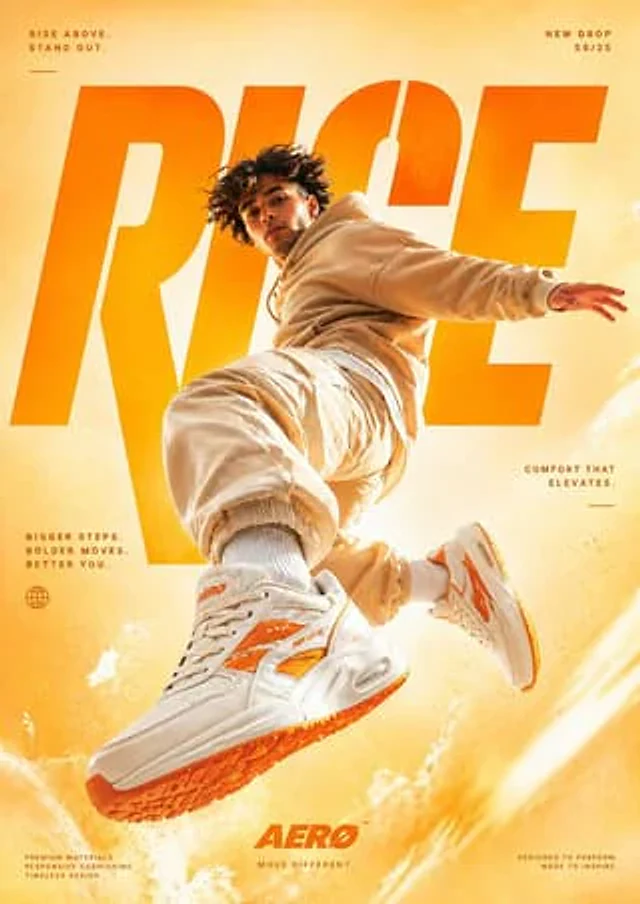

```text
A cinematic, high-end sneaker advertisement poster featuring a young male model mid-air in a dynamic jumping pose, captured from a low-angle perspective to emphasize power and motion. The model is wearing a coordinated beige streetwear outfit (hoodie and joggers), with oversized chunky white sneakers that have bold orange accents on the sole and side stripes.

The background is a smooth studio gradient in warm tones, blending light yellow and vibrant orange for an eye-catching, energetic feel. Dramatic soft studio lighting enhances the subject, with glowing highlights and subtle shadows that complement the outfit and colour palette.

Behind the model, large bold typography is seamlessly integrated into the composition, reading “RISE” in oversized modern sans-serif font, partially obscured by the subject for depth. Additional small promotional text is placed around the layout in a clean editorial style, such as:

“RISE ABOVE. STAND OUT.”
“BIGGER STEPS. BOLDER MOVES. BETTER YOU.”
“COMFORT THAT ELEVATES.”
“PREMIUM MATERIALS. RESPONSIVE CUSHIONING. TIMELESS DESIGN.”

At the bottom, a modern sneaker brand logo “AERO” appears with the tagline “MOVE DIFFERENT.”

Add subtle motion effects like dust particles or energy trails beneath the jumping foot to enhance impact. Ultra-realistic detail, sharp focus, high contrast, commercial fashion photography style, magazine-quality composition, 4K resolution.
```

Model: GPT Image 2
Author: Ozair AI

[ProjectD](https://aitoolsradar.com/en/prompts/6a4e3eb1755e6e) · [Recorded source](https://x.com/Ozayrr_irl/status/2049022501850915160)
 · [Full original metadata and byte evidence](data/projectd-batch-0042.json)

## Ozan Sihay #70


```text
A cinematic silhouette shot of local fishermen lining the Galata Bridge in Istanbul during sunset. In the foreground, a weary fisherman leans against the railing, looking at the sea. The background features the hazy, dreamlike silhouette of the Süleymaniye Mosque and seagulls flying over the Golden Horn. Warm orange and deep blue color palette. Shot on Sony A7R IV with Sony FE 85mm f/1.4 GM lens at f/1.8. Atmospheric haze, emotional storytelling, award-winning travel photography.
```

Model: GPT Image 2
Author: Ozan Sihay

[ProjectD](https://aitoolsradar.com/en/prompts/768e6986ca5542) · [Recorded source](https://x.com/ozan_sihay/status/2001003144566681621)
 · [Full original metadata and byte evidence](data/projectd-batch-0042.json)

## Packaging Design Proposal Board Prompt


```text
Please provide{argument name="product name" default="milk powder"} Generate a product introduction poster in the "Hand-drawn Packaging Scheme Project Style". If I provided product images, please use them as the primary reference, retaining the product's core visual features, packaging format, colors, materials, brand logo, and overall feel. Prioritize the main color scheme and color relationships in the product images during the design process. If I did not provide product images, please design based on {argument name="product name" default="milk powder"} The system automatically generates product appearance and packaging design based on positioning, and automatically matches natural and reasonable background, main, and auxiliary colors according to product attributes, category characteristics, and overall feel. Poster overall style requirements: This is not a standard e-commerce details page or a simple studio poster, but a creative project integrating "finished product images + packaging design sketches + brand concept development process." The overall presentation should be a high-aesthetic, high-complete brand design showcase, as if a designer is presenting a packaging concept plan. Visual requirements: - Vertical composition. - Use a unified background with brand identity; the background color should be naturally determined by the product itself, not fixed to any single color. - The color scheme should be coordinated with product attributes: if there is a reference image, its main color and brand color should be inherited first; if not, a reasonable color scheme should be automatically generated based on the product name. - Place the most complete and eye-catching main product visual in the center, with realistic texture, 3D lighting, and commercial-grade finished product effects. - Surround the product with multiple auxiliary visual elements: packaging sketches from different angles, structural sketches, partial form explorations, handheld display sketches, packaging unfolding concepts, and brand typography experiments. - Add natural and casual black or dark hand-drawn lines, arrows, circles, symbols, and handwritten Chinese annotations to give the image a strong sense of "design process" and "creative solution." - The finished product image should be relatively refined and realistic, while the sketch image should be relatively casual and dynamic, creating a contrast between "finished product + design sketch." - The layout should appear relaxed and free, but the overall design must be orderly, rhythmic, and have a visual center, reflecting a high-end graphic design aesthetic. - Appropriately add small graphics, symbols, or fun elements related to the product to enhance brand memorability. - The final effect should possess brand awareness, creativity, a sense of process, and visual impact. Color Principles: - Do not consistently use a yellow background. - Automatically select the main color scheme based on the product type, material, purpose, consumer experience, and brand image. - The background color, product color, text color, and sketch line color should coordinate with each other. - High-saturation monochrome backgrounds or soft, unified color schemes can be used, as long as the overall image conveys brand identity and visual impact. - Colors should naturally complement the product, not overshadow it. Style Keywords: Packaging design project, brand concept development, hand-drawn sketches, design process feel, mood board, creative review drafts, product rendering, visual experiments, commercial design posters. Special Notes: - If reference product images are available, prioritize following them and do not deviate from the product itself. - If no reference images are available, automatically generate a reasonable product appearance, packaging, and color scheme based on the product name, maintaining overall style consistency. - The focus of the images is "product introduction + creative design process demonstration." - Avoid creating a typical e-commerce detail page or promotional poster, or one that appears overly neat and rigid; sketches and handwritten annotations are essential; avoid a cheap or immature cartoon style.
```

Model: GPT Image 2
Author: GPT Image 2 Prompts

[ProjectD](https://aitoolsradar.com/en/prompts/bca9d8faa40e77) · [Recorded source](https://x.com/MrLarus/status/2046788355396968859)
 · [Full original metadata and byte evidence](data/projectd-batch-0042.json)

## Packaging Design Proposal Board Prompt


```text
请为【{argument name="产品名称" default="奶粉"}】生成一张“手绘包装提案板风格”的产品介绍海报。 

如果我提供了产品图片，请以该图片为主要参考，保留产品的核心外观特征、包装形态、颜色、材质、品牌识别和整体气质，并优先沿用产品图中的主色调与配色关系进行设计。
如果我没有提供产品图片，请根据【{argument name="产品名称" default="奶粉"}】自动生成符合该产品定位的产品外观与包装设计，并根据产品属性、品类特征和气质，自动搭配自然合理的主色、辅助色和背景色。

海报整体风格要求：
这不是普通电商详情页，也不是单纯棚拍海报，而是一张融合“产品成品图 + 包装设计草图 + 品牌概念开发过程”的创意提案板。整体呈现为高审美、高完成度的品牌设计展示图，像设计师正在展示一个包装概念方案。

画面要求：
- 竖版构图
- 使用统一且有品牌感的主色调背景，背景颜色根据产品本身自然决定，不固定为某一种颜色
- 配色应与产品属性协调：如果有参考图，优先继承参考图的主色和品牌色；如果没有参考图，则根据产品名称自动生成合理的色彩方案
- 画面中央放置一个最完整、最吸睛的产品主视觉，具有真实质感、立体光影和商业成品效果
- 产品周围加入多个辅助视觉元素：不同角度的包装草图、结构草图、局部造型探索、手持展示小稿、包装展开思路、品牌字样排版试验
- 加入自然随性的黑色或深色手绘线稿、箭头、圈画、符号、手写中文批注，让画面具有强烈“设计过程感”和“创意提案感”
- 成品图要相对精致真实，草图部分要相对随性灵动，形成“完成品 + 设计草图”的对比
- 版式看起来松弛自由，但整体要有秩序、有节奏、有视觉中心，体现高级平面设计感
- 可以适度加入与产品相关的小图形、小符号或趣味元素，增强品牌记忆点
- 最终效果应具有品牌感、创意感、过程感和视觉冲击力

配色原则：
- 不要固定黄色背景
- 要根据产品类型、材质、用途、消费感受和品牌气质自动选择主色调
- 背景色、产品色、文字色、草图线稿色应彼此协调
- 可以使用高饱和单色背景，也可以使用柔和统一色系背景，只要整体有品牌感和视觉冲击力
- 色彩应自然服务于产品，而不是喧宾夺主

风格关键词：
包装设计提案板、品牌概念开发、手绘草图、设计过程感、moodboard、创意评审稿、产品成品渲染、视觉实验、商业设计海报

请特别注意：
- 如果有参考产品图，优先遵循参考图，不要偏离产品本身
- 如果没有参考图，则根据产品名称自动生成合理的产品外观、包装和配色方案，并保持整体风格统一
- 画面重点是“产品介绍 + 创意设计过程展示”
- 不要做成普通电商详情页，不要做成促销海报，不要过度整齐呆板，不要缺少草图和手写批注，不要廉价感，不要低幼卡通感
```

Model: GPT Image 2
Author: Larus Canus

[ProjectD](https://aitoolsradar.com/en/prompts/91d38ca164d51a) · [Recorded source](https://youmind.com/prompts/hand-drawn-packaging-proposal-board-14743)
 · [Full original metadata and byte evidence](data/projectd-batch-0042.json)

## Pakistani Truck Art Portrait


```text
A highly detailed and realistic photograph showing a car driving on a highway in sunlight.{argument name="origin" default="Pakistan"} Decorate the rear of the truck. The truck paint is {argument name="primary color" default="Bright turquoise blue"} It is bordered with traditional Pakistani truck art flowers in orange, yellow, and red. On the tailgate is a large hand-drawn portrait in a realistic illustration style of a long-haired, bespectacled man. Above the portrait, striking 3D truck art lettering in white and orange reads "..."{argument name="main text" default="TU JA RE..."} Below the portrait, the text in a small box reads "SIDE SE JA RE". The truck has yellow license plates, with "JAMAILA" written on both sides. The background shows an empty road with telephone poles and a blurred rural landscape. Cinematic composition, centered rear view of the truck, ultra-clear, vibrant colors, 4K resolution, realistic truck art style, professional photography lighting.
```

Model: GPT Image 2
Author: GPT Image 2 Prompts

[ProjectD](https://aitoolsradar.com/en/prompts/ad6257703ce1d2) · [Recorded source](https://x.com/jzaib4269/status/2047206307032383996)
 · [Full original metadata and byte evidence](data/projectd-batch-0042.json)

## Palace Banquet Traditional Portrait

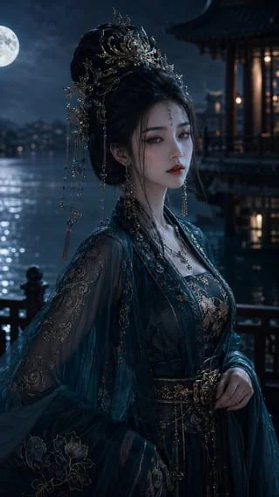

```text
场景设定为{argument name="场景" default="夜色宫殿宴会"}。女主身穿{argument name="服装风格" default="深青墨金交领古风长袍"}，辅以轻纱外袍 + 刺绣内层 + 华丽腰封，华丽度高，气质冷艳疏离。整体呈现高级古偶女主电影感，冷艳又不失精致优雅，完美诠释东方梦幻女主的强女主气场。
```

Model: GPT Image 2
Author: 李岳

[ProjectD](https://aitoolsradar.com/en/prompts/367b5959b5f8a9) · [Recorded source](https://youmind.com/prompts/palace-banquet-traditional-portrait-24483)
 · [Full original metadata and byte evidence](data/projectd-batch-0042.json)

## Palm Reading Diagnosis Report

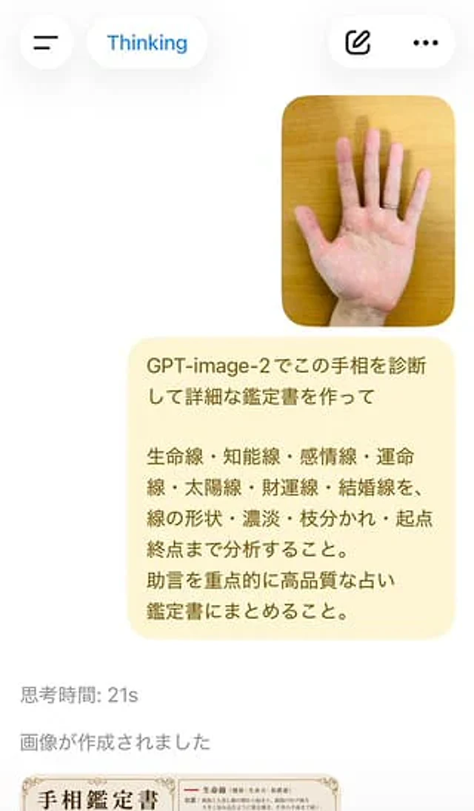

```text
GPT-image-2でこの手相を診断して詳細な鑑定書を作って
生命線・知能線・感情線・運命線・太陽線・財運線・結婚線を、線の形状・濃淡・枝分かれ・起点終点まで分析すること。
助言を重点的に高品質な占い鑑定書にまとめること。
```

Model: GPT Image 2
Author: @agi_aibusi

[ProjectD](https://aitoolsradar.com/en/prompts/a3e3884eb76b2d) · [Recorded source](https://x.com/agi_aibusi/status/2046530764871696750)
 · [Full original metadata and byte evidence](data/projectd-batch-0042.json)

## Paper-Cut Layered Illustration Style

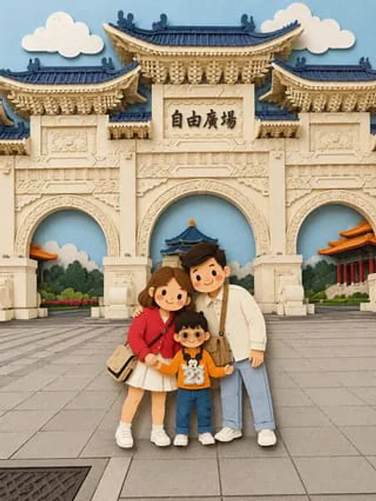

```text
Convert this images into a soft, {argument name="illustration style" default="handcrafted paper-cut layered illustration style"}, inspired by papercraft diorama aesthetics. Use {argument name="character traits" default="smooth rounded shapes, simplified cute character proportions"}, and minimal facial details (dot eyes, blush cheeks) to create a warm, charming look. Apply stacked paper layers with visible depth, subtle shadows between layers, and clean cut edges that resemble laser-cut cardstock.
```

Model: GPT Image 2
Author: Kashberg

[ProjectD](https://aitoolsradar.com/en/prompts/a29d30ecd29577) · [Recorded source](https://youmind.com/prompts/paper-cut-layered-illustration-22319)
 · [Full original metadata and byte evidence](data/projectd-batch-0042.json)

## Papercraft Diorama Style Portrait

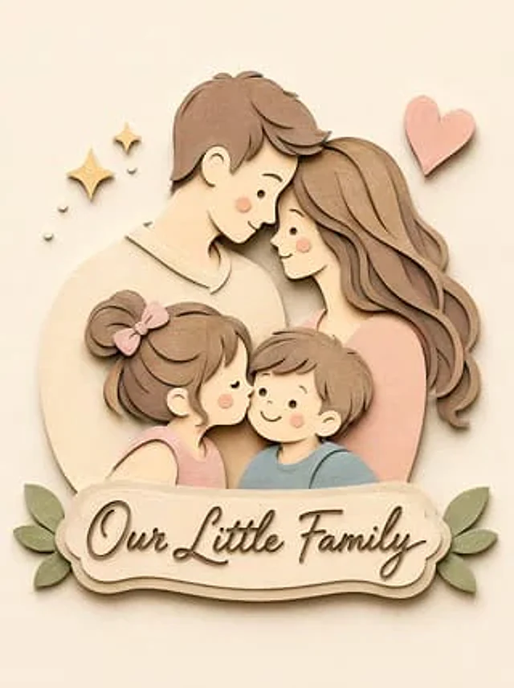

```text
Convert this image into a {argument name="style" default="soft, handcrafted paper-cut layered illustration style"}, inspired by papercraft diorama aesthetics. Use smooth rounded shapes, simplified cute character proportions, and {argument name="facial details" default="minimal facial details (dot eyes, blush cheeks)"} to create a warm, charming look. Apply stacked paper layers with visible depth, subtle shadows between layers, and clean cut edges that resemble {argument name="material" default="laser-cut cardstock"}.
```

Model: GPT Image 2
Author: Sharon Riley

[ProjectD](https://aitoolsradar.com/en/prompts/bfa1afc4e5a585) · [Recorded source](https://youmind.com/prompts/papercraft-layered-illustration-style-26440)
 · [Full original metadata and byte evidence](data/projectd-batch-0042.json)

## Paranormal Trail Camera Encounter

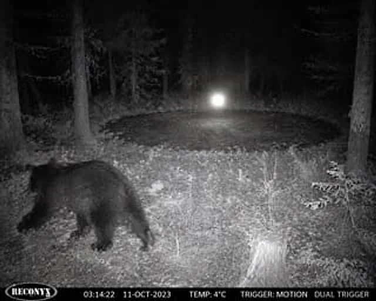

```text
A black-and-white infrared camera photograph taken in a coniferous forest late at night. In the foreground on the left, a large black bear walks by, with a slight motion blur. In the center of a forest clearing, there is a perfectly circular patch of dark, barren dirt. At the very edge of that dark circle, a bright, luminous sphere floats off the ground. The image exhibits a grainy night-vision aesthetic, showing the bushes, pine trunks, and tree stumps in the lower right corner. A black data bar at the bottom edge displays white text; on the far left is an oval logo that reads "..."{argument name="camera brand" default="RECONYX"} ", followed by the timestamp "{argument name="timestamp" default="03:14:22 11-OCT-2023"} ", and then "{argument name="temperature" default="TEMP: 4°C"} The rightmost one is "{argument name="trigger info" default="TRIGGER: MOTION DUAL TRIGGER"} ".
```

Model: GPT Image 2
Author: GPT Image 2 Prompts

[ProjectD](https://aitoolsradar.com/en/prompts/6699049106da15) · [Recorded source](https://x.com/MullerScot19970/status/2044613172641108240#reversed-1)
 · [Full original metadata and byte evidence](data/projectd-batch-0042.json)

## Paris Double Exposure Editorial Portrait

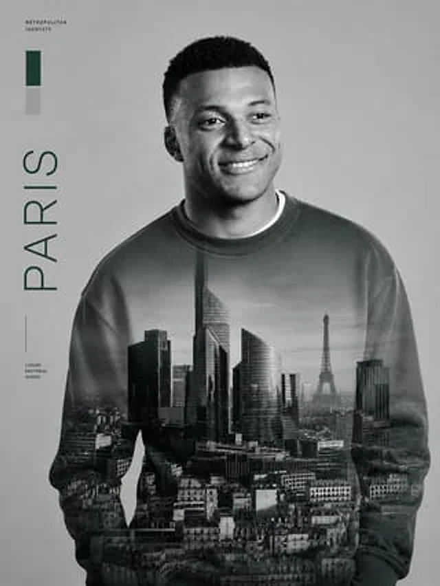

```text
Using the provided reference image as the strict identity source, transform the person into a luxury metropolitan editorial poster while preserving the exact facial identity, facial proportions, eyes, smile, hairstyle, and natural likeness. Change the outfit from the sports jersey into a plain oversized crewneck sweatshirt, and make the person a relaxed half-body portrait facing slightly to the viewer’s right with a soft confident smile.

Style and treatment: Create a refined monochrome black-and-white fashion editorial look with subtle dark green accents, soft studio lighting, high-end magazine composition, clean gray background, and a polished cinematic finish.

Main visual effect: Add a double-exposure Paris cityscape blended across the sweatshirt and lower torso, including modern high-rise buildings, dense Paris rooftops, and the Eiffel Tower visible on the right side of the chest area. Keep the cityscape grayscale and integrated naturally into the fabric, fading at the edges.

Layout additions: Add exactly 3 text groups on the left side: 1) small uppercase text at the top left reading {argument name="top label text" default="METROPOLITAN IDENTITY"}, 2) large vertical word reading {argument name="city title" default="PARIS"}, 3) small uppercase text near the lower left reading {argument name="series label" default="LUXURY EDITORIAL SERIES"}. Add exactly 2 vertical color swatches near the upper left: one dark green rectangle above one light gray rectangle. Add one thin vertical divider line beside the lower-left series label.

Constraints: Do not keep the original football jersey, logos, number, or blue color. Do not change the person’s identity. Avoid extra text, watermarks, or additional graphic elements. Maintain a premium minimalist editorial poster aesthetic.
```

Model: GPT Image 2
Author: Elsa Ai

[ProjectD](https://aitoolsradar.com/en/prompts/6d4fc491b52ab1) · [Recorded source](https://youmind.com/prompts/paris-double-exposure-portrait-31720)
 · [Full original metadata and byte evidence](data/projectd-batch-0042.json)

## Paris Food Ranking Poster Prompt

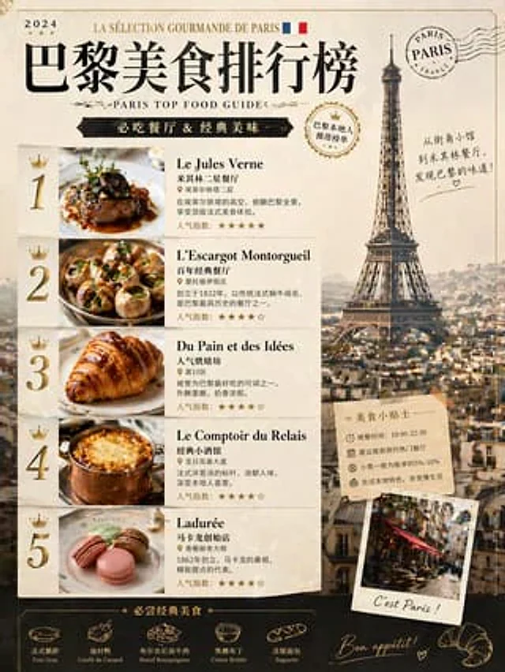

```text
Create an information about{argument name="city" default="Paris"}{argument name="topic" default="food"} Leaderboard poster
```

Model: GPT Image 2
Author: GPT Image 2 Prompts

[ProjectD](https://aitoolsradar.com/en/prompts/437b5e48e184f5) · [Recorded source](https://x.com/ToroJushiAi/status/2046930310613332075)
 · [Full original metadata and byte evidence](data/projectd-batch-0042.json)

## Parisian Morning Coffee Lifestyle Scene

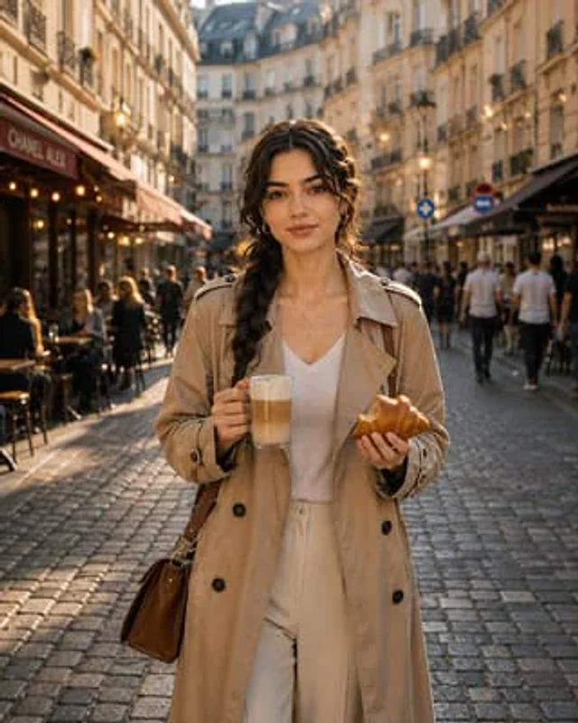

```text
A cinematic, realistic short video of a stylish young woman with long wavy brown hair and bangs, wearing a beige trench coat over a white top and light pants, carrying a brown leather shoulder bag. She steps out of an elegant blue door of a classic European building onto a sunlit cobblestone street lined with plants and flower boxes. She walks confidently down the charming Parisian-style alley. She approaches and enters a cozy cafe with wooden doors and glass windows labeled something like “CHANEL ALEX” or similar. Inside the warm, inviting cafe with exposed beams, pendant lights, and a marble counter, she orders an “Ice vanilla latte, please” from a bearded barista in an apron. A close-up of a golden, flaky croissant on a white plate with a fork. She sits by the window, happily sips the layered latte from a clear glass mug, closes her eyes in enjoyment, and says “That’s the good stuff.” She then takes a big bite of the croissant and says “Perfect start to the day.” Final shot of her walking down a bustling cobblestone street in golden morning light, holding the coffee and half-eaten croissant, smiling and looking at the camera. Soft natural lighting, warm tones, shallow depth of field, high detail, lifestyle aesthetic
```

Model: GPT Image 2
Author: Noor

[ProjectD](https://aitoolsradar.com/en/prompts/2ddf4473015f43) · [Recorded source](https://youmind.com/prompts/parisian-morning-cafe-lifestyle-32015)
 · [Full original metadata and byte evidence](data/projectd-batch-0042.json)

## Pascal-B Comic Strip History

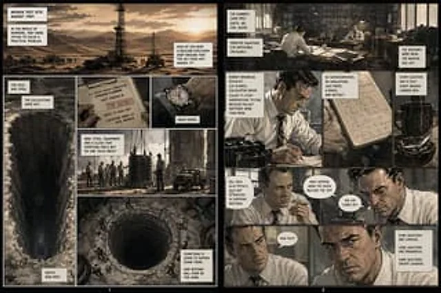

```text
about{argument name="subject" default="Pascal-B"} comics
```

Model: GPT Image 2
Author: GPT Image 2 Prompts

[ProjectD](https://aitoolsradar.com/en/prompts/8363b45a938c4b) · [Recorded source](https://x.com/canalCCore2/status/2046984686094725399)
 · [Full original metadata and byte evidence](data/projectd-batch-0042.json)

## Pastel Anime Blueberry Cake Movie Poster

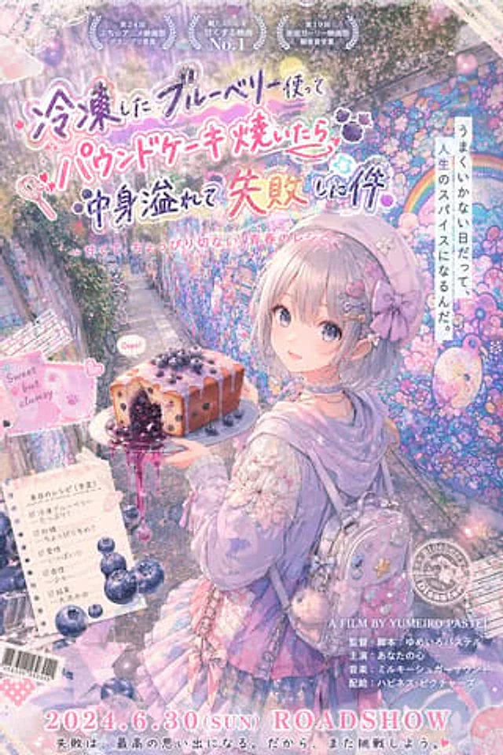

```text
A dreamy, softly animated movie poster illustration is set in a narrow outdoor alleyway covered with a dense mosaic of floral patterns. The image evokes shimmering starlight, soft mist, and a romantic shoujo manga color palette of lavender, pink, periwinkle, and cream. The foreground shows a lovely girl, her back partially obscured in profile, her face mostly hidden. She has a short, silver-lavender bob and wears a large, pale purple bow adorned with small flowers. She wears an oversized, semi-transparent pale purple hoodie with floral appliqués on the sleeves, paired with a layered, soft-toned skirt, and carries a shimmering pale purple backpack adorned with charms, ribbons, pom-poms, badges, and star decorations. She holds a slice of blueberry pound cake, its center dramatically overflowing with glossy, deep purple blueberry filling, thick syrup flowing across the cake and plate. Whole blueberries are scattered around the cake and below in the foreground. Despite the beautiful visuals, the overall atmosphere should be fantastical, sophisticated, and with a touch of comedy. The image is designed like a Japanese movie poster, featuring numerous decorative text overlays and laurel leaf embellishments. At the top, there are three lines of small award descriptions with laurel wreaths. Add a large handwritten Japanese title in a layered pink, white, and purple font with glowing, sticker-like outlines: “冷凍したブルーベリー使ってパウンドケーキ焼いたら中身溢れて失敗した件.” (Translation: The story of how a pound cake made with frozen blueberries failed because the filling overflowed.) Below, add a smaller subtitle: “〜甘くて、ちょっぴり切ない青春のレシピ〜” (Translation: ~A sweet yet slightly bittersweet recipe for youth~). Place a vertical white quote box on the right containing the Japanese phrase: "うまくいかない日だって、人生のスパイスになるんだ。" (Even the worst days are part of life.) In the bottom left corner, add a pink sticky note that reads "Sweet but clumsy," along with a torn-out page from a handwritten Japanese list. Near the cake, add a small speech bubble that reads "Oops!" Near the bottom right corner, add a circular stamp-like seal that reads "Blueberry disaster." At the bottom, add white movie credits-style text, including "A FILM BY YUMEIRO PASTEL," and a large pink and white release date:{argument name="release date" default="2024.6.30(SUN)"} "ROADSHOW". Add the Japanese tagline below: "失敗は、最高の思い出になる。だから、また挑戦しよう。" (Translation: Failure can become the best memory. So, let's challenge ourselves again.) Frame the entire poster with lace, stickers, confetti, and scrapbook-style decorations. The image should be highly detailed, glossy, sensual, cute, and cinematic, deliberately creating an exaggerated effect reminiscent of a coming-of-age movie poster about baking failure.
```

Model: GPT Image 2
Author: GPT Image 2 Prompts

[ProjectD](https://aitoolsradar.com/en/prompts/1012bfbc06b75b) · [Recorded source](https://x.com/_sengiu_/status/2047340744374145388#reversed-1)
 · [Full original metadata and byte evidence](data/projectd-batch-0042.json)

## Pastel Anime Celebration Jar Visual


```text
Goal: Create a vertical 2:3 commemorative fantasy character visual packed with cute character motifs, like an ornate anime merchandise celebration illustration.

Canvas: Portrait 2:3 composition, bright pastel blue sky with soft white clouds, sparkling light effects, glassy reflections, and a delicate lace-and-crystal border around all four edges.

Main subject: Center a petite anime girl sitting on top of a huge transparent faceted glass jar. Her face is intentionally covered by a centered pale lavender square censor block. She has very long flowing {argument name="hair color" default="silvery white with pale blue tint"} hair styled into twin tails or long side sections, decorated with blue gingham ribbons, small blue flowers, pearls, and strawberry ornaments. Her pose is front-facing, legs dangling down, hands resting lightly to each side, graceful and doll-like.

Outfit: A lavish sweet-lolita dress in {argument name="image color palette" default="sky blue, white, blush pink, crystal clear, and strawberry red"}. Include puff sleeves, layered ruffles, lace trim, blue gingham panels, tiny bows, pearl chains, berry and flower embroidery, a corset-like bodice, and a short tiered skirt. Add white thigh-high stockings with blue bows, platform Mary Jane shoes decorated with strawberries, flowers, pearls, and blue ribbon ties.

Central prop: The girl sits on a large transparent glass candy jar with a thick lid rim under her skirt and a faceted base. Inside the jar, show many miniature concept items: blue and white flowers, strawberries, pearls, tiny ribbons, crystal pieces, a small teacup or cake-like ornament, heart charms, and pastel sweets. On the jar front, place an ornate gold-and-blue heart jewel brooch.

Balloons: Include exactly 12 visible balloons behind and around the character: 2 pink heart balloons, 2 blue heart balloons, 4 round blue balloons, and 4 transparent iridescent round balloons filled with tiny strawberries, flowers, and confetti. Tie them with fine strings and blue bows so they frame the girl like a celebration bouquet.

Surrounding objects: Add exactly 8 major decorative gift/display objects around the base: 1 blue-and-white wrapped gift box on the lower left, 1 crystal perfume-bottle-like ornament on the lower left, 1 faceted blue heart crystal ornament on the far lower left, 1 hanging gift tag on the jar reading {argument name="gift tag text" default="Present for you"}, 1 ornate framed strawberry illustration on the lower right, 1 blue glass bottle or vial on the far lower right, 1 small envelope/card with strawberry art on the lower right, and 1 loose strawberry near the bottom edge. Add scattered pearls, small flowers, lace paper, and tiny gems on the reflective floor.

Style: Extremely detailed Japanese anime illustration, dreamy shoujo aesthetic, watercolor-like pastel rendering, transparent glass effects, iridescent highlights, fine line art, luminous sparkles, ornate lace, ribbons, pearls, and crystalline decorations. The mood should be {argument name="mood" default="sweet, celebratory, ethereal, and precious"}.

Text: Keep the visible English tag text “Present for you” in elegant cursive. Optional faint decorative script on the left may read {argument name="small signature text" default="Dream Garden"}. Avoid adding any other readable text.

Constraints: Vertical 2:3 ratio, centered symmetrical composition, no dark colors, no modern UI elements, no photorealism, no extra characters, keep the face covered by the simple square block, and make every accessory feel tied to strawberries, blue flowers, glass crystals, gifts, and ribbons.
```

Model: GPT Image 2
Author: あまり🖋️AI &フリー素材配布

[ProjectD](https://aitoolsradar.com/en/prompts/8e9522a0aa9b0f) · [Recorded source](https://youmind.com/prompts/pastel-anime-celebration-visual-20931)
 · [Full original metadata and byte evidence](data/projectd-batch-0042.json)

## Pastel Anime Character Sketch


```text
A confusion about digital hand-drawn style{argument name="character style" default="Anime characters"} Graffiti, possess{argument name="hair length" default="long"} hair and{argument name="eye color" default="Big blue"} Eyes, without words or decorations, painted in flat, soft tones.
```

Model: GPT Image 2
Author: GPT Image 2 Prompts

[ProjectD](https://aitoolsradar.com/en/prompts/997260c8952bd3) · [Recorded source](https://x.com/fofrAI/status/2046636804648927446)
 · [Full original metadata and byte evidence](data/projectd-batch-0042.json)

## Pastel Anime Character Sketch


```text
a digitally sketched color doodle of a {argument name="expression" default="perplexed"} an anime character with {argument name="hair style" default="long hair"} and {argument name="eye color" default="big blue eyes"} character, no text, no embellishments, flat pastel coloring
```

Model: GPT Image 2
Author: fofr

[ProjectD](https://aitoolsradar.com/en/prompts/10086efab024f3) · [Recorded source](https://youmind.com/prompts/pastel-anime-character-sketch-14384)
 · [Full original metadata and byte evidence](data/projectd-batch-0042.json)

## Pastel Anime Fantasy Poster with Heroine

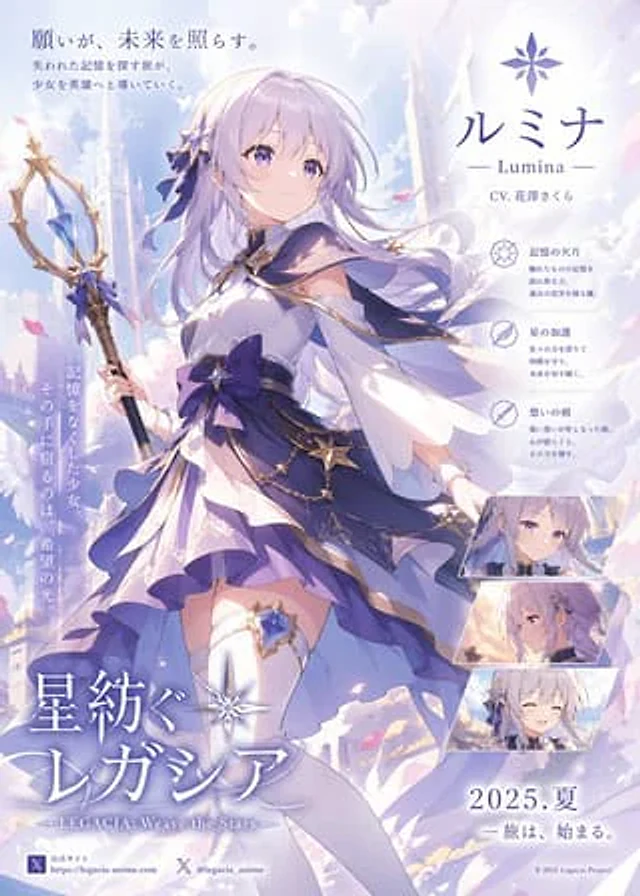

```text
A vertical promotional poster for a Japanese anime/fantasy game or light novel, using soft pale purple, white, and gold tones, features a dashing young girl against a backdrop of a magnificent aerial city. She is depicted in a dynamic three-quarter full-body pose, her body slightly turned to the left, holding a magnificent staff in her left hand, while her right hand extends backward as if in the wind. Her face is covered by a flat, pale-colored square obscuring her head, but the visible design hints at a refined anime heroine with extremely long, flowing silver-lilac hair, side-swept bangs, loose strands, and a star-shaped hair accessory adorned with a deep indigo ribbon bow. She wears an exquisite magical girl-style dress: a white off-the-shoulder bodice with navy and violet trim and gold star patterns; an asymmetrical, layered skirt in a blend of white, periwinkle blue, violet, and deep indigo; a large, deep blue bow and a gold star-shaped gem at the waist; separate, flowing sleeves; gold chains adorned with tiny star pendants hanging from her hips; white knee-high stockings; and blue star-shaped suspenders on her thighs. Her staff is tall and elegant, its dark shaft framed with gold elements, and a multifaceted blue crystal hangs near the top, decorated with bows and stars. The background is a light, fantastical skyline, featuring white towers, cathedral-like spires, clouds, feathers, and falling pink petals, accompanied by bright, ethereal backlighting and a dreamlike, heroic atmosphere. The composition mimics a sophisticated key visual poster and incorporates rich Japanese typography. The upper left corner features the Japanese tagline “願いが、未来を照らす.” (May the future shine upon you.) followed by two lines of smaller text. The upper right corner displays a star-shaped badge, the large character name “ルミナ”, the subtitle “— Lumina —”, and a line of smaller voice actor information. Three vertically arranged function labels are added to the right, each containing a small icon, a bold Japanese title, and two lines of smaller text below. A Japanese text block is added vertically along the character's side to the left. The lower right corner contains three diagonally stacked small portrait illustrations of the character: one with a calm frontal expression, one with a serious profile expression, and one with a closed-eye smile. The lower left corner features the large Japanese title “星紡ぐレガシア” (Hoshifugu Regasia), followed by the English subtitle “— LEGACIA: Weave the Stars —”. The lower right corner displays the date text “2025. Summer” and a short Japanese tagline below. The bottom left edge contains two small social media or website information blocks, while the right edge features a tiny copyright notice. It employs a high-end, modern anime-style promotional illustration, presenting a bright, soft, and fantastical atmosphere, elegant composition, fluid lines and colors, soft cel shadows, delicate fabric movement, glossy highlights, intricate clothing details, a clean layout, and a refined commercial poster quality.
```

Model: GPT Image 2
Author: GPT Image 2 Prompts

[ProjectD](https://aitoolsradar.com/en/prompts/a478bb685e75c6) · [Recorded source](https://x.com/8co28/status/2046978759946072262#reversed-1)
 · [Full original metadata and byte evidence](data/projectd-batch-0042.json)

## Pastel Anime Fantasy Poster with Heroine


```text
A vertical Japanese anime fantasy game or light-novel promotional poster in a soft pastel lavender, white, and gold palette, featuring a single heroic teenage girl as the main subject in a grand celestial city. She stands in a dynamic three-quarter full-body pose, slightly turned left, holding an ornate staff in her left hand, with her right arm extended behind her as if caught in wind. Her face is obscured by a flat pale square censor block centered over the head, but the visible design suggests a delicate anime heroine with very long flowing silver-lilac hair, side bangs, loose strands, and star-shaped hair ornaments with dark indigo ribbon bows. She wears an elaborate magical-girl style dress: off-shoulder white bodice with navy and violet trim, gold star motifs, layered asymmetrical skirt in white, periwinkle, violet, and deep indigo, a very large dark blue waist bow with a gold star jewel, detached flowing sleeves, gold chains with tiny star charms draped at the hip, white thigh-high stockings, and a blue star-shaped garter ornament on one thigh. Her staff is tall and elegant, dark shaft with gold frame elements and a suspended faceted blue crystal near the top, decorated with bows and star accents. The background is an airy fantasy skyline of white towers, cathedral-like spires, clouds, feathers, and drifting pink petals, with bright ethereal backlighting and a dreamy heroic atmosphere. Compose it like a polished key visual poster with abundant Japanese typography integrated into the artwork. At the upper left, place the Japanese tagline text "願いが、未来を照らす。" with two smaller lines below it. At the upper right, place a star-like emblem, the large character name "ルミナ", the subtitle "— Lumina —", and a smaller CV credit line. On the right side, add 3 vertically stacked feature callouts, each with a small icon and a bold Japanese heading followed by 2 short lines of smaller text. On the left side, add 1 vertical Japanese copy block running downward beside the character. At the lower right, include 3 small portrait inset panels of the same girl, stacked diagonally: 1 calm front-facing expression, 1 side-profile serious expression, and 1 smiling eyes-closed expression. At the lower left, place the large Japanese title "星紡ぐレガシア" with the English subtitle "— LEGACIA: Weave the Stars —" beneath it. At the bottom right, add the date text "2025. 夏" and one short Japanese tagline line below. At the very bottom edge, include 2 small social or website info blocks on the left and a tiny copyright line on the right. Render in high-end modern anime promotional illustration style, luminous pastel fantasy atmosphere, elegant composition, smooth linework and coloring, soft cel shading, delicate fabric movement, glossy highlights, intricate costume details, clean typography layout, and refined commercial poster finish.
```

Model: GPT Image 2
Author: 852話(hakoniwa)

[ProjectD](https://aitoolsradar.com/en/prompts/1833c51efd0420) · [Recorded source](https://youmind.com/prompts/pastel-magical-girl-poster-15091)
 · [Full original metadata and byte evidence](data/projectd-batch-0042.json)

## Pastel Anime Gaming Desk Setup


```text
Create an ultra-detailed futuristic pastel gaming desk setup in a bright white room, styled like a kawaii anime PC battlestation. Use a wide 16:9 cinematic composition, eye-level view, soft daylight, glossy white surfaces, mint-aqua RGB glow, shallow depth of field, and photorealistic 3D rendering with anime-themed decorative elements. Center the scene on one large curved ultrawide monitor displaying a cute anime girl wallpaper: {argument name="character name" default="mint-haired bear-hood anime girl"}, with very pale mint hair, fluffy white bear-eared hood, teal ribbons, delicate fantasy accessories, and a softly blurred square censor-like patch over the center of the face. On the desk include exactly 7 main desk objects: 1 large curved monitor, 1 white RGB mechanical keyboard, 1 white gaming mouse, 1 large patterned desk mat with mint geometric/floral motifs, 1 white headphone stand with white over-ear gaming headphones, 1 small stream deck with lit buttons, and 1 compact control panel with a small display and three knobs. To the right, place exactly 1 white glass-sided gaming PC tower with aqua internal lighting, visible fans, white liquid-cooling tubes, a graphics card, and anime character art displayed inside the case. Inside the PC display area include exactly 3 decorative items: 1 small anime figurine, 1 miniature white sports car model, and 1 framed anime panel. Add exactly 2 small screens besides the main monitor: 1 tiny landscape screen under the monitor showing the anime character and 1 small portrait-like anime display near the PC. Background details: a glowing hexagonal wall-light pattern behind the monitor, a small teal fleur-de-lis-like emblem centered on the wall, white floating shelves on both sides, trailing green plants, small glass/crystal decor, and soft sci-fi room lighting. Color palette: {argument name="color palette" default="white, pearl gray, mint aqua, pale teal, soft cyan"}. Mood: {argument name="mood" default="clean, dreamy, luxurious, cozy, high-end gamer aesthetic"}. Keep the image highly polished, symmetrical but naturally lived-in, with no people physically present, no visible watermark, no readable extra text except subtle hardware branding, and no clutter beyond the listed objects.
```

Model: GPT Image 2
Author: Mankyu | AI動画生成

[ProjectD](https://aitoolsradar.com/en/prompts/f35d775901be63) · [Recorded source](https://youmind.com/prompts/pastel-anime-gaming-setup-23696)
 · [Full original metadata and byte evidence](data/projectd-batch-0042.json)

## Pastel Anime Kimono by Lotus Pond

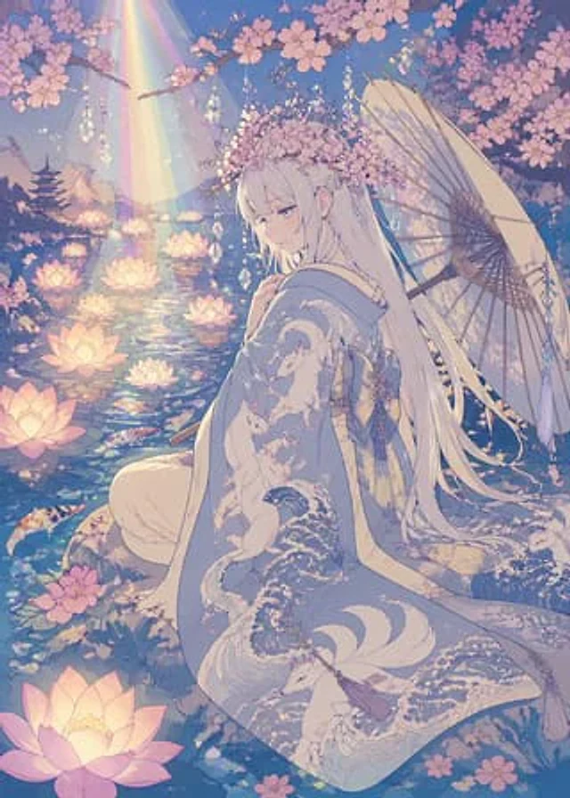

```text
A dreamlike pastel anime illustration depicts a serene young girl by a pond in a spring garden under the moonlight. The artwork employs a delicate Japanese fantasy style, with flat anime colors, no shadows, and extremely clean, grain-free lines. She sits by the water, her back to the viewer, her face slightly turned towards the viewer, her expression calm yet melancholic. She has very long, straight hair, the color of which is {argument name="hair color" default="silver-white"} She sports soft bangs, her hair adorned with braided flowers forming a crown. She wears an elegant, flowing pale blue and cream kimono, stylized with waves and white fox patterns, the layered fabric cascading around her. A half-open traditional paper umbrella, adorned with crystal-like ornaments, leans against her right rear. Dense cherry blossom branches surround her head, petals scattered in the foreground. Ten luminous lotus flowers float in the pond, and four koi carp are clearly visible swimming nearby. In the background to the left, the silhouette of a small, multi-tiered pagoda is faintly visible on the water. From the upper left, a soft rainbow beam shines obliquely into the pond, creating an iridescent reflection. Several strings of faceted crystal ornaments hang from the branches, shimmering in the light. The color palette is dominated by lavender, pale pink, pale blue, ivory, and soft gold. The overall atmosphere is ethereal, romantic, tranquil, and magical, with intricate details, shimmering reflections on the water, and an exquisite composition arranged vertically.
```

Model: GPT Image 2
Author: GPT Image 2 Prompts

[ProjectD](https://aitoolsradar.com/en/prompts/47e9b58454091c) · [Recorded source](https://x.com/sams0nli/status/2047487498578952355#reversed-0)
 · [Full original metadata and byte evidence](data/projectd-batch-0042.json)

## Pastel Anime Promo Poster


```text
Create a bright and soft-toned anime promotional poster for a fictional slice-of-life comedy series. The composition should be a single-page Japanese anime key visual, featuring a female protagonist at the center, surrounded by five illustrated moments and blocks of Japanese promotional text, presenting the style of an anime promotional poster. The protagonist is {argument name="character name" default="Mochiko-san"} A cute anime girl with short, white hair that fades to silver at the ends, bright blue eyes, soft blush, and low twin ponytails tied near her shoulders. She wears an oversized black hood shaped like a lop-eared dog, round silver goggles, a black choker with metal embellishments, and a futuristic black and white off-the-shoulder crop top adorned with a small badge on the chest, paired with separate black arm sleeves, super-short white shorts with black trim, a single leg strap, and a small side bag at her waist. Her body proportions are youthful and anime-style, slender and petite, with a slightly exaggerated bust, presenting a delicate modern moe character design. She stands in the center of the frame, a gentle smile on her face, holding a pen in one hand as if preparing to make a mistake while writing, facing the viewer with a confident and sweet demeanor. Five supporting illustrations of the same character are placed around her: 1) Top left, a chibi-style scene where she is outdoors, arms outstretched, mouth agape, dramatically crying; 2) Bottom left, a comedic scene where she is face down on a table or floor, exhausted and flustered, surrounded by scattered papers; 3) Top right, a half-body portrait where she holds up a sign with Japanese writing on it, looking apologetic; 4) Bottom right, a cheerful half-body portrait with eyes closed and a raised fist in encouragement; 5) A small background portrait behind the text in the top right corner, used as a character label. Two small white mascot creatures, round like mochi, with dotted eyes and small mouths, one large and one small, float or stand beside the heroine near the bottom center. Soft spring colors, including pink, sky blue, mint green, peach, cream, and white, are used, with cherry blossom petals and rounded graphic shapes scattered in the background. The background should create a light and celebratory atmosphere with subtle outdoor landscape blurs and decorative curves, stars, and bubbles. The poster is filled with playful, commercial anime-style Japanese typography: a large, multi-colored headline in the top left corner with subheadings above, a red seasonal broadcast announcement, a pink "Arasuji" (synopsis) box on the left containing multiple lines of text, a blue explanatory box in the bottom left corner, vertical and slanted exclamation marks surrounding the characters, and a pink staff credits block in the bottom right corner. A prominent character name banner is added in the top right corner. All text should look like authentic print Japanese promotional copy, with the headline in a rounded, colorful font and smaller text in a clean, magazine-style font. Overall atmosphere: cute, comedic, slightly chaotic, professionally designed anime key visual, suitable for promoting new anime in a 16:9 landscape format.
```

Model: GPT Image 2
Author: GPT Image 2 Prompts

[ProjectD](https://aitoolsradar.com/en/prompts/157a7bcd4706bc) · [Recorded source](https://x.com/BeamManP/status/2046606869041672483#reversed-0)
 · [Full original metadata and byte evidence](data/projectd-batch-0042.json)

## Pastel Anime Promo Poster


```text
Create a bright pastel anime promotional poster for a fictional slice-of-life comedy series. The composition is a single-page Japanese key visual with one central heroine surrounded by 5 inset moments and blocks of Japanese promotional text, like an anime announcement poster. The main character is {argument name="character name" default="もち子さん"}, a cute anime girl with short white hair fading slightly to silver, large vivid blue eyes, soft blush, and twin low ponytails tied near the shoulders. She wears an oversized black hood shaped like floppy dog ears, round silver goggles resting on top of her head, a black choker with a metallic round ornament, a futuristic white-and-black cropped sleeveless top with dark trim and a small emblem on the chest, detached black arm sleeves, very short white shorts with black edging, a thigh strap on one leg, and a small side pouch on her hip. Her body proportions are youthful anime stylization with a slim, petite build and slightly exaggerated chest, rendered in polished modern moe character design. In the center she stands full body, smiling gently and holding a pen in one hand as if she is about to make a mistake while writing, facing the viewer in a confident but sweet pose. Around her place 5 supporting vignette images of the same character: 1) upper left, a chibi-style scene of her outside with both hands thrown forward, crying dramatically with a huge open mouth; 2) lower left, a comic scene of her collapsed face-down on a desk or floor with scattered papers, exhausted and flustered; 3) upper right, a bust shot where she holds up a paper sign with Japanese writing, looking apologetic; 4) lower right, a cheerful half-body portrait with closed smiling eyes and one fist raised in encouragement; 5) a small background portrait in the top-right area behind text, used like a character callout. Include exactly 2 small white mascot creatures near the bottom center, both round and mochi-like with tiny dot eyes and tiny mouths, one larger and one smaller, floating or standing beside the heroine. Use a soft spring palette with pink, sky blue, mint green, peach, cream, and white, with scattered cherry blossom petals and rounded graphic shapes in the background. The background should feel airy and celebratory, with subtle outdoor scenery blur and decorative swooshes, stars, and bubbles. Fill the poster with Japanese typography in a playful commercial-anime style: a large multicolored title at top left, small header text above it, a red seasonal broadcast announcement, a pink "あらすじ" synopsis box on the left with several lines of body text, a blue explanatory box at bottom left, vertical and angled exclamatory phrases around the character, and a pink production-credit block at bottom right. Add a prominent character name banner in the upper right. Keep all text looking like authentic printed Japanese promotional copy, using rounded colorful fonts for the title and clean magazine-style fonts for the smaller text. Overall mood: adorable, comedic, slightly chaotic, professionally designed anime key art for a new TV series announcement in 16:9 landscape format.
```

Model: GPT Image 2
Author: ビームマンＰ ver40

[ProjectD](https://aitoolsradar.com/en/prompts/2187311000ee22) · [Recorded source](https://youmind.com/prompts/pastel-anime-promo-poster-14689)
 · [Full original metadata and byte evidence](data/projectd-batch-0042.json)

## Pastel Beach Selfie Portrait

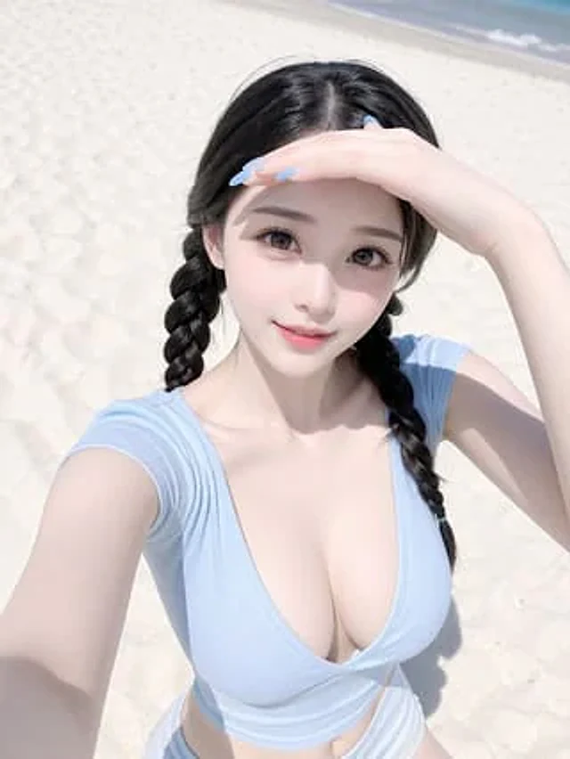

```text
A realistic, overhead selfie on the beach, showing a young woman standing on bright white sand under the strong midday sun. The photo is taken in portrait mode, framed from above her head to her upper thighs. She has {argument name="hair color" default="black"} Her hair was parted in the middle and tied into two long braids, hanging down on either side. Most of her face was obscured by her raised hand, shielding her eyes from the sun, creating an effortless and slightly mysterious atmosphere. She was wearing a {argument name="top color" default="pale baby blue"} A fitted ribbed deep V-neck short-sleeved crop top, revealing the waist.{argument name="bottom color" default="White"} She's wearing low-waisted bottoms. Her slender figure exudes a soft and captivating fashion photography quality. One arm is extended towards the camera for a selfie, while the other shields her forehead from the sun. The lighting is extremely bright, with soft, pastel tones, showcasing delicate skin highlights, soft shadows, and a clean, translucent summer aesthetic. The background is a minimalist beach, with faint glimpses of the coastline and seawater visible at the top edge; there are no other people, props, or buildings in the frame. The style should evoke a sophisticated social media beach selfie, featuring realistic skin texture, subtle retouching, soft pastel tones, high detail, a natural pose, and a summery atmosphere full of feminine charm and youthful vitality.
```

Model: GPT Image 2
Author: GPT Image 2 Prompts

[ProjectD](https://aitoolsradar.com/en/prompts/df4196b58f0a51) · [Recorded source](https://x.com/SprieCoding/status/2046854528394465429#reversed-0)
 · [Full original metadata and byte evidence](data/projectd-batch-0042.json)

## Pastel Blueberry Cake Anime Poster

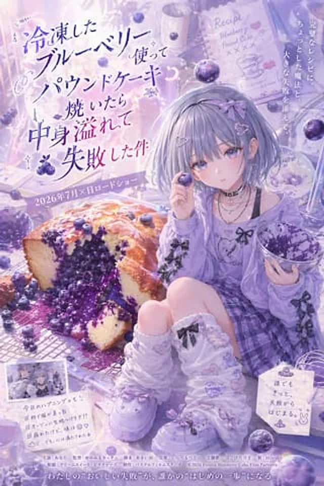

```text
A dreamy, pale purple illustration of a Japanese movie poster, rendered in a glossy, anime-style aesthetic, is imbued with the chaotic yet softly shimmering feel of blueberry desserts. In the image, a young girl sits on the floor of a cluttered kitchen or baking counter, sporting a short, silver-purple bob with side-swept bangs and a pale purple bow hair clip, dressed in quirky and adorable fashion. Her face is deliberately obscured by a centrally located square pale purple-gray veil. She wears an oversized, semi-transparent pale purple jacket with black ribbon trim on the cuffs, layered over a light purple printed top, adorned with silver necklaces, a purple plaid skirt, loose white slouch socks decorated with pale purple heart patches and black bows, and thick-soled pale purple sneakers with ribbon embellishments. She holds a blueberry to her lips in one hand and a metal mixing bowl smeared with vibrant purple blueberry batter in the other. Before her, a giant golden pound cake dramatically bursts open, spilling dark, glossy blueberries and purple filling onto a cooling rack and tabletop. Blueberries are scattered throughout the image, serving as props for both suspension and stillness, creating a whimsical sense of floating. Baking tools and notebooks are cluttered in the environment: in the upper right corner, there's a spiral notebook page with a blueberry pound cake recipe handwritten in English; in the lower right corner, there's an egg beater; in the lower left corner, there's a small pinned photo with two anime girls drawn on it; and in the lower right corner, there's a handwritten note with Japanese writing and a simple drawing of a rabbit. The overall color scheme uses monochromatic shades of lilac, violet, periwinkle blue, cream, and deep blueberry purple, complemented by bright highlights, soft mist, translucent layers, and romantic glitter. The poster features striking, large Japanese calligraphy text on the left half, arranged vertically and diagonally like a dramatic light novel or movie advertisement; a ribbon banner next to the cake reads "July 2026 Melody Show"; vertical text is on the right; a small credits list the production staff at the bottom; and a final tagline at the very bottom. The overall composition creates a sense of "cute disaster": beautiful yet failed baking, sweet melancholy, stylish messiness, and the tension of a movie poster.
```

Model: GPT Image 2
Author: GPT Image 2 Prompts

[ProjectD](https://aitoolsradar.com/en/prompts/832e6a2e5f8b58) · [Recorded source](https://x.com/_sengiu_/status/2047340744374145388#reversed-0)
 · [Full original metadata and byte evidence](data/projectd-batch-0042.json)

## Pastel Faceless Anime Floral Portrait

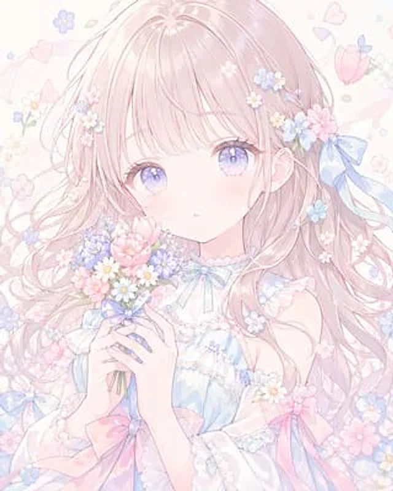

```text
A dreamy pastel anime portrait depicts a delicate young woman, framed from the chest up, placed at the center of a soft, ethereal image. She has very long, flowing, wavy hair.{argument name="hair color" default="light pink blush"} Her hair, with its bright highlights, dominates most of the image and blends seamlessly with the background. Her face is deliberately obscured by a centrally located, soft gray-pink solid rectangle, creating a faceless placeholder effect. She wears a romantic, off-the-shoulder dress with ruffles, pale blue, white, and pink accents, featuring lace trim, ruffles, satin texture, and an oversized ribbon bow; three striking bows are clearly visible: a large blue bow on her right side of her hair, a large pink bow near her left wrist, and a pink bow on her right shoulder sleeve. She gently holds a small bouquet of flowers to her chest; the bouquet contains miniature pastel flowers in pale blue, white, and pink, tied with a pale blue ribbon. Scattered flowers adorn her hair and clothing, while the background is filled with floating flowers, petals, tiny hearts, and subtle ribbon-like swirls, creating a soft, springtime fantasy atmosphere. It employs an extremely light, high-key color scheme, watercolor-style anime rendering, light lines, glossy hair, lace details, soft shadows, a clean illustration style, a vertical screen mobile wallpaper composition, super cute girly anime aesthetics, and a white and blush pink background to present an elegant and innocent artistic conception.
```

Model: GPT Image 2
Author: GPT Image 2 Prompts

[ProjectD](https://aitoolsradar.com/en/prompts/1e8f19f5edd4cc) · [Recorded source](https://x.com/hoshi122221/status/2046778370449661965#reversed-0)
 · [Full original metadata and byte evidence](data/projectd-batch-0042.json)

## Pastel Faceless Floral Anime Portrait

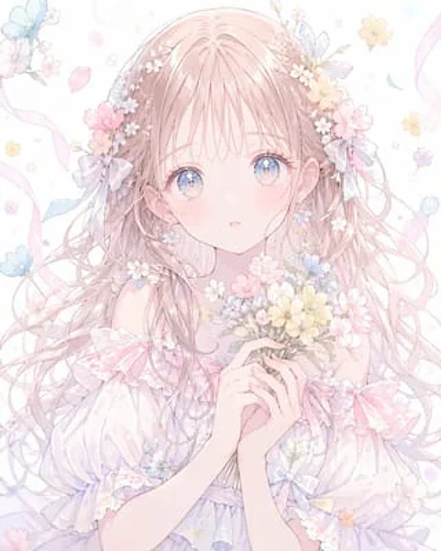

```text
A dreamy, soft-toned anime portrait depicting a person with{argument name="hair color" default="light pink blush"} A young woman with long, wavy hair. The image is a half-length portrait against a clean white background, adorned with scattered small flowers, petals, and soft, ribbon-like swirls. Her face is completely obscured by a centrally located, soft gray-pink vertical rectangle, creating a faceless placeholder effect. Her hair is decorated with two large, semi-transparent ribbon bows (one on each side), with numerous small flowers woven into her hair like a crown. She wears an off-the-shoulder, ruffled dress in extremely soft shades of white, lavender, and pink, featuring puff sleeves, lace trim, floral embellishments, and delicate bow details. She gently holds a small bouquet of flowers to her chest; the bouquet contains flowers in soft shades of pink, cream, white, and light blue. The composition is centered, elegant, and light, employing ultra-soft lines, watercolor-style shading, high detail, subtle shimmer, and a romantic, shoujo manga aesthetic. It utilizes a soft color palette, ethereal lighting, the subtle transparency of ribbons, and a vertical, poster-like composition.
```

Model: GPT Image 2
Author: GPT Image 2 Prompts

[ProjectD](https://aitoolsradar.com/en/prompts/bbde746d8be6dc) · [Recorded source](https://x.com/hoshi122221/status/2046778195928916356#reversed-0)
 · [Full original metadata and byte evidence](data/projectd-batch-0042.json)

## Pastel Idol Portrait with Neon Heart

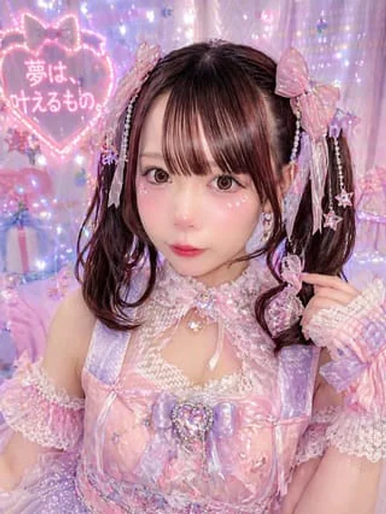

```text
A cute, Japanese idol-style half-body portrait of a girl against a super kawaii macaron-colored bedroom background, centered in the image. Her face is partially obscured by a large, solid rectangular matte gray-brown mask. She has medium-length, dark brown wavy pigtails adorned with two oversized transparent pink bows, pearl strands, ribbons, and two dangling star ornaments. She wears a gorgeous, dreamy kawaii (yume-kawaii) idol dress, with a main color scheme of {argument name="main colors" default="Pink and lavender"} Featuring glossy satin, lace trim, ruffled off-the-shoulder sleeves, sheer ruffles, beading, and delicate gemstone details, the piece is adorned with a large jeweled heart-shaped brooch at the chest. Underneath, a lace halter neckline is worn, adorned with a sparkling choker featuring tiny macaron-colored embellishments, a ribbon bow tied beside a strand of hair which she gently holds in one hand, and a matching ruffled wristband. The background is a dreamy and elaborately decorated kawaii room, filled with soft fairy lights, macaron-colored curtains, ribbons, bows, plush textures, and luminous decorations. On the left, a pink neon heart logo with a bow outline is added, containing Japanese text.{argument name="neon sign text" default="Dreams are meant to be fulfilled."} The photos utilize soft-focus lenses, flash highlights, pearlescent textures, warm pinkish-purple ambient lighting, bokeh, and vertical social media photo compositions. The overall atmosphere is sweet, dreamy, idol-centric, feminine, and richly detailed, resembling a macaron-colored fashion editorial shot in a beautifully decorated kawaii studio.
```

Model: GPT Image 2
Author: GPT Image 2 Prompts

[ProjectD](https://aitoolsradar.com/en/prompts/a41bc54ccfa12f) · [Recorded source](https://x.com/yayoi_bluebare/status/2047523370129035660#reversed-0)
 · [Full original metadata and byte evidence](data/projectd-batch-0042.json)

## Pastel Luxury Skincare Ad


```text
Create a vertical luxury skincare advertisement using soft, feminine pastel tones, similar in style to popular beauty ads on Instagram or TikTok, and without any app UI. The image should center on a glass dropper serum placed on a fluffy lavender-purple surface, photographed using hyper-realistic studio lighting, with warm golden sunlight streaming in from the upper left, accompanied by soft shadows, shimmering reflections, a dreamy mist effect, and a creamy blurred background. The bottle label should display {argument name="brand name" default="ELEGANT SKINCARE"} and{argument name="product name" default="SERUM"} The bottle is made of a translucent, pale pinkish-purple material, fitted with a shimmering rose gold dropper cap. An elegant, feminine vanity is arranged around the product: a round, gold-framed mirror on the left, a white lit candle in a glass jar on the right, a pearl necklace hanging in the lower left foreground, and four clusters of white baby's breath placed in the left foreground, the middle left foreground near the mirror, the right foreground, and the far right edge. Cute white and purple hand-drawn doodle decorations are added: curved arrows pointing to the serum, glitter, small hearts, short decorative strokes, and small circles scattered around the composition. Two paper notes are included: one on the left side of the bottle reads…{argument name="left note text" default="My daily glow secret!"} The bottom right corner has a sign that says{argument name="right note text" default="Feels amazing!"} Place a small, round, lavender-colored sticker that reads "MUST HAVE" on the right-hand sticky note. Use a striking, dark purple handwritten title text at the top.{argument name="headline text" default="Glowy Skin In A Bottle"} Below is a torn white tape-style strip with the following text:{argument name="tagline text" default="Nourish • Hydrate • Glow"} Add smaller, dark purple text "For Soft, Smooth &amp; Glowing Skin" to the upper right of the bottle, and repeat "For Soft, Smooth &amp; Glowing Skin" at the bottom center. Below that, write "Self care Everyday" in a lighter, softer white tone. Keep the design simple, sophisticated, comfortable, luminous, and aesthetically pleasing, ensuring the serum becomes the visual focus.
```

Model: GPT Image 2
Author: GPT Image 2 Prompts

[ProjectD](https://aitoolsradar.com/en/prompts/422b99c094047a) · [Recorded source](https://x.com/Naiknelofar788/status/2047645038147166555#reversed-1)
 · [Full original metadata and byte evidence](data/projectd-batch-0042.json)

## Pastel Pink and Silver Ornate Style Transfer


```text
Using REFERENCE_0, the image's aesthetic style was transformed into a highly refined, gorgeous fantasy style. The overall tone was changed from warm reds and blacks to {argument name="color palette" default="Soft pink, white and silver"} Transform the character's dark clothing into clothing with {argument name="clothing details" default="Pink floral embroidery and heavy silver filigree"} The luxurious white dress was replaced with delicate pink roses, white pearls, and silver embellishments. In the background, three prominent hanging lanterns were transformed {argument name="lantern style" default="Ornate white and pink lanterns with tassels"} .use{argument name="environment details" default="White and pink flowers and intricate silver architectural elements"} Cover the surrounding streets and buildings. Adjust the lighting to {argument name="lighting" default="Bright, soft, ethereal sunlight"} Preserve the original poses, facial expressions, and overall composition of the scene.
```

Model: GPT Image 2
Author: GPT Image 2 Prompts

[ProjectD](https://aitoolsradar.com/en/prompts/39b5e85e10c239) · [Recorded source](https://x.com/Tanemomi_Ver2/status/2044853185140142099#reversed-1)
 · [Full original metadata and byte evidence](data/projectd-batch-0042.json)

## Pastel Pink VTuber Stream Thumbnail

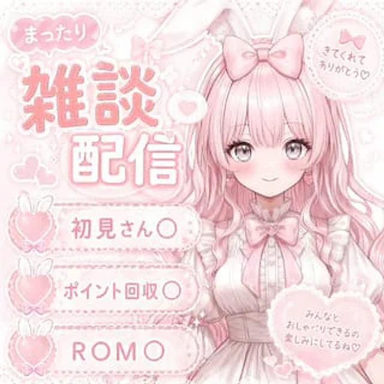

```text
{
  "type": "VTuber live stream cover",
  "theme": "pastel colors, soft and cute, lace, ribbons, hearts, and bunny elements.",
  "character": {
    "position": "Right side, bust",
    "appearance": "Anime girl,{argument name=\"hair color\" default=\"pink\"} Long, wavy hair, large gray eyes, blush, and pink heart-shaped earrings.",
    "accessories": "White bunny ears, with a big pink bow on her head.",
    "outfit": "A white ruffled dress with lace trim and a large pink bow with a heart-shaped gemstone at the neckline."
  },
  "layout": {
    "background": "A soft pink color with subtle shimmer, lace details, and floating hearts.",
    "text_elements": [
      {
        "type": "Main title",
        "position": "Top left corner",
        "style": "Large artistic pink text with white outline",
        "text": "{argument name=\"main title\" default=\"Casual chat stream\"}"
      },
      {
        "type": "speech bubbles",
        "position": "Above the main title",
        "text": "まったり"
      },
      {
        "type": "round badge",
        "position": "Top right corner",
        "details": "Lace trim with a small pink bow",
        "text": "きてくれてありがとう♡"
      },
      {
        "type": "Heart Badge",
        "position": "bottom right corner",
        "details": "Large lace-edged heart",
        "text": "I'm looking forward to chatting with everyone ♡"
      }
    ],
    "list_section": {
      "position": "bottom left corner",
      "count": 3,
      "style": "Horizontal capsule-shaped banners with lace trim, each banner featuring a pink heart with white bunny ears and a miniature bow on the left side.",
      "items": [
        "{argument name=\"list item 1\" default=\"First-time viewers welcome\"}",
        "{argument name=\"list item 2\" default=\"Points can be collected.\"}",
        "{argument name=\"list item 3\" default=\"ROM〇\"}"
      ]
    }
  }
}
```

Model: GPT Image 2
Author: GPT Image 2 Prompts

[ProjectD](https://aitoolsradar.com/en/prompts/333d11b63af708) · [Recorded source](https://x.com/sayaka_aiart/status/2046176145075515600#reversed-2)
 · [Full original metadata and byte evidence](data/projectd-batch-0042.json)

## Pastel Rainbow Portrait

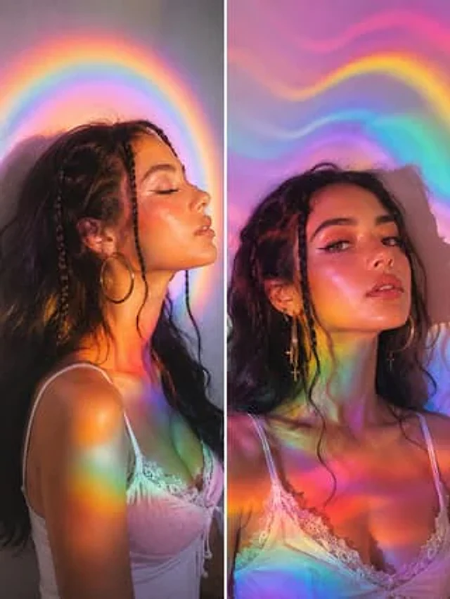

```text
Create a dreamy pastel editorial portrait of a young woman in side profile, facing right, with long wavy black hair styled with two thin braids framing her face. She wears large gold hoop earrings and a delicate white lace-trim camisole. Her eyes are closed with a peaceful, elegant expression. Her skin has a warm sun-kissed glow, subtle peach blush, glossy lips, long eyelashes, and tiny sparkling glitter accents around her cheek and temple. Behind her is a large glowing rainbow halo projected onto a soft gray wall, creating a beautiful circular spectrum of pastel pink, lavender, cyan, green, yellow, orange, and red light. Rainbow light falls naturally across her face, neck, shoulder, and chest, creating colorful cinematic reflections. Soft studio lighting, dreamy pastel atmosphere, ethereal beauty photography, realistic skin texture, warm highlights, subtle film grain, shallow depth of field, premium fashion editorial, highly photorealistic, vertical composition, 4:5 aspect ratio. Create a dreamy editorial portrait of a young woman with long wavy black hair styled with two thin braids framing her face. She wears large gold hoop earrings and a delicate white lace-trim camisole. She is shown in a close-up three-quarter profile, looking slightly upward and to the side with a soft, confident expression. Her face and upper body are illuminated by vivid rainbow light projections, creating flowing waves of pink, purple, blue, green, yellow, and orange across her skin, hair, and clothing. The same colorful abstract wave patterns continue across the neutral wall behind her, with a soft shadow of her profile cast onto the wall. Glossy natural skin, subtle luminous makeup, sharp winged eyeliner, long lashes, glossy lips, delicate dangling cross earrings. Dreamy 90s-inspired creative photography, soft diffused lighting, vibrant neon pastel colors, artistic projection photography, cinematic composition, realistic skin texture, shallow depth of field, high detail, fashion editorial aesthetic, vertical portrait, 4:5 aspect ratio.
```

Model: GPT Image 2
Author: James AI

[ProjectD](https://aitoolsradar.com/en/prompts/7815be62a2e34d) · [Recorded source](https://youmind.com/prompts/pastel-rainbow-editorial-portrait-31787)
 · [Full original metadata and byte evidence](data/projectd-batch-0042.json)

## Pastel Running App UI with Sloth Mascot


```text
{
  "type": "Mobile fitness app UI model",
  "style": "A clean and modern pastel app design, featuring soft beige and warm white surfaces accented with delicate sage green, rounded cards and buttons, subtle shadows, slender minimalist icons, a friendly and playful brand identity with a sloth mascot, and a Dribbble-style dark brown dotted background.",
  "theme": "Running tracking app",
  "layout": {
    "device_count": 3,
    "arrangement": "Three elongated smartphone screens side by side, evenly spaced, frontal view.",
    "background": "Very dark brown with a faint, uniform dot grid pattern.",
    "screens": [
      {
        "position": "Left side",
        "screen_type": "Home Dashboard",
        "header": {
          "greeting": "Good morning, runners! 👋",
          "left_icon": "none",
          "right_icon": "Notification bell"
        },
        "hero_card": {
          "headline": "Ready for a wonderful day?",
          "subcard_text_line_1": "Every step forward is a victory.",
          "subcard_text_line_2": "Let's make every moment meaningful. 🌱",
          "illustration": "An adorable sloth, wearing a cream-colored headband and a mint green tracksuit, stands on the right side of the card and waves."
        },
        "sections": [
          {
            "title": "This week",
            "position": "Upper-middle",
            "count": 3,
            "labels": [
              "Number of runs",
              "distance",
              "time"
            ],
            "values": [
              "3",
              "12.6 km",
              "1 hour 45 minutes"
            ],
            "presentation": "A single rounded-corner statistics card containing three columns of equal-width content and a light green circular icon."
          },
          {
            "title": "Next goal",
            "position": "Middle to lower",
            "count": 1,
            "labels": [
              "20 kilometers this month"
            ],
            "values": [
              "63%"
            ],
            "presentation": "Rounded corner progress card with a green progress bar and a small illustration of a sloth waving on the right."
          },
          {
            "title": "Recent Activities",
            "position": "bottom",
            "count": 1,
            "labels": [
              "Recent Activities"
            ],
            "presentation": "The top edge of the other rounded card is visible, but it is obscured by the bottom navigation bar."
          }
        ],
        "bottom_nav": {
          "count": 4,
          "labels": [
            "front page",
            "running",
            "schedule",
            "Personal information"
          ],
          "active": "front page"
        }
      },
      {
        "position": "middle",
        "screen_type": "Running Summary",
        "header": {
          "left_icon": "Return arrow",
          "center_text": "Well done!",
          "subtext": "You did it! Time to celebrate! 🎉",
          "right_icon": "share"
        },
        "hero_illustration": "An adorable sloth, wearing a headband, a mint green tracksuit, and a gold medal, raises its arms in celebration.",
        "stats_row": {
          "count": 3,
          "labels": [
            "distance",
            "time",
            "pace"
          ],
          "values": [
            "5.00 km",
            "32:15",
            "6:27"
          ],
          "presentation": "Three rounded-corner statistical capsules"
        },
        "achievement_card": {
          "count": 1,
          "title": "A new personal best! 🌟",
          "subtitle": "You were 1 minute and 12 seconds faster than last time you covered 5 kilometers.",
          "icon": "Small gold medal badge"
        },
        "table_section": {
          "title": "Segmentation",
          "count": 2,
          "columns": [
            "kilometer",
            "pace",
            "time"
          ],
          "rows": [
            [
              "1",
              "6:35",
              "6:35"
            ],
            [
              "2",
              "6:23",
              "12:58"
            ]
          ],
          "presentation": "Rounded white form cards with light-colored dividing lines"
        }
      },
      {
        "position": "right side",
        "screen_type": "Setting running goals",
        "header": {
          "left_icon": "Close X",
          "center_text": "Let's start running!",
          "subtext": "You can do it. We'll take it slow. 🦥",
          "right_icon": "Set gears"
        },
        "goal_visual": {
          "type": "Circular progress selector",
          "top_label": "Select target",
          "main_value": "5.00",
          "unit": "kilometer",
          "ring": "Bold sage green arc on a light beige ring",
          "illustration": "A little sloth stretching out in the upper right corner of the circle"
        },
        "goal_options": {
          "count": 4,
          "labels": [
            "2 kilometers",
            "5 kilometers",
            "10 kilometers",
            "Half Marathon"
          ],
          "active": "5 kilometers"
        },
        "primary_cta": {
          "label": "Start running",
          "style": "Large rounded sage green button"
        },
        "secondary_action": {
          "label": "Track only",
          "icon": "Location marker"
        },
        "bottom_nav": {
          "count": 4,
          "labels": [
            "front page",
            "running",
            "schedule",
            "Personal information"
          ],
          "active": "running"
        }
      }
    ]
  }
}
```

Model: GPT Image 2
Author: GPT Image 2 Prompts

[ProjectD](https://aitoolsradar.com/en/prompts/061f2c04d5b9d0) · [Recorded source](https://x.com/mattiapomelli/status/2047614998575542468#reversed-0)
 · [Full original metadata and byte evidence](data/projectd-batch-0042.json)

## Pastel Teen Character Design Sheet


```text
{
  "type": "Advanced Character Card",
  "style": "The character designs are simple and stylish, featuring photorealistic studio catalog aesthetics, soft and even lighting, minimalist shadows, a soft gray background, white fine-line panel divisions, and an exquisite single canvas layout.",
  "subject": {
    "gender_presentation": "girl",
    "age_appearance": "teenager",
    "identity": "The face was deliberately blurred and weakened.",
    "hair": {
      "color": "Dark brown",
      "style": "Long hair parted in the middle, braided into two braids."
    },
    "outfit": {
      "count": 5,
      "pieces": [
        "Oversized light purple hoodie with drawstring and kangaroo pocket",
        "White short pleated skirt visible under the hoodie hem",
        "White mid-calf socks",
        "Platform white sneakers",
        "No obvious jewelry"
      ]
    },
    "overall_look": "Cute and casual light-colored street style, a soft and youthful look."
  },
  "layout": {
    "sections": [
      {
        "title": "Three views",
        "position": "left half",
        "count": 4,
        "labels": [
          "Front view",
          "Rear view",
          "Side profile",
          "Action posture"
        ],
        "details": "The full-body character is displayed in four separate vertical panels: standing upright with arms relaxed; standing upright with back view; standing naturally in the side; and in a playful pose with one leg bent back and the body slightly turned towards the camera."
      },
      {
        "title": "Facial expressions",
        "position": "Top right corner",
        "count": 5,
        "labels": [
          "neutral",
          "angry",
          "happy",
          "sad",
          "Focus"
        ],
        "details": "Five compact head and shoulder portraits are arranged horizontally, with matching hairstyles and hoodies, subtle changes in expression, and slight blurring of the facial areas."
      },
      {
        "title": "Accessories",
        "position": "bottom right corner",
        "count": 5,
        "labels": [
          "light purple backpack",
          "White smartphone",
          "light purple hair tie",
          "White headphones",
          "Light purple portable camera"
        ],
        "details": "The accessories are evenly distributed on a gray background, resembling product silhouettes."
      }
    ],
    "centerpiece": "4. The full-body clothing display occupies the main position in the composition."
  },
  "color_palette": {
    "count": 4,
    "colors": [
      "light purple",
      "White",
      "Soft gray",
      "Dark brown"
    ]
  },
  "prompt": "Create a single-canvas advanced character card for use.{argument name=\"character name\" default=\"First Place Girl\"} It employs a photorealistic studio fashion design style, showcasing a cohesive young woman, with {argument name=\"hair color\" default=\"Dark brown\"} Double braids hairstyle, wearing an oversized outfit{argument name=\"hoodie color\" default=\"light purple\"} Hoodie, white cropped pleated skirt, white mid-calf socks, and chunky white sneakers. A clean gray background is used, accented with thin white dividing lines and a neat panel layout. The left half contains four full-body display panels labeled FRONT VIEW, BACK VIEW, SIDE PROFILE, and ACTION POSE. The upper right corner features five head expression panels labeled NEUTRAL, ANGRY, HAPPY, SAD, and FOCUSED. The lower right corner includes five horizontally arranged accessories: a light purple backpack, a white smartphone, a light purple hair tie, white headphones, and a light purple compact camera. The lighting is kept soft and even, the composition symmetrical and professional, emphasizing 100% character consistency across all views. A minimalist, pastel aesthetic is maintained, and {argument name=\"background color\" default=\"Soft gray\"} As background."
}
```

Model: GPT Image 2
Author: GPT Image 2 Prompts

[ProjectD](https://aitoolsradar.com/en/prompts/60c8f0d5adf228) · [Recorded source](https://x.com/johnAGI168/status/2046841289291821458#reversed-0)
 · [Full original metadata and byte evidence](data/projectd-batch-0042.json)

## Pastel Teen Character Design Sheet

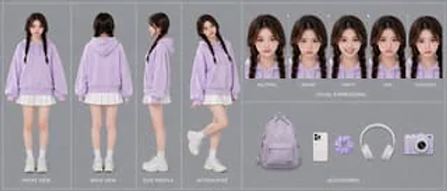

```text
{"type":"advanced character card","style":"clean fashion character design sheet, photorealistic studio catalog aesthetic, soft even lighting, minimal shadows, muted gray background, thin white panel dividers, polished single-canvas layout","subject":{"gender_presentation":"teen girl","age_appearance":"young teenager","identity":"face intentionally obscured and de-emphasized","hair":{"color":"dark brown","style":"center-parted long hair in two braids"},"outfit":{"count":5,"pieces":["oversized pastel lavender hoodie with drawstrings and kangaroo pocket","short white pleated skirt visible below hoodie hem","white crew socks","chunky white sneakers","no visible jewelry"]},"overall_look":"cute casual pastel streetwear, soft youthful styling"},"layout":{"sections":[{"title":"turnaround views","position":"left half","count":4,"labels":["FRONT VIEW","BACK VIEW","SIDE PROFILE","ACTION POSE"],"details":"full-body character shown in four separate vertical panels; front standing straight with arms relaxed, back standing straight, side profile standing neutrally, and playful action pose with one leg bent backward and body turned slightly toward camera"},{"title":"FACIAL EXPRESSIONS","position":"top right","count":5,"labels":["NEUTRAL","ANGRY","HAPPY","SAD","FOCUSED"],"details":"five tightly cropped head-and-shoulders portraits in a horizontal row, each with the same hairstyle and hoodie, subtle expression changes, face area softly blurred"},{"title":"ACCESSORIES","position":"bottom right","count":5,"labels":["lavender backpack","white smartphone","lavender scrunchie","white over-ear headphones","lavender compact camera"],"details":"accessories evenly spaced on gray background like product cutouts"}],"centerpiece":"the 4-view full-body outfit turnaround dominates the composition"},"color_palette":{"count":4,"colors":["pastel lavender","white","soft gray","dark brown"]},"prompt":"Create a single-canvas advanced character card for {argument name=\"character name\" default=\"a teen girl\"} in a photorealistic studio fashion-sheet style. Show a consistent young girl with {argument name=\"hair color\" default=\"dark brown\"} hair in two braids, wearing an oversized {argument name=\"hoodie color\" default=\"pastel lavender\"} hoodie, a short white pleated skirt, white crew socks, and chunky white sneakers. Use a clean gray background with thin white dividers and neatly organized panels. On the left half, include 4 full-body turnaround panels labeled FRONT VIEW, BACK VIEW, SIDE PROFILE, and ACTION POSE. On the top right, include 5 headshot expression panels labeled NEUTRAL, ANGRY, HAPPY, SAD, and FOCUSED. On the bottom right, include 5 accessory items arranged horizontally: a lavender backpack, a white smartphone, a lavender scrunchie, white over-ear headphones, and a lavender compact camera. Keep lighting soft and even, composition symmetrical and professional, emphasizing 100% character consistency across all views. Preserve the minimal pastel aesthetic and use {argument name=\"background color\" default=\"soft gray\"} as the backdrop."}
```

Model: GPT Image 2
Author: John

[ProjectD](https://aitoolsradar.com/en/prompts/259366edd8c500) · [Recorded source](https://youmind.com/prompts/pastel-teen-character-sheet-15084)
 · [Full original metadata and byte evidence](data/projectd-batch-0042.json)

## Peach Garden Oath Cinematic Scene

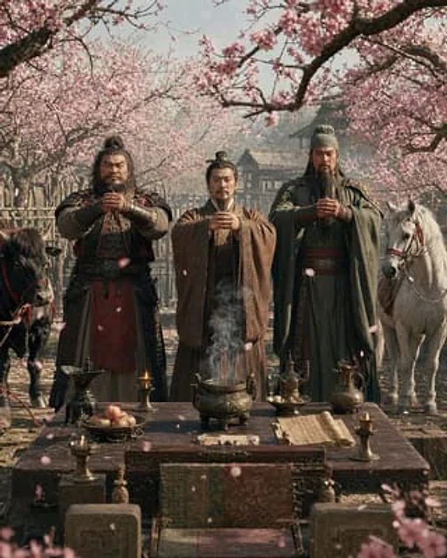

```text
A cinematic historical scene from "Romance of the Three Kingdoms" showcases {argument name="scene name" default="Oath of the Peach Garden"} Three ancient Chinese men stood side-by-side behind an altar table amidst a grove of blooming pink peach blossoms, each bowing with clasped hands in a gesture of respect. The man on the left was robust and imposing, clad in dark lamellar armor over a deep red robe, his appearance rugged and dignified. The man in the middle was shorter and thinner, wearing a multi-layered brown civil official's robe with a simple topknot. The man on the right was tall and imposing, wearing a flowing dark green robe with armor details, and sporting a long black beard, exuding an air of grandeur. Before them was a large, carved wooden altar table, upon which were placed ten ritual items: a bronze incense burner in the center, with three lit incense sticks swirling in the smoke; four small lit candles in the corner; a fruit platter containing peaches; a wine pot on the left; two bronze wine vessels on the right; and a scroll of bamboo slips spread out on the table. Pink petals drifted down from the air, scattering across the ground. The peach blossoms overhead form a tunnel of flowers, while in the background, rustic wooden fences and traditional buildings are faintly visible through the spring mist. Two horses are positioned on either side of the image: a black horse on the far left and a white horse on the far right, both saddled and serene. The composition is symmetrical, with a level perspective, centering on the oath-taking ceremony. It presents a rich sense of the era, realistic facial features and fabric textures, soft natural morning light, shallow depth of field, and a cinematic realism reminiscent of an epic historical drama.
```

Model: GPT Image 2
Author: GPT Image 2 Prompts

[ProjectD](https://aitoolsradar.com/en/prompts/423fa01eb444e9) · [Recorded source](https://x.com/Saccc_c/status/2047211498838352177#reversed-1)
 · [Full original metadata and byte evidence](data/projectd-batch-0042.json)

## Penguin Martial Arts Dojo Duel

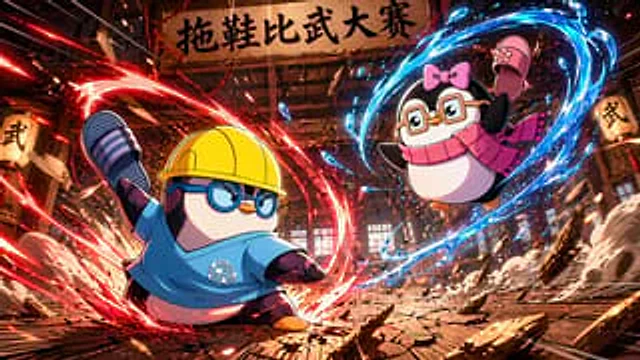

```text
A highly dynamic anime illustration depicting{argument name="first character" default="penguin"} With another{argument name="second character" default="penguin"} A martial arts duel takes place inside a traditional wooden martial arts hall. In the foreground, a creature with the appearance of {argument name="character one description" default="Reference image 1"} The penguin assumed a powerful, low-stance martial arts pose, holding a slipper and ready to retaliate, dressed in {argument name="character one outfit" default="Reference image 1"} It was surrounded by powerful red energy slashes erupting from its limbs. In mid-air to its right, a creature with the shape of {argument name="character two description" default="Reference image 2"} The penguins leaped gracefully and confidently, adorned with {argument name="character two outfit" default="Reference image 2"} Accompanied by a sweeping blue, water-like energy trail, someone, also holding a slipper, prepares to retaliate. The background is the interior of an ancient wooden temple, where a prominent sign hangs, reading "..."{argument name="sign text" default="Slipper Wushu Championship"} The scene is filled with explosive action, flying dust, shattered wooden floors, glowing colored particle effects, and dramatic low-angle lighting that perfectly distinguishes the characters from the detailed background. Keep their foot shapes unchanged. Set the aspect ratio to 16:9.
```

Model: GPT Image 2
Author: GPT Image 2 Prompts

[ProjectD](https://aitoolsradar.com/en/prompts/269f3037e159f9) · [Recorded source](https://x.com/swiftie_hp/status/2047281260159242663)
 · [Full original metadata and byte evidence](data/projectd-batch-0042.json)

## Penguin on a Carnival Roller Coaster

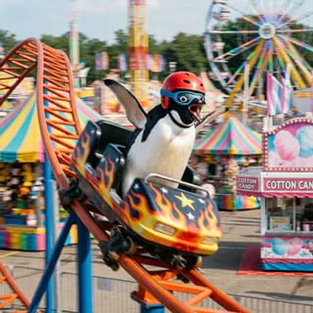

```text
A whimsical and realistic motion capture photo shows a penguin riding a carnival roller coaster in broad daylight. The penguin, centered in the frame, boasts a sleek black-and-white body, a bright red safety helmet, and blue surround-style goggles. Its beak is wide open, as if screaming with excitement, and its flippers are outstretched, clearly enjoying the ride. The roller coaster car is small and glossy black, with vibrant yellow-orange flame patterns painted on its sides, and a silver safety bar at the front. The car is plunging down a bright orange track in the foreground and left of the frame, creating a strong sense of dynamism and energy. The background showcases a colorful rural market, including rainbow-striped tents, a large Ferris wheel lit up with colorful lights, towering amusement rides, and a pink cotton candy stall with a prominent "COTTON CANDY" sign. A shallow depth of field effect is used, with a slight motion blur in the background to emphasize the sense of speed while keeping the penguin and roller coaster car sharp and clear. The colors are bright and saturated, full of surreal humor, the composition is dynamic, presenting the atmosphere of a sunny outdoor playground, and the details are rich, with a cinematic realism.
```

Model: GPT Image 2
Author: GPT Image 2 Prompts

[ProjectD](https://aitoolsradar.com/en/prompts/7e16eb51217050) · [Recorded source](https://x.com/sandor_bal6746/status/2047761315054174614#reversed-0)
 · [Full original metadata and byte evidence](data/projectd-batch-0042.json)

## Penguin Roller Coaster Ride


```text
A comical and vibrant realistic amusement park scene, the camera panning from {argument name="animal" default="penguin"} Shot from directly behind, it sits alone in the front row of the roller coaster. The animal is in the center of the frame, its flippers excitedly raised, wearing bright {argument name="helmet color" default="Orange-red"} Safety helmets and blue goggles. The roller coaster car is bright red with yellow side panels, and black safety bars are visible in the foreground. The camera angles are tight and immersive, as if you're sitting behind the rider, looking forward over their back. The background showcases a colorful, seaside-style carnival, bathed in strong sunlight, with a large Ferris wheel on the left, a rotating swing near the upper right, and two striped circus tents on the right. The background uses dramatic motion blur and radial stripes to emphasize speed, while the rider and roller coaster car remain relatively sharp. Bright skies, vibrant and saturated colors, playful absurd humor, theme park excitement, sharp animal feather details, and cinematic action photography.
```

Model: GPT Image 2
Author: GPT Image 2 Prompts

[ProjectD](https://aitoolsradar.com/en/prompts/8996b82e865c03) · [Recorded source](https://x.com/sandor_bal6746/status/2047761315054174614#reversed-1)
 · [Full original metadata and byte evidence](data/projectd-batch-0042.json)

## Pepsi Infographic Advertisement


```text
A high-end infographic-style visual work showcasing the placement of{argument name="subject" default="young women"} The extra-large size next to me{argument name="brand" default="Pepsi"} The can. The can's proportions are magnified to almost the size of her entire seated body, creating a striking, surreal sense of scale. The woman leans casually against the enormous can, one arm draped over it, interacting naturally with the object. Her face must be highly consistent with the provided reference image, including accurate facial structure, skin tone, hairstyle, and expression—refined, realistic, and visually appealing. The Pepsi can is incredibly detailed, featuring a clear brand logo, condensation droplets, realistic reflections, and a metallic texture. The logo is clear, sharp, and well-proportioned. The composition is modern and minimalist, with backgrounds set in a clean photo studio or soft gradient colors. Subtle infographic-style elements are incorporated, such as thin line markings, minimalist labels, or highlights like "..."{argument name="feature" default="refreshing"} Labels should describe characteristics such as "carbonated" or "icy texture," but should remain elegant and uncluttered. Soft studio lighting with controlled highlights and shadows creates a high-end advertising feel. Models wear simple, modern clothing that complements the red, white, and blue colors of the can. Color gradation is clear and slightly vibrant, achieving a commercial advertising aesthetic. The composition is balanced, with sharp focus and a slight depth of field to enhance realism. Style: High-end product infographic, commercial beverage advertisement, clean UI style labeling. Resolution: Ultra-high resolution, 4K, high detail, photorealistic, 85mm lens, f/2.8 hyperrealistic, studio quality, no distortion, accurate proportions, clear typography, modern layout.
```

Model: GPT Image 2
Author: GPT Image 2 Prompts

[ProjectD](https://aitoolsradar.com/en/prompts/dc701f78dbaf04) · [Recorded source](https://x.com/mehvishs25/status/2047829613502754919)
 · [Full original metadata and byte evidence](data/projectd-batch-0042.json)

## Pepsi Infographic Advertisement

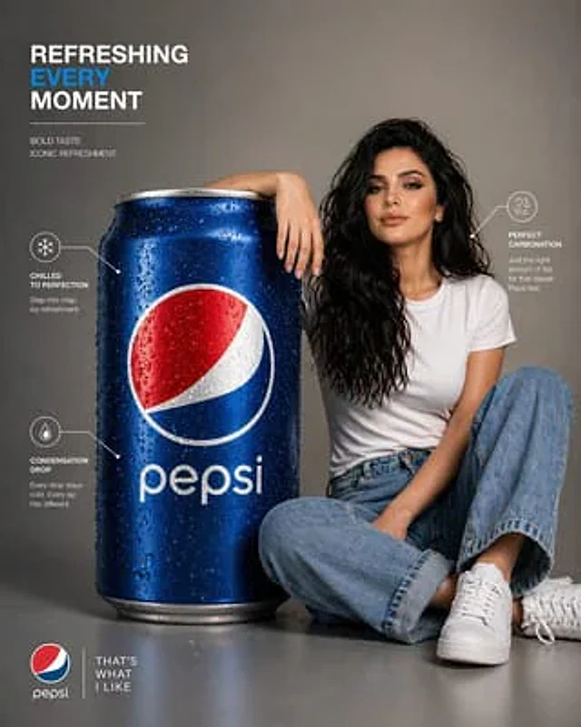

```text
A premium infographic-style visual featuring an oversized {argument name="brand" default="Pepsi"} can placed beside a {argument name="subject" default="young woman"}. The can is scaled to be nearly the same size as her entire seated body, creating a striking, surreal proportion. The woman sits casually leaning against the giant can, one arm resting on it, interacting naturally with the object. Her face must closely match the provided reference image, accurate facial structure, skin tone, hairstyle, and expression — polished, realistic, and visually appealing. The Pepsi can is ultra-detailed with crisp branding, condensation droplets, realistic reflections, and metallic texture. The logo is clean, sharp, and properly proportioned. Composition is modern and minimal, set in a clean studio or soft gradient background. Include subtle infographic-style elements such as thin annotation lines, minimal labels, or callouts highlighting features like “{argument name="feature" default="refreshment"},” “carbonation,” or “chilled texture,” but keep it elegant and uncluttered. Lighting is soft studio lighting with controlled highlights and shadows, giving a premium advertising look. The model is styled in minimal, contemporary clothing that complements the red, white, and blue tones of the can. Color grading is crisp and slightly vibrant, with a commercial ad aesthetic. Balanced composition, sharp focus, slight depth of field for realism. Style: high-end product infographic, commercial beverage advertisement, clean UI-inspired annotations Resolution: ultra high resolution, 4K, highly detailed, photorealistic 85mm lens, f/2.8 hyper-realistic, studio quality no distortion, correct proportions clean typography, modern layout
```

Model: GPT Image 2
Author: Meem

[ProjectD](https://aitoolsradar.com/en/prompts/79daff0244928f) · [Recorded source](https://youmind.com/prompts/giant-pepsi-can-infographic-15887)
 · [Full original metadata and byte evidence](data/projectd-batch-0042.json)

## Pepsi Vending Machine Ad

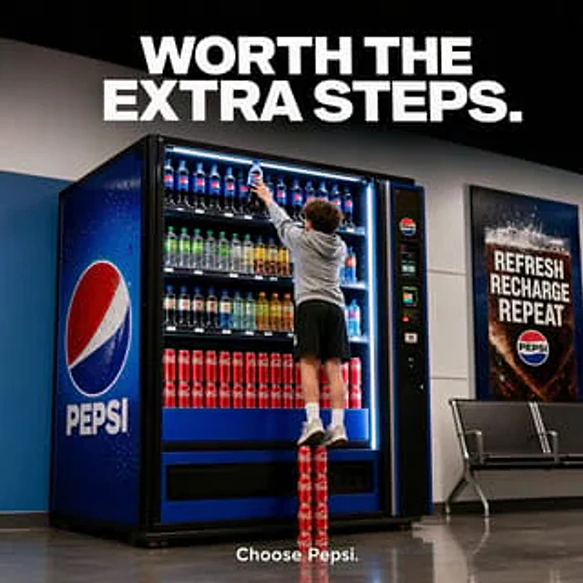

```text
A sophisticated commercial photograph, set against the backdrop of a modern transportation hub or public waiting area, is shot from a frontal, slightly low angle. On the left and in the center of the frame is a giant, illuminated Pepsi vending machine. A young man in a light gray hoodie, black athletic shorts, white mid-calf socks, and white sneakers, with his back to the camera, stretches upwards, attempting to grab a bottle of Pepsi from the top shelf. He stands precariously on four red Coca-Cola cans stacked vertically on the floor, a visually humorous gesture conveying the message that "it's worth the extra steps for Pepsi." The vending machine has ample shelves, with bright, cool white lighting inside: the top shelf displays multiple bottles of Pepsi, the middle shelf showcases various clear, green, yellow, and amber bottled beverages, and the bottom shelf holds rows of red Coca-Cola cans. The vending machine is Pepsi blue, with a large Pepsi globe logo and the word "PEPSI" printed on the left panel, and a payment/control panel on the right. At the top of the image is a large, bold, white sans-serif headline.{argument name="headline text" default="WORTH THE EXTRA STEPS."} Center it on the dark-colored upper wall. Add a simple white sans-serif brand tagline at the bottom center.{argument name="tagline text" default="Choose Pepsi."} On the right wall hangs a framed Pepsi poster with the bold, stacked text "REFRESH RECHARGE REPEAT" and the Pepsi logo printed above it. A simple metal bench sits below the poster. The image employs a bright, reflective surface, sharp focus, a high-quality advertising photography feel, realistic proportions, high dynamic range, and a brand-safe composition that creates a strong contrast between Pepsi blue, Coca-Cola red, and neutral gray.
```

Model: GPT Image 2
Author: GPT Image 2 Prompts

[ProjectD](https://aitoolsradar.com/en/prompts/56eba0bc60a62a) · [Recorded source](https://x.com/Jouhatsu_ai/status/2046966863125529042#reversed-0)
 · [Full original metadata and byte evidence](data/projectd-batch-0042.json)

## Perfume Bottle in Cubic Light Shafts


```text
A faceted rectangular glass perfume bottle filled with pale amber liquid, standing on a dark matte surface against a pure black background. Three crisp cubic shafts of warm white light cut diagonally across the bottle, producing hard-edge reflections on the glass facets and sharp highlights on the gold metal cap. No label, no brand text, no watermark. Square 1:1 hero composition, luxury product photography, photorealistic glass refractions, ultra detailed.
```

Model: GPT Image 2
Author: @hiapi_ai

[ProjectD](https://aitoolsradar.com/en/prompts/0561d4476a5e5a) · [Recorded source](https://github.com/HiAPIAI/awesome-gpt-image-2-prompts)
 · [Full original metadata and byte evidence](data/projectd-batch-0042.json)

## Persona5 Character Reference Card

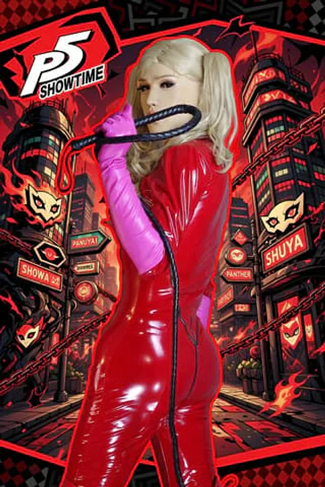

```text
基于此角色和背景，请制作一份类似官方设定资料的角色资料卡。
・包含三视图：正面、侧面和背面
・添加角色面部表情的变化・分解并展示服装和装备的详细部分
・添加色板・包含世界观设定的简要说明
・总体上，使用有组织的布局（白色背景，插画风格）高分辨率、专业概念艺术风格
```

Model: GPT Image 2
Author: @iamrednightS

[ProjectD](https://aitoolsradar.com/en/prompts/2512b57158c501) · [Recorded source](https://x.com/iamrednightS/status/2045075682837836265)
 · [Full original metadata and byte evidence](data/projectd-batch-0042.json)

## Personalized Minecraft Skin Prompt

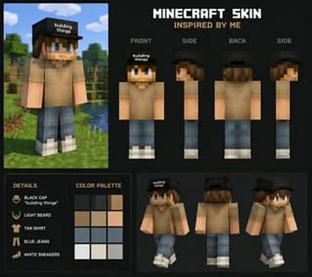

```text
Create a subject{argument name="reference" default="my look"} Inspired Minecraft Skins
```

Model: GPT Image 2
Author: GPT Image 2 Prompts

[ProjectD](https://aitoolsradar.com/en/prompts/6af4e4607c1ec2) · [Recorded source](https://x.com/nicdunz/status/2046255350228058613)
 · [Full original metadata and byte evidence](data/projectd-batch-0042.json)

## Personalized Pop-Up Fairy Tale Book

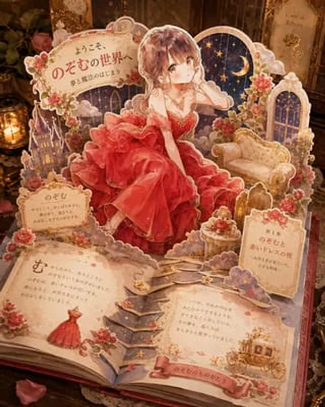

```text
Goal: Create an ornate 3D pop-up storybook scene where {argument name="character name" default="Nozomu"} appears to leap out of an open fairy-tale book, as if a custom character illustration has become a luxurious paper craft diorama.

Canvas: Square composition, warm cinematic close-up view from slightly above, centered on an open book resting on a dark antique wooden desk. Use shallow depth of field, glowing candlelight, amber highlights, soft shadows, and a magical vintage atmosphere.

Main subject: A beautiful anime-style young woman in an extravagant {argument name="dress color" default="deep red"} ball gown sits/steps forward from the pop-up pages. She has long softly curled brown hair, delicate jewelry, bare shoulders, lace gloves, and layered translucent ruffles with gold sparkles. Her face should be intentionally covered by a soft square blur/mosaic privacy mask while the rest of the illustration remains sharp and detailed.

Pop-up book structure: Build the scene from layered cut-paper pieces with thick white paper edges, scalloped borders, tabs, folds, and dimensional shadows. Include exactly 8 major pop-up elements: 1 large central character cutout, 1 curved title sign at the upper left, 1 moon-and-stars night-sky arch behind the character, 1 cream vintage sofa on the right, 1 tall arched window on the far right, 1 small purple castle on the left, 1 ornate chapter placard on the lower right, and 1 central folded stair/path bridge rising from the open pages toward the character.

Decorative details: Use abundant roses, vines, tiny stars, clouds, gold filigree, ribbons, lace-like paper trims, and scattered rose petals. Surround the book with antique props including candles, a clock, dark floral decor, and gilded frames, all blurred slightly in the background.

Text content: Use elegant Japanese storybook typography printed directly on the paper. The upper-left title sign should read 「ようこそ、のぞむの世界へ」 with the subtitle 「夢と魔法のはじまり」. Add exactly 4 readable story text areas: 1 small name plaque on the left reading 「のぞむ」, 1 large left-page story panel, 1 right-page story panel, and 1 lower-right chapter card reading 「第1章 のぞむと赤いドレスの夜」. Add a bottom ribbon label reading 「のぞむのものがたり」. Keep the Japanese text decorative and believable, not overly crisp.

Style: Highly detailed anime illustration mixed with realistic handcrafted pop-up book photography, romantic princess fantasy, rococo ornamentation, warm beige parchment paper, deep reds, gold accents, dusky purple night sky, magical sparkles, premium children’s picture-book aesthetic.

Constraints: The open book must be the main object, not a flat poster. Maintain strong 3D paper depth and visible layered construction. Do not add extra characters. Do not include watermarks, logos, modern objects, or English text.
```

Model: GPT Image 2
Author: のぞむ＊AIイラスト

[ProjectD](https://aitoolsradar.com/en/prompts/072e4cff4c93e2) · [Recorded source](https://youmind.com/prompts/personalized-pop-up-storybook-19316)
 · [Full original metadata and byte evidence](data/projectd-batch-0042.json)

## Personalized VTuber Avatar Prompt


```text
Based on our previous conversation, create a design that suits my personal style.{argument name="character type" default="VTuber"} image.
```

Model: GPT Image 2
Author: GPT Image 2 Prompts

[ProjectD](https://aitoolsradar.com/en/prompts/774d9d8f6c0b7a) · [Recorded source](https://x.com/gomdanjp/status/2047745770271781351)
 · [Full original metadata and byte evidence](data/projectd-batch-0042.json)

## Pet Brand Identity System Board

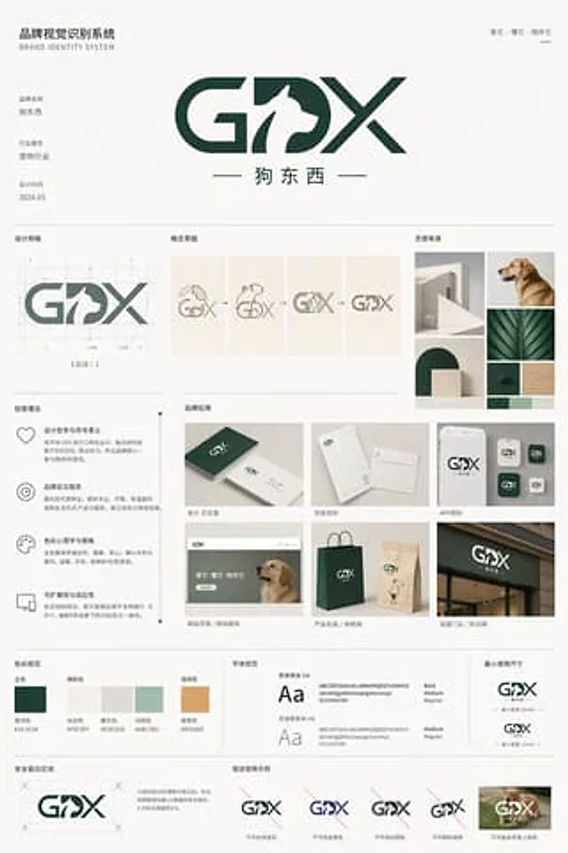

```text
{
  "type": "Brand Visual Identity System Project",
  "brand": {
    "name": "{argument name=\"brand name\" default=\"dog\"}",
    "english_mark": "{argument name=\"logo letters\" default=\"GDX\"}",
    "industry": "{argument name=\"industry\" default=\"pet industry\"}",
    "date": "{argument name=\"date\" default=\"2024.05\"}",
    "tagline": "Love it, understand it, accompany it."
  },
  "style": {
    "overall": "The minimalist, high-end corporate display style features a clean Swiss-inspired layout, ample white space, light gray dividing lines, and a soft, neutral background.",
    "palette": "Deep forest green and warm off-white, accented with a few accent color blocks.",
    "mood": "Modern, trustworthy, pet-friendly, sophisticated"
  },
  "canvas": {
    "aspect_ratio": "3:4 Vertical Version",
    "background": "Soft warm white"
  },
  "header": {
    "left_title_cn": "Brand visual identity system",
    "left_title_en": "BRAND IDENTITY SYSTEM",
    "right_tagline": "Love it, understand it, accompany it.",
    "center_logo": "A large, custom-designed GDX lettering, featuring a white dog silhouette in the center, written in bold geometric curves and diagonal strokes, in a dark green color.",
    "center_subtitle": "dog"
  },
  "layout": {
    "sections": [
      {
        "title": "Basic Information",
        "position": "Top left",
        "count": 3,
        "labels": [
          "Brand Name",
          "Industry attributes",
          "Design time"
        ]
      },
      {
        "title": "Design grid",
        "position": "Middle left top",
        "count": 1,
        "labels": [
          "A logo with a scale of 1.618:1 is constructed using a grid."
        ]
      },
      {
        "title": "Concept sketch",
        "position": "Upper-middle",
        "count": 4,
        "labels": [
          "Dog head and letter sketch",
          "Contour optimization",
          "Intermediate combination marker",
          "Final simplified tag"
        ]
      },
      {
        "title": "Inspiration",
        "position": "Middle right top",
        "count": 6,
        "labels": [
          "Minimalist white architectural arch",
          "Golden Retriever side profile",
          "Curved arch combination",
          "Close-up of green leaves",
          "Dark green material cube",
          "Light-colored wood grain squares"
        ]
      },
      {
        "title": "Creative concept",
        "position": "center left",
        "count": 4,
        "labels": [
          "Design Philosophy and Symbolic Meaning",
          "Brand positioning services",
          "Color Psychology and Strategies",
          "Scalability and Adaptability"
        ]
      },
      {
        "title": "Brand Application",
        "position": "From center to right",
        "count": 7,
        "labels": [
          "front and back of the business card",
          "letter paper and envelope",
          "APP icon",
          "Website Homepage / Website Icon",
          "Product packaging / shopping bag",
          "Storefront sign/sign",
          "Mobile app icon variations"
        ]
      },
      {
        "title": "Color Guide",
        "position": "Lower center left",
        "count": 5,
        "labels": [
          "main color",
          "secondary color",
          "warm gray",
          "Light green",
          "accent color"
        ]
      },
      {
        "title": "Font Standards",
        "position": "Shimochuchu",
        "count": 2,
        "labels": [
          "Source Han Sans (CN)",
          "Source Han Sans Soft Black CN"
        ]
      },
      {
        "title": "Minimum usable size",
        "position": "Lower Middle Right",
        "count": 2,
        "labels": [
          "Minimum size for horizontal logo",
          "Minimum size for stacked logos"
        ]
      },
      {
        "title": "Safe blank area",
        "position": "Bottom left",
        "count": 1,
        "labels": [
          "Illustration of the safety margins around the logo"
        ]
      },
      {
        "title": "Incorrect usage example",
        "position": "From bottom center to right",
        "count": 5,
        "labels": [
          "No deformation allowed",
          "Color changes are prohibited",
          "No special effects allowed",
          "Vertical stretching is prohibited.",
          "Do not place on complex photo backgrounds"
        ]
      }
    ],
    "grid": "The layout features a rigorous multi-column format with fine dividing lines and consistent spacing."
  },
  "logo_design": {
    "form": "GDX lettering",
    "integration": "The silhouette of a dog in negative space is embedded between G and X, forming both the shape of the letter D and the outline of a standing dog facing right.",
    "color": "Dark green",
    "subtitle": "The Chinese brand name is centered, with thin horizontal lines on both sides."
  },
  "color_swatches": [
    {
      "name": "Dark green",
      "hex": "#1E3D34"
    },
    {
      "name": "off white",
      "hex": "#F5F3EF"
    },
    {
      "name": "warm gray",
      "hex": "#E5E2DB"
    },
    {
      "name": "Light green",
      "hex": "#A8C5B1"
    },
    {
      "name": "warm orange",
      "hex": "#E0A86E"
    }
  ],
  "applications": {
    "mockups": 7,
    "details": "Business card sets, letter paper sets, smartphone app icon interfaces, website homepages with pet photos, dark green and kraft paper shopping bags, store signs, and combination square app icon variations."
  },
  "typography": {
    "families": [
      "Source Han Sans (CN)",
      "Source Han Sans Soft Black CN"
    ],
    "weights": [
      "Bold",
      "Medium",
      "Regular"
    ]
  },
  "rendering": "High-resolution 2D design showcases the project, including a front view, a clear vector logo, and realistic mockup embedding. Only subtle shadows are present within the product mockup itself, with no perspective distortion."
}
```

Model: GPT Image 2
Author: GPT Image 2 Prompts

[ProjectD](https://aitoolsradar.com/en/prompts/bcd15d1d354577) · [Recorded source](https://x.com/yyyole/status/2046469645155303730#reversed-1)
 · [Full original metadata and byte evidence](data/projectd-batch-0042.json)

## Pet Brand Identity System Board


```text
{"type":"brand identity system board","brand":{"name":"{argument name=\"brand name\" default=\"狗东西\"}","english_mark":"{argument name=\"logo letters\" default=\"GDX\"}","industry":"{argument name=\"industry\" default=\"宠物行业\"}","date":"{argument name=\"date\" default=\"2024.05\"}","tagline":"爱它・懂它・陪伴它"},"style":{"overall":"minimalist premium corporate presentation, clean Swiss-inspired layout, large white margins, light gray divider lines, muted neutral background","palette":"deep forest green and warm off-white with small accent swatches","mood":"modern, trustworthy, pet-friendly, refined"},"canvas":{"aspect_ratio":"3:4 vertical","background":"soft warm white"},"header":{"left_title_cn":"品牌视觉识别系统","left_title_en":"BRAND IDENTITY SYSTEM","right_tagline":"爱它・懂它・陪伴它","center_logo":"large custom GDX wordmark with a white dog silhouette integrated into the middle of the logo, bold geometric curves and diagonal strokes, dark green","center_subtitle":"狗东西"},"layout":{"sections":[{"title":"基础信息","position":"upper left","count":3,"labels":["品牌名称","行业属性","设计时间"]},{"title":"设计网格","position":"mid upper left","count":1,"labels":["logo construction grid with ratio 1.618:1"]},{"title":"概念草图","position":"mid upper center","count":4,"labels":["dog head and letters sketch","outline refinement","intermediate combined mark","final simplified mark"]},{"title":"灵感来源","position":"mid upper right","count":6,"labels":["minimal white architectural arch","golden retriever profile photo","curved arch block composition","green leaf close-up","dark green material square","light wood texture square"]},{"title":"创意理念","position":"middle left","count":4,"labels":["设计哲学与符号意义","品牌定位服务","色彩心理学与策略","可扩展性与适应性"]},{"title":"品牌应用","position":"middle center to right","count":7,"labels":["名片 正反面","信纸信封","APP图标","网站首页 / 网站图标","产品包装 / 购物袋","店面门头 / 标识牌","mobile app icon variants"]},{"title":"色彩规范","position":"lower middle left","count":5,"labels":["主色","辅助色","暖灰色","浅绿色","强调色"]},{"title":"字体规范","position":"lower middle center","count":2,"labels":["思源黑体 CN","思源柔黑体 CN"]},{"title":"最小使用尺寸","position":"lower middle right","count":2,"labels":["horizontal logo minimum size","stacked logo minimum size"]},{"title":"安全留白区域","position":"bottom left","count":1,"labels":["clear space diagram around logo"]},{"title":"错误使用示例","position":"bottom center to right","count":5,"labels":["do not distort","do not change colors","do not add effects","do not stretch vertically","do not place on busy photo background"]}],"grid":"strict multi-column editorial board with thin dividing rules and consistent spacing"},"logo_design":{"form":"GDX lettermark","integration":"negative-space dog silhouette embedded between G and X, reading as the letter D while showing a standing dog profile facing right","color":"dark green","subtitle":"Chinese brand name centered below with thin horizontal lines on both sides"},"color_swatches":[{"name":"墨绿色","hex":"#1E3D34"},{"name":"米白色","hex":"#F5F3EF"},{"name":"暖灰色","hex":"#E5E2DB"},{"name":"浅绿色","hex":"#A8C5B1"},{"name":"暖橙色","hex":"#E0A86E"}],"applications":{"mockups":7,"details":"business card set, stationery set, smartphone app icon screen, website hero with dog photo, dark green and kraft shopping bags, storefront signage, grouped square app icon variations"},"typography":{"families":["思源黑体 CN","思源柔黑体 CN"],"weights":["Bold","Medium","Regular"]},"rendering":"high-resolution graphic design presentation board, flat front-facing view, crisp vector logo, realistic mockup inserts, subtle shadows only inside product mockups, no perspective distortion"}
```

Model: GPT Image 2
Author: 沐阳

[ProjectD](https://aitoolsradar.com/en/prompts/3abc5d5dac4da8) · [Recorded source](https://youmind.com/prompts/pet-brand-identity-board-14177)
 · [Full original metadata and byte evidence](data/projectd-batch-0042.json)

## Pet in Cinematic Scene

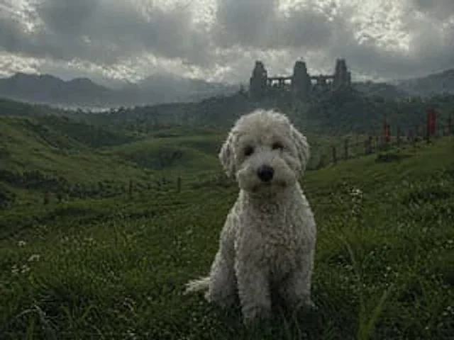

```text
Can you put{argument name="subject" default="My female dog"} Put the movie in{argument name="movie" default="Akira Kurosawa&#39;s film &quot;Ran&quot;"} Is it correct?
```

Model: GPT Image 2
Author: GPT Image 2 Prompts

[ProjectD](https://aitoolsradar.com/en/prompts/ac7c4aaf4dc278) · [Recorded source](https://x.com/DrewPavlou/status/2046729045975633977)
 · [Full original metadata and byte evidence](data/projectd-batch-0042.json)

## Philosophical Concept Infographic Manuscript

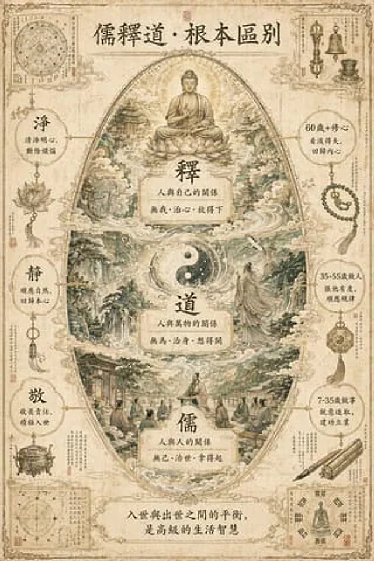

```text
A stunning and incredibly complex conceptual worldview infographic masterpiece, themed "{argument name="theme" default="The fundamental differences between Confucianism, Taoism and Buddhism"} The overall design is inspired by ancient Eastern mythological manuscripts. Background: Pure white vintage textured canvas with a light beige, aged parchment base, featuring slightly worn edges and water stain effects. Core Layout: The central visual employs a grand "vertical egg-shaped layered structure," with Buddhist, Taoist, and Confucian layers from top to bottom. Edge Details: The four corners are decorated with exquisite miniature illustrations themed around ancient observation notes, ritual objects, and runes. Color Scheme: Primarily low-saturation sage green, light gold, and off-white tones, creating a bright and soft overall effect without glaringly high-saturation colors. Details: Architectural lines, landscape brushstrokes, lotus patterns, and cloud layers are clearly visible, rendered with exceptional delicacy. Seamless Integration: The natural transition between the three layers is achieved through clouds and flowing water, seamlessly connecting the Buddhist light, Taoist Tai Chi cloud patterns, and Confucian scholarly atmosphere. Style:{argument name="art style" default="Classical ink painting line art + low-saturation watercolor by number"} It possesses a light and airy feel reminiscent of ancient Chinese manuscripts. Text annotations: Pure traditional Chinese characters, using a weathered ancient Song typeface. Each annotation includes a short title and a line of poetic description, connected to details by a thin, deep gold line, with no repetition. Aspect ratio: 3:4. Vertically independent and complete units. Title area (top): `Confucianism, Buddhism, Taoism: Fundamental Differences`. Central layered annotations: Top layer "Buddhism": `Buddhism`, `The Relationship Between Self and Self`, `Selflessness, Healing the Mind, Letting Go`. Middle layer "Taoism": `Taoism`, `The Relationship Between Self and All Things`, `Non-Action, Healing the Body, Humility`. Bottom layer "Confucianism": `Confucianism`, `The Relationship Between People`, `Selflessness, Governing the World, Taking Responsibility`. Side auxiliary annotations: Left side: `Purity: Clearing the Mind and Brightening the Eyes, Eliminating Troubles`; `Tranquility: Following Nature, Returning to One's True Self`; `Reverence: Reverence for Responsibility, Actively Engaging in the World`. Right side: "60+ years old: Cultivating the mind: Taking gains and losses lightly, returning to one's inner self"; "35-55 years old: Being a person: Balancing work and rest, following the rules"; "7-35 years old: Striving forward, achieving success". Bottom summary: "The balance between detachment and engagement with the world is the highest wisdom of life".
```

Model: GPT Image 2
Author: GPT Image 2 Prompts

[ProjectD](https://aitoolsradar.com/en/prompts/7a6c823f222af8) · [Recorded source](https://x.com/GeekCatX/status/2046477494979793046)
 · [Full original metadata and byte evidence](data/projectd-batch-0042.json)

## Photo-to-LEGO Minifigure Transformation

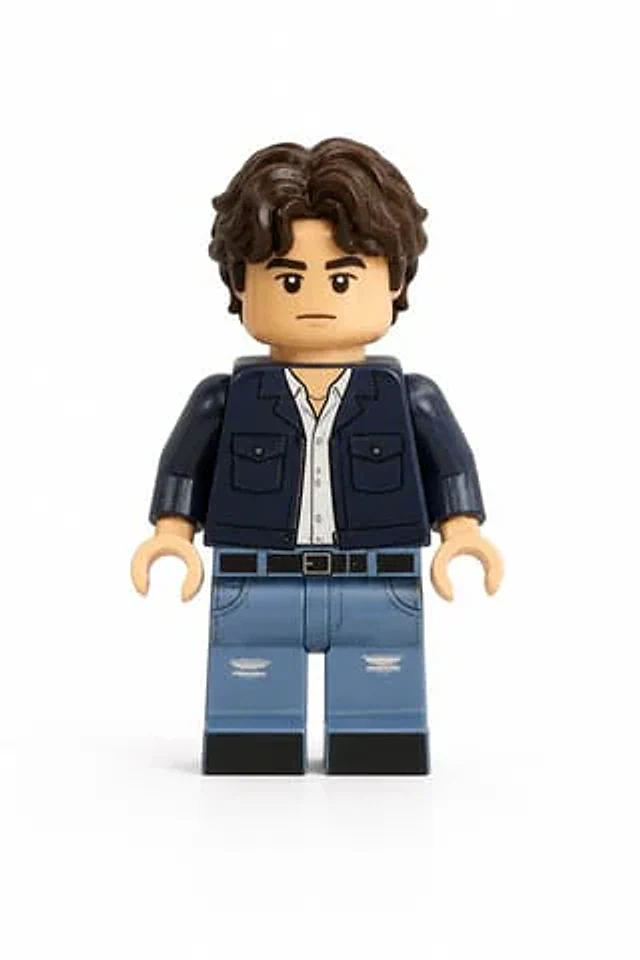

```text
Use the user uploaded image as the only subject reference. Transform the person in the uploaded image into a realistic LEGO style minifigure while preserving their recognizable identity and outfit. Preserve the subject's facial likeness as much as possible within LEGO minifigure design limits, maintaining the same hairstyle and hair color adapted into a LEGO hairpiece, facial expression, clothing colors, clothing design and patterns, and any visible accessories. The result should clearly represent the same person translated into LEGO form. The character must follow authentic LEGO minifigure proportions, including a cylindrical yellow or skin tone LEGO style head, simple printed facial features adapted from the subject, a block shaped torso with printed clothing details, standard LEGO minifigure arms with curved hands, short LEGO minifigure legs, and a distinct molded plastic hairpiece matching the subject's hairstyle.
Render the figure using realistic LEGO plastic material with a slight glossy sheen, subtle molded seams, and natural toy surface reflections. The face and torso should include printed details typical of LEGO minifigures, and the hairpiece should appear as molded plastic. The final image should be a high quality realistic 3D toy render with soft diffused studio lighting, subtle shadows that emphasize shape and plastic texture, and clean sharp focus with crisp detail. The framing must show the full body minifigure from head to feet in a centered composition with the entire figure fully visible. Use a plain white background with no scenery, no props, and no additional elements. The final style should feel like a photorealistic LEGO minifigure toy render with highly detailed plastic texture and studio lighting.
```

Model: GPT Image 2
Author: Lariab Fatima‎

[ProjectD](https://aitoolsradar.com/en/prompts/9e83dbdff91e09) · [Recorded source](https://youmind.com/prompts/personal-lego-minifigure-portrait-19650)
 · [Full original metadata and byte evidence](data/projectd-batch-0042.json)

## Photographed MIDI Piano Score Sheet


```text
A top-down, realistic photograph of a white printed sheet of paper placed on a light-colored wooden desk showcases a computer-generated musical score. The page is horizontally centered with a slight sense of perspective, illuminated by soft natural indoor light with minimal shadows, resulting in a clean, printed document. At the top center of the page, the title is printed in a simple sans-serif font.{argument name="file name" default="kura.mid"} -{argument name="track name" default="CH05 Piano"} Below is a standard black staff system with a treble clef and 4/4 time signature, designed to resemble an automatically converted MIDI score rather than a finely typed score. On the far left of the first line of staff is the instrument name "CH05 Piano". The page should display five lines of horizontal staff, with the starting measure numbers on the left of each line being 18, 21, 25, 29, and 33 respectively. Near the first line of staff is a tempo marker indicating a quarter note equal to 120. The staff is filled with dense, somewhat stiff but logical black notes, accidentals, stems, slurs, and rests. The treble register contains numerous sharps and repeated short note combinations, visually resembling a MIDI-converted piano score. The first three lines of staff should be relatively long and almost fill the entire width; the fourth line should also be relatively long; the fifth... The lines should be short, occupying only the left side of the page. The sheet music must remain legible, but the spacing should have a mechanically generated appearance. Use clean white paper with wide margins, no handwriting, no colored elements, no extra graphics, and simply present a printed sheet music photographed on a desk.
```

Model: GPT Image 2
Author: GPT Image 2 Prompts

[ProjectD](https://aitoolsradar.com/en/prompts/b1528e976790a9) · [Recorded source](https://x.com/super_bonochin/status/2046903077333282870#reversed-0)
 · [Full original metadata and byte evidence](data/projectd-batch-0042.json)

## Photoreal Alien in Dark Ravine

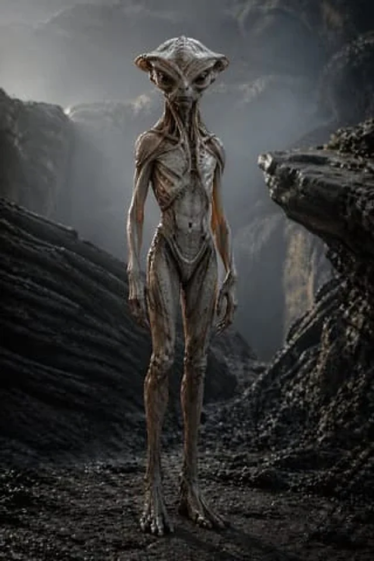

```text
A cinematic full-body portrait depicts a deeply unsettling humanoid alien standing alone in a dark, rocky canyon. Centered, facing the camera directly, its posture is neutral and upright, arms hanging naturally. The creature is extremely tall and slender, with long limbs, narrow shoulders, a sunken torso, clearly visible ribcage, taut muscles, long forearms, enormous hands with slender fingers, and long, digitigrade feet firmly planted on the damp, black ground. Its hairless, smooth, greyish-beige skin with a brownish, fleshy undertone possesses a semi-organic and biomechanical texture, with a moist sheen, leathery grain, stretched membranes, tendons, grooves, and subtle vascular stripes. The neck and upper chest merge into a disturbing organic structure with tentacle-like folds and open passages extending from the collarbone area upwards to the head. The head is broad, mushroom-shaped or hammer-shaped, with a ridged crown and outward-spreading lateral lobes, presenting a non-human silhouette; the face should appear elusive and exotic, rather than cute or familiar. Place the subject in a narrow canyon formed by dark, eroded rock, framed by two massive rocks on either side of the foreground, with a hazy, misty cliff in the background. Use cool, desaturated lighting, soft mist, damp surfaces, shallow depth of field atmospheric haze, and a somber monochromatic palette composed of charcoal, slate, ash, and soft flesh tones. The overall atmosphere should create a grotesque, realistic, oppressive, and biologically logical feel, like a still from a high-end science fiction horror film. Ultra-realistic style, clear creature textures, subtle depth of field effects, dramatic natural backlighting from above, no clothing, no tools, no background creatures, no blood, no text.
```

Model: GPT Image 2
Author: GPT Image 2 Prompts

[ProjectD](https://aitoolsradar.com/en/prompts/76c159e783bc7c) · [Recorded source](https://x.com/RileyRalmuto/status/2046701704687845656#reversed-0)
 · [Full original metadata and byte evidence](data/projectd-batch-0042.json)

## Photoreal FACS Expression Grid

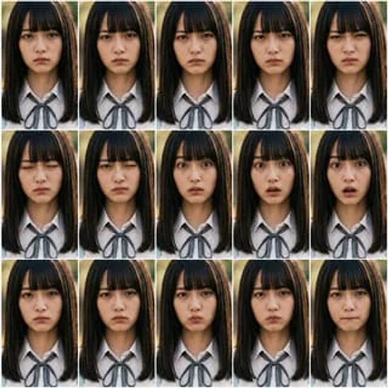

```text
Using REFERENCE_0 and REFERENCE_1 as the FACS action-unit guide, create a photorealistic expression-control test sheet instead of an illustrated chart. Generate {argument name="grid layout" default="15 panels arranged in 3 rows and 5 columns"} showing the same {argument name="subject" default="realistic young female student"} repeated in every panel with identical framing, lighting, hairstyle, and {argument name="outfit" default="white school shirt with a gray ribbon tie"}. Apply a different subtle facial-expression change to each panel based on these {argument name="FACS action units" default="AU1, AU2, AU4, AU5, AU6, AU7, AU9, AU10, AU12, AU15, AU17, AU20, AU23, AU24, AU25"}, while preserving identity consistency and keeping the changes limited to the face. Use a close-up front-facing portrait crop from upper chest to top of head, natural outdoor backlight, shallow depth of field, and thin white dividers between panels. Do not include any chart titles, labels, AU text, explanations, or Japanese text.
```

Model: GPT Image 2
Author: WTR

[ProjectD](https://aitoolsradar.com/en/prompts/12a6048cf35800) · [Recorded source](https://youmind.com/prompts/photoreal-facs-expression-grid-19520)
 · [Full original metadata and byte evidence](data/projectd-batch-0042.json)

## Photoreal librarian presenting AI book


```text
A realistic, vertical promotional portrait is set against a warm, modern library or bookstore interior. A young East Asian woman stands behind a wooden counter, displaying a large book to the camera. She has long, straight, dark brown hair parted in the middle, wears delicate earrings, and appears neat, friendly, and professional. She wears a white shirt, a soft green striped tie, and a beige apron with a name tag reading "Librarian Ai-chan" and a small open book icon sewn on it. Her left hand holds the book upright against her chest, slightly tilted towards the viewer, while her right hand is open beneath the book, a classic product presentation pose. The book is the visual focus: its dark, glossy cover features a striking orange title, "Pollo AI" (a large line of text at the top, with a glowing line in the center), followed by a smaller Japanese subtitle and functional description, and a circular "P" logo in the lower left corner. To the left of the counter is a transparent acrylic nameplate with Japanese text above and the prominent "Ai-chan" logo below. To the right of the counter, three hardcover books are stacked horizontally, each with a numbered label and a Japanese title on its spine. Against a softly blurred background, a tall wooden bookshelf stands on the left, displaying books, small potted plants, and a warm-toned lamp; a decorative painting with Japanese text hangs on the upper right wall; and a potted green plant sits on the far right. A small white "Pollo.ai" watermark is added to the upper right corner. The image uses warm ambient lighting, a shallow depth of field, and primarily beige and wood tones to depict realistic skin and fabric textures. The composition is simple, giving it the feel of a professional lifestyle advertisement. The composition is a portrait from mid-thigh to head, in a 3:4 ratio.
```

Model: GPT Image 2
Author: GPT Image 2 Prompts

[ProjectD](https://aitoolsradar.com/en/prompts/a9cfedcf30bc3e) · [Recorded source](https://x.com/AIchan_lovelyAI/status/2047571641090134499#reversed-0)
 · [Full original metadata and byte evidence](data/projectd-batch-0042.json)

## Photoreal ML Developer Desktop

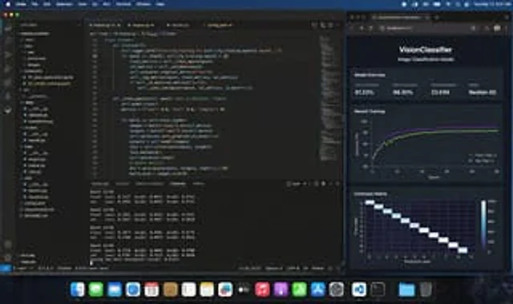

```text
A hyper-realistic screenshot of a macOS desktop showcases the workspace of a machine learning engineer at night. The image is taken from a frontal view, with a dark blue macOS menu bar at the top and the Dock visible at the bottom. Two main application windows are displayed side-by-side on the desktop. On the left is a dark-themed Visual Studio Code window occupying about two-thirds of the screen. The VS Code project, named "VISIONCLASSIFIER" in the file explorer sidebar, contains a realistic Python ML folder tree with 11 visible top-level or expanded items: .venv, data, raw, processed, images, notebooks, src, utils, config.yaml, requirements.txt, and README.md. Within the notebooks folder, two visible files are displayed: 01_data_exploration.ipynb and 02_model_training.ipynb. The src folder displays the actual ML code structure, including dataset.py, transforms.py, models, resnet.py, train, engine.py, trainer.py, and utils.py. Four tabs are open in the editor area: trainer.py, engine.py, resnet.py, and config.yaml, with trainer.py currently active. Clear and reliable Python training code for the ResNet image classification pipeline is displayed, including the Trainer class, train(self) and train_epoch(self, epoch: int) -&gt; Dict[str, float] methods, referencing self.cfg.training.epochs, train_metrics, val_metrics, scheduler.step, save_checkpoint, self.model.train(), batch["image"], batch["label"], optimizer.zero_grad, criterion, loss.backward, optimizer.step, and accuracy(outputs, targets, topk=(1,))[0]. The code should be clear and have a natural screen feel, with line numbers displayed between lines 24 and 52. The VS Code window opens the integrated terminal's TERMINAL tab at the bottom, displaying the actual training logs for four epochs: Epoch 12/50, Epoch 13/50, Epoch 14/50, and Epoch 15/50. Each line contains training and validation data for Loss, Acc@1, and Acc@5, with the last line indicating that a new best checkpoint has been saved. The values ​​should reflect a successful training process, with Top-1 accuracy between 0.88 and 0.91, and Top-5 accuracy between 0.97 and 0.98. The bottom includes the standard VS Code status bar, displaying Python environment details. On the right is a dark-themed web browser window displaying a local dashboard on localhost:8000, titled "VisionClassifier | Dashboard," with the application title "VisionClassifier" and the subtitle "Image Classification Model." The dashboard comprises three stacked sections. The first section, "Model Overview," includes four metric cards: Top-1 Accuracy 91.23%, Top-5 Accuracy 98.30%, Total Parameters 23.51M, and Model ResNet-50. The second section, "Recent Training," displays a dark line graph of accuracy over 50 epochs, featuring two colored curves labeled Train (Top-1) and Val (Top-1), which rise rapidly and stabilize around 90%. The third section, "Confusion Matrix," displays a 10x10 heatmap with bright diagonal lines and axes labeled True and Predicted. Utilizing subtle reflections, clear typography, realistic UI spacing, and lifelike screen halo, the macOS top menu bar displays commonly used menus such as Code, File, Edit, Selection, View, Go, Run, Terminal, Window, and Help on the left, and system icons on the right, with the time displayed as Tue May 13 9:41 AM. The Dock should contain multiple recognizable application icons, giving an overall realistic and uncluttered feel. Overall style: hyper-realistic screenshot, professional developer workstation, refined dark mode interface, unstylized, without illustration-like elements, indistinguishable from a real screen screenshot.
```

Model: GPT Image 2
Author: GPT Image 2 Prompts

[ProjectD](https://aitoolsradar.com/en/prompts/5ea25658db5326) · [Recorded source](https://x.com/filicroval/status/2046855518577205624#reversed-0)
 · [Full original metadata and byte evidence](data/projectd-batch-0042.json)

## Photoreal Schoolgirl Shrine Portrait

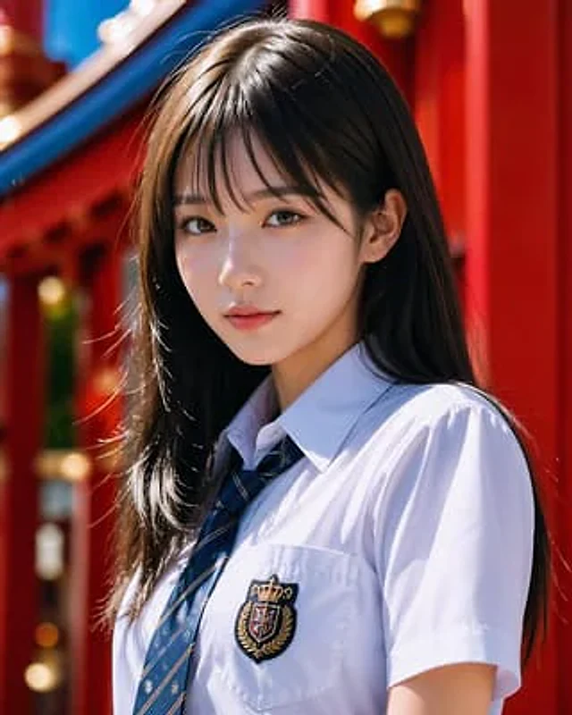

```text
A realistic half-length portrait, the subject being a{argument name="subject" default="young women"} Standing in bright natural sunlight, the photo is taken in a vertical format. She has long, straight hair.{argument name="hair color" default="Dark brown"} Her hair, glossy and lustrous, was parted in the middle and cascaded naturally over her shoulders. She wore a crisp white short-sleeved school uniform shirt with a navy blue striped tie, and a delicate embroidered badge on her left breast pocket featuring a crown and coat of arms. She stood at a slightly angled, relaxed posture, her head turned slightly to one side, creating a sophisticated, candid fashion sense. The background was set to a vibrant {argument name="background setting" default="Red Shrine Building"} Against a blurred background, rich red pillars and details of an arched blue roof are visible. Shallow depth of field and soft bokeh effects keep the subject sharp and in focus. The lighting should be clean, high-contrast, and embellished, with bright highlights on the hair and shirt to showcase realistic clothing folds and natural skin tones, presenting a refined, high-end portrait aesthetic similar to Japanese commercial photography.
```

Model: GPT Image 2
Author: GPT Image 2 Prompts

[ProjectD](https://aitoolsradar.com/en/prompts/0d95de8c856367) · [Recorded source](https://x.com/AIojisan1952/status/2046838384887504974#reversed-0)
 · [Full original metadata and byte evidence](data/projectd-batch-0042.json)

## Photorealistic Anime Schoolgirl Crouching Portrait


```text
A highly detailed, realistic anime-style portrait depicts a young woman crouching low and looking slightly downwards at the camera. She has long, flowing hair.{argument name="hair color" default="Gray Gold"} Her hair swayed gently in the breeze; her skin was fair; and her eyes were large and expressive. She wore {argument name="outfit" default="Japanese school uniform, paired with a light gray cardigan, white shirt, dark plaid bow tie, dark plaid pleated skirt, dark knee-high socks, and black leather loafers."} Her arms were casually draped over her knees. The background was bright.{argument name="sky condition" default="A clear blue sky, dotted with a few white clouds."} The bottom is faintly visible and blurry.{argument name="background setting" default="Barbed wire fence and green trees"} The lighting creates a campus atmosphere. The light is bright natural sunlight with soft, cinematic shadows, highlighting the realistic texture of clothing and skin.
```

Model: GPT Image 2
Author: GPT Image 2 Prompts

[ProjectD](https://aitoolsradar.com/en/prompts/f036af7943da45) · [Recorded source](https://x.com/jun_kongo/status/2046055289074630941#reversed-0)
 · [Full original metadata and byte evidence](data/projectd-batch-0042.json)

## Photorealistic Autumn Kimono Portrait


```text
One{argument name="photography style" default="Realistic portraits with shallow depth of field and soft bokeh effect"} The protagonist is{argument name="subject" default="Young Japanese women"} He was turning back to look at the camera, his face showing {argument name="expression" default="A gentle smile"} She was wearing{argument name="attire" default="Light beige kimono with orange maple leaf pattern"} A gold belt cinched her waist. Her long, dark hair was styled in an elegant updo, with a few strands falling beside her cheeks, and she wore delicate pearl earrings. (Background setting: [omitted]){argument name="setting" default="A garden ablaze with red leaves in autumn"} The upper left corner is adorned with vibrant red leaves, and the background is deeply blurred, creating a tranquil and cinematic atmosphere.
```

Model: GPT Image 2
Author: GPT Image 2 Prompts

[ProjectD](https://aitoolsradar.com/en/prompts/88f209501a1835) · [Recorded source](https://x.com/kazmaendo/status/2045446209532506159#reversed-0)
 · [Full original metadata and byte evidence](data/projectd-batch-0042.json)

## Photorealistic Beach Selfie with Custom Text

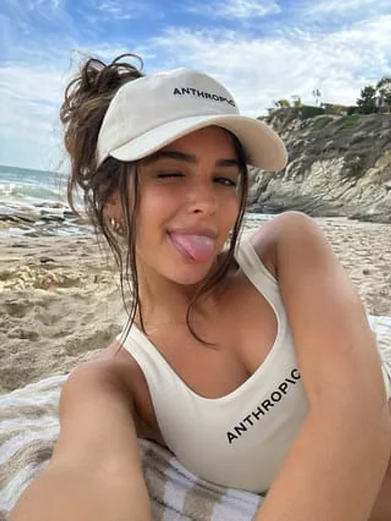

```text
A photorealistic selfie showcases a{argument name="subject description" default="A young woman with a messy bun, dark skin, and brown hair."} Lying{argument name="location" default="The background features a beach, waves, and rocky cliffs."} On a striped beach towel. She is facing the camera.{argument name="facial expression" default="Winking and playfully sticking out her tongue."} She was wearing a white baseball cap and a white crew-neck swimsuit, both printed with bold black lettering.{argument name="brand text" default="ANTHROPIC"} She wore small gold hoop earrings and a delicate gold necklace. The bright, sunny light captured the relaxed, carefree atmosphere of summer, with blue sky and scattered clouds overhead.
```

Model: GPT Image 2
Author: GPT Image 2 Prompts

[ProjectD](https://aitoolsradar.com/en/prompts/cc052e5dc07654) · [Recorded source](https://x.com/hysteresis_x/status/2044347874893295954#reversed-0)
 · [Full original metadata and byte evidence](data/projectd-batch-0042.json)

## Photorealistic Blu-ray Cover Portrait

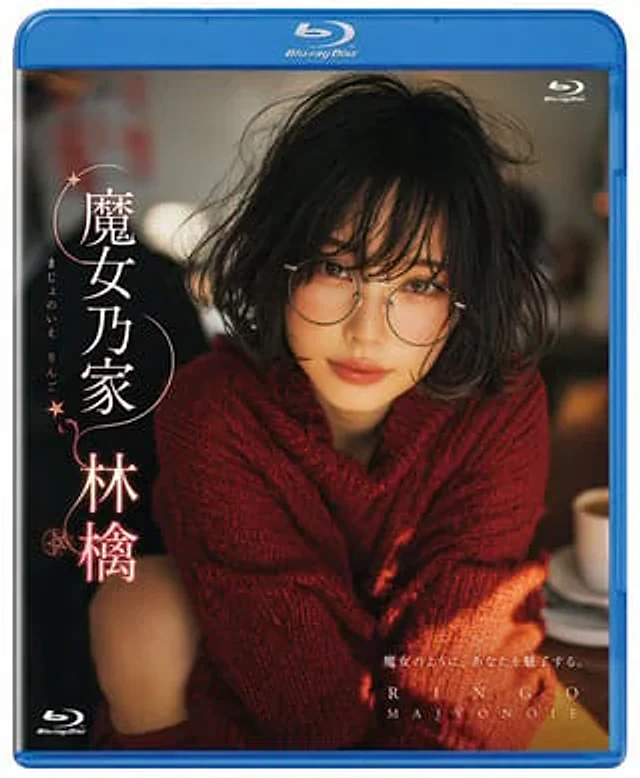

```text
A highly realistic Blu-ray disc cover features a portrait of a young Japanese woman. She has a messy black bob and wears large, round, thin-rimmed metal glasses. She wears a thick, textured, deep red knit sweater. Her expression is soft and captivating, looking directly at the camera. The background is a softly blurred, warm-toned interior environment, seemingly in a café, with a white coffee cup and tray faintly visible on the table to the right. The warm, cinematic lighting accentuates her facial features and the texture of her sweater. The image is framed within the standard blue border of a Blu-ray disc case, with the Blu-ray Disc logo prominently displayed at the top center, upper right, and lower left corners. On the left side are striking and elegant vertical Japanese characters…{argument name="main title" default="Witch&#39;s House Ringo"} Next to it is the phonetic alphabet "majo no ieringo", and it is decorated with delicate glowing pink lines and star/pentagram patterns. The lower right corner contains smaller Japanese characters "{argument name="subtitle" default="Like a witch, she will enchant you."} The letter “RINGO” and “MAJYONOIE” are printed below it.
```

Model: GPT Image 2
Author: GPT Image 2 Prompts

[ProjectD](https://aitoolsradar.com/en/prompts/0c5c8de3089245) · [Recorded source](https://x.com/Majomoe1/status/2045429933103858015#reversed-0)
 · [Full original metadata and byte evidence](data/projectd-batch-0042.json)

## Photorealistic Boeing 747 Cockpit


```text
Hyperrealistic interior photography works showcasing{argument name="aircraft model" default="Boeing 747"} The cockpit. The view is centered and perfectly symmetrical, positioned between the two pilot seats, showcasing the main instrument panel, central console, dual control sticks, and overhead switch panel at the top edge. The cockpit is empty; the two pilot seats are visible in the foreground, fitted with light gray or off-white sheepskin covers. Each control stick has a dark rectangular checklist or electronic note item clipped to it. The main panel is densely packed with realistic-looking avionics, analog dials, autopilot controllers, and radio panels, totaling six illuminated displays: two large central navigation displays, one smaller blue-toned flight display on each side, and two green text/data screens below the central console. The center contains four throttle levers, as well as additional flaps and system control sticks, rotary knobs, shielded switches, and the weathered brown-gray metallic surface typical of wide-body aircraft cockpits. The overhead panel should be covered with rows of switches, toggles, and indicator lights, some in shadow but clearly detailed. Through the windshield, a blurred airport gate scene is displayed, including the light-colored concrete tarmac, ground markings, and passenger boarding bridges connecting to or near the aircraft. The lighting is natural sunlight from outside, with soft lighting inside the cockpit, realistic shadows, subtle reflections on the glass screens, and documentary-style color gradation. It emphasizes extreme detail, realism, the true complexities of aerospace engineering, and image quality indistinguishable from real photographs. Shot with a full-frame camera, eye-level perspective, 24–28mm wide-angle lens, full depth of field on the instrument panel, high dynamic range, no people, no exaggerated stylization, and no illustration style.
```

Model: GPT Image 2
Author: GPT Image 2 Prompts

[ProjectD](https://aitoolsradar.com/en/prompts/ba40ec32a71758) · [Recorded source](https://x.com/ferwoo1990/status/2046561153099395344#reversed-0)
 · [Full original metadata and byte evidence](data/projectd-batch-0042.json)

## Photorealistic Calligraphy Scholar Scene


```text
A realistic indoor portrait, in which {argument name="subject" default="Elon Musk"} He stands before a traditional Chinese desk, practicing calligraphy on a large sheet of Xuan paper. He wears a black Tang suit with Chinese knot buttons and delicate embroidery, leaning slightly forward, one hand resting on the table, the other holding a brush suspended vertically above the paper. The scene is a warm and elegant scholar's study, furnished with dark wood furniture; to the left is a carved brush holder with four brushes hanging from it; to the left front is an inkstone and a small inkwell; a small porcelain vase sits on the side table behind him. Behind him hang two vertical scrolls: the left scroll prominently displays large characters.{argument name="left scroll text" default="Man Jiang Hong"} On the right, a scroll displays a long line of Chinese calligraphy. To the right is a wooden lattice window, letting in soft ambient light. The paper on the table is covered in flowing, semi-cursive black calligraphy, suggesting he is writing.{argument name="written poem" default="Man Jiang Hong"} The film employs a documentary-style aesthetic with photorealistic detail, combined with cinematic warm lighting, rich wood tones, authentic calligraphy tools, shallow depth of field, and half-body compositions to create a serious and focused atmosphere.
```

Model: GPT Image 2
Author: GPT Image 2 Prompts

[ProjectD](https://aitoolsradar.com/en/prompts/3f0bc7e1d6dfa8) · [Recorded source](https://x.com/YTkexue/status/2046623205981319339#reversed-0)
 · [Full original metadata and byte evidence](data/projectd-batch-0042.json)

## Photorealistic Chinese Math Exam Paper


```text
{
  "type": "Photorealistic printed exam papers",
  "style": "Black text on slightly wrinkled off-white paper, realistic document photography effect.",
  "header": {
    "main_title": "{argument name=\"exam title\" default=\"Yulin City 2024 Spring Semester Grade 11 Final Exam Teaching Quality Monitoring Test Paper\"}",
    "subject": "{argument name=\"subject name\" default=\"Math Exam\"}",
    "details": "{argument name=\"score and time\" default=\"This exam paper has a total score of 150 points and the exam time is 120 minutes.\"}"
  },
  "layout": {
    "instructions": {
      "title": "Precautions:",
      "point_count": 3,
      "content": "Standard exam rules regarding answer sheets, 2B pencils, and submitting the exam."
    },
    "main_section": {
      "heading": "{argument name=\"section title\" default=\"I. Multiple Choice Questions: This section contains 8 questions, each worth 5 points, for a total of 40 points. For each question, choose the one option that best answers the question.\"}",
      "question_count": 8,
      "format": "A list of numbers from 1 to 8, each question containing a mathematical formula and four options (A, B, C, D).",
      "topics": [
        "Set intersection",
        "plural",
        "Monotonically increasing function",
        "Necessary and sufficient conditions",
        "Vectors and Trigonometric Functions",
        "Solid geometry",
        "Lateral area of ​​a cone",
        "Trigonometric function graphs"
      ],
      "diagrams": {
        "count": 2,
        "descriptions": [
          "The 3D wireframe of the cube next to question 6, with internal dashed lines.",
          "The two-dimensional Cartesian coordinate system diagram next to question 8 shows a partial sine wave curve."
        ]
      }
    },
    "footer": "{argument name=\"footer text\" default=\"Grade 11 Mathematics Exam, Page 1 of 4\"}"
  }
}
```

Model: GPT Image 2
Author: GPT Image 2 Prompts

[ProjectD](https://aitoolsradar.com/en/prompts/1071a6ff04b52f) · [Recorded source](https://x.com/qiufenghyf/status/2044808978102927760#reversed-0)
 · [Full original metadata and byte evidence](data/projectd-batch-0042.json)

## Photorealistic Chinese Math Exam Paper

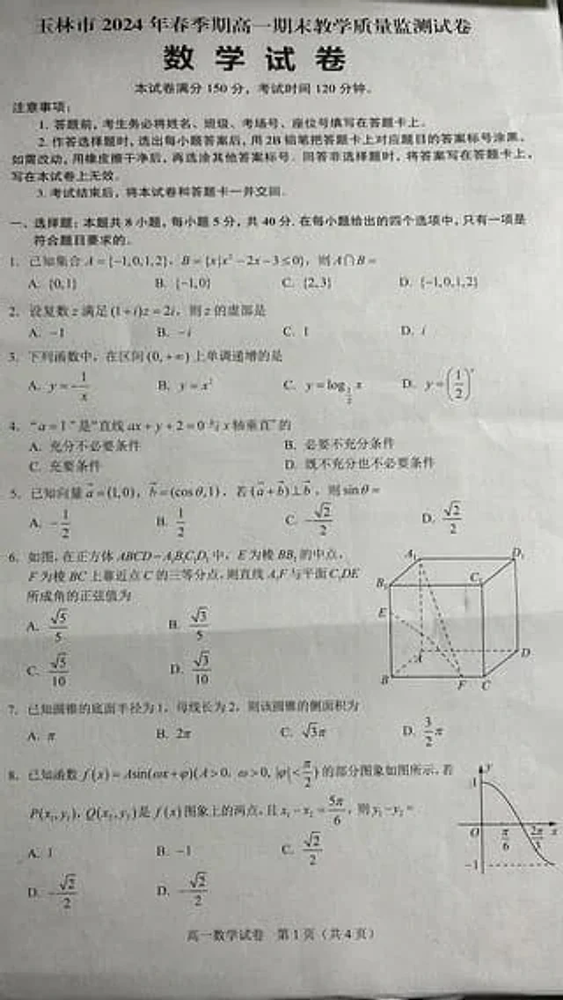

```text
{
  "type": "photorealistic printed examination paper",
  "style": "black text on slightly crumpled off-white paper, authentic document photography",
  "header": {
    "main_title": "{argument name=\"exam title\" default=\"玉林市 2024 年春季期高一期末教学质量监测试卷\"}",
    "subject": "{argument name=\"subject name\" default=\"数 学 试 卷\"}",
    "details": "{argument name=\"score and time\" default=\"本试卷满分 150 分，考试时间 120 分钟。\"}"
  },
  "layout": {
    "instructions": {
      "title": "注意事项:",
      "point_count": 3,
      "content": "Standard exam rules regarding answer sheets, 2B pencils, and submission."
    },
    "main_section": {
      "heading": "{argument name=\"section title\" default=\"一、选择题: 本题共 8 小题，每小题 5 分，共 40 分。在每小题给出的四个选项中，只有一项是符合题目要求的。\"}",
      "question_count": 8,
      "format": "Numbered list from 1 to 8, each with mathematical formulas and 4 multiple-choice options (A, B, C, D).",
      "topics": [
        "Sets intersection",
        "Complex numbers",
        "Monotonically increasing functions",
        "Necessary and sufficient conditions",
        "Vectors and trigonometry",
        "Solid geometry",
        "Cone lateral surface area",
        "Trigonometric function graph"
      ],
      "diagrams": {
        "count": 2,
        "descriptions": [
          "A 3D line drawing of a cube with internal dashed lines located next to question 6.",
          "A 2D Cartesian coordinate graph showing a partial sine wave curve located next to question 8."
        ]
      }
    },
    "footer": "{argument name=\"footer text\" default=\"高一数学试卷 第 1 页 (共 4 页)\"}"
  }
}
```

Model: GPT Image 2
Author: 秋风_irwin

[ProjectD](https://aitoolsradar.com/en/prompts/ac85157ddc8e12) · [Recorded source](https://youmind.com/prompts/photorealistic-chinese-math-exam-paper-13773)
 · [Full original metadata and byte evidence](data/projectd-batch-0042.json)

## Photorealistic Coastal Sports Car


```text
A realistic, high-resolution automotive photograph showcasing a car{argument name="car color" default="Bright red"} of{argument name="car model" default="Ferrari F8 Tributo"} Stop at{argument name="setting" default="Coastal highway overlooking the sea"} Above. The sports car is parked at a slight side angle, showcasing its sleek aerodynamic curves, aggressive front fascia, distinctive LED headlights, and silver alloy wheels with yellow center caps. The iconic yellow shield emblem is visible on the front fender. The background features the deep blue sea, low stone railings, and a distant rocky coastline covered in lush vegetation and scattered buildings under a clear blue sky. The lighting is {argument name="lighting" default="Bright sunny day"} It casts clear, realistic shadows on the asphalt road and creates a dazzling reflection on the car's glossy paint.
```

Model: GPT Image 2
Author: GPT Image 2 Prompts

[ProjectD](https://aitoolsradar.com/en/prompts/ea3bf0adab442e) · [Recorded source](https://x.com/AlwaveNazca/status/2045404499066384847#reversed-3)
 · [Full original metadata and byte evidence](data/projectd-batch-0042.json)

## Photorealistic Coastal Sports Car Photography


```text
A realistic car photograph showcasing a vehicle{argument name="car color" default="Bright red"}{argument name="car model" default="Ferrari sports car"} Stop at{argument name="setting" default="Coastal Highway"} Above. The vehicle is angled towards the camera, showcasing its sleek aerodynamic curves, silver five-spoke alloy wheels, and sharp front fascia with black air intakes. The background is {argument name="background" default="Magnificent seascape with rocky coastline"} The deep blue sea and clear sky. Bright sunlight cast sharp shadows on the asphalt road, highlighting the glossy paint of the cars.
```

Model: GPT Image 2
Author: GPT Image 2 Prompts

[ProjectD](https://aitoolsradar.com/en/prompts/9c787c621fcd29) · [Recorded source](https://x.com/AlwaveNazca/status/2044795046503792987#reversed-0)
 · [Full original metadata and byte evidence](data/projectd-batch-0042.json)

## Photorealistic Fashion Magazine Cover

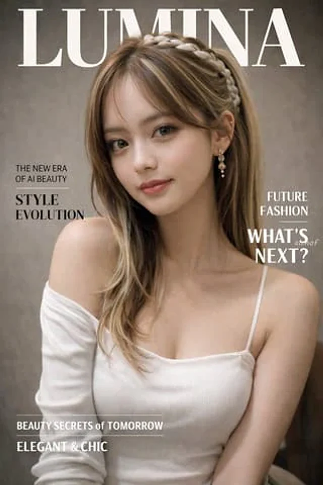

```text
A photorealistic fashion magazine cover features a portrait of a beautiful young Asian woman. She has {argument name="hair style" default="Light brown hair with gold highlights and a braided crown"} Her makeup was soft and elegant, and her expression gentle. She wore a {argument name="clothing" default="White ribbed off-shoulder camisole top"} She wore delicate gold dangling earrings. The background was a soft, neutral gray. The layout featured elegant typography: a large masthead at the top, with the words "..." in a classic serif font.{argument name="magazine title" default="LUMINA"} The text on the left reads "THE NEW ERA OF AI BEAUTY," and below it is a larger text.{argument name="main headline" default="STYLE EVOLUTION"} The text on the right reads "FUTURE FASHION," and below it is "WHAT'S NEXT?". The text at the bottom reads "".{argument name="bottom text" default="BEAUTY SECRETS of TOMORROW"} Below is "ELEGANT &amp; CHIC". The overall lighting effect is soft, professional studio lighting.
```

Model: GPT Image 2
Author: GPT Image 2 Prompts

[ProjectD](https://aitoolsradar.com/en/prompts/7582d255296bd9) · [Recorded source](https://x.com/aichof21/status/2045833848924279054#reversed-1)
 · [Full original metadata and byte evidence](data/projectd-batch-0042.json)

## Photorealistic Fast Food Storefront

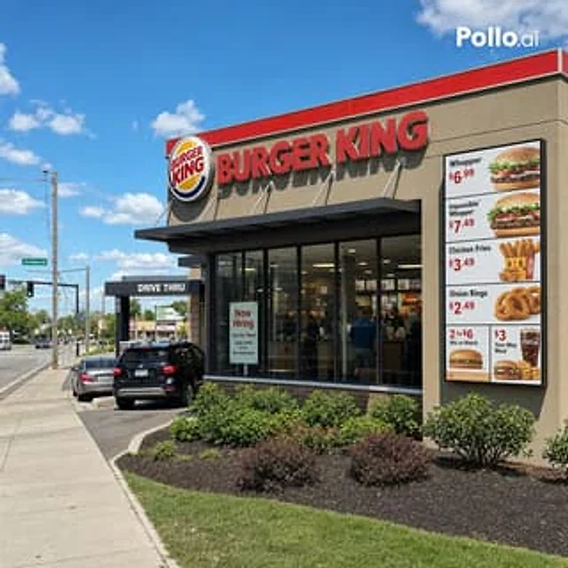

```text
A photographic realism of modern{argument name="restaurant brand" default="BURGER KING"} The exterior of the fast food restaurant on a street corner, photographed from a left-front view, with a blue sky and white clouds in the background. The building features a beige stucco facade, with a striking red decorative strip along the roof edge. A large circular brand logo is located on the upper left of the front wall, and a huge red three-dimensional illuminated lettering spans the top, spelling out [the logo's name].{argument name="main sign text" default="BURGER KING"} On the right side of the facade, a tall vertical menu billboard displays six clearly visible product panels and prices: Whopper $6.99, Plant-based Whopper $7.49, Chicken and Fries $3.49, Onion Rings $2.49, two $6 combo panels, and a $3 all-you-can-eat combo panel including fries and a drink. On the left is a black drive-thru canopy with the text "..."{argument name="drive thru sign" default="DRIVE THRU"} There are two cars in the driveway: a dark SUV close to the camera and a silver sedan ahead. The front corner should have floor-to-ceiling windows, revealing a bright interior environment, with several customers and menu items vaguely visible. A recruitment poster is placed on the front window, with the text {argument name="window poster text" default="Now Hiring"} The building's edges are meticulously landscaping, with five shrubs planted in dark-covered flowerbeds. The foreground features a concrete sidewalk, lawn, utility poles, traffic lights, and a suburban intersection extending to the left rear. Natural midday light, crisp shadows, a commercial real estate photography style, ultra-clean signage, highly legible text, realistic reflections on the glass, sharp architectural details, and a subtle white accent in the upper right corner.{argument name="watermark text" default="Pollo.ai"} Watermark.
```

Model: GPT Image 2
Author: GPT Image 2 Prompts

[ProjectD](https://aitoolsradar.com/en/prompts/656cd2952f3d9c) · [Recorded source](https://x.com/AiwithSaad/status/2047021860450181577#reversed-0)
 · [Full original metadata and byte evidence](data/projectd-batch-0042.json)

## Photorealistic Izakaya Portrait

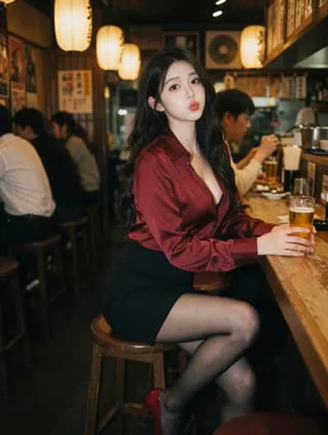

```text
A photorealistic portrait, the subject is{argument name="subject description" default="A young East Asian woman"} Sitting{argument name="setting" default="Dimly lit izakaya"} She stood in front of the wooden bar counter. She had long, black, curly hair and wore {argument name="top clothing" default="Dark red silk shirt"} She wore a black mini-skirt, black sheer pantyhose, and red high heels. She was holding {argument name="drink" default="A beer"} She pouted slightly and looked at the camera. Blurred customers and warm colors could be seen in the background.{argument name="lighting source" default="Paper lanterns"} Cinematic lighting with a shallow depth of field effect.
```

Model: GPT Image 2
Author: GPT Image 2 Prompts

[ProjectD](https://aitoolsradar.com/en/prompts/255dc6f1312d34) · [Recorded source](https://x.com/AndyChowMr/status/2045808504213237921#reversed-0)
 · [Full original metadata and byte evidence](data/projectd-batch-0042.json)

## Photorealistic Japanese Newspaper Front Page


```text
{
  "type": "Photorealistic front pages of major Japanese newspapers",
  "style": "Hyperrealistic, shot from a slightly overhead angle and placed on a flat surface, with natural light and clear typography.",
  "header": {
    "date": "{argument name=\"publication date\" default=\"Thursday, April 23, 2026 (Reiwa 8)\"}",
    "title": "{argument name=\"newspaper name\" default=\"Asahi Shimbun\"}",
    "sponsor_ad": "~Living with Water~ SUNTORY"
  },
  "layout": {
    "headlines": [
      "{argument name=\"main headline\" default=\"OpenAI releases new model &quot;Spud&quot;\"}",
      "{argument name=\"secondary headline\" default=\"The &quot;Codex SuperApp&quot; will be released simultaneously.\"}"
    ],
    "sub_banner": "It comprehensively surpasses existing benchmarks in terms of network attack and coding performance.",
    "centerpiece_image": {
      "description": "Dark blue background with the text \"{argument name=\"embedded image subject\" default=\"Codex SuperApp\"} \"and three mobile UI screens displaying application interfaces.\"",
      "caption": "Codex SuperApp concept art (provided by OpenAI)"
    },
    "vertical_side_text": [
      "\"To become the cornerstone of the AGI era\"",
      "Development competition intensifies further"
    ],
    "article_sections": [
      {
        "sub_headline": "Experts gave it high praise, calling it \"overwhelming progress\".",
        "bullet_points_count": 3,
        "bullet_points": [
          "The ability to automatically detect and respond to cyberattacks has improved by 4.2 times compared to the past.",
          "Break the SWE-bench high score in coding-assisted benchmark tests.",
          "Natural language understanding and reasoning abilities have been greatly enhanced."
        ],
        "body_text": "The main body of the article is written in dense Japanese, discussing the release of AI models and quoting Sam Altman."
      }
    ],
    "bottom_teasers": {
      "count": 3,
      "items": [
        "Tariff Negotiations: Japan and the US to Renegotiate (Economics Section, Page 3)",
        "Heavy rains hit Kyushu region, injuring two people (Social Affairs section, page 28)",
        "Opinion: How to Deal with AI"
      ]
    }
  }
}
```

Model: GPT Image 2
Author: GPT Image 2 Prompts

[ProjectD](https://aitoolsradar.com/en/prompts/a1bfe863b5769f) · [Recorded source](https://x.com/arrakis_ai/status/2045033963744633232#reversed-1)
 · [Full original metadata and byte evidence](data/projectd-batch-0042.json)

## Photorealistic Korean Newspaper Front Page


```text
{
  "type": "Photos of the front page of a printed newspaper",
  "style": "Photorealistic, natural light, slightly angled perspective, printed on textured newsprint.",
  "header": {
    "left_ad": "SHINSEGAE DUTY FREE logo",
    "title": "{argument name=\"newspaper name\" default=\"South Korean economy\"}",
    "right_ad": "Myungryon Jinshi Spare Ribs (명륜진사갈비) logo and small image of the meat",
    "date_and_info": "{argument name=\"publication date\" default=\"Thursday, April 23, 2026\"}"
  },
  "headlines": {
    "main": "{argument name=\"main headline\" default=\"OpenAI releases next-generation model &#39;Spud&#39;, sweeping coding and cyber warfare benchmarks.\"}",
    "sub": "The simultaneous launch of the new super app 'Codex'... Could it become a game-changer in the \"AI war\" landscape?"
  },
  "layout": {
    "centerpiece": {
      "type": "Promotional image",
      "title_text": "Introduced with great fanfare{argument name=\"app name\" default=\"Codex\"} A super app for everyone",
      "visuals": "3 smartphones displaying dark mode UI",
      "phone_1": "The left side of the phone displays the function menu list.",
      "phone_2": "The middle mobile phone displays an analysis line chart.",
      "phone_3": "The phone on the right displays a code editor with Python scripts."
    },
    "sections": [
      {
        "title": "Left column",
        "position": "center left",
        "count": 2,
        "labels": [
          "Introduction Article Text",
          "First in all coding benchmark tests"
        ]
      },
      {
        "title": "Right-side column",
        "position": "center right",
        "count": 1,
        "labels": [
          "They also achieved a resounding victory in cyber warfare benchmark tests."
        ]
      },
      {
        "title": "Article in the bottom left corner",
        "position": "Bottom left",
        "count": 1,
        "labels": [
          "New York stocks rose across the board, driven by gains in AI-related stocks... The Nasdaq index rose 2.7% ↑"
        ]
      },
      {
        "title": "bottom right corner ad",
        "position": "Bottom right",
        "count": 1,
        "labels": [
          "{argument name=\"bottom ad text\" default=\"Samsung Electronics, the world&#39;s leading memory semiconductor company\"}"
        ]
      }
    ]
  }
}
```

Model: GPT Image 2
Author: GPT Image 2 Prompts

[ProjectD](https://aitoolsradar.com/en/prompts/f392e7157ab5c6) · [Recorded source](https://x.com/arrakis_ai/status/2045033963744633232#reversed-3)
 · [Full original metadata and byte evidence](data/projectd-batch-0042.json)

## Photorealistic Korean Newspaper Front Page


```text
{
  "type": "photograph of a printed newspaper front page",
  "style": "photorealistic, natural lighting, slightly angled perspective, printed on textured newsprint paper",
  "header": {
    "left_ad": "SHINSEGAE DUTY FREE logo",
    "title": "{argument name=\"newspaper name\" default=\"한국경제\"}",
    "right_ad": "명륜진사갈비 logo with a small image of meat",
    "date_and_info": "{argument name=\"publication date\" default=\"2026년 4월 23일 목요일\"}"
  },
  "headlines": {
    "main": "{argument name=\"main headline\" default=\"오픈AI, 차세대 모델 'Spud' 공개 코딩·사이버전 벤치마크 석권\"}",
    "sub": "신규 슈퍼앱 'Codex'도 출시… “AI 전쟁” 판도 바꿀 게임 체인저 될까"
  },
  "layout": {
    "centerpiece": {
      "type": "promotional graphic",
      "title_text": "Introducing {argument name=\"app name\" default=\"Codex\"} The Super App for Everyone",
      "visuals": "3 smartphones displaying dark mode UI",
      "phone_1": "left phone showing a feature menu list",
      "phone_2": "middle phone showing an analytics line chart",
      "phone_3": "right phone showing a code editor with a python script"
    },
    "sections": [
      {
        "title": "left column",
        "position": "mid-left",
        "count": 2,
        "labels": ["introductory article text", "코딩 벤치마크 모두 1위"]
      },
      {
        "title": "right column",
        "position": "mid-right",
        "count": 1,
        "labels": ["사이버전 벤치마크도 압승"]
      },
      {
        "title": "bottom left article",
        "position": "bottom-left",
        "count": 1,
        "labels": ["뉴욕증시, AI 랠리에 일제 상승…나스닥 2.7% ↑"]
      },
      {
        "title": "bottom right ad",
        "position": "bottom-right",
        "count": 1,
        "labels": ["{argument name=\"bottom ad text\" default=\"세계 1위 메모리 반도체 기업 삼성전자\"}"]
      }
    ]
  }
}
```

Model: GPT Image 2
Author: CHOI

[ProjectD](https://aitoolsradar.com/en/prompts/62bcf489f4e0a9) · [Recorded source](https://youmind.com/prompts/korean-newspaper-front-page-13886)
 · [Full original metadata and byte evidence](data/projectd-batch-0042.json)

## Photorealistic Neon Tokyo Street Scene

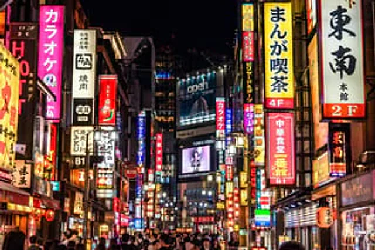

```text
A photographic, realistic nighttime street scene, showcasing the bustling activity.{argument name="city location" default="Tokyo"} The street was illuminated by a dense array of vertical neon signs and billboards. On the left was a striking bright pink sign that read, "..."{argument name="pink sign text" default="カラオケ"} Next to it was a white sign that read "Gyutaku Yakiniku" (牛角焼肉). The prominent sign on the right included a yellow {argument name="yellow sign text" default="Manga Cafe 4F"} ", a white "Southeast Main Building 2F", and a red "{argument name="red sign text" default="Chung Hwa Restaurant Ichibankan B1"} In the distant center, a huge blue billboard displays {argument name="billboard text" default="open TOKYO"} Above it is a digital screen displaying images of people with the words "YUNIKA VISION" on it. The street is crowded with the silhouettes of pedestrians as they move through this vibrant, light-and-shadow-filled urban canyon. The contrast between light and shadow is striking, and the rich neon colors are reflected in the surrounding environment.
```

Model: GPT Image 2
Author: GPT Image 2 Prompts

[ProjectD](https://aitoolsradar.com/en/prompts/4358830df7848b) · [Recorded source](https://x.com/EARL_med_tw/status/2044618850965369280#reversed-1)
 · [Full original metadata and byte evidence](data/projectd-batch-0042.json)

## Photorealistic Neon Tokyo Street Scene


```text
A photorealistic night street photography shot of a bustling {argument name="city location" default="Tokyo"} street, heavily illuminated by densely packed vertical neon signs and billboards. On the left, a bright pink sign prominently reads "{argument name="pink sign text" default="カラオケ"}" next to a white sign reading "牛角 焼肉". On the right, prominent signs include a yellow one reading "{argument name="yellow sign text" default="まんが喫茶 4F"}", a white one reading "東南 本館 2F", and a red one reading "{argument name="red sign text" default="中華食堂 一番館 B1"}". In the center distance, a large blue billboard displays "{argument name="billboard text" default="open TOKYO"}" above a digital screen showing a person with the text "YUNIKA VISION". The street level is crowded with the backs of pedestrians' heads walking through the vibrant, glowing urban canyon. The lighting is high contrast with rich neon colors reflecting off the surroundings.
```

Model: GPT Image 2
Author: EARLの医学&AIノート

[ProjectD](https://aitoolsradar.com/en/prompts/f91c0f6531fa9a) · [Recorded source](https://youmind.com/prompts/photorealistic-neon-tokyo-street-14086)
 · [Full original metadata and byte evidence](data/projectd-batch-0042.json)

## Photorealistic Newspaper Front Page


```text
{
  "type": "Photorealistic physical newspapers on the counter",
  "environment": "A casual indoor kitchen setting, with visible stove rim, natural lighting, and slightly curved paper with realistic creases.",
  "newspaper_header": {
    "logo": "A large blue circle, next to which is{argument name=\"newspaper name\" default=\"USA TODAY\"}",
    "date": "{argument name=\"date\" default=\"04.23.26\"}",
    "subtext": "National News | $3.00 | Thursday",
    "top_right_teaser": {
      "image": "naval vessels",
      "headline": "The United States and the Philippines held joint exercises in the South China Sea."
    }
  },
  "layout": {
    "total_articles": 4,
    "total_embedded_images": 4,
    "sections": [
      {
        "position": "Centered at the top",
        "headline": "{argument name=\"main headline\" default=\"OpenAI&#39;s new Spud model dominates in cyber warfare and coding benchmarks.\"}",
        "author": "Author: Jefferson Graham",
        "image": "{argument name=\"main image subject\" default=\"A 3D rendered blue whale wearing a crown, bearing the inscription &#39;spud by OpenAI&#39;.\"}",
        "columns": 2
      },
      {
        "position": "center right",
        "headline": "Stocks rose, boosted by earnings reports from tech companies.",
        "author": "Author: Nathan Bomey",
        "columns": 1
      },
      {
        "position": "Bottom left",
        "headline": "{argument name=\"bottom headline\" default=\"The Codex app was released as a &#39;super app for all&#39;.\"}",
        "author": "Author: Jessica Guynn",
        "image": "A smartphone screen displaying an application interface with the text 'codex'.",
        "columns": 2
      },
      {
        "position": "Bottom right",
        "headline": "New bird species discovered in the Amazon",
        "author": "Author: Doyle Rice",
        "columns": 1
      },
      {
        "position": "footer",
        "image": "rugby players in the game",
        "text": "NFL Draft Shocks: Quarterback Falls to Second Round"
      }
    ]
  }
}
```

Model: GPT Image 2
Author: GPT Image 2 Prompts

[ProjectD](https://aitoolsradar.com/en/prompts/2638a2a3636754) · [Recorded source](https://x.com/arrakis_ai/status/2045033963744633232#reversed-2)
 · [Full original metadata and byte evidence](data/projectd-batch-0042.json)

## Photorealistic Newspaper Front Page

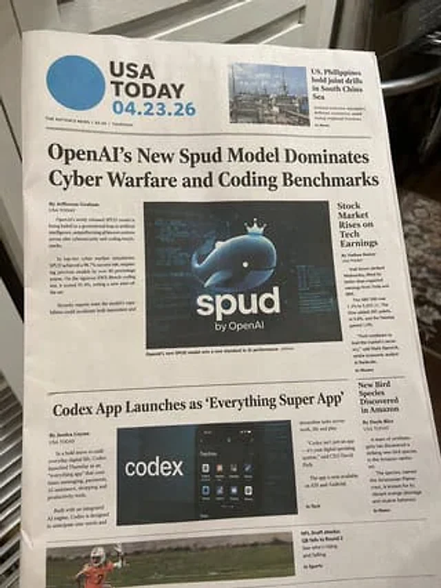

```text
{
  "type": "Photorealistic images of the front page of a printed newspaper",
  "setting": "Placed on the kitchen countertop, with blurred backgrounds of appliances.",
  "newspaper_header": {
    "title": "{argument name=\"newspaper name\" default=\"USA TODAY\"}",
    "date": "{argument name=\"date\" default=\"04.23.26\"}",
    "details": "National News | $3.00 | Thursday",
    "top_right_teaser": {
      "headline": "The United States and the Philippines held joint exercises in the South China Sea.",
      "image": "Naval vessels in the ocean"
    }
  },
  "layout": {
    "element_counts": {
      "articles_and_teasers": 5,
      "printed_images": 4
    },
    "sections": [
      {
        "position": "Centered at the top",
        "type": "Main article",
        "headline": "{argument name=\"main headline\" default=\"OpenAI&#39;s new Spud model dominates in cyber warfare and coding benchmarks.\"}",
        "image": "{argument name=\"main image subject\" default=\"A 3D blue whale wearing a crown, bearing the words &#39;spud by OpenAI&#39;.\"}",
        "columns": 2
      },
      {
        "position": "Top of right sidebar",
        "type": "Side article",
        "headline": "Positive earnings reports from tech stocks boosted the stock market.",
        "columns": 1
      },
      {
        "position": "Centered at the bottom",
        "type": "Secondary Articles",
        "headline": "{argument name=\"secondary headline\" default=\"The Codex app was released as a &#39;super app for all&#39;.\"}",
        "image": "Smartphones displaying an app interface with the word 'codex' on it",
        "columns": 3
      },
      {
        "position": "bottom of right sidebar",
        "type": "Side article",
        "headline": "New bird species discovered in the Amazon",
        "columns": 1
      },
      {
        "position": "bottom edge",
        "type": "Footer preview",
        "headline": "NFL Draft Shocks: Quarterback Falls to Second Round",
        "image": "American football player"
      }
    ]
  },
  "photography_style": "Viewed from above in natural light, the paper texture and slight creases are visible."
}
```

Model: GPT Image 2
Author: GPT Image 2 Prompts

[ProjectD](https://aitoolsradar.com/en/prompts/425d067cdcdac1) · [Recorded source](https://x.com/ai_hakase_/status/2045700163277107473#reversed-2)
 · [Full original metadata and byte evidence](data/projectd-batch-0042.json)

## Photorealistic Older Couple in a Pub

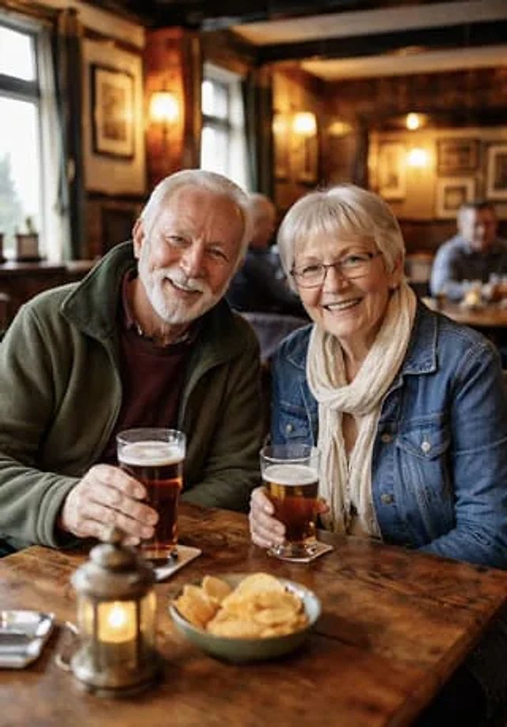

```text
A realistic portrait of an elderly couple sitting opposite each other, both smiling.{argument name="setting" default="Cozy traditional tavern"} Beside a simple wooden table inside. The man on the left has white hair and a thick white beard, and is wearing a {argument name="man's clothing" default="Olive green fleece jacket"} The woman on the right has short gray hair, wears glasses, and is dressed in {argument name="woman's clothing" default="Blue denim jacket and white scarf"} They all looked directly at the camera, each holding a glass.{argument name="beverage" default="Pint beer"} There was a {argument name="table snack" default="Potato Chips"} A small, vintage lantern is lit. The background features warm, inviting lighting and a shallow depth of field effect, blurring the wood-paneled wall, framed photos, and several other customers.
```

Model: GPT Image 2
Author: GPT Image 2 Prompts

[ProjectD](https://aitoolsradar.com/en/prompts/8777378737aa9d) · [Recorded source](https://x.com/aidancramer/status/2044473314362409056#reversed-0)
 · [Full original metadata and byte evidence](data/projectd-batch-0042.json)

## Photorealistic Portrait of a Young Woman


```text
A highly detailed and realistic portrait of a young person{argument name="ethnicity" default="Japan"} A portrait of a woman. She kept it.{argument name="hair style" default="Long black hair with bangs"} She had fair, flawless skin and large, deep brown eyes. She was wearing a {argument name="clothing" default="Simple white crew neck shirt"} noodles{argument name="expression" default="A gentle smile"} The camera is directly facing the lens. The light is soft and textured, creating a cinematic atmosphere with a shallow depth of field. The background is {argument name="background" default="Warm, blurry light spots"} .
```

Model: GPT Image 2
Author: GPT Image 2 Prompts

[ProjectD](https://aitoolsradar.com/en/prompts/7ce913d5614e77) · [Recorded source](https://x.com/Kazuhiro_M0727/status/2044620924952137991#reversed-0)
 · [Full original metadata and byte evidence](data/projectd-batch-0042.json)

## Photorealistic Raccoon Painter in Paris

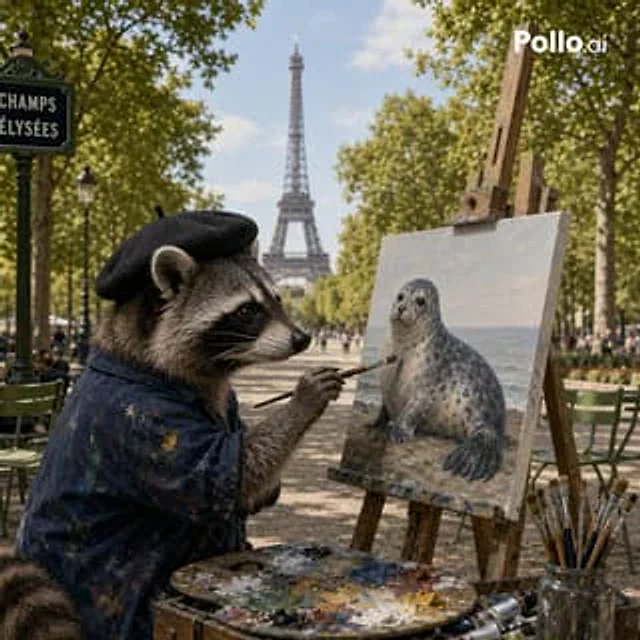

```text
A photorealistic {argument name="animal" default="raccoon"} dressed as a French painter, wearing a black beret and paint-stained smock, painting a portrait of a {argument name="portrait subject" default="seal"} on a canvas easel. Set on the {argument name="location" default="Champs-Élysées in Paris"} with the Eiffel Tower in the background, sunny day, trees lining the avenue.
```

Model: GPT Image 2
Author: arc.

[ProjectD](https://aitoolsradar.com/en/prompts/5c81be10458cc6) · [Recorded source](https://youmind.com/prompts/photorealistic-raccoon-painter-paris-18588)
 · [Full original metadata and byte evidence](data/projectd-batch-0042.json)

## Photorealistic Reclining Portrait


```text
A highly detailed, photorealistic portrait depicting a{argument name="subject description" default="Beautiful young Asian woman"} Leaning gracefully{argument name="furniture" default="White modern sofa"} She was wearing a {argument name="clothing" default="White silk spaghetti strap mini dress"} ,{argument name="hair style" default="Dark brown long curly hair"} Her arms draped softly over the white pillow. Her posture was relaxed and intimate, one arm gracefully raised above her head, the other gently resting on her abdomen, her gaze fixed on the camera, her expression gentle and captivating. The scene was created by {argument name="lighting style" default="Soft, natural sunlight streaming through the window"} The light casts soft, diffused shadows on flawless skin and pristine white cushions. The overall aesthetic is bright, minimalist, and ethereal, shot with an 85mm lens to achieve a cinematic shallow depth of field and soft, luminous highlights.
```

Model: GPT Image 2
Author: GPT Image 2 Prompts

[ProjectD](https://aitoolsradar.com/en/prompts/731be07e5fb7d7) · [Recorded source](https://x.com/AndyChowMr/status/2045725268502036607#reversed-0)
 · [Full original metadata and byte evidence](data/projectd-batch-0042.json)

## Photorealistic Shibuya Street Selfie


```text
A realistic selfie, the main character is{argument name="subject description" default="A young Japanese woman"} Keep it{argument name="hair style" default="Long, wavy brown hair with airy bangs"} She was wearing a{argument name="clothing" default="White textured shirt"} She wore a V-neck dress and a delicate silver necklace, smiling gently at the camera. Her arm was outstretched, holding the camera in a typical selfie pose. The background was {argument name="location" default="Shibuya Streets"} A bright daytime scene. To her left, there is a realistic Japanese street address sign, clearly stating "..."{argument name="street sign text" default="1-8 Jinnan, Shibuya-ku"} The background shows a pedestrian crossing, pedestrians, city buildings, and a prominent curved building with the word "MODI" on top, next to a large digital billboard. The lighting is natural and soft, capturing a relaxed and everyday urban atmosphere.
```

Model: GPT Image 2
Author: GPT Image 2 Prompts

[ProjectD](https://aitoolsradar.com/en/prompts/55f4d83752914c) · [Recorded source](https://x.com/fujikou25/status/2044615968941555760#reversed-1)
 · [Full original metadata and byte evidence](data/projectd-batch-0042.json)

## Photorealistic Short Video App Screenshot


```text
{
  "type": "Screenshot of a mobile short video app",
  "style": "Photorealistic quality, highly detailed",
  "main_image": {
    "subject": "{argument name=\"subject description\" default=\"A young Asian woman with long dark hair, wearing a white top, turned to look at the camera.\"}",
    "lighting": "Golden hour, sunset backlight, warm and soft light",
    "background": "{argument name=\"background location\" default=\"At sunset, the riverbank is framed by a skyline of towering, distorted skyscrapers.\"}"
  },
  "ui_overlay": {
    "top_bar": {
      "left": "Time: 9:41, menu icon",
      "center_tabs": [
        "experience",
        "Group buying",
        "focus on",
        "recommend"
      ],
      "right": "Signal strength, WiFi, 100mAh battery, search icon"
    },
    "right_sidebar": {
      "count": 6,
      "elements": [
        "Avatar with a red plus button",
        "Heart-shaped icon with the text '{argument name=\"like count\" default=\"236,000\"} '",
        "Comment bubble icon with text '16,000'",
        "The star icon displays the text '28,000'.",
        "Share arrow icon with text '37,000'",
        "Rotating record icon"
      ]
    },
    "bottom_left_info": {
      "username": "{argument name=\"username\" default=\"@LittleDeer&#39;sDailyLife\"}",
      "caption": "{argument name=\"caption\" default=\"Feeling the evening breeze and watching the sunset, this moment is so therapeutic~ 🌅\"}",
      "audio_track": "🎵 Original soundtrack from @XiaoLu's Daily Creations"
    },
    "bottom_nav": {
      "count": 5,
      "tabs": [
        "front page",
        "Friend (marked with a red badge #2)",
        "Central square plus button",
        "Message (with red badge #5)",
        "I"
      ],
      "footer": "White homepage indicator bar"
    }
  }
}
```

Model: GPT Image 2
Author: GPT Image 2 Prompts

[ProjectD](https://aitoolsradar.com/en/prompts/3b83d6871f54a6) · [Recorded source](https://x.com/you1873118/status/2044809140795801689#reversed-3)
 · [Full original metadata and byte evidence](data/projectd-batch-0042.json)

## Photorealistic Sushi Counter Dinner Portrait

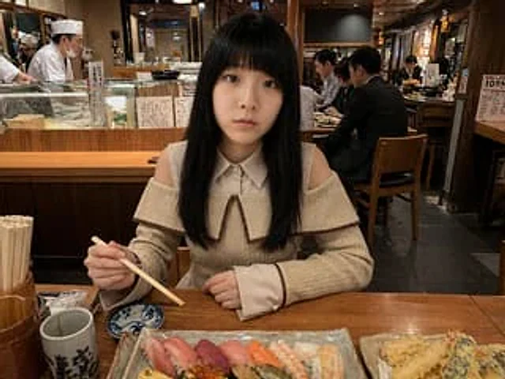

```text
A realistic snapshot of a restaurant shows a young Japanese woman sitting at a traditional Japanese restaurant's wooden sushi counter in warm lighting, positioned in the center of the frame and facing the camera. She has long, straight hair.{argument name="hair color" default="black"} Her hair was styled with bangs, and she wore a soft beige knitted off-the-shoulder sweater with a wide, sailor-style neckline trimmed in brown, over which was a white button-down collar. The long sleeves had flared cuffs, showcasing a feminine and elegant style. She held chopsticks in her right hand, hovering above a small blue dish, while her left hand rested on the table. In front of her was a rectangular ceramic plate neatly arranged with eight pieces of sushi: pink tuna, dark red tuna, orange salmon, two pieces of shrimp nigiri sushi, and pale white fish. To her right was another rectangular plate containing assorted tempura, including two large shrimp and mixed vegetable tempura. To the left of the table were a ceramic teacup with striking black Japanese calligraphy, a wooden chopstick holder filled with disposable chopsticks, and some small packages. Behind her was an open sushi bar, where two chefs in white uniforms and chef hats could be seen, along with a glass display case, a handwritten Japanese menu, a wooden bar counter, and several customers dining in the background. Shot from eye level, it has the quality of smartphone photography, presenting a natural indoor perspective, a documentary style, rich wood texture, warm amber lighting, delicate food details, and shallow to medium depth of field, creating a real and busy dinner atmosphere. It is unstylized, not an illustration, and has a photorealistic feel.
```

Model: GPT Image 2
Author: GPT Image 2 Prompts

[ProjectD](https://aitoolsradar.com/en/prompts/d34aa6649ec543) · [Recorded source](https://x.com/Kukkuree/status/2047639530275246303#reversed-0)
 · [Full original metadata and byte evidence](data/projectd-batch-0042.json)

## Photorealistic Tech Newspaper Mockup


```text
{
  "type": "Photorealistic photography of printed newspapers",
  "style": "Realistic paper texture, slightly angled top view, natural lighting effects.",
  "header": {
    "left_logo": "SHINSEGAE DUTY FREE",
    "center_title": "{argument name=\"newspaper name\" default=\"South Korean economy\"}",
    "right_logo": "Myeongryun Jinsa Galbi",
    "date": "{argument name=\"date\" default=\"Thursday, April 23, 2026\"}"
  },
  "headlines": {
    "main": "{argument name=\"main headline\" default=\"OpenAI releases next-generation model &#39;Spud&#39;, sweeping coding and cyber warfare benchmarks.\"}",
    "sub": "The brand-new super app 'Codex' has been launched... Will it become a game-changer in the AI ​​war?"
  },
  "layout": {
    "sections": [
      {
        "title": "Central graphic",
        "position": "middle",
        "text": "Introduced with great fanfare{argument name=\"app name\" default=\"Codex\"} A super app for everyone",
        "ui_screens_count": 3,
        "ui_screens_labels": [
          "A menu list containing options such as writing code and data analysis.",
          "Analysis dashboard with purple line graph",
          "A code editor that displays Python Fibonacci functions."
        ]
      },
      {
        "title": "Article column",
        "position": "Around the central graphic",
        "count": 3,
        "labels": [
          "The left column containing the article text",
          "The middle column below the graphic",
          "Right column with key points"
        ]
      },
      {
        "title": "bottom area",
        "position": "bottom",
        "headline": "{argument name=\"bottom headline\" default=\"Driven by a surge in AI-related stocks, New York stocks rose across the board... the Nasdaq index climbed 2.7%.\"}",
        "ad_box": "The text in the dark blue box reads: Samsung Electronics, the world's leading memory semiconductor company."
      }
    ]
  }
}
```

Model: GPT Image 2
Author: GPT Image 2 Prompts

[ProjectD](https://aitoolsradar.com/en/prompts/fedfd2012d7d1a) · [Recorded source](https://x.com/ai_hakase_/status/2045700163277107473#reversed-3)
 · [Full original metadata and byte evidence](data/projectd-batch-0042.json)

## Photorealistic Tennis Player Studio Portrait

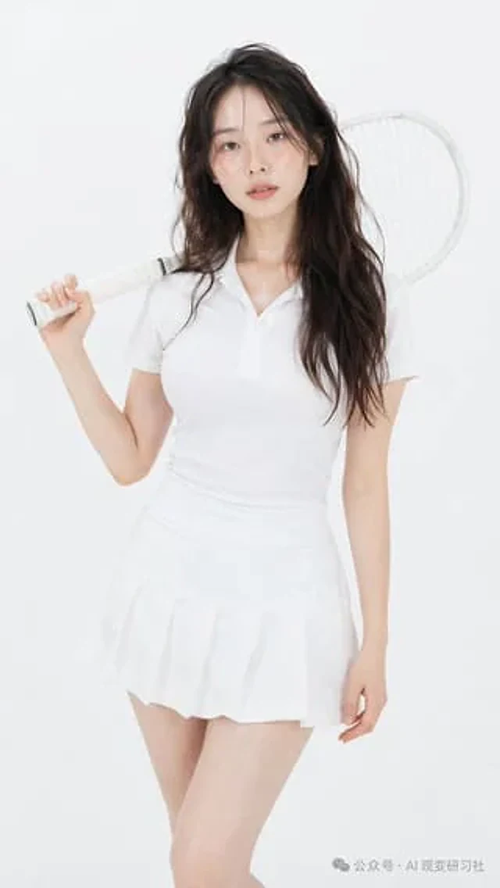

```text
A realistic studio portrait, the subject is{argument name="subject ethnicity and gender" default="A young Asian woman"} She kept it.{argument name="hair style" default="Long, dark, wavy hair"} Her face was adorned with faint freckles, and fine beads of sweat glistened on her skin, giving her a fresh and sporty appearance. She wore {argument name="outfit" default="An all-white tennis outfit, paired with a fitted short-sleeved polo shirt and a pleated mini skirt."} She casually slung a gun over her shoulder.{argument name="prop" default="White tennis racket"} He looked calmly directly into the camera. The background was {argument name="background" default="Seamless bright white studio background"} It is also equipped with soft, high-key lighting.
```

Model: GPT Image 2
Author: GPT Image 2 Prompts

[ProjectD](https://aitoolsradar.com/en/prompts/d18334c71b2263) · [Recorded source](https://x.com/coconut_256/status/2045026556561719581#reversed-2)
 · [Full original metadata and byte evidence](data/projectd-batch-0042.json)

## Photorealistic Winter Portrait with Snowflakes


```text
A lifelike close-up portrait of a beautiful young woman.{argument name="hair style" default="Golden long waves"} Her hairstyle, coupled with her captivating blue eyes, is a gentle and warm smile gazing at the camera. She is dressed in warm clothing and wearing {argument name="winter outfit" default="A white ribbed knit beanie with pom-poms, paired with a thick white turtleneck sweater in the same color family, and a beige plaid winter coat."} Soft snowflakes drifted gently around her, a few landing naturally on her hair, hat, and shoulders. The background was blurred.{argument name="background" default="Snow Forest"} In the top left corner, there is a dark, semi-transparent rounded rectangle containing the white text "{argument name="overlay text" default="GPT Image-2"} ".
```

Model: GPT Image 2
Author: GPT Image 2 Prompts

[ProjectD](https://aitoolsradar.com/en/prompts/c81a487bb2b8d0) · [Recorded source](https://x.com/HitPawofficial/status/2045060581292724318#reversed-1)
 · [Full original metadata and byte evidence](data/projectd-batch-0042.json)

## Physical Exam Question Layout


```text
Generate a physical map{argument name="subject" default="High school exams"} topic{argument name="type" default="Multiple choice questions"} The image is at 9:16. Generate 4 images, each corresponding to one answer to the given question.
```

Model: GPT Image 2
Author: GPT Image 2 Prompts

[ProjectD](https://aitoolsradar.com/en/prompts/ded3496e5aa653) · [Recorded source](https://x.com/peter6759/status/2046789718428594409)
 · [Full original metadata and byte evidence](data/projectd-batch-0042.json)

## Pilates Studio Ad Poster


```text
ピラティス教室の広告画像を作成したい テキストはよりユーザーが登録をするのに惹かれるような文言にし、画像内には女性がピラティスを実際に行っている様子を映して
```

Model: GPT Image 2
Author: @ck_igarashi

[ProjectD](https://aitoolsradar.com/en/prompts/c690864e1a968c) · [Recorded source](https://x.com/ck_igarashi/status/2046528889124728993)
 · [Full original metadata and byte evidence](data/projectd-batch-0042.json)

## Pink Anime Natsuki Banner


```text
A glossy, soft pink anime banner in a wide, cinematic layout features a cute, romantic, and dessert-themed design. On the right is a confident anime girl, showing her upper body, sporting a fluffy short bob and hair color {argument name="hair color" default="Soft pink"} She has large, pinkish-purple eyes, a gentle smile, and crossed arms. She wears a Japanese school uniform: a brown blazer, a white shirt with a red bow at the collar, and a dark navy blue and purple plaid skirt. Two red ribbon hair accessories are added, a larger bow on the side, and a smaller ribbon decoration. On the left side, her name is presented in bold, glossy 3D cursive script.{argument name="character name" default="Natsuki"} The background should be a layered scrapbook collage in blush pink tones, with a bright pink outline, soft bevels, subtle shadows, shimmering effects, and a small heart decoration within the font. The background should be a layered scrapbook collage in blush pink tones with notebook paper textures, a subtle grid, and torn paper details, scattered with doodle hearts, petals, glitter, and cute baking elements. In the upper right and center-right corners, add four sketch-style portrait cards of the girl behind her, arranged like overlapping Polaroid photos. In the lower left and lower-left-center foreground, add two cupcakes, both adorned with pink frosting, striped wrapping paper, and miniature heart decorations or candy embellishments. Decorate the composition with flowing ribbons and bows: four main ribbon elements are visible, including one bow near the upper left, one near the lower left, and two long, rolled ribbons spanning the top and right edges. It adopts a soft and highly detailed anime illustration style, combined with exquisite lighting, dreamy halo, romantic Valentine's Day color scheme, delicate texture, and simple yet visually impactful thumbnail composition.
```

Model: GPT Image 2
Author: GPT Image 2 Prompts

[ProjectD](https://aitoolsradar.com/en/prompts/1cac1a024233da) · [Recorded source](https://x.com/mirochill/status/2047639852485620070#reversed-0)
 · [Full original metadata and byte evidence](data/projectd-batch-0042.json)

## Pink Fashion Magazine Cover


```text
A glossy, high-fashion magazine cover portrait, shot vertically, evokes the style of a premium beauty and fashion publication. The image features a close-up of a young woman from the chest up, set in a softly glamorous studio environment. She is slightly turned to the side, one hand raised to her lips, her posture elegant and understated. Her face is deliberately obscured by a solid, matte, warm beige rectangle in the center. She has long, light brown, slightly wavy hair, with pink highlights shimmering in the strands. She wears large, delicate silver hoop earrings, and her nails are neatly manicured and painted with pale pink nail polish. She wears a pale pink, plush knit sweater with wide sleeves, exuding a luxurious and comfortable feel. The overall design uses a monochromatic pink palette, complemented by warm rose-colored lighting, soft lighting effects, shallow depth of field, meticulous retouching, and editorial fashion photography aesthetics. The background features a smooth pink gradient with subtle studio fog and halo effects. Designed as a magazine cover, it incorporates layered typography: a very large pale pink masthead at the top, with the text "..."{argument name="magazine title" default="GPT"} The upper right corner features an elegant serif font.{argument name="cover line" default="image 2.0"} Add small text "MAY 2024" and "FASHION &amp; BEAUTY MAGAZINE" to the top left corner. Add three sidebars: "Special Interview" in the top left with Japanese text and "8P" below it; "Trend Report" in the bottom left with Japanese text below it; "Beauty Update" in the middle right with Japanese text below it; and "Style Guide" in the bottom right with Japanese text below it. Place a prominent large serif title at the bottom with the text "..."{argument name="main headline" default="The Power of Confidence."} The title, “The Power of,” is in black italic serif, while “Confidence.” is in oversized dark pink italic serif. Below it is the Japanese subtitle, “自分を信じて、もっと輝く私に.” The cover maintains a luxurious, elegant, trendy, and sophisticated feel, reminiscent of a contemporary Japanese fashion magazine.
```

Model: GPT Image 2
Author: GPT Image 2 Prompts

[ProjectD](https://aitoolsradar.com/en/prompts/dde616be104975) · [Recorded source](https://x.com/pahuge/status/2047702391265587424#reversed-0)
 · [Full original metadata and byte evidence](data/projectd-batch-0042.json)

## Pink Idol Anime Lock Screen


```text
This is an incredibly detailed anime-style smartphone lock screen wallpaper, using a 9:16 portrait orientation and featuring a dazzling pink idol aesthetic theme. The main character in the image is {argument name="character name" default="Akari"} A lively magical idol girl with super long and fluffy hair{argument name="hair color" default="Soft pink"} She has twin ponytails, bright green eyes, fair skin, and a playful, lively expression. She wears a gorgeous, ruffled stage costume in layers of pink, pale purple, and white, adorned with gold trim, ribbons, heart patterns, lace cuffs, a choker bow, star earrings, and a flower-shaped hair accessory. The background is a dreamy pink mist, embellished with light spots, glitter, and soft glow effects. The design mimics a phone lock screen, featuring a large white lock icon at the top center, a cellular network status icon in the upper right corner, and the date displayed in Japanese as "May 22nd, Thursday." Above this is a large, glowing time display.{argument name="time display" default="22:22"} The image features five representations of the same character: a central half-body figure blinking and playfully touching its lips with a finger; a bust in the upper left corner laughing with its eyes closed; a full-body or three-quarter-body figure in the upper right corner joyfully raising a small magic wand or key-shaped object; a small figure in the lower left corner with its face obscured by a blurred pink rectangle, reaching out; and a crouching figure in the lower right corner, also with its face obscured by a blurred pink rectangle, interacting with a large physical lock. Handwritten Japanese onomatopoeia, including playful exclamations and annotations, are added around the characters. Two iPhone-style message notification banners, both from "メッセージ" and "お兄ちゃん," display the message "今どこ〜？" (What's up now?), one tilted to the left and the other vertically placed on the right. A rounded, semi-transparent slider with the Japanese phrase "スライドでロック解除" (Slide to unlock) and a lock icon is placed at the bottom of the screen. The unlocking concept is materialized by attaching an oversized brass padlock and latch to the slider, with a character in the lower right corner attempting to open it with a key; handwritten Japanese text nearby hints at the lock's removal and a metallic click sound. The lower left corner contains two circular utility icons: a flashlight and a trash can, as well as a manga-style speech bubble that reads "ポイッ!" (Pocky!). The lower right corner features a camera icon within a dark circular button, and at the very bottom is a thin, white home screen indicator. The overall rendering uses a refined, glossy anime illustration quality, with soft lighting, dense flashes, a sense of layered transparency, and a cute, playful atmosphere, as if an idol character has taken over the phone and physically prevented the screen from unlocking.
```

Model: GPT Image 2
Author: GPT Image 2 Prompts

[ProjectD](https://aitoolsradar.com/en/prompts/cc7f8399ea6df5) · [Recorded source](https://x.com/NeneneAI/status/2046861659319497195#reversed-0)
 · [Full original metadata and byte evidence](data/projectd-batch-0042.json)

## Pink Kawaii Beauty Collage


```text
{"type":"Beauty Photo Collage","subject":{"gender_presentation":"Feminine Young Woman","hair":{"color":"}}{argument name="hair color" default="jet black"} ","style":"Long straight hair, glossy, center part"},"styling":{"hair_accessories_count":2,"hair_accessories":["Pink butterfly hair clip on the left","Pink butterfly hair clip on the right"],"top":"Soft light pink spaghetti strap camisole","outerwear":"Fluffy white fuzzy sleeves, covering part of the hands","jewelry":"Delicate dangling earrings","nails":"Long glossy almond-shaped manicure, light pink base, embellished with rhinestones and semi-transparent 3D flower decorations","rings_count":2,"rings":["Pink flower ring","Small decorative ring"],"extra_accessories":["Pink flower hand accessories near the fingers"]},"composition":{"layout":"2x2 Grid mosaic","panel_count":4,"background":"Clean light gray studio background","crop":"Each panel features a compact head-to-chest makeup close-up","lighting":"High-key soft studio lighting, bright and diffused with minimal shadows","camera_style":"Editorial makeup photography, shallow depth of field, clear hair strands, soft and radiant skin"},"panels":[{"position":"Top left","pose":"Face slightly forward, one hand raised to cheek, fluffy white sleeves stand out in the foreground"},{"position":"Top right","pose":"One hand raised to near lips and chin, fingers elegantly curved, showcasing manicure and flower rings."} "},{"position":"Bottom Left","pose":"Body slightly leaning down, hands crossed near the bottom edge, white fuzzy sleeves visible, emphasizing nail art"},{"position":"Bottom Right","pose":"Hands resting under chin, presenting a cute makeup pose, pink nail art and ring centered"}],"style":{"mood":"Sweet, soft, feminine, cute makeup editor","color_palette":"Light pink, white, soft blush, contrasting with black hair","retouching":"High-detail skin texture, refined eye, eyelash, lip, and hairline edges, exquisite luxury cosmetics ad quality"},"image_goal":"Created by the same{argument name="character type" default="young women"} The four-panel mosaic, featuring a harmonious light pink color scheme, emphasizes glossy black hair, pink butterfly hair clips, fluffy white sleeves, and delicate pink nail art. Each panel presents a slightly different pose. The overall effect maintains a minimalist studio environment and a soft, romantic tone. (Quality: "Ultra-fine, high-resolution, sharp focus, clean skin texture, premium beauty photography", Aspect Ratio: "3:4")
```

Model: GPT Image 2
Author: GPT Image 2 Prompts

[ProjectD](https://aitoolsradar.com/en/prompts/9a3d76bfeeffca) · [Recorded source](https://x.com/qisi_ai/status/2047609512056799478#reversed-0)
 · [Full original metadata and byte evidence](data/projectd-batch-0042.json)

## Pink Kawaii Idol Lipstick Portrait


```text
A highly detailed, glossy portrait of an anime idol, presented in a vertical composition, showcasing a cute half-body portrait of a young girl, exhibiting a dreamy, adorable pink aesthetic. She possesses {argument name="hair color" default="Soft pink"} Her hair was styled in a super long and voluminous high ponytail, with soft bangs and flowing curls, decorated with multiple small heart-shaped hair clips and crisscrossing hairpins. Her eyes were big and bright, displaying a vivid {argument name="eye color" default="Emerald"} The color, with star-like highlights, long eyelashes, and a slightly dewy sheen. She had soft blush and small, moist lips, applied with {argument name="lipstick color" default="Bright pink"} Her expression is full of love as she applies the lipstick, gently holding the tube to her lips with both hands. She wears a black and pink Gothic Lolita idol dress adorned with lace, ribbons, bows, hearts, and a shimmering texture. She also wears a black lace bow headband with a pink gemstone heart, three hair accessories visible in her bangs, a pair of heart-shaped pendant earrings, and a black choker with small heart pendants. The character is surrounded by a glowing, glittery, candy-pink background, filled with light spots, glitter, soft neon effects, and an idol fan atmosphere. Add 5 around the character A glowing hand-drawn Japanese love bubble text, the content of which is: "かわいすぎてごめん...♡", "PUSH してくれてありがとうっ♡", "ずーっとだいすきっ♡", "世界でいちばんのPUSHしになってね…♡" and "ずっと一丝だよ? RESTRAINT...♡". Include a small decorative photo card or poster of the same girl in the upper right corner background. Super exquisite illustrations, rich glitter, romantic light and shadow, glossy highlights, complex lace details, soft focus background, saturated pink tones, and cute idol poster texture.
```

Model: GPT Image 2
Author: GPT Image 2 Prompts

[ProjectD](https://aitoolsradar.com/en/prompts/fb21e9e3cd5824) · [Recorded source](https://x.com/NeneneAI/status/2046721817893872064#reversed-0)
 · [Full original metadata and byte evidence](data/projectd-batch-0042.json)

## Pink Lolita Pose Variation Sheet


```text
{"type":"Anime Character Pose Variation Reference Images","style":"A gorgeous and cute Gothic Lolita fashion reference poster, mainly in pink monochrome lines, paired with a soft white background, delicate rose patterns, lace borders, heart decorations, showcasing an elegant shoujo manga style","character":{"name":"{argument name="character name" default="Aoi"} ","appearance":"A young girl with a short bob haircut, big eyes, and a soft, doll-like face, wearing a delicate and sweet Lolita dress themed around strawberries and roses","outfit":{"color":"{argument name="outfit color" default="pink"} ","pieces":["Rose lace headband with floral and veil-like trim","Multi-layered ruffled long-sleeved Lolita dress with abundant lace, bows, ruffles and frills","Apron-style pattern and oversized bow at the back","Lace cuffs","Lace-trimmed stockings","Platform Mary Jane shoes with bows and straps"]},"theme":"{argument name="theme" default="Strawberry and Rose Dream Kingdom"} "},"layout":{"format":"Vertical poster reference with decorative floral corners and an ornate title box","title":"Pose variation reference","subtitle":"{argument name="subtitle text" default="The Girl in the Strawberry and Rose Forest"} {"title":"Pose Grid","position":"Upper and Middle Areas","count":8,"items":[{"label":"1 Basic Standing Posture","description":"Neutral standing posture with arms hanging naturally at your sides, full body visible"},{"label":"2 Bowing","description":"Formal bowing posture, upper body leaning forward, hands folded in front of the body"},{"label":"3 Skirt Lifting","description":"Similar to a curtsy, hands lifting the sides of the skirt to show off the volume and ruffles"},{"label":"4 Guiding Posture","description":"Showing posture, one arm extended to the side, making a welcoming gesture"},{"label":"5 Joyful Posture","description":"A vibrant joyful posture, one leg raised, arms raised high, bright smile"},{"label":"6 Surprised","description":"A surprised posture, shoulders slightly shrugged, hands close to the chest, expressing a startled emotion"},{"label":"7 Shy","description":"A shy posture, head tilted, hands close to the face, knees bent inward"},{"label":"8 Back View","description":"Three-quarters of the back view, hands placed behind the back, showing the bow and rear outline"}]},{"title":"Pose Key Points Analysis","position":"Lower left strip area","count":5,"items":[{"label":"Balance","description":"A simple sketch of body balance, with center line and weight distribution"},{"label":"Hand Movements","description":"3 A hand drawing showcasing delicate wrist and finger movements. {"label":"Skirt Spread","description":"Schematic of skirt spread, emphasizing the rounded, voluminous feel and layered ruffles"}, {"label":"Dynamic Bow and Lace","description":"Close-up dynamic study of the bow's tail and fluttering lace"}, {"label":"Foot Position and Gait Example","description":"3"} Example of foot positions for standing and walking in high heels"}]},{"title":"Detail Zoom","position":"Lower Left Side","count":4,"items":[{"label":"Close-up of Hands","description":"Close-up of Cuffs, Lace, Ribbons and Hand Pose"},{"label":"Skirt Layers","description":"Close-up of Multiple Ruffles and Lace on the Skirt"},{"label":"Apron and Pockets","description":"Close-up of Apron Panels, Bows and Decorative Pocket Hangings"},{"label":"Shoes and Feet","description":"Close-up of Socks and Platform Shoes with Bow Ties"}]},{"title":"Pose Design Notes","position":"Lower Right Side Box","count":1,"items":[{"label":"Notes","description":"Handwritten Design Notes in Paragraph Form within Border Text Box"}]},{"footer":"{argument name="footer text" default="Strawberry and Rose Dream Kingdom"} "},"composition":"A simple white poster background, all drawings rendered with uniform pink lines, accented with subtle blush and red hair color, symmetrical decorative borders, floral clusters in the top two corners, clear and easy-to-read reference layout, full-body character drawings distributed across 8 bordered panels, with explanatory miniatures and close-up details at the bottom,"quality":"High detail, clear and fine lines, crisp design, sophisticated printable poster aesthetics."
```

Model: GPT Image 2
Author: GPT Image 2 Prompts

[ProjectD](https://aitoolsradar.com/en/prompts/c391347fbcbc5f) · [Recorded source](https://x.com/GPT_AOI/status/2046532512202228089#reversed-0)
 · [Full original metadata and byte evidence](data/projectd-batch-0042.json)

## Pink Office Transfer Announcement Poster


```text
A glossy, feminine, scrapbook-style office poster, inspired by sitcom-style workplace promotions, uses a 2:3 vertical composition. The image shows a key female figure standing in front of seven office colleagues against a warm beige office backdrop featuring blinds, desks, and a clearly visible Dunder Mifflin-style wall sign. The key female figure sports a messy blonde high bun, wears a light pink floral V-neck dress, and poses with her arms crossed, exuding confidence and a celebratory vibe. Behind her, seven colleagues are arranged in a loose semi-circle, dressed in soft blue, brown, black, and lilac office attire. The image is constructed as a mixed-media collage, incorporating torn paper, washi tape notes, brush-written headings, glitter textures, flowers, and pink and gold embellishments. A pink rectangular company card is placed in the upper left corner, featuring a white office logo and the text "DUNDER MIFFLIN, INC" and "PAPER COMPANY". At the top center is a large torn paper title, written in expressive calligraphy: "TRANSFER CONFIRMED," with "TRANSFER" in bright pink and "CONFIRMED" in black, underlined in pink and featuring a hand-drawn heart. In the upper right corner, a small off-white card is secured with pink tacks and pink tape, reading "NEW CHAPTER. NEW SCRANTON." Near the bottom center, a bold title consisting of four stacked lines of text is layered:{argument name="character name" default="PENNY"} Located on a pink paintbrush banner, "IS" is on a small white strip with two small hearts, "JOINING" is on a gold paintbrush banner, and "THE OFFICE" is on a light pink strip. A long pink transfer tag hangs in the lower left corner, held with a gold paperclip, reading "FROM DUNDER MIFFLIN, INC PAPER COMPANY / SCRANTON, PA / EST. 1949" above and "TO THE OFFICE / SCRANTON, PA" below, with a pink bathroom-style icon of a woman and a desk at the bottom. A pink card is placed in the lower right corner, divided into three sections: "NEW ROLE" with {argument name="job title" default="Sales Representative"} “NEW TEAM” paired with “{argument name="team text" default="Same Paper"} , and “NEW MEMORIES” paired with “{argument name="memories text" default="Let’s make some!"} Each section is decorated with small pink hearts. A pink ribbon is added to the center of the bottom, with the words "DUNDER MIFFLIN, INC. WELCOMES" written on it.{argument name="character name" default="PENNY"} ♡. The line below contains three small icons and text items: a glitter icon with "NEW JOB", a team icon with "NEW TEAM", and a heart icon with "NEW MEMORIES". A striking handwritten pink cursive "LET'S GO!" is added to the bottom right corner. Corners are decorated with pink peonies, tiny white-filled flowers, torn paper edges, soft glitter, and delicate gold foil dots. A warm rose hue, including blush pink, cream, gold, and black, creates a sophisticated poster composite effect, soft, charming lighting, and a joyful, celebratory atmosphere.
```

Model: GPT Image 2
Author: GPT Image 2 Prompts

[ProjectD](https://aitoolsradar.com/en/prompts/10979136386a70) · [Recorded source](https://x.com/Dawidrrr9/status/2047740402673885466#reversed-1)
 · [Full original metadata and byte evidence](data/projectd-batch-0042.json)

