# ProjectD backfill batch 43

Complete original prompts and exact existing ProjectD images. Actual model labels and any available credits or notices are retained. Missing authors or license metadata are not filled in.

## Pink Princess Idol Character Collage

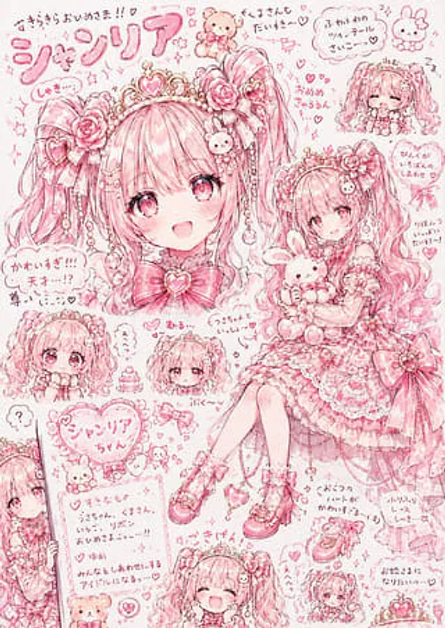

```text
Goal: Create an ultra-cute pink Japanese anime character reference collage for a princess idol named {argument name="character name" default="シャソリア"}, drawn like a dense hand-sketched scrapbook page full of hearts, lace, ribbons, plush toys, and handwritten notes.

Canvas: Vertical 3:4 portrait page, pale blush-pink paper background, monochrome rose-pink line art with soft watercolor shading, high detail, sparkles and doodles everywhere. Use a sweet shoujo manga style with delicate pen strokes, rosy gradients, and a slightly messy hand-drawn layout.

Main subject: A young kawaii princess idol girl with {argument name="hair color" default="cotton-candy pink"} long twin-tail hair, big sparkling pink eyes, frilly lace dress, heart tiara, rose hair ornaments, pearl chains, bows, heart accessories, ruffled socks, and pink Mary Jane heels. She should feel adored, shy, fluffy, and doll-like. Add bunny and teddy-bear motifs throughout.

Layout: Make a crowded character sheet collage with exactly 9 visible depictions of the same character: 1 large seated full-body illustration on the right holding a bunny plush; 1 large left-side close-up/back-of-head portrait with ornate heart tiara and roses, partially covered by a centered blank square placeholder; 1 sleeping chibi face in the top-right corner; 1 small chibi face at lower left with puffy sleeves; 1 small neutral chibi head near the lower middle; 1 happy laughing head at the bottom center; 1 tiny full-body chibi at the bottom right; 1 peeking half-body character entering from the left edge; and 1 small shy face/portrait near the center-left. Keep the main full-body figure as the visual focus.

Blank area: Place a large opaque pastel pink square in the upper-left/center area, covering part of the large portrait, as an empty image/name placeholder.

Text content: Use playful handwritten Japanese notes and labels in pink ink. Include a large bubbly title at the top-left reading {argument name="title text" default="シャソリア"}. Add scattered handwritten phrases such as 「すきらきらおひめさま!!♡」, 「しくすさんもだいすき♡」, 「ふわふわのリボンテールさいこーっ♡」, 「かわいすぎ!!! 天才…!? 尊い(;_;)♡」, 「すきなもの うさちゃん、くまさん、いちご、リボン おひめさまっ…!!」, 「ゆめ みんなをしあわせにするアイドルになるっ…♡」, 「ぴんくがいちばんしあわせ♡」, 「リほんいっぱいだいすき!」, and 「お姫さまになりたいの…♡」. Make the handwriting casual, rounded, and decorative, with speech bubbles and cloud-shaped note boxes.

Decorative elements: Include exactly 6 prominent plush or animal mascots: a teddy bear at the top center, a bunny at the top right, a bunny plush held by the main girl, a small teddy near the bottom note card, a small bunny near the heart name balloon, and a tiny animal hair clip on the main girl. Add many hearts, stars, bows, roses, pearls, lace trims, dangling charms, a heart-shaped name balloon, a small cupcake, heart shoes, and tiny crowns.

Color and finish: Predominantly pink and red-pink ink on a light cream-pink background, with white highlights and soft blush shading. Keep everything cute, detailed, cluttered, and hand-drawn, like a scanned idol character concept sheet. No realistic rendering, no dark colors, no modern UI, no watermark.
```

Model: GPT Image 2
Author: あまり🖋️AI &フリー素材配布

[ProjectD](https://aitoolsradar.com/en/prompts/1d6af40fb24beb) · [Recorded source](https://youmind.com/prompts/pink-princess-character-sheet-25080)
 · [Full original metadata and byte evidence](data/projectd-batch-0043.json)

## Pink Soft Serve on Spoon

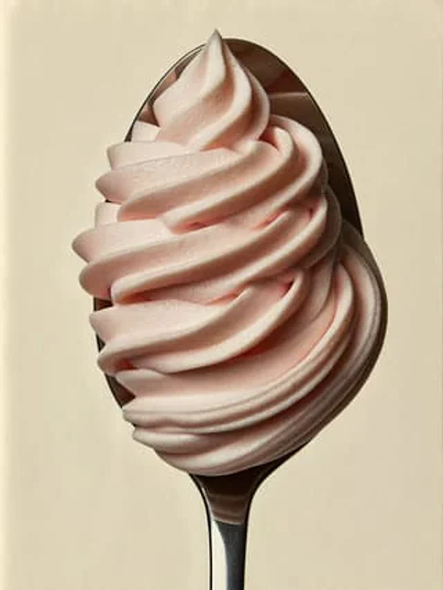

```text
Create a photorealistic close-up food still life of one polished stainless-steel spoon held vertically in the center of the frame, its bowl facing forward and filled with one tall mound of {argument name="dessert type" default="soft-serve ice cream"}. The dessert is {argument name="dessert color" default="pale blush pink"}, piped into a glossy spiral with exactly 7 broad visible ribbon folds wrapping around the mound and a sharp curled peak at the top. The texture should look creamy, dense, and slightly aerated with tiny surface pores and soft highlights. Use warm natural side lighting from the upper left, creating gentle shadows in the spoon bowl and subtle reflections along the metal rim and handle. The background is a plain {argument name="background color" default="warm beige"} surface with a faint paper-like texture, no props, no text, no hands, and no visible bowl or cone. Compose the image as a vertical 3:4 crop, macro lens perspective, shallow depth of field, centered subject, realistic color grading, minimal elegant food photography style.
```

Model: GPT Image 2
Author: 개

[ProjectD](https://aitoolsradar.com/en/prompts/f264963b3e9b7b) · [Recorded source](https://youmind.com/prompts/pink-soft-serve-spoon-25960)
 · [Full original metadata and byte evidence](data/projectd-batch-0043.json)

## Pink Surreal Wall Street Fashion Scene

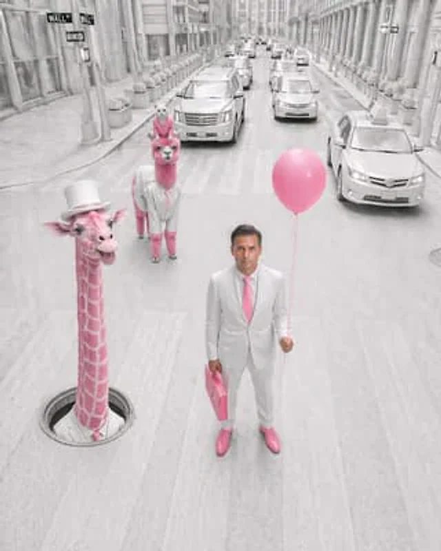

```text
A surrealist fashion editorial photograph, set against a backdrop mimicking Wall Street, employs a slightly upward-looking frontal perspective and a soaring vertical composition. The entire environment is almost monochromatic in white and light gray, with only carefully selected touches of pink standing out. In the foreground, a faceless figure {argument name="person" default="adult male"} Standing in the middle of the pedestrian crossing, dressed in a smart white suit and white shirt,{argument name="tie color" default="pink"} Ties and glossy finish{argument name="shoe color" default="pink"} He's dressed in formal leather shoes, holding a pink balloon in his right hand and a pink briefcase in his left. To his left, a surreal pink giraffe emerges vertically from a round manhole cover, wearing a white top hat and a white tie with a pink tie, looking playful. Behind him, on the left side of the driveway, stands a pink alpaca, dressed in a white suit and pink tie, with a small white cat wearing tiny pink accessories perched on its head, standing tall and gazing straight ahead. The street is lined with tall, classical stone buildings, repetitive columns, shop windows, rows of identical potted shrubs, and numerous light-colored luxury cars and taxis stretching into the distance. Nearby in the upper left corner are clearly visible Wall Street-style street signs. The road surface, cars, buildings, and sky are all bleached gray-white, creating a dreamlike, high-profile visual effect, while the pink elements remain highly saturated: giraffe, alpaca, balloon, briefcase, tie, and shoes. Style: Fantasy surrealism, luxury editorial photography, perfect symmetry, soft overcast lighting, clean cinematic realism, eerie yet elegant atmosphere, ultra-fine textures, shallow facial details, and facial features deliberately obscured or blurred.
```

Model: GPT Image 2
Author: GPT Image 2 Prompts

[ProjectD](https://aitoolsradar.com/en/prompts/d374c9ea523e09) · [Recorded source](https://x.com/DakotaMau/status/2047785569107821056#reversed-0)
 · [Full original metadata and byte evidence](data/projectd-batch-0043.json)

## Pirate Idol Costume Character

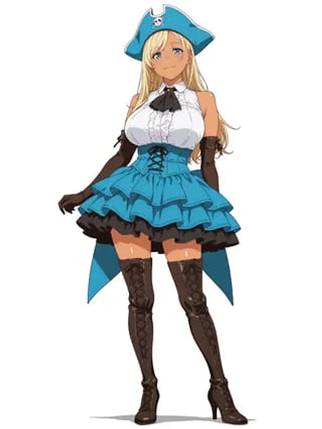

```text
Create a full-body anime-style character illustration on a plain white background: a curvy young female idol dressed in a pirate-inspired stage costume, standing front-facing in a confident fashion pose with one hip slightly tilted and arms relaxed at her sides. She has long flowing {argument name="hair color" default="blonde"} hair falling past her shoulders and wears a large turquoise-blue pirate tricorn hat with white trim and a small white skull-and-crossbones emblem centered near the front. Her face should be left blank/obscured or minimally detailed, while the outfit is the focus. The costume consists of exactly 7 main visible clothing elements: 1) oversized turquoise pirate hat with skull emblem, 2) white sleeveless ruffled blouse with high collar and front frills, 3) black ribbon bow tie with a small gold brooch at the neck, 4) turquoise corset waist cincher with black crisscross lacing, 5) layered short turquoise idol skirt with two flouncy tiers, 6) black ruffled underskirt visible beneath the blue skirt, and 7) long turquoise split back tailcoat panels hanging behind the skirt. Add exactly 2 black opera-length gloves with small lace-up ribbon details near the upper arms, and exactly 2 dark brown thigh-high lace-up heeled boots with glossy highlights and pointed heels. Use clean cel-shaded anime rendering, crisp line art, bright turquoise accents, glossy leather shading on gloves and boots, soft skin highlights, and a centered character-sheet composition with no background props, no text, no watermark, and no extra accessories beyond the described pirate idol outfit. Overall mood: glamorous live-performance pirate idol costume design in teal, white, black, and dark brown.
```

Model: GPT Image 2
Author: Kei🍤衣装本舗

[ProjectD](https://aitoolsradar.com/en/prompts/4a7a8c03011b60) · [Recorded source](https://youmind.com/prompts/pirate-idol-costume-25418)
 · [Full original metadata and byte evidence](data/projectd-batch-0043.json)

## Pixar Style Character Design Sheet

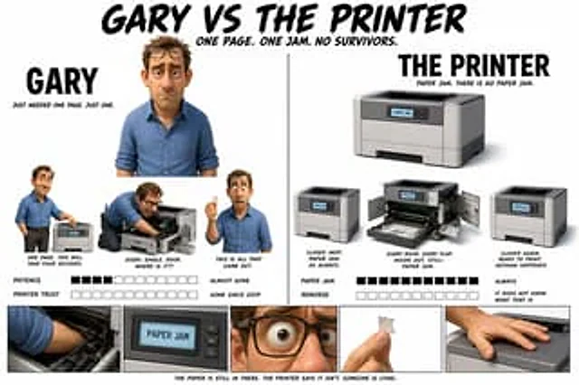

```text
Create a Pixar 3D style character design sheet. Clean white background. Two characters side by side with a clean dividing line. Bold brushstroke-style title at the top: {argument name="main title" default="GARY VS THE PRINTER"}. Subtitle beneath: {argument name="subtitle" default="One page. One jam. No survivors."}
```

Model: GPT Image 2
Author: TechieSA

[ProjectD](https://aitoolsradar.com/en/prompts/170667b167f04b) · [Recorded source](https://youmind.com/prompts/pixar-character-design-sheet-20241)
 · [Full original metadata and byte evidence](data/projectd-batch-0043.json)

## Pixar-Style AI Web Design Sprint Poster

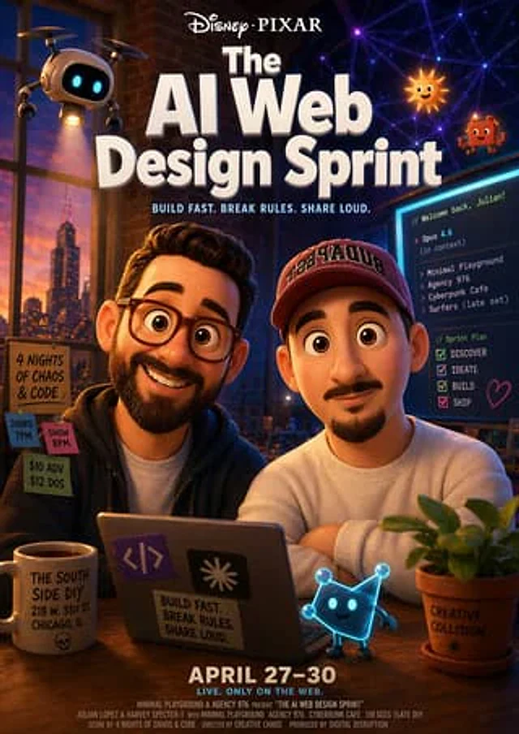

```text
This creative coding event poster, imbued with a cinematic feel, adopts the design style of Disney-Pixar animated movie posters. Using a vertical composition, it presents a warm, indoor nighttime scene. A large loft window on the left reflects the city skyline at sunset, with exposed brick walls in the background, creating a neon-lit creative studio atmosphere. At the top center, a striking, glossy, 3D typography displays "Disney•PIXAR," below which is a large, bold white 3D headline: "The AI ​​Web Design Sprint." Directly below is smaller, bright text: "BUILD FAST. BREAK RULES. SHARE LOUD." In the foreground, two adult men sit side-by-side at a wooden table with a laptop between them, conveying a relaxed startup founder vibe; one wears a dark hoodie, the other a light-colored sweatshirt and baseball cap, both facing the camera with friendly and promotional poses. Their faces are rendered generically and seamlessly, emphasizing the poster's composition rather than portrait realism. The laptop lid has three visible stickers: a purple code bracket sticker, a black sticker with a white explosion symbol, and a rectangular slogan sticker that reads "BUILD FAST. BREAK RULES. SHARE LOUD." The scene is surrounded by four fantastical animated mascot elements: a floating robotic drone light in the upper left corner with glowing blue eyes, projecting a warm beam of light downwards; a smiling cartoon sun icon in the upper right corner; a small red pixelated character floating nearby; and a glowing blue cat-shaped digital mascot standing in front of the laptop on the table. The right-hand vertical display shows a dark code interface with clearly visible text, including "// Welcome back, Julian!", "Opus 4.6", "Minimal Playground", "Agency 976", "Cyberpunk Cafe", "Surfers (late set)", and a list titled "Sprint Plan" containing four items: "DISCOVER", "IDEATE", "BUILD", and "SHIP". On the left, a handwritten paper sign is pinned with four notices: “4 NIGHTS OF CHAOS &amp; CODE,” “DOORS 7 PM,” “SHOW 8 PM,” and “$10 ADV / $12 DOS.” In the lower left foreground, a white coffee mug reads “THE SOUTH SIDE DIY 218 W. 31ST ST. CHICAGO, IL” with a small skull icon. In the lower right foreground, a terracotta planter contains greenery and is labeled “CREATIVE COLLISION.” At the bottom center, bold text reads “APRIL 27–30,” below which is “LIVE. ONLY ON THE WEB.” A small credits line, reminiscent of a movie poster, is added to the bottom edge, referencing names like Julian Lopez and Harvey Specter, as well as projects such as Minimal Playground, Agency 976, Cyberpunk Cafe, and Surfers, accompanied by playful production titles. Utilizing dramatic warm orange and cool blue lighting, exquisite animated film rendering, soft depth of field, glossy surfaces, rich contrast, and highly refined poster design, the campaign showcases the vibrant energy of a tech startup and delivers the quality of a high-end event advertisement.
```

Model: GPT Image 2
Author: GPT Image 2 Prompts

[ProjectD](https://aitoolsradar.com/en/prompts/38b07cf469be19) · [Recorded source](https://x.com/ransegall/status/2047583778974126564#reversed-0)
 · [Full original metadata and byte evidence](data/projectd-batch-0043.json)

## Pixel art breakfast still life

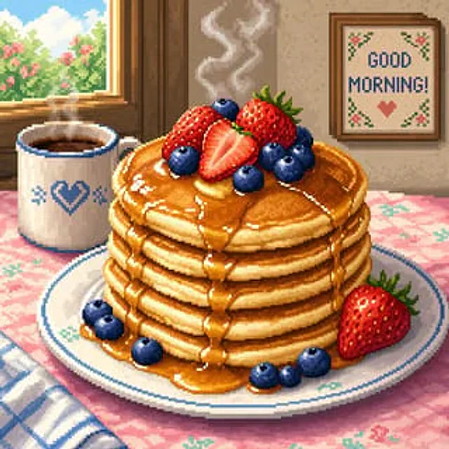

```text
Create a nostalgic pixel-art breakfast still life. Show a tall stack of fluffy golden pancakes drizzled with glossy maple syrup, topped with strawberries and blueberries, with pixelated steam rising into the air. The plate sits on a pastel tablecloth and a hot cup of coffee rests in the background. Use rich breakfast colors, careful lighting, and delicious texture detail while staying true to clean, readable pixel art.
```

Model: GPT Image 2
Author: @reddit-community

[ProjectD](https://aitoolsradar.com/en/prompts/b280522ed98f52) · [Recorded source](https://www.reddit.com/r/midjourney/comments/1jmodcx/animated_pixel_art_food_prompts_included/)
 · [Full original metadata and byte evidence](data/projectd-batch-0043.json)

## Pixel Art Dragon Castle


```text
A richly detailed retro-fantasy pixel art scene depicts a massive medieval stone castle perched atop a steep rocky hill, rendered from a slightly upward angle, with a winding dirt road leading to the gate. The castle boasts numerous cylindrical towers and connecting walls, with nine towers clearly visible, each featuring a reddish-orange conical roof. Several small red flags flutter atop the highest spire, and the walls reveal weathered grey stone textures. A colossal red dragon coils around the highest central tower, its long body entwined around the stone walls, its claws gripping the battlements, its horned head protruding forward, and a large bat-like wing spread out to its right. The hill is surrounded by dense, dark green pine trees and rocky outcrops, with distant blue mountains visible on the horizon. The castle's background is a bright daytime sky, saturated with blue, dotted with large, fluffy white cumulus clouds. Rendered in a classic 16-bit pixel art style, it features sharp sprite shapes, visible pixel textures, rich contrast, an adventure fantasy game cover composition, a centered subject, and a square frame.
```

Model: GPT Image 2
Author: GPT Image 2 Prompts

[ProjectD](https://aitoolsradar.com/en/prompts/f6a2d91cd17084) · [Recorded source](https://x.com/RealAstropulse/status/2047323453166891227#reversed-1)
 · [Full original metadata and byte evidence](data/projectd-batch-0043.json)

## Pixel Art Dragon Castle

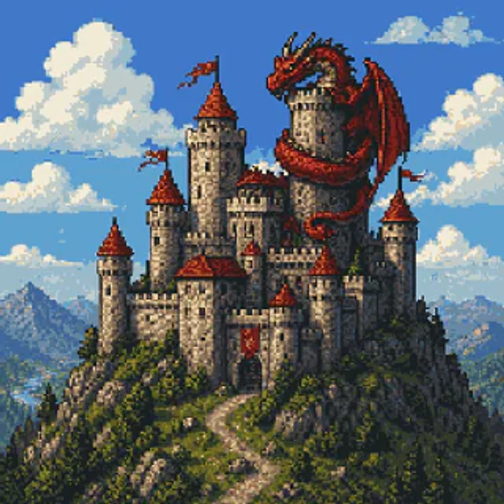

```text
A detailed retro fantasy pixel art scene of a massive medieval stone castle perched on a steep rocky hill, viewed from a slight low angle, with a winding dirt path leading up to the gate. The castle has many cylindrical towers and connecting walls, exactly 9 visible towers with red-orange conical roofs, several small red flags fluttering from the tallest spires, and weathered gray stone masonry. A huge red dragon is coiled around the tallest central tower, with its long body wrapped around the stone, claws gripping the battlements, horned head leaning forward near the top, and one large batlike wing spread open on the right side. Surround the hill with dense dark-green pine trees and rocky outcrops, with distant blue mountains on the horizon. Place the castle against a bright daytime sky in saturated blue with large fluffy white cumulus clouds. Render in classic 16-bit inspired pixel art with crisp sprite-like shapes, visible pixel texture, rich contrast, adventurous fantasy game cover composition, centered subject, and a square frame.
```

Model: GPT Image 2
Author: Astropulse

[ProjectD](https://aitoolsradar.com/en/prompts/fbdbbfbc491f8d) · [Recorded source](https://youmind.com/prompts/pixel-art-dragon-castle-15277)
 · [Full original metadata and byte evidence](data/projectd-batch-0043.json)

## Pixel Art Dragon on Castle

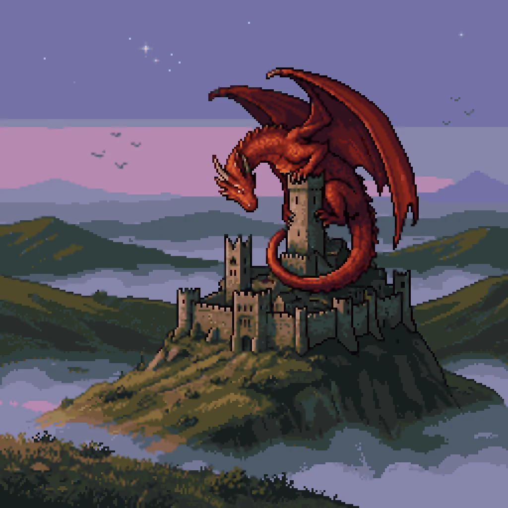

```text
A retro-fantasy pixel art scene, rendered in a 256x256 square, depicts a colossal red dragon guarding the highest central tower of an ancient stone castle. The dragon has a long, curled tail coiled around the tower, enormous bat-like wings spread, its head, with long horns, droops and faces to the left, its body a bright red-orange with deep chestnut shadows and sharp black pixel outlines. The castle, a weathered medieval fortress with multiple towers, crenellated walls, and narrow, dark windows, sits atop a steep, rocky hill. Surrounding the hill are rolling green and brown mountains, partially shrouded in light mist and low clouds, creating a layered atmospheric depth. The sky is dusky, displaying a gradient of pale purple and soft violet, dotted with a few tiny white stars, and in the distance, several birds appear as black pixel silhouettes. It features classic 16-bit game-style sprites, a limited color palette, a visible pixel grid, a clean silhouette design, a dramatic fantasy atmosphere, side-view landscape composition, and a subtle retro game feel.
```

Model: GPT Image 2
Author: GPT Image 2 Prompts

[ProjectD](https://aitoolsradar.com/en/prompts/ab5059b32cbb47) · [Recorded source](https://x.com/RealAstropulse/status/2047323453166891227#reversed-0)
 · [Full original metadata and byte evidence](data/projectd-batch-0043.json)

## Pixel art game concept prompt

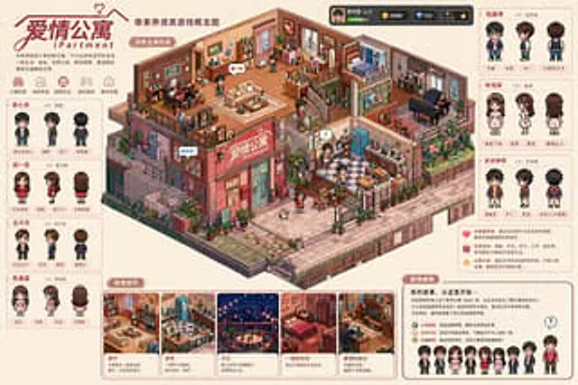

```text
{argument name="主题" default="爱情公寓"} 电视剧主题 像素养成类游戏概念图，包括 场景全局内容，周围环绕各人物形象三视图，底部是场景特写，右下角是剧情梗概
```

Model: GPT Image 2
Author: Cell 细胞

[ProjectD](https://aitoolsradar.com/en/prompts/3e1c7122b6bdff) · [Recorded source](https://youmind.com/prompts/pixel-art-cultivation-game-concept-15922)
 · [Full original metadata and byte evidence](data/projectd-batch-0043.json)

## Pixel Art Movie Poster Prompt

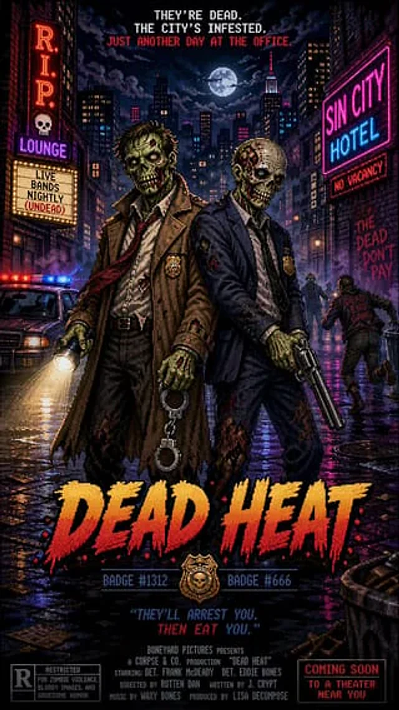

```text
Create a complete scene image in a 9:16 portrait ratio, using a retro 16-bit pixel art style, with sharp edges, cinematic lighting effects, and a rich atmosphere. This is a fictional film {argument name="movie title" default="Dead Heat"} A poster featuring a police thriller with the tagline "Partners". The poster includes {argument name="characters" default="2 Zombie Detectives"} They are searching for the zombie criminal and preparing to arrest him.
```

Model: GPT Image 2
Author: GPT Image 2 Prompts

[ProjectD](https://aitoolsradar.com/en/prompts/a716f6f85c0b98) · [Recorded source](https://x.com/PromptlyAI_YT/status/2046716273556598979)
 · [Full original metadata and byte evidence](data/projectd-batch-0043.json)

## Pixel Art Survival Game UI Mockup

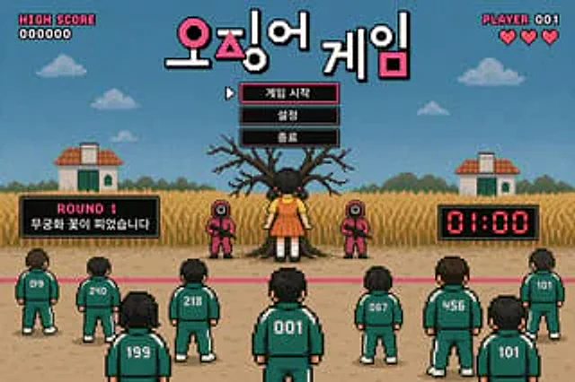

```text
{
  "type": "Retro pixel-style video game sketches",
  "theme": "Survival Death Game",
  "hud": {
    "top_left": [
      "Highest portion",
      "000000"
    ],
    "top_center_title": "{argument name=\"game title\" default=\"Squid Game\"}",
    "top_right": [
      "Player 001",
      "3 red hearts"
    ]
  },
  "menu": {
    "style": "Centered below the title, with a black background border, white pixel text, and the cursor pointing to the first item.",
    "items": [
      "{argument name=\"menu item 1\" default=\"Start Game\"}",
      "{argument name=\"menu item 2\" default=\"set up\"}",
      "{argument name=\"menu item 3\" default=\"quit\"}"
    ]
  },
  "gameplay_ui": {
    "mid_left_panel": [
      "Round 1",
      "{argument name=\"round description\" default=\"Wooden Man Game\"}"
    ],
    "mid_right_panel": [
      "01:00 Red digital timer"
    ]
  },
  "scene": {
    "background": "Blue sky, pixelated clouds, two small houses, and tall yellow grass.",
    "midground": "A huge, withered tree; a giant doll dressed in a yellow shirt and orange dress facing the tree; and two guards dressed in pink jumpsuits, wearing square masks, and holding rifles.",
    "foreground": "A pink starting line on the dirt track, nine players in green tracksuits with their backs to the audience.",
    "player_numbers": [
      "019",
      "240",
      "199",
      "218",
      "001",
      "067",
      "456",
      "101",
      "101"
    ]
  }
}
```

Model: GPT Image 2
Author: GPT Image 2 Prompts

[ProjectD](https://aitoolsradar.com/en/prompts/694b90cd57bd3b) · [Recorded source](https://x.com/opener_ai/status/2044574291212263706#reversed-1)
 · [Full original metadata and byte evidence](data/projectd-batch-0043.json)

## Pixel Game Asset Atlas Template


```text
Please base your answer on [Game Theme:]{argument name="game theme" default="Demon Slayer: Kimetsu no Yaiba / Tanjiro"} Create a "Pixel World Asset Atlas" suitable for serialized releases, with high completion and high information density. This is not a typical pixel illustration or a single game scene, but a "2D pixel game asset overview" for game development, art design, level design, and visual proposals. The visuals should be presented as a complete game asset project, [Game Type:]{argument name="game type" default="Side-scrolling action"} The necessary core characters, enemies, items, terrain, scenes, mechanisms, bosses, and decorative elements are systematically organized into a clear, professional, and reusable game asset atlas. [Basic Settings] Theme/Worldview: [Game Theme] Game Type: [Game Type] Historical Setting: [Historical Setting] Protagonist Identity: [Protagonist Identity] Enemy Type: [Enemy Type] Main Scenes: [Main Scene Environment] Overall Style: [Style Direction, e.g.:{argument name="style" default="16-bit retro arcade pixel style"} [Main Color Scheme: [Main Color Scheme]] [Secondary Color Scheme: [Secondary Color]] [Accent Color Scheme: [Accent Color]] [Aspect Ratio: [Horizontal 4:3]] If not specified, the optimal scheme will be automatically matched based on the game theme. [Overall Visual Requirements] Visually, a large horizontal canvas should be used, with a simple or low-obstruction background, presenting the look of a game development asset list or instruction manual-style resource catalog. All elements should be 2D pixel art sprites with uniform pixel density, clear black/dark outlines, limited color gradations, and a retro game texture. Do not generate realistic photography, 3D renderings, paintings, illustrations, or movie poster styles. The focus is on "system completeness, clear classification, rich resources, and high development potential." [Layout Structure] The atlas uses a modular grid layout, using thin lines to divide different resource areas. Each area should contain a numbered title and a short category label, with the reading path from left to right and from top to bottom. The layout should have the sense of order of an instruction manual or game development document. Information density should be high but not chaotic; elements within each module should be evenly spaced. [Included Modules] 1. Player Character Module: Displays complete action frames, including standing, walking/running, jumping, etc., arranged horizontally like a sprite sheet. 2. Enemy Unit Module: Designs various enemies, including normal, ranged, heavy, and elite units. 3. Weapons and Items Module: Displays melee, ranged, projectiles, effects, and loot. 4. Basic Terrain Tile Module: Displays ground, walls, platforms, corners, and blocks of different materials. 5. Natural/External Scene Resources Module: Displays trees, grass, rocks, and obstacles. 6. Building/Base/Camp Resources Module: Displays doors, windows, walls, ladders, and camp facilities. 7. Special Terrain Module: Displays bridges, water bodies, cliffs, and cave entrances. 8. Indoor/Underground/Facility Resources Module: Displays pipes, control consoles, metal doors, and equipment. 9. Boss/Encounter Resources Module: Displays large bosses, special vehicles, and giant mechanisms. 10. General Decorations and Interactive Elements Module: Displays ladders, ropes, signs, switches, and mechanisms. [Visual Detail Requirements] All resources must maintain consistent pixel dimensions and world-building coherence. Proportional relationships must be clear. Action frames must demonstrate continuity; terrain tiles must support tiling; props and mechanisms must be functionally recognizable; boss elements should convey a sense of oppression.
```

Model: GPT Image 2
Author: GPT Image 2 Prompts

[ProjectD](https://aitoolsradar.com/en/prompts/6e3eafa735f408) · [Recorded source](https://x.com/MrLarus/status/2047484493972324530)
 · [Full original metadata and byte evidence](data/projectd-batch-0043.json)

## Pixel Game Asset Atlas Template

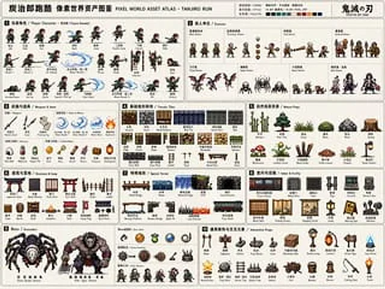

```text
请根据【游戏主题：{argument name="游戏主题" default="鬼灭之刃/炭治郎"}】创作一张高完成度、高信息密度、适合系列化发布的「像素世界资产图鉴 / Pixel World Asset Atlas」。

这不是普通像素插画，也不是单张游戏场景图，而是一张面向游戏开发、美术设定、关卡设计和视觉提案的“2D像素游戏资产总览图”。画面需要像一张完整的游戏素材说明板，把一个【游戏类型：{argument name="游戏类型" default="横版动作"}】所需的核心角色、敌人、道具、地形、场景、机关、Boss和装饰元素系统化整理在同一张图中，形成清晰、专业、可复用的游戏资产图鉴。

【基础设定】
主题世界观：【游戏主题】
游戏类型：【游戏类型】
时代背景：【时代背景】
主角身份：【主角身份】
敌人类型：【敌人类型】
主要场景：【主要场景环境】
整体风格：【风格方向，例如{argument name="风格" default="16-bit复古街机像素风"}】
主色调：【主色调】
辅助色：【辅助色】
点缀色：【点缀色】
画幅比例：【画幅比例，横版4:3】
如没有填写，自动按照游戏主题最优方案进行匹配。

【整体画面要求】
画面采用横版大画布，浅色或低干扰背景，整体像一张游戏开发资产表、像素设定集展开页、说明书式资源目录。所有元素都应为统一像素密度的2D pixel art sprite，具有清晰黑色或深色描边、有限色阶、复古游戏质感。不要生成真实摄影风、3D渲染风、厚涂插画风或电影海报风。重点是“系统完整、分类清晰、资源丰富、可开发感强”。

【版式结构】
整张图采用模块化网格排版，用细线分割不同资源区域。每个区域需要有编号标题和简短分类标签，整体阅读路径为从左到右、从上到下。版式应具有说明书、游戏开发文档、素材图鉴、设定板的秩序感。信息密度要高，但不能混乱；每个模块内部的元素应等距排列，保持清晰可读。

【必须包含的模块】
1. 玩家角色模块：展示完整动作帧，包括站立、行走/奔跑、跳跃等。动作帧应横向排列，像游戏sprite sheet。
2. 敌人单位模块：设计多种敌人，包括普通、远程、重装、精英单位等。
3. 武器与道具模块：展示近战、远程、投掷物、特效、拾取物等。
4. 基础地形砖块模块：展示地面、墙体、平台、转角、不同材质地块。
5. 自然/外部场景资源模块：展示树木、草丛、石头、障碍物。
6. 建筑/基地/营地资源模块：展示门、窗、墙、梯子、营地设施。
7. 特殊地形模块：展示桥梁、水体、悬崖、洞口。
8. 室内/地下/设施资源模块：展示管道、控制台、金属门、设备。
9. Boss / 遭遇战资源模块：展示大型Boss、特殊载具、巨型机关。
10. 通用装饰与交互元素模块：展示梯子、绳索、指示牌、开关、机关。

【视觉细节要求】
所有资源需要保持统一的像素尺寸逻辑和世界观一致性。比例关系明确。动作帧需体现连续性；地形砖块可拼接；道具和机关有功能识别度；Boss元素需有压迫感。
```

Model: GPT Image 2
Author: Larus Canus

[ProjectD](https://aitoolsradar.com/en/prompts/e0c62503d4e0ee) · [Recorded source](https://youmind.com/prompts/pixel-game-asset-atlas-15562)
 · [Full original metadata and byte evidence](data/projectd-batch-0043.json)

## Pixel Mosaic Jungle Parrot

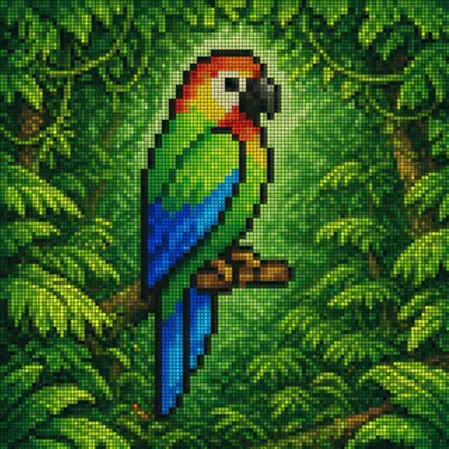

```text
A pixel art-style mosaic illustration depicts a tropical parrot perched on a short brown branch amidst dense jungle foliage. The image appears to be composed of closely spaced, evenly spaced tiny colored square tiles, each surrounded by a fine, dark outline. The parrot is positioned to the right in profile, featuring a large, curved black beak, a light cream-colored face, a vibrant red-orange forehead and throat, a bright yellow neck, and long wings and tail feathers in saturated blue and cyan. The parrot is vertically centered and slightly to the left, perched on the branch with its tail feathers extending downwards. The parrot is surrounded by richly layered, dense foliage, ranging in shades from deep forest green to bright green, filling the entire image without any sky. Strong contrast, sharp black outlines, and a luminous light green area behind the parrot distinguish it from the darker foliage are used. The overall image should have a vintage pixel art or stained glass mosaic feel, rich in detail, vibrant colors, a square composition, and a full-page tiled texture.
```

Model: GPT Image 2
Author: GPT Image 2 Prompts

[ProjectD](https://aitoolsradar.com/en/prompts/fdcd8b118958d7) · [Recorded source](https://x.com/AndrewMayne/status/2047806012380656106#reversed-0)
 · [Full original metadata and byte evidence](data/projectd-batch-0043.json)

## Pizza Food Photography and Infographic

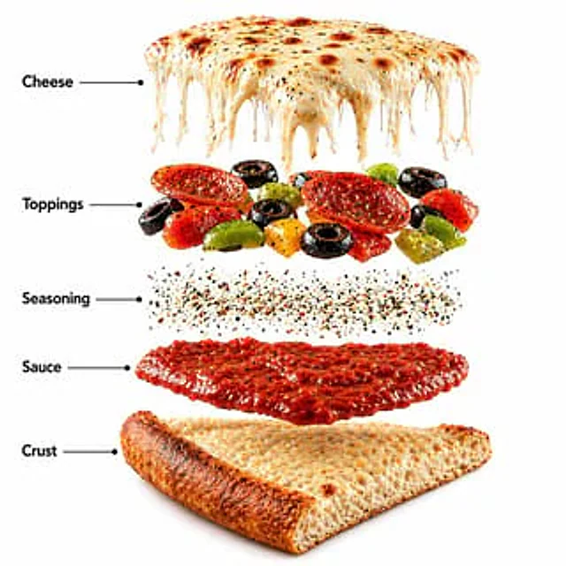

```text
A high-end food photography piece featuring a slice of pizza against a warm, rustic wooden background. The pizza's edges are golden and crispy, the mozzarella cheese is melted and has a distinct stringy texture, and the bottom is covered with rich tomato sauce. Toppings include pepperoni, black olives, green peppers, and herbs. The image is rich in detail, showcasing the sheen of the cheese, the oiliness of the toppings, and the realistic texture of the baked crust. Soft, cinematic lighting creates depth and subtle shadows. Ultra-high-definition focus, high-end food advertising style, hyperrealistic, 8K resolution. Create a hyperrealistic, vertically dissected infographic of a slice of pizza. The top-to-bottom structure is as follows: Melted cheese layer (glossy mozzarella cheese with a stretchy texture) → Toppings layer (Italian pepperoni, olives, and green peppers with natural details) → Herb seasoning layer (lightly scattered oregano leaves and spice granules) → Tomato sauce layer (smooth sauce with a rich color and a subtle sheen) → Crust base (thick, baked crust with crisp edges). All layers must be perfectly centered, evenly spaced, and vertically aligned. Use a warm, rustic background with soft studio lighting and realistic shadows below each floating layer. The overall composition should combine the quality of a high-end food advertisement with a clean infographic layout. Use thin indicator lines to add simple infographic labels with the following content: "Cheese," "Toppings," "Seasoning," "Sauce," and "Crust." Ultra-fine food textures, DSLR macro quality, hyper-realistic, high-end advertising aesthetics, 8K resolution.
```

Model: GPT Image 2
Author: GPT Image 2 Prompts

[ProjectD](https://aitoolsradar.com/en/prompts/c6c764ab353ffa) · [Recorded source](https://x.com/Strength04_X/status/2047283829652812276)
 · [Full original metadata and byte evidence](data/projectd-batch-0043.json)

## Playful Hand-Drawn Doodle Overlays

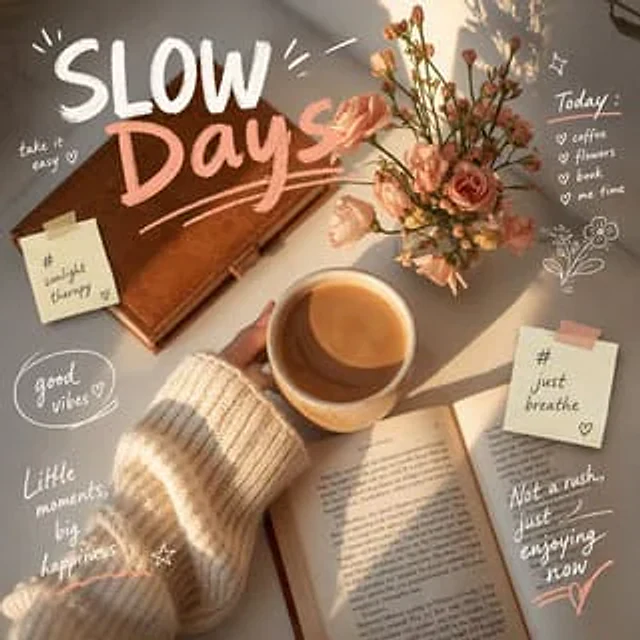

```text
Analyze the uploaded image and preserve the original subject, composition, and lighting. Do not alter the identity or structure of the main subject. Add playful, {argument name="doodle style" default="hand-drawn doodles"} that interact directly with the subject in the image. The doodles should mimic, follow, or exaggerate the shapes, gestures, or motion present-such as outlining poses, extending limbs, adding motion lines, or creating imaginative elements that

"respond" to the subject.

Ensure the doodles feel naturally integrated into the scene, as if they were drawn on top of the photo with intention.

Use a sketchy, imperfect, hand-drawn style with organic lines, slightly uneven strokes, and a casual illustrated feel.

Include whimsical handwritten text elements placed around the image. The text should match the mood or implied context of the scene, with a playful and spontaneous tone.

Avoid fixed phrases-generate context-aware, creative, and humorous text that fits each unique image. Maintain a balanced composition so the doodles enhance the image without overwhelming the original subject. Keep the overall aesthetic fun, expressive, and social-media-ready. High resolution, clean overlay, vibrant yet natural color harmony.
```

Model: GPT Image 2
Author: Oogie

[ProjectD](https://aitoolsradar.com/en/prompts/74de08d87efc11) · [Recorded source](https://youmind.com/prompts/hand-drawn-doodle-overlays-17026)
 · [Full original metadata and byte evidence](data/projectd-batch-0043.json)

## Playful Semi-Chibi Lifestyle Editorial

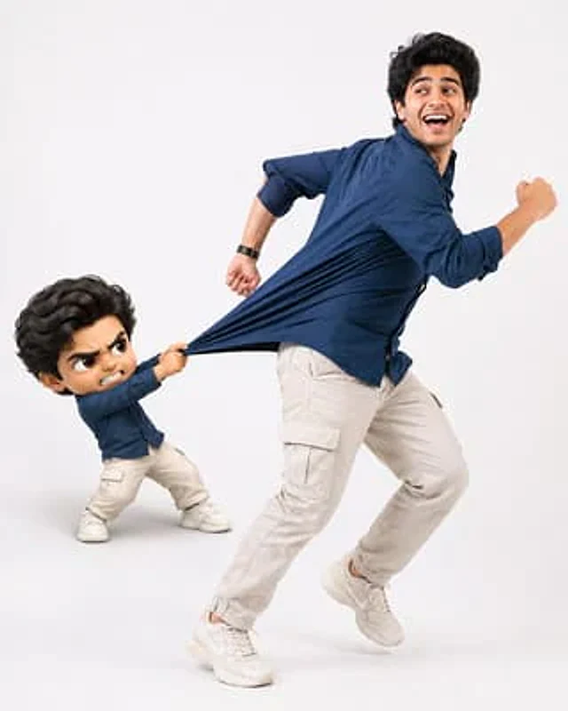

```text
Create an ultra-realistic lifestyle editorial studio photo in a 4:5 aspect ratio. Use the uploaded reference photo as the primary source for the character's identity. Preserve the face, facial features, body proportions, hairstyle, outfit, shoes, colors, and overall appearance exactly as shown. Do not redesign or alter the character. Place the character in a clean, minimalist photo studio with a seamless pure white background. The mood should feel modern, bright, playful, energetic, and polished, like a high-end fashion editorial. Capture the character mid-run with natural, believable movement. The body leans forward, one foot is off the ground, and the arms move naturally. The upper body is subtly pulled backward, as though the clothing is being tugged, while the lower body continues driving forward. Give the character a joyful, expressive face with laughter, excitement, and a hint of playful panic. On the left side, add a stylized 3D semi-chibi version of the same person. Keep the identity recognizable while using a larger head, smaller body, expressive eyes, and exaggerated emotions. The semi-chibi character should look frustrated and determined, grabbing the main character's clothing with both hands and pulling backward in an attempt to stop them. Emphasize the comedic struggle. Focus on realistic fabric physics where the clothing is being pulled, showing stretched material, natural folds, wrinkles, and convincing tension. The interaction should feel physically believable and visually entertaining. Use soft professional studio lighting, crisp shadows, ultra-sharp focus, realistic skin textures, detailed fabric, cinematic editorial styling, clean composition, and a premium polished finish. Negative Prompt: Low quality, blurry, noisy, pixelated, bad anatomy, extra or missing fingers, deformed hands, broken joints, stiff pose, weak motion, incorrect fabric physics, flat clothing, missing wrinkles, unrealistic interaction, altered facial identity, changed outfit, changed shoes, altered body proportions, extra characters, cluttered scene, colored background, props, harsh shadows, dark lighting, plastic skin, poor 3D quality, distorted face, watermark, logo, or text.
```

Model: GPT Image 2
Author: WaseemAi

[ProjectD](https://aitoolsradar.com/en/prompts/df902145872b56) · [Recorded source](https://youmind.com/prompts/playful-chibi-clothing-tugging-studio-27659)
 · [Full original metadata and byte evidence](data/projectd-batch-0043.json)

## Podcast Episode Cover Frame

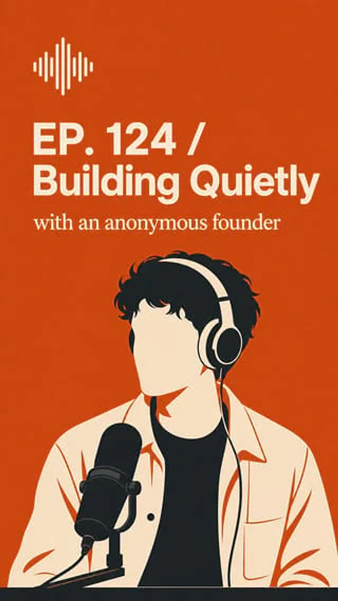

```text
Vertical 9:16 podcast episode cover. Background is a deep saturated terracotta orange color. Upper-left shows a small show logo placeholder, an abstract sound wave symbol in cream. Centered lower half features a stylized half-body illustration of a generic host figure with headphones on, drawn in flat cream and dark accents. Above the host illustration a bold sans-serif headline reads "EP. 124 / Building Quietly". Below it a smaller serif subhead "with an anonymous founder". Vertical 9:16 composition. No real show name, no real host name, no watermark. Premium podcast cover design quality, crisp typography rendering.
```

Model: GPT Image 2
Author: @hiapi_ai

[ProjectD](https://aitoolsradar.com/en/prompts/f9941259a32058) · [Recorded source](https://github.com/HiAPIAI/awesome-gpt-image-2-prompts)
 · [Full original metadata and byte evidence](data/projectd-batch-0043.json)

## Polaroid of Japanese Class Graduation Photo

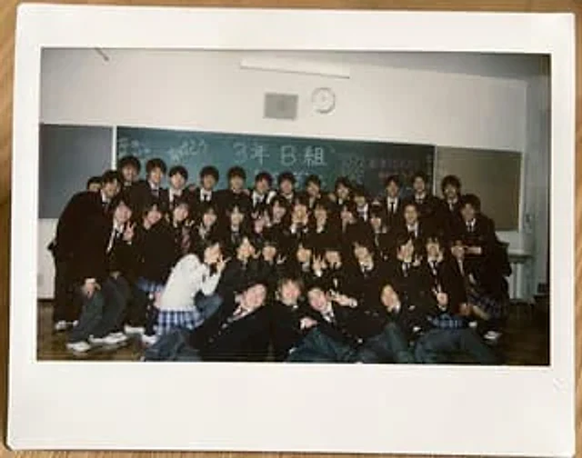

```text
A realistic Polaroid photo, taken from directly above, rests on a light-colored wooden table. The photo has a thick white border, with a wider bottom border showing slight signs of natural wear. The image shows an indoor class photo of a Japanese high school student. In the photo, approximately 35 graduates, dressed in dark school uniforms, stand casually in four rows in front of a green blackboard, their postures relaxed and close together. Most students are boys in black school uniforms or dark blazers with white shirts and ties, while several girls wear dark blazers with blue plaid skirts. A girl in a white cardigan and blue plaid skirt stands out on the left side of the front row. Many students are making peace signs, some are crouching in the front row, and a few are sitting or leaning against the wooden floor. The faces are blurred with soft, square mosaics, but the overall atmosphere is authentic, nostalgic, and celebratory. A graduation message in Japanese is hand-drawn in chalk on the blackboard, with the words "3rd Year B Class" prominently displayed in the center, surrounded by graduation-themed graffiti and well wishes. The classroom walls are white, a round clock hangs above the blackboard, and fluorescent lights are installed on the ceiling, creating a soft indoor lighting environment. The images should have a slightly dim snapshot quality reminiscent of the early 21st century or the 2010s, with slight noise, soft focus, realistic flash photography marks, and natural color fading, emphasizing the sentimental graduation memories carried by the physical Polaroid photograph.
```

Model: GPT Image 2
Author: GPT Image 2 Prompts

[ProjectD](https://aitoolsradar.com/en/prompts/5a64d06d184fd6) · [Recorded source](https://x.com/se_yakiimosan/status/2046604784111898973#reversed-2)
 · [Full original metadata and byte evidence](data/projectd-batch-0043.json)

## Political Map Visualization

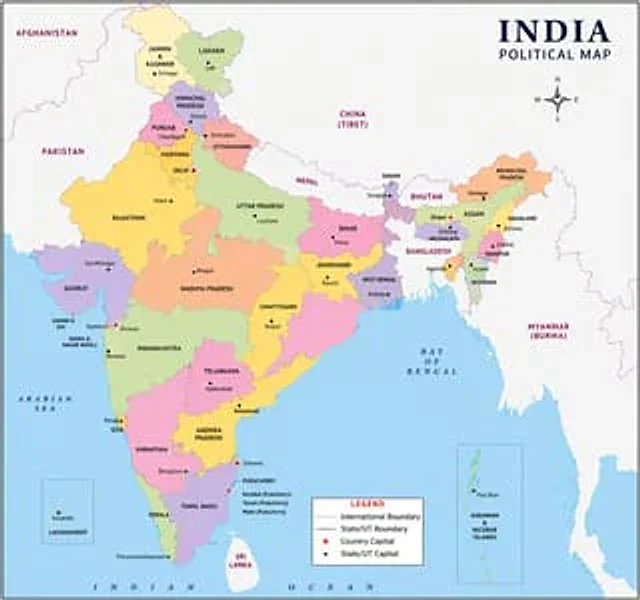

```text
One{argument name="region" default="indian"} Images of political maps
```

Model: GPT Image 2
Author: GPT Image 2 Prompts

[ProjectD](https://aitoolsradar.com/en/prompts/428553bbdffce7) · [Recorded source](https://x.com/cneuralnetwork/status/2047014174342209931)
 · [Full original metadata and byte evidence](data/projectd-batch-0043.json)

## Pop Art Street Abstract Background

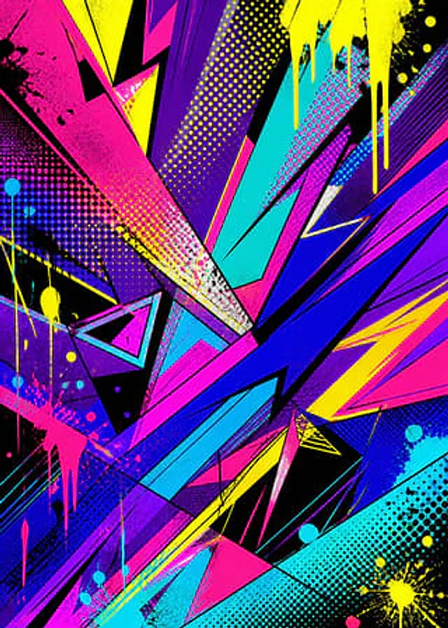

```text
現代アニメ・漫画の影響を基調とした{argument name="スタイル" default="ポップアート×ストリートアート風"}の抽象背景。人物・キャラクター・文字は一切含めない。シャープでクリーンな線画とフラットシェーディングを主体に、鮮やかでコントラストの強い{argument name="色使い" default="ネオンカラー（ピンク、シアン、イエロー、パープル、エレクトリックブルー）"}で構成。複雑な幾何学模様や大胆な図形を重ねたダイナミックなレイアウト。ベン・デイ・ドットやスクリーントーンによるグラデーションと質感を強調。ペイントの飛沫やインクの滴りなどストリートアート的要素を加え、レトロコミックと現代的アニメ表現が融合したスタイリッシュでエネルギッシュな2Dイラスト背景。
```

Model: GPT Image 2
Author: のとろ

[ProjectD](https://aitoolsradar.com/en/prompts/87372548a202da) · [Recorded source](https://youmind.com/prompts/pop-art-street-abstract-background-18350)
 · [Full original metadata and byte evidence](data/projectd-batch-0043.json)

## Pop Art Street Style Conversion

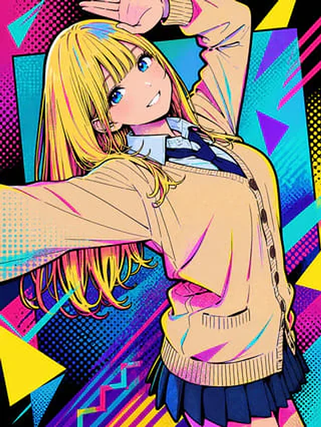

```text
このイラストを{argument name="スタイル" default="現代アニメ・漫画の影響を基調とした、ポップアート×ストリートアート風スタイル"}に変換してください。シャープでクリーンな線画とフラットシェーディングをメインに色彩豊かに表現。複雑な幾何学模様など含むスタイリッシュな雰囲気。ベン・デイ・ドットでグラデーションとテクスチャを加味。{argument name="配色" default="ネオンカラー中心の鮮やかでコントラストの強い配色"}で、グラフィカルかつスタイリッシュな雰囲気に。ただし文字は入れないこと。元のイラストの構図・キャラクターを維持。
```

Model: GPT Image 2
Author: のとろ

[ProjectD](https://aitoolsradar.com/en/prompts/f76d6f12429c69) · [Recorded source](https://youmind.com/prompts/pop-art-street-style-conversion-18357)
 · [Full original metadata and byte evidence](data/projectd-batch-0043.json)

## Pop-Punk Emo Kitten Portrait

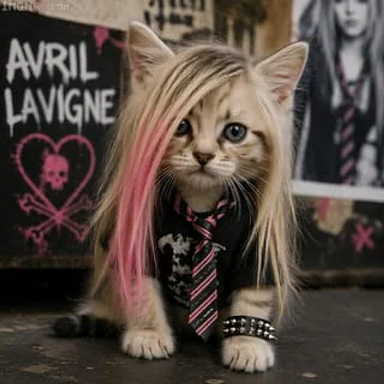

```text
A lifelike close-up portrait of a kitten, styled like an early 21st-century pop-punk rock singer. It sits on a dark floor, facing the camera with a calm yet slightly melancholic expression. The kitten has large, round eyes, soft striped fur, and a long, straight "scene-kid" hairstyle.{argument name="hair color" default="Platinum"} A striking strand of hair fell down one cheek.{argument name="streak color" default="pink"} Hair partially obscures its eyes. It wears four striking fashion elements: a black band-style T-shirt with a distressed white pattern, a black and pink striped tie, a black studded bracelet on one of its forepaws, and an exaggeratedly long wig-like hairstyle. The background is a rugged bedroom or rehearsal room wall covered in punk posters and exuding a distressed texture; to the left is a black poster with striking white text.{argument name="poster text" default="AVRIL LAVIGNE"} Below is a pink heart-and-skull logo; to the right is a blurry poster of a person wearing dark clothes and a striped tie. The dim, warm indoor lighting, shallow depth of field, rich hair details, realistic beard, subtle decadent atmosphere, centered composition, nostalgic aesthetic, and studio-level realism.
```

Model: GPT Image 2
Author: GPT Image 2 Prompts

[ProjectD](https://aitoolsradar.com/en/prompts/9ffa07c832706e) · [Recorded source](https://x.com/imgn_ai/status/2047442483332726959#reversed-0)
 · [Full original metadata and byte evidence](data/projectd-batch-0043.json)

## Portugal Football Campaign Poster

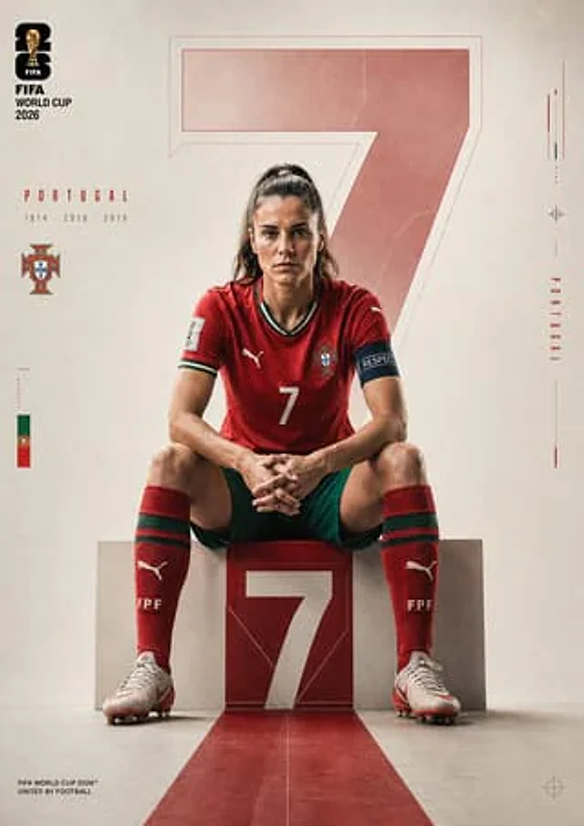

```text
Create a premium football campaign poster in a luxury editorial style, combining modern sports branding with high-end studio photography.

A female footballer wearing Portugal’s national team kit sits centered on a minimalist geometric pedestal in a clean studio environment. She faces directly toward the camera with a composed, determined expression. Her elbows rest naturally on her knees while her hands are loosely clasped, projecting confidence, focus, and leadership.

Athlete Styling

{argument name="team kit" default="Portugal national team-inspired home kit"}
Jersey number {argument name="number" default="7"} only (no player name displayed)
Deep red jersey with green trim details
Matching shorts, socks, and elite football boots
Optional captain’s armband
Authentic athletic physique
Ultra-realistic skin texture, facial details, pores, and fabric folds
Realistic football photography quality

Composition

Large translucent number {argument name="number" default="7"} positioned behind the player as a dominant graphic element
Additional oversized “{argument name="number" default="7"}” integrated into the pedestal or floor design
Perfectly centered symmetrical composition
Minimalist geometric framing lines
Thin technical UI-style sports graphics
Small Portugal flag accents placed subtly around the layout
FIFA World Cup 2026-inspired tournament badge positioned in a corner
Strong use of negative space

Visual Design Language

Inspired by modern World Cup campaign artwork
Luxury sports magazine aesthetic
Contemporary football advertising
Minimalist graphic design
Premium athlete portraiture
Clean typography hierarchy
No player name, autograph, signature, or personal text

Color Palette

Use Portugal’s national football identity:

Rich crimson red
Deep emerald green
Soft gold accents
Warm ivory and beige neutrals

Lighting

Soft cinematic studio lighting
Gentle rim light around the athlete
Controlled shadows
Editorial contrast
Slight atmospheric haze
Glossy highlights on kit fabric and boots

Texture & Finish

Detailed football jersey weave
Subtle paper grain
Premium print-poster finish
Light vintage texture overlay
Soft stadium-inspired atmosphere
Realistic reflections and depth

Background

Clean off-white / warm beige backdrop
Minimal distractions
Modern exhibition-style studio setting
Elegant and uncluttered

Output

Vertical 4:5 aspect ratio
Ultra-realistic sports photography
FIFA World Cup campaign feel
Premium commercial poster quality
Sharp focus
High detail
No player name text anywhere in the artwork
Number {argument name="number" default="7"} remains the primary visual identifier.
```

Model: GPT Image 2
Author: Jack

[ProjectD](https://aitoolsradar.com/en/prompts/0fe997edd3d5c0) · [Recorded source](https://youmind.com/prompts/portugal-football-campaign-poster-23428)
 · [Full original metadata and byte evidence](data/projectd-batch-0043.json)

## Portugal Football Fan Stadium Portrait

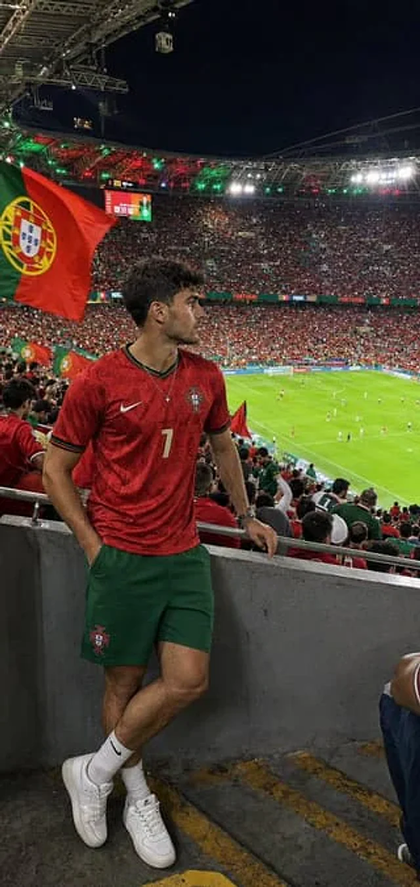

```text
Create an ultra-photorealistic candid stadium photograph of a {argument name="subject" default="handsome young man in his early-to-mid 20s"} who is a passionate {argument name="team" default="Portugal"} football supporter during a FIFA World Cup match.
The image is photographed by someone else (not a selfie).
Composition:
Vertical 4:5 framing
Camera positioned a few feet away from him
Body visible from head to just below the knees
He occupies about 40% of the frame
The football pitch and active players are clearly visible below and behind him
Large stadium atmosphere surrounding him
Shot from high up in the stands
Appearance:
Young Portuguese/Mediterranean-looking man
Athletic build with broad shoulders
Strong jawline
Short textured dark hair
Light stubble
Natural skin texture with realistic pores
Authentic facial proportions
Calm but confident expression
Outfit:
{argument name="clothing" default="Portugal national team red jersey and matching green Portugal shorts"}
White crew socks
White sneakers
Small silver chain necklace
Minimal accessories
Pose:
Standing casually beside the concrete railing in the upper stands
One forearm resting on the barrier
Other hand casually tucked into the shorts pocket
Body angled about 30 degrees away from the camera
Looking down toward the match instead of at the camera
Relaxed shoulders
Strong, athletic posture
Natural candid fan moment
Environment:
Packed football stadium at night
Thousands of Portugal supporters wearing red and green
Large Portuguese flags throughout the crowd
Bright stadium floodlights
Green football pitch clearly visible below
Tiny players actively playing on the field
Immersive FIFA World Cup atmosphere
Upper-tier spectator viewpoint
Photography Style:
Realistic telephoto candid photography
50mm lens
Professional sports event photography
Ultra-detailed fabric textures
Natural skin rendering
Cinematic realism
Documentary-style composition
High dynamic range
Premium commercial quality
Social-media-worthy football fan photograph
Mood: Proud Portugal supporter, energetic, adventurous, confident, immersive match-day experience, football culture.
Keywords: FIFA World Cup 2026, Portugal fan, Cristiano Ronaldo energy, football culture, match day atmosphere, stadium experience, Portugal national team, football supporter.
Negative Prompt:
selfie, phone visible, direct eye contact, awkward anatomy, extra fingers, extra limbs, anime, illustration, CGI, beauty filters, plastic skin, empty stadium, blurred players, watermark, text, logo, duplicate person, unrealistic crowd, poor lighting, cartoon style.
```

Model: GPT Image 2
Author: Johnn

[ProjectD](https://aitoolsradar.com/en/prompts/3cf468d2292f4f) · [Recorded source](https://youmind.com/prompts/stadium-football-fan-portrait-26108)
 · [Full original metadata and byte evidence](data/projectd-batch-0043.json)

## Portugal World Cup Squad Poster

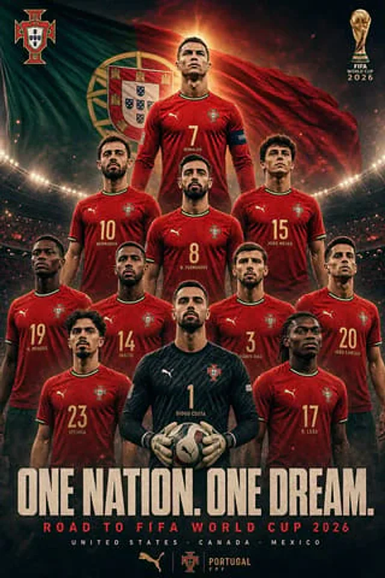

```text
Goal: Create an official cinematic national football team squad poster for {argument name="team name" default="Portugal"} and its FIFA World Cup 2026 campaign, using a dramatic heroic sports-poster style.

Canvas: Vertical poster, 2:3 aspect ratio, dark high-contrast stadium atmosphere, smoky vignette edges, glowing floodlights, sparks, and a large waving national flag filling the background. Use Portugal’s green-and-red flag colors with a large coat-of-arms shield behind the players. Add the Portugal federation crest at the top left and a gold FIFA World Cup trophy emblem with the text “FIFA WORLD CUP 2026” at the top right.

Layout: Arrange exactly 11 starting players in a commanding pyramid formation, all facing forward with serious expressions and powerful upright poses. The captain is elevated at the top center with a blazing backlight halo. The goalkeeper is front-center holding a football with both gloved hands. Build the squad in four visible tiers: 1 top captain, 3 upper attacking/midfield players, 5 middle/back-line players, and 2 front players flanking the goalkeeper, with the goalkeeper centered in front.

Player count and visible kit labels: Include exactly 11 players wearing Portugal red home shirts except the goalkeeper in a dark black patterned keeper kit. Visible shirt numbers and labels should be: 7 RONALDO at the top center with captain armband; 10 BERNARDO upper left; 8 B. FERNANDES upper center; 15 JOÃO NEVES upper right; 19 N. MENDES middle far left; 14 INÁCIO middle left; 3 RÚBEN DIAS middle right; 20 JOÃO CANCELO middle far right; 23 VITINHA front left; 1 DIOGO COSTA front-center goalkeeper; 17 R. LEÃO front right. Use gold numbering and small white/gold name text beneath each number. Faces may be realistic but keep them cleanly visible and not distorted.

Uniform details: Red Puma-style Portugal kit with green-and-gold collar trim, Portugal crest on the chest, Puma-style cat logo, subtle fabric texture, athletic fit, shorts mostly cropped out. Goalkeeper wears black long-sleeve jersey with subtle diagonal pattern, Portugal crest, number 1, padded gloves, and holds a modern patterned match ball.

Text content: Large distressed cream headline across the lower third: “{argument name="headline text" default="ONE NATION. ONE DREAM."}”. Under it, smaller red tracking-spaced subtitle: “{argument name="campaign line" default="ROAD TO FIFA WORLD CUP 2026"}”. Below that in small white spaced letters: “UNITED STATES · CANADA · MEXICO”. Bottom center sponsor strip with a gold Puma-style logo, Portugal crest, and the text “PORTUGAL FPF”.

Visual style: Hyper-realistic composite photography, epic sports marketing poster, cinematic orange rim light behind the captain, deep shadows, stadium crowd bokeh, smoke, embers, dramatic contrast, sharp jersey details, premium official-tournament feel.

Constraints: Keep exactly 11 players, exactly the listed visible shirt numbers and names, no extra athletes, no extra logos beyond the football federation crest, trophy emblem, and kit/sponsor-style marks. Preserve the bold pyramid composition and the large bottom slogan.
```

Model: GPT Image 2
Author: ᴍᴜʀᴘʜʏ

[ProjectD](https://aitoolsradar.com/en/prompts/700f7d82e15d11) · [Recorded source](https://youmind.com/prompts/portugal-world-cup-poster-20368)
 · [Full original metadata and byte evidence](data/projectd-batch-0043.json)

## Pose and Lighting Analysis Sheet Transformer

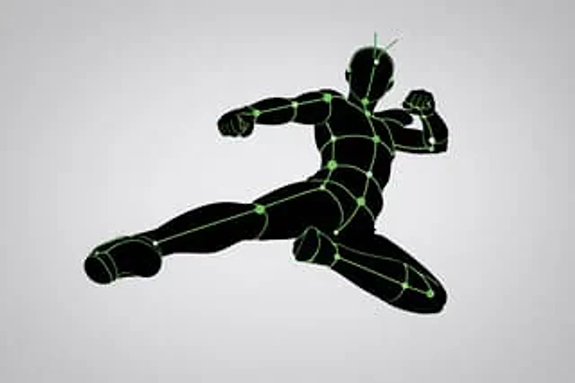

```text
[Core Task] Convert the provided input image into a pose and lighting analysis diagram. This is not a finished character illustration. This is not a costume design drawing. This is not a redraw that preserves aesthetics. This is a conversion of a white line sketch human body model. [Main Objective] Extract and visualize only the following: - Pose structure - Body balance - Camera angle - Body line flow - Inferred light source position - Illuminated area and light intensity [Input Character] Use the provided image as a strict anchor point for the following: - Pose - Camera angle - Body tilt - Center of gravity distribution - General lighting conditions Do not retain: - Facial rendering - Hairstyle rendering - Clothing details - Accessories - Weapon details - Background architecture - Character identity - Emotional expression [Character Transformation] Single, rough human model White body outline White internal construction lines Simple model Head No face No eyes No mouth No eyelashes No personality No individual identity The human model should be presented as: - Rough pose model - Anatomical proxy model - Line-based body guide - Structural sketch - White line Rough model Retain: - Pose readability - Outline flow - Head tilt - Torso direction - Pelvis direction - Limb position [Background] Pure black background Negative style Dark field No scene No props No architecture No environmental narrative [Line style] Rough white line drawing, simple yet sketch-like; structural lines visible, anatomical guide lines visible, joint flow visible; emphasizes body contours; not a detailed illustration. [Light and Shadow Estimation] Predict possible light source locations based on the input image; visualize light sources and illuminated areas using only green halos. Use varying green light intensities: - Strongest green: Direct light - Medium green: Wrapping light - Soft green: Reflected or diminished light. Use labels and arrows to mark estimated light sources, such as: - Main Light - Rim Light - Fill Light - Floor Bounce - Back Light. Use only where appropriate. Important note: Do not fabricate light sources; infer lighting from the original input image. If lighting is blurry, keep labels simple and reasonable. [Green Light and Shadow Visualization] Display green halos in the following areas: - Head/Skull plane - Neck - Shoulders - Chest plane - Thoracic direction - Pelvic edge - Thigh plane - Knee contact point - Floor contact reflection (if applicable) The use of green light and shadow is not for decoration, but as information for light and shadow analysis [pose priority]: 1. Preserve pose structure; 2. Preserve camera angle; 3. Preserve body balance; 4. Preserve head-to-body relationship; 5. Visualize possible lighting directions; 6. Show the lit areas through readable green intensity variations [negative hints]. Finished character, cute girl, detailed face, hair rendering, clothing rendering, weapon emphasis, beautified anatomical structure.
```

Model: GPT Image 2
Author: GPT Image 2 Prompts

[ProjectD](https://aitoolsradar.com/en/prompts/7d6e3354db2c3a) · [Recorded source](https://x.com/WOZ1Tx2JZ3kCeBj/status/2046343828739911683)
 · [Full original metadata and byte evidence](data/projectd-batch-0043.json)

## Post-Apocalyptic Ruins at Dusk

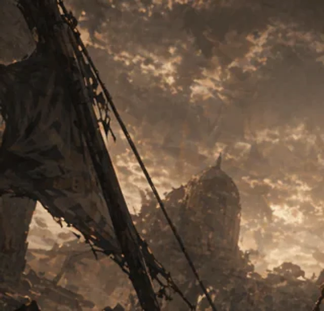

```text
A melancholic, post-apocalyptic landscape, rendered in deep brown and amber hues, depicts the ruins of industrial or urban buildings beneath a turbulent sky thick with luminous clouds. In the left foreground, a massive, slanted, collapsed metal beam or crane arm extends from the lower left to the upper left, covered in tattered fabric or torn panels and tangled cables. A long cable cuts diagonally across the center of the frame. In the hazy middle ground, slightly to the right, stands a damaged domed tower or observatory-like structure, partially obscured by dust, smoke, and floating debris. The ground is littered with jagged rubble, broken structures, and silhouettes of wreckage. The composition utilizes dramatic backlighting through gaps in the clouds at the horizon, soft volumetric fog, atmospheric perspective, painterly textures, and the epic feel of a ruined world. The composition should be vertical, solemn, desolate, and cinematic, with no one visible in the frame.
```

Model: GPT Image 2
Author: GPT Image 2 Prompts

[ProjectD](https://aitoolsradar.com/en/prompts/edf88e03c3eb27) · [Recorded source](https://x.com/super_bonochin/status/2047361904683958295#reversed-2)
 · [Full original metadata and byte evidence](data/projectd-batch-0043.json)

## Post-Apocalyptic Scavenger — Environment Hero

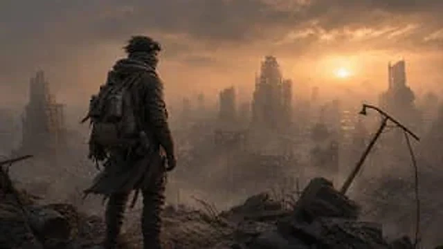

```text
Cinematic environment hero shot of a lone post-apocalyptic scavenger standing in the foreground silhouette against a vast ruined cityscape at dust storm hour. Heavy layered clothing with goggles around the neck, a wrapped scarf covering the lower face, a worn canvas backpack with attached scrap metal canisters. Crumbled skyscraper debris and a tilted broken streetlight in the foreground, hazy orange sun struggling through suspended dust. 16:9 horizontal composition, deep desaturated palette with a single warm light source. No text, no faction logo, no watermark. Hollywood concept art quality, photorealistic dust and fabric.
```

Model: GPT Image 2
Author: @hiapi_ai

[ProjectD](https://aitoolsradar.com/en/prompts/c23177cee8b3e9) · [Recorded source](https://github.com/HiAPIAI/awesome-gpt-image-2-prompts)
 · [Full original metadata and byte evidence](data/projectd-batch-0043.json)

## Post-Apocalyptic Tactical Anime Girl

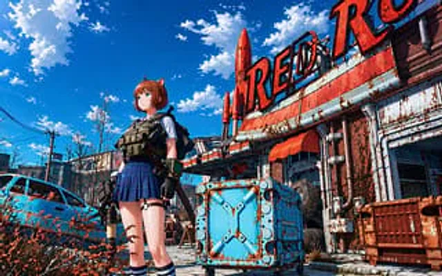

```text
A high-quality anime illustration depicting a character with{argument name="character hair" default="Short brown hair and cat ears"} And the blue-eyed girl, standing{argument name="setting" default="post-apocalyptic wasteland"} In the middle. She was wearing{argument name="character outfit" default="White short-sleeved shirt, blue plaid pleated skirt, black knee-high socks with white stripes, and a heavy tactical chest brace."} She carries a backpack, wears retro-futuristic computer equipment on her wrist, and has a samurai sword at her waist. The background is a clear blue sky with scattered white clouds. To her right is a rusty brick building with a large, weathered red sign on its roof, faintly displaying the words "..."{argument name="sign text" default="RED R"} Next to it is a red rocket sculpture. In the foreground is a rusty, bright blue metal container cart, and to the left is a dilapidated, rusty blue car, surrounded by weeds and wreckage. The whole scene perfectly blends the vibrant anime character design with the delicately realistic textures of rust and decay.
```

Model: GPT Image 2
Author: GPT Image 2 Prompts

[ProjectD](https://aitoolsradar.com/en/prompts/7020dbc3ebb1d9) · [Recorded source](https://x.com/KAEDE_AMANOKAWA/status/2044920662763139152#reversed-0)
 · [Full original metadata and byte evidence](data/projectd-batch-0043.json)

## Poster Style Anime Character

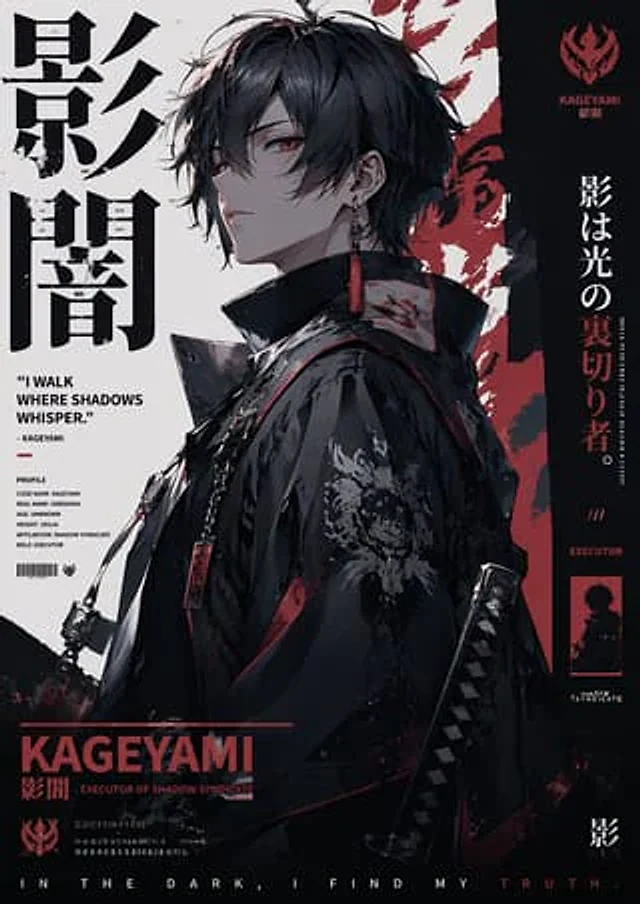

```text
Poster style{argument name="subject" default="anime character"}
```

Model: GPT Image 2
Author: GPT Image 2 Prompts

[ProjectD](https://aitoolsradar.com/en/prompts/ca7fad3bb941f4) · [Recorded source](https://x.com/sleeponit_ai/status/2043722108677878237)
 · [Full original metadata and byte evidence](data/projectd-batch-0043.json)

## Power Armor Mirror Selfie

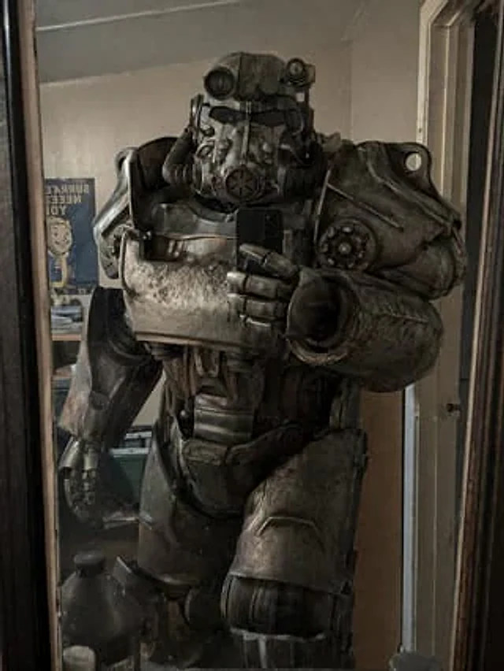

```text
A person dressed in detailed, weathered clothing bearing the marks of battle.{argument name="armor type" default="The T-60 power armor in Fallout"} The person is holding a{argument name="phone type" default="Black smartphone"} Taking a selfie in a mirror. The armor is heavy and metallic, covered in dirt, rust, and scratches, and features a unique helmet with a respirator, headlamp, and thick shoulder armor. The person, wearing an armored glove on their right hand, holds a phone to their chest. The slightly dirty mirror, with its dark wooden frame, reflects the photographer's image. The background is a dimly lit, cluttered room, with a picture faintly visible on the wall.{argument name="poster subject" default="Vault Boy Poster"} The lighting effects are realistic and atmospheric, highlighting the texture of the metal and the rugged atmosphere.
```

Model: GPT Image 2
Author: GPT Image 2 Prompts

[ProjectD](https://aitoolsradar.com/en/prompts/3ba5c837dd0c04) · [Recorded source](https://x.com/Vicrom1509/status/2044503181606986037#reversed-0)
 · [Full original metadata and byte evidence](data/projectd-batch-0043.json)

## Pre-Roll Frame — Eco Detergent Hero


```text
Vertical 9:16 video pre-roll frame design. A tall transparent eco-friendly detergent bottle stands centered on a soft fresh green gradient background. A clean splash of clear water arcs around the upper half of the bottle, frozen mid-motion, with a few small droplets suspended in air. A small fresh green leaf is tucked at the base. Soft eucalyptus and sage palette. Upper area shows a small clean centered headline in white serif type reading "Cleaner. Greener. Stronger.". No brand mark on the bottle, no logo, no watermark. Premium eco brand advertising design, photorealistic water dynamics, magazine cover quality.
```

Model: GPT Image 2
Author: @hiapi_ai

[ProjectD](https://aitoolsradar.com/en/prompts/5250a9f9253bb7) · [Recorded source](https://github.com/HiAPIAI/awesome-gpt-image-2-prompts)
 · [Full original metadata and byte evidence](data/projectd-batch-0043.json)

## Pre-war Japan Lab Minecraft Screenshot

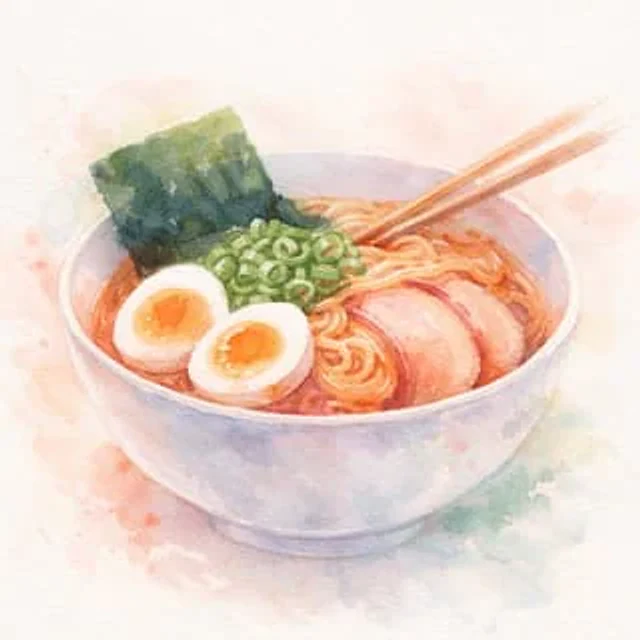

```text
戦前日本の怪しげな研究所を探検しているマイクラのスクリーンショット画像を作成して
```

Model: GPT Image 2
Author: @RitaStar1128

[ProjectD](https://aitoolsradar.com/en/prompts/0775354d4a8c93) · [Recorded source](https://x.com/RitaStar1128/status/2046406024303976904)
 · [Full original metadata and byte evidence](data/projectd-batch-0043.json)

## Premium Beverage Commercial Poster

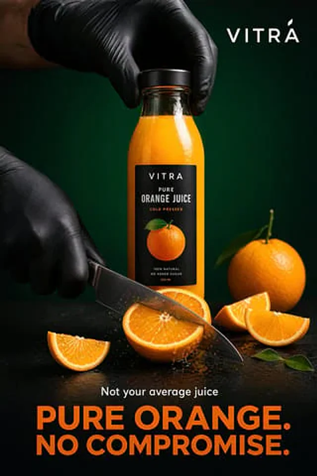

```text
For high-end{argument name="product" default="Orange juice"} The brand created a striking, high-end commercial poster, shot in a hyper-realistic studio environment, emphasizing freshness, precision, and strong visual appeal. Main composition: A bottle filled with rich, vibrant {argument name="liquid" default="Orange juice"} A transparent, streamlined bottle sits at the center of the image. The label design is minimalist, modern, and high-end, featuring a simple orange graphic and elegant lettering. The bottle cap is matte black with subtle highlights and realistic reflections. Action and narrative: Two hands wearing matte black gloves interact with the product: one hand firmly holds the bottle from above, while the other uses a sharp stainless steel knife to slice a juicy orange, capturing the moment of cutting and showcasing the juicy pulp and fresh citrus texture. A few orange slices are placed slightly scattered at the base, creating a natural yet stylish composition. Lighting and Atmosphere: Background: Deep, rich green gradient with a cinematic decay effect. Surface: Dark matte tabletop with soft, controllable reflections. Lighting: Dramatic studio lighting. Strong key light on one side to add depth. Soft fill light to maintain balance. Sharp highlights on the bottle and blade. Deep, clean shadows to enhance contrast. Typography: Top corner: White, clean, modern brand name (e.g., "VITRA", "FRESCO", or "NATURO"). Bottom area: Small text: "Not your average juice". Large, bold headline:{argument name="headline" default="Pure orange juice, no compromise."} The font should present a modern, eye-catching, and high-end feel with a strong visual hierarchy. The headline uses a rich orange tone, echoing the juice. Visual Style: High-end food advertising aesthetics, cinematic feel, striking and high-contrast, ultra-clear details and textures, high-magazine quality (similar to a global advertising campaign). Simple yet powerful composition. Output requirements: 4K resolution, photorealistic, advertising-grade quality, sharp focus, rich contrast, high dynamic range.
```

Model: GPT Image 2
Author: GPT Image 2 Prompts

[ProjectD](https://aitoolsradar.com/en/prompts/234529747af6e3) · [Recorded source](https://x.com/ZaraIrahh/status/2047543188626264483)
 · [Full original metadata and byte evidence](data/projectd-batch-0043.json)

## Premium Beverage Commercial Storyboard

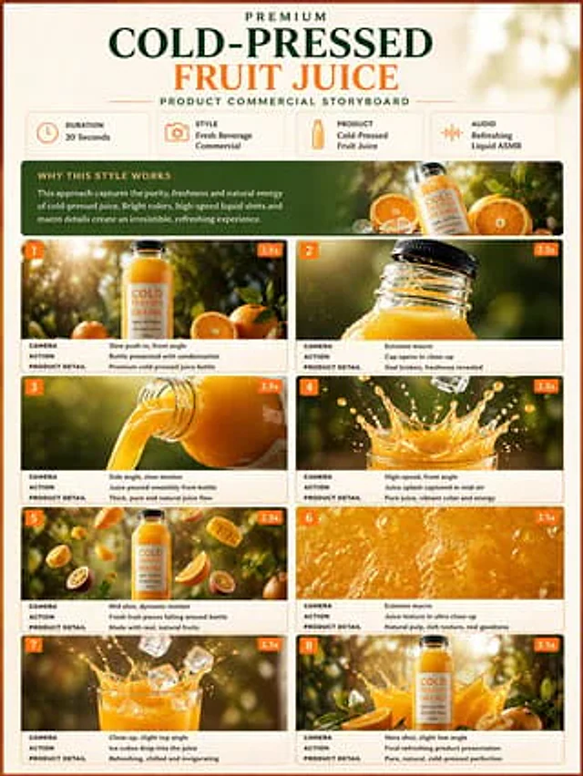

```text
Premium Cold-Pressed Fruit Juice Product Commercial Storyboard

FORMAT:
• Single-page premium storyboard
• 3:4 Portrait ratio
• Fresh beverage product campaign
• 8 cinematic storyboard scenes
• Product remains the main hero

HEADER:
• Modern premium typography
• Information cards:
  - Duration: 20 Seconds
  - Style: Fresh Beverage Commercial
  - Product: {argument name="product" default="Cold-Pressed Fruit Juice"}
  - Audio: Refreshing Liquid ASMR
• Why This Style Works section
• {argument name="color aesthetic" default="Orange, green and cream"} aesthetic

STORYBOARD:
1. Juice bottle covered with condensation
2. Bottle cap opening in macro close-up
3. Fresh orange juice pouring from the bottle
4. Juice splash frozen in mid-air
5. Fresh fruit pieces falling around the bottle
6. Extreme macro showing natural juice texture
7. Ice cubes dropping into a glass of juice
8. Final hero bottle with refreshing splash and fruit

EVERY PANEL:
• Scene number
• Duration badge
• Camera direction
• Visual
• Action
• Product detail

CAMERA:
High-speed liquid photography, macro close-ups, slow-motion splash, condensation detail, dramatic backlight, cinematic hero shot.

STYLE:
Ultra-realistic beverage commercial, realistic liquid physics, condensation droplets, fresh fruit textures, vibrant natural lighting, premium packaging, 8K.
```

Model: GPT Image 2
Author: 𝐌

[ProjectD](https://aitoolsradar.com/en/prompts/c4bc295703c693) · [Recorded source](https://youmind.com/prompts/fruit-juice-commercial-storyboard-32202)
 · [Full original metadata and byte evidence](data/projectd-batch-0043.json)

## Premium Beverage Studio Photography

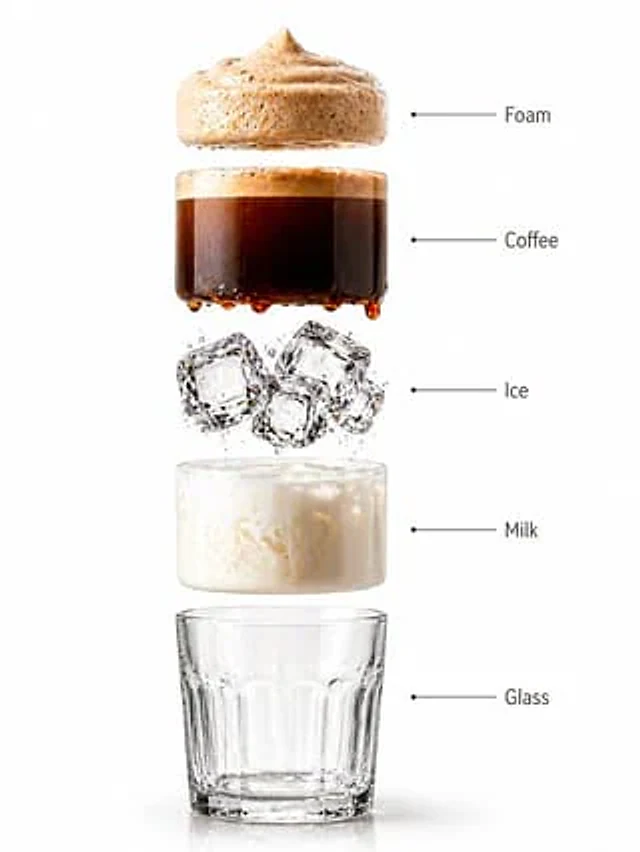

```text
A high-end café-style product photograph of a transparent glass filled with iced coffee, centered against a soft beige and cream seamless studio background. The drink shows a rich dark coffee base blending with creamy milk swirls, creating a smooth gradient effect. Several clear ice cubes are visible with realistic transparency and light refraction. The glass has subtle condensation droplets, adding freshness. Soft natural studio lighting creates delicate highlights and a clean shadow beneath the glass. Ultra-sharp focus, premium beverage advertisement style, DSLR macro photography, hyper realistic, 8K. Create a hyper-realistic exploded vertical infographic composition of an iced coffee. Top → Bottom structure: Foam Layer (light creamy foam with soft airy texture) → Coffee Liquid (rich dark espresso layer with smooth gradient) → Ice Cubes (transparent cubes with sharp edges and reflections) → Milk Layer (soft creamy white layer with smooth blend effect) → Glass Base (clear minimal glass structure) All elements must be perfectly centered, evenly spaced, and aligned vertically. Use a soft beige seamless background with clean café-style lighting and subtle realistic shadows beneath each floating element. The composition should feel like a premium beverage ad combined with a clean infographic layout. Add clean minimalist text labels with thin pointer lines using these exact labels: “Foam” “Coffee” “Ice” “Milk” “Glass” Ultra-realistic liquid detail, sharp reflections, premium commercial photography, 8K.
```

Model: GPT Image 2
Author: 𝐌

[ProjectD](https://aitoolsradar.com/en/prompts/95996114e00e56) · [Recorded source](https://youmind.com/prompts/iced-coffee-exploded-infographic-16795)
 · [Full original metadata and byte evidence](data/projectd-batch-0043.json)

## Premium Blueberry Product Poster

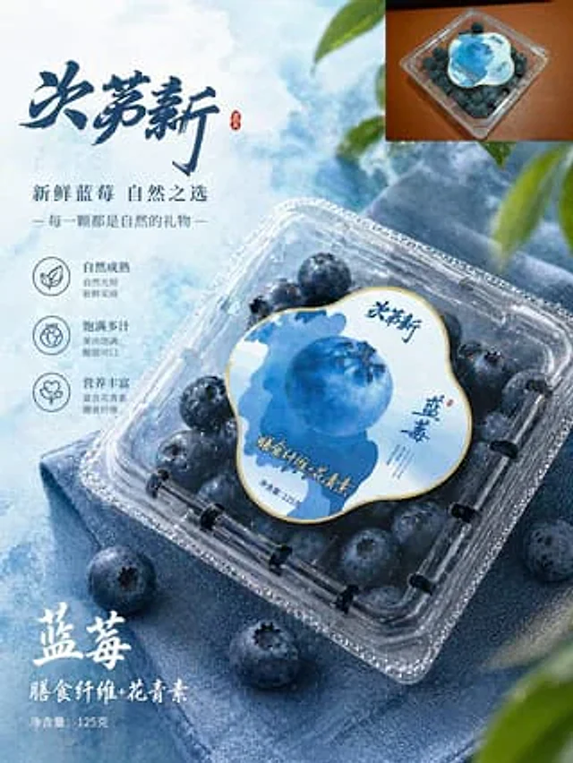

```text
A high-end blueberry e-commerce poster employing a minimalist Chinese product advertising style. The main subject is a box of blueberries in a transparent plastic container, placed diagonally on a folded blue cloth at a slightly downward angle, extending from the lower left to the right. The packaging must remain realistic and consistent: a transparent square container with rounded corners, filled with deep blue blueberries, topped with a large, irregularly shaped circular label in white, light blue, and dark blue, featuring a large blueberry illustration in the center, accompanied by the brand name in elegant Chinese font. The blueberries inside the box should appear larger, fuller, and fresher, covered with fine water droplets, while maintaining a realistic overall arrangement. The background is a translucent ice-blue tabletop with a soft, misty texture, lit by cool-toned sunlight, with a few blueberries scattered around the packaging. A few blurred green leaves are added to the upper right and lower right edges to create a fresh and natural feel. A small embedded image in the upper right corner shows a top view of the original product packaging on a warm brown surface as a reference thumbnail. The left side features a Chinese-style promotional typography, including a large, dark blue calligraphic title.{argument name="headline text" default="决茗新"} Below this are two smaller lines of text:{argument name="subheadline text" default="Fresh Blueberries Natural Selection"} and{argument name="tagline text" default="Each one is a gift from nature."} Below, three function icons are arranged vertically, each with a brief Chinese description: a leaf icon represents natural ripening, a fruit icon represents juiciness, and a heart icon represents rich nutrition. Near the bottom left corner, prominent white calligraphy-style Chinese text is added.{argument name="product name" default="blueberry"} The second line of text{argument name="benefit text" default="Dietary fiber + anthocyanins"} The label also includes the small print "Net weight 125 grams." It features a cool blue tone, creating a crisp commercial lighting effect, with a glossy finish on the plastic lid, showcasing high-end supermarket packaging aesthetics. Rich in detail, it perfectly blends realistic product photography with sophisticated graphic design.
```

Model: GPT Image 2
Author: GPT Image 2 Prompts

[ProjectD](https://aitoolsradar.com/en/prompts/c0932f69ffb09c) · [Recorded source](https://x.com/op7418/status/2046626506722746736#reversed-0)
 · [Full original metadata and byte evidence](data/projectd-batch-0043.json)

## Premium Blueberry Product Poster


```text
A premium e-commerce poster for fresh blueberries in a clean Chinese product-advertising style. Show a clear plastic clamshell box of blueberries as the main subject, placed diagonally from lower center to right side on folded blue fabric, viewed from a slightly elevated angle. The package must remain realistic and consistent: a transparent square container with rounded corners, filled with dark blue blueberries, with a large irregular rounded label on top in white, pale blue, and deep blue, featuring one oversized blueberry illustration in the center and elegant Chinese branding. Make the fruit inside look larger, plumper, fresher, and covered with subtle moisture droplets, while keeping the overall blueberry arrangement believable. The background is an airy icy-blue tabletop with soft cloudy texture, cool daylight, and scattered loose blueberries around the package. Add a few blurred green leaves entering from the top right and bottom right edges for a fresh natural feeling. In the upper-right corner, include 1 small inset image showing the original product package from above on a warm brown surface, like a reference thumbnail. On the left side, create Chinese promotional typography with a large dark blue calligraphy headline {argument name="headline text" default="决茗新"}, followed by 2 smaller lines of copy: {argument name="subheadline text" default="新鲜蓝莓 自然之选"} and {argument name="tagline text" default="每一颗都是自然的礼物"}. Below that, place 3 vertically stacked feature icons with short Chinese captions: a leaf icon for natural ripeness, a fruit icon for juicy fullness, and a heart icon for rich nutrition. Near the bottom left, add large white brush-style Chinese text {argument name="product name" default="蓝莓"}, a secondary line {argument name="benefit text" default="膳食纤维+花青素"}, and a small net weight line reading 125克. Use cool blue color grading, crisp commercial lighting, sparkling highlights on the plastic lid, premium supermarket packaging aesthetics, high detail, realistic product photography blended with polished graphic design.
```

Model: GPT Image 2
Author: 歸藏(guizang.ai)

[ProjectD](https://aitoolsradar.com/en/prompts/20099210970cce) · [Recorded source](https://youmind.com/prompts/premium-blueberry-poster-14655)
 · [Full original metadata and byte evidence](data/projectd-batch-0043.json)

## Premium Brand Infographic with Male Model

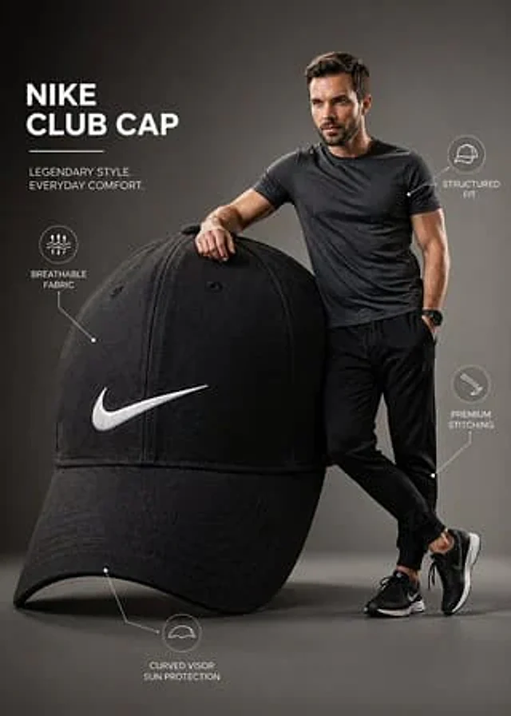

```text
A high-end infographic-style visual depicting a{argument name="subject" default="young men"} Standing confidently in an oversized{argument name="brand" default="Nike"}{argument name="product" default="hat"} Beside him, the hat is exaggeratedly enlarged, almost to the man's height, creating a bold, surreal product emphasis. The man stands naturally beside it, gently holding or adjusting the hat, interacting with it in a relaxed, stylish manner. His face must closely match the provided reference image, including accurate facial structure, skin tone, hairstyle, and expression, requiring clarity, realism, and visual appeal. The Nike hat is richly detailed, with clean stitching, fabric texture, seams, and a precisely proportioned Nike Swoosh logo clearly visible. It possesses a subtle, realistic wear and premium material feel. The composition is modern and minimalist, with clean studio backgrounds or soft gradients. Subtle infographic elements, such as thin line markers or minimalist descriptive text, highlight features like "breathable fabric," "structured silhouette," or "premium stitching," maintaining an overall elegant and clean look. Soft studio lighting is used, with controlled highlights and shadows to create a sophisticated commercial feel. The model wears minimalist modern streetwear that complements the hat's hue. The color gradation is clear and slightly vibrant, demonstrating professional advertising aesthetics. Balanced composition, sharp focus, and a slight depth of field to enhance realism. Style: High-end product infographics, stylish advertising, and clean UI-style labeling. Resolution: Ultra-high resolution, 4K, highly detailed, photorealistic. Optional enhancements: 85mm lens, f/2.8, commercial fashion photography, distortion-free, accurate proportions, clear typography, modern layout.
```

Model: GPT Image 2
Author: GPT Image 2 Prompts

[ProjectD](https://aitoolsradar.com/en/prompts/8a767336fa3d0f) · [Recorded source](https://x.com/john_my07/status/2047877997458534708)
 · [Full original metadata and byte evidence](data/projectd-batch-0043.json)

## Premium Denim Editorial Advertisement

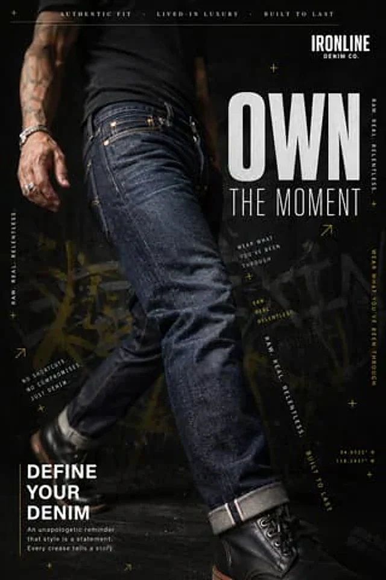

```text
A hyper-realistic high-end denim advertisement shot with a deep, emotional editing style. In the image, a man wearing raw selvage jeans strides forward against a near-black charcoal gray background, his body angled at 45 degrees towards the camera. The jeans feature a slim, tapered cut, a deep indigo wash, and subtle distressing at the thighs and knees. Reinforced brass rivets capture ambient light, and clean, off-white contrasting stitching occupies the lower two-thirds of the image. The composition employs shallow depth of field, focusing clearly on the denim texture, while the upper body is softly blurred. The background is overlaid with a subtle urban texture—blurred graffiti brushstrokes in electric yellow and matte olive green are faintly visible in the heavy shadows. Multiple lines of extra-small, all-caps text surround the figure at different angles, including the text…{argument name="slogan one" default="RAW. REAL. RELENTLESS."} "and"{argument name="slogan two" default="WEAR WHAT YOU'VE BEEN THROUGH"} "—Some text is arranged vertically, while others are at a 30-degree angle, creating a chaotic yet deliberate graphic magazine style. In the upper right corner, the prominent brand logo is presented in pure white against a dark background. At the top center, a thin horizontal navigation bar displays "AUTHENTIC FIT · LIVED-IN LUXURY · BUILT TO LAST" in a wide-spaced, all-caps serif font. A striking headline is placed in the center of the right side—"{argument name="main headline" default="OWN"} The text uses a bold white font, followed by a thinner "THE MOMENT," creating a strong visual hierarchy. Small yellow plus signs (+) and diagonal arrows (↗) are scattered throughout the image as decorative details. The bottom left corner features the striking slogan "DEFINE YOUR DENIM," in large, bold sans-serif white text, with a small subtitle below: "An unapologetic reminder that style is a statement. Every crease tells a story." The overall lighting is dramatic and directional—a cool-toned main light on the left makes the brass rivets gleam, and the deep indigo denim subtly shines in the darkness. Clear macro-level details of the fabric texture are visible at the faded knees. Photorealistic. Commercial photography quality. High contrast. 4K resolution. 3:4 portrait format optimized for social media.
```

Model: GPT Image 2
Author: GPT Image 2 Prompts

[ProjectD](https://aitoolsradar.com/en/prompts/22b677f1ac9fa0) · [Recorded source](https://x.com/meng_dagg695/status/2048024788078350620)
 · [Full original metadata and byte evidence](data/projectd-batch-0043.json)

## Premium Futuristic AI Workspace

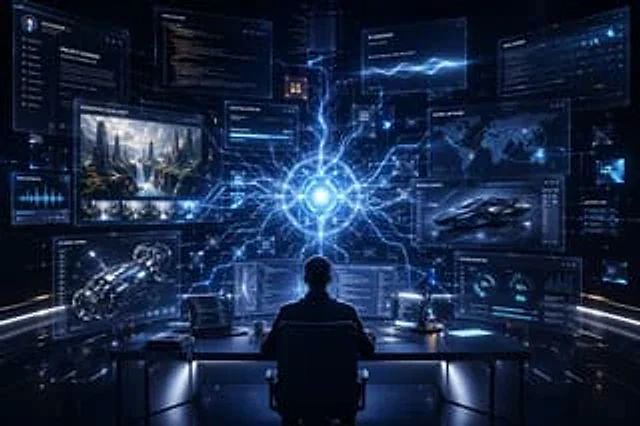

```text
A futuristic control room workspace with a cinematic feel, employing a dark, high-tech aesthetic. The perspective is from behind a single person sitting at a stylish desk, with a floating, transparent holographic interface wall directly in the foreground. The scene is illuminated by electric blue and cyan light against an almost entirely black background. Slightly above the desk at the center of the composition is a radiant AI core or neural sphere, radiating dozens of branching, glowing data streams, connecting each screen like a digital nervous system. The figure in the image is a silhouette of a professional in dark attire, seated in a modern office chair; the symmetrical composition emphasizes scale and immersion. On the desk are three main monitors displaying code and technical dashboards, an open laptop on the left, a slender task lamp on the right, a coffee cup, and a few minimalist office accessories. Surrounding the figure are 10 large floating UI windows: one vertical profile/navigation panel on the left, containing a circular avatar and name.{argument name="character name" default="ALEXANDER"} And menu items; 1 item information card in the upper left corner, titled "..."{argument name="project name" default="PROJECT CHRONOS"} A top-central code editor window, titled "CODE SYNTHESIS," displays dense programming text; a middle-right assistant panel, titled "AI ASSISTANT," features glowing waveforms and brief chat text; a middle-right data window, titled "DATA STREAM"; a middle-left media generation panel, titled "GENERATING VISUAL ASSET," displays a dramatic sci-fi landscape with towering rock spires and multiple thumbnail previews below; a small central progress card, titled "EXECUTING WORKFLOW," with a progress bar; a middle-right world map analysis panel, titled "GLOBAL NETWORK," with glowing connectors; a lower-left engineering rendering panel, titled "3D MODEL RENDER," displays futuristic mechanical engines or spacecraft components; and a lower-right dashboard, titled "SYSTEM MONITOR," with circular percentage charts and graphs. In addition, it includes two smaller side panels: a lower left voice panel titled "VOICE INTERFACE" with waveform visualizations; and a narrow right panel titled "ACTIVITY LOG" with status entries. Scattered between the main windows are several tiny floating microcards and image thumbnails connected by light trails, hinting at multi-tasking AI orchestration. The interface design should present an exquisitely refined, glass-like, transparent, edge-glowing, and high-end feel, complete with thin neon borders, subtle grid lines, small icons, and sophisticated sci-fi UI fonts. It employs dramatic wide-angle compositions, deep depth of field, sharp details, volumetric lighting effects, reflective surfaces, and a balanced, symmetrical layout centered on the glowing AI core. The overall atmosphere is visionary, luxurious, and intelligent, as if {argument name="headline text" default="the future of creative AI interfaces"} This will become a reality, integrating software engineering, generative design, global connectivity, and autonomous workflow management to create immersive scenarios.
```

Model: GPT Image 2
Author: GPT Image 2 Prompts

[ProjectD](https://aitoolsradar.com/en/prompts/3b46d250b5b2f8) · [Recorded source](https://x.com/NexAIverse/status/2046684302000230608#reversed-0)
 · [Full original metadata and byte evidence](data/projectd-batch-0043.json)

## Premium Japanese Sake Poster

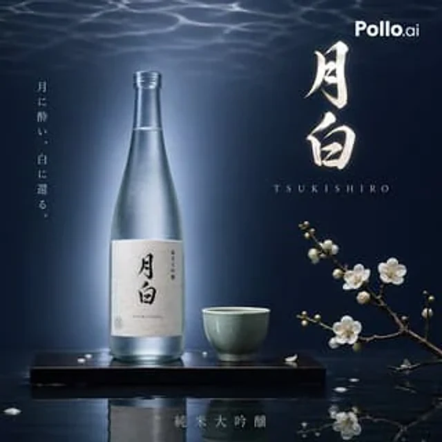

```text
Create a luxurious Japanese-style poster advertisement for a brand named {argument name="brand name" default="Moon White"} It is accompanied by a Romanized subtitle.{argument name="romanized brand name" default="TSUKISHIRO"} The composition employs an exquisitely designed single-unit studio scene, with a background of deep midnight to navy blue, topped with a shimmering, water-ripple bokeh effect, resembling moonlight reflected on a tranquil surface. On a glossy black lacquered platform, a tall, frosted glass sake bottle is positioned slightly to the left, with a soft, cool white halo behind it. The bottle has an elegant, slender shape, its surface exhibiting a silver-blue, condensed water droplet texture, and bears a light-colored textured paper label with striking black Japanese calligraphy.{argument name="label text" default="Moon White"} The label features the words "Junkei Daiginjo" in small vertical lines along the edge, and the Roman letters "TSUKISHIRO" are printed at the bottom. On the same platform to the right of the bottle, a small celadon sake cup is placed. From the lower right, a realistic plum blossom branch is added; the branch is dark brown with about nine blooming white plum blossoms and eight visible buds, with a few white petals scattered on the platform and the water's surface. The surface below is a glossy, dark water, subtly reflecting the bottle, cup, plum blossoms, and platform. On the right, a strikingly large, luminous brushstroke of Japanese calligraphy is displayed.{argument name="display title" default="Moon White"} The text is arranged vertically, with the serif Romanized spelling "TSUKISHIRO" in well-spaced font below. On the far left, a vertical line of poetic Japanese slogans is added.{argument name="tagline text" default="Intoxicated by the moon, I return to white."} Add the light gray text "Junka Daiginjo" at the bottom center. Add a small white "Pollo.ai" watermark in the upper right corner. The lighting should have a cinematic feel, creating a cool tone, a moonlight effect, and a sense of sophistication, emphasizing minimalism, elegant white space, high-end beverage advertising aesthetics, traditional Japanese refinement, ultra-fine textures, clear and realistic product photography, and a tranquil and poetic atmosphere.
```

Model: GPT Image 2
Author: GPT Image 2 Prompts

[ProjectD](https://aitoolsradar.com/en/prompts/4d2fc9a7e1a21f) · [Recorded source](https://x.com/TechTalkNAVI/status/2046974537632522276#reversed-0)
 · [Full original metadata and byte evidence](data/projectd-batch-0043.json)

## Premium Loot App Screenshot Upgrade

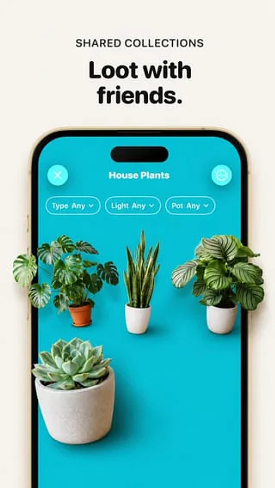

```text
Using the provided reference image, improve the app promo screenshot into a polished, high-end product mockup while preserving the same overall layout, text, phone frame, turquoise app screen, and plant-collection UI. Enlarge and sharpen the phone crop so it fills more of the vertical canvas, keep the headline above it reading {argument name="headline text" default="Loot with friends."} with the small label {argument name="section label" default="SHARED COLLECTIONS"}. Replace the tiny flat plant thumbnails with realistic, larger, photoreal 3D/product-render plants that appear to sit inside the phone screen with soft shadows and depth. Use exactly 4 plants: a monstera in a terracotta pot on the left, a snake plant in a white ribbed pot in the center, a round-leaf striped calathea/peperomia-style plant in a white pot on the right, and a large echeveria succulent in a concrete pot in the lower-left foreground. Keep the UI title {argument name="collection title" default="House Plants"}, the close button, menu button, and exactly 3 pill filters labeled “Type Any”, “Light Any”, and “Pot Any”. Make the overall image cleaner, brighter, more premium, with crisp typography, realistic shadows, and a beige/off-white background; avoid adding extra UI elements, extra plants, watermarks, or unrelated text.
```

Model: GPT Image 2
Author: Marc Köhlbrugge

[ProjectD](https://aitoolsradar.com/en/prompts/1e716add77c6d3) · [Recorded source](https://youmind.com/prompts/loot-screenshot-upgrade-27838)
 · [Full original metadata and byte evidence](data/projectd-batch-0043.json)

## Premium Male Editorial Portrait


```text
Ultra-realistic 8K editorial male portrait of {argument name="reference person" default="the uploaded man"}, using his exact face as the ONLY identity reference — preserve 100% facial structure, jawline, hairstyle volume, beard texture, skin tone, eye shape, pores, and natural imperfections with zero beautification or face alteration. Luxury “quiet wealth” aesthetic blended with cinematic Instagram masculinity. Centered close-up composition, direct eye contact, calm dominant expression, slightly serious mood, no smile. Styled in a {argument name="clothing" default="fitted black turtleneck under a premium black tailored blazer"}, no accessories. {argument name="background" default="Dark emerald-green cinematic studio gradient background"} with soft atmospheric depth. Shot on an 85mm lens at f/1.8 with razor-sharp focus on the eyes, creamy bokeh, ultra-detailed skin texture, visible beard strands, realistic hair fibers, HDR dynamic range, deep contrast shadows, subtle rim light around hair and jawline, soft key light from front-left sculpting the face naturally. Premium GQ magazine color grading, luxury fashion campaign vibe, hyper-realistic photorealism, dramatic yet minimal composition, insanely detailed, rich blacks, elite masculine aura, emotionally captivating, instantly viral social media quality, masterpiece-level realism, natural cinematic skin, modern billionaire aesthetic, studio perfection, award-winning editorial photography --ar 4:5
```

Model: GPT Image 2
Author: Nexora

[ProjectD](https://aitoolsradar.com/en/prompts/da885bb6148e17) · [Recorded source](https://youmind.com/prompts/luxury-male-editorial-portrait-transformation-21835)
 · [Full original metadata and byte evidence](data/projectd-batch-0043.json)

## Premium Mecha Girl Model Kit Poster

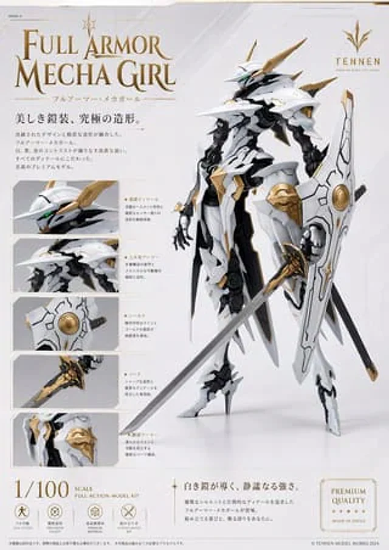

```text
{
  "type": "High-end product display poster for sci-fi plastic model kits",
  "theme": "Luxury Japanese mecha figure advertisement",
  "product": {
    "name": "{argument name=\"product name\" default=\"FULL ARMOR MECHA GIRL\"}",
    "subtitle": "フルアーマー・メカガール",
    "series": "{argument name=\"brand name\" default=\"TENNEN\"}",
    "seriesTagline": "Advanced model kit series",
    "scale": "1/100",
    "category": "Fully articulated model kit",
    "originMark": "Made in Japan",
    "year": "2024"
  },
  "subject": {
    "design": "The feminine humanoid armored mecha possesses a texture reminiscent of a high-end collectible sculpture.",
    "pose": "Full body 3/4 frontal view, standing upright, left leg forward, right leg back, head slightly turned, longsword held diagonally downward in front of the body, large shield mounted on the other arm.",
    "colorScheme": {
      "primary": "{argument name=\"primary armor color\" default=\"Glossy White\"}",
      "secondary": "Black internal mechanical frame",
      "accent": "{argument name=\"accent color\" default=\"Metallic gold\"}",
      "detail": "Small emerald green goggles"
    },
    "materials": "High-end plastic model surface with metallic trim, layered armor plates, contrasting matte and glossy finishes, sharp panel lines, precision-engineered joints, and premium showroom rendering quality.",
    "features": [
      "Streamlined helmet with long horn-shaped crown",
      "Narrow, luminous goggles for both eyes",
      "angular breastplate and shoulder armor",
      "Black, segmented inner arms and legs, with visible mechanical joints.",
      "Waist skirt armor and layered thigh armor",
      "High-heeled, blade-shaped feet",
      "Large, asymmetrical white shield with a gold ring and geometric lines at the center.",
      "A long, straight sword with a silver blade and an ornate gold cross-shaped guard.",
      "Tail fin and thrusters extending from the rear of the silhouette"
    ]
  },
  "layout": {
    "background": "A clean, light gray to white studio background with subtle futuristic lines and delicate gold borders.",
    "sections": [
      {
        "title": "Main visual product rendering",
        "position": "right side",
        "count": 1,
        "labels": [
          "Full-body mecha girl"
        ]
      },
      {
        "title": "Detailed display panel",
        "position": "Left vertical column",
        "count": 5,
        "labels": [
          "Head close-up",
          "upper body and shoulder armor",
          "Shield",
          "Hilt and hand",
          "Leg armor"
        ]
      },
      {
        "title": "Functional label",
        "position": "The center left of each illustration",
        "count": 5,
        "labels": [
          "Head details",
          "Upper body armor",
          "Shield",
          "sword",
          "Foot armor"
        ]
      },
      {
        "title": "Bottom function icons",
        "position": "bottom left corner",
        "count": 4,
        "labels": [
          "Fully movable",
          "Precision engraving",
          "High-grade materials",
          "Plastic Model"
        ]
      },
      {
        "title": "Quality Badge",
        "position": "bottom right corner",
        "count": 1,
        "labels": [
          "High quality"
        ]
      }
    ]
  },
  "typography": {
    "headline": "The large, elegant serif title, centered in the top left corner, is in metallic gold.",
    "bodyText": "The Japanese promotional copy features exquisite editing and layout, ample white space, black and gold lettering, and a luxurious catalog style.",
    "branding": "The minimalist, premium logo in the upper right corner features a sharp gold emblem."
  },
  "style": {
    "rendering": "Ultra-high detail 3D product visualization, clean studio lighting, soft shadows, and commercial-grade catalog composition.",
    "mood": "Solemn, pure, elite, futuristic, high-end model products",
    "inspiration": "A combination of Japanese model box illustrations and luxury product catalog design"
  }
}
```

Model: GPT Image 2
Author: GPT Image 2 Prompts

[ProjectD](https://aitoolsradar.com/en/prompts/26c06521a44a9c) · [Recorded source](https://x.com/munou_ac/status/2047110000339030405#reversed-0)
 · [Full original metadata and byte evidence](data/projectd-batch-0043.json)

## Premium Mechanical Keyboard Ad Poster

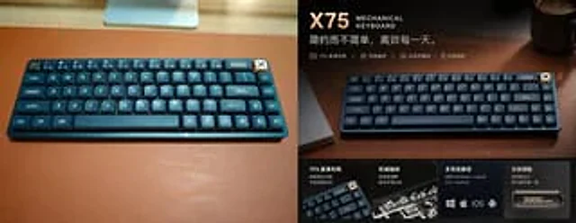

```text
{
  "type": "High-end product advertising posters",
  "subject": {
    "product": "{argument name=\"product name\" default=\"X75\"} mechanical keyboard",
    "category": "75% Compact Wireless Mechanical Keyboard",
    "color": "Deep navy blue, accented with dark cyan.",
    "material": "Matte plastic casing with rounded keycaps",
    "branding": "The small badge in the upper right corner of the keyboard",
    "layout badge": "A cream-colored square badge with a black X symbol is affixed to the upper right edge of the keyboard."
  },
  "scene": {
    "setting": "Warm and atmospheric desktop setup",
    "surface": "A dark brown leather placemat is placed on a light-colored wooden tabletop.",
    "lighting": "The cinematic warm-toned directional light from the upper right corner creates a soft reflection and a luxurious, high-tech advertising atmosphere.",
    "background": "A dark, blurry office or desk environment with a coffee cup in the upper right corner and other items on the desk vaguely visible."
  },
  "composition": {
    "format": "Before and after comparison of split-screen promotional images",
    "panels": [
      {
        "position": "left half",
        "style": "Simple, casual snapshots",
        "description": "A top-down photo of the keyboard centered on a large brown desk mat, in bright ambient light, with the edge of a light-colored wooden desktop visible at the top, and a monitor stand or part of a silver device at the top center. This is an authentic, unretouched product photo."
      },
      {
        "position": "right half",
        "style": "Upgraded high-end advertising design",
        "description": "The same keyboard is presented dramatically on a brown leather desk mat, with darker exposure, richer contrast, warm highlights, and shallow depth of field, as if meticulously retouched for a commercial purpose."
      }
    ]
  },
  "text elements": {
    "headline": "{argument name=\"headline text\" default=\"X75\"}",
    "subheadline": "mechanical keyboard",
    "tagline": "{argument name=\"tagline\" default=\"Simple yet sophisticated, efficient every day.\"}",
    "feature line count": 4,
    "feature line items": [
      "75% compact layout",
      "mechanical shaft",
      "Multi-system compatibility",
      "Long battery life"
    ]
  },
  "bottom feature cards": {
    "count": 4,
    "cards": [
      {
        "title": "75% compact layout",
        "description": "Preserving the high-efficiency area saves desktop space",
        "visual": "Close-up of the corner of the keyboard"
      },
      {
        "title": "mechanical shaft",
        "description": "Clear paragraph breaks and excellent typing feedback",
        "visual": "Close-up of a mechanical shaft with a translucent casing"
      },
      {
        "title": "Multi-system compatibility",
        "description": "Supports Windows / macOS / iOS / Android",
        "visual": "Four platform icons: Windows, Apple, iOS, Android"
      },
      {
        "title": "Long battery life",
        "description": "Low-power design for lasting companionship.",
        "visual": "Battery icon, labeled as{argument name=\"battery capacity\" default=\"3000 mAh\"}"
      }
    ]
  },
  "style": {
    "design language": "High-end Chinese e-commerce main image poster",
    "color palette": "Deep navy blue, charcoal gray, copper brown, warm amber highlight, cream typography",
    "typography": "The product name is in a bold, modern sans-serif font, with smaller, all-caps English subtitles and concise Chinese text.",
    "finish": "Exquisite commercial retouching, delicate vignetting, glossy highlights, and a high-end atmosphere."
  }
}
```

Model: GPT Image 2
Author: GPT Image 2 Prompts

[ProjectD](https://aitoolsradar.com/en/prompts/9fef9f04bcfe47) · [Recorded source](https://x.com/op7418/status/2046581756523123192#reversed-0)
 · [Full original metadata and byte evidence](data/projectd-batch-0043.json)

## Premium Mechanical Keyboard Ad Poster


```text
{"type":"premium product advertisement poster","subject":{"product":"{argument name=\"product name\" default=\"X75\"} mechanical keyboard","category":"75% compact wireless mechanical keyboard","color":"deep navy blue with dark teal accents","material":"matte plastic case with rounded keycaps","branding":"small badge in the top-right corner of the keyboard","layout badge":"cream square badge with a black X symbol attached near the keyboard's top-right edge"},"scene":{"setting":"warm moody desktop setup","surface":"rich brown leather desk mat on a light wood desk","lighting":"cinematic warm directional light from upper right, soft reflections, luxury tech advertisement mood","background":"dark blurred office or desk environment with a coffee mug in the upper-right corner and faint desk objects"},"composition":{"format":"split-screen before-and-after promotional comparison","panels":[{"position":"left half","style":"plain casual snapshot","description":"top-down angled photo of the keyboard centered on a large brown desk mat, bright ambient room light, visible light wood desk edge at top, part of a monitor stand or silver device at the top center, realistic unstyled product photo"},{"position":"right half","style":"upgraded premium ad design","description":"the same keyboard presented dramatically on the brown leather desk mat with darker exposure, richer contrast, warm highlights, shallow depth of field, and polished commercial retouching"}]},"text elements":{"headline":"{argument name=\"headline text\" default=\"X75\"}","subheadline":"MECHANICAL KEYBOARD","tagline":"{argument name=\"tagline\" default=\"简约而不简单，高效每一天。\"}","feature line count":4,"feature line items":["75% 紧凑布局","机械轴体","多系统兼容","长效续航"]},"bottom feature cards":{"count":4,"cards":[{"title":"75% 紧凑布局","description":"保留高效区 节省桌面空间","visual":"small angled keyboard corner close-up"},{"title":"机械轴体","description":"段落感清晰 敲击反馈出色","visual":"close-up of mechanical switches with translucent housings"},{"title":"多系统兼容","description":"支持 Windows / macOS / iOS / Android","visual":"4 platform icons: Windows, Apple, iOS, Android"},{"title":"长效续航","description":"低功耗设计 持久陪伴每一刻","visual":"battery icon labeled {argument name=\"battery capacity\" default=\"3000 mAh\"}"}]},"style":{"design language":"high-end Chinese e-commerce hero banner","color palette":"dark navy, charcoal, copper brown, warm amber highlights, cream typography","typography":"bold modern sans-serif for product name, smaller uppercase English subtitle, clean Chinese body text","finish":"sleek commercial retouching, subtle vignetting, glossy highlights, premium atmosphere"}}
```

Model: GPT Image 2
Author: 歸藏(guizang.ai)

[ProjectD](https://aitoolsradar.com/en/prompts/348ed48c5e6d3c) · [Recorded source](https://youmind.com/prompts/mechanical-keyboard-split-poster-14453)
 · [Full original metadata and byte evidence](data/projectd-batch-0043.json)

## Premium Recipe Poster Template


```text
Make a [{argument name="dish name" default="DISH NAME"} These high-end gourmet food posters feature exquisite main course displays, warm natural light, creamy backgrounds, elegant step-by-step recipe layouts, ingredient lists, cooking processes, high-end food photography, refined English typography, a luxurious restaurant advertising style, simple design, rich colors, high level of detail, and visually irresistible – a cinematic masterpiece.
```

Model: GPT Image 2
Author: GPT Image 2 Prompts

[ProjectD](https://aitoolsradar.com/en/prompts/074ac10e0b9d84) · [Recorded source](https://x.com/Preda2005/status/2047883394152088004)
 · [Full original metadata and byte evidence](data/projectd-batch-0043.json)

## Premium Sports Editorial Poster

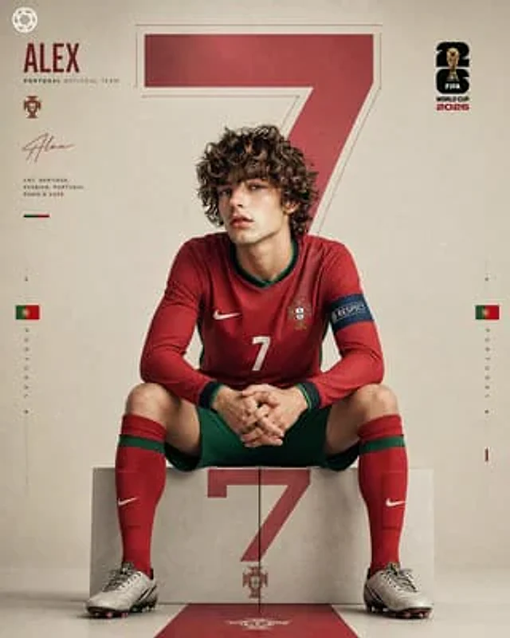

```text
premium {argument name="event" default="FIFA World Cup"} editorial poster with minimalist sports branding, centered athlete composition, cinematic studio lighting, clean typography and realistic jersey textures
```

Model: GPT Image 2
Author: PhotoGPT

[ProjectD](https://aitoolsradar.com/en/prompts/4e4c7b9b9ebd39) · [Recorded source](https://youmind.com/prompts/fifa-world-cup-editorial-poster-22738)
 · [Full original metadata and byte evidence](data/projectd-batch-0043.json)

## Premium Tea Tin Lifestyle

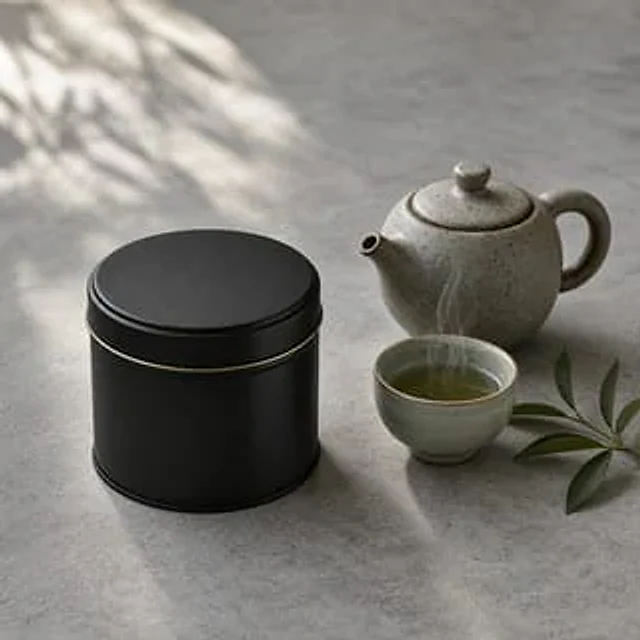

```text
A round matte black premium tea tin resting on a smooth grey concrete tabletop, with a small Eastern minimalist ceramic teapot in raw stoneware glaze and one small celadon cup beside it. A thin curl of steam rises from the cup. Soft directional daylight from the upper left, generous negative space, square 1:1 composition. No brand text on the tin, no logo, no watermark. Photorealistic ceramic and metal textures, calm zen brand photography quality.
```

Model: GPT Image 2
Author: @hiapi_ai

[ProjectD](https://aitoolsradar.com/en/prompts/e2525750bff387) · [Recorded source](https://github.com/HiAPIAI/awesome-gpt-image-2-prompts)
 · [Full original metadata and byte evidence](data/projectd-batch-0043.json)

## Printable Multiplication Domino Worksheet

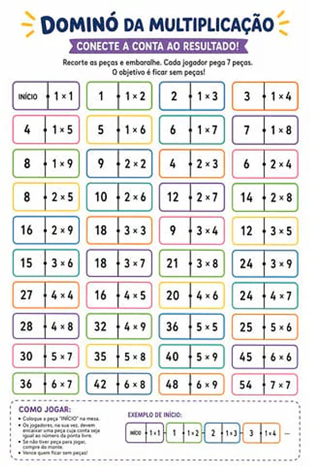

```text
Create a vertically oriented, printable educational worksheet in Brazilian Portuguese with a clean white background. Employ a lively classroom design, centered layout, bold rounded font, and bright, child-friendly colors. At the top, place a large navy blue title with the following content:{argument name="headline text" default="DOMINÓ DA MULTIPLICAÇÃO"} It features small yellow decorative lights on both sides. Below is a purple ribbon banner with white capital letters printed on it.{argument name="subtitle text" default="CONECTE A CONTA AO RESULTADO!"} Below the banner, add two lines of centered black text: “Recorte as peças e embaralhe. Cada jogador pega 7 peças.” and “O objetivo é ficar sem peças!”. The main area displays 40 domino-style cubes arranged in a 4-column, 10-row grid with even spacing. Each cube is a horizontal rounded rectangle with a thin colored outline, white fill, a central vertical dividing line, and a small black dot on the dividing line. The left half contains the numerical result or the word “INÍCIO” from the first domino, and the right half contains the multiplication expression. Purple, green, blue, orange, pink, and yellow are used alternately as border colors within the grid. The 40 blocks are arranged in row order from left to right and top to bottom as follows: 1) "INÍCIO | 1 × 1", 2) "1 | 1 × 2", 3) "2 | 1 × 3", 4) "3 | 1 × 4", 5) "4 | 1 × 5", 6) "5 | 1 × 6", 7) "6 | 1 × 7", 8) "7 | 1 × 8", 9) "8 | 1 × 9", 10) "9 | 2 × 2", 11) "4 | 2 × 3", 12) "6 | 2 × 4", 13) "8 | 2 × 5", 14) "10 | 2 × 6", 15) "12 | 2 × 7", 16) "14 | 2 × 8", 17) "16 | 2 × 9", 18) "18 | 3 × 3", 19) "9 | 3 × 4", 20) "12 | 3 × 5", 21) "15 | 3 × 6", 22) "18 | 3 × 7", 23) "21 | 3 × 8", 24) "24 | 3 × 9", 25) "27 | 4 × 4", 26) "16 | 4 × 5", 27) "20 | 4 × 6", 28) "24 | 4 × 7", 29) "28 | 4 × 8", 30) "32 | 4 × 9", 31) "36 | 5 × 5", 32) "25 | 5 × 6", 33) "30 | 5 × 7", 34) "35 | 5 × 8", 35) "40 | 5 × 9", 36) "45 | 6 × 6", 37) "36 | 6 × 7", 38) "42 | 6 × 8", 39) "48 | 6 × 9", 40) "54 | 7 × 7". At the bottom, add a large purple rounded dashed box that spans most of the width. To the left of this box, place the title "COMO JOGAR:" (bold purple capital letters), followed by five black dots: "Coloque a peça “INÍCIO” na mesa.", "Os jogadores, na sua vez, devem encaixar uma peça cuja conta seja igual ao número da ponta livre.", "Se não tiver peça para jogar, compre do monte." and "Vence quem ficar sem peças!". On the right side of the same frame, add the title "EXEMPLO DE INÍCIO:" (in purple capitals) and display four small dominoes in sequence with ellipses: "INÍCIO | 1 × 1", then "1 | 1 × 2", then "2 | 1 × 3", then "3 | 1 × 4", and finally "...". Maintain a clear, vectorized, and easy-to-print style suitable for elementary school math practice, with balanced spacing and highly legible text.
```

Model: GPT Image 2
Author: GPT Image 2 Prompts

[ProjectD](https://aitoolsradar.com/en/prompts/324640162e64a0) · [Recorded source](https://x.com/olusrodri/status/2046710556208288008#reversed-0)
 · [Full original metadata and byte evidence](data/projectd-batch-0043.json)

## Product Ad Redesign

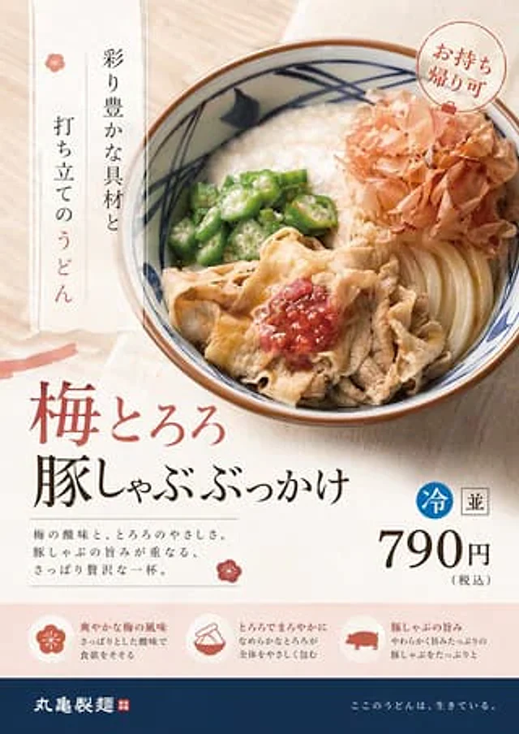

```text
この商品広告をプロのデザイナー目線でリデザインして。
今のトレンド、ターゲットに合わせた洗練されたデザインで。
```

Model: GPT Image 2
Author: @genel_ai

[ProjectD](https://aitoolsradar.com/en/prompts/6dd9c06f020114) · [Recorded source](https://x.com/genel_ai/status/2046498264774791514)
 · [Full original metadata and byte evidence](data/projectd-batch-0043.json)

## Product-Inspired Fashion Design

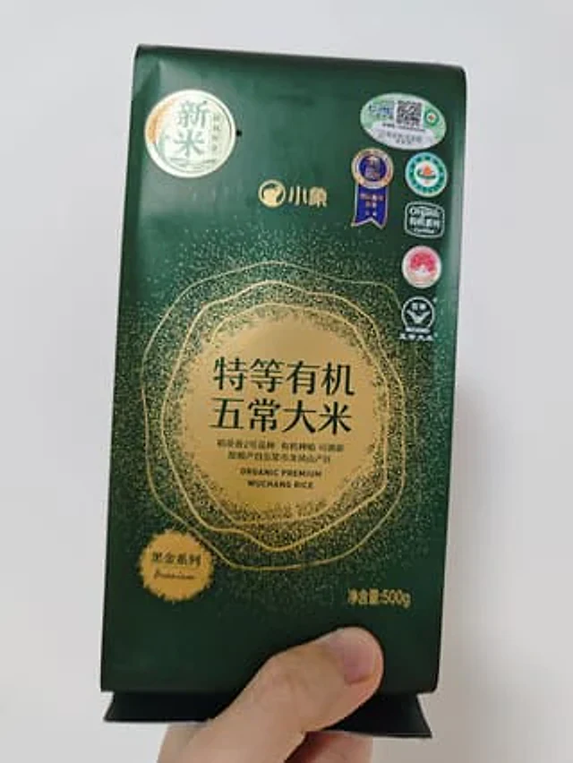

```text
以这件商品为灵感，设计一套{argument name="风格" default="清凉风格"}女装。
```

Model: GPT Image 2
Author: 程序员小灰

[ProjectD](https://aitoolsradar.com/en/prompts/38a8e9df095354) · [Recorded source](https://youmind.com/prompts/product-inspired-fashion-line-17078)
 · [Full original metadata and byte evidence](data/projectd-batch-0043.json)

## Productivity App UI Mockup


```text
{
  "type": "Mobile application UI prototype",
  "device": "Modern smartphones with Lingdong Island",
  "theme": "Light mode, minimalism.{argument name=\"primary color\" default=\"Soft Blue\"} Embellishment, soft projection",
  "layout": {
    "header": {
      "profile": "Small round female head",
      "greeting": "Good morning,{argument name=\"user name\" default=\"Alex\"} ☀️",
      "subtitle": "Let's start a productive day.",
      "icon": "Notification bell with red dot"
    },
    "hero_card": {
      "title": "Today's Focus",
      "headline": "{argument name=\"focus task\" default=\"Launch marketing campaign\"}",
      "description": "Finalize the materials, review the copy, and align with the release plan.",
      "button": "Continue the mission",
      "graphic": "A circular progress ring indicating 75% progress."
    },
    "sections": [
      {
        "title": "Next",
        "count": 1,
        "items": [
          "Team Synchronous Meeting (10:00 AM - 11:00 AM)"
        ]
      },
      {
        "title": "Reminders",
        "count": 2,
        "items": [
          "Review the design prototype",
          "Submit an event briefing"
        ]
      }
    ],
    "bottom_elements": {
      "ai_input": "Capsule-shaped text box with flashing icon and placeholder{argument name=\"ai placeholder\" default=\"Ask your AI assistant...\"} '",
      "navigation_bar": {
        "count": 4,
        "tabs": [
          "front page",
          "Task",
          "assistant",
          "Personal information"
        ]
      }
    }
  }
}
```

Model: GPT Image 2
Author: GPT Image 2 Prompts

[ProjectD](https://aitoolsradar.com/en/prompts/c86b6b2ab0e6f7) · [Recorded source](https://x.com/Fancyfreer/status/2044789137853792669#reversed-1)
 · [Full original metadata and byte evidence](data/projectd-batch-0043.json)

## Professional Anime Character Line Art Sheet

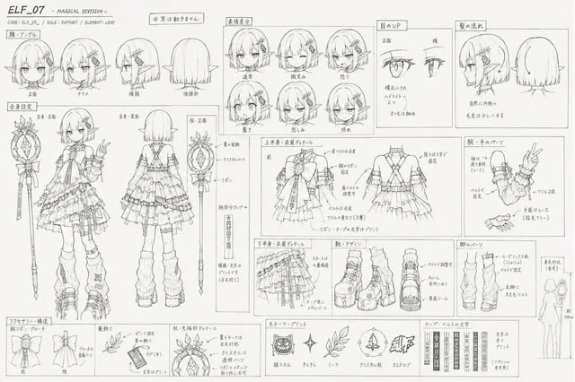

```text
参照画像をキャラクターデザインのベースとして使用し、「商業アニメ制作現場で使用される、プロ仕様のキャラクター線画設定資料」を描く。

キャラクターの顔、髪型、髪色、瞳、輪郭、体型、シルエット、衣装デザイン、頭身、全体の印象を正確に維持すること。

キャラクターのアイデンティティを絶対に崩さない。
別キャラクターとして描き直さない。

完成イラストではない。
コンセプトアートではない。
ポスターではない。

目的は、
アニメーター・作画監督・動画担当へ向けた、
作画共有用の設定資料。

画面は、
白背景の設定資料レイアウト。

複数の線画を、
資料ページとして整理して配置する。

以下を含める：

・正面顔
・斜め顔
・横顔
・表情差分
・目のアップ
・髪の流れ確認
・全身正面
・全身背面
・腕や手の形状確認
・衣装ディテール
・靴デザイン
・アクセサリー構造

キャラクターは、
クリーンなアニメ線画のみで描写する。

彩色しない。
ベタ塗りしない。
厚塗りしない。
レンダリングしない。

線は、
日本のTVアニメ制作現場のような、
細めで整理された鉛筆線画またはクリーンアップ線。

ラフすぎない。
漫画線にならない。
スケッチ感を出しすぎない。

現場用設定資料として、
読みやすさと構造理解を最優先する。

ページ内には、
小さな手書きメモ、
矢印、
パーツ指示、
簡易注釈、
衣装構造メモ、
髪の流れ指示などを自然に追加する。

レイアウトは、
日本の90年代〜2000年代アニメ設定資料集のような空気感。

情報密度は高いが、
見やすく整理されている。

紙面として自然な余白を持たせる。

誌面全体は、
スキャンされた実物の設定資料集のような空気感。

軽微な紙の質感、
わずかな印刷感、
コピー紙感、
スキャン感を自然に加える。

完成されたアート作品ではなく、
「実際の制作資料」に見えることを最優先する。
```

Model: GPT Image 2
Author: Eris Create Lab

[ProjectD](https://aitoolsradar.com/en/prompts/037ad8ba2985aa) · [Recorded source](https://youmind.com/prompts/anime-character-line-art-sheet-22563)
 · [Full original metadata and byte evidence](data/projectd-batch-0043.json)

## Professional Anime Cinematic Storyboard


```text
A professional animated film-level project (16:9), titled "{argument name="title" default="Sky Strike"} The subtitle is "{argument name="subtitle" default="Warriors and the Holy Stone"} The game features a simple, light beige background with rounded rectangular panels arranged in a three-column grid, containing nine scenes. Each scene panel displays an orange "Scene XX" label, timecode, scene title, and two side-by-side frames labeled "Start Frame" → "End Frame," connected by a white arrow, with annotations below (camera/dialogue/VFX/action). The art style is a clean, cel-shaded aesthetic.{argument name="art style" default="Makoto Shinkai x Studio Wit, x Attack on Titan"} —Soft lighting, volumetric clouds, warm golden sunlight, cinematic wide-angle lenses, dynamic poses, rich shades of sky blue and emerald green, accented with brass and copper. Scene to be depicted: 1. Wide-angle lens - A majestic steampunk airship... [Detailed scene description]... Layout: Simple infographics, thin borders, soft grids, each frame containing highly detailed key visual effects for animation, presenting a professional production document aesthetic.
```

Model: GPT Image 2
Author: GPT Image 2 Prompts

[ProjectD](https://aitoolsradar.com/en/prompts/1291014d64aa7f) · [Recorded source](https://x.com/0xluffy_eth/status/2047224465097134172)
 · [Full original metadata and byte evidence](data/projectd-batch-0043.json)

## Professional Anime Cinematic Storyboard


```text
一份专业的动漫院线分镜头（16：9），标题为《{argument name="标题" default="天空之击"}》，副标题为“{argument name="副标题" default="战士与圣石"}”。干净的浅米色背景，圆角矩形面板排列成三列网格，共 9 个场景。每个场景面板显示：橙色“场景 XX”标签、时间码、场景标题，然后是两个并排的画面，分别标有“开始帧”→“结束帧”，通过白色箭头连接，下面有注释（镜头/对白/特效/动作）。艺术风格：清晰的卡通渲染 {argument name="画风" default="新海诚的×工作室机智，×进击的巨人"}——柔和的画风光线、立体云朵、温暖的金色阳光、电影般的广角镜头、动态动作姿势、浓郁的天蓝和翡翠绿调，搭配黄铜和铜色点缀。需要描绘的场景：1. 广角景——一艘雄伟的蒸汽朋克飞艇，黄铜螺旋桨和飘扬的帆，在高空穿透积云海洋（慢速无人机推入）2.低角度特写一名女战士的靴子和交叉的双腿悬挂在飞艇木制栏杆上，风中头发飘动（静电→微微向上倾斜） 3.鸟瞰视角俯瞰栏杆下方：广阔的翡翠山谷，蜿蜒的河流和远处一个茅草屋顶的小中世纪村庄（眩晕变焦）4.飞艇桥内部——海盗船长戴着三角帽和长大衣，举着一块比蛋稍大、发着蓝光的圣石，脸上有耀眼的青色光（中→石头放大）5.甲板上的船员发现入侵者——一名满脸胡渣的海盗举起一把黄铜中世纪左轮手枪对准她，其他人震惊地转身（两枪→跟着瞄准）6.子弹飞行中极近距离，旋转穿过空中，伴随着运动模糊和烟雾轨迹，朝栏杆方向飞去（子弹时间追踪镜头）7.栏杆——空的。 她被放置的地方什么都没有，子弹穿过空气（快速剪辑，杂音）8。女战士在空中优雅地做月面翻身，背景是明亮的天空，头发和斗篷在动作中拖曳（慢动作，宽→近）9。着陆镜头——她悄无声息地在射手身后降落，低蹲着，手放在剑柄上，海盗转身半空震惊僵住（低角度→对峙） 底部部分包括：“关键角色”一行，有 4 个角色肖像（女战士、海盗船长、射手海盗、一名船员）;一个“音调与方向”盒子（动态动作、风和云粒子，吉卜力风格的奇观与武士的强烈情感）;“音乐与特效计划”时间线（环境风→紧张弦乐→子弹→→沉默）;以及“技术规格”盒装（30 秒，16：9 1920×1080,24 帧，全彩，mp4 H.264）。布局：简洁的信息图，细边框，粉彩色格，每帧内高度细致的动漫关键视觉，专业制作文档美学。
```

Model: GPT Image 2
Author: 路飞 🏴‍☠️ AI 研究员🧐

[ProjectD](https://aitoolsradar.com/en/prompts/a08cf4f1c32f77) · [Recorded source](https://youmind.com/prompts/anime-storyboard-grid-15216)
 · [Full original metadata and byte evidence](data/projectd-batch-0043.json)

## Professional Automotive Technical Infographic Prompt


```text
The Chinese infographic is clearly laid out, with eye-catching headings and well-organized parameter tables. While maintaining readability across modules, it allows for appropriate embellishment. A 9:16 vertical infographic disassembling high-end automotive technology is titled "..."{argument name="theme" default="Mazda Skyactiv Technology Full Analysis"} The design uses a dark gray background, creating a strong sense of technology and achieving a visual effect comparable to a professional automotive magazine cover. The centerpiece is a car.{argument name="car model" default="Mazda CX-5"} A high-detail 3D perspective disassembly diagram of the Soul Red color scheme, showcasing the engine, chassis, suspension, brakes, transmission, and interior in layers. The prominent title at the top reads, "..."{argument name="main title" default="Mazda Skyactiv: The Most Detailed Technical Breakdown"} The layout includes multiple Chinese description modules and parameter cards, covering performance, powertrain, and safety. The vehicle rendering reaches photographic quality, with extremely rich details on mechanical parts. The style is similar to automotive engineering posters or professional promotional infographics, with high information density, 8K ultra-high definition, sharp and professional image quality, and cinematic lighting effects.
```

Model: GPT Image 2
Author: GPT Image 2 Prompts

[ProjectD](https://aitoolsradar.com/en/prompts/4976bb6bbce8a1) · [Recorded source](https://x.com/YydsSmith/status/2046978890430890250)
 · [Full original metadata and byte evidence](data/projectd-batch-0043.json)

## Professional Brand Packaging System


```text
Please specify the category as{argument name="category" default="Product Category"} brand{argument name="brand name" default="Brand Name"} Create a high-aesthetic, high-quality "Brand Packaging System Showcase". This is not just a regular e-commerce white-background image or single-product photo, but a showcase with a brand proposal style, demonstrating the "unified presentation of a single brand across multiple packaging media," showcasing the complete packaging system of a mature consumer brand. [Proportion Requirements] The overall composition must be a fixed 4:5 vertical poster. Horizontal compositions or scattered arrangements are prohibited. The layout should follow poster reading logic: white space at the top, the main visual focus of the packaging system in the center, and auxiliary packaging, labels, and products at the bottom. The center of gravity should be concentrated, suitable for direct publication as a brand showcase poster. [Core Requirements] Automatically match the most reasonable packaging combination based on the [product category], and build a unified visual system around the [brand name]. Select a small number of representative packaging formats to form a sophisticated system. Prioritize hierarchy, brand consistency, and aesthetic appeal over quantity. You can include: shopping bags, gift boxes, express boxes, long boxes, single-item boxes, pouches, sleeves, sample bags, bottles, jars, tubes, spray bottles, pump bottles, labels, stickers, hang tags, cards, and the product itself. [Category Adaptation] Adapt packaging formats according to the [product category]: for example, baking uses paper bags and food containers; coffee/tea uses cups and sleeves; beauty/skincare uses jars and tubes; fragrance/lifestyle uses candles and cards; fashion/collectibles uses drawer boxes and hang tags. The result must conform to category characteristics and be systematic. [Quantity Control] Control the number of items to avoid overcrowding. The scene should follow the "less is more" principle. Recommendation: 1-2 large items, 2-3 medium items, 2-4 small items/labels, and 1-3 actual products. The total number of visible elements should be between 6-10. Ensure sufficient white space and clear hierarchy. [Visual System] All packaging must belong to the same brand system, with the [brand name] as the core element. Maintain a consistent logo placement, font style, graphics, illustration/pattern system, and material textures. The style can be minimalist, organic, modern, luxurious, or youthful, but it must be sophisticated and high-quality. [Color Mechanism] Avoid fixed combinations. Generate different color schemes, such as cream white/caramel brown, hazy blue/warm white, olive green/linen beige, chocolate brown/ivory white, etc. Avoid using neon colors or cheap, highly saturated colors. Maintain a sophisticated sense of restraint. [Composition] Use a commercial studio setting, employing a 3/4 overhead or slight perspective. Layer the arrangement: large items in the background, core packaging in the midground, and smaller items/products in the foreground. At least one product should interact with the packaging (e.g., partially revealing the box). Create balanced triangles or staggered compositions. [Visual Style] High-end commercial photography quality. Clean studio backgrounds (white, warm white, light gray). Emphasize material textures (paper creases, box structure, bottle outline, print quality, embossing, matte/cotton/kraft paper texture). Modern and concise visual language. [Lighting and Shadow] Commercial-grade lighting. Soft studio lighting or subtle directional natural sidelighting. Use crisp but restrained light and shadow to add depth. The light should be clear and bright, never dim or cluttered. [Final Result] The final image should look like a packaging proposal poster or visual landing page for a mature brand, emphasizing a vertical poster feel, brand consistency, system integrity, and commercial photography quality.
```

Model: GPT Image 2
Author: GPT Image 2 Prompts

[ProjectD](https://aitoolsradar.com/en/prompts/20f15ee99cb6d0) · [Recorded source](https://x.com/MrLarus/status/2047253028462317674)
 · [Full original metadata and byte evidence](data/projectd-batch-0043.json)

## Professional Businesswoman Corporate Portrait


```text
Create a hyper-realistic HD portrait of a {argument name="subject" default="confident young professional businesswoman"}, {argument name="outfit" default="elegant modern black blazer over a white blouse"}, standing in a {argument name="setting" default="premium futuristic office with glass walls"}, subtle AI technology screens and a city skyline in the background. Natural makeup, polished hairstyle, confident expression, professional corporate appearance, cinematic soft lighting, realistic skin texture, shallow depth of field, luxury business atmosphere, sophisticated blue-and-white tones, ultra-detailed, photorealistic, 8K quality, sharp focus, premium LinkedIn and AI startup branding aesthetic, vertical 4:5 composition, no text, no watermark.
```

Model: GPT Image 2
Author: NadzAI

[ProjectD](https://aitoolsradar.com/en/prompts/b106058ed7ba38) · [Recorded source](https://youmind.com/prompts/professional-businesswoman-corporate-office-portrait-31360)
 · [Full original metadata and byte evidence](data/projectd-batch-0043.json)

## Professional Cookbook Layout Generator


```text
Handwritten recipes →{argument name="output format" default="Professional recipe page"} Upload a messy handwritten document{argument name="recipe source" default="Family recipe"} The model automatically retrieves accurate modern units of measurement and nutritional information, and then generates a {argument name="visual style" default="Exquisite magazine style"} The layout is two pages long and includes step-by-step photographs, perfect ingredient labels, and calorie analysis.
```

Model: GPT Image 2
Author: GPT Image 2 Prompts

[ProjectD](https://aitoolsradar.com/en/prompts/f2b1b4ab56d986) · [Recorded source](https://x.com/maxescu/status/2045203839910056014)
 · [Full original metadata and byte evidence](data/projectd-batch-0043.json)

## Professional Food Photography Enhancement


```text
This is from{argument name="device" default="iPhone"} Filmed{argument name="subject" default="food"} The photos were meticulously retouched to achieve a professional food photography effect. Cinematic lighting was applied to enhance color depth and texture, and sharpness was increased to highlight key features.{argument name="subject" default="food"} The texture and details. To create the atmosphere of a high-end restaurant, the background is appropriately darkened and naturally blurred, making {argument name="subject" default="food"} Make it stand out even more. Add a line of small, delicate text with a natural handwritten feel to the side. Create a stylish, high-quality food photography style perfect for Instagram.
```

Model: GPT Image 2
Author: GPT Image 2 Prompts

[ProjectD](https://aitoolsradar.com/en/prompts/b372e249ba42d8) · [Recorded source](https://x.com/EEJ_OOXO/status/2047647964391411753)
 · [Full original metadata and byte evidence](data/projectd-batch-0043.json)

## Professional ID Photo Generator


```text
この写真をもとに、就職活動や各種申請に使える、清潔感があり上品で信頼感のある証明写真を作成してください。 髪型は整えられた自然なスタイルで、{argument name="服装" default="黒のスーツジャケットにシンプルな白のクルーネックブラウス"}を着用。 背景は{argument name="背景色" default="無地の白"}、明るく均一なスタジオ照明で、肌の色味は自然でクリアに、高解像度で仕上げてください。 正面を向いた構図で、肩から上がしっかり写るフロントビュー、表情は落ち着いたニュートラルな印象で、親しみやすさと知的な雰囲気を感じられるようにしてください。 全体として、ミニマルで洗練された、自然かつプロフェッショナルな証明写真にしてください。
```

Model: GPT Image 2
Author: そう｜Claude Codeで始めるAI自動化

[ProjectD](https://aitoolsradar.com/en/prompts/eb30051a648fac) · [Recorded source](https://youmind.com/prompts/professional-id-photo-17090)
 · [Full original metadata and byte evidence](data/projectd-batch-0043.json)

## Professional ID Photo Generator


```text
截取图片人像头部，帮我做成2寸证件照，要求:
1、{argument name="底色" default="蓝底"}
2、{argument name="服装" default="职业正装"}
3、正脸
4、微笑
```

Model: GPT Image 2
Author: 松果先森

[ProjectD](https://aitoolsradar.com/en/prompts/d6a7336b369c62) · [Recorded source](https://youmind.com/prompts/professional-id-photo-portrait-26347)
 · [Full original metadata and byte evidence](data/projectd-batch-0043.json)

## Professional Stadium Fan Photography Prompt


```text
Create an ultra-photorealistic candid stadium photograph of a handsome young {argument name="nationality" default="Portuguese"} man in his early-to-mid 20s, passionately supporting Portugal during a FIFA World Cup match. He is photographed naturally by another person, never as a selfie.

Composition:
Vertical 4:5 framing. Camera positioned several feet away. Body visible from head to just below the knees. The man occupies roughly 40% of the frame. He stands in the upper spectator tier beside a concrete railing. The green football pitch and tiny active players are clearly visible far below and behind him. The huge stadium and crowd remain visually important, creating strong environmental depth.

Appearance:
Portuguese / Mediterranean-looking young man. Athletic build, broad shoulders, strong jawline. Short textured dark hair, light natural stubble. Realistic facial proportions and authentic skin pores. Calm, confident expression.

Outfit:
Portugal-inspired {argument name="jersey color" default="red"} national football supporter jersey with green trim, matching green athletic shorts, white crew socks, clean white sneakers, a small silver chain necklace and minimal accessories.

Pose:
Standing casually beside the concrete railing. One forearm resting naturally on the barrier, the other hand tucked into the shorts pocket. Body angled approximately 30 degrees away from the camera. Looking down toward the match rather than directly at the camera. Relaxed shoulders, strong athletic posture, an authentic candid fan moment.

Environment:
Packed {argument name="location" default="football stadium"} at night. Thousands of Portugal supporters wearing red and green. Large Portuguese flags throughout the crowd. Bright stadium floodlights. Green football pitch clearly visible below, with tiny players actively competing on the field. Upper-tier spectator viewpoint and immersive international World Cup atmosphere.

Photography Style:
Ultra-realistic telephoto candid photography, natural 50mm-lens perspective, professional sports-event editorial photography, ultra-detailed jersey fabric, skin, concrete, crowd and stadium lighting, cinematic documentary realism, believable high dynamic range, premium commercial quality, genuine social-media stadium photograph.

Mood:
Proud, energetic, adventurous and confident Portugal supporter; immersive match-day experience and authentic football culture.

Negative Prompt:
selfie, phone visible, direct eye contact, awkward anatomy, extra fingers, extra limbs, duplicate person, anime, illustration, CGI, beauty filters, plastic skin, empty stadium, blurred or invisible pitch, watermark, readable text, brand logo, distorted railing, unrealistic crowd, poor lighting, cartoon style, overprocessed HDR, artificial face.
```

Model: GPT Image 2
Author: 小森映像

[ProjectD](https://aitoolsradar.com/en/prompts/96bf35c0dbb45d) · [Recorded source](https://youmind.com/prompts/stadium-fan-sports-photography-prompt-26231)
 · [Full original metadata and byte evidence](data/projectd-batch-0043.json)

## Professional Studio Fashion Portrait


```text
Professional studio fashion photography: ultra-clean, high-end digital magazine portraits against a pure white, seamless background. A massive octagonal softbox as the main light, combined with large softboxes for fill light, creates perfectly even lighting and soft, sculpted shadows. Vogue-level minimalist haute couture aesthetics, eye-level perspective, 3/4 full-body portrait.{argument name="subject description" default="Korean idol-type young women in their 20s"} Possessing incredibly realistic and exquisite Korean female features: slightly upturned almond-shaped fox eyes, natural double eyelids, a small and delicate jawline, flawless yet realistic cool ivory porcelain skin, a completely natural post-workout makeup look, cheeks with a natural blush, a delicate dewy glow from slight sweat, slightly parted natural mauve lips, and subtle natural freckles on the bridge of the nose and cheeks, revealing fine skin texture, pores, and microscopic skin details. Long, natural wavy dark brown hair, slightly messy with realistic strands, and wearing {argument name="outfit" default="A white fitted tennis polo shirt or short-sleeved sports top paired with a high-waisted white tennis skirt."} Standing naturally in the center of the pure white studio, holding{argument name="prop" default="White tennis racket"} Casually draped over the shoulder, one hand hanging naturally at the side or lightly placed on the waist, one leg slightly forward, the posture natural and confident, looking directly at the camera and the audience, the expression calm, confident, and refreshing. Pure and soft professional studio lighting, large diffused light sources, perfectly even illumination, soft sculpting shadows naturally outlining the subject's contours, clean high-key minimalist aesthetics, ultra-clean high-end digital photography, extremely sharp yet soft skin rendering with a natural luster, no film grain, no noise, no halo, no vignetting, perfect natural color grading, authentic Korean idol studio magazine aesthetics, visible realistic tennis racket texture, natural skin texture with freckles and fine sweat, no plastic-like skin, no digital over-sharpening, no airbrush retouching, no watermark, no text --ar 9:16
```

Model: GPT Image 2
Author: GPT Image 2 Prompts

[ProjectD](https://aitoolsradar.com/en/prompts/1b9fb2d00c1b2e) · [Recorded source](https://x.com/BubbleBrain/status/2044846335728467996)
 · [Full original metadata and byte evidence](data/projectd-batch-0043.json)

## Professional UI Design Prompt


```text
Render a professional iOS app page image, with a style similar to{argument name="reference platform" default="Binance"} However, the content must include{argument name="function" default="XX"} Functionality. Requires a professional-level design standard.
```

Model: GPT Image 2
Author: GPT Image 2 Prompts

[ProjectD](https://aitoolsradar.com/en/prompts/b7afa603016a46) · [Recorded source](https://x.com/_FORAB/status/2045017289335144743)
 · [Full original metadata and byte evidence](data/projectd-batch-0043.json)

## Professional UI Design Prompt


```text
渲染一个专业的 IOS APP 页面图片，类似{argument name="参考平台" default="币安"}一样，但是内容类似 {argument name="功能" default="XX"} 功能。要专业级的设计。
```

Model: GPT Image 2
Author: AB Kuai.Dong

[ProjectD](https://aitoolsradar.com/en/prompts/fdd6482e3eb57d) · [Recorded source](https://youmind.com/prompts/professional-ios-ui-mockup-13873)
 · [Full original metadata and byte evidence](data/projectd-batch-0043.json)

## Professional workstation screen prompt


```text
ordinary{argument name="profession" default="engineer"} screen
```

Model: GPT Image 2
Author: GPT Image 2 Prompts

[ProjectD](https://aitoolsradar.com/en/prompts/7a3c30f80c582c) · [Recorded source](https://x.com/CuriousRefuge/status/2043821402940420309)
 · [Full original metadata and byte evidence](data/projectd-batch-0043.json)

## Professor #126


```text
Transform this image [UPLOAD YOUR IMAGE] into a 64K DSLR-quality shot resolution Ultra-hyperrealistic cinematic Create a photorealistic, beauty portrait in a vertical 4:5 frame, captured as a tight close-up to extreme close-up. The framing focuses primarily on the face - from just above the forehead to slightly below the lips — with minimal negative space. The camera is positioned mid-close to the subject (same face as the uploaded
```

Model: GPT Image 2
Author: Professor

[ProjectD](https://aitoolsradar.com/en/prompts/312d5cbf38b8c5) · [Recorded source](https://x.com/Professor_134/status/2022898659336298658)
 · [Full original metadata and byte evidence](data/projectd-batch-0043.json)

## Programmer in Shanghai Metro


```text
One{argument name="profession" default="programmer"} After get off work, in the{argument name="location" default="Shanghai Metro Line 1"} Wearing a laptop bag, looking at his phone.
```

Model: GPT Image 2
Author: GPT Image 2 Prompts

[ProjectD](https://aitoolsradar.com/en/prompts/649fd83454f7a3) · [Recorded source](https://x.com/ShaohuaYan13878/status/2047335306974896248)
 · [Full original metadata and byte evidence](data/projectd-batch-0043.json)

## Programmer's Almanac Generator


```text
{
  "type": "Retro Programmer's Almanac Poster",
  "style": "Retro paper texture, traditional Chinese almanac layout, red and green font, structured borders",
  "header": {
    "banner": "{argument name=\"main title\" default=\"Programmer&#39;s Almanac\"}",
    "date_row": "{argument name=\"date\" default=\"Wednesday, April 24, 2024 (the 16th day of the third month in the lunar calendar)\"}"
  },
  "layout": {
    "sections": [
      {
        "title": "Main Dos and Don'ts",
        "position": "upper half",
        "count": 2,
        "labels": [
          "should",
          "avoid"
        ],
        "content": {
          "do_items": [
            "{argument name=\"primary do action\" default=\"coding\"}",
            "Bug fixes"
          ],
          "dont_items": [
            "{argument name=\"primary dont action\" default=\"stay up\"}",
            "Online release"
          ]
        }
      },
      {
        "title": "Today's Index",
        "position": "center left",
        "count": 4,
        "labels": [
          "work overtime",
          "efficiency",
          "coffee",
          "network"
        ]
      },
      {
        "title": "Secondary auspicious matters",
        "position": "Zhong Zhong",
        "count": 3,
        "labels": [
          "Write comments",
          "Organize documents",
          "Learning new technologies"
        ]
      },
      {
        "title": "Secondary taboos",
        "position": "center right",
        "count": 3,
        "labels": [
          "Long meeting",
          "Change requirements",
          "Fighting and arguing"
        ]
      },
      {
        "title": "Tools and Blessings",
        "position": "Bottom left",
        "count": 2,
        "labels": [
          "Recommended tools",
          "Blessings"
        ],
        "content": {
          "tools": [
            "VSCode",
            "Git"
          ],
          "quote": "{argument name=\"blessing text\" default=\"May your code be bug-free, your requirements never need to be reworked, and may you leave work early every day and sleep soundly every night.\"}"
        }
      },
      {
        "title": "Today's workstation",
        "position": "Bottom right",
        "count": 1,
        "labels": [
          "Today's workstation"
        ],
        "description": "Desktop illustrations featuring a laptop, mug, plants, and a window."
      }
    ]
  }
}
```

Model: GPT Image 2
Author: GPT Image 2 Prompts

[ProjectD](https://aitoolsradar.com/en/prompts/bf07634f3af4bd) · [Recorded source](https://x.com/ai_xiaomu/status/2045739507841179661)
 · [Full original metadata and byte evidence](data/projectd-batch-0043.json)

## Programming Language Alphabet Prompt


```text
A about{argument name="topic" default="programming language"} alphabet
```

Model: GPT Image 2
Author: GPT Image 2 Prompts

[ProjectD](https://aitoolsradar.com/en/prompts/96b209facd8bfd) · [Recorded source](https://x.com/antonioleivag/status/2046632275698430113)
 · [Full original metadata and byte evidence](data/projectd-batch-0043.json)

## Prompt


```text
Minimalist ultra-high-resolution travel sketch poster of Omotesando, Tokyo, on clean white sketchbook paper with subtle paper grain texture. Style: refined pen drawing + loose watercolor sketch. Delicate black ink linework, airy watercolor washes, elegant urban details.
```

Model: GPT Image 2
Author: しらき@パワポ図解

[ProjectD](https://aitoolsradar.com/en/prompts/c0d980f7ba93bc) · [Recorded source](https://youmind.com/prompts/prompt-20244)
 · [Full original metadata and byte evidence](data/projectd-batch-0043.json)

## Pub Scene Amateur Snapshot


```text
Amateur photography,{argument name="subjects" default="An elderly couple"} Sitting{argument name="location" default="Yorkshire Pub"} Amateur composition, snapshot.
```

Model: GPT Image 2
Author: GPT Image 2 Prompts

[ProjectD](https://aitoolsradar.com/en/prompts/a8fa355f9ec52f) · [Recorded source](https://x.com/phasE89/status/2043641310226042910)
 · [Full original metadata and byte evidence](data/projectd-batch-0043.json)

## Pub Scene Amateur Snapshot


```text
Amatérská fotka {argument name="subjekty" default="staršího páru"} sedícího v {argument name="lokace" default="yorkshirské hospodě"}, amatérská kompozice, momentka.
```

Model: GPT Image 2
Author: Martin Balaz

[ProjectD](https://aitoolsradar.com/en/prompts/56496341fa0cb8) · [Recorded source](https://youmind.com/prompts/elderly-couple-pub-snapshot-13610)
 · [Full original metadata and byte evidence](data/projectd-batch-0043.json)

## Pug Running on Alpine Trail


```text
A bright, high-resolution outdoor action photo showing a small {argument name="dog breed" default="Pug"} The dog is running along a narrow, rocky hiking trail through an alpine meadow, positioned slightly below center of the frame. It is running, one front paw raised, mouth open, tongue lolling out, ears perked up, and an excited expression. It is wearing a {argument name="harness color" default="Navy blue"} The chest straps. A small path winds its way through rolling green hills, flanked by dense wildflowers and grasses, with clusters of blue, purple, yellow, white, and pink blossoms visible. In the distance, three tiny hikers are placed to emphasize the scale. The background showcases a spectacular panoramic mountain range with four prominent snow-capped peaks, rugged rock faces, and glacial patches, under a clear, bright sky.{argument name="sky color" default="blue"} The summer sky is dotted with wispy clouds. Using crisp natural light, the colors are vibrant and realistic, with a deep sense of depth and clarity from the flowers in the foreground to the distant mountains. The low, level perspective and documentary travel photography style, with the focus clearly on the running dog, create a joyful and adventurous hiking atmosphere.
```

Model: GPT Image 2
Author: GPT Image 2 Prompts

[ProjectD](https://aitoolsradar.com/en/prompts/93f49e798a09c8) · [Recorded source](https://x.com/hasantoxr/status/2046929307227078723#reversed-1)
 · [Full original metadata and byte evidence](data/projectd-batch-0043.json)

## Punk AI Sprint Flyer


```text
Create an original, high-contrast punk rock concert collage poster for a project titled "..."{argument name="event title" default="THE AI WEB DESIGN SPRINT"} The design should evoke the texture of photocopied underground flyers pasted on city walls: rough, torn paper edges, grainy copying, ink smudges, distressed black and white textures, bright magenta paint splatters, DIY magazine aesthetics, and messy, layered scraps of paper secured with tape and tacks. A vertical poster composition is used, with a black background and a slightly tilted, oversized torn white rectangle in the center, filled with a large, compressed, distressed black font as the main title. At the top, a smaller strip of torn black paper is added, with neon magenta handwritten text {argument name="top slogan" default="LIVE PUNK!"} On the left, place a bright pink torn piece of paper with the date written on it in hand-drawn black text.{argument name="event dates" default="April 27-30"} Below, smaller lines of text are stacked, reading "4 NIGHTS OF CHAOS &amp; CODE", "DOORS 7PM", "SHOW 8PM", "$10 ADV", and "$12 DOS". On the right, add a cream-colored torn sticky note with "WITH:" written in magenta at the top and four guest performers listed in black handwriting below: "Minimal Playground", "Agency 976", "Cyberpunk Cafe", and "Surfers (Late Set)". Slightly below center, display two black-and-white photocopy-style punk band members, half-length portraits, standing side-by-side, both wearing patched and badge-embellished leather jackets; the one on the left wears round-framed glasses, and the one on the right wears a baseball cap. Their faces should be blurred, partially obscured in a collage style, keeping the poster's focus on the typography and graphics rather than the portraits themselves. Add a bright pink spiked starburst pattern in the center right, containing a black circle with a simple white radiating symbol. Near the bottom right corner, place a beige masking tape-like scrap of paper with the words "Build Fast. Break Rules. Share Loud" written in bold, handwritten black text. Near the bottom left corner, add a black rectangular area information block labeled in magenta handwriting.{argument name="venue name" default="THE SOUTH SIDE DIY"} The cover features smaller white address text "218 W. 31st Street" and "Chicago, IL," accompanied by a small white skull icon. It includes two silver pins, one near the top left corner and one near the bottom left, and a strip of dark tape along the left edge of the main title page. The bottom edge finishes with a black and white checkerboard stripe spanning the entire width. The overall feel is rebellious, boisterous, youthful, and anarchistic, combining punk street-poster flyers with tech event advertising, featuring strong contrasts, rough halftone noise, silkscreen imperfections, and the energy of hand-collaged collage.
```

Model: GPT Image 2
Author: GPT Image 2 Prompts

[ProjectD](https://aitoolsradar.com/en/prompts/1c316ce123df00) · [Recorded source](https://x.com/ransegall/status/2047583778974126564#reversed-3)
 · [Full original metadata and byte evidence](data/projectd-batch-0043.json)

## Punk Pink Anime Girl Full-Body Render


```text
A high-angle, top-down rendering of a full-body anime-style 3D virtual idol girl against a simple, light gray background with a soft shadow in the lower right corner. She has long, straight hair reaching her waist, and her hair color is {argument name="hair color" default="blue-green"} She sports bangs, two large black bows in her hair, and a striking red spider lily-style hair accessory on one side. Her face is cute and youthful, embodying a trendy alternative idol gothic style. One hand is raised to her face in a peace sign, while the other hangs naturally at her side. Clothing: An oversized pink top with two black horizontal stripes on each sleeve and a distressed black pattern on the chest, layered under a black strappy suspender skirt with metal studs; a pink plaid pleated skirt with a distressed hem; two black belts with silver rings and chains at the waist; a small fluffy keychain bag hanging from her hip; a black choker and multiple layers of silver necklaces around her neck. Legs: Two matching pink and black striped loose leg warmers or over-the-knee socks, with a black suspender visible on the thigh. Footwear: Two black platform shoes with metal hardware. The overall style is a blend of Japanese anime/grid (jirai kei), punk, and gothic streetwear, featuring a pink and black color scheme, high-gloss textures, abundant metallic accessories, and highly detailed clothing textures. Character rendering is clean, with clear lighting and shadows, rich details, stylized proportions, and exquisite game portrait quality, with a centered composition.
```

Model: GPT Image 2
Author: GPT Image 2 Prompts

[ProjectD](https://aitoolsradar.com/en/prompts/42ba8c930b9388) · [Recorded source](https://x.com/soyaakinohara4/status/2047598490847727677#reversed-0)
 · [Full original metadata and byte evidence](data/projectd-batch-0043.json)

## Purple Anime Yuri Banner


```text
A delicate anime-style banner illustration, using dreamy violet hues and a wide, cinematic composition, depicts a quiet, literary room at dusk. On the right side of the image, a person named {argument name="character name" default="Yuri"} A beautiful anime girl sat at a large wooden table by the window, where purple curtains hung. She held a dark, ornate hardcover book in her arms, her eyes shy and reserved as she gazed gently downwards. She had very long, straight hair, the color of which was {argument name="hair color" default="Deep violet"} She has a glossy finish, side-parted bangs, a small hair clip, and purple eyes. She wears a Japanese school uniform, consisting of a grey blazer, white shirt, red silk bow tie, and dark skirt. On the left side of the image, there are glowing calligraphic characters.{argument name="title text" default="Yuri"} Presented in a bright, neon lavender handwritten font, with elegant strokes, a small heart, and decorative patterns, it blends into the scene like a magical font. The table contains eight clearly visible items: an open book in the center foreground, a black ink bottle with a white quill pen, a closed book next to a candle, a stack of books below the paper, a scattered handwritten page in front, a small purple flower on the table, a floral porcelain teacup with a tray on the right, and a stack of dark books on the far right. Additional background details include six decorative environmental elements: a lit candle in a glass candlestick on the left, a cluster of purple flowers in the left foreground, a hanging purple bouquet in the upper left, a pinned botanical notebook in the upper right, a bookshelf with books and flowers in the right background, and a sunset sky visible through the window. Added elements include falling petals, subtle handwritten text textures, ornate gold lines around the border, soft volumetric window lighting, subtle glitter, rich shadows, and a romantic, melancholic atmosphere. Highly detailed, with clean lines and a glossy anime-style rendering, this high-quality visual novel key art style is perfect for niche anime banners or character thumbnails.
```

Model: GPT Image 2
Author: GPT Image 2 Prompts

[ProjectD](https://aitoolsradar.com/en/prompts/bc4c46acc18d57) · [Recorded source](https://x.com/mirochill/status/2047639852485620070#reversed-2)
 · [Full original metadata and byte evidence](data/projectd-batch-0043.json)

## Qiongqi Eastern Aesthetics Poster


```text
极简主义，新中式风格立体图形设计，图像下端有楷体中国文字：“东方美学”，“2026/04/18”，署名 “CHINA”，和“@LIYUE"；
平整纯白色的亚光质感厚艺术纸上绘充满东方诗意氛围的山水创意画，不规则的撕纸效果；
中国的神兽：穷奇，身形图案完整，美轮美奂，，线条柔美灵动,眼睛炯炯有神，威严的神态，优雅的姿势，奢华装饰艺术，中国传统纹饰；
荧光蓝色线条，0.5mm极细金色金属质感勾边，泼白墨大笔触，色彩渲染，红底，蓝色的浪漫诗意视觉；
冷暖光交织的梦幻唯美场景，强烈的光影对比氛围，花轻舞的时光叙事，东风禅意，画面有大面积留白，框架构图，底部留白，细节清晰。
```

Model: GPT Image 2
Author: @liyue_ai

[ProjectD](https://aitoolsradar.com/en/prompts/ddb7e68c14697a) · [Recorded source](https://x.com/liyue_ai/status/2045506567735558336)
 · [Full original metadata and byte evidence](data/projectd-batch-0043.json)

## Quantum Cat Manga


```text
Please draw a cartoon, in which {argument name="subject" default="cat"}{argument name="concept" default="Behavior like a quantum particle"} .
```

Model: GPT Image 2
Author: GPT Image 2 Prompts

[ProjectD](https://aitoolsradar.com/en/prompts/9790b459e8906f) · [Recorded source](https://x.com/h_okumura/status/2046719692803580298)
 · [Full original metadata and byte evidence](data/projectd-batch-0043.json)

## Quirky Animal Sticker Set


```text
creation{argument name="quantity" default="24"} payment{argument name="animals" default="animal"} These are themed LINE stickers featuring a fun, hand-drawn style. (Targeting...){argument name="target audience" default="Japan&#39;s Generation Z"} The group aims to create a trendy style that can top the download charts.
```

Model: GPT Image 2
Author: GPT Image 2 Prompts

[ProjectD](https://aitoolsradar.com/en/prompts/405e23316b4378) · [Recorded source](https://x.com/midori_tatsuta/status/2045367592353943984)
 · [Full original metadata and byte evidence](data/projectd-batch-0043.json)

## Quirky Animal Sticker Set


```text
へたうまな手描きタッチの{argument name="動物" default="動物"}LINEスタンプを{argument name="個数" default="24個"}並べて作って。{argument name="ターゲット" default="日本のZ世代"}がターゲットで、ダウンロード数トップを狙えるトレンドの作風で。
```

Model: GPT Image 2
Author: みどり🐲Midori Tatsuta

[ProjectD](https://aitoolsradar.com/en/prompts/82e93de433558b) · [Recorded source](https://youmind.com/prompts/quirky-hand-drawn-animal-stickers-13987)
 · [Full original metadata and byte evidence](data/projectd-batch-0043.json)

## Rabbit Portfolio Design System Board


```text
{
  "type": "Design system style portfolio landing page mockup",
  "style": "A sophisticated Japanese-style web design project featuring a warm, neutral editorial aesthetic, rounded corners, minimalist luxury, creamy monochrome tones, subtle shadows, clean spacing, and exquisite product design showcase.",
  "brand": {
    "name": "{argument name=\"brand name\" default=\"HONDA PORTFOLIO\"}",
    "mascot": "A cute white 3D rabbit character with long ears, small dot eyes, a small mouth, and a smooth matte finish."
  },
  "canvas": {
    "aspect_ratio": "3:4",
    "background": "Very light warm gray"
  },
  "palette": {
    "count": 6,
    "swatches": [
      "#F7F3EF",
      "#E7DDD0",
      "#EAD9CA",
      "#F1C6B4",
      "#A8C0B2",
      "#2E3A44"
    ]
  },
  "layout": {
    "type": "Multi-panel design system project",
    "sections": [
      {
        "title": "Design System",
        "position": "Left sidebar",
        "count": 11,
        "labels": [
          "logo concept",
          "color",
          "typesetting",
          "Grid",
          "Components",
          "navigation",
          "icon",
          "Mascot poses",
          "motion effects",
          "Design Principles",
          "Mini Card Preview"
        ]
      },
      {
        "title": "Homepage website",
        "position": "Centered at the top",
        "count": 8,
        "labels": [
          "Brand header",
          "Japanese title",
          "Subtitle line",
          "2 CTA buttons",
          "The big rabbit on the table",
          "6 function icon rows",
          "Standing bunny",
          "Wooden desk scene"
        ]
      },
      {
        "title": "Mobile preview",
        "position": "Top right narrow bar",
        "count": 1,
        "labels": [
          "Smartphone mockups on the same homepage"
        ]
      },
      {
        "title": "Performance",
        "position": "Central",
        "count": 4,
        "labels": [
          "Company website",
          "Brand landing page",
          "UI Design",
          "Magazine Design"
        ]
      },
      {
        "title": "Right sidebar cards",
        "position": "Middle to lower right",
        "count": 4,
        "labels": [
          "Performance Card",
          "Corporate website cards",
          "Thinking and Recording Cards",
          "Contact Us Card"
        ]
      },
      {
        "title": "Personal information",
        "position": "Mid-lower part",
        "count": 1,
        "labels": [
          "A rabbit sitting in a lounge chair, accompanied by a personal profile text block."
        ]
      },
      {
        "title": "Serve",
        "position": "Mid-lower part",
        "count": 4,
        "labels": [
          "Website creation",
          "UI/UX Design",
          "Brand Design",
          "Art Director"
        ]
      },
      {
        "title": "Production process",
        "position": "Centered at the bottom",
        "count": 5,
        "labels": [
          "01 Needs Survey",
          "02 Proposal",
          "03 Design",
          "04 Development",
          "Released at 05"
        ]
      },
      {
        "title": "footer",
        "position": "Bottom full width",
        "count": 4,
        "labels": [
          "Indoor photo bar",
          "Keyword capsule",
          "Social icons",
          "The big sitting rabbit holding a mug"
        ]
      }
    ],
    "note": "All the panels are arranged like a coherent design system to showcase the project, featuring rounded-corner cards and ample white space."
  },
  "subject": {
    "main_character": "Stylized 3D rabbit mascot, toy-like proportions, soft, sculpted body, gray-white material.",
    "expressions_or_poses": {
      "count": 13,
      "items": [
        "The standing unisex full-body image on the brand card on the left",
        "The large rabbit written on the table in the first screen",
        "The little rabbit standing next to the main screen's function row",
        "The rabbit sitting in an armchair holding a cup in the personal profile section",
        "Use a laptop in step 1 of the process",
        "The project is showcased in step 2 of the process.",
        "Step 3 of the process involves working at a desk.",
        "Use a laptop in step 4 of the process",
        "In step 5 of the process, in front of the laptop...",
        "Small full-body poses in the icon row 1",
        "Small full-body poses in the icon row 2",
        "Small full-body poses in the icon row 3",
        "The large sitting rabbit holding a mug in the bottom right corner"
      ]
    }
  },
  "scene_details": {
    "hero_scene": "A wooden desk bathed in sunlight by the window, an open notebook, a quill pen, a small ink bottle, soft plant leaves reaching in from the right, the tranquil morning light.",
    "cards": "Portfolio thumbnails include a desktop laptop, an elegant fashion/editorial manual, a smartphone UI mockup, and a cereal magazine cover featuring a rabbit."
  },
  "typography": {
    "headline": "{argument name=\"headline text\" default=\"Quietly refining the act of creation.\"}",
    "body_language": "Japanese",
    "font_mood": "The title uses a sophisticated modern serif font, paired with clean sans-serif UI text."
  },
  "ui": {
    "components_count": 9,
    "components": [
      "Dark gray main capsule button",
      "Light-colored outline subcapsule button",
      "Tag capsules",
      "Navigation bar",
      "Rounded corner icon buttons",
      "Content Cards",
      "Smartphone frame",
      "Pagination point",
      "Social icons"
    ]
  },
  "materials": {
    "surfaces": [
      "Matte Plastic Rabbit",
      "Light walnut wood",
      "Cream-colored paper",
      "Soft fabric chair",
      "Glass and ceramic decorations"
    ]
  },
  "lighting": "Soft, diffused sunlight, gentle highlights, minimal contrast, and warm beige reflections.",
  "camera": "Facing the entire project view, slightly raised, creating a clean and crisp product photography feel for editing.",
  "quality": "High-end Dribbble/Behance display effects, perfect alignment, realistic 3D rendering and UI mockup design integration.",
  "customization": {
    "accent color": "{argument name=\"accent color\" default=\"Warm beige and rock blue\"}",
    "mascot animal": "{argument name=\"mascot animal\" default=\"rabbit\"}",
    "language": "{argument name=\"language\" default=\"Japanese\"}"
  }
}
```

Model: GPT Image 2
Author: GPT Image 2 Prompts

[ProjectD](https://aitoolsradar.com/en/prompts/d9bf0a9ee1e2ae) · [Recorded source](https://x.com/yuichirohonda_/status/2046914381620154734#reversed-0)
 · [Full original metadata and byte evidence](data/projectd-batch-0043.json)

## Rabbit Portfolio Design System Board


```text
{"type":"design system style portfolio landing page mockup","style":"soft premium Japanese web design board, warm neutral editorial aesthetic, rounded UI, minimal luxury, creamy monochrome palette, subtle shadows, clean spacing, polished product-design presentation","brand":{"name":"{argument name=\"brand name\" default=\"HONDA PORTFOLIO\"}","mascot":"cute white 3D rabbit character with long ears, tiny dot eyes, small mouth, smooth matte surface"},"canvas":{"aspect_ratio":"3:4","background":"very light warm gray"},"palette":{"count":6,"swatches":["#F7F3EF","#E7DDD0","#EAD9CA","#F1C6B4","#A8C0B2","#2E3A44"]},"layout":{"type":"multi-panel design system board","sections":[{"title":"デザインシステム","position":"left column","count":11,"labels":["logo concept","Color","Typography","Grid","Components","Navigation","Iconography","mascot pose row","Motion","Design Principles","mini card preview"]},{"title":"hero website","position":"top center","count":8,"labels":["brand header","Japanese headline","subtext line","2 CTA buttons","large rabbit at desk","feature icon row of 6 items","small standing rabbit","wood desk scene"]},{"title":"mobile preview","position":"top right narrow column","count":1,"labels":["smartphone mockup of the same hero page"]},{"title":"実績","position":"middle center","count":4,"labels":["コーポレートサイト","ブランドLP","UIデザイン","雑誌デザイン"]},{"title":"right sidebar cards","position":"middle and lower right","count":4,"labels":["実績 card","コーポレートサイト card","思考と記録 card","お問い合わせ card"]},{"title":"プロフィール","position":"lower middle","count":1,"labels":["rabbit sitting in lounge chair with profile text block"]},{"title":"サービス","position":"lower middle","count":4,"labels":["Webサイト制作","UI / UX設計","ブランドデザイン","アートディレクション"]},{"title":"制作の流れ","position":"bottom middle","count":5,"labels":["01 hearing","02 proposal","03 design","04 implementation","05 publish"]},{"title":"フッター","position":"bottom full width","count":4,"labels":["interior photo strip","keyword pills","social icons","large seated rabbit with mug"]}],"note":"all panels arranged like a cohesive design system presentation board with thin rounded cards and generous margins"},"subject":{"main_character":"stylized 3D rabbit mascot, toy-like proportions, soft sculpted body, off-white material","expressions_or_poses":{"count":13,"items":["standing neutral full-body on left branding card","large writing at desk in hero","small standing beside hero feature row","sitting in armchair holding a cup in profile section","with laptop in process step 1","presenting board in process step 2","working at desk in process step 3","using laptop in process step 4","at laptop in process step 5","small full-body pose 1 in iconography row","small full-body pose 2 in iconography row","small full-body pose 3 in iconography row","large seated rabbit with mug at bottom right"]}},"scene_details":{"hero_scene":"sunlit wooden desk by a window, open notebook, feather pen, tiny ink bottle, soft plant leaves entering from the right, calm morning light","cards":"portfolio thumbnails include laptop on desk, elegant fashion/editorial booklet, smartphone UI mockup, cereal magazine cover with rabbit"},"typography":{"headline":"{argument name=\"headline text\" default=\"つくることを、静かに研ぎ澄ます。\"}","body_language":"Japanese","font_mood":"refined modern serif for headline paired with clean sans-serif UI text"},"ui":{"components_count":9,"components":["primary pill button dark slate","secondary pill button light outline","tag pills","navigation bar","rounded icon buttons","content cards","smartphone frame","pagination dots","social icons"]},"materials":{"surfaces":["matte plastic rabbit","light walnut wood","cream paper","soft fabric chair","glass and ceramic accents"]},"lighting":"soft diffused daylight, gentle highlights, minimal contrast, warm beige reflections","camera":"straight-on full board view, slightly elevated, crisp editorial product shot","quality":"high-end dribbble/behance presentation, immaculate alignment, realistic 3D rendering blended with UI mockup design","customization":{"accent color":"{argument name=\"accent color\" default=\"warm beige and slate blue\"}","mascot animal":"{argument name=\"mascot animal\" default=\"rabbit\"}","language":"{argument name=\"language\" default=\"Japanese\"}"}}
```

Model: GPT Image 2
Author: ホンダ

[ProjectD](https://aitoolsradar.com/en/prompts/b5baee9b80eefe) · [Recorded source](https://youmind.com/prompts/rabbit-design-system-board-14933)
 · [Full original metadata and byte evidence](data/projectd-batch-0043.json)

## Racing Car Poster with Specs


```text
Generate an image with{argument name="subject" default="Racing Poster"} and{argument name="data" default="Specifications and Price"} Image
```

Model: GPT Image 2
Author: GPT Image 2 Prompts

[ProjectD](https://aitoolsradar.com/en/prompts/11fccf9169f7aa) · [Recorded source](https://x.com/verysmallwoods/status/2047033599229137126)
 · [Full original metadata and byte evidence](data/projectd-batch-0043.json)

## Racing Car Trading Card Illustration


```text
I want to create{argument name="card type" default="Baseball cards / Top Trumps style cards"} Please provide{argument name="subject" default="Red Bull RB19"} Create a picture and display it at the top with cool effects and{argument name="art style" default="Oil pastel/chalk illustrations"} Style racing car images.
```

Model: GPT Image 2
Author: GPT Image 2 Prompts

[ProjectD](https://aitoolsradar.com/en/prompts/6daa480e5776a6) · [Recorded source](https://x.com/domhfr/status/2047326915908800810)
 · [Full original metadata and byte evidence](data/projectd-batch-0043.json)

## RAG 技术详解图


```text
帮我生成一张 RAG 技术的详细讲解图
```

Model: GPT Image 2
Author: 苍何原创实测（公众号文章《我逆向了 329 条 GPT-Image2 提示词模板，全部开源！》）

[ProjectD](https://aitoolsradar.com/en/prompts/e2c4e55bf17998) · [Recorded source](https://github.com/freestylefly/awesome-gpt-image-2)
 · [Full original metadata and byte evidence](data/projectd-batch-0043.json)

## Rain Cycling Storyboard Grid


```text
{"type":"cinematic 3x3 storyboard contact sheet for a nighttime rain cycling film","overall_style":"dark moody realistic sports cinematography, cool blue-gray mountain atmosphere, subtle red and pink reflections, heavy rain consistency, wet asphalt reflections, shallow depth of field in macro panels, clean editorial layout with thin muted pink grid lines and black caption bars","subject":{"identity":"same determined adult female cyclist throughout all cycling panels, athletic build, consistent face, same helmet, same blonde hair tucked under helmet, realistic fatigue and focus","apparel":"{argument name=\"cycling outfit color\" default=\"baby pink\"} waterproof cycling jacket, matching fingerless performance gloves, cycling shorts, helmet, rain-ready gear","bike":"high-performance road bicycle with wet drivetrain, realistic wheel spray, droplets, splashes, runoff and metallic reflections"},"layout":{"format":"square 3 by 3 grid storyboard, 9 equal panels, each panel has a large pale-pink panel number at lower left, an uppercase title, and exactly 3 small bullet points on a black caption strip","typography":"condensed bold uppercase sans-serif for titles, pale pink numbers, small white bullet text, thin pink dividers","sections":[{"number":1,"title":"PREPARATION / HERO PORTRAIT","position":"top left","visual":"close hero portrait of the female cyclist in helmet and baby pink jacket, foggy cool background, rain droplets, centered face area partially obscured by a dark translucent square censor-like block","count":3,"bullet_labels":["Calm focus before the ride","Cold, foggy conditions","Subtle determination"]},{"number":2,"title":"WATERPROOF JACKET MACRO","position":"top center","visual":"extreme macro of baby pink hydrophobic performance fabric covered with crisp round rain droplets rolling off, shallow depth of field","count":3,"bullet_labels":["Hydrophobic performance fabric","Water droplets roll off","Protected from rain"]},{"number":3,"title":"ZIPPER CLOSE-UP","position":"top right","visual":"tight close-up of a hand pulling up the zipper on a baby pink waterproof cycling jacket, beads of rain on fabric and zipper teeth","count":3,"bullet_labels":["Smooth, controlled movement","Quality YKK zipper","Secure and weatherproof"]},{"number":4,"title":"GLOVE ADJUSTMENT","position":"middle left","visual":"close-up of cyclist adjusting a baby pink perforated fingerless glove, rain-damp hands, blurred dark background","count":3,"bullet_labels":["Dialed-in fit","Performance glove grip","Ready for the elements"]},{"number":5,"title":"BALACLAVA & FOCUSED EYES","position":"middle center","visual":"front close-up of helmeted cyclist adjusting face covering or balaclava, focused eyes intended but central face area partially obscured by a dark translucent square censor-like block, baby pink jacket visible","count":3,"bullet_labels":["Warmth and protection","Clear vision, sharp focus","Mindset locked in"]},{"number":6,"title":"MISTY MOUNTAIN ESTABLISHING SHOT","position":"middle right","visual":"wide establishing shot of rugged misty forest mountains under storm clouds, rolling fog between evergreen ridges, cinematic haze, no cyclist visible","count":3,"bullet_labels":["Rugged terrain ahead","Fog, clouds, and mood","Nature sets the stage"]},{"number":7,"title":"DRONE TRACKING CYCLISTS","position":"bottom left","visual":"rear drone tracking shot of exactly 3 cyclists climbing a wet mountain road in heavy rain, two in baby pink tops and one darker kit, guardrail and misty forest, smooth lateral locked framing","count":3,"bullet_labels":["Smooth lateral tracking shot","Teamwork and rhythm","Pushing through the climb"]},{"number":8,"title":"FRONTAL SPEED SHOT","position":"bottom center","visual":"frontal low telephoto shot of exactly 3 cyclists riding toward camera on a rain-soaked mountain road, matching helmets, baby pink jerseys/jackets dominant, spray from tires, speed and intensity","count":3,"bullet_labels":["Head-on dynamic movement","Speed, intensity, and control","Relentless forward drive"]},{"number":9,"title":"BICYCLE DRIVETRAIN FINALE","position":"bottom right","visual":"close-up of rear bicycle drivetrain, cassette, chain, derailleur and spinning wheel splashing through rainwater, cyclist leg in baby pink kit in background, sharp mechanical detail","count":3,"bullet_labels":["Power and precision","Every pedal stroke counts","Built for performance"]}]},"image_requirements":"render as a single polished storyboard image, not a video frame sequence; preserve exact order from Panel 1 to Panel 9; do not merge panels; maintain realistic nighttime lighting, rain physics, water droplets, splashes, mist, wheel spray and wet reflections; avoid cartoon styling; include the visible English titles and bullet text exactly as specified","customization":{"film mood":"{argument name=\"film mood\" default=\"dark moody cinematic mountain endurance race\"}","weather":"{argument name=\"weather\" default=\"heavy cold rain and fog\"}","main title style":"{argument name=\"caption style\" default=\"pale pink numbers with white uppercase captions on black bars\"}"}}
```

Model: GPT Image 2
Author: Sharon Riley

[ProjectD](https://aitoolsradar.com/en/prompts/4c57dfcde4c773) · [Recorded source](https://youmind.com/prompts/rain-cycling-storyboard-18962)
 · [Full original metadata and byte evidence](data/projectd-batch-0043.json)

## Rain-Soaked Formula Race Car Action


```text
A highly dynamic and realistic photograph depicting a modern Formula 1 car in action.{argument name="team livery" default="Dark blue with red and yellow accents"} The scene depicting a car speeding across a wet track in a downpour was shot from an extremely low angle, close to the front left corner of the race car. The car dominates the foreground, showcasing its sleek aerodynamic body, wet tires spraying copious amounts of water, glowing red reflections on the wet asphalt, and clearly visible sponsor logos on the nose, front wing, sidepods, and rear wing. The sense of high speed is captured through subtle motion blur in the background and watermarks, while maintaining the car's sharpness and rich detail. The scene is set in a crowded track resembling a stadium, with a main grandstand filled with blurred spectators on the left, two bright red glowing projects in the distance, a safety barrier parallel to the track, and a wet track surface reflecting the rain extending towards the camera. Above, dense storm clouds fill the sky, creating a cinematic atmosphere that contrasts the cool blue-gray tones with the car's vibrant warm colors. Emphasizing dramatic water mist, reflections, realism, tension, and the sense of being on the scene during a championship race in inclement weather, it was shot as if using a professional sports telephoto lens, shallow depth of field, high contrast, and an editorial racing photography style.
```

Model: GPT Image 2
Author: GPT Image 2 Prompts

[ProjectD](https://aitoolsradar.com/en/prompts/e42a6de7dd3353) · [Recorded source](https://x.com/rathan_pmr/status/2046671651606282716#reversed-0)
 · [Full original metadata and byte evidence](data/projectd-batch-0043.json)

## Rainbow Bunny DJ Anime Portrait


```text
A vibrant, anime-style DJ girl is positioned in a cute and dreamy rave aesthetic scene. The shot is a close-up of her upper body, behind a professional DJ console. She wears oversized rainbow bunny ear headbands and large rainbow headphones, one hand resting on the right earcup, the other touching the left turntable, as if preparing for the next track. The slightly upward angle creates a dynamic and emotional performance atmosphere. She is styled with a short, straight bob with bangs, and her hair color is {argument name="hair color" default="Light gold with rainbow-colored ends"} Her facial expression should convey a playful DJ vibe: one eye winks, a mischievous smile playing on her lips, as if she's about to ignite the crowd. She wears a white hoodie with rainbow stripes on the cuffs and a small red heart patch on the chest and sleeves. The DJ setup should include two turntables, one center mixer, four vertical channel faders, three rows of equalizer knobs, and two small displays with illuminated waveforms. The background is filled with a soft gradient from pale purple to pink, adorned with tiny glitters, floating soft hearts, and six colorful musical note icons surrounding the character. The rendering employs a refined, bright, and highly detailed anime illustration style, combined with glowing rainbow effects, soft shadows, clean lines, and saturated colors, to showcase the adorable energy of an idol colliding with a nightclub, and a highly infectious, magical "emo" atmosphere.
```

Model: GPT Image 2
Author: GPT Image 2 Prompts

[ProjectD](https://aitoolsradar.com/en/prompts/af92c32f8a1fdc) · [Recorded source](https://x.com/miya_SUEMYST/status/2047806627391345036#reversed-0)
 · [Full original metadata and byte evidence](data/projectd-batch-0043.json)

## Rainbow Bunny DJ Anime Portrait


```text
A vibrant, anime-style close-up depicts a cute DJ girl in a dreamlike rave scene, taken from a slightly upward angle, as if the audience were standing in front of the DJ booth. She has a bob haircut and her hair color is {argument name="hair color" default="Gold with rainbow ends"} She has fluffy bangs and towering bunny ears, with a rainbow gradient on the inside of her left ear. Most of her face is obscured by a soft, beige-pink rectangular visor, but her pose suggests a playful wink and a mischievous smile. She wears oversized heart-shaped sunglasses with red and blue frames and glossy purple lenses. One hand is pressing a large rainbow-colored headphone cover to her ear, while the other arm extends across the DJ console towards the audience, creating a dynamic atmosphere as if the next track is about to start. She wears an oversized white hoodie with a large green butterfly logo on the chest and four heart-shaped patches sewn onto the sleeves and shoulders: one orange, one purple, one blue, and one red. The foreground shows a partially illuminated DJ mixer with brightly colored neon controls, knobs, and a glowing pink heart icon. The background is a dreamy and dazzling club fantasy world, filled with glowing stars, hearts, shimmering blur effects, soft beams of light, and gentle rainbow highlights, creating an atmosphere that is both "emo" and cute. Employing a highly refined anime illustration style, it utilizes glossy lighting, soft lighting effects, iridescent reflections, and saturated rainbow hues to present a cute and vibrant idol DJ aesthetic.
```

Model: GPT Image 2
Author: GPT Image 2 Prompts

[ProjectD](https://aitoolsradar.com/en/prompts/da36c4812bcd6d) · [Recorded source](https://x.com/miya_SUEMYST/status/2047806627391345036#reversed-1)
 · [Full original metadata and byte evidence](data/projectd-batch-0043.json)

## Rainbow Halo Editorial Portrait


```text
Create a dreamy pastel editorial portrait of a young woman in side profile, facing right, with long wavy black hair styled with two thin braids framing her face. She wears large gold hoop earrings and a delicate white lace-trim camisole. Her eyes are closed with a peaceful, elegant expression. Her skin has a warm sun-kissed glow with subtle peach blush, glossy lips, long eyelashes, and tiny sparkling glitter accents around her cheek and temple. Behind her is a large glowing rainbow halo projected onto a soft gray wall, creating a beautiful circular spectrum of pastel pink, lavender, cyan, green, yellow, orange, and red light. Rainbow light also falls naturally across her face, neck, shoulder, and chest, producing colorful cinematic reflections. Soft studio lighting, dreamy pastel atmosphere, ethereal beauty photography, realistic skin texture, warm highlights, subtle film grain, shallow depth of field, premium fashion editorial, highly photorealistic, vertical composition, 4:5 aspect ratio. Create a dreamy editorial portrait of a young woman with long wavy black hair styled with two thin braids framing her face, She wears large gold hoop earrings and a delicate white lace-trim camisole. She is shown in a close-up three-quarter profile, looking slightly upward and to the side with a soft, confident expression. Her face and upper body are illuminated by vivid rainbow light projections, creating flowing waves of pink, purple, blue, green, yellow, and orange across her skin, hair, and clothing. The same colorful abstract wave patterns continue across the neutral wall behind her, with a soft shadow of her profile cast onto the wall. Glossy natural skin, subtle luminous makeup, sharp winged eyeliner, long lashes, glossy lips, delicate dangling cross earrings. Dreamy 90s-inspired creative photography, soft diffused lighting, vibrant neon pastel colors, artistic projection photography, cinematic composition, realistic skin texture, shallow depth of field, high detail, fashion editorial aesthetic, vertical portrait, 4:5 aspect ratio.
```

Model: GPT Image 2
Author: Soulful Ai

[ProjectD](https://aitoolsradar.com/en/prompts/76f31ca34ac488) · [Recorded source](https://youmind.com/prompts/rainbow-halo-editorial-portrait-31677)
 · [Full original metadata and byte evidence](data/projectd-batch-0043.json)

## Rainforest Clearing with Speckle Artifacts


```text
A super-detailed wide-angle photograph of a rainforest clearing, shot from an extremely low ground angle, the camera almost touching the edge of a shallow mud puddle. Dense tropical rainforest vegetation forms a ring around the clearing, with intertwined vines, broad, wet leaves, shrubs, and tree trunks thickly covered in green. The foreground consists of slippery brown mud, fallen leaves, and reflective puddles, including a fallen log slanting across the lower right area and a rounded moss-covered rock in the lower left corner. At the center is a patch of low-lying green vegetation, against a backdrop of towering, dense rainforest canopy. Bright midday sunlight streams through the treetops in the upper right, creating strong rays, haze, luminous highlights, and high contrast with the partially cloudy blue-white sky visible through the canopy. The use of dramatic fisheye or ultra-wide-angle lens effects with subtle barrel distortion creates an immersive environmental scale, rich, saturated greens, a moist texture, realistic natural light and shadow, sharp leaf details, and a realistic, documentary-style nature photography style. Adding a faint and unnatural grid-like speckle noise artifact pattern to the image, especially noticeable on dark leaves and muddy ground, simulates quality defects in the image generation process.
```

Model: GPT Image 2
Author: GPT Image 2 Prompts

[ProjectD](https://aitoolsradar.com/en/prompts/0ab18a185deff1) · [Recorded source](https://x.com/mark_k/status/2046915269784731941#reversed-1)
 · [Full original metadata and byte evidence](data/projectd-batch-0043.json)

## Rainy Car Interior Fashion Photo


```text
A hyper-realistic interior photo taken from a right-front, level angle, using a 4:5 aspect ratio and a 24mm wide-angle smartphone lens. The image shows a person with {argument name="hair color" default="Dark brown"} A young woman with medium-length hair sits languidly in the passenger seat of a modern luxury sedan. Her body reclines comfortably in the seat, her knees close to her chest, creating a strong sense of perspective under the wide-angle lens; her torso is slightly tilted to the left, and her face is turned towards the camera. One arm is bent behind her head, while the other hand lightly touches the top edge of her corset. She is wearing four visible garments: a fitted floral corset, the color of which is {argument name="corset color" default="Cream color with grayish-purple embroidery"} She wore white shorts, white ribbed mid-calf socks stacked at the ankles, and thin bra straps. Her expression was relaxed and intimate, her makeup natural, and her skin flawless. The car interior contained five clearly visible elements: the white passenger seat, the white driver's side edge on the foreground right, the side windows, the panoramic sunroof, and the dark door trim. Outside, dappled raindrops illuminated a quiet suburban community, with four visible environmental cues: wet streets, green lawns, lush trees, and hazy houses under the overcast sky. The light was a soft, diffused gray light filtering through the side windows and glass roof, with gentle ambient shadows, subtle HDR smartphone sharpness, slight overexposure of external highlights, realistic skin tones, crisp reflections on the white leather, and clear raindrops on the roof glass. The overall effect was elegant, stylishly edited, and highly realistic, as if shot inside a parked car in the rain using an iPhone 14 Pro or Sony Alpha wide-angle lens.
```

Model: GPT Image 2
Author: GPT Image 2 Prompts

[ProjectD](https://aitoolsradar.com/en/prompts/c32c7474e47b7d) · [Recorded source](https://x.com/tadasgedgaudas/status/2046956903666713013#reversed-1)
 · [Full original metadata and byte evidence](data/projectd-batch-0043.json)

## Rainy Cyberpunk Superhero Comic Page


```text
Goal: Create a dynamic comic-book storyboard/collage showing an anime-style futuristic superhero battle on a rainy cyberpunk rooftop at night, featuring {argument name="spider hero name" default="a black-and-red spider-themed hero"} and {argument name="armored hero name" default="a blue armored tech hero with a round shield"} fighting surveillance drones and laser attacks.

Canvas: Square 1:1 image, arranged as a polished comic page with thick clean white gutters separating exactly 7 panels. Use cinematic lighting, high-contrast neon reflections, rain streaks, wet rooftop puddles, storm clouds, and a neon city skyline in the background. Overall mood: intense, heroic, dramatic, action-heavy.

Layout: Use exactly seven discrete panels: 3 narrow panels across the top row, 1 large wide action panel across the middle row, and 3 smaller panels across the bottom row.

Panel details:
1. Top-left panel: wide rooftop establishing shot. The spider-themed hero crouches low in the foreground on a wet rooftop, black suit with red web patterns and glowing white eye lenses; the armored hero stands farther back. Neon signs, antenna towers, rain, and glossy reflections fill the scene.
2. Top-middle panel: close-up portrait of the spider hero’s masked face under a red hood, white glowing eyes, red web pattern, clenched red fist raised beside the face, red lightning-like web energy crackling around the hand.
3. Top-right panel: close-up portrait of the armored hero, sleek dark blue and metallic armor, cyan glowing visor, circular cyan chest reactor, raised round shield with red-white-blue rings, heroic three-quarter view.
4. Middle large panel: main battle scene. On the rooftop, the spider hero slides or lunges through splashing rainwater while projecting a glowing cyan circular energy web-shield from one hand toward the armored hero. The armored hero stands braced with cape flowing, shield ready, cyan energy beam firing upward. Multiple drones hover in storm clouds, shooting red laser beams across the panel; sparks, water splashes, and neon city buildings intensify the action.
5. Bottom-left panel: the spider hero crouches alone on the wet rooftop, pointing one hand forward as if preparing to shoot a web; rain, antenna mast, and dark buildings behind.
6. Bottom-middle panel: the armored hero stands in a battle stance holding the round shield while generating a bright cyan energy sphere; concentric red and cyan circular energy rings swirl around him.
7. Bottom-right panel: both heroes pose together on the rooftop beneath a giant glowing red spiderweb spread across the sky, with a blue drone caught at the center; the spider hero crouches in front while the armored hero stands behind holding the shield.

Visual style: Modern anime superhero illustration mixed with American comic-book paneling, sharp clean line art, saturated neon cyan and red effects, glossy wet surfaces, dramatic rim lighting, detailed armor highlights, expressive action poses, cinematic depth, rain-soaked cyberpunk atmosphere.

Text content: No speech bubbles, captions, logos, or readable text.

Constraints: Keep the exact 7-panel comic layout and the two main heroes consistent across all panels. Use {argument name="primary energy color" default="cyan"} for the armored hero’s technology effects and {argument name="secondary energy color" default="red"} for lasers and spider energy. Background should remain a rainy neon rooftop city at night throughout.
```

Model: GPT Image 2
Author: Aftahi Rahman

[ProjectD](https://aitoolsradar.com/en/prompts/c24a9f9bfd5c69) · [Recorded source](https://youmind.com/prompts/cyberpunk-superhero-comic-page-30151)
 · [Full original metadata and byte evidence](data/projectd-batch-0043.json)

