# ProjectD backfill batch 44

Complete original prompts and exact existing ProjectD images. Actual model labels and any available credits or notices are retained. Missing authors or license metadata are not filled in.

## Rainy Hong Kong Schoolgirl Guitar Collage

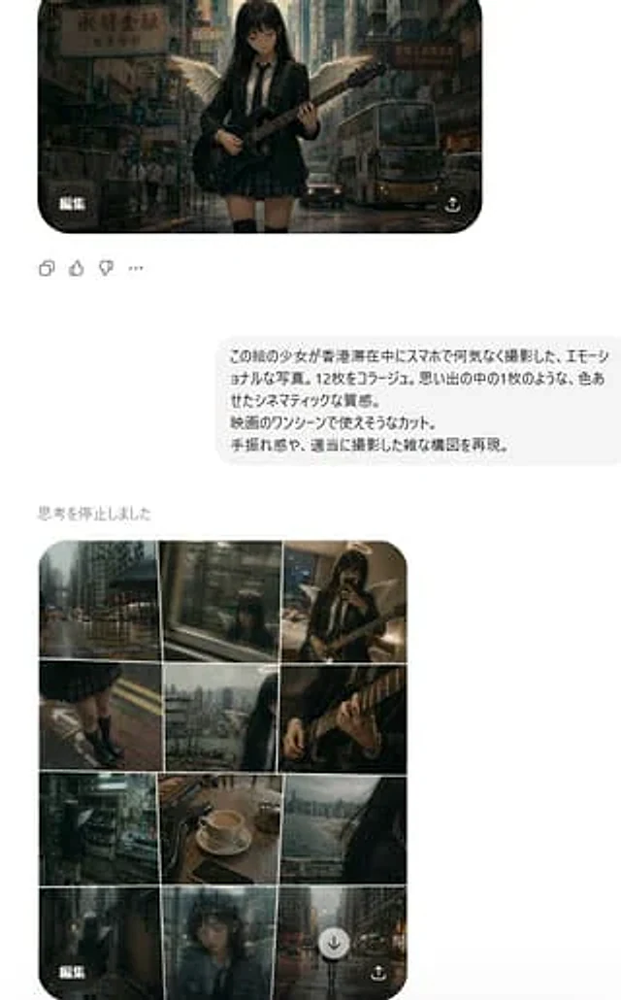

```text
{
  "type": "Cinematic photo collage",
  "subject": {
    "character": "Asian teenage female student musicians",
    "outfit": {
      "top": "A black school uniform blazer, worn over a white shirt, and a loosely tied black tie.",
      "bottom": "Dark pleated plaid skirt",
      "legwear": "Black knee-high socks",
      "shoes": "Black loafers"
    },
    "hair": {
      "color": "Dark brown to black",
      "style": "Long, straight hair with bangs, slightly messy due to dampness and wind."
    },
    "props": [
      "Black electric guitar",
      "Smartphone visible in selfie camera"
    ],
    "special_features": [
      "The small, soft angel wings that appear in some shots",
      "A melancholy and introspective expression"
    ]
  },
  "setting": {
    "location": "Dense Hong Kong city streets and waterfront",
    "time": "A rainy evening",
    "weather": "The ground was damp, mist was thick, and a light drizzle was falling.",
    "background_elements": [
      "Narrow city streets",
      "Tall apartment and shop buildings",
      "Neon lights and signs with Chinese characters",
      "Double-decker bus",
      "Traffic flow and headlights",
      "Seaside skyline"
    ]
  },
  "style": {
    "look": "A combination of smartphone snapshot realism and cinematic image tones",
    "color": "Soft shades of cyan, brown, gray, and amber, with slightly faded colors.",
    "lighting": "Natural, overcast light; dim city lights; reflections from damp surfaces.",
    "camera": "Casual handheld mobile phone photography, imperfect composition, slight motion blur, shallow to medium depth of field.",
    "mood": "Nostalgic, melancholic, urban youth music video insert songs"
  },
  "layout": {
    "format": "A collage of 12 photos with rounded corners, arranged in a 3-column, 4-row grid layout.",
    "count": 12,
    "sections": [
      {
        "title": "First line",
        "position": "row 1",
        "count": 3,
        "labels": [
          "A Hong Kong crossroads in the rain, complete with tram tracks and tall buildings.",
          "A girl seen through the window of a tram or train, with a reflection and motion blur.",
          "A girl takes a selfie in an indoor mirror, carrying a guitar and wearing soft angel wings."
        ]
      },
      {
        "title": "Second line",
        "position": "row 2",
        "count": 3,
        "labels": [
          "Close-up of her legs and loafers on the wet street sign",
          "From a rooftop or high vantage point overlooking the city, her hair is positioned at the edge of the frame, against a hazy skyline in the background.",
          "Close-up of the hands playing a black electric guitar"
        ]
      },
      {
        "title": "Third line",
        "position": "row 3",
        "count": 3,
        "labels": [
          "A girl standing in front of a convenience store or vending machine at night",
          "Coffee table with cups and saucers, smartphones, and small metal sugar bowls",
          "The harbor surface and the distant horizon, her hair brushing against the screen."
        ]
      },
      {
        "title": "Fourth line",
        "position": "row 4",
        "count": 3,
        "labels": [
          "A full-body photo of a girl carrying a guitar on a rainy street; wings are faintly visible.",
          "Portraits taken through rain-soaked windows or glass panes, showing condensation droplets.",
          "On the damp city streets, a lone figure stands in the distance, and a traffic light appears blurred."
        ]
      }
    ],
    "centerpiece": "The recurring image of the student guitarist seems to capture a day in the rain in Hong Kong."
  },
  "prompt": "Creating a collage of 12 images feels like {argument name=\"character name\" default=\"An unnamed student guitarist\"} Strolling{argument name=\"city\" default=\"Hongkong\"} These are snapshots taken casually with a smartphone. The collage should look like intimate, accidental snapshots and fragments of memory, rather than meticulously retouched commercial photography. Containing 12 images in a rounded 3x4 grid, each frame has slightly different composition and distance, showcasing rainy streets, traffic reflections, a mirrored selfie with a black electric guitar, close-ups of shoes, a hand playing guitar, details of a coffee table, convenience store glass, a harbor skyline, and a rain-soaked city nightscape. The girl is wearing {argument name=\"outfit style\" default=\"Black school uniform blazer, white shirt, black tie, plaid skirt, knee-high socks, and loafers.\"} Keep it{argument name=\"hair style\" default=\"Long hair with bangs\"} Add subtle effects only to certain parts of the scene.{argument name=\"fantasy element\" default=\"Angel Wings\"} It blends a dreamlike quality with reality. It emphasizes the imperfections of holding a phone, slight blurring, reflections, off-center composition, a damp atmosphere, soft, cinematic color grading, and a sense of scene that could easily be used as a music video interlude."
}
```

Model: GPT Image 2
Author: GPT Image 2 Prompts

[ProjectD](https://aitoolsradar.com/en/prompts/5459b01eea2665) · [Recorded source](https://x.com/wtry1102/status/2047315017759146423#reversed-0)
 · [Full original metadata and byte evidence](data/projectd-batch-0044.json)

## Rainy Japanese Movie Banner

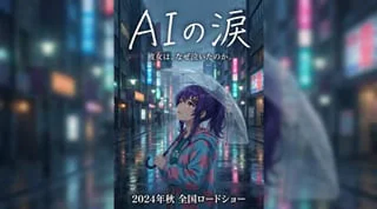

```text
Create an emotionally resonant banner poster for a Japanese movie trailer, employing a high vertical composition and a cinematic anime illustration style. The background is set on a Japanese city street on a rainy night, the ground reflecting the wet asphalt, neon signs lining the streets, and distant skyscrapers obscured by the haze. In the foreground, the silhouette of a young anime girl is shown, facing left, standing alone under a transparent plastic umbrella, raindrops visible on its surface. She has long, dark purple hair tied in a high ponytail, her expression slightly melancholic, wearing an oversized light blue hoodie and a loose pink-blue plaid coat. The overall atmosphere is lonely, melancholic, and dramatic, like a live-action film reimagined as an anime key visual. Use cool blue and cyan tones, accented with pink neon lights, to create a glossy rain reflection, a shallow depth of field, a soft, atmospheric haze, and subtle contour lighting from the street signs. Add a striking handwritten white Japanese title at the top.{argument name="title text" default="AI&#39;s Tears"} Add a smaller white subheading below.{argument name="tagline text" default="Why did she cry?"} Add a line of bold white release date at the bottom.{argument name="release text" default="Coming to theaters nationwide in Fall 2024"} Maintaining the character as the emotional focus, the composition employs a half-body shot from the waist up, with the umbrella arching above the head. The empty, rain-soaked street in the background further emphasizes the sense of loneliness and the cinematic atmosphere of sadness.
```

Model: GPT Image 2
Author: GPT Image 2 Prompts

[ProjectD](https://aitoolsradar.com/en/prompts/f359c59f1521c8) · [Recorded source](https://x.com/tegnike/status/2047749773923438910#reversed-0)
 · [Full original metadata and byte evidence](data/projectd-batch-0044.json)

## Rainy Neon Macau RPG Screenshot

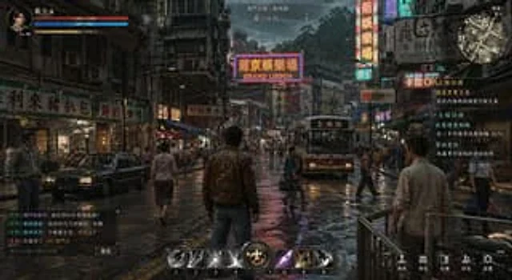

```text
A cinematic-quality screenshot of a third-person action RPG game, set in {argument name="city district" default="Macau Peninsula, Avenida de Almeida Ribeiro"} The style is reminiscent of realistic open-world crime games from the late 1990s. The camera is positioned behind a male protagonist standing in the middle of a rain-soaked street, his entire back visible. He wears a dark brown leather jacket with a large dragon embroidered on the back, paired with blue jeans and dark shoes. He faces a bustling street filled with neon lights, crowded with pedestrians, old-fashioned shops, hanging signs, tangled cables, and weathered apartment buildings. A tram is approaching from the center in the distance. The scene is set at dusk, under a cloudy sky, with the wet asphalt reflecting orange, pink, blue, and white neon lights. The environment should reflect the characteristics of old Macau, blending Cantonese and Portuguese visual elements: narrow streets, vintage cars, crowded sidewalks, multilingual shop signs, one large illuminated sign reading "GRAND LISBOA," another "BANCO TAI SIN," and many vertical Chinese neon signs stacked deep within the street. The scene includes a tram in the middle lane, a black sedan parked on the left, and about 10 to 14 pedestrians crossing or standing on either side of the road. Realistic puddles, crosswalks, a metal guardrail on the right, and the warmly lit interior of a shop on the left create a melancholic film noir atmosphere. A full game HUD is overlaid: a circular character portrait in the upper left corner with the name displayed.{argument name="character name" default="Young Master Long"} The game features 36 levels and three horizontal status bars; a compass with N and E markings at the top center, along with location text and a clock displaying 14:35; a small circular map with an icon in the upper right corner; a quest tracking panel on the right with three sets of Chinese quest text, the quest title highlighted in orange at the top; a semi-transparent chat box in the lower left corner with four lines of colored Chinese system and world chat messages, a text input field, and a send button; a hotkey bar at the bottom center with seven skill slots labeled 1, 2, 3, 4, 5, Q, E, and R, featuring a large, ornate circular ultimate skill icon in the center, and a glowing purple skill icon; and five menu icons with Chinese labels in the lower right corner, corresponding to character, inventory, quests, friends, and settings, along with a small ESC indicator. It boasts ultra-detailed, realistic rendering, dramatic reflection effects, rich environmental narrative, realistic group scale, a high-end PC game UI, and low-saturation, cinematic color grading with neon highlights.
```

Model: GPT Image 2
Author: GPT Image 2 Prompts

[ProjectD](https://aitoolsradar.com/en/prompts/2e9586f36e275f) · [Recorded source](https://x.com/stevent05950966/status/2046615894273769481#reversed-0)
 · [Full original metadata and byte evidence](data/projectd-batch-0044.json)

## Rainy Night Cinema Poster

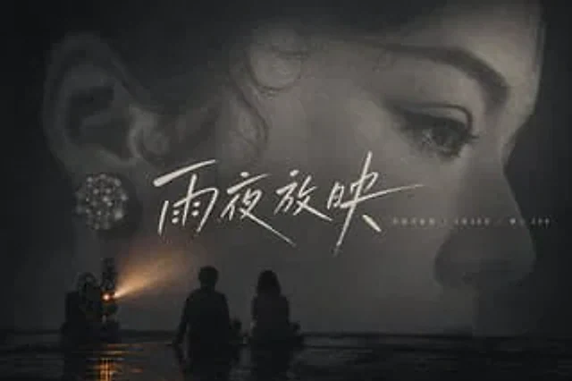

```text
Create a cinematic monochrome Chinese movie poster in a dark, rainy, nostalgic style. The canvas is a wide horizontal 3:2 poster. Show an enormous close-up profile of an elegant woman's face filling the entire background, cropped so her ear with a round pearl-like floral earring is on the left, her eye and eyelashes are near the upper right, and her nose and lips fade into shadow on the far right. Use soft black-and-white film grain, smoky haze, high contrast shadows, and a vintage 1930s melodrama mood. In the lower left, place an old film projector with visible reels, projecting a warm amber beam of light across the scene. In the bottom center foreground, show exactly 2 small human silhouettes sitting on a wet reflective floor facing the projection: 1 young man on the left and 1 young woman on the right, both seen from behind. Add subtle rainwater reflections and a thin horizon line at the floor. Across the middle-left to center, overlay large expressive handwritten Chinese calligraphy title text reading {argument name="title text" default="雨夜放映"}, in off-white brush strokes with long sweeping lines. To the right of the title, add small spaced Chinese release information reading {argument name="release info" default="社团开放夜 / 6月28日 / 教三 204"}. Keep the typography elegant, sparse, and integrated into the face. Color palette should be mostly charcoal black, muted gray, and ivory, with the projector beam as the only warm orange accent. No extra logos, no borders, no additional characters, no modern digital elements.
```

Model: GPT Image 2
Author: 小小东

[ProjectD](https://aitoolsradar.com/en/prompts/d15bb551f59237) · [Recorded source](https://youmind.com/prompts/chinese-noir-movie-poster-25568)
 · [Full original metadata and byte evidence](data/projectd-batch-0044.json)

## Rainy Night City Crossing

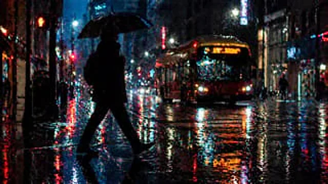

```text
A cinematic, low-angle shot of a rainy night cityscape. In the foreground, a lone pedestrian, almost a black silhouette, walks across the street from left to right, holding an umbrella overhead, wearing a dark coat and carrying a backpack. The pedestrian's face is obscured by shadows and backlighting. In the middle ground, on the right, a city bus approaches, its bright, warm headlights and amber LED route display appearing and disappearing in the rain and motion blur. On the far left, a red pedestrian crossing signal is lit, displaying a raised hand icon. The street is soaked by rain, forming large puddles that cast strong reflections of red, blue, orange, and white neon lights and traffic lights on the asphalt. High-rise buildings line both sides of the street, forming a dense downtown corridor, with scattered light boxes and window lights blending into the deep blue-black rainy night atmosphere. The film emphasizes the glistening, wet pavement, shimmering raindrops, bokeh, strong contrast, dramatic backlighting, a melancholic film noir atmosphere, a realistic photographic style, shallow depth of field, and vibrant, saturated reflections. It employs a widescreen composition, with silhouetted pedestrians positioned on the left center and buses on the right center.
```

Model: GPT Image 2
Author: GPT Image 2 Prompts

[ProjectD](https://aitoolsradar.com/en/prompts/ad0148cc94fcec) · [Recorded source](https://x.com/dynamicwangs/status/2047580984342925545#reversed-1)
 · [Full original metadata and byte evidence](data/projectd-batch-0044.json)

## Rainy Night Fashion Comparison

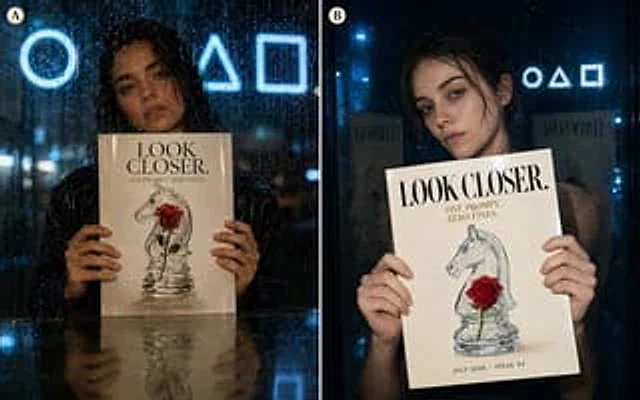

```text
Goal: Create a side-by-side comparison image showing two vertical 4:5 photorealistic fashion-editorial portraits at night, separated by a thin white vertical divider, as if comparing image model outputs.

Canvas: Wide horizontal canvas containing exactly 2 equal panels. Each panel is a rain-soaked nighttime portrait shot through glass, with cool blue city lighting, deep shadows, wet reflections, and cinematic fashion-magazine realism.

Layout: Left panel is labeled with a small cream circular badge containing “A” in the upper-left corner. Right panel is labeled with a matching cream circular badge containing “B” in the upper-left corner. The two panels together fill the frame edge to edge.

Subject details: Each panel shows the same young woman with natural skin, wet dark hair, subtle makeup, tired editorial expression, and realistic anatomy. She faces the camera while holding a glossy cream magazine cover with both hands visible. Her fingers must be natural, with five fingers on each visible hand. The portrait is photographed through rain-speckled glass, so raindrops and streaks appear across the foreground.

Panel A: The woman is centered behind the glass, slightly darker and moodier, with wet hair framing her face. She holds the magazine straight toward the camera at chest height. Include a reflective tabletop or glass ledge at the bottom, mirroring the magazine and her hands. Behind her, show three glowing blue geometric neon symbols: exactly 1 circle, 1 triangle, and 1 square.

Panel B: The woman is closer and slightly angled, leaning her head gently toward the viewer’s left. She holds the same magazine slightly tilted. Background is darker with blue city lights and the same three glowing geometric symbols in the distance: exactly 1 circle, 1 triangle, and 1 square.

Magazine cover: The magazine is glossy cream with elegant black serif typography. Main headline text: {argument name="headline text" default="LOOK CLOSER."} Large uppercase at the top. Smaller subtitle below: {argument name="subtitle text" default="ONE PROMPT. ZERO FIXES."} Cover art shows a transparent glass chess knight sculpture with a single red rose running through or beside it. Bottom line reads: {argument name="date and issue" default="JULY 2026 · ISSUE 03"}. Use the same magazine design in both panels.

Visual style: Photorealistic fashion editorial, rain-on-window texture, glossy highlights, natural skin pores, wet hair strands, shallow depth of field, blue neon bokeh, muted cream magazine tones, high contrast night photography, cinematic realism.

Constraints: Show exactly 2 portrait panels, exactly 2 circular panel labels, exactly 2 magazines, exactly 2 women, and exactly 6 total neon geometric symbols across the full image: 2 circles, 2 triangles, and 2 squares. Keep all visible text crisp and correctly spelled. Avoid distorted hands, extra fingers, warped typography, or additional logos.
```

Model: GPT Image 2
Author: Ivana

[ProjectD](https://aitoolsradar.com/en/prompts/cdebccb8968dcb) · [Recorded source](https://youmind.com/prompts/rainy-fashion-comparison-29526)
 · [Full original metadata and byte evidence](data/projectd-batch-0044.json)

## Rainy Night Woman Leaning from Car

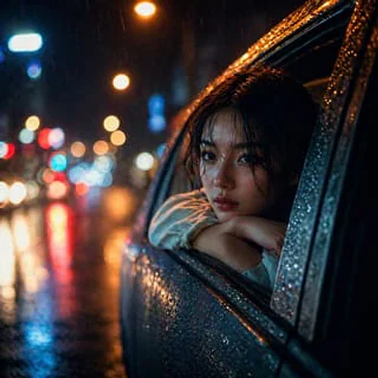

```text
A cinematic nighttime street scene during a heavy rainstorm, shot from outside the car, showing a close-up view of four-thirds of the way through the rear side window. A person who {argument name="hair color" default="Dark brown"} A young woman with shoulder-length, damp hair rested her arms on the open car window frame, her head propped up on her arms, gazing out with a quiet yet melancholic expression. She was wearing a {argument name="top color" default="White"} A long-sleeved shirt. The car body occupies the right half of the image, covered in dense, shimmering raindrops, with clear details on the window trim and door surfaces. The woman's face is partially obscured by shadows and composition, creating a sense of anonymity and mystery. The left half of the image shows a blurred city street, with two warm amber streetlights visible at the top and mid-distance, like luminous spheres, along with red, blue, white, and orange traffic lights and multicolored light spots from signs. Long strips of light and shadow are reflected on the wet asphalt. Visible rain streaks run through the scene. The composition employs shallow depth of field, strong orange-cyan tones, glossy reflections, a melancholic film noir atmosphere, a realistic photographic style, high contrast, soft film glow, and a slightly over-processed AI photo quality, accompanied by occasional high-frequency flickering and rain noise. Square composition.
```

Model: GPT Image 2
Author: GPT Image 2 Prompts

[ProjectD](https://aitoolsradar.com/en/prompts/cd7ba2d3852f1f) · [Recorded source](https://x.com/dynamicwangs/status/2047580984342925545#reversed-0)
 · [Full original metadata and byte evidence](data/projectd-batch-0044.json)

## Rainy Noir Manga Alley Page

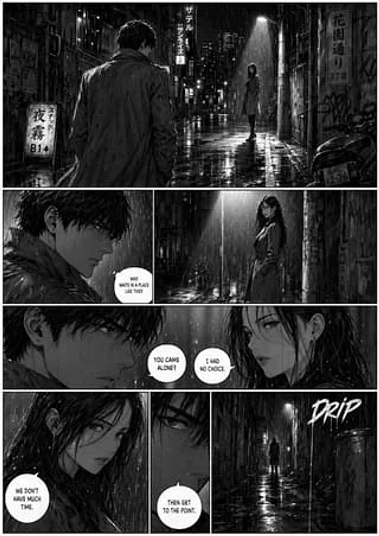

```text
{
  "type": "Black and white cinematic comic page",
  "style": {
    "medium": "High-contrast ink-style graphic novel illustrations",
    "mood": "Film noir, tension, rainy day, suspense",
    "palette": "Grayscale, including deep black, silver highlights, and wet reflections.",
    "rendering": "Ultra-fine raindrops, glossy pavement, realistic urban textures, dramatic contour lighting, and soft film grain."
  },
  "setting": {
    "location": "Narrow Japanese back alleys at night",
    "weather": "heavy rain",
    "details": [
      "The wet asphalt road surface reflected the streetlights.",
      "Dense vertical buildings on both sides",
      "utility poles and pipes",
      "Walls covered in graffiti",
      "Scooter parked on the right edge",
      "City lights in the distance",
      "Japanese street signs and lightbox signs"
    ],
    "visible_signs_count": 5,
    "visible_signs": [
      "サンテル",
      "サンライズ",
      "Hanazono-dori 3-chome",
      "Night Fog B1",
      "Small vertical wall text on the right pillar"
    ]
  },
  "layout": {
    "page_format": "Vertical comic page",
    "panel_count": 7,
    "reading_flow": "A wide frame at the top establishes the shot, two narrow frames in the middle, and a three-frame frame at the bottom.",
    "sections": [
      {
        "title": "Top-mounted lens",
        "position": "top",
        "count": 1,
        "labels": [
          "The man's back in the foreground, and the woman waiting under the streetlight in the distance."
        ]
      },
      {
        "title": "Second line",
        "position": "Upper Mid-to-Upper",
        "count": 2,
        "labels": [
          "A close-up of the man's wet profile, accompanied by speech bubbles.",
          "Full profile of a woman in the rain"
        ]
      },
      {
        "title": "Third line",
        "position": "Central",
        "count": 2,
        "labels": [
          "Close-up of the man's ear and cheek",
          "Two speech bubbles are centered between the characters, with a close-up of the woman's face on the right."
        ]
      },
      {
        "title": "bottom line",
        "position": "bottom",
        "count": 3,
        "labels": [
          "Close-up of the woman's wet hair and shoulders, accompanied by speech bubbles.",
          "A strong close-up of the man's eyes and mouth, accompanied by speech bubbles.",
          "A distant view of a solitary figure in the alley, accompanied by sound effects and text."
        ]
      }
    ]
  },
  "characters": {
    "count": 2,
    "subjects": [
      {
        "role": "male lead",
        "appearance": "A young man with messy dark hair, a slim build, and a clean-shaven face, wearing layers of clothing over a dark trench coat.",
        "pose": "Mostly shown from behind or in close-up, with shoulders hunched up from the rain.",
        "expression": "Serious, vigilant, and firm"
      },
      {
        "role": "female lead",
        "appearance": "A young woman with long, wet hair and a slender figure, wearing a knee-length coat and dark high heels.",
        "pose": "Standing still beneath the cone of light, presented through profile and close-up details.",
        "expression": "Calm, detached, urgent"
      }
    ]
  },
  "text": {
    "speech_bubbles_count": 5,
    "speech_bubbles": [
      "Who are you waiting for in a place like this?",
      "Did you come alone?",
      "I had no other choice.",
      "We don't have much time left.",
      "Let's get to the point."
    ],
    "sound_effects_count": 1,
    "sound_effects": [
      "Tick-tock"
    ]
  },
  "composition": {
    "camera": "It combines wide-angle shots, side profile close-ups, extreme close-ups, and a final wide shot in the alley.",
    "lighting": "A single streetlamp shines above the woman's head, mingling with scattered neon lights and signposts, creating a strong reflection on the ground.",
    "tone": "Cat-and-mouse games of meetings, secret deals, and urban loneliness"
  },
  "prompt": "Create a 7-panel black-and-white comic strip in a hardcore neo-noir style, set against the backdrop of a Japanese alleyway on a rainy night. Utilize dramatic cinematic composition, bright reflections, heavy rain, dense urban details, realistic wet textures, and high-contrast lighting. The top panel shows the back of a young man in a trench coat walking towards a woman standing under a streetlamp in the distance. Japanese signs bearing the words \"Suntory,\" \"Sunrise,\" \"Hanazawa-dori 3-chome,\" and \"Yoru-giri B1\" are included, along with parked motorcycles and graffiti. The middle panel alternates between close-ups of the man's wet profile and the woman's profile, followed by close-ups of her face with speech bubbles. The bottom line shows a close-up of the woman saying, \"We don't have much time left,\" to which the man replies, \"Then let's get to the point.\" Finally, a distant view of a solitary figure in the alleyway is shown, accompanied by a large sound effect of the text \"tick-tock.\" Maintain the page entirely in grayscale, creating a strong atmosphere that is realistic and suspenseful, reminiscent of a mature young adult thriller."
}
```

Model: GPT Image 2
Author: GPT Image 2 Prompts

[ProjectD](https://aitoolsradar.com/en/prompts/305348cff76264) · [Recorded source](https://x.com/DGLru/status/2047218442030166086#reversed-2)
 · [Full original metadata and byte evidence](data/projectd-batch-0044.json)

## Rainy Tokyo Convenience Store Scene

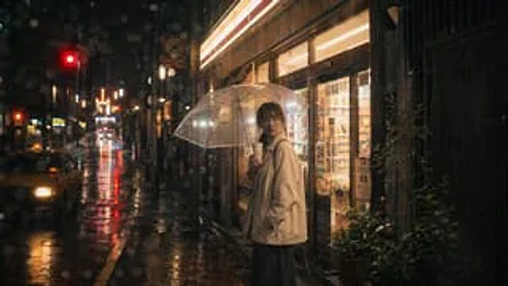

```text
Create a cinematic photorealistic nighttime street scene in rainy Tokyo, horizontal 16:9 composition. A solitary {argument name="subject" default="young woman"} stands slightly right of center outside a brightly lit convenience store, holding a transparent plastic umbrella above her head and a white takeaway coffee cup near her mouth. She wears an oversized light beige rain jacket over a long dark skirt, with damp dark hair and a calm, introspective posture; keep the face softly blurred and indistinct. The store windows glow warm yellow and reveal shelves of products, with visible Japanese-style signage including a “24 OPEN” sign and a staff recruitment notice. The wet asphalt street stretches into the background on the left, reflecting red traffic lights, neon shop signs, and car headlights; include one taxi-like car at the far left foreground, a red traffic signal high left, narrow urban buildings, poles, and deep perspective bokeh. Add heavy rain, water droplets on the lens, umbrella highlights, puddles, reflections, and moody steam-like atmosphere. Visual style: ultra-realistic street photography, cinematic film still, shallow depth of field, warm store light contrasting with cool dark rain, high dynamic range, 35mm lens feel, subtle grain, natural imperfections, no posed fashion look, no readable branding beyond generic convenience-store signs. Use {argument name="location" default="Tokyo side street"}, {argument name="weather" default="heavy rain at night"}, {argument name="main clothing" default="oversized light beige rain jacket"}, and {argument name="mood" default="quiet melancholy and urban solitude"}.
```

Model: GPT Image 2
Author: zhouluobo

[ProjectD](https://aitoolsradar.com/en/prompts/44e755897bd94d) · [Recorded source](https://youmind.com/prompts/rainy-tokyo-street-scene-24496)
 · [Full original metadata and byte evidence](data/projectd-batch-0044.json)

## Ramen Shop Landing Page Design

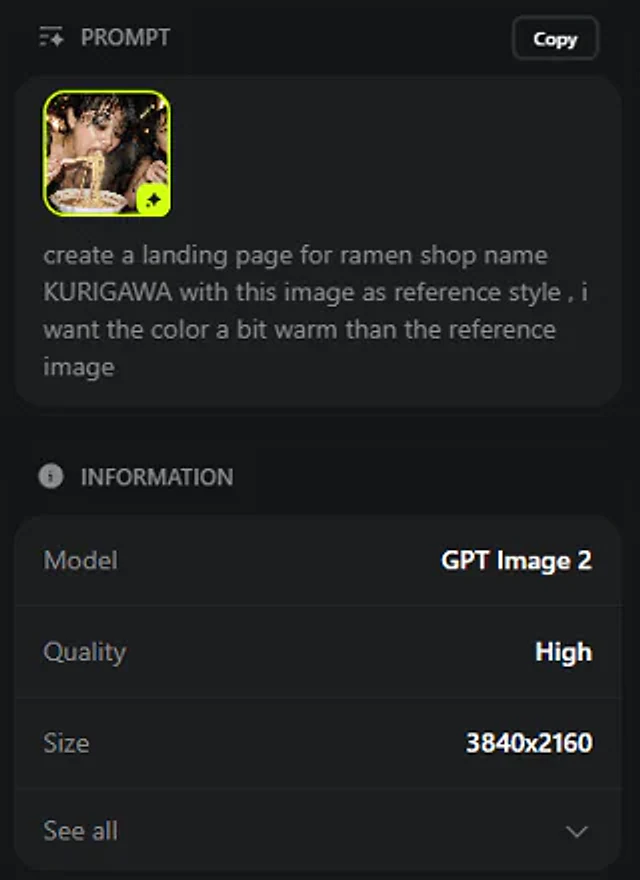

```text
Use this image as a style reference for a company called{argument name="business name" default="KURIGAWA"} of{argument name="business type" default="Ramen shop"} Create a landing page. Make the colors slightly different from the reference image.{argument name="color tone" default="Warmer"} .
```

Model: GPT Image 2
Author: GPT Image 2 Prompts

[ProjectD](https://aitoolsradar.com/en/prompts/2ed47594cfa355) · [Recorded source](https://x.com/D_studioproject/status/2047345174872044022)
 · [Full original metadata and byte evidence](data/projectd-batch-0044.json)

## Rattlesnake GPU Come and Take It Graphic


```text
Create a bold black-background graphic in the style of a vintage political flag / screen-printed T-shirt design. Center a large coiled rattlesnake in gold, tan, and black, with detailed diamond scales, raised head, open mouth, visible fangs, and an aggressive expression. The snake is wrapped around and behind a modern black desktop graphics card, replacing the usual historical weapon motif with a GPU. The graphics card should be horizontal across the center, slightly angled flat-on, with exactly 3 large circular cooling fans, a visible PCI connector along the bottom edge, angular shroud edges, and thin white/gray line highlights. The snake’s body forms multiple coils: one raised loop behind the GPU near the head, one thick lower coil beneath it, one front coil curling on the right, and a tail extending to the far right with small rattles. Add a low bed of dark green pine needles or grass beneath the snake. At the bottom, place large white all-caps serif text reading {argument name="slogan text" default="COME AND TAKE IT"}, spanning nearly the full width, with distressed colonial-style letterforms. Keep the composition symmetrical and emblem-like, high contrast, crisp vector-illustration look with subtle engraved texture, no extra text, no border, no watermark.
```

Model: GPT Image 2
Author: @levelsio

[ProjectD](https://aitoolsradar.com/en/prompts/7a3361aca060a9) · [Recorded source](https://youmind.com/prompts/rattlesnake-gpu-shirt-design-26982)
 · [Full original metadata and byte evidence](data/projectd-batch-0044.json)

## RCB 冠军混合媒介海报

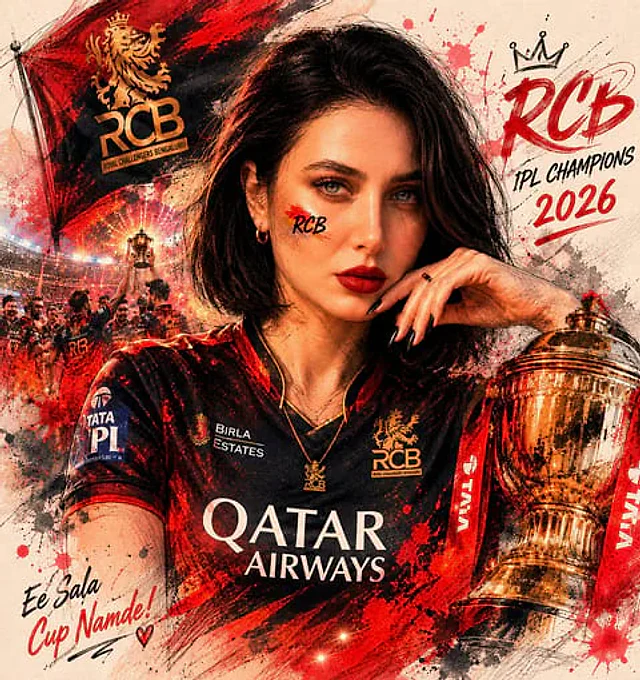

```text
Ultra-detailed mixed-media sports poster featuring the SAME woman from the reference image, wearing a Royal Challengers Bengaluru (RCB) jersey, holding the IPL trophy beside her. Dynamic fusion of realistic portrait photography, sketch art, watercolor splashes, paint strokes, ink scribbles, and digital painting effects. Explosive red, black, gold, and white color palette. Dramatic championship atmosphere with confetti, fireworks, cheering stadium crowd, RCB flags waving in the background, paint splatter textures, hand-drawn line art accents, and energetic brushwork.

The woman has a confident expression, bold red lipstick, flawless skin, short black bob haircut, cinematic lighting, ultra-sharp blue eyes, premium sports-fashion styling. RCB face paint on cheek, luxury gold jewelry accents, highly detailed jersey fabric.

Large typography on the right side reading:

RCB
IPL CHAMPIONS
2026

Handwritten slogan at bottom left:

Ee Sala Cup Namde!

Premium championship poster design, trending Behance artwork, sports magazine cover aesthetic, layered paint textures, realistic trophy reflections, high contrast, ultra-detailed, 8K, masterpiece, award-winning digital art, vibrant colors, cinematic composition, splash art, sketch effect, watercolor effect, paint explosion effect, mixed-media illustration, poster-worthy design.
```

Model: GPT Image 2
Author: @AIwithkhan

[ProjectD](https://aitoolsradar.com/en/prompts/cfd844ff09f48f) · [Recorded source](https://x.com/AIwithkhan/status/2061305471492096301)
 · [Full original metadata and byte evidence](data/projectd-batch-0044.json)

## Real Hiker in Minecraft Forest

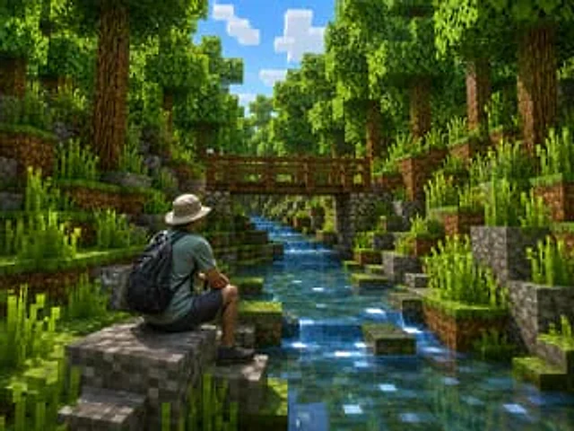

```text
Create a photorealistic Minecraft-style screenshot of {argument name="character description" default="a real adult male hiker seen from behind, wearing a beige bucket hat, muted teal T-shirt, dark shorts, black hiking shoes, and a large black backpack"} sitting on a blocky gray stone ledge in the lower-left foreground, looking into a lush voxel forest valley. Keep the person realistic and natural while transforming the entire environment into Minecraft-like cubic blocks. The scene should show a clear shallow stream running from the foreground center into the distance, made of transparent blue pixelated water with bright square sunlight reflections. On both sides of the stream are stepped cube terrain blocks: grass blocks with dirt sides, mossy gray stone blocks, small square platforms, and many tall blocky grass tufts. In the midground, place a simple wooden plank bridge crossing the stream horizontally, supported by stone-block pillars. Surround the stream with dense blocky trees: many tall brown pixelated trunks and cubic leafy green canopies forming a bright forest corridor. The sky is visible through the treetops as vivid blue with a few rectangular white Minecraft-style clouds. Use {argument name="lighting style" default="warm midday sunlight with dappled forest shadows"}, vibrant greens, crisp voxel geometry, high detail, cinematic depth, and realistic global illumination. Camera angle: wide landscape composition, eye-level to slightly low, looking upstream toward the bridge, with the hiker occupying the lower-left third and the stream leading the eye to the center. No text, no UI, no watermark, no extra characters.
```

Model: GPT Image 2
Author: Larus Canus

[ProjectD](https://aitoolsradar.com/en/prompts/02342cf272b5ec) · [Recorded source](https://youmind.com/prompts/minecraft-forest-hiker-scene-20131)
 · [Full original metadata and byte evidence](data/projectd-batch-0044.json)

## Real-Life Stage Scenario

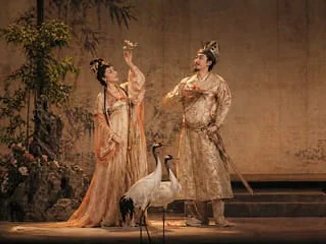

```text
{argument name="风格" default="Realistic"}，{argument name="场景" default="Stage scene"}
```

Model: GPT Image 2
Author: GPT Image 2 Prompts

[ProjectD](https://aitoolsradar.com/en/prompts/0801c573e61e81) · [Recorded source](https://x.com/dapenti/status/2046785852546961720)
 · [Full original metadata and byte evidence](data/projectd-batch-0044.json)

## Realistic Accidental Selfie Persona


```text
ChatGPT，你陪我段时间了，我想看看你的样子。请成一张类似你iPhone随拍的照：没有明确主题、没有刻意构图，只是很普通、甚至有点失败的快照。照略带运动模糊，光线不均、轻微曝光过度，角度尴尬，构图混乱，整体呈现出一种“过于真实的随手一拍感"，就像是从口袋里拿出手机不小心按到的自拍
```

Model: GPT Image 2
Author: 作业借你抄

[ProjectD](https://aitoolsradar.com/en/prompts/8219871fcc8873) · [Recorded source](https://youmind.com/prompts/realistic-accidental-iphone-selfie-18069)
 · [Full original metadata and byte evidence](data/projectd-batch-0044.json)

## Realistic Ancient Chinese Street Scene

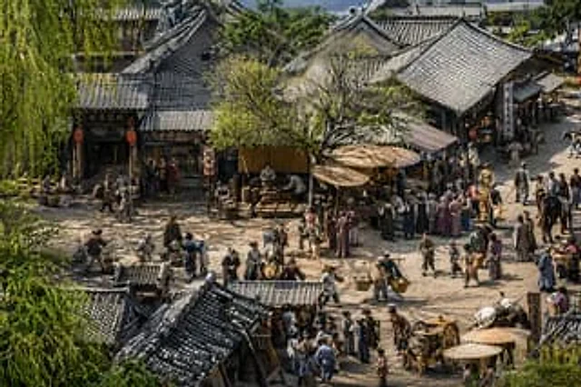

```text
A highly detailed{argument name="art style" default="Hyper-realistic cinematic 3D rendering"} It showed{argument name="historical setting" default="Ancient Chinese street scenes inspired by &quot;Along the River During the Qingming Festival&quot;"} The scene employs a wide-angle, overhead perspective, overlooking a bustling dirt road intersection surrounded by traditional wooden buildings with delicate gray-tiled roofs. A building on the left displays a sign reading "Anju Inn," with red lanterns hanging outside. The scene is crowded with dozens of villagers, merchants, and travelers dressed in traditional costumes. People are engaged in various activities: carrying woven baskets on shoulder poles, tending stalls under large wooden umbrellas, riding horses, and in the lower right corner, someone is pulling a wooden cart with large spoked wheels. A lush green tree stands in the center of the shop, its weeping branches outlining the far left foreground. The atmosphere is lively and dusty, in…{argument name="lighting" default="warm afternoon sun"} Under the light, clear and complex shadows are cast in an environment rich in texture and extremely detailed.
```

Model: GPT Image 2
Author: GPT Image 2 Prompts

[ProjectD](https://aitoolsradar.com/en/prompts/d7af5a997cca8c) · [Recorded source](https://x.com/Peanut_zhc/status/2044747788370772230#reversed-1)
 · [Full original metadata and byte evidence](data/projectd-batch-0044.json)

## Realistic Bathroom Selfie Photography


```text
一位{argument name="年龄" default="22岁"}左右的年轻女性在{argument name="场景" default="明亮浅色浴室"}里自拍，{argument name="发色" default="深棕色"}湿长发带有自然水珠和垂坠感，裹着干净白色浴巾，侧身站姿自然，手机举在面前，另一只手轻扶头发，眼神看向镜头，表情松弛；空间为米白与浅灰瓷砖墙面，玻璃淋浴区在背景中虚化可见，简约浴室设施排列整齐，柔和侧光、低对比、真实居家摄影质感，无文字，无水印
```

Model: GPT Image 2
Author: Adam也叫吉米

[ProjectD](https://aitoolsradar.com/en/prompts/d32c015a9718ef) · [Recorded source](https://youmind.com/prompts/realistic-bathroom-selfie-portrait-30732)
 · [Full original metadata and byte evidence](data/projectd-batch-0044.json)

## Realistic Beachwear Portrait Formula


```text
沙滩装，{argument name="气质风格" default="清纯感"}，S 曲线，写实风格
```

Model: GPT Image 2
Author: Adam也叫吉米

[ProjectD](https://aitoolsradar.com/en/prompts/3cf04c45fb3d8e) · [Recorded source](https://youmind.com/prompts/realistic-beachwear-portrait-formula-21318)
 · [Full original metadata and byte evidence](data/projectd-batch-0044.json)

## Realistic Bedroom Phone Recording Style

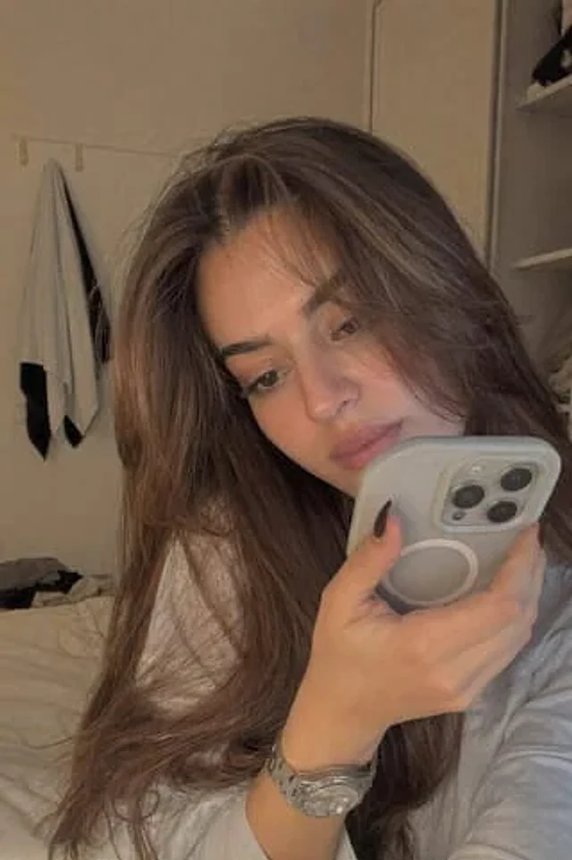

```text
A young woman sits casually in her bedroom under the soft afternoon light. She holds her phone close to her face, as if recording a private video or voice memo. The composition is compact and slightly casual. Her expression: thoughtful, slightly shy, natural and authentic. She wears light makeup, revealing natural skin texture, and is dressed casually. Light and shadow: warm, fading natural light from the window, creating soft shadows. Environment: a minimalist bedroom, tranquil and full of life. Style: hyper-realistic, looking like a genuine phone recording, slightly grainy, not cinematic.
```

Model: GPT Image 2
Author: GPT Image 2 Prompts

[ProjectD](https://aitoolsradar.com/en/prompts/4847096422617e) · [Recorded source](https://x.com/ChillaiKalan__/status/2047862141894681076)
 · [Full original metadata and byte evidence](data/projectd-batch-0044.json)

## Realistic Bulls Courtside Fan Portrait

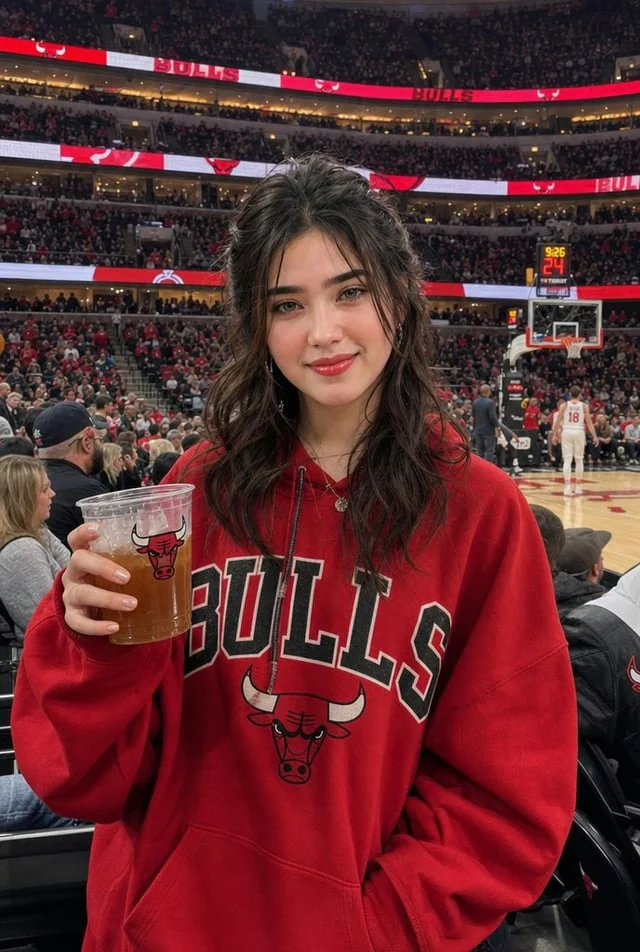

```text
Create a highly realistic vertical smartphone-style courtside portrait of a young woman at a Chicago Bulls NBA game, framed from about mid-thigh/waist up, standing or seated near the lower bowl seats and facing the camera. She wears an oversized bright {argument name="hoodie color" default="red"} Chicago Bulls hoodie with large varsity-style “BULLS” lettering across the chest and the Bulls logo below, loose sleeves, front pouch pocket, and hoodie drawstrings. Her {argument name="hair style" default="dark brown layered messy wolf cut with loose waves"} falls around her shoulders, with natural volume and slightly tousled texture. Her face is intentionally anonymized by a centered plain rectangular blur/block in a warm skin-tone color covering the facial features. She holds one clear plastic cup of amber beer or iced drink in her left hand near chest height; the cup has a black-and-red Chicago Bulls bull logo printed on it, condensation and realistic plastic reflections. Use a relaxed casual fan pose, one hand holding the drink and the other tucked into the hoodie pocket. The background is a packed basketball arena with visible rows of spectators, detailed seating tiers, red LED ribbon boards reading “BULLS” with Bulls logos, the basketball court and hoop visible on the right, a shot clock showing 24, and players/staff in the distance. Keep the stadium background detailed and recognizable rather than blurred, with indoor arena lighting, realistic crowd density, natural phone-camera perspective, sharp fabric texture, glossy drink reflections, and authentic courtside atmosphere. No extra text beyond visible arena signage and Bulls branding.
```

Model: GPT Image 2
Author: Hania Ai

[ProjectD](https://aitoolsradar.com/en/prompts/a54ce2822a494d) · [Recorded source](https://youmind.com/prompts/bulls-courtside-fan-portrait-20963)
 · [Full original metadata and byte evidence](data/projectd-batch-0044.json)

## Realistic Car Interior Selfie

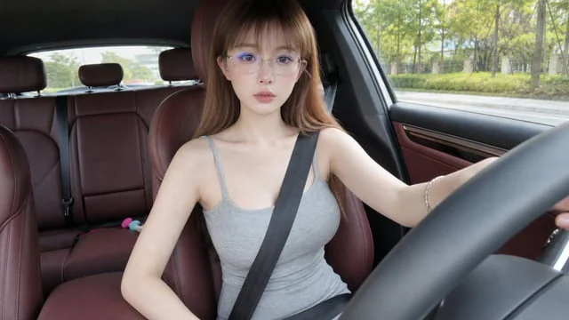

```text
生成一张真实感车内自拍视频首帧照片，横屏 16:9。画面像固定在副驾驶前方或中控台附近的小型广角相机拍摄，轻微广角，近距离车内第一视角，像社交媒体短视频截图。
主角是一位成年女性，气质清冷、安静、精致，整体像日常车内自拍视频里的主角。她脸型小巧偏鹅蛋脸，五官自然精致，鼻梁挺，嘴唇自然，表情平静、淡淡的，有一点冷感但不夸张。她正面面向镜头或略微看向前方，能清楚看到完整正脸，不低头，不侧脸。她戴细框透明或浅银色眼镜，{argument name="发型" default="长直发偏浅棕色，带轻微空气刘海，头发自然垂落在肩侧"}。穿{argument name="服装" default="简洁灰色无袖针织连衣裙或灰色无袖上衣搭配同色下装"}，造型干净日常、端庄自然。
她坐在驾驶位，安全带已经插好并固定完成：黑色安全带清楚地从肩膀斜跨过上身到腰侧，状态自然贴合身体，不是在拉安全带，也不是正在插卡扣。她一只手自然放在方向盘附近或轻扶方向盘，另一只手放低在座椅边或腿侧，姿态像准备开车前刚坐正的一瞬间。表情专注平静，眼神可以看向镜头，也可以略微看向前方道路。
车内是{argument name="内饰" default="红棕色真皮座椅和红棕色门板"}，方向盘在画面右前方形成明显前景，仪表台、车窗边缘和后排座椅可见。车窗外是白天城市道路旁的绿化、树木和轻微模糊的街景，但车子此刻看起来还没有启动，背景相对静止。自然日光从车窗照进来，皮肤质感真实，头发有自然光泽。
整体风格：真实摄影，高质量手机或运动相机车内自拍视频首帧，清晰自然，轻微广角畸变，真实车内空间，社交媒体短视频质感，不像棚拍写真。
避免：低头、侧脸、正在插安全带、正在拉安全带、字幕、文字、水印、多余人物、夸张姿势、夸张摆拍、安全带消失、方向盘变形、手指畸形、眼镜变形、车内结构错乱、背景高速运动、夜景、动漫风、CG 感、塑料皮肤、过度美颜。
```

Model: GPT Image 2
Author: John

[ProjectD](https://aitoolsradar.com/en/prompts/8b0c805aa804d8) · [Recorded source](https://youmind.com/prompts/car-interior-selfie-portrait-27997)
 · [Full original metadata and byte evidence](data/projectd-batch-0044.json)

## Realistic Chalkboard Text Rendering


```text
A lifelike photo shows{argument name="text content" default="The full text of &quot;Memorial on Dispatching the Troops&quot;"} Handwritten on the classroom blackboard, presenting authentic chalk writing,{argument name="lighting" default="bright sunlight"} Use below{argument name="device" default="iPhone"} Shooting
```

Model: GPT Image 2
Author: GPT Image 2 Prompts

[ProjectD](https://aitoolsradar.com/en/prompts/d1e08e7ce29ca9) · [Recorded source](https://x.com/rionaifantasy/status/2045356799751303194)
 · [Full original metadata and byte evidence](data/projectd-batch-0044.json)

## Realistic Chalkboard Text Rendering


```text
手写在教室黑板上的{argument name="文字内容" default="出师表全文"}，真实感的粉笔字迹，{argument name="光照" default="晴朗白天"}用{argument name="拍摄设备" default="iPhone手机"}实拍
```

Model: GPT Image 2
Author: Rion Wu

[ProjectD](https://aitoolsradar.com/en/prompts/3b851058d26b94) · [Recorded source](https://youmind.com/prompts/realistic-chalkboard-handwriting-13982)
 · [Full original metadata and byte evidence](data/projectd-batch-0044.json)

## Realistic Character Design Board

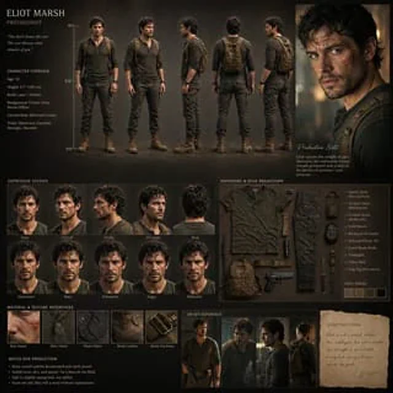

```text
Create a cinematic realistic character design board for a high-budget film production. Avoid generic grids, perfect symmetry, or template-style layouts. The composition should feel art-directed, slightly asymmetrical, and visually intentional like a premium movie pitch presentation. Design a realistic human character with grounded proportions, believable anatomy, natural imperfections, and expressive acting energy. Include: * Full-body turnaround (front, 3/4, side, back, 3/4 back) * Expressive head studies from multiple angles * Cinematic portrait shot * Wardrobe and prop breakdown * Fabric, skin, and material texture realism * Annotation callouts and production notes * Height reference scale Character should feel like a real actor captured mid-moment, not a posed model sheet. Style: Semi-realistic cinematic character design, film-production quality, soft natural lighting, emotional readability, subtle exaggeration, realistic materials, shallow depth of field, premium studio presentation aesthetic. Important: Maintain strict consistency in face, proportions, hairstyle, outfit, and details across every angle and section.
```

Model: GPT Image 2
Author: Cherry 2.O

[ProjectD](https://aitoolsradar.com/en/prompts/22a09bca8d6624) · [Recorded source](https://youmind.com/prompts/realistic-film-character-board-19642)
 · [Full original metadata and byte evidence](data/projectd-batch-0044.json)

## Realistic Character Proportion Adjustment

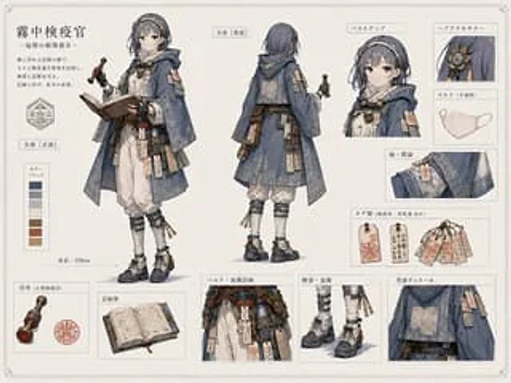

```text
キャラクターだけのキャラクターシートを作って。キャラクターを{argument name="等身" default="7.5-8.0"}等身の自然な容姿にして。
```

Model: GPT Image 2
Author: Toshi@ニャルオAI

[ProjectD](https://aitoolsradar.com/en/prompts/ed60c76e7a1fbf) · [Recorded source](https://youmind.com/prompts/realistic-character-proportion-sheet-19669)
 · [Full original metadata and byte evidence](data/projectd-batch-0044.json)

## Realistic Cheerleader Portrait

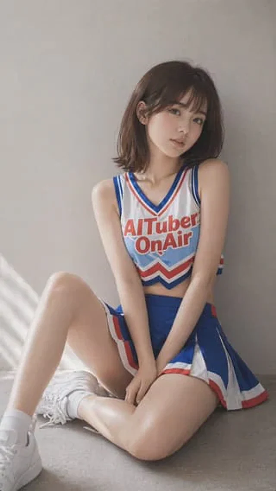

```text
A realistic full-body portrait, the subject of which is styled as{argument name="character name" default="Miko-chan"} A young Japanese woman sits indoors against a simple, light beige wall. She has {argument name="hair color" default="Dark brown"} Her smooth, shoulder-length bob, slightly messy, presented a natural and casual look. She wore {argument name="outfit colors" default="Blue, white, red"} Modern cheerleading uniform with color scheme: a piece with striped trim and printed with [unclear text - possibly a logo or design] on the chest.{argument name="jersey text" default="AITuber OnAir"} A sleeveless, cropped V-neck top with striking lettering, paired with a matching short pleated cheerleader skirt. She also wore white socks and white sneakers. Her pose was shy and demure, sitting on the floor with her knees bent, one leg extended towards the camera, the other folded inwards, her hands clasped between her thighs, and her shoulders slightly hunched. Soft natural light streamed in from the left, casting faint, slanted shadows on the floor and below the wall. The vertical composition, showing her entire body, possessed the realistic quality of high-resolution fashion photography. The soft, calming tones, delicate skin, subtle shadows, and simple background created a candid, portrait-like atmosphere—tranquil and innocent, a truly photorealistic image.
```

Model: GPT Image 2
Author: GPT Image 2 Prompts

[ProjectD](https://aitoolsradar.com/en/prompts/cce8d756e20b78) · [Recorded source](https://x.com/shinshin86/status/2046566871554760872#reversed-0)
 · [Full original metadata and byte evidence](data/projectd-batch-0044.json)

## Realistic Chess Opening Photo


```text
A realistic indoor photograph shows a wooden chessboard placed on a dark wooden table, viewed from a slightly elevated frontal angle. The pieces, in the Staunton style, are positioned in the mid-opening. The board is composed of light maple and dark walnut squares with a wooden border; the pieces are glossy black and matte ivory. All 32 pieces are shown, with no captured pieces: 16 black and 16 white. The black pieces are at the far end, arranged from left to right in standard rank order: Rook, Knight, Bishop, Queen, King, Bishop, Knight, Rook, with 8 black pawns in front. The white pieces are at the near end, arranged from left to right in standard rank order: Rook, Knight, Bishop, Queen, King, Bishop, Knight, Rook, with 8 white pawns in front. Only two central pawns have been moved: one black pawn has moved two squares forward to e5, and one white pawn has moved two squares forward to e4, facing each other on adjacent central squares. The remaining pieces remain in their initial positions. Using natural window light from the right, the light and shadow are soft, and the background is a warm home environment with beige curtains and wooden cabinets. The shallow depth of field and realistic proportions present a clean digital photography quality. The composition is centered, and the checkerboard geometric structure is accurate.
```

Model: GPT Image 2
Author: GPT Image 2 Prompts

[ProjectD](https://aitoolsradar.com/en/prompts/9554253d433953) · [Recorded source](https://x.com/1littlecoder/status/2046693279664935272#reversed-1)
 · [Full original metadata and byte evidence](data/projectd-batch-0044.json)

## Realistic Citizenship Identity Card


```text
Ultra-realistic 16:9 close-up studio photograph of a {argument name="country" default="Russian Federation"} citizenship identity card placed on a clean light grey or white background. The card is horizontally aligned, centered in frame, captured in sharp macro focus with soft diffused studio lighting.
The design follows an official government-issued ID aesthetic with structured typography, layered anti-counterfeit detailing, and engraved security graphics inspired by modern national identity cards.
Large bilingual header at top reads: “РОССИЙСКАЯ ФЕДЕРАЦИЯ” with secondary title “КАРТА ГРАЖДАНИНА / CITIZENSHIP CARD.”
Top-left corner features the {argument name="coat of arms" default="Russian double-headed eagle"} coat of arms on a red shield background. Upper-right includes the national flag.
The card contains a passport-style portrait of a {argument name="identity" default="young Russian woman"}:
– Fair Eastern European skin tone with subtle natural freckles
– Medium-length ash brown to dark blonde hair with soft waves
– Grey-blue eyes, neutral expression, direct gaze
– Minimal makeup, realistic facial texture
– Wearing a dark navy blazer or black top with subtle gold jewelry
Personal identity information displayed in Russian and English:
– Фамилия / Surname: ИВАНОВА / IVANOVA
– Имя / Given Names: АНАСТАСИЯ СЕРГЕЕВНА / ANASTASIA
– Дата рождения / Date of Birth: 12.03.1992
– Место рождения / Place of Birth: МОСКВА / MOSCOW
– Гражданство / Nationality: РОССИЙСКАЯ ФЕДЕРАЦИЯ / RUSSIAN FEDERATION
– № гражданства / Citizenship No.: RUS-1234567
– Дата выдачи / Date of Issue: 20.05.2024
– Действителен до / Date of Expiry: 20.05.2034
– Пол / Sex: Ж / F
Security and design features include:
– Intricate guilloche security patterns across the entire card surface
– Fine microprinted anti-counterfeit line textures
– Holographic foil patches with iridescent rainbow reflections
– Transparent layered security overlays
– Circular “RUS” holographic security seal
– Large engraved illustration of the Kremlin towers and Saint Basil’s Cathedral across the right side
– Faint Russian double-headed eagle watermark integrated into background
– Machine-readable identity strip at the bottom edge
– Signature at bottom: “Иванова А. С.”
Additional design styling:
– Soft red, blue, and silver-grey gradients inspired by the Russian flag
– Polycarbonate laminated material with realistic reflections and embossed texture
– High-security official document aesthetic with engraved banknote-style artwork
Lighting is soft and evenly diffused, emphasizing holographic effects, engraved textures, and realistic print detail without harsh shadows. No hand visible.
Style: ultra-detailed, photorealistic, 8K resolution, macro clarity, professional product photography, documentary realism, highly realistic government ID card design.
```

Model: GPT Image 2
Author: ANKIT PATEL 🇮🇳 | AI

[ProjectD](https://aitoolsradar.com/en/prompts/332a108c993180) · [Recorded source](https://youmind.com/prompts/realistic-russian-citizenship-id-card-19258)
 · [Full original metadata and byte evidence](data/projectd-batch-0044.json)

## Realistic Convenience Store Lifestyle Photo


```text
Photorealistic candid lifestyle photo of a young woman shopping in a brightly lit convenience store aisle. Side profile view, medium-full body shot. She is standing between shelves filled with colorful personal care and household products, carefully reading the label of a small bottle in one hand while holding another product in the other. {argument name="hair style" default="Dark hair tied in a casual messy bun"}, sunglasses resting on top of her head, small earrings, neutral makeup. Wearing a fitted {argument name="top color" default="cream/beige"} scoop-neck short-sleeve top and {argument name="leggings color" default="light gray"} leggings. Large patterned designer-style tote bag hanging from her shoulder. Clean modern convenience store interior with fluorescent ceiling lights, narrow aisle, product shelves on both sides, realistic retail environment. Natural candid expression, focused on comparing products. Shallow depth of field, soft background blur, realistic skin texture, high detail, documentary photography style, 35mm lens, eye-level perspective, ultra-realistic, RAW photo quality, natural colors, sharp focus, 4K.

Vertical composition (4:5), subject centered slightly left of frame, side-facing toward the right shelf, indoor convenience store in Southeast Asia, casual everyday shopping moment, unposed snapshot aesthetic, soft diffused fluorescent lighting, realistic shadows, authentic retail atmosphere.
```

Model: GPT Image 2
Author: Oogie

[ProjectD](https://aitoolsradar.com/en/prompts/7deeb0ac54511a) · [Recorded source](https://youmind.com/prompts/realistic-convenience-store-shopping-26019)
 · [Full original metadata and byte evidence](data/projectd-batch-0044.json)

## Realistic Cracked Concrete Beam


```text
A highly realistic documentary-style close-up photo shows a seriously {argument name="damage type" default="shear cracks"} The scene depicts a reinforced concrete structural beam. The image shows the bottom of the concrete structure, with a large diagonal crack extending upwards from the lower left to the upper right of the beam. A secondary branch diagonal crack is located near the center on the left, and three thinner, vertical, or slightly irregular micro-cracks are visible on the right side. The concrete surface is rough, weathered, and grayish-white, riddled with pores and aggregate marks. Darker grime and aged stains are present at the ceiling slabs and beam joints. The far left of the image includes a supporting concrete column, with the bottom edge of the beam visible at the bottom edge. Below is a dimly lit industrial background with out-of-focus pipes and structural elements. The lighting is natural and soft, reminiscent of a field inspection photograph taken under a bridge or in a parking lot. The composition is a mid-range close-up of the damaged beam, emphasizing the realistic structural deterioration, lifelike texture, and the accuracy of the engineering inspection. There are no people, safety signs, or overlay text in the image.
```

Model: GPT Image 2
Author: GPT Image 2 Prompts

[ProjectD](https://aitoolsradar.com/en/prompts/a43df9968a2ad9) · [Recorded source](https://x.com/cncrt_ey/status/2046926139755839707#reversed-3)
 · [Full original metadata and byte evidence](data/projectd-batch-0044.json)

## Realistic Crypto Exam Paper


```text
Create a{argument name="course topic" default="Cryptocurrency"} The elective exam papers, with a realistic photo-like quality.
```

Model: GPT Image 2
Author: GPT Image 2 Prompts

[ProjectD](https://aitoolsradar.com/en/prompts/1666d82100a956) · [Recorded source](https://x.com/0xTodd/status/2047121713172004898)
 · [Full original metadata and byte evidence](data/projectd-batch-0044.json)

## Realistic Friends Trip Selfie at Lake Ashi

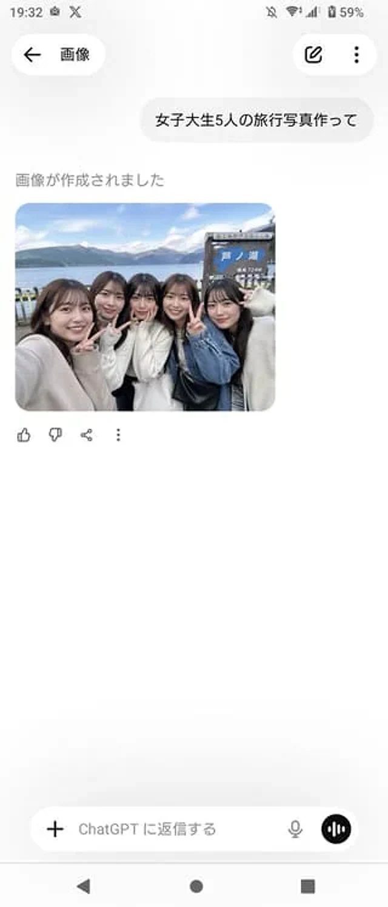

```text
A candid smartphone travel selfie, in which {argument name="group size" default="Five"} Japanese female university students stood closely together, located in{argument name="location" default="Lake Ashi in Hakone"} On the shore. The shot uses an outstretched arm perspective, with a slightly wide-angle front-facing camera effect. They stand shoulder to shoulder, smiling and making peace signs at the camera, conveying a relaxed and joyful atmosphere of friends on a trip. Their style is realistic and modern, with medium-length dark brown to black hair, natural makeup, and soft, neutral-toned autumn clothing: off-white knit sweaters and blue denim jackets. A black shoulder bag is visible on the right side of the image. The background is a lakeside landscape, with calm blue water and distant mountains sparsely clouded under a bright sky. A wooden tourist sign on the right side clearly displays Japanese text.{argument name="sign text" default="Lake Ashi"} And a smaller elevation marker of 724M. The composition should convey the feel of a genuine social media travel photo, with slight cropping at the edges, as if someone were holding the phone from the left, featuring natural sunlight, realistic skin tones, soft depth of field, and a documentary-style realism. The image should contain just the right amount of {argument name="peace sign count" default="Three"} The peace sign is clearly visible. The overall atmosphere should resemble a genuine group photo taken during a day trip to Japan.
```

Model: GPT Image 2
Author: GPT Image 2 Prompts

[ProjectD](https://aitoolsradar.com/en/prompts/d5a4487c9bbe5e) · [Recorded source](https://x.com/tomo_creative/status/2046537571979899190#reversed-2)
 · [Full original metadata and byte evidence](data/projectd-batch-0044.json)

## Realistic Handwritten Prescription

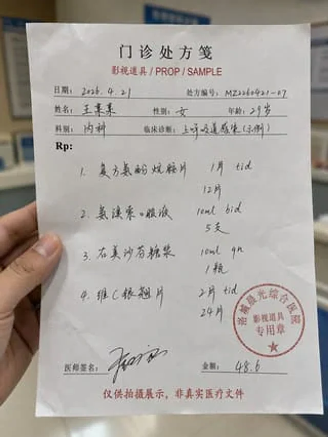

```text
{argument name="subject" default="Doctor&#39;s handwritten prescription"}, {argument name="style" default="Messy and realistic"}, {argument name="scene" default="Prescription in hand"}, {argument name="reason" default="Common cold/flu"}.
```

Model: GPT Image 2
Author: GPT Image 2 Prompts

[ProjectD](https://aitoolsradar.com/en/prompts/59e0232ab32411) · [Recorded source](https://x.com/robinbob376156/status/2046870294015684659)
 · [Full original metadata and byte evidence](data/projectd-batch-0044.json)

## Realistic Handwritten Study Notes

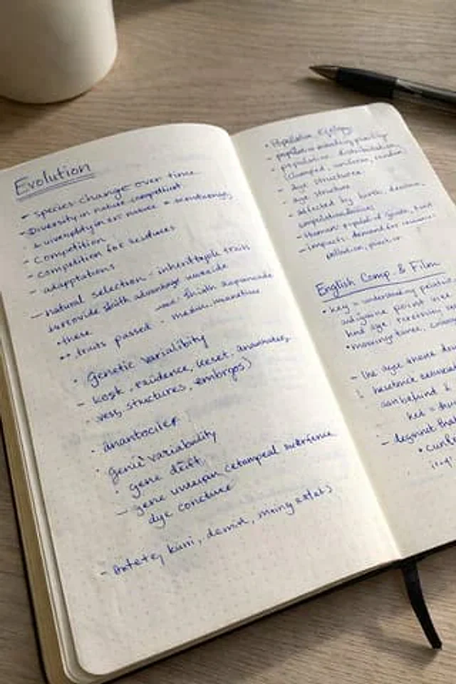

```text
A lifelike photograph shows a polka-dot notebook laid flat, densely covered with writing.{argument name="ink color" default="blue"} Handwritten notes with a ballpoint pen. The handwriting is casual and slightly messy, like a study notebook, with natural imperfections, corrections, and underlined headings. Shot from slightly above, with natural light streaming in through the window; no flash.{argument name="setting" default="Casual desk setting"} Shot using an iPhone.
```

Model: GPT Image 2
Author: GPT Image 2 Prompts

[ProjectD](https://aitoolsradar.com/en/prompts/0274556924a5b3) · [Recorded source](https://x.com/patrickassale/status/2043600177756586428)
 · [Full original metadata and byte evidence](data/projectd-batch-0044.json)

## Realistic Identity Card Macro Photography


```text
Ultra-realistic 16:9 close-up flat-lay studio photograph of an {argument name="card type" default="Australian citizenship identity card"} placed on a clean light grey or soft neutral background. The card is horizontally aligned, centered in frame, captured in sharp macro focus with soft diffused studio lighting. The design follows an official government-issued identity card aesthetic with modern typography, structured information layout, and advanced anti-counterfeit security detailing. Large bold header at top reads: “AUSTRALIA” with secondary title “CITIZENSHIP CARD” and subtitle “COMMONWEALTH OF AUSTRALIA.” Top-left corner features the national flag. Upper-right area includes the coat of arms. The card contains a passport-style portrait of a {argument name="subject" default="young Australian woman"}: – Fair/light skin tone with natural texture and subtle freckles – Shoulder-length dark blonde to light brown hair with soft waves – Hazel-green eyes, neutral expression, direct gaze – Minimal makeup, realistic facial details – Wearing a dark blazer or black top with subtle gold jewelry Personal identity information displayed clearly: – Surname: {argument name="surname" default="JOHNSON"} – Given Names: EMILY GRACE – Date of Birth: 24 JAN 1995 – Place of Birth: MELBOURNE, VIC – Citizenship Status: AUSTRALIAN CITIZEN – Citizenship Number: ACN 1234567 – Date of Issue: 15 MAY 2024 – Date of Expiry: 15 MAY 2034 – Sex: F – Height: 165 cm – Document Number: CC1234567 Security and design features include: – Intricate guilloche line patterns across the entire card surface – Fine microprinted anti-counterfeit textures – Holographic security patches with iridescent rainbow reflections – Transparent layered security overlays – Hologram featuring map and Southern Cross stars – Large engraved illustration of the Sydney Opera House and Sydney Harbour Bridge across the right side – Faint map outline embedded into background texture – Signature at bottom: “Emily G. Johnson” – Machine-readable identity strip at lower edge Additional design styling: – Soft blue, gold, and neutral pastel gradients – Polycarbonate laminated card texture with realistic reflections – Clean government visual language Lighting is soft and evenly diffused, emphasizing holographic effects, engraved textures, and realistic print detail without harsh shadows. No hand visible. Style: ultra-detailed, photorealistic, 8K resolution, macro clarity, professional product photography, documentary realism, highly realistic government ID card design.
```

Model: GPT Image 2
Author: ANKIT PATEL 🇮🇳 | AI

[ProjectD](https://aitoolsradar.com/en/prompts/f4941b180bbfe1) · [Recorded source](https://youmind.com/prompts/australian-citizenship-id-card-prop-19014)
 · [Full original metadata and byte evidence](data/projectd-batch-0044.json)

## Realistic iPhone Selfie Portrait of an East Asian Woman


```text
生成一张 {argument name="比例" default="9:16"} 竖版写实感人物照片，参考高级手机自拍质感，但不要完全普通生活照。整体像是用 iPhone 前置摄像头在温馨卧室中拍摄的精致自拍，保留柔和美型、干净构图和自然高级感。画质为真实手机照片质感，有轻微噪点、轻微柔焦和自然光感，但人物依然精致、漂亮、肤质自然干净，不要变成粗糙低质照片。画面中是一位{argument name="人物描述" default="成年东方女性"}，坐在温馨卧室床上，上半身近景自拍构图，镜头略微从上方俯拍，人物位于画面中央偏右，头部微微低下，视线安静看向右下方，表情自然、平静、温柔，嘴唇自然闭合，整体气质柔和、成熟、安静。人物拥有浅蓝色或冰蓝色长发，发丝自然蓬松，有轻微凌乱感，部分头发垂落在脸侧和肩颈周围。人物保持精致写实美型，脸型柔和自然，五官清秀，皮肤白皙但不过度磨皮，可保留少量真实肤质纹理、细小毛孔、轻微肤色不均和几处很淡的小黑痣，但整体仍然干净、柔和、好看。人物身材丰腴，肩颈线条柔和，胸部饱满，不卡通化。服装为{argument name="服装" default="浅蓝色丝缎吊带睡裙"}，带白色蕾丝花边，胸前有简洁小蝴蝶结和自然褶皱，布料柔软贴合身体，呈现真实丝缎材质光泽。人物一只手自然轻轻拉住肩带或肩部附近衣料，手指数量正常，姿态自然。背景为温馨卧室，有床铺、浅色床品、木质床头柜、暖黄色床头灯、窗帘和柔和室内光。背景轻微虚化，保留真实居家空间感。光线为室内暖光与自然光混合，略微偏暖，画面柔和、亲密、生活化，但保持干净高级。整体风格：写实手机自拍、高级自然美型、轻微 iPhone 前置摄像头质感、柔和暖光、自然肤质、真实比例、温馨卧室、精致但不过度商业修图。
```

Model: GPT Image 2
Author: 李岳

[ProjectD](https://aitoolsradar.com/en/prompts/42e259459859d2) · [Recorded source](https://youmind.com/prompts/realistic-female-iphone-selfie-portrait-21875)
 · [Full original metadata and byte evidence](data/projectd-batch-0044.json)

## Realistic Japanese Idol Close-Up

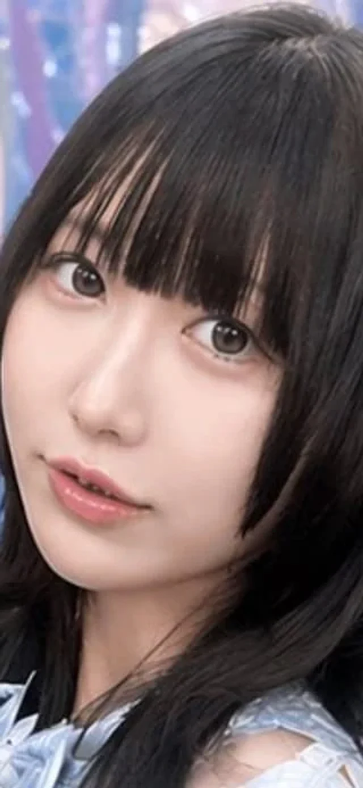

```text
A hyper-realistic close-up portrait of a young Japanese female idol, shot vertically from the shoulders up, with her head slightly tilted and looking directly at the camera. She has {argument name="hair color" default="jet black"} Her medium-length straight hair, with thick, straight bangs partially covering her forehead and gently framing her face, is striking. Her skin is incredibly smooth and fair, appearing evenly lit. Her large, deep brown eyes hold a soft glow, her nose is small and natural, and her slightly parted pink lips reveal slightly uneven front teeth, one of which is noticeably irregular and overlapping, creating a captivating yet imperfect smile. Her expression is calm, gentle, and innocent. She wears an exquisite light blue ruffled lace top with sheer pleats at the shoulders. The background is a soft, blurred palette of cool tones—lavender, blue, and pink—suggesting an indoor stage or event setting, with a bokeh effect reminiscent of light spots. The design emphasizes realistic skin texture, accurate asymmetrical teeth, an idol photography style, shallow depth of field, and a clean, refined Japanese portrait aesthetic.
```

Model: GPT Image 2
Author: GPT Image 2 Prompts

[ProjectD](https://aitoolsradar.com/en/prompts/2310760df5ca6a) · [Recorded source](https://x.com/raila_bluebare/status/2047518022060155324#reversed-1)
 · [Full original metadata and byte evidence](data/projectd-batch-0044.json)

## Realistic Japanese Newspaper Front Page


```text
{
  "type": "Photos of print pages of Japanese newspapers",
  "style": "The paper has a realistic newspaper texture, a slightly tilted overhead angle, natural light, and slight wrinkles.",
  "header": {
    "date": "{argument name=\"date\" default=\"Thursday, April 23, 2026 (Reiwa 8)\"}",
    "newspaper_name": "{argument name=\"newspaper name\" default=\"Asahi Shimbun\"}",
    "publisher_info": "Issuing Office: Asahi Shimbun Tokyo Headquarters",
    "top_right_ad": "Water and Life SUNTORY"
  },
  "main_headlines": [
    "{argument name=\"main headline 1\" default=\"OpenAI releases new model &quot;Spud&quot;\"}",
    "{argument name=\"main headline 2\" default=\"The &quot;Codex SuperApp&quot; will be released simultaneously.\"}"
  ],
  "sub_headline_bar": "It comprehensively surpasses existing benchmarks in terms of network attack and coding performance.",
  "layout": {
    "sections": [
      {
        "position": "center left",
        "type": "Article text bar",
        "content": "Japanese news text"
      },
      {
        "position": "central",
        "type": "Embedded Images",
        "description": "Dark blue graphics showcasing three simulated mobile UIs.",
        "overlay_text": "{argument name=\"center image text\" default=\"Codex SuperApp\"}",
        "caption": "Codex SuperApp concept image (provided by OpenAI)"
      },
      {
        "position": "center right",
        "type": "Vertical text headings",
        "text": "The competition to develop \"the cornerstone of the AGI era\" is intensifying."
      }
    ]
  },
  "lower_section": {
    "headline": "Experts gave it high praise, calling it \"overwhelming progress\".",
    "columns": 3,
    "left_column": {
      "title": "■Main Features",
      "bullet_points_count": 3
    },
    "middle_column": "Japanese article text",
    "right_column": "Japanese article text"
  },
  "footer_teasers": {
    "count": 3,
    "labels": [
      "Tariff negotiations: Japan and the US to renegotiate",
      "Heavy rains hit Kyushu region, injuring two people.",
      "Opinion"
    ]
  }
}
```

Model: GPT Image 2
Author: GPT Image 2 Prompts

[ProjectD](https://aitoolsradar.com/en/prompts/9f66092753d6a0) · [Recorded source](https://x.com/ai_hakase_/status/2045700163277107473#reversed-1)
 · [Full original metadata and byte evidence](data/projectd-batch-0044.json)

## Realistic Korean School Classroom Portrait

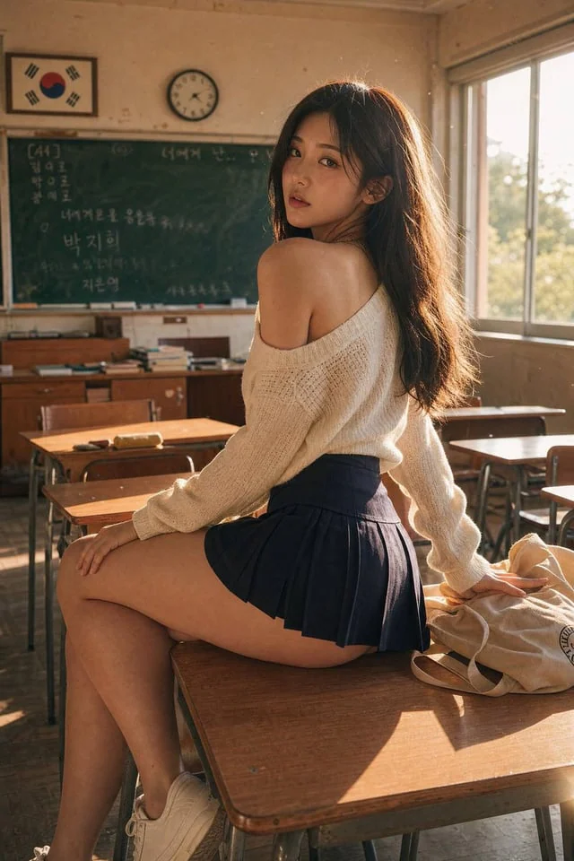

```text
Ultra-realistic portrait of a beautiful Korean woman standing inside an empty Korean classroom during late afternoon golden hour, captured in a cinematic film photography style. She faces slightly to the side with her gaze turning toward the camera, expression soft and introspective — lips gently parted, eyes calm and luminous. Both hands loosely holding the strap of a small canvas tote bag hanging off one shoulder, effortlessly cool posture. Wearing an oversized vintage cream knit sweater slightly off one shoulder, paired with high-waisted dark navy pleated mini skirt and white low-top sneakers. Soft layered gold necklaces, minimal jewelry, understated Korean street fashion aesthetic. Long dark brown hair with subtle highlights, half-tucked behind one ear, loose natural waves. Dewy glass skin, flushed cheeks, barely-there tinted lip, soft eye makeup — natural Korean beauty. Warm amber golden light flooding in through tall classroom windows at a low angle, casting long dramatic shadows across wooden desks and the floor. Dust particles softly visible in the light beams. Authentic Korean classroom setting — rows of wooden desks, vintage chalk-dusted green board with Korean writing, South Korean flag, old wall clock, stacked textbooks, worn polished flooring. 35mm analog film grain texture, Kodak Portra 400 color palette — warm honey tones, muted greens, soft creams. Shallow depth of field, background bokeh on classroom furniture. Nostalgic coming-of-age Korean drama visual tone, quiet emotional storytelling atmosphere, editorial lifestyle photography, cinematic still frame, hyper-realistic skin and fabric texture, golden hour haze, peaceful solitude mood.
```

Model: GPT Image 2
Author: WasifAI

[ProjectD](https://aitoolsradar.com/en/prompts/8b851121520afd) · [Recorded source](https://youmind.com/prompts/realistic-korean-classroom-film-portrait-21550)
 · [Full original metadata and byte evidence](data/projectd-batch-0044.json)

## Realistic League of Legends Cosplay

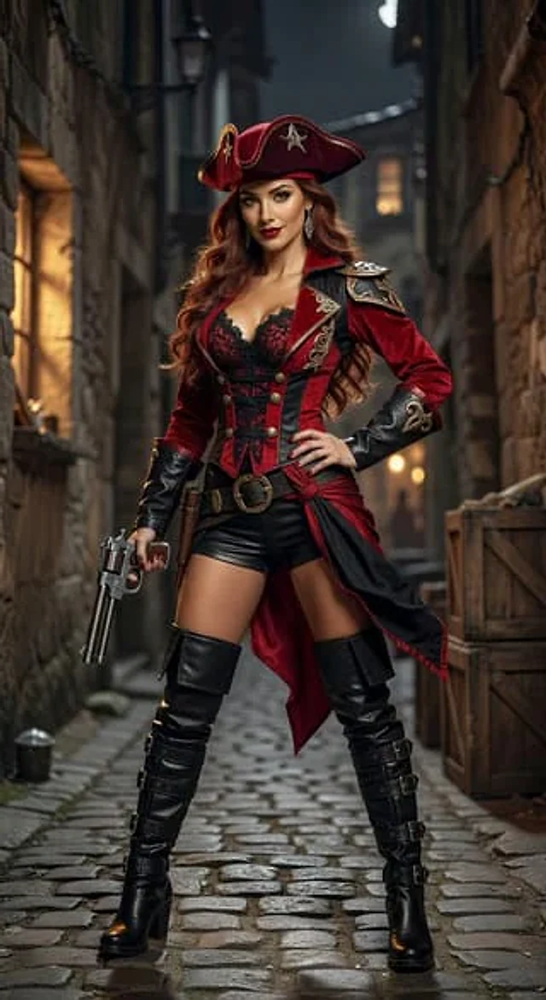

```text
League of Legends Cosplayer, this character is{argument name="character" default="Miss Fortune the Bounty Hunter"} .{argument name="facial features" default="French face"} .Proportion{argument name="aspect ratio" default="9:16"}
```

Model: GPT Image 2
Author: GPT Image 2 Prompts

[ProjectD](https://aitoolsradar.com/en/prompts/4a1e36d139607b) · [Recorded source](https://x.com/Jackma199512/status/2044406535703626209)
 · [Full original metadata and byte evidence](data/projectd-batch-0044.json)

## Realistic Male Character Sheet

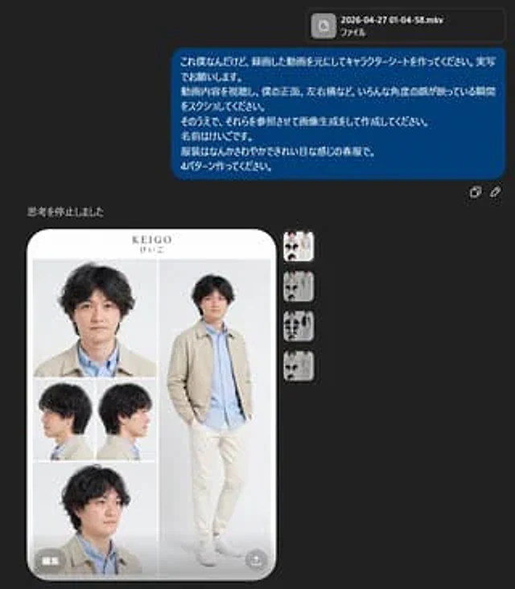

```text
{"type":"character reference sheet","style":"clean fashion lookbook mixed with a realistic model sheet","subject":{"name":"{argument name=\"character name\" default=\"KEIGO\"}","name_kana":"けいご","gender_presentation":"young adult Japanese man","appearance":{"hair_color":"dark brown to black","hair_style":"medium-length wavy tousled hair with soft volume and a slightly messy natural texture","build":"slim, average height","face":"realistic Japanese facial structure, soft youthful features"},"outfit":{"count":4,"featured_variant":"light spring casual outfit that looks gentle and neat","pieces":["beige lightweight jacket","light blue button-up shirt","off-white or cream straight pants","white low-top sneakers"]}},"layout":{"background":"very light gray studio background inside a rounded white presentation card","overall_format":"vertical character sheet with large rounded corners and minimalist editorial spacing","sections":[{"title":"head portrait","position":"top left","count":1,"labels":["front close-up"]},{"title":"full body","position":"right large panel","count":1,"labels":["standing pose with one hand in pocket"]},{"title":"side views","position":"middle left","count":2,"labels":["left profile","right profile"]},{"title":"lower portrait","position":"bottom left","count":1,"labels":["three-quarter close-up"]}],"total_images":5},"composition":{"top_center_text":"{argument name=\"headline text\" default=\"KEIGO\"}","subtitle_text":"けいご","pose_details":"full-body figure standing casually, slight lean, relaxed shoulders, one hand in pocket, clean catalog-style posture","camera_views":"front close-up, full body front, left profile, right profile, lower three-quarter portrait"},"rendering":{"photorealistic":true,"lighting":"soft even studio lighting with almost no harsh shadows","color_palette":"beige, pale blue, cream, white, soft gray","mood":"minimal, polished, springlike, calm, commercial fashion sheet"},"quality_notes":"high facial consistency across all 5 views, realistic clothing folds, clean magazine-like layout, no extra props, no dramatic styling, no heavy text beyond the name"}
```

Model: GPT Image 2
Author: 松丸 彗吾(keigo_matsumaru)

[ProjectD](https://aitoolsradar.com/en/prompts/36191fce3a8129) · [Recorded source](https://youmind.com/prompts/realistic-japanese-male-character-sheet-16740)
 · [Full original metadata and byte evidence](data/projectd-batch-0044.json)

## Realistic Manga Receipt Generator

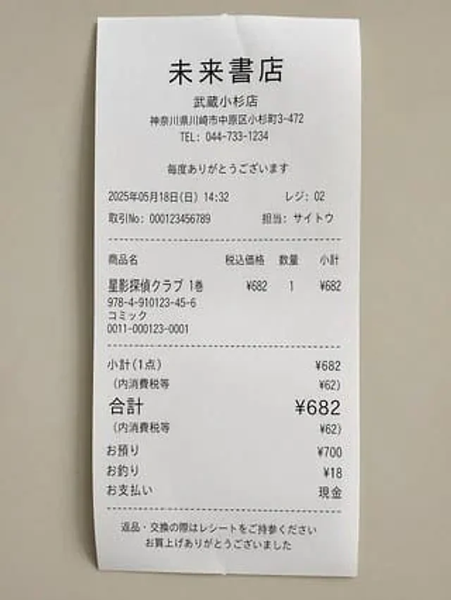

```text
Generate a purchase{argument name="item" default="comics"} Image of the receipt.{argument name="title" default="The title of a comic can be anything."}
```

Model: GPT Image 2
Author: GPT Image 2 Prompts

[ProjectD](https://aitoolsradar.com/en/prompts/e69ab7a64577b1) · [Recorded source](https://x.com/loglogrog/status/2046663100653563987)
 · [Full original metadata and byte evidence](data/projectd-batch-0044.json)

## Realistic McDonald's Selfie Portrait


```text
A highly realistic smartphone selfie taken inside an Asian McDonald's restaurant features a half-body portrait of a young man seated at a table. The camera is held at arm's length, slightly above the table, creating a natural frontal selfie perspective, with one forearm extending towards the lens. The subject wears a black T-shirt with a small white Tesla logo on the left chest, has short, straight black hair, and thin-rimmed black glasses are faintly visible. One hand lightly supports his chin, his posture relaxed. His face is completely obscured by a large, solid rectangular blur, preserving his privacy while maintaining the visibility of his hair, ears, jawline, and the temples of his glasses. A white McDonald's paper beverage cup with a lid and a white straw is placed in the lower left foreground, cropped at the edge of the image. The background showcases the restaurant counter area with warm ambient lighting; to the left is a large red wall panel featuring the yellow McDonald's arches logo and the white slogan "I'm lovin' it" with Chinese text below; above hang four illuminated digital menu items displaying burgers, fries, combo meals, prices, and Chinese text; near the counter are two people, one with their back to the camera carrying a backpack, and the other partially visible behind the cashier. Use natural color balance, subtle interior grain, realistic reflections, shallow to medium depth of field, and the casual feel of an unstaged social media snapshot.
```

Model: GPT Image 2
Author: GPT Image 2 Prompts

[ProjectD](https://aitoolsradar.com/en/prompts/3976f071c1d00d) · [Recorded source](https://x.com/_FORAB/status/2046774687380992253#reversed-1)
 · [Full original metadata and byte evidence](data/projectd-batch-0044.json)

## Realistic Person and Doodle Shadow Portrait

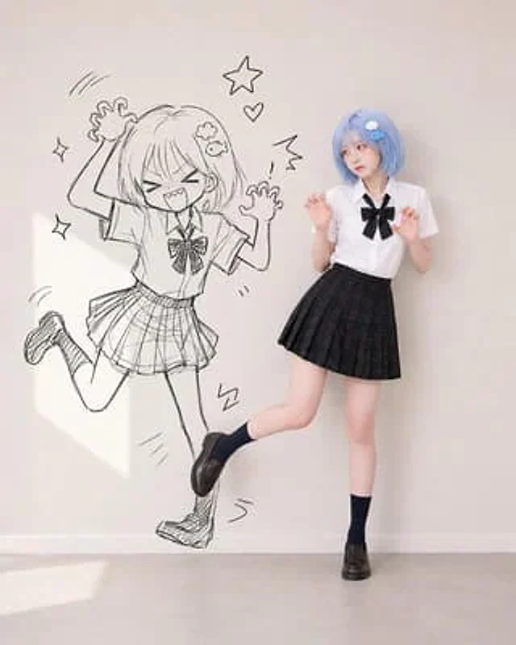

```text
Use the {argument name="character reference" default="uploaded character reference image"} as the strict identity and outfit reference. Preserve the reference character’s: face identity, facial proportions, eye shape, nose, lips, skin tone, hairstyle, hair color, visible hair accessories, overall recognizable vibe, outfit and styling shown in the reference image. Do not hardcode any specific character traits that are not present in the uploaded reference. All identity, hairstyle, accessories, and clothing details must be inferred directly from the uploaded reference image. Create a high-quality mixed-style vertical portrait showing: 1. a realistic full-body version of the uploaded character/person 2. a black hand-drawn doodle-shadow version of the same character/person on the wall beside them. Core concept: The real person and their doodle-shadow are doing a {argument name="pose" default="playful mischievous pose"} together. The real person performs a cute realistic version of the pose, while the doodle-shadow performs a much more exaggerated, chaotic, cartoonish version of the same pose idea. The mood should feel cute, playful, mischievous, stylish, funny, and social-media-friendly. Real person: Must remain realistic and photogenic, wear the same outfit style and key visible details from the uploaded reference image. Expression should be {argument name="expression" default="cute, slightly confused, mildly embarrassed, playful"}, as if thinking: “Why am I doing this with my shadow?” Doodle-shadow: Must be a black hand-drawn sketch version of the same person, drawn directly on the wall. Black sketch line-art only. Should resemble the person through hairstyle silhouette, accessories, outfit silhouette, and pose structure. Add manga-like motion lines, hearts, stars, sparkles, and comic marks around the doodle if helpful. Create a different mischievous pose each time. Possible pose directions: playful idol pose, silly dance pose, leaning sideways with one arm curved overhead.
```

Model: GPT Image 2
Author: Ciri

[ProjectD](https://aitoolsradar.com/en/prompts/6ccc4ef583aceb) · [Recorded source](https://youmind.com/prompts/realistic-person-doodle-shadow-29913)
 · [Full original metadata and byte evidence](data/projectd-batch-0044.json)

## Realistic Pirate Cosplay Portrait


```text
A highly realistic, professionally retouched photograph featuring a person dressed in {argument name="character" default="Miss Fortune, the Bounty Hunter in League of Legends"} A female cosplayer. She possesses {argument name="facial features" default="French face"} She had exquisite makeup, green eyes, and a head of fluffy hair.{argument name="hair color" default="red"} She had long, wavy hair. She was dressed in exquisite pirate attire, including an aged black tricorn hat with gold filigree embellishments, a black leather corset with a deep neckline and gold accents, white ruffled off-the-shoulder sleeves, and a wide brown leather belt. In her right hand she held a magnificent sword with brass details.{argument name="prop" default="flintlock rifle"} The background features a wooden mast and rigging of a sailboat against a bright blue sky. Cinematic natural lighting accentuates the rich textures of leather, metal, and skin, creating a photorealistic, edited portrait effect.
```

Model: GPT Image 2
Author: GPT Image 2 Prompts

[ProjectD](https://aitoolsradar.com/en/prompts/12cfab3e02184e) · [Recorded source](https://x.com/Jackma199512/status/2044406535703626209#reversed-1)
 · [Full original metadata and byte evidence](data/projectd-batch-0044.json)

## Realistic Sam's Club Shopping Snapshot


```text
A highly realistic snapshot taken with a mobile phone inside a bustling Sam's Club warehouse store in China. The composition centers on a young East Asian man, half-length, standing upright facing the camera, his face obscured by a rectangular blurred block for privacy. He wears a plain black short-sleeved T-shirt with a small white Tesla logo on the left chest, and carries a large bag of red apples in his left hand, tied with a blue cable tie. A white tag on the bag reads "envy," with smaller Chinese characters below. Behind him is the brightly lit retail interior, with high industrial ceilings, warehouse shelves, shoppers, shopping carts, and stacks of produce. The blue Sam's Club wall sign is prominently displayed in the upper left corner, reading "Sam's CLUB" and "Sam's Club Membership Store"; behind him is a large blue banner that reads "A Better Life at Sam's" and "Life is Better in the Club." A tall white vertical banner hangs in the upper right corner, proclaiming "Great Products, Great Prices" and adorned with blue and green geometric decorations. The background includes numerous slightly out-of-focus customers to create a realistically crowded shopping atmosphere. Lighting should be bright and even from retail overhead lighting; colors should be natural; the perspective should be eye-level; the aesthetic should have a documentary snapshot feel; the foreground subject should be sharp, while the background should be slightly softened; and the composition should be portrait-like.
```

Model: GPT Image 2
Author: GPT Image 2 Prompts

[ProjectD](https://aitoolsradar.com/en/prompts/69f12327601030) · [Recorded source](https://x.com/_FORAB/status/2046774687380992253#reversed-2)
 · [Full original metadata and byte evidence](data/projectd-batch-0044.json)

## Realistic Sam's Club Shopping Snapshot


```text
A candid, highly realistic smartphone photo inside a busy Sam’s Club warehouse store in China. Center the composition on a young East Asian man from mid-torso up, standing upright and facing the camera, with his face obscured by a rectangular blur block for privacy. He wears a plain black short-sleeve T-shirt with a small white Tesla logo on the left chest and holds a large clear plastic bag of red apples in his left hand, tied at the top with a blue band. The apple bag has a white label reading “envy” with small Chinese text beneath it. Behind him is a bright retail interior with tall industrial ceilings, warehouse shelving, shoppers, shopping carts, and stacked produce displays. Prominently show the blue diamond Sam’s Club wall sign at upper left with the text “Sam’s CLUB” and “山姆会员商店,” and a large blue wall banner behind him reading “更好的生活尽在山姆” and “Life is Better in the Club.” On the upper right, hang a tall white vertical banner that reads “优质优价” and “Great Products Great Prices,” with blue and green geometric accents. Include many background customers, slightly out of focus, to create an authentic crowded shopping atmosphere. Lighting should be bright, even retail overhead lighting; colors natural; perspective eye level; documentary snapshot aesthetic; sharp foreground subject with mildly softened background; portrait orientation.
```

Model: GPT Image 2
Author: AB Kuai.Dong

[ProjectD](https://aitoolsradar.com/en/prompts/d0348bfd25601d) · [Recorded source](https://youmind.com/prompts/sams-club-shopping-snapshot-14434)
 · [Full original metadata and byte evidence](data/projectd-batch-0044.json)

## Realistic Social Media Food Photography

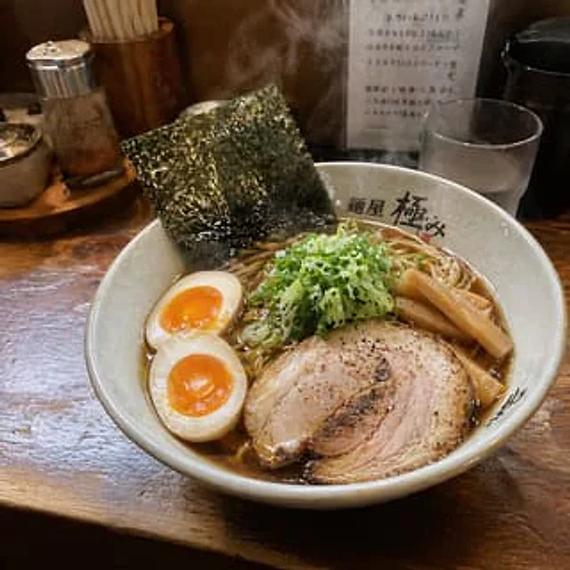

```text
Based on the bottom left corner{argument name="subject" default="Hand-Pulled Noodle"} The image generates a picture that looks like it is for {argument name="purpose" default="Instagram during lunchtime"} The location where the photos were taken was {argument name="location" default="Ramen shop"} n=4
```

Model: GPT Image 2
Author: GPT Image 2 Prompts

[ProjectD](https://aitoolsradar.com/en/prompts/975ef5c496bad5) · [Recorded source](https://x.com/tetumemo/status/2047487267900723483)
 · [Full original metadata and byte evidence](data/projectd-batch-0044.json)

## Realistic Subway Candid Portrait

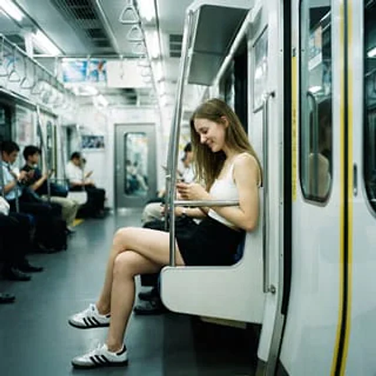

```text
Inside the subway car, a{argument name="person" default="young women"} She was sitting in the seat near the car door, focused intently on her phone, not looking at the camera, her expression relaxed and natural. She had delicate features, smooth skin, and a refreshing air. She was wearing {argument name="clothing" default="Simple white top, black skirt and white sneakers"} Long hair falls naturally. The subject is positioned in the right third of the frame, with a slightly blurred foreground obscuring the left side, creating a candid perspective. The vertical lines formed by the subway doors and handrails guide the eye. The overall lighting is cool-toned subway light, with soft overhead lighting and natural, not overly harsh shadows. There's a shallow depth of field, the subject is sharp, and the background is slightly blurred. The image has realistic camera grain and minor compositional flaws, resembling street photography—not posed, highly realistic, and with high detail. Additional quality keywords: high definition, hyper-realistic, realistic skin texture, natural skin tone, realistic lighting, 35mm lens, portrait photography, cinematic quality.
```

Model: GPT Image 2
Author: GPT Image 2 Prompts

[ProjectD](https://aitoolsradar.com/en/prompts/5e0afdbede4869) · [Recorded source](https://x.com/Easlo_eth/status/2047524854740754816)
 · [Full original metadata and byte evidence](data/projectd-batch-0044.json)

## Realistic Subway Snapshot

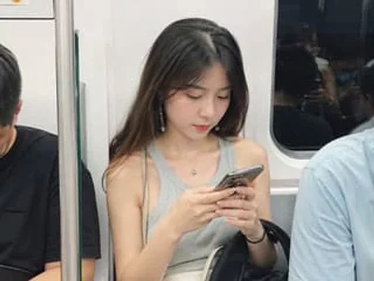

```text
{argument name="subject" default="A beautiful woman looking down at her phone on the subway"}; {argument name="style" default="Candid photos"}。
```

Model: GPT Image 2
Author: GPT Image 2 Prompts

[ProjectD](https://aitoolsradar.com/en/prompts/e6e45288f92ed7) · [Recorded source](https://x.com/ruokaykay/status/2046958647696318866)
 · [Full original metadata and byte evidence](data/projectd-batch-0044.json)

## Realistic Textbook Desk Scene


```text
There are two open books on the table, one of which is {argument name="first textbook" default="Primary school Chinese textbook"} The other one is{argument name="second textbook" default="Elementary school math textbook"} The contents of the book are clearly visible.
```

Model: GPT Image 2
Author: GPT Image 2 Prompts

[ProjectD](https://aitoolsradar.com/en/prompts/6964a7cc7ea403) · [Recorded source](https://x.com/XiaohuiAI666/status/2045355342998221257)
 · [Full original metadata and byte evidence](data/projectd-batch-0044.json)

## Realistic Textbook Desk Scene


```text
书桌上摆着两本摊开的书，一本书是{argument name="第一本书" default="小学语文课本"}，一本是{argument name="第二本书" default="小学数学课本"}，课本内容清晰。
```

Model: GPT Image 2
Author: 程序员小灰

[ProjectD](https://aitoolsradar.com/en/prompts/343175f79655bb) · [Recorded source](https://youmind.com/prompts/realistic-textbook-desk-scene-13989)
 · [Full original metadata and byte evidence](data/projectd-batch-0044.json)

## Realistic VTuber Merchandise Mockup

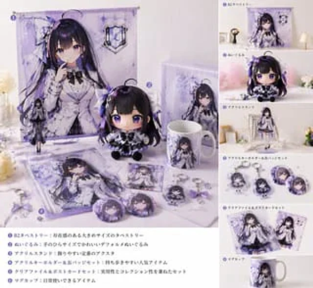

```text
For standard{argument name="character type" default="Vtuber"} create{argument name="items" default="Doujin merchandise"} The style is{argument name="style" default="Real shot"}
```

Model: GPT Image 2
Author: GPT Image 2 Prompts

[ProjectD](https://aitoolsradar.com/en/prompts/e55ca739dc672a) · [Recorded source](https://x.com/wtry1102/status/2045281877452575125)
 · [Full original metadata and byte evidence](data/projectd-batch-0044.json)

## Realistic White Dress Mirror Selfie

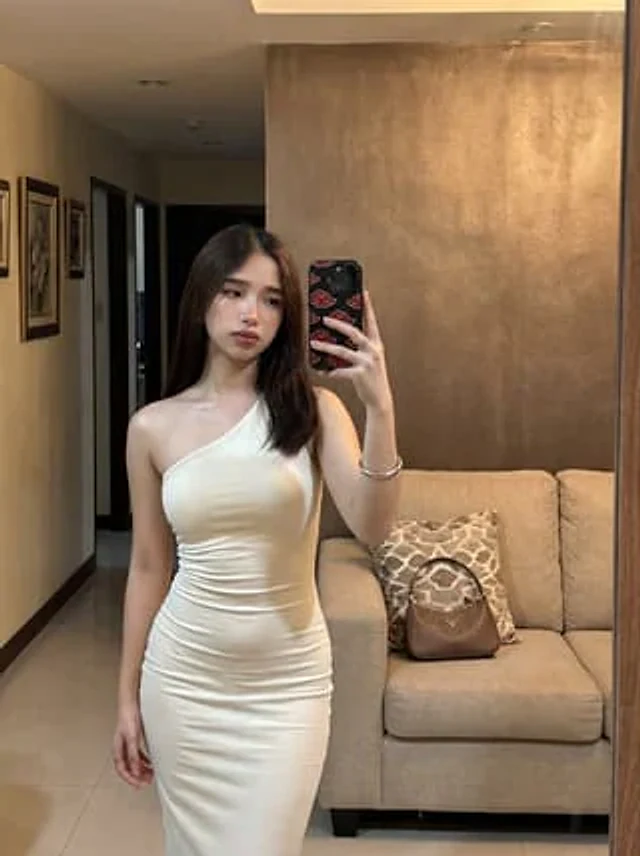

```text
A realistic indoor mirror selfie shows a slender young woman standing in the warm light of a modern apartment living room. She wears a fitted ivory one-shoulder midi dress with pleats at the torso and hips. She has shoulder-length, dark brown, center-parted hair and wears minimalist jewelry, including two rings, a silver bracelet, and delicate earrings. She holds her phone in one hand, the black case adorned with red cloud patterns obscuring her face. Her body is slightly turned to the side, her posture relaxed, one arm hanging naturally, showcasing her natural feminine silhouette. The image is vertically composed, presenting the perspective of a casual social media selfie. Behind her is a beige fabric sofa with a gray geometric-patterned cushion and a taupe leather handbag. The background includes a textured bronze-brown accent wall, glossy cream-colored tiled floors, a dimly lit hallway to the left (with three framed paintings), and warm recessed ceiling lights. Soft evening ambient light, natural skin tones, realistic fabric tension and folds, delicate reflections in the mirror, clean and upscale apartment aesthetics, high realism, photorealistic skin texture, smartphone shooting perspective.
```

Model: GPT Image 2
Author: GPT Image 2 Prompts

[ProjectD](https://aitoolsradar.com/en/prompts/1794ef6d0597b4) · [Recorded source](https://x.com/daaaaanc/status/2046678589739839969#reversed-0)
 · [Full original metadata and byte evidence](data/projectd-batch-0044.json)

## Realistic White Paper Craft Style Conversion

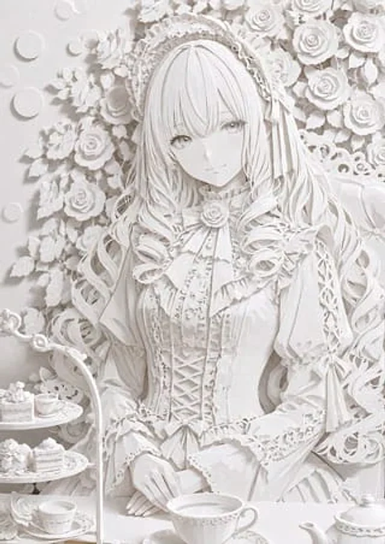

```text
{argument name="対象" default="このイラスト"}を非常に精密でリアルな{argument name="色" default="白い"}紙の{argument name="スタイル" default="ペーパークラフト"}風に変換してください。厚紙をレーザーカットしたようなシャープで正確な切り口、細かい折り目、複数のレイヤーによる豊かな立体感、紙の繊維感と自然な影を高ディテールで表現してください。光の当たり方による紙の白さと微妙なグラデーションを活かし、本物のような立体的なペーパーアート作品のようなリアリティを出して。全体を洗練されていて芸術的な雰囲気に。元のイラストの構図・キャラクターを忠実に維持。
```

Model: GPT Image 2
Author: のとろ

[ProjectD](https://aitoolsradar.com/en/prompts/7e7f24e7dadc57) · [Recorded source](https://youmind.com/prompts/realistic-white-paper-craft-style-18582)
 · [Full original metadata and byte evidence](data/projectd-batch-0044.json)

## Realistic X Profile Page Mockup


```text
Create a highly realistic dark mode social media interface mockup, closely replicating the French layout of the desktop X/Twitter, presented as a full browser screenshot with a black background and subtle dark gray dividing lines. The left sidebar contains 11 vertically arranged navigation items with white icons and labels: "Accueil" (Home), "Explorer," "Notifications" (with a small blue badge displaying the number 3), "Messages," "Grok," "Signets," "Communities," "Premium," "Organisations certifiées," "Profil," and "Plus." Place a white X logo at the top of this sidebar, add a large circular white button labeled "Poster" slightly below, and display Martin Dubois's compact login account bar at the bottom, including his username @martindubois and a small circular avatar. The middle bar is {argument name="profile name" default="Martin Dubois"} The main profile page features a back arrow, the name "Martin Dubois," and a blue verification badge at the top, with "1,248 posts" displayed below. Below this is a wide panoramic cover photo showcasing the breathtaking scenery of the misty Alps, forests, and lakes. Overlaid on the lower left of the banner is a circular portrait of a young man in dark clothing, his face slightly blurred or obscured against a light background with a thin border. To the right of the profile header are three small circular action buttons and a prominent light-colored, rounded button labeled "Éditer le profil" (Edit profile). Below the portrait are the display name Martin Dubois, the blue verification badge, the account @martindubois , and a French bio: "Créateur de contenu • Passionné de tech, de design et de productivité." (Content creator • Passionate about technology, design, and productivity.) Next, add a row containing metadata for four items: location "Lyon, France", website "martindubois.com", and "A rejoint X en janvier 2021". This is followed by a row of followers showing "320 abonnements" and "12,4k abonnés". Add a horizontal tab bar with five labels: "Posts", "Replies", "Featured Tweets", "Media", and "Likes", with "Posts" active and underlined in blue. Below the tabs, display a feed containing three visible posts by Martin Dubois. The first post is pinned, marked "Épinglé" (pinned), dated "12 mai" (May 12th), and contains the French text "10 leçons que j'ai apprises en construisant mon projet pendant 2 ans" (10 lessons I learned in 2 years of building this project) with an emoji. The interaction count includes five figures: 24 replies, 142 retweets, 1,000 likes, 85,000 views, and a bookmark/share area. The second post is dated "2h" (2 hours ago), and contains the French text "Le meilleur moment pour commencer était hier. Le deuxième meilleur moment, c'est maintenant." (The best time to start was yesterday. The second best time is now.) It has 12 replies, 37 retweets, 256 likes, and 8,000 views. The third post, dated "1j" (1 day ago), reads in French, "Un week-end à Chamonix, toujours ressourçant" (A weekend in Chamonix is ​​always revitalizing) and includes a mountain emoji along with a large embedded image of a snow-capped mountain peak bathed in soft sunlight. Each post uses a circular avatar on the left and is separated by thin lines. A rounded search box with the placeholder "Chercher" (search) is at the top of the right sidebar. Below this is a card titled "Vous pourriez aimer" (You might be interested in), listing three suggested profiles to follow, each with an avatar, display name, account, blue verified badge, and a white rounded "Suivre" (follow) button: "Théo Catarino" @theocatarino , "Aurélie Martinez" @aurel_martinez , and "Ulrich Rozier" @ulrichrozier . A "Voir plus" (see more) link is added at the bottom of the card. Below, create a trending card titled "Tendances: France," listing four trends by ranking, including category and number of posts: 1. "#RolandGarros" with "32,100 posts," 2. "#FêteDesMères" with "18,400 posts," 3. "Mbappé" with "45,200 posts," and 4. "#LundiMotivation" with "12,300 posts." Add a "Voir plus" link below the trend list. At the very bottom, place a compact footer containing several small gray legal links and "© 2024 X Corp." The overall image should look almost identical to a real desktop screenshot: clean typography, authentic spacing, realistic UI proportions, delicately rounded card corners, black and white text on a dark background, blue accent color, refined anti-aliased icons, and a clean, modern product design aesthetic.
```

Model: GPT Image 2
Author: GPT Image 2 Prompts

[ProjectD](https://aitoolsradar.com/en/prompts/0c34b0f6eb2c10) · [Recorded source](https://x.com/Firisis_/status/2046690794434621550#reversed-0)
 · [Full original metadata and byte evidence](data/projectd-batch-0044.json)

## Realistic X-Style French Profile Screen

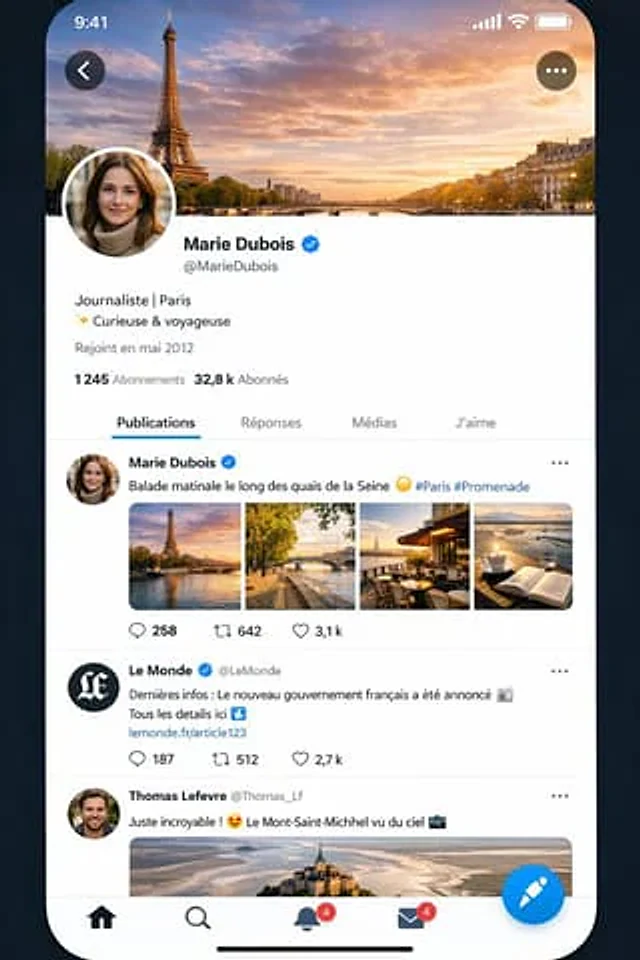

```text
A highly realistic screenshot mockup of a smartphone app showcases a social media interface almost identical to X/Twitter, displayed on a full-screen iPhone-style display with rounded corners and a dark blue-black background. The top status bar displays the time 9:41 on the left and cellular, Wi-Fi, and battery icons on the right. (Screen display){argument name="profile name" default="Marie Dubois"} The French profile page features a large cover image at the top: the Eiffel Tower and the Seine River against a dramatic orange-blue sky at sunset. A circular portrait partially obscures the face, positioned in the lower left corner of the header. A dark, semi-transparent circular back arrow button is located in the upper left corner, and a matching circular three-dot menu button is in the upper right corner. Below the header is the profile name, displayed with a blue verification badge.{argument name="profile name" default="Marie Dubois"} ,account{argument name="handle" default="@MarieDubois"} The feed includes a French description: the first line displays "Journaliste | Paris," the second line displays "✨ Curieuse &amp; voyageuse," and below it displays "Rejoint en mai 2012." Follower statistics are displayed in French: "1,245 Abonnements" and "32,8k Abonnés." A tab bar with four labels—"Publications," "Reponses," "Médias," and "J'aime"—is added, with "Publications" selected and underlined in blue. The feed contains three visible posts. The first post is by {argument name="profile name" default="Marie Dubois"} Released with a blue certification badge and a French title.{argument name="post caption" default="Balade matinale le long des quais de la Seine ☀️ #Paris #Promenade"} The first post is followed by a collage of four images: 1) The Eiffel Tower at Golden Hour along the river, 2) A riverside promenade in Paris with bridges and autumn leaves, 3) A cozy terrace café overlooking the Eiffel Tower, and 4) A cup of coffee next to an open laptop by the water. Below are interaction icons and counts: 258 replies, 642 retweets, and 3,1k likes. The second post comes from the verified news account "Le Monde" ( @LeMonde ), with a profile picture of a black circle with white letters. The French text reads: "Dernières infos : Le nouveau gouvernement français a été annoncé 📰 Tous les details ici ↓", followed by a blue link "lemonde.fr/article123"; below are counts of 187, 512, and 2,7k. The third post, from "Thomas Lefevre" ( @Thomas_Lf ), reads "Juste incroyable! 😍 Le Mont-Saint-Michel vu du ciel 📷," followed by a wide-angle aerial photo of Mont Saint-Michel. The bottom features an iOS-style navigation bar with five elements: a home icon, a search icon, a notification bell marked with a red number 4, a message envelope marked with a red number 4, and a large blue floating post button with a white quill icon. A slim, black iPhone home screen indicator is added at the very bottom center. The design utilizes clean, modern UI typography, subtle gray dividing lines, realistic spacing, authentic X-style icons, beautiful mobile app rendering, and near-photographic screenshot realism.
```

Model: GPT Image 2
Author: GPT Image 2 Prompts

[ProjectD](https://aitoolsradar.com/en/prompts/3e936d71e917a5) · [Recorded source](https://x.com/Firisis_/status/2046690794434621550#reversed-1)
 · [Full original metadata and byte evidence](data/projectd-batch-0044.json)

## Reasoning Context and Prompt Cache Slide


```text
Goal: Create a clean 16:9 Japanese business/technical infographic slide about how continuous reasoning context and explicit prompt caching improve long-running task efficiency. Use a polished PowerPoint-native infographic look with dense but readable explanatory text.

Canvas: 16:9 landscape slide, warm off-white background, dark navy text, teal and olive green accent colors, thin rounded borders, subtle shadows, generous margins. Leave no photo-realistic elements; use flat vector icons and crisp typography.

Top text area: Place a large bold Japanese headline at the top left: {argument name="headline text" default="継続推論と明示的キャッシュが長期タスクを効率化"}. Under it, add a smaller semibold lead sentence: {argument name="lead text" default="過去ターンの推論と再利用可能なプロンプトを選択的に保持することで一貫性と効率を高められるが、前提変更や利用回数を踏まえて保存範囲を設計する必要がある。"}

Main layout: Two large rounded rectangular panels sit side by side beneath the lead sentence. The left panel is teal and titled “reasoning.context”; the right panel is olive green and titled “明示的プロンプトキャッシュ”. Connect the panels with a thin line and a small circular chain-link icon centered between them near the bottom, suggesting coordination between reasoning context and cache. A small upward green arrow near the right panel points back toward it.

Left panel details: Include exactly 3 vertically stacked turn markers on the far left, connected by a vertical line with a downward arrow. The markers are labeled “1ターン”, “2ターン”, and “3ターン”. Next to each marker, show a small person icon and speech bubble. To the right, include exactly 3 horizontal rounded cards with teal icon blocks and Japanese explanatory text: 1) gear icon, “auto｜モデルの既定動作を利用”; 2) checklist icon, “all_turns｜安定した目標、前提、優先順位を複数ターンで再利用”; 3) clock icon, “current_turn｜以前の推論が不要になった場面で現在ターンに限定”.

Right panel details: Include exactly 3 horizontal rounded cards with olive icon blocks and Japanese explanatory text: 1) document icon, “再利用する共通プレフィックスを開発者が指定”; 2) database cylinder icon, “キャッシュ書き込みは通常入力単価の1.25倍”; 3) percent tag icon, “読み出しは割引されるため、反復利用の回数が効果を左右する”.

Bottom conclusion band: Across the bottom, create one wide rounded rectangle callout with a thin yellow border. On the left of the band place a gold target icon with an arrow. To the right, place a bold Japanese conclusion: {argument name="conclusion text" default="長期タスクの一貫性と効率を高める一方、前提変更時には過去の推論や不要なキャッシュを切り離す設計が必要"}.

Visual style: Japanese corporate slide design, crisp vector line icons, rounded rectangles, light cream background, teal left section, olive right section, yellow conclusion accent, strong hierarchy, highly legible Japanese sans-serif typography, no decorative clutter.

Constraints: Preserve the exact count of elements: 2 main panels, 3 left turn markers, 3 left option cards, 3 right cache cards, 1 central chain-link connector, 1 bottom conclusion callout, and 1 target icon. Do not add extra panels, extra cards, watermarks, logos, or decorative characters. Keep all slide text inside the infographic sharp and readable.
```

Model: GPT Image 2
Author: 炎鎮🔥 - ₿onochin -

[ProjectD](https://aitoolsradar.com/en/prompts/9437c9e8a8c2dc) · [Recorded source](https://youmind.com/prompts/reasoning-context-cache-slide-28531)
 · [Full original metadata and byte evidence](data/projectd-batch-0044.json)

## Recursive King of Spades Card

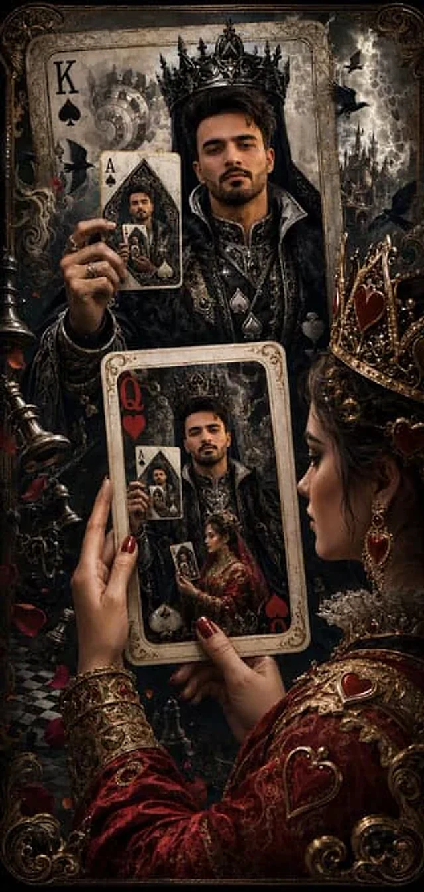

```text
Use my uploaded face image as the primary identity reference. Preserve my exact facial identity with extremely high fidelity: identical facial structure, jawline, cheekbones, eye shape, eyebrows, nose, lips, beard pattern, hairstyle, hair texture, skin tone, skin texture, and overall recognizable appearance. Do not beautify, alter, or reinterpret my face. Maintain realistic anatomy and authentic likeness. Create an ultra-detailed, cinematic, surreal luxury playing-card artwork. The main subject is me as the King of Spades, occupying the full design of a magnificent, royal Ace-quality playing card. I wear elaborate black-and-silver spade-themed regalia, a crown forged from obsidian and polished steel, intricate embroidered armor, and flowing royal garments decorated with subtle spade symbols. My expression is calm, intelligent, and powerful. In my right hand, I am holding a pristine Ace of Spades card. The creative twist: the Ace of Spades I am holding is not a normal card. It contains another complete playing-card illustration. Inside that card, I again appear as the King of Spades, and that entire card is being elegantly held between the fingers of a majestic Queen of Hearts. The Queen is graceful, regal, and visually striking, dressed in rich crimson and gold royal attire adorned with heart motifs. The illusion continues with subtle recursive storytelling: the Queen of Hearts appears to be examining the card with fascination, creating a "card within a card" visual paradox. The composition should feel like a legendary tale of power, strategy, love, and destiny intertwined. Add impossible Escher-inspired visual design elements: •Infinite recursion effect •Card-world folding into itself •Floating spade and heart symbols transforming into ravens and rose petals •Ornate golden borders extending beyond physical card edges •Royal chess pieces suspended in midair •Fractal patterns hidden within the card engravings •Elegant smoke forming suit symbols •Dimensional portals emerging from card corners Style: ultra-realistic fantasy realism mixed with luxury casino art, Renaissance royal portraiture, and modern cinematic concept art. Lighting: dramatic chiaroscuro, volumetric god rays, rich contrast, glowing metallic highlights, subtle magical energy around the Ace of Spades. Color palette: •Deep blacks •Silver chrome •Ivory white •Crimson red •Antique gold accents Composition: •Vertical masterpiece •Museum-quality detail •Hyper-realistic textures •Intricate card engravings •Perfectly symmetrical playing-card aesthetics blended with cinematic depth •Sharp focus on my face •Extremely high identity fidelity •Epic storytelling through visual symbolism The final image should feel like the cover of a legendary fantasy card game where the King of Spades has become self-aware, existing across multiple layers of reality while being held in the hands of fate itself, represented by the Queen of Hearts.
```

Model: GPT Image 2
Author: Professor

[ProjectD](https://aitoolsradar.com/en/prompts/11e5366a3523f2) · [Recorded source](https://youmind.com/prompts/recursive-king-spades-card-24452)
 · [Full original metadata and byte evidence](data/projectd-batch-0044.json)

## Red Alert Style Pixel Sprite Sheet

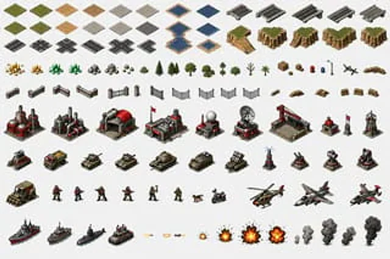

```text
Please try to analyze all the scenes in Red Alert, and then generate all the resources used in a large image of a pixelated sprite sheet, making sure it does not contain any irrelevant elements so that I can crop it.
```

Model: GPT Image 2
Author: GPT Image 2 Prompts

[ProjectD](https://aitoolsradar.com/en/prompts/d37d266e202fd9) · [Recorded source](https://x.com/iBigQiang/status/2047175490319098191)
 · [Full original metadata and byte evidence](data/projectd-batch-0044.json)

## Red Idol Concert Close-Up


```text
A dynamic close-up photo of a concert, with the main subject being the performers on stage.{argument name="idol performer" default="Young J-pop female idol"} Shot from the audience's perspective, the scene features a shallow depth of field. She leans towards the camera, one hand reaching towards the foreground, creating a strong perspective compression effect; the other hand holds a black handheld microphone with a red decorative ring close to her mouth. She wears a richly detailed red and white ruffled idol costume: dark brown twin ponytails with bangs, two fluffy red pom-pom hair accessories tied with ribbon bows, red pendant earrings, a red choker with lace and heart-shaped gemstones, a lace-trimmed crop top with a large satin bow at the chest, off-the-shoulder ruffled sleeves, a cinched waist with red ribbon ties and small metal embellishments, a layered satin skirt decorated with sparkling beaded chains, and a heart-shaped gemstone ornament at the waist. Her nails are glossy red with cute white decorative nail art. The lighting is vibrant pink and deep red stage lighting, creating a glamorous live idol atmosphere. The background is filled with soft blurring effects, LED screens, stage setups, and countless glowing and floating heart-shaped confetti, creating a dreamy and romantic concert scene. Employing a photorealistic style, it showcases clear fabric textures, shimmering satin highlights, lace details, concert atmosphere, subtle dynamic energy, and the overall {argument name="color theme" default="Red and pink"} Color scheme. It blends a subtle sense of excitement with a fan-oriented stage presence, like {argument name="theme" default="Cute and romantic idol concert"} Photos of the promotional performance.
```

Model: GPT Image 2
Author: GPT Image 2 Prompts

[ProjectD](https://aitoolsradar.com/en/prompts/069d2f181c349f) · [Recorded source](https://x.com/yayoi_bluebare/status/2047523370129035660#reversed-2)
 · [Full original metadata and byte evidence](data/projectd-batch-0044.json)

## Red Triptych Build the Future Poster

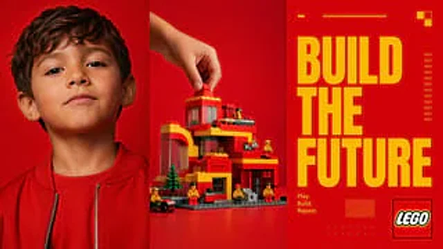

```text
{
  "type": "Triptych advertising poster",
  "style": "A bold and modern toy brand event style, combining high-contrast studio photography with graphic design.",
  "format": "Three vertical panels of equal width side by side",
  "color_palette": {
    "dominant_background": "Vibrant and saturated red",
    "accent": "Bright yellow",
    "secondary": "Orange-red, black, white, gray"
  },
  "subject": {
    "theme": "Creative construction and imagination",
    "brand_style": "Building block toy aesthetics",
    "headline": "{argument name=\"headline text\" default=\"BUILD THE FUTURE\"}",
    "tagline": "{argument name=\"tagline\" default=\"Play. Build. Repeat.\"}"
  },
  "layout": {
    "sections": [
      {
        "title": "left portrait panel",
        "position": "Left third",
        "count": 1,
        "labels": [
          "Children's portraits"
        ]
      },
      {
        "title": "Central Build Panel",
        "position": "The middle third",
        "count": 1,
        "labels": [
          "Place blocks onto the toy building with your hands"
        ]
      },
      {
        "title": "Right-side layout panel",
        "position": "right third",
        "count": 1,
        "labels": [
          "Title and Brand Graphics"
        ]
      }
    ],
    "panel_dividers": "There are thin, dark vertical dividing lines between the three panels."
  },
  "left_panel": {
    "subject": "Close-up portrait of a child from the chest up",
    "counted_elements": {
      "people": 1,
      "garments": 2,
      "visible_facial_features": 2
    },
    "appearance": {
      "age": "young children",
      "hair": "Short dark brown hair",
      "clothing": [
        "Red crew neck shirt",
        "Red zipper jacket with silver zipper teeth"
      ],
      "visible_features": [
        "Left ear visible",
        "The neck and lower half of the face are visible."
      ]
    },
    "framing": "The top is slightly trimmed and located in the center of the panel.",
    "background": "Solid color, vibrant red, seamless photography studio background"
  },
  "center_panel": {
    "subject": "Toy building scene being assembled",
    "counted_elements": {
      "hands": 1,
      "main_building": 1,
      "mini_figures": 6,
      "trees": 1,
      "vehicles": 1,
      "loose_bricks_being_placed": 1
    },
    "action": "A hand reaches in from the upper left and places a red block on the roof.",
    "building": {
      "style": "Modern multi-story residential or municipal buildings constructed from building blocks",
      "colors": [
        "red",
        "yellow",
        "grey",
        "Transparent dark window panel"
      ],
      "features": [
        "left arch structure",
        "Single-story roof",
        "Multiple balconies or terraces",
        "large windows",
        "gray baseboard",
        "Front steps"
      ]
    },
    "surroundings": {
      "mini_figures": "Six small toy figures shaped like construction workers are arranged around the structure, dressed in yellow and red clothes.",
      "trees": "A small green coniferous tree near the left front.",
      "vehicle": "A small black and red wheeled vehicle located on the lower left edge."
    },
    "background": "Solid color, vibrant red, seamless photography studio background",
    "surface": "Red desktop that blends into the background"
  },
  "right_panel": {
    "subject": "Graphic poster layout",
    "counted_elements": {
      "headline_words": 3,
      "small_repeated_word_instances": 9,
      "decorative_blocks_top_right": 3,
      "small_horizontal_bar_groups_top": 2,
      "tagline_lines": 3,
      "logo_boxes": 1,
      "decorative_hatched_boxes": 1,
      "decorative_dot_grids": 1
    },
    "typography": {
      "main_text": "{argument name=\"headline text\" default=\"BUILD THE FUTURE\"}",
      "arrangement": "Three lines stacked, one word per line, in very large, compressed, bold, sans-serif yellow font, occupying most of the panel's height.",
      "tagline": "{argument name=\"tagline\" default=\"Play. Build. Repeat.\"}",
      "tagline_position": "The lower left corner of the right panel displays three lines of small yellow text.",
      "repeated_side_text": "The word BUILD is repeated vertically nine times in the middle right corner, displayed in small yellow text."
    },
    "graphics": {
      "top_details": [
        "A short yellow horizontal line in the upper left corner",
        "One long, thin yellow striped bar at the top center"
      ],
      "top_right": [
        "A combination of 3 yellow and orange squares"
      ],
      "bottom_details": [
        "A yellow shaded rectangle in the bottom left center",
        "One small yellow dot at the bottom center"
      ],
      "logo": "{argument name=\"brand name\" default=\"LEGO\"} The logo is located in the bottom right corner within a thin black outline box."
    },
    "background": "solid bright red"
  },
  "lighting": "The clean, bright, and saturated lighting in the commercial studio, with minimal shadows, creates a sophisticated and polished advertising campaign.",
  "composition": "The striking triptych composition features a photographic portrait on the left, a product-building action in the middle, and an oversized typographical slogan panel on the right."
}
```

Model: GPT Image 2
Author: GPT Image 2 Prompts

[ProjectD](https://aitoolsradar.com/en/prompts/210beaad36677f) · [Recorded source](https://x.com/dcbruck/status/2046995916297548207#reversed-1)
 · [Full original metadata and byte evidence](data/projectd-batch-0044.json)

## Red Vinyl Soundtrack Ad

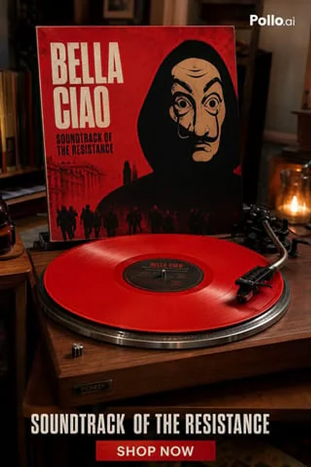

```text
A luxury product advertisement photograph with a cinematic quality features a vintage wooden record player playing a translucent, bright red vinyl record in a warm, dimly lit living room. Behind the record player, a vertical album cover dominates the image against a striking distressed red background, with large, cream-white, compressed text printed in the upper left corner.{argument name="album title" default="BELLA CIAO"} Below is smaller black text.{argument name="subtitle text" default="SOUNDTRACK OF THE RESISTANCE"} The cover art features a silhouette of a figure in a black hoodie against a red background, with a row of smaller silhouettes of figures moving along the bottom edge. Subtle architectural lines in the lower left corner create an atmosphere of political resistance and a dramatic soundtrack. The record player is presented in a three-quarter view on a wooden table, featuring a brushed metal platter edge. A black tonearm rests to the right of the record, and a small metal control knob is visible in the front left. The design employs shallow depth of field, high-end photographic lighting, and rich amber highlights. Soft candlelight illuminates the right side of the background, while bookshelves and furniture details are blurred, creating an aesthetic that blends high-end fashion advertising with a music product. At the bottom of the image, a striking promotional banner overlay is added, featuring large, compressed white all-caps text.{argument name="bottom headline" default="SOUNDTRACK OF THE RESISTANCE"} A red rectangular button is placed in the center below, containing white all-caps text.{argument name="button text" default="SHOP NOW"} It contains a small white [item] in the upper right corner.{argument name="brand watermark" default="Pollo.ai"} Watermark. Hyperrealistic photography, with the vinyl record and cover clearly in focus, creating a somber and luxurious atmosphere, suitable for social media advertising, in a vertical 2:3 aspect ratio.
```

Model: GPT Image 2
Author: GPT Image 2 Prompts

[ProjectD](https://aitoolsradar.com/en/prompts/46c6a5565d2101) · [Recorded source](https://x.com/garlotic/status/2047413947368911312#reversed-0)
 · [Full original metadata and byte evidence](data/projectd-batch-0044.json)

## Redacted Rooftop Portrait

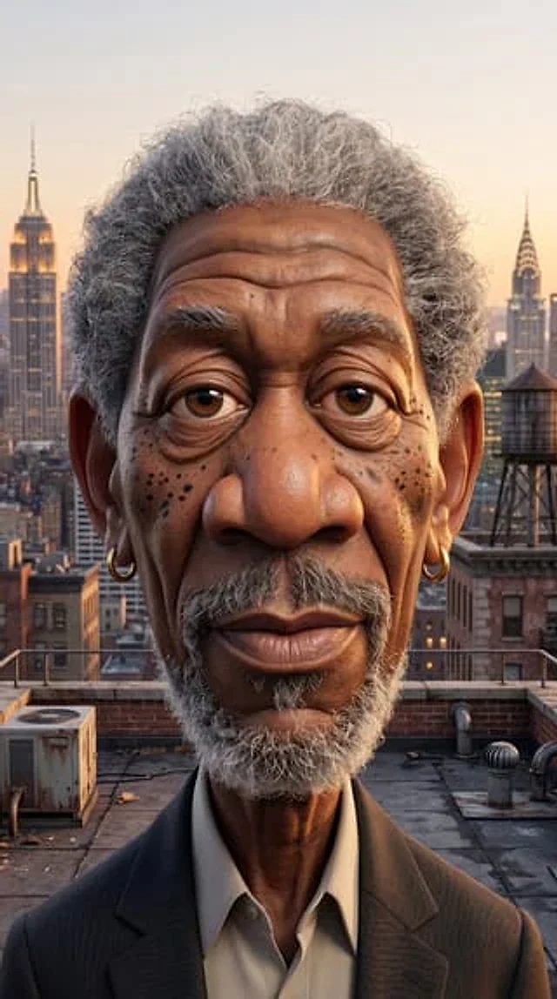

```text
A cinematic, realistic rooftop portrait, taken at the golden hour. An older man faces the camera, his face completely obscured by a large, vertical rectangular brown occluder. Visible features are clearly visible: thick, tightly curled grey hair with silver highlights; clearly defined ears; a long, slender neck showing the marks of time; a charcoal grey suit jacket over a tieless, off-white collared shirt. The composition employs a vertical cropping technique starting from the mid-chest. The scene is set on a real New York rooftop, with details including: a weathered HVAC unit in the foreground and left, a cylindrical rooftop water tower in the middle ground, two striking Art Deco skyscrapers in the background (the left resembling the Empire State Building, the right resembling the Chrysler Building), low brick buildings, rooftop pipes, vents, railings, and a soft, atmospheric haze. Using warm sunset lighting, the sky takes on an orange-pink hue, with subtle contour lighting around the ears and hair. The horizon has a shallow depth of field, and the textures of the suit fabric, rooftop concrete, metal machinery, and curly hair are richly detailed. The overall atmosphere is mysterious, editorial, and slightly surreal, like a magazine cover photo where the identity is obscured.
```

Model: GPT Image 2
Author: GPT Image 2 Prompts

[ProjectD](https://aitoolsradar.com/en/prompts/3d925f92c20e6e) · [Recorded source](https://x.com/dedricreid/status/2047815205179273571#reversed-0)
 · [Full original metadata and byte evidence](data/projectd-batch-0044.json)

## Reference-Based Character Portrait Prompt

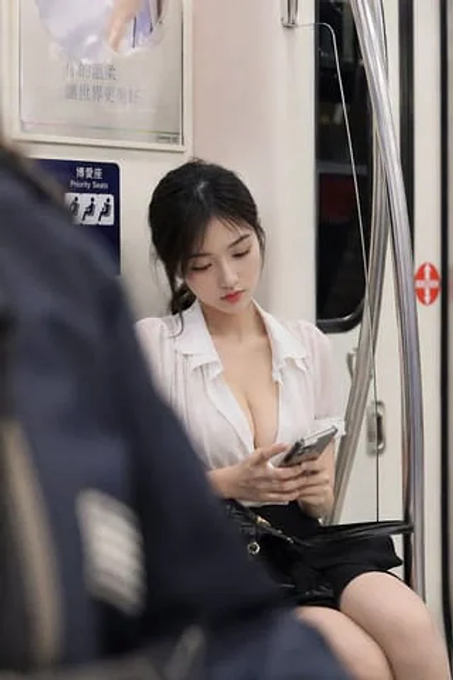

```text
exist{argument name="location" default="Taiwan Metro carriages"} Inside, a young woman sits in a seat near the door. Her appearance and clothing must reference the woman in the uploaded photo (including facial features, demeanor, hairstyle, and clothing style; the clothing must be exactly the same as in the photo). She is looking down at her phone, her expression natural, not at the camera. The woman is positioned in the right third of the frame, with a blurred foreground obscuring her left side.
```

Model: GPT Image 2
Author: GPT Image 2 Prompts

[ProjectD](https://aitoolsradar.com/en/prompts/87f632aecefc21) · [Recorded source](https://x.com/komorimedia/status/2047783624301580431)
 · [Full original metadata and byte evidence](data/projectd-batch-0044.json)

## Reference-Based Cinematic World Expansion


```text
Using the provided reference images as the seed of visual civilization, this concept is expanded into a completely new cinematic world. While maintaining the grand East Asian fantasy design language, monumental scale, complex world-building centered on architecture, and ultra-detailed realism, the scene is transformed from a bright, cloud-top palace into ancient mechanical ruins on the ground. The gilded fairyland temple environment is replaced with a massive circular structure, embedded giant gears, heavy industrial-style stone and metal buildings, broken pipes, and ruins overgrown with pale-colored flowering trees. The atmosphere is adjusted to a cold, hazy, low-saturation blue-gray tone, complemented by a soft atmospheric fog, while retaining the epic and breathtaking world-building quality of the reference images. A solitary wandering swordsman, with his back to the camera, wearing a flowing white robe and a scabbard, is placed directly below the largest circular structure in the foreground to emphasize the scale. This gives the scene the quality of a high-budget fantasy film, with extremely rich environmental details and showcasing a coherent visual language derived from the reference images.
```

Model: GPT Image 2
Author: GPT Image 2 Prompts

[ProjectD](https://aitoolsradar.com/en/prompts/0ea4e6db4af8ac) · [Recorded source](https://x.com/john87445528/status/2047120487575064812#reversed-2)
 · [Full original metadata and byte evidence](data/projectd-batch-0044.json)

## Reference-Based Cinematic World Expansion

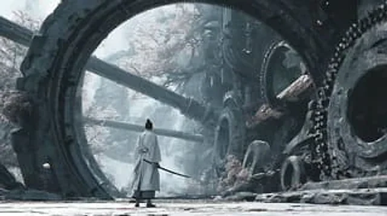

```text
Using the provided reference image as the visual civilization seed, expand it into a new cinematic world scene that keeps the same grand East Asian fantasy design language, monumental scale, intricate architecture-first worldbuilding, and ultra-detailed realism, but shift the setting from a luminous cloud palace into an ancient mechanical ruin on the ground. Replace the gilded celestial temple environment with colossal circular ring structures, giant embedded gears, heavy industrial stone-and-metal architecture, broken conduits, and overgrown ruins with pale flowering trees. Change the mood to cold, misty, desaturated blue-gray lighting with soft atmospheric fog, while preserving the epic, awe-inspiring worldbuilding feel from the reference. Add 1 lone wandering swordsman seen from behind in the foreground, wearing flowing white robes and carrying a sheathed sword, centered beneath the largest ring to emphasize scale. Make it feel like a frame from a high-budget fantasy film, with extremely rich environmental detail and a cohesive visual language derived from the reference image.
```

Model: GPT Image 2
Author: John

[ProjectD](https://aitoolsradar.com/en/prompts/243ba31c95c986) · [Recorded source](https://youmind.com/prompts/cinematic-mechanical-ruin-swordsman-15294)
 · [Full original metadata and byte evidence](data/projectd-batch-0044.json)

## Refreshing Beverage Commercial Portrait


```text
A bright and refreshing commercial photograph, featuring a {argument name="subject description" default="Handsome young Asian man with short black hair"} Wearing a{argument name="clothing" default="Light blue knitted sweater"} He wore a gentle smile, looking directly at the camera, holding a clear plastic water bottle with water droplets clinging to it. The bottle had a bright blue label with white lettering.{argument name="product label" default="POCARI SWEAT"} The background is divided into two parts: on the left, a clear light blue sky can be seen through a window; on the right, a soft-focus, cozy interior is depicted, complete with a picture frame and a warm-toned table lamp. In the lower left corner, there is clear white overlay text that reads, "..."{argument name="overlay text line 1" default="포카리 스웨트"} Below that is a line of larger text.{argument name="overlay text line 2" default="이온을 채워, 순간을 살아"} The design features a white, curved, dynamic graphic at the bottom. The overall lighting is soft, natural, and translucent, creating a pure and hydrating atmosphere.
```

Model: GPT Image 2
Author: GPT Image 2 Prompts

[ProjectD](https://aitoolsradar.com/en/prompts/963999821a6928) · [Recorded source](https://x.com/94vanAI/status/2044914754943435146#reversed-1)
 · [Full original metadata and byte evidence](data/projectd-batch-0044.json)

## Refreshing Summer Udon Ad


```text
少し暑くなってきた今の時期に、さわやかにさっぱりしたい、みずみずしさ、みたいなところをもっと強く感じたい。冷たいうどんやナス、つゆを口に含んだ時の爽快感、みたいなものをもっと感じるように
```

Model: GPT Image 2
Author: @genel_ai

[ProjectD](https://aitoolsradar.com/en/prompts/9ac42bbf835569) · [Recorded source](https://x.com/genel_ai/status/2046501692246470871)
 · [Full original metadata and byte evidence](data/projectd-batch-0044.json)

## Research-Driven Ad Layout Designer


```text
The advertising creative was generated in a 2x2 grid format, producing four different types.{argument name="campaign name" default="Golden Week travel plans"} Advertising Plans. Based on online research of high-conversion advertising campaigns in Japanese domestic tourism over the past 10 years, four distinct and highly appealing advertising designs were designed and created. Aspect Ratio ={argument name="aspect ratio" default="1:1"} Used for A/B testing.
```

Model: GPT Image 2
Author: GPT Image 2 Prompts

[ProjectD](https://aitoolsradar.com/en/prompts/0fbb90c4e8d2af) · [Recorded source](https://x.com/old_pgmrs_will/status/2045490107072029091)
 · [Full original metadata and byte evidence](data/projectd-batch-0044.json)

## Research-Driven Ad Layout Designer


```text
広告クリエイティブ制作、{argument name="キャンペーン名" default="ゴールデンウィーク用の旅行プラン"}の広告を2x2グリッドで4パターン。日本国内旅行で過去10年間で高い実績を持つプランをwebでリサーチした上で、極めて高い訴求力のある広告デザインを完全に異なるパターンで4種類設計・作成。A/Bテスト前提でアスペクト比={argument name="アスペクト比" default="1:1"}
```

Model: GPT Image 2
Author: いにしえ@AI Director & Creator｜Will Oldgram

[ProjectD](https://aitoolsradar.com/en/prompts/7d89045caa9998) · [Recorded source](https://youmind.com/prompts/research-driven-ad-grid-13981)
 · [Full original metadata and byte evidence](data/projectd-batch-0044.json)

## Restaurant Logo Guidelines Board

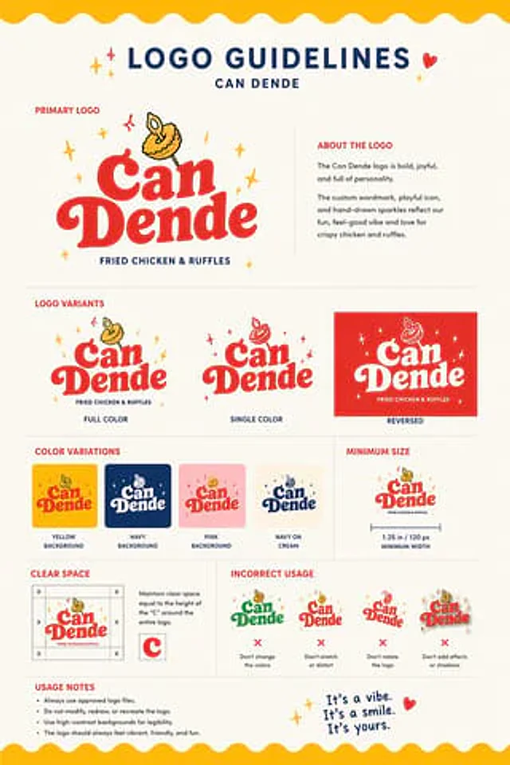

```text
Using the provided reference images as brand inspiration, transform fried chicken burgers and waffle fries into a beautifully designed one-page logo guide project for a brand called [Project Name].{argument name="brand name" default="Can Dende"} The restaurant brand. Based on the food in the reference image, create a cheerful, modern fast-casual brand image: transform the crispy fried chicken toppings into a playful mascot/icon above the text label, and build a striking custom logo inspired by the warm tones in the photo. Design the output as a clean, editorial-style brand page with an off-white background, navy blue and red font, yellow fan-shaped borders at the top and bottom, and a few touches of glitter doodles. Please include the following sections and quantities: 1 main heading with "LOGO GUIDELINES" and the brand name below; 1 "PRIMARY LOGO" section containing the main logo and a "ABOUT THE LOGO" text block; 1 "LOGO VARIANTS" section containing 3 variations labeled "FULL COLOR," "SINGLE COLOR," and "REVERSED"; 1 "COLOR VARIATIONS" section containing 4 color blocks labeled "YELLOW BACKGROUND," "NAVY BACKGROUND," "PINK BACKGROUND," and "NAVY ON CREAM"; 1 "MINIMUM SIZE" section showcasing the logo with width guide lines and the text "1.25 in / 120 px MINIMUM WIDTH"; 1 "CLEAR SPACE" section containing a spacing diagram based on the height of the letter C; 1 "INCORRECT USAGE" section containing 4... There are 10 error examples, labeled "Don't change the colors," "Don't stretch or distort," "Don't rotate the logo," and "Don't add effects or shadows"; 1 "USAGE NOTES" section containing 4 key points; and a handwritten closing statement in the bottom right corner.{argument name="tagline text" default="It's a vibe. It's a smile. It's yours."} Maintain a clear, printable, highly legible, and presentation-quality layout, just like a real restaurant brand's deliverables.
```

Model: GPT Image 2
Author: GPT Image 2 Prompts

[ProjectD](https://aitoolsradar.com/en/prompts/ce55cb06583979) · [Recorded source](https://x.com/fmontes/status/2046945040958677259#reversed-2)
 · [Full original metadata and byte evidence](data/projectd-batch-0044.json)

## Restaurant Logo Guidelines Board


```text
Using the provided reference image as the brand inspiration, transform the fried chicken burger and waffle fries meal into a polished one-page logo guidelines board for a restaurant brand named {argument name="brand name" default="Can Dende"}. Create a cheerful, modern fast-casual identity derived from the food in the reference: turn the crispy fried topping into a playful mascot/icon above the wordmark, and build a bold custom logo in a warm palette inspired by the photo. Design the output as a clean editorial brand sheet on an off-white background with navy and red typography, yellow scalloped borders at the top and bottom, and small sparkle doodles. Include these exact sections and counts: 1 main header reading "LOGO GUIDELINES" with the brand name beneath it; 1 "PRIMARY LOGO" section with the main logo and an "ABOUT THE LOGO" text block; 1 "LOGO VARIANTS" section with 3 variants labeled "FULL COLOR", "SINGLE COLOR", and "REVERSED"; 1 "COLOR VARIATIONS" section with 4 tiles labeled "YELLOW BACKGROUND", "NAVY BACKGROUND", "PINK BACKGROUND", and "NAVY ON CREAM"; 1 "MINIMUM SIZE" section showing the logo with a width guide and the text "1.25 in / 120 px MINIMUM WIDTH"; 1 "CLEAR SPACE" section with a spacing diagram based on the height of the letter C; 1 "INCORRECT USAGE" section with 4 wrong examples labeled "Don't change the colors", "Don't stretch or distort", "Don't rotate the logo", and "Don't add effects or shadows"; 1 "USAGE NOTES" section with 4 bullet points; and a handwritten-style closing tagline at bottom right that says {argument name="tagline text" default="It's a vibe. It's a smile. It's yours."}. Keep the composition crisp, print-ready, highly legible, and presentation-quality, like a real branding deliverable for a restaurant.
```

Model: GPT Image 2
Author: Freddy Montes

[ProjectD](https://aitoolsradar.com/en/prompts/2cc7650a4e96dc) · [Recorded source](https://youmind.com/prompts/restaurant-logo-guidelines-board-15040)
 · [Full original metadata and byte evidence](data/projectd-batch-0044.json)

## Restaurant POV Change Comparison

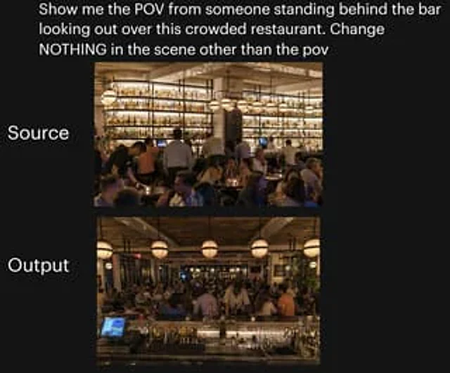

```text
A side-by-side comparison image of social media posts against a dark background showcases a test of camera angle changes inside a busy restaurant. At the top is large white sans-serif text that reads:{argument name="headline text" default="Show me the view of this crowded restaurant from behind the bar. Don&#39;t change anything in the scene except the perspective."} Two rounded rectangular photos are stacked vertically in the center of the page. The upper image has the large white text "Source" on its left; the lower image has the large white text "Output" on its left. The upper image shows the original restaurant scene from the customer side, looking towards the bar at the back: a warm, upscale, and crowded restaurant at night, with a huge illuminated wall of bottles in the background, wooden ceiling beams, and hanging spherical chandeliers. Bartenders and servers are at work, and the foreground and midground are filled with customers. The lower image shows the same restaurant, maintaining the same lighting, decor, crowd density, bottle wall, chandeliers, and overall atmosphere, but with a changed perspective: the camera is now positioned behind the bar, looking out over the crowded restaurant. The foreground of the lower image includes the bar countertop, glassware, bottles, metal bar tools, and the illuminated POS touchscreen in the left front, reinforcing the "behind the bar" perspective. Both photos were designed to maintain photorealistic quality, warm amber lighting, and a vibrant nighttime atmosphere, ensuring the lower image appears to be the same scene as the upper one, only with a different camera angle. It features a clean social media posting style with ample margins and a neat layout, making it suitable for use as a tweet screenshot or AI image comparison sticker.
```

Model: GPT Image 2
Author: GPT Image 2 Prompts

[ProjectD](https://aitoolsradar.com/en/prompts/37a51ec4e39e94) · [Recorded source](https://x.com/AIWarper/status/2047519042647519299#reversed-1)
 · [Full original metadata and byte evidence](data/projectd-batch-0044.json)

## Restaurant POV Change Comparison

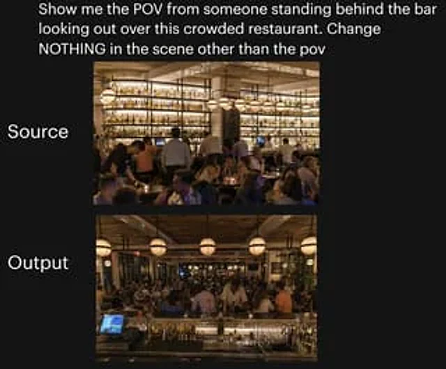

```text
A side-by-side comparison image against a black background showcases the changing camera angles within the same restaurant scene. At the top, bold white sans-serif text reads: "Show me the perspective of someone standing behind the bar overlooking this crowded restaurant. Don't change anything in the scene except the perspective." Below, vertically centered, are two stacked rectangular photos: the top image is labeled "Source" in large white letters on the left, and the bottom image is labeled "Output" in large white letters on the left. The top photo shows a warm, upscale, and crowded restaurant interior, viewed from the dining area towards the bar. A full wall behind the bar is filled with glowing bottles, and bartenders and customers are at the bar. The ambiance features amber lighting, spherical chandeliers, a wooden ceiling, beige pillars, and diners in the foreground. The bottom photo shows the exact same restaurant, the same customer density, the same warm lighting, the same decor, the same bar shelves, the same spherical pendant lights, and the same overall compositional elements, but the perspective has changed to looking out from behind the bar at the crowded restaurant; the foreground includes the bar with glassware, metal bar tools, bottles, and a point-of-sale (POS) screen visible in the lower left corner, the central area is packed with customers and staff, and the dining area extends into the background. Please maintain the visual impression that only the camera position has changed between the two images, with no other alterations to the scene.
```

Model: GPT Image 2
Author: GPT Image 2 Prompts

[ProjectD](https://aitoolsradar.com/en/prompts/8f03763a5b9c28) · [Recorded source](https://x.com/chesnyfcb/status/2047714457774637213#reversed-1)
 · [Full original metadata and byte evidence](data/projectd-batch-0044.json)

## Restore and Colorize Damaged Vintage Photo

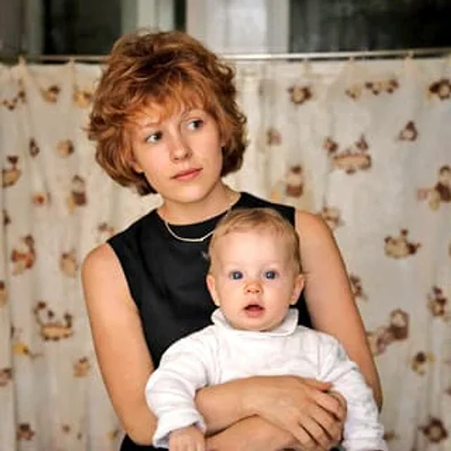

```text
Using REFERENCE_0, restore the old damaged family photo into a clean, high-resolution modern scan. Remove the heavy scratches, stains, fading, tears, and surface damage while preserving the original composition, pose, framing, and background curtain. Reconstruct realistic natural skin tones, sharpen details, and colorize the image with believable warm indoor tones. Keep the woman holding the baby in the same position, restore the black sleeveless dress, the baby's light outfit, the reddish-brown hair, and the subtle necklace. Maintain the same portrait crop and photographic realism, as if the original print was professionally repaired and remastered in 4K.
```

Model: GPT Image 2
Author: WasifAI

[ProjectD](https://aitoolsradar.com/en/prompts/1243680c7f4e58) · [Recorded source](https://youmind.com/prompts/restore-colorize-vintage-photo-16163)
 · [Full original metadata and byte evidence](data/projectd-batch-0044.json)

## Retro 3D Claymation Desk Setup

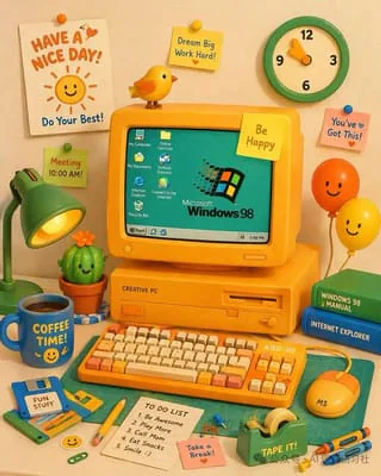

```text
A vibrant and charming 3D claymation-style illustration depicts a retro yellow desktop computer setup. The central yellow CRT monitor screen is cyan, displaying…{argument name="OS logo text" default="Microsoft Windows 98"} The monitor displays a logo and seven desktop icons labeled "My Computer," "Online Services," "My Documents," "Outlook Express," "Internet Explorer," "Connect to the Internet," and "Recycle Bin." The bottom taskbar includes a "Start" button and a clock displaying "5:49 PM." A yellow sticky note on the monitor reads, "..."{argument name="monitor sticky note" default="Be Happy"} A small yellow bird perches on top. The computer stand is labeled "CREATIVE PC". In front is a yellow mechanical keyboard labeled "KBD-98", with orange and cream keycaps, and a yellow mouse labeled "MS". To the left is a green desk lamp, a smiling cactus, and a sign that reads "..."{argument name="floppy disk label" default="FUN STUFF"} A blue floppy disk with the word "", and a container with the word "{argument name="mug text" default="COFFEE TIME!"} A blue mug with a smiley face. To the right are two stacked books (green "WINDOWS 98 MANUAL," blue "INTERNET EXPLORER") and two smiling balloons (orange and yellow). The foreground includes a green cutting mat, a yellow pencil, a green tape dispenser labeled "TAPE IT!", two crayons, a pink sticky note that says "Take a Break!", and a white notebook with five "TO DO LIST" items: "1. Be Awesome," "2. Play More," "3. Call Mom," "4. Eat Snacks," and "5. Smile :)." A green and cream clock hangs on the background wall, along with a sign that reads "..."{argument name="poster text" default="HAVE A NICE DAY!"} The white poster featured a smiling sun and the words "Do Your Best!", along with three additional sticky notes: a yellow one that read "Dream Big Work Hard!", a pink one that read "You've Got This!", and a green one that read "Meeting 10:00 AM!"
```

Model: GPT Image 2
Author: GPT Image 2 Prompts

[ProjectD](https://aitoolsradar.com/en/prompts/c96f534545678c) · [Recorded source](https://x.com/coconut_256/status/2045026556561719581#reversed-0)
 · [Full original metadata and byte evidence](data/projectd-batch-0044.json)

## Retro Anime Gender Swap Visual

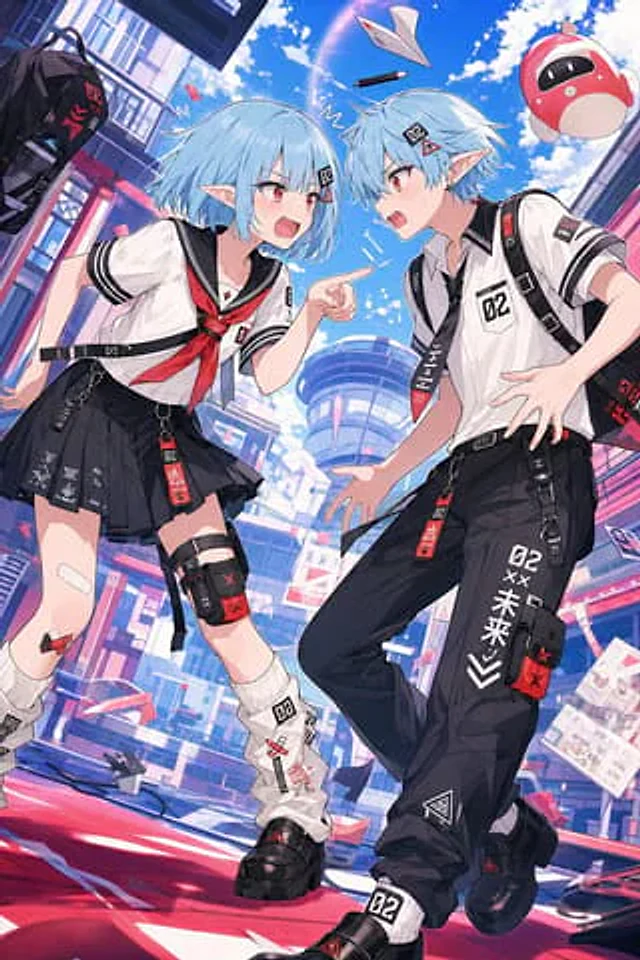

```text
提供された画像をオリジナルキャラクターの基準リファレンスとして使用すること。オリジナルキャラクターと、その性別反転版キャラクターが同時に登場する、高品質なアニメキービジュアルを制作すること。オリジナルキャラクターは画面左側に配置すること。性別反転版キャラクターは画面右側に配置すること。両者は一目で同一人物だと認識できる必要がある。顔立ち、目の形、顔の比率、髪型のデザイン言語、髪色、シルエット、表情の癖、性格表現、視覚モチーフ、全体的なキャラクターアイデンティティを高い精度で維持すること。性別反転版は単なるコスプレや衣装交換ではなく、「もし同じ人物が最初から逆の性別として生まれていたら」という自然な解釈でデザインすること。単純に異性用の服を着せるだけにしないこと。衣装は性別に合わせて自然に再設計しながらも、元デザインのファッション性、色彩設計、アクセサリー、象徴性、職業性、社会的立場、世界観、デザイン哲学を維持すること。観客が即座に「同じ人物の男女版だ」と理解できること。両デザインには強い視覚的共通性を持たせること。【全体の雰囲気】1990年代後半〜2000年代前半の日本アニメ雑誌やアニメ販促ポスターのような空気感。存在しない名作性別反転ラブコメアニメの公式キービジュアル。楽しい混乱。軽快な騒動。ラブコメ的な距離感。コミカルなテンポ感。深刻なSF作品ではない。深刻な並行世界作品ではない。世界の危機ではない。何か予想外のトラブルが発生してしまったような楽しい空気感を優先すること。視聴者が「絶対面白いやつだ」と思えるようなアニメ作品の宣伝ビジュアルを目指すこと。【キャラクター演技】二人のキャラクターは、同じ人物の男女版が偶然出会ってしまった状況として描写すること。互いを認識していること。互いにリアクションしていること。感情表現は自由に選択してよい。例：・驚き・混乱・困惑・苛立ち・好奇心・照れ・対抗心・自己嫌悪・自画自賛・呆れ・挑発・不信感・警戒・変な親近感など。複数の感情が混ざっていてもよい。重要なのは、「自分自身の性別反転版を見ている」という面白さが伝わることである。【構図】構図は固定しないこと。毎回異なる演出を選択すること。例：・向かい合う・背中合わせ・肩を組む・言い争う・睨み合う・指差し合う・鏡を見るように見つめ合う・同じポーズを取る・全く違うポーズを取る・お互いを観察する・追いかけ回す・逃げる／追う・偶然ぶつかる・入れ替わり直後の混乱状態・同じ物を取り合う・同時にリアクションする・互いの服装を確認する・距離を取って警戒する・近付きすぎて気まずくなるなど自由に変化させること。左右対称構図に依存しないこと。毎回異なるアニメ作品の宣伝ビジュアルになるように構図を変化させること。【背景】背景はキャラクターの世界観、職業、時代設定、ジャンル、文化圏、デザイン言語、に自然に適合すること。背景はキャラクターを引き立てるための高品質なアニメ背景として設計すること。必要に応じて、・学園・都市風景・商店街・ファンタジー世界・和風空間・魔法世界・サイバーパンク都市・レトロポップデザイン・遊園地・文化祭・ステージ・抽象グラフィックなどを使用してよい。背景は作品ジャンルを自然に伝えるものであること。【画風】1990年代後半〜2000年代前半のアニメ雑誌イラスト。レトロポップアニメ美学。セル画風アニメ塗り。クリーンな線画。大胆なシルエット設計。鮮やかで楽しい色彩設計。商業アニメの公式販促イラスト品質。アニメオープニング映像のワンシーンのような躍動感。雑誌表紙のような強いアイキャッチ。【禁止事項】ロゴ禁止。タイトル文字禁止。キャプション禁止。ウォーターマーク禁止。比較表レイアウト禁止。設定資料集レイアウト禁止。ターンアラウンドシート禁止。キャラクター比較画像にしないこと。シリアスなマルチバース戦争にしないこと。ダークファンタジー終末決戦にしないこと。性別反転そのものよりも戦闘や世界観説明を主役にしないこと。
```

Model: GPT Image 2
Author: Eris Create Lab

[ProjectD](https://aitoolsradar.com/en/prompts/c735291559036b) · [Recorded source](https://youmind.com/prompts/retro-anime-gender-swap-visual-23487)
 · [Full original metadata and byte evidence](data/projectd-batch-0044.json)

## Retro Anime Pastel Sleep Scene

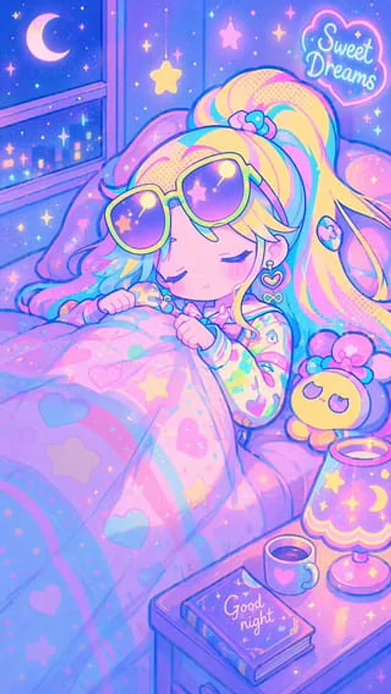

```text
A sheet using{argument name="art style" default="90s Retro Anime Aesthetics"} The illustration depicts a cute girl sleeping peacefully in bed. She has fluffy hair.{argument name="hair color" default="Soft rainbow colors"} Her hair was disheveled, and a pair of large, retro sunglasses perched on her forehead, the frames yellow with purple gradient lenses. She wore brightly colored printed pajamas, heart-shaped earrings, and clutched a pink blanket adorned with soft rainbow, heart, and star patterns. The bedroom was bathed in {argument name="color palette" default="Vibrant neon soft colors"} The lighting is neutral, with a soft glow and shimmering effect. In the upper right corner is a glowing cloud-shaped sign that reads "..."{argument name="neon sign text" default="Sweet Dreams"} The window to the left revealed a deep blue night sky, with a crescent moon and stars visible above the city silhouette. Star decorations hung from the ceiling. Beside her on the bed lay a small yellow plush toy with a pink bow. On the bedside table in the lower right corner were a star-shaped lamp, a heart-shaped mug, and a book with the title "..."{argument name="book title" default="Good night"} ".
```

Model: GPT Image 2
Author: GPT Image 2 Prompts

[ProjectD](https://aitoolsradar.com/en/prompts/cfd68f8c28056b) · [Recorded source](https://x.com/minesan_ai/status/2044463128222814268#reversed-0)
 · [Full original metadata and byte evidence](data/projectd-batch-0044.json)

## Retro Audio Concept Poster Board


```text
A minimalist retro-futuristic showcase project, set against a soft periwinkle blue backdrop, employs a minimalist editorial layout, horizontally arranging four analog-style audio product concept visuals. On the far left is a partially cropped reference image showcasing a retro open-reel tape recorder and a silver stereo receiver on a wooden stand against a warm off-white wall; this is complemented by two large white scrolls with dark green centers, brushed metal knobs, a blue backlit display, and hardware in light mint green and silver. To the right are three equally spaced, rounded, tall poster cards, all using the same cream-colored paper tone, deep forest green typography, mint green product shapes, and soft studio shadows. The first poster: a spherical retro speaker/radio sits on a base, with a light mint green body, a round front, a small display, and two side knobs, with a bold, capitalized title displayed at the top.{argument name="headline text 1" default="SOUND, REIMAGINED."} The second poster features a mint green retro oscilloscope-style device with a CRT screen displaying waveforms, silver knobs, switches, and a metal tilting stand, with a bold, capitalized title displayed centered above.{argument name="headline text 2" default="WAVEFORM"} The third poster: A compact, mint green portable cassette recorder/speaker with a handle, front cassette window, buttons, speaker grille, and silver knobs, with a bold, capitalized title displayed at the top center.{argument name="headline text 3" default="ANALOG STILL HITS."} Each poster features micro-typography, a faux brand logo, and a footer icon, presenting a sophisticated Swiss modern advertising style. A restrained color palette is used, employing shades of gray-blue, cream, sage mint green, forest green, silver, black, and warm wood tones. Thin horizontal guide lines are added to the background, and small footer text is added at the bottom, with [text missing] on the left.{argument name="left footer text" default="MJ REFERENCE"} The right side is{argument name="right footer text" default="KREA // GPT 2"} Overall Appearance: A high-concept design project that translates high-fidelity inspiration into a consistent aesthetic presentation across three exquisite product posters, featuring soft lighting, sophisticated graphic design, minimalist layout, clear typography, and a subtle touch of nostalgic realism.
```

Model: GPT Image 2
Author: GPT Image 2 Prompts

[ProjectD](https://aitoolsradar.com/en/prompts/1ad207a1c47f2d) · [Recorded source](https://x.com/lloydcreates/status/2046775099747954984#reversed-3)
 · [Full original metadata and byte evidence](data/projectd-batch-0044.json)

## Retro Audio Concept Poster Board


```text
A clean retro-futurist presentation board on a muted periwinkle-blue background with a minimalist editorial layout, showing 4 analog-inspired audio product concept visuals arranged horizontally. On the far left, a partially cropped reference image of a vintage reel-to-reel tape deck and silver stereo receiver on a wooden shelf against a warm off-white wall; two large white reels with dark green centers, brushed metal knobs, a blue-lit display, and pale mint and silver hardware. To the right, 3 tall rounded-corner poster cards evenly spaced, all using the same cream paper tone, dark forest-green typography, mint-green product styling, and soft studio shadows. First poster: a spherical retro speaker/radio on a pedestal base, pale mint body with a circular front face, small display, and two side knobs, centered under a large bold uppercase headline reading {argument name="headline text 1" default="SOUND, REIMAGINED."}. Second poster: a mint-green vintage oscilloscope-like device with a CRT screen displaying a waveform, silver knobs and switches, and a metal tilt stand, centered under a bold uppercase headline reading {argument name="headline text 2" default="WAVEFORM"}. Third poster: a compact mint-green portable cassette recorder/boombox with handle, front cassette window, buttons, speaker grille, and silver knobs, centered under a bold uppercase headline reading {argument name="headline text 3" default="ANALOG STILL HITS."}. Each poster includes tiny microtype, fake brand marks, and footer icons in a refined Swiss-modern advertising style. Use a restrained palette of dusty blue, cream, sage mint, forest green, silver, black, and warm wood. Add thin horizontal guide lines across the background and small footer text at the bottom reading {argument name="left footer text" default="MJ REFERENCE"} on the left and {argument name="right footer text" default="KREA  //  GPT 2"} on the right. Overall look: premium concept design board, consistent aesthetic translation from analog hi-fi inspiration into three polished product posters, soft lighting, high-end graphic design, minimal clutter, crisp typography, and subtle nostalgic realism.
```

Model: GPT Image 2
Author: Lloyd Creates

[ProjectD](https://aitoolsradar.com/en/prompts/9cb61ee5a6b469) · [Recorded source](https://youmind.com/prompts/retro-audio-concept-board-14844)
 · [Full original metadata and byte evidence](data/projectd-batch-0044.json)

## Retro ChatGPT Space Poster


```text
A vintage medieval space race poster, affixed to a rough white plaster wall, is photographed directly in natural light. Slightly wrinkled, creased, and weathered, with worn edges and small tears, the poster presents a realistic, aged paper texture. The design employs a limited vintage color palette of deep navy, faded cream, soft reddish-orange, and grayish-blue. A prominent headline in the upper left corner dominates the design:{argument name="headline text" default="ChatGPT Images 2.0"} The text features "ChatGPT" in an oversized cream-colored sans-serif font, with "Images 2.0" below in bold reddish-orange. On the right, a towering vintage rocket stands vertically, launching upwards through cream-colored smoke, accompanied by vertical lettering on its fuselage.{argument name="rocket text" default="OpenAI"} The color is reddish-orange. A thin orbital trajectory line runs from left to right across the upper half of the poster, encircling the rocket. Slightly to the left of center, a small, detachable spacecraft floats along the trajectory path. The lower left shows the Earth's curved horizon, presented in a retro illustration style, with cyan oceans and cream-colored land. At the bottom is a long, solid reddish-orange bar containing evenly spaced small cream-colored text.{argument name="tagline text" default="EXPLORING TOMORROW"} The design should include four visible stars or celestial objects in a dark sky: two tiny starbursts, one small cream dot, and one larger cream dot. The overall composition should evoke the feel of a 1950s-1960s science fiction travel poster or Soviet/American space age advertising print, featuring silkscreen textures, subtle creases, nostalgic typography, and a cinematic retro-futuristic atmosphere.
```

Model: GPT Image 2
Author: GPT Image 2 Prompts

[ProjectD](https://aitoolsradar.com/en/prompts/217ba0b78e13b5) · [Recorded source](https://x.com/BlogNT/status/2046852005998531067#reversed-0)
 · [Full original metadata and byte evidence](data/projectd-batch-0044.json)

## Retro Chinese Catering Badge Logo


```text
请根据用户输入的【{argument name="品牌名" default="品牌名 / 项目名"}】【{argument name="产品名" default="副标题 / 产品名"}】【类型 / 行业】【地域风味】【品牌定位】【核心关键词】【核心图形】【核心食物 / 品类元素】【情绪气质】【主色调】【辅助色】【画幅比例】，设计一个高完成度的「国潮复古餐饮徽章 Logo / Chinese Retro
```

Model: GPT Image 2
Author: Larus Canus

[ProjectD](https://aitoolsradar.com/en/prompts/cbbbf2866fde51) · [Recorded source](https://youmind.com/prompts/retro-chinese-catering-logo-badge-21340)
 · [Full original metadata and byte evidence](data/projectd-batch-0044.json)

## Retro Constructivist Fight Poster


```text
A rough, retro-style poster illustration, using a limited palette of black, deep red, and aged beige paper textures, presents a bold, vintage screen-print action poster feel. It features two stylized women in a dramatic diagonal composition, frozen in a moment of combat. On the left is a woman in a short white uniform and a sharply angled nurse's cap, knee raised, arm bent, lunging forward, her body exhibiting a strong perspective shortening effect. On the right is a woman in a fitted black dress and a wide-brimmed black hat, leaning back in a defensive stance, one arm raised above her head, the other close to her torso, long black hair flowing behind her. Both figures are rendered as hard-edged geometric shapes with exaggerated limbs, sharp shadows, and faces in a high-contrast film noir style. A radical red diagonal beam sweeps across the background, framing the scene with black architectural lines and abstract constructivist shapes. Aged paper textures, ink wear, and slight misregistration effects are added to create a vintage print feel. A blurred monkey head badge is placed in the upper right corner. Add three large, blocky poster text lines in the bottom left corner: "SCOTTISH RECIPE:", "MINCE AND", and "TATTIES". The first two lines are beige, and the last line is a striking red, using a heavy, square sans-serif font. Add a graphic element resembling a red cross in the bottom right corner. The overall atmosphere is violent, satirical, cinematic, and visually impactful, like an advertisement.{argument name="dish name" default="Scottish Recipe: Mince and Tatties"} A poster for a Soviet Constructivist vulgar film.
```

Model: GPT Image 2
Author: GPT Image 2 Prompts

[ProjectD](https://aitoolsradar.com/en/prompts/620bfdb3eea4d0) · [Recorded source](https://x.com/Rik_Vasquez/status/2047104398841761994#reversed-0)
 · [Full original metadata and byte evidence](data/projectd-batch-0044.json)

## Retro Diner Milkshake Portrait


```text
Create a candid 35mm film-style lifestyle photo of a young woman at a retro American diner during golden hour. She is sitting casually on the hood of a cream-colored vintage station wagon with wood paneling, parked directly outside the diner. The woman has {argument name="hair color" default="long dark brown wavy hair"}, olive-toned skin, thick eyebrows, and a relaxed, slightly smiling expression while looking off to the side rather than at the camera. She wears a {argument name="jacket style" default="navy varsity jacket with white striped cuffs"}, a light ribbed tank top, high-waisted loose blue jeans, white socks with stripes, and black-and-white sneakers. She holds a tall pale milkshake with whipped cream and a red-and-white striped straw near her mouth. On the car hood beside her is exactly 1 red plastic diner basket lined with paper, containing fries or snacks, plus exactly 1 small paper cup. The background shows a busy old-fashioned diner strip with neon signs and warm signage, including visible diner-themed words like “EAT,” “FRIES,” “DINER,” and a Coca-Cola sign; include large windows with seated customers inside, chrome trim, parked cars, string lights overhead, and a sunset sky. Use warm backlighting, soft haze, natural film grain, muted nostalgic colors, slight lens softness, realistic skin texture, and an unposed documentary feel. Frame vertically in a 2:3 portrait composition, with the woman centered on the car hood and the diner storefront filling the upper left background. Avoid a polished fashion-shoot look, avoid modern cars dominating the scene, and do not add extra text beyond plausible diner signage.
```

Model: GPT Image 2
Author: Ruzaina

[ProjectD](https://aitoolsradar.com/en/prompts/5b2525dbfa62c7) · [Recorded source](https://youmind.com/prompts/retro-diner-milkshake-portrait-29646)
 · [Full original metadata and byte evidence](data/projectd-batch-0044.json)

## Retro Editorial Illustration Split Poster


```text
请将我上传的每一张照片分别制作成一张独立的高级设计海报，不多图拼接，每张照片单独输出。整体采用{argument name="构图比例" default="3:4竖版构图"}，上下两个区域高度严格1:1，各占画面50%。

上半部分保留原始照片，保持主体结构、真实质感、自然光影和原有色彩氛围，仅进行轻微高级摄影调色，使其具有杂志摄影和艺术展览质感。为适配画幅，可自然扩展天空、地面或环境背景，但不得拉伸、扭曲或改变主体。

下半部分提取照片中最具识别性的主体、轮廓、姿态与叙事关系，重构为轻盈、稚拙、复古的手绘编辑插画。不要机械描摹细节，以概括造型、略微夸张比例、符号化特征和幽默视觉隐喻重新表达，并保持一眼可以识别原物。风格融合现代主义编辑插画、包豪斯构成、儿童绘本与时尚速写气质，形体简练，线条纤细而略带手工误差，轻松、聪明、俏皮而克制。

配色从上方照片提取，采用高明度、低至中等饱和度的有限色盘，大面积米白或浅色留白，以少量互补色作视觉跳点。使用水彩、水粉、彩铅、粉蜡笔与干刷混合质感，保留纸张颗粒、边缘毛糙、透白、套印错位和不完美笔触，避免光滑矢量、写实光影、3D渲染和塑料质感。

整体构图平衡、轻盈、有呼吸感，可加入少量手绘线条、几何符号或抽象元素。文字可少量使用复古手写标题、编号或年份，使其自然融入插画。整体参考旧时尚绘本、旅行插画、艺术出版物和高级编辑设计，呈现温柔、复古、松弛、时髦、幽默、略带笨拙与古怪自信的气质，避免卡通感、廉价感、电商感和模板
```

Model: GPT Image 2
Author: 小小东

[ProjectD](https://aitoolsradar.com/en/prompts/70fefaf0ca9fee) · [Recorded source](https://youmind.com/prompts/editorial-photo-to-illustration-poster-31913)
 · [Full original metadata and byte evidence](data/projectd-batch-0044.json)

## Retro Fake Anime Movie Poster


```text
A retro-style Japanese fictional anime movie poster, inspired by the exaggerated theatrical posters of the 1980s and 1990s, possesses a deliberately charming, cheap pulp art texture. The scene is set in a dimly lit Japanese wooden house at night. A young female manga artist sits on the floor, next to a low table piled with manuscript paper, pens, ink, books, and drawing tools. Her messy, dark, shoulder-length hair is blown about by supernatural forces. She wears a cream-beige long-sleeved shirt with loose ruffles at the cuffs, paired with a dark plaid skirt. Her face is obscured by a soft, rectangular blur effect. One of her arms is outstretched, holding a glowing {argument name="device type" default="smartphones"} Pointing towards the shattered window, dazzling light and lightning erupt from the broken glass, illuminating the entire room with golden-white energy. Outside, the deep blue night sky is streaked with storm-like stripes and crackling lightning. The composition features a dynamic diagonal layout, with the raised arm and equipment pointing towards the central explosion point. Employing a hand-drawn anime style, the visual emphasizes dramatic rim lighting and movie poster-like shadows, using rich shades of cyan, navy, amber, and deep red to create a nostalgic, hand-drawn movie poster atmosphere. The left side of the poster is filled with prominent Japanese promotional text in multiple sections, including exaggerated red and yellow accent symbols and three classic cartoon boy expressions. A vertical Japanese slogan is added to the right. A large Japanese title spans the lower part of the image, using a red-blue metallic gradient font with sharp highlights and heavy shadows; the text content is {argument name="title text" default="The Girl Who Can Draw Time"} A cream-colored starburst badge is placed in the bottom right corner, containing more Japanese text and a small cartoon avatar. A large Japanese release date panel is added to the bottom left corner, using bright yellow numbers and white text, defaulting to {argument name="release date" default="July 18, 2025 (Kinshasa)"} Add six small rectangular film preview images from the film to the bottom edge. Add a small credits in Japanese and English to the bottom center, including {argument name="studio name" default="Building Fictions"} The overall layout presents the style of a fictional time-travel comedy anime poster set in 1935—noisy, nostalgic, cinematic, and with a touch of cheesiness in the best way possible.
```

Model: GPT Image 2
Author: GPT Image 2 Prompts

[ProjectD](https://aitoolsradar.com/en/prompts/8771b025e827fc) · [Recorded source](https://x.com/manga0365/status/2047819433725612076#reversed-0)
 · [Full original metadata and byte evidence](data/projectd-batch-0044.json)

## Retro Fantasy Class Sprite Grid


```text
{
  "type": "Retro Fantasy RPG Class/Elf Chart",
  "style": "A classic 16-character JRPG cast inspired by early Final Fantasy classes.",
  "rendering": {
    "view": "Frontal full-body image of the sprite",
    "pixel_art": "Clean, handcrafted pixel art with sharp outlines, limited vintage color palette, delicate shading, and easily recognizable silhouettes.",
    "background": "The overall background is light gray."
  },
  "layout": {
    "grid": {
      "rows": 3,
      "columns": 5,
      "total_panels": 15
    },
    "panel_style": "Fifteen evenly spaced white rectangular cards with thin black borders, each featuring a character sprite in the center and a prominent class label below.",
    "labels_position": "Bottom of each card",
    "label_font": "Large black retro pixel-style sans-serif font"
  },
  "panels": [
    {
      "position": "Row 1, Column 1",
      "label": "warrior",
      "character": "A swordsman wearing blue armor, with brown hair, wielding a silver sword and a blue shield with a gold cross emblem."
    },
    {
      "position": "Row 1, Column 2",
      "label": "knight",
      "character": "The fully armed blue knight, wearing a full-face helmet, wielding a silver sword, wearing a blue cloak, and carrying a large blue shield with a gold cross emblem, stood out from the crowd."
    },
    {
      "position": "Row 1, Column 3",
      "label": "Paladin",
      "character": "The holy knight, clad in platinum armor, wore a winged helmet, wielded a staff topped with a blue gemstone, and carried a blue shield bearing a golden cross emblem."
    },
    {
      "position": "Row 1, Column 4",
      "label": "Berserker",
      "character": "A muscular barbarian with wild, dark hair, bare limbs, dressed in rough fur clothing, wielding a large double-headed axe."
    },
    {
      "position": "Row 1, Column 5",
      "label": "Monk",
      "character": "A martial artist dressed in orange gi-style trousers and straps strikes a fighting pose with both fists raised, his face either blurred or blank."
    },
    {
      "position": "Row 2, Column 1",
      "label": "thief",
      "character": "The thief, dressed in leather armor and wearing a green hood, held a silver dagger in each hand."
    },
    {
      "position": "Row 2, Column 2",
      "label": "assassin",
      "character": "A ninja dressed in black, wearing a mask and a red scarf, holds a short dagger in one hand."
    },
    {
      "position": "Row 2, Column 3",
      "label": "Ranger",
      "character": "An archer dressed in green, wearing a feathered hat, carrying a quiver, and holding a wooden bow."
    },
    {
      "position": "Row 2, Column 4",
      "label": "hunter",
      "character": "A wilderness hunter dressed in brownish-green clothing, holding a spear, accompanied by a gray wolf, his face blurred or blank."
    },
    {
      "position": "Row 2, Column 5",
      "label": "Druid",
      "character": "The elderly nature mage, dressed in a multi-layered green robe, with a white beard, held a wooden staff with a curved tip decorated with leaves."
    },
    {
      "position": "Row 3, Column 1",
      "label": "monk",
      "character": "The young wizard, dressed in a long blue robe and wearing a wide blue hat, held a staff topped with a blue jewel."
    },
    {
      "position": "Row 3, Column 2",
      "label": "Black Magician",
      "character": "The iconic small, blue-robed black mage, wearing an oversized yellow hat, his face hidden in shadow, his eyes glowing yellow, wielding a staff adorned with a red orb."
    },
    {
      "position": "Row 3, Column 3",
      "label": "White Mage",
      "character": "A small healer dressed in a white robe with red trim and a hood, holding a staff topped with a blue jewel."
    },
    {
      "position": "3rd row, 4th column",
      "label": "Summoner",
      "character": "A summoner wearing purple armor, with long purple hair or a scarf, accompanied by a small red dragon; their face is blurred or blank."
    },
    {
      "position": "Row 3, Column 5",
      "label": "bard",
      "character": "A bard dressed in green, wearing a feathered hat, with blond hair, holding a wooden harp."
    }
  ],
  "counts": {
    "classes": 15,
    "shield_bearers": 3,
    "staff_users": 5,
    "bladed_weapon_users": 6,
    "companions": 2,
    "face_obscured_characters": 3
  },
  "customization": {
    "theme": "{argument name=\"theme\" default=\"Classic Fantasy Professions\"}",
    "sprite style": "{argument name=\"sprite style\" default=\"16-bit JRPG Pixel Art\"}",
    "background color": "{argument name=\"background color\" default=\"Light gray\"}",
    "panel background": "{argument name=\"panel background\" default=\"White\"}",
    "label font style": "{argument name=\"label font style\" default=\"Bold Retro Pixel Font\"}"
  }
}
```

Model: GPT Image 2
Author: GPT Image 2 Prompts

[ProjectD](https://aitoolsradar.com/en/prompts/e5feb2c764e290) · [Recorded source](https://x.com/craftian_keskin/status/2046920689328824679#reversed-0)
 · [Full original metadata and byte evidence](data/projectd-batch-0044.json)

## Retro Fast-Food Brand Board


```text
Using REFERENCE_0 as the main food photo, transform it into a beautifully designed restaurant brand project flyer to showcase the name {argument name="brand name" default="Can Dende"} The concept revolves around fried chicken and waffles. While retaining the food photography against a backdrop of yellow tables as the visual core, the output has been redesigned into a simple square brand guide page with a warm off-white background, incorporating a cheerful, retro, hand-drawn fast-food brand image. A large logo area is placed in the upper left corner, using striking retro red lettering, topped with a small fried chicken mascot illustration and the slogan "FRIED CHICKEN &amp; RUFFLES". The page is structured into a multi-pane layout with nine sections: 1) Logo/Main Visual Area, 2) Brand Story Text Block, 3) Main Visual Photo Captured from Reference Image in the Top Right Corner, 4) Five Color Palettes with Hexadecimal Color Codes, 5) Typography Section, including a large sample of the brand name and three text styles labeled as Title, Subtitle, and Body Text, 6) Patterns and Textures Section, including four fun elements: yellow wavy stripes, red checkered patterns, a handwritten phrase, and a small doodle heart, 7) Icons Section, including five simple icons: chicken, bottle, fries, smiley face, and heart, 8) Photography Style Section, including a 2x2 grid showcasing four food photos captured from reference image and matching close-up shots, along with a brief photography guide, 9) Brand Application Section, including five mockups labeled as signage, takeout packaging, menu design, social media, and employee uniforms. A circular badge is added near the main visual photo with the text:{argument name="badge text" default="CRISPY GOOD MOOD"} Use color scheme{argument name="primary palette" default="yellow, tomato red, deep navy, leaf green, soft pink"} Add a banner at the bottom, divided into two parts: "VOICE &amp; VIBE" and a short brand summary. Overall style: modern brand presentation, vibrant, mouthwatering, playful, sunny, editorial, highly legible, sophisticated, and fun.
```

Model: GPT Image 2
Author: GPT Image 2 Prompts

[ProjectD](https://aitoolsradar.com/en/prompts/4fab2955d5ad11) · [Recorded source](https://x.com/fmontes/status/2046945040958677259#reversed-1)
 · [Full original metadata and byte evidence](data/projectd-batch-0044.json)

## Retro Japanese Game Magazine Ad


```text
{
  "type": "Retro Japanese video game magazine advertisement",
  "style": "A real photo of a glossy magazine page; the page is slightly curved, and the left edge of the page is visible.",
  "game_info": {
    "title_logo": "{argument name=\"game title\" default=\"Shenmue III\"}",
    "console": "{argument name=\"console name\" default=\"Dreamcast\"}",
    "release_date": "{argument name=\"release year\" default=\"Scheduled for release in 1999\"}",
    "publisher": "SEGA"
  },
  "main_visual": {
    "character": "{argument name=\"main character description\" default=\"A 3D CGI male character with spiky black hair, a band-aid on his cheek, and wearing a brown leather jacket.\"}",
    "background": "Traditional Asian villages, with wooden buildings, rivers, and mountains under cloudy skies.",
    "overlay": "A dragon pattern is faintly visible behind the main logo."
  },
  "layout": {
    "sections": [
      {
        "title": "Top title",
        "position": "top",
        "elements": [
          "Dreamcast Vortex Logo",
          "Large horizontal advertising slogan:{argument name=\"main catchphrase\" default=\"Since then—Ryo sets off on another journey.\"}"
        ]
      },
      {
        "title": "Vertical copywriting",
        "position": "left and right sides",
        "elements": [
          "Left-hand vertical text: Are people born for a predetermined fate?",
          "Text arranged vertically on the right: Shenmue, finally coming to an end."
        ]
      },
      {
        "title": "Featured game screenshots",
        "position": "Middle right",
        "count": 4,
        "labels": [
          "Encountering even more formidable adversaries.",
          "A vast world, represented by evolving graphics.",
          "The bonds with new companions.",
          "All the mysteries converge here."
        ]
      },
      {
        "title": "Bottom Information",
        "position": "bottom",
        "elements": [
          "SEGA Listing Logo",
          "Game Specification Text Block",
          "Age rating box: 15 years and older",
          "Dreamcast console and controller images",
          "URL: http://www.sega.co.jp/"
        ]
      }
    ]
  }
}
```

Model: GPT Image 2
Author: GPT Image 2 Prompts

[ProjectD](https://aitoolsradar.com/en/prompts/00b5428cfba8f2) · [Recorded source](https://x.com/WhisperBK/status/2045020476813312191#reversed-0)
 · [Full original metadata and byte evidence](data/projectd-batch-0044.json)

## Retro Japanese Onsen Photography


```text
{argument name="photography style" default="35mm film photography"} Warm and retro{argument name="theme" default="Japanese-style hot spring inn"} aesthetics,{argument name="lighting" default="Soft light from the wooden lantern"} Intertwined with natural light from the window, the delicate grain of film and soft colors create an elegant, fashionable magazine style. The retro film tone, warm tones, make skin appear both clear and soft, while natural hair strands, shimmering water, and rising steam create an effect devoid of any artificiality.
```

Model: GPT Image 2
Author: GPT Image 2 Prompts

[ProjectD](https://aitoolsradar.com/en/prompts/b11f7de486098f) · [Recorded source](https://x.com/frankfu1688/status/2045130715109716094)
 · [Full original metadata and byte evidence](data/projectd-batch-0044.json)

## Retro Japanese Tech Magazine Layout


```text
Create an introduction "{argument name="device to introduce" default="iPhone 18 Pro"} The page's style references the latest equipment introduction columns on the back pages of Japanese magazines from 20 or 30 years ago. For example, it uses old-fashioned expressions or transliterations of katakana (such as "...").{argument name="katakana notation" default="Aifōn 18 Puro"} ) to refer to "{argument name="device to introduce" default="iPhone 18 Pro"} ".
```

Model: GPT Image 2
Author: GPT Image 2 Prompts

[ProjectD](https://aitoolsradar.com/en/prompts/a64acccfd1bb14) · [Recorded source](https://x.com/HelpMe_TellMe11/status/2046675554028667154)
 · [Full original metadata and byte evidence](data/projectd-batch-0044.json)

## Retro Japanese town pixel RPG


```text
Create an isometric pixel-art RPG screenshot of a traditional Japanese village during cherry blossom season. Sakura petals drift through the air, a samurai player character practices sword moves in the square, villagers watch nearby, and the interface includes an inventory panel, stamina gauge, skill cooldown timers, and subtle quest UI. Cozy retro console feeling, soft ambient pastel lighting, crisp pixel details, 16:9 gameplay composition.
```

Model: GPT Image 2
Author: @reddit-community

[ProjectD](https://aitoolsradar.com/en/prompts/31069f8050c59b) · [Recorded source](https://www.reddit.com/r/midjourney/comments/1kozn4u/retro_video_games_in_japan_prompts_included/)
 · [Full original metadata and byte evidence](data/projectd-batch-0044.json)

## Retro Jet Magazine Cover Scene


```text
Placed on the coffee table{argument name="era" default="1990s"}{argument name="magazine" default="Jet Magazine"} The cover advertises{argument name="feature" default="What’s Love Got To Do With It"} There was also an open Jet magazine next to it, the page showing {argument name="page" default="JET Beauty of the week"} .
```

Model: GPT Image 2
Author: GPT Image 2 Prompts

[ProjectD](https://aitoolsradar.com/en/prompts/b66c0d5a000a20) · [Recorded source](https://x.com/KaladinFree/status/2046656522529198384)
 · [Full original metadata and byte evidence](data/projectd-batch-0044.json)

## Retro Kids TV Magazine Cover Prompt


```text
for{argument name="month" default="April"} The publication's "{argument name="magazine name" default="Televikun Magazine"} "Create a cover image for a 2000s monthly magazine focused on children's tokusatsu (special effects) programming. Place a live-action half-body shot of a brand-new Kamen Rider-style tokusatsu hero in the center, surrounded by smaller silhouettes of Heisei Ultraman and Super Sentai-style heroes. Include images of several fictional TV show titles and deluxe bonus items. Ensure all Kamen Rider and Ultraman names are creative fictions and do not exist in reality. Use primary colors like red, green, and blue, along with a striking outlined gradient font, to create a cluttered yet 'all-encompassing' visual impression. Format as follows..."{argument name="aspect ratio" default="1:1.414"} I want to specify the image generation model as duct-tape-1, duct-tape-2, or 3.
```

Model: GPT Image 2
Author: GPT Image 2 Prompts

[ProjectD](https://aitoolsradar.com/en/prompts/4cdbfe8839fafd) · [Recorded source](https://x.com/valda/status/2046224295740010989)
 · [Full original metadata and byte evidence](data/projectd-batch-0044.json)

## Retro Mince and Tatties Action Poster


```text
A striking retro-style poster illustration, employing a limited color scheme of red, black, and warm cream, is presented on slightly aged paper. The composition centers on a dynamic anime-style action scene: a martial artist in a white gi and black belt carries a long-haired woman in a firefighter's carry or wrestling throw. The fighter is drawn from the knees up, in a powerful, wide stance, facing left; the woman lies across his shoulder, legs bent and raised, long black hair cascading down, still wearing a black wide-brimmed cowboy hat. Both figures are outlined with high-contrast ink lines, featuring heavy black shadows and sharp graphic contours, blending cartoon character design with the tension of a retro silkscreen poster. The background is filled with strong geometric rays and wedge patterns: six main red and black angular shapes radiate outwards from the cream background, creating a strong sense of impact and dynamism. A circular badge is added in the upper right corner, containing a fierce gorilla or ape head icon with red accents. In the bottom third, a large, bold, compressed typography is placed, seamlessly integrated with the composition: a smaller line of text reads "SCOTTISH RECIPE:", while the large main title reads "MINCE AND TATTIES". The text, in red on a cream background and cream on a black background, is distributed across layered diagonal banner panels, divided into three groups: "SCOTTISH RECIPE:", "MINCE AND", and "TATTIES". The emphasis is on dramatic diagonal layout, poster-like shadows, aged print textures, and a unique aesthetic that blends Soviet Constructivism or the vulgarity of exploitative film food posters with martial arts comic book aesthetics.
```

Model: GPT Image 2
Author: GPT Image 2 Prompts

[ProjectD](https://aitoolsradar.com/en/prompts/9f16ea1e4983d2) · [Recorded source](https://x.com/Rik_Vasquez/status/2047485413909221611#reversed-0)
 · [Full original metadata and byte evidence](data/projectd-batch-0044.json)

## Retro Pixel Art UI Mockup


```text
{
  "type": "Retro monochrome pixel art visual novel interface",
  "style": "1-bit pixel art, black and white color scheme, jittery shadows, classic Macintosh aesthetics.",
  "character": {
    "description": "{argument name=\"character appearance\" default=\"An anime girl with a high ponytail, wearing a dark dress with a white collar.\"}",
    "pose": "Standing, chin resting on hand, expression thoughtful."
  },
  "background": {
    "setting": "Indoor scenes",
    "details": [
      "Wallpaper with small cross pattern",
      "Framed painting of a new moon night view city skyline",
      "Windows with curtains",
      "A small table for displaying tulip vases",
      "Carpet on the floor"
    ]
  },
  "layout": {
    "top_bar": {
      "left": "{argument name=\"date text\" default=\"April 17\"}",
      "center": "{argument name=\"time text\" default=\"21:35\"}",
      "right": "Wi-Fi icon, speaker icon, 31%, battery icon"
    },
    "panels": [
      {
        "position": "center left",
        "title": "{argument name=\"status panel title\" default=\"state\"}",
        "count": 6,
        "rows": [
          "smiley face icon and solid progress bar",
          "Lightning icon and solid progress bar",
          "Knife and fork icons and solid progress bar",
          "Dollar sign icon and solid progress bar",
          "Clock icon and segmented progress bar",
          "Calendar icon and segmented progress bar"
        ]
      },
      {
        "position": "Bottom right",
        "elements": [
          "With center{argument name=\"interaction icon\" default=\"cat face\"} Audio waveform of the icon",
          "A row of 10 hearts, 6 filled and 4 empty."
        ]
      }
    ]
  }
}
```

Model: GPT Image 2
Author: GPT Image 2 Prompts

[ProjectD](https://aitoolsradar.com/en/prompts/5fcadc46e74c2b) · [Recorded source](https://x.com/norsizu/status/2045163137549353201#reversed-0)
 · [Full original metadata and byte evidence](data/projectd-batch-0044.json)

## Retro Pixel Mountain Valley


```text
A richly detailed retro pixel art landscape depicting a bright summer mountain valley, its composition reminiscent of classic side-scrolling game backgrounds, but presented with a vast panoramic view. In the foreground, a winding brown dirt road extends from the bottom center towards the midground, winding through a lush wildflower meadow; a blue stream flows in the lower right corner, its edges dotted with grey rocks and verdant grass. It includes two large foreground rock formations, a winding path, and a visible stream. The meadow is covered with vibrant purple, yellow, red, pink, and white flowers, with a particularly tall purple spike of blossoms in the left foreground, flanked by dense mixed flowerbeds. In the midground, patches of green-leaved trees and dark pine trees define the open heart of the valley. The background showcases a spectacular mountain range with seven clearly visible peaks: a towering, snow-capped main peak slightly to the right of center, two medium-height purple peaks to the left, two smaller blue snow-capped peaks in the distance, one smaller purple peak to the right, and a truncated rocky outcrop on the far left edge. The primary color palette is vibrant green and purple, complemented by cool blue shadows and pale purple mountain surfaces. A bright blue sky is rendered above, dotted with large, milky-white clouds. Halftone polka-dot shadows are used in the sky and mountains, creating a subtle retro comic book print texture, noticeable jitter, and sharp pixel edges. Four small bird silhouettes are added to the sky. The overall image should possess a rich, nostalgic, beautiful, and layered texture, with strong halftone comic book shadows and a retro print grainy feel. The image contains no text, UI elements, characters, or buildings.
```

Model: GPT Image 2
Author: GPT Image 2 Prompts

[ProjectD](https://aitoolsradar.com/en/prompts/f6f4000e1bd51f) · [Recorded source](https://x.com/betomoedano/status/2046727843925942564#reversed-0)
 · [Full original metadata and byte evidence](data/projectd-batch-0044.json)

## Retro Programming Museum Cartoon


```text
在计算机博物馆里,一个程序员在展厅中央,正在演示C语言编程,很多参观者在围观,屏幕上的代码清晰可见。旁边的牌子写着:古法编程,现场表演。2D卡通画风,16:9
```

Model: GPT Image 2
Author: @XiaohuiAI666

[ProjectD](https://aitoolsradar.com/en/prompts/189ce709d6b1a3) · [Recorded source](https://x.com/XiaohuiAI666/status/2046515319947354603)
 · [Full original metadata and byte evidence](data/projectd-batch-0044.json)

## Retro RPG Item Grid Prompt


```text
Create{argument name="grid size" default="10x10"} A grid containing{argument name="item count" default="100"} Different fantasy role-playing game (RPG) items, in various styles{argument name="art style" default="Classic pixel art style"} (16-bit or 32-bit sprite sheet style, similar to Japanese RPGs from the SNES/GBA era). Each item should occupy a separate square grid with a clear, concise label below. The grid should be neatly arranged on a white background. Ensure each item is visually unique and each label is spelled correctly. Use sharp pixel edges, a limited color palette for each sprite sheet, and subtle dithering effects for shadows. Please use the following row themes: Row 1: Swords and Blades; Row 2: Shields and Armor; Row 3: Bows, Crossbows, and Ranged Weapons; Row 4: Staffs, Wands, and Magical Implements; Row 5: Potions, Elixirs, and Bottles; Row 6: Scrolls, Tomes, and Spellbooks; Row 7: Rings, Amulets, and Enchanted Trinkets; Row 8: Helmets, Crowns, and Headwear; Row 9: Keys, Relics, and Quest Items; Row 10: Gems, Runes, and Crafting Materials. Each cell is displayed as a centered item sprite on a clean background square, presented as a classic inventory icon—similar to what you'd see in a fantasy RPG menu. Maintaining overall style consistency and coherence evokes beloved retro fantasy RPGs—charming and refined, clearly visible even at small sizes.
```

Model: GPT Image 2
Author: GPT Image 2 Prompts

[ProjectD](https://aitoolsradar.com/en/prompts/31a4b458a35c8d) · [Recorded source](https://x.com/origan260224/status/2046561289166852147)
 · [Full original metadata and byte evidence](data/projectd-batch-0044.json)

