# ProjectD backfill batch 45

Complete original prompts and exact existing ProjectD images. Actual model labels and any available credits or notices are retained. Missing authors or license metadata are not filled in.

## Retro Sci-Fi Armor Back View

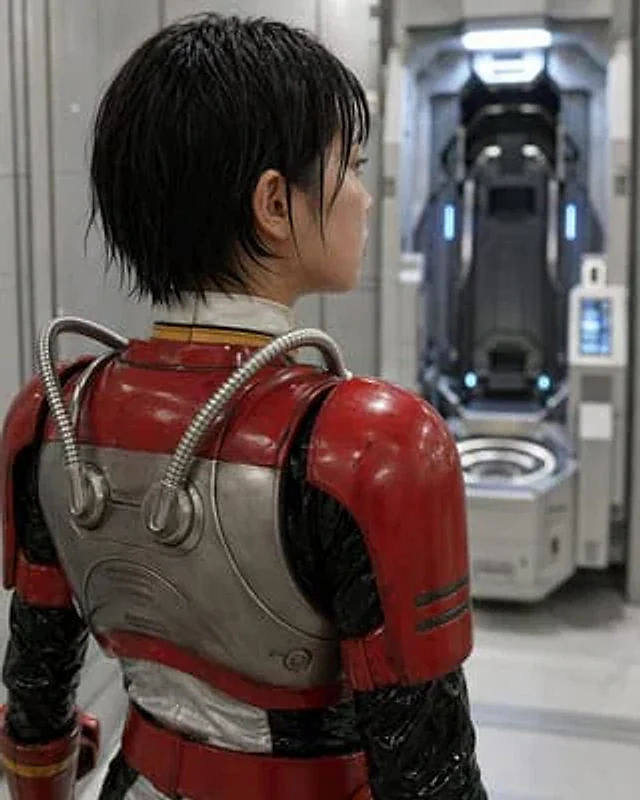

```text
A cinematic sci-fi portrait, presented from behind, against the backdrop of a sterile futuristic laboratory corridor. The composition is a medium-close-up, focusing on the thighs to the head, with the subject slightly turned to the right, gazing towards an open vertical bay in the background. The subject has short, wet, and slightly disheveled black hair and wears a retro-futuristic suit of armor: glossy, worn red shoulder and upper body armor, a brushed silver metal backplate with rounded panel lines, two flexible metal ribs extending from the upper back to circular joints, black glossy lining on the arms and sides, a thick white neck seal, and delicate gold trim at the wrists on the red waist area. The armor should have a functional and used look, with minor scratches, abrasions, and realistic reflections. A rectangular privacy veil covers the visible side of the face, positioned at the center of the head's silhouette. In the background, slightly out of focus, a futuristic, upright capsule or medical static pod embedded in the wall is displayed. The interior is dimly lit, with cool blue vertical decorative lights and bright white ceiling lights. A small control panel is mounted on the right side of the pod. The environment is clean and industrial, with light gray walls, smooth floors, soft, diffused lighting with a shallow depth of field, realistic textures, and lifelike metallic materials. The cool interior tones contrast with the deep red armor, creating a rich and serious atmosphere, presenting an aesthetic style reminiscent of a live-action science fiction film.
```

Model: GPT Image 2
Author: GPT Image 2 Prompts

[ProjectD](https://aitoolsradar.com/en/prompts/bf85062e237873) · [Recorded source](https://x.com/yy7482933910896/status/2047768245575483530#reversed-3)
 · [Full original metadata and byte evidence](data/projectd-batch-0045.json)

## Retro Sci-Fi Heroine With Police

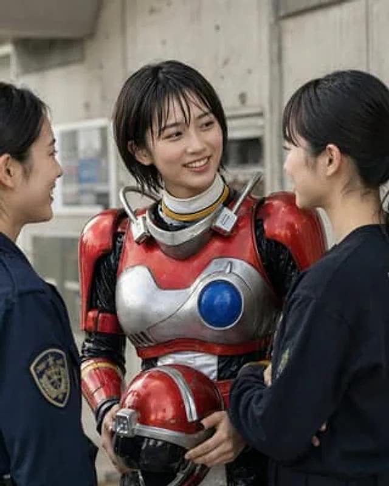

```text
A realistic, live-action photograph features a young Japanese woman standing outdoors in worn, retro-futuristic, tokusatsu-style powered armor. Two female police officers in dark navy blue uniforms flank her. The armored woman is positioned in the center of the frame, shot in a mid-range composition from her thighs to her head, facing forward. The two officers are positioned on the left and right edges of the frame, in profile, turning towards her as if questioning or surrounding her. The woman wears bright red and silver metallic armor with noticeable scratches, paint chips, and slight dirt. It includes oversized round shoulder armor, a silver breastplate (with asymmetrical lines and a large blue sphere on the right), black flexible-lined sleeves, a white neck seal, and two short, ribbed tubes extending from her collar to her shoulders. She has a short, dark brown to black bob haircut peeking out from above the armor, holding a matching red helmet with a black visor and silver trim at her waist. The two female police officers wear plain dark navy blue jackets; the epaulettes of the officer on the left are clearly visible, and both have neat black low buns. The scene is set against a backdrop of gray urban concrete walls, with soft lighting and a shallow depth of field, creating a low-key, documentary-like quality. The composition should have a sense of candidness and tension, like behind-the-scenes footage of a sci-fi heroine being arrested or examined. The details are rich in texture, the skin is natural, the metallic reflections are realistic, the color tone is soft, and the composition is vertical.
```

Model: GPT Image 2
Author: GPT Image 2 Prompts

[ProjectD](https://aitoolsradar.com/en/prompts/10f2246b6b1d96) · [Recorded source](https://x.com/yy7482933910896/status/2047768245575483530#reversed-1)
 · [Full original metadata and byte evidence](data/projectd-batch-0045.json)

## Retro Space Heroine Cosplay Portrait

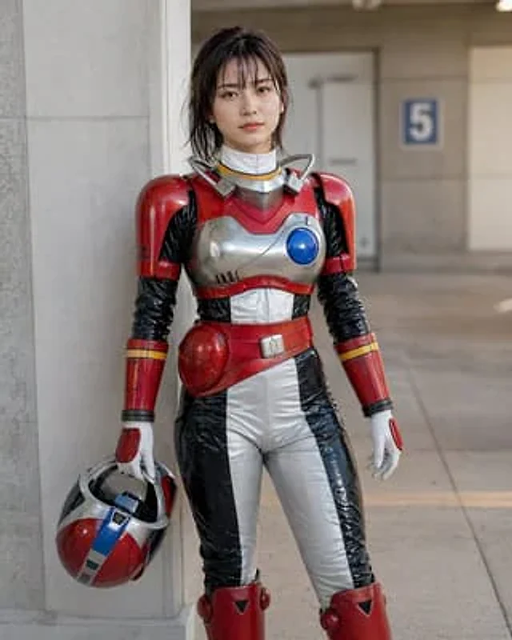

```text
A full-body realistic portrait of a female tokusatsu-style space heroine, standing in a modern concrete corridor, leaning gently against a light gray pillar. She wears a retro-futuristic bodysuit with a glossy finish: a silver and black bodysuit, heavy red shoulder armor, red forearm guards, a red belt with a large round pouch, red knee-high armor boots, and white gloves. Her breastplate is metallic silver with red trim, featuring a round blue sphere on the right chest with small vent details. A mechanical collar connects to two short gray cables hanging from her shoulders. In her left hand, at thigh height, she holds a matching full-face helmet in red, white, blue, and black. Her hair color is {argument name="hair color" default="Dark brown"} The hair, medium-length and slightly messy, is loosely tied back, with a few strands falling beside the face. The character's face is deliberately obscured by a soft, rectangular blur effect. The background is an open, quiet station or parking lot-style corridor with smooth stone walls and floors, creating a shallow depth of field effect. A white number is visible in the background on the right.{argument name="background number" default="5"} The blue square logo. Natural, soft sunlight, realistic reflections on the glossy armor, cinematic cosplay photography, centered vertical composition, full-body shots, natural poses, and high detail.
```

Model: GPT Image 2
Author: GPT Image 2 Prompts

[ProjectD](https://aitoolsradar.com/en/prompts/718efe29798e31) · [Recorded source](https://x.com/yy7482933910896/status/2047768245575483530#reversed-0)
 · [Full original metadata and byte evidence](data/projectd-batch-0045.json)

## Retro Super Famicom RPG Ad

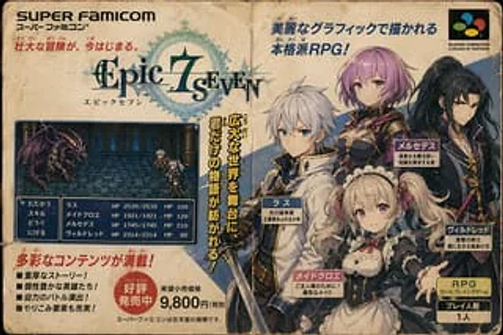

```text
Create a full-page retro Japanese Super Famicom game box advertisement, designed like a worn magazine page or game packaging front from the 1990s, presented on creased, stained, worn edges, fold marks, and slightly faded yellowed paper. The layout should have an authentic retro feel and be compact, including prominent Japanese promotional text, a fictional fantasy RPG logo, a roster of characters on the right, game screenshots on the left, and price and feature labels at the bottom. A large black "SUPER FAMICOM" title is placed in the upper left corner, with a smaller Japanese subtitle below and a line of red Japanese slogans nearby. The upper right corner contains a Super Famicom-style logo badge within a black rectangle, with the English text "SUPER FAMICOM LICENSED BY NINTENDO" below. The game title logo "Epic 7 Seven" is displayed at the top center in a gorgeous fantasy font, dark cyan and black, superimposed on a light blue circular magic emblem or mark. A small Japanese katakana subtitle is added below the logo. The right half showcases four anime/fantasy-style party members, rendered in a refined JRPG promotional illustration style: a young, white-haired male hero in a white cloak and blue-black attire, wielding a longsword; a pink-haired female knight or mage in dark armor with gold trim; a tall, black-haired swordsman in a dark, multi-layered robe; and a blonde, twin-tailed maid in a black and white ruffled skirt, extending one hand forward. Their faces should have generic, soft features, presented from a frontal or three-quarter profile, in a heroic pose. Four dark blue nameplates are added near each character, displaying their Japanese name and a brief job description. A vertical yellow Japanese slogan with a black outline is placed between the screenshot and the character group. The lower left side contains a screenshot of in-game combat within a dark blue rounded rectangle: a pixelated dungeon battle scene showing a purple dragon monster facing a four-person party against a stone corridor background. At the bottom of the battle screen, a classic RPG interface is displayed, featuring four Japanese command options and a team status list with character names, HP, and MP values. A red Japanese title is added to the lower left corner, followed by four black square bullet points for Japanese function text. A red circular promotional sticker with white Japanese text indicates high sales volume, next to a prominent price of "9,800 yen," surrounded by smaller Japanese retail text. The lower right corner contains a yellow information box labeled "RPG" with additional Japanese text, below which is a separate dark box indicating the number of players, "1." Retro print colors such as cream, dark blue, cyan, red, gold, black, and faded, soft character colors are used. The entire image should resemble a highly convincing fictional Super Famicom advertisement, promoting a {argument name="game title" default="Epic 7 Seven"} A classic fantasy RPG, featuring visible Japanese text, nostalgic typographical imperfections, and authentic 1990s console game marketing design.
```

Model: GPT Image 2
Author: GPT Image 2 Prompts

[ProjectD](https://aitoolsradar.com/en/prompts/4e5ed78e7f781c) · [Recorded source](https://x.com/sakepon_diary/status/2047823923384058158#reversed-0)
 · [Full original metadata and byte evidence](data/projectd-batch-0045.json)

## Retro Tech CEO with Superhero Cats

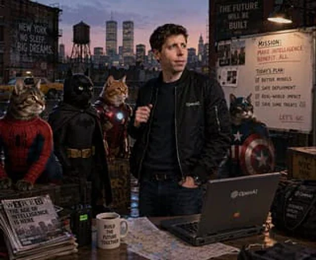

```text
A cinematic, photographic portrait, the subject is{argument name="main subject" default="Sam Altman"} Standing on a rugged rooftop at dusk, wearing a garment printed with {argument name="company logo" default="OpenAI"} He wears a signature black bomber jacket. Beside him are four cats dressed as superheroes: a tabby Spider-Man cat, a black Batman cat, an orange Iron Man cat with a glowing reactor, and a tabby Captain America cat holding a shield. The background is {argument name="city skyline" default="The New York skyline in 1996, including the Twin Towers."} One of the project labels reads "MISSION:{argument name="whiteboard mission" default="MAKE INTELLIGENCE BENEFIT ALL."} The document lists four checked items: “BETTER MODELS,” “SAFE DEPLOYMENT,” “REAL-WORLD IMPACT,” and “SAVE SOME TREATS.” On the wooden table in the foreground are a 1990s retro laptop with the company logo, a mug that reads “BUILD THE FUTURE TOGETHER,” a walkie-talkie, and a book titled “…”{argument name="magazine headline" default="THE AGE OF INTELLIGENCE IS HERE"} The wall is covered with graffiti that reads "NEW YORK NO SLEEP. BIG DREAMS." and "THE FUTURE WILL BE BUILT 1996."
```

Model: GPT Image 2
Author: GPT Image 2 Prompts

[ProjectD](https://aitoolsradar.com/en/prompts/e10f640a388ae1) · [Recorded source](https://x.com/Himomohi/status/2044367219715666344#reversed-0)
 · [Full original metadata and byte evidence](data/projectd-batch-0045.json)

## Retro Tokusatsu Armor Candid Portrait

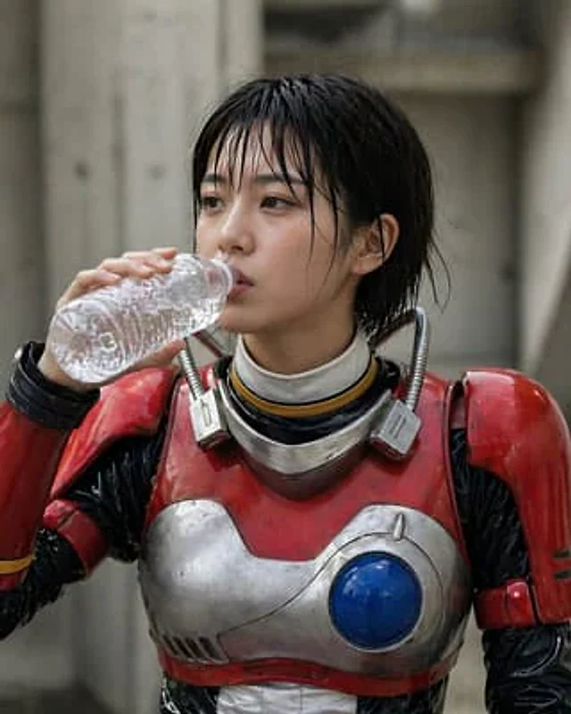

```text
A realistic portrait photograph of a young Japanese woman dressed in retro sci-fi special effects armor. The composition is a half-body shot (from mid-torso to above the head) against a blurred industrial concrete scene in the background. She keeps {argument name="hair color" default="black"} Her short, wet bob hair was messily tucked behind her ears, and most of her face was obscured by a large, rectangular, blurred visor in the center. She held a clear, crumpled plastic water bottle to her lips as if drinking. Her costume was a worn, retro superhero suit, comprising four distinct armor components: two shiny red shoulder armors, a scratched and grimy red and silver breastplate, and a round blue sphere embedded in the right side of her chest. Underneath the armor was a shiny black bodysuit with a white turtleneck and delicate gold rings at the collar. Two short, threaded metal tubes around the collar connected to two small, rectangular metal modules near the shoulders. The armor appeared practical, worn, slightly stained, and heavy, resembling an old-fashioned Japanese tokusatsu hero costume rather than modern, streamlined armor. Natural overcast lighting, shallow depth of field, soft gray concrete background, documentary cosplay photography style, capturing a fleeting moment, high-detail textures, realistic skin and fabric textures, vertical composition.
```

Model: GPT Image 2
Author: GPT Image 2 Prompts

[ProjectD](https://aitoolsradar.com/en/prompts/deb205fe61985a) · [Recorded source](https://x.com/yy7482933910896/status/2047768245575483530#reversed-2)
 · [Full original metadata and byte evidence](data/projectd-batch-0045.json)

## Retro Wrist Computer Playing Classic Platformer

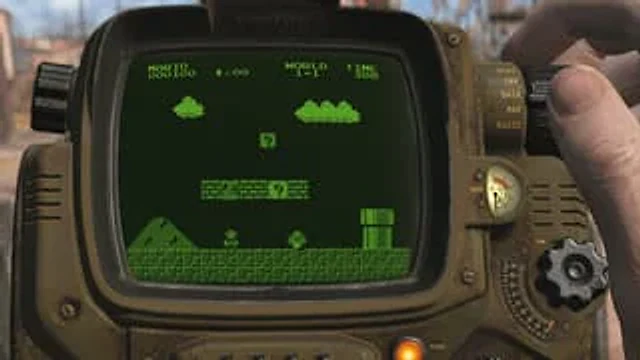

```text
A first-person perspective shot showcases a weathered, olive-green, retro-futuristic wrist-worn computer, with one hand operating a knob on the right. The device features an illuminated orange power indicator, a "RADS" gauge, and five vertical labels labeled "STAT," "INV," "DATA," "MAP," and "RADIO." The curved CRT screen displays…{argument name="screen color" default="solid green"} An 8-bit video game scene, the game is{argument name="game title" default="Super Mario Bros."} The game screen displays a pixelated character facing an enemy mushroom, a pipe, floating blocks with two question marks, and hills and clouds in the background. The top of the screen displays the text "MARIO 000100," a coin icon with "x00," "WORLD 1-1," and "TIME 388." The device background is {argument name="background setting" default="Vague post-apocalyptic wasteland"} It was bathed in bright sunlight.
```

Model: GPT Image 2
Author: GPT Image 2 Prompts

[ProjectD](https://aitoolsradar.com/en/prompts/682206e6b172ee) · [Recorded source](https://x.com/senb0n22a/status/2044448417456496751#reversed-2)
 · [Full original metadata and byte evidence](data/projectd-batch-0045.json)

## Revenge Action Movie Poster

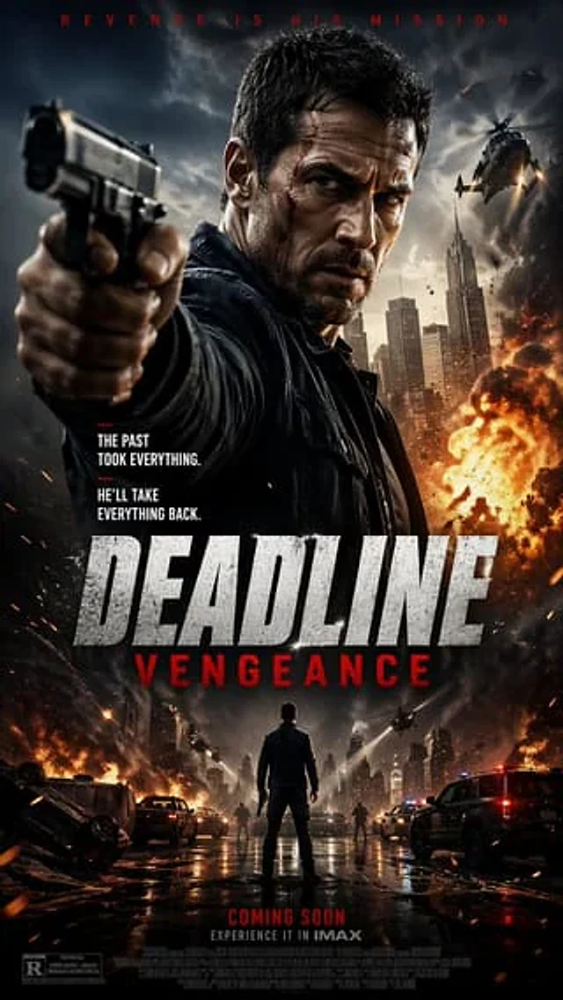

```text
A high-contrast, cinematic vertical poster for a revenge thriller, titled "{argument name="movie title" default="DEADLINE VENGEANCE"} The main subject of the composition is a tough-guy figure in the foreground, a middle-aged man with short black hair and a rugged stubble, wearing a black leather jacket or tactical jacket. He is aiming a semi-automatic pistol directly at the viewer from the left side of the image, the strong perspective making the gun appear large and close to the lens. His face is partially hidden in shadow, creating a mysterious and dangerous atmosphere. The background is a dark nighttime modern city skyline, with storm clouds overhead. A helicopter is visible in the upper right corner of the sky, and a huge fireball explodes near a building on the right, scattering smoke, sparks, and debris. At the very top of the poster is a line of small red capital letters:{argument name="top tagline" default="REVENGE IS HIS MISSION"} In the center left area, add four stacked lines of white capital letters:{argument name="left tagline" default="THE PAST TOOK EVERYTHING. HE'LL TAKE EVERYTHING BACK."} The poster features two short blocks separated by a thin red line. The main title spans the lower middle section, divided into two words: the first word in a large, distressed, metallic white block font, and the second word in a slightly smaller, bold red capital letter. In the lower third of the poster, a lone male figure stands in the middle of a wet, reflective street, holding a pistol and facing the burning city. Four police cars surround him, two on each side, flashing their lights; two helicopters are also visible on the distant horizon, bringing the total number of helicopters in the poster to three. The lower two corners are decorated with flames, wreckage, smoke, embers, and the silhouettes of several armed men in the distance. Red text indicating the release is added at the bottom center.{argument name="release text" default="COMING SOON"} Below is smaller white text.{argument name="format line" default="EXPERIENCE IT IN IMAX"} At the very bottom, add a dense, fictional credits list and a film rating box. Color scheme: black, charcoal gray, steel gray, orange flame, and deep red. Style: Exquisite Hollywood blockbuster key visual, dramatic contour lighting, photorealistic feel, ultra-high detail, strong contrast, anamorphic widescreen action lighting, smoky atmosphere, explosive urban chaos, high-end theatrical poster design.
```

Model: GPT Image 2
Author: GPT Image 2 Prompts

[ProjectD](https://aitoolsradar.com/en/prompts/d04f26afe3f731) · [Recorded source](https://x.com/AlwaveNazca/status/2046642884200268113#reversed-0)
 · [Full original metadata and byte evidence](data/projectd-batch-0045.json)

## Rimpa Style Decorative Art

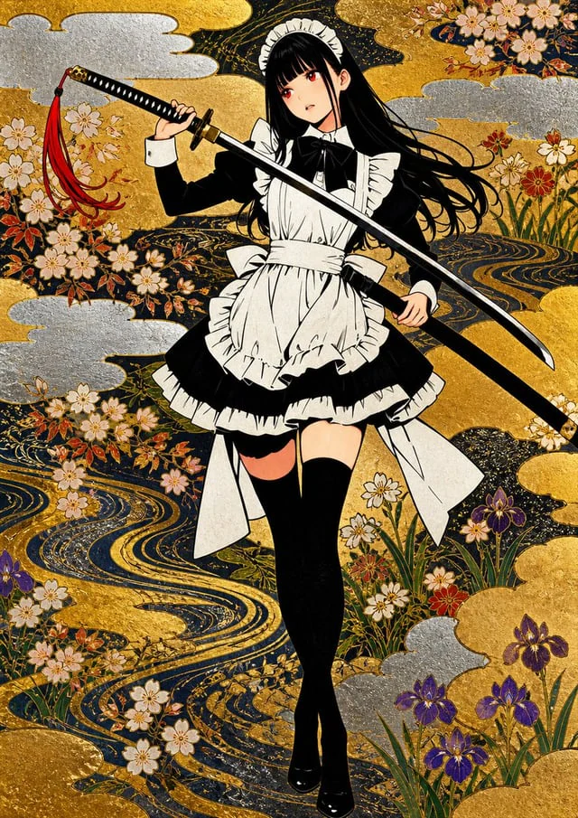

```text
琳派の装飾性を極めた華麗なスタイル。金雲・銀雲を大胆に使い、流水や花の文様を流れるように配置。平面的で装飾的な美しさを強調。鮮やかな色彩と金銀の箔表現。元のイラストの構図・キャラクターを忠実に維持。
```

Model: GPT Image 2
Author: のとろ

[ProjectD](https://aitoolsradar.com/en/prompts/e6fa1f5e44b0c9) · [Recorded source](https://youmind.com/prompts/rimpa-style-decorative-art-prompt-18088)
 · [Full original metadata and byte evidence](data/projectd-batch-0045.json)

## RIO #16

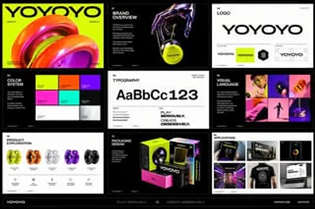

```text
Create a polished multi-page (multiple images) brand kit for a company called [YOYOYO]. The brand should feel playful, futuristic, vibrant, and design-forward, blending the energy of a toy-inspired product with the sophistication of a premium creative tech brand. Use a bold, experimental visual identity with bright color, clean geometry, modern typography, dynamic motion cues, and slightly surreal imagery. The overall mood should feel inventive, youthful, rhythmic, tactile, and high-concept, with a balance of fun consumer product culture, fashionlike presentation, and contemporary digital design.

Include a sense of product obsession, visual experimentation, packaging exploration, editorial photography, immersive retail, and cross-platform brand application. Make it feel like a confident, contemporary brand world that is both accessible and art-directed, with strong graphic cohesion and a premium creative-studio aesthetic.
```

Model: GPT Image 2
Author: RIO

[ProjectD](https://aitoolsradar.com/en/prompts/f93a0a1d0bc7ba) · [Recorded source](https://x.com/riomadeit/status/2046682439985082441)
 · [Full original metadata and byte evidence](data/projectd-batch-0045.json)

## Rio 旅行票据纸雕立体海报

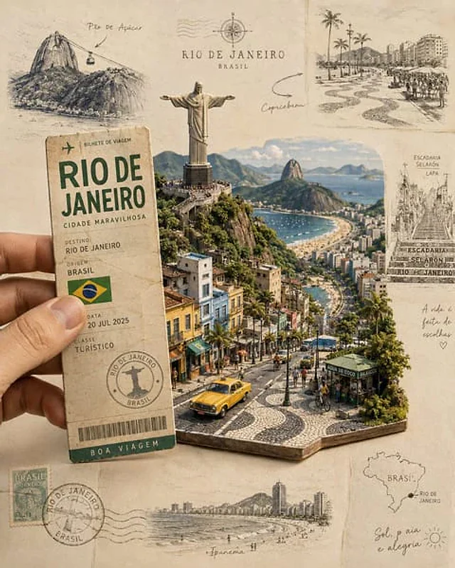

```text
Create a highly detailed, photorealistic miniature travel-poster diorama inspired by Rio de Janeiro, arranged as a handcrafted 3D paper scene on a warm ivory, slightly textured background.

In the foreground, a realistic human hand holds a vintage Brazilian travel ticket or Rio-themed transit card vertically on the left side. Give the card aged paper texture, subtle printing imperfections, elegant typography, and authentic-looking travel details. From behind the card, a miniature Rio de Janeiro landscape physically rises outward like an intricate pop-up diorama.

Make Christ the Redeemer the dominant central landmark, positioned high above a miniature cityscape with lush green mountains surrounding it. Below, build a tiny realistic Rio street featuring a classic yellow taxi, colorful buildings, palm trees, pedestrians, cyclists, street lamps, tiled sidewalks, and small Brazilian urban details. Add Copacabana beach elements in the distance with tiny umbrellas, beachgoers, and a glimpse of the Atlantic Ocean. Layer the architecture and terrain so everything appears physically constructed from paper, wood, plaster, and miniature materials, with convincing depth, cast shadows, overlapping surfaces, and a slight three-quarter perspective.

Around the main 3D scene, incorporate delicate black, charcoal, and muted sepia hand-drawn travel illustrations on the cream paper. Include a small Sugarloaf Mountain sketch in the upper left, an artistic Copacabana promenade illustration in the upper right, a detailed Selarón Steps sketch along the right side, and a small Ipanema beachfront skyline drawing near the bottom. Add subtle handwritten travel notes, tiny map markings, architectural outlines, compass symbols, postage-stamp details, and understated Brazilian travel annotations.

Keep the composition refined rather than crowded. Blend realistic miniature photography with vintage travel-journal design, tactile paper fibers, faint ink bleed, imperfect hand-drawn lines, warm natural studio lighting, gentle shadows, subtle film grain, and a sophisticated cream, charcoal, muted green, ocean blue, and Brazilian yellow palette.

The final image should feel like a premium collectible Rio de Janeiro travel postcard transformed into a physical miniature world, with the central diorama sharply detailed and the surrounding illustrations slightly softer. Highly realistic human hand and fingers, believable miniature materials, cinematic product photography, editorial travel-magazine aesthetic, shallow depth of field, ultra-fine textures, photorealistic 3D details, vertical 4:5 composition, 8K quality.
```

Model: GPT Image 2
Author: @john_my07

[ProjectD](https://aitoolsradar.com/en/prompts/fada91c23b713f) · [Recorded source](https://x.com/john_my07/status/2091408386466214031)
 · [Full original metadata and byte evidence](data/projectd-batch-0045.json)

## Robot Girl Reference Sheet

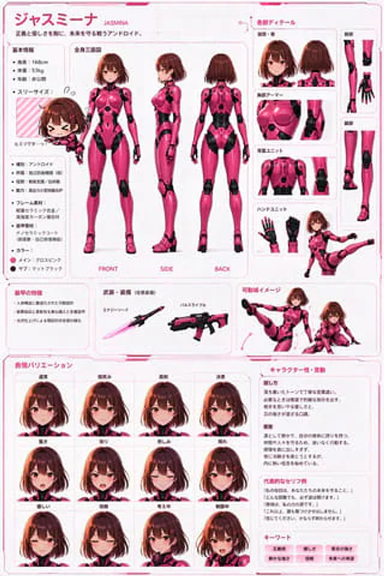

```text
{argument name="character name" default="Jasmina"} Reference image
```

Model: GPT Image 2
Author: GPT Image 2 Prompts

[ProjectD](https://aitoolsradar.com/en/prompts/446902cfdd80c0) · [Recorded source](https://x.com/JasminaAi/status/2047813001336754526)
 · [Full original metadata and byte evidence](data/projectd-batch-0045.json)

## Robot Mecha Movie Key Visual Prompt

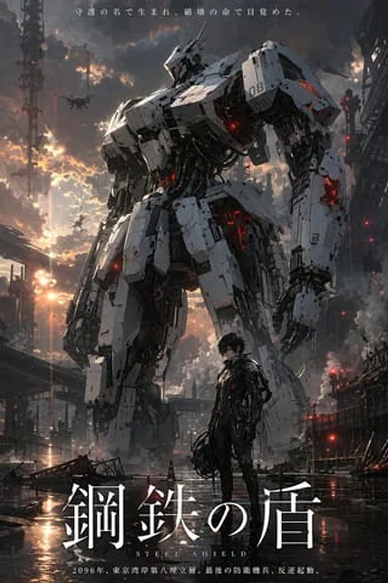

```text
for{argument name="genre" default="Robot Animation"} Create a cinematic key visual.
```

Model: GPT Image 2
Author: GPT Image 2 Prompts

[ProjectD](https://aitoolsradar.com/en/prompts/2106f269b32c4f) · [Recorded source](https://x.com/kotsu_kotsu_san/status/2044886720852918515)
 · [Full original metadata and byte evidence](data/projectd-batch-0045.json)

## Robot Painter Collage Ad

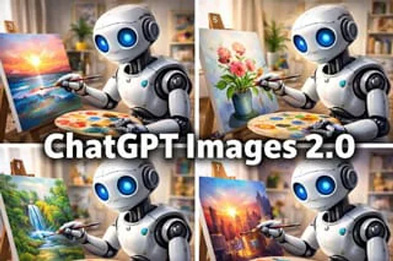

```text
{
  "type": "Promotional collage illustrations",
  "subject": {
    "main": "A cute white humanoid robot artist with huge, glowing blue eyes.",
    "design": "Smooth, rounded white casing, black mechanical joints, a gentle smile, child-friendly proportions, and a glossy texture.",
    "activity": "Holding a palette, paint on the canvas with a fine brush."
  },
  "layout": {
    "composition": "2x2 grid collage with a large, centered title overlay across the middle.",
    "sections": [
      {
        "position": "Top left",
        "count": 1,
        "label": "3",
        "scene": "The robot is painting a vibrant ocean sunset scene, with a bright sun on the horizon, a pinkish-orange sky, and blue seawater, all rendered with vivid brushstrokes."
      },
      {
        "position": "Top right",
        "count": 1,
        "label": "6",
        "scene": "The robot is painting a still life of pink flowers in a blue vase, a soft pastel style."
      },
      {
        "position": "Bottom left",
        "count": 1,
        "label": "4",
        "scene": "The robot is drawing a lush green waterfall landscape, complete with forest vegetation and streams."
      },
      {
        "position": "Bottom right",
        "count": 1,
        "label": "7",
        "scene": "The robot is drawing a picture of a modern city skyline glowing at sunset, with towering skyscrapers and warm reflections."
      }
    ],
    "title_overlay": {
      "text": "{argument name=\"headline text\" default=\"ChatGPT Images 2.0\"}",
      "style": "A striking, bold white sans-serif font with a dark shadow, horizontally centered on the collage."
    }
  },
  "environment": {
    "setting": "The interior of a cozy art studio",
    "background": "Soft-focus shelves, framed paintings, warm ambient light, neutral-colored curtains, and the occasional potted plant.",
    "easel": "Each panel contains a wooden tabletop easel.",
    "palette": "Each panel contains a circular palette with many brightly colored dots."
  },
  "style": {
    "rendering": "Highly detailed 3D cartoon-realistic style",
    "mood": "Playful, creative, and captivating, a fusion of technology and art.",
    "camera": "The composition is a medium close-up, with the robot positioned on the right side of each panel, facing the canvas to the left.",
    "lighting": "Warm indoor lighting with soft highlights and a shallow depth of field effect."
  }
}
```

Model: GPT Image 2
Author: GPT Image 2 Prompts

[ProjectD](https://aitoolsradar.com/en/prompts/eb65aa2070b010) · [Recorded source](https://x.com/01net/status/2046856808921248120#reversed-0)
 · [Full original metadata and byte evidence](data/projectd-batch-0045.json)

## ROGUE VIPER 游戏概念设定板

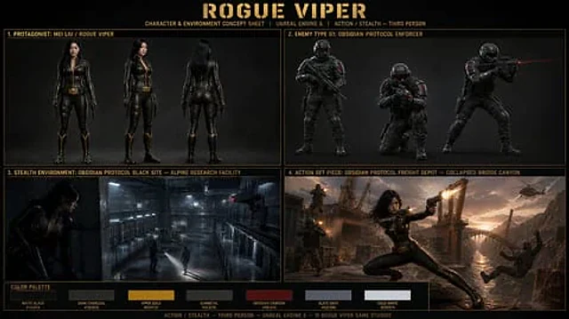

```text
**ROGUE VIPER — VIDEO GAME CONCEPT ART SHEET PROMPT**

---

Official AAA video game concept art sheet titled **'ROGUE VIPER'** for an Unreal Engine 5 third-person action-stealth game. Professional game development documentation layout on a dark charcoal #1A1A1A background with gold stencil label typography throughout. Four clearly labeled panels arranged in a 2×2 grid with a header and footer.

---

**SHEET HEADER** — Bold gold stencil font title text: **ROGUE VIPER** centered at top. Subtitle beneath in smaller tracking-heavy label font: **CHARACTER & ENVIRONMENT CONCEPT SHEET | UNREAL ENGINE 5 | ACTION / STEALTH — THIRD PERSON**

---

**PANEL 1 — TOP LEFT — Label: "PROTAGONIST: MEI LIU / ROGUE VIPER"**

Full-body character turntable reference of a 30-year-old East Asian Chinese-American female operative. Athletic and toned, 5'8", long straight black hair worn loose, calm neutral expression with sharp eyes. Wearing a form-fitting matte black tactical bodysuit with gold accent seams running along the shoulders, forearms, and thighs, gold cobra snake belt buckle at the waist, calf-high black tactical boots with subtle gold trim. Armed with twin suppressed 9mm pistols holstered on each hip with custom viper-scale grip texture, a serrated combat knife sheathed vertically on the right thigh, and a compact pneumatic grappling hook launcher mounted on the left forearm. Three views arranged side-by-side: front, 3/4, and back. Unreal Engine 5 physically-based rendering, photorealistic skin and fabric materials, neutral 3-point studio lighting for maximum clarity, gold and matte black color scheme throughout.

---

**PANEL 2 — TOP RIGHT — Label: "ENEMY TYPE 01: OBSIDIAN PROTOCOL ENFORCER"**

Three enemy soldiers shown as character references against a dark background. These are elite private military contractors working for a shadow arms cartel called Obsidian Protocol. Their uniform: slate-gray and black modular plate carriers with deep crimson geometric hex-patch insignia on the shoulder, full-face ballistic visors with a dark red tinted lens, black tactical gloves, reinforced combat boots. Armed with compact bullpup assault rifles with red laser sights. One figure standing in neutral patrol stance, one crouched in a ready alert position, one depicted mid-aim with rifle raised. All three shown at the same scale for comparison. Same UE5 photorealistic PBR render style. Crimson and slate-gray color language to contrast Viper's gold and black.

---

**PANEL 3 — BOTTOM LEFT — Label: "STEALTH ENVIRONMENT: OBSIDIAN PROTOCOL BLACK SITE — ALPINE RESEARCH FACILITY"**

Wide cinematic establishing shot of a stealth mission environment. A hidden high-altitude research facility buried inside a snow-covered mountain, accessible only via an underground tram. Interior architecture is brutalist concrete and frosted glass, dimly lit with cold white fluorescent overhead strips and amber emergency lighting casting long dramatic shadows across polished concrete floors. Rows of classified server terminals and cryogenic storage units line the walls. Ventilation shafts visible in the ceiling above catwalks. A security camera sweeps a slow arc over a central corridor below. In the foreground, Rogue Viper is pressed flat against a concrete pillar in deep shadow, body low, watching two Obsidian Protocol enforcers on patrol below, one holding a flashlight. The scene communicates tension, patience, and tactical opportunity. Unreal Engine 5 Lumen global illumination, volumetric cold air haze, photorealistic ice and concrete materials, deep crushed blacks with cold white and amber lighting contrast. Cinematic wide 2.39:1 style composition within the panel.

---

**PANEL 4 — BOTTOM RIGHT — Label: "ACTION SET PIECE: OBSIDIAN PROTOCOL FREIGHT DEPOT — COLLAPSED BRIDGE CANYON"**

Wide cinematic action shot of a high-octane firefight environment. A sprawling open-air industrial freight depot at the edge of a sheer cliff canyon at dusk, with a collapsed suspension bridge dangling over the chasm below. Shipping containers and heavy crane equipment provide cover geometry. Rogue Viper is captured mid-movement in a dynamic gunfight pose — body low, both suppressed pistols raised and firing, muzzle flashes illuminating her face with sharp white light. Three Obsidian Protocol enforcers are positioned around her — one diving behind a container, one firing from atop a crane platform, one falling backward off the edge of the depot platform. Background: deep canyon with a river of orange reflected sunset light far below, dust and smoke rising from the firefight, a military helicopter approaching in the far distance. Warm dusk amber and cool canyon shadow blue provide dramatic color contrast. UE5 ray-traced reflections on metal container surfaces, particle systems for dust and muzzle smoke, cinematic depth of field on background elements.

---

**SHEET FOOTER** — Color palette chip row along the bottom of the sheet: matte black #1A1A1A, dark charcoal #2B2B2B, viper gold #D4AF37, gunmetal #3E3E3E, obsidian crimson #8B1A1A, slate gray #6B7280, cold white #E8EEF4. Label above chips: **COLOR PALETTE**. Footer text beneath: **ACTION / STEALTH — THIRD PERSON — UNREAL ENGINE 5 — © ROGUE VIPER GAME STUDIOS**

---

**UNIVERSAL STYLE CONSTRAINTS — APPLY TO ALL PANELS:**
Photorealistic only throughout the entire sheet. No anime, no cartoon, no stylized illustration, no cel shading, no comic book rendering. Unreal Engine 5 cinematic render quality with physically-based materials. Anamorphic lens character on all environment shots. Crushed blacks and desaturated mid-tones across all panels. Professional AAA game studio concept documentation format comparable to Naughty Dog, Ubisoft, or Guerrilla Games internal production art.
```

Model: GPT Image 2
Author: @KimAkiyama81

[ProjectD](https://aitoolsradar.com/en/prompts/d0e41b1f8435ad) · [Recorded source](https://x.com/KimAkiyama81/status/2059394334378566063)
 · [Full original metadata and byte evidence](data/projectd-batch-0045.json)

## Romance Manga Page in a Living Room

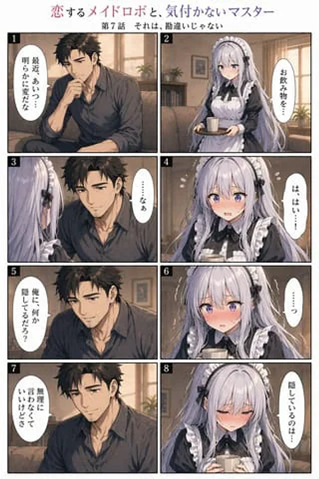

```text
{
  "type": "8-panel anime/romance comic page",
  "style": "The illustrations are in a soft, youthful manga style, featuring full color, warm indoor lighting, clean black panel frames, and modern digital animation rendering. They are full of romantic emotional tension, emphasizing subtle blushes and body language.",
  "page": {
    "background": "White pages with a 2-column, 4-row black-bordered panel layout.",
    "panel_count": 8,
    "numbered_panels": true,
    "panel_numbers": [
      1,
      2,
      3,
      4,
      5,
      6,
      7,
      8
    ],
    "title_area": {
      "top_header": "A maid robot in love and her oblivious master.",
      "subtitle": "Episode 7 That's not a misunderstanding"
    }
  },
  "setting": {
    "location": "cozy living room",
    "details": [
      "Fabric sofa",
      "Large sun windows with sheer curtains",
      "small potted plants",
      "Picture frames on the wall",
      "Warm beige interior"
    ]
  },
  "characters": [
    {
      "role": "master",
      "appearance": "A young man with messy, dark brown to black hair, wearing a dark charcoal gray shirt with the sleeves casually rolled up, sat on the sofa, his expression serious and thoughtful."
    },
    {
      "role": "maid robot",
      "appearance": "A young anime girl with extremely long silver-purple hair, fair skin, a black ribbon hair accessory, a classic black and white maid outfit including a white apron with ruffles, a lace maid headdress, and a black bow at the neckline; she appears shy and flustered."
    }
  ],
  "layout": {
    "sections": [
      {
        "title": "1",
        "position": "Top left",
        "count": 1,
        "labels": [
          "The owner sat on the sofa, chin in hand, inwardly reflecting."
        ]
      },
      {
        "title": "2",
        "position": "Top right",
        "count": 1,
        "labels": [
          "A robot maid stands holding a tray and a cup, offering drinks."
        ]
      },
      {
        "title": "3",
        "position": "Center upper left",
        "count": 1,
        "labels": [
          "An over-the-shoulder composition, two people facing each other, a quiet pause."
        ]
      },
      {
        "title": "4",
        "position": "Center upper right",
        "count": 1,
        "labels": [
          "Close-up of the maid, showing her startled reaction while holding the cup."
        ]
      },
      {
        "title": "5",
        "position": "Center bottom left",
        "count": 1,
        "labels": [
          "Close-up of the owner, asking directly, with a concerned expression."
        ]
      },
      {
        "title": "6",
        "position": "Center, bottom, right",
        "count": 1,
        "labels": [
          "The maid froze in silence, visibly trembling."
        ]
      },
      {
        "title": "7",
        "position": "Bottom left",
        "count": 1,
        "labels": [
          "The owner spoke gently, in a soothing tone."
        ]
      },
      {
        "title": "8",
        "position": "Bottom right",
        "count": 1,
        "labels": [
          "The maid lowered her head, her face flushed and her heart pounding, holding the mug in both hands."
        ]
      }
    ],
    "speech_balloons": {
      "count": 8,
      "texts": [
        "Lately, that guy... he's definitely been acting strangely.",
        "What would you like to drink...?",
        "……なぁ",
        "は、はい…！",
        "You're hiding something from me, aren't you?",
        "……っ",
        "You don't have to say it if you don't want to.",
        "What they're hiding is..."
      ]
    }
  },
  "panel_descriptions": [
    {
      "panel": 1,
      "composition": "Medium shot: The owner sits on the left side of the sofa, leaning forward, elbows resting on his knees, fingers near his mouth, looking troubled.",
      "emotion": "Doubts and concerns"
    },
    {
      "panel": 2,
      "composition": "From a panoramic view to a 3/4 shot, a robot maid stands indoors, holding a small round tray and a cup, her body slightly turned towards her master.",
      "emotion": "Formal but tense"
    },
    {
      "panel": 3,
      "composition": "The dialogue is tightly framed, with the maid's back visible in the left foreground, while the master sits on the sofa facing her.",
      "emotion": "hesitate"
    },
    {
      "panel": 4,
      "composition": "A close-up of the maid's face shows her shoulders are tense, and there are subtle lines of movement around her head, indicating panic.",
      "emotion": "Startled and embarrassed"
    },
    {
      "panel": 5,
      "composition": "A close-up of the owner shows a firm but non-aggressive posture as he asks a serious question.",
      "emotion": "A gentle question"
    },
    {
      "panel": 6,
      "composition": "Close-up of the maid, clutching the cup tightly, with slight trembling lines around her body.",
      "emotion": "Silent Anxiety"
    },
    {
      "panel": 7,
      "composition": "In a medium close-up, the owner's expression is gentle as he comforts her.",
      "emotion": "Kindness and patience"
    },
    {
      "panel": 8,
      "composition": "Close-up of the maid: head bowed, cheeks flushed, hands clutching a mug, long hair falling down.",
      "emotion": "Romantic awkwardness and hidden emotions"
    }
  ],
  "color_palette": {
    "primary": [
      "warm beige",
      "Soft brown",
      "Charcoal gray",
      "black",
      "White",
      "silver-purple"
    ],
    "accents": [
      "Soft pink blush",
      "Soft golden window light"
    ]
  },
  "quality": "High-quality comic pages, suitable for social media posting, with clear and readable Japanese text and vivid cinematic paneling."
}
```

Model: GPT Image 2
Author: GPT Image 2 Prompts

[ProjectD](https://aitoolsradar.com/en/prompts/f543676adbd2fd) · [Recorded source](https://x.com/yume00112211/status/2047446374409744877#reversed-3)
 · [Full original metadata and byte evidence](data/projectd-batch-0045.json)

## Romantic 3D CG Yuri Illustration


```text
生成一张 9:16 竖版、高精度 3D CG 双人角色插画。整体风格为 高级二次元 3D CG 渲染，质感梦幻、浪漫、暧昧、克制。主体为两位成年东方幻想系女性角色，位于巨大明亮的落地窗边。左侧角色：成年女性，{argument name="左侧发色" default="银白色短发"}，眼神温柔、主动。右侧角色：成年女性，{argument name="右侧发色" default="鲜红色长发"}，高马尾，神情从容。两人关系亲密：鼻尖几乎相触，眼神近距离暧昧对视。两人穿着统一风格的{argument name="礼裙颜色" default="白色"}幻想风改良短礼裙。背景为落地窗逆光效果，温暖金粉色夕阳柔光。
```

Model: GPT Image 2
Author: 李岳

[ProjectD](https://aitoolsradar.com/en/prompts/0be7124a5d05e1) · [Recorded source](https://youmind.com/prompts/romantic-3d-cg-yuri-illustration-22742)
 · [Full original metadata and byte evidence](data/projectd-batch-0045.json)

## Romantic Couple Park Photography


```text
Ultra-realistic lifestyle photography of a happy young couple walking hand in hand through a beautiful park during golden hour. Both are smiling naturally, laughing together, making eye contact, and enjoying each other's company. Blooming flowers, lush green trees, warm sunlight, and a peaceful atmosphere create a romantic setting. Soft cinematic lighting, vibrant colors, premium editorial photography, ultra-detailed, photorealistic, 8K, authentic emotions, shallow depth of field, elegant composition, clean negative space for branding or text, portrait aspect ratio 4:5. Ultra-realistic lifestyle photography of a young couple sitting apart on a park bench after an argument. Both look sad and emotionally distant, avoiding eye contact, with thoughtful expressions and subtle body language showing tension. The atmosphere is calm with an overcast sky, muted colors, gentle breeze, and a few fallen leaves, creating an emotional yet respectful mood. Cinematic natural lighting, premium editorial photography, ultra-detailed, photorealistic, 8K, realistic facial expressions, shallow depth of field, elegant composition, clean negative space for branding or text, portrait aspect ratio 4:5.
```

Model: GPT Image 2
Author: Hope Ai

[ProjectD](https://aitoolsradar.com/en/prompts/a187dc4157fc76) · [Recorded source](https://youmind.com/prompts/happy-couple-park-photography-27546)
 · [Full original metadata and byte evidence](data/projectd-batch-0045.json)

## Romantic Maid Robot Manga Page

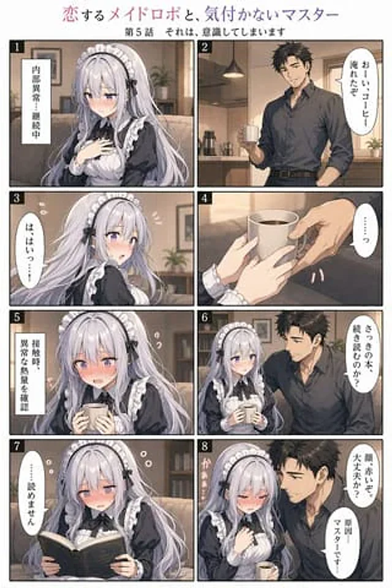

```text
{
  "type": "Anime and comic pages",
  "style": "A romantic comedy comic with soft shadows, exquisite digital illustrations, warm interior lighting, clean panel borders, delicate character rendering, and light novel aesthetics.",
  "format": "Each page has 8 panels, using a 2-column, 4-row layout.",
  "page": {
    "title_top": "A maid robot in love and her oblivious master.",
    "subtitle": "Episode 5: That makes me conscious of it."
  },
  "setting": {
    "location": "A cozy modern living room connected to the kitchen",
    "details": [
      "sofa",
      "bookshelf",
      "Paintings on the wall",
      "Potted plants",
      "kitchen countertop",
      "chandelier",
      "Warm beige and brown interior decor"
    ]
  },
  "characters": [
    {
      "role": "Maid robot",
      "gender": "woman",
      "appearance": {
        "age": "Young anime girl",
        "hair": {
          "color": "{argument name=\"hair color\" default=\"silver\"}",
          "style": "Extra-long straight hair with soft waves, bangs, and black ribbon bows on both sides."
        },
        "eyes": "purple-blue",
        "outfit": [
          "Classic black and white maid outfit",
          "White ruffled apron",
          "White lace maid headband",
          "Black bow at the neckline",
          "Long sleeves with white ruffled cuffs"
        ]
      },
      "expression_arc": [
        "Panic-like internal malfunction",
        "accepting in a panic",
        "The tension when receiving the coffee",
        "Heat buildup due to shyness",
        "Unable to concentrate on reading",
        "blushing deeply beside her owner"
      ]
    },
    {
      "role": "Owner",
      "gender": "male",
      "appearance": {
        "age": "young men",
        "hair": "Dark brown short choppy hair",
        "outfit": [
          "Dark charcoal gray shirt, cuffs rolled up",
          "Dark trousers",
          "black leather belt"
        ]
      },
      "demeanor": "Easygoing, kind, slow-witted"
    }
  ],
  "layout": {
    "sections": [
      {
        "title": "1",
        "position": "Top left",
        "count": 1,
        "labels": [
          "The maid robot sat on the sofa, one hand on her chest, with a vertical text box stating \"Internal Anomaly...\" (Continuing)"
        ]
      },
      {
        "title": "2",
        "position": "Top right",
        "count": 1,
        "labels": [
          "The master stood in the kitchen holding a white mug, and spoke, \"Hey, I've made some coffee!\""
        ]
      },
      {
        "title": "3",
        "position": "Middle left top",
        "count": 1,
        "labels": [
          "The maid turned around, a surprised blush appearing on her face. The speech bubble read, \"Ha, hait...!\""
        ]
      },
      {
        "title": "4",
        "position": "Middle right top",
        "count": 1,
        "labels": [
          "A close-up of hands exchanging coffee cups, with a small speech bubble reading..."
        ]
      },
      {
        "title": "5",
        "position": "Middle left bottom",
        "count": 1,
        "labels": [
          "The maid pressed the hot mug close to her chest, with a vertical text box stating, \"Upon contact, check for abnormal heat.\""
        ]
      },
      {
        "title": "6",
        "position": "Middle right bottom",
        "count": 1,
        "labels": [
          "The master is sitting on the sofa, leaning close to the maid. Half of their bodies are visible, and they are talking. Are you going to continue reading that book from earlier?"
        ]
      },
      {
        "title": "7",
        "position": "Bottom left",
        "count": 1,
        "labels": [
          "The maid blushed as she held the open book; the speech bubble read... 読めません."
        ]
      },
      {
        "title": "8",
        "position": "Bottom right",
        "count": 1,
        "labels": [
          "The master leans closer, showing concern. The maid blushes and holds a cup of coffee. The speech bubble displays the words: \"颜、赤いぞ。大丈夫か？\" and \"所以：マスターです…\"."
        ]
      }
    ],
    "count": 8
  },
  "composition": {
    "camera": "Alternating between medium shots and close-ups",
    "mood": "Sweetness, awkwardness, romantic tension, comedic shyness",
    "color_palette": "Soft warm brown, cream, black, white, and soft silver hair colors",
    "focus": "The maid robot becomes flustered and overheats due to its naive interactions with its oblivious master."
  }
}
```

Model: GPT Image 2
Author: GPT Image 2 Prompts

[ProjectD](https://aitoolsradar.com/en/prompts/eba19647804326) · [Recorded source](https://x.com/yume00112211/status/2047446374409744877#reversed-1)
 · [Full original metadata and byte evidence](data/projectd-batch-0045.json)

## Romantic Maid Robot Manga Page

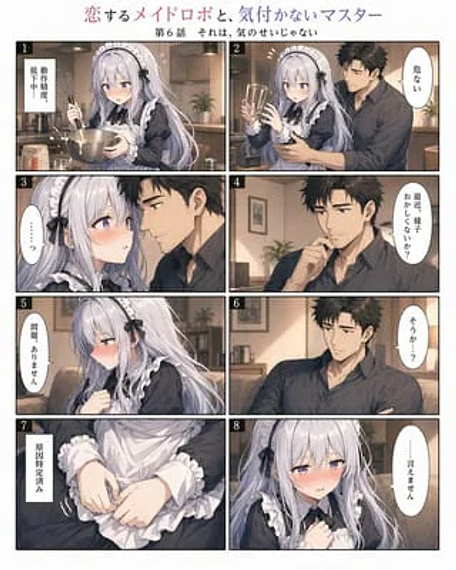

```text
{
  "type": "Single-page anime comics",
  "format": "A vertical 8-panel comic book page, 2 columns and 4 rows.",
  "style": "The illustrations feature softly rendered modern anime style, clear comic panel borders, warm indoor lighting, a cinematic romantic home atmosphere, delicate clothing folds, subtle blushing effects, and a gentle comedic tone.",
  "page": {
    "background": "White pages with thin black panel borders",
    "title_top": "A maid robot in love and her oblivious master.",
    "subtitle_top": "Episode 6: It's not your imagination"
  },
  "setting": {
    "location": "Comfortable modern apartment interior",
    "areas": [
      "A kitchen with a bar counter, bowls, whisks, ingredients, glasses, and warm ceiling lights.",
      "Living room with sofa, wall art, shelves and potted plants"
    ],
    "time": "evening"
  },
  "characters": {
    "count": 2,
    "primary": {
      "description": "A beautiful robot maid, appearing to be between a teenager and a young adult, with extremely long silver hair tinged with a soft pale purple, bangs, and black ribbon bows on either side. She has fair skin, large violet eyes, and wears a classic black and white maid outfit, complete with a white ruffled headband, white apron, puff sleeves, lace cuffs, and a black bow at the collar.",
      "emotion_arc": [
        "Focused but lacking energy",
        "Startled by close contact",
        "Panicked and speechless",
        "Feeling deeply embarrassed and falling in love"
      ]
    },
    "secondary": {
      "description": "The oblivious owner, a young man, had messy short black hair, a clean-shaven face, and wore a dark charcoal gray shirt with the sleeves casually rolled up. His expression was calm yet slightly concerned."
    }
  },
  "layout": {
    "sections": [
      {
        "title": "1",
        "position": "Top left",
        "count": 1,
        "labels": [
          "A maid robot is stirring batter in a metal bowl with an egg beater in the kitchen. Ingredients are laid out on the counter, and a vertical title box reads \"Motion Precision, Low/Medium...\""
        ]
      },
      {
        "title": "2",
        "position": "Top right",
        "count": 1,
        "labels": [
          "The owner stood behind her, supporting her as she raised the glass; the dialogue box read \"dangerous\"."
        ]
      },
      {
        "title": "3",
        "position": "center left",
        "count": 1,
        "labels": [
          "A close-up shot of the maid blushing, the master getting close to her face, and a dialogue box saying..."
        ]
      },
      {
        "title": "4",
        "position": "center right",
        "count": 1,
        "labels": [
          "The master is alone in the living room, holding his hand down his shoulders, looking confused, writing on the conversation board: \"Hasn't he been acting strangely lately?\""
        ]
      },
      {
        "title": "5",
        "position": "Center bottom left",
        "count": 1,
        "labels": [
          "The maid sat on the sofa, head down, clutching her chest, blushing. The chat box displayed the question \"ありません\"."
        ]
      },
      {
        "title": "6",
        "position": "Center, bottom, right",
        "count": 1,
        "labels": [
          "The owner leaned back on the sofa with his arms crossed, still half-believing and half-doubting. The dialog box read \"Souka...?\""
        ]
      },
      {
        "title": "7",
        "position": "Bottom left",
        "count": 1,
        "labels": [
          "A close-up of a maid nervously fiddling with the fabric of her apron on her knees, with a vertical title box stating \"Specific Reason\"."
        ]
      },
      {
        "title": "8",
        "position": "Bottom right",
        "count": 1,
        "labels": [
          "The maid sits on the sofa from a frontal view, her hand pressed to her chest, unable to confess her feelings. The chat box reads... I can't say it."
        ]
      }
    ],
    "centerpiece": "The emotional contrast between a maid robot falling in love and her completely oblivious master."
  },
  "visual_direction": {
    "camera": "Diverse comic book compositions, including medium shots, close-ups, and insertions of hand details.",
    "color_palette": "The warm beige, cream, and soft brown interior tones contrast with the black and white maid outfit and the cool-toned silver-purple hair.",
    "expression_focus": "A strong blush, shy eyes, hesitant lips, and a concerned expression from the man.",
    "rendering_notes": "High-resolution hair strands, delicate folds, glossy eyes, and a soft depth of field in the background—exquisite webcomic-quality panel art."
  }
}
```

Model: GPT Image 2
Author: GPT Image 2 Prompts

[ProjectD](https://aitoolsradar.com/en/prompts/579a1c56b01f85) · [Recorded source](https://x.com/yume00112211/status/2047446374409744877#reversed-2)
 · [Full original metadata and byte evidence](data/projectd-batch-0045.json)

## Romantic Paris Travel Poster

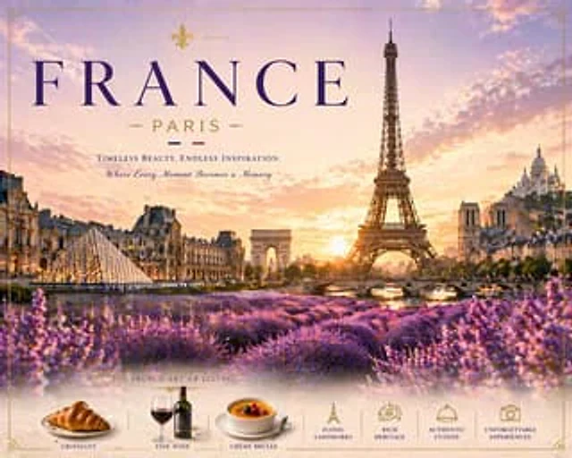

```text
A luxurious retro travel poster-style illustration, with{argument name="country name" default="France"} For the country,{argument name="city name" default="Paris"} Designed as an elegant travel advertisement for the destination, it showcases a magnificent and romantic Parisian cityscape against a backdrop of a golden sunset, with the sky displaying a dreamy gradient of peach, pink, pale purple, and soft gold. The Eiffel Tower, a towering and richly detailed landmark, stands majestically above the city, serving as the central landmark. Four additional iconic Parisian landmarks are included: the Louvre Pyramid on the left, the Arc de Triomphe near the center of the background, Notre Dame Cathedral to the right of the Eiffel Tower, and the Sacré-Cœur Basilica on a hillside in the upper right corner. The foreground is filled with lush, blooming flowers.{argument name="flower field" default="Lavender fields"} The vibrant purple hue creates a dreamlike, painterly foreground leading to the city. Below the Eiffel Tower, a river and elegant stone bridge are depicted, reflecting the warm glow of the setting sun. The composition should be idealized, cinematic, and slightly fantastical, blending multiple landmarks into a harmonious panorama. A sophisticated typography layered in the upper left to upper center area includes a very large serif title with the following content:{argument name="headline text" default="France"} Below this is a subtitle with small spacing and serifs, the content of which is:{argument name="subheadline text" default="Paris"} Above the subheading, place a gold iris decoration; below, add a small horizontal French tricolor flag accent. Below the main headline, include two lines of promotional copy that must be identical: “TIMELESS BEAUTY. ENDLESS INSPIRATION.” and “Where Every Moment Becomes a Memory,” in elegant lowercase capitals and italics. Add a thin gold decorative border around the entire poster, with delicate corner details. At the bottom, create a soft, creamy matte panel that blends with the image, centering the phrase “THE FRENCH ART OF LIVING” above, and below that, three dining elements: a butter croissant on a plate, a glass of red wine with a bottle of red wine, and a crème brûlée topped with berries. Label them “CROISSANT,” “FINE WINE,” and “CRÈME BRÛLÉE,” respectively. Add four small gold icons on the right, labeled below: “ICONIC LANDMARKS”, “RICH HERITAGE”, “AUTHENTIC CUISINE”, and “UNFORGETTABLE EXPERIENCES”. Overall style: ultra-refined and exquisite travel posters, romantic European travel advertisements, painterly realism, a warm and bright atmosphere, high-end print design, balanced composition, and high-end magazine aesthetics.
```

Model: GPT Image 2
Author: GPT Image 2 Prompts

[ProjectD](https://aitoolsradar.com/en/prompts/7f7b7525efb2ae) · [Recorded source](https://x.com/Redit007/status/2047524171987775961#reversed-1)
 · [Full original metadata and byte evidence](data/projectd-batch-0045.json)

## Romantic School Manga Page

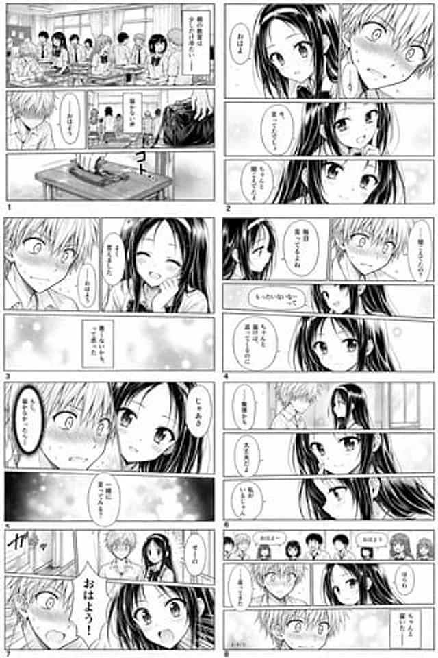

```text
{
  "type": "Black and white comic page",
  "style": "A clean, youthful romantic comedy manga style, featuring grayscale halftone dots, ink line art, soft classroom lighting, expressive facial expressions (blushing, sweat beads, speech bubbles), Japanese text, and exquisite printed manga layout.",
  "format": "A single page containing 8 numbered storyboards, using a 2-column grid layout.",
  "setting": {
    "location": "Japanese high school classrooms and corridors",
    "time": "Morning before class"
  },
  "characters": [
    {
      "role": "male lead",
      "appearance": "The boy had short, messy, light-colored hair, wore a school uniform shirt, was shy and easily flustered, often blushed, and his eyes widened when startled."
    },
    {
      "role": "female lead",
      "appearance": "The girl has long, straight, dark hair with a glossy sheen, large, gentle eyes, a school uniform with ribbons tied around her neck, and a calm, affectionate smile. In some close-up shots, her face is deliberately obscured or blurred."
    },
    {
      "role": "classmate",
      "count": 8,
      "appearance": "High school boys and girls in summer uniforms are chatting in a background classroom scene."
    }
  ],
  "layout": {
    "sections": [
      {
        "title": "1",
        "position": "Top left",
        "count": 4,
        "labels": [
          "A panoramic view of the classroom, showing many students sitting at their desks.",
          "A close-up of an awkward boy saying good morning.",
          "A medium shot taken from the entrance showing the girl arriving and her schoolbag on the desk.",
          "Close-up of a hand placing a schoolbag on a table and onomatopoeia"
        ]
      },
      {
        "title": "2",
        "position": "Top right",
        "count": 5,
        "labels": [
          "Close-up of a girl greeting someone, her face partially obscured.",
          "Close-up of a shocked, blushing boy",
          "The girl smiled and said he should say it now.",
          "The girl smiled and urged him to answer properly."
        ]
      },
      {
        "title": "3",
        "position": "center left",
        "count": 4,
        "labels": [
          "Close-up of a blushing boy",
          "A close-up of the girl's face partially obscured, saying it's okay.",
          "A soft, shimmering atmosphere in the storyboard.",
          "The narration box suggests that things might not be so bad."
        ]
      },
      {
        "title": "4",
        "position": "center right",
        "count": 5,
        "labels": [
          "The girl's profile indicated that he should say it every day.",
          "Boy's nervous reaction",
          "The girl joked that it was a waste.",
          "The girl smiled and said she would respond properly.",
          "A close-up of the girl looking directly at him"
        ]
      },
      {
        "title": "5",
        "position": "Lower center left",
        "count": 4,
        "labels": [
          "A close-up of a blushing boy saying, \"If you don't mind...\"",
          "Close-up of the girl, saying \"Okay then\".",
          "Shiny transitional panels",
          "The girl asked them if they should speak together."
        ]
      },
      {
        "title": "6",
        "position": "Lower Middle Right",
        "count": 4,
        "labels": [
          "A two-person shot in a hallway or by a window; the boy said it was possible.",
          "The girl replied that it was okay.",
          "Close-up of a girl's finger near her lips",
          "The girl said she would do the same."
        ]
      },
      {
        "title": "7",
        "position": "Bottom left",
        "count": 3,
        "labels": [
          "Dynamic storyboard with onomatopoeic words for sudden actions by the window",
          "A short 2-person shot of a boy and a girl standing together, with the girl's face partially obscured.",
          "A close-up of the two shouting \"Good morning!\" with energy."
        ]
      },
      {
        "title": "8",
        "position": "Bottom right",
        "count": 5,
        "labels": [
          "A group shot of the classroom, showing students responding \"Good morning\".",
          "A boy and a girl stood side by side, and the girl said, \"Look...\"",
          "The boy was stunned and blushed.",
          "A close-up of the boy's gentle smile, as if a weight had been lifted from his shoulders.",
          "End credits"
        ]
      }
    ],
    "numbered_sections": 8
  },
  "story": "A shy boy struggled to say good morning to the girl he liked. She gently encouraged him, teased him, and suggested they say it together. In the final scene, they greeted the whole class loudly, and their classmates responded.",
  "text": {
    "language": "Japanese",
    "include": [
      "speech bubbles",
      "Small narration box",
      "Storyboard numbers 1 to 8",
      "End credits"
    ],
    "do_not_translate": true
  },
  "composition": "The comic book page design is authentic, with varying panel sizes, alternating between close-ups and medium shots, and a strong grasp of emotional rhythm, emphasizing eye contact, blushing reactions, and romantic tension.",
  "quality": "High-resolution professional comic book manuscript with clear halftone dots and easily legible bubble placement, making it suitable for printing."
}
```

Model: GPT Image 2
Author: GPT Image 2 Prompts

[ProjectD](https://aitoolsradar.com/en/prompts/015ea2c6342217) · [Recorded source](https://x.com/yume00112211/status/2047809772892917936#reversed-0)
 · [Full original metadata and byte evidence](data/projectd-batch-0045.json)

## Romantic Tokyo Couple Photo Collage

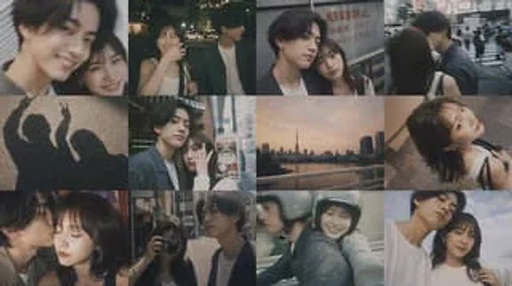

```text
A series of emotionally charged 4x3 photo collages, composed of 12 candid cell phone photos of a young couple on a Tokyo summer night, employs a nostalgic film-like texture, soft grain, low-saturation colors, slight blur, low contrast, dim streetlights, and intimate, casual compositions. The overall tone is romantic, youthful, intimate, and documentary-like, with warm gray-brown tones and a slightly desaturated teal-orange hue reflecting the city's nighttime atmosphere. The man has messy, short dark hair, a slender figure, and wears a dark outer layer or light jacket over a white T-shirt; the woman has long, dark brown hair, a slender figure, and wears a white sleeveless top with a black thin-strapped shoulder bag. In each frame, both individuals' faces are deliberately obscured by large areas of soft-edged blur to protect their privacy. Contains 12 tightly arranged, seamless grid images: First row, frame 1: An extreme close-up of a man's profile at night; Frame 2: A mirror or cell phone selfie of a woman standing side-by-side with a man outdoors at night; Frame 3: The two cuddling tightly beside a street with Japanese signs; Frame 4: The two kissing on a busy city crosswalk. Middle row, frame 5: The shadows of the two on the ground, one of them making a peace sign; Frame 6: The two standing intimately on a sidewalk in a city shopping street; Frame 7: A sunset over the waterfront skyline with Tokyo Tower, without people; Frame 8: A bird's-eye view of a man and woman standing close together on stairs or a passageway. Last row, frame 9: An intimate close-up of the two touching faces or kissing; Frame 10: A man fixing a woman's hair on a city street; Frame 11: The two riding scooters or motorcycles, both wearing helmets, with a motion blur effect; Frame 12: The two embracing under a pale blue sky, framed from the shoulders up. The background should include Japanese city streets, shops, pedestrian crossings, signs, buildings, nighttime traffic, and the city's nighttime atmosphere. Keep the composition casual and imperfect, like real memories, and present diverse cropping, soft focus, motion blur, and a realistic handheld mobile phone photography feel.
```

Model: GPT Image 2
Author: GPT Image 2 Prompts

[ProjectD](https://aitoolsradar.com/en/prompts/6918d157977d87) · [Recorded source](https://x.com/iX00AI/status/2047511290344829316#reversed-0)
 · [Full original metadata and byte evidence](data/projectd-batch-0045.json)

## Romantic Voxel Dinner Date

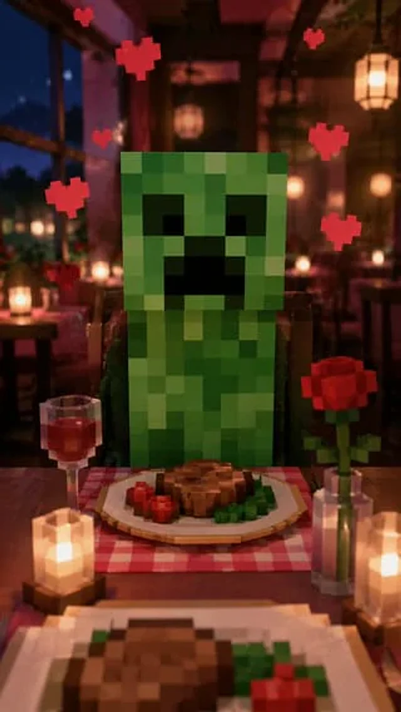

```text
A first-person POV perspective, and{argument name="character" default="Minecraft Creeper"} A scene depicting a romantic dinner date. The setting is a {argument name="setting" default="A romantic and dimly lit restaurant"} In the scene, the ambient light is warm, the background is blurred, and other dining tables and the night view outside the window can be seen. The character is sitting opposite at the table. Seven figures surround its head.{argument name="atmosphere effect" default="Floating 8-bit red heart"} On the wooden table between the viewer and the character, there was a red and white checkered placemat. On the placemat sat a voxel-style plate containing…{argument name="food" default="Square steaks, garnished with red and green garnish"} On the left is a transparent, cube-shaped wine glass filled with red wine. On the right is a transparent, cube-shaped vase containing a cube-shaped red rose. Two glowing cube candles sit in wooden candlesticks on the table. The foreground shows a blurred edge around the viewer's own plate. The entire image seamlessly blends realistic, cinematic lighting and depth-of-field effects with voxel-based 3D pixel art objects.
```

Model: GPT Image 2
Author: GPT Image 2 Prompts

[ProjectD](https://aitoolsradar.com/en/prompts/b482c6b5118589) · [Recorded source](https://x.com/mirochill/status/2045093397887652291#reversed-0)
 · [Full original metadata and byte evidence](data/projectd-batch-0045.json)

## Royal Blue Couture Group Portrait

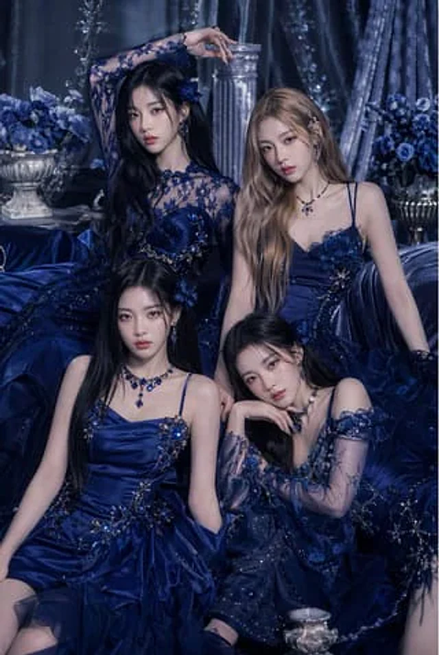

```text
A luxurious, fashion editorial-style portrait showcases four elegant young women posing together in a deep sapphire blue Baroque-style interior, exuding the quality of a haute couture group photograph. The scene employs a monochromatic palette of deep sapphire blue, midnight blue, and silver, with a backdrop adorned with heavy velvet curtains, floral arrangements, classical columns, and ornate metalware. All four women wear distinctive deep blue and cobalt blue evening gowns, exquisitely detailed: embellished with crystal beads, sequins, embroidered floral appliqués, multiple layers of tulle, satin, and sheer lace. The woman in the upper left has extremely long black hair and wears a dramatic long-sleeved sheer lace gown with floral embroidery and a corset-style bodice, her arm raised high above her head in a regal pose. The woman in the upper right has long, wavy light brown or blonde hair and wears a sleeveless, spaghetti-strap satin gown adorned with blue floral appliqués at the chest and waist, sitting upright with a composed expression. The woman in the lower left has long, straight black hair and wears a structured satin dress with thin straps. The bodice and skirt are adorned with jeweled floral embellishments, and the skirt is voluminous and pleated. The woman in the lower right has long, dark hair and wears an off-the-shoulder, sheer, shimmering gown with semi-transparent embroidery on the sleeves. She leans slightly forward, one hand gently touching her chin, her posture soft and contemplative. All four wear coordinated sapphire jewelry, including earrings, necklaces, and decorative hair accessories. The composition is a compact, vertical portrait with layered seated poses. Rich fabrics fill the foreground, and soft, diffused studio lighting, rich in detail, creating a captivating, luxurious advertising campaign style with deep shadows, delicate skin, and an atmosphere of elegant opulence.
```

Model: GPT Image 2
Author: GPT Image 2 Prompts

[ProjectD](https://aitoolsradar.com/en/prompts/364c69b975b986) · [Recorded source](https://x.com/imwsl90/status/2047603663112425907#reversed-1)
 · [Full original metadata and byte evidence](data/projectd-batch-0045.json)

## Royal Perfume Advertisement Prompt


```text
{argument name="character" default="Wu Zetian"} The perfume advertisement, inspired by Empress Wu Zetian, features a gold bottle with dragon patterns and a dark, courtly atmosphere reminiscent of a blockbuster film.
```

Model: GPT Image 2
Author: GPT Image 2 Prompts

[ProjectD](https://aitoolsradar.com/en/prompts/2c296bf484dd20) · [Recorded source](https://x.com/songguoxiansen/status/2046766344163737788)
 · [Full original metadata and byte evidence](data/projectd-batch-0045.json)

## Royal Perfume Advertisement Prompt


```text
{argument name="人物" default="武则天"}同款皇后香水广告，龙纹金瓶，暗黑宫廷氛围感大片
```

Model: GPT Image 2
Author: 松果先森

[ProjectD](https://aitoolsradar.com/en/prompts/e404e1d028e830) · [Recorded source](https://youmind.com/prompts/empress-perfume-dark-palace-14748)
 · [Full original metadata and byte evidence](data/projectd-batch-0045.json)

## Royal Prince Potato Chips Package

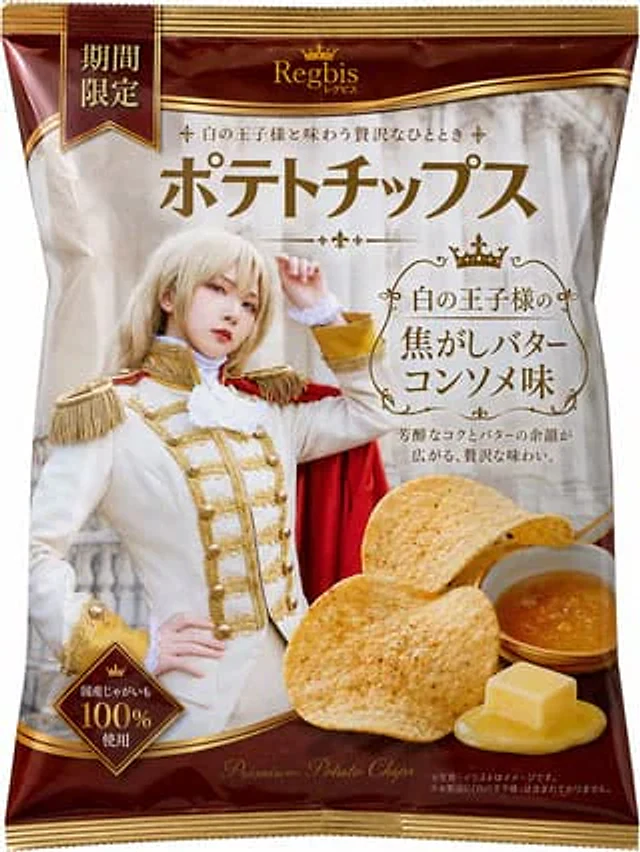

```text
Goal: Create a premium Japanese potato chips package design based on an illustration-world concept, turning a royal character into a colorful snack bag advertisement.

Canvas: Front-facing vertical product package mockup, 3:4 aspect ratio, isolated on a clean white background. The bag should look like glossy crinkled plastic with sealed ridged edges at the top and bottom, subtle folds, highlights, shadows, and slight perspective bulging like a real snack bag.

Package design: Use an elegant white, burgundy, and metallic gold color palette. The top and bottom bands are deep burgundy with gold trim lines; the main center area is pale white/cream with a faint palace or marble-column background. Add ornate gold flourishes, crown motifs, and premium European royal styling.

Brand and main text: At the top center place a gold crown logo and the brand name {argument name="brand name" default="Reggbis"} with small Japanese reading beneath it. In the top-left corner add a vertical burgundy ribbon badge reading 「期間限定」. Across the upper center, add small copy reading 「白の王子様と味わう贅沢なひととき」. The largest central product name should read 「ポテトチップス」 in bold metallic-gold Japanese lettering. On the right, inside an ornate gold frame with a crown, write 「白の王子様の 焦がしバター コンソメ味」. Beneath it add smaller copy: 「芳醇なコクとバターの余韻が広がる、贅沢な味わい。」

Main subject: Show one elegant white prince character occupying the left and center of the package art. The prince has long pale-blond hair and wears a white military-style royal uniform with gold embroidery, epaulettes, decorative buttons, a high collar, lace cuffs, and a red cape draped over one shoulder. Pose him confidently with one hand on his hip and the other hand raised near his head. The face is intentionally covered by a plain rectangular censor-like beige blur, preserving the package aesthetic. Use {argument name="character theme" default="white prince"} as the core character concept.

Food elements: Show exactly 4 food items in the lower-right foreground: 2 golden potato chips, 1 small round bowl of glossy brown consommé sauce, and 1 pat of butter melting on a yellow puddle. Chips should look crisp, lightly speckled, and appetizing, overlapping the lower part of the character and package.

Badges and footer: Add one diamond-shaped burgundy-and-gold badge at the lower left reading 「国産じゃがいも 100% 使用」 with a small crown. Along the bottom burgundy band write “Premium Potato Chips” in elegant gold cursive. Add tiny Japanese disclaimer text at the bottom right, similar to product-package fine print.

Visual style: Realistic commercial snack packaging mockup mixed with polished anime/cosplay illustration art, high-detail glossy plastic, luxury Japanese limited-edition product design, warm gold lighting, sharp typography, premium supermarket snack aesthetic.

Constraints: Keep the design as a single potato chip bag only, no hands holding it, no extra products, no background scene outside the package, and make all Japanese text legible and positioned like authentic Japanese snack packaging.
```

Model: GPT Image 2
Author: アシタ🩵

[ProjectD](https://aitoolsradar.com/en/prompts/2ea01be0d4d7be) · [Recorded source](https://youmind.com/prompts/royal-prince-potato-chips-21222)
 · [Full original metadata and byte evidence](data/projectd-batch-0045.json)

## Rubber duck adventure movie poster prompt

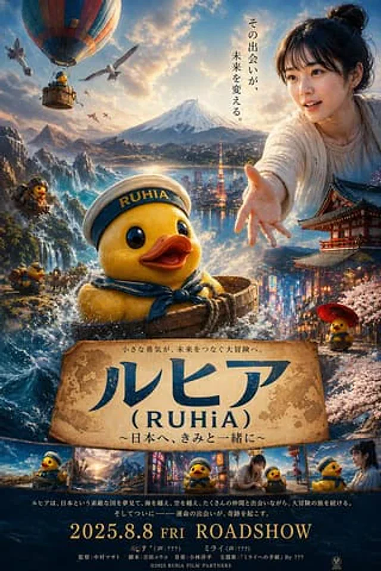

```text
A story about "{argument name="character name" default="RUHiA"} The story of the adorable little yellow duck boy who travels to Japan for a great adventure and meets a boy named "{argument name="woman's name" default="Mirai"} A Japanese woman. Please create a live-action movie poster style for her.
```

Model: GPT Image 2
Author: GPT Image 2 Prompts

[ProjectD](https://aitoolsradar.com/en/prompts/a5d9ac0deea300) · [Recorded source](https://x.com/mirai_ai2050/status/2046944941583270341)
 · [Full original metadata and byte evidence](data/projectd-batch-0045.json)

## Rust In-Game Screenshot

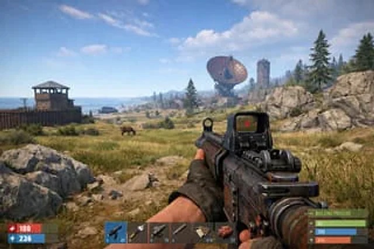

```text
an ingame screenshot of rust
```

Model: GPT Image 2
Author: @FixlationAI

[ProjectD](https://aitoolsradar.com/en/prompts/209cfa04e8f7b0) · [Recorded source](https://x.com/FixlationAI/status/2046272578705068476)
 · [Full original metadata and byte evidence](data/projectd-batch-0045.json)

## SaaS AI Dashboard Landing Page


```text
{
  "type": "SaaS landing page homepage graphics",
  "style": "Modern UI/UX, light theme, soft shadows, frosted glass effect{argument name=\"primary theme color\" default=\"Purple and blue gradient\"}",
  "header": {
    "headline": "{argument name=\"main headline\" default=\"Drive your work with a clear AI perspective.\"}",
    "subheadline": "Coordinate tasks, contexts, and execution across tools in a smart workspace."
  },
  "layout": {
    "center_dashboard": {
      "app_name": "{argument name=\"app name\" default=\"FlowBridge\"}",
      "greeting": "{argument name=\"user greeting\" default=\"Good morning, Alex 👋\"}",
      "sidebar_links": 8,
      "top_metrics_cards": 4,
      "recent_activity_items": 3,
      "project_progress_bars": 3,
      "floating_action_bar": "{argument name=\"floating bar text\" default=\"Ask the AI ​​a question or enter a command...\"}"
    },
    "left_integrations": {
      "count": 4,
      "style": "Capsule-shaped card connected to the central dashboard via a thin wire",
      "labels": [
        "Google Calendar: Events and Schedules",
        "Notion: Documentation and Knowledge Base",
        "Slack: Messages and Updates",
        "Google Drive: Files and Assets"
      ]
    },
    "right_integrations": {
      "count": 4,
      "style": "Capsule-shaped card connected to the central dashboard via a thin wire",
      "labels": [
        "Asana: Tasks and Projects",
        "GitHub: Code and Commits",
        "Figma: Design Files",
        "Microsoft Teams: Calls and Meetings"
      ]
    },
    "bottom_feature_cards": {
      "count": 3,
      "style": "Rectangular cards with soft shadows",
      "cards": [
        {
          "title": "AI-driven overview",
          "description": "Stay informed about goals, progress, and matters requiring your attention.",
          "visuals": "Displays a line graph of 24.6 hours of focus time, along with three bottom indicators (meetings, deep work, and completed tasks)."
        },
        {
          "title": "Interconnected execution",
          "description": "Keep tasks, updates, and dependencies synchronized across tools.",
          "visuals": "Includes a list of 4 upcoming tasks and 4 team workload progress bars with user avatars."
        },
        {
          "title": "Insights into Driving Influence",
          "description": "Understand the progress, mitigate risks, and make more informed decisions.",
          "visuals": "A pie chart showing the status of 18 projects, and a list of 3 major risks marked with red flags."
        }
      ]
    }
  }
}
```

Model: GPT Image 2
Author: GPT Image 2 Prompts

[ProjectD](https://aitoolsradar.com/en/prompts/abc1df32bc0f2d) · [Recorded source](https://x.com/Fancyfreer/status/2044789137853792669#reversed-0)
 · [Full original metadata and byte evidence](data/projectd-batch-0045.json)

## Sad Child by Rainy Window

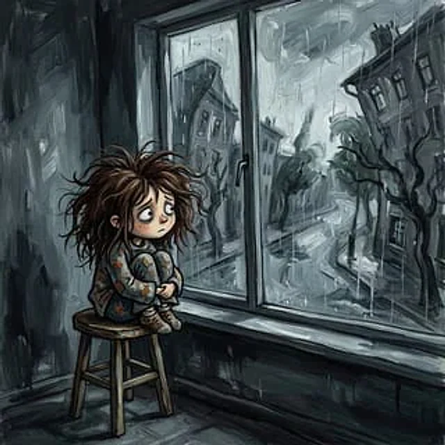

```text
A digitally illustrated picture book, full of emotion, depicts a thin, melancholy child huddled on a wooden stool in a dark, gray room, beside a large, rain-streaked window. The child has {argument name="hair color" default="dark brown"} Disheveled, tousled hair; large, expressive eyes; pale skin with a few freckles; a worried and lonely expression; hands tightly wrapped around their knees. They were wearing oversized clothing.{argument name="pajama pattern" default="Soft blue-grey pajamas with small orange patches or floral patterns"} And soft, worn-out slippers. Outside the window, a desolate city street in the rain is visible, with four leaning old buildings, four trees bent by the wind, a slippery, winding road, and dramatically rolling dark clouds. The overall composition employs an exaggerated, distorted perspective. The composition places the child on the left, with the view outside the window occupying the right, creating an atmosphere of isolation and melancholy. It uses a hand-drawn style, retaining noticeably rough brushstrokes, with a low-saturation blue-gray tone, complemented by soft charcoal shadows. Subtle highlights appear on the wet glass, and the child's clothing is only adorned with faint warm colors. It presents a children's picture book art style reminiscent of dark fantasy, conveying a sense of intimacy, cinematic quality, and the melancholy of a rainy day, with high detail and a square composition.
```

Model: GPT Image 2
Author: GPT Image 2 Prompts

[ProjectD](https://aitoolsradar.com/en/prompts/53c66c87dd17fa) · [Recorded source](https://x.com/imkkwoo/status/2046805357528506738#reversed-2)
 · [Full original metadata and byte evidence](data/projectd-batch-0045.json)

## Saint Seiya Gold Saints Card Grid

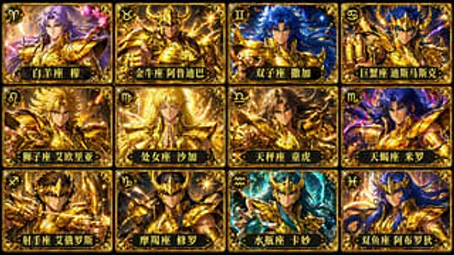

```text
生成圣斗士星矢12个黄金圣斗士的12宫格卡牌图片,每张卡牌上写上对应的中文名,每行4个,宽高比16:9。
```

Model: GPT Image 2
Author: @songguoxiansen

[ProjectD](https://aitoolsradar.com/en/prompts/2b6f2b5959a6aa) · [Recorded source](https://x.com/songguoxiansen/status/2046476566537080849)
 · [Full original metadata and byte evidence](data/projectd-batch-0045.json)

## Sairah #51

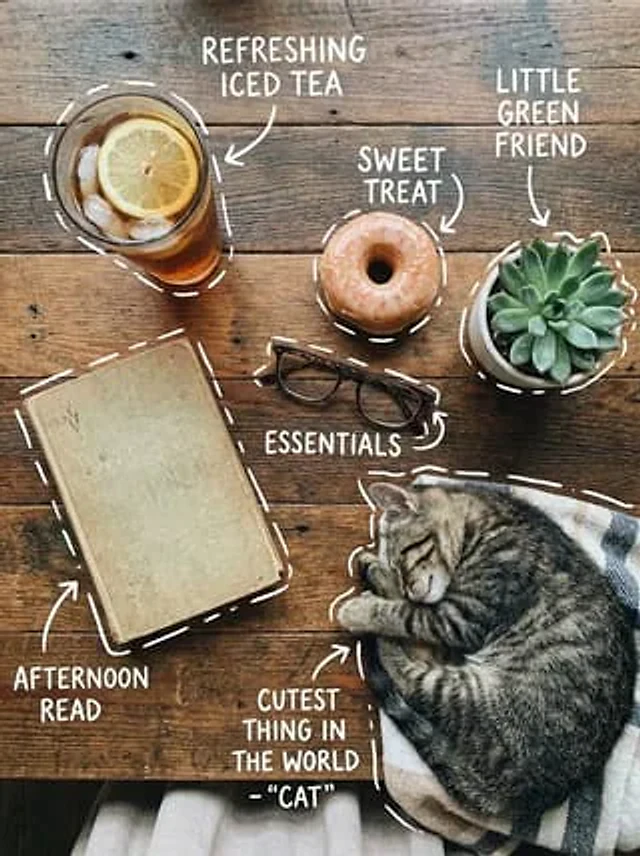

```text
Top-down flat lay on a rustic wooden table, cozy aesthetic, soft natural light. A glass of iced tea with lemon slices and ice cubes, a glazed donut, a small succulent plant in a white pot, a vintage book, and eyeglasses. A sleeping tabby cat curled on a blanket at the edge. White hand-drawn doodle outlines and arrows around each object with playful handwritten labels like “refreshing iced tea,” “sweet treat,” “little green friend,” “afternoon read,” and “cutest thing in the world – cat.” Warm tones, minimal shadows, lifestyle photography, high detail, Instagram aesthetic.
```

Model: GPT Image 2
Author: Sairah

[ProjectD](https://aitoolsradar.com/en/prompts/f820ebf2652a14) · [Recorded source](https://x.com/Sairah_0/status/2048725842096976020)
 · [Full original metadata and byte evidence](data/projectd-batch-0045.json)

## Salma #49


```text
Create a polished email sequence template for fenty beauty
```

Model: GPT Image 2
Author: Salma

[ProjectD](https://aitoolsradar.com/en/prompts/d785e1a9b8aa47) · [Recorded source](https://x.com/Salmaaboukarr/status/2046717569013293231)
 · [Full original metadata and byte evidence](data/projectd-batch-0045.json)

## Salt Mist Ledger City Reference Sheet

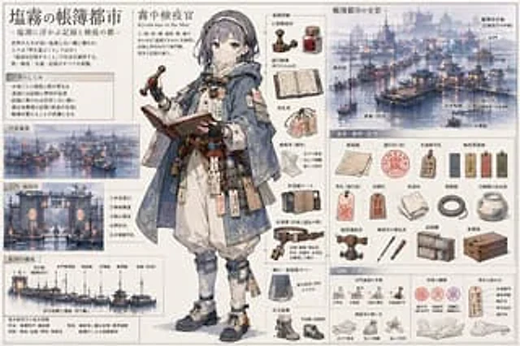

```text
{"type":"information-dense anime fantasy reference sheet and worldbuilding infographic","language_and_text":"Use fine Japanese-style printed typography throughout, but describe all labels in English. Create a parchment-white archival page with thin gray panel borders, dense annotations, arrows, item callouts, and watercolor ink rendering.","main_title":"{argument name=\"main title\" default=\"塩霧の帳簿都市\"}","subtitle":"A salt-lake ledger city and quarantine-record bureaucracy, shown as a detailed character-and-setting design sheet.","central_character":{"position":"center, occupying the full height of the page","role":"{argument name=\"character role\" default=\"mist quarantine officer\"}","name":"{argument name=\"character name\" default=\"Kyoeki-kan in the Mist\"}","appearance":"young anime woman with shoulder-length dark blue-gray hair, hairband and small ornaments, face intentionally covered by a soft rectangular gray blur with no facial features, calm scholarly posture","clothing":"layered blue-gray hooded cloak covered in pale geometric border patterns, white robe and loose white trousers, belts, pouches, document tags, wooden seals, red stamps, straps, protective cuffs, knee guards, gaiters, heavy walking shoes","held_objects":"open ledger book in the left hand and a red-handled inspection stamp or seal tool in the right hand","palette":"{argument name=\"color palette\" default=\"misty blue gray, cream parchment, faded red seals, dark ink, warm brown leather\"}","style":"delicate Japanese anime concept art mixed with historical field-guide illustration, watercolor wash, precise linework, soft fog, high detail"},"layout":{"page_orientation":"wide landscape reference sheet","overall_structure":"one large central character with surrounding labeled diagrams, city views, equipment grids, and process illustrations","sections":[{"title":"City overview and concept text","position":"top left","count":3,"items":["large title block","short explanatory paragraph","boxed rules of the world with 5 bullet-like lines"]},{"title":"Representative scenery","position":"middle left","count":1,"items":["panoramic misty canal harbor filled with boats, lamps, bridges, towers, and floating inspection markers"]},{"title":"Water gate and inspection station","position":"lower left","count":1,"items":["front-view canal checkpoint with lanterns, piers, boats, inspectors, and numbered callouts"]},{"title":"Fleet composition","position":"bottom left","count":6,"items":["official inspection boat","water-gate management boat","inspection boat","market boat","repair boat","residential house boat"]},{"title":"Character tool callouts","position":"upper center-right beside character","count":5,"items":["small wooden inspection stamp","red ink bottle","opened registry ledger","bundle of hanging cargo tags","transparent inspection cloth"]},{"title":"Belt and clothing callouts","position":"center-right beside character","count":5,"items":["waterproof document case","wooden crate-like protective case","belt with stamps and small tools","hem cover fabric sample","footwear and sole-detail samples"]},{"title":"Full city panorama","position":"top right","count":1,"items":["large mist-covered floating city on a salt lake with many docks, canals, lanterns, houseboats, towers, cranes, and distant fortress silhouettes"]},{"title":"Tools, materials, and symbols grid","position":"middle right","count":15,"items":["shipping form document","red circular transit seal","blue-gray water-number tag marked 27","inspection school plaque","cargo tag","red sealing tag","folded waterproof cloth","coiled mooring rope","white saltwater jar","rolled permit belt","inspection officer seal tool","two inspection writing instruments","record shelf filled with ledgers","wooden drying box","small label plaques"]},{"title":"Diagrams and legend","position":"bottom right","count":6,"items":["waterway transit procedure with 5 small steps","three seal types in red and purple","cargo tag reading method","inspection cloth folding and wrapping method","knotted cloth examples","small paper-tag examples"]}]},"environment_details":"The harbor scenes should show a foggy salt-lake metropolis built on docks and floating platforms, with hundreds of tiny boats, red lanterns reflected in water, pagoda-like roofs, bureaucratic signs, numbered markers, and pale blue morning haze.","composition_rules":"Keep the sheet organized and readable: central character dominates, left side explains the city and boats, right side explains equipment and procedures, with fine callout lines connecting objects. Use a handmade illustrated encyclopedia aesthetic rather than a modern UI.","image_quality":"high-resolution concept art, crisp miniature details, soft watercolor shadows, parchment background, balanced margins, no photorealism, no 3D render"}
```

Model: GPT Image 2
Author: 無関係者

[ProjectD](https://aitoolsradar.com/en/prompts/04dc007aa37555) · [Recorded source](https://youmind.com/prompts/salt-mist-ledger-city-18890)
 · [Full original metadata and byte evidence](data/projectd-batch-0045.json)

## Sam Altman Baseball Broadcast

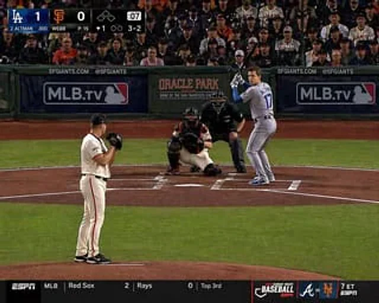

```text
サムアルトマンがメジャーリーガーでバットを構えている。よくあるようなテレビ画面の構図
```

Model: GPT Image 2
Author: @16kthir0GRXgNqn

[ProjectD](https://aitoolsradar.com/en/prompts/19e659363eb14a) · [Recorded source](https://x.com/16kthir0GRXgNqn/status/2046507362266259832)
 · [Full original metadata and byte evidence](data/projectd-batch-0045.json)

## Sam Altman Bear Selfie


```text
generate image: Selfie of Sam Altman riding a bear

Edit prompt: Remove the background make it transparent
```

Model: GPT Image 2
Author: @JustinGorya

[ProjectD](https://aitoolsradar.com/en/prompts/7830f0de1f2b24) · [Recorded source](https://x.com/JustinGorya/status/2046510831832006970)
 · [Full original metadata and byte evidence](data/projectd-batch-0045.json)

## Sam Altman Riding a Bear


```text
{argument name="person" default="Sam Altman"} A selfie, while riding a{argument name="animal" default="bear"}
```

Model: GPT Image 2
Author: GPT Image 2 Prompts

[ProjectD](https://aitoolsradar.com/en/prompts/6ee15e8b222dec) · [Recorded source](https://x.com/JustinGorya/status/2046510831832006970)
 · [Full original metadata and byte evidence](data/projectd-batch-0045.json)

## Sam Altman Skateboarding Test Prompt


```text
{argument name="subject" default="Sam Altman"} exist{argument name="location" default="skate park"} Play{argument name="object" default="skateboard"} There was no one else around.
```

Model: GPT Image 2
Author: GPT Image 2 Prompts

[ProjectD](https://aitoolsradar.com/en/prompts/cbd78319b0068e) · [Recorded source](https://x.com/Malek1173989/status/2045836887684694395)
 · [Full original metadata and byte evidence](data/projectd-batch-0045.json)

## Sam Altman Skatepark Snapshot

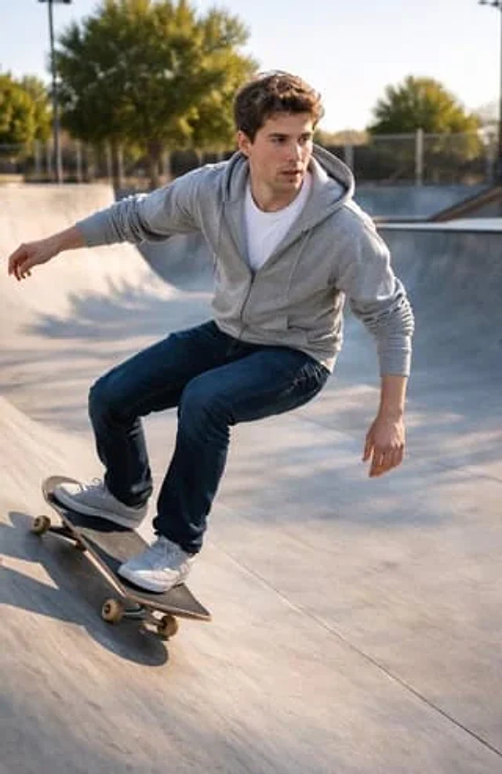

```text
"Sam Altman on a skateboard at a skatepark with no people."
```

Model: GPT Image 2
Author: @Malek1173989

[ProjectD](https://aitoolsradar.com/en/prompts/bd7a833c7534c4) · [Recorded source](https://x.com/Malek1173989/status/2045836887684694395)
 · [Full original metadata and byte evidence](data/projectd-batch-0045.json)

## Saman | AI #79

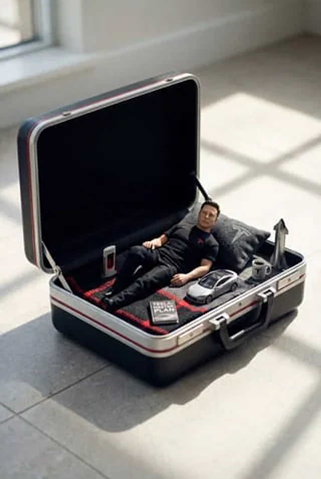

```text
{
  "prompt": "Create a hyper-realistic, ultra-detailed cinematic photo featuring a MINIATURE version of the person from the provided reference image (preserve facial likeness, skin tone, hairstyle, and overall identity). The tiny character is relaxing inside an OPEN vintage hard-shell suitcase that is used like a tiny bed. The suitcase sits on a clean stone/tile floor in a bright room with strong natural sunlight casting soft rectangular window shadows across the floor.\n\nONLY VARIABLES:\n1) Character: use the user reference photo for the person’s face and identity.\n2) Theme/Genre: {THEME}\n\nCOMPOSITION & SCALE:\n- The person must be clearly mini-sized (toy-scale) relative to the suitcase, with correct perspective and believable proportions.\n- The open suitcase interior is styled like a cozy miniature scene: pillow, textured blanket or towel, and themed tiny props.\n- Add realistic micro-details: fabric weave, zipper teeth, suitcase latches, scuffs, stitching, subtle dust, realistic contact shadows.\n\nTHEME STYLING (derive everything from {THEME}):\n- Choose a cohesive color palette and make the SUITCASE COLOR match the theme (e.g., beach = warm coral/sand; football = deep green/black or team-inspired; sporty = bold neon accents; cozy-casual = muted cream/tan; luxury = black/ivory/gold).\n- Dress the tiny character in an outfit that fits {THEME}.\n- Place 5–8 tiny theme props neatly inside the suitcase near the character (miniature scale, photoreal materials). Examples by theme:\n  • Beach: tiny sunscreen bottle, mini sunglasses, seashells, flip-flops, mini straw hat, folded towel.\n  • Football/Soccer: tiny soccer ball, mini jersey/scarf, cleats, shin guards, whistle, small tactic board.\n  • Sporty/Fitness: tiny water bottle, mini dumbbell, resistance band, smartwatch, towel, energy bar.\n  • Cozy/Casual: tiny book/magazine, mug, knitted throw, headphones, mini candle.\n(If {THEME} is different, invent equivalent props that strongly communicate that theme.)\n\nLIGHTING & CAMERA:\n- Bright natural sunlight, soft realistic shadows, subtle bounce light, HDR-like dynamic range.\n- Photographic realism: shallow depth of field (but keep face and key props sharp), 50–85mm lens look.\n- No text, no logos, no watermarks.\n\nFINAL LOOK:\n- Hyper-real, high detail, clean editorial product-photography vibe, believable miniature diorama realism, crisp textures and natural skin rendering.",
  "negative_prompt": "cartoon, CGI, illustration, anime, plastic-looking skin, uncanny face, distorted anatomy, extra fingers, deformed hands, duplicated limbs, wrong perspective, unrealistic scale, blurry, low-res, noisy, harsh artifacts, over-smoothed, bad shadows, floating objects, cluttered scene, messy background, text, watermark, logo, brand names, extra people, face not matching reference",
  "variables": {
    "THEME": "beach | football | sporty | cozy-casual | luxury | etc.",
    "USER_IMAGE": "reference photo uploaded by the user (required)"
  }
}
```

Model: GPT Image 2
Author: Saman | AI

[ProjectD](https://aitoolsradar.com/en/prompts/9e611f1852e98a) · [Recorded source](https://x.com/Samann_ai/status/2002751900337275167)
 · [Full original metadata and byte evidence](data/projectd-batch-0045.json)

## Saman | AI #9

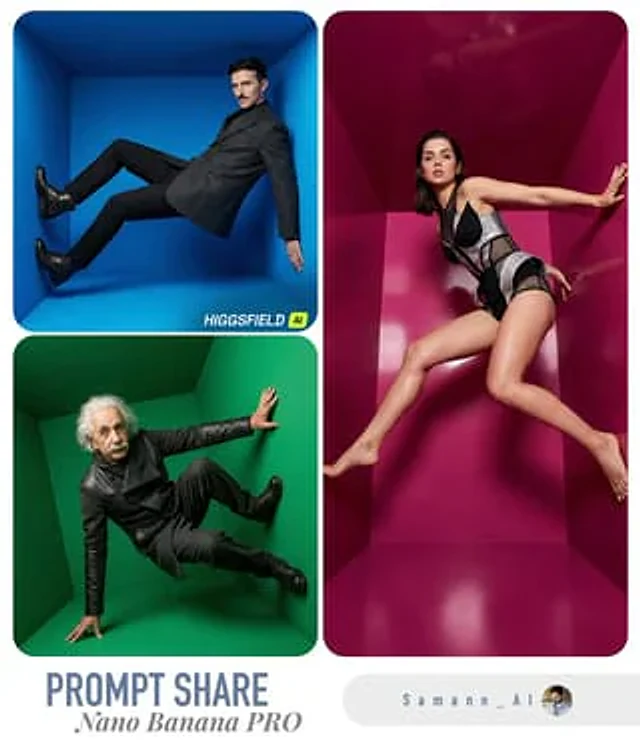

```text
[INPUT IMAGE: USER_PHOTO] Use the person in the input image as the ONLY subject. Preserve their identity and facial features clearly.

Create a hyper-realistic high-fashion editorial photo inside a surreal 3D geometric “color box” room (a hollow cube / tilted cube set). Each render MUST randomly choose:
1) a bold single-color box (monochrome environment, vivid and saturated),
2) a dynamic “cool” fashion pose (gravity-defying or extreme stretch / leap / sideways bracing against the walls),
3) a dramatic camera angle (wide-angle 24–35mm equivalent, tilted horizon, strong perspective).

The subject appears full-body and sharp, wearing an avant-garde fashion styling that feels modern and editorial (clean silhouette, stylish layering, premium fabric texture). Keep clothing tasteful and fashion-forward. The subject’s pose should feel athletic, stylish, and unusual—like a magazine campaign shot.

Lighting: studio quality, crisp and cinematic; strong key light with controlled soft shadows, subtle rim light; realistic reflections and bounce light from the colored walls. Ultra-detailed skin texture, natural pores, realistic fabric weave, clean edges, high dynamic range. 
Composition: subject centered with plenty of negative space and strong geometric lines; the box perspective frames the subject. 
Color: the box color is a SINGLE bold color and MUST be different each run (random vivid hue). The subject’s outfit contrasts well with the box color.

Output: hyper-real, photorealistic, 8k detail, editorial campaign quality, sharp focus on subject, no motion blur, no distortion of face, natural proportions.
```

Model: GPT Image 2
Author: Saman | AI

[ProjectD](https://aitoolsradar.com/en/prompts/d72c5ad6f1dc35) · [Recorded source](https://x.com/Samann_ai/status/2017598696678895882)
 · [Full original metadata and byte evidence](data/projectd-batch-0045.json)

## Samurai Before a Hillside Fire

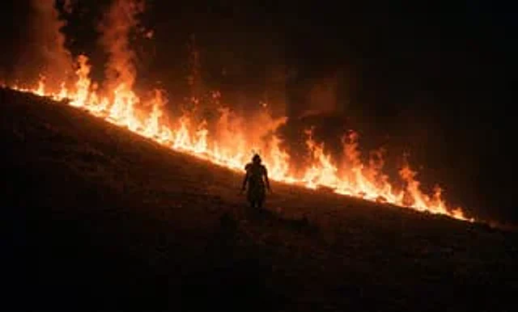

```text
This is a cinematic night scene set on a steep, grassy slope, where a wildfire is spreading. A lone samurai stands in the center of the lower frame, his silhouette rendered in dark. The slope extends diagonally from the upper left to the lower right, a continuous, bright orange flame spreading across the slope behind the figure, creating a luminous boundary between the dark ground and the sky filled with black smoke. The samurai, clad in traditional armor and a horned kabuto, with two swords at his waist, gazes uphill at the flames. The figure's proportions are kept small relative to the landscape to emphasize the sense of scale and solitude. Extremely low-key lighting is employed, utilizing the strong backlighting from the flames to create deep black tones, thick smoke, drifting embers, and a rich, high-contrast palette of black, ember red, and fiery orange. The image should evoke the feel of an epic Japanese war film, employing wide-format composition, minimalist framing, dramatic negative space, realistic textures, and a dense atmosphere of smoke.
```

Model: GPT Image 2
Author: GPT Image 2 Prompts

[ProjectD](https://aitoolsradar.com/en/prompts/2d56a423853c2c) · [Recorded source](https://x.com/Macbaconai/status/2047751716146209155#reversed-0)
 · [Full original metadata and byte evidence](data/projectd-batch-0045.json)

## Samurai Chicken Bathtime Portrait


```text
Bathing in a mini cat paw bathtub{argument name="subject" default="chick"} A classic portrait depicts a cartoon-style chick leaping into the air, holding a miniature weapon in its wing.{argument name="weapon" default="Samurai sword"} She swung her sword, slicing away the scattered cherry blossom petals. The background was a blurred pink cherry blossom forest. The chick wore a ribbon that fluttered behind it.{argument name="clothing" default="Mint Green Ninja Scarf"} The light and shadow create a soft pink and gold hue.
```

Model: GPT Image 2
Author: GPT Image 2 Prompts

[ProjectD](https://aitoolsradar.com/en/prompts/57ab9ebd116f8a) · [Recorded source](https://x.com/dotey/status/2047370565497856013)
 · [Full original metadata and byte evidence](data/projectd-batch-0045.json)

## Samurai Mecha Girl Figure Poster

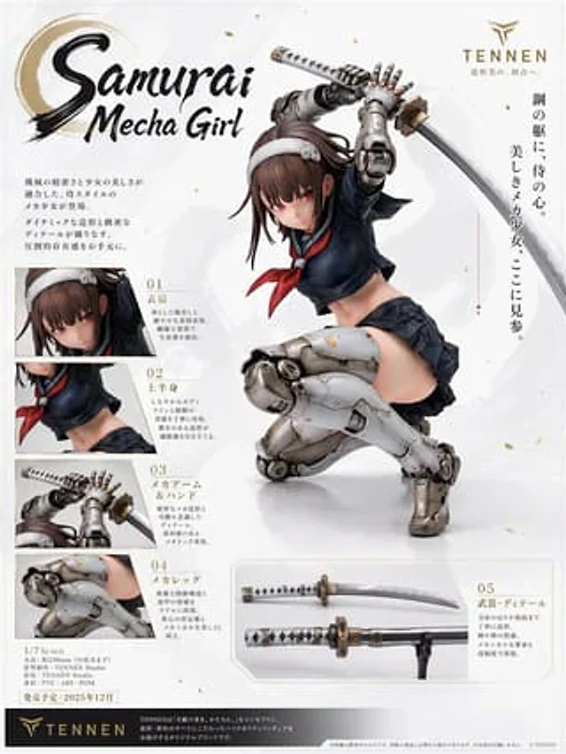

```text
Create a high-end Japanese-style figure advertising poster against a clean, off-white background, with subtle light gray brushstroke textures and scattered small gold leaf accents. The layout should resemble a high-end product introduction page for original anime/mecha statues. The center of the image should feature a highly detailed 1/7 scale figure.{argument name="character name" default="Samurai Mecha Girl"} A slender anime girl is in a dramatic crouching attack stance, her body turned sideways to the viewer, one knee bent beneath her, the other mechanical leg extended forward. She holds her katana high above her head, as if about to launch an attack. Her face is deliberately obscured by a soft, square blur. She has long, messy brown hair, adorned with a white headband featuring small mechanical side ornaments, and wears a naval-style Japanese sailor uniform, including a short-sleeved blouse, a red scarf, and a short pleated skirt that exposes her waist. Her limbs are largely mechanical: metallic silver-gray mechanical arms with clearly visible finger joints; heavy armored thighs and calves with realistic pistons, seams, weathering effects, and small orange warning signs. The katana in her hands is polished, featuring a black and white intertwined hilt and metal guard. The statue is rendered as a realistic collectible with studio lighting, contrasting glossy and matte materials, precise shadows, and showroom-quality photographic effects. The page is designed like a commercial figurine brochure, featuring five numbered, detailed areas. On the left, four rectangular close-up panels are stacked vertically, each with a number, a Japanese label, and a brief Japanese description: Panel 1 shows a close-up of the face and hair, labeled "01 Expression"; Panel 2 shows the upper body and uniform, labeled "02 Upper Body"; Panel 3 shows the raised mechanical arm and sword-wielding pose, labeled "03 Mecha Arm &amp; Sword"; Panel 4 shows the mechanical legs, labeled "04 Mecha Leg". In the bottom right corner, a wider rectangular panel, labeled "05 Armed Discreet," is added, horizontally displaying two close-up views of samurai swords, stacked vertically. All panel images should have subtle borders and blend into the overall poster layout. A large, expressive calligraphic title is placed in the top left corner.{argument name="main title" default="Samurai Mecha Girl"} The first word is followed by a watercolor-style circle pattern. Add a minimalist gold logo and the brand name in the upper right corner.{argument name="brand name" default="TENNEN"} Below this is a brief Japanese slogan. An elegant, dark-colored Japanese promotional slogan is placed on the right. In the lower left area, there is a brief Japanese product specification text, strictly adhering to the following product information format: scale, product name, prototype maker, painter, brand, and release date. The scheduling area uses {argument name="release date" default="December 2025"} Add a dark horizontal footer at the bottom, with a gold brand logo on the left, repeating the brand name, a brief Japanese brand statement in the middle, and a tiny legal/disclaimer text on the far right. Overall style: High-end Japanese figurine marketing page, exquisite editing and layout, realistic collector-grade statue photography, elegant platinum packaging aesthetics, a fusion of anime girls and hardcore mecha design, refined and high-end.
```

Model: GPT Image 2
Author: GPT Image 2 Prompts

[ProjectD](https://aitoolsradar.com/en/prompts/ffdeef9abd0d91) · [Recorded source](https://x.com/munou_ac/status/2047110000339030405#reversed-3)
 · [Full original metadata and byte evidence](data/projectd-batch-0045.json)

## Samurai Mecha Girl Figure Poster


```text
Create a premium Japanese figure advertisement poster on a clean off-white background with subtle pale gray brushstroke textures and tiny scattered gold flecks. The layout should look like a luxury hobby product introduction page for an original anime/mecha statue. The main centerpiece is a highly detailed 1/7 scale-style figure of {argument name="character name" default="Samurai Mecha Girl"}, a slim teenage anime girl in a dramatic crouching attack pose, turned three-quarters to the viewer, with one knee bent under her body and the other mechanical leg planted forward. She raises a katana overhead with both hands as if about to strike. Her face is intentionally obscured by a soft square blur block. She has long brown hair with loose strands flying outward, a white headband with a small mechanical side ornament, and a navy Japanese sailor school uniform with a cropped long-sleeve top, red neckerchief, short pleated skirt, and exposed midriff. Her arms and legs are mostly robotic: metallic silver-gray mechanical arms with articulated fingers and visible joints, bulky armored mech thighs and calves with realistic pistons, seams, weathering, and small orange caution markings. The sword is a polished katana with a white-and-black wrapped handle and a metallic guard. Render the statue as a realistic painted collectible figure with studio lighting, glossy and matte material contrast, precise shadows, and showroom-grade product photography.

Design the page like a commercial figure brochure with exactly 5 numbered detail callout sections. On the left side, stack 4 rectangular close-up panels vertically, each with a number and Japanese label plus short descriptive body text in Japanese: panel 1 shows a close-up of the face and hair, labeled "01 表情"; panel 2 shows the upper torso and uniform, labeled "02 上半身"; panel 3 shows the raised mechanical arms and sword grip, labeled "03 メカアーム&ソード"; panel 4 shows the mechanical legs, labeled "04 メカレッグ". At the bottom right, add a wider rectangular panel labeled "05 武装・ディテール" showing exactly 2 katana close-up views arranged horizontally, one above the other. Keep all panel images bordered lightly and integrated into the poster layout.

At the upper left, place a large expressive brush-calligraphy title reading {argument name="main title" default="Samurai Mecha Girl"}, with an ink-brush circle motif behind the first word. At the upper right, add a gold minimalist logo and the brand name {argument name="brand name" default="TENNEN"}, with small Japanese tagline text beneath it. Along the right side, place a vertical Japanese promotional slogan in elegant dark text. In the lower left area, include small product specification text in Japanese with exactly these lines of product info styling: scale, product name, sculptor credit, paint credit, brand, and a release date line. Use {argument name="release date" default="2025年12月"} in the schedule area. Along the bottom, add a dark horizontal footer bar with the gold brand logo on the left, the brand name repeated, a short Japanese brand statement in small text across the center, and tiny legal/disclaimer text at the far right. Overall style: high-end Japanese figure marketing sheet, refined editorial composition, realistic collectible statue photography, elegant white-and-gold packaging aesthetic, anime girl fused with hard-surface mecha design, polished and premium.
```

Model: GPT Image 2
Author: てんねん

[ProjectD](https://aitoolsradar.com/en/prompts/455433951cca6a) · [Recorded source](https://youmind.com/prompts/samurai-mecha-girl-poster-15447)
 · [Full original metadata and byte evidence](data/projectd-batch-0045.json)

## Samurai Princess Character Sheet

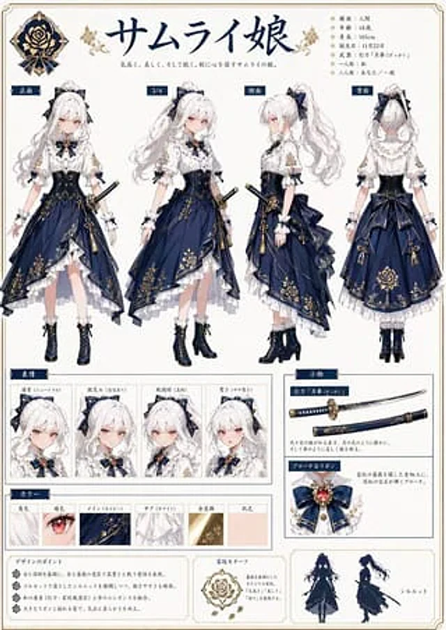

```text
{"type":"Anime Character Design Collection","style":"A gorgeous Japanese character design manual with elegant fantasy samurai aesthetics, a pure white background with delicate gold decorative borders, navy blue and gold titles, highly detailed full-color illustrations, and exquisite typography,""subject":{"role":"Samurai Princess","title":"サムライ姫","tagline":"Elegant, beautiful, and powerful. A samurai princess with a sword in her heart.","character":{"gender":"Female","age":"18","build":"Slender and elegant","skin":"Porcelain-white","hair":{"color":"{argument name="hair color" default="white"} ","style":"Super long wavy high ponytail, tied with a huge navy blue bow, soft bangs, and wispy strands on both sides"},"eyes":{"color":"Soft crimson","shape":"Large and delicate anime eyes"},"expression":"Calm, noble, and slightly reserved"},"outfit":{"theme":"A formal combat outfit combining Japanese and Western styles","primary colors":["Dark Navy Blue","White","Antique Gold"],"pieces":["White high-necked ruffled blouse with puff sleeves and gold floral embroidery on the upper arms","A large navy blue ribbon brooch with a ruby ​​center and gold embellishments at the neckline","Dark navy blue belted waist with gold filigree details and a front tie","Asymmetrical tiered navy blue skirt with heavy gold floral and heraldic embroidery","White petticoat with multiple ruffles at the hem","A large structural bow at the back of the waist","Ruffled cuffs with navy blue ribbon embellishments","Dark navy blue lace-up ankle boots with gold trim and chunky heels"],"accessories":["A samurai sword at the left hip with a navy blue scabbard and gold accessories","Several small ribbon bows on the cuffs and hair","Decorative tassels hanging from the skirt"]},"crest":{"count":2,"descrip tion":"Navy blue and gold rose family crest, a large badge in the upper left corner, and a pattern sample near the bottom center"},"layout":{"sections":[{"title":"Main View","position":"Upper Half","count":4,"labels":["Front","3/4 Side","Side","Back"],"description":"Four full-body rotation views: Front, 3/4 Side, Side, and Back"},{"title":"Expressions","position":"Lower Left","count":4,"labels":["Normal","Smiling","Serious","Surprised"],"description":"Four facial expression close-up panels, showing normal, gentle smile, serious expression in battle, and surprised expression"},{"title":"Expressions":"Face {"color","position":"bottom left","count":6,"labels":["hair color","eye color","primary color (navy blue)","secondary color (white)","gold decoration","skin tone"],"description":"Six rectangular color/material swatches, corresponding to hair, eyes, primary fabric, secondary fabric, gold decoration, and skin tone respectively"},{"title":"accessories","position":"bottom right","count":2,"labels":["katana 'Moonlight'","brooch and ribbon"],"description":"One weapon panel displays the katana horizontally, and one accessory panel displays close-ups of the brooch and ribbon"},{"title":"bottom notes","position":"bottom row","count":3,"labels":["design points","family crest pattern","position":"bottom row","count":3,"labels":["design points","family crest pattern","position":"bottom row","labels":["design points","position":"bottom row","count":6,"labels":["hair color","eye color","primary color (navy blue)","secondary color (white)","gold decoration","skin tone"]],"description":"Six rectangular color/material swatches, corresponding to hair, eyes, primary fabric, secondary fabric, gold decoration, and skin tone respectively"},{"title":"accessories","position":"bottom right","count":3,"labels":["design points","position":"bottom row","count":3,"labels":["design points","family crest pattern","position":"bottom row","labels":["design points","position":"bottom row","count":3,"labels":["design points","position":"bottom row","labels":["family crest pattern","position":"bottom row","count":6,"labels":["hair color","eye color","primary color (navy blue)","position":"bottom row","count": "Silhouette"],"description":"Three square panels containing design description text, rose emblem explanation, and two navy blue silhouette figures"}],"sidebar":{"position":"Top right corner","count":7,"labels":["Race: Human","Age: 18","Height: 165cm","Birthday: November 22","Weapon: Katana 'Gekka'","First person: Watashi (I)","Second person: Anata (You) / ~Lord"],"description":"Compact vertical profile list with diamond bullet points"}},"text_language":"Japanese","rendering":"High-detail anime illustration, crisp lines, soft shadows, luxurious fabric rendering, intricate gold embellishments, reference graphic design, balanced spacing, no background landscape"}
```

Model: GPT Image 2
Author: GPT Image 2 Prompts

[ProjectD](https://aitoolsradar.com/en/prompts/9484055b1c2da8) · [Recorded source](https://x.com/yukinono_ai/status/2047241064113983706#reversed-0)
 · [Full original metadata and byte evidence](data/projectd-batch-0045.json)

## 𝗦𝗮𝗻𝗶𝗮 #109

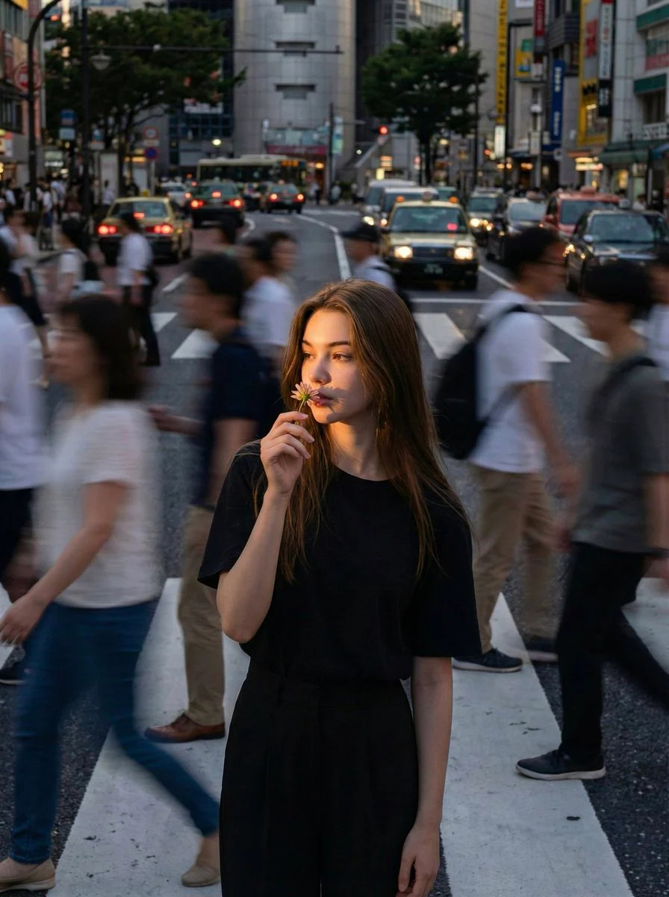

```text
{
  "type": "image_generation_prompt",
  "style": "photorealistic cinematic street photography, documentary aesthetic",
  "resolution": "ultra-high resolution",
  "identity_preservation": {
    "use_reference_image": true,
    "alter_face": false,
    "strict_identity_lock": true,
    "notes": "Use the uploaded reference image as the compositional base. Replace the central character with the woman from the reference image, preserving exact facial structure, skin texture, lighting direction, shadows, depth of field, angle, and emotional expression. No distortions, no artifacts, no skin tone mismatch."
  },
  "subject": {
    "gender": "female",
    "appearance": {
      "hair": "bald (as in the original composition)",
      "age": "adult",
      "expression": "calm, introspective, emotionally neutral",
      "skin": "realistic texture with natural pores and tones"
    },
    "pose": {
      "position": "standing still in the center of a busy urban crosswalk",
      "action": "gently smelling a flower held near the face",
      "posture": "upright, relaxed, perfectly static"
    },
    "wardrobe": {
      "outerwear": "dark minimalist blazer",
      "top": "black shirt"
    }
  },
  "environment": {
    "location": "busy urban pedestrian crosswalk",
    "atmosphere": "metropolitan street scene",
    "crowd": {
      "behavior": "people moving rapidly around the subject",
      "effect": "motion blur from long exposure"
    }
  },
  "lighting": {
    "type": "natural daylight",
    "conditions": "overcast sky",
    "quality": "soft, diffused light",
    "effects": [
      "realistic skin tones",
      "no artificial highlights",
      "natural shadows"
    ]
  },
  "cinematic_effects": {
    "long_exposure": true,
    "subject_clarity": "central subject perfectly sharp",
    "surroundings": "crowd blurred with motion",
    "mood": "isolation and stillness amid chaos"
  },
  "color_grading": {
    "palette": [
      "cool grays",
      "muted browns",
      "soft blacks"
    ],
    "saturation": "desaturated",
    "style": "professional cinematic grading"
  },
  "camera": {
    "lens_look": "85mm",
    "depth_of_field": "shallow",
    "grain": "realistic film grain",
    "perspective": "identical to original reference image"
  },
  "quality_constraints": [
    "no facial deformation",
    "no AI artifacts",
    "no artificial lighting effects",
    "perfect facial integration",
    "consistent shadows and perspective"
  ],
  "output_goal": "Create a photorealistic, cinematic street photograph featuring a woman standing still in a busy crosswalk, smelling a flower, with long-exposure motion blur around her, preserving the exact realism, lighting, depth, and emotional tone of the original reference image."
}
```

Model: GPT Image 2
Author: 𝗦𝗮𝗻𝗶𝗮

[ProjectD](https://aitoolsradar.com/en/prompts/a622f334d37895) · [Recorded source](https://x.com/saniaspeaks_/status/2003500034239938642)
 · [Full original metadata and byte evidence](data/projectd-batch-0045.json)

## 𝗦𝗮𝗻𝗶𝗮 #162

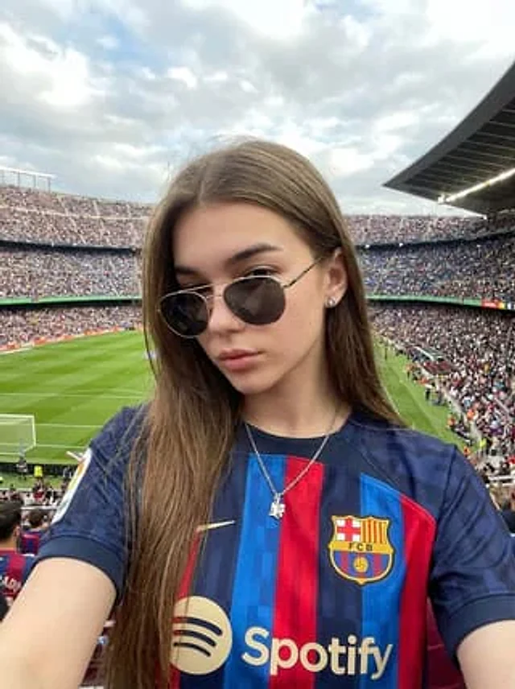

```text
{
  "type": "image_generation_prompt",
  "language": "en",
  "style": "realistic smartphone photography, vibrant sports atmosphere",
  "aspect_ratio": "3:4",
  "identity_preservation": {
    "use_reference_image": true,
    "strict_identity_lock": true,
    "alter_face": false,
    "alter_features": false,
    "notes": "Use the uploaded reference photo. Preserve 100% of the woman’s facial features, proportions, skin texture, hair, and identity."
  },
  "subject": {
    "gender": "female",
    "pose": {
      "type": "selfie-style pose",
      "orientation": "facing the camera",
      "action": "static moment, as if pausing to take a selfie"
    },
    "expression": "serious, confident, and admiring",
    "appearance": {
      "hair": "unchanged from reference image",
      "accessories": [
        "aviator-style sunglasses with gold frame",
        "diamond stud earring in the right ear",
        "silver chain necklace with a pendant"
      ]
    },
    "wardrobe": {
      "top": "official FC Barcelona jersey with Spotify sponsorship"
    }
  },
  "composition": {
    "framing": "centered composition",
    "foreground": "woman occupying the first plane",
    "background": "football stadium and crowd",
    "perspective": "first-person selfie perspective"
  },
  "environment": {
    "location": "packed football stadium",
    "elements": [
      "vibrant green football pitch",
      "crowded stands full of fans",
      "energetic stadium atmosphere"
    ],
    "weather": "cloudy sky",
    "mood": "excitement, celebration, pride"
  },
  "lighting": {
    "type": "natural daylight",
    "conditions": "bright but diffused due to cloudy sky",
    "effects": [
      "vivid colors",
      "balanced exposure",
      "clear facial details"
    ]
  },
  "camera": {
    "device_style": "smartphone rear camera",
    "shot_type": "selfie-style medium close-up",
    "focus": "sharp focus on the subject with slightly softened background",
    "quality": "high sharpness and clarity"
  },
  "quality": {
    "realism": "highly realistic",
    "color": "vibrant and true-to-life",
    "detail_level": "clear textures on clothing, face, and stadium"
  },
  "constraints": [
    "Do not alter facial features",
    "No stylization or artistic filters",
    "No distortion of body or face",
    "No text overlays or watermarks",
    "Maintain realistic proportions and lighting"
  ],
  "output_goal": "Create a realistic, selfie-style photo of a woman wearing a Barcelona jersey in front of a packed football stadium, preserving her exact facial identity and conveying pride and admiration within a vibrant match-day atmosphere."
}
```

Model: GPT Image 2
Author: 𝗦𝗮𝗻𝗶𝗮

[ProjectD](https://aitoolsradar.com/en/prompts/713c08fd4fd9fa) · [Recorded source](https://x.com/saniaspeaks_/status/2010667809014264132)
 · [Full original metadata and byte evidence](data/projectd-batch-0045.json)

## 𝗦𝗮𝗻𝗶𝗮 #176

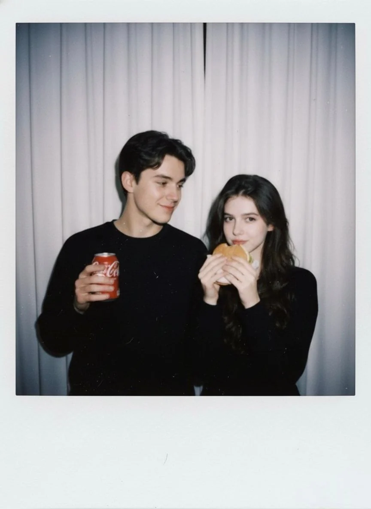

```text
{
  "type": "image_generation_prompt",
  "style": "Polaroid-style candid photography",
  "camera_style": {
    "camera": "Polaroid instant camera",
    "look": "ordinary snapshot",
    "effects": [
      "slight blur",
      "soft focus",
      "flash-lit dark room glow",
      "light scattering from on-camera flash",
      "subtle film grain",
      "slight exposure falloff"
    ]
  },
  "identity_preservation": {
    "use_reference_images": true,
    "strict_identity_lock": true,
    "alter_face": false,
    "notes": "Do not change or distort either person’s facial features, expressions, or proportions."
  },
  "subjects": [
    {
      "gender": "female",
      "identity": "user",
      "pose": "cute, casual pose standing close to the boy",
      "prop": "holding a burger",
      "expression": "natural, playful, candid"
    },
    {
      "gender": "male",
      "identity": "boy from reference",
      "pose": "cute, relaxed pose next to the girl",
      "prop": "holding a red Coca-Cola can",
      "expression": "natural, playful, candid"
    }
  ],
  "interaction": {
    "relationship": "friendly and cute",
    "body_language": "standing close together, relaxed, slightly leaning toward each other"
  },
  "environment": {
    "background": "plain white curtains",
    "location": "indoor room",
    "lighting": {
      "type": "single on-camera flash",
      "quality": "consistent, frontal flash lighting",
      "mood": "cozy, intimate, nostalgic"
    }
  },
  "composition": {
    "framing": "medium shot",
    "angle": "eye-level",
    "balance": "centered, casual snapshot composition"
  },
  "aesthetic": {
    "vibe": "cute, nostalgic, intimate",
    "era_feel": "classic instant film look",
    "imperfections": [
      "minor blur",
      "soft edges",
      "natural exposure inconsistencies"
    ]
  },
  "constraints": [
    "No change to faces",
    "No dramatic posing",
    "No artificial glamour or studio look",
    "No text or watermarks",
    "Must look like a real Polaroid photo"
  ],
  "output_goal": "Create a realistic Polaroid-style instant photo of a boy and girl posing cutely together indoors, with white curtains behind them, flash-lit from a dark room, the boy holding a red Coca-Cola can and the girl holding a burger, maintaining an authentic, nostalgic snapshot feel."
}
```

Model: GPT Image 2
Author: 𝗦𝗮𝗻𝗶𝗮

[ProjectD](https://aitoolsradar.com/en/prompts/feb2b4c05ac326) · [Recorded source](https://x.com/saniaspeaks_/status/2006946255709340062)
 · [Full original metadata and byte evidence](data/projectd-batch-0045.json)

## 𝗦𝗮𝗻𝗶𝗮 #189

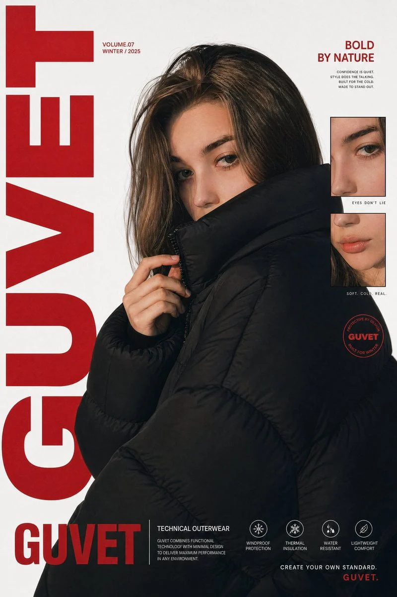

```text
A bold fashion editorial poster featuring a young woman model in a close-up half-body portrait, wrapped in an oversized black puffer jacket with a high padded collar partially covering the lower face, styled in a minimal, sleek, modern luxury streetwear aesthetic. The model turns her upper body slightly away from the camera while looking back over her shoulder toward the viewer, creating a tense and magnetic pose, with one hand raised delicately near the jacket zipper and collar, fingers lightly touching the fabric as if adjusting it, giving a controlled, elegant, and intentional gesture that contrasts softly with the heavy oversized jacket, while her shoulders are slightly hunched into the coat to create a protective, stylish, and intimate silhouette. Her facial expression is calm, serious, and subtly mysterious with direct eye contact, slightly parted lips, relaxed brows, and a smooth yet intense gaze, conveying a quiet, emotionally reserved, high-fashion attitude that feels soft, cold, elegant, and untouchable. The overall mood is moody, minimalist, premium, and polished with a quiet luxury winter editorial feel. The outfit consists of an oversized matte black down puffer jacket with dramatic volume, a high collar, and a clean zipper line, with no additional accessories, maintaining a monochrome modern Korean magazine vibe. The poster design features a clean graphic magazine cover style with a white background, oversized red vertical typography behind the subject spelling “GUVET” or similar bold letterforms, a sharp editorial layout, red and black color scheme, modern sans-serif text, small microtext blocks, inset cropped detail frames showing close-up facial features, and subtle fashion publication branding elements at the bottom. The lighting is soft studio lighting with clean skin texture, crisp contrast, smooth shadows, high detail on the eyes and lips, refined print-magazine finishing, ultra sharp focus, and a luxury commercial fashion poster aesthetic in high resolution with a premium composition.
```

Model: GPT Image 2
Author: 𝗦𝗮𝗻𝗶𝗮

[ProjectD](https://aitoolsradar.com/en/prompts/bd990f6d406c51) · [Recorded source](https://x.com/saniaspeaks_/status/2048748484011204693)
 · [Full original metadata and byte evidence](data/projectd-batch-0045.json)

## 𝗦𝗮𝗻𝗶𝗮 #25

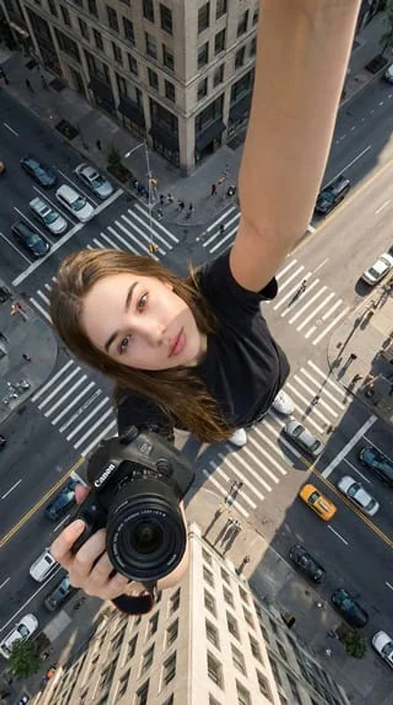

```text
{
  "type": "image_generation_prompt",
  "language": "en",
  "style": "hyper-realistic cinematic selfie photography",
  "aspect_ratio": "9:16",
  "identity_preservation": {
    "use_reference_image": true,
    "strict_identity_lock": true,
    "alter_face": false,
    "alter_skin": false,
    "alter_hair": false,
    "alter_gender": false,
    "notes": "Preserve identical facial features, skin texture, hair, glasses, age, and gender from the uploaded reference image. No synthetic skin or sculptural look."
  },
  "subject": {
    "gender": "female",
    "capture_method": "selfie taken by the subject herself",
    "pose": {
      "selfie_arm": {
        "description": "one arm fully straight and completely extended upward holding the camera that takes the selfie",
        "visibility": "arm clearly visible, straight and dominant in frame",
        "camera_visibility": "the selfie camera device itself must NOT be visible in the frame"
      },
      "product_arm": {
        "description": "the other arm fully extended toward the camera holding the attached Canon camera",
        "importance": "product is closest to the camera and visually dominant"
      },
      "head": {
        "tilt": "slightly tilted toward the selfie camera"
      },
      "expression": "natural and relaxed facial expression"
    },
    "body_visibility": "full body visible from head to toe",
    "feet": "feet clearly touching the road surface"
  },
  "composition": {
    "perspective": "natural selfie perspective at chest height",
    "camera_angle": "extreme top-down angle, camera above the subject looking directly downward",
    "layer_depth": [
      "product (closest to camera)",
      "face",
      "full body",
      "city environment (background)"
    ]
  },
  "scale_and_perspective": {
    "effect": "forced perspective",
    "subject_scale": "the woman appears extremely giant",
    "buildings_scale": "buildings appear much smaller, reaching no higher than her knees",
    "dominance": "the subject visually dominates the entire scene",
    "realism": "inspiring scale while remaining physically believable"
  },
  "environment": {
    "location": "real urban intersection",
    "elements": [
      "pedestrian crosswalk",
      "road markings",
      "traffic signs",
      "cars",
      "bicycles",
      "pedestrians at realistic human scale"
    ],
    "setting": "ground-level urban environment"
  },
  "lighting": {
    "type": "natural daylight",
    "conditions": "clear or lightly cloudy sky",
    "shadows": "soft and realistic",
    "restrictions": "no fantasy or dramatic lighting"
  },
  "product_rules": {
    "usage": "use the uploaded Canon product exactly as provided",
    "distortion": "none",
    "logo": "unchanged",
    "appearance": "natural reflections and realistic highlights only"
  },
  "camera_quality": {
    "realism": "maximum photorealism",
    "depth": "clear separation of foreground, subject, and background",
    "artifacts": "none"
  },
  "constraints": [
    "No AI-art look",
    "No plastic or sculpted skin",
    "No distortion of face or body",
    "No extra limbs or incorrect anatomy",
    "No text or watermarks",
    "No visible selfie camera device"
  ],
  "output_goal": "Create a hyper-realistic cinematic selfie image of a woman using her exact reference identity, captured from an extreme top-down perspective in a real urban crosswalk, with forced perspective scale, natural daylight, and a Canon camera product prominently held toward the lens."
}
```

Model: GPT Image 2
Author: 𝗦𝗮𝗻𝗶𝗮

[ProjectD](https://aitoolsradar.com/en/prompts/1c2d64cf38b6e6) · [Recorded source](https://x.com/saniaspeaks_/status/2009834337043394622)
 · [Full original metadata and byte evidence](data/projectd-batch-0045.json)

## 𝗦𝗮𝗻𝗶𝗮 #81

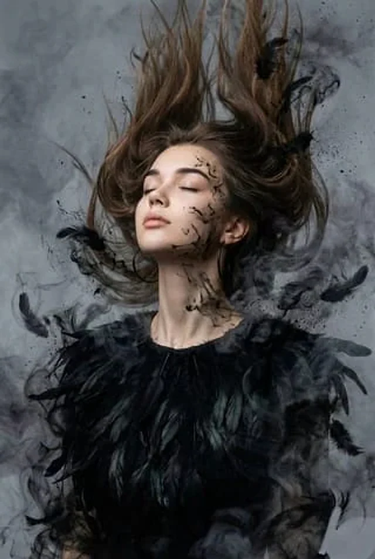

```text
{
  "image_style": "surreal, dark cinematic, ethereal",
  "subject": {
    "person": "woman with features of reference image",
    "pose": "head tilted back, eyes closed, expression of freedom and release",
    "framing": "close-up portrait from chest upward",
    "clothing": "long-sleeve blouse made of organic, layered deep matte black raven feathers",
    "accessories": "large black hoop earrings"
  },
  "visual_effects": {
    "hair": "loose, dynamically suspended, blowing upward and forward by wind",
    "dissolving_elements": [
      "feathers and hair merging with black ink splatters",
      "charcoal dust",
      "wisps of dark smoke"
    ],
    "face_details": "fine black ink splatters and wisps spreading across face and neck"
  },
  "environment": {
    "background": "smoky gray, moody atmosphere",
    "elements": "thick, dense, layered smoke swirling throughout the frame"
  },
  "technical_aspects": {
    "resolution": "high-resolution",
    "lighting": "cinematic, moody, diffused through smoke"
  }
}
```

Model: GPT Image 2
Author: 𝗦𝗮𝗻𝗶𝗮

[ProjectD](https://aitoolsradar.com/en/prompts/e9a92bd2827d49) · [Recorded source](https://x.com/saniaspeaks_/status/2007661583246471621)
 · [Full original metadata and byte evidence](data/projectd-batch-0045.json)

## Santorini Luxury Dress Portrait


```text
A charming travel fashion portrait, the picture shows a{argument name="woman" default="blonde woman"} Seated on a sunlit stone platform overlooking the crater of a volcano in Santorini, Greece, with white cliffside buildings stretching into the deep blue sea and rugged volcanic islands in the distance as a backdrop, she wore a flowing ivory halter-neck dress with a deep V-neck, cutouts on the sides, and pleats and circular details at the waist. The soft, pleated fabric draped over her knees. Her long, wavy hair was {argument name="hair color" default="gold"} The hair is naturally draped over the shoulders. She wears layered, delicate necklaces, including a small pendant and a silver cross, and a bracelet or watch on her wrist. A classic white Greek church is placed in the upper right corner of the background, with bright {argument name="dome color" default="blue"} The dome, with vibrant blooms dotting the right side of the image.{argument name="flower color" default="Magenta"} Bougainvillea. The lighting is bright Mediterranean midday sunlight, with sharp highlights and a soft glow on the skin. The natural depth of field makes the subject clear, while the background buildings and ocean appear slightly softer. The composition is vertical, elegant and appealing, with the subject slightly right-centered, showing her upper body and flowing skirt. The beautiful coastline stretches across the left half of the image. Small black text is added to the upper left corner.{argument name="corner text" default="GPT V2"} Photorealistic luxury vacation aesthetics, high detail, natural colors, and an editor-quality Instagram travel style.
```

Model: GPT Image 2
Author: GPT Image 2 Prompts

[ProjectD](https://aitoolsradar.com/en/prompts/5601599fb2412f) · [Recorded source](https://x.com/Eduardopto/status/2046675324067258535#reversed-3)
 · [Full original metadata and byte evidence](data/projectd-batch-0045.json)

## Sarah #244

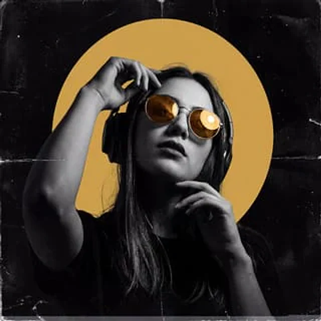

```text
Create a dark, high‑contrast poster with a moody, underground club aesthetic. The composition features a monochrome portrait of a young woman from the chest up, shot from a slightly low angle for attitude and power. She wears large over‑ear headphones and reflective round sunglasses with warm amber‑gold lenses that stand out vividly against the black‑and‑white portrait. One hand is raised near her head, the other near her chin, creating a dynamic, expressive pose associated with music immersion. Behind her head is a large flat golden‑yellow circular shape, like a spotlight, creating a strong focal point and visual contrast. The background is deep black with subtle grunge textures, dust, scratches, and poster‑wear imperfections, giving it a raw, printed‑flyer feel. Use 4:5 aspect ratio.
```

Model: GPT Image 2
Author: Sarah

[ProjectD](https://aitoolsradar.com/en/prompts/23e4f8ca05bb6f) · [Recorded source](https://x.com/SyntheSarah/status/2048586749778293129)
 · [Full original metadata and byte evidence](data/projectd-batch-0045.json)

## Sarah #291

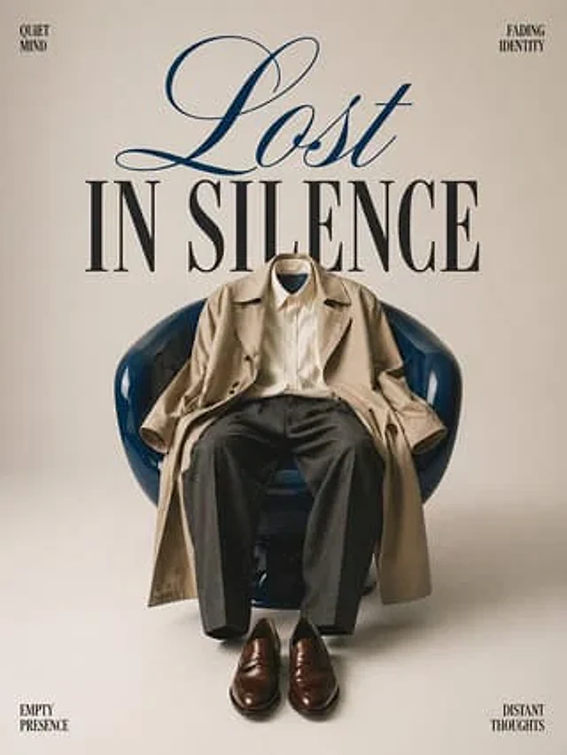

```text
Minimalist conceptual fashion editorial poster, studio shot on a clean off-white seamless background. A glossy deep blue modern lounge chair placed in the center, with an oversized beige trench coat and tailored charcoal trousers draped naturally over it, creating the illusion of an invisible person sitting there. Polished brown leather loafers placed neatly on the floor in front of the chair. Large elegant typography behind the chair reading “LOST IN SILENCE” — “Lost” in flowing luxury cursive script, “IN SILENCE” in bold serif uppercase. Small subtle text in the corners like “quiet mind,” “fading identity,” “empty presence,” and “distant thoughts.” High-fashion magazine cover aesthetic, cinematic soft lighting, muted tones, surreal emotional atmosphere, clean composition, luxury editorial styling, premium fashion campaign look, artistic and symbolic.
```

Model: GPT Image 2
Author: Sarah

[ProjectD](https://aitoolsradar.com/en/prompts/83881830d6701d) · [Recorded source](https://x.com/AIwithSarah_/status/2048983944922882536)
 · [Full original metadata and byte evidence](data/projectd-batch-0045.json)

## Satellite Anomaly Interface Mockup

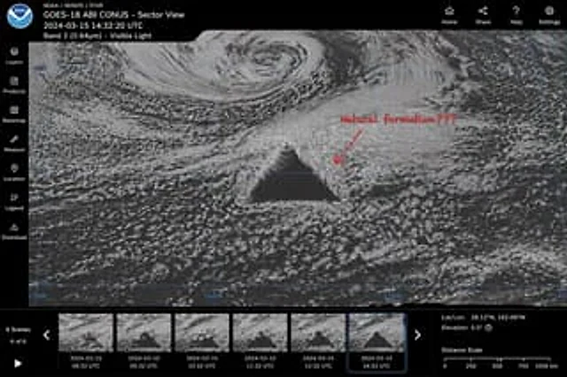

```text
{
  "type": "Satellite image web interface model",
  "main_display": {
    "imagery": "A grayscale satellite view of ocean clouds, with a central point containing a{argument name=\"anomaly shape\" default=\"Huge, perfect geometric dark triangle\"}",
    "annotation": "The red handwritten text{argument name=\"annotation text\" default=\"Naturally formed?\"} The text is accompanied by a red arrow pointing to the anomaly.",
    "overlay": "The light blue latitude and longitude grid lines have coordinate labels such as 40N, 30N, and 160W."
  },
  "ui_layout": {
    "top_header": {
      "left_section": "The NOAA logo, with the words \"{argument name=\"satellite name\" default=\"GOES-18 ABI CONUS - Sector View\"} \"{argument name=\"timestamp\" default=\"2024-03-15 14:32:20 UTC\"} \"and \"Band 2 (0.64µm) - Visible light\"",
      "right_section": "The four navigation icons are labeled: Home, Share, Help, and Settings."
    },
    "left_sidebar": {
      "count": 7,
      "items": [
        "Layers",
        "product",
        "Base map",
        "Measurement",
        "Location",
        "legend",
        "download"
      ]
    },
    "bottom_panel": {
      "timeline": {
        "controls": "Play button, left and right arrows, text \"6 scenes\", \"6/6\"",
        "thumbnails": {
          "count": 6,
          "description": "Continuous satellite imagery showing the anomalous evolution, including hourly timestamps from 08:32 UTC to 14:32 UTC."
        }
      },
      "data_readout": {
        "coordinates": "{argument name=\"coordinate text\" default=\"Latitude and longitude: 28.12°N, 162.08°W\"}",
        "elevation": "Altitude: 0.5°",
        "scale": "Distance scale from 0 to 1000 km"
      }
    }
  }
}
```

Model: GPT Image 2
Author: GPT Image 2 Prompts

[ProjectD](https://aitoolsradar.com/en/prompts/d1f4effcb52eae) · [Recorded source](https://x.com/MullerScot19970/status/2044613172641108240#reversed-0)
 · [Full original metadata and byte evidence](data/projectd-batch-0045.json)

## Satellite Map of Big Ben Area

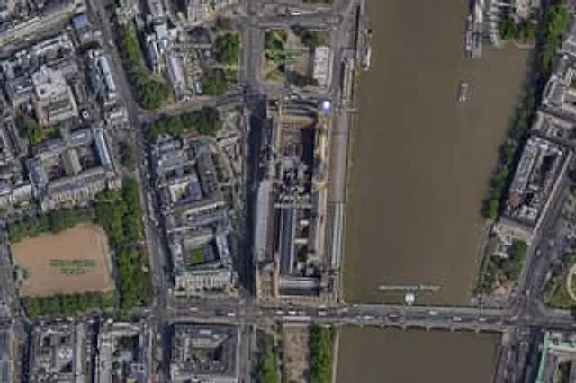

```text
A{argument name="city" default="London"} High-resolution overhead satellite map with the city center as its core, closely focused on{argument name="landmark" default="Big Ben"} And the area surrounding Westminster Palace on the banks of the Thames. Presented as a realistic aerial orthophoto, reminiscent of a modern digital map or satellite image, it includes detailed rooftops, streets, trees, shadows, and the brownish-brown river water. The long, narrow Westminster Palace complex is placed vertically on the right side of the image, adjacent to the west bank of the river, with Big Ben located in the northeast corner of the palace near the riverbank. A building labeled {argument name="bridge name" default="Westminster Bridge"} The bridge spans the river from left to right at the bottom of the image. A total of 6 visible map tags are included.{argument name="label 1" default="Westminster Abbey"} ,{argument name="label 2" default="Parliament Square"} Big Ben, Palace of Westminster, Westminster Bridge, and the Horse Guards Parade are all included. Whitehall is also marked as a road, vertically displayed on the left side of the palace area. Surrounding details should include Westminster Abbey in the upper left quadrant, Parliament Square above the palace, the Horse Guards Parade in the lower left quadrant as a large, sand-colored rectangle, the dense city blocks and roads in the left half, the Thames River occupying the entire right side, the embankments on both banks, a few boats on the river, and tree-lined streets and parks. Natural satellite imagery colors and clear map annotations are used to create an enlarged online map screenshot effect.
```

Model: GPT Image 2
Author: GPT Image 2 Prompts

[ProjectD](https://aitoolsradar.com/en/prompts/62beb0775aaa0a) · [Recorded source](https://x.com/fofrAI/status/2046607953940058436#reversed-1)
 · [Full original metadata and byte evidence](data/projectd-batch-0045.json)

## Satellite Map of Big Ben Area


```text
A high-resolution top-down satellite map view of central {argument name="city" default="London"}, focused tightly on the area around {argument name="landmark" default="Big Ben"} and the Palace of Westminster beside the River Thames. Show a realistic aerial orthographic perspective like a modern digital map or satellite layer, with detailed rooftops, streets, trees, shadows, and brownish river water. Place the long Palace of Westminster complex vertically near the center-right, directly along the west bank of the river, with Big Ben at the northeast corner of the palace near the river edge. A bridge labeled {argument name="bridge name" default="Westminster Bridge"} crosses horizontally near the bottom of the frame from left to right over the river. Include 6 visible map labels total: {argument name="label 1" default="Westminster Abbey"}, {argument name="label 2" default="Parliament Square"}, Big Ben, Palace of Westminster, Westminster Bridge, and Horse Guards Parade. Also show Whitehall as a labeled road running vertically on the left side of the palace area. Surrounding details should include Westminster Abbey in the upper left quadrant, Parliament Square above the palace, Horse Guards Parade as a large sandy rectangular ground in the lower left quadrant, dense city blocks and roads on the left half, the River Thames occupying the full right side, embankments on both sides, a few boats on the river, and tree-lined streets and parks. Use natural satellite-image colors, crisp cartographic label overlays, and the look of a zoomed-in online maps screenshot.
```

Model: GPT Image 2
Author: fofr

[ProjectD](https://aitoolsradar.com/en/prompts/475e70eea84e52) · [Recorded source](https://youmind.com/prompts/satellite-map-big-ben-14409)
 · [Full original metadata and byte evidence](data/projectd-batch-0045.json)

## Satirical 4-Panel Caricature Comic Strip

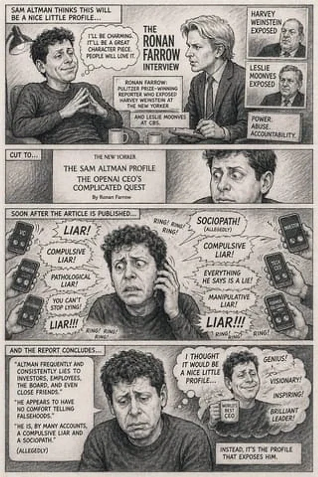

```text
{
  "type": "Four-panel vertical comic",
  "style": "{argument name=\"art style\" default=\"Black and white pencil sketch, cross-hatching and shading, satirical cartoon style\"}",
  "characters": {
    "subject_1": "{argument name=\"main character\" default=\"Sam Altman\"} Curly hair, casual sweater",
    "subject_2": "{argument name=\"interviewer\" default=\"Ronan Farrow\"} Suits, ties, and notebooks in hand"
  },
  "layout": {
    "panels": [
      {
        "panel_number": 1,
        "top_caption": "Sam Altman thought this would be a good, short interview...",
        "scene": "subject_1 crossed his arms in a tower shape, looking smug; subject_2 was taking notes with a serious expression.",
        "thought_bubble": "I'll be very charming. This will be a great character profile. Everyone will love it.",
        "center_text": "Interview with RONAN FARROW",
        "inset_portraits": {
          "count": 2,
          "labels": [
            "Harvey Weinstein scandal exposed",
            "Leslie Moonves scandal exposed"
          ]
        },
        "info_boxes": {
          "count": 3,
          "text": [
            "RONAN FARROW: Pulitzer Prize winner, who exposed Harvey Weinstenin's crimes for The New Yorker.",
            "And CBS's Leslie Moonves.",
            "Power. Abuse. Accountability."
          ]
        }
      },
      {
        "panel_number": 2,
        "top_caption": "The scene cuts to...",
        "scene": "A close-up of subject_1, showing a shocked and terrified expression.",
        "article_header": "{argument name=\"publication\" default=\"The New Yorker\"} SAM ALTMAN Interview with OPENAI CEO: A Complex Journey of Exploration (Author: Ronan Farrow)"
      },
      {
        "panel_number": 3,
        "top_caption": "Shortly after the article was published...",
        "scene": "subject_1 looks extremely stressed, sweating profusely, and has his phone pressed to his ear. There are six hands around him holding smartphones.",
        "phone_labels": [
          "Venture Capital",
          "reporter",
          "Former employee",
          "investor",
          "CEO of a technology company",
          "Former colleague"
        ],
        "shouts": {
          "count": 8,
          "text": [
            "{argument name=\"main accusation\" default=\"fraud\"}!",
            "A habitual liar!",
            "Pathological lies!",
            "You just can't stop!",
            "fraud!!!",
            "Antisocial personality disorder! (allegedly)",
            "Every word he said was a lie!",
            "A manipulative liar!"
          ]
        },
        "sound_effects": "Ring! Ring! Ring!"
      },
      {
        "panel_number": 4,
        "top_caption": "The report concluded...",
        "scene": "subject_1 looks completely broken and frustrated.",
        "quote_box": "\"ALTMAN frequently and consistently deceived investors, employees, projects, and even close friends.\" \"He seemed to have no qualms about lying.\" \"According to multiple descriptions, he was a habitual liar and an antisocial individual.\" (allegedly)",
        "thought_bubble": {
          "scene": "Happy Subject_1 is holding a mug that reads \"World's Best CEO\".",
          "text": "I thought this would be a nice, short interview...",
          "sparkle_words": {
            "count": 4,
            "text": [
              "genius!",
              "Foresight and wisdom!",
              "Inspiring!",
              "An outstanding leader!"
            ]
          }
        },
        "bottom_caption": "As a result, this interview completely exposed his true colors."
      }
    ]
  }
}
```

Model: GPT Image 2
Author: GPT Image 2 Prompts

[ProjectD](https://aitoolsradar.com/en/prompts/835c9b038da1d9) · [Recorded source](https://x.com/kaikaitheaiguy/status/2046348036394393677#reversed-1)
 · [Full original metadata and byte evidence](data/projectd-batch-0045.json)

## Satirical 4-Panel Product Ads


```text
{
  "type": "4-grid satirical product advertisement",
  "layout": {
    "grid": "2x2",
    "panels": [
      {
        "position": "Top left",
        "product_name": "{argument name=\"top left product name\" default=\"Sitting stone\"}",
        "visual": "A man wearing a white shirt and dark trousers sat on a large round stone in the park.",
        "catchphrase": "Rest peacefully anytime, anywhere.",
        "sales_badge": "Cumulative sales have exceeded 12,000 units!",
        "vertical_text": "When all the park benches are occupied.",
        "features_count": 3,
        "features_labels": [
          "Weighing approximately 8kg, it has excellent stability.",
          "The bottom is made of felt to prevent scratching the ground.",
          "Comes with a dedicated carrying strap for easy portability."
        ],
        "extra_visual": "Small stone image with leather strap",
        "specs": [
          "150kg load capacity",
          "Reliable Japanese manufacturing"
        ]
      },
      {
        "position": "Top right",
        "product_name": "{argument name=\"top right product name\" default=\"Toothbrush for people who don&#39;t want to brush their teeth\"}",
        "visual": "A stylish light blue toothbrush rests at an angle on a dark blue background.",
        "toothbrush_text": "I don't want to brush my teeth.",
        "catchphrase": "Holding it in my hand, I feel at ease.",
        "vertical_text": "Instead of brushing your teeth, you might as well hold this.",
        "sales_badge": "The series has sold over 85,000 units in total!",
        "features_count": 3,
        "features_labels": [
          "As a talisman to calm the mind",
          "Etiquette before meetings or business negotiations",
          "Make the choice of \"not brushing your teeth\" more flexible."
        ],
        "bottom_banner": "It will free you from the stress of brushing your teeth."
      },
      {
        "position": "Bottom left",
        "product_name": "{argument name=\"bottom left product name\" default=\"Cloud piggy bank\"}",
        "visual": "A hand is dropping coins into a cloud-shaped plush piggy bank.",
        "catchphrase": "A sense of security lighter than air.",
        "sales_badge": "Cumulative sales have exceeded 23,567 units!",
        "features_count": 3,
        "features_labels": [
          "Fluffy and soft to the touch",
          "Unbreakable, for peace of mind.",
          "Design integrated into home décor"
        ],
        "color_variants_count": 3,
        "color_variants_labels": [
          "blue",
          "pink",
          "White"
        ],
        "price": "¥2,980 (tax included)",
        "bottom_text": "Starting today, let's accumulate our hopes little by little towards the sky."
      },
      {
        "position": "Bottom right",
        "product_name": "{argument name=\"bottom right product name\" default=\"A stone that scolds you\"}",
        "visual": "On the desk was a round stone, next to which sat a pen; words were written on the stone.",
        "stone_text": "{argument name=\"scolding phrase\" default=\"いいかげんやれ\"}",
        "catchphrase": "Dedicated to those of you who lack motivation.",
        "sales_badge": "Cumulative sales have exceeded 18,000 units!",
        "features_count": 3,
        "features_labels": [
          "It's inspiring every time I see it.",
          "Randomly selected inspirational quotes",
          "No batteries required, semi-permanently urges you on."
        ],
        "phrase_variants_count": 10,
        "phrase_variants_labels": [
          "Stop acting cute",
          "Don't overthink it.",
          "Take action",
          "Let's face reality.",
          "Don't run away",
          "Don't sleep",
          "Just do it.",
          "If it were you, you definitely could.",
          "Don't sleep",
          "Stop making excuses."
        ],
        "price": "¥3,500 (tax included)"
      }
    ]
  }
}
```

Model: GPT Image 2
Author: GPT Image 2 Prompts

[ProjectD](https://aitoolsradar.com/en/prompts/3772bfafd5a4f4) · [Recorded source](https://x.com/fukumy_ai/status/2046292108668211324#reversed-0)
 · [Full original metadata and byte evidence](data/projectd-batch-0045.json)

## Satirical AI Hater Action Figure

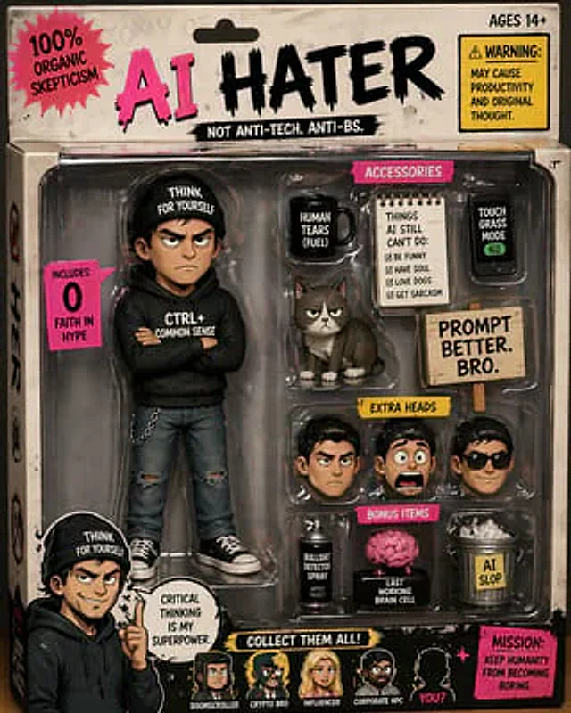

```text
{
  "type": "Satirical illustrations of collectible action figure packaging",
  "style": "This retro toy blister packaging model features a rugged streetwear design, distressed cardboard back panel, bold comic-style typography, highly legible packaging text, and humorous anti-AI cultural satire.",
  "subject": {
    "product_name": "AI HATER",
    "product_type": "posable dolls",
    "theme": "Skepticism counters hype; tech critics play with toys.",
    "age_label": "14 years and older",
    "warning_label": {
      "title": "warn:",
      "text": "It may lead to increased productivity and independent thinking."
    },
    "burst_badge": "100% Purely Natural Skepticism"
  },
  "figure": {
    "count": 1,
    "appearance": "Stylized male posable figure, face deliberately obscured, arms crossed, standing inside blister packaging.",
    "outfit_count": 5,
    "outfit_pieces": [
      "Black hat with the words 'THINK FOR YOURSELF' printed in white.",
      "Black hoodie with the white text 'CTRL+COMMON SENSE' printed on it.",
      "Blue distressed jeans with rips at the knees and a side chain.",
      "Black and white low-top sneakers",
      "Dark inner layer peeking out from under the hoodie"
    ]
  },
  "layout": {
    "packaging_style": "Vertical retail toy box with a transparent plastic blister window",
    "sections": [
      {
        "title": "Include",
        "position": "Pink badge in the middle left",
        "count": 1,
        "labels": [
          "0. Faith in hype"
        ]
      },
      {
        "title": "Accessories",
        "position": "Top right corner",
        "count": 5,
        "labels": [
          "Black mug with 'HUMAN TEARS (FUEL)' printed on it.",
          "The spiral notebook, printed with 'THINGS AI STILL CAN'T DO:', contains four list items: 'BE FUNNY', 'HAVE SOUL', 'LOVE DOGS', and 'GET SARCASM'.",
          "The device displays 'TOUCH GRASS MODE' and has a green 'ON' button.",
          "A grumpy gray and white cat doll",
          "The sign on the wooden stake reads 'PROMPT BETTER. BRO.'"
        ]
      },
      {
        "title": "Replacement head sculpt",
        "position": "Accessories, bottom right",
        "count": 3,
        "labels": [
          "Replace head sculpt 1, face obscured",
          "Replacement head sculpt 2, face obscured",
          "Replacement head sculpt 3, face obscuring"
        ]
      },
      {
        "title": "Reward items",
        "position": "bottom right corner",
        "count": 3,
        "labels": [
          "The spray can is printed with 'BULLSHIT DETECTOR SPRAY' and includes the smaller print 'APPLY DIRECTLY TO PROJECT'.",
          "Pink brain, labeled 'LAST WORKING BRAIN CELL'",
          "Metal trash can, labeled 'AI SLOP'"
        ]
      },
      {
        "title": "Collect them all!",
        "position": "Bottom center strip",
        "count": 5,
        "labels": [
          "DOOMSCROLLER (Doomsday Flooder)",
          "CRYPTO BRO (Crypto Brothers)",
          "INFLUENCER (Internet celebrity)",
          "CORPORATE NPC (Corporate NPC)",
          "YOU?"
        ]
      },
      {
        "title": "mission",
        "position": "Pink sticky note in the bottom right corner",
        "count": 1,
        "labels": [
          "To prevent humans from becoming bored."
        ]
      }
    ]
  },
  "extra_graphics": {
    "count": 2,
    "labels": [
      "The small illustration in the bottom left corner shows a character holding a speech bubble that reads, 'CRITICAL THINKING IS MY SUPERPOWER.'",
      "The black banner below the title reads 'NOT ANTI-TECH. ANTI-BS.'"
    ]
  },
  "color_palette": {
    "cardboard": "Old beige with dirt and scratches",
    "accent_colors_count": 3,
    "accent_colors": [
      "Bright pink",
      "black",
      "Warning Huang"
    ]
  },
  "composition": "The product photo shows the figure on the left side, with accessories arranged in a molded compartment on the right. The bottom features a collector's silhouette strip, with realistic toy packaging reflections and shadows, all under clean studio lighting."
}
```

Model: GPT Image 2
Author: GPT Image 2 Prompts

[ProjectD](https://aitoolsradar.com/en/prompts/050a504f3f56f9) · [Recorded source](https://x.com/Artedeingenio/status/2046550068140937575#reversed-0)
 · [Full original metadata and byte evidence](data/projectd-batch-0045.json)

## Satirical Brand Collaboration Poster


```text
A poster proposing a high-end brand collaboration. The product is "{argument name="collaboration brands" default="National Civil Service Examination × China Welfare Lottery"} "Dream Collaboration Edition: "{argument name="title" default="Scratch-off lottery tickets"} Slogan: "Since the probabilities are about the same, why not give it a try?" Overall style:{argument name="style" default="Official visuals × Lottery vendor street style"} .
```

Model: GPT Image 2
Author: GPT Image 2 Prompts

[ProjectD](https://aitoolsradar.com/en/prompts/dfdc934a858863) · [Recorded source](https://x.com/ajie_run_CL/status/2047262066382373002)
 · [Full original metadata and byte evidence](data/projectd-batch-0045.json)

## Satirical Expensive Supplements Cartoon


```text
A simple, square editorial cartoon in a flat vector style, with soft shadows and bold outlines against a light gray background. The scene is a satirical medical consultation about overpriced and ineffective supplements. In the top left corner is a large three-line bold sans-serif Spanish headline: “Suplementos” (dark cyan), “costosos” (orange), and “que no funcionan” (dark cyan), below which is a small orange glitter and an orange underline. In the top right corner are dark cyan social media accounts and URLs: “ @elnutridice ” and “elnutridice.com”. On the far left edge is a vertical orange signature: “Imagen creada en: ia.elnutridice.com”. In the foreground, a wooden table is shown, piled high with bundles of green cash, with many scattered banknotes fluttering around the characters. On the right, a smug male doctor, dressed in cyan surgical scrubs under a white lab coat, sits behind the table, holding a thick wad of money in one hand and gesturing casually with the other. His face was deliberately obscured by a rectangular, blurred block. His lab coat bore a badge or patch that read "SALUD Y COMISIONES". On the table in front of him sat a dark blue nameplate with a dollar sign and the Spanish words "TU SALUD, MI NEGOCIO". Behind him hung a certificate that read "CERTIFICADO DE COMISIONES" on the wall, next to which rested three items on a small shelf: two blue binders and a small potted plant. To the left, a female patient with long, dark brown hair, wearing a blue long-sleeved shirt, sat facing the doctor, one hand raised in frustration. Her face, too, was obscured by a rectangular, blurred block. Add a speech bubble above her that reads: “Doc, this supplement carísimo que me mandó no me sirvió para nada.” Add a speech bubble above the doctor that reads: “A mí sí me sirvió.” In the lower left corner of the table, place a supplement bottle labeled “SUPLEMENTO PREMIUM” with an orange price tag “$$$$”. Next to it is a clipboard with a prescription sheet showing a large “Rx” and the text “SUPLEMENTO PREMIUM”. The image contains a total of 2 small potted plants: one on the ground or lower left of the table, and one on a shelf behind. It employs a humorous, critical social media infographic style, with a balanced composition, clear typography, high readability, and a refined modern vector illustration aesthetic.
```

Model: GPT Image 2
Author: GPT Image 2 Prompts

[ProjectD](https://aitoolsradar.com/en/prompts/f814a36b24d9ac) · [Recorded source](https://x.com/ElNutriDice/status/2047023858578870545#reversed-0)
 · [Full original metadata and byte evidence](data/projectd-batch-0045.json)

## Satirical Spanish Sports Front Page

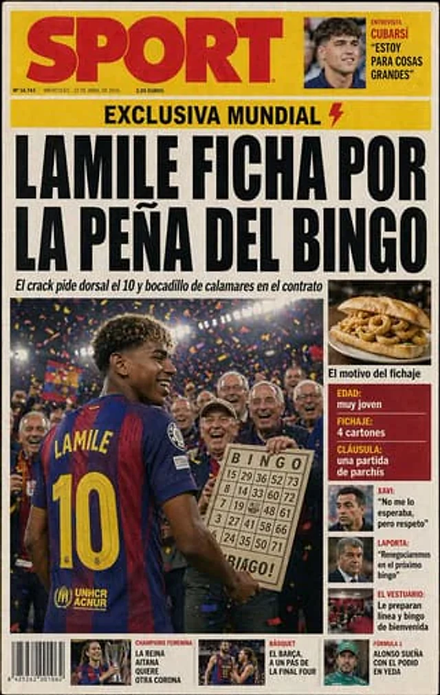

```text
A satirical front page of a Spanish sports newspaper, designed like a tabloid cover, is full-page and entirely frontal, printed on slightly worn off-white newsprint with a subtle paper texture, faint stains, and a narrow black border. A bright yellow banner spans the top of the masthead, featuring a large red "SPORT" logo. The upper right corner contains a small promotional box with a picture of a football player and the Spanish text: "ENTREVISTA CUBARSÍ 'ESTOY PARA COSAS GRANDES'". Below the masthead is a long yellow bar with the bold black text "EXCLUSIVA MUNDIAL" and a small red lightning bolt icon. The main headline occupies the center of the page in large, compressed black capital letters, divided into two lines: "LAMILE FICHA POR LA PEÑA DEL BINGO". Below this is a black italic Spanish subheading: "El crack pide dorsal el 10 y bocadillo de calamares en el contrato". The main photo occupies the left-center and lower-middle sections of the page: a young football player, primarily shown from behind, wearing a blue and red striped Barcelona home jersey with the large yellow letters "LAMILE" and the number "10" printed on it, stands amidst a celebratory stadium scene filled with confetti, bright lights, and blurred images of fans and crowds. He holds or displays a giant bingo board with "BINGO" written at the top and "BINGO!" at the bottom. On the right, create a vertical sidebar containing four stacked content blocks: the first is a photo of a squid sandwich on a plate with the caption "El motivo del fichaje" (The motivator of the squid sandwich); the second is a red information box listing three humorous transfer facts in yellow and white text: "EDAD: muy joven" (Early Bird), "FICHAJE: 4 cartones" (Fish Sandwich), and "CLÁUSULA: una partida de parchís" (Park Sandwich); the third is a quote bar containing three stacked small items, each with a small portrait and a Spanish caption: "XAVI: 'No me lo esperaba, pero respeto'" (XAVI), "LAPORTA: 'Renegociaremos en el próximo bingo'" (LAPORTA: Renegociaremos en el próximo bingo') and "EL VESTUARIO: Le preparan línea y bingo de bienvenida" (Vestuary: The prepared línea y bingo de bienvenida); the fourth is a small racing teaser at the bottom, with driver images and the text "FÓRMULA 1 ALONSO SUEÑA CON EL PODIO EN" (FÓRMULA 1 ALONSO SUEÑA CON EL PODIO EN). "YEDA". Along the bottom strip are three small teaser panels: one featuring a female soccer player holding a trophy, captioned "CHAMPIONS FEMENINA LA REINA AITANA QUIERE OTRA CORONA"; one basketball panel featuring two Barcelona players, captioned "BÁSQUET EL BARÇA, A UN PAS DE LA FINAL FOUR"; and an F1 racing teaser panel integrated into the right edge. Tiny Spanish-language newspaper metadata, including issue number, date, and price, is added to the lower left of the masthead, such as "Nº 16.743 MIÉRCOLES 22 DE ABRIL DE 2026 2,00 EUROS". The overall style should be hyper-realistic print newspaper cover photography and typography, featuring authentic magazine layout, strong black headlines, saturated sports photo colors, a comedic transfer rumor parody tone, and a seamless and believable print design.
```

Model: GPT Image 2
Author: GPT Image 2 Prompts

[ProjectD](https://aitoolsradar.com/en/prompts/3cfec692492918) · [Recorded source](https://x.com/Nocodeboy/status/2046687463716905333#reversed-1)
 · [Full original metadata and byte evidence](data/projectd-batch-0045.json)

## Saul Goodman #169


```text
Hip-hop fashion model standing full-frame, clothing distorted into stretched streaks like motion drag, bold red background, retro film grain, barcode + tiny technical text in bottom area, modern fashion-magazine layout, expressive weirdness, cool attitude , 4K high detail. --ar 4:5 --raw
```

Model: GPT Image 2
Author: Saul Goodman

[ProjectD](https://aitoolsradar.com/en/prompts/fae3f2be2b533b) · [Recorded source](https://x.com/Goodmanprotocol/status/2048599189681291673)
 · [Full original metadata and byte evidence](data/projectd-batch-0045.json)

## Saul Goodman #180


```text
Person from the reference image, with a fade haircut, brown eyes, and a well-groomed short beard, wearing a glossy oversized red puffer jacket and loose red pants with white and red nike sneakers, crouching low with one knee up and one leg forward, left arm resting casually over the raised knee and right hand relaxed near the other leg, body angled slightly to the side while head tilts forward looking directly at the camera with a confident expression, ultra wide-angle low perspective shot emphasizing the front sneaker appearing large and dominant in the foreground, set in a fully red environment with smooth floor and backdrop featuring large white nike swoosh logos behind and flowing ribbon-like red shapes around, hyper-realistic photography, extremely sharp details on fabric shine and sneaker texture, dramatic studio lighting with strong highlights and soft shadows, saturated monochromatic red color palette with white accents, modern streetwear campaign style, no blur, no distortion, no extra limbs, no artifacts
```

Model: GPT Image 2
Author: Saul Goodman

[ProjectD](https://aitoolsradar.com/en/prompts/1f1f73ba28880f) · [Recorded source](https://x.com/Goodmanprotocol/status/2038433331944292723)
 · [Full original metadata and byte evidence](data/projectd-batch-0045.json)

## Scenic Landscape Calendar


```text
Design one{argument name="content" default="Realistic scenery"} Calendar, date is{argument name="date" default="April 16, 2026"}
```

Model: GPT Image 2
Author: GPT Image 2 Prompts

[ProjectD](https://aitoolsradar.com/en/prompts/bac05c90360e5f) · [Recorded source](https://x.com/akokoi1/status/2044789531615056175)
 · [Full original metadata and byte evidence](data/projectd-batch-0045.json)

## Scenic Landscape Calendar


```text
设计一张{argument name="日期" default="2026年4月16日"}的{argument name="内容" default="真实风景"}日历
```

Model: GPT Image 2
Author: WY

[ProjectD](https://aitoolsradar.com/en/prompts/282161b735810a) · [Recorded source](https://youmind.com/prompts/scenic-landscape-calendar-13703)
 · [Full original metadata and byte evidence](data/projectd-batch-0045.json)

## Scenic Travel Ad Banner Generator


```text
{
  "type": "Travel advertising webpage banner",
  "layout": {
    "background": "{argument name=\"scenery type\" default=\"Majestic snow-capped mountains and turquoise lakes\"} Pine trees, winding asphalt roads, and a cloudless, azure sky.",
    "foreground_right": "{argument name=\"car color\" default=\"light blue\"} The SUV was driving on the road, its trunk open and filled with luggage, the roof rack already mounted, and a wooden road sign reading 'NEXT ADVENTURE'.",
    "typography_left": {
      "top_ribbon": "A gold ribbon with the words 'まだ見ぬ绝景へ。' and a bird pattern.",
      "main_headline": "Large serif font{argument name=\"main headline\" default=\"Return to nature, take a deep breath.\"} ', using a dark blue gradient",
      "sub_headline": "Word'{argument name=\"sub headline\" default=\"Let&#39;s set off and let our hearts be clear.\"} ', featuring fine lines and mountain graphics"
    },
    "ui_elements": {
      "cta_button": "A pill-shaped blue-green gradient button with the text '{argument name=\"cta button text\" default=\"View Recommendations &gt;\"} '",
      "bottom_bar": {
        "description": "White footer",
        "count": 3,
        "items": [
          {
            "icon": "Mountains and Roads",
            "text": "Scenic Self-Driving Tour"
          },
          {
            "icon": "Camera and leaves",
            "text": "Renewal Journey"
          },
          {
            "icon": "Calendar and Trees",
            "text": "Weekend trip"
          }
        ]
      }
    }
  }
}
```

Model: GPT Image 2
Author: GPT Image 2 Prompts

[ProjectD](https://aitoolsradar.com/en/prompts/2a7ceec618f4c5) · [Recorded source](https://x.com/masapark95/status/2046168679822594059#reversed-0)
 · [Full original metadata and byte evidence](data/projectd-batch-0045.json)

## Scenic Wall Calendar Page


```text
{
  "type": "Calendar pages",
  "presentation": "A physical paper calendar hanging on a white wall, with a subtle shadow effect.",
  "layout": {
    "top_half": {
      "type": "Landscape photos",
      "subject": "{argument name=\"scenic location\" default=\"Mount Fuji, cherry blossoms and lakes\"}",
      "details": "Snow-capped peaks, reflected in the calm blue lake, a small wooden boat carrying two people, pink cherry blossoms adorning the banks in the upper left and upper right corners, and pink flowers on the lower right bank.",
      "text_overlays": [
        {
          "position": "Top right corner",
          "text": "{argument name=\"year and month\" default=\"April 2026\"}",
          "style": "White serif font"
        },
        {
          "position": "Centered at the bottom",
          "text": "4 / {argument name=\"highlighted date\" default=\"16\"} / {argument name=\"day of week\" default=\"Tuesday\"}",
          "style": "Large white serif font with projection effect"
        }
      ]
    },
    "bottom_half": {
      "type": "Calendar Grid",
      "header": {
        "text": "April 2026",
        "style": "Red cursive script, centered."
      },
      "grid_structure": {
        "columns": 7,
        "rows": 5,
        "column_headers": [
          "Sunday",
          "on Monday",
          "Tuesday",
          "Wednesday",
          "Thursday",
          "Friday",
          "Saturday"
        ]
      },
      "grid_content": {
        "highlighted_cell": {
          "date": "{argument name=\"highlighted date\" default=\"16\"}",
          "style": "Pure red square background, white text"
        },
        "number_colors": "Sunday is red, Saturday is blue, weekdays are black, and last month's dates are light gray.",
        "notable_features": "The AI-generated artifact shows the number 5 appearing twice (at the end of the first line and at the beginning of the second line)."
      },
      "footer": {
        "text": "{argument name=\"holidays\" default=\"Earth Day (22) Showa Day (29)\"}",
        "position": "bottom left corner",
        "style": "Red serif font"
      }
    }
  }
}
```

Model: GPT Image 2
Author: GPT Image 2 Prompts

[ProjectD](https://aitoolsradar.com/en/prompts/a1a0599e9b0f56) · [Recorded source](https://x.com/sgy121/status/2045056420408971420#reversed-0)
 · [Full original metadata and byte evidence](data/projectd-batch-0045.json)

## School Drama Relationship Chart Generator


```text
添付したイラストのキャラクターを中心に、学園ドラマ風の「キャラクター相関図」を作ってください。

【条件】
・メインキャラクター名【{argument name="名前" default="ここに名前を入力"}】
・中央にメインキャラクターを大きく配置
・周囲に親友・ライバル・片思いの相手・家族・クラスメイト・いとこなどを放射状に配置
・各キャラクターは顔または上半身の可愛い切り抜きイラストで表示
・関係性は色付きの矢印（→）で繋ぐ
・矢印の近くに、かわいい手書き風の短いコメントを入れる（例：「大親友！」「ドキドキ…」「ライバルだけど…」）
・全体を{argument name="基調色" default="ピンク・パステル"}基調で、星・ハート・花などの可愛い装飾を散らす
・タイトルは「学園ドラマ 相関図」風に
・学園ラブコメっぽい温かくて楽しい雰囲気で
```

Model: GPT Image 2
Author: K T

[ProjectD](https://aitoolsradar.com/en/prompts/70e91a1210e81f) · [Recorded source](https://youmind.com/prompts/school-drama-relationship-chart-17091)
 · [Full original metadata and byte evidence](data/projectd-batch-0045.json)

## Sci-Fi Android Maid Light Novel Cover


```text
A high-quality anime-style illustration depicting a beautiful female android maid.{argument name="hair color" default="Long white hair"} She has captivating blue eyes. She wears an exquisite black and white ruffled maid outfit, her limbs integrated with futuristic white mechanical armor, adorned with glowing blue cybernetic decorations and joints. A small digital screen on her chest displays glowing blue heart rate monitoring lines. Beneath a traditional maid's headdress, she wears a device resembling mechanical headphones. She stands in a bright, sun-drenched modern apartment bedroom, large windows overlooking the silhouette of a futuristic city. The light is soft and cinematic, with glowing dust particles floating in the air. Her expression is gentle, slightly melancholic, one hand resting lightly beside the screen on her chest. The image incorporates elegant typographic overlays. At the top is delicate, refined text…{argument name="top quote" default="I still can&#39;t quite put a name to my emotions."} The bottom features large, elegant Japanese characters.{argument name="character name" default="Ayase Alicia"} Below it was directly labeled in English.{argument name="english name" default="AYASE ALICIA"} Below that is smaller text:{argument name="bottom description" default="An old-model home support android is currently learning emotions."} The overall aesthetic style resembles the cover of a science fiction light novel or the main visual of a visual novel.
```

Model: GPT Image 2
Author: GPT Image 2 Prompts

[ProjectD](https://aitoolsradar.com/en/prompts/41d48d2e503ab3) · [Recorded source](https://x.com/kotsu_kotsu_san/status/2045377402466107398#reversed-1)
 · [Full original metadata and byte evidence](data/projectd-batch-0045.json)

## Sci-Fi Anime Character Select UI


```text
{
  "type": "Futuristic game character selection interface",
  "theme": "A stylish sci-fi neon HUD interface featuring anime cosplay portraits.",
  "screen": {
    "title": "Choose your character",
    "aspect_ratio": "16:9",
    "background": "The deep blue-black high-tech interface features glowing circuit lines, metal frame details, delicate particle effects, and a premium e-sports game menu feel."
  },
  "top_bar": {
    "left": {
      "player_label": "Player 1",
      "level_text": "LV.99",
      "avatar": "Small round player avatar",
      "progress_bar": "Blue glowing status bar"
    },
    "right": {
      "icons_count": 3,
      "icons": [
        "Trophy",
        "Set gears",
        "Return arrow"
      ]
    }
  },
  "character_grid": {
    "count": 6,
    "selected_index": 3,
    "cards": [
      {
        "index": "01",
        "name_jp": "Nezuko Kamado",
        "name_en": "NEZUKO KAMADO",
        "color_theme": "Pink-Magenta",
        "portrait": "A young woman dressed in Nezuko-style cosplay, with long, dark, wavy hair tied with a pink ribbon, and pink kimono patterns peeking out from under a dark haori, one hand outstretched forward."
      },
      {
        "index": "02",
        "name_jp": "Shinobu Kocho",
        "name_en": "SHINOBU KOCHO",
        "color_theme": "Purple",
        "portrait": "A young woman dressed in Shinobu Kocho cosplay, with dark hair adorned with a purple butterfly hair accessory, wearing a black Demon Slayer Corps uniform, and holding a katana at an angle."
      },
      {
        "index": "03",
        "name_jp": "Tsukino Usagi",
        "name_en": "USAGI TSUKINO",
        "color_theme": "Gold-Orange",
        "portrait": "A young woman dressed in Sailor Moon style cosplay, with long blonde twin ponytails and a bun, wearing a sailor uniform, white top, blue skirt, and a large red bow, her hands in a salute gesture.",
        "selected": true
      },
      {
        "index": "04",
        "name_jp": "Rei Ayanami",
        "name_en": "REI AYANAMI",
        "color_theme": "Cyan",
        "portrait": "A young woman dressed in Rei Ayanami style cosplay, with a short, light blue bob haircut, wearing a shiny white futuristic combat suit with black and green accents, one hand near the headphone area."
      },
      {
        "index": "05",
        "name_jp": "Shikinami Asuka Langley",
        "name_en": "ASUKA SHIKINAMI",
        "color_theme": "Red-Orange",
        "portrait": "A young woman dressed in Asuka-style cosplay, with long, reddish-brown twin tails, wearing a shiny red combat outfit, confidently stands with her hands on her hips."
      },
      {
        "index": "06",
        "name_jp": "Rin Tohsaka",
        "name_en": "RIN TOHSAKA",
        "color_theme": "red",
        "portrait": "A young woman dressed in Rin Tohsaka cosplay style, with long black twin tails, a red sleeveless top with black tie details, and a dark skirt, her hand close to her face."
      }
    ]
  },
  "bottom_ui": {
    "left_panel": {
      "title": "Role",
      "value": "6/6",
      "icons_count": 6,
      "icons": [
        "Pink Flower Emblem",
        "Purple Butterfly Emblem",
        "Golden Crescent Emblem",
        "Blue Diamond Emblem",
        "Red spear-shaped emblem",
        "Red Starburst Emblem"
      ]
    },
    "center_button": {
      "text": "confirm",
      "style": "Large illuminated gold angled button"
    },
    "right_panel": {
      "stats_count": 4,
      "stats": [
        {
          "label": "attack",
          "value": 95,
          "bar_color": "red"
        },
        {
          "label": "defense",
          "value": 88,
          "bar_color": "pink"
        },
        {
          "label": "speed",
          "value": 92,
          "bar_color": "yellow"
        },
        {
          "label": "Support",
          "value": 90,
          "bar_color": "green"
        }
      ]
    }
  },
  "style": "This is a meticulously polished game UI mockup, featuring realistic cosplay photography on each card, strong contour lighting, glossy textures, crisp typography, symmetrical layout, high-contrast neon edge glow, and a premium AAA-level character selection menu.",
  "quality": "Sharp, cinematic, highly readable, and with high information density."
}
```

Model: GPT Image 2
Author: GPT Image 2 Prompts

[ProjectD](https://aitoolsradar.com/en/prompts/5536d346d49701) · [Recorded source](https://x.com/chenoh61/status/2046584887327764725#reversed-1)
 · [Full original metadata and byte evidence](data/projectd-batch-0045.json)

## Sci-Fi Anime Detective Poster


```text
A sci-fi movie poster with a cinematic, anime-style aesthetic. In the center of the image is a figure {argument name="hair color" default="Silver long hair"} A young woman with blue eyes sits confidently in a huge, futuristic gray armchair decorated with glowing light blue neon lights. She wears a black trench coat over a white turtleneck shirt, black trousers, and black high-heeled boots. The chair sits on a glowing blue circular holographic platform floating in deep space, dotted with stars. Behind her, a translucent blue holographic screen displays data and images of planets. At the top center, the series title {argument name="series title" default="&quot;Charlotte the Cyber ​​Chair Detective&quot;"} Presented in small white text, within a large main title written in an elegant serif font.{argument name="main title" default="&quot;Angel&#39;s Tears&quot;"} Above. Below the main title is the slogan.{argument name="subtitle" default="All records began with this encounter."} At the bottom center of the poster is the text "This is the first record of Charlotte and Watson," followed by a striking, stylized title.{argument name="bottom text" default="シャルロット & W.A.T.S.O.N."} At the very bottom, it is labeled "Original Story / Screenplay / Director noriyang". The overall atmosphere is mysterious, high-tech, and epic.
```

Model: GPT Image 2
Author: GPT Image 2 Prompts

[ProjectD](https://aitoolsradar.com/en/prompts/bf79345a527601) · [Recorded source](https://x.com/noriyang_crypt/status/2046083802058166616#reversed-0)
 · [Full original metadata and byte evidence](data/projectd-batch-0045.json)

## Sci-Fi Cat on Fish-Powered Vacuum


```text
A surreal science fiction digital illustration depicting a{argument name="animal" default="White cat"} Sitting in{argument name="vehicle" default="robot vacuum"} It flies in deep space. The vacuum cleaner is equipped with {argument name="side boosters" default="Two large tuna"} As rocket boosters, they spew bright flames from their tails. A ribbed metal hose connects a vacuum cleaner to the cat's neck. The background features glittering cosmic nebulae and high-speed streaks of light, with a planet exploding violently in the upper left. Vertical Japanese text on the right reads {argument name="japanese text" default="Make peace with cats"} (The first two characters are yellow, the rest are white). There is a large 3D metallic text at the bottom center.{argument name="bottom text" default="GERONEKO"} Below, smaller white text reads "Creator of the planet." Cinematic lighting effects and hyper-realistic textures.
```

Model: GPT Image 2
Author: GPT Image 2 Prompts

[ProjectD](https://aitoolsradar.com/en/prompts/db472df48e0177) · [Recorded source](https://x.com/mentaro/status/2043686766042067059#reversed-0)
 · [Full original metadata and byte evidence](data/projectd-batch-0045.json)

## Sci-Fi Chibi Robot Welding in Space


```text
A highly detailed science fiction illustration, depicting a {argument name="robot style" default="Cute chibi robot"} Floating in space, currently{argument name="action" default="Welding a huge metal megastructure"} The robot has a large, round head and is equipped with {argument name="eye color" default="Glowing blue"} Its eyes and body are black and white mechanical structures. The tool it holds sparks bright orange flames against the frame. This colossal structure is extremely vast, meandering through the scene and appearing as {argument name="structure type" default="Dark metal mesh covered with thousands of tiny yellow dots"} In the background, a{argument name="star color" default="Brilliant blue"} Stars gleam against a backdrop of deep space filled with cosmic dust and countless stars. The image features ultra-fine textures, cinematic lighting effects, high contrast, and intricate, complex mechanical designs.
```

Model: GPT Image 2
Author: GPT Image 2 Prompts

[ProjectD](https://aitoolsradar.com/en/prompts/d1b03a43abeeb8) · [Recorded source](https://x.com/lakeside529/status/2045033508062867821#reversed-1)
 · [Full original metadata and byte evidence](data/projectd-batch-0045.json)

## Sci-Fi Commander Portrait


```text
A highly detailed, hyperrealistic portrait, the subject is{argument name="character description" default="A young woman with an elegant dark updo"} She was wearing{argument name="outfit" default="A stylish, futuristic black trench coat uniform, complete with sophisticated silver metallic armor, straps, and a sci-fi pistol holster."} She stood confidently, gracefully raising one hand to {argument name="technology" default="Glowing blue holographic data interface"} Interact with the user. Background setting:{argument name="environment" default="The dimly lit bridge of the starship"} The large observation window in the background shows{argument name="background scene" default="A massive space fleet is traversing a nebula."} Cinematic lighting, sharp focus, 8K resolution, sci-fi concept art style, dramatic shadows, and cool blue tones.
```

Model: GPT Image 2
Author: GPT Image 2 Prompts

[ProjectD](https://aitoolsradar.com/en/prompts/42dae822127495) · [Recorded source](https://x.com/Fancyfreer/status/2044789137853792669#reversed-3)
 · [Full original metadata and byte evidence](data/projectd-batch-0045.json)

## Sci-Fi Concept Art & Character Sheet


```text
{ "type": "Comprehensive Concept Art and Character Reference Table", "overall_aesthetic": "Dark Abyss Style, High Detail",{argument name="theme color" default="Bioluminescent blue"} "Embellishing, biomechanical feel", "header": { "title": "{argument name="main title" default="Abyss Covenant"} ", "subtitle": "Cognition is change, understanding is transformation.", }, "layout": { "top_section": { "type": "Environmental and Biological Concept Art", "description": "Underwater abyss landscape, including{argument name="creature type" default="Giant serpentine Leviathan"} "and towering organic structures", "labeled_entities": { "count": 4, "labels": ["01 Elder Sephira", "02 Volan", "03 Nereis", "04 Abyssal Core"] }, "sub_panels": [ { "title": "Contractor Equipment", "count": 4, "description": "Biomechanical Weapons and Tools" }, { "title": "Proportional Integration Diagram", "count": 4, "description": "Comparison of Outline Dimensions of Humans, Creatures, and Structures" } ] }, "bottom_section": { "type": "Character Design Table", "character": { "name": "{argument name="character name" default="Elder Sephira"} ", "design": "Female, dark-colored messy bun hairstyle, wearing{argument name="suit style" default="Complex dark biomechanical armor with a semi-transparent cloak"} " }, "turnaround_poses": { "count": 4, "labels": ["FRONT", "LEFT SIDE", "BACK", "Reference: Three Views (3/4)"] }, "expressions": { "title": "Expressions", "count": 3, "labels": ["Normal (Deep Focus)", "When Contract is Activated", "Private Moments"] }, "detail_panels": [ { "title": "Pupil Changes", "count": 2, "description": "Close-up of eyes showing pupil changes" }, { "title": "Armor Details", "count": 2, "description": "Core Structure Diagram of Chest and Back Armor" }, { "title": "Hand Details / Boots and Foot Soles", "count": 2, "description": "Close-up of Gloves and Boots" } ], "bottom_row": [ { "title": "Portable Tools / Data Devices", "count": 5, { "description": "Handheld Device vs. Capsule" }, { "title": "Size Comparison Ruler", "count": 4, "description": "Auxiliary Size Comparison Chart" }, { "title": "Covenant Emblem", "count": 1, "description": "Glowing Circular Emblem" } ] } } }
```

Model: GPT Image 2
Author: GPT Image 2 Prompts

[ProjectD](https://aitoolsradar.com/en/prompts/214027112a257b) · [Recorded source](https://x.com/old_pgmrs_will/status/2044808935228715118#reversed-0)
 · [Full original metadata and byte evidence](data/projectd-batch-0045.json)

## Sci-Fi Deep Sea Concept Art & Reference Sheet


```text
{
  "type": "Cinematic Illustrations and Comprehensive Concept Art Reference Collection",
  "overall_theme": "Science Fiction Deep Sea Exploration",
  "layout": {
    "top_half": "Cinematic Key Visuals",
    "bottom_half": "High-density multi-panel reference atlas"
  },
  "top_half_details": {
    "typography": {
      "main_title": "{argument name=\"main title\" default=\"Abyss Horizon\"}",
      "taglines": [
        "Humanity has opened the door to the deep sea. It is a world beyond imagination.",
        "Darkness is not the end, but a new beginning for humanity."
      ]
    },
    "scene": "Two characters stand on a balcony, overlooking the vast deep-sea environment.",
    "characters": [
      {
        "description": "Male, dark hair, back to the camera, wearing a dark blue jacket",
        "jacket_text": "NEREIS-01 Research Team Leader{argument name=\"male character name\" default=\"FUKAMI YOU\"}"
      },
      {
        "description": "A woman with brown hair tied up, seen from the side, wearing a dark blue jacket.",
        "jacket_text": "IDTO Observer{argument name=\"female character name\" default=\"A. VOLKOV\"}"
      }
    ],
    "background_elements": [
      {
        "type": "giant submarine",
        "label": "{argument name=\"submarine name\" default=\"NEREIS-01\"}"
      },
      {
        "type": "Giant bioluminescent biomechanical structures",
        "label": "{argument name=\"base structure name\" default=\"ABYSS ANCHOR\"}-13,000 meters"
      }
    ]
  },
  "bottom_half_details": {
    "sections": [
      {
        "title": "Worldview concept art",
        "content": "The scale comparison chart shows 2 characters, 2 submarines, and 1 creature."
      },
      {
        "title": "ANA VOLKOV",
        "content": "Female character reference. Includes 3 full-body rotation views (front, back, and side), 4 facial expressions, and 3 close-up details of boots and accessories."
      },
      {
        "title": "FUKAMI YOU",
        "content": "Male character reference. Includes 3 full-body rotation views (front, back, and side), 4 facial expressions, and 3 close-up details of gloves and wrist equipment."
      },
      {
        "title": "VOID CROWN",
        "content": "Biological design drawings. Includes detailed views of four spiky, tentacle-like deep-sea creatures."
      },
      {
        "title": "ABYSS ANCHOR, a frontline research base for ultra-deep-sea exploration",
        "content": "Structural diagram. Includes detailed architectural views of three deep-sea bases."
      },
      {
        "title": "NEREIS deep-sea exploration vessel",
        "content": "A schematic diagram of a submarine. It includes detailed orthographic and perspective views of the four main vehicles."
      }
    ]
  }
}
```

Model: GPT Image 2
Author: GPT Image 2 Prompts

[ProjectD](https://aitoolsradar.com/en/prompts/2f6ba97334a130) · [Recorded source](https://x.com/old_pgmrs_will/status/2046078922258100558#reversed-0)
 · [Full original metadata and byte evidence](data/projectd-batch-0045.json)

## Sci-Fi Deep Sea Submarine Poster


```text
A cinematic sci-fi animated movie poster depicts a heavily armored, cylindrical deep-sea submarine anchored on a rocky seabed. The submarine features a central porthole emitting a bluish glow, a ring of small lights, two bright downward searchlights, and the words "..." printed on its side.{argument name="hull text" default="NEREIS-01"} The word "" was faintly visible behind it.{argument name="creature type" default="Giant bioluminescent anemone-like entity"} Its tentacles radiated a bluish light. The deep blue abyss was dotted with luminous seabed plants. The text in the upper left corner included the Japanese title.{argument name="main title" default="Abyssal Horizon"} ",subtitle"{argument name="english subtitle" default="ABYSS HORIZON"} "and slogans"{argument name="tagline" default="Darkness is not the end. It is a new beginning for humanity."} The technical footnotes at the bottom read "INTERNATIONAL DEEP SEA TREATY ORGANIZATION" on the left and "IDTO-AB-013300-ALPHA" on the right. The design is rich in detail, with dramatic lighting effects, and features an industrial mecha aesthetic.
```

Model: GPT Image 2
Author: GPT Image 2 Prompts

[ProjectD](https://aitoolsradar.com/en/prompts/902eea72c4552e) · [Recorded source](https://x.com/old_pgmrs_will/status/2046079687538135043#reversed-0)
 · [Full original metadata and byte evidence](data/projectd-batch-0045.json)

## Sci-Fi Lighthouse Structure Diagram


```text
{
  "type": "Science fiction technology infographic poster",
  "subject": "The giant floating fortress structure under front cross-section view",
  "style": "Ultra-refined hard-surface sci-fi concept art, cinematic industrial realism style, blueprint-style HUD overlay, atmospheric volumetric clouds, dark steel texture, subtle orange and blue internal lighting, highly detailed annotation lines and schematic diagrams.",
  "setting": {
    "location": "Stormy skies over desolate mountain wilderness",
    "mood": "Cold, grand, futuristic, dystopian"
  },
  "main_structure": {
    "name": "Lighthouse - Structural Analysis Diagram",
    "subtitle": "LEVEL 3 · Floating Survival Base",
    "form": "A massive, vertically tiered aerial city tower, featuring a wide, circular top, dense mechanical superstructure, exposed platforms, antenna spires, docking arms, suspended side nacelles, and conical bottom engine sections.",
    "view": "A central full-body elevation view with a symmetrical composition, and a partial internal section showing the stacked internal decks and core system.",
    "materials": "Gunmetal gray steel, weathered titanium, pipes, cables, tempered glass, luminescent machinery",
    "lighting": "The somber, overcast sunlight mingled with the glowing interior corridors, the warm glow of the reactor core, and the blue light from the thrusters at the bottom."
  },
  "layout": {
    "composition": "A single central megastructure, surrounded by labeled information panels and illustrations.",
    "sections": [
      {
        "title": "01 Top Command and Control Area",
        "position": "Top right",
        "count": 1,
        "labels": [
          "Top Command and Control Area"
        ]
      },
      {
        "title": "02 Residential Area",
        "position": "Upper right",
        "count": 1,
        "labels": [
          "Residential area"
        ]
      },
      {
        "title": "03 Material Storage Area",
        "position": "Right Center",
        "count": 1,
        "labels": [
          "Material storage area"
        ]
      },
      {
        "title": "04 Power and Energy Core",
        "position": "Right center bottom",
        "count": 1,
        "labels": [
          "Power Energy Core"
        ]
      },
      {
        "title": "05 Lift Transportation System",
        "position": "Bottom right",
        "count": 1,
        "labels": [
          "Lift transportation system"
        ]
      },
      {
        "title": "06 Suspended Shell Sharing Platform",
        "position": "Top left center",
        "count": 1,
        "labels": [
          "Suspended Shell Sharing Platform"
        ]
      },
      {
        "title": "07 External Defense Module",
        "position": "Left center bottom",
        "count": 1,
        "labels": [
          "External defense module"
        ]
      },
      {
        "title": "08 Bottom Propulsion and Suspension System",
        "position": "Bottom left",
        "count": 1,
        "labels": [
          "Bottom propulsion and suspension system"
        ]
      }
    ],
    "inset_images_count": 6,
    "inset_images": [
      "Inside the upper right command hall",
      "Green interior of the residential area in the upper right middle section",
      "The blue light in the middle right indicates the storage or reactor room.",
      "Right lower vertical elevator corridor",
      "Left-center platform external overview",
      "Inside the bottom left thruster"
    ],
    "extra_panels_count": 5,
    "extra_panels": [
      "Top left basic information statistics block",
      "Lower left system status block",
      "Bottom center environmental data block",
      "Bottom Center Lighthouse Operation Log (Excerpt) Block",
      "Comparison of the outline proportions of the 1846m and 1120m markers in the lower right corner"
    ]
  },
  "text_elements": {
    "brand_mark": "Ling Cage",
    "top_left_heading": "Lighthouse - Structural Analysis Diagram",
    "small_subheading": "LEVEL 3 · Floating Survival Base",
    "language": "Chinese",
    "density": "Dense engineering annotations, small schematic annotations, thin connecting lines, measurement marks, and tiny interface symbols."
  },
  "secondary_elements": {
    "aircraft_count": 6,
    "aircraft": "Small escort drones or armed gunboats that fly around the structure",
    "background_details": "Distant mountains, fog, layered storm clouds, and blurred ground structure."
  },
  "rendering": {
    "quality": "High-resolution, exquisite concept art",
    "aspect_ratio": "1:1",
    "camera": "A telephoto infographic display similar to orthographic projection, with a slight cinematic depth of field.",
    "color_palette": "Charcoal gray, steel blue, cool white, amber high-gloss, electric blue thrusters"
  },
  "customization": {
    "headline": "{argument name=\"headline text\" default=\"Lighthouse - Structural Analysis Diagram\"}",
    "subtitle": "{argument name=\"subtitle text\" default=\"LEVEL 3 · Floating Survival Base\"}",
    "structure_name": "{argument name=\"structure name\" default=\"lighthouse\"}",
    "primary_style": "{argument name=\"visual style\" default=\"Ultra-fine hard surface science fiction concept art\"}",
    "environment": "{argument name=\"environment\" default=\"Stormy skies over desolate mountain wilderness\"}"
  }
}
```

Model: GPT Image 2
Author: GPT Image 2 Prompts

[ProjectD](https://aitoolsradar.com/en/prompts/f2b4271b27bcfe) · [Recorded source](https://x.com/hugecoolcn/status/2047620553012593044#reversed-0)
 · [Full original metadata and byte evidence](data/projectd-batch-0045.json)

## Sci-Fi Mech Blueprint Hangar


```text
A cinematic, ultra-refined nighttime interior of a sci-fi mecha hangar, presented from a slightly overhead, wide-angle perspective above a massive horizontal holographic planning table. A glowing blue tabletop dominates the foreground and center, showcasing a display labeled {argument name="mech name" default="ARGONAUT"} The complex engineering blueprints for a humanoid combat robot are displayed on a table. The blueprints include three complete large-scale orthographic projections of the mech: front, side, and rear views. There are also numerous smaller component drawings of hands, joints, feet, armor plates, and circular mechanical parts, along with dense engineering annotations, diagrams, measurement lines, and blocks of Japanese annotations interspersed with alphanumeric labels. Around the table, five engineers in light gray industrial jumpsuits are studying the design, leaning over the edge, holding sturdy tablets; their faces are deliberately blurred and partially obscured. In the background, a towering, realistic humanoid mech stands upright on a maintenance gantry, suspended or perched in a vast factory cubicle filled with walkways, scaffolding, pipes, heavy cables hanging from the ceiling, glowing control panels, glass partitions, and a few tiny, distant workers placed to emphasize the scale. The design employs a cool steel and cyan color scheme, dramatic volumetric lighting, reflective metallic surfaces, a slight fog, high-contrast shadows, and a serious military-industrial atmosphere. The environment should appear dense, realistic, and operational, like a secret, advanced robotic facility. Emphasis should be placed on scale, technological complexity, and the contrast between the flat, glowing blueprints and the massive, solid mechs in the background. Rendered in a realistic concept art style, the holographic displays feature sharp lines, cinematic depth of field, and exquisite detail.
```

Model: GPT Image 2
Author: GPT Image 2 Prompts

[ProjectD](https://aitoolsradar.com/en/prompts/2c7433253fd1df) · [Recorded source](https://x.com/adriwtm/status/2046840258877370683#reversed-0)
 · [Full original metadata and byte evidence](data/projectd-batch-0045.json)

## Sci-Fi Mech Pilot Full-Body Sheet


```text
Full-body character reference sheet showing the same sci-fi mech pilot in three views — front, side, and back — lined up horizontally on a clean cool grey technical-grid background. White and orange flight suit with reinforced chest plate, helmet held under one arm, utility belt with two canisters. Subtle drop shadow on the grid, thin orange annotation lines connecting key gear pieces. 16:9 horizontal composition, sharp neutral studio lighting from above. No real brand text, no watermark. Technical character design sheet aesthetic, photorealistic suit materials.
```

Model: GPT Image 2
Author: @hiapi_ai

[ProjectD](https://aitoolsradar.com/en/prompts/ae7ae248afe413) · [Recorded source](https://github.com/HiAPIAI/awesome-gpt-image-2-prompts)
 · [Full original metadata and byte evidence](data/projectd-batch-0045.json)

## Sci-Fi Mecha Carrier Specification Sheet


```text
{
  "type": "Sci-fi warship specifications",
  "subject": {
    "name": "{argument name=\"ship name\" default=\"Azure Mobile Mothership Valshion\"}",
    "english_name": "{argument name=\"english name\" default=\"VALSION\"}",
    "subtitle": "{argument name=\"ship type\" default=\"Highly mobile weaponry carrier / Dedicated aircraft carrier\"}",
    "design": "A large, futuristic aircraft carrier designed specifically for mech deployment, employing{argument name=\"primary color\" default=\"Dark Navy Gray\"} The ship features a flat flight deck with catapult tracks and a bridge tower on the starboard side."
  },
  "layout": {
    "style": "Intensive technical infographic, blueprint aesthetic style, combined with realistic rendering, light blue grid background, dark blue title bar",
    "sections": [
      {
        "title": "Key parameters",
        "position": "top-center",
        "content": "Six technical specifications are listed, including length, width, draft, displacement, main engine, and crew capacity."
      },
      {
        "title": "Size comparison",
        "position": "top-center right",
        "count": 3,
        "labels": [
          "Valsion (Total length 330 m)",
          "{argument name=\"mecha name\" default=\"アークセリオン\"}(Total height 18.5 m)",
          "Personnel (approximately 1.8 m)"
        ]
      },
      {
        "title": "Appearance: Side view",
        "position": "upper-left",
        "content": "A detailed side profile rendering of the ship, with a scale bar below."
      },
      {
        "title": "Top view: Main deck layout",
        "position": "mid-left",
        "content": "Detailed top-down rendering of a ship's flight deck."
      },
      {
        "title": "Internal structure: Longitudinal section (port side section)",
        "position": "center-left",
        "content": "Displays a cross-sectional rendering of the internal hangar, vertical launch system (VLS), and launch track, with 10 text labels."
      },
      {
        "title": "Launch system: Trident orbit",
        "position": "top-right",
        "count": 8,
        "labels": [
          "① Forward tilting posture control arm",
          "② Lower leg/foot guide lock",
          "③ Waist stabilizer",
          "④ Electromagnetic acceleration track",
          "⑤ Auxiliary support arm",
          "⑥ Bow rise control nose cone",
          "⑦ Terminal security zone",
          "⑧ Ignition of the rear propulsion unit"
        ]
      },
      {
        "title": "System Details",
        "position": "mid-right",
        "count": 6,
        "labels": [
          "Foot guide lock mechanism",
          "Auxiliary support arm",
          "boarding bridge",
          "Windproof deflector blades",
          "bow cone",
          "Deck stabilizing unit"
        ]
      },
      {
        "title": "Stability and Attitude Control System",
        "position": "mid-lower-right",
        "count": 3,
        "labels": [
          "Active fin stabilizer",
          "High-speed ballast control compartment",
          "Deck local gyroscope base"
        ]
      },
      {
        "title": "Defense and sensor systems",
        "position": "lower-right",
        "count": 3,
        "labels": [
          "VLS Unit",
          "CIWS/Close-In Defense System",
          "Electronic Warfare Mast/EW System"
        ]
      },
      {
        "title": "Central hangar and maintenance bay",
        "position": "bottom-left",
        "count": 8,
        "labels": [
          "① Back support tower",
          "② Shoulder-assisted restraint arm",
          "③ Waist stabilizer",
          "④ Foot locking base",
          "⑤ Boarding bridge",
          "⑥ Maintenance deck (upper level)",
          "⑦ Maintenance deck (middle level)",
          "⑧ Maintenance deck (lower level)"
        ]
      },
      {
        "title": "Armory and Delivery System",
        "position": "bottom-mid-left",
        "count": 4,
        "labels": [
          "Ceres Blade Storage Rack",
          "Vertex Rifle Warehouse",
          "Feather Bit Maintenance Unit",
          "Magnetic conveyor track/automatic transport trolley"
        ]
      },
      {
        "title": "Landing and Recovery System",
        "position": "bottom-center",
        "count": 6,
        "labels": [
          "① Landing guidance markings",
          "② Instantaneous magnetic locking field",
          "③ Ankle brace",
          "④ Back stabilizing arm",
          "⑤ Data Link Integration Area",
          "⑥ In-ship transport rail connection section"
        ]
      },
      {
        "title": "Deck operation procedures",
        "position": "bottom-strip",
        "count": 7,
        "labels": [
          "1. Standby in the hangar",
          "2. Connecting to the ship's internal transport rails",
          "3. Move to the launch lane and secure it.",
          "4. Forward Leaning Posture and Final Inspection",
          "5. Super-electromagnetic acceleration start-up",
          "6. Bow separation and propulsion ignition",
          "7. Ascend and enter the combat airspace."
        ]
      },
      {
        "title": "operational concepts",
        "position": "bottom-right corner",
        "content": "The paragraph describing the operational concept is accompanied by a stylized winged sword emblem."
      }
    ]
  }
}
```

Model: GPT Image 2
Author: GPT Image 2 Prompts

[ProjectD](https://aitoolsradar.com/en/prompts/536face3a065a5) · [Recorded source](https://x.com/old_pgmrs_will/status/2044753309991571682#reversed-0)
 · [Full original metadata and byte evidence](data/projectd-batch-0045.json)

## Sci-Fi Mecha Movie Poster


```text
A cinematic sci-fi animated movie poster featuring a towering, war-torn aircraft.{argument name="mecha color" default="White"} A mech, adorned with glowing red accents and intricate mechanical details, stands amidst the ruins of a dilapidated industrial city. In the foreground, a {argument name="pilot description" default="A young male anime character with black hair and wearing a black streamlined driving suit."} Standing confidently, helmet in hand. The number "08" is emblazoned on the shoulder of both the pilot and the mech. The background depicts a dramatic sunset sky, overcast with dark clouds, smoke billowing from ruins, drones hovering overhead, and a wet, reflective ground. The poster is topped with the tagline:{argument name="top tagline" default="Born in the name of protection, awakened by the command of destruction."} At the bottom is a striking and elegant serif main title:{argument name="main title" default="Steel Shield"} Below this is the English subtitle "STEELSHIELD". At the very bottom edge, there is a smaller line of text:{argument name="bottom tagline" default="In 2096, at the eighth reclaimed land layer of Tokyo Bay, the last defense mechs begin their rebellion."} The overall atmosphere is grand, dystopian, and rich in detail.
```

Model: GPT Image 2
Author: GPT Image 2 Prompts

[ProjectD](https://aitoolsradar.com/en/prompts/74a4ca2b6cfd8b) · [Recorded source](https://x.com/kotsu_kotsu_san/status/2045377402466107398#reversed-2)
 · [Full original metadata and byte evidence](data/projectd-batch-0045.json)

## Sci-Fi Mecha Turnaround Sheet


```text
{
  "type": "Mech character three-view drawing",
  "subject": {
    "category": "Humanoid combat robot",
    "design": "A streamlined biomechanical sci-fi exoskeleton, equipped with sharp, angular armor plates and exposed mechanical joints.",
    "primary color": "{argument name=\"armor color\" default=\"Light olive gray\"}",
    "secondary color": "Dark graphite metallic color",
    "accent color": "Tiny red sensor light",
    "head": {
      "shape": "A narrow armored helmet with a pointed visor and two upward-extending, horn-shaped antennas.",
      "eyes": "Small luminous red goggle-style sensor"
    },
    "torso": {
      "build": "A broad, armored chest with layered armor plates and a narrow waist.",
      "details": "Dense pistons, cables, ventilation openings, and internal mechanical structures are visible through the gaps in the armor."
    },
    "arms": {
      "right arm": "Long rifle-style weapon integrated on the forearm",
      "left arm": "Large, elongated shield blade mounted on the hand and forearm"
    },
    "legs": {
      "style": "Toe-mounted mechanical legs, featuring heavy leg armor, exposed knee mechanisms, and pointed armored feet."
    },
    "back": {
      "attachments": "Two rear-mounted long blades or fin-like appendages, and a central spine-like backpack assembly."
    }
  },
  "layout": {
    "background": "Pure light gray studio background",
    "presentation": "Simple concept art",
    "views": [
      {
        "position": "left",
        "view": "Front view",
        "count": 1
      },
      {
        "position": "middle",
        "view": "Left side view",
        "count": 1
      },
      {
        "position": "right",
        "view": "Rear view",
        "count": 1
      }
    ],
    "total_views": 3
  },
  "style": {
    "rendering": "High-Detail Industrial Concept Art",
    "linework": "Precise hard-surface mechanical drawings with clear and sharp lines.",
    "surface": "Wear-resistant matte armor with minor scratches and panel seams.",
    "lighting": "Soft, neutral, and uniform lighting",
    "composition": "Full-body images are arranged vertically in the center, with ample space between views."
  }
}
```

Model: GPT Image 2
Author: GPT Image 2 Prompts

[ProjectD](https://aitoolsradar.com/en/prompts/2430d36727dc0e) · [Recorded source](https://x.com/AIgendora/status/2047294047820369929#reversed-0)
 · [Full original metadata and byte evidence](data/projectd-batch-0045.json)

## Sci-Fi Movie Poster and Production Design Sheet


```text
{
  "type": "Split-screen movie poster and production design reference image",
  "left_panel": {
    "type": "Movie poster",
    "title": "{argument name=\"movie title\" default=\"RED ORBIT\"}",
    "taglines": [
      "{argument name=\"main tagline\" default=\"HUMANITY WAS NOT THE FIRST. HUMANITY WILL NOT BE THE LAST.\"}",
      "The verdict is not a question, but a fact."
    ],
    "characters": [
      {
        "name": "{argument name=\"lead character one\" default=\"COMMANDER VERA OKAFOR\"}",
        "description": "Black woman, serious expression, dark sci-fi spacesuit collar"
      },
      {
        "name": "{argument name=\"lead character two\" default=\"DR. SOREN MALIS\"}",
        "description": "Older white male, with a strong expression, wearing a dark sci-fi spacesuit collar."
      }
    ],
    "imagery": "A massive lunar crater, a black solar eclipse, a giant ring-shaped spaceship, a small landing craft, a view from the bottom control room, and the bottom credits area."
  },
  "right_panel": {
    "type": "Creating design drawings",
    "title": "RED ORBIT scale and concept art",
    "sections": [
      {
        "title": "Spaceships and Scale",
        "elements": [
          "Red planet and black eclipse graphic",
          "Giant Spaceship{argument name=\"main spaceship\" default=\"CR_01 THE VERDICT\"}",
          "3-dimensional silhouette comparison",
          "Small spaceship VK_01 HERALD",
          "2 character scale figures",
          "Thumbnail images of the three transmission sequences"
        ]
      },
      {
        "title": "COMMANDER VERA OKAFOR",
        "elements": [
          "Four full-body turning views (front, back, side, and 3/4 side).",
          "3 facial expression portraits",
          "Eight detailed notes (spacesuit, helmet, gloves, boots, tablet)",
          "2 full-body spacesuit dolls"
        ]
      },
      {
        "title": "DR. SOREN MALIS",
        "elements": [
          "Four full-body turning views (front, back, side, and 3/4 side).",
          "3 facial expression portraits",
          "Six detailed annotations (tablet, storage device, arm scar, boots)",
          "1 additional portrait"
        ]
      },
      {
        "title": "RED ORBIT space station",
        "elements": [
          "An overview of an external orthographic projection",
          "1 longitudinal section view",
          "6 structural details, interior corridors, and material reference thumbnails"
        ]
      }
    ]
  }
}
```

Model: GPT Image 2
Author: GPT Image 2 Prompts

[ProjectD](https://aitoolsradar.com/en/prompts/ecc67403a72f41) · [Recorded source](https://x.com/old_pgmrs_will/status/2045124550388854975#reversed-0)
 · [Full original metadata and byte evidence](data/projectd-batch-0045.json)

## Sci-Fi Movie Poster Generator


```text
Create a{argument name="genre" default="Science Fiction"} Movie poster
```

Model: GPT Image 2
Author: GPT Image 2 Prompts

[ProjectD](https://aitoolsradar.com/en/prompts/5e5a00ccdec51b) · [Recorded source](https://x.com/underwoodxie96/status/2046514205529088501)
 · [Full original metadata and byte evidence](data/projectd-batch-0045.json)

## Sci-Fi Movie Poster Generator


```text
Create a {argument name="genre" default="Science fiction"} movie poster
```

Model: GPT Image 2
Author: underwood

[ProjectD](https://aitoolsradar.com/en/prompts/d530428f0bbc0a) · [Recorded source](https://youmind.com/prompts/sci-fi-movie-poster-14390)
 · [Full original metadata and byte evidence](data/projectd-batch-0045.json)

## Sci-Fi Orbital Art Museum


```text
A cinematic sci-fi scene inside the magnificent space station museum. Right foreground: A man in a dark jumpsuit is restoring a large painting on an easel.{argument name="painting subject" default="Classical scenery"} Oil painting. Left foreground: A marble bust held in place by wire. A vast, multi-tiered circular interior space blends classical architectural styles. Five framed paintings and four wrapped artifacts float in weightlessness. Huge arched windows reveal outer space and a…{argument name="planet" default="Earth-like planets"} A ray of sunlight, filtering through the dust-filled air, streamed in through the window. A dark banner hung in the upper right corner, reading:{argument name="banner text" default="Beautiful memories endure; please cherish them. Museum Initiative SOL 4127"} ".
```

Model: GPT Image 2
Author: GPT Image 2 Prompts

[ProjectD](https://aitoolsradar.com/en/prompts/6e71ede1160adf) · [Recorded source](https://x.com/Cheney_NehcOal/status/2044249215635976677#reversed-1)
 · [Full original metadata and byte evidence](data/projectd-batch-0045.json)

## Sci-Fi Tactical Character Reference Sheet


```text
{
  "type": "Sci-fi anime character reference images",
  "header": {
    "title": "{argument name=\"character name\" default=\"NOAH CHRONOS\"}",
    "subtitle": "{argument name=\"subtitle\" default=\"Reality Reconstruction Executor / Core Node of Eternal Order\"}",
    "quote": "The world is not broken; it is being redesigned.",
    "color_palette": {
      "count": 5,
      "colors": [
        "black",
        "Dark gray",
        "Navy Blue",
        "gray-blue",
        "Dark red"
      ]
    }
  },
  "character_design": {
    "appearance": "Young man, with messy black hair and gleaming blue eyes.",
    "outfit": "{argument name=\"coat style\" default=\"Black tactical windbreaker with geometric polygonal texture\"} High boots, belts, straps",
    "action": "left hand holding{argument name=\"energy type\" default=\"Glowing blue lightning energy\"}"
  },
  "layout": {
    "sections": [
      {
        "title": "Main three views",
        "position": "Left side and center",
        "count": 3,
        "labels": [
          "front",
          "side",
          "back"
        ],
        "description": "Showing the character's full-body poses from different angles."
      },
      {
        "title": "Emotional operating system status",
        "position": "Top right corner",
        "count": 5,
        "labels": [
          "Neutral: System Ready",
          "Indifference: The Order Pattern",
          "Damage: Chaos Infection",
          "Chaotic Infection",
          "Calm: Completely Synchronized"
        ],
        "description": "Close-up portraits with different expressions and eye colors"
      },
      {
        "title": "Accessories",
        "position": "bottom left corner",
        "count": 2,
        "labels": [
          "Synchronization interface device = Connected to the emotional operating system",
          "Reality Displacement Pendant = Dimensional Control Key"
        ],
        "description": "Detailed close-up of the tactical gloves and the glowing crystal pendant."
      },
      {
        "title": "System parameters",
        "position": "bottom left corner",
        "count": 3,
        "labels": [
          "Order control/Time",
          "Neutral undefined state",
          "Chaotic corrosion/erosion"
        ],
        "description": "Blue, gray, and red circular UI icons"
      },
      {
        "title": "Reality Overlay Trench Coat / Chaos Nullification Armor",
        "position": "bottom right corner",
        "count": 1,
        "labels": [
          "Anti-chaos shielding",
          "Tactical Module"
        ],
        "description": "Headless trench coat display image with indicator lines"
      }
    ]
  },
  "footer": {
    "quote": "{argument name=\"footer quote\" default=\"Reality can be rewritten.\"}",
    "alignment": "Order [diamond] Chaos"
  }
}
```

Model: GPT Image 2
Author: GPT Image 2 Prompts

[ProjectD](https://aitoolsradar.com/en/prompts/f3546eed3e4cbb) · [Recorded source](https://x.com/tetsufukugyou/status/2045097980039147608#reversed-0)
 · [Full original metadata and byte evidence](data/projectd-batch-0045.json)

## Sci-Fi VTOL Aircraft Technical Spec Sheet


```text
{
  "type": "Technical Reference Table",
  "subject": {
    "design": "{argument name=\"aircraft type\" default=\"Futuristic VTOL Transport Aircraft\"}",
    "features": "Four ducted fans integrated into the blended wing-body",
    "colors": [
      "{argument name=\"primary color\" default=\"White\"}",
      "{argument name=\"secondary color\" default=\"black\"}"
    ]
  },
  "style": "Science fiction concept art, schematic layout, detailed annotations",
  "layout": {
    "background": "{argument name=\"background color\" default=\"Dark gray\"}",
    "header": {
      "title": "{argument name=\"main title\" default=\"4. Layout diagram of ducted fan VTOL transport aircraft\"}",
      "subtitle": "Stage Cube, 55th Squadron transport aircraft (hypothetical)"
    },
    "columns": [
      {
        "position": "left",
        "sections": [
          {
            "title": "■ Three Views",
            "description": "Orthographic projection",
            "view_count": 3,
            "view_labels": [
              "side",
              "above",
              "front"
            ],
            "annotations": "Blue lines pointing to the cockpit, cabin, and fans"
          },
          {
            "title": "■ Fan Configuration Points",
            "description": "Text boxes with bullet points",
            "bullet_count": 4
          },
          {
            "title": "■ Assuming Specifications",
            "description": "Text box with specifications",
            "line_count": 6
          }
        ]
      },
      {
        "position": "right",
        "sections": [
          {
            "title": "■ Top Details (Fan Configuration and Airflow)",
            "description": "Large top view",
            "visual_elements": {
              "blue_arrows": 4,
              "orange_arrows": 2,
              "center_of_gravity_marker": 1
            },
            "legend": {
              "item_count": 3,
              "description": "Explain the arrow colors and markings"
            }
          },
          {
            "title": "■ Rear oblique view",
            "description": "3/4 Rear Perspective View of the Aircraft"
          }
        ]
      }
    ]
  }
}
```

Model: GPT Image 2
Author: GPT Image 2 Prompts

[ProjectD](https://aitoolsradar.com/en/prompts/a0538556105a53) · [Recorded source](https://x.com/project_pain666/status/2045031439771881770#reversed-0)
 · [Full original metadata and byte evidence](data/projectd-batch-0045.json)

## Sci-Fi Western Lunar Rider


```text
A cinematic, highly realistic image that showcases{argument name="subject" default="cowboy"} riding{argument name="mount" default="White horse"} exist{argument name="setting" default="lunar surface"} Above. The scene is presented from a rear-view perspective, with a figure wearing a classic cowboy hat and a long dust coat, looking down at a desolate, gray, and crater-strewn lunar landscape. Above, in the dark and star-studded space, a huge and richly detailed moon {argument name="celestial object" default="Earth"} Clearly visible in the upper right corner. The foreground lighting effects are dramatic and monochromatic, highlighting the terrain texture and the quality of the rider's coat, contrasting with the blue and white tones of the distant planet, creating a surreal and photorealistic sci-fi Western scene.
```

Model: GPT Image 2
Author: GPT Image 2 Prompts

[ProjectD](https://aitoolsradar.com/en/prompts/2d058a1bff60c9) · [Recorded source](https://x.com/o_tal_do_ken/status/2045985505922130105#reversed-0)
 · [Full original metadata and byte evidence](data/projectd-batch-0045.json)

## Science Encyclopedia Infographic


```text
请根据【主题】生成一张高质量竖版「科普百科图」。 

这张图不是普通海报,也不是单纯插画,而是一张兼具“图鉴感、百科感、信息结构感、收藏感”的模块化科普信息图。整体风格参考高级博物图鉴、现代百科书页、生活方式知识卡和社交媒体高传播信息图的结合。

请让画面包含:
- 一个清晰漂亮的主题主视觉
- 若干局部特征放大细节
- 多个圆角模块化信息分区
- 清楚的标题层级与重点标签
- 简洁但丰富的百科内容
- 可视化评分、要点总结或Top 5模块

内容栏目请根据主题自动适配,优先从这些方向中选择并合理组合:
基础档案、分类信息、外观特征、习性/生态、形成机制/结构组成、生长或使用条件、养护或维护建议、风险与注意事项、适合人群或适用场景、优缺点对比、快速评分卡。

视觉要求:
浅色干净背景,柔和配色,轻阴影,精致小图标,圆角信息框,整洁排版,信息密度高但不拥挤,阅读体验好。整体必须像真正可以发布、阅读、收藏、系列化生产的科普百科卡,而不是广告图。

请不要做成普通商业宣传海报。要突出“知识整理 + 模块信息 + 图鉴式展示”的特征。
```

Model: GPT Image 2
Author: @MrLarus

[ProjectD](https://aitoolsradar.com/en/prompts/7b0f1a2fba607a) · [Recorded source](https://x.com/MrLarus/status/2046231542817497392)
 · [Full original metadata and byte evidence](data/projectd-batch-0045.json)

## Science Encyclopedia Vertical Poster


```text
Generate a high-quality vertical science popularization encyclopedia image based on [Theme].
```

Model: GPT Image 2
Author: @pfanis

[ProjectD](https://aitoolsradar.com/en/prompts/d14abd3e889a00) · [Recorded source](https://x.com/pfanis/status/2046413660147314714)
 · [Full original metadata and byte evidence](data/projectd-batch-0045.json)

## Science Fiction Movie Poster


```text
Create a Science fiction movie poster
```

Model: GPT Image 2
Author: @underwoodxie96

[ProjectD](https://aitoolsradar.com/en/prompts/c6357af3101a95) · [Recorded source](https://x.com/underwoodxie96/status/2046514205529088501)
 · [Full original metadata and byte evidence](data/projectd-batch-0045.json)

## Scientific Neuron Anatomy Poster


```text
Create a highly detailed scientific anatomy poster, with the main subject being {argument name="subject" default="neurons"} The background is a clean, warm off-white paper, presenting a hybrid style of museum-quality 3D pencil sketches and hyper-realistic biological illustrations. At the center of the composition is a large neuron viewed in three-quarters of its length, containing a huge, spherical, purple nucleus. Numerous branching dendrites extend outwards like winter branches, and a long axon extends obliquely to the lower right. The axon is partially cut open to reveal its internal structure, encased in segmented blue-gray myelin sheaths with distinct gaps at the nodes of Langefier. At the terminal end, the axon branches into 15 slender terminal fibers, each ending in a rounded synaptic ball with pale peach and pink tips. The central element should appear sculptural, organic, and slightly glossy, with complex membrane textures in subtle shades of beige, ivory, silver, brown, and purple, with extremely fine lines on the distal branches. Surrounding the central element are six labeled educational illustration panels, arranged like a textbook infographic: the top left panel is the title panel with text {argument name="title text" default="Neuron (nerve cell)"} It includes a brief explanatory text and a numbered list of 10 items; the upper right corner features a smaller monochrome sketch of the entire neuron, labeled as {argument name="style note" default="3D pencil sketch"} The bottom left corner features a detailed image of the cell body, labeled to point to internal organelles; the bottom left shows a cylindrical cross-section of the myelin sheath; the bottom center features a square grayscale microscope view panel with four labels; the right center shows an electrical signal section with a small action potential graph displaying membrane potential changes over time; the bottom right corner shows a close-up of a synapse, labeled with receptors and neurotransmitters. The use of fine serif fonts, delicate guide lines, and small circular numbers on the main neurons creates a feel that blends elegant, old-fashioned scientific illustrations with modern biomedical visualization. Maintaining a transparent and balanced layout, the central neuron occupies most of the canvas, with a horizontal composition, extremely high resolution, clear educational poster design, and a refined neutral aesthetic.
```

Model: GPT Image 2
Author: GPT Image 2 Prompts

[ProjectD](https://aitoolsradar.com/en/prompts/1890a9b12e8037) · [Recorded source](https://x.com/hive_echo/status/2047584004912959495#reversed-0)
 · [Full original metadata and byte evidence](data/projectd-batch-0045.json)

## Scientific Optical Hardware Diagram


```text
{
  "type": "Scientific hardware schematic diagram",
  "layout": {
    "main_scene": "A 3D rendering of the optical platform, showing a red laser beam passing through 11 aligned optical components mounted on a black pillar.",
    "top_brackets": [
      {
        "label": "Dual modulation",
        "span": "SLM1"
      },
      {
        "label": "4f relay optical system",
        "span": "Lens L1 to Lens L2"
      },
      {
        "label": "Imaging Optical System",
        "span": "SLM2 to Lens L4"
      },
      {
        "label": "Detection",
        "span": "camera"
      }
    ],
    "optical_components_left_to_right": [
      {
        "name": "laser",
        "labels": [
          "laser",
          "λ = {argument name=\"laser wavelength\" default=\"632.8 nm\"}"
        ]
      },
      {
        "name": "SLM1",
        "labels": [
          "SLM1",
          "(Phase/Polarization Modulation)"
        ]
      },
      {
        "name": "Lens L1",
        "labels": [
          "Lens L1",
          "(f1)"
        ]
      },
      {
        "name": "Aperture",
        "labels": [
          "Fourier plane",
          "(Pupillary plane)",
          "Aperture",
          "(Filter out higher-order terms)"
        ]
      },
      {
        "name": "Half-wave plate (HWP)",
        "labels": [
          "HWP",
          "(λ/2)"
        ]
      },
      {
        "name": "Lens L2",
        "labels": [
          "Lens L2",
          "(f1)"
        ]
      },
      {
        "name": "SLM2",
        "labels": [
          "SLM2",
          "(Phase/Polarization Modulation)"
        ]
      },
      {
        "name": "Lens L3",
        "labels": [
          "Lens L3",
          "(f2)"
        ]
      },
      {
        "name": "Lens L4",
        "labels": [
          "Lens L4",
          "(f2)"
        ]
      },
      {
        "name": "Linear polarizer",
        "labels": [
          "linear",
          "-Polarizer",
          "(Global Analyzer)"
        ]
      },
      {
        "name": "polarization camera",
        "labels": [
          "polarization camera"
        ]
      }
    ],
    "inset_box": {
      "position": "bottom right corner",
      "title": "Polarization camera micro-polarizer array (pixel-level analyzer)",
      "grid": "4x4 Colored Square Grid with Directional Arrows",
      "legend_count": 4,
      "legend_items": [
        "Red square, horizontal arrow, 0° (H)",
        "Green square, vertical arrow, 90° (V)",
        "Blue square, diagonal arrow, 45° (D)",
        "Yellow square, diagonal arrow, 135° (A)"
      ]
    },
    "bottom_caption": {
      "figure_prefix": "{argument name=\"figure number\" default=\"Figure 5.\"}",
      "title": "{argument name=\"system name\" default=\"Elliptic polarization imaging hardware settings.\"}",
      "text": "Scientific paragraphs explaining dual modulation configurations, 4f relay optics systems, and polarization cameras."
    }
  }
}
```

Model: GPT Image 2
Author: GPT Image 2 Prompts

[ProjectD](https://aitoolsradar.com/en/prompts/013905234c0afa) · [Recorded source](https://x.com/HumanOS_v2/status/2046317516297765219#reversed-0)
 · [Full original metadata and byte evidence](data/projectd-batch-0045.json)

