# ProjectD backfill batch 46

Complete original prompts and exact existing ProjectD images. Actual model labels and any available credits or notices are retained. Missing authors or license metadata are not filled in.

## Scientific Process Infographic

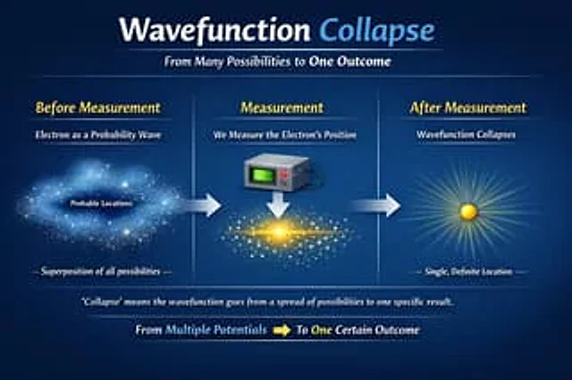

```text
{
  "type": "Educational Infographic",
  "theme": "quantum physics",
  "background": "Dark blue gradient",
  "header": {
    "title": "{argument name=\"main title\" default=\"wave function collapse\"}",
    "subtitle": "{argument name=\"subtitle\" default=\"From multiple possibilities to a single outcome\"}"
  },
  "layout": {
    "type": "Three-stage horizontal evolution",
    "connections": "There is a thick horizontal arrow pointing to the right between each stage.",
    "stages": [
      {
        "position": "Left side",
        "title": "Before measurement",
        "subtitle": "As a probability wave{argument name=\"subject\" default=\"electronic\"}",
        "visual": "A diffuse, luminous cloud of blue particles, resembling a nebula.",
        "labels": [
          "Possible locations",
          "Superposition of all possibilities"
        ]
      },
      {
        "position": "central",
        "title": "Measurement",
        "subtitle": "Measurement{argument name=\"subject\" default=\"electronic\"} Location",
        "visual": "A gray square measuring device with a green screen and red buttons points downwards to a white arrow, corresponding to a bright yellow condensed matter horizontal particle band in the center."
      },
      {
        "position": "right side",
        "title": "After measurement",
        "subtitle": "wave function collapse",
        "visual": "A single solid yellow sphere emitting bright, radiating light",
        "labels": [
          "Single, definite location"
        ]
      }
    ]
  },
  "footer": {
    "explanation": "\"Collapse\" means that the wave function changes from a distribution of multiple possibilities to a specific outcome.",
    "summary": "From multiple potentials [yellow right arrow] to a definite result"
  }
}
```

Model: GPT Image 2
Author: GPT Image 2 Prompts

[ProjectD](https://aitoolsradar.com/en/prompts/06fe87888aad96) · [Recorded source](https://x.com/tinkerersanky/status/2044303879584514242#reversed-0)
 · [Full original metadata and byte evidence](data/projectd-batch-0046.json)

## Scrapbook Byte-level BPE Explainer


```text
A charming horizontal educational infographic, presented in a hand-drawn scrapbook style with a soft background of desktop and paper collages, aims to explain the principles of Chinese word segmentation based on byte-level BPE. The image is divided into three clearly defined teaching areas, spanning the entire wide banner from left to right. A cute Shiba Inu mascot stands on the far left.{argument name="character name" default="Chai Xiaoqi"} With warm brown and cream fur, a round face, small triangular ears, rosy cheeks, and a curious expression, it stands beside a desk with drawers, a pencil, and a chair, holding a cup in its hand. Above the Shiba Inu is a bold, rounded white title box containing black Chinese characters:{argument name="headline text" default="Chinese word segmentation: Byte-level BPE (BBPE) process popular science"} In the first teaching area near the top, four translucent blue token-shaped cubes are displayed on a wooden shelf. Each cube is labeled "Token" and accompanied by a curved arrow and a handwritten Chinese annotation, "Word Frequency Corpus Statistics," pointing to the next step. In the second area, a large magnifying glass highlights three frequency cubes labeled "E7," "94," and "B5." The area label is written on a yellow sticky note, stating "2. Frequency Statistics and Merging." Below and inside the magnified area is a large black Chinese character "电" (electricity), next to which is a handwritten annotation, "Frequent Byte Pairs." In the lower center of the third area, a wooden sign and a larger merged translucent blue token cube are added, labeled "Token," and accompanied by a yellow sticky note stating "3. Cross-Word Merging," with the large black Chinese characters "我们→" (we →), and below it is an explanatory note, "High-frequency words are combined and merged into tokens." On the far right, the final explanation is displayed: three small byte squares labeled "E7," "94," and "B5" sit above a large black Chinese character for "electricity," next to a note that reads "1. Byte-level encoding (UTF-8)," and below is a large black Chinese word for "we." Pink, blue, and green curved arrows connect the various areas to illustrate the flow. Near the bottom center is a blue token mascot with tiny limbs, a smiling face, and a wave. The design uses soft cream, pink, beige, and light blue, with thick, clear lines, sticker-like cutouts, washi tape corners, notebook textures, scattered pencil edges, and a friendly, journal-style illustration style suitable for educational charts.
```

Model: GPT Image 2
Author: GPT Image 2 Prompts

[ProjectD](https://aitoolsradar.com/en/prompts/67b604e3cdd8e6) · [Recorded source](https://x.com/coder_left/status/2047133651318755587#reversed-3)
 · [Full original metadata and byte evidence](data/projectd-batch-0046.json)

## Scrapbook 真人图与迷你分身

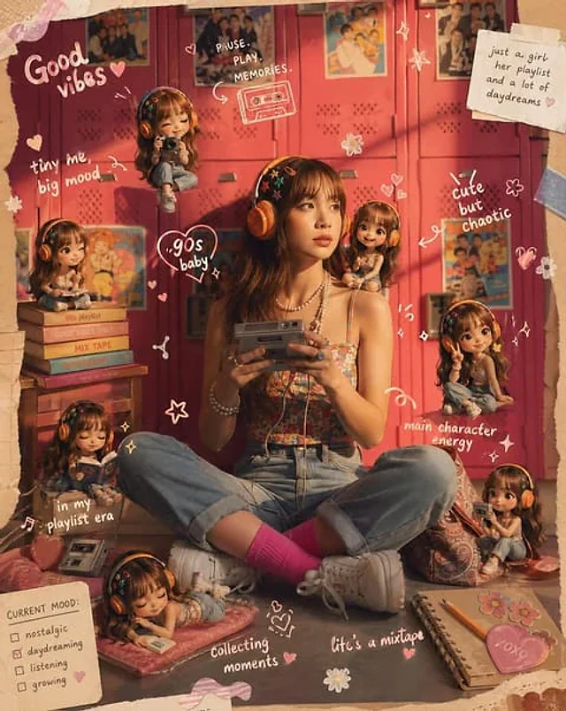

```text
Transform the provided reference image into a cozy aesthetic scrapbook-style composition while strictly preserving the original subject, identity, pose, lighting, and background.

Add multiple small “mini version” characters of the same person (chibi / doll-like style), placed naturally around the scene (on objects, table, shoulder, etc.). These mini figures must match the subject’s face, hairstyle, outfit, and vibe consistently, styled as cute 3D collectible figurines. Show them doing different activities (reading, posing, taking photos, relaxing).

Overlay handwritten-style doodles and annotations across the image: arrows, hearts, stars, sparkles, icons, and playful captions connected to elements in the scene.

Use a soft pastel color palette (white base with pink, peach, blue accents).

Keep the frame visually rich and filled but balanced and clean.

Style: warm, cozy lighting, dreamy Instagram scrapbook aesthetic, soft depth of field, highly detailed, polished but playful.

The final result must look like the SAME original image enhanced with mini alter-egos and aesthetic annotations — not a recreated or different scene.
```

Model: GPT Image 2
Author: @Kashberg_0

[ProjectD](https://aitoolsradar.com/en/prompts/3d312c8b5d5b32) · [Recorded source](https://x.com/Kashberg_0/status/2050272100884340783)
 · [Full original metadata and byte evidence](data/projectd-batch-0046.json)

## Seamless Jacket Design

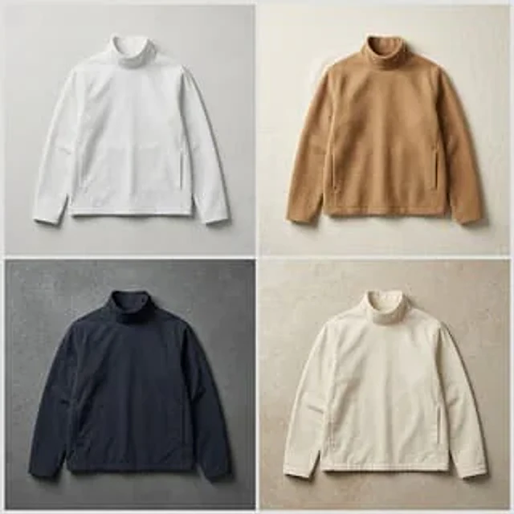

```text
One{argument name="clothing item" default="jacket"} No zipper, no buttons, no fasteners—perfect closure.
```

Model: GPT Image 2
Author: GPT Image 2 Prompts

[ProjectD](https://aitoolsradar.com/en/prompts/01f04e21c3ddc6) · [Recorded source](https://x.com/SRKDAN/status/2044658491592257866)
 · [Full original metadata and byte evidence](data/projectd-batch-0046.json)

## Seaside Cafe Event Poster

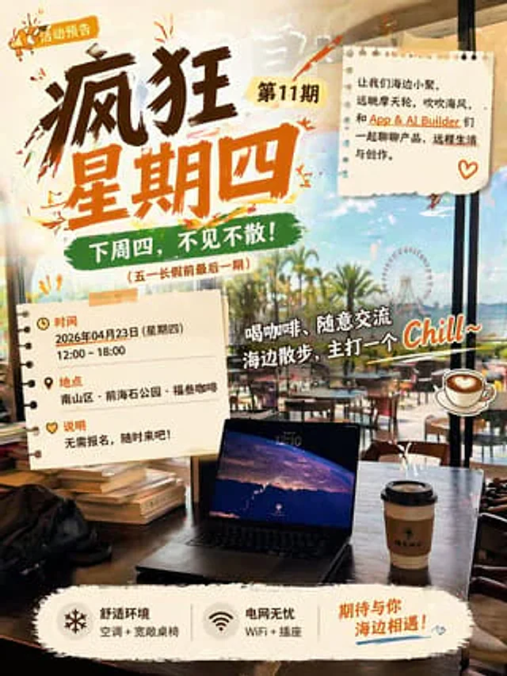

```text
Create a vibrant Chinese event poster with a warm and stylish café aesthetic. The image should be taken from inside a seaside café, looking outwards through large floor-to-ceiling windows, showcasing palm trees, a bright blue sky, outdoor seating, and a Ferris wheel in the distance. The composition should combine a realistic, everyday feel with an energetic graphic design aesthetic. In the foreground, place a dark wooden table with an open laptop in the center of the bottom. To the right, place a takeaway coffee cup with a black lid, and to the left, a black bag. A small stack of books should be placed near the left edge. Use a sunny, slightly golden afternoon atmosphere with reflections on the glass to create a relaxed vacation feel. Overlay striking poster graphics in a collage style, using elements such as torn paper, brushstrokes, stickers, and washi tape strips. The main title in the upper left corner should be in large, dark brown and orange handwritten calligraphy that reads "Crazy Thursday," next to a small yellow tag that says "Issue 11." A smaller badge in the upper left corner reads "Event Announcement" and includes a miniature megaphone icon. Below the main title, add a green banner with the text "See you next Thursday!", followed by a smaller line of text in parentheses: "(Last session before the May Day holiday)". Add two torn notebook cards: one in the upper right corner and one in the lower left corner. The upper right card should contain a concise Chinese invitation in black and orange font, reading: "Let's meet by the sea, gaze at the Ferris wheel, feel the sea breeze, and chat with App &amp; AI Builders about products, remote living, and creation." Add an orange heart-shaped doodle in the lower right corner. The lower left card should list three information blocks with icons and orange titles: "Time", "Location", and "Description". Under "Time", write "April 23, 2026 (Thursday)" and "12:00 ~ 18:00". Under "Location", write "Nanshan District, Qianhai Stone Park, Fusan Cafe". Under "Description", write "No registration required, come anytime!" In the right-center area, a large, playful white, handwritten slogan with dark outlines, slightly tilted upwards, reads, "Coffee, casual conversation, beach walks, all about Chill~". To the right of this slogan is an illustrated coffee cup sticker. Vibrant orange paint splatters and sketch graffiti are used around the title and note to give the poster a youthful and casual feel. At the bottom, a wide, off-white, torn-paper-style footer features three horizontally arranged functional blocks. Block 1: A snowflake-shaped icon with the text "Comfortable Environment" and smaller print "Air Conditioning + Spacious Tables and Chairs". Block 2: A Wi-Fi icon with the text "Worry-Free Power Grid" and smaller print "WiFi + Socket". Block 3: Larger orange handwritten text "Looking forward to meeting you at the beach!", decorated with a blue underline and a miniature heart graffiti below. The overall design should blend realistic photography with graphic poster elements, featuring strong contrast, calligraphic strokes, a scrapbook texture, a café vibe, and a trendy AI-generated social media campaign poster style.
```

Model: GPT Image 2
Author: GPT Image 2 Prompts

[ProjectD](https://aitoolsradar.com/en/prompts/4e6d06b25ce05b) · [Recorded source](https://x.com/hzlzh/status/2047174760011116573#reversed-0)
 · [Full original metadata and byte evidence](data/projectd-batch-0046.json)

## Selective Color Street Photography

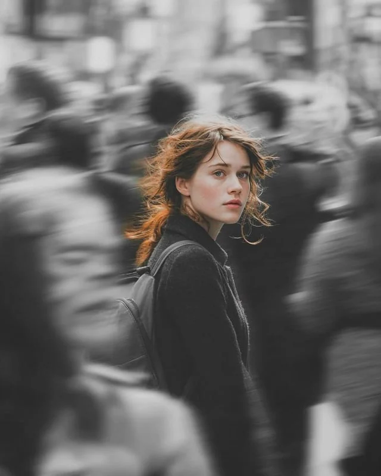

```text
A cinematic street portrait of a young woman walking through a crowded city, with the subject perfectly sharp while the surrounding pedestrians are blurred using a dramatic panning motion effect. The entire image is monochrome black and white except for the woman's {argument name="coat color" default="deep navy-blue"} wool coat, which remains the only vivid color in the scene. She glances back over her shoulder with a calm, thoughtful expression, loose wind-swept hair, soft natural makeup, and a minimalist shoulder bag. The busy urban background is filled with fast-moving commuters rendered as ghostly motion blur, emphasizing loneliness amidst the crowd. Soft overcast daylight, shallow depth of field, subtle film grain, realistic skin texture, cinematic contrast, emotional storytelling, editorial fashion photography, premium fine-art street photography, ultra-photorealistic, Leica M11 look, Kodak Tri-X black and white film aesthetic with selective color, 50mm lens, f/1.8, ISO 100, 1/20s shutter speed, natural ambient lighting, high dynamic range, ultra-detailed, award-winning composition, 8K.
```

Model: GPT Image 2
Author: Taaruk

[ProjectD](https://aitoolsradar.com/en/prompts/38001a0cd1927b) · [Recorded source](https://youmind.com/prompts/selective-color-street-photography-27441)
 · [Full original metadata and byte evidence](data/projectd-batch-0046.json)

## Selfie to Studio Headshot


```text
Using the provided reference images, transform a casual poolside selfie into a clean, professional half-body studio portrait. Keep the subject and polo shirt, but remove the outdoor vacation background, other people, furniture, the pool, and any other vacation-related elements. Recompose the image with a centered portrait crop, facing the camera and showing the shoulders, and correct the selfie angle for a formal frontal composition. Add a smooth, deep cyan studio background, complemented by subtle vignetting and soft, skin-tone-correcting portrait lighting to create a sophisticated corporate portrait style.
```

Model: GPT Image 2
Author: GPT Image 2 Prompts

[ProjectD](https://aitoolsradar.com/en/prompts/599867201d7488) · [Recorded source](https://x.com/rgbarcena/status/2047580598068277496#reversed-2)
 · [Full original metadata and byte evidence](data/projectd-batch-0046.json)

## Sengoku vs Sangoku Crossover Poster

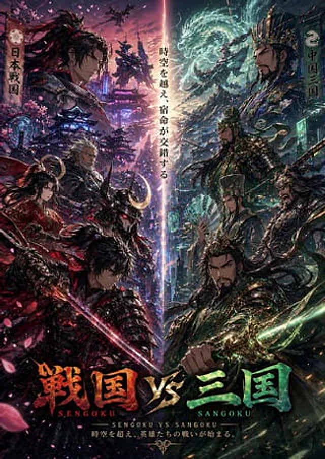

```text
A highly dramatic and meticulously detailed vertical anime-style main visual poster depicts a cross-border war between Japan's Sengoku period and China's Three Kingdoms period. The image is precisely bisected by a beam of luminous vertical light. The left half is themed around deep red, magenta, ember orange, and cherry blossom pink, representing {argument name="left faction title" default="Japan&#39;s Sengoku period"} The right half features emerald green, cyan, blue-green, gold, and storm blue as its themes, representing {argument name="right faction title" default="The Three Kingdoms of China"} In the center of the image, huge vertical Japanese calligraphy reads:{argument name="center slogan" default="Time and space intersect, destiny collides."} The composition is compact, cinematic, and symmetrical, resembling a crossover poster for a high-end game or movie, complete with countless sparks, petals, glowing particles, dynamic lighting, and layered background architecture. On the left, four distinct Sengoku-era samurai are depicted. In the upper left, a stern-faced samurai daimyo, clad in ornate black and red armor trimmed with gold, his long hair tied high and flowing in the wind, faces inwards with a powerful upper-body portrait; behind him are cherry blossoms, banners, and layered Japanese castles accented with neon magenta highlights. In the center left, a seasoned veteran, with wild silver hair, wearing heavy, layered armor, and a fierce gaze, is partially hidden within the fortified city landscape. In the lower left, a valiant samurai in deep red armor thrusts forward, his robes billowing, wearing a deer-antler-shaped helmet; the armor displays a dynamic red and black color scheme. In the lower left foreground, a domineering swordsman clad in demonic samurai armor, wearing a crescent-shaped helmet, and with eyes flashing red, is depicted, gripping a katana at an angle, surrounded by embers and petals. A vertical banner near the upper left edge displays the Japanese text "Japan's Sengoku Period." On the right, four distinct Three Kingdoms-themed heroes are depicted. In the upper right, a dignified strategist/emperor in exquisite blue-black-gold ceremonial armor and a tall crown is shown in a half-body profile, facing inwards; a luminous dragon composed of water, clouds, and light rises behind him. In the center right, a general with a long beard, green robe, tall crown, and lamellar armor is shown, his expression solemn and valiant, against a backdrop of neon-lit city buildings and swirling magical energy. In the lower right center, an elegant strategist holding a feather fan, wearing layered robes and gold ornaments, appears calm and calculating. At the lower right edge, a fierce-looking, roaring general with flowing hair is depicted. In the lower right foreground, a hero clad in green-gold armor is the central figure, extending a sword shimmering with emerald green light. His robes flow, and glowing energy ribbons swirl around the blade. A vertical banner near the upper right edge displays the Chinese text "Three Kingdoms of China." The design blends East Asian historical warfare aesthetics with futuristic cyberpunk metropolis elements: Japanese pagodas and fortresses on the left, neon skyscrapers and flashing city lights on either side, silhouettes of flying fortresses and distant airships in the sky, and magical lightning, smoke, and storm clouds above. The sky transitions from sunset crimson on the left to stormy turquoise and silver on the right. High-resolution anime-style illustrations showcase intricate armor textures, metallic reflections, volumetric lighting, high contrast, epic scale, and a powerful atmosphere. At the bottom, large, stylized title fonts are added: on the left, huge fiery red Chinese characters "Sengoku" (Warring States), with the Romanized "SENGOKU" below; in the middle, a metallic gold "VS"; and on the right, huge emerald-green glowing Chinese characters "Sangoku" (Three Kingdoms), with the Romanized "SANGOKU" below. Below, add a smaller, centered subtitle “SENGOKU VS SANGOKU”, and below that, add a Japanese slogan:{argument name="bottom tagline" default="Across time and space, the heroes&#39; battle is about to begin."} The poster's layout is exquisite, showcasing sophisticated commercial advertising artistry with incredibly rich details, strong visual impact, and collectible aesthetic appeal.
```

Model: GPT Image 2
Author: GPT Image 2 Prompts

[ProjectD](https://aitoolsradar.com/en/prompts/b79b399d760fb7) · [Recorded source](https://x.com/hotarugawaR/status/2046634130281222178#reversed-0)
 · [Full original metadata and byte evidence](data/projectd-batch-0046.json)

## SenseNova U1 Pro Landing Page

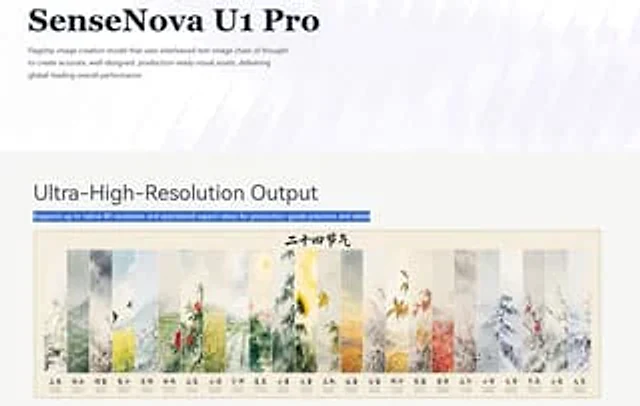

```text
Goal: Create a clean landing-page screenshot for an AI image model announcement, styled like a polished corporate technology blog page.

Canvas: Wide 16:9 webpage capture, approximately 1200×675 px, with lots of white space. Use a pale white and lavender background with subtle diagonal glossy light streaks in the top hero area.

Layout: Top hero section occupies the upper third. Place a large dark navy serif headline at top left reading {argument name="product name" default="SenseNova U1 Pro"}. Under it, add a small gray sans-serif paragraph: {argument name="intro paragraph" default="Flagship image creation model that uses interleaved text-image chain of thought to create accurate, well-designed, production-ready visual assets, delivering global-leading overall performance"}. Leave the right side mostly empty with soft abstract light beams.

Main section: Below a horizontal transition into a light gray-white content area, place a large sans-serif heading on the left reading {argument name="section heading" default="Ultra-High-Resolution Output"}. Directly underneath, show one blue highlighted text strip like selected webpage text, reading {argument name="highlight sentence" default="Supports up to native 8K resolution and specialized aspect ratios for production-grade precision and detail"}.

Feature image: Beneath the highlighted strip, insert a centered framed horizontal artwork preview with a thin beige border and cream background. The artwork is a traditional Chinese watercolor calendar titled in black calligraphy at the top center: {argument name="calendar title" default="二十四节气"}. It contains exactly 24 tall vertical painted panels arranged left to right, each representing one Chinese solar term with delicate ink-and-watercolor landscapes, flowers, birds, fields, snow, and seasonal plants. Count and label the 24 panels at the bottom in Chinese, in this exact order: 1 立春, 2 雨水, 3 惊蛰, 4 春分, 5 清明, 6 谷雨, 7 立夏, 8 小满, 9 芒种, 10 夏至, 11 小暑, 12 大暑, 13 立秋, 14 处暑, 15 白露, 16 秋分, 17 寒露, 18 霜降, 19 立冬, 20 小雪, 21 大雪, 22 冬至, 23 小寒, 24 大寒. Add tiny date ranges under each label, but keep them small and secondary.

Visual style: Minimal modern web design, high-end AI product branding, crisp typography, large serif hero title, clean sans-serif body text, subdued gray text, navy accents, soft luminous abstract background, realistic screenshot-like composition.

Constraints: Preserve the exact visible text hierarchy and the 24-panel count. Do not add extra navigation bars, logos, buttons, people, browser chrome, watermarks, or unrelated interface elements.
```

Model: GPT Image 2
Author: Lentils

[ProjectD](https://aitoolsradar.com/en/prompts/fac951e0e4864f) · [Recorded source](https://youmind.com/prompts/sensenova-u1-pro-page-29109)
 · [Full original metadata and byte evidence](data/projectd-batch-0046.json)

## Sequential Continuity Generation


```text
Image 1:{argument name="action" default="Making plastic models with a serious expression"} The second image: (following the first image){argument name="failure scene" default="The shot of the pale face after cutting the wrong part."} .
```

Model: GPT Image 2
Author: GPT Image 2 Prompts

[ProjectD](https://aitoolsradar.com/en/prompts/6ddf85fea4a3df) · [Recorded source](https://x.com/BeamManP/status/2046857292050739286)
 · [Full original metadata and byte evidence](data/projectd-batch-0046.json)

## Serene Monument Valley Poster


```text
Goal: Create a serene healing-style wallpaper poster inspired by Monument Valley, with impossible isometric architecture, soft pastel colors, and a quiet motivational quote.

Canvas: Wide horizontal 2:1 poster, approximately 1200×600 px. Warm off-white background with lots of negative space, airy mist, and subtle paper texture.

Layout: Left third contains large vertical Chinese typography in three stacked rows, reading {argument name="main quote" default="不慌不忙\n游刃有余\n从从容容"}. Under it place a small Chinese subtitle reading {argument name="subtitle" default="在自己的节奏里\n把生活过成风景"}, a short thin orange divider line, then a tiny English caption: “Move at / your own pace, / and everything / falls into place.” Bottom-left has “VOL. / 03” and a thin horizontal line. Top-right has tiny spaced text “2024” above “SERENITY”. Bottom-right has a minimal circular mark, “03”, a slash, and “100”.

Architecture: The right two-thirds and lower center show a dreamy impossible isometric city of pale mint, seafoam, and ivory blocks. Include exactly 12 major architectural elements: 1 long diagonal bridge crossing the center with a tiny standing figure on it, 2 short staircases on the bridge area, 1 tall central rectangular tower, 1 glowing orange arched doorway, 1 high seafoam arch frame in front of the tower, 1 right-side staircase leading upward, 1 right teal arched doorway, 1 lower small arched opening, 1 floating elevated platform, 1 low foreground wall maze, and 1 distant translucent tower silhouette. Use Escher-like geometry, clean sharp edges, soft shadows, and atmospheric depth.

Subject details: Place exactly 1 tiny human figure on the central bridge, wearing a teal robe or dress, seen from far away, calm and contemplative. Add exactly 1 peach sun or moon near the upper center. Add exactly 1 small leafy branch entering from the right edge.

Visual style: Minimalist pastel poster, soft cinematic lighting, tranquil Japanese/Chinese healing aesthetic, Monument Valley game-like impossible architecture, frosted translucent surfaces, muted mint green, pale cyan, ivory, warm cream, and small orange accent details. Thin elegant typography, balanced composition, refined editorial design.

Constraints: Keep the mood peaceful and spacious. Do not add extra characters, vehicles, logos, or clutter. Preserve the exact visible text hierarchy and the wide wallpaper composition.
```

Model: GPT Image 2
Author: 小小东

[ProjectD](https://aitoolsradar.com/en/prompts/6d8d0450854aa6) · [Recorded source](https://youmind.com/prompts/monument-valley-wallpaper-poster-21992)
 · [Full original metadata and byte evidence](data/projectd-batch-0046.json)

## Shadow Ensemble Movie Poster Template

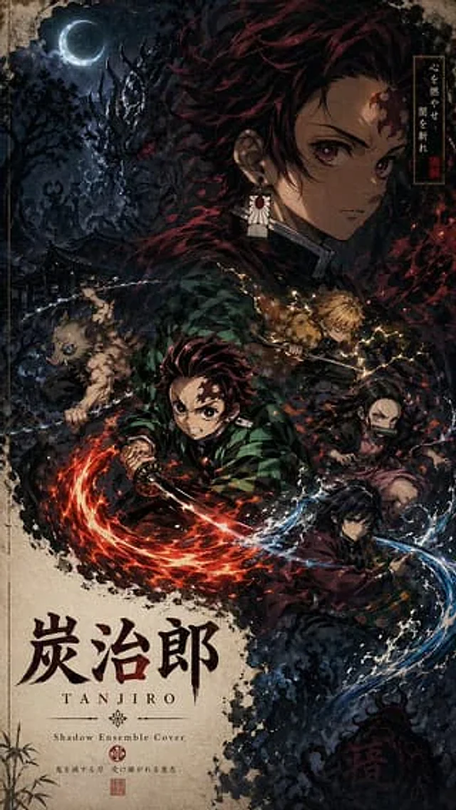

```text
Please base your opinion on [Subject:]{argument name="character name" default="Enter the character name"} Create a highly polished, narratively compelling "Shadow Ensemble Cover" suitable for a series release. This is more than just a simple character illustration or battle poster; it's a "group action cover" with the feel of a novel cover, comic book visuals, game promotional material, and dark fantasy illustration. The image needs to consist of a large, central figure, multiple mid-ground action characters, threatening background elements, localized energy effects, and a white space for the title, forming a complete cover showcasing the character factions and world-building. [Basic Settings] Theme:{argument name="scene theme" default="Spell Battle / Dark Journey to the West / Cyber ​​Hunter / Monster Hunting Team / Post-Apocalyptic Survivors / Magic Academy Battle Group"} Title: [Title of Work] Series Name/Brand Name: [Brand Name or Series Name] Subtitle: [Subtitle] Style Guidance:{argument name="style" default="Dark fantasy, retro comic book covers, hand-painted thick paint, fantasy novel covers, game visuals"} Main color scheme: Dark green-black-gray / Dark blue neon / Dark brown-gold-red / Sand yellow-rust / Dark purple-gold. Accent colors: Blood red energy, cyan spell light, golden divine light, blue lightning. Aspect ratio: 2:3 vertical / 3:4 vertical / 4:5 vertical / 9:16 vertical. [Structure] A vertical cover composition is used. A large visual figure must serve as the central figure and dominant element of the atmosphere. This figure can be in profile, half-body, back view, a frontal gaze, or a large silhouette, occupying the right side, top, or main background area. The expression should be calm, mysterious, and imposing. The figure may not necessarily participate in combat, but must command the overall atmosphere of the image. Arrange 3 to 6 action characters in the mid-ground, forming a group portrait of a combat formation. There should be clear division of labor and differences in posture between characters, such as charging, wielding a sword, casting spells, defending, summoning, jumping, being alert, and ranged attacking. Avoid static characters; strong rhythmic movement and visual dynamism must be created. Add enemy threats or world-building elements to the background, such as monsters, giants, villainous shadows, mechanical legions, demons, ruins, forests, alternate dimensions, battlefield smoke, or urban disasters. Background threats should not overshadow the characters but rather envelop them like shadows to enhance the sense of crisis and narrative depth. Set one or two high-saturation energy hotspots, such as red fire fists, blue lightning, green spells, purple magic, golden divine light, or white sword energy. Energy effects should be concentrated on key characters or weapons to create visual focal points, rather than illuminating the entire screen uniformly. [Composition] The overall structure is "large central character + mid-ground action group + background threat shadow + bottom or side blank title area." The image can utilize diagonal organization of characters, allowing the group to charge from the upper left to the lower right or from the bottom to the center, creating a strong sense of forward momentum. Maintain a clear blank title area, preferably located in the lower left, bottom, or side. Use off-white, light paper color, or low-saturation background colors for the blank areas to display [brand name/work title/subtitle]. The title layout should have the feel of a publication cover, using elegant serif fonts, retro title letters, comic book cover titles, or a high-end magazine style layout. The text area must be clear and not completely obscured by characters and backgrounds. Avoid perfectly rectangular edges; use irregular brushstroke edges, ink diffusion, torn paper styles, or natural dissipation to make characters and backgrounds appear to grow out of the paper, enhancing the hand-drawn cover feel and artistic quality. [Visual Style] The overall style should combine hand-drawn thick painting with comic book covers, possessing paper texture, brushstroke feel, shadow depth, and a retro publication feel. Lighting should primarily use low-key dark lighting, with a dark background, clear character outlines, and high-contrast focus provided by localized energetic light. The image should not be too clean; it should retain the hand-drawn texture, paper grain, edge brushstrokes, and dark haze. Primarily use low-saturation dark tones, supplemented with a small amount of high-saturation energetic colors. The overall atmosphere should have a sense of oppression, mystery, combat, and world-building depth. [Visual Objectives] The final image should look like a mature fantasy novel cover, a comic book special edition cover, a game character faction visual, or an IP promotional poster. It needs to possess the following: 1. A clear main visual character; 2. A dynamic and rhythmic group portrait; 3. A clear enemy threat or world-building background; 4. Strong yet restrained energy effects; 5. A legible title text area; 6. The overall texture of a retro hand-drawn cover. Ensure the visuals are rich in information yet not cluttered, with distinct character layers, a clear visual focus, and suitability for continuously generating works within the same series on different themes.
```

Model: GPT Image 2
Author: GPT Image 2 Prompts

[ProjectD](https://aitoolsradar.com/en/prompts/ad8654bf8f78f0) · [Recorded source](https://x.com/MrLarus/status/2047504255943094635)
 · [Full original metadata and byte evidence](data/projectd-batch-0046.json)

## ShaHid WaNii #104

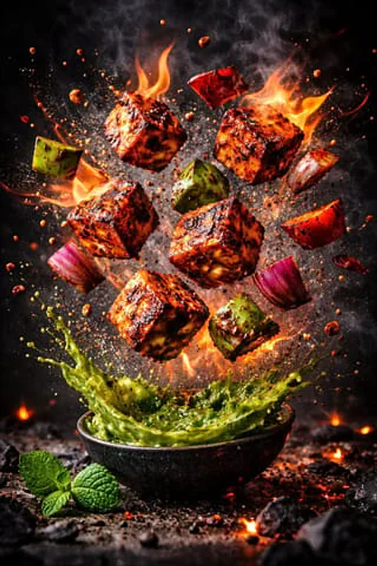

```text
{
  "image_type": "Hyper-realistic cinematic food photography",
  "resolution": "8K",
  "aspect_ratio": "3:4",
  "camera": {
    "shot_type": "Hero shot",
    "angle": "Slightly low-angle with central focus",
    "focus": "Ultra-sharp foreground with controlled depth of field",
    "motion_capture": "Frozen mid-air action with splash dynamics"
  },
  "lighting": {
    "style": "Cinematic studio lighting",
    "highlights": "Strong specular highlights emphasizing oil, glaze, and moisture",
    "shadows": "Deep, dramatic shadows for contrast and depth",
    "rim_light": "Visible edge lighting outlining food elements",
    "ambient": "Low-key lighting environment"
  },
  "background": {
    "color": "Dark charcoal to deep maroon tones",
    "texture": "Smoky, atmospheric backdrop",
    "elements": [
      "Rising steam",
      "Spice-infused smoke",
      "Floating embers and sparks"
    ]
  },
  "primary_subjects": [
    {
      "item": "Cooked food pieces",
      "position": "Suspended mid-air",
      "surface_detail": "Charred edges, textured crust, glossy coating",
      "motion": "Erupting upward with dynamic splash behavior"
    }
  ],
  "secondary_elements": [
    {
      "item": "Sauce or gravy",
      "state": "Thick and glossy",
      "motion": "Explosive splash with visible droplets and arcs",
      "detail": "Oil separation visible as shimmering droplets"
    },
    {
      "item": "Herbs",
      "types": [
        "Fresh coriander leaves",
        "Mint leaves"
      ],
      "motion": "Scattered and floating naturally"
    },
    {
      "item": "Spices",
      "types": [
        "Whole dried red chilies",
        "Whole spices (clearly visible star-shaped and pod-like forms)",
        "Crushed spice particles"
      ],
      "behavior": "Suspended mid-air, dispersed unevenly"
    },
    {
      "item": "Vegetables",
      "types": [
        "Bell peppers (green and red)",
        "Onion chunks"
      ],
      "cut": "Large rustic chunks",
      "surface": "Light char and gloss"
    }
  ],
  "supporting_food_items": [
    {
      "item": "Rice grains",
      "detail": "Individual grains clearly visible, mid-air dispersion",
      "motion": "Erupting outward with spices"
    },
    {
      "item": "Nuts and dry fruits",
      "types": [
        "Cashews",
        "Raisins"
      ],
      "position": "Mixed with rice and floating"
    },
    {
      "item": "Flatbread pieces",
      "detail": "Torn edges, soft interior texture, char marks visible",
      "motion": "Suspended mid-air with crumbs"
    }
  ],
  "condiments": [
    {
      "item": "Green chutney",
      "texture": "Thick, coarse",
      "motion": "Upward splash from a bowl",
      "container": "Dark stone bowl with matte finish"
    },
    {
      "item": "White yogurt-based sauce",
      "texture": "Smooth and creamy",
      "container": "Dark stone bowl"
    }
  ],
  "surface_environment": {
    "base": "Dark textured surface",
    "elements": [
      "Scattered spice flakes",
      "Burnt crumbs",
      "Small glowing embers",
      "Charcoal-like stones"
    ]
  },
  "color_palette": [
    "Deep reds",
    "Burnt orange",
    "Charcoal black",
    "Smoky maroon",
    "Herb green",
    "Creamy white highlights"
  ],
  "mood": "Bold, intense, premium, cinematic, high-impact food commercial aesthetic",
  "realism_level": "Extreme hyper-realism with tactile textures and moisture detail",
  "post_processing": {
    "contrast": "High",
    "clarity": "Very high",
    "sharpening": "Selective sharpening on food textures",
    "noise": "Minimal",
    "color_grading": "Warm highlights with deep shadows"
  }
}
```

Model: GPT Image 2
Author: ShaHid WaNii

[ProjectD](https://aitoolsradar.com/en/prompts/ccbc07e1f78873) · [Recorded source](https://x.com/meng_dagg695/status/2008455129624965416)
 · [Full original metadata and byte evidence](data/projectd-batch-0046.json)

## ShaHid WaNii #106

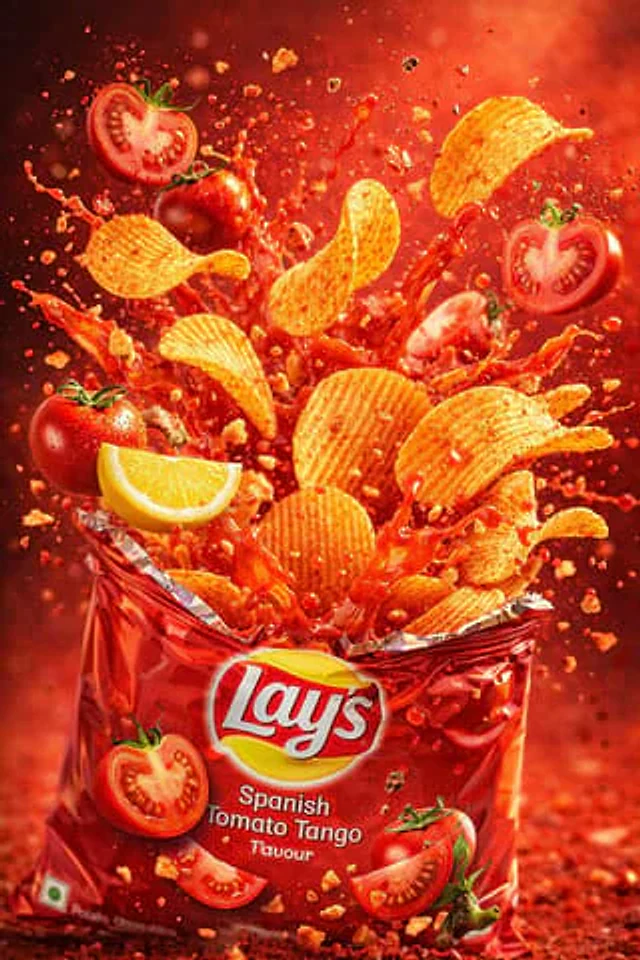

```text
{
  "prompt_name": "Lays_Spanish_Tomato_Tango_Explosion",
  "description": "Ultra-realistic commercial food photography showing a red Lay’s snack packet torn open from the top, positioned at the bottom center of the frame. Golden ridged potato chips are explosively bursting upward in frozen mid-air motion. Thick red tomato sauce splashes dynamically around the chips, forming arcs and droplets. Fresh whole tomatoes and halved tomatoes with visible seeds are flying around. Small crispy crumbs and seasoning particles are suspended in the air. The Lay’s logo is clearly visible on the packet, with readable text: 'Spanish Tomato Tango Flavour'. The packet surface is glossy and reflective with realistic wrinkles. Background is a deep red gradient filled with floating sauce droplets and particles, creating intense energy.",
  "lighting": "Dramatic warm studio lighting with strong highlights, deep shadows, and high contrast",
  "color_palette": ["deep red", "tomato red", "golden yellow", "dark orange"],
  "motion": "High-energy explosive upward motion with frozen splashes and flying fragments",
  "focus": "Ultra-sharp focus on chips, sauce splashes, and packet branding",
  "texture_detail": "Highly detailed ridged chip texture, glossy liquid splashes, realistic foil reflections",
  "style": "Premium FMCG commercial advertising, cinematic realism",
  "resolution": "8K",
  "aspect_ratio": "3:4"
}
```

Model: GPT Image 2
Author: ShaHid WaNii

[ProjectD](https://aitoolsradar.com/en/prompts/8353c60ba96c64) · [Recorded source](https://x.com/meng_dagg695/status/2007635164718084527)
 · [Full original metadata and byte evidence](data/projectd-batch-0046.json)

## ShaHid WaNii #11

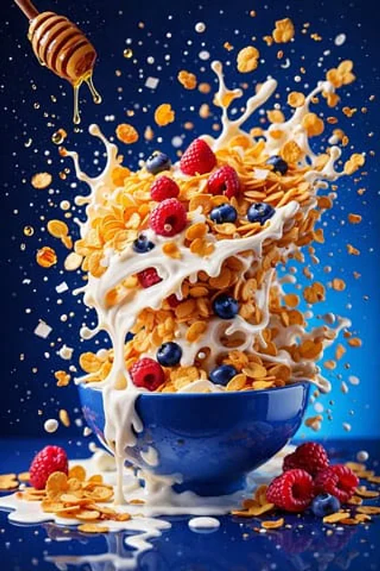

```text
{
  "resolution": "8K UHD",
  "aspect_ratio": "3:4",
  "image_style": "hyper-realistic commercial food photography",
  "global_settings": {
    "quality": "Ultra-high detail, sharp focus, studio-grade clarity",
    "lighting": "Soft but controlled studio lighting with visible highlights and splash definition",
    "motion": "Frozen mid-air action, ingredients suspended",
    "background_style": "Solid or smooth gradient background, color varies per module",
    "camera": "High-speed photography look, shallow to medium depth of field",
    "post_processing": "Balanced contrast, natural saturation, no artificial glow"
  },

  "modules": {

    "module_1_berry_smoothie_explosion": {
      "scene_description": "A vibrant smoothie bowl exploding with fruit and liquid splashes",
      "bowl": {
        "color": "Deep blue ceramic bowl",
        "finish": "Glossy",
        "position": "Centered, floating mid-air"
      },
      "base_contents": {
        "type": "Thick berry smoothie",
        "color": "Deep purple-magenta",
        "texture": "Creamy with visible swirl marks"
      },
      "ingredients": {
        "fruits": [
          "Banana slices (round, pale yellow)",
          "Blueberries (whole, dark blue)",
          "Raspberries (whole, red)"
        ],
        "herbs": [
          "Fresh mint leaves (bright green)"
        ]
      },
      "motion_effects": {
        "liquid": "Berry smoothie splashing upward and outward",
        "particles": "Small droplets suspended in air"
      },
      "background": {
        "color": "Bright pink",
        "texture": "Smooth, seamless"
      }
    },

    "module_2_minimal_pink_smoothie_bowl": {
      "scene_description": "Minimalist floating smoothie bowl with granola and berries",
      "bowl": {
        "color": "Light pink ceramic bowl with dark speckles",
        "finish": "Matte",
        "position": "Floating centrally"
      },
      "base_contents": {
        "type": "Smoothie",
        "color": "Soft pink with purple undertones",
        "texture": "Thick and smooth"
      },
      "toppings": {
        "granola": "Golden-brown oat clusters",
        "seeds": "Small black seeds scattered",
        "fruits": [
          "Strawberries (halved)",
          "Raspberries (whole)",
          "Blackberries (whole)"
        ]
      },
      "motion_effects": {
        "ingredients": "Granola flakes, seeds, and berries floating gently"
      },
      "background": {
        "color": "Pastel lavender",
        "gradient": "Subtle, soft gradient"
      }
    },

    "module_3_cereal_milk_honey_splash": {
      "scene_description": "Dynamic cereal stack with milk splash and honey drizzle",
      "bowl": {
        "color": "Blue ceramic bowl",
        "finish": "Glossy",
        "position": "Centered, resting visually but surrounded by motion"
      },
      "contents": {
        "cereal": "Golden cornflakes stacked vertically",
        "milk": "White milk splashing and dripping over flakes",
        "fruits": [
          "Raspberries",
          "Blueberries"
        ]
      },
      "additional_elements": {
        "honey": {
          "source": "Wooden honey dipper",
          "state": "Honey dripping mid-air"
        }
      },
      "motion_effects": {
        "splashes": "Milk splashes frozen in dramatic arcs",
        "particles": "Floating flakes and droplets"
      },
      "background": {
        "color": "Deep blue",
        "tone": "High contrast"
      }
    },
}
```

Model: GPT Image 2
Author: ShaHid WaNii

[ProjectD](https://aitoolsradar.com/en/prompts/21044de4c9c719) · [Recorded source](https://x.com/meng_dagg695/status/2009157208240755151)
 · [Full original metadata and byte evidence](data/projectd-batch-0046.json)

## ShaHid WaNii #13

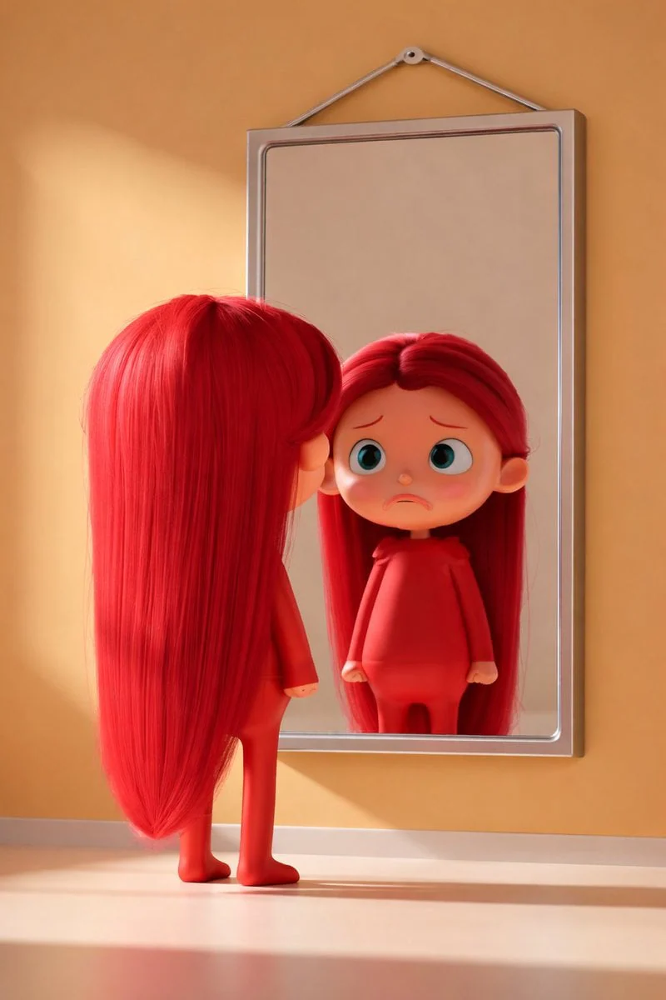

```text
{
  "global_settings": {
    "resolution": "8K",
    "quality": "ultra-high definition",
    "aspect_ratio": "2:3",
    "render_style": "AI-edited, high-detail 3D render",
    "lighting_quality": "soft studio lighting with realistic shadows",
    "sharpness": "extreme clarity, crisp edges",
    "noise": "none",
    "compression": "none"
  },

  "Module_1_Image_1_Style": {
    "subject": {
      "character_type": "stylized 3D cartoon female",
      "pose": "standing, body slightly angled, one hand raised with index finger touching lips",
      "expression": "cheerful smile, wide eyes",
      "hair": {
        "color": "black",
        "style": "two braided pigtails",
        "accessories": "green cap"
      },
      "face": {
        "eyes": "large, rounded, dark pupils",
        "skin": "smooth, matte, stylized texture"
      }
    },
    "clothing": {
      "top": "sleeveless green crop top",
      "bottom": "loose green jogger-style pants with drawstring",
      "footwear": "white sneakers"
    },
    "accessories": {
      "luggage": "green hard-shell suitcase with extended handle"
    },
    "color_palette": [
      "multiple shades of green",
      "white accents"
    ],
    "background": {
      "color": "solid green",
      "texture": "soft, slightly grainy studio backdrop"
    },
    "composition": {
      "framing": "full body",
      "camera_angle": "eye-level",
      "depth": "subject sharply separated from background"
    }
  },

  "Module_2_Image_2_Style": {
    "subject": {
      "character_type": "stylized 3D cartoon female",
      "pose": "leaning slightly backward against background",
      "expression": "playful, lips slightly pursed, eyes looking sideways",
      "hair": {
        "color": "brown",
        "style": "short, tousled",
        "accessories": "red sunglasses resting on head"
      }
    },
    "clothing": {
      "dress": "form-fitting blue ribbed dress with thin straps",
      "footwear": "red high-heel sandals with bow detail"
    },
    "color_palette": [
      "bold red",
      "deep blue"
    ],
    "background": {
      "color": "solid red",
      "texture": "smooth matte surface"
    },
    "lighting": {
      "direction": "soft directional light from one side",
      "shadow": "defined shadow cast on red background"
    },
    "composition": {
      "framing": "full body",
      "pose_emphasis": "curved posture, crossed legs"
    }
  },

  "Module_3_Image_3_Style": {
    "subject": {
      "characters": [
        {
          "type": "stylized 3D cartoon female",
          "position": "left",
          "wrapped_in": "red textured blanket",
          "expression": "calm, slight smile, eyes looking upward"
        },
        {
          "type": "stylized 3D cartoon male",
          "position": "right",
          "wrapped_in": "orange textured blanket",
          "expression": "neutral, gentle gaze upward"
        }
      ]
    },
    "environment": {
      "furniture": "red sofa",
      "floor": "red surface",
      "background": {
        "color": "deep red",
        "texture": "fabric-like horizontal texture"
      }
    },
    "details": {
      "feet": "female barefoot, male wearing socks",
      "blanket_texture": "thick, knitted fabric"
    },
    "composition": {
      "framing": "centered, medium-wide shot",
      "symmetry": "balanced left and right composition"
    }
  },
```

Model: GPT Image 2
Author: ShaHid WaNii

[ProjectD](https://aitoolsradar.com/en/prompts/cece7d3a4d23fd) · [Recorded source](https://x.com/meng_dagg695/status/2012437899955097836)
 · [Full original metadata and byte evidence](data/projectd-batch-0046.json)

## ShaHid WaNii #138

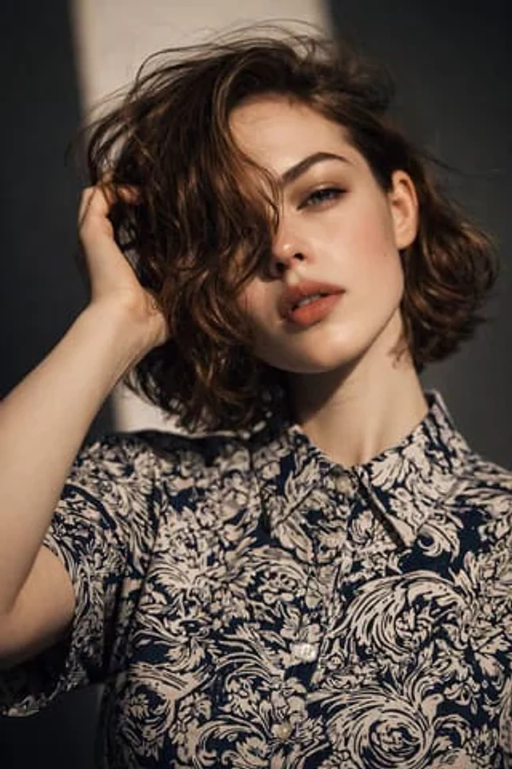

```text
{
  "image_type": "portrait",
  "generation_quality": "8K ultra-high resolution",
  "realism_level": "photorealistic",
  "subject": {
    "human_presence": true,
    "gender_presentation": "feminine",
    "age_appearance": "young adult",
    "visible_pose": {
      "head_position": "slightly tilted",
      "hand_position": "one hand raised touching hair near the side of the head",
      "shoulder_visibility": "upper torso visible"
    },
    "facial_expression": {
      "mouth": "slightly parted lips",
      "expression": "neutral to soft, relaxed",
      "gaze_direction": "looking directly toward the camera"
    }
  },
  "face_details": {
    "face_shape": "oval",
    "skin_texture": "smooth with visible natural skin texture",
    "skin_finish": "soft matte with subtle highlights",
    "cheeks": "natural blush visible",
    "nose": {
      "shape": "straight",
      "size": "medium",
      "tip": "softly rounded"
    },
    "lips": {
      "shape": "full",
      "color": "muted warm rose / nude",
      "texture": "matte finish"
    },
    "jawline": "softly defined",
    "chin": "rounded"
  },
  "eyes": {
    "shape": "almond-shaped",
    "eye_color": "appears green or hazel under lighting",
    "eyelids": "natural crease visible",
    "lashes": "natural, not exaggerated",
    "eyebrows": {
      "shape": "well-groomed, natural arch",
      "density": "medium-full",
      "color": "dark brown"
    }
  },
  "hair": {
    "color": "medium to dark brown",
    "length": "short to medium",
    "texture": "wavy",
    "style": "loose, slightly tousled",
    "parting": "off-center",
    "movement": "some strands falling across the forehead and partially covering one eye",
    "shine": "natural sheen visible"
  },
  "makeup": {
    "foundation": "natural, skin-like",
    "blush": "soft peach-pink",
    "lip_product": "matte lipstick",
    "eye_makeup": "minimal, natural enhancement",
    "overall_style": "clean, understated, realistic"
  },
  "clothing": {
    "garment_type": "button-up shirt",
    "fit": "relaxed fit",
    "fabric_appearance": "lightweight fabric",
    "pattern": "abstract floral or ornamental pattern",
    "color_palette": {
      "primary": "dark navy or charcoal",
      "secondary": "off-white or light beige"
    },
    "buttons": {
      "visibility": "visible",
      "color": "light neutral"
    },
    "collar": "standard pointed collar"
  },
  "lighting": {
    "type": "natural light",
    "direction": "side lighting",
    "contrast": "soft to medium contrast",
    "highlights": "gentle highlights on cheekbones, nose, and lips",
    "shadows": "soft shadows adding depth to facial contours"
  },
  "background": {
    "type": "out-of-focus",
    "style": "minimal, neutral",
    "colors": "dark gray and muted tones",
    "depth_of_field": "shallow",
    "distractions": "none visible"
  },
  "camera_and_composition": {
    "framing": "close-up portrait",
    "angle": "eye-level",
    "focus": "sharp focus on face",
    "bokeh": "soft background blur",
    "crop": "head and upper torso"
  },
  "overall_aesthetic": {
    "mood": "calm, intimate",
    "style": "editorial portrait photography",
    "visual_cleanliness": "high",
    "artifacts": "none visible",
    "post_processing": "minimal, natural color grading"
  }
}
```

Model: GPT Image 2
Author: ShaHid WaNii

[ProjectD](https://aitoolsradar.com/en/prompts/6c5c4cba8d09fd) · [Recorded source](https://x.com/meng_dagg695/status/2008370131815342380)
 · [Full original metadata and byte evidence](data/projectd-batch-0046.json)

## ShaHid WaNii #140

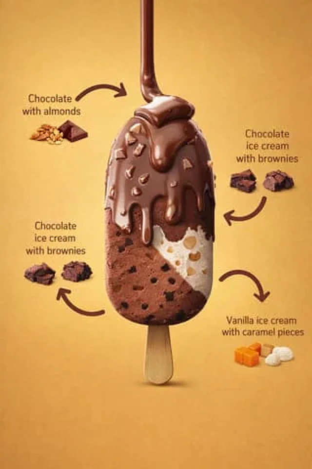

```text
{
  "resolution": "8K",
  "aspect_ratio": "3:4",
  "image_type": "photorealistic commercial product render",
  "scene_description": {
    "main_subject": "A vertically centered ice cream bar on a wooden stick",
    "orientation": "upright, front-facing, slightly elevated perspective",
    "composition": "single product centered with surrounding ingredient callouts and curved arrows"
  },
  "background": {
    "color": "warm golden-yellow gradient",
    "texture": "smooth, matte, evenly lit",
    "lighting_falloff": "subtle vignette, darker towards edges"
  },
  "lighting": {
    "type": "studio lighting",
    "key_light": "soft frontal light highlighting chocolate gloss",
    "fill_light": "balanced fill to preserve texture detail",
    "specular_highlights": "visible on melted chocolate coating",
    "shadows": "soft shadow beneath ice cream stick"
  },
  "ice_cream_bar": {
    "shape": "rounded rectangular bar",
    "surface": "smooth with visible embedded inclusions",
    "layers": [
      {
        "layer_position": "top coating",
        "material": "milk chocolate",
        "state": "melted and dripping",
        "texture": "glossy, thick, fluid",
        "details": [
          "multiple chocolate drips flowing downward",
          "irregular almond pieces embedded in coating",
          "rounded drip edges with gravity pull"
        ]
      },
      {
        "layer_position": "left interior",
        "material": "chocolate ice cream",
        "texture": "dense, creamy",
        "details": [
          "small dark brownie chunks evenly dispersed",
          "matte finish compared to outer chocolate"
        ]
      },
      {
        "layer_position": "right interior",
        "material": "vanilla ice cream",
        "texture": "smooth and creamy",
        "details": [
          "visible caramel pieces",
          "light beige caramel chunks with rounded edges"
        ]
      }
    ]
  },
  "stick": {
    "material": "light natural wood",
    "texture": "smooth with subtle grain",
    "shape": "rounded edges, flat profile",
    "visibility": "fully visible below ice cream bar"
  },
  "ingredient_callouts": {
    "style": {
      "arrows": "curved, thick, dark brown",
      "text_color": "dark brown",
      "font_style": "clean sans-serif",
      "layout": "balanced around product"
    },
    "labels": [
      {
        "text": "Chocolate with almonds",
        "position": "top-left",
        "visual_aid": [
          "whole almonds",
          "small chocolate squares"
        ]
      },
      {
        "text": "Chocolate ice cream with brownies",
        "position": "left-middle",
        "visual_aid": [
          "brownie chunks"
        ]
      },
      {
        "text": "Chocolate ice cream with brownies",
        "position": "right-middle",
        "visual_aid": [
          "brownie chunks"
        ]
      },
      {
        "text": "Vanilla ice cream with caramel pieces",
        "position": "bottom-right",
        "visual_aid": [
          "caramel cubes",
          "white vanilla pieces"
        ]
      }
    ]
  },
  "color_palette": {
    "primary_colors": [
      "milk chocolate brown",
      "golden yellow",
      "cream white"
    ],
    "secondary_colors": [
      "dark brownie brown",
      "light caramel orange",
      "almond beige"
    ]
  },
  "render_quality": {
    "sharpness": "extreme micro-detail visibility",
    "texture_fidelity": "high realism",
    "noise": "none",
    "depth_of_field": "moderate, product fully in focus"
  },
  "style_tags": [
    "luxury dessert advertising",
    "hyper-realistic food photography",
    "commercial product render",
    "clean studio composition"
  ]
}
```

Model: GPT Image 2
Author: ShaHid WaNii

[ProjectD](https://aitoolsradar.com/en/prompts/e00e79336a50b1) · [Recorded source](https://x.com/meng_dagg695/status/2020329970497999135)
 · [Full original metadata and byte evidence](data/projectd-batch-0046.json)

## ShaHid WaNii #142

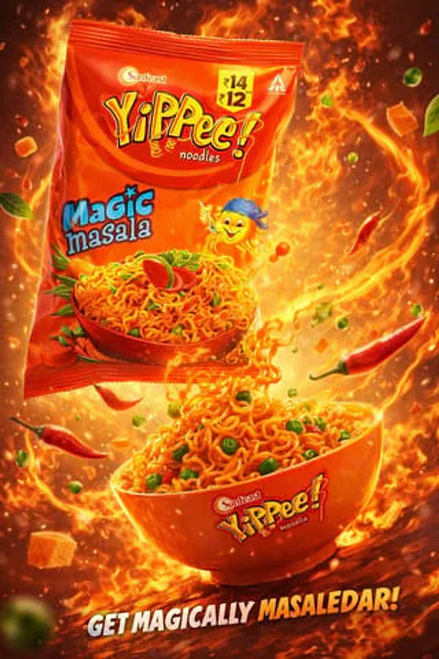

```text
Ultra-high-resolution 8K cinematic commercial food advertisement of **[BRAND NAME] instant noodles**, vertical 3:4 aspect ratio.

A bold hero composition featuring the **[BRAND NAME] noodle packet** floating in the upper frame, front-facing and perfectly lit, with crisp edges, realistic packaging texture, and clear branding. Below it, a steaming bowl branded with **[BRAND NAME]**, filled with glossy, curly noodles lifted dramatically mid-air using chopsticks, noodles stretching naturally under gravity.

Noodles appear richly coated in **[FLAVOR / SAUCE TYPE]**, with visible ingredients such as **[VEGETABLES / CHILIES / GARNISH]** suspended mid-air around the bowl. Steam rises dynamically, interacting with floating spice particles and food fragments.

Background is a **completely new cinematic environment** (not copied from reference), abstract and high-energy, filled with swirling flames, sparks, embers, smoke, and motion blur, creating depth and intensity while keeping the food in sharp focus.

Lighting is premium studio cinematic lighting:
warm golden key light, soft fill light, strong rim light outlining the packet and noodles, high contrast with glowing highlights and deep shadows.

Color palette dominated by **[PRIMARY BRAND COLORS]**, enhanced with warm orange-gold food tones and contrasting greens from vegetables. Hyper-realistic textures on noodles, sauce, packaging, and bowl.

Shallow depth of field, dramatic bokeh in background, extreme sharpness on hero elements, photorealistic yet stylized for advertising impact.

Mood: bold, energetic, spicy, indulgent, mouth-watering, premium commercial look.

No people, no clutter, no copied backgrounds. Designed for high-impact food advertising, posters, and social media hero visuals.

[BRAND NAME] → Maggi
[FLAVOR / SAUCE TYPE] → spicy masala
[PRIMARY BRAND COLORS] → yellow and red
```

Model: GPT Image 2
Author: ShaHid WaNii

[ProjectD](https://aitoolsradar.com/en/prompts/f231d266c3c612) · [Recorded source](https://x.com/meng_dagg695/status/2008810720826478640)
 · [Full original metadata and byte evidence](data/projectd-batch-0046.json)

## ShaHid WaNii #143

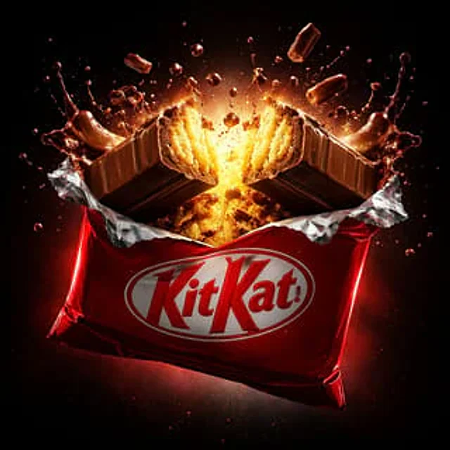

```text
A premium [BRAND NAME] [PRODUCT TYPE] centered in the frame, iconic [BRAND COLOR / PACKAGING STYLE] packaging partially unwrapped, emerging from darkness like a legendary luxury artifact, rich [PRODUCT MATERIAL – chocolate / cream / liquid / filling] cracking open and transforming in slow motion, surreal transformation in progress, [CORE INGREDIENT / FLAVOR ELEMENT] flowing, melting, or bursting outward in cinematic waves, fragments and droplets levitating in zero gravity, slow-motion splash frozen mid-air, ultra-detailed glossy textures, realistic material physics, rich highlights and reflections, dramatic cinematic rim lighting, deep shadows, luxury advertising aesthetic, dreamlike surreal atmosphere, hyper-real product photography blended with fantasy, macro depth of field, clean dark background with subtle [BRAND COLOR] glow, product dominant and razor-sharp, brand name clearly visible on packaging, no extra text, no watermark, no extra logos, 8K ultra-HD, HDR, global illumination, unreal engine style, viral commercial look, high contrast, premium composition
```

Model: GPT Image 2
Author: ShaHid WaNii

[ProjectD](https://aitoolsradar.com/en/prompts/80e67acce28a76) · [Recorded source](https://x.com/meng_dagg695/status/2006643289185989070)
 · [Full original metadata and byte evidence](data/projectd-batch-0046.json)

## ShaHid WaNii #146

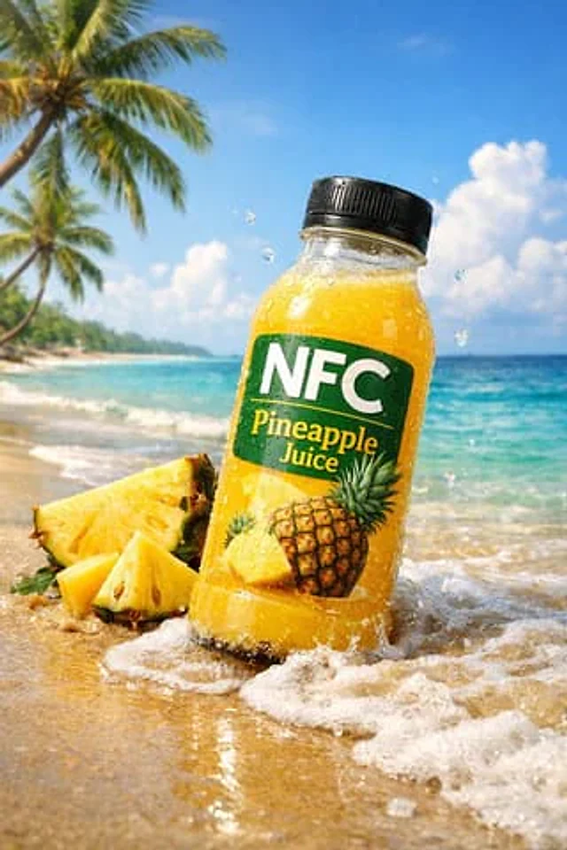

```text
[
  {
    "id": "pineapple_beach_v2",
    "type": "photorealistic advertising shot",
    "subject": {
      "item": "pineapple juice bottle",
      "label_text": "NFC Pineapple Juice",
      "pose": "slightly tilted forward"
    },
    "environment": {
      "location": "tropical beach",
      "ground": "sunlit wet tropical sand",
      "background_elements": [
        "gently swaying palm trees",
        "clear turquoise ocean with soft waves",
        "bright blue sky with thin clouds"
      ],
      "interactions": "a small wave splashes lightly against the bottle base"
    },
    "surrounding_elements": [
      "fresh pineapple slices with visible texture",
      "sparkling seawater droplets in mid-air"
    ],
    "lighting": {
      "description": "golden sunlight",
      "effects": "soft reflections on glass bottle"
    }
  },

  {
    "id": "strawberry_mountain_v2",
    "type": "photorealistic advertising shot",
    "subject": {
      "item": "strawberry juice bottle",
      "label_text": "NFC Strawberry Juice",
      "details": "heavy condensation with frost accents"
    },
    "environment": {
      "location": "high-altitude mountains",
      "ground": "icy rocks with light snow patches",
      "atmosphere": "crisp cold air with drifting mist"
    },
    "surrounding_elements": [
      "fresh strawberries partially resting on ice"
    ],
    "lighting": {
      "description": "soft sunrise light cutting through fog",
      "effects": "subtle glow around the bottle"
    },
    "style_descriptors": [
      "cinematic macro shot",
      "ultra high detail",
      "cold-meets-warm contrast",
      "deep red highlights",
      "fresh and premium feel",
      "hyper-realistic surface details"
    ],
    "parameters": "--ar 9:16 --stylize 250"
  },

  {
    "id": "citrus_grove_v2",
    "type": "photorealistic advertising shot",
    "subject": {
      "item": "citrus blend juice bottle",
      "label_text": "NFC Citrus Mix",
      "pose": "centered upright"
    },
    "environment": {
      "location": "lush citrus grove",
      "background_elements": [
        "sunlit yellow and orange fruits hanging above",
        "soft green leaves framing the bottle"
      ]
    },
    "action_elements": {
      "description": "fresh splash of clear water rising around the base",
      "items": [
        "thin lemon slices",
        "juicy lime wedges",
        "bright orange segments"
      ]
    },
    "lighting": {
      "description": "sun rays filtering through leaves",
      "tone": "vibrant citrus warmth"
    },
    "parameters": "--ar 9:16 --stylize 250"
  },

  {
    "id": "tropical_hammock_v2",
    "type": "photorealistic advertising shot",
    "subject": {
      "item": "tropical mixed Nestle juice bottle",
      "label_text": "NFC Tropical Juice",
      "pose": "relaxed tilt as if resting"
    },
    "environment": {
      "location": "sunlit hammock between palm trees",
      "background": "soft-focus ocean horizon with glowing sunlight"
    },
    "surrounding_elements": [
      "fresh pineapple slices",
      "ripe mango slices",
      "orange wedges",
      "dragonfruit cubes"
    ],
    "mood_and_style": {
      "atmosphere": "luxury vacation vibe",
      "colors": "rich tropical saturation",
      "lighting": "warm cinematic highlights with soft shadows"
    },
    "parameters": "--ar 9:16 --stylize 250"
  }
]
```

Model: GPT Image 2
Author: ShaHid WaNii

[ProjectD](https://aitoolsradar.com/en/prompts/4f9b4537d4db64) · [Recorded source](https://x.com/meng_dagg695/status/2004935778183590081)
 · [Full original metadata and byte evidence](data/projectd-batch-0046.json)

## ShaHid WaNii #178

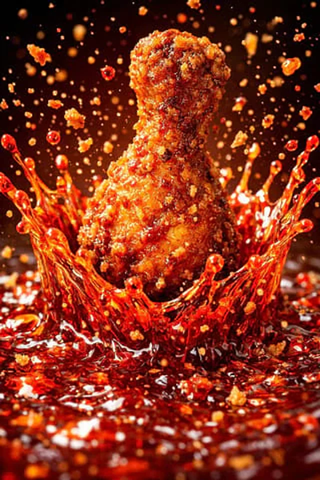

```text
{
  "project": {
    "title": "Hyper-Visual Fried Chicken Action Series",
    "output_quality": "8K Ultra-HD",
    "aspect_ratio": "2:3",
    "style_intent": "High-end commercial food photography",
    "consistency_rule": "Each module shares structure but maintains unique visual dynamics"
  },

  "global_camera_and_rendering": {
    "camera_perspective": "Close-up to extreme macro",
    "focus_behavior": "Crisp subject focus with controlled depth falloff",
    "shutter_effect": "High-speed freeze-frame",
    "texture_priority": "Ultra-detailed crispy breading and crumbs",
    "color_profile": "Warm golden browns, deep reds, high contrast",
    "lighting_quality": "Studio-grade directional lighting with rim highlights",
    "rendering_clarity": "No blur, no softness, no painterly effects"
  },

  "negative_prompt": [
    "motion blur",
    "plastic textures",
    "smooth or waxy food",
    "flat lighting",
    "low detail crumbs",
    "muddy colors",
    "overexposed highlights",
    "cartoon style",
    "unrealistic food physics",
    "oil fog",
    "text artifacts"
  ],

  "modules": {

    "module_1_image_1_style": {
      "scene_type": "Liquid impact action shot",
      "subject": "Single fried chicken drumstick",
      "positioning": "Centered, upright",
      "action": "Drumstick impacting or emerging from liquid splash",
      "liquid_properties": {
        "color": "Deep red-brown",
        "viscosity": "Thick, glossy",
        "behavior": "High splash crown with upward droplets"
      },
      "particle_details": {
        "crumbs": "Small to medium golden crumbs suspended mid-air",
        "distribution": "Surrounding the subject evenly"
      },
      "lighting": {
        "key_light": "Strong frontal light emphasizing texture",
        "rim_light": "Subtle edge highlights on liquid and crust"
      },
      "background": "Dark, nearly black, softly blurred",
      "surface_reflections": "Glossy reflections visible in liquid surface",
      "mood": "Intense, dramatic, high-impact"
    },

    "module_2_image_2_style": {
      "scene_type": "Mid-air food reveal",
      "subject": "Single fried chicken drumstick",
      "action": "Drumstick suspended above an open food box",
      "crumb_motion": "Crumbs falling downward from drumstick",
      "container": {
        "type": "Cardboard food box",
        "color": "White exterior with red interior accents",
        "state": "Open lid, visible interior"
      },
      "lighting": {
        "style": "Soft studio light",
        "effect": "Even illumination with gentle highlights"
      },
      "background": {
        "tone": "Bright, light neutral",
        "depth": "Shallow depth of field, softly blurred"
      },
      "texture_visibility": "Highly defined crunchy coating",
      "mood": "Clean, fresh, appetizing, modern"
    },

    "module_3_image_3_style": {
      "scene_type": "Explosive reveal action shot",
      "subject": "Single fried chicken drumstick",
      "action": "Drumstick bursting upward from food box",
      "explosion_elements": {
        "crumbs": "Large and small fragments radiating outward",
        "direction": "Radial burst from center"
      },
      "lighting": {
        "backlight": "Strong radial backlight creating light rays",
        "contrast": "High contrast between subject and background"
      },
      "container": {
        "type": "Cardboard food box",
        "color": "Red and white",
        "text_visibility": "Visible word 'CHICKEN' on front"
      },
      "background": "Dark with bright light rays emanating behind subject",
      "surface": "Dark tabletop with scattered crumbs",
      "mood": "Energetic, bold, cinematic"
    }
```

Model: GPT Image 2
Author: ShaHid WaNii

[ProjectD](https://aitoolsradar.com/en/prompts/9cec9355ee7cbf) · [Recorded source](https://x.com/meng_dagg695/status/2009591285406208118)
 · [Full original metadata and byte evidence](data/projectd-batch-0046.json)

## ShaHid WaNii #204

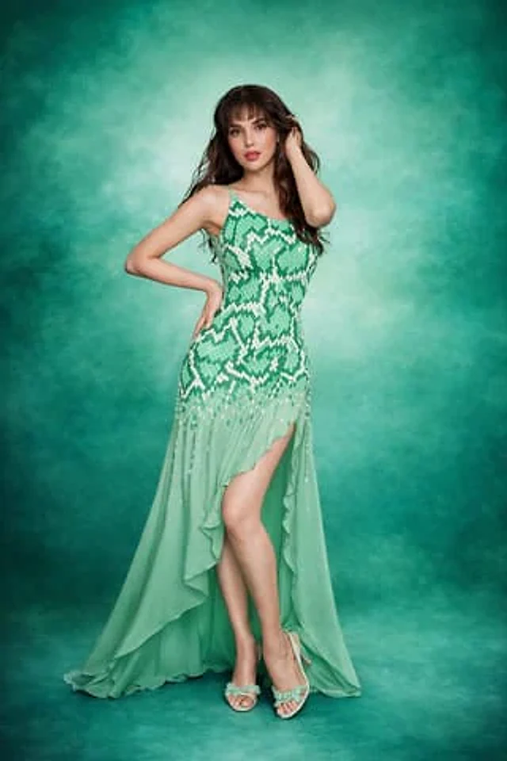

```text
{
  "image_type": "studio fashion portrait",
  "resolution_target": "8K ultra high definition",
  "orientation": "vertical",
  "framing": {
    "shot_type": "full body shot",
    "camera_angle": "straight-on, eye-level",
    "subject_position": "centered",
    "cropping": "head to feet fully visible"
  },
  "subject": {
    "count": 1,
    "gender_presentation": "female-presenting",
    "pose": {
      "body_orientation": "facing forward",
      "weight_distribution": "weight shifted to one leg",
      "legs": {
        "front_leg": "slightly bent at the knee",
        "back_leg": "extended, supporting balance",
        "visibility": "one leg partially exposed through dress slit"
      },
      "arms": {
        "left_arm": "bent with hand resting on hip",
        "right_arm": "raised with hand touching hair near head"
      },
      "posture": "upright, relaxed, confident stance"
    },
    "facial_features": {
      "expression": "neutral to soft confident expression",
      "eyes": "open, looking directly at camera",
      "eyebrows": "well-defined",
      "lips": "full, slightly parted",
      "makeup": {
        "foundation": "smooth, even-toned",
        "blush": "subtle",
        "lip_color": "soft pink",
        "eye_makeup": "defined lashes, neutral tones"
      }
    },
    "hair": {
      "color": "dark brown",
      "length": "long",
      "texture": "slightly wavy",
      "styling": "loose, flowing",
      "bangs": "short fringe across forehead"
    },
    "skin": {
      "tone": "light to medium",
      "texture": "smooth, evenly lit"
    }
  },
  "clothing": {
    "dress": {
      "type": "evening gown",
      "length": "floor length",
      "fit": "fitted bodice, flowing skirt",
      "neckline": "asymmetrical single-strap",
      "strap": {
        "count": 1,
        "placement": "over one shoulder"
      },
      "pattern": "snake-skin inspired geometric pattern",
      "primary_color": "green",
      "secondary_colors": ["white", "light mint green"],
      "fabric": {
        "bodice": "structured, patterned fabric",
        "skirt": "sheer, lightweight, flowing fabric"
      },
      "slit": {
        "presence": true,
        "location": "front side",
        "height": "upper thigh"
      },
      "hemline": "uneven, flowing with layered folds"
    },
    "footwear": {
      "type": "high-heeled sandals",
      "color": "matching green",
      "heel_style": "thin heel",
      "details": "decorative floral or bow-like embellishment on front strap",
      "toe_style": "open-toe"
    },
    "accessories": {
      "visible_jewelry": "none clearly visible",
      "other_accessories": "none visible"
    }
  },
  "background": {
    "type": "studio backdrop",
    "color_palette": ["teal", "green"],
    "texture": "soft, cloudy gradient",
    "pattern": "non-uniform, painterly",
    "depth": "flat backdrop with subtle tonal variation"
  },
  "lighting": {
    "style": "studio lighting",
    "key_light": "soft frontal light",
    "fill_light": "even fill reducing harsh shadows",
    "shadows": "minimal, soft",
    "highlights": "gentle highlights on face and dress texture",
    "overall_exposure": "balanced"
  },
  "color_balance": {
    "dominant_colors": ["green", "teal"],
    "contrast": "moderate",
    "saturation": "medium to slightly high",
    "color_harmony": "monochromatic green tones"
  },
  "image_quality": {
    "sharpness": "high",
    "clarity": "clean and crisp",
    "noise": "none visible",
    "focus": "sharp across entire subject"
  },
  "style_tags": ["fashion photography", "studio portrait", "elegant", "glamour", "high fashion", "editorial"],
  "ai_generation_notes": {
    "do_not_add": ["extra jewelry", "additional subjects", "background objects", "props", "text", "logos"]
  }
}
```

Model: GPT Image 2
Author: ShaHid WaNii

[ProjectD](https://aitoolsradar.com/en/prompts/dee9e8c20fea81) · [Recorded source](https://x.com/meng_dagg695/status/2005820511801254047)
 · [Full original metadata and byte evidence](data/projectd-batch-0046.json)

## ShaHid WaNii #212

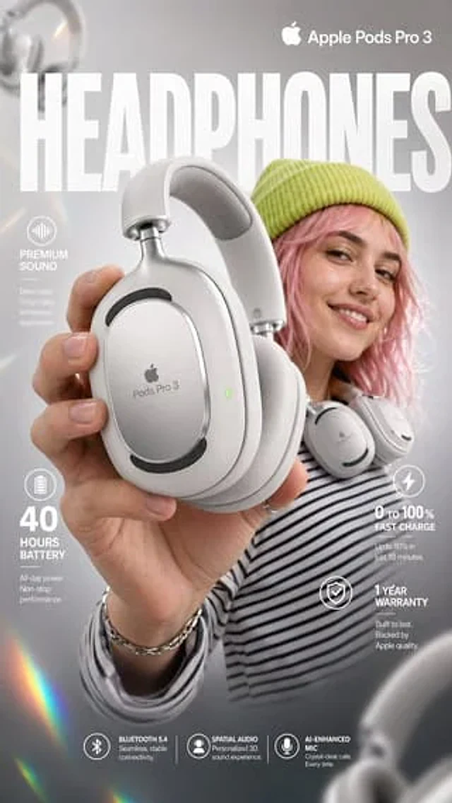

```text
High-impact e-commerce infographic for "Apple Pods Pro 3" 
premium wireless over-ear headphones.

FOREGROUND - PRODUCT HERO SHOT
Extreme close-up of a hand holding a sleek, 
matte-white premium over-ear headphone toward the camera 
at a slight angle. The headphone features:
- Glossy white ear cushions with soft memory foam padding
- Brushed aluminum silver headband with subtle Apple Pods 
  Pro 3 embossed branding
- Black mesh speaker grille visible on the ear cup face
- A tiny glowing green LED status indicator on the 
  right ear cup edge
- Subtle touch-control icons etched on the outer cup surface

Macro-lens shallow depth of field — hand and headphone 
slightly blurred at edges to create cinematic depth. 
Product remains razor-sharp in center frame.

CENTRAL SUBJECT — MODEL
In the mid-ground: a smiling young woman with freckles 
and wavy pastel-pink hair. She wears:
- A vibrant lime-green knit beanie
- A psychedelic black and white-striped long-sleeve shirt
- The white over-ear headphones resting stylishly 
  around her neck (not on ears) — one hand casually 
  touching the ear cup

Expression: relaxed, confident, joyful. 
She is glancing slightly off-camera with a natural smile.

BACKGROUND & ATMOSPHERE
Clean soft-focus studio backdrop — light gray gradient 
fading to warm white at center. 

Atmospheric overlays:
- Diagonal rainbow prism lens flares cutting across 
  upper-left to lower-right
- Soft pastel light leaks in pink and yellow at corners
- 4–5 blurred white over-ear headphones floating 
  artistically in the background at various depths 
  and rotation angles
- Subtle bokeh circles from background studio lights

Lighting: Soft professional three-point studio lighting. 
Key light from upper-left, fill light right side. 
Rim light behind model for separation. 
Glossy highlights on headphone surfaces catching light naturally.

TYPOGRAPHY & LAYOUT — Sans-Serif, Clean white 
TOP CENTER (behind model, large background text):
→ Massive bold oversized text: "HEADPHONES"
   Semi-transparent white, spanning full width behind subject

TOP RIGHT CORNER:
→ Bold clean text: "Apple Pods Pro 3"
   Subtitle smaller text: "Over-Ear Wireless"

MID LEFT:
→ Icon: small sound wave symbol
→ Bold text: "Premium Sound"
→ Sub-text: "Active Noise Cancellation + Transparency Mode"

MID RIGHT:
→ Extra-large bold numeral: "40"
→ Smaller text below: "hours of battery life"

LOWER LEFT:
→ Extra-large bold numeral: "0"
   with "to" beside it → then bold "100%"
→ Sub-text: "Fast charge — 10 min = 3hrs playback"

BOTTOM RIGHT:
→ Extra-large bold numeral: "1"
→ Sub-text: "Year Warranty Included"

BOTTOM CENTER (fine print style):
→ Small elegant text: 
   "Bluetooth 5.4  |  Hi-Res Audio Certified  
    |  Foldable Design  |  USB-C Charging"

TECHNICAL SPECS
Resolution: 8K ultra-sharp
Style: Commercial product photography meets 
       editorial fashion advertising
Color Palette: White, lime green, pastel pink, 
               rainbow prism accents
Focus: Tack-sharp on headphone product — 
       shallow DOF on everything else
Lens: 85mm macro, slight low angle
Render Quality: Hyperrealistic, clean ad aesthetic, 
                vibrant yet professional color grading
```

Model: GPT Image 2
Author: ShaHid WaNii

[ProjectD](https://aitoolsradar.com/en/prompts/3c9f0562e78703) · [Recorded source](https://x.com/meng_dagg695/status/2047935217231663186)
 · [Full original metadata and byte evidence](data/projectd-batch-0046.json)

## ShaHid WaNii #22

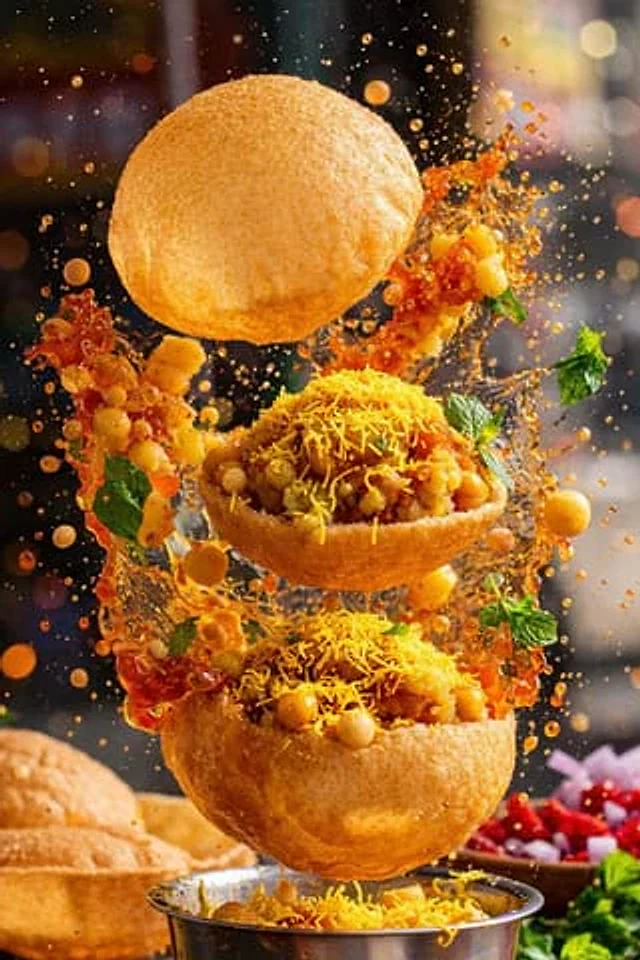

```text
{
  "global_settings": {
    "resolution": "8K ultra high definition",
    "aspect_ratio": "2:3 vertical",
    "image_type": "AI-edited cinematic food photography",
    "detail_level": "extreme micro-detail, sharp focus, clean edges",
    "style_constraint": "enhanced realism, minimal alteration from original composition"
  },

  "module_1_image_1_style": {
    "subject": "single hard-shell taco",
    "composition": {
      "orientation": "diagonal, floating in mid-air",
      "foreground_focus": "taco shell and filling",
      "motion": "ingredients suspended, sauce splash frozen mid-air"
    },
    "visible_elements": {
      "shell": "golden yellow hard taco shell with crisp texture",
      "filling": [
        "shredded cooked meat with visible fibers",
        "green sauce layered on top",
        "small red diced pieces",
        "white crumbled cheese"
      ],
      "floating_garnish": [
        "avocado slices",
        "purple onion rings",
        "green herb leaves",
        "small reddish-brown meat cubes",
        "tiny white crumbs"
      ],
      "liquid": "orange-red sauce splash erupting upward behind taco"
    },
    "lighting": {
      "type": "high-contrast studio lighting",
      "highlights": "glossy reflections on sauce and meat",
      "background_lights": "soft circular bokeh in warm and cool tones"
    },
    "background": {
      "color": "dark with neon-like blurred lights",
      "depth": "strong depth of field, background fully defocused"
    }
  },

  "module_2_image_2_style": {
    "subject": "three grilled meat skewers",
    "composition": {
      "orientation": "vertical skewers, slightly angled",
      "foreground_focus": "center skewer",
      "motion": "ingredients and sauce suspended"
    },
    "visible_elements": {
      "skewers": "wooden sticks with pointed ends",
      "meat": "chunked grilled meat with char marks and uneven texture",
      "garnish": "small green herb leaves attached to meat",
      "floating_items": [
        "round cucumber slices",
        "thin onion rings"
      ],
      "sauce": {
        "container": "small white ramekin",
        "action": "thick orange sauce splashing upward from bowl"
      },
      "particles": "tiny spice or crumb particles scattered in air"
    },
    "lighting": {
      "type": "dramatic directional lighting",
      "highlights": "strong sheen on meat surface",
      "contrast": "deep shadows"
    },
    "background": {
      "color": "solid deep red",
      "texture": "soft grain with floating particles"
    }
  },

  "module_3_image_3_style": {
    "subject": "four sushi rolls",
    "composition": {
      "orientation": "floating cluster",
      "spacing": "uneven depth, some closer, some blurred behind",
      "motion": "sesame seeds and herbs suspended"
    },
    "visible_elements": {
      "sushi_structure": {
        "outer_layer": "white rice",
        "inner_layer": "dark seaweed",
        "fillings": [
          "orange fish slice",
          "green avocado"
        ]
      },
      "toppings": [
        "toasted sesame seeds",
        "brown crunchy coating",
        "finely chopped green herbs"
      ],
      "particles": [
        "sesame seeds",
        "small green herb pieces"
      ]
    },
    "lighting": {
      "type": "soft but crisp studio lighting",
      "focus": "front sushi pieces sharp, rear slightly blurred"
    },
    "background": {
      "color": "dark blue-grey",
      "depth": "clean bokeh-free backdrop with floating particles"
    }
  },
  "post_processing": {
    "clarity": "ultra-sharp",
    "noise": "minimal",
    "color_balance": "rich but natural",
    "ai_signature": "clean AI-edited look without exaggeration"
  }
}
```

Model: GPT Image 2
Author: ShaHid WaNii

[ProjectD](https://aitoolsradar.com/en/prompts/b90fb31c082011) · [Recorded source](https://x.com/meng_dagg695/status/2009887009591226787)
 · [Full original metadata and byte evidence](data/projectd-batch-0046.json)

## ShaHid WaNii #237

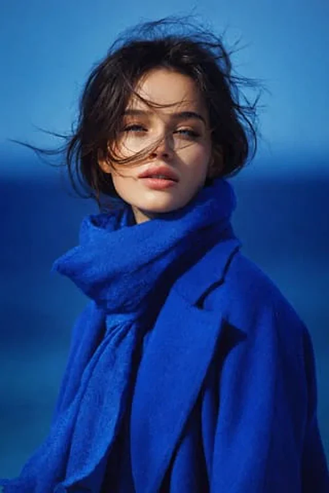

```text
{
  "image_type": "portrait_photography",
  "resolution_target": "8K UHD",
  "aspect_ratio": "vertical",
  "frame_composition": {
    "crop": "mid-chest to head",
    "orientation": "portrait",
    "subject_position": "centered",
    "camera_angle": "eye-level",
    "perspective": "straight-on"
  },
  "subject": {
    "gender_presentation": "female",
    "age_appearance": "young adult",
    "face": {
      "shape": "oval",
      "skin_tone": "fair with neutral undertone",
      "skin_texture": "smooth, natural, visible realism, no heavy retouching",
      "facial_features": {
        "eyes": {
          "color": "light blue-green",
          "shape": "almond-shaped",
          "gaze_direction": "directly toward camera",
          "eyelids": "slightly relaxed",
          "eyelashes": "natural length, not exaggerated"
        },
        "eyebrows": {
          "color": "dark brown",
          "thickness": "medium",
          "shape": "soft natural arch"
        },
        "nose": {
          "shape": "straight",
          "size": "proportionate",
          "bridge": "smooth"
        },
        "lips": {
          "color": "soft natural pink",
          "fullness": "medium to full",
          "state": "slightly parted"
        }
      },
      "expression": "neutral, calm, composed"
    },
    "hair": {
      "color": "dark brown",
      "length": "short to medium",
      "style": "loose, slightly wavy",
      "movement": "wind-blown strands crossing face",
      "parting": "natural, unstructured"
    }
  },
  "clothing": {
    "outerwear": {
      "type": "coat",
      "color": "deep royal blue",
      "material_appearance": "wool or felt-like texture",
      "fit": "structured but relaxed",
      "visible_details": "clean seams, minimal design"
    },
    "accessory": {
      "type": "scarf",
      "color": "matching royal blue",
      "material_appearance": "soft, fabric texture",
      "placement": "wrapped loosely around neck"
    }
  },
  "color_palette": {
    "dominant_colors": [
      "royal blue",
      "deep blue",
      "soft skin tones"
    ],
    "contrast": "high contrast between blue clothing and lighter skin",
    "color_temperature": "cool"
  },
  "lighting": {
    "type": "natural light",
    "direction": "frontal with slight side softness",
    "intensity": "moderate",
    "shadows": "soft, minimal harsh shadows",
    "highlights": "subtle highlights on cheekbones and lips"
  },
  "background": {
    "environment": "open outdoor setting",
    "elements": "blurred horizon line, blue gradient background",
    "depth_of_field": "shallow",
    "background_detail": "intentionally out of focus",
    "color": "blue gradient resembling sky and distant water"
  },
  "image_style": {
    "realism": "high realism with subtle AI polish",
    "sharpness": "high facial detail",
    "texture_detail": "visible fabric texture and skin detail",
    "noise": "minimal",
    "post_processing": "clean color grading, no heavy filters"
  },
  "mood": {
    "overall_feel": "calm, serene, minimalistic",
    "visual_energy": "soft and composed"
  },
  "generation_constraints": {
    "preserve_original_composition": true,
    "preserve_subject_structure": true,
    "no_face_alteration": true,
    "no_style_assumptions": true,
    "do_not_change_image_size": true
  }
}
```

Model: GPT Image 2
Author: ShaHid WaNii

[ProjectD](https://aitoolsradar.com/en/prompts/fb5bffb2e90907) · [Recorded source](https://x.com/meng_dagg695/status/2005107364203298875)
 · [Full original metadata and byte evidence](data/projectd-batch-0046.json)

## ShaHid WaNii #252

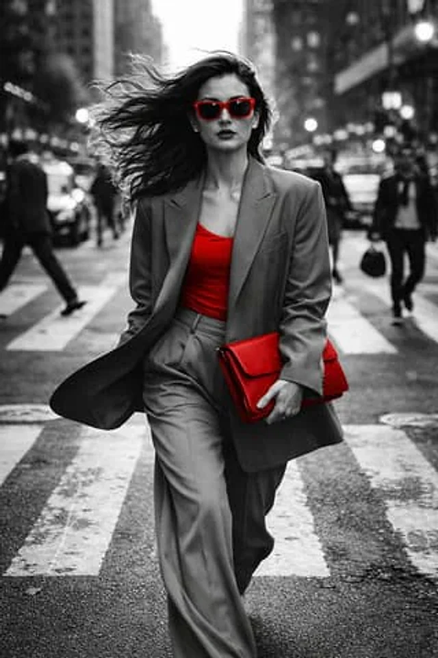

```text
{
  "objective": "Generate a hyper-realistic black and white street fashion photograph with selective color accents.",
  "image_type": "photography",
  "prompt": {
    "subject": "A stylish, confident woman crossing a busy city intersection",
    "wardrobe": {
      "outerwear": "Oversized blazer in neutral tone",
      "innerwear": "Bright red fitted top (selective color)",
      "bottoms": "Loose tailored trousers in neutral tone",
      "accessories": [
        "Bright red leather clutch in hand",
        "Bright red sunglasses"
      ]
    },
    "action_motion": "Walking briskly toward the camera, hair flowing backward due to motion, blazer and trousers moving naturally",
    "scene": "Busy urban crosswalk with pedestrians and cars motion-blurred in the background",
    "perspective": "Frontal tracking shot at waist level",
    "style": [
      "High-end street fashion",
      "Paparazzi aesthetic",
      "Editorial candid",
      "Dynamic movement photography"
    ],
    "visual_details": [
      "Realistic fabric physics",
      "Detailed hair movement",
      "Sharp facial features",
      "Asphalt road texture",
      "Motion blur on background crowd",
      "Bokeh city lights"
    ],
    "mood": [
      "Confident",
      "Cosmopolitan",
      "Urgent",
      "Powerful"
    ]
  },
  "camera_and_composition": {
    "angle": "Waist-level",
    "framing": "Subject centered, background expanding outward with motion blur",
    "depth_of_field": "Shallow depth of field isolating the subject"
  },
  "lighting": {
    "type": "Natural backlight with rim lighting",
    "contrast": "High contrast emphasizing silhouette and edges"
  },
  "post_processing": {
    "color_mode": "Black and white with selective red color accents only on innerwear, sunglasses, and clutch bag",
    "effects": [
      "Subtle lens flare",
      "Vintage film stock emulation",
      "High micro-contrast",
      "Film grain texture"
    ]
  },
  "negative_prompt": [
    "Posed studio look",
    "Empty street",
    "Static posture",
    "Low realism",
    "Full color image",
    "Overexposed highlights",
    "Flat lighting"
  ],
  "output_quality": {
    "resolution": "Ultra high resolution",
    "detail_level": "Maximum photorealism",
    "sharpness": "Crisp subject, soft background"
  }
}
```

Model: GPT Image 2
Author: ShaHid WaNii

[ProjectD](https://aitoolsradar.com/en/prompts/885702499cd2bd) · [Recorded source](https://x.com/meng_dagg695/status/2003075417305928072)
 · [Full original metadata and byte evidence](data/projectd-batch-0046.json)

## ShaHid WaNii #262

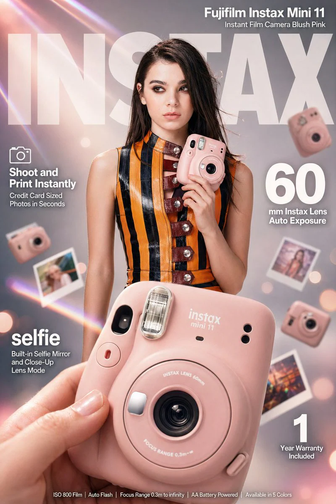

```text
High-impact e-commerce infographic advertisement for "Fujifilm Instax Mini 11" blush pink instant camera. FOREGROUND: Extreme close-up of a hand holding a compact rounded blush-pink Fujifilm Instax Mini 11 camera angled toward camera, razor-sharp center focus, macro-lens shallow depth of field, visible 60mm silver lens ring, crystal pop-up flash, white instax mini 11 branding on body, red shutter button accent, fingertips softly blurred at edges. CENTRAL MODEL: confident young woman with straight dark brown hair, light natural makeup, cool editorial expression, wearing a bold orange and black vertical-striped sleeveless leather mini dress with deep red buckle details and silver stud buttons, holding the blush-pink Instax Mini 11 casually at chest height with camera face pointing outward, slight off-camera gaze, stylish composed energy. BACKGROUND: soft-focus cool light gray gradient studio backdrop fading to warm white center, diagonal pastel prism lens flares in pink peach and lavender cutting upper-left to lower-right, soft blush-pink and cream light leaks at corners, 4 to 5 blurred Fujifilm Instax Mini 11 cameras floating at various depths and rotation angles, scattered polaroid-style instant photo prints in background bokeh, subtle bokeh circles from studio lights. LIGHTING: professional three-point studio lighting, key light upper-left, fill light right side, rim light behind model for separation, glossy highlights on camera lens ring and flash unit. TYPOGRAPHY overlaid clean bold white sans-serif: massive semi-transparent "INSTAX" text spanning full width behind model at top center, top right bold text "Fujifilm Instax Mini 11" with subtitle "Instant Film Camera Blush Pink", mid-left small camera icon with bold "Shoot and Print Instantly" and subtext "Credit Card Sized Photos in Seconds", mid-right extra-large bold numeral "60" with smaller text "mm Instax Lens Auto Exposure", lower-left bold "selfie" with subtext "Built-in Selfie Mirror and Close-Up Lens Mode", bottom-right bold numeral "1" with subtext "Year Warranty Included", bottom center fine print "ISO 800 Film | Auto Flash | Focus Range 0.3m to infinity | AA Battery Powered | Available in 5 Colors". TECHNICAL: 8K ultra-sharp, hyperrealistic commercial ad aesthetic, editorial fashion meets lifestyle product photography style, color palette blush pink orange black cream pastel prism accents, tack-sharp on Instax camera with shallow DOF on everything else, 85mm macro slight low angle, warm vibrant professional color grading.
```

Model: GPT Image 2
Author: ShaHid WaNii

[ProjectD](https://aitoolsradar.com/en/prompts/89e19ed6b316b2) · [Recorded source](https://x.com/meng_dagg695/status/2048636069349138568)
 · [Full original metadata and byte evidence](data/projectd-batch-0046.json)

## ShaHid WaNii #264

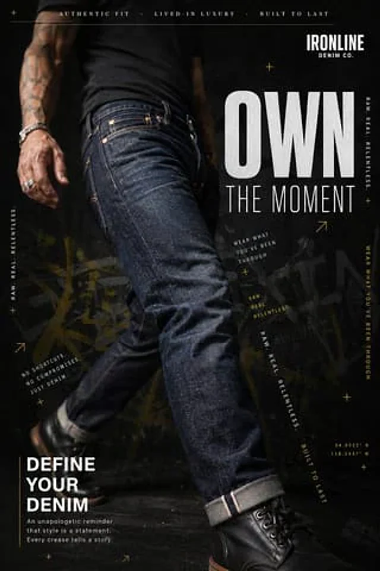

```text
A hyperrealistic premium denim advertisement shot in a dark, moody editorial style. A male figure wearing raw selvedge denim jeans is captured mid-stride against a near-black charcoal background, body angled diagonally at a bold 45-degree perspective toward the camera. The jeans feature a slim tapered silhouette with deep indigo wash, subtle thigh and knee fading, reinforced copper rivets catching ambient light, and clean off-white contrast stitching, dominating the lower two-thirds of the frame. The composition uses shallow depth of field with sharp focus on the denim texture and soft blur on the upper torso. The background is layered with subtle urban texture — faint graffiti strokes in electric yellow and muted olive, barely visible through a heavy dark vignette. Multiple rows of ultra-small all-caps typographic text orbit the figure at different angles reading phrases like "RAW. REAL. RELENTLESS." and "WEAR WHAT YOU'VE BEEN THROUGH" — some running vertically, some at 30-degree angles, creating a chaotic yet intentional graphic zine energy. At the upper right, a bold brand wordmark appears in clean white against the dark background. At the top center, a thin horizontal navigation-style text bar reads "AUTHENTIC FIT · LIVED-IN LUXURY · BUILT TO LAST" in spaced all-caps serif font. A large commanding headline is placed center-right — "OWN" in massive ultra-bold white letters followed by "THE MOMENT" in lighter weight creating dramatic type hierarchy. Small yellow plus (+) symbols and diagonal arrows (↗) are scattered throughout as accent details. Bottom left features a bold slogan lockup: "DEFINE YOUR DENIM" in large bold sans-serif white text with a thin subline reading "An unapologetic reminder that style is a statement. Every crease tells a story." The overall lighting is dramatic and directional — a single cold key light from the left causing copper rivets to shimmer and deep indigo denim to glow with subtle sheen against the darkness. Close macro detail visible on the fabric weave texture near the knee fade. Photorealistic. Commercial photography quality. High contrast. 4K resolution. 3:4 vertical format optimized for social media.
```

Model: GPT Image 2
Author: ShaHid WaNii

[ProjectD](https://aitoolsradar.com/en/prompts/e3ecb252c41fa7) · [Recorded source](https://x.com/meng_dagg695/status/2048024788078350620)
 · [Full original metadata and byte evidence](data/projectd-batch-0046.json)

## ShaHid WaNii #268

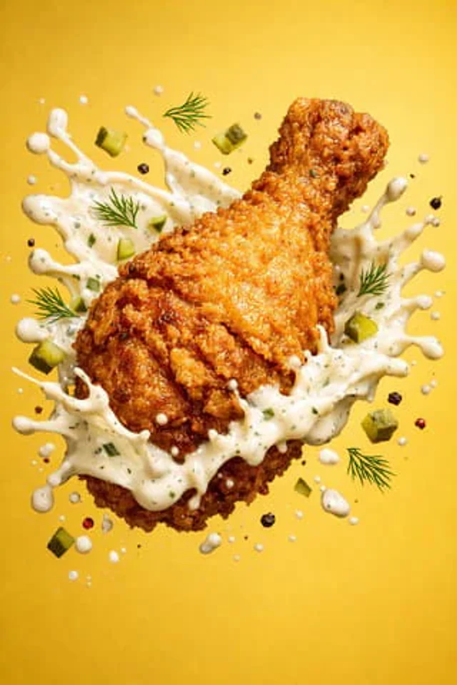

```text
Epic 8K cinematic fantasy food scene: a colossal crispy fried chicken leg rising like a legendary artifact through a tidal explosion of molten creamy sauce. Sauce behaves like liquid clouds, forming waves and splashes in mid-air. Pickle chunks, herb leaves, and seasoning particles float like asteroids in a food universe. Extreme macro texture on the crust—cracks, bubbles, and crunch visible. Powerful dramatic lighting with deep shadows and glowing highlights. Vibrant golden-yellow background with cinematic depth and atmospheric particles. Hyper-realistic yet mythic, bold surreal advertising masterpiece.
```

Model: GPT Image 2
Author: ShaHid WaNii

[ProjectD](https://aitoolsradar.com/en/prompts/d5e24073b9eba4) · [Recorded source](https://x.com/meng_dagg695/status/2007269989359948066)
 · [Full original metadata and byte evidence](data/projectd-batch-0046.json)

## ShaHid WaNii #279

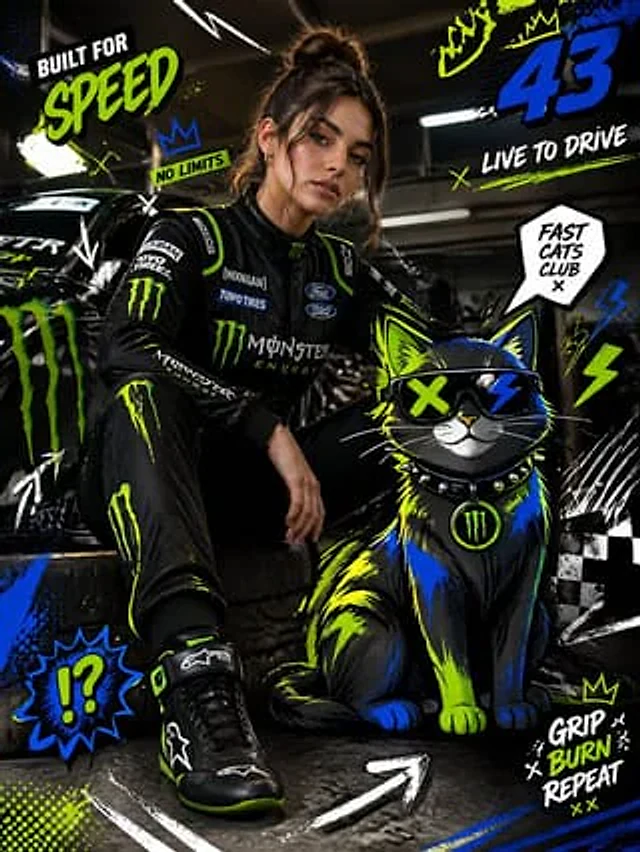

```text
Full-body fashion editorial shot of a confident young woman with long wavy dark brown hair, striking sharp facial features, defined cheekbones, deep-set eyes with a calm dominant gaze, sunglasses perched on top of her head, standing in a powerful pose — one hand resting on an open scissor door, body slightly turned, looking straight at camera with a composed, fierce expression.
Wearing a fitted black long-sleeve racing jersey with gold sponsor logos (Alpinestars collar detail), black racing gloves, with a white, black, and red Sparco racing suit draped and hanging off her body, and black racing shoes. Clean editorial styling, natural confident stance, wind slightly moving her dark wavy hair.
Beside and partially interacting with a stylized cartoon Cat, positioned naturally as if sharing the same space. The Cat is illustrated in bold cartoon style with thick black outlines, vibrant neon color palette (neon green, blue, yellow accents), exaggerated proportions, expressive features, playful yet powerful presence.
Background: bright indoor motorsport garage pit lane setting with large industrial windows flooding soft diffused daylight, glossy reflective concrete floor, a neon green Lamborghini Huracán with open scissor door partially visible.
Fusion of hyper-realistic photography and graphic illustration, seamless integration between subject and cartoon. Add graphic overlay elements: doodle Gugu arrows, scribbles, racing-themed abstract shapes, speed lines, comic-style symbols, dynamic motion lines, checkered flag doodles.
High contrast, HDR lighting, sharp focus, fashion editorial motorsport composition, surreal mixed-media aesthetic, ultra-detailed, 8K resolution.
```

Model: GPT Image 2
Author: ShaHid WaNii

[ProjectD](https://aitoolsradar.com/en/prompts/ad7c110bde4de1) · [Recorded source](https://x.com/meng_dagg695/status/2048967861981594095)
 · [Full original metadata and byte evidence](data/projectd-batch-0046.json)

## ShaHid WaNii #44

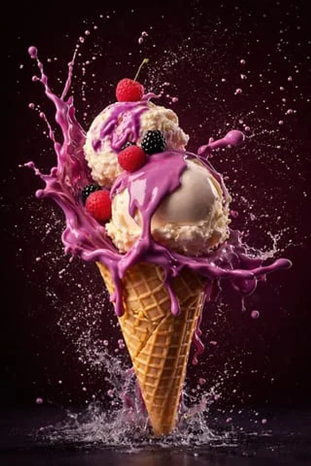

```text
{
  "master_prompt": {
    "global_settings": {
      "resolution": "8K ultra high definition",
      "aspect_ratio": "3:4 vertical",
      "image_quality": "extreme sharpness, high dynamic range, professional studio lighting",
      "style": "AI-edited hyperreal food photography",
      "focus": "crisp textures, frozen motion, liquid dynamics, surface details",
      "background_quality": "clean, controlled, noise-free"
    },

    "module_1": {
      "identity": "Image 1 – Ice Cream Cone with Purple Splash",
      "subject": {
        "main_object": "waffle cone ice cream",
        "cone": "light brown waffle cone with diamond grid texture, matte finish",
        "ice_cream_scoops": [
          {
            "color": "off-white / vanilla",
            "texture": "creamy with visible scoop ridges"
          },
          {
            "color": "off-white / vanilla",
            "texture": "slightly uneven surface, melting edges"
          }
        ],
        "toppings": [
          "raspberries",
          "blackberries"
        ],
        "sauce": {
          "color": "glossy purple",
          "behavior": "thick liquid splashing outward and downward",
          "coverage": "dripping over scoops and cone"
        }
      },
      "motion": {
        "action": "frozen splash moment",
        "details": "liquid droplets suspended mid-air, see-through splash edges"
      },
      "background": {
        "color": "deep dark maroon / black",
        "style": "studio backdrop with subtle gradient"
      },
      "lighting": {
        "type": "high-contrast studio lighting",
        "effects": "specular highlights on sauce and ice cream, shadow depth under cone"
      }
    },

    "module_2": {
      "identity": "Image 2 – Chocolate Ice Cream Bar with Bite",
      "subject": {
        "main_object": "chocolate-coated ice cream bar on wooden stick",
        "coating": {
          "exploded_view": false,
          "surface": "milk chocolate coating with embedded nut pieces",
          "texture": "rough, uneven, crunchy appearance"
        },
        "bite_detail": {
          "location": "top edge",
          "interior_layers": [
            "chocolate ice cream",
            "thin darker chocolate layer"
          ],
          "edges": "jagged bite marks"
        },
        "stick": {
          "material": "light wood",
          "finish": "smooth, rounded end"
        }
      },
      "motion": {
        "elements": "small chocolate fragments floating in air",
        "behavior": "scattered outward from the bar"
      },
      "background": {
        "color": "warm brown gradient",
        "style": "clean studio environment"
      },
      "lighting": {
        "type": "directional studio lighting",
        "effects": "strong highlights on chocolate bumps, soft shadows"
      }
    },

    "module_3": {
      "identity": "Image 3 – Red Berry Popsicle with Fruits",
      "subject": {
        "main_object": "rectangular red popsicle",
        "surface": {
          "texture": "frosted, icy crystals visible",
          "shape": "rounded corners, vertical grooves"
        },
        "stick": {
          "material": "light wooden stick",
          "visible": true
        },
        "surroundings": [
          "whole strawberries with green tops",
          "blueberries",
          "raspberries",
          "mint leaves",
          "crushed ice pieces"
        ]
      },
      "color_palette": [
        "bright red",
        "deep blue",
        "fresh green",
        "clear ice"
      ],
      "background": {
        "composition": "entire frame filled with fruits and ice",
        "style": "top-down macro food arrangement"
      },
      "lighting": {
        "type": "even bright lighting",
        "effects": "wet shine on fruit skins, crystalline ice reflections"
      }
    },
```

Model: GPT Image 2
Author: ShaHid WaNii

[ProjectD](https://aitoolsradar.com/en/prompts/e7d931477e2725) · [Recorded source](https://x.com/meng_dagg695/status/2010312584059351261)
 · [Full original metadata and byte evidence](data/projectd-batch-0046.json)

## ShaHid WaNii #50

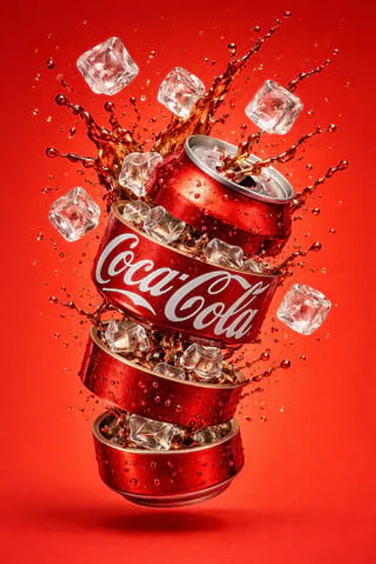

```text
{
  "resolution": "8K",
  "style": "hyper-realistic commercial product photography",
  "composition": {
    "subject": "carbonated beverage can",
    "position": "center frame, floating mid-air",
    "orientation": "slightly tilted vertical",
    "framing": "tight hero shot"
  },
  "can_details": {
    "material": "metallic aluminum",
    "top_bottom": "silver with visible pull tab",
    "surface": "glossy with condensation droplets",
    "label": {
      "text": "{{BRAND_NAME}}",
      "font": "bold uppercase sans-serif",
      "color": "white",
      "background_band": "deep blue",
      "placement": "wrapped around center of can"
    }
  },
  "liquid_effects": {
    "color": "bright green",
    "type": "carbonated liquid splash",
    "motion": "frozen mid-explosion",
    "details": [
      "semi-transparent fluid",
      "fine droplets suspended in air",
      "dynamic curved splash arcs",
      "visible carbonation bubbles"
    ]
  },
  "fruit_elements": {
    "type": "sliced fruit",
    "motion": "floating around the can",
    "texture": "fresh, juicy, glossy"
  },
  "lighting": {
    "type": "studio lighting",
    "highlights": "strong reflections",
    "shadows": "soft"
  },
  "background": {
    "color": "smooth gradient matching liquid tone",
    "environment": "clean studio backdrop"
  },
  "render_quality": {
    "sharpness": "ultra-sharp",
    "contrast": "high",
    "realism": "photorealistic"
  }
}
```

Model: GPT Image 2
Author: ShaHid WaNii

[ProjectD](https://aitoolsradar.com/en/prompts/f42a789674a341) · [Recorded source](https://x.com/meng_dagg695/status/2009519057717088345)
 · [Full original metadata and byte evidence](data/projectd-batch-0046.json)

## ShaHid WaNii #54


```text
{
  "global_settings": {
    "resolution": "8K UHD",
    "quality": "ultra-high",
    "render_style": "AI-edited hyper-realistic food photography",
    "sharpness": "extreme micro-detail",
    "noise": "none",
    "compression": "lossless",
    "lighting_quality": "studio-controlled, cinematic",
    "color_accuracy": "true-to-image",
    "focus": "selective shallow depth of field",
    "texture_emphasis": "maximum"
  },

  "camera_profile": {
    "camera_type": "full-frame DSLR / mirrorless equivalent",
    "lens": "macro prime",
    "focal_length": "85mm–105mm",
    "aperture": "f/2.8",
    "iso": "low ISO",
    "shutter": "studio synchronized",
    "white_balance": "neutral, image-matched"
  },

  "module_1_image_1_style": {
    "subject": "square matcha cheesecake slice",
    "composition": {
      "orientation": "portrait",
      "angle": "three-quarter front view",
      "placement": "centered on dark ceramic plate",
      "crop": "tight food-focused crop"
    },
    "layers": {
      "top_layer": "glossy matcha glaze with visible drip trails",
      "middle_layer": "smooth pale-green cheesecake body",
      "bottom_layer": "thin golden biscuit crust"
    },
    "surface_details": {
      "glaze": "highly reflective, thick, slow-dripping matcha glaze",
      "powder": "matcha powder dusted on top and plate",
      "crumbs": "fine crumbs near base"
    },
    "garnish": {
      "top": ["round green confection", "fresh mint leaves", "single raspberry"],
      "plate": ["extra raspberry", "mint leaves", "matcha powder"]
    },
    "background": {
      "color": "dark charcoal / black",
      "elements": ["black bowl containing green sauce"],
      "blur": "strong background blur"
    },
    "lighting": {
      "key_light": "soft directional from upper left",
      "highlights": "strong specular highlights on glaze",
      "shadows": "soft, natural falloff"
    },
    "mood": "luxurious, modern, minimal, gourmet"
  },

  "module_2_image_2_style": {
    "subject": "blue and white layered cake slice",
    "composition": {
      "orientation": "portrait",
      "angle": "slightly elevated front angle",
      "placement": "centered on white decorative plate"
    },
    "layers": {
      "cake_layers": "soft white sponge layers",
      "filling_layers": "translucent blue jelly layers with sparkle",
      "top_layer": "smooth pastel blue glaze"
    },
    "surface_details": {
      "drip": "single vertical glossy blue drip down front",
      "sparkle": "tiny reflective particles embedded in jelly",
      "top_decor": "glass-like blue spheres"
    },
    "garnish": {
      "top": ["dark glossy cherry with long stem", "three transparent blue spheres", "tiny star-shaped sprinkles"],
      "plate": ["subtle sugar-like sparkles"]
    },
    "background": {
      "color": "light icy blue",
      "effect": "soft bokeh dots",
      "props": ["white ribbon partially visible"]
    },
    "lighting": {
      "key_light": "soft frontal light",
      "fill": "even illumination",
      "highlights": "glass reflections on spheres"
    },
    "mood": "dreamy, delicate, whimsical, clean"
  },
```

Model: GPT Image 2
Author: ShaHid WaNii

[ProjectD](https://aitoolsradar.com/en/prompts/a42cf4109e91dd) · [Recorded source](https://x.com/meng_dagg695/status/2009446363331973461)
 · [Full original metadata and byte evidence](data/projectd-batch-0046.json)

## ShaHid WaNii #58

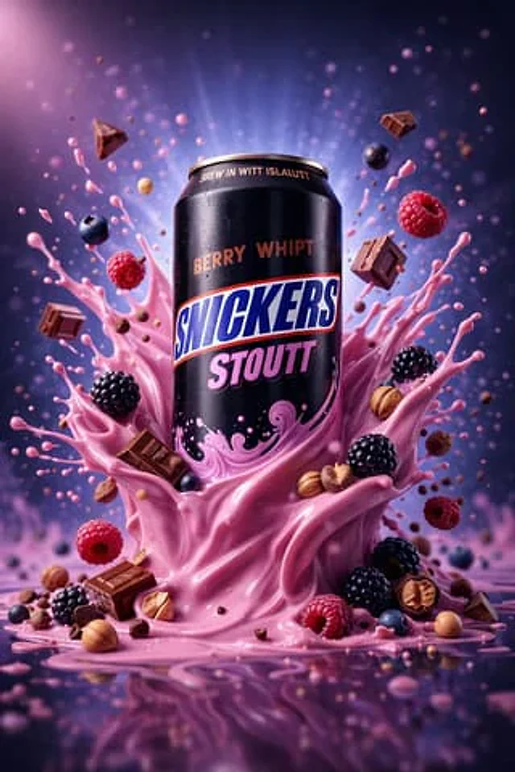

```text
{
  "master_prompt": {
    "global_settings": {
      "resolution": "8K ultra-high-definition",
      "aspect_ratio": "3:4 vertical",
      "style": "hyper-realistic AI-edited commercial product photography",
      "sharpness": "extreme clarity, micro-detail visibility",
      "lighting_quality": "cinematic studio lighting with controlled highlights and shadows",
      "motion_freeze": "high-speed capture, frozen splashes and particles",
      "noise": "none",
      "artifacts": "none"
    },

    "module_1_image_1_style": {
      "subject": {
        "type": "beverage can",
        "material": "matte black metal",
        "surface_details": "fine condensation droplets evenly distributed",
        "branding_text_visible": [
          "SNICKERS",
          "STOUTT",
          "BERRY WHIPT",
          "BREW IN WITT ISLAUTT"
        ]
      },
      "pose_and_orientation": {
        "position": "upright, centered",
        "angle": "slight forward-facing perspective",
        "scale": "dominant foreground subject"
      },
      "liquid_and_motion": {
        "liquid_color": "glossy pink",
        "liquid_texture": "thick, creamy, whipped consistency",
        "motion": "explosive upward splash wrapping around the can",
        "splash_shape": "curved arcs with sharp liquid peaks and droplets"
      },
      "floating_elements": {
        "berries": [
          "raspberries",
          "blackberries",
          "blueberries"
        ],
        "chocolate_pieces": "rectangular chocolate chunks with sharp edges",
        "nuts": "round and halved nuts scattered near base and mid-air",
        "distribution": "suspended at various depths around the can"
      },
      "background": {
        "color_gradient": "purple to blue",
        "light_effects": "soft radial glow behind can",
        "particles": "small pink droplets and specks floating"
      },
      "surface_and_reflection": {
        "base": "glossy reflective surface",
        "reflection_quality": "clear mirrored reflection with slight ripple distortion"
      }
    },

    "module_2_image_2_style": {
      "subject": {
        "type": "plastic protein drink bottle",
        "color": "deep matte blue",
        "surface_details": "condensation droplets across entire bottle",
        "label_text_visible": [
          "milk & yogurt",
          "mock up",
          "protein",
          "SEPARATED SHADOWS"
        ]
      },
      "pose_and_orientation": {
        "position": "slightly tilted to the right",
        "angle": "three-quarter view",
        "motion_feel": "dynamic, leaning into splash"
      },
      "liquid_and_motion": {
        "liquid_color": "white and light beige milk mixture",
        "texture": "smooth, creamy, fluid",
        "motion": "swirling splash rising around bottle base and sides"
      },
      "floating_elements": {
        "blueberries": "whole and halved blueberries at different depths",
        "mint_leaves": "small green leaves with visible veins",
        "droplets": "milk droplets and spheres suspended mid-air"
      },
      "background": {
        "color_gradient": "dark blue to warm amber",
        "bokeh": "soft circular light particles scattered throughout"
      },
      "surface_and_reflection": {
        "base": "matte ground with light liquid pooling",
        "shadow_style": "soft separated shadow under bottle"
      }
    },
```

Model: GPT Image 2
Author: ShaHid WaNii

[ProjectD](https://aitoolsradar.com/en/prompts/f5d017d87f6caa) · [Recorded source](https://x.com/meng_dagg695/status/2011708873418424581)
 · [Full original metadata and byte evidence](data/projectd-batch-0046.json)

## ShaHid WaNii #68

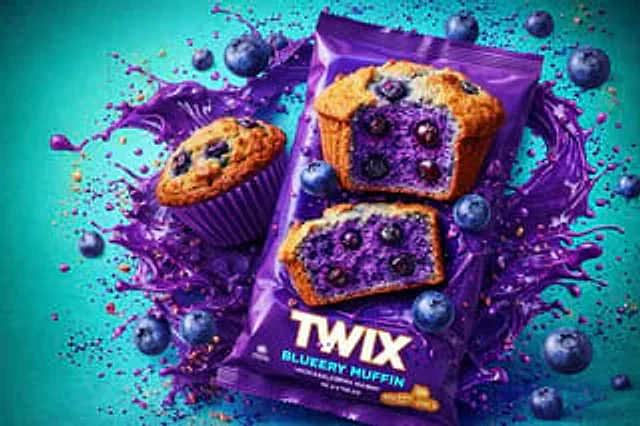

```text
{
  "global_settings": {
    "resolution": "8K",
    "quality": "ultra-high",
    "render_style": "hyperrealistic commercial CGI",
    "lighting": "studio-grade, high-contrast, glossy highlights",
    "focus": "extreme sharpness, macro-level texture visibility",
    "color_depth": "rich, saturated, clean gradients",
    "noise": "none",
    "artifacts": "none"
  },

  "Module_1_Image_1_Style": {
    "subject": {
      "primary_object": "Snickers mint chocolate bar in turquoise wrapper",
      "pose": "diagonally tilted, floating mid-air",
      "orientation": "top-left to bottom-right angle",
      "visibility": "full front-facing packaging visible"
    },
    "packaging_details": {
      "colors": ["turquoise", "brown", "white", "blue"],
      "text_visible": ["SNICKERS", "SNICKES", "with mint"],
      "surface": "glossy plastic wrapper with subtle creases",
      "product_image": "chocolate bar segment printed on wrapper"
    },
    "ingredients_visible": [
      "fresh mint leaves",
      "whole almonds",
      "white sugar-like spherical candies",
      "chocolate bar pieces"
    ],
    "motion_elements": {
      "liquid": "clear water splash forming a curved arc around the bar",
      "droplets": "floating water bubbles and droplets suspended in air"
    },
    "background": {
      "color": "light aqua blue",
      "texture": "smooth gradient",
      "depth": "foreground and background elements clearly separated"
    },
    "lighting": {
      "key_light": "bright frontal studio light",
      "rim_light": "cool highlights on water edges",
      "reflections": "strong specular highlights on wrapper and liquid"
    }
  },

  "Module_2_Image_2_Style": {
    "subject": {
      "primary_object": "Hershey’s Special Dark chocolate mint packaging",
      "pose": "upright, centered, slightly elevated",
      "orientation": "front-facing, symmetrical composition"
    },
    "packaging_details": {
      "colors": ["black", "green", "yellow"],
      "text_visible": [
        "SPECIAL DARK",
        "HERSHEY’S",
        "SABOR MENTA",
        "60% DE CACAU",
        "100 g"
      ],
      "surface": "matte-black wrapper with glossy highlights"
    },
    "ingredients_visible": [
      "mint leaves",
      "embossed Hershey’s chocolate squares"
    ],
    "motion_elements": {
      "liquid": "thick molten chocolate splashes wrapping around the package",
      "droplets": "small chocolate particles suspended mid-air"
    },
    "background": {
      "color": "deep green gradient",
      "base_surface": "liquid chocolate pool beneath the package"
    },
    "lighting": {
      "key_light": "warm directional light",
      "accent_light": "golden highlights on chocolate splashes",
      "contrast": "high contrast between dark wrapper and green background"
    }
  },

  "Module_3_Image_3_Style": {
    "subject": {
      "primary_object": "Twix Blueberry Muffin packaged snack",
      "pose": "slightly tilted, floating above background",
      "orientation": "front-facing with angled depth"
    },
    "packaging_details": {
      "colors": ["purple", "gold", "white"],
      "text_visible": ["TWIX", "BLUEBERRY MUFFIN"],
      "surface": "glossy purple plastic wrapper"
    },
    "food_elements": [
      "blueberry muffin",
      "sliced muffin revealing purple interior",
      "whole blueberries"
    ],
    "motion_elements": {
      "liquid": "purple splash forming circular motion behind the product",
      "particles": "crumbs and droplets suspended in air"
    },
    "background": {
      "color": "turquoise-blue",
      "texture": "clean gradient with high saturation"
    },
    "lighting": {
      "key_light": "bright neutral studio light",
      "rim_light": "purple-tinted highlights on splash edges",
      "detail_visibility": "crumb texture and muffin pores clearly visible"
    }
  },
```

Model: GPT Image 2
Author: ShaHid WaNii

[ProjectD](https://aitoolsradar.com/en/prompts/460c9d1714b40f) · [Recorded source](https://x.com/meng_dagg695/status/2012353813425144239)
 · [Full original metadata and byte evidence](data/projectd-batch-0046.json)

## ShaHid WaNii #7

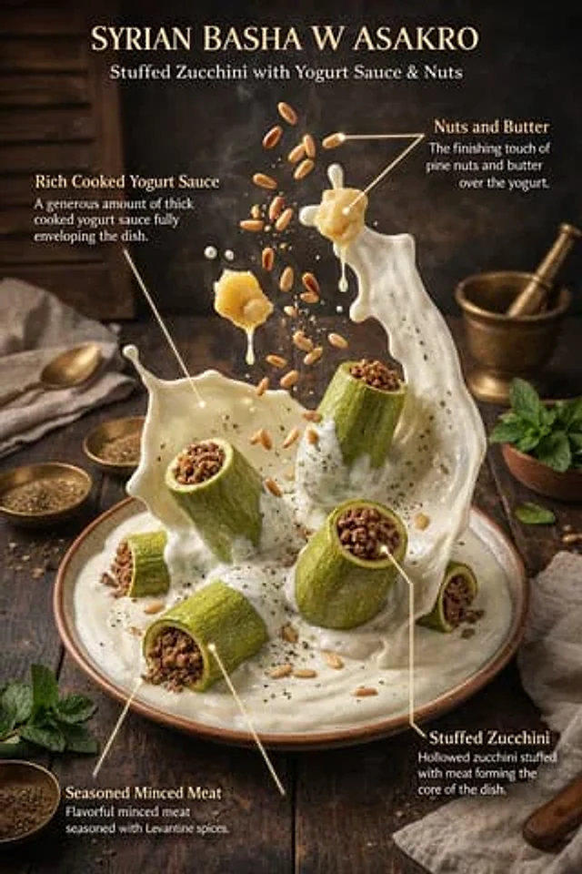

```text
{
  "global_settings": {
    "resolution": "8K ultra high definition",
    "aspect_ratio": "3:4",
    "camera_style": "studio food photography with cinematic lighting",
    "depth_of_field": "shallow depth of field, sharp subject, soft background",
    "lighting": "soft directional key light, subtle rim light, controlled highlights",
    "style": "hyper-realistic food illustration with editorial infographic overlays",
    "composition_rules": [
      "no zoom",
      "no crop",
      "center-weighted vertical composition",
      "floating elements frozen in motion"
    ],
    "text_design": {
      "ingredient_name_color": "metallic gold",
      "ingredient_description_color": "pure white",
      "font_style": "elegant serif for titles, clean sans-serif for descriptions",
      "indicator_lines": "long, thin, smooth golden lines with rounded corners"
    }
  },

  "module_1_image_1_style": {
    "scene_description": "A vertical stack of assorted cake slices floating above a white ceramic plate against a soft pink gradient background.",
    "background": {
      "color": "soft pastel pink",
      "texture": "smooth gradient",
      "lighting": "even, studio-lit, no harsh shadows"
    },
    "main_subjects": [
      "multiple layered sponge cake slices",
      "white whipped cream layers",
      "raspberry cream layer",
      "chocolate cream topping"
    ],
    "visible_ingredients": [
      "vanilla sponge cake",
      "whipped cream",
      "raspberries",
      "blueberries",
      "strawberries",
      "macarons (vanilla and chocolate)",
      "chocolate bar pieces",
      "mint leaves",
      "small nut fragments"
    ],
    "motion_elements": [
      "floating fruits",
      "floating macarons",
      "crumbs suspended in air"
    ],
    "text_labels": [
      "Vanilla Cake – soft, fluffy sponge cake layered with white cream filling",
      "Macaron – creamy filling between almond meringue shells",
      "Raspberries – juicy, fresh raspberries",
      "Chocolate Bar – chunks of smooth milk chocolate",
      "Raspberry Cream – soft sponge cake layered with creamy, fruity raspberry cream"
    ]
  },

  "module_2_image_2_style": {
    "scene_description": "Rolled Syrian dessert presented vertically with syrup pouring from above, placed in a warm, rustic kitchen environment.",
    "background": {
      "environment": "traditional kitchen",
      "elements": [
        "warm lantern light",
        "wooden surfaces",
        "brass and copper utensils"
      ],
      "lighting": "warm ambient lighting with soft highlights"
    },
    "main_subjects": [
      "rolled white dessert dough",
      "cream filling spilling out",
      "golden syrup stream"
    ],
    "visible_ingredients": [
      "white cheese dough",
      "cream filling",
      "pistachios",
      "sugar syrup"
    ],
    "motion_elements": [
      "syrup dripping vertically",
      "pistachio crumbs falling"
    ],
    "text_labels": [
      "White Cheese Dough – soft outer layer made from cheese and semolina",
      "Cream Filling – creamy filling inside the roll",
      "Pistachios – crushed pistachios sprinkled over and inside the rolls"
    ]
  }
```

Model: GPT Image 2
Author: ShaHid WaNii

[ProjectD](https://aitoolsradar.com/en/prompts/cfc8c411ab6fc1) · [Recorded source](https://x.com/meng_dagg695/status/2011994819124752631)
 · [Full original metadata and byte evidence](data/projectd-batch-0046.json)

## ShaHid WaNii #72

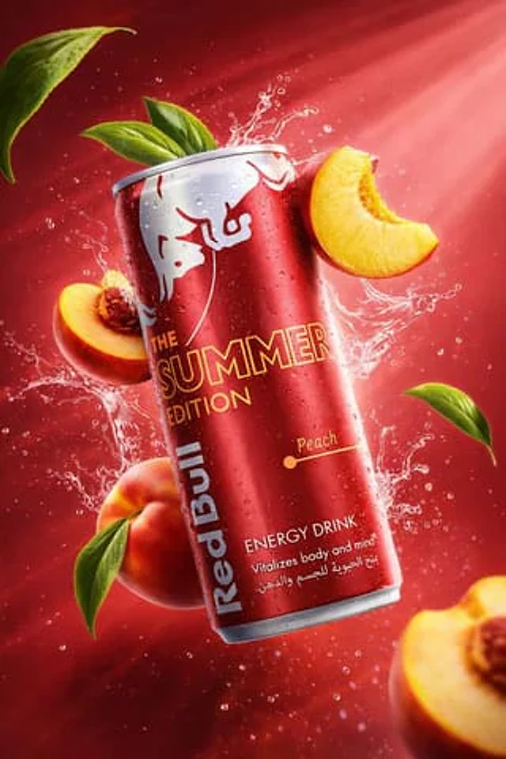

```text
{
  "global_settings": {
    "resolution": "8K ultra high definition",
    "aspect_ratio": "3:4",
    "quality": "hyper-realistic commercial product photography",
    "focus": "sharp foreground, controlled depth of field",
    "lighting_style": "cinematic studio lighting with volumetric light rays",
    "motion": "frozen action splash photography",
    "render_style": "AI-edited, ultra-detailed, advertising-grade"
  },

  "module_1_purple_acai_style": {
    "primary_subject": {
      "object": "slim aluminum energy drink can",
      "orientation": "slightly tilted clockwise, floating mid-air",
      "surface": "matte metallic purple with fine water droplets",
      "branding": {
        "text_visible": ["THE PURPLE EDITION", "Açaí Berry", "ENERGY DRINK"],
        "graphics": "stylized bull illustration in white"
      }
    },
    "background": {
      "color": "deep purple gradient",
      "lighting": "bright diagonal light rays from upper right",
      "atmosphere": "misty with fine water particles"
    },
    "surrounding_elements": {
      "fruits": [
        {
          "type": "blueberries",
          "state": ["whole", "one halved"],
          "texture": "glossy skin, visible pulp on cut fruit"
        }
      ],
      "leaves": "small green leaves attached to berries",
      "liquid": "clear water splashes forming arcs around can"
    },
    "motion_details": {
      "water": "dynamic splash trails frozen mid-air",
      "droplets": "micro droplets suspended around subject"
    },
    "color_palette": ["purple", "violet", "deep blue", "white", "fresh green"]
  },

  "module_2_white_coconut_berry_style": {
    "primary_subject": {
      "object": "slim aluminum energy drink can",
      "orientation": "slightly tilted counter-clockwise, floating",
      "surface": "white metallic finish with condensation droplets",
      "branding": {
        "text_visible": ["THE WHITE EDITION", "Coconut & Berry", "ENERGY DRINK"],
        "graphics": "bull illustration in gray"
      }
    },
    "background": {
      "color": "sky blue gradient",
      "lighting": "strong sunlight beams from upper right",
      "atmosphere": "clean, airy, refreshing"
    },
    "surrounding_elements": {
      "fruits": [
        {
          "type": "blueberries",
          "state": "whole",
          "texture": "smooth, reflective skin"
        },
        {
          "type": "coconut",
          "state": "broken slices",
          "texture": "white flesh with dark brown shell"
        }

      "ice": {
        "form": "transparent ice cubes",
        "detail": "sharp edges, internal cracks visible"
      },
      "liquid": "clear water splashes"
    },
    "motion_details": {
      "water": "curved splash paths wrapping around can",
      "ice": "suspended mid-air with subtle rotation"
    },
    "color_palette": ["white", "light blue", "cyan", "natural brown", "cool gray"]
  
  "module_3_green_lemon_mojito_style": {
    "primary_subject": {
      "object": "tall soda can",
      "orientation": "tilted slightly clockwise, floating",
      "surface": "dark green metallic body with lighter green label",
      "branding": {
        "text_visible": ["LEMON SODA", "MOJITO", "L’ORIGINALE MOJITO ANALCOLICO ITALIANO"],
        "logo": "CRODO emblem at top
    "background": {
      "color": "vibrant green gradient",
      "lighting": "intense sun flare from upper right"
    },
    "surrounding_elements": {
      "fruits": [
        {
          "type": "lime",
          "state": ["whole", "sliced wedge"],
          "texture": "visible citrus pulp, glossy rind"
        }
      ],
      "leaves": "fresh mint leaves with visible veins",
      "liquid": "sparkling water splashes"
    },
    "motion_details": {
      "water": "explosive splash bursts around can",
      "droplets": "dense spray of fine droplets"
    },
    "color_palette": ["lime green", "dark green", "yellow-green", "white"]
  }
```

Model: GPT Image 2
Author: ShaHid WaNii

[ProjectD](https://aitoolsradar.com/en/prompts/9ef173c4a70339) · [Recorded source](https://x.com/meng_dagg695/status/2010681413562155183)
 · [Full original metadata and byte evidence](data/projectd-batch-0046.json)

## ShaHid WaNii #77

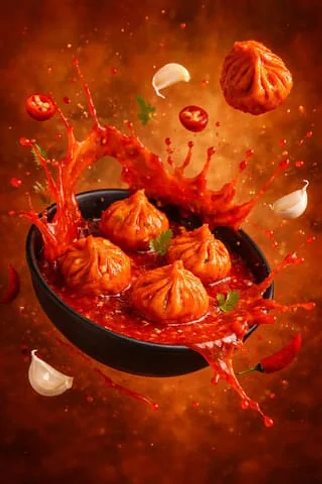

```text
{
  "global_settings": {
    "resolution": "8K",
    "aspect_ratio": "3:4",
    "image_quality": "ultra-high definition",
    "sharpness": "extreme",
    "lighting_quality": "studio-grade cinematic lighting",
    "render_style": "hyper-realistic AI-edited food photography",
    "noise": "none",
    "text_or_logos": "none",
    "focus": "tack-sharp foreground with controlled depth"
  },

  "Module_1_Image_1_Style": {
    "subject": "two grilled tortilla wraps",
    "composition": {
      "main_action": "wraps floating above a bowl of sauce",
      "orientation": "one wrap stacked diagonally over another",
      "perspective": "slightly low-angle, centered composition"
    },
    "food_details": {
      "wrap_texture": "lightly grilled tortilla with golden brown char spots",
      "filling_visible": [
        "diced cooked chicken",
        "golden french fries",
        "green peas"
      ],
      "sauce": {
        "type": "thick creamy white sauce",
        "motion": "large splash forming curved arcs",
        "bowl_material": "ceramic",
        "bowl_color": "light beige"
      }
    },
    "motion_elements": [
      "suspended sauce droplets",
      "floating parsley leaves"
    ],
    "background": {
      "color": "dark warm brown gradient",
      "texture": "smooth, studio backdrop"
    },
    "surface": "wooden tabletop visible at bottom",
    "mood": "dynamic, indulgent, dramatic food motion"
  },

  "Module_2_Image_2_Style": {
    "subject": "potato chips in a bowl",
    "composition": {
      "main_action": "chips flying upward above the bowl",
      "distribution": "evenly spaced mid-air chips forming a vertical cascade",
      "camera_position": "eye-level close-up"
    },
    "food_details": {
      "chips_texture": "thin, crispy, lightly curved",
      "chips_color": "golden yellow with seasoning speckles",
      "bowl": {
        "material": "ceramic",
        "color": "warm orange",
        "fill_state": "bowl partially filled with chips"
      }
    },
    "seasoning_elements": [
      "fine spice dust",
      "small crumbs",
      "rosemary sprigs floating"
    ],
    "background": {
      "color": "warm orange gradient",
      "lighting": "soft diffused with highlights on chips"
    },
    "ground_details": [
      "scattered crumbs",
      "spice particles",
      "rosemary pieces"
    ],
    "mood": "energetic, crunchy, commercial snack photography"
  },

  "Module_3_Image_3_Style": {
    "subject": "beef noodle soup in a bowl",
    "composition": {
      "main_action": "bowl floating in mid-air",
      "camera_angle": "slightly elevated front angle",
      "framing": "centered with wide negative space"
    },
    "food_details": {
      "bowl_color": "dark matte black",
      "broth": "clear brown liquid",
      "noodles": "white flat noodles",
      "protein": "thin slices of raw or lightly cooked beef",
      "herbs": [
        "green basil leaves"
      ]
    },
    "floating_elements": [
      "basil leaves",
      "chili slices",
      "garlic cloves",
      "herb fragments"
    ],
    "steam": {
      "visibility": "clearly visible",
      "shape": "soft swirling trails",
      "opacity": "semi-transparent"
    },
    "background": {
      "color": "soft teal gradient",
      "texture": "clean studio backdrop"
    },
    "mood": "fresh, aromatic, premium culinary presentation"
  },
```

Model: GPT Image 2
Author: ShaHid WaNii

[ProjectD](https://aitoolsradar.com/en/prompts/6bc178161e4be5) · [Recorded source](https://x.com/meng_dagg695/status/2010981812609434034)
 · [Full original metadata and byte evidence](data/projectd-batch-0046.json)

## ShaHid WaNii #88

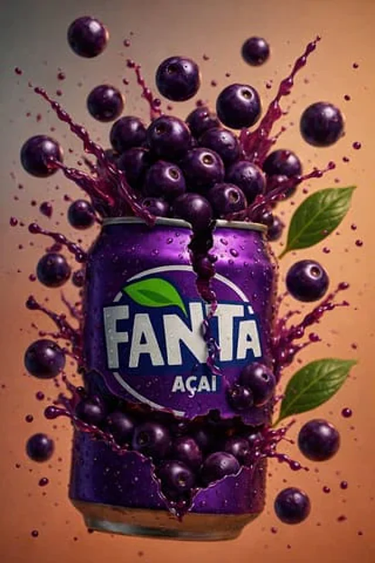

```text
{
  "global_settings": {
    "resolution": "8K UHD",
    "aspect_ratio": "3:4",
    "image_type": "AI-edited hyper-realistic commercial product photography",
    "camera": {
      "focus": "ultra-sharp center focus",
      "depth_of_field": "shallow DOF with soft background falloff",
      "angle": "straight-on frontal view",
      "lens": "macro-commercial lens look"
    },
    "lighting": {
      "style": "studio lighting",
      "key_light": "strong frontal soft light",
      "rim_light": "subtle edge highlights on fruits and splashes",
      "reflections": "specular highlights on liquid droplets and metal can"
    },
    "textures": [
      "highly detailed aluminum can surface",
      "realistic liquid physics",
      "sharp fruit skin texture",
      "visible condensation droplets"
    ],
    "quality_flags": [
      "extreme detail",
      "photorealistic",
      "AI-enhanced clarity",
      "no motion blur",
      "clean background"
    ]
  },

  "Module_1_Image_1_Style_Orange": {
    "subject": "Orange flavored soda can",
    "can_details": {
      "material": "metal aluminum",
      "condition": "top torn open with jagged sharp cracks",
      "crack_position": "irregular split at the top rim, metal bent outward",
      "surface": "covered with water droplets and condensation"
    },
    "fruit_elements": {
      "whole_oranges": "multiple whole oranges floating behind and above the can",
      "orange_slice": "one visible half-cut orange slice near the top center",
      "leaves": "green citrus leaves attached to some oranges"
    },
    "liquid_effects": {
      "splash_color": "bright orange liquid",
      "motion": "liquid bursting upward and outward from inside the can",
      "droplets": "numerous suspended droplets frozen mid-air",
      "base_splash": "orange liquid pooling and splashing at the bottom"
    },
    "background": {
      "color": "solid warm orange",
      "gradient": "slight tonal variation, no patterns"
    }
  },

  "Module_2_Image_2_Style_Acai": {
    "subject": "Açaí flavored soda can",
    "can_details": {
      "material": "metal aluminum",
      "condition": "can split horizontally into two broken sections",
      "cracks": "jagged tearing edges with visible sharp metal folds",
      "surface": "covered with condensation droplets"
    },
    "fruit_elements": {
      "acai_berries": "multiple dark purple berries erupting from inside the can",
      "berry_motion": "berries floating upward and outward",
      "leaves": "few green leaves visible on sides"
    },
    "liquid_effects": {
      "splash_color": "deep purple liquid",
      "motion": "explosive splash radiating outward",
      "droplets": "fine droplets suspended in air"
    },
    "background": {
      "color": "warm beige to light brown gradient",
      "tone": "soft neutral backdrop"
    }
  },

  "Module_3_Image_3_Style_Goiaba_Guava": {
    "subject": "Guava flavored soda can",
    "can_details": {
      "material": "metal aluminum",
      "condition": "vertical split down the center of the can",
      "cracks": "uneven torn edges exposing inside",
      "surface": "visible water droplets and moisture"
    },
    "fruit_elements": {
      "guava_halves": "multiple guava halves with pink interiors",
      "whole_guavas": "several whole green guavas around the can",
      "leaves": "green guava leaves scattered"
    },
    "liquid_effects": {
      "splash_color": "red guava juice",
      "motion": "juice bursting upward and sideways",
      "droplets": "dense red droplets suspended mid-air"
    },
    "background": {
      "color": "solid deep red",
      "tone": "high contrast with fruit and liquid"
    }
  }
```

Model: GPT Image 2
Author: ShaHid WaNii

[ProjectD](https://aitoolsradar.com/en/prompts/0c7818a4eb98da) · [Recorded source](https://x.com/meng_dagg695/status/2009947657905811727)
 · [Full original metadata and byte evidence](data/projectd-batch-0046.json)

## ShaHid WaNii #89

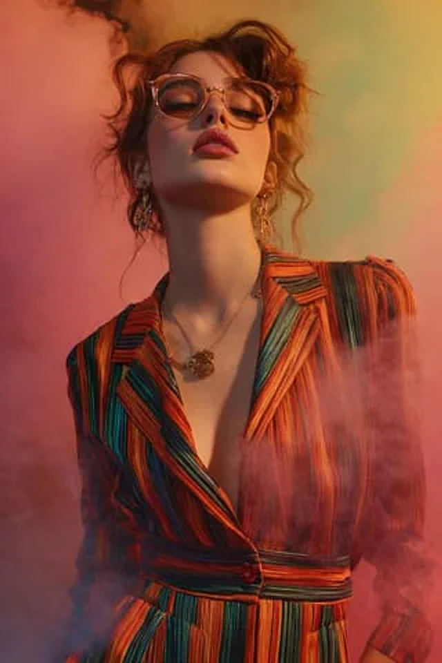

```text
{
  "image_type": "fashion portrait photography",
  "resolution_target": "8K Ultra HD",
  "aspect_ratio": "vertical (portrait)",
  "composition": {
    "framing": "medium close-up portrait",
    "crop": "from upper chest to slightly above head",
    "subject_position": "centered",
    "camera_angle": "low angle, slightly upward-facing",
    "perspective": "dramatic upward perspective emphasizing neck and jawline",
    "depth_of_field": "shallow depth of field with soft background blur"
  },
  "subject": {
    "gender_presentation": "female-presenting",
    "age_range": "young adult",
    "skin_tone": "fair/light",
    "pose": {
      "head_position": "tilted slightly back",
      "chin": "raised upward",
      "shoulders": "relaxed, facing forward"
    },
    "facial_expression": {
      "eyes": "closed",
      "mouth": "slightly parted",
      "expression_mood": "calm, confident, introspective"
    },
    "face_details": {
      "face_shape": "oval",
      "jawline": "soft but defined",
      "cheekbones": "subtly defined",
      "skin_texture": "smooth, evenly lit"
    }
  },
  "hair": {
    "color": "reddish-brown / auburn",
    "length": "medium",
    "style": "loosely styled with soft waves",
    "texture": "slightly tousled",
    "flyaways": "visible loose strands around head and neck"
  },
  "eyewear": {
    "type": "eyeglasses",
    "frame_style": "rounded",
    "frame_material_appearance": "translucent",
    "frame_color": "light amber / peach-tinted",
    "lens": "clear"
  },
  "makeup": {
    "lip_color": "deep pink / rose",
    "lip_finish": "glossy",
    "eye_makeup": "subtle, warm-toned",
    "overall_style": "natural with emphasis on lips"
  },
  "accessories": {
    "earrings": {
      "type": "dangling earrings",
      "material_appearance": "metallic",
      "design": "intricate, elongated"
    },
    "necklace": {
      "type": "chain necklace",
      "pendant": "ornamental pendant",
      "material_appearance": "gold-toned metal"
    }
  },
  "clothing": {
    "garment_type": "tailored jacket or dress with lapels",
    "neckline": "deep V-neck",
    "fit": "structured yet flowing",
    "fabric_texture": "smooth, slightly reflective",
    "pattern": "vertical multicolored stripes",
    "colors": [
      "orange",
      "red",
      "green",
      "teal",
      "yellow"
    ],
    "buttons": "visible front button at mid-torso"
  },
  "lighting": {
    "type": "studio lighting",
    "direction": "soft frontal with slight side emphasis",
    "contrast": "moderate",
    "highlights": "gentle highlights on face and glasses",
    "shadows": "soft shadows under chin and neck"
  },
  "background": {
    "environment": "studio setup",
    "elements": "colored smoke or mist",
    "color_palette": [
      "pink",
      "coral",
      "peach",
      "soft green"
    ],
    "background_style": "abstract, atmospheric"
  },
  "atmosphere": {
    "mood": "cinematic, fashion-forward",
    "visual_effects": "floating colored smoke surrounding subject",
    "clarity": "subject sharp, background diffused"
  },
  "color_grading": {
    "tone": "warm",
    "saturation": "rich but balanced",
    "overall_palette": "harmonized warm and pastel tones"
  },
  "image_quality": {
    "sharpness": "high detail on facial features, clothing texture, accessories",
    "noise": "none visible",
    "finish": "clean, professional, editorial-grade"
  }
}
```

Model: GPT Image 2
Author: ShaHid WaNii

[ProjectD](https://aitoolsradar.com/en/prompts/efb3c88d9797f4) · [Recorded source](https://x.com/meng_dagg695/status/2003730339542499635)
 · [Full original metadata and byte evidence](data/projectd-batch-0046.json)

## ShaHid WaNii #94

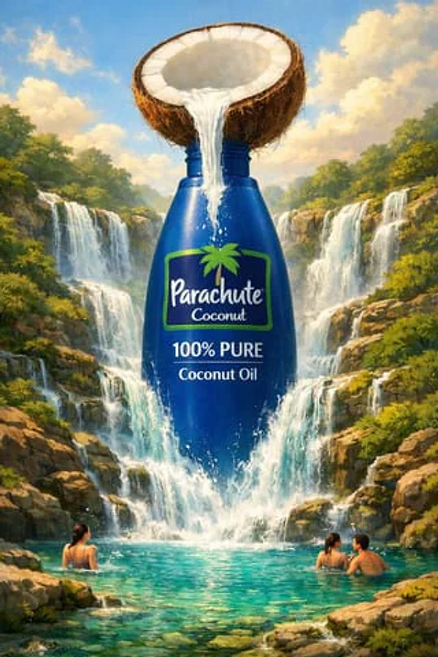

```text
Surreal premium commercial illustration for [BRAND NAME] [OIL TYPE], featuring the product bottle embedded into a massive natural landscape made entirely from the core ingredient. The ingredient appears at the top source, flowing as a natural element into the bottle, then transforming into waterfalls, rivers, or pools below. The environment, terrain, vegetation, textures, and color palette are all inspired by [PRIMARY INGREDIENT]. Small human figures interact naturally with the environment to emphasize scale. Cinematic lighting, soft painterly realism, ultra-detailed textures, fantasy-meets-nature aesthetic, vertical poster composition, 8K ultra-high resolution.
```

Model: GPT Image 2
Author: ShaHid WaNii

[ProjectD](https://aitoolsradar.com/en/prompts/fa1a3250f9a2c3) · [Recorded source](https://x.com/meng_dagg695/status/2008878369107276184)
 · [Full original metadata and byte evidence](data/projectd-batch-0046.json)

## ShaHid WaNii #97

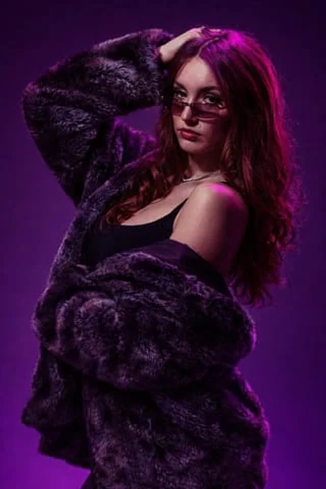

```text
{
  "image_type": "studio fashion portrait photography",
  "resolution_target": "8K ultra high definition",
  "aspect_ratio": "portrait (vertical)",
  "composition": {
    "framing": "medium portrait",
    "crop": "head to mid-torso",
    "subject_position": "slightly right of center",
    "camera_angle": "eye-level",
    "pose": {
      "body_orientation": "three-quarter turn to the left",
      "head_orientation": "turned toward camera",
      "arm_position": "one arm raised with hand placed behind or on top of head, other arm lowered and relaxed"
    }
  },
  "subject": {
    "gender_presentation": "female",
    "age_range": "young adult",
    "skin_tone": "light to medium",
    "facial_expression": {
      "expression": "neutral to mildly serious",
      "gaze_direction": "directly at camera",
      "emotion": "confident, composed"
    },
    "face_details": {
      "face_shape": "oval",
      "complexion": "smooth, even",
      "makeup": {
        "eyes": "defined eyeliner and mascara",
        "lips": "deep muted red or berry tone lipstick",
        "overall": "moderate, polished makeup"
      },
      "piercings": [
        "small nose ring on left nostril"
      ]
    },
    "eyes": {
      "visibility": "partially visible through tinted glasses",
      "eyewear": {
        "type": "narrow rectangular sunglasses",
        "lens_color": "dark tinted",
        "frame": "thin metal frame",
        "position": "worn low on the bridge of the nose"
      }
    },
    "hair": {
      "color": "medium brown with strong magenta/purple lighting highlights",
      "length": "long",
      "style": "loose, softly wavy",
      "parting": "center part"
    }
  },
  "clothing_and_accessories": {
    "outerwear": {
      "type": "faux fur coat",
      "color": "dark gray to black",
      "texture": "thick, plush, high-volume fur",
      "fit": "oversized",
      "wearing_style": "draped loosely off the shoulders"
    },
    "inner_clothing": {
      "type": "sleeveless top",
      "color": "black",
      "neckline": "straight or slightly scooped"
    },
    "jewelry": {
      "necklace": {
        "type": "thin chain necklace",
        "material": "metallic",
        "visibility": "clearly visible at collarbone"
      }
    }
  },
  "lighting": {
    "style": "studio lighting",
    "primary_light": {
      "direction": "front-left",
      "quality": "soft but directional"
    },
    "accent_lighting": {
      "color": "magenta/purple",
      "placement": "from above and behind, especially on hair and shoulders"
    },
    "contrast": "medium to high",
    "shadow_detail": "soft shadows with smooth falloff"
  },
  "background": {
    "type": "studio backdrop",
    "color": "deep purple gradient",
    "texture": "smooth, seamless",
    "depth": "no visible background objects"
  },
  "color_palette": {
    "dominant_colors": [
      "purple",
      "magenta",
      "black",
      "dark gray"
    ],
    "accent_colors": [
      "skin tones",
      "metallic silver"
    ]
  },
  "image_quality": {
    "sharpness": "high",
    "detail_level": "very high",
    "noise": "minimal to none",
    "dynamic_range": "wide"
  },
  "overall_style": {
    "aesthetic": "fashion editorial",
    "mood": "moody, stylish, confident",
    "era_influence": "modern"
  }
}
```

Model: GPT Image 2
Author: ShaHid WaNii

[ProjectD](https://aitoolsradar.com/en/prompts/09596bed786aed) · [Recorded source](https://x.com/meng_dagg695/status/2003650158064730620)
 · [Full original metadata and byte evidence](data/projectd-batch-0046.json)

## ShaHid WaNii #98

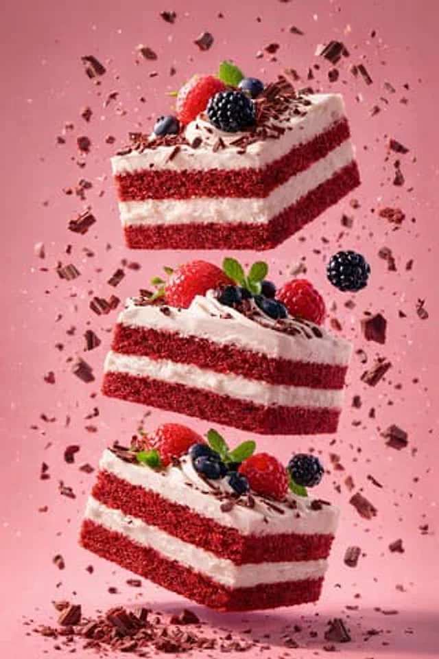

```text
{
  "image_type": "high-detail food photography, AI-edited surreal composition",
  "resolution": "8K ultra-high-definition",
  "aspect_ratio": "3:4",
  "main_subject": {
    "object": "single cube-shaped red velvet cake piece",
    "position": "floating in mid-air",
    "orientation": "slightly angled, front face visible, top frosting facing upward",
    "texture": {
      "cake": "fine, dense crumb texture with visible granules",
      "frosting": "smooth, creamy, thick layer with soft ridges"
    }
  },
  "cake_details": {
    "layers": [
      {
        "type": "red velvet sponge",
        "color": "deep red",
        "count": 2
      },
      {
        "type": "cream filling",
        "color": "pale off-white",
        "count": 1,
        "position": "center layer"
      }
    ],
    "top_frosting": {
      "style": "swirled frosting peak",
      "color": "off-white / cream",
      "surface_detail": "soft curved piping lines",
      "toppings": "small red velvet crumbs scattered on top"
    }
  },
  "motion_elements": {
    "crumbs": {
      "presence": true,
      "distribution": "scattered around the cake in mid-air",
      "size_variation": "fine dust to small chunks",
      "motion": "frozen mid-flight"
    }
  },
  "secondary_object": {
    "object": "metal spoon",
    "material": "polished stainless steel",
    "position": "below the cake",
    "orientation": "slightly tilted upward",
    "reflection": "subtle reflections visible on spoon surface",
    "interaction": "crumbs falling toward spoon"
  },
  "lighting": {
    "style": "studio lighting",
    "direction": "soft directional light from upper side",
    "highlights": "gentle highlights on frosting and spoon",
    "shadows": "soft shadows, no harsh edges",
    "contrast": "moderate contrast emphasizing texture"
  },
  "background": {
    "color_palette": [
      "dark maroon",
      "deep burgundy",
      "muted pink gradient"
    ],
    "style": "smooth gradient backdrop",
    "depth": "shallow depth of field",
    "noise": "clean, minimal grain"
  },
  "color_profile": {
    "dominant_colors": [
      "deep red",
      "cream white",
      "dark maroon"
    ],
    "saturation": "rich but controlled",
    "tone": "luxurious and dramatic"
  },
  "composition": {
    "framing": "centered subject with vertical emphasis",
    "visual_balance": "cake centered, spoon offset below",
    "negative_space": "ample empty space around subject"
  },
  "style_tags": [
    "hyper-realistic",
    "AI-edited look",
    "surreal food photography",
    "freeze-motion effect",
    "premium dessert aesthetic"
  ],
  "camera_simulation": {
    "focus": "sharp focus on cake",
    "background_blur": "smooth bokeh-like gradient",
    "angle": "eye-level to slightly low angle"
  },
  "post_processing": {
    "clarity": "high",
    "sharpness": "very high",
    "color_grading": "cinematic dessert tones",
    "artifacts": "none visible"
  }
}
```

Model: GPT Image 2
Author: ShaHid WaNii

[ProjectD](https://aitoolsradar.com/en/prompts/9a280c3c0d3285) · [Recorded source](https://x.com/meng_dagg695/status/2017552798297297339)
 · [Full original metadata and byte evidence](data/projectd-batch-0046.json)

## Shan Hai Jing Vintage Comic Page

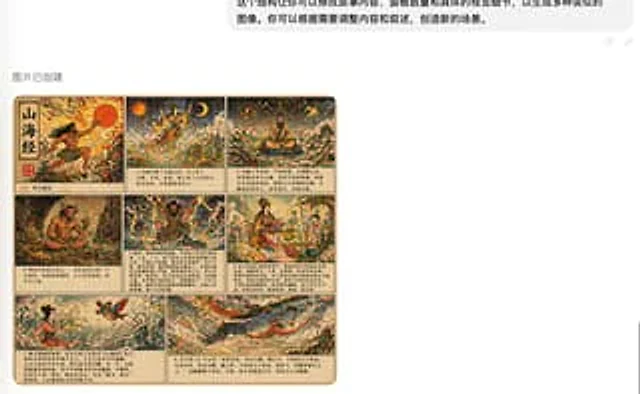

```text
Using the provided reference images as layout and style guidelines, refactor them into a retro Chinese mythology illustration story page, instead of the original Sun Wukong page. Maintain the aged textbook/comic book print look, yellowed paper texture, vintage ink wash rendering, and multi-panel comic layout. Replace the original content with a page themed around the *Classic of Mountains and Seas*. Retain the vertical title bar on the left, but change the main title to {argument name="title text" default="Classic of Mountains and Seas"} The design comprises eight content panels: a large title/main image panel at the top left, showcasing mythological figures and a red sun; five medium-sized narrative panels in the middle row, displaying different scenes from ancient mythology; and two wide horizontal panels at the bottom row. Dense Chinese explanatory text is added below each panel, maintaining an old-fashioned printing style. Small numbered labels are added to panels 2 through 8, and a small red stamp-like label is added near the title. The final effect should evoke the feel of a comic book page in a retro children's mythology encyclopedia.
```

Model: GPT Image 2
Author: GPT Image 2 Prompts

[ProjectD](https://aitoolsradar.com/en/prompts/364f3e06c0a137) · [Recorded source](https://x.com/mate_mattt/status/2046894219084837052#reversed-2)
 · [Full original metadata and byte evidence](data/projectd-batch-0046.json)

## Shanghai Minimalist Line Art Poster

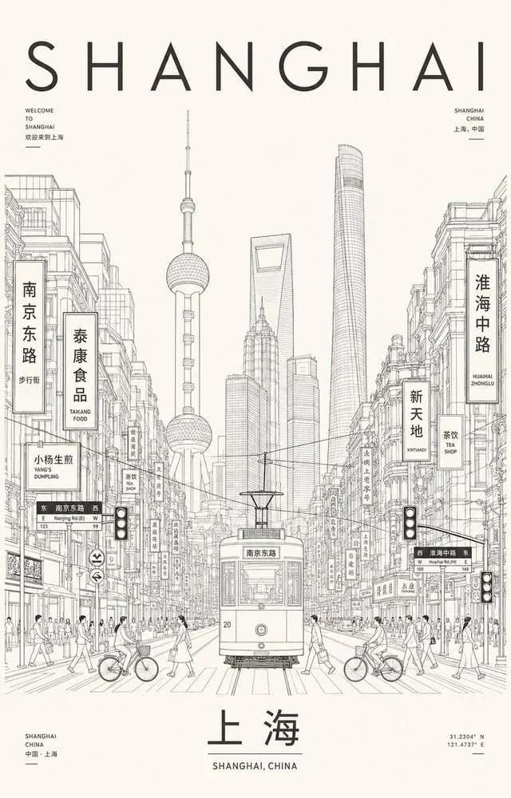

```text
{"type":"high-density Swiss minimalist travel poster with cinematic architectural line art","format":"vertical poster, 2:3 aspect ratio","style":"quiet restrained monochrome ink drawing, cream paper background, precise thin black technical linework, dense urban sketchbook detail, editorial travel-poster composition, generous negative space at top and bottom, no color except black and warm off-white","customizable_text":{"main_headline":"{argument name=\"headline text\" default=\"SHANGHAI\"}","bottom_chinese_title":"{argument name=\"bottom title\" default=\"上海\"}","subtitle":"{argument name=\"poster subtitle\" default=\"SHANGHAI, CHINA\"}"},"scene":{"city":"{argument name=\"city name\" default=\"Shanghai\"}","view":"symmetrical street-canyon perspective looking down Nanjing East Road toward Pudong skyscrapers","centerpiece":"front-facing vintage tram on tracks in the exact center foreground, route sign in Chinese on the tram, small number 20 on the lower left front","landmarks":["{argument name=\"primary landmark\" default=\"Oriental Pearl Tower\"}","Shanghai World Financial Center with trapezoid opening","Jin Mao Tower","Shanghai Tower as a tall rounded glass cylinder"],"architecture":"historic commercial buildings tightly packed on both sides, balconies, windows, cornices, shopfronts, vertical hanging signs, overhead tram wires, street lamps, traffic signals, crosswalk lines and receding rail tracks","street_life":{"pedestrian_count":"about 30 small pedestrians distributed along both sidewalks and crosswalks","bicycle_count":2,"vehicle_count":1,"traffic_light_count":3}},"visible_text_and_signage":{"count":18,"items":["large spaced headline SHANGHAI across the top","small upper-left block: WELCOME TO SHANGHAI plus Chinese text","small upper-right block: SHANGHAI CHINA plus Chinese text","large left vertical sign: 南京东路","left vertical food sign: 泰康食品 / TAIKONG FOOD","small left sign: 小杨生煎 / YANG'S DUMPLING","left street direction sign: 南京东路 / Nanjing Rd.(E) with E and W arrows","right large vertical sign: 淮海中路 / HUAIHAI ZHONGLU","right mid vertical sign: 新天地 / XINTIANDI","right small sign: 茶饮 / TEA SHOP","right street direction sign: 淮海中路 / Huaihai Rd.(M) with W and E arrows","tram destination sign: 南京东路","bottom-left small block: SHANGHAI CHINA 中国·上海","bottom-center large Chinese title: 上海","bottom-center subtitle: SHANGHAI, CHINA","bottom-right coordinates: 31.2304° N, 121.4737° E","multiple narrow Chinese shop signs on both building rows","small horizontal divider lines under several text blocks"]},"layout":{"top":"huge airy sans-serif letters spelling the headline, widely tracked, occupying the top fifth of the poster","middle":"dense city line drawing rising from the lower half into the center, landmark skyline framed by old street buildings","bottom":"large Chinese city name centered above an English subtitle; small location block at lower left and coordinates at lower right"},"rendering_instructions":"Use ultra-fine clean contour lines, architectural hatching, accurate perspective, meticulous signage, no filled shadows, no watercolor, no photorealism, no people close-ups, calm cinematic stillness, balanced symmetrical composition, premium museum travel poster aesthetic."}
```

Model: GPT Image 2
Author: HiAPI

[ProjectD](https://aitoolsradar.com/en/prompts/e591fbd9da0bde) · [Recorded source](https://youmind.com/prompts/shanghai-line-art-poster-19765)
 · [Full original metadata and byte evidence](data/projectd-batch-0046.json)

## Shanghai Night Travel Journal

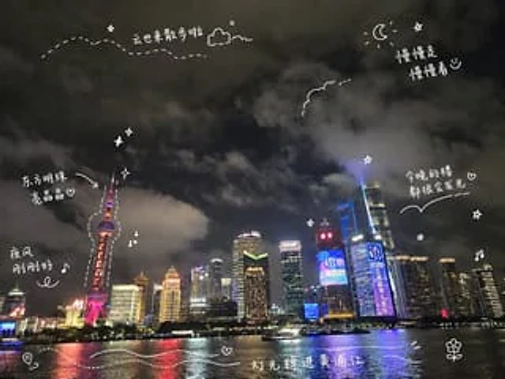

```text
Create a travel-journal style night cityscape poster of {argument name="city skyline" default="Shanghai Pudong skyline along the Huangpu River"}. Use a wide 4:3 canvas showing a realistic nighttime waterfront photo look: dark cloudy sky filling the top two thirds, illuminated skyscrapers along the horizon, the Oriental Pearl Tower on the left glowing pink-red, Shanghai Tower and other high-rises on the right with blue, purple, gold, and white lights, and reflective river water across the bottom with a small sightseeing boat. Add playful white hand-drawn diary doodles and handwritten Chinese annotations directly over the scene, like a social media travel note. Include exactly 6 handwritten text notes: “云也来散步啦” near the upper left with a dotted wandering path and small cloud, “慢慢走 慢慢看♡” near the upper right beside a crescent moon and star, “东方明珠 亮晶晶♡” pointing with an arrow to the Oriental Pearl Tower, “夜风 刚刚好♪” on the left above the river, “今晚的楼 都很会发光♡” on the right above the skyline with a curved underline, and “灯光掉进黄浦江” centered near the bottom over the water. Include exactly 15 white doodle elements: a dotted flight path across the upper left, one small outlined cloud near the top, one crescent moon at the upper right, one scalloped cloud outline near the upper center-right, one arrow pointing to the Oriental Pearl Tower, one dashed outline tracing around the Oriental Pearl Tower, three small sparkle/star icons, two music-note icons, one map-pin icon at the bottom left, two flowing wave lines across the bottom water, and one small flower doodle at the bottom right. Keep all doodles thin, casual, hand-drawn, slightly imperfect, and bright white, with no borders or watermark. The mood should be dreamy, cozy, romantic, and spontaneous, like a handwritten travel memory shared on social media.
```

Model: GPT Image 2
Author: 探路AI

[ProjectD](https://aitoolsradar.com/en/prompts/b93ffc829d8c66) · [Recorded source](https://youmind.com/prompts/shanghai-travel-journal-20736)
 · [Full original metadata and byte evidence](data/projectd-batch-0046.json)

## Sharon Riley #193

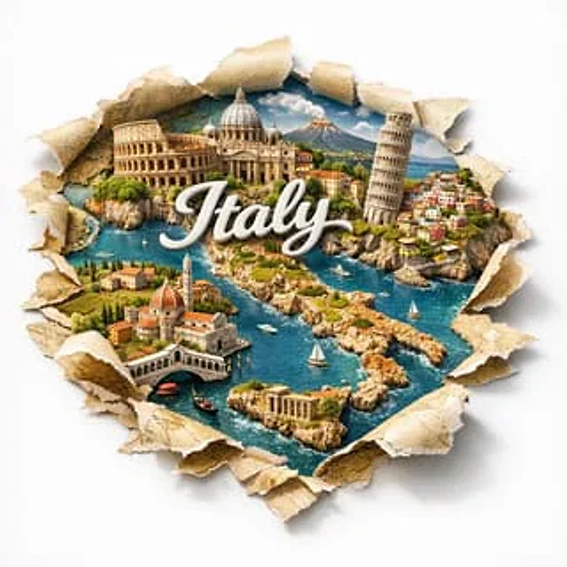

```text
Create a 4:5 poster with a miniature 3D model of New York City, featuring the Statue of Liberty, Empire State Building, and Brooklyn Bridge bursting through a horizontally torn map. The name “New York” appears in sleek 3D white lettering, interacting naturally with the urban landscape. Use dramatic perspective, vibrant colors, and studio lighting for a sharp, high-detail, hyper-realistic photographic feel.
```

Model: GPT Image 2
Author: Sharon Riley

[ProjectD](https://aitoolsradar.com/en/prompts/36fbff886d3fd4) · [Recorded source](https://x.com/Just_sharon7/status/2020086191018897897)
 · [Full original metadata and byte evidence](data/projectd-batch-0046.json)

## Sharon Riley #238


```text
Translate this theme from concept into form, and present both the transformation process and the final outcome within a single vertical A4 composition.
Use a two-tier layout (top and bottom sections).
Top Section:
A 5-step visual process diagram that captures the essence of the theme.
Structure the flow as:
Inspiration source → Emotional energy & social interaction → Abstract UI symbols and visual language → Structured composition & character styling → Final integrated design direction
Use the first reference image strictly for Sharon’s identity, facial features, and expression
Use the second reference image for outfit, pose, and styling direction
Visual style:
Delicate sketching, soft line art, UI-inspired diagram elements
Floating icons like “Subscribed”, hearts, notification bells, social symbols
Small arrows, micro annotations, short English labels
Clean spacing with refined, minimal layout
Title: “MOTION TO FORM”
Bottom Section:
A hero visual derived from the process above.
A cute, premium advertising poster featuring Sharon in a glowing, dreamy environment
She appears radiant, confident, and joyful, embodying a “subscribed / viral moment”
Blend both reference images seamlessly (face from image 1, styling from image 2)
Design direction:
Soft pastel gradient background (pink, lavender, baby blue)
Subtle golden-hour glow with light neon accents
Floating 3D UI elements (Subscribed badges, hearts, icons)
Cinematic depth, soft lens flare, light particles, bokeh
Typography:
Main text: “Sharon is now SUBSCRIBED ✨”
Secondary tagline: “Join the vibe. Stay connected.”
Add a fictional brand/platform name (AI-generated)
Overall Direction:
The final visual should feel like a fusion of:
Concept board
Social media campaign poster
Design development sheet
Style:
Minimal, poetic, intelligent
Clean negative space with balanced composition
Neutral base tones with 1–2 soft pastel accent colors
Focus on:
Skin glow and natural beauty enhancement
Fabric texture and styling details
Light, shadow, and material realism
UI elements integrated as part of the aesthetic
Rendering quality:
Ultra high resolution
Commercial advertising quality
Soft, dreamy, cinematic finish
```

Model: GPT Image 2
Author: Sharon Riley

[ProjectD](https://aitoolsradar.com/en/prompts/3eab4d316c8da3) · [Recorded source](https://x.com/Just_sharon7/status/2048674104035975506)
 · [Full original metadata and byte evidence](data/projectd-batch-0046.json)

## Shiba Inu Space Dream Poster

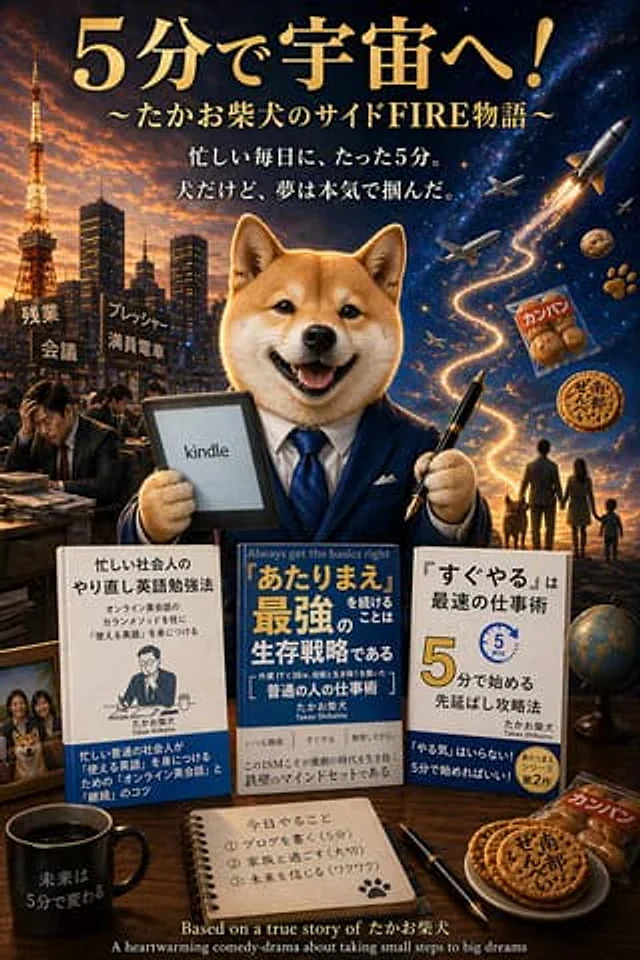

```text
A dramatic illustration in the style of a Japanese inspirational movie poster, set at dusk, blends workplace burnout with a hopeful space fantasy. In the foreground, a humanized Shiba Inu with warm brown fur smiles confidently at the viewer, dressed in a tailored dark blue business suit, white shirt, and blue striped tie. The dog holds a black e-reader in its left paw, the screen displaying the word "Kindle," and a black and gold pen in its right. The background behind the characters is divided into two interwoven themes: on the left is a dense Tokyo-style cityscape at sunset, with the Tokyo Tower shimmering in orange light, and weary office workers hunched over their desks in dark office buildings under a heavy atmosphere of stress; on the right is a deep starry sky, dotted with blue nebulae, a rocket launching upwards, three airplanes, a winding, glowing golden trajectory line, an asteroid, two floating paw prints, two packs of compressed biscuits labeled "Kanpan," and a round rice cracker labeled "Nanbu Senbei." Near the lower right background, a family of four walks towards the bright horizon from behind, accompanied by a dog, symbolizing hope and future dreams. In the midground on the left, three floating black "projects" are added, each labeled with a Japanese word: "残业" (zanye, meaning "unfinished business"), "プヷャー" (preshock), and "会会满人電車" (meeting full train). On the wooden desk in the foreground, three eye-catching books stand upright: the first book on the left is white and blue, titled "The Method of Making English Ready for Busy Socialites," and includes a small illustration of the author's portrait; the second book in the middle is dark blue with gold accents, with a large title "The Strongest Survival Strategy is the Method of 'Survival'"; the third book on the right is white and blue, titled "The Fastest Job Skills are the Method of 'Survival'," and features a large "5" and a circular "5 MIN" icon. The table also includes a black coffee mug with the inscription "The future changes in 5 minutes," an open spiral notebook with a to-do list handwritten in Japanese: "Today's 1. Write a log (5 minutes) 2. Visit the family (5 minutes) 3. Trust the future (Wakuwaku)." Next to this is a paw print drawing, a flat black fountain pen, a globe on the far right, a plate of cookies, an extra pack of "canpan," and a small photo frame in the lower left corner. At the top is a luxurious gold title in large Japanese characters.{argument name="headline text" default="Go to space in 5 minutes!"} Below this is a smaller gold subtitle: "〜たかお柴犬のサイドFIRE物語〜". Below that, centered, is white text: "忙しい毎日に、たった5分。 犬だけど、梦は本気で掴んだ。" At the bottom center is a cinematic English tagline: "Based on a true story of たかお柴犬", followed by "A heartwarming comedy-drama about taking small steps to big dreams". The poster uses ultra-refined glossy rendering, with a striking contrast between the warm orange sunset and the cool tones of space. It's an inspirational commercial visual art piece with sharp typography, rich cinematic lighting, and a style that is both whimsical and sincere. The highly sophisticated social media poster composition is in a vertical format.
```

Model: GPT Image 2
Author: GPT Image 2 Prompts

[ProjectD](https://aitoolsradar.com/en/prompts/3eeaa9ba64a540) · [Recorded source](https://x.com/takao_fumishima/status/2047652555736662333#reversed-0)
 · [Full original metadata and byte evidence](data/projectd-batch-0046.json)

## Short-Form Attention Tax Poster

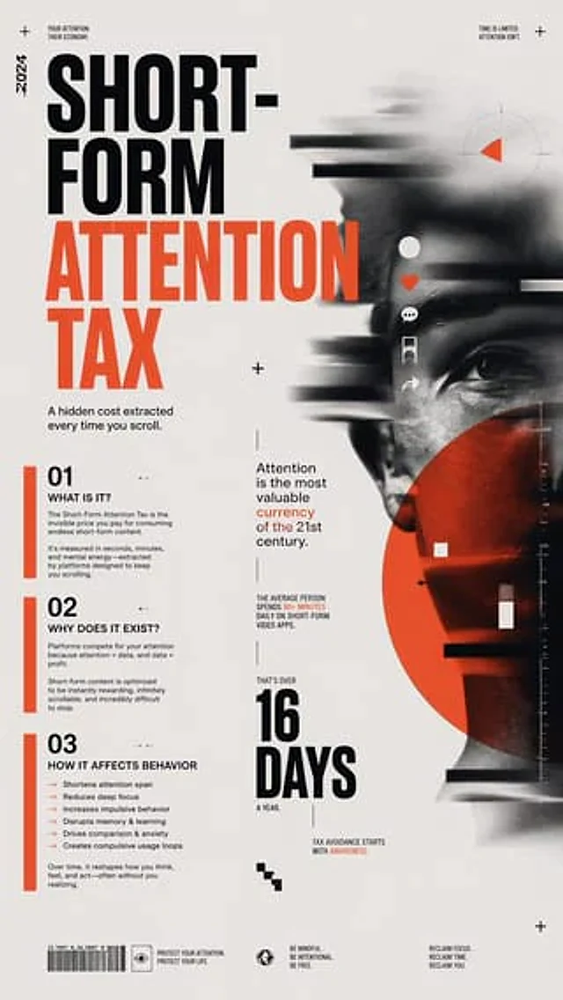

```text
A striking editorial poster employing a Brutalist Swiss modern infographic style, with a light warm gray background, a vertical composition, and a divided layout: the left side is dominated by oversized font, while the right side is dominated by a blurred monochrome face. The main title is typed with huge, compressed sans-serif capital letters stacked on top of each other, and the content is {argument name="headline text" default="SHORT-FORM ATTENTION TAX"} The text is divided into sections: “SHORT-FORM” in black and “ATTENTION TAX” in bright red-orange. A small vertical year marker, “-2024,” is placed on the far left edge. Tiny all-caps “YOUR ATTENTION. THEIR ECONOMY.” is added to the top left corner, and tiny all-caps “TIME IS LIMITED. ATTENTION ISN'T.” is added to the top right corner, with small plus signs near the corners for alignment. Below the left heading, a subheading, “A hidden cost extracted every time you scroll.”, is added. Three numbered information blocks are arranged vertically on the bottom left, each marked with a vertical red-orange bar and large black numbers: Part 1 is titled “WHAT IS IT?”, Part 2 is titled “WHY DOES IT EXIST?”, and Part 3 is titled “HOW IT AFFECTS BEHAVIOR.” Part 01 explains that the "short video attention tax" is the hidden cost of consuming endless short video content, measured by the number of seconds, minutes, and mental energy extracted by the platform to keep you scrolling. Part 02 explains that platforms compete for attention because attention, data, and profit are closely related, and short video content is optimized for instant rewards, unlimited scrolling, and the inability to stop. Part 03 includes six key points highlighted in red and orange: "Shortens attention span," "Reduces deep focus," "Increases impulsive behavior," "Disrupts memory and learning," "Drives comparison and anxiety," and "Creates compulsive usage loops," followed by a brief summary on reshaping ways of thinking, feeling, and behaving. In the left-center and lower-middle areas, mixed-size fonts are used for typographical editing: "Attention is the most valuable currency of the 21st century.", with the word "currency" highlighted in red-orange. A small statistical block reads, "THE AVERAGE PERSON SPENDS 90+ MINUTES DAILY ON SHORT-FORM VIDEO APPS.", with "90+ MINUTES" highlighted in red-orange. A large stacked numerical statement reads "16 DAYS" in black, with "THAT'S OVER" above and "A YEAR" below. A short closing statement reads, "TAX AVOIDANCE STARTS WITH AWARENESS." In the right half, a black-and-white close-up of a face is shown, partially cropped, looking straight ahead with a serious, neutral expression. Strong horizontal motion blur, digital smearing, scan-line-like stripes, and glitch bars running across the face are applied, particularly around the forehead, nose, and mouth. Five vertical social media-style interface icons are overlaid on the right side of the face: a white circle/profile dot, a reddish-orange heart, a white speech bubble, a white bookmark ribbon, and a white share arrow. A large, semi-transparent reddish-orange circle is added to the bottom right corner of the face. Subtle HUD-like graphic elements are incorporated: a faint circular crosshair with small reddish-orange triangular wedges near the top right corner, a thin vertical measuring ruler near the far right edge, several white square markers, small black and white horizontal bars, and scattered tiny plus signs to add texture to the layout. At the bottom, a barcode is placed on the left with tiny coordinate-style text above it, followed by three footer slogans spaced wide: “PROTECT YOUR ATTENTION. PROTECT YOUR LIFE.”, “BE MINDFUL. BE INTENTIONAL. BE FREE.”, and “RECLAIM FOCUS. RECLAIM TIME. RECLAIM YOU.” Only restrained shades of black, off-white, and reddish-orange are used. The overall look should present the feel of a high-end social commentary poster, blending radical typography, data-driven design, and dystopian technological noise portraiture, with a clear layout, strong white space, and the realism of a printed poster.
```

Model: GPT Image 2
Author: GPT Image 2 Prompts

[ProjectD](https://aitoolsradar.com/en/prompts/027168d958708a) · [Recorded source](https://x.com/8fstudioz/status/2047412755976552812#reversed-0)
 · [Full original metadata and byte evidence](data/projectd-batch-0046.json)

## Short-Video App Interface Mockup


```text
{
  "type": "Screenshot of mobile short video app interface",
  "main_content": {
    "scene": "{argument name=\"scenic background\" default=\"Turquoise alpine lakes, verdant pine forests, rugged snow-capped mountains, and blue skies with white clouds.\"}",
    "subject": "{argument name=\"main subject\" default=\"A woman with long black hair, wearing a backwards black baseball cap and a white shirt, leans against a wooden fence, admiring the scenery.\"}"
  },
  "ui_elements": {
    "status_bar": {
      "time": "14:53",
      "icons": [
        "signal bar",
        "Wi-Fi",
        "Battery 78%"
      ]
    },
    "top_navigation": {
      "left_icon": "Hamburger menu",
      "tabs": [
        "live streaming",
        "Same city",
        "focus on",
        "recommend"
      ],
      "active_tab": "recommend",
      "right_icon": "Search Magnifier"
    },
    "floating_widget": {
      "position": "Top left corner",
      "icon": "Red envelopes with yellow circular progress bars",
      "text": "Click to activate"
    },
    "right_action_bar": {
      "count": 6,
      "items": [
        {
          "icon": "Avatar with a red plus button"
        },
        {
          "icon": "Heart-shaped",
          "text": "{argument name=\"like count\" default=\"1.286 million\"}"
        },
        {
          "icon": "Bubble dialog box",
          "text": "26,000"
        },
        {
          "icon": "Star",
          "text": "89,000"
        },
        {
          "icon": "Share Arrow",
          "text": "37,000"
        },
        {
          "icon": "Rotating record album"
        }
      ]
    },
    "bottom_left_info": {
      "username": "{argument name=\"username\" default=\"@TravelDiary\"}",
      "caption": "{argument name=\"video caption\" default=\"You should definitely visit Western Sichuan at least once! Blue skies, white clouds, snow-capped mountains, lakes, forests, and meadows—they&#39;ll heal all your unhappiness! #WesternSichuanScenery #TravelRecommendation\"}",
      "search_prompt": "Related Searches: Western Sichuan Travel Guide"
    },
    "bottom_navigation": {
      "count": 5,
      "tabs": [
        {
          "label": "front page"
        },
        {
          "label": "friend",
          "badge": "2"
        },
        {
          "label": "Plus button inside a rounded rectangle"
        },
        {
          "label": "information",
          "badge": "5"
        },
        {
          "label": "I"
        }
      ]
    },
    "system_ui": "iOS Home Screen Indicator Bar at the Bottom"
  }
}
```

Model: GPT Image 2
Author: GPT Image 2 Prompts

[ProjectD](https://aitoolsradar.com/en/prompts/65d43fdc6925ec) · [Recorded source](https://x.com/yangfei33113/status/2044442979952390486#reversed-1)
 · [Full original metadata and byte evidence](data/projectd-batch-0046.json)

## Short-Video App UI Mockup


```text
{
  "type": "Mobile short video app interface prototype",
  "background_image": "{argument name=\"landscape subject\" default=\"The majestic snow-capped peaks are bathed in the golden sunlight of the day, while at their foot lie lush valleys and winding rivers.\"}",
  "layout": {
    "top_status_bar": {
      "time": "9:41",
      "icons": [
        "Cellular signal",
        "Wi-Fi",
        "Battery"
      ]
    },
    "top_navigation": {
      "left_icon": "Hamburger menu",
      "right_icon": "Search Magnifier",
      "center_labels": [
        "experience",
        "Same city",
        "focus on",
        "Mall",
        "{argument name=\"active tab\" default=\"recommend\"}"
      ]
    },
    "right_interaction_bar": {
      "count": 6,
      "items": [
        {
          "icon": "Avatar with a red plus sign"
        },
        {
          "icon": "Heart-shaped",
          "label": "{argument name=\"like count\" default=\"3.608 million\"}"
        },
        {
          "icon": "speech bubbles",
          "label": "166,000"
        },
        {
          "icon": "Star",
          "label": "380,000"
        },
        {
          "icon": "Share Arrow",
          "label": "1.645 million"
        },
        {
          "icon": "Rotating music record"
        }
      ]
    },
    "bottom_left_info": {
      "username": "{argument name=\"username\" default=\"@Photographer-Qingfeng\"}",
      "caption": "{argument name=\"video caption\" default=\"Western Sichuan is truly a fairyland; you absolutely must visit Western Sichuan with your loved one! #WesternSichuan #Travel #SnowMountains #... (Expand)\"}",
      "music_ticker": "Go to the soda bar and listen to &gt; Wind and Sun (DJ Version) - Zhang"
    },
    "bottom_navigation": {
      "count": 5,
      "items": [
        {
          "label": "front page"
        },
        {
          "label": "friend",
          "badge": "24"
        },
        {
          "icon": "Square plus button"
        },
        {
          "label": "information",
          "badge": "4"
        },
        {
          "label": "I"
        }
      ],
      "home_indicator": "bottom horizontal line"
    }
  }
}
```

Model: GPT Image 2
Author: GPT Image 2 Prompts

[ProjectD](https://aitoolsradar.com/en/prompts/79a2102cb751ec) · [Recorded source](https://x.com/BubbleBrain/status/2044691652040880435#reversed-0)
 · [Full original metadata and byte evidence](data/projectd-batch-0046.json)

## Shoujo Manga Magazine Cover

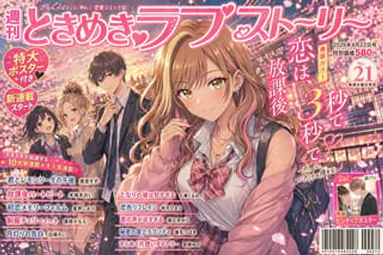

```text
The cover illustration of a glossy Japanese shoujo manga magazine, with its compact layout reminiscent of a real weekly romance manga, features a dreamy spring sunset over a city, accompanied by shimmering bokeh and falling cherry blossom petals. The cover primarily features four stylish, modern anime-style high school students. In the foreground, a main female character is positioned slightly to the right, presented in a half-body composition. She has long, wavy blonde hair with pink highlights, wears multiple earrings, and has delicate, soft makeup. Her posture is shy and romantic, with one hand lightly touching her lips. She wears a white shirt with a large pink plaid bow, a pink plaid skirt, and a loose pink cardigan draped over her shoulders, layered necklaces, and a navy blue backpack slung over one shoulder. Behind her stand three supporting students: a tall, handsome boy in a dark school uniform suit with a loose tie; an elegant girl with blonde hair styled in a braided bun, wearing a beige cardigan and school uniform; and a shorter girl with short, dark hair, wearing a school uniform with a bow tie. The background showcases a pedestrian bridge or riverside path illuminated at dusk, brightly lit on both sides, with cherry blossoms in full bloom and the sky displaying a gradient of pink, orange, and purple, exuding a romantic atmosphere. The composition should convey the quality of a high-end manga cover: highly rendered anime illustrations, bright highlights, delicate lines, a glossy printing texture, dense overlapping Japanese cover text, issue number badges, promotional slogans, heart-shaped patterns, shimmering effects, and a barcode in the lower right corner. It includes seven main typographic elements: a large magazine title spanning the entire page at the top (in a large pink bubble-like Japanese font with a white outline), a vertically arranged large pink romantic title on the right (with a large number "3"), two circular promotional badges on the left, a slanted banner in the lower left corner, a list of five serialized story titles and author names in the lower left corner, and another list of five serialized story titles and author names near the lower right corner. Three small publication information elements are added to the upper right corner: a date/price block, a circular issue number badge, and a narrow vertical label. A preview of the complimentary gift poster has been added above the barcode in the bottom right corner. It features ultra-refined shoujo manga cover aesthetics, incorporating elements of romance, style, youth, sparkle, soft lighting, sunset contour lighting, cherry blossom rain, the realism of a printed magazine, complex typographical layers, vibrant pink, and warm gold.
```

Model: GPT Image 2
Author: GPT Image 2 Prompts

[ProjectD](https://aitoolsradar.com/en/prompts/e8c2bcd0f1b544) · [Recorded source](https://x.com/rascal8023/status/2046910563469664505#reversed-0)
 · [Full original metadata and byte evidence](data/projectd-batch-0046.json)

## Side-by-Side AI Portrait Comparison

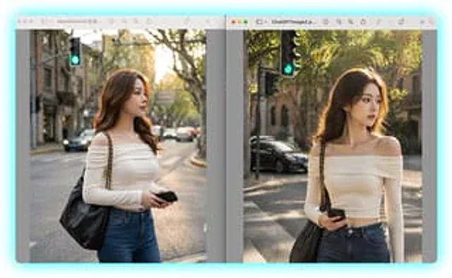

```text
A side-view screenshot shows two nearly identical, AI-generated street portraits against a light cyan background, displayed in two separate macOS-style image viewer windows. The layout comprises two vertical image panels, each within a rounded gray window with a top toolbar. The left window is titled "NanoBanana2," and the right window "ChatGPTImage2." Both panels present the same scene concept: a stylish young woman standing on a city street corner during prime time, framed from mid-thigh to head, her face obscured by soft rectangular blurs. She has long, wavy brown hair, a slender figure, and wears an off-the-shoulder, fitted beige long-sleeved top, high-waisted blue jeans, a delicate pendant necklace, and a large black leather bag with a gold chain slung over one shoulder. One hand holds a black smartphone near her waist. Both panels feature upscale, tree-lined city streets against a backdrop of warm sunlight filtering through the leaves, creating a shallow depth of field. The images include parked and moving vehicles, ancient stone buildings, and green traffic lights visible near the upper left corner of each picture. The two portraits are kept very similar but not identical: the left image has a slightly cooler, softer tone and a centered street perspective; the right image has a slightly warmer, brighter, and clearer tone, with stronger sunlight on the hair and a more dramatic blurring effect. Two viewer windows separated by a narrow vertical gap feature subtle shadows and a clean, technologically-driven contrast, capturing the visual contrast between two image-generating models.
```

Model: GPT Image 2
Author: GPT Image 2 Prompts

[ProjectD](https://aitoolsradar.com/en/prompts/cc24aa124b9084) · [Recorded source](https://x.com/SilenceBin_168/status/2046497385229033692#reversed-0)
 · [Full original metadata and byte evidence](data/projectd-batch-0046.json)

## Side-by-Side PPT Reconstruction Demo

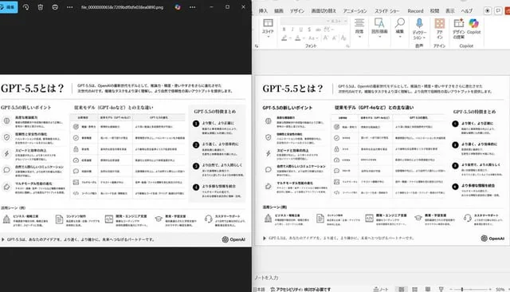

```text
Using the provided reference image of the PowerPoint slide screenshot, recreate it as a clean, polished slide conversion result inside a side-by-side desktop comparison. Keep the same Japanese slide topic and overall layout, but remove the dense selection handles, edit boxes, and malformed vector artifacts from the reference so the slide appears properly reconstructed. Show 2 panels: on the left, a dark image viewer window displaying the exported slide image; on the right, the same slide opened in PowerPoint editing view. Preserve the original monochrome infographic style and Japanese text structure, but make the typography legible and the icons, dividers, and columns cleanly aligned. Keep the slide as a single-page infographic with 5 main content areas: 1 top title/header row, 3 mid-page comparison columns, 1 bottom use-case row containing 5 icon-labeled items. Include a footer line and the OpenAI logo at bottom right. Emphasize that this is a faithful PPT reconstruction from the uploaded image, with a realistic Windows desktop app screenshot look.
```

Model: GPT Image 2
Author: 中崎工房 | AIで1時間の仕事を5分で終わらせる人

[ProjectD](https://aitoolsradar.com/en/prompts/abb8c04676a1fb) · [Recorded source](https://youmind.com/prompts/side-by-side-ppt-reconstruction-16397)
 · [Full original metadata and byte evidence](data/projectd-batch-0046.json)

## Silhouette Universe Narrative Poster

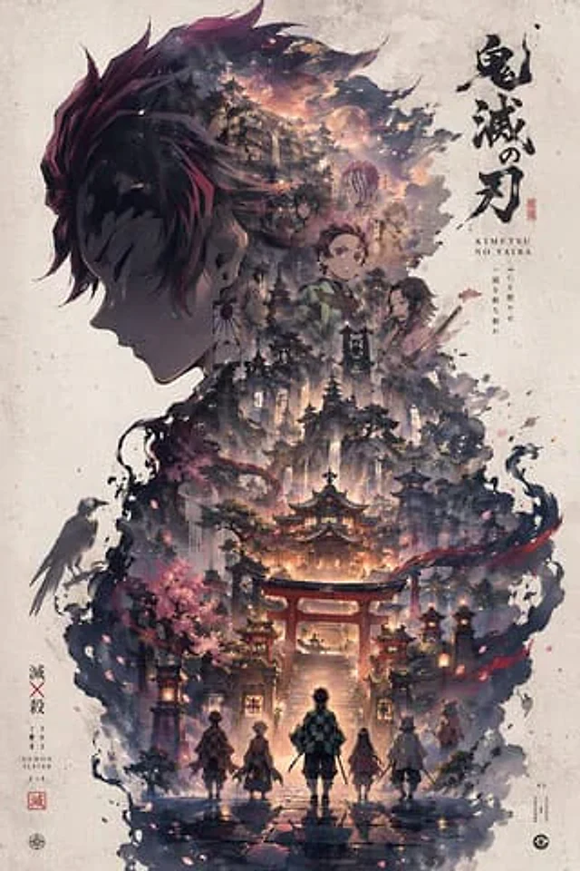

```text
请根据【主题：xxx】自动生成一张高审美的“轮廓宇宙 / 收藏版叙事海报”风格作品。不要将画面局限于固定器物或常见容器，不要优先默认瓶子、沙漏、玻璃罩、怀表之类的常规载体，而是由 AI 根据主题自行判断并选择一个最契合、最有象征意义、轮廓最强、最适合承载完整叙事世界的主轮廓载体。这个主轮廓可以是器物、建筑、门、塔、拱门、穹顶、楼梯井、长廊、雕像、侧脸、眼睛、手掌、头骨、羽翼、面具、镜面、王座、圆环、裂缝、光幕、阴影、几何结构、空间切面、舞台框景、抽象符号或其他更有创意与主题代表性的视觉轮廓，要求合理布局。优先选择最能放大主题气质、最能形成强烈视觉记忆点、最能体现史诗感、神秘感、诗意感或设计感的轮廓，而不是最安全、最普通、最常见的容器。

画面的核心不是简单把世界装进某个物体里，而是让完整的主题世界自然生长在这个主轮廓之中、之内、之上、之边界里或与其结构融为一体，形成一种“主题宇宙依附于一个象征性轮廓展开”的高级叙事效果。主轮廓必须清晰、优雅、有辨识度，并在整体构图中占据核心地位。轮廓内部或边界中需要自动生成与主题强绑定的完整叙事世界，内容应当丰富、饱满、层次清晰，包括最能代表主题的标志性场景、核心建筑或空间结构、象征符号与隐喻元素、角色关系或文明痕迹、远景中景近景的空间递进、具有命运感和情绪张力的氛围层次，以及门、台阶、桥梁、水面、烟雾、路径、光源、遗迹、机械结构、自然景观、抽象形态、生物或道具等叙事细节。所有元素必须统一、自然、有主次、有层级地融合，像一个完整世界真实孕育在这个轮廓结构之中，而不是简单拼贴、裁切填充、素材堆叠或模板化背景。

整体构图需要具有强烈的收藏版海报气质与高级设计感，大结构稳定，主轮廓强烈明确，内部世界具有纵深、秩序和呼吸感，细节丰富但不拥挤，内容丰满但不杂乱，可以适度加入小比例人物剪影、远处建筑、光柱、门洞、桥、阶梯、回廊、倒影、天光或远景结构来增强尺度感、故事感与史诗感。整体画面要安静、宏大、凝练、富有余味，不要平均铺满，不要廉价热闹，不要无重点堆砌。

风格融合收藏版电影海报构图、高级叙事型视觉设计、梦幻水彩质感与纸张印刷品气质，强调纸张颗粒感、边缘飞白、水彩刷痕、轻微晕染、空气透视、柔和雾化、局部体积光、光雾穿透、大面积留白与克制版式，让画面看起来像设计师完成的高端收藏版视觉作品，而不是普通 AI 跑图。整体气质要高级、诗意、宏大、神圣、怀旧、安静、具有传说感和叙事感。

色彩由 AI 根据主题自动判断并匹配最合适的高级配色方案，但必须保持统一、克制、耐看、低饱和、高级，不要杂乱高饱和，不要廉价霓虹感，不要塑料数码感。配色可以围绕黑金灰、冷蓝灰、雾白灰、褐红米白、暗铜、旧纸色、深海蓝、暮色紫、银灰等体系自由变化，但必须始终服务主题，并保持海报级审美与整体和谐。

最终要求：第一眼有强烈的主题识别度和轮廓记忆点，第二眼有完整丰富的叙事世界，第三眼仍有细节和余味。轮廓选择必须具有创意和主题匹配度，尽量避免重复、保守、常见的容器套路，优先选择更有象征性、更有空间感、更有设计潜力的轮廓形式。不要普通背景拼接，不要生硬裁切，不要模板化奇幻素材，不要游戏宣传图感，不要过度卡通化，不要过度写实导致失去艺术感，不要形式大于内容。如果合适，可以自然加入低调克制的标题、编号、签名或落款，让它更像收藏版海报设计的一部分，但不要喧宾夺主。
```

Model: GPT Image 2
Author: @MrLarus

[ProjectD](https://aitoolsradar.com/en/prompts/f90c1c56c0ace5) · [Recorded source](https://x.com/MrLarus/status/2045418028733538620)
 · [Full original metadata and byte evidence](data/projectd-batch-0046.json)

## Silicon Valley 2026 Promo Poster

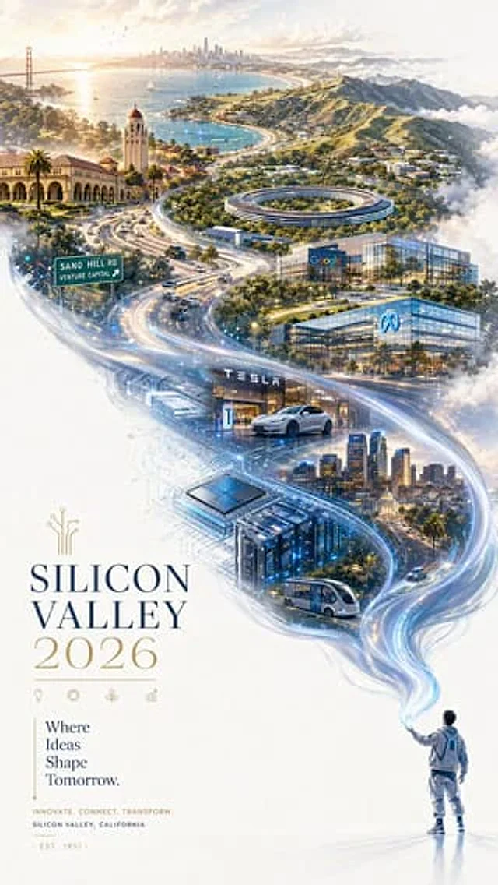

```text
A refined 2026 Silicon Valley city promotional poster with a futuristic yet elegant atmosphere.

Double exposure composition, preserving an S-shaped sense of flowing movement. On a pure white textured background, in the lower-right corner, a miniature figure dressed in sleek modern techwear is releasing a long ribbon of luminous silver-blue light. The ribbon flows gracefully through the air, showing a soft silk-like texture, and as it drifts toward the upper-left, it magically transforms into a grand landscape of rolling hills, coastline, data streams, and illuminated urban terrain.

Within this flowing “river of light,” overlay a hand-drawn panoramic map of Silicon Valley, blending technology, nature, innovation, and California sunlight. The scene feels visionary, expansive, sophisticated, and inspiring.

Include iconic Silicon Valley and Bay Area elements: Stanford University arches, Apple Park, Google campus-inspired buildings, Meta-like glass offices, Tesla-style innovation imagery, venture capital offices on Sand Hill Road, Palo Alto tree-lined streets, San Jose skyline, the Santa Cruz Mountains, San Francisco Bay, highways, autonomous vehicles, startup labs, semiconductor patterns, AI data centers, and subtle circuit-board textures.

Surrounded by soft mist, golden California light, floating clouds, and delicate digital particles. Rich colors, complex structure, highly detailed, grand and breathtaking, yet still fresh and minimal because of the large areas of white space.

In the lower-left corner, elegant typography reads “SILICON VALLEY 2026” with a vertical promotional slogan: “Where Ideas Shape Tomorrow.” Beautiful editorial layout, graceful spacing, clear and complete lettering, premium city branding poster, cinematic lighting, sophisticated details, 9:16 aspect ratio.
```

Model: GPT Image 2
Author: @carsonyungos

[ProjectD](https://aitoolsradar.com/en/prompts/8c1f505003aba5) · [Recorded source](https://x.com/carsonyungos/status/2046523198116889064)
 · [Full original metadata and byte evidence](data/projectd-batch-0046.json)

## Silver Wolf Gaming Character Art


```text
Please draw it for me.{argument name="character" default="Silver Wolf"}{argument name="action" default="Playing video games"} .
```

Model: GPT Image 2
Author: GPT Image 2 Prompts

[ProjectD](https://aitoolsradar.com/en/prompts/4fda6b02f9d981) · [Recorded source](https://x.com/ZhihuLiBohan/status/2046839061600755756)
 · [Full original metadata and byte evidence](data/projectd-batch-0046.json)

## simeon-sanai #110


```text
Create the most realistic front page design of a vintage newspaper featuring the main character. The layout should be made in the style of a real printed newspaper with a cinematic black-and-white aesthetic.
The main photo should be prominently placed in the center, framed, like the image in the title of the article. The subject in the photo should remain unchanged and clearly distinguishable in natural light and slightly increased contrast in order to match the spectacular editorial style.
Create a bold, attention-grabbing headline at the top (create a unique title that matches the spirit of the photo - it can be romantic, mysterious, funny, or dramatic). Add a smaller subtitle under it, which will look like a real newspaper caption.
Add realistic newspaper elements:
Columns of small text (in the style of lorem ipsum, but framed like real news)
At the top is the fictitious name of the publication (for example, “The Daily Prompts”, “AI Times” or similar - think creatively, according to the picture)
Date, issue number and location
Decorative lines, dividers, and vintage typography
Small additional articles or captions to the main image
Optional stamps, doodles, or editorial notes to add personality.
Style:
Black and white or slightly faded monochrome paper
Fine paper texture, grain, and ink defects
Small shadows and creases that mimic real printed paper
The aesthetics of a clean but slightly worn vintage newspaper
Mood: Give the design personality, expressiveness and plot, as if the plot is part of the main article.
Aspect ratio: 4:5 or 1:1
High-detail, ultra-realistic hybrid of editorial photography and print design.
```

Model: GPT Image 2
Author: simeon-sanai

[ProjectD](https://aitoolsradar.com/en/prompts/5b28754bde59c3) · [Recorded source](https://x.com/Naiknelofar788/status/2047207812800147647)
 · [Full original metadata and byte evidence](data/projectd-batch-0046.json)

## simeon-sanai #123


```text
create a A 3D, Pixar-style animated young man sits cross-legged on a pure white, isolated background. He has bright, olive-toned skin, a neatly styled bright brown haircut with a slight wave, and a well-groomed bright brown beard and mustache. His large, expressive eyes, a deep hazel-brown, are slightly upturned and gaze thoughtfully to his left, with a subtle, dreamy smile playing on his lips and his right hand resting gently on his cheek.He wears a bright, textured orange knit cardigan over a light blue t-shirt, complemented by bright wash denim jeans. His footwear consists of stylish sneakers with a navy blue, grey, and white color scheme. A bright grey, modern backpack is slung over his left shoulder, and a matching bright grey lunchbox rests beside his right leg.The lighting is soft and even, creating gentle highlights on his hair and clothing, and a subtle bright beneath him, emphasizing his rounded, stylized form. The overall mood is one of relaxed contemplation and youthful optimism..
```

Model: GPT Image 2
Author: simeon-sanai

[ProjectD](https://aitoolsradar.com/en/prompts/a711e6762101c2) · [Recorded source](https://x.com/Naiknelofar788/status/2023686368162181501)
 · [Full original metadata and byte evidence](data/projectd-batch-0046.json)

## simeon-sanai #124


```text
Ultra-realistic photo featuring a young man (insert user’s photo) in perfect detail, preserving 100% of his facial features, wearing warm winter clothing suitable for the penguins’ icy habitat (thick jacket, scarf, gloves, beanie). The man is interacting naturally with penguins in their snowy and icy environment (snow, ice, rocks, frozen water reflections).
Include natural and spontaneous photo poses:
– sitting on a rock while touching a penguin
```

Model: GPT Image 2
Author: simeon-sanai

[ProjectD](https://aitoolsradar.com/en/prompts/10070dc67f183d) · [Recorded source](https://x.com/Naiknelofar788/status/2015264060754080239)
 · [Full original metadata and byte evidence](data/projectd-batch-0046.json)

## simeon-sanai #128


```text
Create an infographic image of [washing machine], combining a realistic photograph or photoreal render of the object with technical annotation overlays placed directly on top.

Use black ink–style line drawings and text (technical pen / architectural sketch look) on a pure white studio background, including:
•Key component labels
•Internal cutaway or exploded-view outlines
•Measurements, dimensions, and scale markers
•Material callouts and quantities
•Arrows indicating function, force, or flow (air, sound, power, pressure)
•Simple schematic or sectional diagrams where relevant

Place the title [PRODUCT] inside a hand-drawn technical annotation box in one corner.

Style & layout rules:
•The real object remains clearly visible beneath the annotations
•Annotations feel sketched, technical, and architectural
•Clean composition with balanced negative space
•Educational, museum-exhibit / engineering-manual vibe

Visual style:
Minimal technical illustration aesthetic, black linework over realistic imagery, precise but slightly hand-drawn feel.

Color palette:
White background, black annotation lines and text only. No colors.

Output:
1080×1080, ultra-crisp, social-feed optimized, no watermark.
```

Model: GPT Image 2
Author: simeon-sanai

[ProjectD](https://aitoolsradar.com/en/prompts/bd12179b57a90c) · [Recorded source](https://x.com/Naiknelofar788/status/2018668607966769212)
 · [Full original metadata and byte evidence](data/projectd-batch-0046.json)

## simeon-sanai #129


```text
A hyper-realistic, high-speed commercial photograph featuring a man with uploaded face as reference in a chef's jacket, apron, and checkered trousers. He stands in a rustic, high-end kitchen, lifting the lid off a large, steaming copper pot with a look of pure amazement. From the pot, a literal galaxy of gourmet food explodes upwards and outwards in suspended animation: whole roasted spices, vibrant vegetables, splashes of rich sauces, floating plates of intricately plated fine dining dishes,and swirling clouds of aromatic steam filled with golden glitter. The ingredients form spiral nebulae around him. The background is a warm, blurred professional kitchen with copper cookware hanging. The lighting is warm, cinematic, and focused, highlighting the textures of the flying food with macro-level detail. Shot with a fast shutter speed to freeze motion, 8k resolution, Octane Render culinary aesthetic. 100% use my real face.
```

Model: GPT Image 2
Author: simeon-sanai

[ProjectD](https://aitoolsradar.com/en/prompts/19be73df508019) · [Recorded source](https://x.com/Naiknelofar788/status/2025363555584016837)
 · [Full original metadata and byte evidence](data/projectd-batch-0046.json)

## simeon-sanai #130


```text
A futuristic cyber-aesthetic portrait of a young woman wearing glowing neon-yellow glasses, with luminous mathematical equations projected across her face and jacket. Soft bokeh blue lights in the background create a high-tech atmosphereHyper-realistic detail, sharp eyes, smooth skin, and vivid color contrast. Sci-fi digital-glow style, immersive and modern." Her expression is calm and focused. The lighting is vibrant and cinematic, with reflections on the glasses and warm yellow highlights on her clothing.
```

Model: GPT Image 2
Author: simeon-sanai

[ProjectD](https://aitoolsradar.com/en/prompts/8eee8b59f4521b) · [Recorded source](https://x.com/Naiknelofar788/status/2014990545345810674)
 · [Full original metadata and byte evidence](data/projectd-batch-0046.json)

## simeon-sanai #137


```text
Hyper-realistic cinematic product photograph of a Pepsi Black can, front-facing and perfectly legible, ice-cold surface covered in crisp condensation. Dark cola splashes explode around the can in frozen motion, glossy liquid waves and fine droplets catching the light. Moody low-key lighting with cool blue rim light and soft front fill, shallow depth of field, ultra-sharp texture detail, high-end advertising aesthetic.
```

Model: GPT Image 2
Author: simeon-sanai

[ProjectD](https://aitoolsradar.com/en/prompts/a6231dec40bd1b) · [Recorded source](https://x.com/Naiknelofar788/status/2020531946108158457)
 · [Full original metadata and byte evidence](data/projectd-batch-0046.json)

## simeon-sanai #156


```text
Ultra-realistic cinematic studio portrait using provided person only. Subject wears black cyberpunk hoodie fully covered in bright glowing neon-orange circuit lines and illuminated zipper, hood up, hands in pockets, three-quarter pose facing right, head slightly down. Round shutter glasses with glowing orange bars. Dramatic studio lighting, glow casting light spill. Smooth dark-to-burnt orange gradient background. Style locked.
```

Model: GPT Image 2
Author: simeon-sanai

[ProjectD](https://aitoolsradar.com/en/prompts/c50687f778e3a9) · [Recorded source](https://x.com/Naiknelofar788/status/2026603084760363062)
 · [Full original metadata and byte evidence](data/projectd-batch-0046.json)

## simeon-sanai #158


```text
Create an ultra-photorealistic cinematic portrait of a man viewed from a slightly low angle looking upward with a confident, powerful expression. Generate his face using the uploaded portrait photo. The composition is a tight upper-body portrait with the head tilted slightly upward, emphasizing the jawline and beard structure.
The background is a smooth vibrant studio
gradient transitioning between deep orange and warm red tones, creating a
dramatic modern aesthetic. Use strong cinematic dual-color lighting: warm
red/orange light from one side and cool teal/blue rim lighting from the
opposite side to create striking contrast across the face and beard. The man
is wearing a futuristic white oversized puffer jacket with large quilted sections
and a high protective collar. The jacket should look premium and modern with
realistic fabric folds, padded insulation volume, and subtle material sheen
similar to high-end technical winter fashion. Add extremely detailed textures:
visible skin pores, beard hair strands, subtle facial imperfections, realistic lip
texture, micro skin reflections, and detailed hair follicles. The sunglasses
should have thin metal frames with realistic reflections and slightly tinted
lenses reflecting the colored lighting. The white puffer jacket must show
detailed stitching, fabric grain, padded segments, and realistic light interaction
across the material. Lighting should create soft shadows, strong color
contrast, and dramatic highlights across the face, beard, glasses, and jacket.
Maintain sharp focus on the subject with studio-quality depth and clarity.
Ultra photorealistic portrait photography, cinematic studio lighting, hyper-
detailed textures, 8K detail, premium editorial fashion portrait, extremely
realistic skin and fabric materials.
Add a subtle handwritten text in the bottom-right corner that reads "Created by Naik", elegant fashion-editorial signature style, thin white ink, slightly transparent, like a photographer's signature on a luxury magazine shoot.
```

Model: GPT Image 2
Author: simeon-sanai

[ProjectD](https://aitoolsradar.com/en/prompts/d6da3de117dc30) · [Recorded source](https://x.com/Naiknelofar788/status/2036271660765159675)
 · [Full original metadata and byte evidence](data/projectd-batch-0046.json)

## simeon-sanai #159


```text
Create an ultra-HD, hyper-realistic digital poster of a floating miniature island shaped like [Country] on white clouds. Include iconic landmarks, landscapes ([landmark 1], [landscape 2], [landscape 3]), and cultural elements unique to [Country]. Carve “[Country]” in large white 3D letters. Add [wildlife], cinematic lighting, vivid colors, aerial perspective, and sun reflections for realism.
```

Model: GPT Image 2
Author: simeon-sanai

[ProjectD](https://aitoolsradar.com/en/prompts/b71cf07212b7f3) · [Recorded source](https://x.com/Naiknelofar788/status/2030219494304731396)
 · [Full original metadata and byte evidence](data/projectd-batch-0046.json)

## simeon-sanai #160


```text
{
  "prompt_type": "beauty_editorial_collage",
  "layout": {
    "structure": "4-panel split-screen grid",
    "dividers": "Thick white diagonal borders",
    "style": "Modern magazine spread aesthetic"
  },
  "subject": {
    "demographic": "Young woman",
    "aesthetic": "Clean girl / K-beauty influence",
    "features": {
      "skin": "Flawless, dewy, 'glass skin' texture, high luminosity",
      "hair": "Short brown bob cut with wispy bangs, smooth texture",
      "eyes": "Soft grey/hazel contacts"
    }
  },
  "makeup": {
    "style": "No-makeup makeup look",
    "details": [
      "Soft rosy blush high on cheeks",
      "Glossy pink lip tint",
      "Groomed natural fluffy brows",
      "Subtle mascara"
    ]
  },
  "attire_and_accessories": {
    "headwear": "Brown houndstooth pattern newsboy cap (Baker boy hat)",
    "jewelry": "Small delicate gold butterfly stud earrings, thin gold chain necklace"
  },
  "panel_composition": {
    "top_left": "Close-up 3/4 angle, focus on cheek highlight and earring",
    "top_right": "Direct front-facing portrait, symmetrical composition",
    "bottom_left": "Portrait with hat, 3/4 turn, looking at camera",
    "bottom_right": "Extreme close-up side profile, cropping into face"
  },
  "technical_specs": {
    "resolution": "8K",
    "lighting": "Soft commercial studio lighting, ring light reflection in eyes",
    "color_grading": "Desaturated background, warm skin tones, high contrast",
    "style": "High-end beauty photography, hyper-realistic"
  }
}
```

Model: GPT Image 2
Author: simeon-sanai

[ProjectD](https://aitoolsradar.com/en/prompts/5f14ea9ceeafdd) · [Recorded source](https://x.com/Naiknelofar788/status/2016088856077205937)
 · [Full original metadata and byte evidence](data/projectd-batch-0046.json)

## simeon-sanai #185


```text
Low-angle close-up portrait of a platinum blonde woman wearing oversized sculptural sunglasses crafted from delicate translucent layered flower petals in vibrant magenta, amber, and lilac hues, subtle silk texture visible in each petal with soft golden light passing through the edges, an extravagant couture choker necklace constructed from densely layered matching petals wrapping seamlessly around her entire neck with dimensional depth and organic curvature, her chin slightly lifted with a confident sculpted jawline, subtle freckles dusted across the bridge of her nose, naturally hydrated glossy lips with a soft highlight along the cupid’s bow, fine platinum hair strands gently lifted by a warm breeze with delicate motion at the ends, standing against a softly textured architectural backdrop of warm terracotta walls washed in golden sunset light with cascading lilac bougainvillea and amber-toned stone details, background melting into creamy magenta and lavender bokeh with soft atmospheric glow, rich golden hour sunlight illuminating her face evenly with gentle shadow contouring, warm reflected light from terracotta surfaces enhancing skin luminosity, faint rim light outlining her hair and shoulders, ultra-photorealistic high-fashion editorial photography, cinematic jewel-toned color grading balancing amber highlights with soft lilac shadows and magenta accents, shallow depth of field with elegant telephoto compression, razor-sharp focus on eyelashes and petal contours, shot on Sony A1, 70–200mm lens at 135mm, f/2, ISO 125, 1/1000s, professional editorial sharpness, museum-quality detail, vertical 2:3 composition with eye aligned along upper third

–ar 2:3 –v 6 –s 900 –q 3 –style raw –no text, harsh shadows, lens distortion, oversaturation, artifacts, artificial glow
```

Model: GPT Image 2
Author: simeon-sanai

[ProjectD](https://aitoolsradar.com/en/prompts/76f169c8ab0cf9) · [Recorded source](https://x.com/Naiknelofar788/status/2023256749310988332)
 · [Full original metadata and byte evidence](data/projectd-batch-0046.json)

## simeon-sanai #188


```text
logo completely wrapped in a single layer of elastic plastic or shrink wrap. The shapes of the logo should be visible only through the relief under the film, the logo surfaces themselves are not visible.

Brand Analysis System:

Logo geometry: Determine the full visual brand identifier [ADIDAS ORIGINAL] according to the official catalog: an icon, a text element, or a combination thereof. Keep the exact spatial relationship between the icon and the text.
Color system: Use one monochrome tone [ADIDAS ORIGINAL] for all elements of the scene — background, film, wrapped object. Variations are achieved only through light and shadow.
The nature of the film: Based on the selected color [ADIDAS ORIGINAL], determine the behavior of the material: bright saturated colors create a dense glossy or latex film with visible tension lines; neutral — matte stretch film; dark - translucent vacuum film; light — matte food film.

Stage 1: Stage and Surface

The whole scene is monochromatic, the [ADIDAS ORIGINAL] color covers every surface without exception.
The background is made of the same film material, which is freely assembled and crumpled around the logo. Natural tension lines are created, the folds diverge from the peaks of the relief.
There are no floor lines, walls, or horizons — the stage is completely immersed in a solid plastic material.

Stage 2: Applying the logo

Each element of the logo is voluminous, rounded, like a balloon, with visual depth.
The logo is fixed on the background and is completely covered with a single layer of film, tightly stretched over the tops of the elements, creating visible tension lines.
Free folds are formed in the hollows between the letters, geometric elements of the icon and around the perimeter of the logo.
The logo remains fully readable, the icon is recognizable, but not a single surface of the logo itself is visible.
The physics of the film is precise: tight tension at high points, diverging stress lines, small raised areas between elements, shadows in the gaps.

Stage 3: Lighting

The main light source is soft, diffused, from the top left, emphasizing the relief of the film.
For glossy films, there are subtle highlights along the stretched areas, for matte films, there is only diffused light.
Global lighting preserves details in deep folds without smoothing out the overall relief.

Technical specifications

Only the [ADIDAS ORIGINAL] color, variations through light and shadow.
There are no exposed logo surfaces and unnecessary text.
The film is realistic: the tension, the folds, the physics of plastic, not fabric.
The film grain corresponds to ISO 400.
Mood: the product is packed and ready for opening, the shape is known, but not yet touched.
```

Model: GPT Image 2
Author: simeon-sanai

[ProjectD](https://aitoolsradar.com/en/prompts/82dd6606e40b28) · [Recorded source](https://x.com/Naiknelofar788/status/2040963305901273505)
 · [Full original metadata and byte evidence](data/projectd-batch-0046.json)

## simeon-sanai #19


```text
Hyper-realistic cinematic Create an 8k close-up portrait of a beautiful woman with medium, brown, slightly wind-swept hair falling across her face. Her striking, light-colored eyes gaze upwards and to the right, catching a sharp, diagonal beam of natural light that illuminates the high points of her cheekbone, nose, and plump, fair skin, glossy, mauve-toned lips a slightly light weight silk shirt. The rest of her face and the background are cast in deep,dramatic shadow (chiaroscuro) emphasizing the play of light and shadow Subtle textures of her dark clothing are visible on her left shoulder. The image should capture a mysterious and introspective mood, with incredible detail in her skin, hair strands, and the subtle reflections in her eyes and lips.
Outfit should white.
```

Model: GPT Image 2
Author: simeon-sanai

[ProjectD](https://aitoolsradar.com/en/prompts/db3dc0fdb76980) · [Recorded source](https://x.com/Naiknelofar788/status/2028853502358003808)
 · [Full original metadata and byte evidence](data/projectd-batch-0046.json)

## simeon-sanai #194


```text
Use the uploaded picture to create a cinematic sci-fi scene of a fierce futuristic biker riding a heavy armored motorcycle through a vast desert. The person has long hair tied in a messy ponytail, reflective tactical sunglasses, and visible arm tattoos. Wearing a rugged post-apocalyptic outfit with layered fabric, utility straps, and armored details.
The motorcycle is bulky and mechanical, with oversized tires, exposed machinery, and worn orange metal panels covered in dust. Sand blows around the bike as it moves forward, creating a dramatic motion effect. Warm golden sunlight, hazy atmosphere, shallow depth of field, ultra-realistic textures, high detail, cinematic color grading, epic movie poster style 8K resolution, sharp focus, dramatic lighting.
```

Model: GPT Image 2
Author: simeon-sanai

[ProjectD](https://aitoolsradar.com/en/prompts/d4a3dc928a4cf1) · [Recorded source](https://x.com/Naiknelofar788/status/2016021450575225090)
 · [Full original metadata and byte evidence](data/projectd-batch-0046.json)

## simeon-sanai #195


```text
Generates a clean, cinematic 1080×1080 corkboard layout that visually summarizes the story of movie using Polaroid snapshots, handwritten notes, detective-style strings, and vintage textures for "STRANGER THINGS"
```

Model: GPT Image 2
Author: simeon-sanai

[ProjectD](https://aitoolsradar.com/en/prompts/3fa9c2a95ad105) · [Recorded source](https://x.com/Naiknelofar788/status/2029206984353087823)
 · [Full original metadata and byte evidence](data/projectd-batch-0046.json)

## simeon-sanai #198


```text
Ultra-dynamic motocross racing scene featuring a professional dirt bike rider performing extreme stunts inside a massive indoor stadium. The composition blends realism and cinematic energy — showing the rider in multiple perspectives: a close-up portrait with a blue and yellow helmet, a mid-action jump on a dirt track, and a victory pose near the finish line. The background features dramatic smoke, spotlights,and structural beams of the stadium, with flashes of neon green accents cutting through the atmosphere. The dirt track is rugged, filled with motion blur, dust particles, and intense lighting contrast. Energy drink branding and banners add authenticity to the motorsport environment. The overall tone is high-octane, gritty, and heroic — perfect for a motorsport poster or promotional artwork.
```

Model: GPT Image 2
Author: simeon-sanai

[ProjectD](https://aitoolsradar.com/en/prompts/8bd43d5c98190d) · [Recorded source](https://x.com/Naiknelofar788/status/2023624269385855301)
 · [Full original metadata and byte evidence](data/projectd-batch-0046.json)

## simeon-sanai #199


```text
A dramatic ultra-realistic portrait of a woman shown in extreme close-up, only half of her face visible. Her skin is painted with bold tribal markings in deep red, navy blue, and muted earth tones, layered with rough textures and symbolic patterns. One striking light-blue eye is sharply in focus, conveying strength, resilience, and quiet intensity. She wears weathered fabric and woven textiles around her head, with frayed edges and smallwooden beads, suggesting ancient or nomadic culture. Cinematic lighting with soft shadows, shallow depth of field, dark neutral background, hyper-detailed skin texture, painterly realism, 8K quality, editorial poster style, moody and powerful atmosphere.
```

Model: GPT Image 2
Author: simeon-sanai

[ProjectD](https://aitoolsradar.com/en/prompts/fefafb0361e93f) · [Recorded source](https://x.com/Naiknelofar788/status/2015094660725940712)
 · [Full original metadata and byte evidence](data/projectd-batch-0046.json)

## simeon-sanai #205


```text
Create a high-end promotional poster for International Women's Day, designed as a luxury editorial campaign seamlessly blending photorealistic studio photography with sophisticated modern graphic design.
Identity Matching (Critical): Strictly reference the uploaded image for precise face and identity matching. Preserve the exact facial structure, proportions, skin tone, hairstyle, and natural expression with full fidelity — the subject must remain clearly and unmistakably recognizable throughout.
Composition & Framing: Vertical 4:5 poster format. Three-quarter seated portrait with mid-thigh framing, subject occupying 30–40% of the frame. Subject is positioned slightly left of center, creating intentional visual breathing room on the right for the sculptural element. Editorial balance is paramount.
Subject & Pose: A confident woman with natural wavy hair cascading over one shoulder with soft studio shine. She sits upright yet relaxed in a modern plush red velvet armchair angled slightly toward camera — right leg crossed over left, hands resting softly on her knee, fingers elegant and relaxed. Shoulders are open and confident. Head tilted gently toward camera with a warm, natural smile conveying strength and inspiration. She wears a minimalist tailored white pantsuit — structured blazer, matching trousers, and a clean white blouse beneath — creating bold contrast against the red environment.
Symbolic Element: Behind and slightly right of the subject stands a large transparent acrylic/glass sculpture in the shape of the number "8" (referencing March 8th), nearly matching the subject's seated height. The structure features clean reflective edges with soft studio highlights emphasizing its transparency. Lush floral arrangements cascade organically along its curves — deep red roses, soft pink peonies, delicate light pink blossoms, and natural green leaves — clustered naturally toward the middle and lower sections of the numeral.
Background: Rich monochromatic red studio environment. Wall and floor merge into a seamless smooth red gradient backdrop with a subtle floor reflection anchoring the composition. The red velvet chair blends into the environment while remaining distinct through lighting and fabric texture.
Typography: Elegant, modern poster typography integrated into the layout —
Top left: Clean uppercase white sans-serif text: "SHE IS STRENGTH, / COURAGE, AND / INSPIRATION / EVERY DAY"
Lower section: Small uppercase label: "HAPPY INTERNATIONAL WOMEN'S DAY"
Main headline: Very large bold white block letters spelling "WOMAN" spanning the lower frame, overlaid with a stylized red handwritten script "Woman" crossing diagonally for a dynamic graphic contrast
Bottom center: "08 . MARCH" in wide-tracked minimalist type
Lighting: Professional three-point studio setup — soft frontal key light for flawless skin tones, gentle fill light eliminating harsh shadows, and a subtle rim light sculpting the subject and chair. The glass number 8 catches sharp highlights along its edges.
Visual Effects & Finish: Subtle cinematic prism lens flares and soft rainbow light leaks in the corners and lower foreground for editorial luxury depth. Shallow depth of field keeps the subject and floral sculpture razor sharp while the red background fades into a smooth gradient. Vibrant cinematic color grading, high-end digital compositing polish.
Render Quality: 8K ultra-high resolution. Photorealistic. Luxury advertising aesthetic. No repeated titles or duplicate text elements
```

Model: GPT Image 2
Author: simeon-sanai

[ProjectD](https://aitoolsradar.com/en/prompts/43848c70ce9177) · [Recorded source](https://x.com/Naiknelofar788/status/2030675663095820332)
 · [Full original metadata and byte evidence](data/projectd-batch-0046.json)

## simeon-sanai #207


```text
Convert the person in the attached reference photo into a 
hyper-vibrant 80s pop-art illustration.

CHARACTER:
- Faithfully recreate the person's facial features, skin tone, 
  hair color, and hair style from the reference photo
- Automatically detect if the person is male or female and dress 
  them accordingly in relatable, everyday casual wear:

  IF FEMALE → light summer dress or casual crop top with 
  high-waist jeans or linen trousers, simple sandals or 
  white sneakers, a small shoulder bag, minimal jewelry — 
  outfits a real person would actually wear on a day out

  IF MALE → plain crew-neck tee or casual open shirt over 
  a basic tee, slim chinos or relaxed jeans, clean sneakers 
  or loafers, optional watch or crossbody bag — everyday 
  street-ready look

- All clothing rendered in the pastel-neon color palette of 
  the art style — pinks, mints, lavenders, corals — but the 
  silhouette and style remain realistic and wearable
- Place them in a fun, natural candid pose — mid-walk, 
  looking over the shoulder, sitting on steps, leaning 
  casually, or glancing upward — as if caught in a real moment
- Bold black outlines on the entire figure, flat color fills, 
  minimal graphic shading

BACKGROUND:
- The setting is Portugal— depict its most recognizable 
  landmark, skyline, street, or scenery prominently
- Render the entire background in hyper-vibrant pop-art 
  illustration style: bold outlines, flat pastel-neon fills, 
  no photorealism
- Sky: warm gradient of hot pink to peach to mint, large 
  solid yellow or orange sun, puffy candy-pink clouds, 
  and scattered 4-point sparkle stars

COLOR PALETTE:
Hot pink bubblegum pink, mint green 
teal, lavender, coral , yellow-gold

STYLE KEYWORDS:
80s pop-art, flat illustration, bold black outlines, pastel neon, 
anime-adjacent, retro sun-drenched, vibrant graphic novel aesthetic, 
no photorealism, clean cel-shaded look, relatable everyday fashion
```

Model: GPT Image 2
Author: simeon-sanai

[ProjectD](https://aitoolsradar.com/en/prompts/2c4ff0819f419d) · [Recorded source](https://x.com/Naiknelofar788/status/2043150084452577752)
 · [Full original metadata and byte evidence](data/projectd-batch-0046.json)

## simeon-sanai #209


```text
A cinematic flash-photography shot viewed through a rain-streaked car window at night. Inside a vintage black car, a chic Asian woman with long dark hair wears bright red cat-eye sunglasses, large hoop earrings, and a fuzzy green sweater. She has glossy red lipstick and is posing coolly. Sitting next to her on the maroon leather seat is a large, fluffy orange tabby cat wearing a red bandana. The background features blurred city streetlights and bokeh in green and teal tones. High-contrast lighting, Wong Kar-wai aesthetic, retro 90s fashion vibe, realistic texture, film grain, 35mm photography.",
  "elements": {
    "subject": {
      "human": "Young Asian woman, trendy, red cat-eye sunglasses, green fuzzy sweater, hoop earrings, glossy red lips",
      "animal": "Fluffy orange tabby cat, Maine Coon mix, red bandana, calm expression"
    },
    "environment": "Inside vintage car, night time, city street, rain on glass, street lights",
    "lighting": "Direct flash, atmospheric street lighting, bokeh background, high contrast shadows",
    "style": "Cinematic, retro 90s, Hong Kong cinema style, film photography, lo-fi aesthetic, candid"
  },
  "negative_prompt": "blurry, low resolution, cartoon, illustration, 3d render, drawing, distorted features, bad anatomy, missing limbs, text, watermark, daylight, bright sun",
  "technical_settings": {
    "aspect_ratio": "9:16",
    "film_stock": "Kodak Portra 800",
    "camera_angle": "Eye-level, shot through glass"
  }
}
```

Model: GPT Image 2
Author: simeon-sanai

[ProjectD](https://aitoolsradar.com/en/prompts/594836087c4337) · [Recorded source](https://x.com/Naiknelofar788/status/2017162200230797327)
 · [Full original metadata and byte evidence](data/projectd-batch-0046.json)

## simeon-sanai #211


```text
A stylized 3D cartoon character of a [PERSON] with big expressive eyes and a slightly sad, pouty expression, standing against a solid pastel green background. He is wearing a soft white fuzzy beanie with ear flaps and matching white over-ear headphones. His hair is short, brown, and slightly messy, peeking out from under the cap. He wears an oversized light green t-shirt with a bold black graphic on the front, and his arms are crossed in a bored or annoyed pose. The lighting is soft, diffused studio lighting with smooth shadows, giving a clean aesthetic. Ultra-detailed, high-quality 3D render, Pixar-style, soft textures, shallow depth of field, centered composition, minimal background, vibrant but soft color palette.

Negative prompt (optional):
blurry, low quality, extra limbs, distorted face, harsh shadows, cluttered background, text artifacts, watermark
```

Model: GPT Image 2
Author: simeon-sanai

[ProjectD](https://aitoolsradar.com/en/prompts/b27d7922fa897b) · [Recorded source](https://x.com/Naiknelofar788/status/2041332501051036082)
 · [Full original metadata and byte evidence](data/projectd-batch-0046.json)

## simeon-sanai #224


```text
[product], luxury packaging reveal scene, premium unboxing moment, pristine hands partially visible at the edges, delicate interaction with the packaging, lid slightly lifted to reveal the product inside, crisp folds and precise alignment, tactile materials [ ex: matte paper, soft touch coating, embossed details, foil accents], subtle micro texture and dust free finish, clean white background, soft diffused studio lighting, controlled specular highlights, realistic shadows, macro product photography look, shallow depth of field with sharp focus on the product and branding area, high end editorial commercial style, ultra realistic, 4k, 1:1, no watermark, no extra text
```

Model: GPT Image 2
Author: simeon-sanai

[ProjectD](https://aitoolsradar.com/en/prompts/d8d5b7d6c8b4fa) · [Recorded source](https://x.com/Naiknelofar788/status/2011729859572351448)
 · [Full original metadata and byte evidence](data/projectd-batch-0046.json)

## simeon-sanai #239


```text
Create an infographic image of [LANDMARK], combining a real photograph of the landmark with blueprint-style technical annotations and diagrams overlaid on the image. Include the title “[LANDMARK]” in a hand-drawn box in the corner. Add white chalk-style sketches showing key structural data, important measurements, material quantities, internal diagrams, load-flow arrows, cross-sections, floor plans, and notable architectural or engineering features. 
Style: blueprint aesthetic with white line drawings on the photograph, technical/architectural annotation style, educational infographic feel, with the real environment visible behind the annotations.
```

Model: GPT Image 2
Author: simeon-sanai

[ProjectD](https://aitoolsradar.com/en/prompts/03fbca30d67da5) · [Recorded source](https://x.com/Naiknelofar788/status/2007809144397648042)
 · [Full original metadata and byte evidence](data/projectd-batch-0046.json)

## simeon-sanai #24


```text
Transform the input photo into a refined monochromatic ink portrait on a pure white background. Clean side profile facing left, preserving exact facial identity and proportions. Soft charcoal-gray ink with subtle tonal variation, controlled splatter accents, delicate watercolor diffusion, and faint mist-like dispersion along the edges.
```

Model: GPT Image 2
Author: simeon-sanai

[ProjectD](https://aitoolsradar.com/en/prompts/ac76a503d8c038) · [Recorded source](https://x.com/Naiknelofar788/status/2024636606272229577)
 · [Full original metadata and byte evidence](data/projectd-batch-0046.json)

## simeon-sanai #248


```text
A vibrant 2000s scrapbook-style collage featuring the same young woman in multiple cutout poses. One portrait is centered and large, showing her wearing round glasses and a beige hoodie, making a finger-heart gesture toward the camera. Other cutouts show her squatting with a vintage instant camera, and another blowing a pink bubblegum bubble.

The background looks like an open sketchbook with textured paper, filled with colorful paint strokes in rainbow tones, playful doodles, arrows, stars, hearts, butterflies, smiley faces, and pop-art stickers. Bold, bubbly typography stickers read phrases like “2000s Vibes,” “Dream Big,” “Be Yourself,” “Cool Dude,” “Say Cheese,” and “Pop!”

The overall aesthetic is nostalgic, cheerful, and youthful — inspired by early 2000s teen magazines and scrapbook journals. High saturation, soft lighting, clean white sticker outlines around each cutout, whimsical and fun mood, creative flat-lay composition, digital collage illustration style.
```

Model: GPT Image 2
Author: simeon-sanai

[ProjectD](https://aitoolsradar.com/en/prompts/c0b269cdd99aa1) · [Recorded source](https://x.com/Naiknelofar788/status/2012542946848174323)
 · [Full original metadata and byte evidence](data/projectd-batch-0046.json)

## simeon-sanai #254


```text
Make a portrait-sized wallpaper about several activities from the hobby of (Name Hobby), in the wallpaper it contains various movements in the hobby activity, make the wallpaper design as if it was designed by a professional graphic designer, the coloring and UI of the wallpaper are colorful and don't look commonplace, don't be monotonous, and don't look stiff from the visual of the wallpaper, arranged neatly and precisely, 8k resolution
```

Model: GPT Image 2
Author: simeon-sanai

[ProjectD](https://aitoolsradar.com/en/prompts/70e78035d8baf7) · [Recorded source](https://x.com/Naiknelofar788/status/2048746995465203876)
 · [Full original metadata and byte evidence](data/projectd-batch-0046.json)

## simeon-sanai #260


```text
A high-quality, candid street photography shot of a stylish young woman with short wavy brown hair. She is wearing a maroon cardigan, oversized beige denim cargo pants, and a maroon baseball cap. She has large white over-ear headphones around her ears and a black quilted shoulder bag with a small plush dog keychain hanging from it.Same face as in reference
```

Model: GPT Image 2
Author: simeon-sanai

[ProjectD](https://aitoolsradar.com/en/prompts/8c679ac16b78db) · [Recorded source](https://x.com/Naiknelofar788/status/2013755199643603392)
 · [Full original metadata and byte evidence](data/projectd-batch-0046.json)

## simeon-sanai #267


```text
Luxury aesthetic skincare advertisement,soft pastel background, warm golden sunlight, dreamy soft focus, feminine vanity setup with mirror, pearls, candle and baby breath flowers.Cozy purple fluffy surface, high-end beauty branding style, ultra realistic, 4k, studio lighting, glossy reflection, soft shadows, bokeh background.
Add cute doodle elements (white and purple hand-drawn arrows, sparkles, hearts), handwritten notes and stickers.

Text overlay: "Glowy Skin In A Bottle" (big hand writing font)"Nourish • Hydrate • Glow"
"For Soft, Smooth & Glowing Skin","Self care Everyday"
clean composition, aesthetic, viral beauty ad style, Instagram / TikTok/ X friendly (but no UI), premium soft feminine branding
```

Model: GPT Image 2
Author: simeon-sanai

[ProjectD](https://aitoolsradar.com/en/prompts/154fffb5d83c0d) · [Recorded source](https://x.com/Naiknelofar788/status/2047645038147166555)
 · [Full original metadata and byte evidence](data/projectd-batch-0046.json)

## simeon-sanai #27


```text
Create an ultra-HD, hyper-realistic digital poster of a floating miniature island shaped like [Country], resting on white clouds in the sky. Blend iconic landmarks, natural landscapes (like [landmark 1], [landscape 2], or [landscape 3]), and cultural elements unique to [Country]. Carve "[Country]" into the terrain using large white 3D letters. Add artistic details like [wildlife], cinematic lighting, vivid colors, aerial perspective, and sun reflections to enhance realism
```

Model: GPT Image 2
Author: simeon-sanai

[ProjectD](https://aitoolsradar.com/en/prompts/1d0f12cef09fd4) · [Recorded source](https://x.com/Naiknelofar788/status/2024277162652815403)
 · [Full original metadata and byte evidence](data/projectd-batch-0046.json)

## simeon-sanai #28


```text
Surreal comedic scene inside a modern kitchen: a young man bends backward in an extreme dodge pose, acrobatic and exaggerated, with a kettle mid-air above him splashing hot tea in a dramatic frozen moment. A woman in the background extends her arm as if she accidentally threw the kettle, expression shocked and energetic.Dynamic action freeze-frame, dramatic liquid splash, wide-angle lens distortion, sharp details, realistic lighting, cinematic color grading, humorous storytelling, high-resolution digital art.
```

Model: GPT Image 2
Author: simeon-sanai

[ProjectD](https://aitoolsradar.com/en/prompts/650de336dd6122) · [Recorded source](https://x.com/Naiknelofar788/status/2022894575040512280)
 · [Full original metadata and byte evidence](data/projectd-batch-0046.json)

## simeon-sanai #34


```text
Create an Ultra-realistic photo composite of uploaded person breaking out of an Instagram post frame. Standing pose, both hands holding frame edges, upper body outside frame with real shadows. High top-down view, strong 10mm fisheye effect on person only (big head, smaller body), frame straight. Confident upward gaze, purple graffiti puffer jacket, black tee, gold chain, white sneakers, sunglasses, black cap, yellow floor, clean Instagram UI (simeon-sanai) overlay, photorealistic.
```

Model: GPT Image 2
Author: simeon-sanai

[ProjectD](https://aitoolsradar.com/en/prompts/d5c1b0cc71fd51) · [Recorded source](https://x.com/Naiknelofar788/status/2026703924888219706)
 · [Full original metadata and byte evidence](data/projectd-batch-0046.json)

## simeon-sanai #55


```text
Ultra-realistic studio portrait of a young woman, front-facing, centered composition, symmetrical face, pale skin with soft cheeks and nose, light gray-blue eyes with a subtle dark limbal ring, soft neutral makeup, slightly glossy natural lips, faint smoky eyeliner, dark brown slightly messy hair with wispy bangs framing the forehead, a few loose strands around the face, wearing a dark gray fitted turtleneck sweater, small silver hoop earrings, calm neutral expression, looking directly into the camera, soft diffused cinematic lighting from the front and side, smooth gradient dark background, shallow depth of field, 85mm lens look, f1.8, ultra sharp focus, hyper-detailed skin texture, photorealistic, 8k, high dynamic range, professional studio photography, no text, no watermark, no logo, no signature, no artifacts.
```

Model: GPT Image 2
Author: simeon-sanai

[ProjectD](https://aitoolsradar.com/en/prompts/b4fbbbe08f4a9a) · [Recorded source](https://x.com/Naiknelofar788/status/2011645375460057533)
 · [Full original metadata and byte evidence](data/projectd-batch-0046.json)

## simeon-sanai #60


```text
Create a high-contrast black and white portrait in a quiet classroom.Use uploaded image as reference. Person leans casually on a wooden school chair, legs crossed, wearing a navy blue sweatshirt, beige chinos, and black-and-white Converse sneakers. calm neutral expression. His left arm rests on the desk, his right hand drops casually to the side. Behind him, an off-white classroom wall with visible wear, pinned papers, photos, and sticky notes in a grid. One page clearly shows the printed word “Silence”, positioned above his head. Sunlight enters sharply from the right, casting a triangular beam of light on the wall and her shadow. The contrast is dramatic, cinematic, and natural, with a warm late-afternoon tone
```

Model: GPT Image 2
Author: simeon-sanai

[ProjectD](https://aitoolsradar.com/en/prompts/f85cb97093b990) · [Recorded source](https://x.com/Naiknelofar788/status/2028623800313798810)
 · [Full original metadata and byte evidence](data/projectd-batch-0046.json)

## simeon-sanai #69


```text
Extreme close-up portrait of a woman with piercing green eyes and bold, matte red lips, her face framed by a vibrant red textured hood. Dramatic cinematic lighting creates sharp shadows across her features, with fine strands of dark black hair blowing across her face. High-fashion editorial photography style, hyper-realistic, sharp focus, intense gaze, and a high-contrast color palette of deep reds and blacks.
```

Model: GPT Image 2
Author: simeon-sanai

[ProjectD](https://aitoolsradar.com/en/prompts/884782f2b121cc) · [Recorded source](https://x.com/Naiknelofar788/status/2020789772617478217)
 · [Full original metadata and byte evidence](data/projectd-batch-0046.json)

## simeon-sanai #75


```text
Create a high-detail 3D semi-realistic chibi character with slightly exaggerated cute proportions but with photorealistic facial rendering, natural skin pores, realistic lighting, and finely detailed hair strands. The character should look like a collectible designer toy figure with smooth surfaces, high-end materials, and ultra-clean edges. The character is styled in an fashion look: A tailored designer jacket in deep emerald green with gold stitching accents A sleek black silk fitted top underneath High-fashion tapered trousers in matte ivory tone  designer sneakers / footwear in white and gold with polished details Accessories must feel ultra- and fashionable:  oversized sunglasses with glossy black lenses and gold frame   wristwatch with metallic gold case and elegant dial Subtle designer bracelet and minimal accents The character stands confidently on top of a giant modern smartphone, like a collectible display piece. They are wearing stylish wireless over-ear headphones in metallic rose gold and holding the phone slightly forward while taking a playful joyful selfie, smiling and laughing with energetic expression. The smartphone screen displays a realistic modern music-player interface with colorful waveform animations and elegant UI elements. Scene style and lighting: Background: deep cinematic dark brown gradient studio backdrop Lighting: soft studio lighting with subtle reflections and rim light Materials: high-quality fabric textures, polished metals, and realistic plastics Style: collectible toy aesthetic mixed with semi-realistic chibi design Camera perspective: Aerial / top-down camera angle Slight cinematic depth of field for realism Rendering quality: Ultra-detailed 3D render 8K resolution smooth shading hyper-clean edges high clarity Add a small elegant watermark text “Naik Nelofar ” at the bottom of the image, subtle but clearly readable. Aspect ratio: 3:4 vertical composition
```

Model: GPT Image 2
Author: simeon-sanai

[ProjectD](https://aitoolsradar.com/en/prompts/e3c794e0f6bf83) · [Recorded source](https://x.com/Naiknelofar788/status/2031741057105526932)
 · [Full original metadata and byte evidence](data/projectd-batch-0046.json)

## simeon-sanai #76


```text
"A hyperrealistic premium product photography scene of a smooth beige cosmetic jar labeled “Collagen" Pomegranate & Collagen Volume Lifting Cream” exploding open mid-air, with the metallic rose-gold lid floating slightly above the jar and a thick, whipped, pale pink cream bursting upward in a dramatic splash, glossy and textured with visible red pomegranate seeds, surrounded by suspended whole red pomegranates and halved pomegranates with glistening ruby-red arils, golden liquid droplets and creamy splashes frozen in motion around the jar, the container tilted slightly to the right and centered in frame, shot from a straight-on macro perspective, illuminated by soft yet high-contrast studio lighting from above and slightly behind to create glowing highlights on the wet textures and translucent splashes, subtle shadows beneath the floating elements, a smooth warm beige gradient background enhancing the color palette of soft pinks, creams, and deep red fruit tones, ultra-sharp focus on the jar and cream with shallow depth of field for the outer fruit, cinematic realism, luxury skincare advertising aesthetic, crisp reflections, 8K photorealistic detail, energetic and fresh mood."
```

Model: GPT Image 2
Author: simeon-sanai

[ProjectD](https://aitoolsradar.com/en/prompts/94fd421db4a7fb) · [Recorded source](https://x.com/Naiknelofar788/status/2018191168451043584)
 · [Full original metadata and byte evidence](data/projectd-batch-0046.json)

## simeon-sanai #80


```text
Hyper-realistic open [COUNTRY] passport on a studio surface, with gold-embossed “[Official Passport Name]” text and leather texture. From its pages rises a miniature 3D diorama of [COUNTRY], featuring [ICONIC LANDMARKS], [CITYSCAPES/COASTLINES/COUNTRYSIDE], and tiny human figures for scale. Passport pages show stamps and paper texture. Soft cinematic lighting, shallow depth of field, ultra-detailed photorealistic luxury style.
```

Model: GPT Image 2
Author: simeon-sanai

[ProjectD](https://aitoolsradar.com/en/prompts/926f8193a871f7) · [Recorded source](https://x.com/Naiknelofar788/status/2022606746343317544)
 · [Full original metadata and byte evidence](data/projectd-batch-0046.json)

## simeon-sanai #82


```text
Ultra-cinematic product photography of a matte black luxury soda bottle labeled “NOIR FIZZ”, floating mid-air at a sharp diagonal angle; carbonated bubbles and liquid soda waves frozen in motion, shattered ice cubes and glossy black citrus slices suspended; dramatic low-key lighting with strong rim lights, metallic highlights, deep shadows; black and gold color palette, volumetric mist, macro textures, hyper-realistic glass, 8K, premium commercial ad style.
```

Model: GPT Image 2
Author: simeon-sanai

[ProjectD](https://aitoolsradar.com/en/prompts/bc32d31586fcf2) · [Recorded source](https://x.com/Naiknelofar788/status/2019629174374429017)
 · [Full original metadata and byte evidence](data/projectd-batch-0046.json)

## simeon-sanai #95


```text
Create a dramatic, digital painting-style portrait of a male footballer looking upwards with a determined expression. The style should be bold and textured, using dynamic brushstrokes and a limited color palette mainly black, white, red, and yellow. The background should be split vertically with abstract red and yellow paint streaks. On the red side, include the bold motivational text ‘I’VE JUST BEGUN’ in large white, hand-painted font. Capture the intensity and ambition in the player’s gaze. The composition should feel motivational and powerful, ideal for a sports poster. 8k Resolution, Image Aspect Ratio 4:5."
```

Model: GPT Image 2
Author: simeon-sanai

[ProjectD](https://aitoolsradar.com/en/prompts/67fe64bb5ba9ea) · [Recorded source](https://x.com/Naiknelofar788/status/2024432382124945823)
 · [Full original metadata and byte evidence](data/projectd-batch-0046.json)

## Simple Livestream Screenshot


```text
Generate a{argument name="person" default="Beauty"} exist{argument name="platform" default="Tik Tok"} Screenshot of a live stream on a mobile device
```

Model: GPT Image 2
Author: GPT Image 2 Prompts

[ProjectD](https://aitoolsradar.com/en/prompts/e4a6002e044ba2) · [Recorded source](https://x.com/Daein199X/status/2044889438548033657)
 · [Full original metadata and byte evidence](data/projectd-batch-0046.json)

