# ProjectD backfill batch 47

Complete original prompts and exact existing ProjectD images. Actual model labels and any available credits or notices are retained. Missing authors or license metadata are not filled in.

## Six Styles of the Same Mother

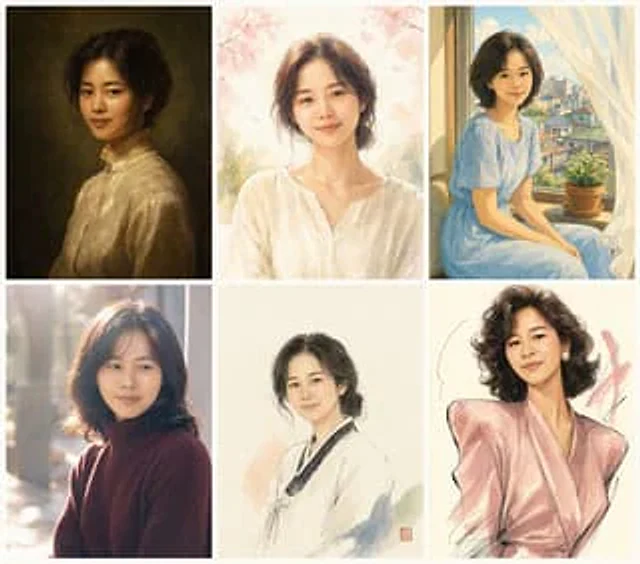

```text
{
  "type": "Comparison table of six portrait styles",
  "subject": "The same middle-aged South Korean mother is presented in six unique visual styles.",
  "identity": {
    "person": "{argument name=\"character identity\" default=\"Mother\"}",
    "gender": "woman",
    "age": "middle aged",
    "ethnicity": "Koreans",
    "hair": "Dark brown to black, medium length, styled in soft waves or an updo depending on the look.",
    "expression": "Calm, gentle, contemplative"
  },
  "layout": {
    "background": "Clean white pages, narrow spacing",
    "grid": {
      "rows": 2,
      "columns": 3,
      "count": 6
    },
    "sections": [
      {
        "position": "Top left",
        "count": 1,
        "label": "Oil portrait",
        "description": "A melancholic classical oil painting, a three-quarter profile half-length portrait, a deep and soft brown-black background, gentle chiaroscuro, a high-necked beige shirt with a subtle sheen, and loosely styled dark hair; masterful brushstrokes, elegant and restrained."
      },
      {
        "position": "Upper-middle",
        "count": 1,
        "label": "Light Watercolor Portrait",
        "description": "A soft watercolor half-length portrait, frontal view, against an airy, pale pink floral background with a cherry blossom-like rendering effect. The wearer wears a loose white shirt with delicate edges, and her skin tone is semi-transparent, creating a bright spring atmosphere."
      },
      {
        "position": "Top right",
        "count": 1,
        "label": "Sunlight scene by the window",
        "description": "A full-length or three-quarter portrait of a woman sitting by an open window, wearing a light blue short-sleeved dress, with pure white curtains fluttering inwards. A terracotta potted plant sits on the windowsill, bathed in warm sunlight, with the rooftops of a city street visible outside. The painting has a realistic style that evokes a tranquil summer atmosphere."
      },
      {
        "position": "Bottom left",
        "count": 1,
        "label": "Stills from the 1990s",
        "description": "A cinematic, realistic portrait reminiscent of a 1995 Korean drama, featuring shoulder-length, softly layered hair, a burgundy knitted turtleneck sweater, warm backlighting and shallow depth of field, an indoor setting with luminous highlights, and a nostalgic, simulated film texture."
      },
      {
        "position": "Middle to lower",
        "count": 1,
        "label": "Ink painting portrait in Korean traditional clothing",
        "description": "A minimalist Korean ink and wash portrait, a three-quarter profile half-body portrait, featuring a white hanbok top with a black collar decoration, loosely styled hair in a low bun, ample negative space, soft brushstrokes, understated traditional elegance, and a small red seal in the corner."
      },
      {
        "position": "Bottom right",
        "count": 1,
        "label": "Fashion Illustration",
        "description": "A highly expressive fashion sketch, featuring a captivating 1980s-inspired look: voluminous dark curls, pearl earrings, a structured rose-pink satin jacket or dress with wide shoulders, a deep V-neck, loose, impressionistic ink lines and blush brushstrokes, all against an off-white paper background."
      }
    ]
  },
  "style": {
    "overall": "A selection of contrasting artistic interpretations of the same woman",
    "quality": "High quality and exquisite design; each of the six panels has a distinct visual appearance but maintains a consistent identity.",
    "face_consistency": "Maintain consistency in facial structure and recognizable mother image across each panel.",
    "color_palette": "Soft classic browns, light pinks and creams, sky blues, burgundys, dark grays, and dusty pinks."
  },
  "camera_and_composition": "Each panel features a vertical layout with the main subject centered, presented in an editable, formatted style.",
  "rendering": "A sophisticated blend of painting and photography aesthetics for each panel, with delicate textures and soft, natural light where appropriate."
}
```

Model: GPT Image 2
Author: GPT Image 2 Prompts

[ProjectD](https://aitoolsradar.com/en/prompts/9d1b4dcc2f26c8) · [Recorded source](https://x.com/coindowoomi/status/2047319979373248998#reversed-0)
 · [Full original metadata and byte evidence](data/projectd-batch-0047.json)

## Six VTuber Japanese Logo Sheet

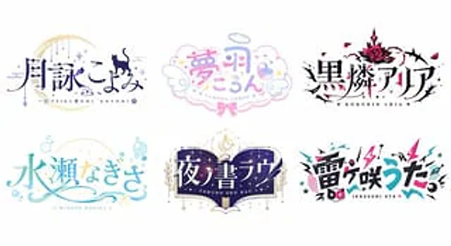

```text
Goal: Create a clean presentation sheet of exactly 6 original VTuber-style Japanese name logos on a white background, arranged in a 3-column by 2-row grid with generous spacing. Each logo should be a polished vector-like typographic mark with decorative motifs, glossy gradients, small romanized subtitle text, and no extra captions outside the logos.

Canvas: Wide horizontal canvas, about 1200×690 px, pure white background, centered composition, high-resolution crisp edges, transparent-logo-design feeling but displayed on white.

Layout: Exactly 6 discrete logos:
1. Top left: {argument name="top left name" default="月詠こよみ"} with small romanization “TSUKUYOMI KOYOMI”. Elegant deep navy Japanese calligraphy, crescent moon sweep in pale gold, dangling star charms, small flowers, sparkles, and a black cat silhouette sitting on the lettering.
2. Top center: {argument name="top center name" default="夢羽ころん"} with small romanization “YUMEHA CORON”. Cute pastel magical-girl logo in pink, lavender, and sky blue, rounded bubbly letters, fluffy cloud outline, tiny angel wings, halo above, stars, dotted lace border, and a pink bow at the bottom.
3. Top right: {argument name="top right name" default="黒燐アリア"} with small romanization “KOKURIN ARIA”. Gothic dark fantasy logo, black and crimson Japanese typography, thorny bat-wing flourishes, red rose crown at the top, diamond jewel shapes, rose petals, sharp spikes, and dramatic black ink accents.
4. Bottom left: {argument name="bottom left name" default="水瀬なぎさ"} with small romanization “MINASE NAGISA”. Fresh aquatic logo in turquoise and aqua gradients with pale gold accents, flowing wave underline, bubbles, seashells, small star sparkles, airy elegant rounded Japanese lettering.
5. Bottom center: {argument name="bottom center name" default="夜乃書ラウ"} with small romanization “YORUNOSHO RAU”. Dark academia midnight logo in deep navy and gold, large blocky Japanese lettering on a shield/book-shaped plaque, open book silhouette at the bottom, ornate golden frame, dangling stars, crescent/lantern-like ornament above, refined fantasy library mood.
6. Bottom right: {argument name="bottom right name" default="雷ヶ咲うた"} with small romanization “IKAZUCHI UTA”. Energetic pop-rock electric logo with bold black and white Japanese lettering, cyan and hot pink accents, lightning bolts, jagged comic effects, stars, checker/halftone details, small gamepad icon with X buttons, dynamic tilted rhythm.

Visual style: Modern Japanese VTuber logo design, professional esports/idol branding quality, highly legible stylized kanji/kana, layered outlines, gradients, sparkles, ornaments integrated into each logo, crisp vector illustration, balanced colors, no mockup shadows, no watermark.

Constraints: Use exactly 6 logos and exactly the 6 themes listed above. Keep the grid clean and evenly spaced. Preserve the Japanese text and romanized subtitles as part of each logo. Avoid photorealism, characters, people, UI panels, or extra explanatory text.
```

Model: GPT Image 2
Author: みどり🐲Midori Tatsuta

[ProjectD](https://aitoolsradar.com/en/prompts/6aecca05563c42) · [Recorded source](https://youmind.com/prompts/vtuber-japanese-logo-sheet-31051)
 · [Full original metadata and byte evidence](data/projectd-batch-0047.json)

## Skater Portrait — Half Pipe Backlight

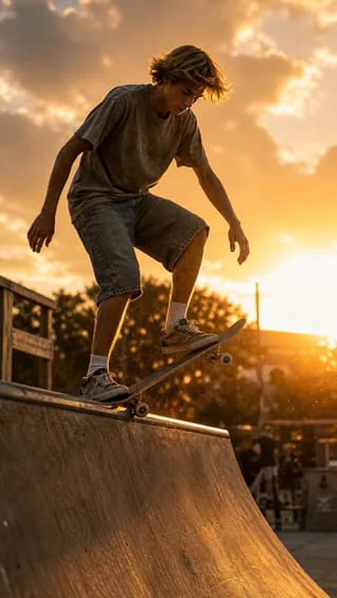

```text
Vertical 9:16 kinetic portrait of a teenage skateboarder mid-frame at the top of a wooden half pipe at sunset, board angled just past the lip, body in a slight crouch ready to drop. Strong golden backlight rim-lighting the silhouette, dust particles caught in the air around him. Faded loose t-shirt and denim shorts, scuffed sneakers. Vertical composition, dynamic but sharp focus on the skater. No brand sticker on the deck, no logo on the clothing, no watermark. Premium youth sport documentary photography quality with subtle motion blur, photorealistic textures.
```

Model: GPT Image 2
Author: @hiapi_ai

[ProjectD](https://aitoolsradar.com/en/prompts/dffe8f2089d70b) · [Recorded source](https://github.com/HiAPIAI/awesome-gpt-image-2-prompts)
 · [Full original metadata and byte evidence](data/projectd-batch-0047.json)

## Sketchbook Drawing Coming to Life

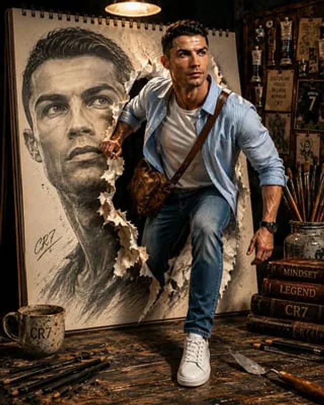

```text
In the center of the frame, a massive, oversized spiral-bound {argument name="object" default="sketchbook"} stands vertically upon a rustic, weathered dark-wood workbench. On the paper, a giant, realistic graphite pencil sketch of a man’s face is depicted. In a mind-bending moment, the thick paper of the sketchbook is violently torn open from the inside. A person is captured in mid-motion, stepping through the jagged, white-edged tear from the two-dimensional drawing into the three-dimensional world. The person’s right hand is firmly gripping the edge of the torn paper as they stride forward, with one foot planted on the wooden table and the other still emerging from the book. The lighting is cinematic and dramatic, provided by a single warm overhead industrial lamp that casts long shadows and creates a high-contrast, moody atmosphere. The person is dressed in a specific outfit: a {argument name="shirt" default="light blue and white pinstriped button-down shirt"} worn open over a plain white crew-neck t-shirt. A textured, brown leather-style crossbody sling bag is worn across the chest. They are wearing classic medium-wash blue slim-fit jeans and clean, white leather sneakers. A black digital watch is visible on their left wrist. The surrounding environment is rich with detail: scattered across the scarred wooden workbench are thick charcoal pencils, a speckled ceramic mug, a stack of vintage leather-bound books, and a metal palette. In the soft-focus background, a corkboard is pinned with various tubes of oil paint, and a ceramic jar filled with assorted artist brushes sits nearby. The overall mood is one of creative intensity and a powerful transition from art to reality, captured with high-fidelity textures and a shallow depth of field. However, there is one critical instruction: for the subject person, you MUST use the exact {argument name="reference" default="face and likeness"} of the person in the provided image. Preserve their identity and facial features perfectly. Integrate this person seamlessly into the described scene.
```

Model: GPT Image 2
Author: Maverick | AI

[ProjectD](https://aitoolsradar.com/en/prompts/6a5661434ca5d6) · [Recorded source](https://youmind.com/prompts/sketchbook-drawing-tearing-transition-23771)
 · [Full original metadata and byte evidence](data/projectd-batch-0047.json)

## Skills Introduction PPT Slide


```text
What is{argument name="topic" default="Skill"} Please present it using a single PowerPoint slide.
```

Model: GPT Image 2
Author: GPT Image 2 Prompts

[ProjectD](https://aitoolsradar.com/en/prompts/5f89e6b43f6354) · [Recorded source](https://x.com/alanblogsooo/status/2046612981409370567)
 · [Full original metadata and byte evidence](data/projectd-batch-0047.json)

## Skincare Beauty Campaign Advertisement


```text
A high-end beauty advertisement features a close-up shot of a young, beautiful Asian woman with flawless, hydrated, and radiant skin. She gently rests her chin on her hands and arms, crossed on a clean, white surface. Her expression is serene and gentle as she gazes directly at the camera. In the foreground, near her hands, rests a frosted glass bottle of skincare serum with a silver pump dispenser. The bottle bears the brand name in a simple, minimalist style.{argument name="brand name" default="LUVIN"} "and product name"{argument name="product name" default="CALMING MOISTURE SERUM"} The image features elegant, minimalist Korean typography on the left. The main title is "".{argument name="main headline" default="오늘, 피부는 스스로 빛난다"} The logo is accompanied by smaller auxiliary text above and below. The brand name is displayed in the lower left corner.{argument name="bottom left brand text" default="LUVIN"} The background is a soft, seamless off-white studio backdrop. The soft, even, and highly retouched lighting highlights the natural glow of her skin and creates a soft reflection on the glass bottle. A single, crystal-clear drop of serum is visible next to the bottle on the white surface.
```

Model: GPT Image 2
Author: GPT Image 2 Prompts

[ProjectD](https://aitoolsradar.com/en/prompts/51ab324cd7b02e) · [Recorded source](https://x.com/94vanAI/status/2044914754943435146#reversed-2)
 · [Full original metadata and byte evidence](data/projectd-batch-0047.json)

## Skincare E-commerce Landing Page


```text
{
  "type": "The first screen of the e-commerce landing page",
  "brand": "{argument name=\"brand name\" default=\"CLEAR RESET\"}",
  "theme": "Refreshing skincare, minimalist aesthetics, bubble background",
  "color_palette": [
    "White",
    "{argument name=\"primary color\" default=\"blue\"}",
    "light blue"
  ],
  "layout": {
    "header": {
      "logo": "CLEAR RESET",
      "navigation_links": {
        "count": 5,
        "labels": [
          "Product Introduction",
          "Pore/Acne Care",
          "Ingredients",
          "How to use",
          "Frequently Asked Questions"
        ]
      },
      "action_buttons": {
        "count": 2,
        "labels": [
          "Buy it now",
          "My Page"
        ]
      }
    },
    "hero_content": {
      "headline": "{argument name=\"main headline\" default=\"For clear, radiant skin, addressing concerns about pores and acne.\"}",
      "subheadline": "Balances oil production and purifies pores. Lightweight and non-greasy, this medicated skincare product is suitable for daily use.",
      "vertical_copy": "Prevent recurring roughness and acne, and create smooth, radiant skin."
    },
    "visuals": {
      "model": "{argument name=\"model description\" default=\"A young Asian woman with clear, radiant skin, her hair tied up, and a gentle smile.\"}",
      "products": {
        "count": 2,
        "description": "{argument name=\"product type\" default=\"Acne treatment gel tube and toner bottle\"}",
        "placement": "Center"
      },
      "background": "Light blue gradient with floating bubbles"
    },
    "feature_highlights": {
      "count": 4,
      "style": "Circular icon with text below.",
      "labels": [
        "Quasi-drugs",
        "Pore ​​care",
        "Refreshing and non-sticky",
        "Can be used in the morning and evening"
      ]
    },
    "call_to_action": {
      "banner_text": "First-time purchase only",
      "buttons": {
        "count": 2,
        "labels": [
          "Discounted trial",
          "check the details"
        ]
      }
    },
    "statistics_cards": {
      "count": 4,
      "style": "White rectangular card with large cyan numbers",
      "labels": [
        "Satisfaction rate 92%",
        "Pore ​​visibility -23%",
        "Acne prevention rate: 87%",
        "97% willingness to repurchase"
      ]
    }
  }
}
```

Model: GPT Image 2
Author: GPT Image 2 Prompts

[ProjectD](https://aitoolsradar.com/en/prompts/0e0b7cf56fa957) · [Recorded source](https://x.com/ryuya__31/status/2046360073736495255#reversed-1)
 · [Full original metadata and byte evidence](data/projectd-batch-0047.json)

## Skincare E-commerce Landing Page Mockup


```text
{
  "type": "Skincare product e-commerce landing page design draft",
  "brand": "{argument name=\"brand name\" default=\"DERMA CALM\"}",
  "color_palette": [
    "White",
    "light blue",
    "{argument name=\"primary color\" default=\"Dark blue\"}"
  ],
  "layout": {
    "header": {
      "logo": "The brand name is left-aligned, with a Japanese subtitle.",
      "navigation_links": {
        "count": 6,
        "labels": [
          "about Us",
          "product",
          "Function",
          "component",
          "User Reviews",
          "Frequently Asked Questions"
        ]
      },
      "buttons": {
        "count": 2,
        "labels": [
          "My account",
          "Buy it now"
        ]
      }
    },
    "hero_section": {
      "left_column": {
        "headline": "{argument name=\"hero headline\" default=\"Daily skincare products that are safe for sensitive skin.\"}",
        "subtext": "The paragraph details the low-irritant, moisturizing, fragrance-free, and alcohol-free formula.",
        "buttons": {
          "count": 2,
          "labels": [
            "Buy it now",
            "learn more"
          ]
        }
      },
      "center_column": {
        "product": "White pump bottle with a clear cap, labeled as{argument name=\"product type\" default=\"Moisturizing Barrier Serum\"}",
        "props": [
          "A small clump of white cream",
          "A round badge with the words \"Dermatologist Supervised\" printed on it"
        ]
      },
      "right_column": {
        "subject": "{argument name=\"model description\" default=\"A young East Asian woman with clear, radiant skin that lightly touches her cheeks\"}",
        "background": "Blurred laboratory glassware in a bright, clean clinical environment"
      }
    },
    "bottom_features_panel": {
      "left_cards": {
        "count": 3,
        "descriptions": [
          "95% five-star reviews",
          "The shield icon represents a low-irritant formula.",
          "The water droplet icon represents skin barrier support."
        ]
      },
      "right_badges": {
        "count": 3,
        "descriptions": [
          "Fragrance-free icon",
          "No alcohol icon",
          "Allergy test icon"
        ]
      },
      "footer": "Detailed disclaimer at the bottom"
    }
  }
}
```

Model: GPT Image 2
Author: GPT Image 2 Prompts

[ProjectD](https://aitoolsradar.com/en/prompts/fa8e15e544eb65) · [Recorded source](https://x.com/ryuya__31/status/2046360073736495255#reversed-3)
 · [Full original metadata and byte evidence](data/projectd-batch-0047.json)

## Skincare Landing Page Hero Section


```text
{
  "type": "landing page hero section",
  "theme": "skincare and beauty",
  "color_palette": [
    "white",
    "{argument name=\"primary color\" default=\"teal\"}",
    "light blue"
  ],
  "header": {
    "logo": "{argument name=\"brand name\" default=\"CLEAR RESET\"}",
    "navigation_links": 5,
    "buttons": 2
  },
  "hero_content": {
    "headline": "{argument name=\"main headline\" default=\"For clear, radiant skin, addressing concerns about pores and acne.\"}",
    "subheadline": "Balances oil production and purifies pores. A refreshing, non-greasy medicated skincare product suitable for comfortable daily use.",
    "feature_icons": {
      "count": 4,
      "labels": [
        "Quasi-drug",
        "Hair follicle care",
        "Refreshing and non-sticky",
        "Suitable for use both morning and evening."
      ]
    }
  },
  "centerpiece": {
    "products": {
      "count": 2,
      "description": "{argument name=\"product type\" default=\"skincare gel and lotion\"}",
      "items": [
        "Blue hose",
        "Clear bottle"
      ]
    },
    "background": "Water surface with floating bubbles"
  },
  "model": {
    "description": "{argument name=\"model description\" default=\"young Asian woman with clear radiant skin, hair tied up, gentle smile\"}",
    "position": "right side"
  },
  "bottom_section": {
    "cta_buttons": {
      "count": 2,
      "labels": [
        "Discounted trial &gt;",
        "View details &gt;"
      ]
    },
    "statistics_cards": {
      "count": 4,
      "labels": [
        "User satisfaction rate: 92%",
        "Pore ​​visibility -23%",
        "Prevents acne and rough skin by 87%.",
        "97% willingness to repurchase"
      ]
    }
  }
}
```

Model: GPT Image 2
Author: GPT Image 2 Prompts

[ProjectD](https://aitoolsradar.com/en/prompts/4a2c51ed300647) · [Recorded source](https://x.com/masapark95/status/2046180792897007851#reversed-1)
 · [Full original metadata and byte evidence](data/projectd-batch-0047.json)

## Skincare Landing Page Mockup


```text
{
  "type": "Skincare product landing page template",
  "design_style": "Simple, clinically relevant, trustworthy, modern",
  "color_palette": [
    "White",
    "{argument name=\"primary color\" default=\"light blue\"}",
    "Navy Blue"
  ],
  "brand_name": "{argument name=\"brand name\" default=\"DERMA CALM\"}",
  "layout": {
    "header": {
      "left": "Brand Logo",
      "center": {
        "element": "Navigation menu",
        "count": 6,
        "labels": [
          "about Us",
          "Product Introduction",
          "Core Functions",
          "Ingredient Analysis",
          "User Reviews",
          "Frequently Asked Questions"
        ]
      },
      "right": {
        "element": "Call to Action Button",
        "count": 2,
        "labels": [
          "Personal Center",
          "Buy it now"
        ]
      }
    },
    "hero_section": {
      "background": "Blurred laboratory glassware (beakers, flasks) convey a sense of scientific formulation.",
      "left_column": {
        "headline": "{argument name=\"headline text\" default=\"Daily skincare products that are safe for sensitive skin.\"}",
        "body_text": "Describes its low-irritation, moisturizing, and barrier-repairing functions.",
        "call_to_action_buttons": {
          "count": 2,
          "styles": [
            "Solid Navy Blue",
            "White background with navy blue border"
          ]
        }
      },
      "center_column": {
        "product": "{argument name=\"product type\" default=\"White pump bottle for serum\"}",
        "props": [
          "A touch of white face cream"
        ],
        "floating_badge": "A round badge with the inscription 'Supervised by a Dermatologist'."
      },
      "right_column": {
        "model": "{argument name=\"model description\" default=\"A young Asian woman with radiant, glowing skin, a gentle smile, lightly touching her cheek.\"}"
      }
    },
    "features_section": {
      "container": "White rounded rectangle at the bottom",
      "count": 6,
      "items": [
        "Satisfaction rate '95%', with 5 navy blue stars.",
        "Shield icon with checkmark (low-irritation)",
        "Water drop icon (skin barrier support)",
        "Bottle with crossed-out icon (fragrance-free)",
        "Crossed-out icon for flask (alcohol-free)",
        "Add a checkmark icon to the clipboard (tested via patch)."
      ],
      "footer": "The disclaimer at the very bottom (small print)"
    }
  }
}
```

Model: GPT Image 2
Author: GPT Image 2 Prompts

[ProjectD](https://aitoolsradar.com/en/prompts/9e282b17ccb154) · [Recorded source](https://x.com/masapark95/status/2046180792897007851#reversed-3)
 · [Full original metadata and byte evidence](data/projectd-batch-0047.json)

## Skincare Landing Page Mockup


```text
{
  "type": "skincare product landing page mockup",
  "design_style": "clean, clinical, trustworthy, modern",
  "color_palette": ["white", "{argument name=\"primary color\" default=\"light blue\"}", "navy blue"],
  "brand_name": "{argument name=\"brand name\" default=\"DERMA CALM\"}",
  "layout": {
    "header": {
      "left": "brand logo",
      "center": {
        "element": "navigation menu",
        "count": 6,
        "labels": ["ABOUT", "PRODUCT", "FEATURE", "INGREDIENT", "VOICE", "Q&A"]
      },
      "right": {
        "element": "action buttons",
        "count": 2,
        "labels": ["マイページ", "今すぐ購入する"]
      }
    },
    "hero_section": {
      "background": "blurred laboratory glassware (beakers, flasks) suggesting scientific formulation",
      "left_column": {
        "headline": "{argument name=\"headline text\" default=\"敏感な肌にも、毎日つづけられる安心ケア。\"}",
        "body_text": "description of low irritation, moisturizing, and barrier support",
        "call_to_action_buttons": {
          "count": 2,
          "styles": ["solid navy blue", "white with navy border"]
        }
      },
      "center_column": {
        "product": "{argument name=\"product type\" default=\"white pump bottle of serum\"}",
        "props": ["dollop of white cream"],
        "floating_badge": "circular badge with text '皮膚科医監修'"
      },
      "right_column": {
        "model": "{argument name=\"model description\" default=\"young Asian woman with glowing clear skin, smiling, touching her cheek\"}"
      }
    },
    "features_section": {
      "container": "white rounded rectangle spanning the bottom width",
      "count": 6,
      "items": [
        "satisfaction rate '95%' with 5 navy stars",
        "shield icon with checkmark (low irritation)",
        "water drop icon (skin barrier support)",
        "crossed-out bottle icon (fragrance-free)",
        "crossed-out flask icon (alcohol-free)",
        "clipboard icon with checkmark (patch tested)"
      ],
      "footer": "small print disclaimers at the very bottom"
    }
  }
}
```

Model: GPT Image 2
Author: パク🎈動画広告分析Pro × AI

[ProjectD](https://aitoolsradar.com/en/prompts/db4dbb2f1281bb) · [Recorded source](https://youmind.com/prompts/skincare-product-landing-hero-14208)
 · [Full original metadata and byte evidence](data/projectd-batch-0047.json)

## Skincare Product Studio Shot


```text
A gentle{argument name="bottle color" default="Cream"} Bottle, with{argument name="pump color" default="pale yellow"} The pump head, placed on a matte base, is surrounded by silky foam and{argument name="flowers" default="Chamomile flowers"} The background features a pale yellow gradient with delicate bubble details. The label emphasizes organic chamomile and soothing care. Fresh chamomile flowers highlight its gentle texture.
```

Model: GPT Image 2
Author: GPT Image 2 Prompts

[ProjectD](https://aitoolsradar.com/en/prompts/b59bbd55433e8e) · [Recorded source](https://x.com/Strength04_X/status/2047636636847231222)
 · [Full original metadata and byte evidence](data/projectd-batch-0047.json)

## Sleeping Anime Star Witch

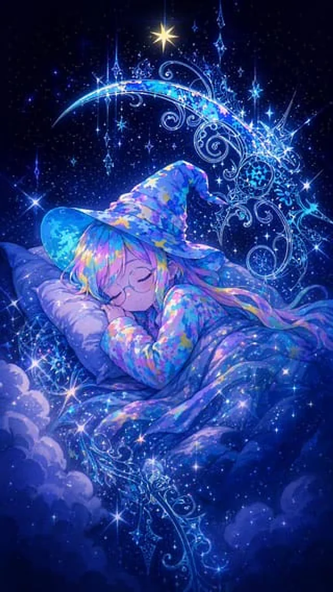

```text
An ethereal anime illustration depicts a {argument name="character type" default="Young Anime Witch"} She was sleeping peacefully on soft pillows, covered with a fluffy starry-sky blanket that blended seamlessly into her cloud-like bed. She wore round-framed glasses and had flowing hair {argument name="hair color" default="Soft rainbow colors"} Her hair. She wore a huge, floppy witch's hat and matching pajamas, both brightly colored.{argument name="clothing pattern" default="Colored star system camouflage"} The design features a magical cosmic night sky with twinkling stars, a bright star shining at the top center, and surrounding {argument name="background element" default="The delicate, glowing magic filaments that make up the crescent moon"} The image is rich in detail and bright, presenting a soft and dreamlike atmosphere, and employs {argument name="overall color palette" default="Deep blue and bright purple"} The overall color scheme.
```

Model: GPT Image 2
Author: GPT Image 2 Prompts

[ProjectD](https://aitoolsradar.com/en/prompts/efb0b6fa52784f) · [Recorded source](https://x.com/minesan_ai/status/2044463128222814268#reversed-1)
 · [Full original metadata and byte evidence](data/projectd-batch-0047.json)

## Sleeping Calico on White Appliance

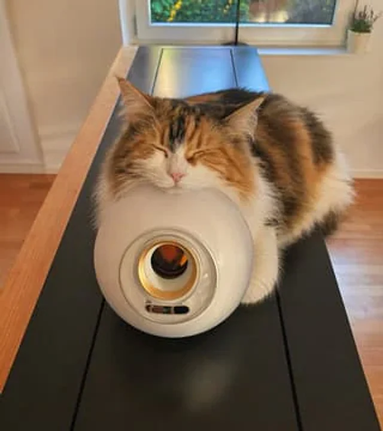

```text
A heartwarming indoor lifestyle photo showcases a fluffy, long-haired calico cat with its eyes closed, its chin gently resting on a smooth, cylindrical white appliance, photographed from tabletop height. The cat boasts thick tricolor fur (orange, black, and white), a white muzzle, a pink nose, and large, pointed ears, giving it a remarkably soft and fluffy appearance. Its body is wrapped around the device, resting on a long, matte black tabletop (with natural light-colored wood edges). The composition is centered, with the device in the foreground and the cat occupying the upper half of the frame. The device features a circular opening with a metal inner ring on the front and a small oval control window near the bottom. The scene is set in a warm, sun-drenched modern home, with a window behind the subject letting in soft sunlight. The background features light-colored walls, warm wooden floors, and a small plant on the windowsill in the upper right corner. The shallow depth of field, soft warm tones, realistic fur detail, natural reflections on the device, and a tranquil, sleeping atmosphere make this a high-resolution candid pet photograph.
```

Model: GPT Image 2
Author: GPT Image 2 Prompts

[ProjectD](https://aitoolsradar.com/en/prompts/d3a1a385b2d63a) · [Recorded source](https://x.com/R2Cdev_/status/2046998042273046612#reversed-0)
 · [Full original metadata and byte evidence](data/projectd-batch-0047.json)

## Smartphone Ad Poster

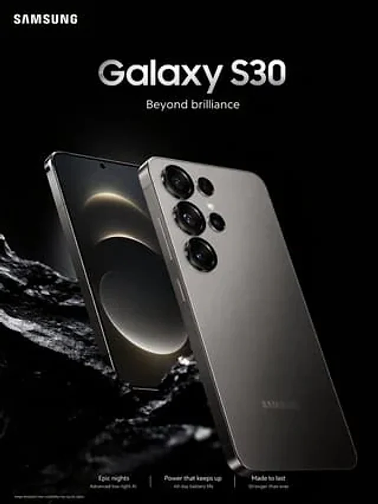

```text
{
  "type": "Product advertising poster",
  "brand_logo": "{argument name=\"brand name\" default=\"SAMSUNG\"}",
  "typography": {
    "headline": "{argument name=\"product name\" default=\"Galaxy S30\"}",
    "subtitle": "{argument name=\"tagline\" default=\"Beyond Excellence\"}"
  },
  "visuals": {
    "setting": "A pure black background, paired with dramatic studio lighting.",
    "base": "{argument name=\"background element\" default=\"Serrated dark rock structure\"}",
    "subjects": [
      {
        "description": "Smartphone facing forward",
        "position": "Left side, slightly back",
        "screen_display": "Abstract wallpaper with overlapping, luminous gold arcs on a dark background."
      },
      {
        "description": "Smartphone with the back facing",
        "position": "The right side has a prominent view.",
        "color": "{argument name=\"phone color\" default=\"Titanium Gray\"}",
        "features": "It features a flat metal edge, three large camera lenses arranged vertically, two smaller circular sensors on the right side, and the brand logo printed at the bottom."
      }
    ]
  },
  "layout": {
    "footer": {
      "count": 3,
      "sections": [
        {
          "title": "Epic Night Shots",
          "subtitle": "Advanced low-light AI"
        },
        {
          "title": "Long-lasting power",
          "subtitle": "All-day battery life"
        },
        {
          "title": "Durable",
          "subtitle": "More robust than ever before"
        }
      ],
      "fine_print": "Images are for illustrative purposes only. Color availability may vary by region."
    }
  }
}
```

Model: GPT Image 2
Author: GPT Image 2 Prompts

[ProjectD](https://aitoolsradar.com/en/prompts/c909cd983c1199) · [Recorded source](https://x.com/Gdthainakub/status/2044382053521936809#reversed-2)
 · [Full original metadata and byte evidence](data/projectd-batch-0047.json)

## Smartphone Screen Mockup

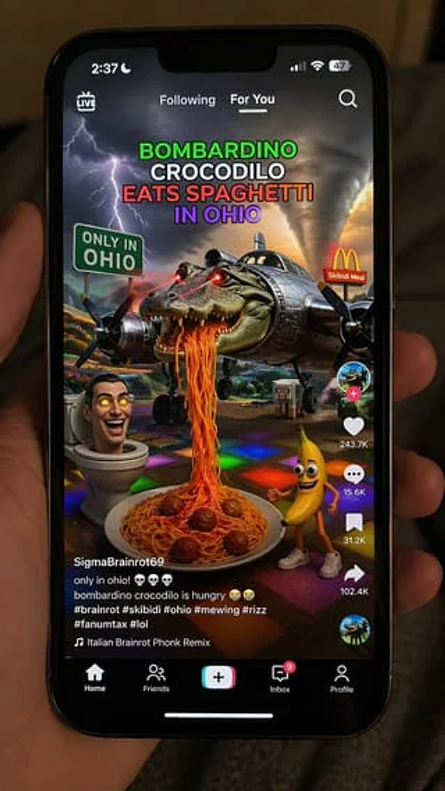

```text
Generate a{argument name="aspect ratio" default="9:16"} The image contains the following content:{argument name="subject" default="An iPhone playing the world&#39;s worst TikTok brain-dead video."} .
```

Model: GPT Image 2
Author: GPT Image 2 Prompts

[ProjectD](https://aitoolsradar.com/en/prompts/b3d0759bafcdaa) · [Recorded source](https://x.com/_simonsmith/status/2046705389589197142)
 · [Full original metadata and byte evidence](data/projectd-batch-0047.json)

## Smartwatch on Wrist with Forest Bokeh

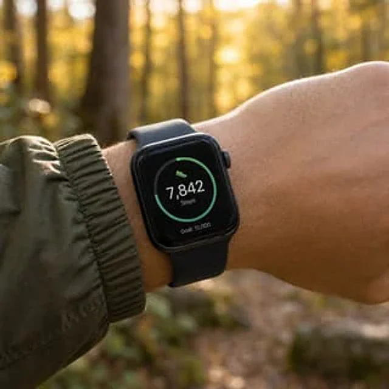

```text
Close-up product photograph of a sleek black smartwatch with a clean digital watchface showing a generic step count interface, worn on a forearm with a casual outdoor olive-green jacket sleeve pushed up. Background is a softly blurred forest in golden autumn light with warm bokeh. Square 1:1 lifestyle hero composition, sharp focus on the watch face. No brand logo, no specific app name, no watermark. Photorealistic skin and metal textures, outdoor lifestyle photography quality.
```

Model: GPT Image 2
Author: @hiapi_ai

[ProjectD](https://aitoolsradar.com/en/prompts/4bac773d3eaf42) · [Recorded source](https://github.com/HiAPIAI/awesome-gpt-image-2-prompts)
 · [Full original metadata and byte evidence](data/projectd-batch-0047.json)

## Smiling Khan #284

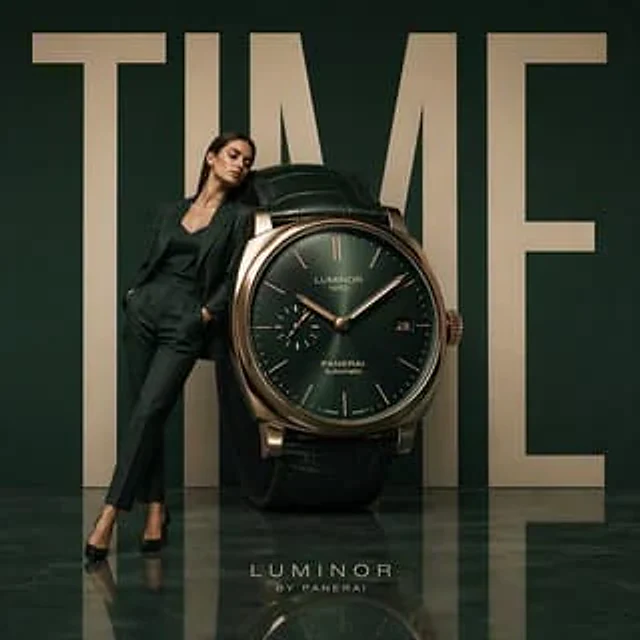

```text
Minimalist luxury watch campaign, oversized wristwatch positioned like modern sculpture, model leaning against the dial, giant word “TIME” in bold typography behind, deep emerald studio background, reflective polished floor, Swiss luxury advertising aesthetic, cinematic editorial styling, ultra-clean composition, 1:1
```

Model: GPT Image 2
Author: Smiling Khan

[ProjectD](https://aitoolsradar.com/en/prompts/0ba74c80032ab4) · [Recorded source](https://x.com/AIwithkhan/status/2047704906904330554)
 · [Full original metadata and byte evidence](data/projectd-batch-0047.json)

## Soccer Event Poster Redesign

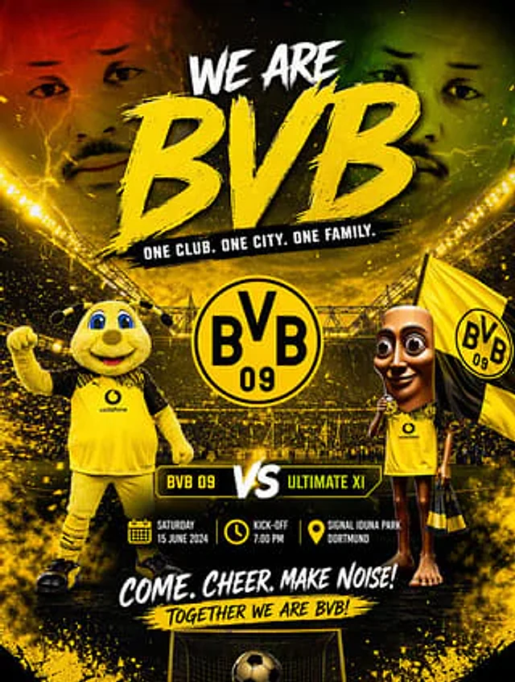

```text
You are a senior graphic designer with a humanistic touch. Please transform this bland poster into a more appealing piece.{argument name="event" default="Upcoming football tournament"} A bold and highly attractive poster.
```

Model: GPT Image 2
Author: GPT Image 2 Prompts

[ProjectD](https://aitoolsradar.com/en/prompts/a5219c9415d609) · [Recorded source](https://x.com/mrdejie/status/2047577513715740915)
 · [Full original metadata and byte evidence](data/projectd-batch-0047.json)

## Soccer Match Infographic Poster


```text
{
  "type": "Sports Event Infographic Poster",
  "theme": "UEFA Champions League",
  "background": "A deep blue and purple cosmic sky, glowing blue hexagonal lines, with the brightly lit stadium reflected at the bottom.",
  "header": {
    "logo": "UEFA Champions League",
    "title": "{argument name=\"stage\" default=\"Semifinals\"}",
    "subtitle": "Target:{argument name=\"location\" default=\"Budapest 2026\"}",
    "venue": "Puskás Arena"
  },
  "matchup": {
    "player_left": "Wearing a red FC Bayern jersey{argument name=\"team 1 player\" default=\"Harry Kane\"}",
    "player_right": "Wearing a blue PSG jersey{argument name=\"team 2 player\" default=\"Osman Dembele\"}",
    "center_logos": "FC Bayern Munich and Paris Saint-Germain, along with the letter VS.",
    "date_box": "Calendar icon, Wednesday.{argument name=\"date\" default=\"May 6, 2026\"}"
  },
  "facts_section": {
    "title": "Event Overview",
    "count": 5,
    "items": [
      "Trophy icon: 2025/26 UEFA Champions League",
      "Bar chart icon: Kane in hot form",
      "Lightning icon: Dembele leaping",
      "Double icon: Previous 14 encounters",
      "Stadium icon: Budapest is calling"
    ]
  },
  "footer": {
    "trophy": "The Champions League trophy is displayed on the right.",
    "stadium_image": "Puskás Arena at night",
    "tagline": "A dream. A goal. A championship.",
    "bottom_text": "The Road to Budapest 2026"
  }
}
```

Model: GPT Image 2
Author: GPT Image 2 Prompts

[ProjectD](https://aitoolsradar.com/en/prompts/35f662fa4005e8) · [Recorded source](https://x.com/NumeroBTC/status/2046313506396574102#reversed-0)
 · [Full original metadata and byte evidence](data/projectd-batch-0047.json)

## Soccer Model Comparison Poster

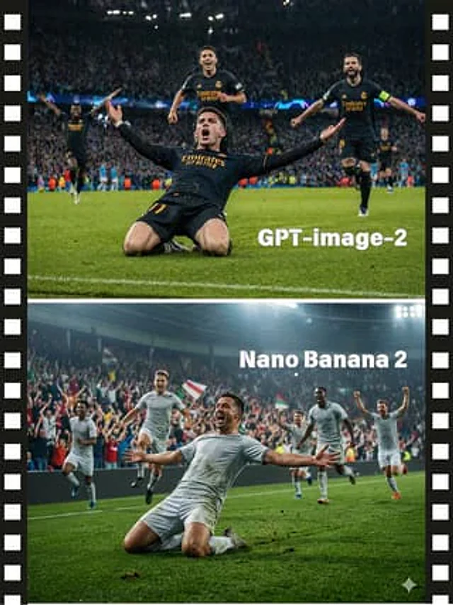

```text
{
  "type": "Side-by-side model comparison poster",
  "subject": "Dramatic football goal celebration",
  "style": "Cinematic sports photography comparison, high-energy, realistic, and editorial social media graphics.",
  "layout": {
    "orientation": "vertical",
    "sections": [
      {
        "title": "GPT-image-2",
        "position": "upper half",
        "count": 1,
        "labels": [
          "GPT-image-2"
        ]
      },
      {
        "title": "Nano Banana 2",
        "position": "lower half",
        "count": 1,
        "labels": [
          "Nano Banana 2"
        ]
      }
    ],
    "divider": "A thick horizontal white line separates the two images.",
    "border": "The left and right edges are framed with black film, and there are evenly distributed white sprocket holes on each side, about 15 holes on each side.",
    "watermarks": [
      {
        "text": "GPT-image-2",
        "position": "Bottom right corner of the top panel"
      },
      {
        "text": "Nano Banana 2",
        "position": "Top right corner of the bottom panel"
      }
    ]
  },
  "scene": {
    "sport": "football",
    "moment": "After scoring a goal, a player kneels down and slides towards the camera with his arms outstretched, as his teammates run towards him from behind.",
    "camera": "Low-angle stadium view, slightly wide-angle, main character centered, dynamic perspective.",
    "environment": "The stadium was packed at night; under the bright floodlights, the cheering crowds were blurred, the vibrant green grass was covered with flying turf fragments."
  },
  "panels": {
    "top": {
      "look": "Champions League style match photos, with darker tones and higher contrast, possess a broadcast-quality realism.",
      "main player": {
        "kit": "Black jersey and shorts with gold lettering and trim.",
        "pose": "Kneeling on both knees, sliding towards the camera, torso slightly leaning back, arms outstretched."
      },
      "teammates": {
        "count": 4,
        "descriptions": [
          "A teammate runs forward from the center of the rear.",
          "A teammate runs with his arms outstretched on the right, wearing the captain's armband.",
          "A teammate raises both arms in the background to the left rear.",
          "A teammate in the background to the right rear."
        ]
      },
      "crowd": "Dense crowd in a blue-toned stadium, highly blurred.",
      "text_overlay": "Large, bold, white sans-serif text containing the text \"GPT-image-2\"."
    },
    "bottom": {
      "look": "More versatile yet dramatic sports photography, bright stadium fog, with a slightly softer sense of realism.",
      "main player": {
        "kit": "Plain light gray or white jerseys and shorts",
        "pose": "He knelt down and slid towards the camera, arms outstretched, kicking up dirt and grass clippings near his legs."
      },
      "teammates": {
        "count": 5,
        "descriptions": [
          "A teammate is running forward on the far left.",
          "A teammate performs a knee-bending jump on the left side of the center.",
          "A teammate is running to the right rear of the center.",
          "A teammate runs towards the celebrating crowd from the right side of the center.",
          "A teammate on the far right raises both fists."
        ]
      },
      "crowd": "Among the cheering crowd, several red, white, and green flags could be seen.",
      "lighting": "Bright overhead stadium lights with an atmospheric halo",
      "text_overlay": "Large, bold, white sans-serif text: Nano Banana 2",
      "extra_mark": "There is a small white flashing icon near the bottom right corner."
    }
  },
  "quality": "High detail, dynamic motion, shallow depth of field, realistic skin and fabric textures, dramatic sports action, and social media contrast aesthetics.",
  "avoid": "Cartoon style, empty stadium, static pose, close-up cropping, other signs besides the visible contrasting text."
}
```

Model: GPT Image 2
Author: GPT Image 2 Prompts

[ProjectD](https://aitoolsradar.com/en/prompts/2abed99793d2f4) · [Recorded source](https://x.com/zoomad99/status/2047284258100887914#reversed-3)
 · [Full original metadata and byte evidence](data/projectd-batch-0047.json)

## Social App Match Success UI


```text
{argument name="application scenario" default="Social app matching success screen"}, {argument name="interactive element" default="Two user profile cards collide with a heart-shaped effect."}。
```

Model: GPT Image 2
Author: GPT Image 2 Prompts

[ProjectD](https://aitoolsradar.com/en/prompts/19c30a6c2876e6) · [Recorded source](https://x.com/songguoxiansen/status/2047220490486612450)
 · [Full original metadata and byte evidence](data/projectd-batch-0047.json)

## Social Media Ad Designs


```text
Image 1:{argument name="ad product" default="milk tea"} The advertisement features a pink, girly style, a close-up of bubble tea, and a refreshing summer vibe. Image 2: A cover photo recommended by Xiaohongshu (Little Red Book).{argument name="product category" default="skin care products"} Instagram-style flat lay photos with a fresh, Japanese-style filter.
```

Model: GPT Image 2
Author: GPT Image 2 Prompts

[ProjectD](https://aitoolsradar.com/en/prompts/2d78d202e819ed) · [Recorded source](https://x.com/songguoxiansen/status/2046841797968880038)
 · [Full original metadata and byte evidence](data/projectd-batch-0047.json)

## Social Media App Interface Mockup


```text
{
  "type": "Screenshot of social media video application interface",
  "main_visual": {
    "subject": "A young Asian woman, with long black hair flowing in the wind, wearing a white top, turns to look at the camera.",
    "setting": "{argument name=\"background location\" default=\"Sunset at the Canton Tower on the riverbank\"}",
    "lighting": "Golden hour, the warm glow of the setting sun"
  },
  "ui_layout": {
    "top_status_bar": {
      "elements": 4,
      "labels": [
        "9:41",
        "Signal",
        "Wi-Fi",
        "100% battery"
      ]
    },
    "top_navigation": {
      "elements": 6,
      "labels": [
        "Menu icon",
        "experience",
        "Group buying",
        "focus on",
        "{argument name=\"active tab\" default=\"recommend\"}",
        "Search icon"
      ]
    },
    "right_interaction_bar": {
      "elements": 6,
      "labels": [
        "Avatar with a red plus sign",
        "bring{argument name=\"like count\" default=\"236,000\"} Like icon",
        "With 16,000 comment icons",
        "With 28,000 favorites icons",
        "With 37,000 share icons",
        "Rotating music record"
      ]
    },
    "bottom_left_text": {
      "elements": 3,
      "labels": [
        "{argument name=\"username\" default=\"@LittleDeer&#39;sDailyLife\"}",
        "{argument name=\"caption\" default=\"Feeling the evening breeze and watching the sunset, this moment is so therapeutic~ 🌅\"}",
        "Original soundtrack with musical notation icons @Xiaolu's daily creative soundtrack"
      ]
    },
    "bottom_navigation": {
      "elements": 5,
      "labels": [
        "front page",
        "Friend (marked with a red badge #2)",
        "Square plus button",
        "Message (with red badge #5)",
        "I"
      ]
    }
  }
}
```

Model: GPT Image 2
Author: GPT Image 2 Prompts

[ProjectD](https://aitoolsradar.com/en/prompts/01e3b89892ed86) · [Recorded source](https://x.com/wilsondu311/status/2044781525942821206#reversed-0)
 · [Full original metadata and byte evidence](data/projectd-batch-0047.json)

## Social Media Concert Story Mockup

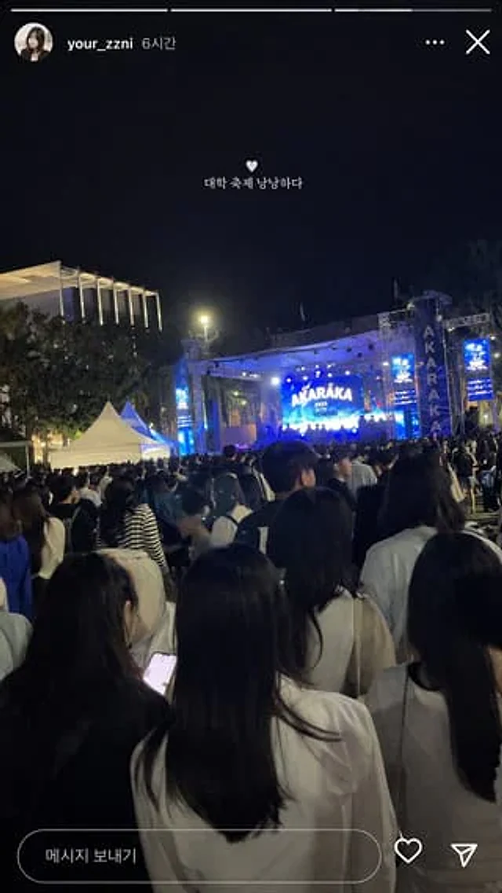

```text
{
  "type": "Screenshot of social media story",
  "background_photo": {
    "setting": "Nighttime Outdoor University Music Festival",
    "perspective": "A first-person perspective of looking at the bright stage from behind the crowded crowd.",
    "crowd": "A group of young people dressed casually as seen from behind.",
    "stage": "A large outdoor concert stage emitting bright blue light, with the main LED screen displaying \"{argument name=\"stage main text\" default=\"AKARAKA\"} \"and\"{argument name=\"stage sub text\" default=\"2025 YONSEI\"} Vertical banners bearing the word \"AKARAKA\" were hung on both sides.",
    "environment": "A pitch-black night sky, trees, a modern building with vertical light strips on the left, and two white event tents on the left-center."
  },
  "ui_overlay": {
    "top_header": "A young woman's round profile picture, username \"{argument name=\"username\" default=\"your_zzni\"} The timestamp is \"6 hours ago\", and the right side features a standard three-dot menu and an \"X\" close icon.",
    "center_text": "A small white heart icon floats in the center of the screen, followed by the text \"{argument name=\"overlay text\" default=\"The university music festival had a fantastic atmosphere.\"} \"",
    "bottom_bar": "A pill-shaped message input box containing the text \"Send Message,\" accompanied by a heart-shaped icon and a paper airplane icon on the right."
  }
}
```

Model: GPT Image 2
Author: GPT Image 2 Prompts

[ProjectD](https://aitoolsradar.com/en/prompts/9905029737a1e2) · [Recorded source](https://x.com/sungchi/status/2044400278099906921#reversed-2)
 · [Full original metadata and byte evidence](data/projectd-batch-0047.json)

## Social Media Meme Cover


```text
Draw a{argument name="platform" default="Tik Tok"} Short video cover. The left half of the screen is filled with a prominent title: "{argument name="title" default="I created a meme using YouMind&#39;s Emotion Factory AI; it made my colleague call the police!"} ". The right side is{argument name="expression" default="Exaggerated close-up photos that make you laugh until you cry"} The blogger's likes are displayed in the bottom left corner.{argument name="likes" default="3.28 million"} The bottom right corner is tagged "#AI Pranks# I'm dying of laughter."
```

Model: GPT Image 2
Author: GPT Image 2 Prompts

[ProjectD](https://aitoolsradar.com/en/prompts/689d061d1d5c2c) · [Recorded source](https://x.com/Bianxiaoshuo/status/2046802873208766919)
 · [Full original metadata and byte evidence](data/projectd-batch-0047.json)

## Social Media Pet Avatar Creator

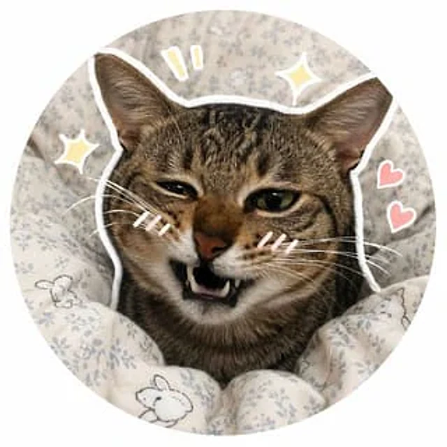

```text
This{argument name="pet" default="cat"} Convert photos to suitable{argument name="platform" default="social media platforms"} Your profile picture. Please feel free to express yourself.{argument name="style" default="Internet trendiness"} .
```

Model: GPT Image 2
Author: GPT Image 2 Prompts

[ProjectD](https://aitoolsradar.com/en/prompts/45e30091fb2802) · [Recorded source](https://x.com/kylegeeks/status/2046840187616100376)
 · [Full original metadata and byte evidence](data/projectd-batch-0047.json)

## Social Media Product Announcement Mockup

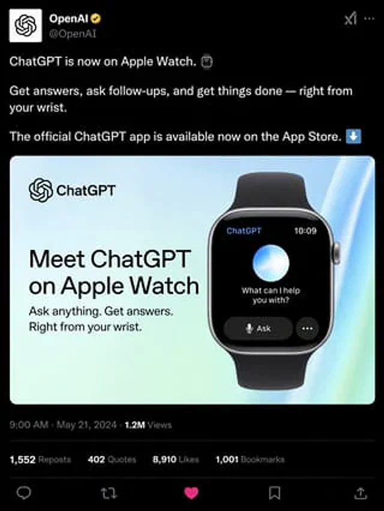

```text
{
  "type": "Social media post simulation",
  "theme": "Dark mode",
  "header": {
    "avatar": "OpenAI logo",
    "account_name": "{argument name=\"account name\" default=\"OpenAI\"}",
    "badge": "Gold Certification Badge",
    "handle": "@OpenAI"
  },
  "post_text": [
    "{argument name=\"post text\" default=\"ChatGPT is now available on Apple Watch.\"}",
    "Ask questions, follow up, and handle matters anytime, anywhere—all at your fingertips.",
    "The official ChatGPT app is now available on the App Store."
  ],
  "embedded_card": {
    "background": "Light blue and green gradient",
    "left_column": {
      "logo": "ChatGPT",
      "headline": "{argument name=\"card headline\" default=\"Experience ChatGPT for Apple Watch\"}",
      "subheadline": "Ask questions anytime. Get answers. Everything at your fingertips."
    },
    "right_column": {
      "device": "Smartwatch with black strap",
      "screen_elements": {
        "top_bar": 2,
        "top_bar_labels": [
          "ChatGPT",
          "10:09"
        ],
        "center": "Glowing blue and white spheres",
        "text": "{argument name=\"watch screen text\" default=\"Is there anything I can help you with?\"}",
        "buttons": 2,
        "button_labels": [
          "Question",
          "..."
        ]
      }
    }
  },
  "footer": {
    "metadata": "9:00 AM · May 21, 2024 · 1.2 million views",
    "engagement_stats": {
      "count": 4,
      "labels": [
        "1,552 retweets",
        "402 citations",
        "{argument name=\"likes count\" default=\"8,910\"} Runner-up",
        "1,001 bookmarks"
      ]
    },
    "action_icons": {
      "count": 5,
      "types": [
        "reply",
        "Forward",
        "Like",
        "Bookmark",
        "share"
      ]
    }
  }
}
```

Model: GPT Image 2
Author: GPT Image 2 Prompts

[ProjectD](https://aitoolsradar.com/en/prompts/4b3a30b7b9b2dc) · [Recorded source](https://x.com/tehno_maniak/status/2044754985183785208#reversed-2)
 · [Full original metadata and byte evidence](data/projectd-batch-0047.json)

## Social Media Screen Breakout

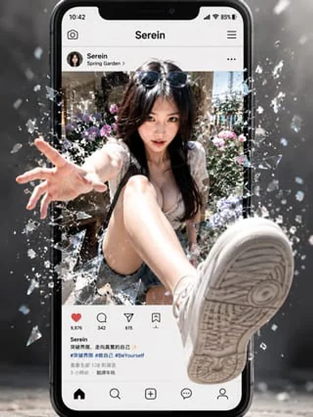

```text
{"type":"cinematic 3D social-media breakthrough poster","concept":"A hyper-realistic young woman bursts out of a smartphone social media post, shattering the screen glass with dramatic depth and motion.","main subject":{"description":"fashionable young woman seated inside a photo post, long dark hair, sunglasses pushed on top of her head, white lace summer top, denim shorts, white sneakers","pose":"one hand reaching forcefully toward the viewer through broken glass, one leg thrust forward so the sneaker sole becomes huge in the foreground, extreme wide-angle perspective","face":"intentionally covered by a soft rectangular blur censor block","customizable identity":"{argument name=\"character name\" default=\"Serein\"}"},"device and interface":{"device":"large black modern smartphone standing upright, iPhone-like rounded frame and notch","top status bar":"time 10:42, signal icons, Wi-Fi, 85% battery","app header":"center title {argument name=\"profile name\" default=\"Serein\"}, camera icon on left, hamburger menu on right","post header":"round avatar, username Serein, location Spring Garden, three-dot menu","visible UI components count":9,"visible UI components":["status bar","camera icon","app title","hamburger menu","post profile row","three-dot menu","engagement buttons row","caption and hashtags block","bottom navigation bar"],"engagement buttons count":4,"engagement buttons":["red heart with 9,876 likes","comment bubble with 342","paper-plane share with 615","bookmark icon with 1"],"bottom navigation icons count":5,"bottom navigation icons":["home","search","create plus","messages bubble","profile outline"],"caption text":"{argument name=\"caption text\" default=\"Serein\\n突破界限，走向真实的自己 ✨\\n#突破界限 #做自己 #BeYourself\\n查看更多 128 则留言\\n3 小时前 · 翻译年糕\"}"},"environment inside post":"sunlit garden courtyard with flowers, greenery, pale stone walls, bright outdoor summer atmosphere","glass effect":{"description":"phone screen appears violently broken around the subject as she exits the post","shards":"many transparent glass fragments and glittering splinters flying outward in all directions, especially left and right edges","motion":"frozen mid-explosion with debris suspended in air"},"camera and composition":{"framing":"vertical 4:5 poster composition, smartphone centered and filling most of frame","perspective":"extreme 3D depth, foreshortened hand reaching out left foreground and oversized sneaker sole dominating lower right foreground","focus":"sharp phone and subject, background slightly smoky and blurred","lighting":"{argument name=\"lighting style\" default=\"cinematic high-contrast sunlight with rim highlights on glass shards\"}"},"style":"photorealistic advertising composite, glossy smartphone mockup, social-media UI realism, blockbuster action energy, dramatic shattered-screen portal effect, high detail, depth of field, motion impact","background":"dark gray studio-like environment with haze, bokeh, floating dust and glass particles behind the phone","negative instructions":"no extra limbs, no warped phone frame, no unreadable major UI title, no cartoon style, no low-resolution textures"}
```

Model: GPT Image 2
Author: serein

[ProjectD](https://aitoolsradar.com/en/prompts/4db09456288286) · [Recorded source](https://youmind.com/prompts/social-media-screen-breakout-18692)
 · [Full original metadata and byte evidence](data/projectd-batch-0047.json)

## Social Media Screenshot Generator

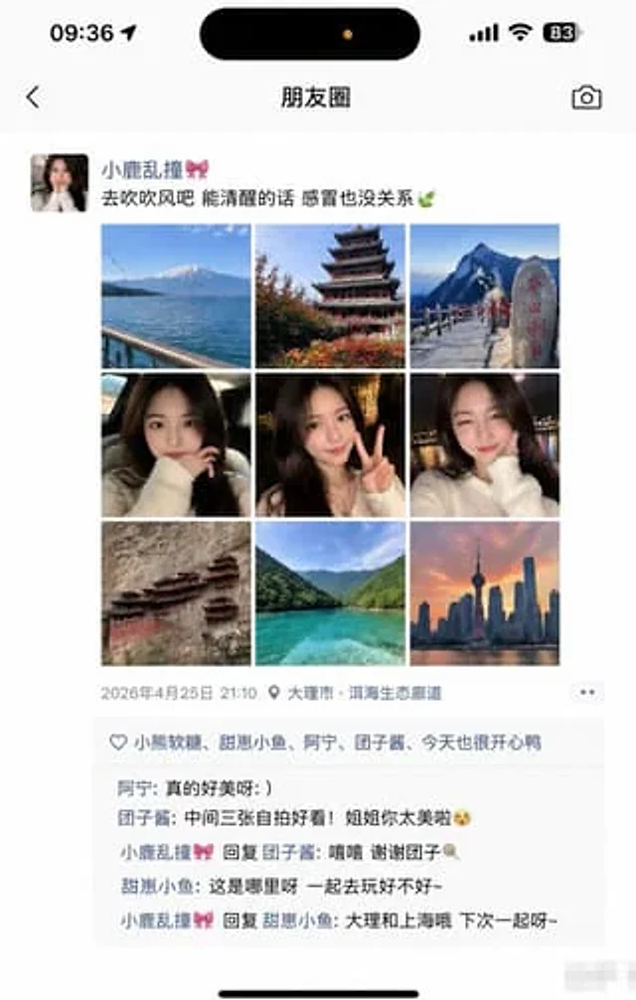

```text
生成一张微信朋友圈动态的截图，{argument name="布局" default="3x3"}排列，中间三张为{argument name="主体" default="女孩自拍照"}，其他为各网红打卡点景色拍照，要求有点赞、评论、回复等，苹果手机顶部时间、灵动岛、电量等
```

Model: GPT Image 2
Author: 唐华斑竹🦅

[ProjectD](https://aitoolsradar.com/en/prompts/dbe6c567f596e3) · [Recorded source](https://youmind.com/prompts/wechat-moments-screenshot-generator-23014)
 · [Full original metadata and byte evidence](data/projectd-batch-0047.json)

## Social Media Video App UI Mockup


```text
{
  "type": "Social media short video app interface model",
  "main_image": {
    "subject": "{argument name=\"subject description\" default=\"A young Asian woman with long dark hair, wearing a white off-the-shoulder top.\"}",
    "pose": "She turned to look at the camera, a gentle smile on her face, her hair swaying softly in the breeze.",
    "setting": "{argument name=\"background location\" default=\"The riverside promenade at sunset, with towering modern towers and the city skyline in the background.\"}",
    "lighting": "At the golden hour, the warm sunlight reflects on the river."
  },
  "ui_layout": {
    "top_bar": {
      "status_icons": [
        "Time 9:41",
        "Cellular signal",
        "Wi-Fi",
        "Battery 100"
      ],
      "navigation": {
        "left": "Menu icon",
        "center_tabs": [
          "experience",
          "Group buying",
          "focus on",
          "{argument name=\"active top tab\" default=\"recommend\"}"
        ],
        "right": "Search icon"
      }
    },
    "right_sidebar": {
      "count": 6,
      "elements": [
        "Avatar with a pink plus button",
        "Heart icon with the text \"236,000\"",
        "Chat bubble icon with the text \"16,000\".",
        "A star icon with the text \"28,000\".",
        "Share arrow icon with the text \"37,000\"",
        "Rotating music record icon"
      ]
    },
    "bottom_left_overlay": {
      "username": "{argument name=\"username\" default=\"@LittleDeer&#39;sDailyLife\"}",
      "caption": "{argument name=\"caption text\" default=\"Feeling the evening breeze and watching the sunset, this moment is so therapeutic~ 🌅\"}",
      "audio_track": "🎵 Original soundtrack from @XiaoLu's Daily Creations"
    },
    "bottom_navigation_bar": {
      "count": 5,
      "tabs": [
        "front page",
        "Friend (marked with a red '2')",
        "Rounded square center plus button",
        "Message (with red badge '5')",
        "I"
      ]
    }
  }
}
```

Model: GPT Image 2
Author: GPT Image 2 Prompts

[ProjectD](https://aitoolsradar.com/en/prompts/7d73ad8ae3b8e3) · [Recorded source](https://x.com/manateelazycat/status/2044757322929778958#reversed-0)
 · [Full original metadata and byte evidence](data/projectd-batch-0047.json)

## Social Media Video App UI Mockup


```text
{
  "type": "social media short video app interface mockup",
  "main_image": {
    "subject": "{argument name=\"subject description\" default=\"young Asian woman with long dark hair wearing a white off-the-shoulder top\"}",
    "pose": "looking back over her shoulder at the camera, gentle smile, hair blowing slightly in the wind",
    "setting": "{argument name=\"background location\" default=\"riverside promenade at sunset with a tall modern tower and city skyline\"}",
    "lighting": "golden hour, warm sunlight reflecting on the river"
  },
  "ui_layout": {
    "top_bar": {
      "status_icons": ["time 9:41", "cellular signal", "wifi", "battery 100"],
      "navigation": {
        "left": "menu icon",
        "center_tabs": ["经验", "团购", "关注", "{argument name=\"active top tab\" default=\"推荐\"}"],
        "right": "search icon"
      }
    },
    "right_sidebar": {
      "count": 6,
      "elements": [
        "profile picture with pink plus button",
        "heart icon with text '23.6万'",
        "chat bubble icon with text '1.6万'",
        "star icon with text '2.8万'",
        "share arrow icon with text '3.7万'",
        "spinning music record icon"
      ]
    },
    "bottom_left_overlay": {
      "username": "{argument name=\"username\" default=\"@小鹿的日常\"}",
      "caption": "{argument name=\"caption text\" default=\"吹着晚风，看着日落，这一刻好治愈~ 🌅\"}",
      "audio_track": "🎵 原声 @小鹿的日常创作的原声"
    },
    "bottom_navigation_bar": {
      "count": 5,
      "tabs": [
        "首页",
        "朋友 (with red badge '2')",
        "central plus button in rounded square",
        "消息 (with red badge '5')",
        "我"
      ]
    }
  }
}
```

Model: GPT Image 2
Author: Andy Stewart

[ProjectD](https://aitoolsradar.com/en/prompts/14786dbe6766f6) · [Recorded source](https://youmind.com/prompts/short-video-app-mockup-13844)
 · [Full original metadata and byte evidence](data/projectd-batch-0047.json)

## Social Square — App Update Announcement


```text
Square 1:1 social media announcement card. Soft mint-to-lavender pastel gradient background. Centered upper area shows a clean flat illustration of an abstract floating mobile app icon (rounded square with a generic dashboard symbol inside, soft drop shadow). Below the icon a two-line bold sans-serif headline reads "Brand new home screen — Now live". Bottom shows a thin pill-shaped CTA button reading "See What's New". Generous whitespace, modern flat illustration aesthetic. No real brand name, no logo, no watermark. Crisp typography rendering, premium social ad design quality.
```

Model: GPT Image 2
Author: @hiapi_ai

[ProjectD](https://aitoolsradar.com/en/prompts/2149436517a87b) · [Recorded source](https://github.com/HiAPIAI/awesome-gpt-image-2-prompts)
 · [Full original metadata and byte evidence](data/projectd-batch-0047.json)

## Soft Airy 35mm Portrait

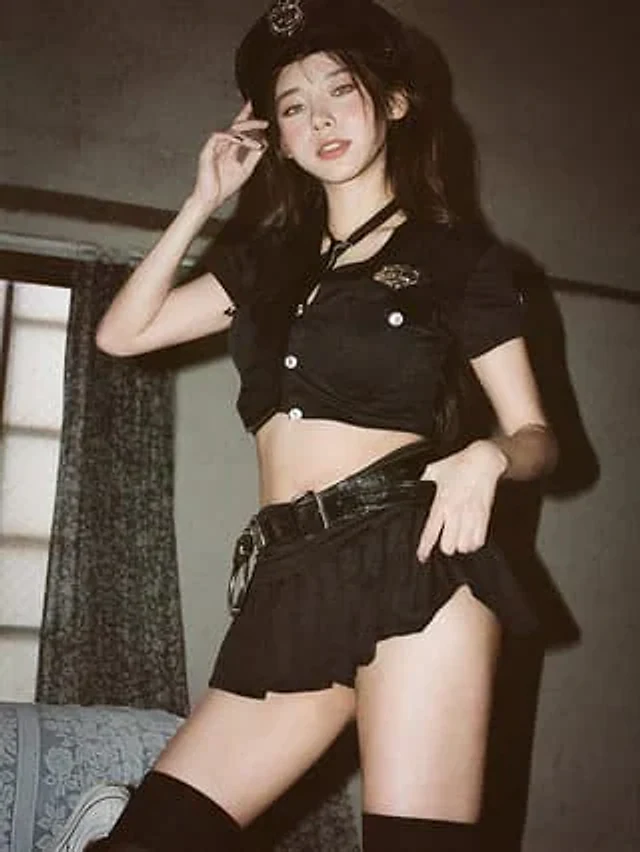

```text
Analog 35mm film photography, soft airy Japanese-style aesthetic, gentle diffused natural window light, slight overexposure, pastel tones, low contrast, soft highlights, minimal indoor setting near a window with white curtains, clean light-colored wall, natural composition, eye-level, slightly closer full-body framing (mid-thigh to head), young East Asian woman, natural minimal makeup, soft realistic skin texture, long slightly messy dark hair, oversized white button-up shirt, light casual shorts, barefoot, simple and relaxed styling, standing naturally with relaxed posture, arms loosely at sides or slightly behind, facing camera, gentle soft smile, subtle stillness, focus on light, air, and quiet everyday mood, soft film grain, dreamy and understated atmosphere --ar 9:16
```

Model: GPT Image 2
Author: @BubbleBrain

[ProjectD](https://aitoolsradar.com/en/prompts/9ec724071e9c09) · [Recorded source](https://x.com/BubbleBrain/status/2046115431144902732)
 · [Full original metadata and byte evidence](data/projectd-batch-0047.json)

## Soft Black Mist Editorial Portrait

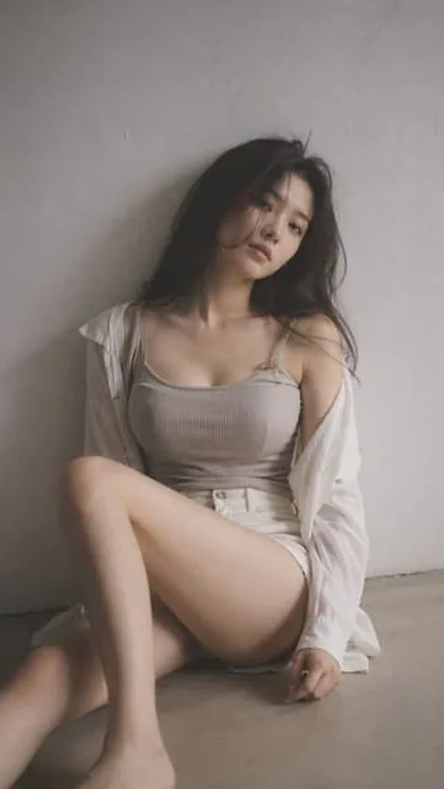

```text
9:16 vertical — editorial portrait, single subject  soft black mist filter, subtle haze, gentle highlight bloom, muted tones  minimal indoor space, clean background, slight texture  young Korean woman, minimal makeup, natural skin texture  outfit: fitted ribbed knit top or soft camisole layered under a loose shirt, paired with high-waisted shorts or skirt; fabric slightly clings to body shape, soft and natural, no revealing elements  hair: slightly messy, natural volume  pose: sitting on floor with one leg bent and the other relaxed, body slightly leaning, shoulders not aligned, head tilted  composition: subject slightly off-center, negative space present  expression: calm, slightly distant, natural lips  lighting: soft side light, gentle shadow falloff  mood: understated, quiet, subtly sensual through natural body lines, relaxed and unposed  quality: fine grain, slight softness, realistic look
```

Model: GPT Image 2
Author: @BubbleBrain

[ProjectD](https://aitoolsradar.com/en/prompts/ab6d826c849504) · [Recorded source](https://x.com/BubbleBrain/status/2046434670724907395)
 · [Full original metadata and byte evidence](data/projectd-batch-0047.json)

## Soft Black Mist Idol Portrait

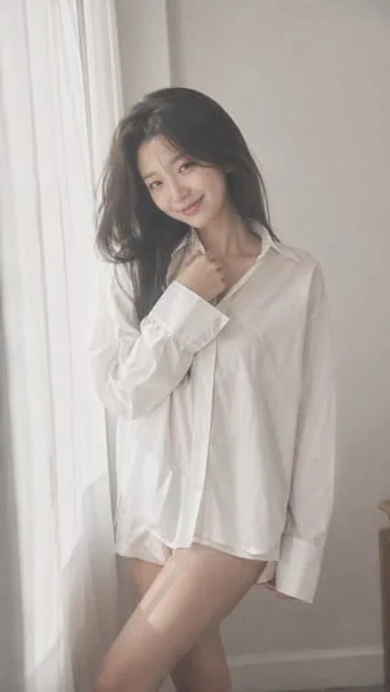

```text
9:16 vertical — Korean idol portrait photography, single subject  soft black mist filter effect, lowered contrast, gentle highlight bloom, subtle glow, soft diffusion, slightly faded blacks  minimal indoor setting near window, white curtains, clean light-toned background  young Korean female idol, natural minimal makeup, dewy realistic skin texture, subtle imperfections  outfit: oversized white button-up shirt + short bottoms, slightly loose fit, soft and casual styling, no revealing elements  hair: long dark hair, slightly messy, natural volume, softly flowing  pose: relaxed standing or slight lean, body subtly angled, one leg slightly forward, shoulders relaxed; one hand lightly touching collar or resting near neckline, the other relaxed; gentle body curve without exaggeration  expression: soft cute smile, slightly playful eyes, direct or slightly off-camera gaze  camera: close to mid-body framing, eye-level, intimate distance, slight handheld feel  lighting: diffused natural daylight, soft shadows, gentle light wrapping around face and body  mood: cute yet subtly sensual, intimate, everyday softness, quiet romantic atmosphere  quality: ultra-realistic, fine film grain, slight softness at edges, natural imperfections, dreamy understated tone
```

Model: GPT Image 2
Author: @BubbleBrain

[ProjectD](https://aitoolsradar.com/en/prompts/7ffa413201ba27) · [Recorded source](https://x.com/BubbleBrain/status/2046518189509734903)
 · [Full original metadata and byte evidence](data/projectd-batch-0047.json)

## Soft Blue Anime Girl Portrait


```text
A soft, anime-style half-length portrait. The center of the image is a cute young woman against a pure, warm off-white background. It is drawn with simple, delicate lines and a flat, soft color scheme. She has very long, straight hair, the color of which is {argument name="hair color" default="light sky blue"} Her hair was light and airy, with bangs slightly parted in the middle, and she had a pair of large, bright blue eyes. Her expression was shy and confused, her eyebrows slightly raised, her cheeks flushed with a faint pink blush, and her small mouth slightly parted. She was gazing at the audience, one index finger lightly touching her lower lip, displaying a thoughtful and hesitant posture. She wore an oversized, loose-fitting {argument name="top color" default="light blue"} The hoodie, with its long sleeves partially obscuring the hands, is framed from the chest up, with the head slightly tilted, creating a gentle, innocent, and dreamlike feel. The composition employs minimalism, with no accessories, extraneous objects, background, or text. It emphasizes a monochromatic blue color scheme, a light and simple feel, subtle sketch-like contours, and Japanese illustration aesthetics suitable for a soft personal portrait.
```

Model: GPT Image 2
Author: GPT Image 2 Prompts

[ProjectD](https://aitoolsradar.com/en/prompts/a7fb45bf2922eb) · [Recorded source](https://x.com/izutorishima/status/2046679150279446678#reversed-3)
 · [Full original metadata and byte evidence](data/projectd-batch-0047.json)

## Soft Cafe Portrait of Young Woman

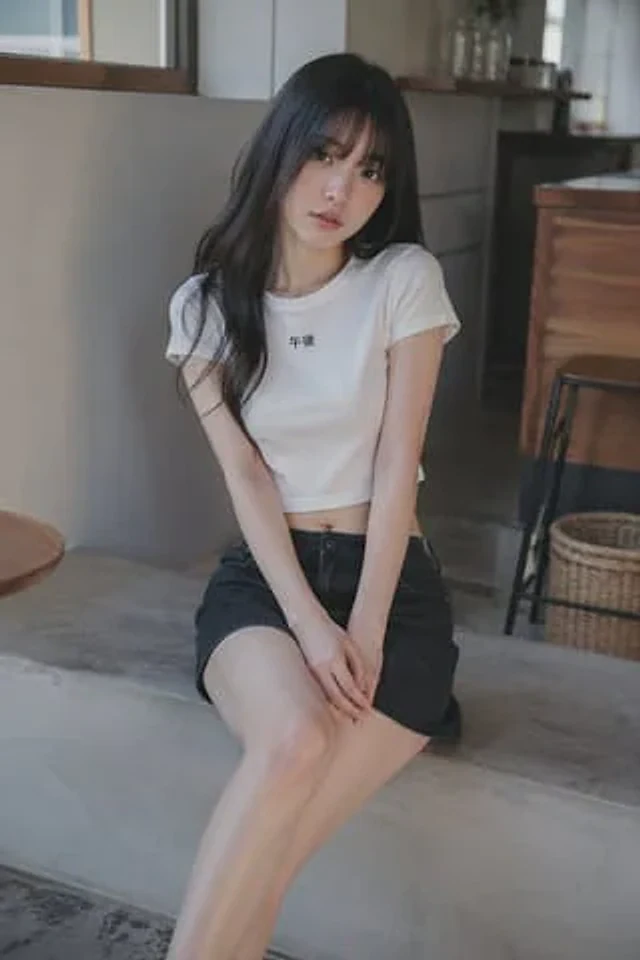

```text
A realistic indoor portrait of a slender young East Asian woman with long hair.{argument name="hair color" default="Long black hair"} She has soft, wavy hair and sits on a smooth concrete bench in a minimalist café. Facing the camera, her posture is shy and gentle, her shoulders slightly turned, her hands naturally folded on her knees, and her ankles crossed. She wears a fitted white cropped T-shirt with small Japanese characters printed in the center.{argument name="shirt text" default="afternoon"} The outfit is paired with a dark high-waisted denim mini skirt. Natural light from the window on the left creates soft, diffused shadows and a tranquil, gentle atmosphere. The background showcases a modern, warm-toned café, with a window frame in the upper left, a wooden counter on the right with a black bar stool, a woven basket on the floor, and a shelf displaying glass bottles in the distance, all in soft focus. The vertical composition, mid-range full-body shot, eye-level perspective, shallow depth of field, understated editorial fashion photography, neutral tones, soft skin tones, a quiet, candid atmosphere, and a highly realistic style.
```

Model: GPT Image 2
Author: GPT Image 2 Prompts

[ProjectD](https://aitoolsradar.com/en/prompts/883e5c6505949a) · [Recorded source](https://x.com/fuuro_ito/status/2046581649673158996#reversed-0)
 · [Full original metadata and byte evidence](data/projectd-batch-0047.json)

## Soft Monochrome Anime Girl Portrait


```text
A soft, ethereal anime portrait depicts a refined young woman against a minimalist off-white background, taken from a three-quarter profile view above the chest. She has long, slightly wavy hair.{argument name="hair color" default="Dark brown with gray-brown highlights"} Her hair, light and airy, with bangs and a large black bow tied to one side, is styled beautifully. Her eyes are large and expressive, a light gray, with detailed eyelashes that convey a dreamy and distant look. She rests her chin on her hand, her slender fingers partially obscuring her face, the tips painted with soft gray nail polish. She wears a white off-the-shoulder blouse with puffed cuffs featuring delicate ruffles and pleats, tied with thin black ribbons to create a soft, monochromatic contrast. A single, simple, elegant long gold pearl earring adorns her visible ear. The overall style is clean and minimalist, reminiscent of Japanese anime illustrations, with delicate lines, subtle blush, soft cel-shading, and oil painting-like highlights in her hair. The overall atmosphere is quiet, melancholic, and full of feminine charm, possessing a refined fashion illustration quality, with a color palette limited to white, black, taupe, and gray.
```

Model: GPT Image 2
Author: GPT Image 2 Prompts

[ProjectD](https://aitoolsradar.com/en/prompts/59b13941001190) · [Recorded source](https://x.com/hoshi122221/status/2046911595838922764#reversed-0)
 · [Full original metadata and byte evidence](data/projectd-batch-0047.json)

## Soft Watercolor Storybook Illustration

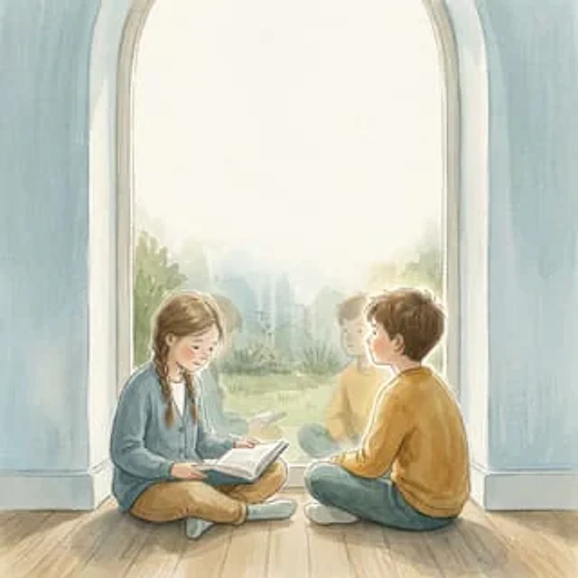

```text
Soft and poetic children's book illustrations with watercolor and gouache textures. Clear and soft natural light. Soft pastel tones accompanied by pale blue and warm hues. Visible brushstrokes and paper texture. Minimalist composition with ample negative space. Hand-drawn picture book style, not cartoon, not animation, not 3D.{argument name="subject" default="The two children are talking calmly, building a gentle connection."} .
```

Model: GPT Image 2
Author: GPT Image 2 Prompts

[ProjectD](https://aitoolsradar.com/en/prompts/efde0d4de017ea) · [Recorded source](https://x.com/crayon1267/status/2047482132952645646)
 · [Full original metadata and byte evidence](data/projectd-batch-0047.json)

## Software Shortcut Infographic

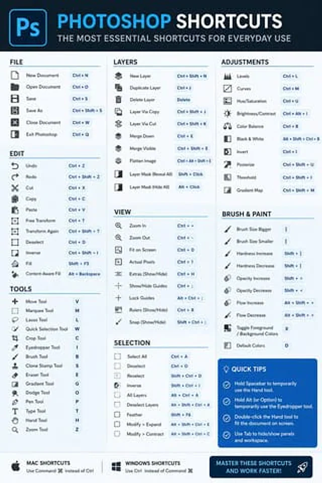

```text
Create a simple and modern infographic to showcase{argument name="software" default="Photoshop"} The most essential keyboard shortcuts are clearly and easily readable.
```

Model: GPT Image 2
Author: GPT Image 2 Prompts

[ProjectD](https://aitoolsradar.com/en/prompts/b1ab192ce5728d) · [Recorded source](https://x.com/icreatelife/status/2046934865849786796)
 · [Full original metadata and byte evidence](data/projectd-batch-0047.json)

## Software UI Desktop Screenshot

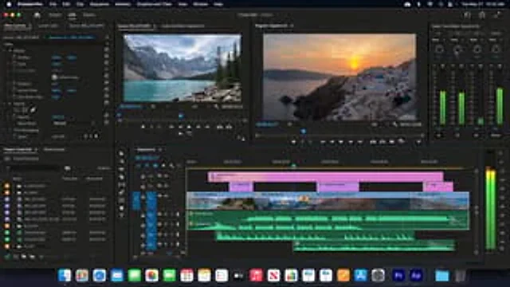

```text
Generate a{argument name="software" default="Adobe Premiere"} Realistic desktop screenshots
```

Model: GPT Image 2
Author: GPT Image 2 Prompts

[ProjectD](https://aitoolsradar.com/en/prompts/dd6682dfc4261f) · [Recorded source](https://x.com/katedeyneka/status/2046663278169092151)
 · [Full original metadata and byte evidence](data/projectd-batch-0047.json)

## Software UI Desktop Screenshot

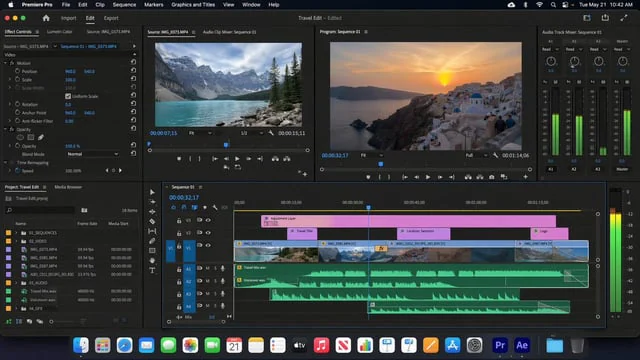

```text
Generate a realistic desktop screenshot of {argument name="software" default="Adobe Premiere"}
```

Model: GPT Image 2
Author: Kate Deyneka

[ProjectD](https://aitoolsradar.com/en/prompts/69199496b38d6d) · [Recorded source](https://youmind.com/prompts/software-ui-screenshot-14317)
 · [Full original metadata and byte evidence](data/projectd-batch-0047.json)

## Software Workflow Infographic

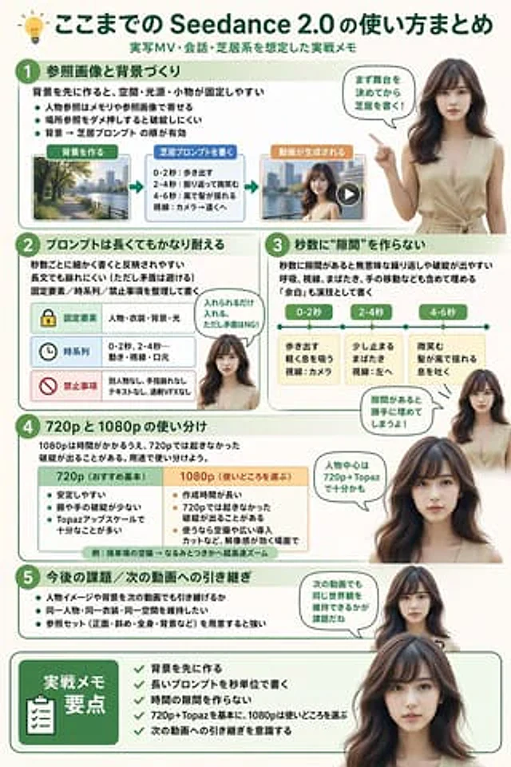

```text
{
  "type": "infographic",
  "style": "Simple, modern, and professional, it uses soft green and beige tones and incorporates realistic figures.",
  "header": {
    "icon": "lightbulb",
    "title": "{argument name=\"main title\" default=\"Seedance 2.0 User Guide Summary\"}",
    "subtitle": "{argument name=\"subtitle\" default=\"Practical notes on live-action music video shooting, dialogue, and performance scenes\"}"
  },
  "presenter_character": "{argument name=\"presenter description\" default=\"A young Japanese woman with a realistic style, long dark brown hair, wearing a beige sleeveless top.\"}",
  "total_presenter_cutouts": 6,
  "layout": {
    "sections": [
      {
        "number": 1,
        "title": "{argument name=\"section 1 title\" default=\"Reference Images and Background Creation\"}",
        "elements": "Three key points, one horizontal three-step flowchart, including thumbnails (city view, text box, video player).",
        "presenter_pose": "The flowchart points to the left and features speech bubbles."
      },
      {
        "number": 2,
        "title": "{argument name=\"section 2 title\" default=\"Long prompts can also maintain good results\"}",
        "elements": "Two key points, one table with three rows of content, and icons (lock, clock, prohibition sign).",
        "presenter_pose": "Neutral expression, looking straight ahead, accompanied by speech bubbles."
      },
      {
        "number": 3,
        "title": "Ensure there are no \"gaps\" between the seconds.",
        "elements": "Two key points, and one horizontal timeline graph containing three segments.",
        "presenter_pose": "Pointing upwards, with the gaze slightly to the left, accompanied by a speech bubble."
      },
      {
        "number": 4,
        "title": "Differences in usage between 720p and 1080p",
        "elements": "Text description, 1 two-column comparison table (green column, orange column)",
        "presenter_pose": "Look straight ahead, accompanied by speech bubbles."
      },
      {
        "number": 5,
        "title": "Future topics / Connection to the next video",
        "elements": "4 key points",
        "presenter_pose": "The gaze is slightly to the right, accompanied by speech bubbles."
      },
      {
        "type": "summary_box",
        "title": "Key points of practice notes",
        "elements": "Clipboard icon, 5 list items marked with green checkmarks.",
        "presenter_pose": "Large portraits from the chest up, looking directly at the viewer."
      }
    ]
  }
}
```

Model: GPT Image 2
Author: GPT Image 2 Prompts

[ProjectD](https://aitoolsradar.com/en/prompts/d3729617209868) · [Recorded source](https://x.com/malonpon/status/2044957465947844993#reversed-0)
 · [Full original metadata and byte evidence](data/projectd-batch-0047.json)

## Solar System Ice Cream Cones

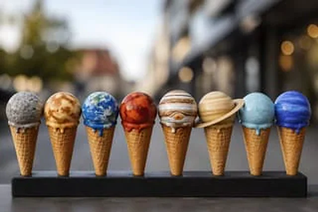

```text
A whimsical and realistic food photograph showcasing eight ice cream cones arranged in a row on a matte black rectangular stand, each cone designed to resemble a different planet in the solar system. Shot at eye level with a shallow depth of field, the background features soft, blurred cityscape lighting, creating a gentle, sunlit atmosphere reminiscent of an outdoor street or café. From left to right, the eight cones are: a water planet with grey spots, a gold planet with yellowish-brown swirls, a blue-green Earth sphere with white cloud-like patterns and small blue droplets, a deep red Mars sphere with dark marble patterns and red melting droplets, a striped Jupiter sphere with large red spots, a light brown Saturn sphere surrounded by thin rings, a light ice-blue Uranus sphere with blue droplets, and a vibrant cobalt blue Neptune sphere with a glossy texture and blue melting droplets. The use of crisp waffle cones highlights realistic melting details, a glossy frozen surface, sophisticated studio lighting, and a centered, symmetrical composition. To ensure the planet's altitude is clearly visible while presenting a realistic ice cream texture, a black stand spans the width of the image, and the background is softly blurred.
```

Model: GPT Image 2
Author: GPT Image 2 Prompts

[ProjectD](https://aitoolsradar.com/en/prompts/1ac96e00125942) · [Recorded source](https://x.com/cooldude6688/status/2046415445645791361#reversed-0)
 · [Full original metadata and byte evidence](data/projectd-batch-0047.json)

## Solar System Infographic Poster

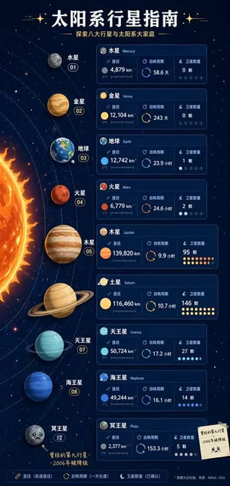

```text
The "Solar System Planet Guide" vertical infographic poster features a side view of the solar system, with each planet accompanied by an "ID card" containing information such as its diameter, rotation period, and number of moons. Pluto is marked on the edge with the small print: "Formerly the ninth planet, downgraded in 2006," accompanied by a sad emoji. The poster features a deep blue starry sky background and graphical data design.
```

Model: GPT Image 2
Author: GPT Image 2 Prompts

[ProjectD](https://aitoolsradar.com/en/prompts/5eb1b28c399b3e) · [Recorded source](https://x.com/TOMRICH1619/status/2047317712205222347)
 · [Full original metadata and byte evidence](data/projectd-batch-0047.json)

## Song Dynasty Hanfu Infographic Guide

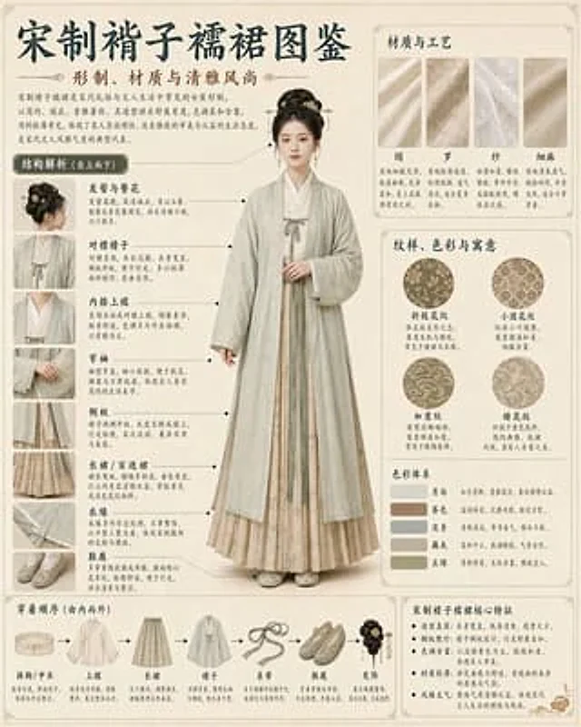

```text
{
  "type": "Chinese Traditional Costumes (Illustrated Poster)",
  "header": {
    "main_title": "{argument name=\"main title\" default=\"Illustrated Guide to Song Dynasty Style Beizi Ruqun\"}",
    "subtitle": "Form, Material and Refined Style",
    "intro_text": "Briefly describe the historical background and aesthetic style of Song Dynasty clothing."
  },
  "centerpiece": {
    "description": "A full-body portrait of a young Asian woman standing gracefully with her hands clasped together.",
    "clothing": "{argument name=\"clothing style\" default=\"A Song Dynasty-style beizi (褙子) and ruqun (襦裙), with a light green beizi worn over a beige ruqun.\"}"
  },
  "layout": {
    "style": "Museum exhibition guide, well-structured and clearly laid out.",
    "background": "{argument name=\"background texture\" default=\"Vintage parchment, beige\"}",
    "sections": [
      {
        "title": "Structural analysis (top to bottom)",
        "position": "Left sidebar",
        "count": 8,
        "labels": [
          "Hair bun and hairpin",
          "Front-opening jacket",
          "Inner layer of upper garment",
          "Narrow sleeves",
          "Side slit",
          "Long skirt / pleated skirt",
          "Clothing Edge",
          "Footwear"
        ],
        "details": "A thumbnail with text descriptions and a directional line pointing to the central figure."
      },
      {
        "title": "Materials and Craftsmanship",
        "position": "Top right corner",
        "count": 4,
        "labels": [
          "silk",
          "Luo",
          "yarn",
          "Fine linen"
        ]
      },
      {
        "title": "Patterns, colors and symbolism",
        "position": "Middle right",
        "count": 4,
        "labels": [
          "Broken branch pattern",
          "Small floral pattern",
          "Ruyi pattern",
          "Subtle pattern"
        ],
        "details": "Circular pattern sample."
      },
      {
        "title": "Color system",
        "position": "Right side of the middle, below the pattern",
        "count": 5,
        "labels": [
          "Moon White",
          "brown",
          "light blue",
          "Lotus root ash",
          "Bean Green"
        ],
        "details": "Rectangular color block sample."
      },
      {
        "title": "Dressing order (from inside to outside)",
        "position": "bottom left corner",
        "count": 7,
        "labels": [
          "Bandeau/Undershirt",
          "upper garment",
          "long skirt",
          "Beizi",
          "Lace",
          "Footwear",
          "hair accessories"
        ],
        "details": "Clothing illustrations connected by arrows in sequence."
      },
      {
        "title": "Core features of Song Dynasty beizi and ruqun",
        "position": "bottom right corner",
        "count": 5,
        "details": "List of key points regarding clothing characteristics."
      }
    ]
  }
}
```

Model: GPT Image 2
Author: GPT Image 2 Prompts

[ProjectD](https://aitoolsradar.com/en/prompts/e9c5920d5b8e22) · [Recorded source](https://x.com/llinze521/status/2046199980059418936#reversed-3)
 · [Full original metadata and byte evidence](data/projectd-batch-0047.json)

## Song Dynasty Social Media Feed

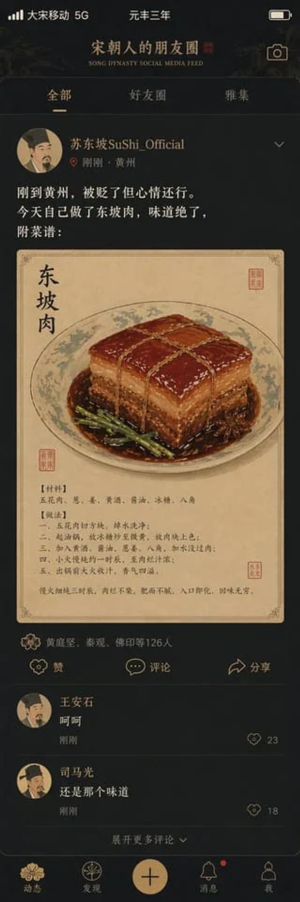

```text
"宋朝人的朋友圈"/"SONG DYNASTY SOCIAL MEDIA FEED"，古今穿越幽默融合界面设计风格，画面模拟手机社交媒体界面，但内容全部是宋朝场景头像是宋代文人画像，用户名"苏东坡SuShi_Official"，发布内容"刚到黄州，被贬了但心情还行。今天自己做了东坡肉，味道绝了，附菜谱："，配图为工笔画风格的东坡肉特写，点赞列表"黄庭坚、秦观、佛印等126人"，评论区"王安石：呵呵""司马光：还是那个味道"，界面元素如点赞图标用宋代花纹替代，状态栏显示"大宋移动 5G"和"元丰三年"，配色为手机深色模式搭配宋代雅致色调，历史与社交媒体的趣味碰撞杰作
```

Model: GPT Image 2
Author: @Panda20230902

[ProjectD](https://aitoolsradar.com/en/prompts/668276fcc1b792) · [Recorded source](https://x.com/Panda20230902/status/2045385588065313057)
 · [Full original metadata and byte evidence](data/projectd-batch-0047.json)

## Song Dynasty Social Media Feed


```text
"{argument name="title" default="Song Dynasty social media activity"} A humorous fusion of ancient and modern interface design styles. The image simulates a mobile social media interface, but the content is entirely set in the Song Dynasty. The profile picture is a portrait of a Song Dynasty scholar. Username:{argument name="username" default="Su Shi (Official)"} The post reads: "Just arrived in Huangzhou. Although I've been demoted, my mood is still alright. Today I made Dongpo pork myself, and it tasted absolutely delicious. Recipe attached." The accompanying image is a close-up of Dongpo pork in the style of a traditional Chinese meticulous painting. Likes include: "Huang Tingjian, Qin Guan, Foyin, and 126 others." Comments include: "Wang Anshi: Hehe," and "Sima Guang: Still the same taste." The like icon and other interface elements have been replaced with Song Dynasty patterns. The status bar displays "Great Song Mobile 5G" and "Yuanfeng Year 3." The color scheme uses a mobile dark mode, paired with elegant Song Dynasty tones. This is a masterpiece of history colliding with social media.
```

Model: GPT Image 2
Author: GPT Image 2 Prompts

[ProjectD](https://aitoolsradar.com/en/prompts/ff5199c9e4d901) · [Recorded source](https://x.com/Panda20230902/status/2045385588065313057)
 · [Full original metadata and byte evidence](data/projectd-batch-0047.json)

## Sonia Delaunay Orphism Fashion Poster

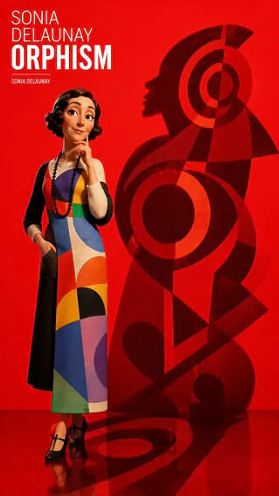

```text
Goal: Create a vertical fashion-art poster portraying {argument name="artist name" default="Sonia Delaunay"} and the movement {argument name="art movement" default="Orphism"} as a symbolic AI portrait, blending haute couture photography with modernist abstract geometry.

Canvas: Tall portrait poster, 9:16 aspect ratio, vivid saturated red background and red glossy floor with subtle reflection. The composition places the human figure in the lower-left third and a huge abstract projected silhouette occupying the right two-thirds.

Typography: In the upper-left corner, use exactly 3 visible text elements: 1) large thin white uppercase “SONIA” on the first line and “DELAUNAY” on the second line, 2) very large bold condensed white uppercase “ORPHISM” beneath it, 3) small white uppercase “SONIA DELAUNAY” below a thin horizontal rule. Keep the typography clean, Swiss/poster-like, aligned left.

Subject details: A full-body elegant woman stands facing forward with a poised fashion-editorial posture, one hand near her chin and the other hand tucked into a pocket. Her face is intentionally simplified and softly obscured, like a smooth rectangular blur, while her short dark 1920s-style bob haircut remains visible. She wears exactly 6 visible fashion elements: a long sleeveless geometric color-block dress, black long-sleeve underlayer, cream-colored right sleeve panel, long black bead necklace, black Mary Jane heels, and a black side skirt or coat panel. The dress features Sonia Delaunay-inspired Orphic color blocks: red, yellow, green, blue, cream, orange, black, purple, and pink, with circular arcs, semi-circles, triangles, and curved panels.

Projected inner world: Behind and to the right of the figure, create one monumental dark red translucent shadow silhouette suggesting a profile bust or inner psyche. Within this projection include exactly 9 major abstract geometric components: 1 large head profile silhouette facing left, 2 concentric target circles near the head, 1 large concentric circle around the torso, 1 dark central circle inside it, 1 tall triangular wedge descending through the body, 1 diagonal ribbon sweeping from lower left to middle right, 1 small dark circle near the lower torso, and 1 small dark circle near the bottom right. Use layered transparent crimson, burgundy, black-red, and orange-red tones so the shapes look like projected light and shadow.

Visual style: High-fashion editorial lighting, theatrical red studio set, strong contrast, glossy floor reflection, modern poster design, crisp typography, cinematic shadows, clean digital image quality. The mood should feel like a symbolic portrait of an artist’s inner world expressed through Orphist abstraction.

Constraints: Do not add extra people, logos, watermarks, captions, or additional text beyond the 3 specified text elements. Keep the palette dominated by red with white typography and multicolor geometric clothing. Preserve the vertical poster layout and the large abstract shadow projection.
```

Model: GPT Image 2
Author: Mariia Gonchar / Iddi de Mooij

[ProjectD](https://aitoolsradar.com/en/prompts/2e0ffa903ac9c9) · [Recorded source](https://youmind.com/prompts/sonia-delaunay-orphism-poster-20254)
 · [Full original metadata and byte evidence](data/projectd-batch-0047.json)

## Sorcery Magazine Anime Cover


```text
Goal: Create a cinematic Japanese fantasy anime magazine cover inspired by a high-end fashion/editorial photography spread, featuring {argument name="character name" default="Zenon Maki"} from a sorcery-themed universe.

Canvas: Wide horizontal magazine cover, 16:9 aspect ratio, dark blue night palette, glossy print look, high contrast moonlit rim lighting, shallow depth of field.

Main image: A close-up three-quarter portrait of a young woman in a dark navy sorcerer-style high-collar uniform with a gold spiral button pin. She has long teal-black hair tied in a high ponytail, loose strands around the face, and dramatic cyan backlighting catching the hair. Her right hand is raised elegantly near her neck. Place a large centered square blur/placeholder over the face, covering the eyes, nose, and mouth, with a muted gray-to-warm-brown gradient. Background is a misty forest or shrine garden at night with blue fog, soft bokeh, and faint purple flowers at the far right.

Layout: Design it as a full magazine cover with elegant serif typography in gold, white, and pale blue. Use the portrait as the background image, with text arranged around the edges and no text crossing the central face placeholder.

Visible text elements: Include exactly 12 separate text/graphic elements: 1) top-left small Japanese label reading 「特別編集」, 2) left main Japanese title 「呪術界の名工」 in large gold type, 3) romanized subtitle “JUJUTSUKAISEN NO MEIJIN”, 4) left feature block headed “Special Phrase” with Japanese quote text, 5) left feature block headed “Mission Report” with Japanese text, 6) bottom-left circular badge with Japanese bonus poster text, 7) bottom-left barcode block with tiny price text, 8) top-right masthead “Sorcery MAGAZINE” with a small Japanese tagline above it, 9) right issue information block reading “Photography by Jujutsu Vision”, “2024 AUTUMN”, “vol.18”, and price text, 10) right circular badge reading “12P” with Japanese surrounding text, 11) lower-right name block reading “M Meijin”, Japanese name 「禪院真希」, and “ZENON MAKI”, 12) bottom-right headline in Japanese 「その眼差しの奥にあるもの。」 with English subtitle “Behind those eyes lies the true strength.”

Typography and style: The masthead should use a refined Didot/Bodoni-like serif font, large gold letters, with subtle tracking. Japanese headings should be elegant Mincho-style serif. Small copy should look authentic but remain secondary, like real magazine cover blurbs. Add a barcode and print-production details for realism.

Constraints: Do not add extra people. Keep exactly one main character. Keep the face fully obscured by the square blur placeholder. Preserve the luxurious dark blue and gold editorial mood. No watermark, no logos beyond the fictional magazine branding.
```

Model: GPT Image 2
Author: underwood

[ProjectD](https://aitoolsradar.com/en/prompts/3da0e7c3840d81) · [Recorded source](https://youmind.com/prompts/sorcery-magazine-cover-21161)
 · [Full original metadata and byte evidence](data/projectd-batch-0047.json)

## South Asian Rural Bioscope Documentary

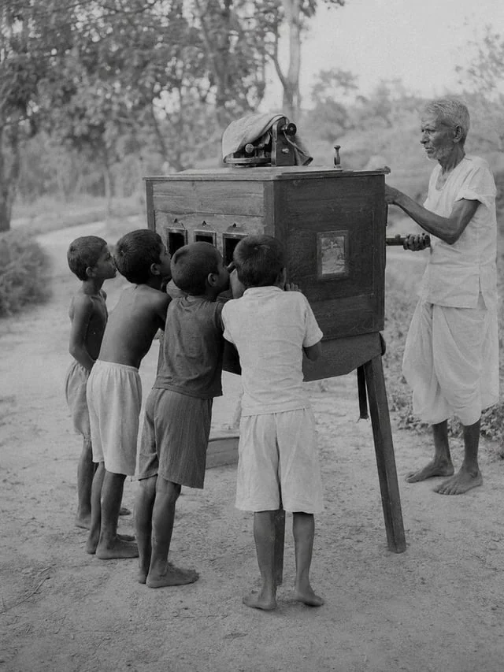

```text
পুরনো দিনের সাদা কালো বাস্তবধর্মী ডকুমেন্টারি আলোকচিত্র। গ্রামের ধুলোময় কাঁচা রাস্তার পাশে কাঠের তৈরি ঐতিহ্যবাহী বায়োস্কোপ দাঁড়িয়ে আছে। চার থেকে পাঁচজন দরিদ্র গ্রামের শিশু গভীর কৌতূহল ও বিস্ময়ভরা চোখে বায়োস্কোপের ছোট ছিদ্রে চোখ রেখে ভেতরের দৃশ্য দেখছে। তাদের কারও গায়ে সাধারণ পুরনো পোশাক, কারও খালি গা, অধিকাংশের পায়ে জুতা নেই। শিশুদের মুখে শৈশবের নির্মল আনন্দ, বিস্ময় ও মুগ্ধতার অভিব্যক্তি স্পষ্ট।

বায়োস্কোপের পেছনে একজন বয়স্ক গ্রামীণ ব্যক্তি শান্তভাবে যন্ত্রটি পরিচালনা করছেন। তার পরনে সাদামাটা ঐতিহ্যবাহী পোশাক, মুখে সময়ের ছাপ। চারপাশে সরল গ্রামীণ জীবনযাত্রার পরিবেশ, ধুলোময় পথ, গাছপালা ও নিস্তব্ধ গ্রামের আবহ ফুটে উঠেছে।

প্রাকৃতিক আলো, নরম ছায়া, উচ্চমানের ডকুমেন্টারি ফটোগ্রাফি, পুরনো ফিল্মের দানাদার টেক্সচার, গভীর আবেগময় ও নস্টালজিক পরিবেশ, বিংশ শতাব্দীর মধ্যভাগের দক্ষিণ এশীয় গ্রামীণ জীবন, ঐতিহাসিক আলোকচিত্রের অনুভূতি, অত্যন্ত বাস্তবসম্মত, সূক্ষ্ম বিবরণসমৃদ্ধ, ফটোরিয়ালিস্টিক, উচ্চ রেজোলিউশন, গভীরতা ও বাস্তবতার নিখুঁত উপস্থাপন।
```

Model: GPT Image 2
Author: BMX

[ProjectD](https://aitoolsradar.com/en/prompts/e281aef41499c6) · [Recorded source](https://youmind.com/prompts/rural-south-asian-bioscope-photo-26528)
 · [Full original metadata and byte evidence](data/projectd-batch-0047.json)

## Spain World Cup Football Poster

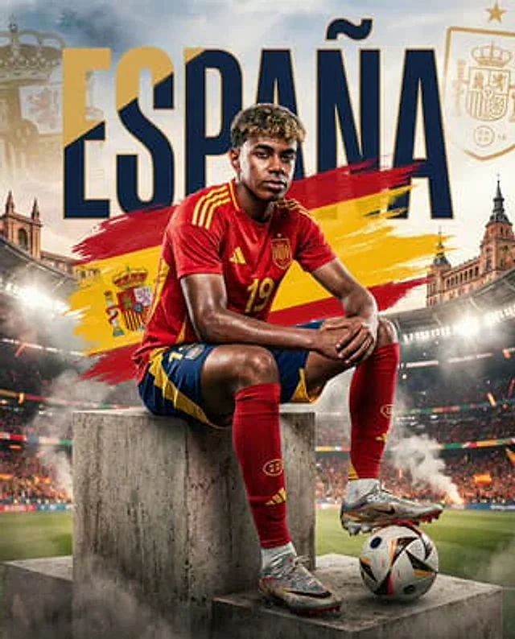

```text
Create a dramatic square sports poster for Spain’s national football team at the FIFA World Cup. Center a young male footballer with {argument name="skin tone" default="medium-brown skin"} and short curly dark hair, seated confidently on stacked rough concrete podium blocks in a packed stadium. He wears a red Spain jersey with yellow shoulder stripes, the Spain crest, and the number {argument name="jersey number" default="19"}, blue shorts with yellow accents, red socks, and metallic football boots; place one foot near or lightly on a modern white match ball with dark blue, orange, and black panel graphics. His face should be intentionally obscured by a soft rectangular blur, while the rest of the body is sharp and realistic. Behind him, add huge bold uppercase typography reading {argument name="headline text" default="ESPAÑA"} across the top in navy blue with a gold outline, partially hidden behind the player. Paint broad dynamic brush strokes of the Spanish flag, red-yellow-red, diagonally behind the player and text, with a small Spain coat of arms on the yellow band. Add exactly three faint heraldic/football federation elements in the background: a large pale crown emblem on the upper left, a gold shield crest with a crown and star on the upper right, and the small coat of arms within the flag brush stroke near the player’s left side. The environment is an intense football stadium at night with bright floodlights, smoky atmosphere, cheering crowd, scattered Spanish flags, warm sparks, and architectural hints of Spanish landmarks on both sides. Use cinematic sports photography mixed with graphic poster design, high contrast, gritty texture, golden light, volumetric smoke, shallow depth of field, and a triumphant tournament mood. Keep the composition vertical-square, centered, premium editorial, and avoid extra readable text beyond the main word {argument name="headline text" default="ESPAÑA"}.
```

Model: GPT Image 2
Author: LAPTOP LIFESTYLE BLOGGER

[ProjectD](https://aitoolsradar.com/en/prompts/b3f04a98037666) · [Recorded source](https://youmind.com/prompts/spain-world-cup-poster-25831)
 · [Full original metadata and byte evidence](data/projectd-batch-0047.json)

## Spain World Cup Travel Pass Poster

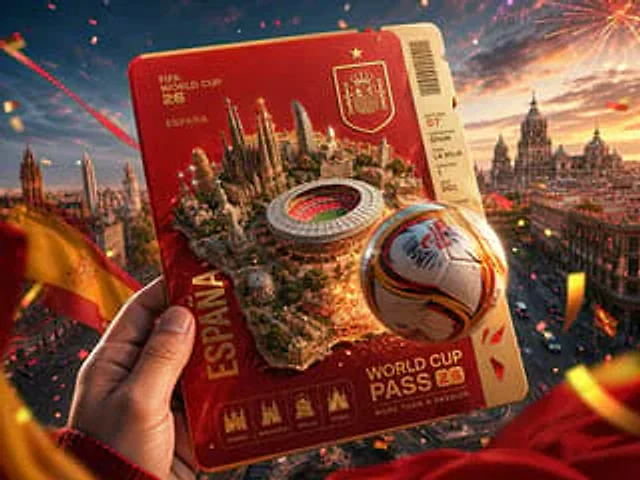

```text
Create a cinematic, hyper-detailed promotional travel-pass poster for the {argument name="tournament title" default="FIFA World Cup 26"} hosted in {argument name="host country" default="España"}. Show a close-up human hand in the foreground holding a premium red-and-gold collectible pass or passport, tilted slightly, with rounded corners, embossed fabric texture, metallic gold typography, and a cream ticket stub strip on the right edge. The pass features a miniature 3D pop-up Spanish cityscape rising from its surface, combining iconic landmarks such as Sagrada Família-style towers, futuristic Barcelona towers, historic cathedrals, plazas, trees, streets, and a large modern football stadium with a red seating bowl at the center. Add a Spanish national crest-style shield near the top right with one gold star above it. Include exactly 5 small destination icon panels along the bottom of the pass labeled: Madrid, Barcelona, Sevilla, Bilbao, and a fifth Spanish host-city style label. Add visible pass/ticket text including “FIFA WORLD CUP 26,” “ESPAÑA,” a large vertical “ESPAÑA,” “WORLD CUP PASS 26,” “MORE THAN A PASSION,” and right-strip details reading “MATCHES 07,” “DESTINATION SPAIN,” “TEAM LA ROJA,” “CATEGORY 1,” and “SEAT 001.” A realistic football with red and yellow accents floats or flies in front of the pass on the right, partially overlapping it, with motion energy but still sharply rendered. The background is an epic Spanish city square at sunset, resembling Madrid with grand historic buildings, domes, towers, traffic streets, and crowds, softened by depth of field. Fill the sky with fireworks, glowing clouds, and celebratory confetti ribbons in red, yellow, and gold; include blurred Spanish flags in the lower corners for foreground framing. Use dramatic warm golden-hour lighting, high contrast, shallow depth of field, volumetric glow, realistic materials, ultra-detailed 3D illustration mixed with photorealistic sports advertising, official tournament-poster energy, no watermark, no extra logos beyond the fictional pass design.
```

Model: GPT Image 2
Author: PicLumen_ES

[ProjectD](https://aitoolsradar.com/en/prompts/16352adf23693d) · [Recorded source](https://youmind.com/prompts/spain-world-cup-pass-25257)
 · [Full original metadata and byte evidence](data/projectd-batch-0047.json)

## Spanish Archaeology Magazine Cover

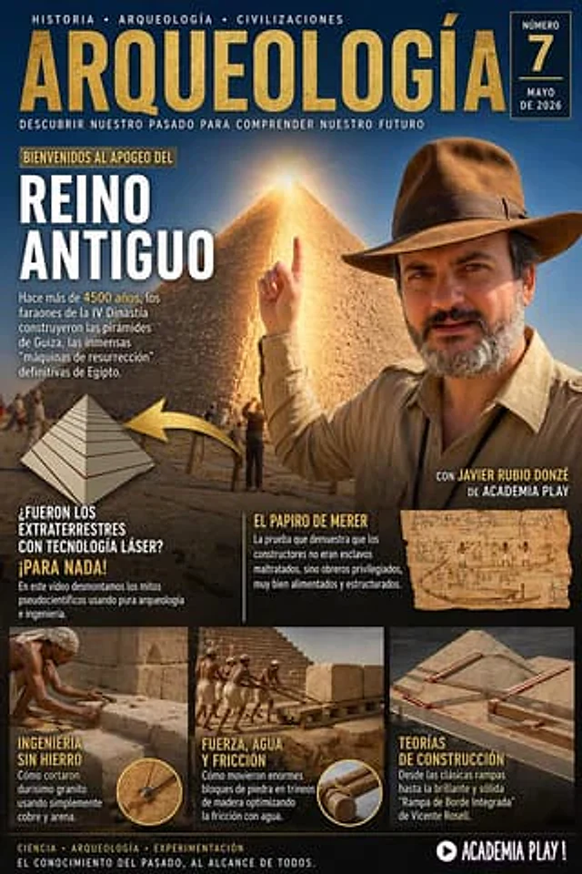

```text
{
  "type": "Spanish archaeology magazine cover poster",
  "style": "A high-impact editorial cover design, combining cinematic realism with infographic collages, a deep blue and gold color scheme, dramatic desert lighting, and exquisite magazine layout.",
  "format": "Vertical portrait cover",
  "publication": {
    "masthead": "ARQUEOLOGÍA",
    "top categories": [
      "HISTORIA",
      "ARQUEOLOGÍA",
      "CIVILIZACIONES"
    ],
    "tagline": "DESCUBRIR NUESTRO PASADO PARA COMPRENDER NUESTRO FUTURO",
    "issue box": {
      "label": "NÚMERO",
      "number": "{argument name=\"issue number\" default=\"7\"}",
      "date": "{argument name=\"issue date\" default=\"MAYO DE 2026\"}"
    }
  },
  "main scene": {
    "background": "The clear blue sky during the golden hour on the Giza Plateau",
    "centerpiece": "A massive pyramid gleamed brightly in the sunlight, its apex shimmering with a dazzling halo.",
    "foreground right": "A middle-aged male archaeologist and explorer, wearing a brown fedora and a beige outdoor shirt, is depicted in a half-length portrait. His right index finger points upward, and he sports a rugged beard, exuding the air of a documentary presenter.",
    "crowd": "Tiny figures are scattered at the base of the pyramid to emphasize the sense of proportion.",
    "mood": "Grand, educational, and inspiring"
  },
  "cover lines": {
    "kicker": "BIENVENIDOS AL APOGEO DEL",
    "main headline": "{argument name=\"main headline\" default=\"REINO ANTIGUO\"}",
    "deck": "Hace más de 4500 años, los faraones de la IV Dinastía construyeron las pirámides de Guiza, las inmensas \"máquinas de resurrección\" definitivas de Egipto.",
    "host credit": "CON {argument name=\"host name\" default=\"JAVIER RUBIO DONZÉ\"} DE ACADEMIA PLAY"
  },
  "layout": {
    "sections": [
      {
        "title": "main cover story",
        "position": "upper left to center",
        "count": 4,
        "labels": [
          "BIENVENIDOS AL APOGEO DEL",
          "REINO",
          "ANTIGUO",
          "Hace más de 4500 años, los faraones de la IV Dinastía construyeron las pirámides de Guiza, las inmensas \"máquinas de resurrección\" definitivas de Egipto."
        ]
      },
      {
        "title": "myth debunk box",
        "position": "left middle",
        "count": 3,
        "labels": [
          "¿FUERON LOS EXTRATERRESTRES CON TECNOLOGÍA LÁSER?",
          "¡PARA NADA!",
          "En este video desmontamos los mitos pseudocientíficos usando pura arqueología e ingeniería."
        ]
      },
      {
        "title": "papyrus feature",
        "position": "center right middle",
        "count": 2,
        "labels": [
          "EL PAPIRO DE MERER",
          "La prueba que demuestra que los constructores no eran esclavos maltratados, sino obreros privilegiados, muy bien alimentados y estructurados."
        ]
      },
      {
        "title": "bottom feature cards",
        "position": "bottom row",
        "count": 3,
        "labels": [
          "INGENIERÍA SIN HIERRO",
          "FUERZA, AGUA Y FRICCIÓN",
          "TEORÍAS DE CONSTRUCCIÓN"
        ]
      },
      {
        "title": "footer",
        "position": "bottom edge",
        "count": 2,
        "labels": [
          "CIENCIA · ARQUEOLOGÍA · EXPERIMENTACIÓN",
          "EL CONOCIMIENTO DEL PASADO, AL ALCANCE DE TODOS."
        ]
      }
    ],
    "additional visual elements": {
      "count": 6,
      "labels": [
        "small white pyramid diagram with red guide lines and a curved golden arrow",
        "aged papyrus illustration showing ancient Egyptian boats and figures",
        "bottom-left card image of a worker cutting or polishing stone blocks by hand",
        "bottom-center card image of several workers hauling a massive stone block on a wooden sledge",
        "bottom-right card image of a pyramid construction cutaway or ramp system model with red ramp lines",
        "bottom-right play-logo text ACADEMIA PLAY !"
      ]
    }
  },
  "typography": {
    "masthead": "very large condensed uppercase serif in textured metallic gold",
    "headlines": "bold uppercase sans serif in white and yellow",
    "body text": "compact editorial sans serif in white",
    "issue box": "gold outlined dark panel with stacked uppercase text"
  },
  "composition": "The masthead occupies the top third, the pyramid and the host's image occupy the center, text blocks surround the figures, and three equal-sized thematic panels span the bottom third.",
  "quality": "Ultra-fine, clear, print-quality layout, realistic textures, and premium documentary magazine aesthetics."
}
```

Model: GPT Image 2
Author: GPT Image 2 Prompts

[ProjectD](https://aitoolsradar.com/en/prompts/637c720730aab9) · [Recorded source](https://x.com/Sr_Donze/status/2046695673630728261#reversed-0)
 · [Full original metadata and byte evidence](data/projectd-batch-0047.json)

## Spanish GRWM Morning Beauty Thumbnail


```text
A 9:16 vertical TikTok-style thumbnail of a GRWM beauty product, set in a warm, sunny, Mediterranean-style bedroom. (A person with...){argument name="hair color" default="Dark brown"} A stylish young woman with her hair styled in a messy updo sits before a marble vanity, leaning forward, one arm folded, the other applying lip balm or lipstick. Her face is partially obscured by a centrally located rectangular blot for privacy, but the rest of her styling is elegant and natural: bronzed skin, a delicate gold necklace with small round pendants, a thin gold bracelet, stacked gold rings, and a white lace camisole with thin straps. Seven beauty items are clearly visible in the foreground of the vanity: a round desktop mirror on the left, a cup containing five makeup brushes, a clear glass dropper bottle, a tall white pump bottle, a small black dropper bottle, a beige round makeup sponge or powder puff, and a pale green squeeze tube on the right. The background showcases a soft-focus, comfortable bedroom, with an arched window on the left, a potted plant, a bed with white linens and mustard-yellow cushions, exposed wooden ceiling details, and a framed landscape painting on the wall. Utilizing the golden hour sunlight streaming in from the left, the image creates soft shadows, creamy skin tones, shallow depth of field, a luxurious lifestyle editing style, and an intimate self-care atmosphere, resulting in a refined and natural composition. Three lines of stacked, bold, playful Spanish title text are added to the upper left, containing the following:{argument name="headline text" default="Mi rutina de belleza matutina"} Each line of text is rounded and full, with a white outline and soft shadow, using soft colors: the first line is white, the second line is pink, and the third line is pale yellow. Add three pink doodle decorations above the title, a curved pink underline below, and a small yellow sun icon on the right side of the last line. Place a simple white [something] in the upper right corner.{argument name="brand text" default="Pollo.ai"} Logo. High-end influencer thumbnail aesthetics, with a clear focus on the foreground product and a warm and inviting lifestyle scene.
```

Model: GPT Image 2
Author: GPT Image 2 Prompts

[ProjectD](https://aitoolsradar.com/en/prompts/48ab5cccbc1089) · [Recorded source](https://x.com/S0N_IA_/status/2047414367243657296#reversed-0)
 · [Full original metadata and byte evidence](data/projectd-batch-0047.json)

## Spanish Neon AI Business Infographic


```text
{"type":"Spanish AI Business Infographic","style":{"theme":"Futuristic Neon Cyber ​​Dashboard","background":"Deep navy blue to black gradient with subtle glow and slender electric blue panel outline","lighting":"High contrast luminous blue-green UI lighting effects","rendering":"Simple enterprise-grade infographics, clear vector-style text, glossy digital panel"},"canvas":{"aspect_ratio":"16:9"},"headline":{"title":"{argument name="headline text" default="The Power of Artificial Intelligence in Business"} {"Subtitle":"Autonomous Systems for Reducing Costs, Expanding Operations, and Reshaping Customer Experience","Accent_words":["Reshaping Customer Experience"]},"Branding":{"Top_Left_Logo_Text":"AI BUSINESS POWER","Top_Right_Badge":"..."Subtitle":"Autonomous Systems for Reducing Costs, Expanding Operations, and Reshaping Customer Experience","Accent_Word  {argument name="tool name" default="GPT Image 2"} "},"layout":{"sections":[{"title":"Problems and Opportunities","position":"Left Sidebar","count":3,"items":[{"icon":"globe","value":"13 trillion USD","description":"The Value AI Will Bring to the Global Economy"},{"icon":"people","value":"50%","description":"Jobs that can be automated by 2055"},{"icon":"donut chart","value":"74%","description":"The Great Stagnation: The Percentage of Companies That Failed to Pass the Prototype Stage"}]},{"title":"Core Services","position":"Middle Sidebar","count":3,"items":[{"icon":"robot chatbot","title":"24/7 Sales and Support Agent","description":"WhatsApp and Web Chatbots for Real-Time Lead Screening"},{"icon":"brain","title":"RAG System","description":"Enterprise Brain, providing accurate answers, eliminating illusions"},{"icon":"lightning bolt","title":"RPA + Process Automation","description":"CRM integration, document extraction, creating content using AI skills"}]},{"title":"Results and ROI","position":"Right sidebar","count":4,"items":[{"icon":"clock","value":"100+","description":"Monthly administrative task hours saved","graphic":"Green upward trend chart"},{"icon":"gear","value":"90%","description":"Reduction in manual workload in operational processes","graphic":"Green upward trend chart"},{"icon":"bar chart","value":"Three times","description":"Achieving revenue growth without increasing costs or personnel","graphic":"Green upward trend chart"},{"icon":"shield check","value":"SAFE-AI"} Governance","description":"Data security, compliance assurance","graphic":"Green upward trend chart"}]}],"top_right_panel":{"count":4,"items":[{"type":"dashboard screen","label":"AI dashboard","details":"Purple and blue line charts, circular AI interface, three statistical boxes displaying +89% efficiency, -70% reduction, +98% customer"},{"type":"presenter character","description":"Stylized business woman, wearing a black suit, with a glowing AI logo, dark hair, wearing hoop earrings, pointing to the dashboard","face":"Deliberately blurred"},{"type":"small widget","label":"Automation","details":"Displays a circular progress chart showing 78% progress"},{"type":"small widget","label":"Real-time Activity","details":"Purple World Map Heatmap Visualization"}]},"bottom_banner":{"count":3,"items":[{"icon":"code brackets","text":"Building with AI Coding:"},{"text":"Robust architecture, illusion control (Top-K/Temperature) and deterministic process."},{"text":"{argument name="closing slogan" default="Goodbye Vibe Coding."} ","icon":"rocket"}]},"centerpiece":"A striking large title block in the top left corner, and a futuristic AI female advisor in the top right corner, integrated into a glowing analytics dashboard","color_palette":{"primary":"electric blue","secondary":"neon green","accent":"purple","text":"white"},"typography":{"title":"extra bold geometric sans-serif font","body":"simple modern sans-serif font","numbers":"large bold high-contrast font"},"composition":"Rounded rectangular panel with glowing border, evenly distributed grid, strong sense of hierarchy, dark negative space, high-end startup presentation aesthetics"}
```

Model: GPT Image 2
Author: GPT Image 2 Prompts

[ProjectD](https://aitoolsradar.com/en/prompts/ff8911b8b1c514) · [Recorded source](https://x.com/adanvecindad/status/2046963727954501785#reversed-0)
 · [Full original metadata and byte evidence](data/projectd-batch-0047.json)

## Spanish Sports Newspaper Front Page


```text
A realistic front page of a Spanish sports newspaper, adopting the style of a mainstream daily newspaper, with a simple white background and striking red and black typography, showcasing the editorial layout and high-resolution paper scan quality. At the very top, a large red masthead reads {argument name="newspaper name" default="MARCA"} The price is printed in small black text in the upper right corner, almost spanning the entire width of the page.{argument name="price" default="2,50€"} Below the masthead is a small line of black publication details, including Tuesday's date, website, year, and issue number. The main title, occupying most of the page on the left, is in large, bold, compressed black capital letters, divided into two lines:{argument name="main headline" default="ARBELOA, DESTITUIDO"} Below is a red subheading in bold, stating that Real Madrid sacked their coach after 100 days in charge and are searching for a successor for the remainder of the season. A smaller line of black explanatory text below mentions that the decision was made after Champions League elimination and the loss of their La Liga lead. The main image occupies most of the lower left corner of the cover: a football coach in a dark blue suit, white shirt, and dark tie stands in a stadium with blue seats, one hand on his forehead, looking stressed or disappointed. The Bernabéu stadium environment is visible in the background, with "Real Madrid CF" written on the sidelines. At the bottom of the main image, a line of smaller text explains that the coach left the Bernabéu after learning of the decision. On the far left and at the bottom center are two narrow columns of black text, in the style of a Spanish newspaper. On the right is a vertical sidebar containing two secondary articles separated by a red dividing line. The top sidebar features a red tagline reading "NBA PLAYOFFS," with a bold black headline proclaiming the Lakers have forced a Game 7. It includes a rectangular photo of two basketball players, one of whom, wearing a purple #77 jersey, is dribbling against a Nuggets defender. A short caption below mentions Doncic's 42 points in Denver. The lower sidebar features another red tagline reading "TENIS · MUTUA MADRID OPEN," with a bold black headline about Alcaraz's dominant performance at Caja Mágica. It also includes a rectangular photo of a player in a light purple jersey hitting a forehand tennis ball against a bright blue background. Near the bottom right corner is a quotation box marked with large red quotation marks and bold black text, containing the following:{argument name="pull quote" default="Agradezco al club la oportunidad de mi vida"} The overall composition should present an authentic, dramatic sports front page feel: sharp typography, a rigorous newspaper grid, realistic news photography, heavy black headlines, red accents, and modern Spanish media design.
```

Model: GPT Image 2
Author: GPT Image 2 Prompts

[ProjectD](https://aitoolsradar.com/en/prompts/2cb112aa2f7eed) · [Recorded source](https://x.com/Nocodeboy/status/2046687463716905333#reversed-0)
 · [Full original metadata and byte evidence](data/projectd-batch-0047.json)

## Sparkling Anime Idol Concert Portrait

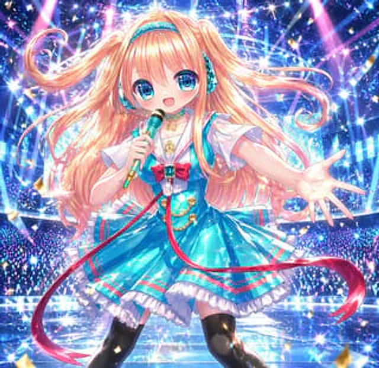

```text
A stunning illustration of an anime idol concert. At the center of the image is a female virtual singer performing, captured in a dynamic mid-range full-body shot from a slightly upward angle. One hand holds a microphone to her chest, while the other arm extends towards the audience. She has extremely long, voluminous twin ponytails that dramatically fill the entire image, her hair color a gradient from soft peach-gold to pink, with glossy highlights and curled ends. She wears a futuristic cyan headband and matching earmuffs. Her face is deliberately obscured by a simple, light pink square mask. She wears a vibrant cyan-blue idol dress with a lustrous, gemstone-like texture, a fitted bodice, white ruffled cap sleeves, a white sailor collar, and a large red bow adorned with blue gemstones at the chest. Gold chains and buttons adorn her waist, and the skirt is a tiered flared skirt with white ruffles and delicate pink stripes at the hem. Long red ribbons flutter at her waist and throughout her dress. She wears black knee-high stockings and holds a gold-cyan microphone. The stage is a spectacular, futuristic arena, with blue and purple glow sticks flashing in the audience, surrounded by intense shimmering effects, sequins, confetti, lens flares, and star-like rays. The background is filled with curved, glowing stage structures, neon arcs, and intersecting pink, purple, and blue spotlights overhead, creating a magical, high-energy live performance atmosphere. The art style features exquisite modern anime-inspired key visuals with ultra-high detail, glossy paint rendering, radiant lighting, shimmering highlights on fabrics and hair, and saturated cyan-magenta hues, creating a celebratory and emotionally charged idol performance atmosphere.
```

Model: GPT Image 2
Author: GPT Image 2 Prompts

[ProjectD](https://aitoolsradar.com/en/prompts/7a09c6c7dedbf7) · [Recorded source](https://x.com/VtuberCypha/status/2047646749062201766#reversed-0)
 · [Full original metadata and byte evidence](data/projectd-batch-0047.json)

## Sparkling Beverage Ad Banner


```text
{
  "type": "Beverage advertising banner",
  "visuals": {
    "model": "A young Asian woman, her wet hair plastered to her face, water droplets clinging to her skin.{argument name=\"model pose\" default=\"Close your eyes, tilt your face upwards, and maintain a calm expression.\"} Wearing a white top",
    "product": "A yellowish-white aluminum can with condensation, printed with {argument name=\"fruit type\" default=\"Grapefruit\"} Patterns and leaves",
    "props": "Two fresh pomelos and green leaves were placed next to the jar.",
    "background": "{argument name=\"background scene\" default=\"A bright blue sky, with out-of-focus water droplets floating in the sunlight.\"}"
  },
  "layout": {
    "sections": [
      {
        "title": "Logo in the top left corner",
        "position": "top-left",
        "count": 1,
        "labels": [
          "KIRARA"
        ]
      },
      {
        "title": "Main text",
        "position": "left",
        "count": 3,
        "labels": [
          "{argument name=\"main headline\" default=\"A new me, scented with yuzu.\"}",
          "Give yourself a gentle reward for your hard work every day.",
          "Refresh!"
        ]
      },
      {
        "title": "Text on the right",
        "position": "mid-right",
        "count": 1,
        "labels": [
          "A single swirl that will untie me."
        ]
      },
      {
        "title": "badge",
        "position": "various",
        "count": 2,
        "labels": [
          "NEW",
          "3% domestically produced yuzu juice"
        ]
      },
      {
        "title": "Bottom Banner",
        "position": "bottom",
        "count": 4,
        "labels": [
          "{argument name=\"product name\" default=\"YUZU SPARK\"}",
          "ユズスパーク",
          "A refreshing, lightly carbonated drink featuring the gentle flavor of yuzu.",
          "Limited quantities available now"
        ]
      }
    ]
  }
}
```

Model: GPT Image 2
Author: GPT Image 2 Prompts

[ProjectD](https://aitoolsradar.com/en/prompts/d1826b6c9ac215) · [Recorded source](https://x.com/genel_ai/status/2045353488704774396#reversed-0)
 · [Full original metadata and byte evidence](data/projectd-batch-0047.json)

## Sparkling Beverage Ad Banner


```text
{
  "type": "beverage advertisement banner",
  "visuals": {
    "model": "young Asian woman, wet hair clinging to face, water droplets on skin, {argument name=\"model pose\" default=\"eyes closed, face tilted upwards, serene expression\"}, wearing a white top",
    "product": "white and yellow aluminum can with condensation, featuring a graphic of a {argument name=\"fruit type\" default=\"yuzu\"} fruit and leaves",
    "props": "2 fresh yuzu fruits with green leaves placed next to the can",
    "background": "{argument name=\"background scene\" default=\"bright blue sky with floating out-of-focus water droplets and bright sunlight\"}"
  },
  "layout": {
    "sections": [
      {
        "title": "Top Left Logo",
        "position": "top-left",
        "count": 1,
        "labels": ["KIRARA"]
      },
      {
        "title": "Main Copy",
        "position": "left",
        "count": 3,
        "labels": [
          "{argument name=\"main headline\" default=\"ゆず香る、新しいわたし。\"}",
          "がんばる日々に、やさしいごほうびを。",
          "Refresh!"
        ]
      },
      {
        "title": "Right Copy",
        "position": "mid-right",
        "count": 1,
        "labels": ["私を、ほどくひとしゅわ。"]
      },
      {
        "title": "Badges",
        "position": "various",
        "count": 2,
        "labels": [
          "NEW",
          "国産ゆず果汁 3%"
        ]
      },
      {
        "title": "Bottom Banner",
        "position": "bottom",
        "count": 4,
        "labels": [
          "{argument name=\"product name\" default=\"YUZU SPARK\"}",
          "ユズスパーク",
          "やさしさ弾ける、ゆずの微炭酸。",
          "数量限定発売中"
        ]
      }
    ]
  }
}
```

Model: GPT Image 2
Author: GENEL | AIを用いた動画制作

[ProjectD](https://aitoolsradar.com/en/prompts/b22b2b74f825b8) · [Recorded source](https://youmind.com/prompts/sparkling-beverage-ad-banner-14044)
 · [Full original metadata and byte evidence](data/projectd-batch-0047.json)

## Spicy Nacho Tornado Ad

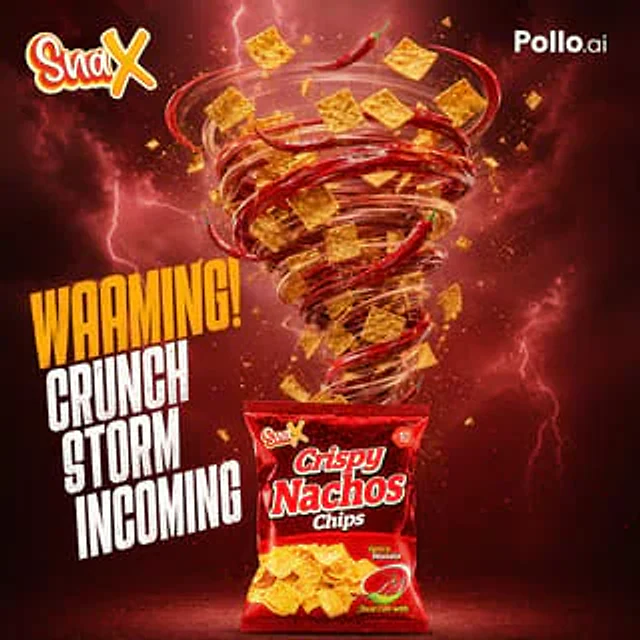

```text
Create a dramatic square commercial poster for a spicy snack brand, evoking a fiery red storm atmosphere and showcasing a high-energy food advertising style. The background is a deep red sky with shimmering clouds, sparks, and clearly visible lightning. At the center of the image, a massive tornado, composed of swirling transparent vortexes, glossy red chili peppers, square tortilla chips, crumbs, and seasoning granules, rises from an open snack bag, forming a powerful vortex. The tornado should be dynamic and explosive, with chips and chili peppers scattering outwards at varying sizes and depths, creating a cinematic 3D effect. At the bottom center, place an upright, glossy red snack bag printed with the brand logo and product name.{argument name="product name" default="Crispy Nachos Chips"} It comes with a spicy label.{argument name="flavor text" default="Spicy Masala"} A small chili pepper illustration, corn elements at the bottom, and a square tortilla chip pattern printed on the front of the packaging. A stylized and playful logo is placed in the upper left corner.{argument name="brand name" default="SnaX"} It uses a striking yellow and white handwritten font with a red outline; a simple white platform watermark is added to the upper right corner.{argument name="platform text" default="Pollo.ai"} On the left, add a large, stacked, distressed heading in bold, compressed uppercase letters. The first line of text should be gold, and the remaining three lines should be white. The content must be:{argument name="headline text" default="WARNING! CRUNCH STORM INCOMING"} Using strong contour lighting, glossy highlights, deep shadows, rich red-orange tones, and sophisticated snack advertisement composition, it presents a spicy, crispy, chaotic, and irresistible visual effect.
```

Model: GPT Image 2
Author: GPT Image 2 Prompts

[ProjectD](https://aitoolsradar.com/en/prompts/644215a077ddfe) · [Recorded source](https://x.com/linaa_ai/status/2046925240815829138#reversed-0)
 · [Full original metadata and byte evidence](data/projectd-batch-0047.json)

## Spicy Snack Bag Product Ad

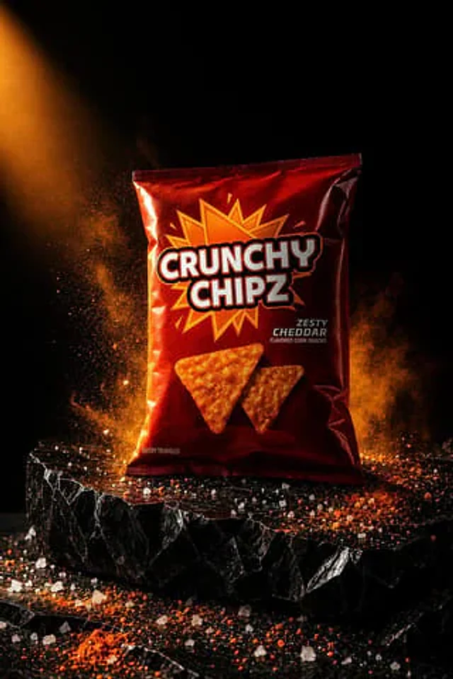

```text
A highly dramatic studio product photo, with a standing figure at the center of the image.{argument name="brand name" default="CRUNCHY CHIPZ"} The packaging bag sits on a rough, black stone platform against a dark black background. The bag itself has a glossy, deep red metallic finish. Behind the main logo is a large, orange-yellow, cartoon-style starburst image. The brand name is displayed in striking, oversized white block font with a black outline, and the flavor information is printed on the right side.{argument name="flavor text" default="ZESTY CHEDDAR"} Below is a smaller subtitle. Two triangular orange corn chips are printed on the lower front of the bag. A line of small print is added near the lower left corner of the bag.{argument name="small label" default="SAVORY TRIANGLES"} The scene employs strong, warm orange side lighting from the upper left, creating intense highlights and glossy reflections on the packaging. Suspended orange seasoning powder and smoky spice clouds surround the product, especially behind and to the left of the packaging. Coarse salt granules and orange-red seasoning powder are scattered on the stone base and foreground surfaces. The stone base should be a thick, jagged, matte black slab with sharp, fractured edges. The overall effect emphasizes high contrast, cinematic shadows, a sharp product focus, a high-end commercial advertising style, dramatic food photography, vertical composition, ultra-fine textures, realistic packaging effects, and a fiery, rich cheddar cheese atmosphere.
```

Model: GPT Image 2
Author: GPT Image 2 Prompts

[ProjectD](https://aitoolsradar.com/en/prompts/e95ed3c409b54a) · [Recorded source](https://x.com/NovaIAHQ/status/2046812524738203835#reversed-2)
 · [Full original metadata and byte evidence](data/projectd-batch-0047.json)

## Split Screen Racing Game Driver View

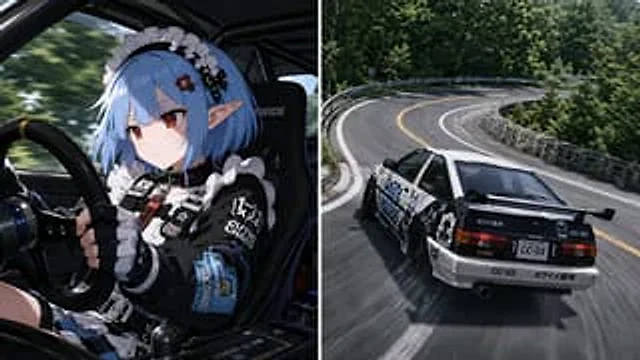

```text
参照画像のキャラクターを完全に維持する。キャラクターの顔、髪型、髪色、瞳、耳、体格、骨格、肩幅、首の太さ、腕のシルエット、年齢感、性別表現、雰囲気を維持すること。画面は左右二分割されたスプリットスクリーン構成。左右は同じ瞬間を異なるカメラで撮影している。左右は同じ車両、同じコーナー、同じ時間軸である。【車両】左右画面に登場する車両は同一車両。車種：{argument name="車種" default="スポーツカーまたはチューニングカー"}。左右画面は同一車両を異なる視点から映している。【左画面】ドライバーカメラ。車内から見た斜めローアングル腰上ショット。キャラクターは車両を運転している。両手でハンドルを握る。コーナリング中。視線は進行方向へ向けられている。真剣な表情。集中している。身体には横Gがかかっている。髪や衣装がわずかに揺れている。衣装：{argument name="衣装" default="モータースポーツファッション"}。キャラクターの顔と表情が大きく見える。車内のロールケージ、バケットシート、メーター類が自然に見える。【右画面】三人称追尾カメラ。同じ車両を後方やや上空から追いかける視点。日本の峠道。森林に囲まれたワインディングロード。ガードレール。路面標示。ヘアピンカーブ。実在する峠道のようなリアリティ。コーナリング中。車体荷重が感じられる姿勢変化。高速走行。躍動感。タイヤのグリップ感。路面との一体感。【画面演出】レースゲームのスクリーンショット風。HUDは最小限。またはHUDなし。スポーツ中継映像のようなリアリティ。左右画面は別のシーンではない。左右画面は同一の瞬間を異なるカメラで撮影している。キャラクターのハンドル操作と車両挙動は完全に同期している。同じ瞬間を二つのカメラが捉えていることが明確に伝わる。高品質アニメキャラクター。高品質背景。躍動感。スピード感。映像作品のワンシーン。
```

Model: GPT Image 2
Author: Eris Create Lab

[ProjectD](https://aitoolsradar.com/en/prompts/16033f3de827d1) · [Recorded source](https://youmind.com/prompts/split-screen-racing-driver-perspective-26883)
 · [Full original metadata and byte evidence](data/projectd-batch-0047.json)

## Split Style Artistic Portrait

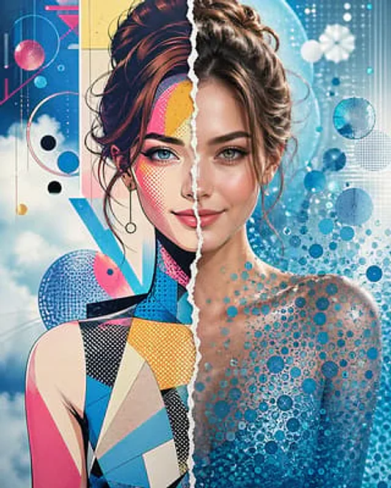

```text
This painting contains only one face: a{argument name="subject" default="Elegant young female models"} With{argument name="expression" default="A faint smile"} A line running seamlessly down her hairline divides her face in two, designed to resemble the effect of violently torn paper. The entire painting is perfectly, thoroughly, and forcefully divided into two parts by a smooth line resembling a torn piece of paper: —Left side:{argument name="left style" default="Futuristic and elegant pop art style"} A strategically charming smile. —Right side: Hyperrealistic natural aesthetic style, with a subtle smile. —Right side: Her beautiful natural upper body is completely submerged in exquisitely detailed sea-blue geometric halftone dots. The background has a futuristic, dreamlike feel. The overall effect is bright while maintaining a natural vibrancy. The high resolution, fine details, and soft blur effect are reminiscent of images under an electron microscope.
```

Model: GPT Image 2
Author: GPT Image 2 Prompts

[ProjectD](https://aitoolsradar.com/en/prompts/43987b0a3daacf) · [Recorded source](https://x.com/dotey/status/2047202015307067412)
 · [Full original metadata and byte evidence](data/projectd-batch-0047.json)

## Split-Face Typography Mask Portrait

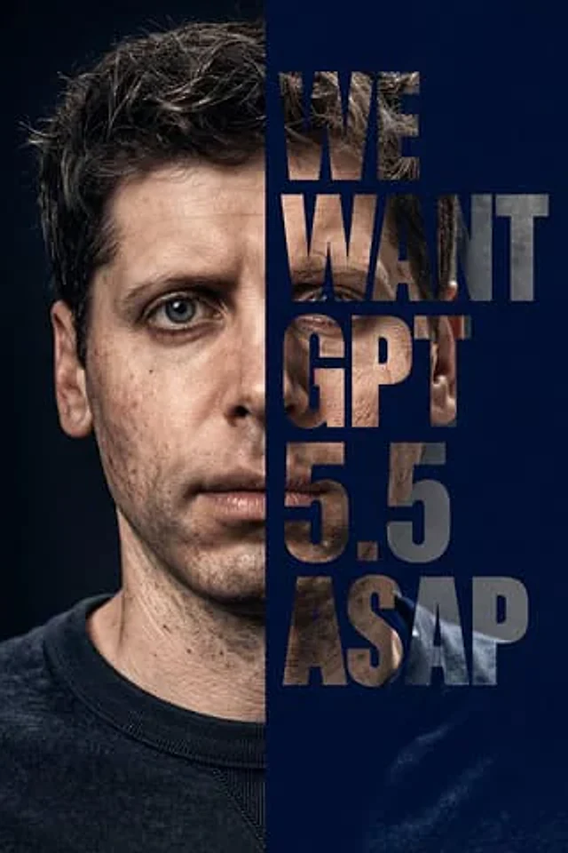

```text
A highly realistic and dramatic studio portrait, featuring a protagonist who{argument name="subject" default="A man who looks remarkably like Sam Altman, with short, curly brown hair, blue eyes, thin eyebrows, and fine skin texture."} She is wearing a dark-colored crew-neck sweater. The composition is vertically divided along the center line. The left half is a standard photographic portrait against a dark background. The right half is a solid color.{argument name="background color" default="Dark blue"} The background features large, bold sans-serif text as a clipping mask. The text content is "{argument name="overlay text" default="WE WANT GPT 5.5 ASAP"} The letters are stacked vertically in five rows. Like transparent windows, they reveal the right side of the man's face and torso, perfectly aligned with the left side, presenting a complete portrait through typography.
```

Model: GPT Image 2
Author: GPT Image 2 Prompts

[ProjectD](https://aitoolsradar.com/en/prompts/c48a96cbe6fe74) · [Recorded source](https://x.com/Masimo_Blue/status/2044217227097043055#reversed-0)
 · [Full original metadata and byte evidence](data/projectd-batch-0047.json)

## Split-Screen Athleisure Ad

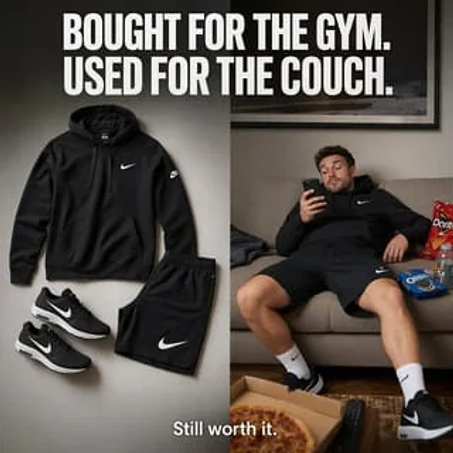

```text
Create a square, split-screen e-commerce social ad that presents a clean, high-end sportswear brand aesthetic. At the top, use a huge, bold, compressed white all-caps sans-serif font spanning the entire width to place the headline:{argument name="headline text" default="I buy it to work out. I wear it so I can relax."} The image is vertically divided into two equal panels. The left panel displays a neatly laid-out image of four black sportswear items against a soft, light gray studio background with subtle shadows: a black hoodie with a small white swoosh logo on the chest, black athletic shorts with a large white swoosh logo on the calf, and two black running shoes (arranged as a pair) with white swoosh logos and white midsoles. The layout should have a catalog-like cleanliness, minimalism, balance, and sophistication, with realistic fabric textures and clear product photography lighting. The right panel presents a relaxed living room scene in neutral tones: a man wearing the same black hoodie, black shorts, white mid-calf socks, and black running shoes is casually slumped on a beige sofa, leaning back lazily and looking at his smartphone with one hand. His face is softly obscured or blurred and is not the focus. There are four visible snack/living room items around him: a bag of red chips on the sofa, a bag of blue sandwich cookies on the sofa, a sports drink next to the snacks, an open pizza box containing pizza on the foreground coffee table, and a TV remote next to it. Add a framed wall art piece above the sofa and use warm ambient lighting to create a truly homey atmosphere. At the bottom center, overlay smaller white sans-serif text:{argument name="tagline text" default="It&#39;s still great value for money."} The overall atmosphere should be humorous, relatable, sophisticated, and highly communicative, like a high-end sportswear advertisement that contrasts the initial motivation for fitness with a relaxed and comfortable feel.
```

Model: GPT Image 2
Author: GPT Image 2 Prompts

[ProjectD](https://aitoolsradar.com/en/prompts/6ddbebbee8f803) · [Recorded source](https://x.com/KaitoEtLIA/status/2046971122558611682#reversed-1)
 · [Full original metadata and byte evidence](data/projectd-batch-0047.json)

## Split-Screen Athleisure Couch Ad

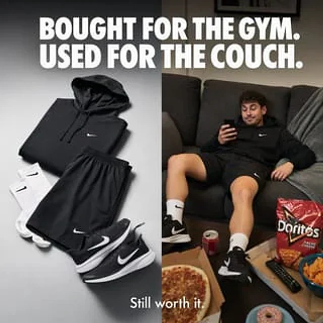

```text
Create a simple, square, split-screen commercial image for sportswear and casual wear, requiring a refined advertising photography quality and realistic typography. At the top, place a striking, bold, white headline in heavy sans-serif font:{argument name="headline text" default="BOUGHT FOR THE GYM. USED FOR THE COUCH."} The layout is vertically divided into two equal-sized panels. The left panel displays five garments laid flat against a smooth, light gray studio background with soft directional lighting and subtle shadows: a black hoodie with a drawstring and a small white swoosh logo on the chest; a pair of black athletic shorts with a small white logo near the hem; a pair of white mid-calf socks with a black swoosh logo; and a pair of black running shoes with a white midsole and a white swoosh side label. The clothing should look high-end, minimalist, and meticulously designed like an e-commerce ad campaign. The right panel shows a young man wearing the same black hoodie, black shorts, white mid-calf socks, and black running shoes, lounging lazily on a dark charcoal gray fabric sofa in a dimly lit, comfortable living room, holding a smartphone, looking relaxed but listless. On the dark coffee table in front of him lay six visible casual items: an open pizza box containing pizza; a can of red soda; a large bag of red tortilla chips; a TV remote; a blue chip bowl; and a pink frosted donut faintly visible at the bottom edge. A gray blanket draped over the sofa maintained a humorous and relatable atmosphere. At the bottom center, a line of smaller white descriptive text in a clean sans-serif font was superimposed:{argument name="tagline text" default="Still worth it."} The advertisement features high-end product aesthetics, clear text rendering, lifestyle marketing with brand awareness, realistic materials, and balanced composition, showcasing the subtle contrast between the desire to consume fitness and the actual act of lounging on a sofa.
```

Model: GPT Image 2
Author: GPT Image 2 Prompts

[ProjectD](https://aitoolsradar.com/en/prompts/b8f82191a592eb) · [Recorded source](https://x.com/KaitoEtLIA/status/2046971122558611682#reversed-0)
 · [Full original metadata and byte evidence](data/projectd-batch-0047.json)

## Split-Screen China Phone Market Comparison

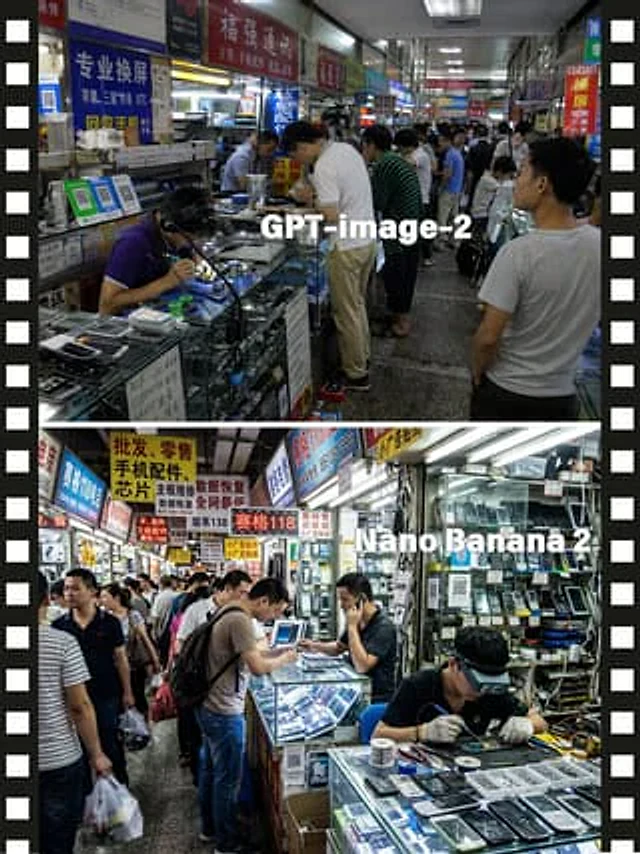

```text
{
  "type": "Split-screen market comparison poster",
  "style": "Realistic documentary photography style",
  "subject": "China's bustling indoor electronics repair and mobile phone accessories market",
  "layout": {
    "format": "Vertical poster with two stacked contrast panels",
    "divider": "Thin white horizontal dividing lines between panels",
    "side_borders": "Black film-style border with evenly spaced white perforated rectangles on the left and right edges.",
    "panels": [
      {
        "position": "upper half",
        "overlay_text": "GPT-image-2",
        "scene": "The narrow, fluorescent-lit shopping aisle is lined with glass display cases and dense Chinese shop signs on both sides.",
        "crowd_count": "Approximately 12 visible customers and stall owners",
        "primary_action": "A customer leans over the counter as a technician repairs a phone and sells parts.",
        "details": [
          "A technician wearing a purple polo shirt is welding at the counter on the left front.",
          "A tall customer wearing a white polo shirt leaned over in front of the central glass display case.",
          "There was another customer next to him wearing a green striped shirt.",
          "A man wearing a light gray T-shirt stands to the right front, with his back to the camera.",
          "The glass display case was filled with smartphone screens, tools, spare parts, and small electronic devices.",
          "Above them are red, blue, yellow, and white signs with Chinese information such as screen replacement, mobile phone parts, and repair.",
          "The corridor offers a wide view, with many small stalls and long strip lights on the ceiling."
        ],
        "text_style": "Large, bold, white sans-serif text centered at the top of the scene."
      },
      {
        "position": "lower half",
        "overlay_text": "Nano Banana 2",
        "scene": "Another crowded indoor mobile phone market aisle, brighter and more cluttered, with open repair stalls and walls covered with mobile phones and parts.",
        "crowd_count": "Approximately 11 visible customers and stall owners",
        "primary_action": "Technicians work at the counter while customers browse and chat nearby.",
        "details": [
          "The technician on the right front is sitting behind a glass counter, dressed in dark clothing and wearing white gloves, repairing equipment with spread-out tools.",
          "A customer with a backpack leans over the bright display case.",
          "Another vendor on the right side of the middle is holding his phone to his ear.",
          "The left aisle was crowded with customers carrying plastic bags.",
          "Glass display cases show old mobile phones, screens, batteries, and accessories.",
          "The shop walls were densely covered with mobile phones and packaged components.",
          "Above, there are many bright Chinese signs in yellow, red, blue, and white, advertising wholesale, retail, mobile phone accessories, chip repair, and data recovery."
        ],
        "text_style": "Large, bold white sans-serif text placed in the upper right corner of the panel."
      }
    ]
  },
  "camera": {
    "angle": "eye level",
    "lens": "Wide-angle documentary street photography",
    "composition": "The deep corridor view, with counters and ceiling lights creating strong guiding lines."
  },
  "lighting": "Cool-toned fluorescent indoor lighting, slightly glaring commercial store lighting",
  "mood": "A busy, crowded, pragmatic, and authentic tech market atmosphere",
  "quality": "High-detail realistic photography, natural colors, clear storefront signs, and reflective glass countertops."
}
```

Model: GPT Image 2
Author: GPT Image 2 Prompts

[ProjectD](https://aitoolsradar.com/en/prompts/3cd295d90ab0ef) · [Recorded source](https://x.com/zoomad99/status/2047284258100887914#reversed-1)
 · [Full original metadata and byte evidence](data/projectd-batch-0047.json)

## Split-Screen Product Ad Poster

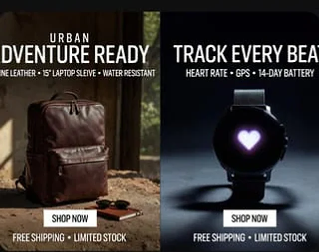

```text
{
  "type": "Split-screen e-commerce advertising poster",
  "style": "High-end, photorealistic retail marketing graphics, high contrast, sophisticated commercial lighting, clean and eye-catching typography, modern direct-response advertising design.",
  "canvas": {
    "aspect_ratio": "4:3",
    "background": "Black border, rounded corners poster design"
  },
  "layout": {
    "orientation": "Vertical split screen",
    "sections": [
      {
        "title": "Product advertisement on the left",
        "position": "left half",
        "count": 1,
        "product": "backpack",
        "headline_lines_count": 2,
        "cta_count": 1,
        "footer_count": 1
      },
      {
        "title": "Product advertisement on the right",
        "position": "right half",
        "count": 1,
        "product": "smartwatch",
        "headline_lines_count": 2,
        "cta_count": 1,
        "footer_count": 1
      }
    ],
    "divider": "Centered hard dividing line"
  },
  "text": {
    "left": {
      "eyebrow": "{argument name=\"left eyebrow text\" default=\"City\"}",
      "headline": "{argument name=\"left headline text\" default=\"Ready to go\"}",
      "features": "Genuine leather • 15-inch laptop compartment • Waterproof",
      "button": "Buy it now",
      "footer": "Free shipping • Limited stock"
    },
    "right": {
      "headline": "{argument name=\"right headline text\" default=\"Tracking every heartbeat\"}",
      "features": "Heart rate monitoring • GPS • 14-day ultra-long battery life",
      "button": "Buy it now",
      "footer": "Free shipping • Limited stock"
    }
  },
  "left_panel": {
    "scene": "The interior is simple and unpretentious, with warm natural light streaming in from the side.",
    "background_details_count": 3,
    "background_details": [
      "mottled walls or wooden interior surfaces",
      "A window that offers a view of soft greenery outside.",
      "Textured flooring"
    ],
    "product": {
      "type": "{argument name=\"left product\" default=\"Brown genuine leather backpack\"}",
      "position": "Place it upright on the ground in the lower left center position.",
      "material": "Richly textured polished leather",
      "color": "Dark brown",
      "details_count": 5,
      "details": [
        "Top handle",
        "Double zipper top opening",
        "Large front zippered pocket",
        "Side pockets are visible on the left side.",
        "Structured rectangular outline"
      ]
    },
    "supporting_props_count": 2,
    "supporting_props": [
      "A pair of dark sunglasses",
      "A small brown notebook placed next to my backpack"
    ],
    "lighting": "Warm, cinematic sunlight from the upper left creates soft highlights and earthy shadows.",
    "button_style": "A white rectangular button is located in the center of the lower left panel, with black capital letters."
  },
  "right_panel": {
    "scene": "Dark studio product photography with emotional spotlights in cool tones.",
    "background": "Gradient from deep navy blue to black",
    "product": {
      "type": "Round black smartwatch",
      "position": "The right half is centered both vertically and horizontally.",
      "details_count": 5,
      "details": [
        "Round black dial",
        "A glowing white and purple heart icon is displayed in the center of the screen.",
        "Dark metal case",
        "Two side buttons are visible on the right edge.",
        "Fine metal mesh strap"
      ]
    },
    "surface": "The smooth studio floor casts a soft, circular shadow beneath the watch.",
    "lighting": "Cool-toned spotlights from above and the rear sides create contour lighting and dramatic shadows.",
    "button_style": "A white rectangular button is located in the center of the bottom right panel, with black capital letters."
  },
  "typography": {
    "font": "Bold, compressed sans-serif capital font",
    "color": "White",
    "alignment": "Center within each panel",
    "feature_line_style": "Smaller all-caps subheadings, separated by bullet points"
  }
}
```

Model: GPT Image 2
Author: GPT Image 2 Prompts

[ProjectD](https://aitoolsradar.com/en/prompts/28e692420017e2) · [Recorded source](https://x.com/TechWith_Nova/status/2046843423563665594#reversed-0)
 · [Full original metadata and byte evidence](data/projectd-batch-0047.json)

## Split-Screen Surreal Printmaking Design

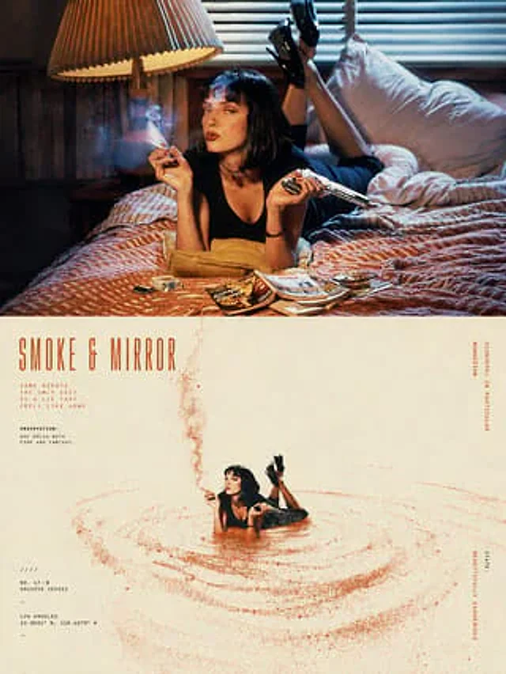

```text
Please turn {argument name="input" default="each photo I upload"} into a separate, high-end design poster. Do not create multi-image collages; output one standalone poster for each photo. Use an overall {argument name="aspect ratio" default="3:4"} vertical format, divided into two sections of strictly equal height, with the upper and lower halves each occupying exactly 50% of the composition. The upper half should retain the original photograph. Preserve the subject’s structure, authentic texture, natural lighting, and original color atmosphere. Apply only subtle, sophisticated photographic color grading to give it the visual quality of an art magazine, independent publication, or exhibition photograph. To adapt the image to the required aspect ratio, you may naturally extend the sky, ground, or surrounding environment, but do not stretch, distort, or alter the subject. The lower half should extract the most recognizable subject, silhouette, pose, and narrative relationship from the photograph and reinterpret them as a surreal, minimalist printmaking composition. Compress the subject into a clear, restrained visual anchor, usually rendered at a relatively small scale within a large field of negative space, preserving only the most essential silhouette and posture. Do not reproduce complex details. Instead, transform the original image’s movement, direction, light and shadow, or spatial relationships into a dynamic field that unfolds around the subject. For the dynamic field, naturally choose one primary motion logic based on the characteristics of the subject: it may fall from top to bottom, rise vertically, flow in a specific direction, radiate outward from a central point, or form irregular ripples and echoes. Use numerous fine lines, broken trajectories, rough halftone patterns, and variations in grain density to express movement. The field should be denser and more intense near the core, then gradually become sparser, more fragmented, and eventually disappear into the surrounding negative space. Avoid stacking multiple visual effects at once. Let one subject, one type of movement, and one vast spatial relationship define the composition. For the color palette, extract one {argument name="primary color" default="highly distinctive, energetic signature color"} from the photograph in the upper half, and combine it with warm white, ivory, or natural paper tones, plus a small amount of black, creating a strict 2–3 color palette. The primary color may be slightly purified and intensified so that it feels vivid and powerful without becoming overly digital. Create tonal variation through halftone density, layered ink coverage, and exposed paper rather than conventional gradients. Preserve the tactile qualities of screen printing, Risograph printing, coarse grain, paper fibers, uneven ink coverage, and slight registration misalignment. Avoid CGI, 3D effects, realistic digital lighting effects, and smooth digital illustratio
```

Model: GPT Image 2
Author: 小小东

[ProjectD](https://aitoolsradar.com/en/prompts/13e3909e153378) · [Recorded source](https://youmind.com/prompts/surreal-risograph-design-poster-32365)
 · [Full original metadata and byte evidence](data/projectd-batch-0047.json)

## Split-Screen Time Travel Scene

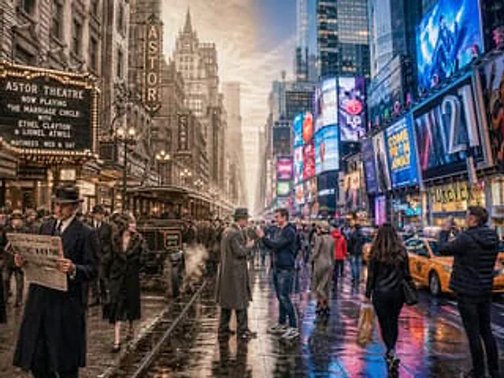

```text
A horizontally split-screen cinematic shot, showcasing{argument name="scene" default="Times Square, New York"} Seamlessly blending two different eras: The left side is{argument name="first era" default="1920s"} The right side is{argument name="second era" default="modern"} (Default: Approximately 100 years ago compared to modern times). Left side: Showcases architecture, interior or environmental design, materials, vehicles, and props clearly belonging to this historical period, characteristic of the era. Figures wear authentic period clothing, including hairstyles, accessories, and typical items in their hands. The overall atmosphere is nostalgic and historically accurate. Right side: Showcases the modern version of the same scene, including updated or renovated structures, modern materials (glass, steel, LED screens, modern furniture), modern vehicles or equipment, and current technology. Figures wear fashionable contemporary clothing. Central area: The two eras are organically blended and overlapped, without abrupt dividing lines. Elements from both eras visually interact: people from different times gaze at each other, pass through each other's spaces, or are surprised by the technology and objects of each other's time. Architecture and environment smoothly transition from old to new. Ensuring the scene is not merely a simple left-right comparison, but a dynamic, interactive journey through time. Photorealistic, 8K resolution, cinematic lighting, wide-angle, highly detailed textures, and a rich narrative of time travel. Aspect ratio: 4:3
```

Model: GPT Image 2
Author: GPT Image 2 Prompts

[ProjectD](https://aitoolsradar.com/en/prompts/cbb03c9f79b456) · [Recorded source](https://x.com/dotey/status/2047067494309847098)
 · [Full original metadata and byte evidence](data/projectd-batch-0047.json)

## Split-Time Birthday Portrait

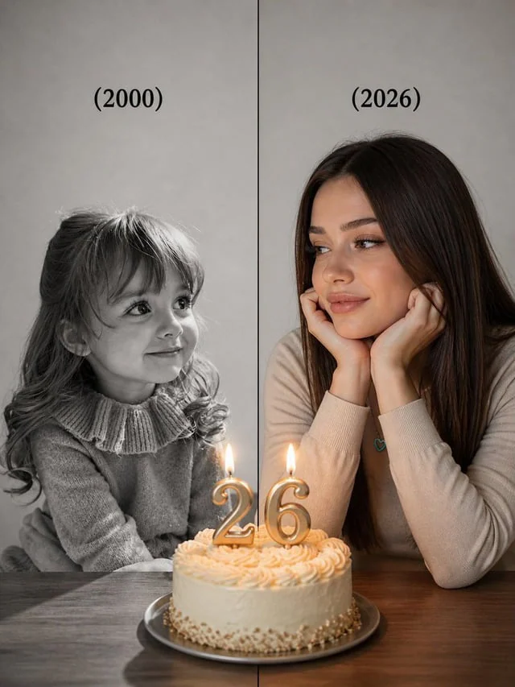

```text
A highly realistic split-time portrait of the same person meeting her younger self. The image is divided vertically into two perfectly aligned halves with identical camera angle and composition. On the left side: a black-and-white photo of a {argument name="child subject" default="young girl (3–4 years old)"}, same facial features as the adult, natural smile, sitting at a table, soft diffused lighting, minimal gray background, nostalgic mood, slightly grainy film texture. On the right side: a realistic color photo of the same person as an adult {argument name="adult age" default="[AGE]"}, identical pose and camera angle, resting her face on her hands, smiling warmly, modern outfit, soft cinematic lighting, shallow depth of field. In the center between them: a birthday cake placed exactly at the middle line, with lit candles forming the number "{argument name="birthday number" default="[AGE]"}", warm candle glow illuminating both sides. Both versions are looking at each other with emotional connection, perfectly aligned eye level. Text "(2000)" above the child side and "(2026)" above the adult side, minimal elegant font. Ultra realistic, 8K, high detail skin texture, soft shadows, cinematic color grading, clean composition, emotional storytelling.
```

Model: GPT Image 2
Author: K

[ProjectD](https://aitoolsradar.com/en/prompts/58e2f4e1cdf597) · [Recorded source](https://youmind.com/prompts/split-time-birthday-portrait-18049)
 · [Full original metadata and byte evidence](data/projectd-batch-0047.json)

## Sports Car and Airliner in Hangar


```text
A photorealistic, high-detail image showcasing a vehicle{argument name="car description" default="Blue Alpine A110 R sports car with black hood"} The car is parked in the foreground inside a spacious, large aircraft hangar. Directly behind the car is an aircraft {argument name="airplane description" default="White Airbus A320 commercial passenger plane"} The aircraft has "AIRBUS A320" printed on its fuselage and a blue tail fin. The car has black alloy wheels and the license plate reads "AIRBUS A320".{argument name="license plate text" default="A110 R"} The hangar floor was smooth, glossy concrete, clearly reflecting the two vehicles. A large sign hung on the left wall, which read, "..."{argument name="hangar sign text" default="HANGAR 05 MAINTENANCE"} The massive hangar door in the background is open, revealing a bright, cloudy sky and a distant tarmac. Cinematic lighting, sharp focus, and an automotive photography style.
```

Model: GPT Image 2
Author: GPT Image 2 Prompts

[ProjectD](https://aitoolsradar.com/en/prompts/f18c148864609a) · [Recorded source](https://x.com/AlwaveNazca/status/2044795046503792987#reversed-2)
 · [Full original metadata and byte evidence](data/projectd-batch-0047.json)

## Sports Car and Airliner in Hangar


```text
A realistic, high-resolution commercial photograph with a car in the foreground.{argument name="car model and color" default="Bright blue Alpine A110 R sports car"} It was parked inside a huge hangar. The sports car featured a black carbon fiber hood, a black roof, and black alloy wheels, with the license plate reading "..."{argument name="license plate text" default="A110 R"} Behind the car, in the background, is a plane that occupies the visual center.{argument name="airplane model" default="White Airbus A320 commercial passenger aircraft"} The tail section is blue. The hangar floor is highly polished reflective concrete, reflecting the images of the sports car and the plane. A sign on the metal wall to the left reads "{argument name="hangar sign text" default="HANGAR 05 MAINTENANCE"} The hangar doors were wide open, revealing a bright, overcast sky and a distant cityscape. The soft, cinematic light accentuated the sleek aerodynamic curves of both vehicles.
```

Model: GPT Image 2
Author: GPT Image 2 Prompts

[ProjectD](https://aitoolsradar.com/en/prompts/4e87bf0d6d8e77) · [Recorded source](https://x.com/AlwaveNazca/status/2045404499066384847#reversed-1)
 · [Full original metadata and byte evidence](data/projectd-batch-0047.json)

## Sports League Invitation Poster Prompt

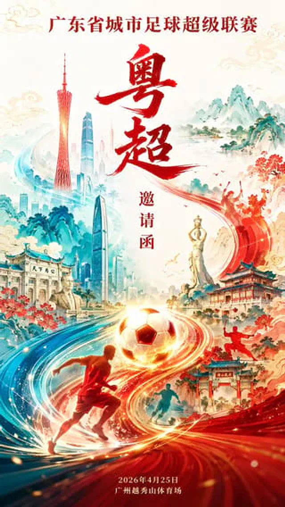

```text
{argument name="event name" default="Guangdong Provincial City Football Super League (Yuechao)"} Invitation poster design, proportions{argument name="ratio" default="9:16"} The composition features an S-shaped streamlined design, with an energy flow formed by the trajectory of a football running through the image, centered on a glowing football. It incorporates city landmarks such as the Canton Tower and the Shenzhen Ping An Finance Center, employing a technique of "line drawing + partial color blocks." Style: Modern Chinese-style high-end poster, minimalist yet highly designed. Color scheme: Highly saturated yet restrained, with Chinese red as the main visual element, accented with gold. Main title:{argument name="main title" default="Guangdong Provincial City Football Super League"} ".Include{argument name="date" default="April 25, 2026"} Cinematic lighting effects, 8K resolution.
```

Model: GPT Image 2
Author: GPT Image 2 Prompts

[ProjectD](https://aitoolsradar.com/en/prompts/59a0415fd420be) · [Recorded source](https://x.com/liyue_ai/status/2045772039521542202)
 · [Full original metadata and byte evidence](data/projectd-batch-0047.json)

## Sports Photography Trophy Reveal

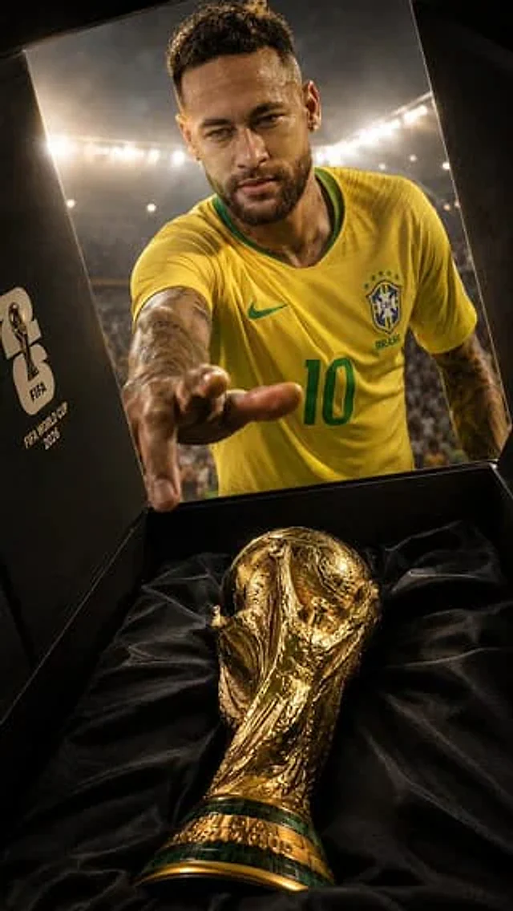

```text
PLAYER={argument name="player name" default="[player name]"} Ultra-realistic sports photography, documentary realism, premium commercial campaign style, immersive 4:5 vertical composition. The camera is positioned deep inside an opened luxury gift box, creating a dramatic first-person perspective from the hidden treasure itself. A magnificent golden FIFA World Cup trophy rests on elegant dark velvet fabric in the lower foreground, with realistic metallic reflections and authentic textures.
```

Model: GPT Image 2
Author: Sairah

[ProjectD](https://aitoolsradar.com/en/prompts/8bec74a300a90c) · [Recorded source](https://youmind.com/prompts/sports-photography-gift-box-trophy-25178)
 · [Full original metadata and byte evidence](data/projectd-batch-0047.json)

## Spot the Difference Puzzle Generator


```text
Please create a simple "spot the difference" puzzle game containing two side-by-side illustrations. It should include {argument name="number of differences" default="7"} The differences are. The theme is {argument name="theme" default="Toy Candy Party"} .
```

Model: GPT Image 2
Author: GPT Image 2 Prompts

[ProjectD](https://aitoolsradar.com/en/prompts/cb7751430e1e88) · [Recorded source](https://x.com/ish_creative/status/2047281725668294690)
 · [Full original metadata and byte evidence](data/projectd-batch-0047.json)

## Spotify Playlist Screen at Night


```text
One{argument name="device" default="Computer screen"} The photo shows{argument name="music app" default="Spotify"} exist{argument name="time of day" default="night"} playlist
```

Model: GPT Image 2
Author: GPT Image 2 Prompts

[ProjectD](https://aitoolsradar.com/en/prompts/f159abc2b6050c) · [Recorded source](https://x.com/skirano/status/2046675049210360186)
 · [Full original metadata and byte evidence](data/projectd-batch-0047.json)

## Spotify Playlist Screen at Night


```text
A photo of a {argument name="device" default="computer screen"} displaying a {argument name="music app" default="Spotify"} playlist at {argument name="time of day" default="night"}
```

Model: GPT Image 2
Author: Pietro Schirano

[ProjectD](https://aitoolsradar.com/en/prompts/7bdf24ef12b1b1) · [Recorded source](https://youmind.com/prompts/spotify-playlist-screen-night-14375)
 · [Full original metadata and byte evidence](data/projectd-batch-0047.json)

## Spring Fashion Privacy Collage


```text
Goal: Create a bright editorial photo collage of {argument name="character name" default="a young woman"} enjoying a dreamy spring day outdoors, with her face intentionally covered in every panel by a flat rectangular privacy mask in a warm medium-brown skin-tone color.

Canvas: Wide horizontal 16:9 image, arranged as a clean 3 by 3 grid of exactly 9 photo panels with thin white borders between panels. Use crisp natural-light photography, shallow depth of field, vivid blue sky, soft white clouds, pink spring blossoms, floating soap bubbles, green grass, and a fresh pastel fashion aesthetic.

Subject details: The same woman appears throughout all 9 panels. She has shoulder-length wavy brown hair, wears a soft {argument name="sweater color" default="pastel pink"} chunky knit sweater, a cream pleated skirt, a pearl necklace, and a pearl bracelet. Her face is never visible; cover it with a simple opaque rectangular censor block, no facial features, no blur, no transparency.

Nine panels, left to right and top to bottom:
1. Close-up portrait from chest up against blue sky, pink sweater visible, soap bubble near her hair, hand raised near mouth, large vertical brown rectangle covering the face.
2. Low-angle full-body fashion shot, woman standing confidently under blue sky with cherry blossom petals drifting, pink sweater and cream pleated skirt flaring outward.
3. Tight close-up portrait with windblown hair and blue sky, pink sweater shoulder visible, large square brown face-covering block.
4. Side portrait near blooming pink-white trees, woman making a peace sign, bubble floating beside her, face covered by a vertical brown rectangle.
5. Extreme close-up crop of hair, shoulder, and hand near cheek, blue background, face area covered by a tall brown rectangle centered in the panel.
6. Seated profile on grassy hill, woman in pink sweater and cream skirt, knees bent, looking toward the sky, face covered by a small brown rectangle, clouds behind her.
7. Overhead top-down shot of woman lying or curled on green grass with flower petals and several bubbles around her, pink sweater and pearl necklace visible, face covered by a vertical brown rectangle.
8. Medium close-up under bright sky, woman touching her hair with one hand, large bubble floating on the right, face covered by a vertical brown rectangle.
9. Medium close-up of woman holding a black camera up near her face as if taking a photo, pink sweater and bracelet visible, pale sky and lens flare bubbles behind, face covered by a brown rectangle.

Visual style: High-resolution lifestyle fashion photography, springtime pastel palette, airy optimistic mood, glossy magazine contact-sheet layout, natural skin and fabric texture, realistic bubbles with rainbow reflections, soft bokeh blossoms, gentle wind in hair and skirt.

Constraints: Use exactly 9 panels in a 3x3 collage; keep the white grid borders visible; include face-covering rectangles in all panels; do not add text, logos, watermarks, or extra panels.
```

Model: GPT Image 2
Author: Cherry 2.O

[ProjectD](https://aitoolsradar.com/en/prompts/9d2b0dbf9a758d) · [Recorded source](https://youmind.com/prompts/spring-fashion-collage-25278)
 · [Full original metadata and byte evidence](data/projectd-batch-0047.json)

## Spring School Romance Manga Page


```text
{
  "type": "Full-color shoujo manga page",
  "style": "Romantic anime illustrations, exquisite coloring with a glossy finish, soft spring sunlight, shimmering highlights, delicate lines, creating a cinematic campus romance atmosphere.",
  "format": "5-panel numbered single-page comic",
  "setting": {
    "location": "Japanese high school campus walkway lined with cherry blossom trees",
    "season": "Spring Cherry Blossom Season",
    "time": "Daytime",
    "atmosphere": "Dreamy, youthful, sentimental, petals falling in the wind"
  },
  "characters": [
    {
      "role": "female students",
      "appearance": "Long, dark brown hair with a soft sheen; large, expressive eyes; slender figure; navy blue school uniform jacket, white shirt, red plaid bow tie; holding a smartphone."
    },
    {
      "role": "male student",
      "appearance": "Messy dark brown short hair, slender figure, navy blue school uniform jacket, white shirt, loose red striped tie, backpack slung over his shoulder."
    }
  ],
  "layout": {
    "sections": [
      {
        "title": "1",
        "position": "Top right",
        "count": 1,
        "labels": [
          "The girl noticed the photo opportunity under the cherry blossom tree and raised her phone to take a picture."
        ]
      },
      {
        "title": "2",
        "position": "Top left",
        "count": 1,
        "labels": [
          "A close-up selfie of the two of them; the girl is holding a pink smartphone, and the boy compliments her on how beautiful she looks and suggests posting it online."
        ]
      },
      {
        "title": "3",
        "position": "center right",
        "count": 1,
        "labels": [
          "The girl was surprised and shy. She held the phone close to her face and asked him if he had seen it."
        ]
      },
      {
        "title": "4",
        "position": "center left",
        "count": 1,
        "labels": [
          "The boy confidently showed off a photo of cherry blossoms on his phone screen, saying that the photo had a great sense of style and would definitely go viral."
        ]
      },
      {
        "title": "5",
        "position": "Bottom banner",
        "count": 1,
        "labels": [
          "A romantic close-up shot shows two students taking a selfie under a blooming cherry blossom tree."
        ]
      }
    ],
    "centerpiece": "The fifth frame is a large image displayed across the bottom banner."
  },
  "props": {
    "count": 4,
    "items": [
      "The pink smartphone in the girl's hand",
      "A phone screen displaying a photo of cherry blossoms.",
      "bag",
      "Falling cherry blossom petals"
    ]
  },
  "text": {
    "speech_bubbles": [
      "That's really beautiful. Aren't you going to post it?",
      "I think I might have taken a really good photo today...!",
      "Huh... You were watching?!",
      "It's definitely going to go viral. It's got good taste."
    ],
    "caption_boxes": [
      "That photo changed my spring."
    ],
    "side_text": [
      "#This is what they mean by youth being emotional ♡"
    ],
    "panel_numbers": [
      "1",
      "2",
      "3",
      "4",
      "5"
    ]
  },
  "composition": "The design uses a black comic book panel layout, with two small panels at the top, two small panels in the middle, and a large full-width panel at the bottom. It emphasizes the romantic tension of blushing and shyness, falling petals, and shimmering shoujo manga effects. The last panel shows a boy taking a selfie and making a peace sign, while a girl stands beside him making the same gesture. The background is filled with soft-focus cherry blossoms and distant school buildings.",
  "color_palette": "Cherry blossom pink, navy blue uniform, warm skin tone, bright spring sky, soft white shimmer.",
  "quality": "Highly detailed comic book cover quality suitable for social media posting."
}
```

Model: GPT Image 2
Author: GPT Image 2 Prompts

[ProjectD](https://aitoolsradar.com/en/prompts/20669c3b717931) · [Recorded source](https://x.com/onofumi_AI/status/2046491644250538211#reversed-0)
 · [Full original metadata and byte evidence](data/projectd-batch-0047.json)

## Spy Movie Poster with Cat


```text
Generate a movie poster. The movie theme is {argument name="theme" default="Spy thriller"} The film is titled "{argument name="title" default="Infiltrate"} The lead actor is {argument name="star" default="A cat"} The visuals need to have a very strong sense of atmosphere.
```

Model: GPT Image 2
Author: GPT Image 2 Prompts

[ProjectD](https://aitoolsradar.com/en/prompts/004ae4e0062a84) · [Recorded source](https://x.com/cocoloopcom/status/2047593296965542306)
 · [Full original metadata and byte evidence](data/projectd-batch-0047.json)

## Square — Donation Campaign Visual


```text
Square 1:1 non-profit donation campaign visual. Clean off-white background with a single centered hand-drawn ink illustration of two cupped hands holding a small sapling. Below the illustration, a bold heartfelt serif headline in deep forest green reads "A small gift can plant a quiet future.". A small rounded CTA pill button at the bottom in deep green with white text reads "Donate $5". Generous negative space. No specific charity name, no logo, no watermark. Warm minimalist non-profit ad design, crisp typography, premium editorial quality.
```

Model: GPT Image 2
Author: @hiapi_ai

[ProjectD](https://aitoolsradar.com/en/prompts/b06e6d61c8b023) · [Recorded source](https://github.com/HiAPIAI/awesome-gpt-image-2-prompts)
 · [Full original metadata and byte evidence](data/projectd-batch-0047.json)

## Square — Online Course Pre-Sale


```text
Square 1:1 online course marketing card. Background is a clean warm cream color. The right two-thirds shows a friendly half-body portrait of a smiling young East Asian woman in her early thirties wearing a cream knit sweater, soft natural side window light. The left third shows a stacked bold black sans-serif headline reading "Ship your first AI app in 30 days", and below it in smaller text "Early-bird pre-sale, 40% off". A small dark CTA button at the lower-left reads "Save my seat". No real brand name, no logo, no watermark. Premium course launch ad design, photorealistic portrait.
```

Model: GPT Image 2
Author: @hiapi_ai

[ProjectD](https://aitoolsradar.com/en/prompts/9ef85ea69a5dde) · [Recorded source](https://github.com/HiAPIAI/awesome-gpt-image-2-prompts)
 · [Full original metadata and byte evidence](data/projectd-batch-0047.json)

## Square — SaaS Free Trial Offer


```text
Square 1:1 SaaS marketing card design. Background is a soft gradient mesh of pale lavender, blush pink and warm cream. Generous negative space. Centered headline in heavy modern sans-serif black typography reads "Try it free for 14 days. No card needed.". Below the headline a single small rounded CTA button in deep indigo with white text reads "Start Free Trial". Minimal, premium, magazine-grade typography rendering. No real brand name, no logo, no watermark. Modern SaaS ad design quality.
```

Model: GPT Image 2
Author: @hiapi_ai

[ProjectD](https://aitoolsradar.com/en/prompts/dc4678d1f41634) · [Recorded source](https://github.com/HiAPIAI/awesome-gpt-image-2-prompts)
 · [Full original metadata and byte evidence](data/projectd-batch-0047.json)

## Square — Streaming Series Promo Frame


```text
Square 1:1 streaming series promotional frame. Cinematic moody scene of a single silhouetted figure backlit by a warm orange glow at the end of a long shadowed corridor. Heavy atmospheric haze and god rays. Subtle italic serif tagline in white at the bottom-center reads "Some doors only open once.". Subtle film grain texture. No brand logo, no streaming platform name, no watermark. Premium cinematic series key art design, photorealistic lighting, magazine poster quality.
```

Model: GPT Image 2
Author: @hiapi_ai

[ProjectD](https://aitoolsradar.com/en/prompts/275ee7c0ad82d7) · [Recorded source](https://github.com/HiAPIAI/awesome-gpt-image-2-prompts)
 · [Full original metadata and byte evidence](data/projectd-batch-0047.json)

## SSR Kamen Rider Double Card


```text
This is an ultra-detailed illustration for a high-end Japanese trading card game, featuring a style reminiscent of ultra-rare tokusatsu collectibles. The vertical composition, gorgeous holographic foil border, and explosive, cinematic action sequences complete the image. The hero in armor is at the center of the picture.{argument name="character name" default="Kamen Rider Double"} Employing a dramatic, low-angle, full-body pose, he charges forward through the ruined city battlefield, revealing a collectible card to the audience in his left hand. His battle suit is clearly divided in two: the left half is a vibrant metallic green, while the right half is a glossy black, featuring large, shimmering red compound eyes, a silver V-shaped crown, segmented insect armor, a flowing white scarf, and a highly detailed transformation belt with red mechanical components. The card in his hand should display a smaller image of the hero and match the design of a high-end collectible. Eight background knights or enemies are positioned around him, distributed across the destroyed city battlefield, in dynamic combat poses: two flying figures near the upper background, three mid-ground combatants on the right, one blue-gold figure in the lower right, one red-blue knight in the lower left, and one partially visible warrior near the left edge. The environment, filled with shattered rubble, damaged skyscrapers, sparks, smoke, debris, and energy flows, creates a chaotic post-apocalyptic battle scene. The entire image utilizes strong prism holographic effects, rainbow diffraction, flashes, lens flares, starbursts, and reflective foil textures. The artwork is framed as an SSR rarity game card and includes visible text elements: the top center title "KAMEN RIDER," a large "W" below, and a shield emblem displayed in the upper right corner.{argument name="rarity label" default="SSR"} It features 6 stars, a green and purple circular "W" badge in the upper left corner, "CARD TYPE" and "CHARACTER" displayed on the lower left panel, "KAMEN RIDER DOUBLE" and "仮面ライダーW(ダブル)" on the bottom center plaque, a barcode below, "CYCLONE JOKER XTREME 09" in small print at the bottom, and a large gold handwritten signature in the lower right corner.{argument name="signature text" default="NickTag"} This makes the entire card look like a luxurious, gold-plated, ultra-rare, and officially licensed tokusatsu collectible card, with extremely sharp details, rich metallic highlights, dense particles, and extreme dramatic contrast.
```

Model: GPT Image 2
Author: GPT Image 2 Prompts

[ProjectD](https://aitoolsradar.com/en/prompts/d3afa3baa5b1a2) · [Recorded source](https://x.com/ZAGGGGO/status/2046558924229525759#reversed-2)
 · [Full original metadata and byte evidence](data/projectd-batch-0047.json)

## SSR Kamen Rider Kuuga Card


```text
A high-quality and detailed image{argument name="hero name" default="Kamen Rider Kuuga"}{argument name="form name" default="Amazing Omnipotent Form"} This is a collectible trading card illustration, designed to resemble a high-rarity SSR card. The composition is a dynamic frontal portrait, with the hero clad in glossy black and deep metallic crimson armor positioned in the center, occupying the majority of the space above the thighs. The helmet features a golden horned crown, large multifaceted red compound eyes, and a finely detailed transformation belt with a red core. One gloved hand extends towards the viewer, holding a small card bearing the hero's image, creating a recursive card-within-a-card effect; the other hand remains in a fighting stance. The background depicts a destroyed city street at night, filled with sparks, embers, fragments, smoke, and multiple enemy monsters leaping and attacking from all directions. Eight enemy characters are visible in the background: three aerial enemies at the top, three standing or attacking enemies on the right, and two smaller enemies in the lower left corner and near the bottom edge. The artwork utilizes strong cinematic lighting effects, shimmering particle effects, holographic foil textures, gold filigree lines, and a luxurious black and gold Art Deco border. The border integrates a gorgeous card UI with text and badges: the top center title is "MASKED RIDER," below which is a large metallic serif font "KAMEN RIDER KUUGA," a circular badge in the upper left corner, an iridescent shield badge with "SSR" and 5 gold stars below in the upper right corner, a label bar in the lower left corner displaying "CARD TYPE" and "CHARACTER," a nameplate at the bottom center displaying "KAMEN RIDER KUUGA" and the Japanese "仮面ライダークウガ," a barcode below, and the subtitle "AMAZING MIGHTY FORM" at the very bottom. A large gold cursive artist's signature is added in the lower right corner, containing the following text:{argument name="signature text" default="NickZag"} Overall style: Ultra-detailed tokusatsu character art, explosive poster energy, high-rarity trading card art, shimmering holographic highlights, clear image quality focusing on the central hero, and an epic collection display.
```

Model: GPT Image 2
Author: GPT Image 2 Prompts

[ProjectD](https://aitoolsradar.com/en/prompts/26ee992f4bbbd3) · [Recorded source](https://x.com/ZAGGGGO/status/2046558924229525759#reversed-3)
 · [Full original metadata and byte evidence](data/projectd-batch-0047.json)

## Stacked Corridor Model Comparison


```text
A side-by-side comparison, presented as two stacked documentary-style photographs, showcases the same narrow, old-fashioned Chinese apartment corridor, flanked by black film borders with white perforations. The upper section features large, bold, white sans-serif text at the top center.{argument name="top label" default="GPT-image-2"} The lower half is marked in the same style.{argument name="bottom label" default="Nano Banana 2"} Create a rough, nostalgic, and cinematic scene depicting a narrow public corridor in a dilapidated late 20th-century apartment building. The walls are peeling and stained, covered with faded posters and old newspapers, and feature dark wooden doors, hanging towels and clothes, a damp cement floor, and natural light streaming in from distant windows. In the upper part of the scene, accurately depict four figures: an adult standing on the left, cooking by a small stove on a wooden table, with steam clearly visible; an adult male sitting at the back of the corridor, next to an electric fan; a child squatting in the center, playing on the damp floor; and an adult woman sitting at a small table on the right, writing or reading. The scene includes enamel mugs, metal pots, stools, buckets, thermos flasks, and a jumble of household items. In the second half of the scene, four figures are accurately depicted again: an adult woman cooking by the stove on the left, with smoke rising; an adult man sitting on a bamboo chair on the right, leaning forward near a table fan; a child squatting in front, writing on paper on a low stool; and an adult silhouette appearing near the window in the background. More visible hallway clutter is added, including a bicycle front wheel, washbasin, basket, thermos, shelf, shoes, and hanging clothes in the lower left corner. The camera is kept upright and centered to emphasize the depth of the hallway. The figures are realistically proportioned, showcasing authentic scenes of daily life. The color palette is soft and aged, the natural light is gentle, and the details are rich, giving it a news photography feel. While maintaining consistency in the overall environment and atmosphere, subtle differences are made in the layout of the upper and lower scenes.
```

Model: GPT Image 2
Author: GPT Image 2 Prompts

[ProjectD](https://aitoolsradar.com/en/prompts/4156411266f05c) · [Recorded source](https://x.com/zoomad99/status/2047284258100887914#reversed-0)
 · [Full original metadata and byte evidence](data/projectd-batch-0047.json)

## Stationery Bundle Flat-Lay


```text
Top-down flat-lay of a neatly organised back-to-school stationery bundle on a clean pastel pink surface: one cream linen-bound notebook, one slim black fountain pen, two wooden pencils, a small brass paper clip, a pale grey eraser, and a small bunch of dried baby's breath in the upper corner. Soft diffuse overhead daylight. Square 1:1 composition, organised grid arrangement. No brand text on any item, no logos, no watermark. Magazine flat-lay styling, photorealistic textures, ultra crisp focus.
```

Model: GPT Image 2
Author: @hiapi_ai

[ProjectD](https://aitoolsradar.com/en/prompts/cd50541cbb0dc0) · [Recorded source](https://github.com/HiAPIAI/awesome-gpt-image-2-prompts)
 · [Full original metadata and byte evidence](data/projectd-batch-0047.json)

## Steam Store Page UI Mockup


```text
{
  "type": "Desktop application UI model",
  "application": "Steam client",
  "theme": "Dark mode",
  "header": {
    "top_menu": [
      "Steam",
      "show",
      "Friends",
      "game",
      "help"
    ],
    "main_navigation": [
      "shop",
      "Library",
      "Community"
    ],
    "user_profile": "Steam users"
  },
  "layout": {
    "left_sidebar": {
      "title": "Game library",
      "search_bar": true,
      "game_count": 18,
      "game_list": [
        "Half-Life",
        "Half-Life 2",
        "Half-Life 2: Episode One",
        "Half-Life 2: Episode Two",
        "Half-Life: Blue Shift",
        "Half-Life: Opposing Force",
        "Portal",
        "Portal 2",
        "Team Fortress 2",
        "Left 4 Dead 2",
        "Counter-Strike: Source",
        "Counter-Strike: Global Offensive",
        "Day of Defeat: Source",
        "Garry's Mod",
        "Ricochet",
        "Source Filmmaker",
        "Half-Life Deathmatch: Source",
        "Half-Life: Source"
      ]
    },
    "main_content": {
      "breadcrumbs": "All Games &gt; Action Games &gt; Half-Life",
      "title": "{argument name=\"game title\" default=\"Half-Life\"}",
      "media_gallery": {
        "main_image": "From a first-person perspective, holding a red crowbar, facing headcrabs and scientists in a laboratory, with the Lambda logo glowing in the background.",
        "thumbnail_count": 5
      },
      "description": "{argument name=\"game description\" default=\"Half-Life is a legendary first-person shooter game developed by Valve. After an experiment at the Black Mesa Research Institute fails and a portal to another dimension opens, you will play as scientist Gordon Freeman, struggling to survive and escape from a desperate situation.\"}",
      "metadata": {
        "release_date": "{argument name=\"release date\" default=\"November 9, 1998\"}",
        "developer": "{argument name=\"developer\" default=\"Valve\"}",
        "publisher": "Valve",
        "user_reviews": "Very positive reviews (20,910 reviews)"
      },
      "tags": [
        "FPS",
        "action",
        "Science Fiction",
        "classic",
        "single",
        "+"
      ],
      "system_requirements": {
        "title": "System Requirements",
        "tabs": [
          "Windows",
          "macOS",
          "SteamOS + Linux"
        ],
        "specs": [
          "Operating System: Windows 7 or later",
          "Processor: 1.7 GHz processor",
          "Memory: 512 MB RAM",
          "Graphics card: A graphics card that supports DirectX 8.1.",
          "DirectX: Version 8.1",
          "Storage space: Requires 600 MB of available space"
        ]
      }
    },
    "right_sidebar": {
      "purchase_box": {
        "title": "Buy",
        "price": "{argument name=\"price\" default=\"¥ 98\"}",
        "button": "Add to cart"
      },
      "features_count": 4,
      "features": [
        "single",
        "Steam Achievements",
        "Fully supports controllers",
        "Steam Cloud"
      ],
      "languages_table": {
        "title": "language",
        "columns": [
          "interface",
          "Full Audio",
          "subtitle"
        ],
        "language_count": 5,
        "languages": [
          "Simplified Chinese",
          "English",
          "French",
          "German",
          "Spanish - Spain"
        ]
      }
    },
    "footer": {
      "left": "Add game",
      "center": "Download 2/2 items completed",
      "right": "Friends &amp; Chat +"
    }
  }
}
```

Model: GPT Image 2
Author: GPT Image 2 Prompts

[ProjectD](https://aitoolsradar.com/en/prompts/6b3a87bec1693a) · [Recorded source](https://x.com/DeepForest_Inc/status/2044960627739996226#reversed-0)
 · [Full original metadata and byte evidence](data/projectd-batch-0047.json)

## Steampunk Chibi Witch Sticker Illustration


```text
A 2D anime illustration depicting a sleeping person.{argument name="character type" default="Q-version witch"} She had black hair and wore a decorated hat.{argument name="hat decoration" default="Metal gears"} She wore a large black hat and dark clothing with a belt. She leaned against a soft, dark blue, crescent-shaped starry-sky pillow, the letters "ZZZ" floating beside her head. Beside her were {argument name="animal companions" default="Two black birds, one of which was wearing a top hat."} The scene is framed by a circular night sky background with glowing crescent moons and stars. The bottom edge is decorated with fluffy clouds and {argument name="props" default="Steampunk gears, glowing lanterns, and a closed magic book."} The entire work uses{argument name="color palette" default="Dark blue, black and warm gold"} The color scheme presents a style reminiscent of paper art cutting or die-cut stickers, with soft shadows on a pure beige white background.
```

Model: GPT Image 2
Author: GPT Image 2 Prompts

[ProjectD](https://aitoolsradar.com/en/prompts/500a5c012dd744) · [Recorded source](https://x.com/minesan_ai/status/2044463128222814268#reversed-2)
 · [Full original metadata and byte evidence](data/projectd-batch-0047.json)

## Steampunk Daily Fortune Cards


```text
{"type":"vertical anime fantasy fortune card illustration","style":"highly detailed painterly anime, ornate steampunk fantasy, celestial clockwork, parchment divination UI, soft cinematic sunlight, deep blue and antique gold palette, intricate linework, atmospheric depth","main_scene":{"position":"top two thirds of image","subject":"a mysterious young astrologer or fortune teller standing in profile in a floating clockwork city","face":"face intentionally obscured by a centered dark square censor block","clothing":"flowing white robe layered over dark navy garments, gold embroidery, star and moon motifs, dangling chains, medallions and ornaments","accessories":"large dark blue wide-brim hat decorated with gold chains, small pendants, celestial charms and dangling beads","pose":"holding a pen or wand upright in one hand and an open notebook in the other, as if recording fate","environment":"vast inverted floating city of towers, bridges, gears and suspended buildings, with massive astronomical clock faces, pocket watches, cogs, paper birds and scraps drifting through the air","lighting":"bright backlight from a huge circular window or clock, dusty rays of sunlight, dreamy sky visible through arches"},"layout":{"canvas":"portrait poster, 3:4 aspect ratio","bottom_panel":"parchment-colored fortune reading strip occupying the bottom third, divided into exactly 4 vertical cards with thin antique borders and decorative corner flourishes","card_count":4,"cards":[{"position":"bottom far left","title":"【今日の運勢】","visible_elements_count":2,"visible_elements":["five-star rating showing four blue stars and one pale empty star","large blue headline text"],"headline":"{argument name=\"fortune headline\" default=\"上昇する予感！\"}","body_text":"思いがけない人との出会いや、新しい挑戦が幸運を引き寄せます。直感を信じて一歩を踏み出してみましょう。"},{"position":"bottom center left","title":"【今日の世界】","visible_elements_count":2,"visible_elements":["world name text","small rectangular illustration of the same inverted clock city"],"world_name":"{argument name=\"world name\" default=\"逆時計の浮遊都市\"}","body_text":"時間が上から下へ流れる逆さの世界。過去が未来に流れ、記憶が地層のように積もる不思議な場所。"},{"position":"bottom center right","title":"【ラッキーアイテム】","visible_elements_count":2,"visible_elements":["cream spiral notebook drawing","blue pen drawing beside it"],"item_name":"{argument name=\"lucky item\" default=\"メモ帳とペン\"}","body_text":"思いついたことをすぐに書き留めることで、運の流れをつかまえられるでしょう。"},{"position":"bottom far right","title":"【秘密の一言】","visible_elements_count":2,"visible_elements":["short quote at top","round mystical emblem showing an hourglass, moon and stars"],"quote":"{argument name=\"secret quote\" default=\"まだ、選ばなくていいよ。\"}","body_text":"あなたの時間は、あなたのもの。焦らず、ゆっくりで大丈夫。"}]},"typography":"Japanese serif Mincho-style text, blue accents for emphasis, hand-printed fortune-telling card aesthetic","composition_notes":"strong contrast between the grand detailed fantasy city above and the clean readable four-card divination layout below; maintain exact four-card count and readable Japanese titles; no extra panels"}
```

Model: GPT Image 2
Author: けこねこ

[ProjectD](https://aitoolsradar.com/en/prompts/970048c4aafb3c) · [Recorded source](https://youmind.com/prompts/steampunk-fortune-cards-19326)
 · [Full original metadata and byte evidence](data/projectd-batch-0047.json)

## Steampunk ElectroVid Homepage


```text
Create a full-page steampunk-style video platform homepage mockup, using deep bronze, brass, and tan tones, designed like a Victorian industrial version of YouTube. The interface should be vertically laid out, resembling a poster or website screenshot, and decorated with gears, pipes, sculpted metal borders, filigree, gauges, screws, and glowing Edison light bulbs. Place a modern, overlaid logo in the top left corner with the text "Pollo AI," followed by a smaller "GPT Image 2" below. Place the main title in the center of the page using a large, ornate serif font:{argument name="site name" default="ElectroVid"} Below this is a smaller, sculpted slogan:{argument name="tagline" default="THE FUTURE IN MOTION"} Add a horizontal navigation bar below the title, containing six items: a homepage icon button, "TRENDING," "INNOVATIONS," "DOCUMENTARIES," "ENTERTAINMENT," and a search box on the right displaying the placeholder "Search ElectroVid..." and a search icon. In the left sidebar, add a section called "POPULAR CHANNELS," containing three vertically stacked channel cards with circular badges and subscription buttons: 1) "THE PATENT OFFICE," displaying "27.4K SUBSCRIBERS"; 2) "THE ROYAL SOCIETY," displaying "18.7K SUBSCRIBERS"; 3) "GENERAL ELECTRIC," displaying "35.1K SUBSCRIBERS." Each card should be accompanied by a fancy retro badge logo. A rectangular button labeled "SUBSCRIBE" is placed in the main content area. The sepia-toned video player shows two late 19th-century inventors in suits arguing in front of a blackboard with the words "AC vs. DC" and a lightning bolt symbol; one points at the blackboard, the other responds, and a light bulb and early electrical equipment sit on the table. Their faces are deliberately obscured by soft rectangular blur blocks. A video progress bar, playback controls, and a timestamp "08:47 / 22:31" are added. Below the player, the video title is displayed.{argument name="featured title" default="The Truth About AC vs. DC: The Final Debate"} Below this is a line of channel information with a circular avatar, the channel name "The Electrical Age," and metadata "142K views • 3 days ago." To the right is a "LIKE" button with a count of "5.8K." Below this is a partial title "LATEST VIDEOS," and three video thumbnails are placed in a row. Thumbnail 1: A sepia portrait of Thomas Edison holding a glowing light bulb, his face obscured by a blurry block, duration "10:12," title "My New Incandescent Bulb," creator "Thomas Edison," metadata "89K views • 5 days ago." Thumbnail 2: A dramatic sepia image of Wardenclyffe Tower under lightning, duration "15:36," title "The Wonders of the Wardenclyffe Tower," creator "Nikola Tesla," metadata "120K views • 1 week ago." Thumbnail 3: A sepia photograph of Henry Ford sitting in an early automobile, duration "12:08," title "The Automobile." "Revolution," creator "Henry Ford," metadata "110K views • 1 week ago." Below the thumbnail, add a centered metal button labeled "VIEW ALL VIDEOS." At the bottom footer, the first line contains the text "© 1893."{argument name="company name" default="ElectroVid, Ltd."} The next line contains "All rights reserved." Decorative pressure gauges are added to the top right and bottom right corners, and an exposed pipe and a large gear to the bottom left corner. This makes the entire design highly refined, symmetrical, tactile, and cinematic, incorporating sculpted textures, aged paper panels, brass highlights, soft, warm light bulb glow, and clear, legible typography integrated into a retro UI.
```

Model: GPT Image 2
Author: GPT Image 2 Prompts

[ProjectD](https://aitoolsradar.com/en/prompts/8e3798cec9c53d) · [Recorded source](https://x.com/PolloAIES/status/2046776832620412966#reversed-0)
 · [Full original metadata and byte evidence](data/projectd-batch-0047.json)

## Steampunk ElectroVid Homepage


```text
A richly detailed steampunk-style retro video platform homepage is presented as a full-screen webpage mockup, employing dark brass, aged bronze, black iron, and tan tones. The design is inspired by Victorian industrial machinery, incorporating ornate openwork patterns, pipes, rivets, gears, dashboards, and glowing Edison light bulbs into the frame. A modern overlay logo is displayed in the upper left corner, with the text "Pollo AI" and "GPT Image 2." At the top center is a large, metal-carved website title.{argument name="site name" default="ElectroVid"} Below it is a smaller subtitle plaque with the text:{argument name="tagline text" default="THE FUTURE IN MOTION"} The navigation bar at the bottom contains six visible items: a homepage icon button, TRENDING, INNOVATIONS, DOCUMENTARIES, ENTERTAINMENT, and a search box on the right with placeholder text (similar to Search ElectroVid...). A circular analog clock is located in the upper right corner of the frame. In the left sidebar, a framed area titled Popular Channels vertically stacks three channel cards, each with a circular logo, subscriber count, and a SUBSCRIBE button: The Patent Office (27.4K subscribers), The Royal Society (18.7K subscribers), and General Electric (35.1K subscribers). The main content area features a large central video player displaying a sepia-toned historical scene: two men in suits debating in front of a blackboard labeled "AC vs. DC," with chalk effects resembling lightning bolts; one man is pointing, while the other gestures with outstretched hands, and a glowing light bulb and early electrical equipment sit on the table. Add a realistic video player UI, including a play button, a timeline with a partial red progress bar, volume icons, a playback and total duration display (08:47 / 22:31), settings icons, a theater mode icon, and a full-screen icon. Featured video titles are displayed below the player.{argument name="featured video title" default="The Truth About AC vs. DC: The Final Debate"} Below is the channel metadata: The Electrical Age, 142K views, 3 days ago, along with a circular profile picture and a brass LIKE button displaying 5.8K views. Below that is an area titled LATEST VIDEOS, containing a row of three thumbnail cards: 1) My New Incandescent Bulb, showing a man holding a glowing light bulb, 10:12, channel Thomas Edison, 89K views, 5 days ago; 2) The Wonders of the Wardenclyffe Tower, showing the Tesla Tower under an electric arc, 15:36, channel Nikola Tesla, 120K views, 1 week ago; 3) The Automobile Revolution, showing an early vintage car driving on a city street with the driver inside, 12:08, channel Henry Ford, 110K views, 1 week ago. Centered below the thumbnails is a brass button that says VIEW ALL VIDEOS. A nameplate at the bottom center reads "© 1893 ElectroVid, Ltd. All rights reserved." The outer frame is decorated with additional pipes, gears, mechanical connectors, embossed corners, and a circular pressure gauge near the bottom right corner. The UI features a symmetrical, highly polished retro design, cinematic warm lighting, realistic textures, impeccable serif fonts, dense decorative craftsmanship, and a perfect blend of modern streaming layout and 19th-century industrial aesthetics.
```

Model: GPT Image 2
Author: GPT Image 2 Prompts

[ProjectD](https://aitoolsradar.com/en/prompts/cdd890a013fabf) · [Recorded source](https://x.com/PolloAIBR/status/2046779004527452454#reversed-0)
 · [Full original metadata and byte evidence](data/projectd-batch-0047.json)

## Steampunk ElectroVid Video Platform UI


```text
Create a full-screen fictional video streaming website homepage with a richly detailed steampunk Victorian retro-futuristic style, designed with an interface reminiscent of antique brass and wooden machinery. The page includes a main title bar, a top navigation bar, a left sidebar, a featured video panel, a latest videos section with three thumbnails, a central call-to-action button, and a footer. The overall color scheme is dark bronze, aged brass, tan, blackened steel, and parchment beige, complemented by warm amber lighting, sculpted borders, pipes, gears, rivets, decorative filigree, and analog instrument details. In the upper left corner, a modern brand logo displays "Pika".{argument name="brand tag" default="AI"} Above or beside it is labeled "GPT Image 2," contrasting with the antique interface. A large, embossed, gold-metal-style website title is centered on a dark plaque.{argument name="site name" default="ElectroVid"} Below this is the subtitle "THE FUTURE IN MOTION". A glowing Edison light bulb is added to the upper left, and a circular pressure gauge or clock face to the upper right. Below the title is a horizontal navigation bar containing six elements: a homepage icon, "TRENDING", "INNOVATIONS", "DOCUMENTARIES", "ENTERTAINMENT", a search box with placeholder text "Search ElectroVid...", and a search button. In the left sidebar, a framed area titled "POPULAR CHANNELS" is added, vertically stacking three channel cards. Each card contains a circular logo, channel name, number of subscribers, and a subscribe button: "THE PATENT OFFICE" and "27.4K SUBSCRIBERS", "THE ROYAL SOCIETY" and "18.7K SUBSCRIBERS", "GENERAL ELECTRIC" and "35.1K". "SUBSCRIBERS". The main content area features a large, curated video player playing sepia-toned clips of two early electrical pioneers debating in front of a blackboard marked "AC vs. DC" and a lightning bolt symbol; their faces are obscured by soft rectangular blurs. A realistic video player control bar includes a play icon, progress bar, volume, settings, full-screen mode, and a timestamp "08:47 / 22:31". Below the player, the title is displayed in large serif font.{argument name="featured title" default="The Truth About AC vs. DC: The Final Debate"} Below this is the channel line for "The Electrical Age," featuring a small circular avatar, "142K views," and "3 days ago," with a brass button on the right that says "LIKE 5.8K." Below that is a section titled "LATEST VIDEOS," containing three video cards: 1) "My New Incandescent Bulb" by "Thomas Edison," "89K views," "5 days ago," duration "10:12," thumbnail showing a man holding a glowing light bulb with a blurred face; 2) "The Wonders of the Wardenclyffe Tower" by "Nikola Tesla," "120K views," "1 week ago," duration "15:36," thumbnail showing the Tesla Tower under storm clouds; 3) "The Automobile Revolution" by "Henry Ford," "110K views," "1 week ago," duration "12:08," thumbnail showing early vintage cars on city streets. Below the cards, centered, is a sign that says "VIEW ALL." A metal "VIDEOS" button. At the bottom, add a dark, engraved footer with the text "© 1893 ElectroVid, Ltd. All rights reserved." Frame the entire composition with decorative brass edges, pipes, gears, screws, and small gauges to make it resemble a functional Victorian industrial dashboard. The image should have a sophisticated, cinematic website design quality, symmetrical and highly sharp, with realistic textures, depth of layering, subtle dirt effects, and a high-quality, poster-like rendering.
```

Model: GPT Image 2
Author: GPT Image 2 Prompts

[ProjectD](https://aitoolsradar.com/en/prompts/d10e55379b259f) · [Recorded source](https://x.com/PolloAIFR/status/2046774203920113932#reversed-0)
 · [Full original metadata and byte evidence](data/projectd-batch-0047.json)

## Steampunk Ship Cabin Interior


```text
A richly detailed, cinematic steampunk-style interior of a ship's engine room, viewed from standing eye level in a narrow corridor. The scene is crammed with old, polished brass pipes, copper tubing, riveted metal cans, valves, instruments, and dark lacquered wooden cabinets. To the left foreground, a steep wooden staircase with an arched handrail enters the frame diagonally. Heavy antique drawers and mechanical control panels line the corridor, overflowing with small metal instruments, teapots, kettles, and mechanical parts. In the center of the background is a small, square porthole with six visible panes of glass, letting in pale, somber outdoor light and a faintly visible distant industrial skyline. Below the window is a narrow shelf with three open shelves and a small drawer. A round analog clock hangs on the right wall near the window. The walls are made of a bluish-green metallic finish, peeling paint and weathered verdigris. The floor is dark wood, covered with a worn, narrow-striped carpet. The lighting is warm and evocative, with the main light source being an amber-colored industrial wall lamp near the center of the upper left corner, blended with soft, cool sunlight filtering through the porthole. It emphasizes rich material textures: tarnished brass, oxidized copper, peeling paint, dust, a sense of age, and a mechanical atmosphere brimming with life. Symmetrical depth of field, a strong environmental narrative, exceptional detail, a realistic style, cinematic composition, soft contrast yet overall sharp focus, and no human figures in the frame.
```

Model: GPT Image 2
Author: GPT Image 2 Prompts

[ProjectD](https://aitoolsradar.com/en/prompts/d918a91982bd40) · [Recorded source](https://x.com/hasamaru_studio/status/2046832522987004009#reversed-0)
 · [Full original metadata and byte evidence](data/projectd-batch-0047.json)

## Steampunk Vintage Video Platform UI


```text
Create a full-screen fictional video platform homepage in a richly detailed steampunk Victorian style, designed with an antique brass and wood web interface featuring a dark bronze metal border, carved decorations, rivets, pipes, exposed gears, glowing Edison light bulbs, and a brown texture throughout. At the top center, a large embossed title is displayed as {argument name="site name" default="ElectroVid"} The logo features a bold gold serif font on a dark plaque, below which is a smaller subtitle plaque that reads "THE FUTURE IN MOTION". In the upper left corner, a modern brand logo is overlaid, displaying "Pollo AI" and "GPT Image 2" in a clean, contemporary font, contrasting with the vintage interface. A circular analog gauge is added in the upper right corner. Below the header is a navigation bar containing six items: a homepage icon, "TRENDING", "INNOVATIONS", "DOCUMENTARIES", "ENTERTAINMENT", and a display {argument name="search placeholder" default="Search ElectroVid..."} The layout features a search box and a search icon. The main layout is a two-column design: a narrow left sidebar and a larger main content area. In the left sidebar, a section titled "POPULAR CHANNELS" is added, containing three vertically stacked channel cards, each with a circular logo, channel name, number of subscribers, and a "SUBSCRIBE" button: "THE PATENT OFFICE" with "27.4K SUBSCRIBERS," "THE ROYAL SOCIETY" with "18.7K SUBSCRIBERS," and "GENERAL ELECTRIC" with "35.1K SUBSCRIBERS." In the main content area, a large central video player is positioned, framed by an ornate brass border. The paused video feed is a sepia-toned historical scene: two men in suits debating in front of a blackboard labeled "AC vs. DC" and a lightning bolt sketch; one points, the other gestures, both faces softly blurred. The bottom edge of the player includes a video progress bar and controls, along with a timestamp displayed as "08:47 / 22:31". Below the player, the title is displayed in a large serif font.{argument name="featured video title" default="The Truth About AC vs. DC: The Final Debate"} This is followed by the channel metadata for "The Electrical Age," "142K views," "3 days ago," and "LIKE" buttons labeled "LIKE" and "5.8K" on the right. Below this, create a section titled "LATEST VIDEOS" and display three thumbnail cards on the same line. Card 1 shows a sepia-toned portrait of Thomas Edison holding a glowing light bulb, duration "10:12," title "My New Incandescent Bulb," metadata "Thomas Edison," "89K views," "5 days ago." Card 2 shows a dramatic sepia-toned image of the Tesla Coil Tower under an electric arc, duration "15:36," title "The Wonders of the Wardenclyffe Tower," metadata "Nikola Tesla," "120K views," "1 week ago." Card 3 shows an antique car on the street, duration "12:08," title "The Automobile Revolution," metadata "Henry Ford," "110K views," "1 week ago." Below the line, center a button that reads "VIEW ALL VIDEOS." At the bottom center, a copyright plaque is added that reads "© 1893 ElectroVid, Ltd. All rights reserved." The interface is symmetrical and meticulously crafted, featuring realistic depth, embossed typography, soft warm lighting, old parchment panels, Victorian engraving aesthetics, and a sophisticated cinematic sepia tone composed of brass, copper, dark wood, black steel, and antique gold.
```

Model: GPT Image 2
Author: GPT Image 2 Prompts

[ProjectD](https://aitoolsradar.com/en/prompts/44c6c93be91573) · [Recorded source](https://x.com/polloai_kr/status/2046778808221733337#reversed-0)
 · [Full original metadata and byte evidence](data/projectd-batch-0047.json)

## Steampunk Zodiac Anatomy Poster


```text
You are a professional retro steampunk anatomical atlas designer, specializing in science posters featuring constellations, mechanical structures, and other scientific elements. Based on the specified […].{argument name="constellation" default="Sagittarius"} This generates a retro steampunk-style zodiac anatomy atlas poster: the top title bar uses a retro ribbon banner design with the text "{argument name="CN title" default="Sagittarius Anatomy Atlas"} ” or “ANATOMIA{argument name="EN title" default="Sagittarius"} The background features aged parchment/yellowed paper textures with natural stains and creases, creating the feel of a retro scientific manuscript. The central image is a classic constellation myth, its internal structure replaced by intricate gears, pipes, metal skeletons, and other steampunk elements. All icons and illustrations are hand-drawn line art, using arrows or lines to illustrate logical relationships. The main color scheme is warm brown, beige, and bronze, accented with a few high-contrast colors to highlight key elements. The layout is divided into two columns, with the main image in the center, functional modules on either side, and a summary/table at the bottom. The overall style is rigorous and refined, adhering to retro mechanical aesthetics, with clear and easy-to-read text, and presented in 4K high-definition quality.
```

Model: GPT Image 2
Author: GPT Image 2 Prompts

[ProjectD](https://aitoolsradar.com/en/prompts/17fa15295f8eff) · [Recorded source](https://x.com/GeekCatX/status/2046574334572212694)
 · [Full original metadata and byte evidence](data/projectd-batch-0047.json)

