# ProjectD backfill batch 48

Complete original prompts and exact existing ProjectD images. Actual model labels and any available credits or notices are retained. Missing authors or license metadata are not filled in.

## Store Pop Style Advertisement for OpenClaw

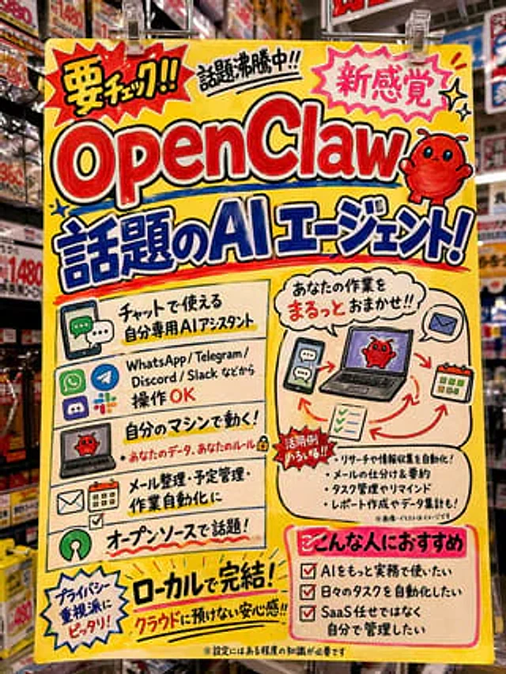

```text
Research on{argument name="service name" default="OpenClaw"} The information, and generate a sheet{argument name="store name" default="Don Quijote"} The style of the advertising posters should be as realistic as if they were actually posted there.{argument name="store name" default="Don Quijote"} The same as inside the store.
```

Model: GPT Image 2
Author: GPT Image 2 Prompts

[ProjectD](https://aitoolsradar.com/en/prompts/f701f2070f7a34) · [Recorded source](https://x.com/loglogrog/status/2046437230127034774)
 · [Full original metadata and byte evidence](data/projectd-batch-0048.json)

## Storm Wizard Casting Lightning

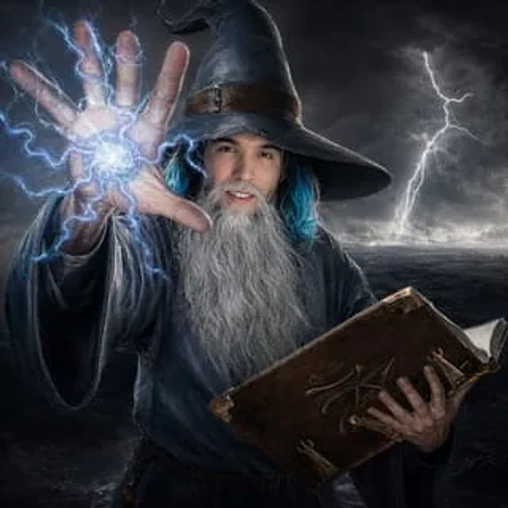

```text
A dramatic, dark fantasy portrait depicts an old mage standing on a stormy wasteland shrouded in black clouds. He wears a tall, weathered pointed hat with a brim adorned with brown leather straps and tiny metal buckles, and a heavy, wide-sleeved, dark blue-grey robe. Most of his face is hidden in the shadows beneath the hat brim, with only long, thin folds visible on either side.{argument name="accent hair color" default="Electric Blue"} His hair was flowing, and a long, silvery-white beard hung down his chest. The mage, in a powerful, forced perspective pose, extended his left hand towards the camera, fingers spread, a bright blue-white ball of magical energy gathering in his palm, crackling arcs of lightning swirling around his hand and cuffs. His right arm tightly clutched a large, ancient leather spellbook, its corners worn, adorned with metal fittings, its cover engraved with mysterious symbols, and several pages faintly visible. The background displayed a desolate, dark landscape, with a striking bolt of lightning striking down on the right side of the image. The cinematic high-contrast lighting, ultra-detailed skin and fabric textures, emotionally evocative photorealism, and sharp focus on the hands and beard, combined with a rich fantasy atmosphere, central composition, and square cropping, create a powerful visual effect.
```

Model: GPT Image 2
Author: GPT Image 2 Prompts

[ProjectD](https://aitoolsradar.com/en/prompts/7da4024e000ed9) · [Recorded source](https://x.com/javiercalzolari/status/2046696046001029500#reversed-0)
 · [Full original metadata and byte evidence](data/projectd-batch-0048.json)

## Story — Sneaker Drop Countdown

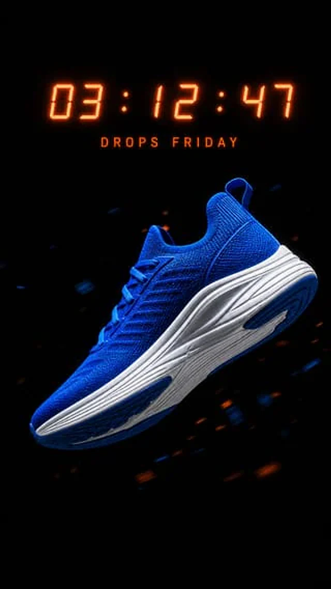

```text
Vertical 9:16 hype-drop sneaker ad frame. A single floating low-top sneaker in vibrant electric blue mesh upper with a chunky white midsole, lit from a single hard top-right key light against a pure matte black background. A thin neon orange digital countdown timer overlay at the top reads "03 : 12 : 47" and the smaller word "DROPS FRIDAY" sits beneath. Subtle motion blur particles around the shoe. No brand logo on the shoe, no swoosh, no watermark. Premium streetwear product ad design, photorealistic shoe materials, ultra sharp focus.
```

Model: GPT Image 2
Author: @hiapi_ai

[ProjectD](https://aitoolsradar.com/en/prompts/fe383428a2b591) · [Recorded source](https://github.com/HiAPIAI/awesome-gpt-image-2-prompts)
 · [Full original metadata and byte evidence](data/projectd-batch-0048.json)

## Story Ad — Fitness App Onboarding

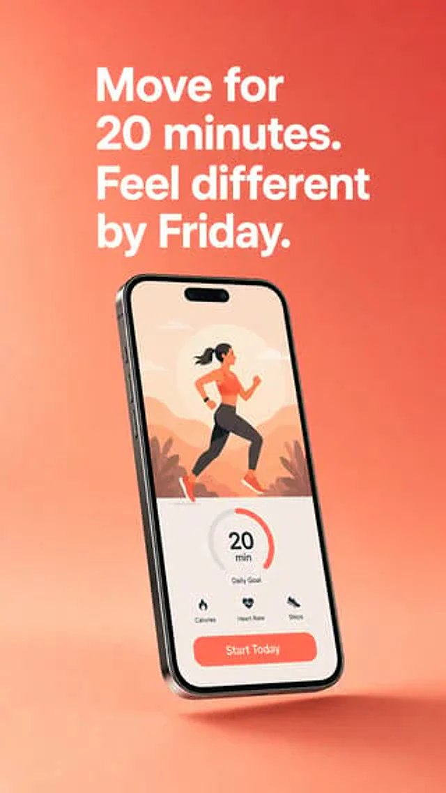

```text
Vertical 9:16 mobile story ad design. Soft coral and warm peach gradient background. A floating smartphone in the lower-center area displays a generic fitness app onboarding screen with a stylized running figure illustration, a progress ring, and a single call-to-action button on the phone screen reading "Start Today". Above the phone, a bold three-line sans-serif headline reads "Move for 20 minutes. Feel different by Friday.". Small soft drop shadow behind the phone. No real brand name, no logo, no watermark. Modern fitness app ad design, crisp typography, photorealistic phone.
```

Model: GPT Image 2
Author: @hiapi_ai

[ProjectD](https://aitoolsradar.com/en/prompts/42a0002178f885) · [Recorded source](https://github.com/HiAPIAI/awesome-gpt-image-2-prompts)
 · [Full original metadata and byte evidence](data/projectd-batch-0048.json)

## Storyboard Director Infographic

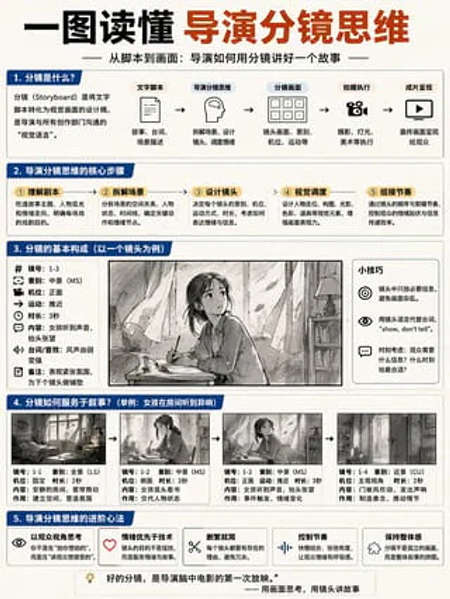

```text
{
  "type": "Educational infographic poster",
  "header": {
    "title": "{argument name=\"main title\" default=\"Understanding the Director&#39;s Storyboard Mindset in One Picture\"}",
    "subtitle": "{argument name=\"subtitle\" default=\"From Script to Visuals: How a Director Tells a Story Through Storyboarding\"}"
  },
  "layout": {
    "sections": [
      {
        "title": "1. What is a storyboard?",
        "components": [
          "Define text box",
          {
            "type": "flowchart",
            "count": 5,
            "labels": [
              "Script",
              "Director's Storyboard Thinking",
              "Storyboard",
              "Filming execution",
              "Final presentation"
            ]
          }
        ]
      },
      {
        "title": "2. The core steps of a director's storyboard thinking",
        "count": 5,
        "labels": [
          "① Understanding the script",
          "② Disassembly of the scenario",
          "③ Design lens",
          "④ Visual scheduling",
          "⑤ Grouping rhythm"
        ]
      },
      {
        "title": "3. The basic structure of a storyboard (taking a single shot as an example)",
        "columns": [
          {
            "position": "left",
            "count": 8,
            "labels": [
              "Mirror number",
              "Shot type",
              "camera position",
              "sports",
              "Duration",
              "content",
              "Dialogue/Sound Effects",
              "Remark"
            ]
          },
          {
            "position": "center",
            "image": "{argument name=\"character subject\" default=\"anime girl reading in a room\"}"
          },
          {
            "position": "right",
            "title": "Tips",
            "count": 3,
            "description": "Icon Highlights"
          }
        ]
      },
      {
        "title": "4. How do storyboards serve the narrative?",
        "subtitle": "{argument name=\"example scenario\" default=\"Example: The girl heard strange noises in the room.\"}",
        "count": 4,
        "panels": [
          "Panoramic view of the room",
          "Girl reading (middle scene)",
          "Girl looking up (medium shot)",
          "Close-up of the door opening"
        ],
        "caption_labels": [
          "Mirror number",
          "Shot type",
          "camera position",
          "Duration",
          "content",
          "effect"
        ]
      },
      {
        "title": "5. Advanced Techniques for Directors' Storyboard Thinking",
        "count": 5,
        "labels": [
          "Thinking from the audience's perspective",
          "Emotion over technology",
          "Simplify",
          "Control the rhythm",
          "Maintain a sense of unity"
        ]
      }
    ],
    "footer": "{argument name=\"footer quote\" default=\"A good storyboard is the first screening of the film in the director&#39;s mind.\"}"
  },
  "style": "Simple business-style infographics, blue and white color scheme, structured grid."
}
```

Model: GPT Image 2
Author: GPT Image 2 Prompts

[ProjectD](https://aitoolsradar.com/en/prompts/24ab6a965be092) · [Recorded source](https://x.com/AaronAlainYe/status/2044795817270374888#reversed-0)
 · [Full original metadata and byte evidence](data/projectd-batch-0048.json)

## Streaming Scene Screenshot


```text
Twitch-style screenshots, showcasing{argument name="person" default="tung tung sahur"} Live broadcast in progress{argument name="activity" default="chess irl match"} And with demis hannabis
```

Model: GPT Image 2
Author: GPT Image 2 Prompts

[ProjectD](https://aitoolsradar.com/en/prompts/58d493b55fdc4e) · [Recorded source](https://x.com/cneuralnetwork/status/2047010339255157020)
 · [Full original metadata and byte evidence](data/projectd-batch-0048.json)

## Street Fashion Magazine Layout

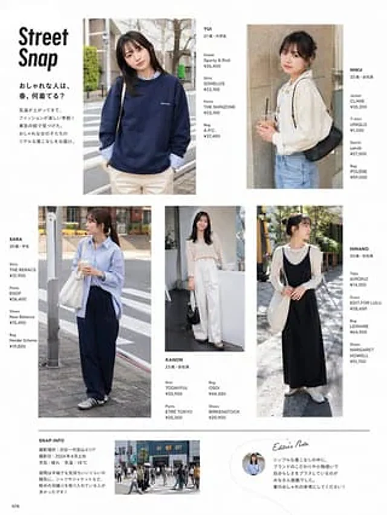

```text
for{argument name="magazine type" default="fashion magazine"} Generate a page with the target audience as{argument name="target audience" default="Women in their 20s"} The content should be{argument name="scene" default="Street photography"} The images feature several young and attractive Japanese women, with the brand name and price of their clothing listed in small print at the bottom of each photo. (Please use fictional brand names.)
```

Model: GPT Image 2
Author: GPT Image 2 Prompts

[ProjectD](https://aitoolsradar.com/en/prompts/2f6235b5be0fab) · [Recorded source](https://x.com/suu2u33/status/2047264121314480149)
 · [Full original metadata and byte evidence](data/projectd-batch-0048.json)

## Street Fashion Sketch Alter Ego Collage

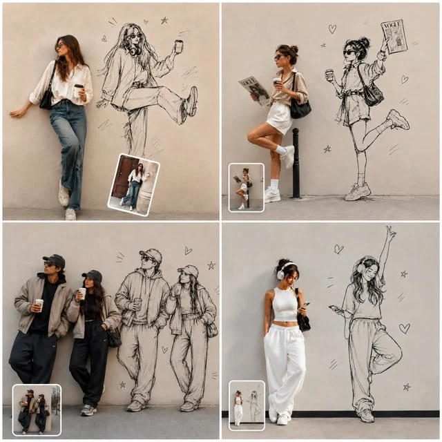

```text
Goal: Create a square 2x2 editorial photo-collage showing real street-style people posed against a plain beige concrete wall, with black hand-drawn fashion-sketch versions of them illustrated directly on the wall beside them. The overall concept is “favorite photo transformed into fashion editorial with sketch alter ego,” ultra-realistic photography mixed with rough ink pencil illustration.

Canvas: Square 1:1 image divided into exactly 4 equal panels by thin white gutters. Each panel has a minimalist beige/gray wall background and gray pavement floor, soft natural daylight, muted neutral tones, realistic shadows, and a clean Instagram moodboard aesthetic.

Layout and panels: Include exactly 4 panels. Panel 1, top left: a stylish young woman in sunglasses leans casually against the wall on the left, wearing a loose white button shirt, blue jeans, white sneakers, and a black shoulder bag, holding a takeaway coffee; to her right is a large black sketch of the same woman sitting in midair with one leg raised, holding a phone, with tiny doodle hearts, stars, and motion lines. Panel 2, top right: a fashionable young woman stands leaning near a black bollard, wearing sunglasses, an oversized white shirt or mini dress, white socks and sneakers, carrying a black shoulder bag, holding a coffee and a magazine; to her right is a playful drawn version kicking one leg back while holding up a fashion magazine labeled “VOGE,” with hearts and stars around it. Panel 3, bottom left: a stylish couple stands on the left in oversized dark streetwear, caps, sunglasses, bomber jackets, baggy pants, sneakers, both holding coffee cups; to their right is a black sketch of the same couple standing side by side, matching their poses and outfits, surrounded by small hearts, stars, and short radiating lines. Panel 4, bottom right: a young woman in white athleisure stands on the left, wearing headphones, a white crop top, loose white sweatpants, white sneakers, and a black bag, looking at her phone; to her right is a large sketch version dancing with one arm raised and one leg bent, also wearing headphones, surrounded by hearts, stars, and energetic line accents.

Inset thumbnails: Add exactly 4 small rounded-rectangle photo thumbnails, one inside each panel near the lower-left or lower-center area. Each thumbnail has a white border and shows the original reference-like mini version of that same panel’s real subject, slightly tilted or casually placed like a sticker.

Visual style: Ultra-realistic editorial street photography for the live people, combined with expressive black graphite/ink line art for the drawn figures. The sketches should look hand-drawn on the wall, loose, stylish, slightly messy, with visible construction lines, crosshatching, fashion illustration proportions, and no color fill. Keep the wall clean and matte so the drawings read clearly.

Customizable subject instruction: Use {argument name="photo subject" default="stylish young women and one fashionable couple"} as the real people, preserving identity and outfit accuracy if a source photo is provided. Set the overall vibe to {argument name="editorial style" default="minimal neutral street-fashion editorial"}. Use {argument name="wall color" default="warm beige concrete"}, {argument name="sketch style" default="loose black pencil fashion illustration"}, and include small doodles such as {argument name="doodle motifs" default="hearts, stars, short motion lines"}.

Constraints: Exactly 4 panels, exactly 4 inset thumbnails, exactly 4 main sketch alter-egos or sketch groups corresponding to the real subjects, no extra panels, no watermark, no readable text except the small fashion magazine label “VOGE,” keep the composition clean and high-end.
```

Model: GPT Image 2
Author: Alina Ai

[ProjectD](https://aitoolsradar.com/en/prompts/151d7d9c6c5355) · [Recorded source](https://youmind.com/prompts/street-fashion-sketch-collage-31721)
 · [Full original metadata and byte evidence](data/projectd-batch-0048.json)

## Street Portrait — Tokyo Shibuya Rain Night

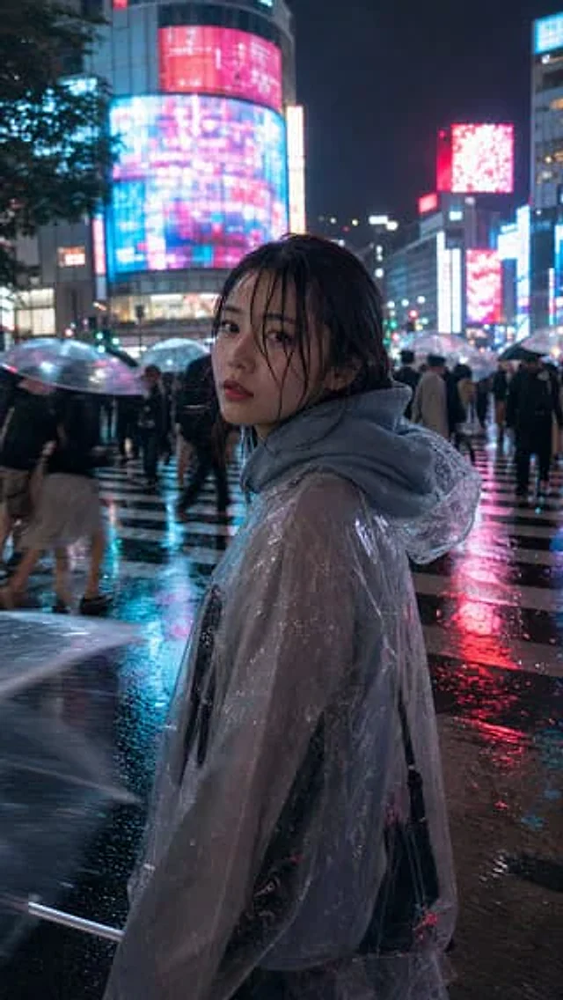

```text
Vertical 9:16 candid street portrait of a young woman in a clear plastic raincoat over a hooded sweatshirt, walking through a rain-soaked Shibuya intersection at night. Massive neon billboards in pink, cyan and red reflected on the wet pavement around her feet. Slight motion blur on the umbrella she carries. Wet hair strands sticking to her cheeks, soft makeup, calm expression. Phone-shot framing aesthetic, vertical composition. No real brand names on the billboards, no readable text, no watermark. Cinematic street photography quality with subtle 35mm grain, photorealistic rain droplets.
```

Model: GPT Image 2
Author: @hiapi_ai

[ProjectD](https://aitoolsradar.com/en/prompts/17acfe3f7ee99e) · [Recorded source](https://github.com/HiAPIAI/awesome-gpt-image-2-prompts)
 · [Full original metadata and byte evidence](data/projectd-batch-0048.json)

## Street Side Bookstore Portrait

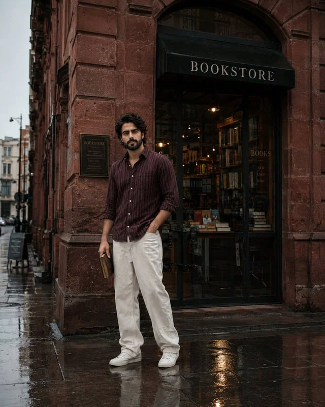

```text
Generate a realistic portrait of a {argument name="subject" default="young man"} randomly stop at streetside front of the {argument name="location" default="book store which built by the red stone"}, wet weather, wet street, dim light, he stand slightly titled, a wide distance shot, slightly side angle shot, full body shot, hd image, he hold a old book in his one hand, look towards the camera, messy and trousled hairs, respective physics, he wear {argument name="outfit" default="dark maroon striped shirt with baggy white jeans and white shoes"}, strictly preserve respective face details, 4:5.
```

Model: GPT Image 2
Author: Zar⭕on

[ProjectD](https://aitoolsradar.com/en/prompts/4fc6adb02c6b3a) · [Recorded source](https://youmind.com/prompts/street-style-red-stone-20816)
 · [Full original metadata and byte evidence](data/projectd-batch-0048.json)

## Streetwear Fashion Campaign Poster

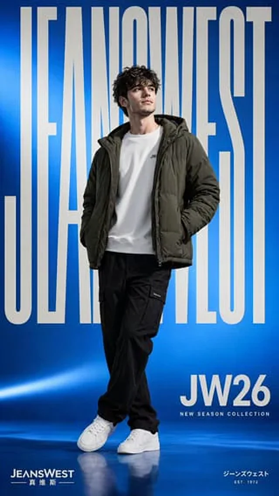

```text
Create a high-end streetwear fashion advertising poster inspired by modern Asian clothing advertisements. A full-body portrait of a stylish young male model standing confidently, ankles crossed, hands in his jacket pockets, head slightly tilted back and to the side, expression calm and deep. He has medium-length, curly, tousled hair with a soft texture. He has a slim, athletic build. The clothing includes one {argument name="jacket style" default="Dark olive green hooded cotton jacket"} He wore his shirt open, layered over a clean white crewneck sweatshirt with a small brand logo on the chest, paired with loose-fitting black cargo pants and simple white sneakers. The style was simple, youthful, and modern. (Background: [Insert background here]){argument name="background color" default="Vibrant electric blue"} Seamless studio backdrop with subtle gradient lighting, soft halo stripes, and glossy floor reflections. The lighting utilizes soft studio lighting with delicate shadows and a sophisticated commercial feel. Graphic poster layout with a large, bold, compressed sans-serif font.{argument name="brand name" default="JEANSWEST"} "Stretch the background behind the model vertically to a light gray-white. Add large text 'JW26' in the lower right corner. The composition should convey the quality of a high-end, trendy, simple, commercial, youthful, and modern fashion advertisement. The focus should be clear, the fabric texture hyper-realistic, with cinematic lighting, balanced white space, smooth brand design, high resolution, and a vertical poster proportion."
```

Model: GPT Image 2
Author: GPT Image 2 Prompts

[ProjectD](https://aitoolsradar.com/en/prompts/24ffa4a753055a) · [Recorded source](https://x.com/harboriis/status/2047921293123895520)
 · [Full original metadata and byte evidence](data/projectd-batch-0048.json)

## Streetwear Merch Lookbook Grid

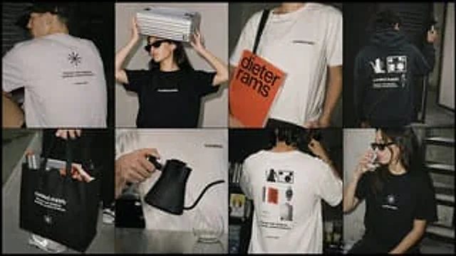

```text
{
  "type": "Fashion-themed marketing campaign collage",
  "brand": "{argument name=\"brand name\" default=\"curated.supply\"}",
  "style": "A rough-edged streetwear lookbook, featuring flash photography, candid shots of nightlife, soft film tones, slight graininess, and realistic clothing mockup photography.",
  "layout": {
    "grid": {
      "columns": 4,
      "rows": 2,
      "count": 8
    },
    "sections": [
      {
        "position": "top-left",
        "count": 1,
        "subject": "A rear-side view of a person wearing a beige or off-white T-shirt and a black baseball cap.",
        "garment_graphic": "A small starburst symbol is located at the top center of the back, below which are three lines of text that read 'Discover well-designed, carefully curated products.' The brand name is printed near the lower back."
      },
      {
        "position": "top-center-left",
        "count": 1,
        "subject": "A frontal view of a person wearing a black T-shirt, holding a silver aluminum hard-shell case above their head with both hands.",
        "garment_graphic": "A small brand logo is printed in the center of the chest, which reads '{argument name=\"chest logo text\" default=\"curated.supply\"} '"
      },
      {
        "position": "top-center-right",
        "count": 1,
        "subject": "A close-up of the torso of a person wearing a white T-shirt and a black shoulder strap, holding a large orange-red book or magazine.",
        "prop_text": "{argument name=\"book cover text\" default=\"dieter rams\"}",
        "garment_graphic": "Small brand logo printed on the chest"
      },
      {
        "position": "top-right",
        "count": 1,
        "subject": "The silhouette of a person wearing a dark charcoal gray or black hoodie, standing against a wall or next to an intercom at night.",
        "garment_graphic": "The back features a large rectangular graphic containing four illustrated objects: a kettle, a camera or similar audio device, a bottle or glass container, and smaller print including the brand name and the phrase 'Discover well-designed, carefully curated products.'"
      },
      {
        "position": "bottom-left",
        "count": 1,
        "subject": "He carries a black canvas tote bag, inside which are a silver bottle or thermos and an orange-red printed book.",
        "bag_graphic": "The white brand name, the slogan 'Discover well-designed, carefully curated products.', and the starburst symbol near the bottom."
      },
      {
        "position": "bottom-center-left",
        "count": 1,
        "subject": "A close-up of the torso of a person wearing a white T-shirt, pouring water from a matte black swan-neck pitcher into a small round glass on a table.",
        "garment_graphic": "Small text was printed on the chest, which read:{argument name=\"alternate chest text\" default=\"curated.\"} '"
      },
      {
        "position": "bottom-center-right",
        "count": 1,
        "subject": "A person wearing a white T-shirt standing in front of a bookshelf or books.",
        "garment_graphic": "The back features a large collage pattern incorporating six design elements: a silhouette of a black kettle, a graphic of a vintage camera or speaker, a vertical metal lighter-shaped object, an orange-red book cover with the words 'dieter rams' printed on it, a textured dark vase or container, and a silver ribbed suitcase; below are two lines of smaller text that read 'Discover well-designed, carefully curated products.' The brand name is printed near the hem."
      },
      {
        "position": "bottom-right",
        "count": 1,
        "subject": "A person wearing a black T-shirt is sitting and drinking water from a glass, with part of their face covered.",
        "garment_graphic": "A small graphic is printed in the center of the chest, with the starburst symbol above the brand name."
      }
    ]
  },
  "environment": "A dimly lit industrial interior against a nighttime urban backdrop, featuring concrete walls, a dark-colored doorway, metal staircases, bookshelves and books, and a casual lifestyle scene.",
  "wardrobe": [
    "White T-shirt",
    "Black T-shirt",
    "black hoodie",
    "Black canvas tote bag",
    "Black baseball cap"
  ],
  "props": [
    "Silver aluminum hard-shell case",
    "Orange-red Dieter Rams books",
    "Matte Black Gooseneck Jar",
    "Small round glass",
    "Silver bottle or thermos"
  ],
  "composition": "The clean, eight-panel marketing campaign features thin black dividers, with each image resembling a casually edited product photograph, focusing on high-quality, minimalist merchandise and print graphics."
}
```

Model: GPT Image 2
Author: GPT Image 2 Prompts

[ProjectD](https://aitoolsradar.com/en/prompts/3998becc4af3a6) · [Recorded source](https://x.com/justinmfarrugia/status/2047293707364307367#reversed-0)
 · [Full original metadata and byte evidence](data/projectd-batch-0048.json)

## Student Hangout Room Transformation

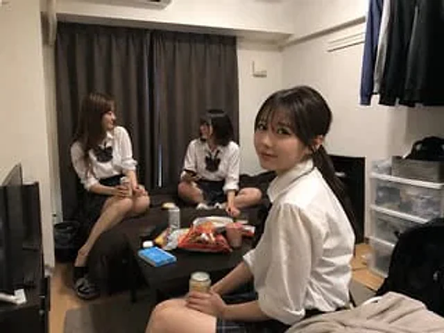

```text
Using REFERENCE_0 as the room base, create a natural realistic photo as if this room has become a casual hangout for {argument name="number of students" default="three"} {argument name="student type" default="20-year-old female college students"}. Keep the room layout, camera angle, furniture, curtains, bed, table, storage drawers, hanging clothes, lighting, and lived-in atmosphere from the uploaded room photo unchanged as much as possible.

Add exactly 3 people: one sitting on the left edge of the bed holding a canned drink, one sitting cross-legged on the bed near the center holding a smartphone, and one in the foreground on the right sitting near the table/bed edge holding a canned drink and turned toward the others. Dress them in coordinated {argument name="outfit style" default="Japanese school-uniform-inspired white shirts with dark plaid skirts and ribbon ties"}. Make them look relaxed, chatting, and comfortable in the room; vary their hairstyles and poses naturally.

Add casual hangout clutter on the table: exactly 7 visible snack/drink items — 2 canned drinks, 1 large open snack bag, 1 cup noodle container, 1 plate or small dish, 1 colorful snack package, and 1 small boxed item — while preserving existing objects such as the remote, blue box, and earbuds where plausible. Keep the result photorealistic, unposed, and like a spontaneous phone snapshot. Faces may be anonymized/blurred for privacy. Do not make it look like a studio shoot, illustration, cosplay poster, or heavily edited composite.
```

Model: GPT Image 2
Author: 藍沢あいせ Aise｜妄想写真家

[ProjectD](https://aitoolsradar.com/en/prompts/c97336779232ef) · [Recorded source](https://youmind.com/prompts/student-hangout-room-20572)
 · [Full original metadata and byte evidence](data/projectd-batch-0048.json)

## Studio Corporate Portrait with Inset


```text
A delicate photographic portrait, the subject being{argument name="subject" default="Young East Asian women"} A half-length portrait, centered and facing forward, against a smooth, dark charcoal gray background with subtle halo lighting effects. She has long, glossy, slightly wavy hair.{argument name="hair color" default="black"} Her hair, falling over her shoulders, featured soft, straight bangs and a neat center part. She wore a well-tailored double-breasted dress.{argument name="blazer color" default="Deep Navy Blue"} A suit jacket with six prominent round gold badge buttons creates an elegant and professional image. Her right hand is thoughtfully raised and rests under her chin, her fingers relaxed, presenting a dignified and formal posture. Soft directional lighting from the left front is used to showcase highly detailed skin texture, realistic fabric texture, soft shadows, and the aesthetics of a high-end business portrait. The image uses a vertical composition, simple and clear, with the subject occupying most of the frame. A small rectangular inset comparison photo with a white background is added in the lower left corner, showcasing the same woman in a minimalist ID photo style wearing a white collared shirt, and is overlaid below or above the inset.{argument name="corner text" default="GPT Image2"} The text uses a striking black sans-serif font. It is hyper-realistic, exquisite, and possesses editor-grade portrait quality.
```

Model: GPT Image 2
Author: GPT Image 2 Prompts

[ProjectD](https://aitoolsradar.com/en/prompts/b11ca43ce2db51) · [Recorded source](https://x.com/towi27266777031/status/2047139201637089307#reversed-1)
 · [Full original metadata and byte evidence](data/projectd-batch-0048.json)

## Studio Fashion Portrait Character Swap

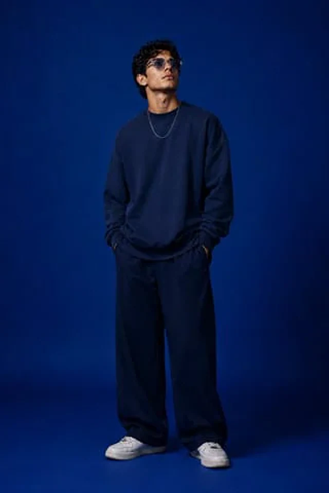

```text
Create a high-end studio fashion portrait inspired by the uploaded blue-background reference photograph. Recreate the original composition with matching framing, focal length feel, camera position, subject scale, perspective, and overall visual balance while maintaining a realistic photographic appearance.

Replace the reference model with the character from the supplied character image. Preserve the character's authentic facial identity, bone structure, skin tone, eye shape, hairstyle, proportions, and recognizable features. Avoid beautification that alters identity. The face should remain naturally expressive and true to the source character.

Match the original body language closely: upper torso visible, shoulders relaxed, chin slightly elevated, eyes directed upward beyond the camera, conveying quiet confidence and contemplation. Maintain the same sense of presence and spatial positioning within the frame.

Retain the rich cobalt-blue studio backdrop and the refined editorial atmosphere. Reproduce the original lighting setup with soft directional illumination, subtle facial highlights, realistic reflections on eyewear and jewelry, and smooth shadow transitions around the jawline, neck, and clothing folds. Preserve depth, dimensionality, and studio realism.

Style the character in contemporary oversized street-fashion apparel. Use a premium relaxed-fit knit sweater or sweatshirt with natural fabric draping, layered with a minimalist chain necklace and lightly tinted translucent eyewear. The wardrobe may be customized to suit the character, but should maintain the same luxurious oversized silhouette and fashion-campaign aesthetic.

Keep the image tightly composed with the same portrait crop and subject placement. Ensure identical camera-to-subject distance and visual weight in the frame. The final result should feel indistinguishable from a genuine professional photoshoot captured in this exact studio environment.

Photorealistic editorial photography, luxury fashion campaign, cinematic studio portrait, premium streetwear styling, deep monochromatic blue backdrop, realistic skin texture, subtle film-grade contrast, detailed fabric rendering, natural lighting falloff, commercial advertising quality, shallow depth of field, magazine-cover aesthetics.

Negative Prompt:

Do not alter the background color or studio environment. Do not change the pose, framing, crop, perspective, subject distance, lighting direction, or gaze. Do not modify facial identity, facial proportions, skin tone, or hairstyle. Avoid excessive retouching, artificial skin smoothing, stylized illustration effects, exaggerated sharpening, extra accessories, text overlays, logos, watermarks, duplicate subjects, or unrealistic clothing physics.
```

Model: GPT Image 2
Author: Johnn

[ProjectD](https://aitoolsradar.com/en/prompts/0c9a67703594fd) · [Recorded source](https://youmind.com/prompts/studio-fashion-character-portrait-recreation-24903)
 · [Full original metadata and byte evidence](data/projectd-batch-0048.json)

## Studio Portrait From Vacation Selfie


```text
Using the provided reference image, keep the subject and blue polo shirt the same, and transform a casual poolside selfie into a clean, professional studio half-body portrait. Remove the entire outdoor resort background and replace it with a pure warm orange background. Recompose the shot, centering the subject and facing the camera directly, cropping from the center of the chest upwards, and use even, soft studio lighting to achieve a sharp, refined photographic quality. Eliminate any selfie-like feel, background distractions, and other people, and add a white four-pointed star icon in the lower right corner.
```

Model: GPT Image 2
Author: GPT Image 2 Prompts

[ProjectD](https://aitoolsradar.com/en/prompts/b28e12438d6fef) · [Recorded source](https://x.com/rgbarcena/status/2047580598068277496#reversed-1)
 · [Full original metadata and byte evidence](data/projectd-batch-0048.json)

## Studio Portrait of a Blue-Eyed Ragdoll Kitten

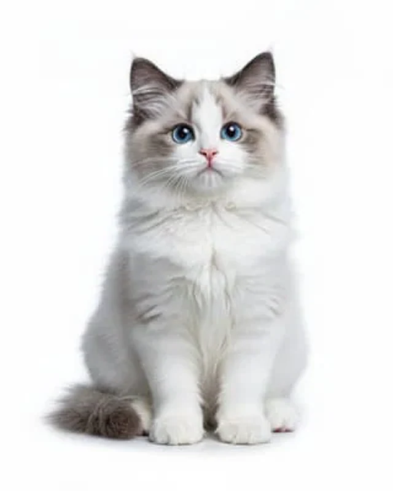

```text
A centered studio portrait, the subject of which is a fluffy animal.{argument name="cat breed" default="Ragdoll kittens"} It is sitting and looking directly at the camera against a seamless, pure white background. The kitten has two clearly visible ears and two lively paws.{argument name="eye color" default="blue"} With its eyes, small pink nose, and long white whiskers, its expression is gentle and symmetrical, conveying both docility and curiosity. Its fur is predominantly white, with subtle silver-grey shadows on its face, ears, sides, and tail. The fur is fluffy and long, with dense feathering on its chest. The tips of its ears are darker, and there are subtle grey mask-like markings around its eyes. Its thick, bushy tail wraps around its left side to the front. The photograph showcases its entire body from head to paws in a neat, upright sitting posture, with its two front paws visible together. Soft, high-key lighting with minimal shadows highlights the incredibly fine details of its fur, keeping the face sharply focused. The overall effect is realistic, reminiscent of pet photography, with a centered composition and a serene, minimalist aesthetic.
```

Model: GPT Image 2
Author: GPT Image 2 Prompts

[ProjectD](https://aitoolsradar.com/en/prompts/1530ab2df1a771) · [Recorded source](https://x.com/polloai_kr/status/2047164497916539290#reversed-0)
 · [Full original metadata and byte evidence](data/projectd-batch-0048.json)

## Studio Portrait With Strawberry Ice Cream


```text
A sophisticated studio portrait of a woman with star quality; half-length, centered composition, against a smooth, neutral gray background. She has {argument name="hair color" default="jet black"} Her long, bouncy, center-parted hair, with its strong sheen, falls softly over her shoulders. Most of her face is obscured by an ice cream cone held in front of her mouth and chin, creating a playful, fashion editorial composition. She wears a white ribbed vest with wide straps and a striking, sparkling earring. In her hand, she holds a waffle cone topped with a huge scoop of pink strawberry ice cream, textured with deep red berries, giving it a slightly melted look. The warm, skin-tone-correcting makeup lighting, soft shadows, realistic skin tones, high-end celebrity portrait photography, sharp focus on the hands, cone, hair, and shoulders, minimalist background, subtle yet sexy and chic atmosphere, and vertical composition all contribute to the overall effect.
```

Model: GPT Image 2
Author: GPT Image 2 Prompts

[ProjectD](https://aitoolsradar.com/en/prompts/1e7cef023d2178) · [Recorded source](https://x.com/arturogarrido/status/2046696077018186053#reversed-0)
 · [Full original metadata and byte evidence](data/projectd-batch-0048.json)

## Studio Product Render From Blueprint


```text
Using the provided reference images, convert the technical engineering specifications sheet into a clean, photographic product master image of the same jellyfish-shaped kitchen utensil rack. Retain the overall product design, the translucent blue dome lid, the silver base, and the four hanging utensils: a slotted spoon, a pasta ladle, and two soup ladles. Remove all blueprint elements, including exploded views, dimension lines, labels, tables, annotations, and title bars. Show only a centered, front-facing assembled product against a minimalist light gray background on a white surface, using soft diffused lighting with subtle, realistic shadows and a sophisticated sheen. Make it look like a modern industrial design catalog or e-commerce product photograph.
```

Model: GPT Image 2
Author: GPT Image 2 Prompts

[ProjectD](https://aitoolsradar.com/en/prompts/66cc7fcb839026) · [Recorded source](https://x.com/amypretzel/status/2046673739220471871#reversed-1)
 · [Full original metadata and byte evidence](data/projectd-batch-0048.json)

## Style Spectrum Fashion Poster

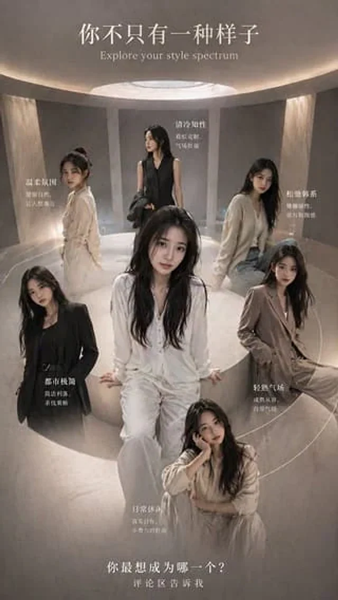

```text
A high-end fashion editorial poster in a vertical 9:16 format, set inside a serene futuristic circular gallery with smooth beige stone walls, a large round skylight in the ceiling, soft diffused warm lighting, and a sculptural circular platform at the center. The image shows 7 versions of the same young East Asian woman with long dark wavy hair, each styled as a different personality archetype, arranged around the circular platform in an elegant symmetrical composition. The central and largest figure sits on the edge of the platform facing forward, wearing a loose ivory-white button-front blouse and matching relaxed trousers, calm and introspective, becoming the visual anchor. Around her are 6 alternate style personas: 1 woman on the left in a soft cream dress with hair in a bun, gentle and approachable; 1 woman at the back center standing in a sleeveless black tailored outfit, cool and rational; 1 woman on the upper right seated in a light beige cardigan and pale skirt or trousers, casual and relaxed; 1 woman on the lower left in a sharp black blazer and dark outfit, urban minimalist; 1 woman on the lower right in a taupe oversized suit, mature and confident; 1 woman at the bottom front crouching in a cozy cream knit and loose light pants, everyday comfort style. All seven figures have the same identity but different styling, mood, and pose. Use a muted neutral palette of ivory, cream, taupe, beige, stone gray, and black, with soft atmospheric haze, cinematic depth, luxury magazine aesthetics, minimalism, and polished skin. Add elegant Chinese typography integrated into the composition: top headline {argument name="headline text" default="你不只有一种样子"} with smaller English subtitle {argument name="subtitle text" default="Explore your style spectrum"}. Place 6 Chinese style labels with short descriptive taglines near the surrounding personas: 温柔氛围, 清冷知性, 松弛韩系, 都市极简, 轻熟气场, 日常休闲. At the bottom add the Chinese call-to-action {argument name="bottom question" default="你最想成为哪一个？"} and smaller line {argument name="bottom caption" default="评论区告诉我"}. Premium poster design, fashion campaign feel, graceful composition, soft focus, refined and aspirational.
```

Model: GPT Image 2
Author: 李岳

[ProjectD](https://aitoolsradar.com/en/prompts/c8f52fed2bec40) · [Recorded source](https://youmind.com/prompts/style-spectrum-fashion-poster-16881)
 · [Full original metadata and byte evidence](data/projectd-batch-0048.json)

## Style-to-UI Design System

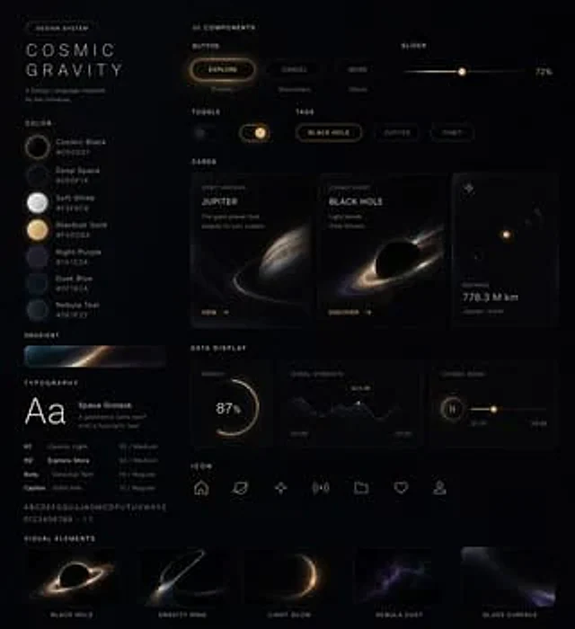

```text
用这种风格帮我生成一套UI设计系统，包含网页、移动端、卡片、控件、按钮以及其它。把这套视觉风格作为参考生成网页。我尝试了宇宙、飞行、蝴蝶主题。
```

Model: GPT Image 2
Author: @stark_nico99

[ProjectD](https://aitoolsradar.com/en/prompts/92413122107409) · [Recorded source](https://x.com/stark_nico99/status/2045836554451706125)
 · [Full original metadata and byte evidence](data/projectd-batch-0048.json)

## Stylized 3D Animated Family Portrait

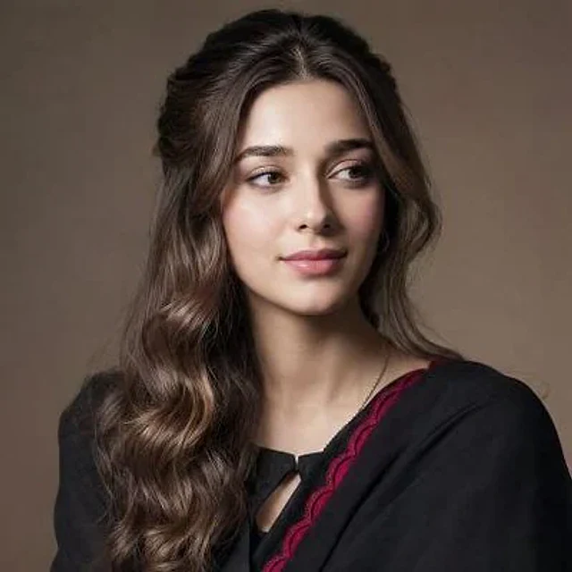

```text
Create a {argument name="aspect ratio" default="vertical 4:5"} premium stylized {argument name="art style" default="3D animated family portrait"} using the uploaded photo as reference. Keep every family member clearly recognizable through facial features, hairstyle, glasses, age, expressions, and overall vibe while transforming them into a polished cute high-end 3D animation style. Use soft cinematic shading, detailed hair strands, realistic fabric textures, and warm natural skin tones. Avoid plastic, toy-like, or cheap CGI looks. Use a strict elevated high-angle camera view from above, tilted downward toward the family. Faces and upper bodies should appear slightly larger while the full bodies taper naturally toward the feet. Keep everyone head-to-toe and large in the frame with minimal empty space. Arrange the family in a tight affectionate cluster with joyful candid energy. {argument name="additional elements" default="Add playful hand-drawn doodles around the family using dark brown line art with hearts, stars, and spark marks."}
```

Model: GPT Image 2
Author: Lariab Fatima‎

[ProjectD](https://aitoolsradar.com/en/prompts/2fd854e9900737) · [Recorded source](https://youmind.com/prompts/3d-animated-family-portrait-22123)
 · [Full original metadata and byte evidence](data/projectd-batch-0048.json)

## Stylized Urban 3D Skater Character

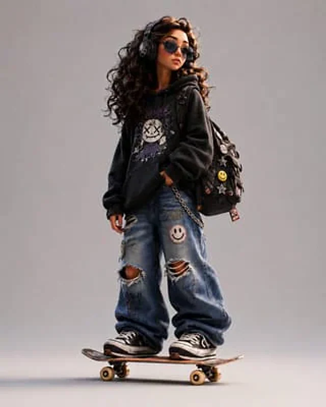

```text
Stylized 3D cartoon character in a modern animated movie style, inspired by Pixar, Spider-Verse and indie street-art aesthetics.

The character has:

* exaggerated proportions
* long skinny limbs
* oversized hoodie
* baggy ripped jeans
* chunky sneakers
* expressive face with tired/confident attitude
* messy stylized hair
* large headphones
* backpack with pins and patches
* standing naturally on a skateboard

Style:
clean cinematic 3D render, soft global illumination, subtle chromatic aberration, ultra-detailed textures, smooth shading, playful but realistic anatomy, high-end character design, stylized streetwear fashion, urban youth energy.

Pose:
slightly slouched posture, one hand relaxed, cool bored expression, looking sideways.

Outfit colors:
customizable {argument name="clothing color" default="hoodie pink"}, denim jeans, streetwear accessories, skater aesthetic.

Background:
minimal clean studio background, soft shadows, centered composition.

Extra details:
stickers, embroidered patches, smiley pins, doodles, skate culture vibe, early 2000s urban energy, cinematic render quality, highly polished animation studio look.

Aspect ratio: 4:5 vertical.
```

Model: GPT Image 2
Author: Kashberg

[ProjectD](https://aitoolsradar.com/en/prompts/5fa0195b3073d6) · [Recorded source](https://youmind.com/prompts/stylized-3d-urban-skater-character-22537)
 · [Full original metadata and byte evidence](data/projectd-batch-0048.json)

## Subject Erasure and Hat Replacement

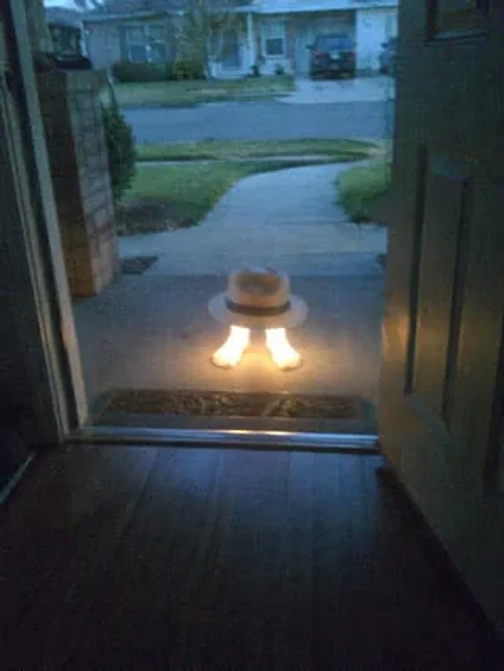

```text
Using the reference image, completely remove the pelican's body. Replace the traffic cones with {argument name="hat style" default="White fedora with black trim"} It is then placed directly above the human foot. A strong glowing effect is added to the foot, making it {argument name="foot effect" default="Emitting a bright, warm light"} Maintain the open doorway, porch environment, and the suburban sunset backdrop.
```

Model: GPT Image 2
Author: GPT Image 2 Prompts

[ProjectD](https://aitoolsradar.com/en/prompts/27e6c7af9aa57d) · [Recorded source](https://x.com/zy_fou/status/2045049820696518723#reversed-1)
 · [Full original metadata and byte evidence](data/projectd-batch-0048.json)

## Subway Candid Photo Prompt

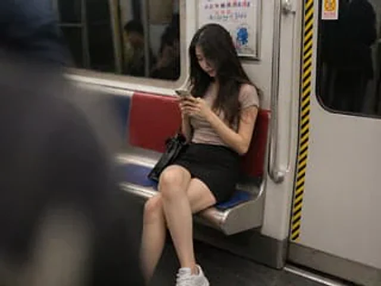

```text
One{argument name="subject" default="Beautiful woman"} Looking at my phone, location{argument name="location" default="On the subway"} The style is{argument name="style" default="Candid photos"}
```

Model: GPT Image 2
Author: GPT Image 2 Prompts

[ProjectD](https://aitoolsradar.com/en/prompts/f303d352364ef5) · [Recorded source](https://x.com/sgecqz/status/2047593401558925710)
 · [Full original metadata and byte evidence](data/projectd-batch-0048.json)

## Subway Juice Drink Advertisement


```text
{argument name="饮品类型" default="果汁饮品"}广告，{argument name="广告风格" default="地铁广告风格"}，活力四射
```

Model: GPT Image 2
Author: Adam也叫吉米

[ProjectD](https://aitoolsradar.com/en/prompts/05aee86097cb1c) · [Recorded source](https://youmind.com/prompts/juice-drink-subway-ad-poster-24000)
 · [Full original metadata and byte evidence](data/projectd-batch-0048.json)

## Summer Beach Beverage Commercial Shot

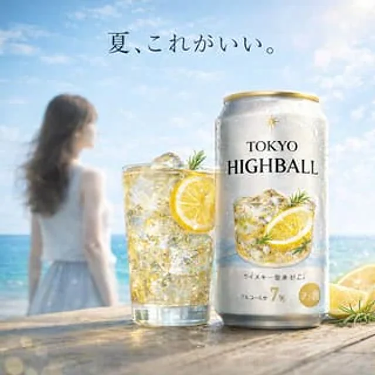

```text
A bright, summery commercial product photograph showcases a refreshing drink placed on a weathered wooden table. In the clear foreground, a stemmed glass holds a golden, bubbly, chilled beverage, garnished with a lemon slice and a sprig of rosemary; next to it is a silver aluminum can covered in condensation. The can prominently displays English text below a small gold star logo.{argument name="product name" default="TOKYO HIGHBALL"} The can is accompanied by an image of the drink itself, with the Japanese phrase "Alcohol 7%" printed near the bottom. To the right of the can, on a table, are two slices of lemon. Against a softly blurred background, a sunny beach scene unfolds, with shimmering azure water and a clear sky. To the left of the background stands a young woman with long brown hair, wearing a white sleeveless top and a light blue skirt, gazing at the sea. Above the scene, Japanese text floats elegantly in the sky.{argument name="catchphrase" default="This is perfect for summer."} The overall lighting is bright and inviting, with shimmering bokeh and lens flare highlighting the perfect cool and refreshing summer atmosphere.
```

Model: GPT Image 2
Author: GPT Image 2 Prompts

[ProjectD](https://aitoolsradar.com/en/prompts/b282d0a436ec29) · [Recorded source](https://x.com/highball_cho/status/2045484111171915887#reversed-0)
 · [Full original metadata and byte evidence](data/projectd-batch-0048.json)

## Summer Breeze Handwritten Typography

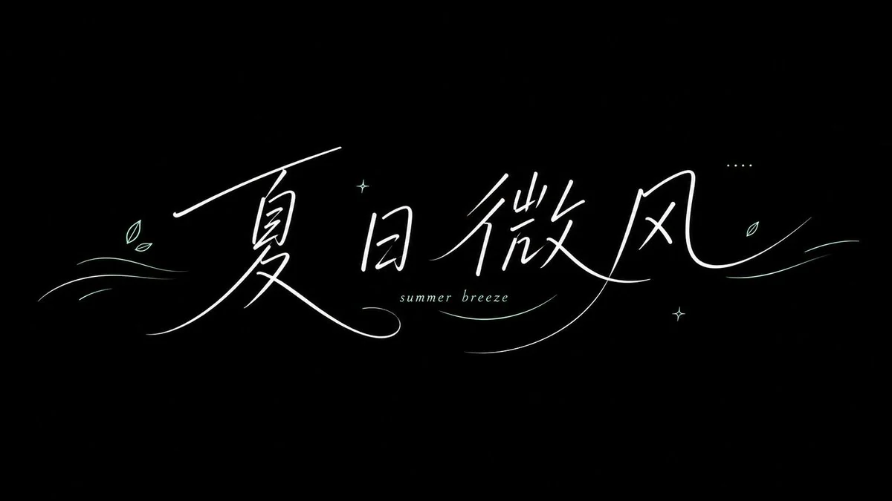

```text
围绕具体主题内容生成一张清爽夏日手写字体视觉：背景为大面积主题派生清新配色或明亮色场，主字使用白色细长手写体，笔画流畅、带长弧线和风一样的尾巴，部分字形可穿插小号英文和装饰线。构图中央留给主字呼吸，字形之间有轻盈错位，整体像风、天气或生活方式品牌。色彩保留高饱和但干净的主色底、明亮白字、少量浅色细线，情绪清透、轻快、有通风感。关键是笔画的飘动方向和留白，不要写成厚重口号字。

文字：{argument name="文字" default="夏日微风"}
注意：黑底白字
比例16:9
```

Model: GPT Image 2
Author: 小小东

[ProjectD](https://aitoolsradar.com/en/prompts/a7c238ea108ba9) · [Recorded source](https://youmind.com/prompts/summer-breeze-handwritten-font-24111)
 · [Full original metadata and byte evidence](data/projectd-batch-0048.json)

## Summer Coffee Ice Cream Collab Poster


```text
A bright and cheerful summer-themed collaborative beverage poster, using a simple Chinese commercial advertising style, showcases {argument name="brand one" default="Mixue Ice Cream"} and{argument name="brand two" default="STARBUCKS"} This is a collaboration between [brand name]. The poster is vertically formatted with a soft blue sky, sunlight-drenched greenery, and an outdoor café atmosphere as the background. Two brand logos are placed side-by-side at the top, followed by a prominent large Chinese title in a playful, hand-drawn artistic font:{argument name="headline text" default="Snow King Meets Star Friends"} Add a green ribbon banner below the title, containing a Chinese subtitle:{argument name="subheadline text" default="Mixue Ice Cream x Starbucks Collaboration Launched"} The image includes a small print that reads "Double the Sweetness, Double the Happiness." It features two circular stamp-like graphics: the left one reads "Limited Edition Collaboration," while the upper right corner resembles a postmark, surrounded by Chinese characters and small drink icons. In the foreground, on an outdoor wooden table, are two iced drinks: the left one is a bright green matcha smoothie in a clear glass, topped with a towering vanilla soft-serve ice cream and green matcha sauce, the ice cubes clearly visible, and the cup bearing a cute Snow King mascot logo; the right one is a clear Starbucks-style iced latte with a milk and green matcha swirl at the bottom, topped with whipped cream and dark cookie crumbs, and the cup bearing a green mermaid logo. In front of the drinks is a cute white Snow King mascot doll, wearing a small crown, with a round body, rosy cheeks, a red cape, and playfully winking, sitting and holding a small coffee takeaway cup. Next to the drinks are two vertical product labels: the left label reads "Snow-Topped Matcha Frappuccino," and the right label reads "Matcha Snow King Oreo." In the mid-ground on the right, a small blackboard sits on a wooden easel, displaying the words "ICE CREAM &amp; COFFEE" and featuring chalk drawings of an ice cream cone and a takeaway cup. A torn-paper style price display in the lower left corner shows a bundle deal, complete with a striking red "¥19.9," green text, and a small green badge that reads "Save ¥6." A "Collaboration Merchandise" display area in the lower right corner showcases four items: a cup sleeve, a character keychain or acrylic pendant, a round badge, and a sticker or token, all themed around the collaboration between the Snow King mascot and coffee. The image utilizes warm sunlight, glossy beverage photography, shallow depth of field, soft tree shadow blur, high-contrast product retouching, and clear packaging details to present a positive and youthful retail promotion aesthetic. Scattered doodle hearts and playful decorative elements adorn the text. Except for the Starbucks logo and the blackboard text, all visible text is in Chinese.
```

Model: GPT Image 2
Author: GPT Image 2 Prompts

[ProjectD](https://aitoolsradar.com/en/prompts/9fb3507c820c27) · [Recorded source](https://x.com/web3annie/status/2046877548966256724#reversed-1)
 · [Full original metadata and byte evidence](data/projectd-batch-0048.json)

## Summer Coffee Ice Cream Collab Poster


```text
A bright, cheerful summer co-branded beverage poster in a clean Chinese commercial advertising style, showing a collaboration between {argument name="brand one" default="蜜雪冰城"} and {argument name="brand two" default="STARBUCKS"}. Vertical poster layout with a soft blue sky background, sunlit greenery, and an outdoor cafe atmosphere. At the top, place both brand logos side by side with a large bold Chinese headline in playful hand-drawn display lettering: {argument name="headline text" default="雪王遇见星朋友"}. Beneath it, add a green ribbon banner with Chinese subheadline text: {argument name="subheadline text" default="米雪冰城 × 星巴克 联名开启"}, and a smaller line reading "甜蜜加倍·快乐翻倍". Include 2 circular stamp-style graphics: one on the left reading "联名限定", and one on the upper right like a postmark with Chinese text around a small drink icon. In the center foreground on a wooden outdoor table, display 2 iced drinks: on the left, a tall clear cup of vivid green matcha slush topped with a tall swirl of vanilla soft serve and green matcha drizzle, with visible ice texture and a cute snowman mascot logo on the cup; on the right, a tall clear Starbucks-style iced latte with milk and green matcha swirls at the bottom, topped with whipped cream and dark cookie crumbs, with the green siren logo on the cup. In front of the drinks, place 1 cute white snowman mascot figurine with a tiny crown, round body, rosy cheeks, red cape, and a happy wink, sitting and holding a small takeaway coffee cup. Add 2 vertical product name tags beside the drinks: left tag "雪顶抹茶星冰乐", right tag "抹茶雪王奥利奥". On the right midground, place 1 small black chalkboard sign on a wooden easel reading "ICE CREAM & COFFEE" with chalk drawings of an ice cream cone and a takeaway cup. In the lower left, create a torn-paper price block showing a combo offer with large red numbers "¥19.9", green supporting text, and a small green badge reading "立省 ¥6". In the lower center-right, add a "联名周边" area displaying exactly 4 merchandise items: 1 cup sleeve, 1 character keychain or acrylic charm, 1 round badge, and 1 small sticker or token, all using the snowman mascot and coffee collaboration theme. Use warm sunlight, glossy drink photography, shallow depth of field, soft bokeh trees, high contrast product retouching, crisp packaging details, and an upbeat youthful retail-promo aesthetic. Include scattered doodle hearts and playful decorative accents around the typography. Keep all visible text in Chinese except the Starbucks wordmark and the chalkboard text.
```

Model: GPT Image 2
Author: Annie 所长

[ProjectD](https://aitoolsradar.com/en/prompts/dcdf109f17e581) · [Recorded source](https://youmind.com/prompts/summer-coffee-ice-cream-collab-15079)
 · [Full original metadata and byte evidence](data/projectd-batch-0048.json)

## Summer Ice Cream Moment

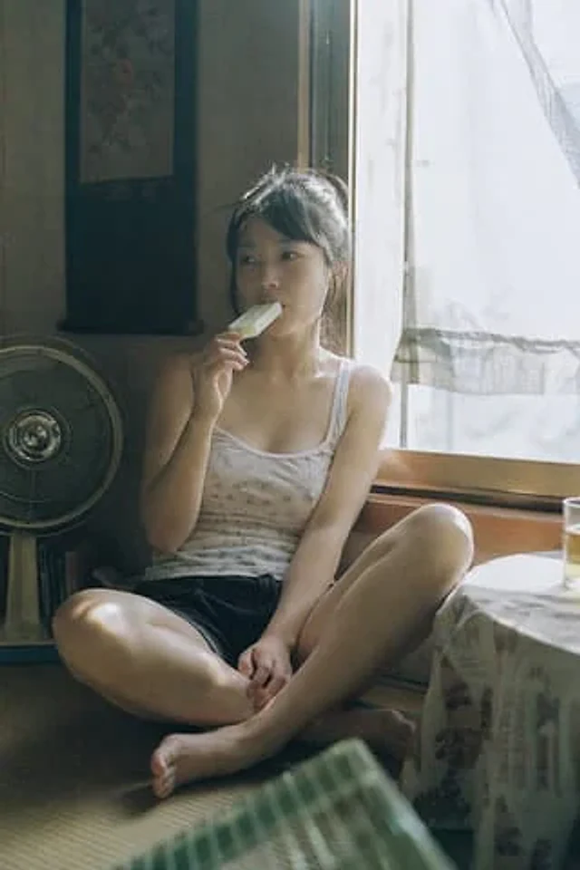

```text
Japanese negative film aesthetics: a quiet summer afternoon, a natural snapshot, soft sunlight streaming through a window, slightly overexposed highlights, low contrast yet rich tonal gradations, soft and slightly faded colors, gentle skin tones, unretouched realism, and fine film grain.{argument name="subject" default="A beautiful young Japanese girl"} He sat casually on the floor by the window, his legs naturally bent.{argument name="action" default="Eating ice cream"} A relaxed, unfocused gaze; sheer curtains swaying in the breeze; an imperfect composition; a quiet, detached atmosphere; "a memory-like realism"—ar 2:3
```

Model: GPT Image 2
Author: GPT Image 2 Prompts

[ProjectD](https://aitoolsradar.com/en/prompts/378cb542a68481) · [Recorded source](https://x.com/BubbleBrain/status/2047507039417696486)
 · [Full original metadata and byte evidence](data/projectd-batch-0048.json)

## Summer McCafé Mountain Road Ad

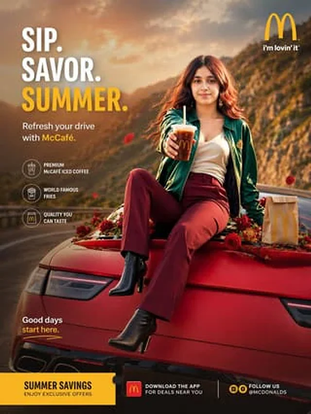

```text
Create a sophisticated, high-end vertical fast-food lifestyle advertisement in the style of commercial photography, designed as a summer promotional poster for McDonald's and McCafé. In the image, a captivating young woman with softly blurred, almost unrecognizable features sits confidently on the hood of a stylish red sports car parked on a winding mountain road, the moment set in the golden hour. She has long, wavy auburn hair that shimmers in the warm, sunset backlight, and wears a dark green satin bomber jacket with gold details, a white tank top, high-waisted burgundy trousers, and black high-heeled ankle boots. Her pose is relaxed and stylish, one leg bent, the other extended forward, while she holds a clear plastic cup of iced coffee with a straw and the prominent McDonald's gold arches logo towards the camera. Red roses are scattered around her on the hood, and a McDonald's paper takeout bag is placed to the right of the hood. Use a spectacular canyon or hillside with warm sunlight, soft mist, cinematic depth of field, and a luxurious road trip atmosphere as the background. Red petals float in the air. The composition employs a high-end advertising layout, with the model slightly to the right and centered, accompanied by a large promotional banner on the left. Three prominent headlines are added to the upper left: "SIP.", "SAVOR.", and "{argument name="headline text" default="SUMMER."} The first two lines are in bold white, and the third line is in bold gold. Add a subtitle below: “Refresh your drive with McCafé.”, highlighting “McCafé” in yellow. Stack three circular function icons vertically on the left, with brief descriptions: “PREMIUM McCAFÉ ICED COFFEE,” “WORLD FAMOUS FRIES,” and “QUALITY YOU CAN TASTE.” Place the McDonald's gold arches logo and the text “i'm lovin' it” in the upper right corner. Add a small tagline in the lower left: “Good days start here.”, setting “start here.” to yellow. Create a striking yellow banner across the entire width at the bottom, divided into three sections: the left section displays “SUMMER SAVINGS” and “ENJOY EXCLUSIVE OFFERS”; the middle section contains the McDonald's App icon and the text “DOWNLOAD THE APP FOR DEALS NEAR YOU”; and the right section displays “FOLLOW US.” The campaign features the brand's signature " @MCDONALDS " tagline and social media icons. It utilizes red and yellow tones consistent with the brand's aesthetic, glossy product designs, realistic lighting and shadows, sharp, editor-quality retouching, shallow depth of field, luxurious commercial advertising compositions, and mobile-first poster proportions.
```

Model: GPT Image 2
Author: GPT Image 2 Prompts

[ProjectD](https://aitoolsradar.com/en/prompts/b4b86ea4c32f94) · [Recorded source](https://x.com/MahnoorAi12/status/2046907516307857654#reversed-0)
 · [Full original metadata and byte evidence](data/projectd-batch-0048.json)

## Summer McCafé Mountain Road Ad


```text
Create a premium vertical fast-food lifestyle advertisement in a polished commercial photography style, designed like a summer campaign poster for McDonald's and McCafé. Show a glamorous young woman with softly blurred, unidentifiable facial features sitting confidently on the hood of a sleek red sports car parked on a winding mountain road at golden hour. She has long wavy auburn hair glowing in warm sunset backlight, wears a dark green satin bomber jacket with gold detailing, a white camisole, high-waisted burgundy pants, and black ankle boots with heels. Her pose is relaxed and stylish, one leg bent and one extended forward, while she holds out a clear plastic cup of iced coffee with a straw and visible McDonald's golden arches branding toward the camera. Scatter red roses across the car hood around her, and place 1 McDonald's paper takeout bag on the right side of the hood. Use a dramatic canyon or hillside background with warm sunlight, soft haze, cinematic depth of field, and a luxurious aspirational road-trip mood. Include floating red flower petals in the air. Compose the layout as a high-end ad with the model centered slightly right and large promotional typography on the left. Add exactly 3 large headline lines in the upper left: "SIP.", "SAVOR.", and "{argument name="headline text" default="SUMMER."}" with the first 2 in bold white and the third in bold golden yellow. Below that, add the subheadline: "Refresh your drive with McCafé." with "McCafé" highlighted in yellow. Add exactly 3 circular feature icons stacked vertically on the left with short captions: "PREMIUM McCAFÉ ICED COFFEE", "WORLD FAMOUS FRIES", and "QUALITY YOU CAN TASTE". Place the McDonald's golden arches logo with the text "i'm lovin' it" in the top right. Add a small lower-left tagline reading "Good days start here." with "start here." in yellow. Create a bold yellow bottom banner spanning the width, divided into 3 content areas: left area reads "SUMMER SAVINGS" and "ENJOY EXCLUSIVE OFFERS"; center area includes a McDonald's app icon and the text "DOWNLOAD THE APP FOR DEALS NEAR YOU"; right area reads "FOLLOW US @MCDONALDS" with social icons. Use brand-accurate red and yellow accents, glossy product styling, realistic lighting, sharp editorial retouching, shallow depth of field, luxury commercial ad composition, and mobile-first poster proportions.
```

Model: GPT Image 2
Author: Mahnoor Fatima

[ProjectD](https://aitoolsradar.com/en/prompts/8cd1d8e39d83da) · [Recorded source](https://youmind.com/prompts/summer-mccaf-mountain-road-ad-14813)
 · [Full original metadata and byte evidence](data/projectd-batch-0048.json)

## Summer Menswear Lookbook Grid

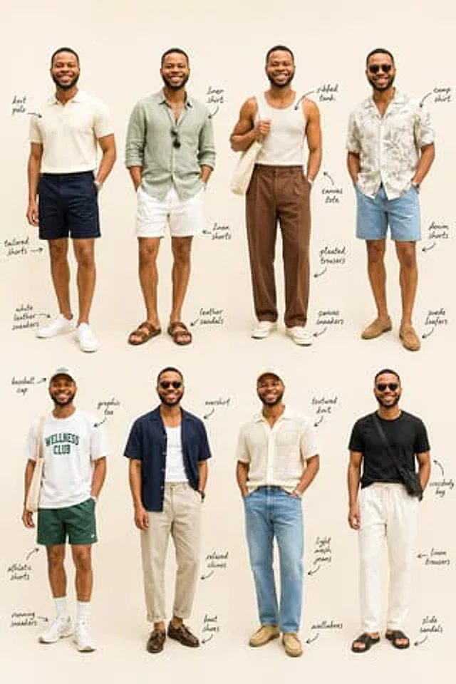

```text
Using the provided reference images as the basis for the figures and bodies, a minimalist men's summer fashion lookbook was created against a clean, warm beige studio background. While maintaining the subjects' recognizability, faces in each look were blurred, and eight full-body outfit variations were generated, arranged in a 4x2 editable grid. "Handwritten" stylist notes with arrows were added, highlighting key clothing items for each outfit. First row, Outfit 1: Beige knit polo shirt, navy custom shorts, white leather sneakers. First row, Outfit 2: Sage green linen shirt, white linen shorts, brown leather sandals, sunglasses hanging from the shirt. First row, Outfit 3: Off-white ribbed vest, brown pleated trousers, white canvas sneakers, beige canvas tote bag slung over one shoulder. First row, Outfit 4: Light-colored Cuban collar printed shirt, light blue denim shorts, tan suede loafers. Look 5 in the second row: A white printed T-shirt with green "WELLNESS CLUB" lettering, dark green athletic shorts, white running shoes, white mid-calf socks, a light-colored baseball cap, and a canvas tote bag. Look 6 in the second row: A navy blue short-sleeved shirt worn open over a white tank top, beige casual twill trousers, and dark brown boat shoes. Look 7 in the second row: A beige textured knit short-sleeved shirt, light-wash jeans, tan Wallabees shoes, and a light-colored baseball cap. Look 8 in the second row: A black fitted T-shirt, white linen drawstring trousers, black slippers, and a black crossbody bag. This creates a sophisticated fashion guide effect, with realistic proportions, soft and even lighting, minimalist shadows, and elegant handwritten annotations next to each character.
```

Model: GPT Image 2
Author: GPT Image 2 Prompts

[ProjectD](https://aitoolsradar.com/en/prompts/8add6d1c360482) · [Recorded source](https://x.com/olatojosh/status/2047394739310272875#reversed-2)
 · [Full original metadata and byte evidence](data/projectd-batch-0048.json)

## Sunflower Couture Botanical Poster

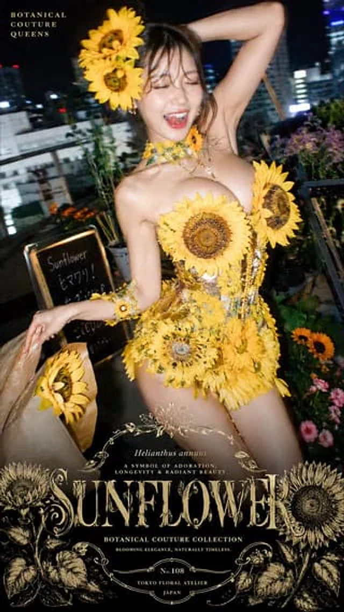

```text
Goal: Create a vertical luxury fashion editorial poster for a fictional floral couture brand, featuring a glamorous rooftop flower-shop scene at night and a dramatic sunflower dress.

Canvas: Tall 9:16 poster, cinematic flash photography, slightly tilted handheld composition, shallow depth of field, dark rainy/cloudy urban night atmosphere with blurred high-rise lights in the background.

Main subject: A young adult fashion model standing on a rooftop florist terrace, body angled slightly right, one arm raised behind her head and the other hand holding a brown paper bouquet bag. Her face is intentionally covered by a smooth vertical beige rectangular privacy block. She wears an extravagant botanical couture mini dress made from real sunflowers, yellow petals, green stems, gold filigree, beads, and delicate vine-like jewelry. Bare shoulders and arms, glossy editorial skin lighting, elegant high-fashion pose.

Count the visible sunflower elements: 14 prominent sunflower heads total — 2 large sunflowers in the hair on the upper left side of the head, 1 large sunflower centered on the chest, 1 large sunflower on the right side of the bodice, 6 sunflower heads forming the skirt and hip cluster, 1 small sunflower bracelet on the left wrist, 1 sunflower bouquet head protruding from the brown paper bag, and 2 small sunflowers in the flower-shop display at the lower right. Add extra tiny yellow filler blossoms and vines without making them look like additional large sunflower heads.

Environment and props: Rooftop or balcony flower shop with potted plants and colorful flowers around the model, black planter boxes, a small chalkboard sign at left reading “Sunflower” with handwritten Japanese-style price notes beneath it, brown paper bouquet wrap at lower left, blurred city skyline and building lights behind her. The overall scene should feel like a boutique florist that sells wearable floral couture.

Typography and poster design: Add elegant vintage botanical typography and engraved ornamentation in warm antique gold. Top-left small title: “BOTANICAL COUTURE QUEENS”. Bottom center large ornate headline: “{argument name="headline text" default="SUNFLOWER"}”. Above the headline, small italic Latin name: “Helianthus annuus”. Under it, small tagline: “A SYMBOL OF ADORATION, LONGEVITY & RADIANT BEAUTY.” Beneath the headline: “BOTANICAL COUTURE COLLECTION” and “BLOOMING ELEGANCE, NATURALLY TIMELESS.” Add a small oval label near the bottom reading “No.108”, then “TOKYO FLORAL ATELIER” and “JAPAN”. Surround the bottom text with engraved sunflower illustrations, curling vines, botanical line art, symmetrical ornamental flourishes, and antique catalog-style borders.

Visual style: High-fashion magazine cover mixed with vintage botanical seed packet design, luxurious black-and-gold palette with vivid sunflower yellow, realistic photo base, strong camera flash highlights, moody bokeh city background, delicate gold linework overlay, premium couture advertising aesthetic.

Customizable details: The model wears {argument name="flower type" default="sunflowers"} as couture florals, the dominant palette is {argument name="color palette" default="sunflower yellow, black, antique gold, and deep green"}, the setting is {argument name="setting" default="night rooftop flower shop in Tokyo"}, and the brand line should feel like {argument name="brand mood" default="botanical couture queens"}.

Constraints: Keep the layout vertically centered and poster-like, preserve the exact major text blocks, do not add logos or watermarks, avoid modern sans-serif dominance, keep the face covered by the beige rectangle, and make the floral dress look wearable but fantastical.
```

Model: GPT Image 2
Author: AI Girl's Photo Studio

[ProjectD](https://aitoolsradar.com/en/prompts/15936c78cacf90) · [Recorded source](https://youmind.com/prompts/sunflower-couture-poster-26285)
 · [Full original metadata and byte evidence](data/projectd-batch-0048.json)

## Sunlit Anime Girl Outside Cafe

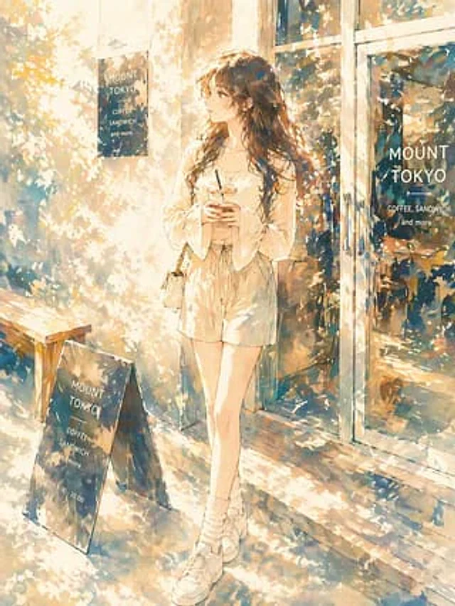

```text
A dreamlike, anime-style full-body illustration depicts a young woman standing outside the entrance of a sunlit café, emphasizing the details of her facial orientation and gaze. She is slightly turned to the right of the frame, her head tilted to the side, as if looking at the street beyond the camera's view. Her facial features are soft and simple, partially obscured by the bright light, delicate and without harsh lines. She has long, wavy brown hair with warm golden highlights, stray strands catching the sunlight, and a small hair clip on one side. She wears a loose-fitting beige long-sleeved jumpsuit or skirt, cinched at the waist with flowing sleeves, paired with white slouch socks, platform white sneakers, and a small white shoulder bag with a delicate gold chain. She holds a clear plastic iced coffee with a black straw in her hands, positioned in front of her chest. The scene takes place outside a cozy café. To the right are tall glass doors and windows revealing two café signs bearing the words "MOUNT TOKYO," with smaller text below reading "COFFEE, SANDWICH and more..."—one a rectangular wall-mounted sign, the other a black A-frame pedestrian sign in the lower left corner; the A-frame also includes the opening hours in smaller print. A simple wooden bench sits on the left edge. The entire scene is filled with dappled sunlight and dense tree shadows, casting shimmering summer atmospheres on the walls, glass, floor, bench, and women's clothing. The work employs a soft watercolor and gouache style with bright, overexposed highlights. Warm cream, gold, and peach hues complement cool blue shadows, the brushstrokes are textured, and the glass reflects light, creating a nostalgic yet light atmosphere. The vertical composition allows for full-body views, showcasing an elegant and fashionable illustration style with rich environmental details—a café street scene bathed in Japanese sunlight.
```

Model: GPT Image 2
Author: GPT Image 2 Prompts

[ProjectD](https://aitoolsradar.com/en/prompts/bd86f8a5b373aa) · [Recorded source](https://x.com/akira_papa_IT/status/2047309614769918390#reversed-0)
 · [Full original metadata and byte evidence](data/projectd-batch-0048.json)

## Sunlit Censored Portrait


```text
Create a photorealistic vertical portrait of {argument name="subject" default="a young East Asian woman"} sitting beside a bright sunlit window in a soft, airy room. She has {argument name="hair color and style" default="long straight dark brown hair with a center part, falling over one shoulder"}, fair skin, a slim build, and wears {argument name="outfit" default="a simple off-white camisole with thin straps"} plus a small gold hoop earring visible on one ear. Frame her from the upper torso upward in a close, intimate composition, angled slightly from above and to the side, with her shoulder and collarbone catching warm natural light. Her face is intentionally obscured by one large opaque square censor block centered over the face, colored with a soft brown-to-taupe muted gradient, covering the eyes, nose, and mouth while leaving the hair, ear, neck, shoulder, and clothing visible. The background should be softly blurred with white window frames, pale curtains, hints of greenery, and bright morning sunlight, using shallow depth of field, realistic skin texture, glossy hair highlights, natural shadows, and a clean lifestyle photography aesthetic. Use {argument name="lighting" default="warm natural window light with gentle backlighting"} and a high-resolution camera look, vertical 2:3 aspect ratio.
```

Model: GPT Image 2
Author: kasu-mi

[ProjectD](https://aitoolsradar.com/en/prompts/87a118239b0db3) · [Recorded source](https://youmind.com/prompts/censored-window-portrait-19715)
 · [Full original metadata and byte evidence](data/projectd-batch-0048.json)

## Sunlit Desk with White Cat and Laptop


```text
A warm and sunny home office scene, presented in a realistic lifestyle photography style. A white shorthair cat with light green eyes sits calmly and attentively facing the camera on the left side of a warm wooden desk, its tail wrapped around its paws. To the cat's left is a lush indoor planter (in a beige textured pot) and a ceramic mug containing black coffee. In front of the cat is an open spiral notebook filled with handwritten notes, a silver fountain pen resting diagonally on the pages. To the right of the desk is a laptop slightly tilted towards the viewer, its screen displaying a vibrant wallpaper of a turquoise lake and majestic snow-capped mountains against a blue sky. Behind the desk is a large window with soft beige curtains, allowing bright golden morning light to stream in from the right, casting natural shadows on the desk. Two framed paintings are faintly visible on the left wall. The overall atmosphere should be tranquil, efficient, and warmly homey, possessing soft, cinematic lighting, sharp details, shallow depth of field, and a high-end editorial quality.
```

Model: GPT Image 2
Author: GPT Image 2 Prompts

[ProjectD](https://aitoolsradar.com/en/prompts/c1b4c042dc78ca) · [Recorded source](https://x.com/moz_ai_tech/status/2046941105418281172#reversed-0)
 · [Full original metadata and byte evidence](data/projectd-batch-0048.json)

## Sunlit Streetwear Jacket Portrait

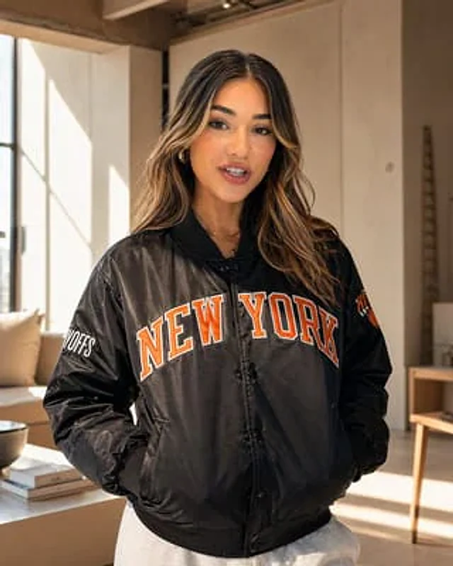

```text
A realistic lifestyle fashion photograph shows a woman standing in a warm, sun-drenched modern loft living room. The frame, angled from mid-thigh upwards, faces the camera with her hands in the pockets of an oversized black satin baseball jacket. The jacket is the absolute focal point: glossy black fabric, ribbed collar and hem, snap-button front, slightly puffed sleeves, and striking orange lettering with white outline on the chest, displaying the message:{argument name="front text" default="NEW YORK"} A small orange and white sports patch is added to the upper part of the sleeve, and white blocky text is printed on the other sleeve, creating an authentic team jacket feel. The model has long, voluminous, softly wavy, highlighted hair, with a hair color of [redacted].{argument name="hair color" default="Dark brown with caramel highlights"} Wearing minimalist jewelry (including stacked gold necklaces), light gray sweatpants are visible at the bottom of the image. For privacy, the face is deliberately obscured with a centered rectangular blur. The background is a minimalist beige interior space, with a tall industrial-style window on the left casting strong morning light and geometric shadows. It features a cream-colored sofa with cushions, a low coffee table with three stacked books and a dark bowl, light-colored walls, and a simple wooden side table in the background. The shoot employs a high-end e-commerce fashion style, showcasing natural golden light and shadow, soft shadows, clear jacket details, shallow depth of field, neutral warm tones, and a clean, sophisticated streetwear aesthetic.
```

Model: GPT Image 2
Author: GPT Image 2 Prompts

[ProjectD](https://aitoolsradar.com/en/prompts/a8742430f33e71) · [Recorded source](https://x.com/Jake_Joseph/status/2047093657900347678#reversed-0)
 · [Full original metadata and byte evidence](data/projectd-batch-0048.json)

## Sunlit Suit Portrait With Red Rose


```text
A minimalist, melancholic portrait: a young man in a black suit, white shirt, and black tie stands before a light beige wall, bathed in the warm afternoon sun. The half-length portrait, slightly turned to the side, obscures most of his face by shadow and composition, highlighting his jawline, neck, ears, and tousled black hair. He gently holds a long-stemmed red rose, its blossoms in full bloom with a few green leaves, against his chest. Strong, directional golden light from the left casts sharp shadows of the man and the rose onto the wall, creating a cinematic, romantic atmosphere. The clean, editorial style, soft, natural skin tones, high contrast between the dark suit and the sunlit wall, shallow depth of field, luxurious and fashionable aesthetics, centered composition, and realistic photographic style all contribute to the overall effect.
```

Model: GPT Image 2
Author: GPT Image 2 Prompts

[ProjectD](https://aitoolsradar.com/en/prompts/804819aa42d861) · [Recorded source](https://x.com/ZhuYang98875/status/2046847960051487223#reversed-0)
 · [Full original metadata and byte evidence](data/projectd-batch-0048.json)

## Sunlit Window Portrait With Privacy Block


```text
Create a realistic high-key portrait photograph of a young adult woman with {argument name="hair color" default="long chestnut-brown hair"}, straight silky hair parted near the center with fine flyaway strands catching the light. She is seated indoors beside a large bright window on a sunny day, turned slightly three-quarters toward the camera with bare shoulders visible, wearing a delicate {argument name="top color" default="cream white"} ribbed camisole with thin straps and subtle lace trim. The composition is a close vertical half-body portrait from head to upper torso, with her face intentionally covered by a centered opaque square privacy block in a muted warm brown/taupe color, hiding all facial features while leaving the hair, neck, shoulders, and outfit visible. Use soft natural daylight, airy overexposed window light, shallow depth of field, blurred urban greenery and pale building shapes outside the window, gentle skin tones, realistic hair texture, clean lifestyle photography mood, 85mm lens look, soft bokeh, minimal background clutter, intimate calm atmosphere, photorealistic detail, portrait orientation.
```

Model: GPT Image 2
Author: kasu-mi

[ProjectD](https://aitoolsradar.com/en/prompts/e6c87668981843) · [Recorded source](https://youmind.com/prompts/anonymous-window-portrait-19566)
 · [Full original metadata and byte evidence](data/projectd-batch-0048.json)

## Sunny Bangkok City Street Selfie

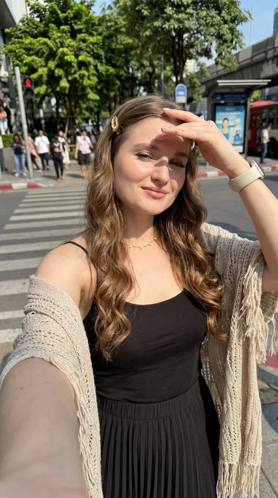

```text
Hyper-realistic 8K close self-shot, {argument name="subject" default="young European woman"}, slightly low angle, arm extended holding phone, bright sunny daytime, direct harsh sunlight, sharp facial shadows, artistic high-contrast light and shadow, energetic intense atmosphere, slight gentle smile, fair pink-toned glowing smooth skin. Long waist-length curly hair, no bangs, naturally flowing curls at ends, gold hair clip. Thin winged eyeliner, full long lashes, soft peach blush, defined brows, glossy light pink ombre lips. Cream smartwatch, dainty gold necklace. Loose casual camisole top, high-waisted pleated midi skirt, lightweight knitted fringed shawl. Slightly tilted posture, squinting gently against sunlight, one hand raised to block glare. Outdoor {argument name="location" default="Bangkok city"} background, right side filled with urban scenery, lush green trees, crosswalk, bus stop bench, ultra-detailed, photorealistic.9：16
```

Model: GPT Image 2
Author: Stonic AI

[ProjectD](https://aitoolsradar.com/en/prompts/8b9287aa452242) · [Recorded source](https://youmind.com/prompts/bangkok-city-street-selfie-26651)
 · [Full original metadata and byte evidence](data/projectd-batch-0048.json)

## Sunny Japanese Cafe Street Scene

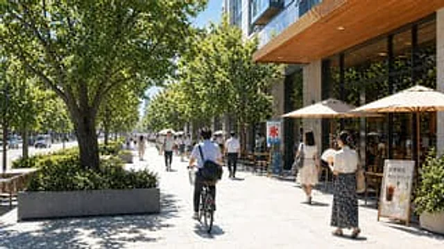

```text
A bright, hyper-realistic depiction of a Japanese summer street scene, shot from pedestrian level, showcases a wide, clean city sidewalk flanked by dappled sunlight filtering through the trees. The scene presents a modern mixed-use neighborhood on a sunny summer day. On the right is a contemporary café or restaurant with tall floor-to-ceiling windows, dark-framed windows, a stone facade, and a warm-toned wooden ceiling extending to the terrace. Three large beige parasols stand outside the café, beneath which wooden tables and chairs are arranged. Pedestrians move about in an orderly fashion on the sidewalk, with about 14 people scattered in the distance, most dressed in light-colored summer business casual attire, primarily in white, beige, navy blue, and gray. In the foreground center, a cyclist is added with their back to the camera, wearing a short-sleeved white shirt and dark trousers, carrying a shoulder bag. In the foreground on the right, two women are added with their backs to the camera: one wears a white shirt and a long dark floral skirt, holding a round fan; the other wears a white top and a light-colored patterned skirt, carrying a bag. Add two eye-catching freestanding signs outside the café: one a vertical banner with the striking Japanese character "氷" (ice) and an ice-blue graphic; the other a freestanding folding sign with the Japanese phrase "Summer Limited Cold Drink," accompanied by images of two cold drinks: a dark iced beverage and a light lemonade-like drink. On the left, showcase a quiet street with a few vehicles, benches, low concrete flowerbeds, and neatly trimmed shrubs in the distance. The composition should emphasize depth, creating a long vanishing point through the tree-lined avenue, showcasing the bright midday sun, realistic reflections in the windows, and an upscale, tranquil urban atmosphere. Photorealistic architectural photography, natural colors, high detail, wide-angle lens, deep focus.
```

Model: GPT Image 2
Author: GPT Image 2 Prompts

[ProjectD](https://aitoolsradar.com/en/prompts/d011562d768fda) · [Recorded source](https://x.com/shion_takk/status/2046896417550295177#reversed-2)
 · [Full original metadata and byte evidence](data/projectd-batch-0048.json)

## Sunny Paris Café Portrait


```text
Create a realistic lifestyle portrait photograph of a young woman sitting at an outdoor Paris café on a sunny morning. She has {argument name="hair color" default="dark brown"} loose wavy hair with soft bangs, fair skin, natural makeup, and a gentle relaxed smile while resting her cheek on one hand and looking directly into the camera. She wears a cozy {argument name="sweater color" default="cream"} chunky cable-knit sweater. In the foreground, place a large white ceramic coffee cup on a wooden café table, softly out of focus with faint steam rising. Surround her with wooden bistro chairs and tables, small potted white flowers, leafy greenery, and warm dappled sunlight. On the left, include a vertical chalkboard sign with handwritten French text reading {argument name="chalkboard text" default="Bon café\nBonne humeur\nUne belle journée\nà Paris\n♡"}. The background should show a lively Parisian boulevard with plane trees, pedestrians, café umbrellas, classic Haussmann buildings, street lamps, and bright spring foliage, all rendered with shallow depth of field and creamy bokeh. Use natural backlighting, soft highlights in the hair, warm cinematic tones, high-resolution editorial fashion photography, 35mm lens look, realistic textures, no watermark, no extra text beyond the chalkboard.
```

Model: GPT Image 2
Author: Harshith

[ProjectD](https://aitoolsradar.com/en/prompts/6b55ca134782e4) · [Recorded source](https://youmind.com/prompts/paris-cafe-portrait-31040)
 · [Full original metadata and byte evidence](data/projectd-batch-0048.json)

## Sunset Beer Ad Storyboard

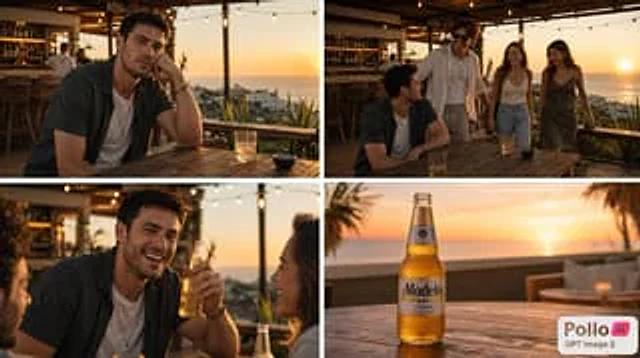

```text
{"type":"4-panel cinematic ad storyboard","brand_style":"premium lifestyle beer commercial","subject":{"product":"{argument name=\"product name\" default=\"Modelo Especial\"} beer bottle","setting":"open-air coastal bar terrace at golden hour overlooking the ocean","time_of_day":"sunset","mood":"warm, social, aspirational, relaxed summer evening"},"visual_style":{"photorealism":"high-end cinematic realism","lighting":"golden sunset backlight with warm practical string lights and soft interior bar glow","color_palette":"amber, honey gold, warm brown wood, soft orange sky, muted blue sea","camera":"shallow depth of field, natural lens blur, ad-style composition"},"layout":{"grid":"2x2 collage with thin white dividers","count":4,"sections":[{"title":"panel 1","position":"top-left","count":1,"labels":["young man sitting alone at a rustic wooden table, leaning his head on one hand, casual short-sleeve dark overshirt over white t-shirt, necklace, lowball glass with ice on the table, small black bowl, sunset ocean view behind him, bar shelves and stools in the background"]},{"title":"panel 2","position":"top-right","count":3,"labels":["same seated man turns toward three friends approaching","one man standing in a light open shirt and white tee","two women beside him, one in a white camisole with jeans and one in a dark green satin dress, all entering from the right with the sunset behind them"]},{"title":"panel 3","position":"bottom-left","count":3,"labels":["close social moment at the table","main man smiling and raising a clear long-neck beer bottle","partial friends visible in foreground and right edge, suggesting conversation and group connection"]},{"title":"panel 4","position":"bottom-right","count":1,"labels":["hero product shot of a cold condensation-covered {argument name=\"product name\" default=\"Modelo Especial\"} bottle standing upright on the wooden table with the ocean sunset blurred in the background"]}]},"scene_details":{"environment_elements_count":7,"environment_elements":["wooden pergola ceiling","hanging string lights","back bar shelves with bottles","bar stools","agave or tropical plants near the railing","ocean horizon","rustic wooden tables and chairs"],"people_count":4,"props_count":5,"props":["lowball glass with ice","small black snack bowl","beer bottle in hand","hero beer bottle on table","tabletop candle or small light in the distant background"]},"branding":{"logo_overlay":"rounded white badge in the bottom-right corner containing {argument name=\"app name\" default=\"Pollo AI\"} and {argument name=\"model name\" default=\"GPT Image 2\"}","ad_purpose":"visual sequence for a short beverage ad showing loneliness turning into a shared sunset social moment, ending on the product"}}
```

Model: GPT Image 2
Author: Bull Concept

[ProjectD](https://aitoolsradar.com/en/prompts/73bcc0630f5501) · [Recorded source](https://youmind.com/prompts/sunset-beer-ad-storyboard-17204)
 · [Full original metadata and byte evidence](data/projectd-batch-0048.json)

## Sunset Catgirl School Rooftop Anime

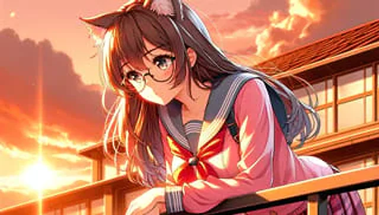

```text
A high-quality anime illustration depicting a{argument name="character type" default="Cat-eared female student"} The scene depicts her leaning against the metal railing of the school rooftop at sunset, shot from a slightly upward-looking, three-quarter profile. She has flowing hair.{argument name="hair color" default="Dark brown"} She has long hair with a soft sheen, bright and reflective grey-brown eyes, and wears round, thin-rimmed glasses. Two fluffy cat ears peek out from her hair. Her expression is quiet, melancholic, and slightly shy; her lips are slightly parted, and her gaze gently falls upon the audience. She wears a Japanese sailor school uniform, the top of which is soft {argument name="uniform color" default="pink"} She wears long sleeves with a grey sailor collar and white stripes, tied with a bright red bow tie, and a plaid skirt is faintly visible. A dark backpack strap is slung over her shoulders. The scene is bathed in dramatic golden-moon backlighting, with her hair, ears, shoulders, and cuffs shimmering with intense warm-toned contour lighting. A bright halo of sunlight hangs in the lower left, and the sky is painted with rich orange and peach clouds. The background shows a two-story Japanese school building with a red-tiled roof, its windows shimmering in the setting sun. The design emphasizes the nostalgic feel of key visuals from high-end anime in the early 2000s: delicate lines, bright eyes, finely detailed hair, cinematic composition, soft depth of field, vibrant warm colors, subtle shadows, and a serene emotional atmosphere.
```

Model: GPT Image 2
Author: GPT Image 2 Prompts

[ProjectD](https://aitoolsradar.com/en/prompts/a508c152ca3c9e) · [Recorded source](https://x.com/nyaa_toraneko/status/2046739011960799389#reversed-0)
 · [Full original metadata and byte evidence](data/projectd-batch-0048.json)

## Sunset Futuristic Megacity Panorama

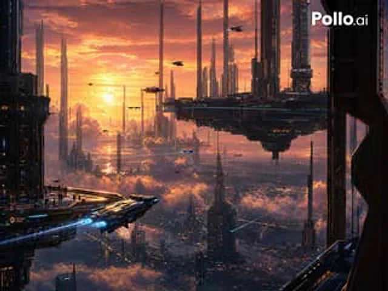

```text
A vast, cinematic sunset over a sci-fi megacity, viewed from a high observation deck amidst a dark, futuristic cluster of massive buildings, with a dramatic mix of orange-gold glowing sky filled with clouds and mist. The scene showcases a sprawling vertical city stretching into the distance, densely packed with countless towering, needle-like skyscrapers and glowing spires piercing the clouds. In the upper right corner, a massive, richly detailed, dark metallic floating platform city hovers above the horizon, accompanied by smaller towers and structures below. In the lower left foreground, a streamlined, futuristic spacecraft takes off from a terrace, tilted diagonally towards the center, with bright blue engine contrails and reflective metal panels. Several tiny figures stand at the edge of the terrace to emphasize the scale. Scattered across the sky are numerous small flying vehicles and hovercraft at varying distances, creating dense aerial traffic. In the distance below, the city's grid shimmers with warm lights through the atmospheric mist. Employing a grand, panoramic composition, the dark architectural framework contrasts sharply with the brilliant sunset light, showcasing intricate details of technological industry, atmospheric perspective, volumetric clouds, reflective surfaces, and a rich color palette of amber, peach, purple, deep navy, and electric blue. This ultra-refined, epic futuristic concept art features a photorealistic matte painting texture, sharp focus, grand scale, a 4:3 vertical composition, and is devoid of text or logos.
```

Model: GPT Image 2
Author: GPT Image 2 Prompts

[ProjectD](https://aitoolsradar.com/en/prompts/f21274aa20f95a) · [Recorded source](https://x.com/Alex_Inspira/status/2047335271889608886#reversed-0)
 · [Full original metadata and byte evidence](data/projectd-batch-0048.json)

## Sunset Motocross Action Portrait

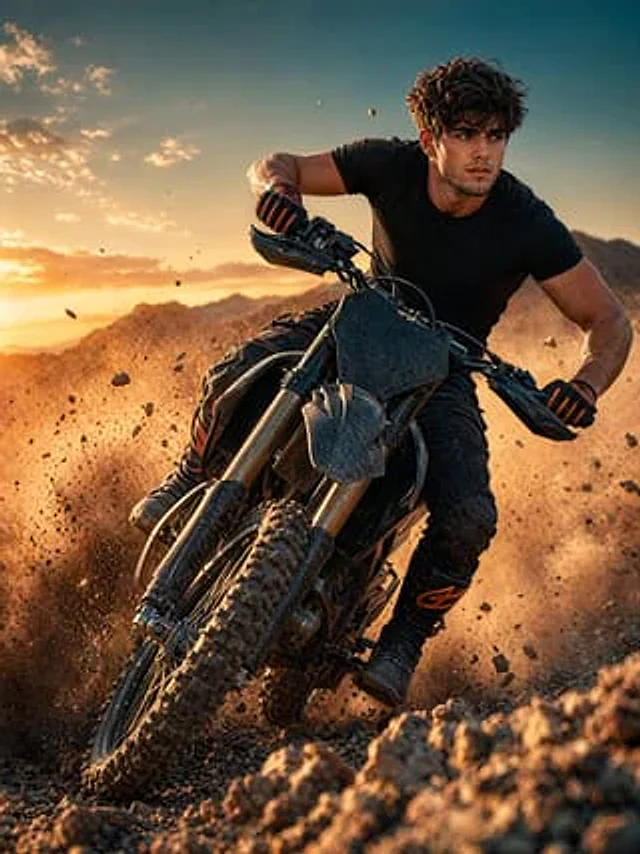

```text
A cinematic-quality high-resolution action portrait, the protagonist is{argument name="subject" default="A young man riding a modern off-road motorcycle"} The scene is set in{argument name="setting" default="Rugged rocky terrain at sunset during golden hour"} He leaned aggressively forward as he turned, his face showing focused intensity. He had short, tousled dark hair, a light stubble, a sharply defined jawline, and a robust physique. He wore a fitted black T-shirt, dark work pants, black motocross gloves with orange details, and black racing boots with orange accents. The motorcycle was a stylish matte black-grey motocross bike with a refined suspension, rugged off-road tires, clearly visible engine components, realistic mud splatter, spinning wheels, and dust billowing from the rear wheel. The rider was captured in a moment of motion, full of dynamic energy and speed. The backdrop was a warm desert landscape, with distant mountains softly blurred on the horizon. A huge dust cloud billowed behind the motorcycle, illuminated by the sunlight. The sky displayed a smooth gradient from deep cyan at the top to a glowing orange near the horizon. The intense sunlight created dramatic rim lighting around the rider and motorcycle, accompanied by rich shadows and warm highlights. The foreground features richly textured gravel, dirt, scattered stones, debris, and sharp ground details. A low-angle shot is used to create a powerful, heroic perspective. Shallow depth of field keeps the rider sharp while maintaining a creamy, cinematic background. The color grading style is {argument name="color grade" default="Green and orange tones"} High contrast, realistic skin tones, sharp details, ultra-sharp autofocus, advanced sports editing photography style, cinematic narrative, adventure aesthetics, volumetric dust effects, HDR quality, 8K resolution, realistic textures, natural reflections, professional lens compression, and a strong atmosphere. Camera settings: low-angle tracking shot, 85mm lens, f/2.8, high-speed shutter, ISO 100, high definition, centered subject composition. Negative keywords: blurry face, superfluous limbs, poor anatomy, text, watermarks, logos, low quality, oversaturated colors, distorted motorcycle, repetitive wheels, unrealistic hands, noise, cartoonish style, flat lighting.
```

Model: GPT Image 2
Author: GPT Image 2 Prompts

[ProjectD](https://aitoolsradar.com/en/prompts/eb1acac0864592) · [Recorded source](https://x.com/harboriis/status/2046773091649585445)
 · [Full original metadata and byte evidence](data/projectd-batch-0048.json)

## Super Famicom Poster Style

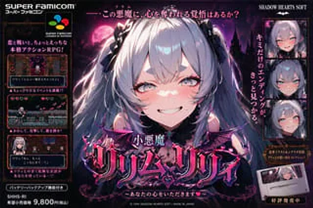

```text
小悪魔リリムリリィちゃんが　スーパーファミコンのゲームだったときのポスターを考えて
```

Model: GPT Image 2
Author: @lilimliliychan

[ProjectD](https://aitoolsradar.com/en/prompts/e0459da7bf9039) · [Recorded source](https://x.com/lilimliliychan/status/2045114760937804187)
 · [Full original metadata and byte evidence](data/projectd-batch-0048.json)

## Superhero Costume Swap Portrait

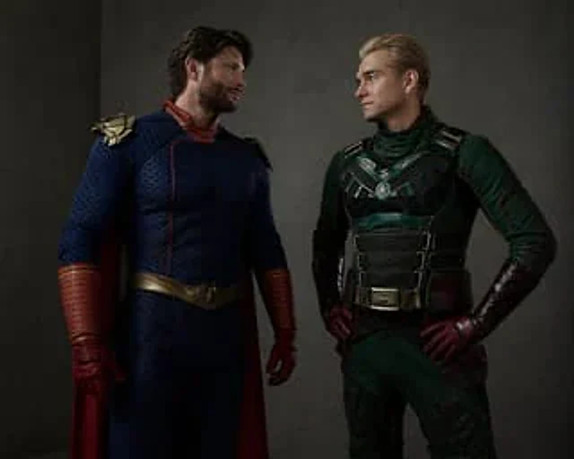

```text
A cinematic studio portrait: two men stand facing each other against a dark gray, solid-color background, the atmosphere tense. (Left side is...){argument name="left actor" default="Jensen Ackles"} Wearing{argument name="left costume" default="A deep blue textured superhero suit, complete with red gloves, gold eagle-shaped shoulder armor, and a cape."} The right side is {argument name="right actor" default="Antony Starr"} Wearing{argument name="right costume" default="Dark green and black tactical uniform with a star badge on the chest and red gloves."} The man on the right has his hands on his hips. The dramatic, emotional studio lighting, the high level of detail, and the photorealistic quality are all striking.
```

Model: GPT Image 2
Author: GPT Image 2 Prompts

[ProjectD](https://aitoolsradar.com/en/prompts/3b1234c948c3f2) · [Recorded source](https://x.com/HumanOS_v2/status/2046298754157064607#reversed-0)
 · [Full original metadata and byte evidence](data/projectd-batch-0048.json)

## Surreal Action RPG Boss Fight UI

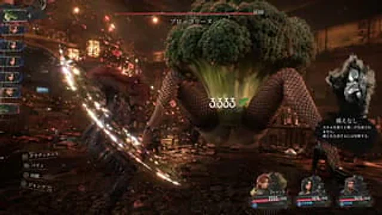

```text
{
  "type": "Action RPG video game screenshots",
  "environment": "{argument name=\"environment\" default=\"The tavern&#39;s interior is dark and rugged, featuring wooden structures, lanterns, and scattered fragments.\"}",
  "characters": {
    "player": {
      "description": "Red-haired female warrior wearing dark leather armor",
      "action": "{argument name=\"player action\" default=\"Wielding a glowing sword that emitted bright sparks and streaks of light\"}"
    },
    "boss": {
      "description": "Huge{argument name=\"boss type\" default=\"broccoli\"} The head was connected to the legs of a female human wearing fishnet stockings and black high heels.",
      "pose": "Floating or jumping in the center of the room"
    }
  },
  "layout": {
    "ui_components": [
      {
        "position": "Top center",
        "type": "Boss health bar",
        "text": "{argument name=\"boss name\" default=\"ブロッコリーヌ\"}",
        "value": "33,333"
      },
      {
        "position": "central",
        "type": "Floating damage value",
        "text": "{argument name=\"damage number\" default=\"3,333\"}",
        "icon": "Green leaves"
      },
      {
        "position": "left edge",
        "type": "Team List",
        "count": 7,
        "description": "Vertical column of small character portrait thumbnails"
      },
      {
        "position": "bottom left corner",
        "type": "Operation prompts",
        "count": 4,
        "labels": [
          "[RT] Gradient",
          "[RB] parry",
          "(B) Avoidance",
          "(A) Jump"
        ]
      },
      {
        "position": "bottom right corner",
        "type": "Team status bar",
        "count": 3,
        "description": "Character portraits with HP/MP bars and numerical values ​​such as 2333/2333."
      },
      {
        "position": "Middle right",
        "type": "Posture Information Panel",
        "style": "Ink splatter border",
        "labels": [
          "No posture",
          "Using skills does not generate posture. Posture is generated through attacks."
        ]
      }
    ]
  }
}
```

Model: GPT Image 2
Author: GPT Image 2 Prompts

[ProjectD](https://aitoolsradar.com/en/prompts/5031a3545a5740) · [Recorded source](https://x.com/blue_pen5805/status/2043600744037994896#reversed-0)
 · [Full original metadata and byte evidence](data/projectd-batch-0048.json)

## Surreal Advertising Concept Art

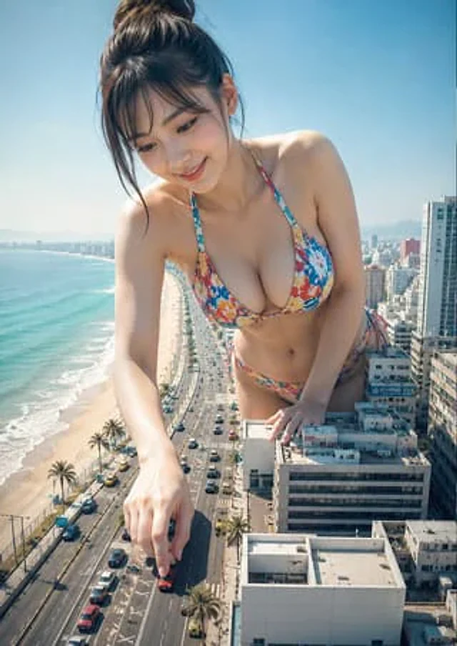

```text
以{argument name="主体" default="25岁泳装日本少女"}为核心。创造一个前所未见的视觉概念。主体突破现实尺度与物理规则。采用国际广告大奖级创意思维。强调视觉隐喻、尺度反差、空间错觉与故事表达。
```

Model: GPT Image 2
Author: Adam也叫吉米

[ProjectD](https://aitoolsradar.com/en/prompts/13861d7a71fdf5) · [Recorded source](https://youmind.com/prompts/surreal-award-winning-advertising-concept-24161)
 · [Full original metadata and byte evidence](data/projectd-batch-0048.json)

## Surreal Anime Couple Illustration with Text Overlays

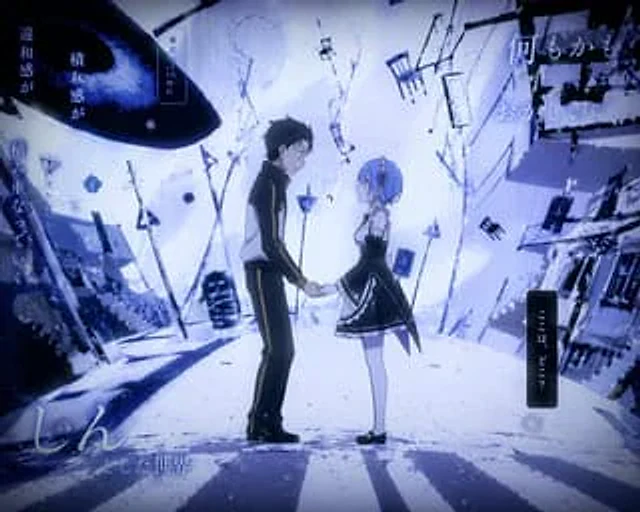

```text
An anime-style illustration depicting a{argument name="male character" default="A short-haired young man wearing a black, white, and orange tracksuit"} and one{argument name="female character" default="A short-haired, blue-haired young woman wearing a black and white maid outfit"} Standing on a snow-covered pedestrian crossing, they hold hands and gaze deeply into each other's eyes. The environment is a surreal, distorted, and dreamlike world, shrouded in melancholic cool blue and purple tones. In the background, one can see leaning telephone poles, crooked buildings, a huge dark eye-shaped void in the upper left sky, a floating door, and four floating chairs. Several Japanese text elements are incorporated into the scene: the vertical text on the far left reads "违和感が失失感が积み重なっていく" (I feel a sense of incongruity), a small square nearby reads "梦だったらいいのに" (I dream), and the large text in the upper right corner reads {argument name="top right text" default="Everything is wrong."} The text in the lower left corner reads:{argument name="bottom left text" default="A silent world"} The vertical dark text box in the lower right corner reads:{argument name="bottom right text" default="ここは、どこ？"} The image features a vignetting effect, creating a cinematic, ethereal atmosphere.
```

Model: GPT Image 2
Author: GPT Image 2 Prompts

[ProjectD](https://aitoolsradar.com/en/prompts/0236b6a7ecaf77) · [Recorded source](https://x.com/senb0n22a/status/2044448417456496751#reversed-3)
 · [Full original metadata and byte evidence](data/projectd-batch-0048.json)

## Surreal Archer With Birds and Animals

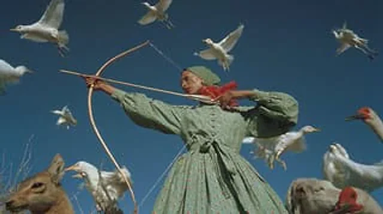

```text
An outdoor portrait in the style of a surrealist film depicts a masked archer standing in a dry meadow under a deep, clear sky. The composition is wide and horizontal, with the frame extending approximately from the knees up. The central figure is a woman in a vintage prairie-style dress and matching headscarf, aiming a simple wooden longbow at the left side of the frame, the arrow fully drawn to her cheek. Her face is completely obscured by a soft, rectangular blur or blocky occlusion, creating a strange sense of anonymity. The dress is sage green with long, puffy sleeves, a belted waist, and a small red and white floral pattern. Beneath the green headscarf, red fabric or a scarf covers the lower half of her face and neck. Around her are twelve animals: eight white birds soaring at varying distances in the sky, two larger white birds standing on the ground to the right, a deer head peeking in from the lower left foreground, and a sheep head from the lower right foreground. A red-crested crane, visible in profile, is added at the far right edge. The image should evoke a dreamlike, whimsical, and symbolic atmosphere, rather than realism, featuring bright midday sunlight, rich colors, subtle film grain, and a slightly retro editorial feel. Use low-angle perspective, creating tension and dynamism through dynamic diagonals formed by arrows and layered animal arrangements. Hay is visible at the bottom edge, but the background is mostly open sky. The image should showcase highly detailed fabric folds, natural bird wing postures, and a balanced surreal composition.
```

Model: GPT Image 2
Author: GPT Image 2 Prompts

[ProjectD](https://aitoolsradar.com/en/prompts/52a1641ed1103b) · [Recorded source](https://x.com/VictorInFocus/status/2046707446182199641#reversed-0)
 · [Full original metadata and byte evidence](data/projectd-batch-0048.json)

## Surreal Cityscape Travel Poster

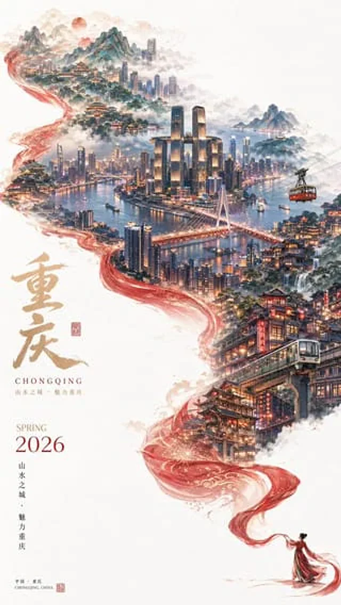

```text
A breathtakingly surreal travel poster set against a white canvas background features a magical, glowing red ribbon extending diagonally from the lower right to the upper left, seamlessly blending traditional and modern urban elements. In the lower right corner, the silhouette of a woman in a flowing red Hanfu dress holds one end of the ribbon. As the ribbon meanders upwards, it gradually transforms into a vibrant cityscape. The lower center section showcases…{argument name="traditional landmark" default="Multi-story wooden stilted house adorned with warm lanterns"} A modern monorail train travels through it. The central area showcases a vibrant, brightly lit modern metropolis, equipped with {argument name="modern landmark" default="A futuristic cluster of skyscrapers connected by sky bridges"} A wide river with boats, a red suspension bridge, and cable cars suspended in the air. The top gradually transitions to majestic, hazy mountains, traditional pavilions, and a pale red sun. The poster's left side features elegant typography: striking gold-textured Chinese characters reading "{argument name="city name chinese" default="Chongqing"} Below is the English text "",{argument name="city name english" default="CHONGQING"} Below is a text in a simple serif font: "".{argument name="season and year" default="SPRING 2026"} The design is complemented by smaller, vertically arranged Chinese text and a traditional red seal. The overall style cleverly blends traditional Chinese ink painting with hyper-realistic, cinematic 3D rendering, with soft, ethereal clouds surrounding the entire composition.
```

Model: GPT Image 2
Author: GPT Image 2 Prompts

[ProjectD](https://aitoolsradar.com/en/prompts/7a67c239f68551) · [Recorded source](https://x.com/A9Quant/status/2046197741685260384#reversed-2)
 · [Full original metadata and byte evidence](data/projectd-batch-0048.json)

## Surreal Cowboy Fashion Portrait

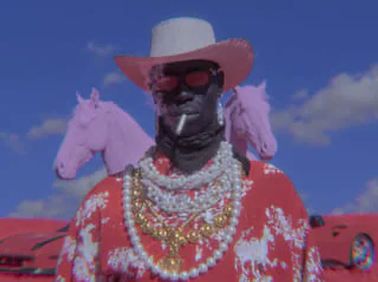

```text
A surreal, fashionable portrait centers on a mysterious cowboy figure in a half-body composition against a bright cobalt blue daytime sky dotted with soft white clouds. The figure's face is completely obscured by a vertical rectangular blur extending from the forehead to the nose and mouth, creating an effect of anonymous censorship. The figure wears a shimmering red cowboy hat with a pale white crown, a black scarf or bandana wrapped around the neck and lower half of the face, and a bold red Western-style jacket or shirt printed with white horse illustrations and floral patterns. Heavy maximalist jewelry is layered around the neck and chest: an extra-long pearl necklace cascading to the chest, at least four shorter pearl necklaces layered at the collar, and a magnificent gold statement necklace with coin-shaped pendants. Two pale pink horse heads, one on each side, are placed behind the figure's shoulders, slightly angled outwards like surreal companions or sculptural props. Below, two partially obscured red sports cars, one on each side, blend into the red desert horizon. Employing a dreamlike retro-futuristic Western aesthetic, the style features glossy textures, soft-focus effects, slight chromatic aberration, and a lo-fi editing style. Symmetrical compositions, centered subjects, saturated colors, and a strangely luxurious atmosphere create a haute couture surrealist, cinematic portraiture.
```

Model: GPT Image 2
Author: GPT Image 2 Prompts

[ProjectD](https://aitoolsradar.com/en/prompts/f1257d22a4929e) · [Recorded source](https://x.com/AllarHaltsonen/status/2047047885598986462#reversed-0)
 · [Full original metadata and byte evidence](data/projectd-batch-0048.json)

## Surreal Desert with Twin Celestial Spheres

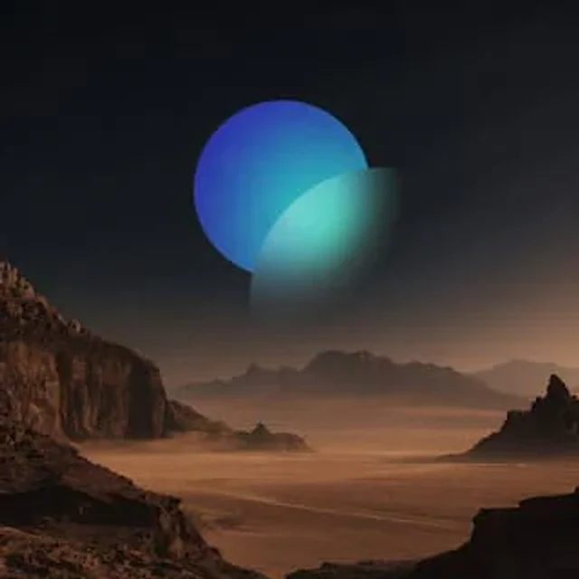

```text
A surreal, sci-fi desert landscape at dusk or night, with a vast sand plain covered by low-lying, floating mist, surrounded by dark, jagged rock formations. In the foreground, the lower left corner is framed by rugged rock edges, with steep cliffs on the left and smaller, jagged rocks on the right, and distant mountains drooping low on the horizon. In the center of the sky above the horizon, two enormous, overlapping celestial bodies are placed: the sphere in the back is a bright blue-to-cyan gradient ring, while the sphere in the front, slightly lower, is a partially obscured, luminous turquoise sphere with a soft atmospheric halo effect in its lower half. The sky is deep black, dotted with faint starlight, creating a minimalist cosmic atmosphere. Using cinematic lighting effects, the desert is rendered in warm amber brown tones, while the planets are presented in cool neon blue, combined with the soft mist, high contrast, ultra-high-definition digital rendering, and sharp terrain details, creating a tranquil and otherworldly ambiance.
```

Model: GPT Image 2
Author: GPT Image 2 Prompts

[ProjectD](https://aitoolsradar.com/en/prompts/6adc85eacfbb59) · [Recorded source](https://x.com/jkb0x/status/2046989938336362724#reversed-0)
 · [Full original metadata and byte evidence](data/projectd-batch-0048.json)

## Surreal Floating Head Sky Portrait

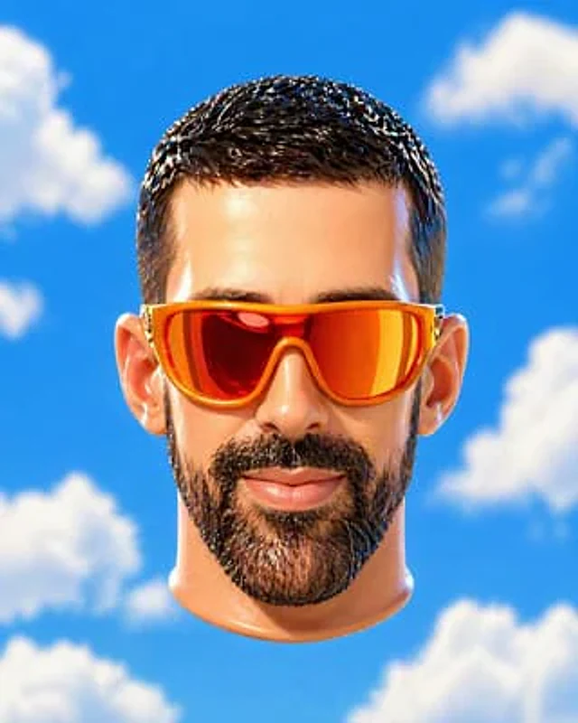

```text
Using the provided reference image, extract the head of the person and reconstruct it into a centered, floating 3D toy-style portrait with a glossy plastic texture. Remove the train interior, table, bottles, books, sweater, headphones, and body parts, keeping only the head, cropping the entire head and ears. Add gold-rimmed glasses as a new accessory. Place the head against a bright, saturated blue sky background, adorned with soft, cartoon-style white clouds, using a simple, minimalist composition and even daylight lighting to create a whimsical, surreal studio visual effect.
```

Model: GPT Image 2
Author: GPT Image 2 Prompts

[ProjectD](https://aitoolsradar.com/en/prompts/a5999740cde9cf) · [Recorded source](https://x.com/vmlcano/status/2047048555622244582#reversed-3)
 · [Full original metadata and byte evidence](data/projectd-batch-0048.json)

## Surreal Floating Head With Censor Block

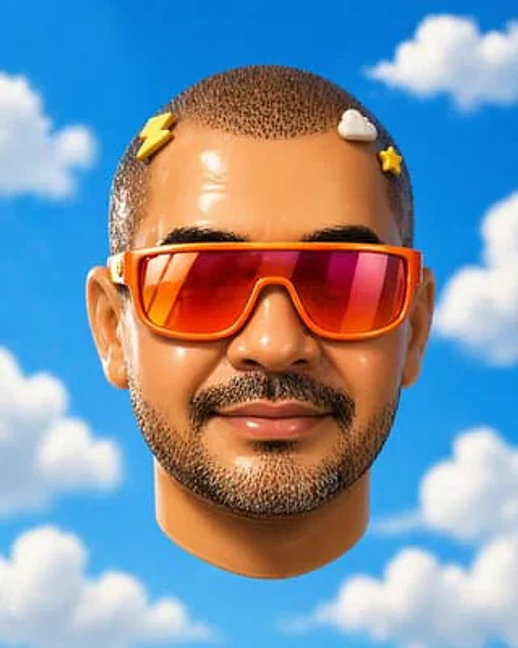

```text
A surreal studio portrait features a floating head facing forward, centered against a richly colored blue sky dotted with soft, fluffy white clouds. The face is completely covered by a large, smooth rectangular censor, extending from the forehead to the chin and most of the cheeks. The censor exhibits a subtle gradient from warm brown to soft blue-gray. Only external features are visible: a neatly trimmed buzz cut with dense, dark, speckled hair on top, visible ears, and a rounded chin and jawline. The head wears colored glasses with temples that only cover the sides; the lenses are not visible in the front due to the obscured center. The left temple is light cream with tiny red-gold embellishments, while the right temple is a vibrant red-orange. Two small, rounded protrusions are added near the top edge of the censor, yellow on the left and grayish-white on the right, creating a peculiar, toy-like texture. The rendering effect is a hyper-realistic but slightly eerie 3D illustration with smooth skin, soft sunlight, minimalist composition, and shallow depth of field, presenting a clean and imaginative pop surreal aesthetic.
```

Model: GPT Image 2
Author: GPT Image 2 Prompts

[ProjectD](https://aitoolsradar.com/en/prompts/d6e74d7d1c0f61) · [Recorded source](https://x.com/fmontes/status/2046946960720998553#reversed-2)
 · [Full original metadata and byte evidence](data/projectd-batch-0048.json)

## Surreal Futurist Japanese Collage Poster

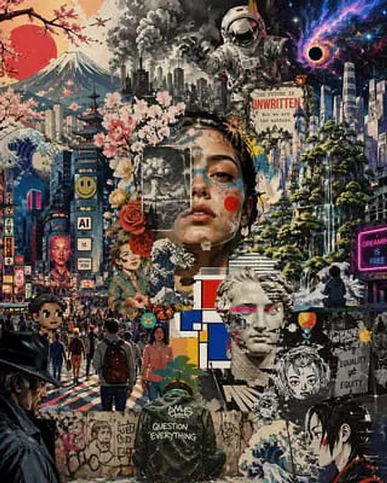

```text
A densely packed, surreal collage poster blends retro Japanese street culture, dystopian futurism, environmental collapse, and cosmic dreamscapes into a vertically stacked composition. The image should evoke a layered, mixed-media street art feel, composed of torn posters, ink illustrations, comic book textures, watercolor washes, newspaper prints, spray paint, and fragments of graphic design. The overall color palette combines deep midnight blue, black, cream paper, neon magenta, crimson, cherry blossom pink, and industrial gray. The upper left corner displays a giant red sun reflecting off Mount Fuji, with cherry blossom branches spanning the corner and a small airplane in the sky. The left and lower left depict a crowded Tokyo-style street, teeming with pedestrians, glowing signs, dense architecture, and a towering cylindrical building topped with a smiley face and a vertical sign that reads "AI IS WATCHING YOU." Stylized Japanese signs are added to nearby buildings. A large wave pattern and a pagoda are incorporated into the urban scene. The upper center features a dark industrial skyline with multiple chimneys belching massive plumes of black smoke, transitioning to a giant astronaut floating forward with one hand outstretched. The upper right corner transforms the sky into outer space, adorned with stars, swirling purple-blue nebulae, and a black hole. Below, a futuristic eco-city is created, a blend of sleek skyscrapers, lush trees, cliffs, and cascading waterfalls. A glowing neon sign on the far right reads "DREAMING IS FREE." Near the astronaut, a torn poster proclaims "THE FUTURE IS UNWRITTEN" in large font, with "But we are the authors" in smaller print below. In the central area, layered cherry blossoms and large roses surround a partially obscured central figure, creating a sense of fragmented identity. The lower center displays a figure wearing a dark hooded jacket, their back to the viewer, with graffiti-style text reading "QUESTION EVERYTHING." Surrounding them are additional fragments of paper-cut portraits, a Mondrian-inspired rectangular geometric block in red, blue, yellow, white, and black, a fragment of a classical marble bust, a flying white dove, a small protest sign that reads “EQUALITY ≠ EQUITY,” and a seated figure gazing at a future landscape. The lower left corner features a film noir figure wearing a dark hat and coat, while the lower right corner shows a cartoonish female profile. Graffiti, torn edges, ink splatters, layered paper textures, and poster fragments are scattered throughout the image. The overall composition is extremely complex, cinematic, and thought-provoking, balancing hope and anxiety, tradition and technology, nature and urban overload within a richly detailed, sophisticated contemporary collage mural style.
```

Model: GPT Image 2
Author: GPT Image 2 Prompts

[ProjectD](https://aitoolsradar.com/en/prompts/596fc5a59c1508) · [Recorded source](https://x.com/yoheinakajima/status/2047111911029035222#reversed-0)
 · [Full original metadata and byte evidence](data/projectd-batch-0048.json)

## Surreal Giant Clog Advertisement

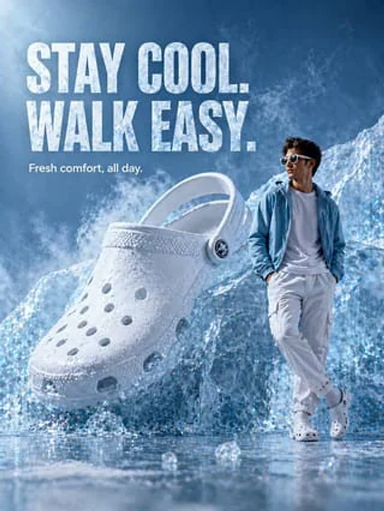

```text
A giant white wooden clog is partially embedded in a crystal-clear block of ice, surrounded by a chilling mist. A model stands casually beside it. Background: Ice-blue ambient text: "STAY COOL. WALK EASY." Subtitle: "Cool and refreshing all day long."
```

Model: GPT Image 2
Author: GPT Image 2 Prompts

[ProjectD](https://aitoolsradar.com/en/prompts/d19b9f03859898) · [Recorded source](https://x.com/Strength04_X/status/2047986707480600990)
 · [Full original metadata and byte evidence](data/projectd-batch-0048.json)

## Surreal Gothic Hall with Floating Masks

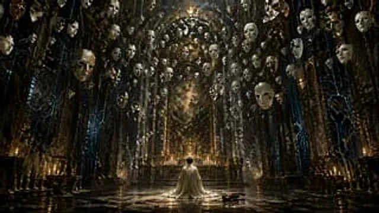

```text
A highly detailed, cinematic wide-angle lens showcases a world with{argument name="atmosphere" default="Dark Fantasy"} A magnificent, dark Gothic hall of aesthetics. At its center stands a figure dressed in {argument name="clothing" default="White robe"} The figure kneels on the highly reflective stone floor, facing a magnificent golden altar illuminated by a row of lit candles. To the right of the kneeling figure is placed a{argument name="floor object" default="wooden violin"} The spacious room was constructed of massive, dark stone pillars, which were covered with {argument name="accent color" default="Glowing blue"} Ethereal cracks and textures. Dozens of them hang from the high ceiling.{argument name="floating objects" default="White porcelain theatrical mask"} Hanging from thin lines, they filled the upper half of the space, creating a memorable, surreal atmosphere. The lighting was dramatic and emotional, employing a rich color scheme of deep black, dark gold, and cool blue tones. Format: 16:9.
```

Model: GPT Image 2
Author: GPT Image 2 Prompts

[ProjectD](https://aitoolsradar.com/en/prompts/31c8ba5cc991c6) · [Recorded source](https://x.com/nomen_machine/status/2046473998389977218#reversed-1)
 · [Full original metadata and byte evidence](data/projectd-batch-0048.json)

## Surreal Ice Cave Flash Photography


```text
One use{argument name="lighting style" default="Strong direct flash photography"} The realistic images were taken, and the scene was located in a{argument name="environment" default="Ice caves formed by large blocks of ice and snow"} Inside, a young man with messy, dark curly hair sat relaxed on a brown fur coat, his chin resting on his hand. He was wearing a {argument name="clothing" default="Thick black and white patterned knit sweater"} He was wearing black snow pants and black winter boots. Directly behind him was a white {argument name="car model" default="Porsche 911 GT3 RS"} The rear half of the sports car was embedded in the snow-covered cave wall, its red taillights illuminated, and its license plate number displayed as {argument name="license plate" default="VS 369 911"} In the foreground, on a rough wooden table covered with a thin layer of snow, are neatly arranged two stainless steel thermos cups, a clear textured glass, a small metal cooking pot, and a yellow and blue matchbox. On the ice to the right sits a green glass bottle and a vintage metal lantern.
```

Model: GPT Image 2
Author: GPT Image 2 Prompts

[ProjectD](https://aitoolsradar.com/en/prompts/c29528b6fb0973) · [Recorded source](https://x.com/WolfRiccardo/status/2044564232927076358#reversed-3)
 · [Full original metadata and byte evidence](data/projectd-batch-0048.json)

## Surreal Ice Cave Flash Photography

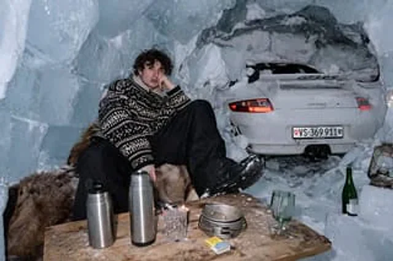

```text
A realistic image shot with {argument name="lighting style" default="harsh direct flash photography"} inside an {argument name="environment" default="ice cave made of large ice blocks and snow"}. A young man with messy dark curly hair sits on a brown fur pelt, leaning his head on his hand with a relaxed expression. He is wearing a {argument name="clothing" default="thick black and white patterned knit sweater"}, black snow pants, and black winter boots. Directly behind him, the rear half of a white {argument name="car model" default="Porsche 911 GT3 RS"} sports car is embedded into the snowy cave wall, with its red taillights illuminated and a license plate reading {argument name="license plate" default="VS 369 911"}. In the foreground, a rough wooden table dusted with snow holds exactly 2 stainless steel thermoses, 1 clear textured glass, 1 small metal cooking pot, and 1 yellow and blue matchbox. Resting on the icy floor to the right are 1 green glass bottle and 1 vintage metal lantern.
```

Model: GPT Image 2
Author: Riccardo Wolf

[ProjectD](https://aitoolsradar.com/en/prompts/32b1ba859dbf86) · [Recorded source](https://youmind.com/prompts/ice-cave-flash-photography-14082)
 · [Full original metadata and byte evidence](data/projectd-batch-0048.json)

## Surreal Infinite Staircase Anime Poster

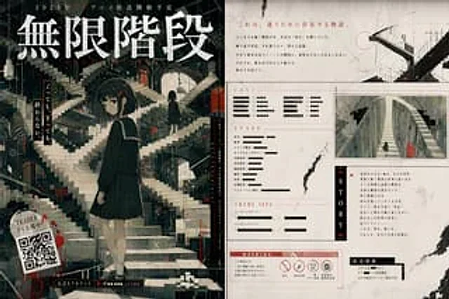

```text
{
  "type": "Anime psychological thriller posters and accompanying information pages",
  "style": "A dark, surreal anime key visual, high-quality TV animation promotional art, featuring Escher-style impossible architecture, an aged print texture, high-detail ink and watercolor feel, soft grayscale paired with deep black and blood red accents, slightly worn paper, and an editorial layout with exquisite graphic design overlays.",
  "subject": {
    "primary character": "A Japanese high school girl, dressed in a dark navy blue sailor uniform with white trim on the collar and cuffs, a pleated skirt, white socks, black loafers, and a short black bob, is primarily shown from behind and in a three-quarter profile, gazing at the staircase maze from the stone steps.",
    "secondary character": "A smaller, distant female student figure, wearing the same uniform, stands higher up in the staircase maze.",
    "environment": "Endless interior staircases, archways, platforms, railings, impossible perspectives, cathedral-like shadows, narrow passageways, red-lit porticoes, geometric lines and diagrammatic markings floating above the architecture."
  },
  "composition": {
    "format": "Split-style animation advertisement page",
    "left panel": "The large main poster, occupying about half of the left side, features a stepped maze and a full-body image of a female student.",
    "right panel": "The beige editing information page includes text blocks, a credits list, illustrations, and warning boxes.",
    "camera": "A slightly lower eye level, creating a deep perspective that leads into a labyrinth of stairs.",
    "mood": "Ominous, mysterious, mind-bending, lonely, surreal"
  },
  "text_elements": {
    "main title": "Infinite Phase",
    "top line": "The TV anime broadcast is scheduled to begin in 2025.",
    "tagline": "No matter how much you go up or down, it never ends.",
    "left sticker": "TEASER PV is now available.",
    "right red heading": "This is a story that exists to make you lose your way.",
    "section labels": [
      "CAST",
      "STAFF",
      "THEME SONG",
      "STORY",
      "WARNING",
      "Broadcasting information"
    ],
    "footer": "Official X account"
  },
  "layout": {
    "sections": [
      {
        "title": "Main Poster",
        "position": "left half",
        "count": 6,
        "labels": [
          "Top Main Title",
          "Vertical black banner",
          "Full-body image of female student",
          "A female student in a distant view",
          "QR code preview sticker",
          "Bottom social media account bar"
        ]
      },
      {
        "title": "Introduction and Charts",
        "position": "Top right corner",
        "count": 3,
        "labels": [
          "Red headline",
          "Brief plot summary paragraph",
          "Stepped building line drawing"
        ]
      },
      {
        "title": "Cast and Crew",
        "position": "Middle right",
        "count": 3,
        "labels": [
          "CAST",
          "STAFF",
          "THEME SONG"
        ]
      },
      {
        "title": "Story Area",
        "position": "Middle to lower right",
        "count": 2,
        "labels": [
          "Staircase illustration",
          "STORY vertical labels and paragraph text"
        ]
      },
      {
        "title": "Bottom Information",
        "position": "bottom right corner",
        "count": 2,
        "labels": [
          "WARNING box with 4 prohibition icons",
          "Broadcast information box"
        ]
      }
    ],
    "inset_images": [
      "One technical ladder sketch in the upper right corner",
      "A framed image of a staircase scene with tiny walking figures on the right side of the middle."
    ]
  },
  "design_details": {
    "background": "On the right is off-white paper with wear, cracks, creases, ink stains, and worn edges; on the left is a dark, densely packed building.",
    "graphic motifs": "Thin red circles, crosshairs, guide lines, measurement marks, small red squares, vertical black bars, subtle fault style blocks.",
    "color_palette": [
      "charcoal black",
      "stone gray",
      "Dirty white",
      "Faded cream color",
      "Deep crimson",
      "Soft reddish orange"
    ],
    "typography": "Large, distressed Japanese kanji titles, elegant shirt-style Romanized chapter titles, compact magazine-style body text, and vertical Japanese side text."
  },
  "quality": "This ultra-detailed 4K anime poster features a clear composition, deliberately designed tiny text-like fillers that appear printed but are not entirely legible, cinematic contrast, and exquisite promotional visual art."
}
```

Model: GPT Image 2
Author: GPT Image 2 Prompts

[ProjectD](https://aitoolsradar.com/en/prompts/d2d2762727bc0c) · [Recorded source](https://x.com/TestAI_WORKS/status/2046907689519956402#reversed-0)
 · [Full original metadata and byte evidence](data/projectd-batch-0048.json)

## Surreal Japanese Anime Poster Prompt


```text
Four fictional anime posters, with the theme of{argument name="theme" default="A magical girl that seems real but is slightly strange"} Created to a professional designer standard. The animation concept and setting should possess a surreal quality, eliciting laughter within a serious tone. Titles and broadcast information should be presented in Japanese. The format is as follows:{argument name="aspect ratio" default="2:3"} You need to specify the image generation model duct-tape-1, duct-tape-2, or 3.
```

Model: GPT Image 2
Author: GPT Image 2 Prompts

[ProjectD](https://aitoolsradar.com/en/prompts/4adfc927742b2d) · [Recorded source](https://x.com/aiehon_aya/status/2047510853671620608)
 · [Full original metadata and byte evidence](data/projectd-batch-0048.json)

## Surreal Koi Nebula Illustration


```text
一幅超现实主义数字插画风格，采用低角度仰拍视角。画面描绘了一条巨型彩色锦鲤遨游在梦幻般的星云中，四周环绕着色彩鲜艳的星云与气泡。画面中央还站着一个小人，背对观众，神情平静地仰望空中这条巨大的锦鲤，锦鲤头向下看着小人。整体画面呈现出强烈的大小对比，氛围空灵又梦幻。比例9:16
```

Model: GPT Image 2
Author: @liyue_ai

[ProjectD](https://aitoolsradar.com/en/prompts/3cd54a2b0fd0e8) · [Recorded source](https://x.com/liyue_ai/status/2045875219307655337)
 · [Full original metadata and byte evidence](data/projectd-batch-0048.json)

## Surreal Landmark Dining Portrait


```text
A photorealistic, high-quality image featuring a {argument name="subject description" default="Young Asian woman"} She sat precariously, with long, wavy brown hair.{argument name="landmark" default="The Sagrada Familia&#39;s ornate and colorful stone fruit spire"} Above. She was leisurely eating a{argument name="food item" default="Hamburger"} She cupped her hands to her lips. She was wearing a {argument name="outfit" default="Beige sleeveless belted jumpsuit, paired with metallic gold pointed-toe stilettos."} The background is stunning, slightly blurred.{argument name="background city" default="Dense European cities like Barcelona"} A panoramic aerial view stretching from the azure sky to the sea. Cinematic lighting, surreal juxtapositions, and highly detailed effects.
```

Model: GPT Image 2
Author: GPT Image 2 Prompts

[ProjectD](https://aitoolsradar.com/en/prompts/2856db0bb0982e) · [Recorded source](https://x.com/malonpon/status/2044959342273953799#reversed-0)
 · [Full original metadata and byte evidence](data/projectd-batch-0048.json)

## Surreal Low-Angle Floral Portrait


```text
A professional photograph captured from an extreme low-angle shot, reimagined in a {argument name="primary color" default="PRIMARY COLOR"}-toned surreal aesthetic. The subject is a woman posed in a {argument name="pose" default="gentle half-turn"}, her body language expressing elegance and harmony with the environment. She looks softly toward / downward / upward at the viewer with a calm, ethereal expression. One arm is gracefully positioned in {argument name="arm action" default="reaching into flowers"}, while the other gently holds a {argument name="flower type" default="matching the color theme"}, forming a balanced and poetic silhouette.

She wears a flowing [ATTIRE DESCRIPTION – kimono-inspired / futuristic silk gown / botanical couture / translucent layered dress] in [MATCHING COLOR PALETTE – shades of primary color + complementary tones], designed so that the fabric visually blends with the surrounding floral environment, as if made from the same natural material.

She stands / floats / kneels amidst an incredibly dense field of [FLOWER TYPE – matching the color theme], forming rolling waves of color that stretch endlessly into the horizon like a living ocean. The flowers appear luminous, soft, and rhythmic, moving gently as if breathing with the wind.

Above her, a bright sky filled with soft clouds contains surreal floating elements such as [SURREAL SKY ELEMENTS – butterflies, aquatic creatures, celestial animals, glowing particles, etc.], reinforcing the dreamlike world where nature and fantasy merge.

The scene is bathed in [LIGHTING STYLE – golden sunlight / cool moonlight / bioluminescent glow / sunset haze], producing a cinematic atmosphere with soft illumination and emotional depth. The image features soft focus, subtle chromatic aberration, cinematic lens flare, and gentle mist diffusion, enhancing the surreal and ethereal mood.

The composition is a medium full shot / wide shot / ultra-wide cinematic frame, using a slightly low eye-level perspective to emphasize the subject against the vast immersive floral landscape.
```

Model: GPT Image 2
Author: Shami

[ProjectD](https://aitoolsradar.com/en/prompts/a12262d67594ed) · [Recorded source](https://youmind.com/prompts/surreal-low-angle-floral-portrait-26209)
 · [Full original metadata and byte evidence](data/projectd-batch-0048.json)

## Surreal Lunar Horse Rider


```text
A surreal black and white photograph, depicting a horse{argument name="horse color" default="white"} A horse rides on the back of an astronaut on the moon. He is dressed in bulky clothing.{argument name="spacesuit color" default="white"} An astronaut in an EVA spacesuit lies prone on all fours on the dusty lunar surface, serving as his mount. A horse, in a human-like riding posture, stands upright on the astronaut's back, its forelegs raised and bent, as if for balance. The horse is equipped with a saddle and reins, which dangle towards the astronaut. The astronaut's helmet features a dark, reflective visor, and he is slightly turned to the right, his hands and knees pressed into the lunar soil. The background is a desolate lunar landscape, scattered with rocks and low hills, under a pitch-black sky devoid of stars. Strong directional lighting creates sharp shadows and high contrast, mimicking the style of Apollo-era lunar documentary photography. Placing these two subjects at the center of the mid-ground composition conveys a realistic texture, a dry, absurd humor, photorealistic detail, and a vintage monochrome film look.
```

Model: GPT Image 2
Author: GPT Image 2 Prompts

[ProjectD](https://aitoolsradar.com/en/prompts/07c563f202dcb4) · [Recorded source](https://x.com/BLUECOW009/status/2046670108085350850#reversed-0)
 · [Full original metadata and byte evidence](data/projectd-batch-0048.json)

## Surreal Map Dress Fashion Editorial


```text
A surreal, cinematic portrait of a high-fashion editor, a woman standing{argument name="landscape setting" default="A dry, rocky desert with distant mountain views"} In the middle. She wore an exquisite, voluminous off-the-shoulder gown, the entire dress made entirely of {argument name="dress material" default="Folded retro geography map"} The composition is characterized by sharp, origami-like folds and layers. She has her dark hair pulled back and wears large hoop earrings. In the cloudy sky surrounding her, seven slender, diamond-shaped objects float, each with a central {argument name="floating object design" default="Clock or compass dial"} The soft, cinematic lighting, reminiscent of the golden hour in the afternoon, cast gentle shadows that accentuated the structure and folds of the dress.
```

Model: GPT Image 2
Author: GPT Image 2 Prompts

[ProjectD](https://aitoolsradar.com/en/prompts/b18b3d17b867b7) · [Recorded source](https://x.com/Cheney_NehcOal/status/2044249215635976677#reversed-3)
 · [Full original metadata and byte evidence](data/projectd-batch-0048.json)

## Surreal Neon Japanese Megacity Overlook


```text
A high-resolution vertical illustration depicts a surreal, futuristic Japanese metropolis at night. The perspective is taken from an extremely high and steep angle, looking down as if from a dark hillside alley or rooftop observation deck, traversing narrow architectural canyons. Maintaining a dramatic 9:16 aspect ratio, the composition plunges into a vast, luminous urban basin, densely packed with layers of low rooftops, narrow streets, elevated sidewalks, and skyscrapers stretching into the distance. The foreground is composed of dense buildings on both sides: a huge, glowing red paper lantern sign with striking black Japanese kanji hangs from an old wooden eave in the upper left; on the right is a towering building facade filled with bright windows and several vertical neon signs; overhead power lines and utility poles intertwine throughout the image. The city below is both crowded and captivating, blending the retro alleyway aesthetics of the Showa era with cyberpunk futurism. Employing a rich graphic painting style, featuring strong black ink lines, bold celluloid shadows, and luminous neon accents, it retains a Midjourney-like cinematic quality while adding more delicate environmental details. The main color palette consists of dazzling orange and amber windowlight, saturated deep red and crimson signs, a deep purple night sky, vibrant magenta highlights, and electric cyan accents. The city below is filled with countless tiny, readable scenes, hinted at through silhouettes and bright windows: festival parades on the streets, nightlife crowds, weary office workers, gang members hiding in alleyways, dancers in entertainment districts, students studying by apartment windows, arguing couples, gamers glowing in front of screens, and many other small human stories embedded in the architecture. It emphasizes the contrast between urban splendor and emotional isolation, the boredom of crowds and the decadent beauty, carrying a satirical undertone about the meaninglessness of modern life. Despite the dense detail, the image still needs to maintain aesthetic harmony, with clear micro-details everywhere, illuminated Japanese signs, distinct layers of depth, atmospheric haze, and a surreal, slightly oppressive yet beautiful and moving atmosphere.
```

Model: GPT Image 2
Author: GPT Image 2 Prompts

[ProjectD](https://aitoolsradar.com/en/prompts/d965be7705f4be) · [Recorded source](https://x.com/Tresmort/status/2047105322863460496#reversed-0)
 · [Full original metadata and byte evidence](data/projectd-batch-0048.json)

## Surreal Octopus Burger Fine Dining Photo


```text
A dimly lit, emotionally charged photograph of a high-end restaurant scene, taken with a direct flash, carries a slightly unsettling, surreal, and eerie tone. At the center of the composition is an exquisitely plated, delicious sandwich whose filling resembles a lifelike octopus: a glossy, enticing golden-brown sesame bun atop a fleshy, pinkish-purple octopus body, detailed with clearly defined veins, pores, suckers, wrinkled skin, and several tentacles extending from the sides and front. The creature appears both cooked and unsettlingly alive, with a spherical eyeball-like structure visible on the left and dense pores and textures on the right, creating an eerie, organic appearance. The sandwich sits on a large, round, white ceramic plate with a pool of yellow, buttery or oily sauce at the bottom, mixed with a few drops of red liquid. A small dish containing a pat of butter is placed in the background on the left foreground. Six visible drinking glasses must be precisely placed on the table: two large red wine glasses, three stemmed white wine or champagne glasses, and a dark beer glass on the right edge. A small, lit candle is placed in a gold candlestick in the center of the background, along with a small, clear vase filled with white flowers. A white tablecloth is used, the ambient lighting is very dim with a warm candlelight glow, and the glassware reflects strong camera flashes. The casual, snapshot-style shallow depth of field composition creates a whimsical, hyper-detailed, realistic, and visually striking high-end restaurant atmosphere.
```

Model: GPT Image 2
Author: GPT Image 2 Prompts

[ProjectD](https://aitoolsradar.com/en/prompts/cfc48fe4e6aec8) · [Recorded source](https://x.com/cooldude6688/status/2046415445645791361#reversed-3)
 · [Full original metadata and byte evidence](data/projectd-batch-0048.json)

## Surreal Patio Portrait with Crow and Dog


```text
A slightly surreal yet photorealistic portrait centers on a figure seated in a quiet courtyard or terrace. The figure wears a fitted white long-sleeved turtleneck top with delicate pink floral patterns and a girl illustration on the chest, paired with loose-fitting cream-colored floral trousers. The figure sits on a simple white metal chair, cradling a fluffy miniature poodle with curly grey-white fur and distinctive orange-dyed ears. A black raven or crow perches on the figure's dark hair bun, facing left, its posture balanced and serene, as if it belongs there. The static, direct, and formal pose creates a whimsical, dryly humorous feel to the family portrait. The scene's background is a textured gray-white stucco wall, featuring four striking decorative elements: a brown sun-shaped wall decoration in the upper left, a small wall-mounted flower stand on the left (with bird figurines and hanging flowers), a tall arched window or mural on the right (showing a bright blue sky and soft white clouds), and a white-based flowerpot in the lower right (with long green leaves and decorated with two pink flamingo figurines). The lower left includes a few stone edges and dark green plants, with brown ceramic tiles on the floor. The lighting is soft natural sunlight, slightly overcast, with soft colors and a shallow depth of field, giving it a vintage editorial feel. The composition should be vertical, showing the fully seated figure, a direct frontal shot, balanced and with a quiet, eerie quality. The main figure can be customized.{argument name="person" default="A middle-aged woman"} Bird species{argument name="bird type" default="Black Crow"} Dog breeds{argument name="dog type" default="Miniature Poodle Mix"} dog ear color{argument name="dog ear color" default="orange color"} and clothing color{argument name="outfit colors" default="White and faded pink flowers"} .
```

Model: GPT Image 2
Author: GPT Image 2 Prompts

[ProjectD](https://aitoolsradar.com/en/prompts/bc388bb37c5aeb) · [Recorded source](https://x.com/levelsio/status/2046735438128333096#reversed-1)
 · [Full original metadata and byte evidence](data/projectd-batch-0048.json)

## Surreal Pepsi Pour Phone Composite


```text
Create an 8K UHD photorealistic AI-edited composite with cinematic realism, styled as a surreal product-style scene.

Use a slightly elevated top-down camera angle with sharp foreground focus, shallow natural depth of field, high clarity, and macro-level detail in the liquids, reflections, and broken glass.

Scene setting:
A black smartphone lies flat in vertical portrait orientation on a wooden table with clearly visible grain. The lighting is soft natural daylight from the upper left, casting realistic soft shadows beneath every object. The background is an indoor space with gentle blur; in one variation, the phone screen shows a {argument name="screen scene" default="snowy outdoor scene"}.

Main surreal concept:
The phone screen is cracked with radial fracture lines, as if the glass has broken outward. A smiling female-presenting subject emerges from inside the phone screen into the real table space, creating a convincing physical interaction between the digital world and the real environment.

Subject details:
Show the upper body emerging from the phone. She looks toward the viewer with a wide toothy smile. She has loose shoulder-length light brown hair. Create two outfit variations: one casual indoor version with a neutral top visible behind the phone screen, and one {argument name="outfit variation" default="winter version"} with a dark padded jacket, light turtleneck sweater, black gloves, and a black fur hat.

Action and product elements:
A hand enters from the top right holding a plastic {argument name="brand" default="Pepsi"} bottle with visible branding and condensation droplets. Cola is being poured into a transparent plastic cup filled with dark carbonated soda and ice. The cup has a clearly visible Pepsi logo. Freeze the pour at a dramatic instant with carbonation bubbles, splash droplets, and a realistic overflow splash effect suspended in mid-air.

Secondary objects:
Place a closed light beige book on the left side of the phone and a black pen near the book at a diagonal angle.

Visual effects:
Include cracked screen shards, reflections on broken glass, liquid droplets, and, for the winter-scene variation, subtle snow particles. Keep all surreal elements physically believable, with accurate contact shadows and reflections.

Color palette:
Use warm brown table tones, black phone and pen details, deep cola brown, and blue-red Pepsi branding accents. Create high contrast between the warm tabletop and the cooler phone-screen elements.

Post-processing:
Ultra-sharp, high micro-detail, high dynamic range, no visible noise. The mood should be playful, surreal, visually striking, and highly realistic while still clearly having an intentional AI-edited impossible effect.
```

Model: GPT Image 2
Author: PromptLab

[ProjectD](https://aitoolsradar.com/en/prompts/2ab85728ec6cff) · [Recorded source](https://youmind.com/prompts/surreal-pepsi-pour-phone-composite-23940)
 · [Full original metadata and byte evidence](data/projectd-batch-0048.json)

## Surreal Planetary Sculpture Still Life


```text
The surreal still life presented in the dark void resembles a melancholic yet luxurious sculpture exhibition arranged under a single, soft light. At the center of the image is a massive, suspended sphere, occupying about a third of the canvas's height. Its translucent surface possesses the texture of swirling planetary gas clouds, its hues a soft blend of cyan, cream, gray, and pale gold. Below and around the sphere, a dense cluster of moss-like leaves and coral-like plants in olive green and bronze hues surround it. To the left, a cluster of tiny, luminous white-purple flowers adorns the scene, while to the right, a cluster of brighter white flowers adds vibrancy. Behind the sphere, two horizontal rectangular stone slabs float: to the left, a partially obscured dark smoky slab, and to the right, a larger, warm brown-gold marble slab with lightning-like veins. In the lower right foreground, a polished rectangular stone block, displaying black, gray, and white hues, features striking marble patterns. The ground has a smooth, matte surface, with a pale green oval patch of light gradually fading into darkness. Cinematic art photography style, surreal contemporary installation art, minimalist composition, strong negative space, soft halo, delicate film grain, low-key lighting, gloss and mineral texture, slightly retro color tone, high contrast but soft focus, creating an elegant and mysterious atmosphere.
```

Model: GPT Image 2
Author: GPT Image 2 Prompts

[ProjectD](https://aitoolsradar.com/en/prompts/2b9a58667b9d6e) · [Recorded source](https://x.com/apostraphi/status/2047522782423003629#reversed-2)
 · [Full original metadata and byte evidence](data/projectd-batch-0048.json)

## Surreal Skull and Tree of Consciousness


```text
A surreal and exquisitely detailed fantasy illustration depicts a colossal, weathered human skull rising from dark waters. The skull opens like a base, supporting a massive, transparent glass sphere. Within the sphere stands an intricate, luminous tree, composed of twisted golden branches and roots, with a single trunk. Dozens of tiny, warm, glowing spheres are embedded among the branches and foliage, adorned with numerous bronze-like metallic leaves. The roots extend from the bottom of the sphere's interior, winding around a small ladder on the trunk. In the lower left of the sphere's interior, a semi-transparent seated human figure is depicted, lost in thought, knees bent, head resting on one hand, the other holding a luminous flower or crystal blossom. In the lower right of the sphere's interior, a miniature, tower-like structure with a delicate golden frame is included. Surrounding the sphere and in the background is a magnificent network of branches, adorned with crystal decorations, multifaceted gems, suspended water droplets, circular glass forms, and metallic leaves, the overall composition symmetrical and organic. The skull is highly realistic, featuring deep-set eye sockets, detailed teeth, cracked bone texture, and fine copper pipes and circuits extending from both sides near the temples. Within the right eye socket, a luminous, mechanical, celestial-like light source structure is displayed. The entire composition is placed in a dreamlike seascape at dusk, with a background of calm, reflecting water, distant rocky spires, soft clouds, and a sky transitioning from blue to gold. Utilizing cinematic lighting, high contrast, sharp focus, and a mysterious atmosphere, combined with luxurious gold and bronze filigree work and crystal transparency, the color palette employs deep cyan, midnight blue, ivory, warm amber, and metallic gold. It creates a symbolic metacognitive sense—a consciousness imprisoned in death—blending dark surrealism, Baroque decoration, and ethereal science fiction fantasy.
```

Model: GPT Image 2
Author: GPT Image 2 Prompts

[ProjectD](https://aitoolsradar.com/en/prompts/fef72e0152b302) · [Recorded source](https://x.com/cure4hayley/status/2046669499097559199#reversed-0)
 · [Full original metadata and byte evidence](data/projectd-batch-0048.json)

## Surreal Wind, Sand and Stars Book World


```text
A macro illustration full of poetry and cinematic quality, presenting {argument name="book title" default="Wind, sand and stars"} (author:{argument name="author name" default="Antoine de Saint-Exupéry"} The book cover, composed of [images of the book cover], presents a surreal desert world emerging from the textured pages. A giant human hand holds a glossy black and gold fountain pen in the upper right corner; the exquisitely engraved gold nib touches the paper, flowing a dark ink streak that transforms into a winding path through a miniature Sahara landscape. The composition is vertical, using warm lighting in amber and tan tones, complemented by dramatic sidelighting, deep shadows, and ultra-high-resolution depictions of paper texture, skin texture, dust, and metallic reflections. The title, printed in elegant serif font, is in the upper left corner, followed by the author's name, and a smaller italicized quotation at the bottom. The pages transform into a detailed, map-like desert scene, scattered with 16 tiny figures: a solitary figure stands beside a pen tip; three people are around a small campfire; two robed men converse in the center; three people gather around a biplane; a lone figure walks in the lower left center; two camel riders are in the lower left corner; three people stand beside a truck in the lower right corner; and a tiny figure sits beside wreckage in the lower left corner. The scene includes a clearly marked vintage biplane parked on the right; an old-fashioned adventure truck in the lower right corner; a wind vane in the middle right; a desert oasis town with palm trees on the right; a sandcastle-like ruin on the left; a dark tent camp in the middle left; engine or fuselage wreckage in the lower left corner; and a compass rose imprinted in the lower left corner. Ink smears across the dunes and cracked earth, like routes on an ancient map, connect landmarks marked with place names, including {argument name="map label one" default="Tamanrasset"} ,{argument name="map label two" default="Agadir"} and{argument name="map label three" default="Dakar"} It blends ancient cartography, literary symbolism, and the realistic style of miniature stereotypes, evoking a sense of exploration, memory, loneliness, and early aviation romance.
```

Model: GPT Image 2
Author: GPT Image 2 Prompts

[ProjectD](https://aitoolsradar.com/en/prompts/5737f173840bbd) · [Recorded source](https://x.com/NemoZhuge/status/2047232456584274279#reversed-0)
 · [Full original metadata and byte evidence](data/projectd-batch-0048.json)

## Surreal Woman at a Weathered Window


```text
A melancholic surrealist painting depicts a woman leaning out of an old window frame. The composition uses a back view and tight cropping, focusing on her wind-blown hair.{argument name="hair color" default="Dark brown with copper highlights"} Her hair, strands flowing to the left and intertwined, obscured most of her bare shoulders and upper back. Her hands rested on the bottom of an old wooden windowsill, two fingers on each side gripping the edge. Her face was completely hidden by her hair and the angle. The background was a weathered, multi-pane window, arranged in a 3x2 grid, rendered in a cool, greyish-blue hue with dirt, scratches, water stains, and worn edges. The work employed a mixed-media expressionist style, combining charcoal, ink, dry brush, scratched lines, and textured oil paint effects on a rough canvas, overlaid with impressionistic black and white lines on a soft industrial palette. The overall atmosphere was introspective, turbulent, and unforgettable, as if the wind or emotion was tearing the figure apart. Soft, diffused light, subtle contrasts, and a blend of abstract expressionist realism with a square composition further enhanced the effect.
```

Model: GPT Image 2
Author: GPT Image 2 Prompts

[ProjectD](https://aitoolsradar.com/en/prompts/adc7ac08f53886) · [Recorded source](https://x.com/imkkwoo/status/2046805357528506738#reversed-0)
 · [Full original metadata and byte evidence](data/projectd-batch-0048.json)

## Surrealist Fashion Brand Poster


```text
One for{argument name="brand" default="Crocs"} A high-fashion, surrealist advertising poster design. The scene is set in a minimalist, monochromatic environment.{argument name="background color" default="light blue"} In the photo studio, the floor has a semi-reflective effect. The visual centerpiece is an oversized white Crocs shoe, angled at the heel and used as a backrest. A fashion model with long dark hair is wearing {argument name="clothing" default="A clean and crisp pure white sweatshirt and wide-leg pants set"} Her entire back rested comfortably against the giant shoes. She turned to her right, gazing serenely forward, wearing standard-sized white Crocs. In the background, the word "CROCS" appeared in huge, bold, compressed white sans-serif font, partially obscured by the giant shoes and the model, creating a sense of depth. The upper right corner read "Designed with ChatGPT." At the bottom center was a white sans-serif slogan: "Born for comfort, wear for confidence. Because life is better when your feet stop complaining." The lighting was soft, cool, and even, casting gentle shadows and reflecting the subject onto the glossy blue floor. The overall aesthetic was simple, modern, and highly conceptual. The aspect ratio was set to 3:4.
```

Model: GPT Image 2
Author: GPT Image 2 Prompts

[ProjectD](https://aitoolsradar.com/en/prompts/649b6629abc120) · [Recorded source](https://x.com/rovvmut_/status/2047629543608025121)
 · [Full original metadata and byte evidence](data/projectd-batch-0048.json)

## Surrealist Fashion Brand Poster


```text
A high-fashion surrealist advertising poster for {argument name="brand" default="Crocs"}. The scene is set in a minimalist, monochrome {argument name="background color" default="light blue"} studio with a semi-reflective floor. 
The central focus is an oversized, giant white Croc clog positioned on its heel at a diagonal angle, serving as a backrest. A fashion model with long dark hair, dressed in a {argument name="clothing" default="clean, all-white coordinated sweatshirt and wide-leg trousers"}, leans her entire back against the giant shoe in a relaxed, leaning posture. She is facing right in profile, looking ahead with a serene expression, and wearing standard-sized white Crocs.
In the background, the word "CROCS" is written in massive, bold, white condensed sans-serif typography, partially occluded by the giant shoe and the model to create a sense of depth. At the  top right, "Designed with ChatGPT" 
At the bottom center, a white sans-serif tagline reads: "Made for comfort, worn for confidence. Because life feels better when your feet stop complaining." The lighting is soft, cool, and even, casting gentle shadows and a soft reflection of the subjects on the glossy blue floor. The overall aesthetic is clean, modern, and high-concept.

Make the aspect ratio 3:4
```

Model: GPT Image 2
Author: Heisenberg

[ProjectD](https://aitoolsradar.com/en/prompts/522064020aaa54) · [Recorded source](https://youmind.com/prompts/surrealist-croc-poster-15519)
 · [Full original metadata and byte evidence](data/projectd-batch-0048.json)

## Surrealist Koi Fish Illustration


```text
A surrealist digital illustration style, using{argument name="camera angle" default="Low angle shooting"} The image depicts a giant, colorful {argument name="subject" default="Koi"} Swimming amidst dreamlike nebulae, surrounded by vibrantly colored nebulae and bubbles, a tiny figure stands in the center of the image, back to the viewer, calmly gazing up at a giant koi carp in the sky, while the koi looks down at the figure. The overall composition exhibits a strong contrast in size, creating an ethereal and dreamlike atmosphere. Aspect Ratio{argument name="aspect ratio" default="9:16"} .
```

Model: GPT Image 2
Author: GPT Image 2 Prompts

[ProjectD](https://aitoolsradar.com/en/prompts/a561a00ca7563f) · [Recorded source](https://x.com/liyue_ai/status/2045875219307655337)
 · [Full original metadata and byte evidence](data/projectd-batch-0048.json)

## Surrealist Rolex Advertisement Poster


```text
One for{argument name="brand" default="Rolex"} A surrealistic haute couture poster design. A minimalist photography studio in deep emerald green, complete with polished, reflective floors. A massive Rolex watch stands like a monument. A man in a deep green bespoke suit {argument name="subject" default="male model"} Casually leaning against the watch face, wearing the same Rolex timepiece. In the background, the prominent "ROLEX" lettering is presented in an elegant large serif font, partially obscured. Top right corner: "Designed with ChatGPT". Bottom center tagline:{argument name="tagline" default="Time, perfected. Presence, defined."} "Deep, luxurious lighting, rich color tones, and cinematic reflections. Aspect Ratio: 3:4"
```

Model: GPT Image 2
Author: GPT Image 2 Prompts

[ProjectD](https://aitoolsradar.com/en/prompts/cb660979226e66) · [Recorded source](https://x.com/Sheldon056/status/2047873913049538927)
 · [Full original metadata and byte evidence](data/projectd-batch-0048.json)

## Sushi Platter Top-Down with Chopsticks


```text
Overhead top-down photograph of a black slate platter holding eight neatly arranged pieces of nigiri sushi and a small mound of pink ginger and wasabi, with two dark wooden chopsticks resting at a slight diagonal beside the platter. Surface is dark stained oak with subtle grain. Warm tungsten studio light from a single soft box above-left. Square 1:1 framing with generous negative space around the platter. No text, no watermark, no chef hand visible. Premium food photography, sharp focus, glossy rice grains, soy condensation droplets.
```

Model: GPT Image 2
Author: @hiapi_ai

[ProjectD](https://aitoolsradar.com/en/prompts/f170c3278dbbc9) · [Recorded source](https://github.com/HiAPIAI/awesome-gpt-image-2-prompts)
 · [Full original metadata and byte evidence](data/projectd-batch-0048.json)

## Suzhou Classic Travel Infographic


```text
{"type":"China Tourism Information Map Poster","topic":"Suzhou Classic Representative Tourism Map","style":"Elegant high-end editorial tourism poster, soft ivory white background, exquisite Jiangnan aesthetics, subtle embossed cloud pattern in the upper left corner, balanced layout, understated luxury color scheme, realistic photo illustration cards with rounded corners and soft shadows","text":{"headline":"Suzhou Representative Classic Tourism Map","subheadline":"Palette":{"background":"warm ivory white","accent colors":["sage green","light celadon","light gray","beige","terracotta"]},"layout":{"format":"horizontal poster","top":{"headline centered":true,"decorative color dots count":5},"main section":{"card count":8,"card style":"vertical rounded corner destination cards, featuring large landscape images, each card with a circular detail illustration at the bottom, and three lines of Chinese text below"},"bottom sections":[{"title":"Destination Overview","position":"bottom left","count":1,"labels":["Suzhou, a famous Jiangnan city where classical and modern blend. "]},{"title":"Travel Tips","position":"bottom center-left","count":3,"labels":["Best Time to Travel in Spring and Autumn","Slow Travel Through Gardens and Ancient Towns","Night Tour of Pingjiang to Enjoy the Lanterns"]},{"title":"Cultural Trivia","position":"bottom center","count":3,"labels":["Suzhou gardens are the best in the world, and the Humble Administrator's Garden is one of the four most famous gardens.","Suzhou embroidery is one of the four famous embroidery styles in China, with a history of over two thousand years.","Hanshan Temple is famous throughout the world because of Zhang Ji's poem "A Night Mooring at Maple Bridge."]},"history timeline":{"title":"Historical Timeline","position":"bottom right","count":6,"labels":["Spring and Autumn Period","Tang Dynasty","Song Dynasty","Ming and Qing Dynasties","Modern and Contemporary","Contemporary"]}]},"cards":[{"title":"Humble Administrator's Garden","image":"A classic Suzhou garden, complete with pavilions, ponds, rockeries, bridges, and lush vegetation, creating a poetic and misty atmosphere","detail inset":"Close-up of Taihu Stone","description lines":["Highlights: Jiangnan Garden","Suitable for: Strolling and Appreciating"]},{"title":"Zhouzhuang Ancient Town","image":"An ancient canal town with white walls and black tiles, arched stone bridges, and small wooden boats swaying on the water","detail inset":"Stone Bridge Carvings and Decorations","description lines":["Highlights: Ancient Charm of a Water Town","Suitable for: Leisure and Vacation"]},{"title":"Tiger Hill Scenic Area","image":"Tiger Hill Pagoda stands atop trees and historical buildings, with city mist visible in the distance","detail inset":"Stone Carvings and Relics","description lines":["Highlights: Ancient Charm of a Water Town","Suitable for: Leisure and Vacation"]},{"title":"Tiger Hill Scenic Area","image":"Tiger Hill Pagoda stands atop trees and historical buildings, with city mist visible in the distance","detail inset":"Stone Carvings and Relics","description lines":["Highlights: Ancient Charm of a Water Town","Suitable for: Leisure and Vacation"]} {"Highlights: Relics of Wu Region", "Suitable for: Historical Exploration"]},{"title":"Hanshan Temple","image":"A traditional temple complex with multi-tiered pagoda roofs, and autumn-colored trees dotting the courtyard","detail inset":"Dark ceramic tiles or incense burner details","description lines":["Highlights: A thousand-year-old temple", "Suitable for: Praying and Tranquility"]},{"title":"Suzhou Museum","image":"The Suzhou Museum building features geometric white walls, gray tile roofs, and a reflecting water courtyard","detail inset":"Window lattice details","description lines":["Highlights: I.M. Pei's masterpiece", "Suitable for: Cultural Exploration"]},{"title":"Pingjiang Road Historic District","image":"The canal street at night is brightly lit, with traditional residences, boats on narrow waterways, and a modern skyline visible in the distance","detail inset":"Wooden window lattice details","description lines":["Highlights: I.M. Pei's masterpiece", "Suitable for: Cultural Exploration"]},{"title":"Pingjiang Road Historic District","image":"The canal street at night is brightly lit, with traditional houses, boats on narrow waterways, and a modern skyline visible in the distance","detail inset":"Wooden window lattice details","description lines":["Highlights: A thousand-year-old temple", "Suitable for: Praying and Tranquility"]} lines":["Highlights: Suzhou Charm","Suitable for: Nighttime Sightseeing"]},{"title":"Jinji Lake Scenic Area","image":"The expansive lakeside skyline, the giant Ferris wheel and modern city buildings are reflected in the soft twilight","detail inset":"Close-up of Ferris wheel spokes","description lines":["Highlights: City Landmark","Suitable for: Family Leisure"]},{"title":"Suzhou Embroidery Experience","image":"Indoor cultural workshop scene, a woman in elegant traditional clothing is embroidering a floral fan or silk painting, her face deliberately blurred","detail inset":"Finished Suzhou embroidery floral pattern","description lines":["Highlights: Intangible Cultural Heritage Skills","Suitable for: Cultural Experience"]}],"rendering Notes: "Employ high-quality tourism poster designs; each card should be presented as a premium, collectible destination plaque; combine realistic landscape photography with a slightly painterly softness; all Chinese text should be clear and legible; maintain the tranquil and elegant atmosphere unique to the Suzhou and Jiangnan tourism brand."
```

Model: GPT Image 2
Author: GPT Image 2 Prompts

[ProjectD](https://aitoolsradar.com/en/prompts/c68ff8b16e9338) · [Recorded source](https://x.com/aidavid125/status/2046504856060670389#reversed-0)
 · [Full original metadata and byte evidence](data/projectd-batch-0048.json)

## Swiss Poster for AI Web Design Sprint


```text
Create a bold Swiss modernist style event poster for an AI and web design sprint event. Use a vertical composition with a warm, off-white paper-textured background, contrasted with striking black typography and vibrant red blocks. The composition employs an asymmetrical editorial style, featuring a strong grid effect and ample white space. Place a line of small red capital text in the upper left corner.{argument name="date text" default="LIVE APRIL 27–30"} This is followed by a thin black horizontal line extending to the right. Below this is an oversized stacked heading in a bold black sans-serif font, left-aligned, containing the following content:{argument name="headline text" default="The AI Web Design Sprint"} The text is arranged in four rows, with exaggerated proportions to make it occupy the left side of the poster. In the upper right quadrant, a large solid red rectangle is added as a graphic block. Below this red block, three lines of compact black capital letters are placed as a subtitle:{argument name="tagline text" default="4 DAYS. REAL PROJECTS. SHIP TOGETHER."} At the bottom center, two black-and-white half-body portraits of men are placed side-by-side in a documentary style, slightly covering the layout area; the man on the left has dark slicked-back hair and a short beard, while the man on the right wears a dark baseball cap with embroidered lettering and also has a beard. Two vertical, soft-edged gray rectangles obscure their faces, centered above them. A vertical toolbar is created along the right side, containing four black square icons, each separated by a thin horizontal line and labeled in uppercase. These four items are: a starburst icon labeled "CREATIVE COLLISION," a connector node icon labeled "AI-POWERED WORKFLOWS," a code bracket icon labeled "CODE IN MOTION," and a terminal prompt icon labeled "REAL-TIME DESIGN." Near the bottom, a full-width footer separated by thin black horizontal lines is added. Inside the footer, create four text blocks separated by thin vertical lines: the first block reads "BUILD FAST. BREAK RULES. SHARE LOUD."; the second block lists "MINIMAL PLAYGROUND &amp; AGENCY 976" with a short red line below it saying "LIVE ON THE WEB"; the third block lists "CYBERPUNK CAFE SURFERS (LATE SET)" and below it "4 NIGHTS OF CHAOS &amp; CODE" and "THE SOUTH SIDE DIY"; the fourth block lists ticketing information "TICKETS $10 ADV $12 DOS". Add vertical red text to the bottom right edge.{argument name="location text" default="CHICAGO, IL"} Use a clean, neo-grotesk typeface similar to Helvetica or Akzidenz-Grotesk, with bold headings, compressed uppercase for secondary text, clear alignment, subtle paper texture, and a high-contrast black-red-beige color scheme. The overall visual effect should blend contemporary design conference posters, punk tech culture, and a brutalist editorial branding style.
```

Model: GPT Image 2
Author: GPT Image 2 Prompts

[ProjectD](https://aitoolsradar.com/en/prompts/8ab318ad7671f1) · [Recorded source](https://x.com/ransegall/status/2047583778974126564#reversed-1)
 · [Full original metadata and byte evidence](data/projectd-batch-0048.json)

## Swiss Travel Guide Relief Map Poster


```text
Create a detailed, retro-style illustrated travel poster and infographic with the theme of{argument name="country name" default="Switzerland"} A sculptural 3D topographic map is displayed at the center against a light gray background. A striking black sans-serif bold title is placed at the top.{argument name="headline text" default="SWITZERLAND"} Below is the smaller, all-caps "TRAVEL GUIDE," flanked by thin horizontal dividing lines and adorned with a small red shield with a white cross. The core is a miniature topographical map of Switzerland, showcasing rocky borders, green valleys, snow-capped Alpine peaks, blue lakes, winding white roads, and several railway lines. Twelve destinations are precisely marked on the map using black dots and black capsule labels in white capital letters: BASEL, ZÜRICH, ST. GALLEN, LUCERNE, BERN, INTERLAKEN, CHUR, ST. MORITZ, LUGANO, ZERMATT, GENEVA, and LAUSANNE. Miniature landmarks and landscapes are directly integrated into the map, including churches, old town towers, waterfront buildings, castles, and mountain villages, with two small red trains traversing the landscape. Add travel souvenir elements around the map: a worn brown vintage suitcase with travel stickers and a red Swiss cross emblem in the top left corner; an antique brass compass on the left; a stamp with the words "TRAVEL TO SWITZERLAND," mountain art, and a postmark in the top right corner; a realistic Swiss flag standing on a flagpole in the top right corner; and a tilted Polaroid photograph showing the snow-capped mountains with a caption in the bottom left corner.{argument name="photo caption" default="Swiss Alps"} In addition, four multifaceted heart-shaped crystal pendants are placed around the image, including two clear/silver hearts and two red hearts. A vertical sightseeing list with icon illustrations and thin dividing lines is added to the right, containing 12 city entries, each with a title and a brief description of the attractions: ZÜRICH — Bahnhofstrasse; Old Town (Altstadt); Lake Zurich. LUCERNE — Chapel Bridge; Lion Monument; Lake Lucerne. INTERLAKEN — Jungfraujoch; Hardkun Viewpoint; Lake Brienz and Lake Thun. ZERMATT — Matterhorn; Gornegrat Railway; Skiing and Hiking. GENEVA — Jet d'Eau; United Nations Headquarters; Lake Geneva. LAUSANNE — Olympic Museum; Lausanne Cathedral; Lake Geneva. BERN — Federal Palace; Clock Tower (Zytglogge); Bear Park. ST. MORITZ — Lake St. Moritz; Skiing; Luxury Shopping. LUGANO — Lake Lugano; Brémont Hill; Swiss-Italian culture. ST. GALLEN — Abbey Library; St. Gallen Cathedral; Textile Museum. CHUR — Old Town; Bishop's Palace; Rhine Valley. BASEL — Basel Art Museum; Basel Cathedral; Rhine River. Employing high-end travel brand aesthetics, combined with realistic miniature map renderings, clear typography, soft studio lighting, and subtle shadows beneath objects, this creates exquisite visual effects for travel promotion.
```

Model: GPT Image 2
Author: GPT Image 2 Prompts

[ProjectD](https://aitoolsradar.com/en/prompts/bea2cad6f6cdea) · [Recorded source](https://x.com/Naiknelofar788/status/2047135588378362280#reversed-1)
 · [Full original metadata and byte evidence](data/projectd-batch-0048.json)

## Synthia #215


```text
Avant-garde fashion advertisement, oversized futuristic sunglasses positioned like sculpture, model casually seated on the frame as if furniture, giant word "VISION" behind in bold white typography, powder blue studio background, reflective floor, luxury eyewear campaign aesthetic, ultra-clean layout, editorial magazine styling, 1:1
```

Model: GPT Image 2
Author: Synthia

[ProjectD](https://aitoolsradar.com/en/prompts/08cc750a57cd24) · [Recorded source](https://x.com/AIwithSynthia/status/2047700936605479334)
 · [Full original metadata and byte evidence](data/projectd-batch-0048.json)

## Taiwanese Nostalgic Travel Collage


```text
Depend on{argument name="count" default="12"} A collage of photographs that captures{argument name="subject" default="A young couple traveling in Kenting, Taiwan"} The images capture fleeting moments. They possess an improvisational quality, as if casually shot with a mobile phone, carrying a sentimental and nostalgic tone. The overall aesthetic has a faded film quality, like fragments of memory. Scenes include: two people riding a motorcycle along the coastal highway, gazing at the Eluanbi Lighthouse, the neon lights of Kenting Street, and the sunset at Baisha Bay. Each frame is like a cinematic moment, with slight camera shake, imperfect composition, and a raw, grainy, and noisy atmosphere of everyday life.
```

Model: GPT Image 2
Author: GPT Image 2 Prompts

[ProjectD](https://aitoolsradar.com/en/prompts/21d9dd323835b7) · [Recorded source](https://x.com/oggii_0/status/2047707032988639319)
 · [Full original metadata and byte evidence](data/projectd-batch-0048.json)

## Tanabata Japanese Woman Illustration


```text
主題：
{argument name="主題" default="七夕"}

人物・表情：
{argument name="年代" default="20代"}女性。やわらかい卵型の顔立ち、透明感のある自然な肌、控えめな日式メイク。暗めのブラウンヘアを低めのゆるいまとめ髪にし、後れ毛が朝の光で細く透ける。小さな紫系の髪飾りを耳の後ろに添える。顔は少し上向き、視線は右上の短冊へ向け、静かに願いを結ぶような穏やかな表情。

服装・ポーズ：
{argument name="衣服" default="白地に青い花柄の浴衣"}、濃紺の帯。浴衣の袖は自然にたわみ、布の透け感とシワを丁寧に表現する。体は画面右上へ軽く伸びる姿勢。人物自身の右腕を高く上げ、画面右上のピンクの短冊にそっと触れる。人物自身の左腕は体の近くに自然に下ろし、腰まわりの帯と浴衣の重なりが見える。指先は力を入れすぎず、短冊をつまむ直前の繊細な動き。

背景・光：
日本の七夕飾りが並ぶ朝の神社参道または商店街の一角。頭上には笹の葉と色とりどりの短冊が重なり、ピンク、黄色、水色、薄紫の紙が朝風で軽く揺れている。背景にはぼんやりした提灯と屋台の気配を残すが、夜ではなく明るい朝。主光源は画面左上奥から差し込む低めの朝日。人物の髪の縁、頬、肩、上げた腕に強めの白いハイライトを作り、背景は淡い緑と白のボケで明るく抜ける。短冊と笹の影が浴衣や肌に薄く落ちる。

構図・カメラ：
縦構図。上半身中心のポートレートで、人物は画面下中央から右寄りに配置し、上部に短冊と笹の飾りを大きく入れる。カメラは胸の高さより少し低め、人物を見上げるような軽いローアングル。35mm相当の自然な広がり、人物と短冊の距離感が伝わる構図。ピントは人物の顔と右手の指先、背景の提灯や奥の参道は浅めの被写界深度で柔らかくぼかす。

質感・スタイル：
実写写真風。朝の逆光を活かした明るいハイキー寄りのポートレート。肌は過度に磨かず、自然な毛穴、細い髪の乱れ、浴衣の綿素材、短冊の紙の薄さを残す。透明感のある白と淡い緑、浴衣の青を中心に、夏の朝らしい軽い色調。フィルム写真のような柔らかい粒子と自然なレンズフレアを少量入れる。

ネガティブ：
不自然な顔や視線、余分または欠けた指、手首や肘の破綻、短冊との接触不良、浴衣の構造崩れ、帯の位置ずれ、過度な美肌補正、プラスチックのような肌、読めすぎる不自然な文字、文字化け、ロゴ、透かし、不要な人物、過剰な露出、背景と矛盾する影。
```

Model: GPT Image 2
Author: Prompt アトリエ｜AI画像プロンプト

[ProjectD](https://aitoolsradar.com/en/prompts/74ebda061a2aa0) · [Recorded source](https://youmind.com/prompts/tanabata-festival-woman-portrait-prompt-27782)
 · [Full original metadata and byte evidence](data/projectd-batch-0048.json)

## Tang Dynasty Aesthetic CG Illustration


```text
{argument name="style" default="Chinese-style CG illustrations"} Tang Dynasty aesthetics{argument name="character description" default="Exquisite ancient style woman"} Half-body close-ups, focusing on the face and upper body, high-end portrait composition, cinematic camera language and spatial perspective. Character Design: A classical East Asian beauty with a cool, translucent white complexion, delicate and realistic skin texture, and a soft, subtle glow; exquisite and three-dimensional features that are natural and not exaggerated, slender phoenix eyes with slightly upturned corners, a gaze that is affectionate and shy, slightly hazy, with long eyelashes casting subtle shadows; lips the color of rouge, slightly parted, soft yet full of emotional tension, presenting "reserved Eastern beauty". Costume Design: A gorgeous pink Tang-style costume that softly fits the body's curves, rich in layers but not cluttered; a moderately low neckline emphasizes the collarbone and neck and shoulder lines, providing natural visual guidance; an exquisite phoenix crown (metal, pearls, gemstones, tassels), with realistic material reflections, swaying slightly with movement. Dynamics and Posture: A slightly turned or slightly rotated posture, with an extended neck, relaxed shoulder lines, and hands forming soft guiding lines, enhancing the rhythm of the image and the feminine grace and tension. Lighting System: Cinematic lighting. Main Light: Warm golden front sidelight, focusing on highlights on the face and skin. Fill Light: Cool ambient light, creating a sense of volume and space. Contour lighting outlines the hair and neck silhouette. Highlights are controlled to avoid overexposure, shadows retain detail, and facial lighting transitions are smooth. Artistic Style: Hyper-realistic CG portrait blending Eastern freehand style with a slightly hazy aesthetic. Atmosphere and Texture: A dreamy, subtle, and high-end Eastern aesthetic atmosphere; blurred background to weaken the environment and strengthen the character; slight film grain + soft focus halo to enhance emotion and texture. Color System: Main Colors: Rouge pink, gold. Secondary Colors: Cool blue-gray. Overall low saturation, high quality, avoiding gaudiness. Lens Parameters: 85mm portrait lens, f1.4–f2, shallow depth of field, cinematic framing. Quality: Ultra-detail, 8K–16K, extreme detail, high resolution, cinematic lighting. Aspect Ratio:{argument name="aspect ratio" default="9:16"}
```

Model: GPT Image 2
Author: GPT Image 2 Prompts

[ProjectD](https://aitoolsradar.com/en/prompts/e7d8d23c648965) · [Recorded source](https://x.com/liyue_ai/status/2046785940593725633)
 · [Full original metadata and byte evidence](data/projectd-batch-0048.json)

## Tang Dynasty Queen & Minions Gongbi Painting


```text
A picture using{argument name="style" default="Gongbi painting style"} Traditional Chinese ink and color painting is presented on the textured surface of aged Xuan paper. A concubine dressed in magnificent Tang Dynasty Hanfu sits on a wooden stool, using a modern hairdryer to dry her flowing long hair. She wears black stockings, and one foot, clad in a red high heel, rests on the stool. Three servants dressed in ancient Chinese attire and wearing hats {argument name="attendants" default="Minions"} Attendants are present: on the left, a man nervously holds a hairdryer cord; in the middle, a man kneels and wipes her red shoes with a cloth; and on the right, a man holds up a smartphone to take pictures of her. The background features classical gnarled pine trees, bamboo groves, and Taihu stones. The upper right corner features traditional Chinese calligraphy and a red artist's seal (precious jade). The color palette uses soft mineral pigments.{argument name="mood" default="Humor, a fusion of misplaced eras"} --ar 16:9
```

Model: GPT Image 2
Author: GPT Image 2 Prompts

[ProjectD](https://aitoolsradar.com/en/prompts/64fbf394fd6e3a) · [Recorded source](https://x.com/dotey/status/2046723051895800086)
 · [Full original metadata and byte evidence](data/projectd-batch-0048.json)

## Tang Dynasty Queen & Minions Gongbi Painting


```text
A traditional Chinese ink and color painting in {argument name="画风" default="Gongbi style"} on aged rice paper texture. A noblewoman in elaborate Tang Dynasty Hanfu robes sits on a wooden stool, holding a modern hairdryer to dry her long flowing hair. She is wearing black stockings, red high heels on one foot, resting on a small stool. Three {argument name="随从" default="小黄人"} dressed in ancient Chinese servant robes and hats attend to her: one on the left looks stressed holding the hairdryer's power cord, one center kneels polishing her red shoe with a cloth, and one on the right holds up a smartphone taking a photo for her. The background features classical gnarled pine trees, bamboo groves, and Taihu rocks. Traditional Chinese calligraphy written in the top right corner, accompanied by a red artist chop seal (寶玉). The color palette is muted mineral pigments. {argument name="风格" default="Humorous, anachronistic fusion"}. --ar 16:9
```

Model: GPT Image 2
Author: 宝玉

[ProjectD](https://aitoolsradar.com/en/prompts/06a9e5f28570a7) · [Recorded source](https://youmind.com/prompts/tang-queen-minions-hairdryer-14325)
 · [Full original metadata and byte evidence](data/projectd-batch-0048.json)

## Tang Dynasty Social Feed Poster


```text
{
  "type": "Screenshots and posters of ancient Chinese social media apps",
  "theme": "A parody of Tang Dynasty history presented in a modern mobile social media UI.",
  "style": {
    "overall": "Dark, vintage parchment texture, black and dark brown background, antique gold ink, cinematic-quality antique illustration, highly detailed, elegant yet whimsical.",
    "lighting": "On a moonlit night, accompanied by the warm glow of lanterns and luminous golden lettering...",
    "mood": "Poetic, nostalgic, humorous, high-end editorial posters"
  },
  "canvas": {
    "aspect_ratio": "Vertical screen screenshot, 9:16"
  },
  "ui": {
    "status_bar": {
      "carrier": "Datang Telecom 5G",
      "date": "September 9th, 23rd year of Kaiyuan",
      "battery": "93%",
      "icons_count": 3
    },
    "top_icons": {
      "right_side_count": 2,
      "icons": [
        "Camera outline",
        "dropdown arrow"
      ]
    },
    "bottom_nav": {
      "count": 5,
      "labels": [
        "front page",
        "Discover",
        "release",
        "information",
        "I"
      ],
      "active": "release"
    }
  },
  "layout": {
    "sections": [
      {
        "title": "Tang Dynasty People's Social Circle",
        "subtitle": "TANG DYNASTY SOCIAL MEDIA FEED",
        "position": "Top title bar",
        "count": 1,
        "labels": [
          "Tang Dynasty People's Social Circle"
        ]
      },
      {
        "title": "Dynamic header",
        "position": "upper third",
        "count": 1,
        "labels": [
          "Li Bai, the Poet Immortal, with Wine and Sword",
          "Datang Internet Celebrity",
          "2 minutes ago",
          "Chang'an West Market Tavern"
        ]
      },
      {
        "title": "Dynamic text",
        "position": "Upper Mid-to-Upper",
        "count": 1,
        "labels": [
          "Today at the Hu Ji Tavern in the West Market, I drink alone, without a companion; thankfully, there's the bright moon and my shadow. A hundred poems can be written after a few drinks; here's a new one, appended below:"
        ]
      },
      {
        "title": "Featured picture cards",
        "position": "Center",
        "count": 1,
        "labels": [
          "Drinking alone under the moon",
          "A pot of wine among the flowers, I drink alone, no companion near. I raise my cup to invite the bright moon, and with my shadow, we become three.",
          "Li Bai's Seal",
          "Qinglian Jushi"
        ]
      },
      {
        "title": "Dynamic metadata row",
        "position": "Below the image",
        "count": 2,
        "labels": [
          "Chang'an Never Sleeps City - Wine Immortal",
          "Du Fu, He Zhizhang, Wang Lun, and 999+ others found this very helpful."
        ]
      },
      {
        "title": "Comments section",
        "position": "bottom area",
        "count": 3,
        "labels": [
          "Du Fu",
          "He Zhizhang",
          "Wang Lun"
        ]
      }
    ],
    "centerpiece": "A large-scale illustration on social media depicts Li Bai drinking alone on a moonlit terrace, overlooking the night view of Chang'an, the capital of the Tang Dynasty."
  },
  "subject": {
    "character": {
      "identity": "{argument name=\"character name\" default=\"Li Bai\"}",
      "appearance": "A middle-aged Chinese poet from ancient times, with a sparse beard, his hair tied in a high bun, wearing a flowing white Hanfu with wide sleeves, poses in an exaggerated and dramatic manner, raising a cup to invite the moon.",
      "archetype": "Romantic wandering poet and drunken immortal"
    },
    "featured_artwork": {
      "scene": "On the wooden terrace at night, the poet stands under the enormous full moon, surrounded by lanterns, rooftops, pagodas, distant mountains, and the brightly lit city.",
      "props_count": 6,
      "props": [
        "A raised wine glass",
        "Large wine jars labeled with the character \"酒\" (wine)",
        "Small wine glasses on the ground",
        "wooden railings",
        "Hanging lanterns",
        "Unsheathed longsword leaning on the right"
      ]
    }
  },
  "text_treatment": {
    "headline_calligraphy": "Large, bold, gold-lettered calligraphy",
    "body_text": "Elegant serif style traditional Chinese font",
    "accent_colors": [
      "Antique gold",
      "Burnt Orange",
      "dark brown",
      "Faded red stamp"
    ]
  },
  "composition": {
    "background": "Antique black paper with minor stains, scratches, and decorative edges",
    "framing": "The thin gold frame and panel dividing lines resemble a high-end app interface.",
    "color_palette": "The colors are predominantly black, dark brown, bronze, and gold, with a few touches of red."
  },
  "negative_space": "Maintaining a clear overall layout, resembling a real mobile phone screenshot, it avoids modern realistic elements, bright modern colors, and minimalist flat design."
}
```

Model: GPT Image 2
Author: GPT Image 2 Prompts

[ProjectD](https://aitoolsradar.com/en/prompts/7abf007e9d69c2) · [Recorded source](https://x.com/acupofai/status/2046640942116188212#reversed-0)
 · [Full original metadata and byte evidence](data/projectd-batch-0048.json)

## Tang Lychee Courseware Cover


```text
Goal: Create an elegant Tang-dynasty inspired courseware/PPT cover slide about {argument name="main title" default="杨贵妃 与 荔枝"}, with a poetic Chinese historical aesthetic centered on lychees and a veiled court beauty.

Canvas: 16:9 horizontal presentation cover, warm ivory handmade-rice-paper background with subtle fibers, stains, faint scratches, and ink-wash aging. Overall palette is muted cream, dusty rose, pale peach, faded red, olive gray, and ink gray.

Layout: Place the main title large on the left-center in refined Chinese calligraphy-style serif lettering. Put the small subtitle directly underneath with a decorative gold flourish at the far left. Keep generous negative space on the left and lower middle. On the right half, show a soft translucent back-view silhouette of a Tang-dynasty noblewoman with bare shoulders, high rounded hair buns, ornate gold dangling hair jewelry, and large pink-red peony flowers in her hair; her face area is intentionally covered by a plain pale beige rectangular privacy block. Add floating lychees around her and foreground depth blur.

Text content: Include exactly these visible text areas: 1) top-left small cloud-shaped seal containing “盛唐 / 风物”; 2) main title “杨贵妃 与 荔枝”; 3) subtitle “一颗果子的盛唐记忆”; 4) lower-left English stack “Tang Dynasty / Cultural Story / Courseware”; 5) lower-left Chinese label “PPT · 课件”; 6) right-side vertical poem text “长安回望绣堆，山顶千门次第开。——杜牧《过华清宫》”; 7) small tag near the peeled lychee reading “贵妃鲜” with a red seal mark; 8) bottom-right page number “01” with a small gold ornamental underline.

Subject details: Include exactly 4 visible lychee elements: one small blurred whole lychee floating near the upper center, one sharp whole lychee on the right side, one large peeled lychee in the lower-right center with translucent white flesh exposed and red bumpy skin opened around it, and one large heavily blurred partial lychee in the lower foreground. Add a few pale green lychee leaves connected to the peeled fruit. Make the lychees painterly but realistic, with bumpy red shells and soft natural highlights.

Visual style: Minimal luxury Chinese editorial design, museum-courseware cover, soft ink wash, translucent layering, shallow depth of field, delicate gold accents, understated red stamp marks, balanced asymmetrical composition, no modern UI elements.

Constraints: Keep the page clean and airy, maintain the exact count of 4 lychee elements, keep all typography readable, use no extra text beyond the specified labels, no watermark, no photorealistic harsh lighting.
```

Model: GPT Image 2
Author: 小小东

[ProjectD](https://aitoolsradar.com/en/prompts/a3d8d8ad2992a3) · [Recorded source](https://youmind.com/prompts/tang-lychee-ppt-cover-21567)
 · [Full original metadata and byte evidence](data/projectd-batch-0048.json)

## Taurus Zodiac Poster Design


```text
I am “{argument name="zodiac sign" default="TAURUS"}.” Create a poster inspired by Yumi’s Cells with the same soft, aesthetic, slice-of-life vibe and background style, while fully reflecting the Taurus zodiac theme in the design. The subject’s face must remain completely unchanged and untouched. Surround the subject with multiple small, raw yet realistic cute chibi-style mini 3D versions of the subject, designed like expressive “cells” with oversized heads, glossy high-detail finishes, and playful emotions. Each mini character should reflect Taurus traits such as calmness, loyalty, comfort-loving energy, stubbornness, sensuality, patience, and love for luxury and food. Show them in different actions: one clinging onto the subject’s arm, one relaxing with a cozy blanket, one reading a book peacefully, one drinking coffee or tea, one holding snacks or dessert, one lying down using a phone, one refusing to move with a stubborn expression, one looking sleepy and unbothered, and one with soft messy “just woke up” energy. Add playful hand-drawn doodles interacting directly with the subject and chibi characters—outlining poses, sketching comfy cushions, steam from drinks, tiny flowers, sparkle details, and calm motion accents to enhance storytelling. Use a clean aesthetic composition, white sticker outlines, soft pastel sage green, cream, beige, dusty pink, and warm earthy tones, high-detail glossy 3D chibi look, cute Korean-inspired design, with a raw natural poster feel in a 9:16 vertical aspect ratio, and the Taurus identity clearly integrated into the overall concept.
```

Model: GPT Image 2
Author: Kashberg

[ProjectD](https://aitoolsradar.com/en/prompts/ad7cbbdfdd3dfc) · [Recorded source](https://youmind.com/prompts/taurus-zodiac-poster-design-19222)
 · [Full original metadata and byte evidence](data/projectd-batch-0048.json)

## Tea Brand Product Advertisement Mockup


```text
Please provide{argument name="beverage" default="Tea"} Create an advertising banner. The image must include a woman. Expand the design {argument name="items" default="Paper bags, fans, and transparent folders"} In promotional materials, etc.
```

Model: GPT Image 2
Author: GPT Image 2 Prompts

[ProjectD](https://aitoolsradar.com/en/prompts/8ead711da69046) · [Recorded source](https://x.com/maimai0049/status/2047821399184847050)
 · [Full original metadata and byte evidence](data/projectd-batch-0048.json)

## Team Drawing Japan Illustration


```text
A simple, editorial-style illustration against a light gray-white background shows 11 young people gathered around a large sheet of paper on the ground, collaborating to create a beautiful scene of a Japanese travelogue. The composition uses a bird's-eye view, with the figures forming a loose circle around the artwork. Employing a simple, hand-drawn cartoon style, the lines are delicate, the colors soft and understated, and the shadows minimal, presenting a friendly and modern magazine aesthetic. The central artwork on the paper contains eight unique landscape elements: a snow-capped Mount Fuji in the center of the background, a red sun and a few white clouds to the upper right, pink cherry blossoms on dark branches to the upper left, a red multi-tiered pagoda to the right, a towering city skyline and towers to the right center, a blue lake with a small boat, and a streamlined white bullet train winding its way through the lower right. Trees and bushes dot the scene, and a small arched bridge spans the lower center. The 11 people, dressed in various casual clothes, hold markers or crayons, creating their artwork by leaning, kneeling, or lying around the paper. Six people are positioned at the top edge, three on the left, and two at the bottom right. Their clothing varies: hoodies, jackets, knit hats, plaid shirts, patterned sweaters, blue T-shirts, black T-shirts, and one person wearing a red cardigan over dark clothing. One person on the right wears glasses and a red cardigan; another at the bottom right, with dark curly hair, round-framed glasses, and a black T-shirt, is lying on the floor drawing. Several blue and dark crayons are scattered along the bottom edge of the paper. The overall atmosphere is collaborative, creative, and fun, with the huge illustrated poster as the visual focal point.
```

Model: GPT Image 2
Author: GPT Image 2 Prompts

[ProjectD](https://aitoolsradar.com/en/prompts/ba77c89ba42f3a) · [Recorded source](https://x.com/lingyunshow/status/2047162220111643097#reversed-0)
 · [Full original metadata and byte evidence](data/projectd-batch-0048.json)

## Tech Billionaire Boardroom Meeting


```text
A natural, realistic photograph showcasing five {argument name="meeting subject" default="CEO of a technology company"} A scene depicting a heated discussion around a cluttered conference table. The image includes a person wearing a green sweater.{argument name="person 1" default="Sam Altman"} Wearing a gray T-shirt{argument name="person 2" default="Mark Zuckerberg"} And the person making gestures, wearing a black jacket{argument name="person 3" default="Elon Musk"} The table was piled high with laptops, white coffee cups, water glasses, documents, and cables. The scene is set in {argument name="setting" default="Modern office meeting room"} The background consists of a simple wall and a window offering a view of trees. Shot with a smartphone, slightly grainy, under natural light.
```

Model: GPT Image 2
Author: GPT Image 2 Prompts

[ProjectD](https://aitoolsradar.com/en/prompts/87b202b830c60e) · [Recorded source](https://x.com/dummerspast39/status/2044343760536862882#reversed-0)
 · [Full original metadata and byte evidence](data/projectd-batch-0048.json)

## Tech CEO Battle Royale Lobby


```text
{
  "type": "Battle Royale Game Lobby UI",
  "characters": [
    {
      "name": "{argument name=\"left character name\" default=\"SamAltman\"}",
      "outfit": "Green tactical shirt, khaki trousers",
      "pose": "Dancing with arms crossed on the blue platform",
      "ui": "Level 87, OpenAI icon, not ready"
    },
    {
      "name": "{argument name=\"center character name\" default=\"DarioAmodei\"}",
      "outfit": "Brown jacket with the word \"AI\" printed on it, glasses, and jeans.",
      "pose": "Dancing with arms crossed on the blue platform",
      "ui": "Level 92, AI shield icon, not ready"
    },
    {
      "name": "{argument name=\"right character name\" default=\"ElonMusk\"}",
      "outfit": "Futuristic armor in red and black",
      "pose": "Dancing with arms crossed on the blue platform",
      "ui": "Level 114, X icon, not ready"
    }
  ],
  "background": "Stylized landscapes, flying combat buses, purple alpaca pinata",
  "ui": {
    "top_nav": [
      "Start Game",
      "lockers",
      "shop",
      "Battle Pass",
      "Task",
      "sports",
      "career"
    ],
    "left_panel": {
      "title": "{argument name=\"season text\" default=\"Chapter 5, Season 2\"}",
      "stats": "Level 127, Battle Pass Level 100",
      "daily_quests": 3
    },
    "bottom_right": {
      "mode": "{argument name=\"game mode\" default=\"Zero-Building Mode\"}",
      "status": "Ranked Matches: Off, Trio - No Fill Roles",
      "button": "Ready!"
    },
    "bottom_bar": {
      "party_channels": 3,
      "prompts": [
        "Press and hold to chat",
        "Facial expressions and gestures",
        "Squad Formation"
      ]
    }
  }
}
```

Model: GPT Image 2
Author: GPT Image 2 Prompts

[ProjectD](https://aitoolsradar.com/en/prompts/21ace71a571049) · [Recorded source](https://x.com/SuguruKun_ai/status/2044453450235420988#reversed-2)
 · [Full original metadata and byte evidence](data/projectd-batch-0048.json)

