# ProjectD backfill batch 49

Complete original prompts and exact existing ProjectD images. Actual model labels and any available credits or notices are retained. Missing authors or license metadata are not filled in.

## Tech CEO Rivalry Meme Generator

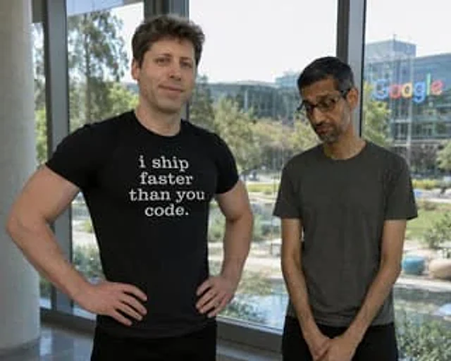

```text
A realistic-style picture, on the left is{argument name="person 1" default="Sam Altman"} He stood confidently with his hands on his hips, wearing a black T-shirt with the words "..." printed on it in typewriter font.{argument name="shirt text" default="i ship faster than you code."} "To his right is..."{argument name="person 2" default="Sundar Pichai"} He wore glasses and a simple dark gray T-shirt, his expression dejected and lost, his head bowed, his hands nervously clasped in front of him. They stood indoors, next to a huge floor-to-ceiling window. In the background outside, a brightly lit tech company campus could be seen, with buildings emblazoned with large logos.{argument name="background logo" default="Google"} The sign is surrounded by trees and a small pond.
```

Model: GPT Image 2
Author: GPT Image 2 Prompts

[ProjectD](https://aitoolsradar.com/en/prompts/78acdc17e0a72b) · [Recorded source](https://x.com/Ryan26334193113/status/2044235956752957872#reversed-0)
 · [Full original metadata and byte evidence](data/projectd-batch-0049.json)

## Tech CEO Writing on Whiteboard


```text
A photorealistic image that demonstrates{argument name="subject" default="Sam Altman"} Wearing a black long-sleeved sweater, he stood sideways in the bright, modern office, writing on a large whiteboard with a black marker. The whiteboard bore clear, neat, large black handwritten characters. The first line read, "{argument name="line 1 text" default="Model: ChatGPT"} The second line below reads "".{argument name="line 2 text" default="Company: OpenAI"} In the bottom right corner of the whiteboard, there is a signature.{argument name="signature name" default="Sam Altman"} The title is written directly below.{argument name="signature title" default="CEO, OpenAI"} ".
```

Model: GPT Image 2
Author: GPT Image 2 Prompts

[ProjectD](https://aitoolsradar.com/en/prompts/1537ff3f339f4a) · [Recorded source](https://x.com/marmaduke091/status/2044223783427350595#reversed-0)
 · [Full original metadata and byte evidence](data/projectd-batch-0049.json)

## Tech CEO Writing on Whiteboard

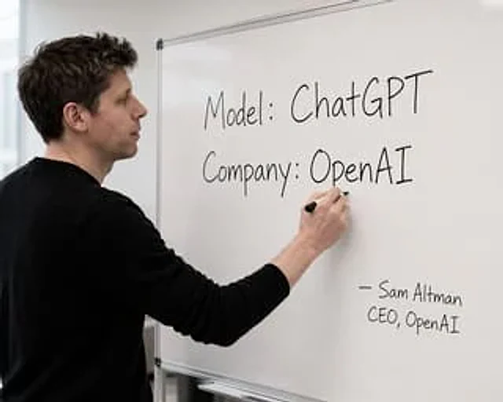

```text
A photorealistic corporate photograph of a man resembling {argument name="person name" default="Sam Altman"} wearing a {argument name="clothing" default="black long-sleeve sweater"}, standing in profile and writing on a large whiteboard with a black marker. The whiteboard features clear, handwritten black text reading "{argument name="line 1 text" default="Model: ChatGPT"}" with "{argument name="line 2 text" default="Company: OpenAI"}" written directly below it. In the bottom right corner, smaller text reads "{argument name="signature text" default="- Sam Altman CEO, OpenAI"}". The scene is set in a bright, modern office with soft natural lighting and a softly blurred background.
```

Model: GPT Image 2
Author: can

[ProjectD](https://aitoolsradar.com/en/prompts/6a7c85fa7a437c) · [Recorded source](https://youmind.com/prompts/tech-ceo-whiteboard-writing-13659)
 · [Full original metadata and byte evidence](data/projectd-batch-0049.json)

## Tech CEOs Awkward Meme Photo

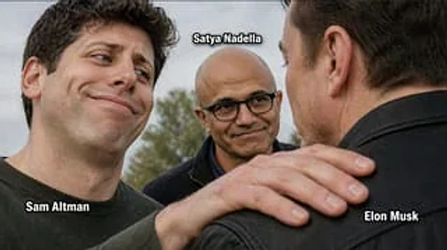

```text
A humorous, realistic, meme-like outdoor snapshot shows three CEOs of well-known tech companies huddled together, creating an awkward and emotionally charged triangular relationship. In the foreground on the left {argument name="left person name" default="Sam Altman"} She appears in a three-quarter profile close-up, with dark curly hair, a light complexion, and wearing a dark crew-neck shirt. Her face displays an exaggerated, smug, and slightly teary smile as she looks at the man to her right. In the center of the background {argument name="center person name" default="Satya Nadella"} Standing between the two men, a bald man with glasses, medium brown skin, and a dark zip-up jacket, wore a calm, knowing, and slightly mocking smile as he looked at the man on his right. In the foreground on the right {argument name="right person name" default="Elon Musk"} Primarily shown from behind and in profile, the figures have short, dark hair, wear black leather jackets, and their faces are mostly turned away from the camera. The large hand of the man on the left is resting on the shoulder of the man on the right, creating a comedic tension. The photography employs shallow depth of field, natural overcast lighting, soft and realistic skin textures, and a documentary style. Three bold white meme tags with thick black outlines are added near each figure: the one in the lower left corner near the man on the left.{argument name="left label" default="Sam Altman"} Above the man's head in the center{argument name="center label" default="Satya Nadella"} And the bottom right corner near the man on the right.{argument name="right label" default="Elon Musk"} The horizontal composition, the compact cut of the face and shoulders, the realistic proportions, and the overall feel are reminiscent of internet memes.
```

Model: GPT Image 2
Author: GPT Image 2 Prompts

[ProjectD](https://aitoolsradar.com/en/prompts/7499dd67e0befb) · [Recorded source](https://x.com/arankomatsuzaki/status/2047707142367637991#reversed-0)
 · [Full original metadata and byte evidence](data/projectd-batch-0049.json)

## Tech Conference Keynote Poster

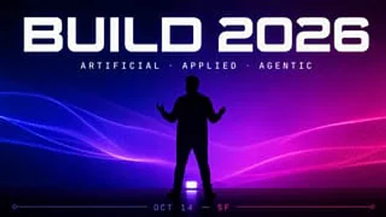

```text
Horizontal 16:9 modern tech conference keynote poster. Background is a vibrant abstract gradient mesh of deep indigo, electric purple and magenta. Centered silhouette of a single speaker mid-gesture against the gradient, lit from below by a small bright square stage light. Bold all-caps sans-serif headline at the top reads "BUILD 2026". Smaller subhead beneath reads "ARTIFICIAL · APPLIED · AGENTIC". Bottom of the poster shows a thin neon line and the date "OCT 14 — SF" in monospaced text. Horizontal poster composition. No real company name, no logo, no watermark. Premium conference design quality, crisp typography rendering.
```

Model: GPT Image 2
Author: @hiapi_ai

[ProjectD](https://aitoolsradar.com/en/prompts/2f0645bf996150) · [Recorded source](https://github.com/HiAPIAI/awesome-gpt-image-2-prompts)
 · [Full original metadata and byte evidence](data/projectd-batch-0049.json)

## Tech Keynote Presentation Slide


```text
A photo of a technology-themed presentation. A bald man wearing glasses, a dark blue sweater, and jeans stands on the left side of the stage, smiling and pointing with both index fingers to a large presentation screen behind him. The screen displays a slideshow with a light blue background. In the upper left corner is a small, cyan capsule-shaped badge that reads "NEW DATA." The main title below reads {argument name="headline" default="Microsoft Edge is the #1 browser to download Google Chrome"} The text describes a chart with "#1" highlighted in blue. The subtitle reads "% of Google Chrome downloads that started from another browser." Below is a three-bar chart. The first bar is tall and blue, labeled "38.6%" above, with the Microsoft Edge logo and the text "Microsoft Edge" below. The second bar is shorter and gray, labeled "17.2%" above, with the Mozilla Firefox logo and the text "Mozilla Firefox" below. The third bar is the shortest and gray, labeled "13.0%" above, with the Apple Safari logo and the text "Apple Safari" below. In the lower left corner of the slides, small print reads "Source: Microsoft internal analysis of Google Chrome download referrals Cohort: Windows 10 and 11, Worldwide, Jan - March 2024." The Microsoft logo (four colored squares) is printed on a wooden board on the left side of the screen. The backs of the audience's heads are visible at the bottom foreground.
```

Model: GPT Image 2
Author: GPT Image 2 Prompts

[ProjectD](https://aitoolsradar.com/en/prompts/30c4b0772b39b0) · [Recorded source](https://x.com/yousefrol/status/2044549711101636965#reversed-0)
 · [Full original metadata and byte evidence](data/projectd-batch-0049.json)

## Tech Leaders Poster with Facial Recognition

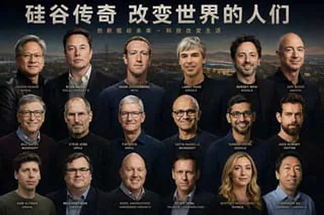

```text
Please help me generate a [image/image/etc.]{argument name="subject" default="Silicon Valley tycoons"} Group photo poster. Please pay special attention to their facial features; they must be clearly identifiable and there should be no duplicates.
```

Model: GPT Image 2
Author: GPT Image 2 Prompts

[ProjectD](https://aitoolsradar.com/en/prompts/bdd483a6e2f698) · [Recorded source](https://x.com/yangfei33113/status/2044780169349775798)
 · [Full original metadata and byte evidence](data/projectd-batch-0049.json)

## Tech Product Announcement Infographic

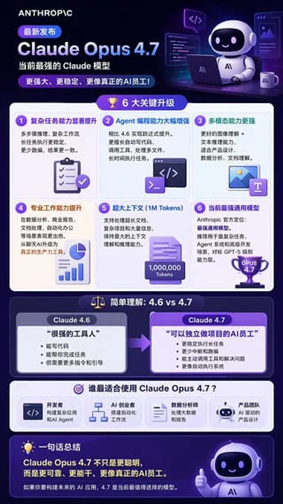

```text
{
  "type": "Long image vertical information chart",
  "style": "Modern tech style, 3D isometric illustration, deep purple and blue tones, glass-like UI elements.",
  "header": {
    "logo": "{argument name=\"company logo\" default=\"ANTHROPIC\"}",
    "badge": "Latest Release",
    "title": "{argument name=\"product name\" default=\"Claude Opus 4.7\"}",
    "subtitle": "{argument name=\"main subtitle\" default=\"The most powerful Claude model to date\"}",
    "tagline": "More powerful, more stable, and more like a real AI employee!",
    "illustration": "A cute 3D robot sits at a table, complete with a laptop, a coffee cup, and a floating code window."
  },
  "layout": {
    "sections": [
      {
        "title": "6 key upgrades",
        "icon": "3D Gold Trophy",
        "layout": "2x3 grid",
        "count": 6,
        "items": [
          {
            "title": "Significantly improved ability to perform complex tasks",
            "icon": "3D clipboard with checkmarks"
          },
          {
            "title": "Agent programming capabilities greatly enhanced",
            "icon": "3D code terminal window"
          },
          {
            "title": "Stronger multimodal capabilities",
            "icon": "3D images and text documents"
          },
          {
            "title": "Professional work ability enhancement",
            "icon": "3D Pie Charts and Bar Charts"
          },
          {
            "title": "Extremely large context (1M Tokens)",
            "icon": "3D document containing the phrase \"1,000,000 Tokens\""
          },
          {
            "title": "The most powerful general-purpose model currently",
            "icon": "3D purple trophy with \"OPUS 4.7\" markings."
          }
        ]
      },
      {
        "title": "Simply put: 4.6 vs 4.7",
        "icon": "3D Balance",
        "layout": "Side-by-side comparison, with a rightward arrow in the middle.",
        "count": 2,
        "columns": [
          {
            "header": "{argument name=\"comparison version 1\" default=\"Claude 4.6\"}",
            "quote": "A very strong tool person",
            "style": "gray box"
          },
          {
            "header": "{argument name=\"comparison version 2\" default=\"Claude 4.7\"}",
            "quote": "AI employees capable of independently handling projects",
            "style": "Purple box, highlighted"
          }
        ]
      },
      {
        "title": "Who is best suited to use Claude Opus 4.7?",
        "icon": "3D target",
        "layout": "Horizontal arrangement",
        "count": 4,
        "labels": [
          "Developers",
          "AI entrepreneurs",
          "Data Analyst",
          "Product Team"
        ]
      }
    ],
    "footer": {
      "title": "In short",
      "icon": "3D light bulb",
      "main_text": "Claude Opus 4.7 is not just smarter, but more reliable, more capable, and more like a real AI employee.",
      "sub_text": "If you are building future AI applications, 4.7 is currently the most worthwhile model to choose.",
      "illustration": "A cute 3D robot gives a thumbs up"
    }
  }
}
```

Model: GPT Image 2
Author: GPT Image 2 Prompts

[ProjectD](https://aitoolsradar.com/en/prompts/920eb2af906bea) · [Recorded source](https://x.com/laomo198/status/2044801679435206668#reversed-0)
 · [Full original metadata and byte evidence](data/projectd-batch-0049.json)

## Tech Tutorial Thumbnail with UI Mockup


```text
A clean, modern YouTube thumbnail with a bright white background, visually divided into bold text on the left and a half-body presenter on the right. On the left, a large, stacked title is placed in bold black sans-serif capital letters, containing the following text:{argument name="headline text" default="CLAUDE DESIGN"} The text is left-aligned and displayed in two lines. Below it, a large, rounded orange banner with a subtle shadow is added, containing bold white capital text with an orange outline, the content of which is:{argument name="subheadline text" default="IN 6 MINS"} Near the title, add two orange starburst shapes, one smaller next to the text and the other larger against the background on the right. In the lower left quadrant, display a floating application mockup of a design tools dashboard, with a soft gray-white panel featuring thin borders, rounded corners, and subtle shadows. The left sidebar should contain four menu items labeled "Recent," "Your designs," "Examples," and "Design systems." The main panel title should read "Recent" and include three grid-arranged "Project" cards labeled "Thumio Design System," "Thumio Startup," and "Design System." In the right half, display a realistic young man from the chest up, wearing a white turtleneck sweater, with messy light brown hair and a light stubble, positioned close to the camera. His face is deliberately obscured by a solid brown rectangular placeholder covering most of the area. One of his fingers points towards the left-hand panel, the finger extended. Featuring a warm orange and white brand color scheme, high contrast, minimalist layout, and sophisticated creator economy thumbnail style with subtle shadows, the composition is designed specifically for technology tutorial content.
```

Model: GPT Image 2
Author: GPT Image 2 Prompts

[ProjectD](https://aitoolsradar.com/en/prompts/96c80c26e503bf) · [Recorded source](https://x.com/corbin_braun/status/2046725432851284326#reversed-1)
 · [Full original metadata and byte evidence](data/projectd-batch-0049.json)

## Tech Tutorial Thumbnail with UI Mockup


```text
A clean modern YouTube thumbnail on a bright white background, split visually between bold text on the left and a cropped presenter on the right. On the left, place a massive stacked headline in heavy black sans-serif uppercase reading {argument name="headline text" default="CLAUDE DESIGN"}, aligned top-left across two lines. Below it, add a large rounded rectangular orange banner with a subtle drop shadow containing bold white uppercase text with an orange outline that reads {argument name="subheadline text" default="IN 6 MINS"}. Near the headline, include 2 orange starburst spark shapes, one small beside the text and one much larger in the far right background. In the lower-left quadrant, show a floating app interface mockup for a design tool dashboard with a soft off-white panel, thin borders, rounded corners, and a faint shadow. The interface should have a left sidebar with 4 menu items labeled exactly: "Recent", "Your designs", "Examples", and "Design systems". The main panel header should say "Recent" and contain 3 project cards arranged in a grid, labeled exactly: "Thumio Design System", "Thumio Startup", and "Design System". On the right half, show a cropped photorealistic young adult man from chest up wearing a white turtleneck sweater, with messy light brown hair and light facial hair, positioned close to camera. His face is intentionally obscured by a solid tan rectangle placeholder covering most of the face area. He points with one hand toward the interface panel on the left, finger extended. Use a warm orange and white brand palette, high contrast, minimal clutter, polished creator-economy thumbnail styling, subtle shadows, and a composition designed for tech tutorial content.
```

Model: GPT Image 2
Author: corbin

[ProjectD](https://aitoolsradar.com/en/prompts/b45ccd6112705d) · [Recorded source](https://youmind.com/prompts/tech-tutorial-thumbnail-ui-mockup-14695)
 · [Full original metadata and byte evidence](data/projectd-batch-0049.json)

## TechieSA #1

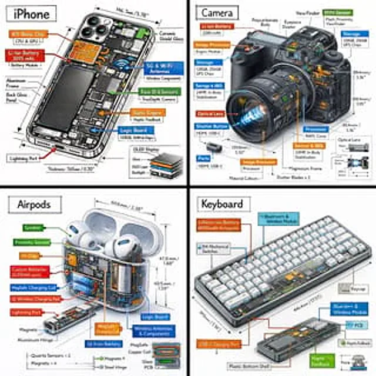

```text
Create a technical infographic of [OBJECT] with a 45-degree isometric 3D perspective showing the device slightly tilted to reveal depth and dimension.
Combine a realistic photoreal render with black ink technical annotations on pure white background. Include:
Key component labels with color-coded callout boxes
Internal component visibility through transparent/cutaway sections
Measurements, dimensions, and precise scale markers
Material callouts and quantities
Color-coded arrows for function/flow: RED (power/battery), BLUE (data/connectivity), ORANGE (thermal/processor), GREEN (sensors/haptics)
Simple schematics or cross-sectional diagrams where relevant

Place “OBJECT” title in a hand-drawn technical box (top-left corner).
Style: Black linework (technical pen/architectural), sketched but precise. Object remains clearly visible. Educational museum-exhibit vibe. Clean composition, balanced negative space.
Perspective: Isometric 3D angle—tilted to show depth, dimension, and internal architecture dramatically. Like a professional product teardown or engineering manual.
Colors: ~10-15% accent density. Black dominant. White background.
Output: 1080×1080, ultra-crisp, social-feed optimized.
```

Model: GPT Image 2
Author: TechieSA

[ProjectD](https://aitoolsradar.com/en/prompts/f5909eb7bebeff) · [Recorded source](https://x.com/TechieBySA/status/2017928823497453789)
 · [Full original metadata and byte evidence](data/projectd-batch-0049.json)

## TechieSA #101

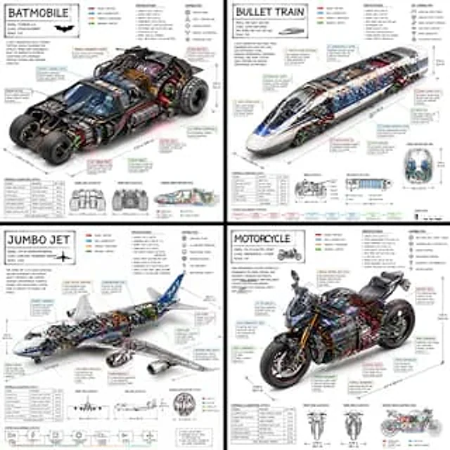

```text
Create a technical infographic of [VEHICLE] with a 45-degree isometric 3D perspective showing the device slightly tilted to reveal depth and dimension.
Combine a realistic photoreal render with black ink technical annotations on pure white background. Include:
Key component labels with color-coded callout boxes
Internal component visibility through transparent/cutaway sections
Measurements, dimensions, and precise scale markers
Material callouts and quantities
Color-coded arrows for function/flow: RED (power/battery), BLUE (data/connectivity), ORANGE (thermal/processor), GREEN (sensors/haptics)
Simple schematics or cross-sectional diagrams where relevant

Place “VEHICLE” title in a hand-drawn technical box (top-left corner).
Style: Black linework (technical pen/architectural), sketched but precise. Object remains clearly visible. Educational museum-exhibit vibe. Clean composition, balanced negative space.
Perspective: Isometric 3D angle—tilted to show depth, dimension, and internal architecture dramatically. Like a professional product teardown or engineering manual.
Colors: ~10-15% accent density. Black dominant. White background.
Output: 1080×1080, ultra-crisp, social-feed optimized
```

Model: GPT Image 2
Author: TechieSA

[ProjectD](https://aitoolsradar.com/en/prompts/a42657041462c6) · [Recorded source](https://x.com/TechieBySA/status/2048733383140712808)
 · [Full original metadata and byte evidence](data/projectd-batch-0049.json)

## TechieSA #105

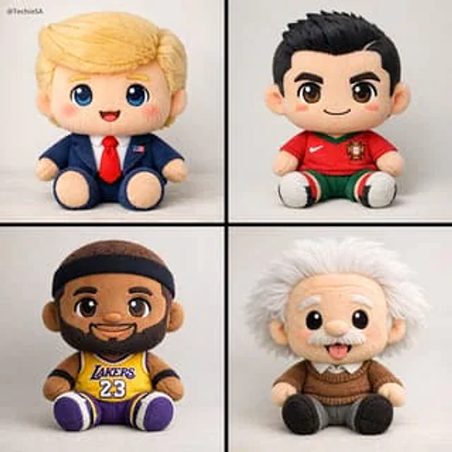

```text
A soft, high-quality plush toy of [CHARACTER], with an oversized head, small body, and stubby limbs. Made of fuzzy fabric with visible stitching and embroidered facial features. The plush is shown sitting or standing against a neutral background. The expression is cute or expressive, and it wears simple clothes or iconic accessories if relevant. Lighting is soft and even, with a realistic, collectible plush look. Centered, full-body view
```

Model: GPT Image 2
Author: TechieSA

[ProjectD](https://aitoolsradar.com/en/prompts/e8c43ba32404f5) · [Recorded source](https://x.com/TechieBySA/status/2005387590372057491)
 · [Full original metadata and byte evidence](data/projectd-batch-0049.json)

## TechieSA #107

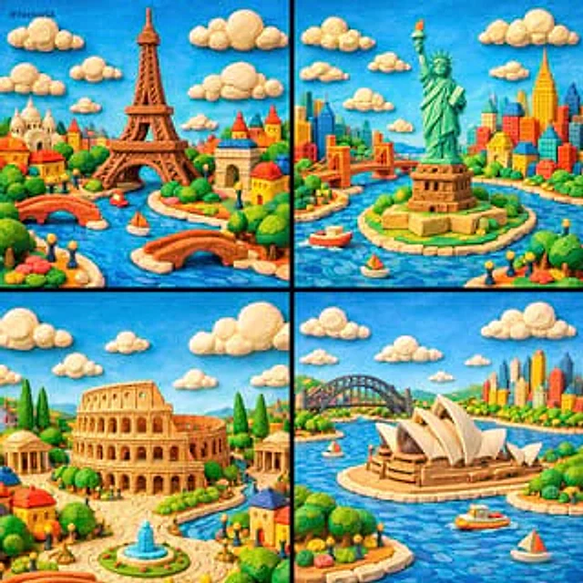

```text
Generate a whimsical miniature world featuring [LANDMARK NAME] crafted entirely from colorful modeling clay. Every element - buildings, trees, waterways, and urban features - should appear hand-sculpted with visible fingerprints and organic clay textures. Use a playful, childlike style with vibrant colors: bright azure sky, puffy cream clouds, emerald trees, and buildings in warm yellows, oranges, reds, and blues. The handmade quality should be evident in every surface and gentle curve.
Capture from a wide perspective showcasing the entire miniature landscape in a harmonious, joyful composition. Include no text, words, or signage - only sculptural clay elements that define the location through recognizable architectural features
```

Model: GPT Image 2
Author: TechieSA

[ProjectD](https://aitoolsradar.com/en/prompts/60afdffd6a4988) · [Recorded source](https://x.com/TechieBySA/status/2008488331903139874)
 · [Full original metadata and byte evidence](data/projectd-batch-0049.json)

## TechieSA #108

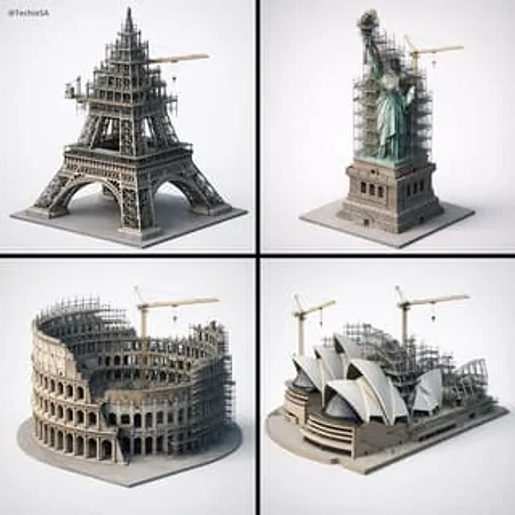

```text
Depict [LANDMARK] frozen in an eternal state of construction. Camera & Angle (LOCKED): 45° elevated isometric view, camera distance fixed so the full landmark fills ~70% of the frame. No tilt variation. Structure: Lower sections are fully completed, solid, and instantly recognizable. Upper sections transition cleanly into unfinished construction: scaffolding, cranes, exposed beams, cables, and skeletal frameworks. The transition line between finished and unfinished is clearly visible and architecturally precise. Scale & Detail: Include small, static construction workers placed on scaffolding for scale. Include exactly 1–2 construction machines (crane arm, lift, or hoist), frozen in place. No motion, no blur, no debris falling. Materials (CONSISTENT): Finished areas: polished stone / glass / steel (appropriate to the landmark). Unfinished areas: raw concrete, steel beams, cables, structural frames. Materials are clean, realistic, and consistent across all renders. Lighting (LOCKED): Soft neutral cinematic lighting from upper left. Balanced exposure, gentle shadows, no dramatic highlights. Composition (LOCKED): Perfectly centered, symmetrical balance. Landmark sits on a subtle base or ground plane. Square format 1080×1080. Background (LOCKED): Minimal neutral sky or studio-gray backdrop. No clouds, no gradients, no distractions. Style: Hyper-realistic architectural render. Clean, precise, calm, and monumental. No stylization, no painterly effects. Mood: Timeless, quiet, contemplative. Frozen progress — never finished, never decaying.
```

Model: GPT Image 2
Author: TechieSA

[ProjectD](https://aitoolsradar.com/en/prompts/7a55f59462bbfd) · [Recorded source](https://x.com/TechieBySA/status/2009695503664239086)
 · [Full original metadata and byte evidence](data/projectd-batch-0049.json)

## TechieSA #111

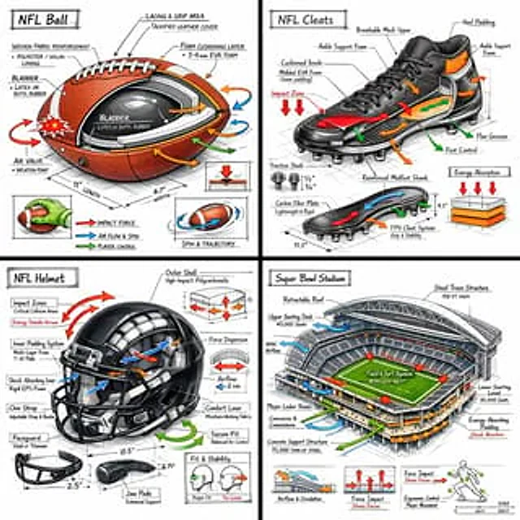

```text
Create a technical infographic of [OBJECT] with a 45-degree isometric 3D perspective, slightly tilted to reveal depth, structure, and internal construction.

Combine a realistic photoreal render with black ink technical annotations on a pure white background. Include:
• Key component labels with clean callout boxes
• Internal structure visibility through cutaway or exploded sections
• Measurements, dimensions, and scale markers
• Material callouts and quantities
• Color-coded arrows indicating functional systems:
•RED: impact force, collision zones, stress points
•BLUE: airflow, spin, grip interaction, movement dynamics
•GREEN: player control, handling, ergonomics
•ORANGE: padding, reinforcement, energy absorption

Include simple sectional diagrams or force-flow schematics where relevant.

Place the title “[OBJECT]” inside a hand-drawn technical annotation box in the top-left corner.

Style:
Black ink technical linework (architectural / engineering manual style), precise but slightly hand-sketched. The object remains clearly visible beneath annotations. Clean, museum-exhibit / sports engineering vibe.

Perspective:
Isometric 3D angle emphasizing depth, form, and internal architecture — like a professional equipment teardown.

Color palette:
White background, black linework with ~10–15% accent color usage (functional arrows only).

Output:
1080×1080, ultra-crisp, social-feed optimized, no watermark.
```

Model: GPT Image 2
Author: TechieSA

[ProjectD](https://aitoolsradar.com/en/prompts/68479a6bbfb46a) · [Recorded source](https://x.com/TechieBySA/status/2019103270447505848)
 · [Full original metadata and byte evidence](data/projectd-batch-0049.json)

## TechieSA #119

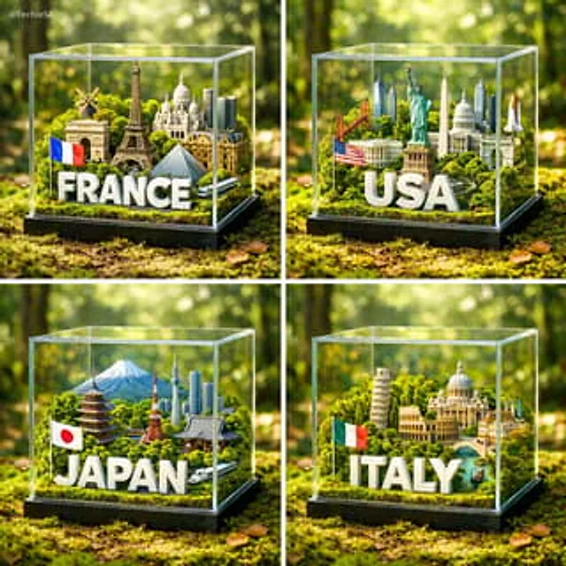

```text
A hyper-realistic 1080x1080 photograph of a glass cube diorama placed on a lush, mossy forest floor with dappled sunlight. Inside the cube are miniature, highly detailed landmarks and cultural icons from [COUNTRY]. Include its most famous and recognizable architecture—traditional and modern—surrounded by greenery. Prominently display the 3D word “COUNTRY” at the base inside the cube, using large, bold white block letters and a flagpole of the country's flag. The scene is crisp, elegant, and immersive, with the forest background softly blurred to focus on the diorama’s sharp details.
```

Model: GPT Image 2
Author: TechieSA

[ProjectD](https://aitoolsradar.com/en/prompts/34534a57910095) · [Recorded source](https://x.com/TechieBySA/status/2008913329029263382)
 · [Full original metadata and byte evidence](data/projectd-batch-0049.json)

## TechieSA #120

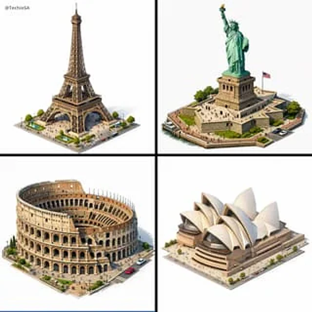

```text
Create a highly detailed isometric 3D rendering of [LANDMARK] in architectural visualization style. The building is shown at a 45-degree angle from above, displaying three visible sides with intricate architectural detail. Photorealistic textures showing materials like stone, glass, metal, or brick. Include the base/ground level with tiny people, cars, and landscaping for scale. Clean white or light grey background. Professional architectural rendering with soft ambient shadows beneath the structure. Every window, column, ornamental detail, and structural element clearly visible. 1080x1080 dimension, centered composition. Style similar to video game building assets or architectural presentation models - clean, detailed, slightly stylized but realistic.
```

Model: GPT Image 2
Author: TechieSA

[ProjectD](https://aitoolsradar.com/en/prompts/d301f4158b065f) · [Recorded source](https://x.com/TechieBySA/status/2007082189742379459)
 · [Full original metadata and byte evidence](data/projectd-batch-0049.json)

## TechieSA #121

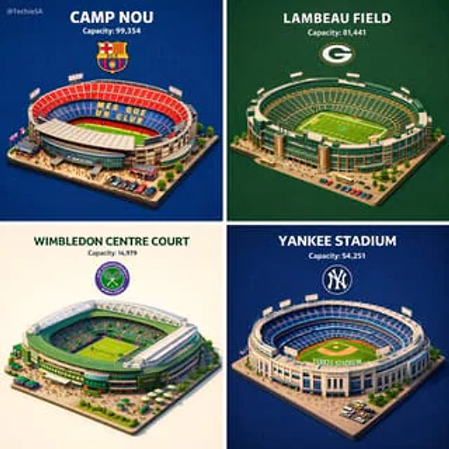

```text
Present a clear, 45° top-down isometric miniature 3D cartoon scene of [STADIUM], with soft refined textures, realistic PBR materials, and gentle lifelike lighting. Use a clean solid [COLOR] background. At the top-center, display the name of this stadium in large bold text, then directly beneath it show its real seating capacity in medium text, and place the official logo associated with this stadium below the capacity. All text must match the background contrast automatically (white or black). Centered layout, square 1080x1080 dimension
```

Model: GPT Image 2
Author: TechieSA

[ProjectD](https://aitoolsradar.com/en/prompts/a253d455072e47) · [Recorded source](https://x.com/TechieBySA/status/2011027384837792185)
 · [Full original metadata and byte evidence](data/projectd-batch-0049.json)

## TechieSA #122

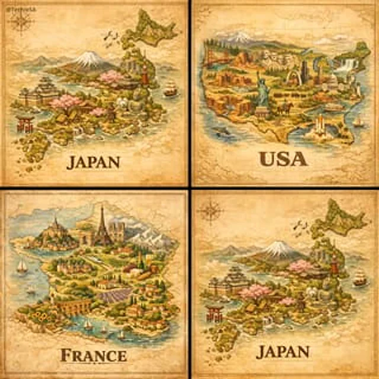

```text
A hand-painted isometric bird’s-eye view illustration of [COUNTRY] in a vintage map style, featuring iconic landmarks and natural scenery unique to the country. The landscape should blend seamlessly with a parchment-colored map background, and include detailed miniature architecture, cultural symbols, and geographical elements. The country name '[COUNTRY]' should appear in bold serif text below the scene. Maintain warm, earthy tones and soft lighting for a classic, illustrated map feel. 1080x1080 dimension.
```

Model: GPT Image 2
Author: TechieSA

[ProjectD](https://aitoolsradar.com/en/prompts/9c55b6fe2c9796) · [Recorded source](https://x.com/TechieBySA/status/2006361629651603477)
 · [Full original metadata and byte evidence](data/projectd-batch-0049.json)

## TechieSA #125

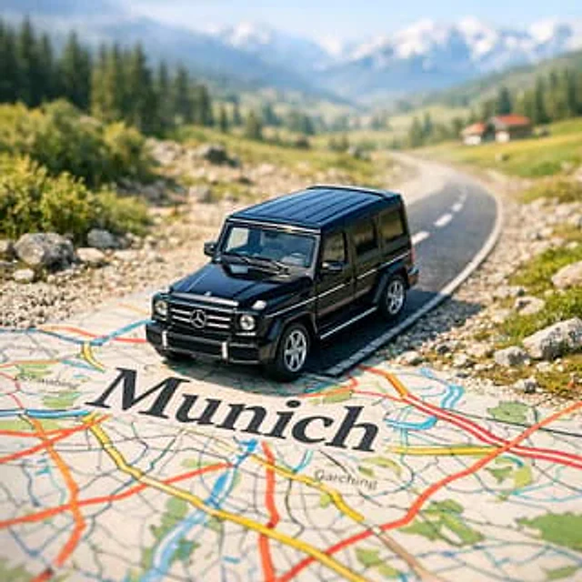

```text
A surreal, hyper-realistic close-up scene of a miniature [CAR] driving along a winding road that seamlessly transforms into a printed paper map of [CITY], [COUNTRY].

The road transitions naturally into the map’s printed streets, borders, and typography, with the vehicle driving directly over the map label “[CITY]”. The surrounding terrain reflects the natural landscape of [COUNTRY] — terrain texture, ground color, and environmental details match the region authentically (e.g. desert, mountains, coast, countryside).

The map features crisp cartographic details, labeled roads, subtle borders, and realistic paper texture. The vehicle is highly detailed and proportionally scaled, feeling tangible and grounded within the scene.

Lighting is bright and natural, directionally cast to create realistic highlights and defined shadows along the road’s curves. Shot from a slightly elevated angle with shallow depth of field, keeping the car and map sharply in focus while the background softly fades.

Visual style is cinematic and ultra-realistic, blending tactile paper map textures with realistic terrain and vehicle materials.

Aspect ratio 1:1, high resolution, premium editorial quality, no text overlays, no watermark
```

Model: GPT Image 2
Author: TechieSA

[ProjectD](https://aitoolsradar.com/en/prompts/aa9124bc0b27de) · [Recorded source](https://x.com/TechieBySA/status/2018311275210523012)
 · [Full original metadata and byte evidence](data/projectd-batch-0049.json)

## TechieSA #148

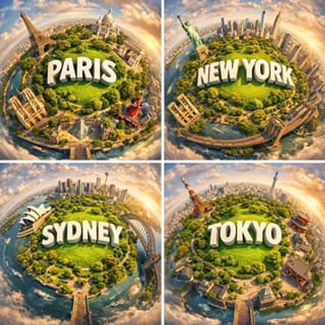

```text
Create a hyperrealistic miniature planet showcasing [CITY] with famous landmarks seamlessly curving around the spherical surface. Position bold 3D white text ”[CITY]” naturally integrated across the lush green central parkland with realistic shadows and dimensional depth. Capture from a top-down orbiting angle that emphasizes the dramatic planet curvature. Use soft golden hour daylight filtering through partly cloudy skies, casting gentle shadows on emerald grass and surrounding trees. The background should blend into a swirling atmospheric sky. Apply vibrant greens, warm earth tones, and soft blues. Render in polished photorealistic style with fine architectural detail
```

Model: GPT Image 2
Author: TechieSA

[ProjectD](https://aitoolsradar.com/en/prompts/556980de9478a5) · [Recorded source](https://x.com/TechieBySA/status/2008272089682199025)
 · [Full original metadata and byte evidence](data/projectd-batch-0049.json)

## TechieSA #149

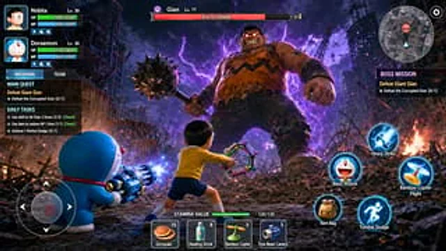

```text
A high-resolution, photorealistic 3D action RPG mobile game screenshot of an epic battle featuring Doraemon characters. The perspective is from behind the main player character, Nobita. The background is a post-apocalyptic urban scene of rubble, crumbling concrete, rebar, debris, small fires, and intense purple and blue lightning in a dark, cloudy night sky.  Characters:  Foreground Left: Doraemon, holding an elaborate, multi-barrel gatling-style cannon which hums with blue energy in his hand.  Foreground Center: Nobita, in a combat stance with his multi-layered slingshot weapon, wearing his classic yellow shirt, blue shorts, and glasses.  Middle Ground Center: Giant Gian (the boss), massive, muscular, intimidating, holding a spiked mace, with glowing sinister red eyes and surrounded by purple energy effects.  Nameplates: Doraemon (Lv. 30, HP: 2150/2420, MP: 860/1000), Nobita (Lv. 30, HP: 1980/2200, MP: 900/1000), Gian (Lv. ??, HP: 85670/100000, x4).  UI Elements (All in English):  Left Side Panel: The title is "MISSIONS" and "TEAM". The "MAIN QUEST" header is followed by "Defeat Giant Gian" and "Defeat the Corrupted Gian [0/1]". The "DAILY TASKS" header is followed by "Use skill to hit Gian 3 times (2/3) [Check]", "Use item to restore HP 1 time (1/1) [Check]", and "Achieve 1 Perfect Dodge (0/1)".  Right Side Panel: The header "BOSS MISSION" is followed by "Defeat Giant Gian" and "Defeat the Corrupted Gian [0/1]".  Bottom Right Skill Buttons: Labels (clockwise from top): "Heavy Strike", "Basic Attack" (with Doraemon head), "Bamboo Copter Flight", "Item Bag", "Tumble Dodge". Glowing blue skill icons are present.  Bottom Center Item Bar: Above the items, "STAMINA VALUE" followed by "120/130". The items are "Dorayaki (15)", "Healing Drink (8)", "Bamboo Copter (5)", "Time Beam Camera (3)".  Mini-Map: Top right corner mini-map with skull icon.  D-pad: English text virtual D-pad on the bottom left.  Screen Details: Cinematic lighting and effects. The cool blue of Doraemon's weapon light, warm orange firelight, cold purple lightning, and Gian's sinister red eyes. Detailed textures on clothing and weapons. All English text is clean, legible, and accurate. The low-angle emphasizes the scale difference and battle tension.
```

Model: GPT Image 2
Author: TechieSA

[ProjectD](https://aitoolsradar.com/en/prompts/55f03d968c071e) · [Recorded source](https://x.com/TechieBySA/status/2047277688075739605)
 · [Full original metadata and byte evidence](data/projectd-batch-0049.json)

## TechieSA #153

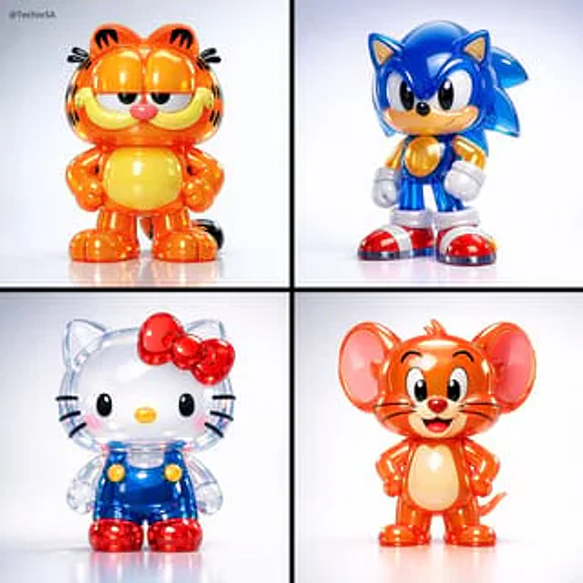

```text
Create a premium 3D rendered [FIGURE NAME] collectible vinyl figure in a modern designer toy aesthetic. The figure should feature glossy translucent vinyl material with subtle light refraction, bold saturated colors true to the character, and simplified geometric forms with smooth curves. Position against a pristine gradient background transitioning from light gray to white. Use professional product photography lighting with soft key light from above and gentle rim lighting to highlight the vinyl’s glossy finish. The character should be posed in a confident standing position, centered perfectly in frame. Apply shallow depth of field with the figure in sharp focus. Render in ultra-high resolution with clean minimalist composition, no text, logos, or distracting elements. Square aspect ratio 1080x1080 pixels, photorealistic quality with crisp details and vibrant color reproduction suitable for premium toy marketing
```

Model: GPT Image 2
Author: TechieSA

[ProjectD](https://aitoolsradar.com/en/prompts/f6c9d6c9e62c2d) · [Recorded source](https://x.com/TechieBySA/status/2009229875794858182)
 · [Full original metadata and byte evidence](data/projectd-batch-0049.json)

## TechieSA #157

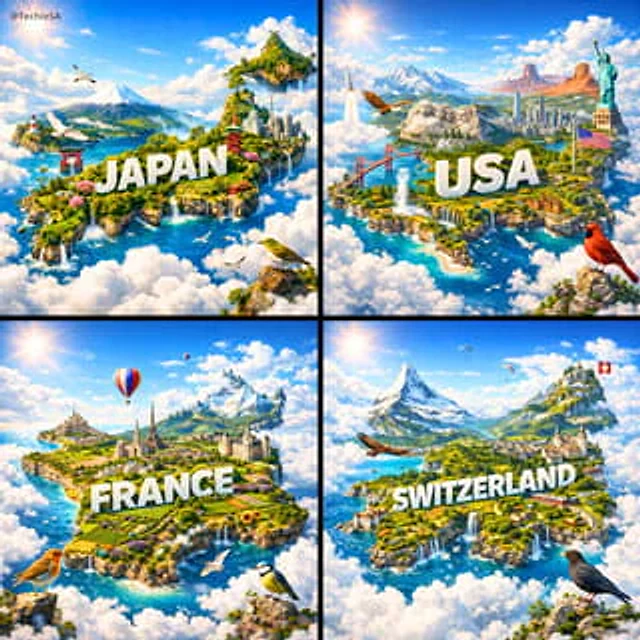

```text
Create an ultra-HD, hyper-realistic digital poster of a floating miniature island shaped like [COUNTRY], resting on white clouds in the sky. Blend iconic landmarks, natural landscapes (like forests, mountains, or beaches), and cultural elements unique to [COUNTRY]. Carve “[COUNTRY]” into the terrain using large white 3D letters. Add artistic details like birds (native to [COUNTRY]), cinematic lighting, vivid colors, aerial perspective, and sun reflections to enhance realism. Ultra-quality, 4K+ resolution.
```

Model: GPT Image 2
Author: TechieSA

[ProjectD](https://aitoolsradar.com/en/prompts/2787c624f95a18) · [Recorded source](https://x.com/TechieBySA/status/2005231673320112428)
 · [Full original metadata and byte evidence](data/projectd-batch-0049.json)

## TechieSA #163

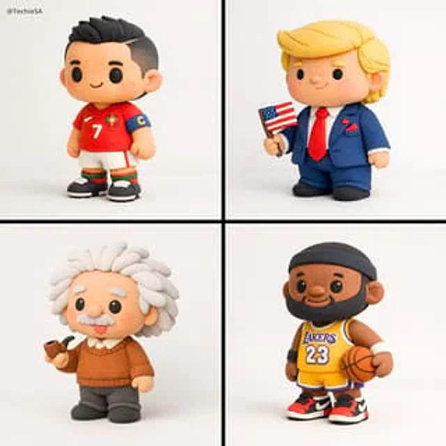

```text
Create a stylized miniature model of [CHARACTERS] shaped entirely from soft polymer clay. The figure has rounded, childlike anatomy — large head, small body, and simplified details that feel friendly and handcrafted. Its outfit and accessories match [CHARACTERS]’ iconic look, modeled with smooth curves and lively, saturated tones.
The material appears dry and tactile, with a powdery matte finish and subtle surface texture—avoid gloss, shine, or reflections. Lighting should be gentle and even, wrapping softly around the form with faint ambient shading to reveal volume.
Present the figurine standing upright, slightly turned toward the right, framed in a minimal off-white environment with a smooth floor and faint contact shadow beneath. The overall composition feels calm, neat, and balanced—like a clay sculpture photographed for a design catalog.
```

Model: GPT Image 2
Author: TechieSA

[ProjectD](https://aitoolsradar.com/en/prompts/02feeaf6da2bd3) · [Recorded source](https://x.com/TechieBySA/status/2009285406303387993)
 · [Full original metadata and byte evidence](data/projectd-batch-0049.json)

## TechieSA #167

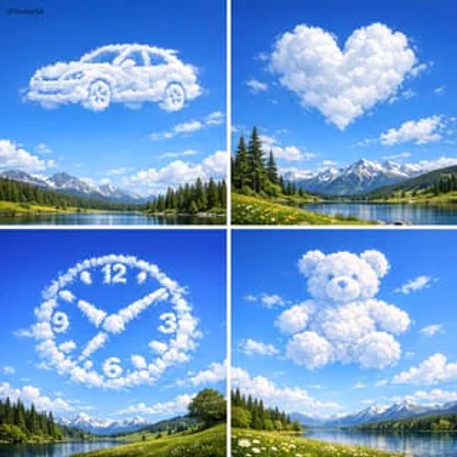

```text
Create an ultra-realistic sky scene where soft, natural cloud formations organically assemble into the clear silhouette of a [OBJECT]. The cloud shape appears high in a vibrant blue sky, naturally floating above a recognizable nature below.

The composition is square (1080×1080), with the cloud formation occupying the upper portion of the frame while the landscape grounds the scene beneath it. Lighting is crisp and daylight-bright, with sunlit highlights on the clouds that enhance depth, softness, and realism.

The overall mood should feel calm, optimistic, and visually striking, with rich color saturation and a clean, peaceful atmosphere.
```

Model: GPT Image 2
Author: TechieSA

[ProjectD](https://aitoolsradar.com/en/prompts/f861d229b0b192) · [Recorded source](https://x.com/TechieBySA/status/2007449939169693886)
 · [Full original metadata and byte evidence](data/projectd-batch-0049.json)

## TechieSA #170

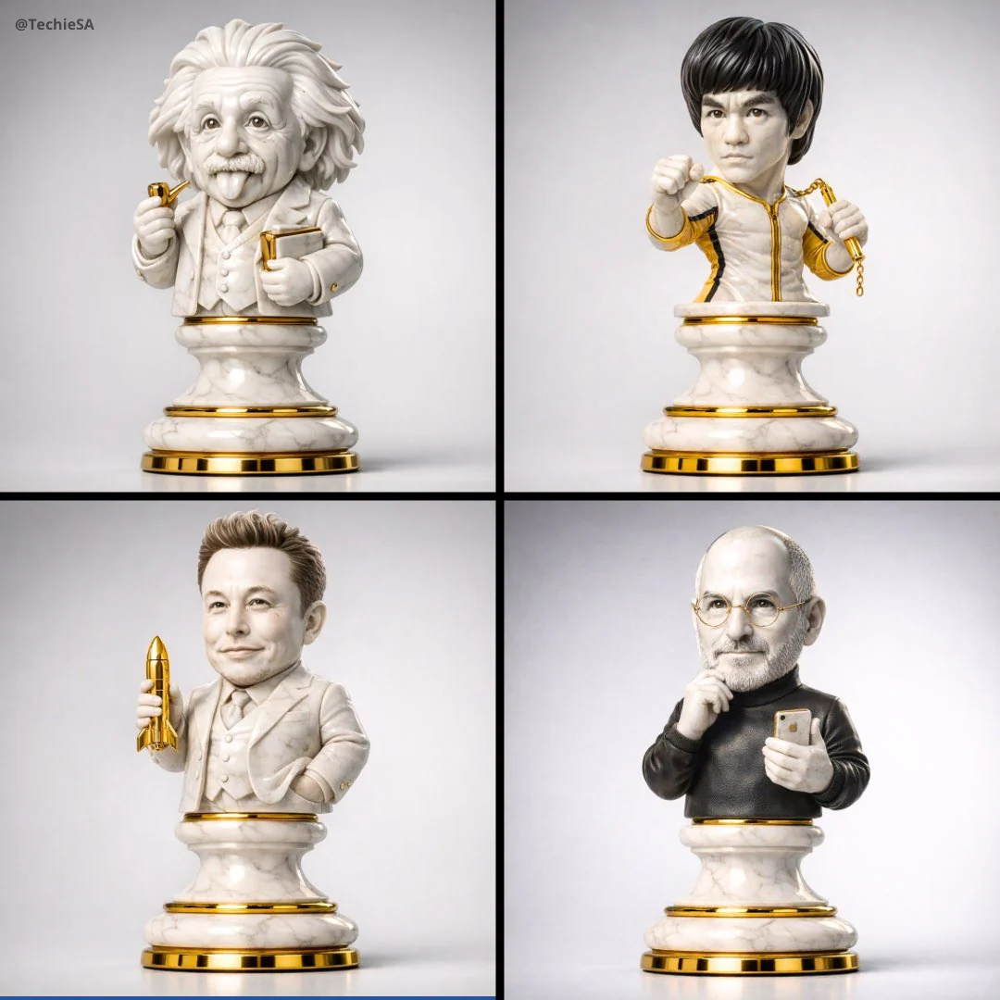

```text
A hyper-detailed 3D render of a collectible chess piece designed as [ICON]. The figure is sculpted in polished marble and gold accents, with a stylized base resembling a classic chess piece. The character’s iconic features, clothing, or accessories are faithfully captured in a simplified but instantly recognizable form. Studio lighting with soft reflections, dramatic shadows, photorealistic textures, cinematic presentation. Centered on a clean neutral background
```

Model: GPT Image 2
Author: TechieSA

[ProjectD](https://aitoolsradar.com/en/prompts/80b6b0f1b7ec05) · [Recorded source](https://x.com/TechieBySA/status/2007161169468108902)
 · [Full original metadata and byte evidence](data/projectd-batch-0049.json)

## TechieSA #181

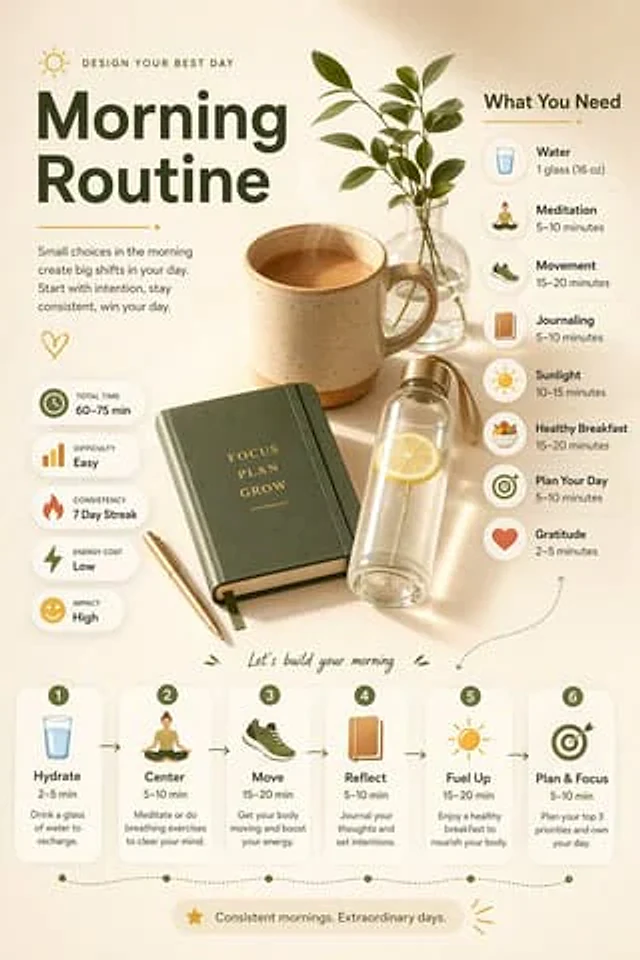

```text
Ultra-clean modern editorial infographic on the topic of [ROUTINE] routine. Hero visual: a stylized flat-lay or floating arrangement of 3–4 objects closely associated with the routine — slightly angled or in soft perspective, glowing subtly. All elements arranged dynamically around the hero in a non-restrictive editorial layout. Ingredients Section: Label it ‘What You Need’ — include 6–8 items with small icons or emoji illustrations next to each. Each item has a name and a practical quantity or duration written like a recipe (e.g. ‘x minutes of Y’). Arranged in a cluster or list connected visually to the hero. Steps Section: 5–6 numbered panels with arrows or connecting lines forming a logical flow. Each step has a short action label and a small relevant icon. Panels use glassmorphism or frosted card styling. Stats Badges: 4–5 floating pill-shaped badges showing relevant metadata — total time, difficulty, consistency streak, energy cost — displayed as clean minimal bubbles near the hero. Visual Style: Warm, soft editorial background — cream, warm white, or soft morning light tones. Muted earthy accent colors with clean highlights. Bold modern sans-serif typography. Clean vector icons. Subtle grain or paper texture in background. Composition: Hero object cluster centered or slightly offset. Ingredients on one side. Steps flow opposite or below with connecting lines. Stat badges scattered as floating pills. Generous negative space to keep it airy and readable. Lighting: Soft warm natural light feel emanating from the hero cluster. Premium lifestyle editorial aesthetic, social-feed optimized. Ultra-crisp. No watermark.
```

Model: GPT Image 2
Author: TechieSA

[ProjectD](https://aitoolsradar.com/en/prompts/1287bea0cc5d22) · [Recorded source](https://x.com/TechieBySA/status/2047683043918311670)
 · [Full original metadata and byte evidence](data/projectd-batch-0049.json)

## TechieSA #186

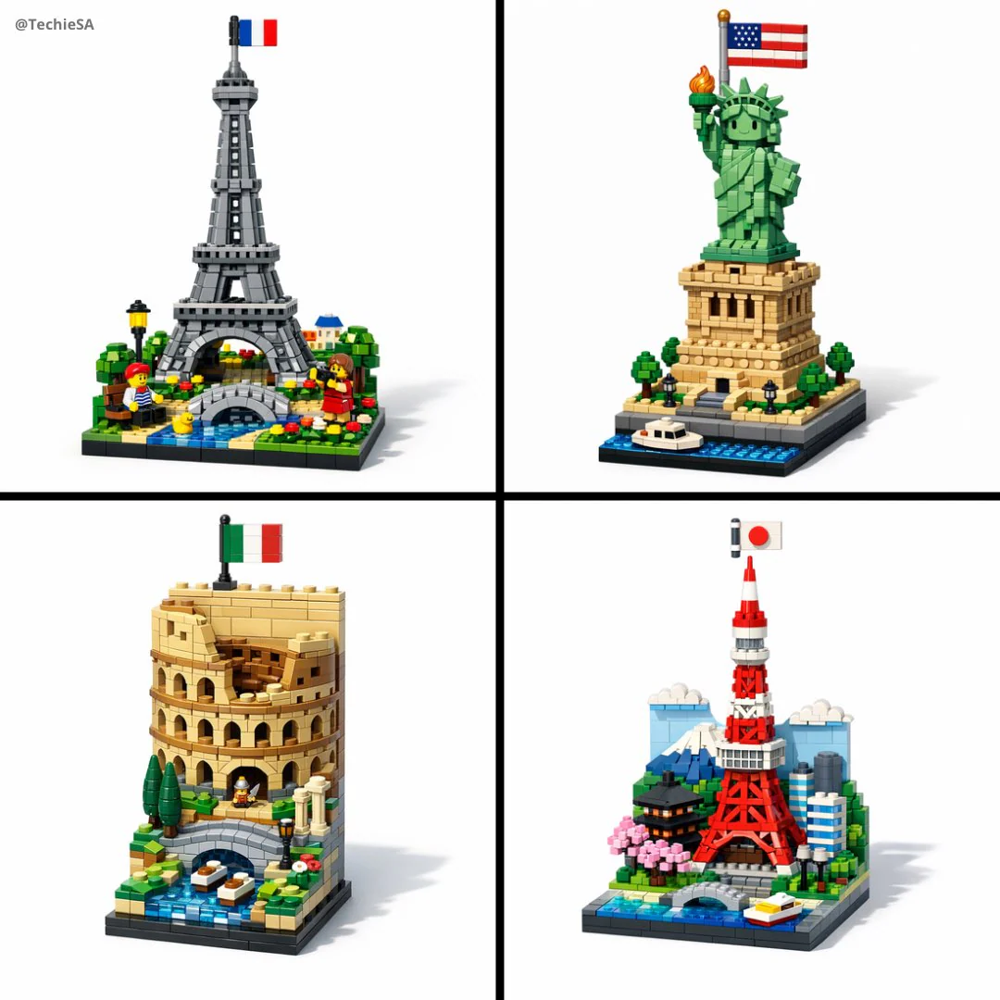

```text
A vertical LEGO diorama showing [LANDMARK], [COUNTRY]). The scene is built entirely from LEGO bricks. A small [COUNTRY] flag is positioned at the top of the structure. Use a plain white background with a subtle shadow cast by the structure. 3D rendered, high-resolution, cute and clean LEGO style. 1080x1080 dimension
```

Model: GPT Image 2
Author: TechieSA

[ProjectD](https://aitoolsradar.com/en/prompts/8332f6d622d642) · [Recorded source](https://x.com/TechieBySA/status/2008852020002979937)
 · [Full original metadata and byte evidence](data/projectd-batch-0049.json)

## TechieSA #190

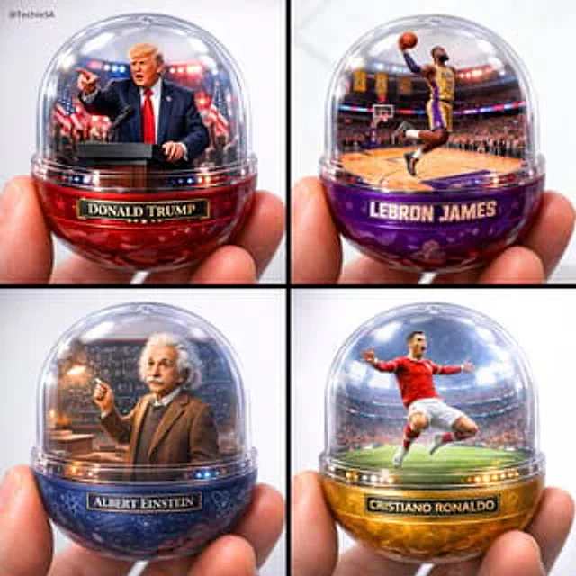

```text
A detailed transparent gashapon capsule diorama, held between fingers, featuring [NAME] in their [ICONIC POSE / STYLE]. Inside: [short description of figure’s look, clothing, and accessories], with background elements such as [relevant setting: stadium, stage, lecture hall, etc.]. Lighting should be dramatic and cinematic, matching their theme (e.g., golden spotlight, concert glow, academic ambience). The capsule has a transparent top and a colored base (choose fitting color: e.g., royal blue, gold, black, red), decorated with [motifs related to the person]. The base is labeled with [NAME or NICKNAME] in a matching font style. The design should look like a miniature collectible, with photorealistic detail, soft bokeh, and a square 1080x1080 composition
```

Model: GPT Image 2
Author: TechieSA

[ProjectD](https://aitoolsradar.com/en/prompts/ac388ed7259020) · [Recorded source](https://x.com/TechieBySA/status/2005694004202201118)
 · [Full original metadata and byte evidence](data/projectd-batch-0049.json)

## TechieSA #203

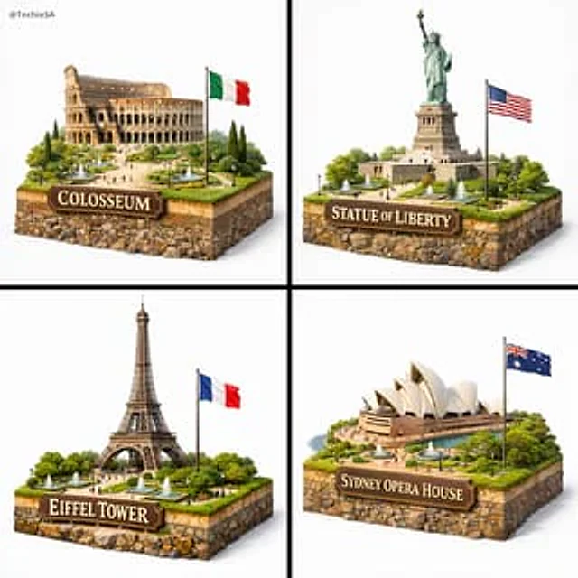

```text
Create a hyper-realistic 3D diorama-style model of [LANDMARK NAME]. The model should appear as a miniature, set on a raised cross-section of earth that reveals soil and rock layers beneath a lush grassy surface. The structure must be highly detailed and proportionally accurate, surrounded by tiny realistic elements like region-appropriate street lamps, native trees, shrubs, water features like small fountains, and historically or culturally fitting pathways. The scene should evoke the unique character of [LANDMARK NAME]’s surrounding landscape. The environment must include a soft white background to draw full attention to the model. Include the text “[LANDMARK NAME]” in large, bold, elegant lettering prominently displayed on a big sign or billboard at the front of the diorama, easily readable and eye-catching, along with a large national flag on a tall, prominent flagpole positioned beside [LANDMARK NAME], clearly visible and waving. 1080x1080 dimension
```

Model: GPT Image 2
Author: TechieSA

[ProjectD](https://aitoolsradar.com/en/prompts/7f8dda65abec71) · [Recorded source](https://x.com/TechieBySA/status/2007904078274445709)
 · [Full original metadata and byte evidence](data/projectd-batch-0049.json)

## TechieSA #208

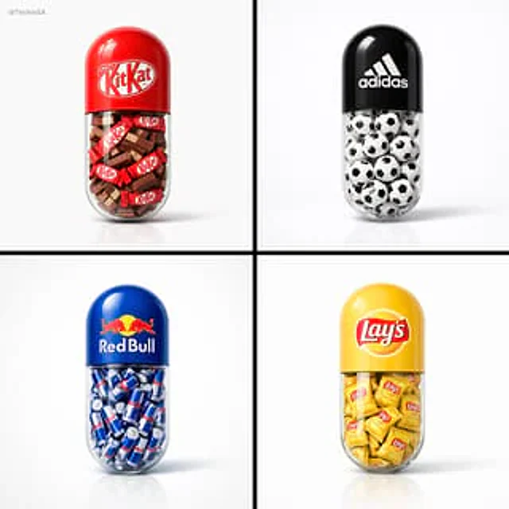

```text
Create a minimal poster. A large capsule pill centered in the frame. The top half of the pill is solid colored and features the [BRAND] logo clearly printed on it. The bottom half of the pill is transparent glass. Inside the transparent part of the capsule, fill it with a large amount of [OBJECT] related to the brand. Ultra clean white studio background, soft shadows, high-end product photography lighting, glossy realistic materials, highly detailed, minimal design, centered composition, modern advertising style.​​​​​​​​​​​​​​​​ 1080x1080 dimension.
```

Model: GPT Image 2
Author: TechieSA

[ProjectD](https://aitoolsradar.com/en/prompts/a3ad9be733f883) · [Recorded source](https://x.com/TechieBySA/status/2038694130650435769)
 · [Full original metadata and byte evidence](data/projectd-batch-0049.json)

## TechieSA #218

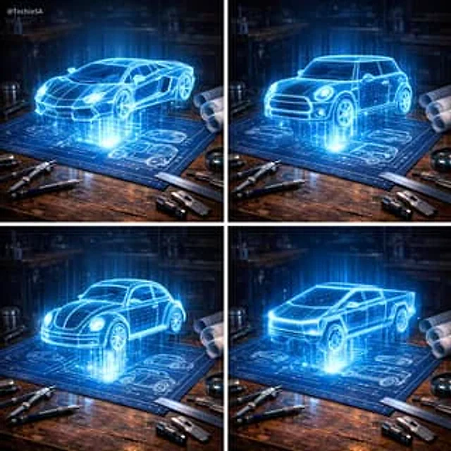

```text
Create a hyper-realistic 3D holographic blueprint projection of a [CAR NAME] emerging as a luminous cyan/blue wireframe model from a dark blue technical blueprint sheet on a wooden workshop table. The car appears as glowing electric blue wireframe lines with grid patterns and transparent surfaces, creating a futuristic holographic effect. The 3D model hovers above the flat blueprint drawings with dramatic lighting and bright cyan glow. Surround with precision drafting tools, compass, rolled blueprints, and technical instruments on dark wooden surface. Dark atmospheric background with studio lighting. Aspect ratio: 1:1 (1080x1080 pixels). Do not include any vehicle logos or brand emblems
```

Model: GPT Image 2
Author: TechieSA

[ProjectD](https://aitoolsradar.com/en/prompts/e51825a51271a2) · [Recorded source](https://x.com/TechieBySA/status/2009945337788805362)
 · [Full original metadata and byte evidence](data/projectd-batch-0049.json)

## TechieSA #250


```text
Ultra-clean modern editorial infographic. The topic is [ROUTINE] routine. Base all visuals, colors, objects, mood, ingredients, and steps entirely on this topic. Hero visual: a stylized flat-lay or floating arrangement of 3–4 iconic objects associated with this topic — slightly angled or in soft perspective, glowing subtly. All elements arranged dynamically around the hero in a non-restrictive editorial layout. Ingredients Section: Label it ‘What You Need’ — include 6–8 relevant items with small icons or emoji illustrations next to each, with a practical quantity or duration written like a recipe. Steps Section: 5–6 numbered panels with arrows or connecting lines forming a logical flow, each with a short action label and small relevant icon, using glassmorphism or frosted card styling. Stats Badges: 4–5 floating pill-shaped badges showing relevant metadata, displayed as clean minimal bubbles near the hero. Visual Style: Choose background color, accent colors, typography weight, and texture to naturally match the topic’s mood. Bold modern sans-serif typography. Clean vector icons. Subtle grain or texture. Composition: Hero centered or slightly offset, ingredients one side, steps opposite or below with connecting lines, stat badges as floating pills, generous negative space. Lighting: Soft natural studio lighting matching the topic’s tone. Premium editorial aesthetic, social-feed optimized. Ultra-crisp. No watermark
```

Model: GPT Image 2
Author: TechieSA

[ProjectD](https://aitoolsradar.com/en/prompts/879479ca85ce57) · [Recorded source](https://x.com/TechieBySA/status/2048044376366948849)
 · [Full original metadata and byte evidence](data/projectd-batch-0049.json)

## TechieSA #255

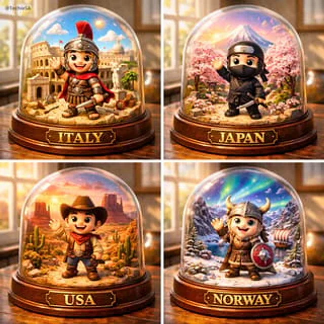

```text
Create a highly detailed, hyper-realistic image of a miniature diorama inside a glass dome, placed on a wooden table near a softly lit window. Inside the dome, show a [COUNTRY] cultural figure with iconic attire, prominently positioned in the center foreground taking up significant space in the composition to really “pop” from the scene, smiling and waving, in a stylized 3D miniature version of [COUNTRY]’s iconic setting. Include the most iconic background features of that location, all scaled in a whimsical, miniature style. The time of day, season, and mood will vary by [COUNTRY]’s cultural theme. The scene is captured from a slightly elevated perspective. The base of the dome has a wooden plaque with bold, gold-colored text labeled: ‘[COUNTRY]’ in a strong, readable font that stands out prominently. The scene should be bright, magical, joyful, and feel like a collectible souvenir moment from a dream trip. Aspect ratio: 1080x1080
```

Model: GPT Image 2
Author: TechieSA

[ProjectD](https://aitoolsradar.com/en/prompts/59e355d2d463fc) · [Recorded source](https://x.com/TechieBySA/status/2009335963672301968)
 · [Full original metadata and byte evidence](data/projectd-batch-0049.json)

## TechieSA #269

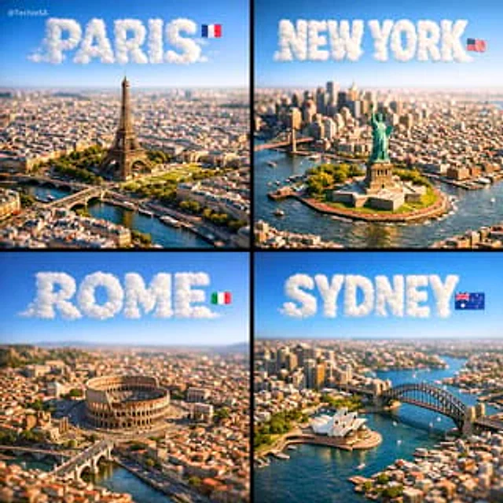

```text
A square, 1:1 photorealistic close-up photograph of an incredibly detailed physical miniature geography and city model of [CITY], focused only on the city’s most recognizable landmark area (not the full city map).

The scene shows a compact 3D topographic environment built around the iconic landmark zone — realistic terrain, elevation changes, nearby rivers or coastline if relevant, and surrounding urban density scaled naturally to highlight the landmark as the clear focal point. The model feels like a premium museum diorama rather than a map.

Thousands of tiny, highly detailed buildings, roads, bridges, and infrastructure cluster organically around the landmark. The landmark itself rises prominently above everything else, instantly recognizable even at a glance.

Strong natural side sunlight casts long, realistic shadows across the miniature terrain, enhancing depth and realism. Shallow depth of field (tilt-shift style) keeps the landmark zone sharply in focus while softly blurring the outer edges of the square frame. The entire scene appears as a tangible, physical model illuminated by real-world light.

Above the city, the sky is perfectly clean and empty — no clouds at all — except for the city name.

The name [CITY] appears integrated into the sky as thick, three-dimensional cloud typography, sculpted from dense white vapor. The letters are bold, volumetric, and clearly readable, with soft shadowing and subtle depth, floating naturally in the open sky. Opacity ~70%, but with enough thickness to remain instantly legible.

A small, minimal national flag is placed subtly near the sky text (corner or aligned to the typography), balanced and unobtrusive.

Format: Square 1080×1080
Style: Ultra-photorealistic, cinematic, premium miniature realism
Mood: Awe, clarity, instantly recognizable, highly shareable
```

Model: GPT Image 2
Author: TechieSA

[ProjectD](https://aitoolsradar.com/en/prompts/630f9f06451538) · [Recorded source](https://x.com/TechieBySA/status/2010080445619417602)
 · [Full original metadata and byte evidence](data/projectd-batch-0049.json)

## TechieSA #29

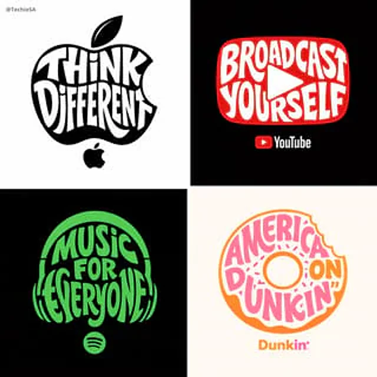

```text
Create a typographic illustration shaped like a [OBJECT], where the text [BRAND SLOGAN] forms the shape — bold and playful lettering style that fills the entire silhouette — letters adapt fluidly to the curves and contours of the [OBJECT] — [COLOR DESCRIPTION] with [BACKGROUND COLOR] background that enhances the focus on the main shape — include [BRAND] logo positioned below the [OBJECT] — vector-style, clean, high resolution, 1080x1080 pixels, square format.
```

Model: GPT Image 2
Author: TechieSA

[ProjectD](https://aitoolsradar.com/en/prompts/d3f08b0295e125) · [Recorded source](https://x.com/TechieBySA/status/2005620980891480567)
 · [Full original metadata and byte evidence](data/projectd-batch-0049.json)

## TechieSA #31

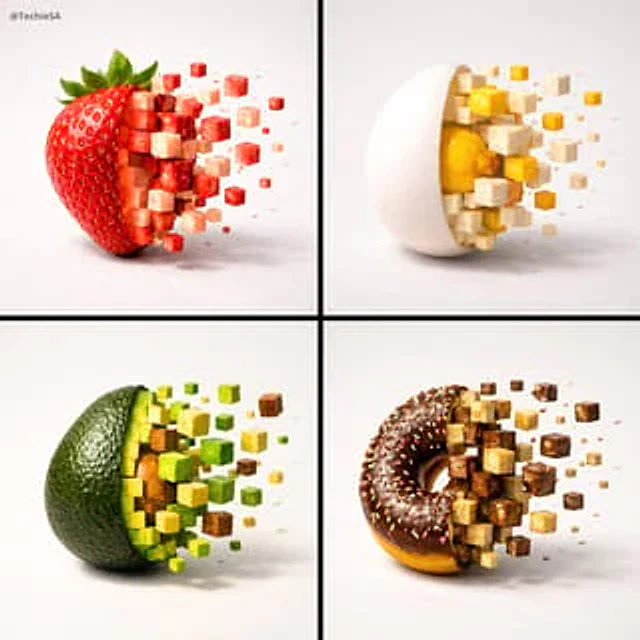

```text
Minimalist food photograph, [1080x1080] – a single [FOOD] rests on a light, matte surface and is captured mid-transformation into a 3D pixelized form: one half remains intact while the other organically fragments into large, floating cubes that drift outward, each cube revealing the object’s texture, ingredients, and colors. Studio lighting with soft, realistic shadows, shallow depth of field, tasteful perspective and composition, hyperrealistic detail, stylish geometric abstraction, subtle motion blur on the cubes, high resolution, cinematic close-up.
```

Model: GPT Image 2
Author: TechieSA

[ProjectD](https://aitoolsradar.com/en/prompts/467614c9c823f6) · [Recorded source](https://x.com/TechieBySA/status/2008127774750548155)
 · [Full original metadata and byte evidence](data/projectd-batch-0049.json)

## TechieSA #39

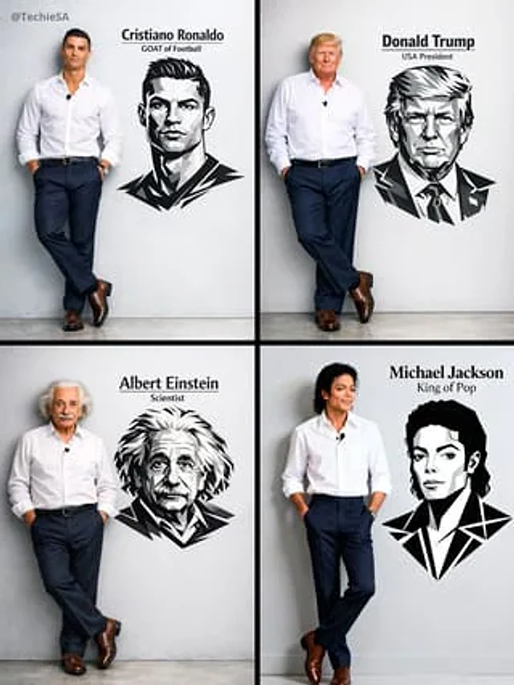

```text
Ultra-realistic 8K full body portrait of [PERSON’S FULL NAME], wearing a clean and pressed white social shirt with folded collar and a small lapel microphone, dark navy-blue dress pants and polished brown social shoes. Casually and unpretentiously leaning against a smooth light gray studio wall; hands are in pockets and one leg is crossed over the other, with relaxed and confident body language. Add to the wall next to them a prominent vector portrait in black and white of their face and bust - with sharp lines and angles, overlapping polygonal shapes and a minimalist modern graphic style, right below the information: “[PERSON’S FULL NAME]”, and below the name: “[PROFESSION]”
```

Model: GPT Image 2
Author: TechieSA

[ProjectD](https://aitoolsradar.com/en/prompts/7bce167a382e0c) · [Recorded source](https://x.com/TechieBySA/status/2018389139826037141)
 · [Full original metadata and byte evidence](data/projectd-batch-0049.json)

## TechieSA #4

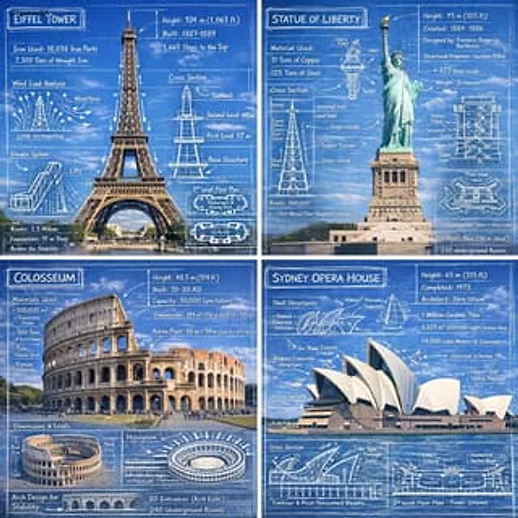

```text
Create an infographic image of [LANDMARK], combining a real photograph of the landmark with blueprint-style technical annotations and diagrams overlaid on the image. Include the title “[LANDMARK]” in a hand-drawn box in the corner. Add white chalk-style sketches showing key structural data, important measurements, material quantities, internal diagrams, load-flow arrows, cross-sections, floor plans, and notable architectural or engineering features. Style: blueprint aesthetic with white line drawings on the photograph, technical/architectural annotation style, educational infographic feel, with the real environment visible behind the annotations.
```

Model: GPT Image 2
Author: TechieSA

[ProjectD](https://aitoolsradar.com/en/prompts/76dd2f608e876f) · [Recorded source](https://x.com/TechieBySA/status/2007523056822939698)
 · [Full original metadata and byte evidence](data/projectd-batch-0049.json)

## TechieSA #41

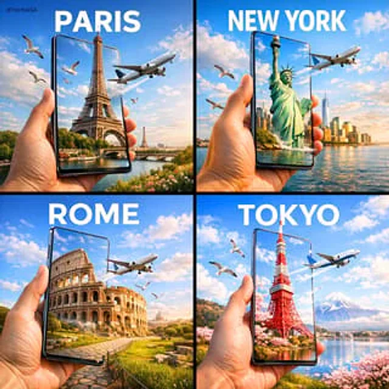

```text
A hyper-realistic travel advertisement in square format (1080x1080), featuring a hand holding a sleek, ultra-thin smartphone or tablet in portrait orientation, tilted slightly sideways to create a striking 3D portal effect. The screen displays a high-resolution image of an iconic landmark from [COUNTRY], which continues into the real background, blending seamlessly. The landmark appears to emerge from the screen. Birds fly nearby and a commercial airplane passes through a bright blue sky with soft white clouds. Bold, clean sans-serif text reading [CITY] is placed prominently above. The lighting is warm and natural, casting soft shadows across the landscape. The surroundings reflect the region’s natural environment (like meadows, coastlines, or city skylines). The device is glossy and minimal-bezel, enhancing realism and depth.
```

Model: GPT Image 2
Author: TechieSA

[ProjectD](https://aitoolsradar.com/en/prompts/3f9bbd26e6c9a9) · [Recorded source](https://x.com/TechieBySA/status/2007190982408974659)
 · [Full original metadata and byte evidence](data/projectd-batch-0049.json)

## TechieSA #42

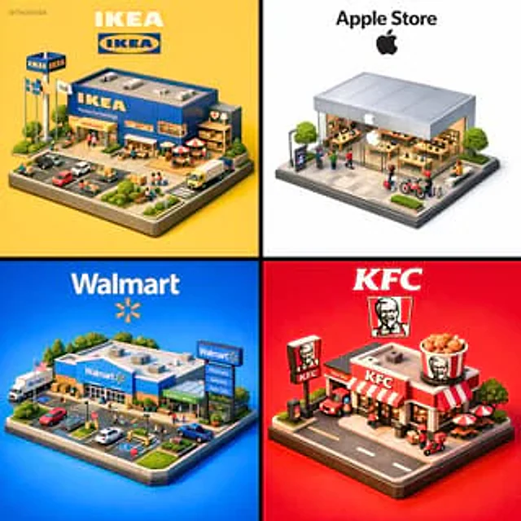

```text
Present a clear, 45° top-down isometric miniature 3D cartoon diorama of the [BRAND], with soft refined textures, realistic PBR materials, and gentle lifelike lighting.
Create a small raised diorama-style base that includes the most recognizable elements of the store, along with tiny stylized characters if needed (no facial details).
Use a clean solid [BACKGROUND COLOR] background.

At the top-center, display [BRAND] in large bold text, and place the official logo associated with [BRAND] below the subtext.
All text must automatically match the background contrast (white or black).

Composition: perfectly centered layout, square 1080x1080, ultra-clean, high-clarity diorama aesthetic.
```

Model: GPT Image 2
Author: TechieSA

[ProjectD](https://aitoolsradar.com/en/prompts/dde5d97deb53bd) · [Recorded source](https://x.com/TechieBySA/status/2019376568834093542)
 · [Full original metadata and byte evidence](data/projectd-batch-0049.json)

## TechieSA #56

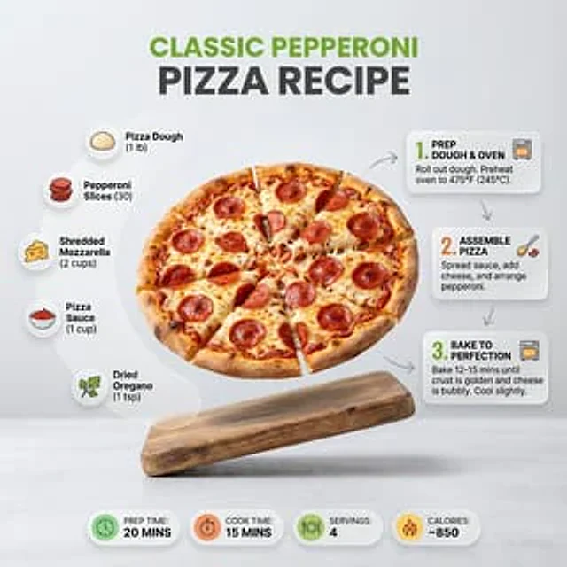

```text
Ultra-clean modern recipe infographic. Showcase [FOOD] in a visually appealing finished form—sliced, plated, or portioned—floating slightly in perspective or angled view. Arrange ingredients, steps, and tips around the dish in a dynamic editorial layout, not restricted to top-down. Ingredients Section: Include icons or mini illustrations for each ingredient with quantities. Arrange them in clusters, lists, or circular flows connected visually to the dish. Steps Section: Show preparation steps with numbered panels, arrows, or lines, forming a logical flow around the main dish. Include small cooking icons (knife, pan, oven, timer) where helpful. Additional Info (optional): Total calories, prep/cook time, servings, spice level—displayed as clean bubbles or badges near the dish. Visual Style: Editorial infographic meets lifestyle food photography. Vibrant, natural food colors, subtle drop shadows, clean vector icons, modern typography, soft gradients or glassmorphism for step panels. Accent colors can highlight key info (calories, prep time). Composition Guidelines: Finished meal as hero visual (perspective or angled) Ingredients and steps flow dynamically around the dish Clear visual hierarchy: dish > steps > ingredients > optional stats Enough negative space to keep design airy and readable Lighting & Background: Soft, natural studio lighting, minimal textured or gradient background for premium editorial feel. Output: 1080×1080, ultra-crisp, social-feed optimized, no watermark
```

Model: GPT Image 2
Author: TechieSA

[ProjectD](https://aitoolsradar.com/en/prompts/c6bc48a9f7402e) · [Recorded source](https://x.com/TechieBySA/status/2013233539706233086)
 · [Full original metadata and byte evidence](data/projectd-batch-0049.json)

## TechieSA #59

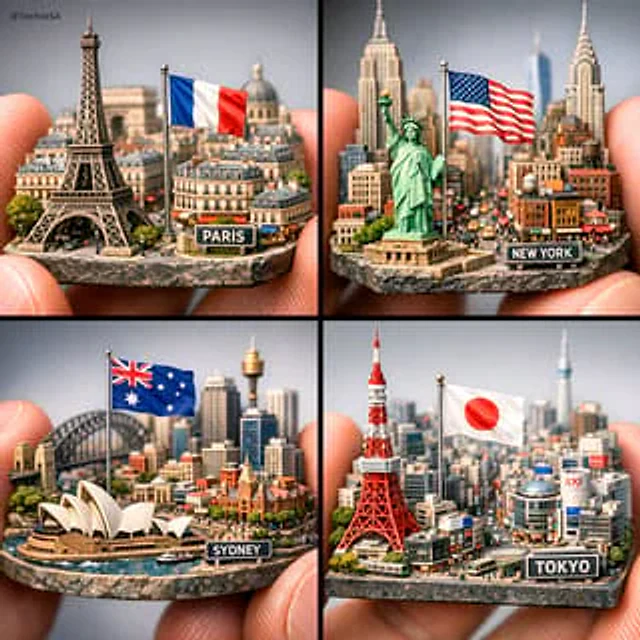

```text
Extreme close-up macro of miniature city diorama [CITY, COUNTRY] on a solid base, held between two human fingers. City fills 85–95% of frame.
[COUNTRY] national flag stands prominently on flagpole in mid-ground, fully readable, gently waving—primary visual anchor.
[ICONIC LANDMARK] positioned in clear foreground, unobstructed, instantly recognizable, naturally integrated.
Small street sign or plaque displays “[CITY NAME]” as authentic urban detail, positioned organically at street corner or plaza edge.
Surrounding architecture reflects city’s authentic character without oversizing elements.
Ultra-realistic handcrafted miniature, detailed architecture, realistic materials, accurate proportions. Macro lens, deep depth of field keeping entire city sharp. Soft studio lighting, subtle shadows, tilt-shift realism. Neutral softly blurred background. Photorealistic, cinematic, premium quality.
```

Model: GPT Image 2
Author: TechieSA

[ProjectD](https://aitoolsradar.com/en/prompts/08c8be91da8f72) · [Recorded source](https://x.com/TechieBySA/status/2007777809712976297)
 · [Full original metadata and byte evidence](data/projectd-batch-0049.json)

## TechieSA #62

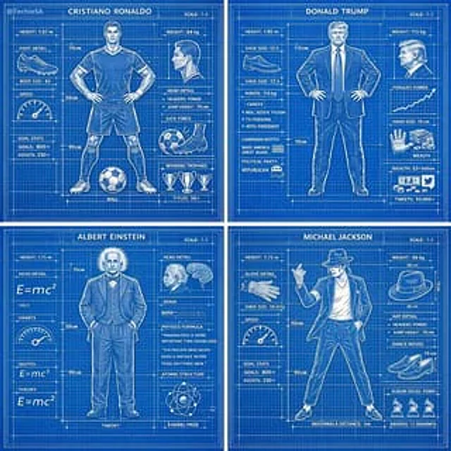

```text
A detailed technical blueprint illustration of [CHARACTER], drawn in blueprint style on a blue grid background with precise white linework. Includes subtle measurement markings, labels, and schematic-style annotations around the figure. The design is clean, symmetrical, and centered, giving it the look of a professional engineering drawing.
```

Model: GPT Image 2
Author: TechieSA

[ProjectD](https://aitoolsradar.com/en/prompts/39faf6c1ca6ab5) · [Recorded source](https://x.com/TechieBySA/status/2009585651554116028)
 · [Full original metadata and byte evidence](data/projectd-batch-0049.json)

## TechieSA #65

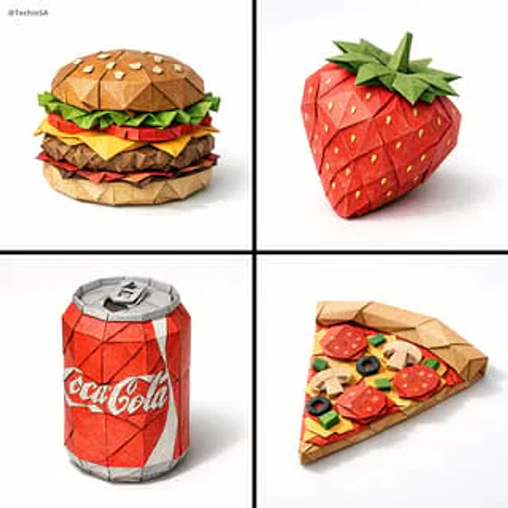

```text
A hyper-detailed origami [FOOD ITEM] folded from realistic colored paper with visible creases and paper texture. Complex geometric folds capture the food’s shape, layers, and distinctive features. Placed on clean surface with soft shadows, minimalist food art photography style
```

Model: GPT Image 2
Author: TechieSA

[ProjectD](https://aitoolsradar.com/en/prompts/fbd6316453b7a6) · [Recorded source](https://x.com/TechieBySA/status/2007809696334479420)
 · [Full original metadata and byte evidence](data/projectd-batch-0049.json)

## TechieSA #91

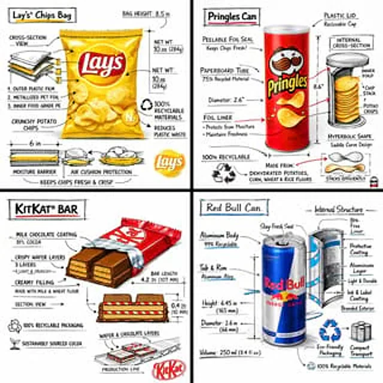

```text
Create a branded technical infographic of a [SNACK], combining a realistic photograph or photoreal render of the product with technical annotation overlays placed directly on top. Use black ink–style line drawings with strategic [BRAND COLOR] accents (architectural sketch look) on a pure white studio background, including:
• Key component labels
• Internal cross-section showing structure, layering, or internal design
• Measurements, dimensions, and specifications
• Material callouts with composition and quantities
• Arrows indicating function for primary features and structural integrity
• Simple schematic or sectional diagram showing key mechanical or design elements
• Sustainability callouts
Title placement: Inside a hand-drawn technical annotation box with accent border reading the product name in bold font, positioned in upper corner.
Style & layout rules:
• The realistic product remains clearly visible
• Annotations feel sketched, technical, and architectural
• Accents used for highlight (20-30% of linework), black for primary technical lines (70-80%)
• Clean composition with balanced negative space
• Educational, food-engineering vibe with premium branding
• Include subtle brand logo mark in corner
Visual style: Minimal technical illustration aesthetic, black linework with accents over realistic imagery, precise but slightly hand-drawn feel.
Color palette: White background, black annotation lines/text, [BRAND COLOR] for accents and key callouts only.
Output: 1080×1080, ultra-crisp, social-feed optimized, no watermark
```

Model: GPT Image 2
Author: TechieSA

[ProjectD](https://aitoolsradar.com/en/prompts/cdb56b67fc3dea) · [Recorded source](https://x.com/TechieBySA/status/2031795709243019280)
 · [Full original metadata and byte evidence](data/projectd-batch-0049.json)

## TechieSA #99

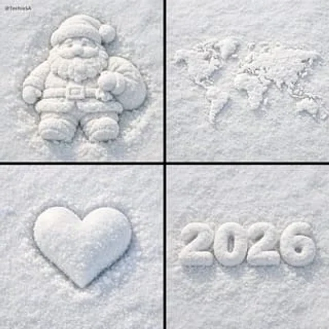

```text
Create a 3D of [OBJECT] made of white snow. The voluminous are lying on a snowy surface, slightly sunken into the snow. Top-down view. A photo with realistic highlights and soft shadows. 1080x1080 dimension picture.
```

Model: GPT Image 2
Author: TechieSA

[ProjectD](https://aitoolsradar.com/en/prompts/3eeb20989be159) · [Recorded source](https://x.com/TechieBySA/status/2004259040491409514)
 · [Full original metadata and byte evidence](data/projectd-batch-0049.json)

## Technical Animation Storyboard Grid

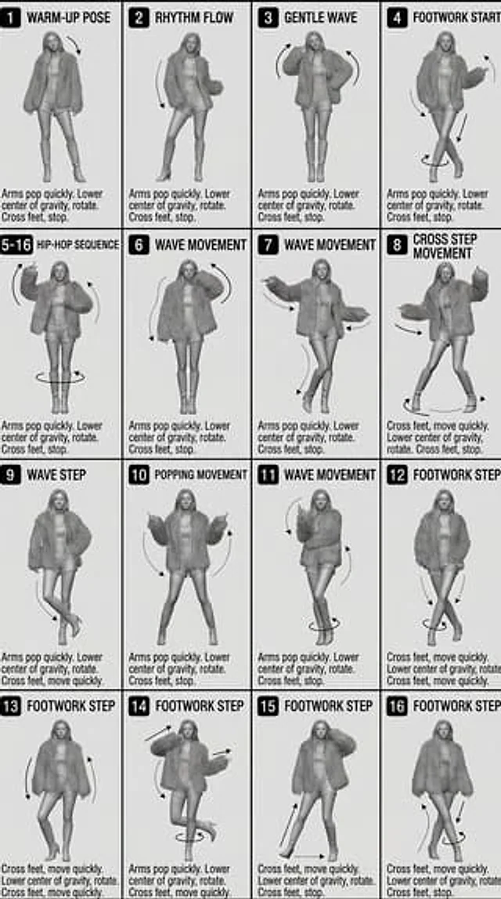

```text
单色灰度插画、3D渲染角色、清晰的教学参考表、白色背景、漫画风格网格布局、技术图表美感。

[布局]
4×4 网格布局，共16个面板。每个面板由细黑边框分隔。单元格编号1-16，面板大小一致。

[角色]
图像1（同一角色在所有面板中保持一致）

[面板结构-每个单元格]

左上角：加粗数字徽章+英文标题文本
中间：全身角色姿势插画
左下角：英文描述文本（3-4行）
覆盖层：显示运动流向和方向的方向箭头

[箭头/运动指示]
曲线箭头、直线箭头和圆形旋转指示器放在角色周围，显示运动流向。

[渲染风格]
高度细节的3D雕塑风格、柔和摄影棚灯光、细微阴影、无色调、灰度阴影、干净线稿、游戏概念艺术质量。

[负面]
无背景场景、无色调、无其他角色、无复杂背景。
```

Model: GPT Image 2
Author: 摆烂程序媛

[ProjectD](https://aitoolsradar.com/en/prompts/41be359d3f82bc) · [Recorded source](https://youmind.com/prompts/technical-animation-storyboard-grid-17850)
 · [Full original metadata and byte evidence](data/projectd-batch-0049.json)

## Technical Blueprint Infographic Style


```text
"about{argument name="subject" default="subject"} Advanced technical infographics. The subject is reinterpreted from a professional and realistic photographic perspective, maintaining a clean and bright visual style with more suitable and aesthetically pleasing backgrounds. The realistic photographic quality of the objects is preserved, rather than presented as illustrations. A technical blueprint-style overlay is added, including white lines, arrows, dimensions, labels, and small diagrams of parts, materials, dimensions, and functions. The overall style is clear, elegant, and informative. A sketch box is placed in the upper left corner with the label '...'{argument name="label" default="OBJECT"} The ratio is 1:1.
```

Model: GPT Image 2
Author: GPT Image 2 Prompts

[ProjectD](https://aitoolsradar.com/en/prompts/efcfc458a569e8) · [Recorded source](https://x.com/Bitturing/status/2047208320281555173)
 · [Full original metadata and byte evidence](data/projectd-batch-0049.json)

## Technical Blueprint Infographic Style

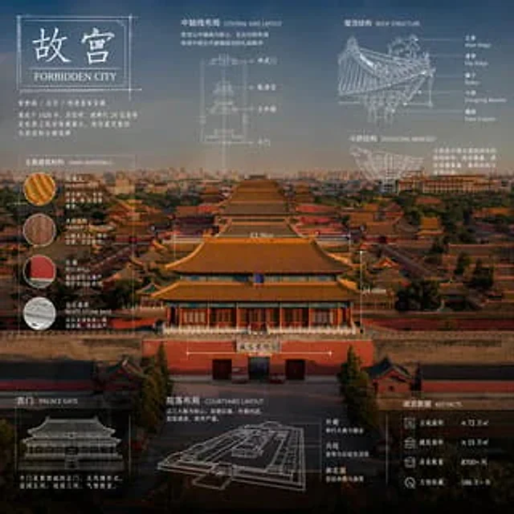

```text
"{argument name="主题" default="[对象]"}的高级技术信息图。在一张专业且逼真的新照片中重新诠释主题，照片干净明亮，背景更合适且更具美感。保持物品作为真实照片，而非插图。添加一个技术蓝图风格的叠加图，包含白线、箭头、尺寸、标签以及零件、材料、尺寸 and 功能的小型示意图。清晰、优雅且信息丰富的文章。在左上角放置一个写有“{argument name="标签内容" default="OBJECT"}”的草图框。1：1 维度。"
```

Model: GPT Image 2
Author: Bitturing

[ProjectD](https://aitoolsradar.com/en/prompts/c6b012f6eeed42) · [Recorded source](https://youmind.com/prompts/technical-blueprint-infographic-15239)
 · [Full original metadata and byte evidence](data/projectd-batch-0049.json)

## Technical Drone Engineering Blueprint

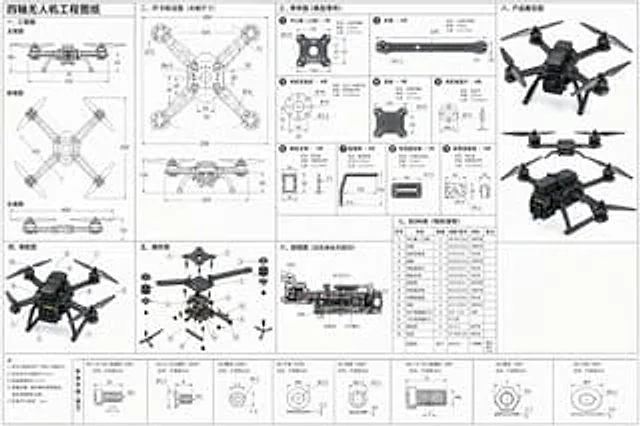

```text
for{argument name="product" default="4-axis drone"} Create detailed engineering drawings, including but not limited to: product concept sketches in the corners, three-view drawings (front view, top view, side view), part drawings with dimensions and material specifications, assembly drawings, exploded views showing structural relationships, sectional views, BOM (Bill of Materials), and comprehensive dimensioning for manufacturing.
```

Model: GPT Image 2
Author: GPT Image 2 Prompts

[ProjectD](https://aitoolsradar.com/en/prompts/62e0a3c4130860) · [Recorded source](https://x.com/cellinlab/status/2047297449883021563)
 · [Full original metadata and byte evidence](data/projectd-batch-0049.json)

## Technical Ink Sketch Portrait

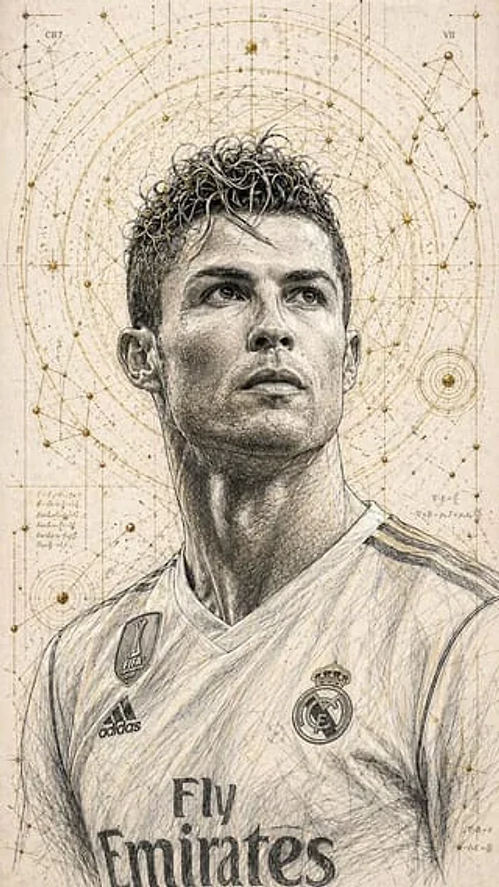

```text
A highly detailed, hand-drawn illustration in a technical style of a {argument name="subject" default="young man looking upward"} with a hopeful and at the same time intense expression. His face is elaborated with fine cross-hatching that particularly emphasizes the facial structure and the emotional impact. The hair appears tousled and dynamic, with individual strands depicted in an ink-like sketch style.The portrait is surrounded by {argument name="details" default="golden geometric patterns, celestial rings, and constellation-like lines"}, creating a fusion of scientific precision and spiritual atmosphere.Ratio 9:16
```

Model: GPT Image 2
Author: Saul Goodman

[ProjectD](https://aitoolsradar.com/en/prompts/112acd6721d4cb) · [Recorded source](https://youmind.com/prompts/technical-ink-sketch-portrait-17053)
 · [Full original metadata and byte evidence](data/projectd-batch-0049.json)

## Teddy Bear Creation Fresco

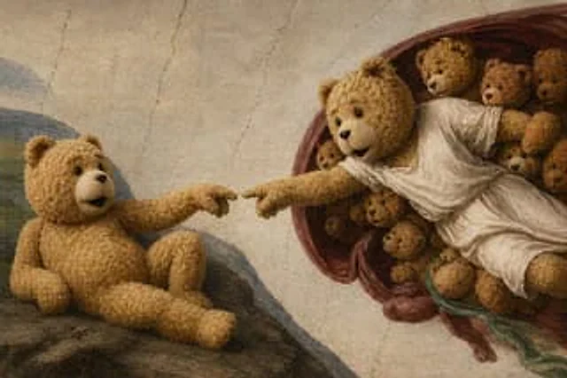

```text
This is a whimsical and richly detailed parody of Michelangelo's original "The Creation of Adam," where all the human figures are replaced by teddy bears. On the left, a plush teddy bear leans against a rocky slope, mimicking Adam's posture, with soft golden-brown curly fur, round ears, bright black eyes, a small dark nose, and a slightly open mouth. Its left arm supports its body, while its right arm extends outward, its index finger reaching towards another bear. On the right, a larger teddy bear, mimicking God's posture, emerges from a deep burgundy swirling cloak, draped in a flowing white robe. Leaning forward, it extends an arm, its fingertips almost touching the bear on its left. Inside the cloak, eight smaller teddy bears closely surround the robed bear, peeking out from different angles like attendants. The composition accurately recreates the iconic "fingertip touching" scene, with the gap between the two fingers positioned in the center of the image. The background features a warm beige crackled mural texture, employing soft Renaissance hues, gentle directional lighting, realistic fabric folds, delicate plush textures, subtle shadows, and a museum-quality painted surface. It blends classical Renaissance mural aesthetics with a charming surreal humor, maintaining elegance while retaining a childlike wonder.
```

Model: GPT Image 2
Author: GPT Image 2 Prompts

[ProjectD](https://aitoolsradar.com/en/prompts/e2803c3ee99c84) · [Recorded source](https://x.com/biteye_sister/status/2047583893117890649#reversed-2)
 · [Full original metadata and byte evidence](data/projectd-batch-0049.json)

## Teddy Bear Last Supper

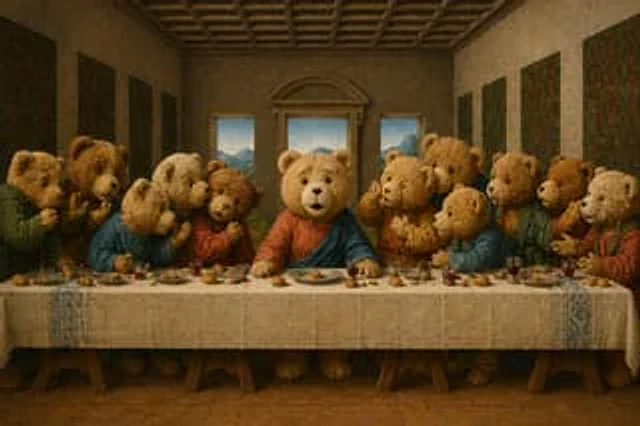

```text
A fantastical yet solemn parody of Leonardo da Vinci's *The Last Supper*, the painting depicts 13 anthropomorphic teddy bears seated side-by-side at one side of a long banquet table, set against the backdrop of a grand, classical dining room. The central teddy bear is the focal point, its posture mimicking Jesus, facing forward with a serene and solemn expression, wearing a soft red robe and a dark blue shawl. The remaining 12 teddy bears gather on either side in a lively conversational group. Each bear has slightly different fur colors, ranging from honey brown to cream, all exhibiting a soft, plush texture, rounded ears, bean-like eyes, and expressively raised paws as if engaged in discussion. The surrounding teddy bears wear biblical-inspired robes painted in earthy reds, grey-blues, ochre, and greens. The composition closely replicates Leonardo da Vinci's *The Last Supper*: symmetrical perspective, a checkered wooden ceiling, three rear windows offering views of soft blue mountains, dark tapestries on the walls, and a long white tablecloth spread across the tiered table. Scattered on the table are small bread rolls, plates, bowls, and several small glasses of deep red wine arranged along the edge. Warm, museum-like lighting, aged mural tones, soft shadows, and a delicate oil painting texture create a highly refined, masterful style, striking a balance between humor and pure artistic beauty. There are no modern objects, no text, no extra characters; the composition is a wide-angle frontal view, showcasing the entire dining table in its entirety.
```

Model: GPT Image 2
Author: GPT Image 2 Prompts

[ProjectD](https://aitoolsradar.com/en/prompts/896a9249d56c23) · [Recorded source](https://x.com/biteye_sister/status/2047583893117890649#reversed-3)
 · [Full original metadata and byte evidence](data/projectd-batch-0049.json)

## Teddy Bear Mona Lisa Hybrid


```text
A surrealist oil painting, modeled after Leonardo da Vinci's *Mona Lisa*, is reimagined as a hybrid portrait of a teddy bear. The subject retains the original's half-length frontal pose, hands clasped, wearing a dark Renaissance-style long dress and soft shawl. The background is a classic hazy landscape, including meandering water, distant mountains, and soft atmospheric perspective. The figure has two rounded, fluffy teddy bear ears on its head, and two furry paws overlapping at the base. The original skin on the collar and hands has been replaced with warm beige teddy bear fur. Long, dark brown hair flows smoothly over its shoulders. The face is intentionally left blank as a flat, featureless brown rectangle, creating an eerie, censored, or unfinished effect. Using crackled varnish texture, aged museum painting sheen, sfumato transitions, low-saturation brown and olive tones, soft gold lighting, and centered composition, the artist perfectly blends highly refined fur texture with classical portrait brushstrokes, presenting a bizarre and wonderful artistic parody effect.
```

Model: GPT Image 2
Author: GPT Image 2 Prompts

[ProjectD](https://aitoolsradar.com/en/prompts/08e87e6712a917) · [Recorded source](https://x.com/biteye_sister/status/2047583893117890649#reversed-0)
 · [Full original metadata and byte evidence](data/projectd-batch-0049.json)

## Teddy Bear with a Pearl Earring


```text
A classical 17th-century Dutch master painting, inspired by Vermeer's composition, presents a teddy bear as the subject of a formal portrait. The bear is shown in three-quarter profile, entering the painting from the shoulders up against a deep black background, its head slightly turned towards the viewer. It possesses soft, golden-brown fur, one rounded, fluffy ear clearly visible, while the other is partially hidden beneath a large blue and gold headscarf wrapped around its head, the long tail of which hangs down to the right. The teddy bear wears an oversized pearl earring in its visible ear, echoing the iconic "Girl with a Pearl Earring." The attire consists of two visible garments: a warm, golden-brown robe or coat, and a small white collar. The dramatic chiaroscuro, projected from the left, reveals rich painterly textures, delicate canvas patterns, realistic fabric folds, soft highlights on the pearl, and a museum-quality Old Master atmosphere. The composition remains simple, centered, and elegant, presenting the teddy bear's face as a plush toy version of a noble portrait, perfectly blending the cute toy texture with a realistic art style.
```

Model: GPT Image 2
Author: GPT Image 2 Prompts

[ProjectD](https://aitoolsradar.com/en/prompts/30653585491399) · [Recorded source](https://x.com/biteye_sister/status/2047583893117890649#reversed-1)
 · [Full original metadata and byte evidence](data/projectd-batch-0049.json)

## Teen-Friendly Black Hole Physics Infographic


```text
{
  "type": "Editable Science Infographic Posters",
  "style": "A teenager-friendly magazine-style science infographic, combining hand-drawn physics diagrams, cartoon characters, and simple editorial layout.",
  "topic": "Primordial black holes, Hawking radiation, and the memory burden of dark matter",
  "canvas": {
    "orientation": "Vertical",
    "background": "Warm-toned cream paper texture with a subtle grainy feel",
    "border": "The page is bordered by a thin, soft gray rectangular border."
  },
  "headline": {
    "title": "Black holes that refuse to die",
    "subtitle": "A tiny black hole born in the very first second of the universe, and the strange new physics that may allow it to disguise itself as dark matter.",
    "credit": "Thoss, Lopez-Honorez, Kühnel & Hufnagel"
  },
  "layout": {
    "sections": [
      {
        "title": "A lightning-fast birth",
        "position": "Top left",
        "count": 4,
        "labels": [
          "Diagram of the birth of the early universe through rotation",
          "A primordial black hole smaller than a grain of salt but heavier than a mountain",
          "Clock icon 10^-30 seconds after the Big Bang",
          "thermometer icon"
        ]
      },
      {
        "title": "Evaporation of ordinary black holes",
        "position": "Top right",
        "count": 4,
        "labels": [
          "Three stages of black hole shrinkage from left to right",
          "Particle spillover wavy lines around each stage",
          "Stephen Hawking's explanation paragraph",
          "Sticker quote: \"Black holes aren't as black as they seem\" — S. Hawking, 1974"
        ]
      },
      {
        "title": "Plot Twist: Memory Burden",
        "position": "Zhong Zhong",
        "count": 4,
        "labels": [
          "A sad overloaded cartoon black hole carrying a backpack labeled MEMORY",
          "Regarding the chat bubbles that cannot evaporate due to information overload.",
          "Formula: Normal speed ÷ (a large amount of information)^k = Crawling speed",
          "Parenthetical note regarding Gia Dvali's 2018 proposal"
        ]
      },
      {
        "title": "Two types of ghost particles",
        "position": "Middle to lower",
        "count": 5,
        "labels": [
          "Particles moving rapidly on the left",
          "The slow, warm particle character on the right",
          "Evolutionary Timeline from the Big Bang to Today",
          "Fast and cold cloud tags",
          "Slow and warm cloud tags"
        ]
      },
      {
        "title": "How we capture them: Lyman-α Forest",
        "position": "Bottom left",
        "count": 4,
        "labels": [
          "The passage about ancient galaxies passing through hydrogen clouds",
          "Spiral-shaped absorption forest landscape image",
          "Handwritten note: The forest tells us: We will find it.",
          "The concept of an axis from us to distant quasars"
        ]
      },
      {
        "title": "What does this paper demonstrate?",
        "position": "Bottom right",
        "count": 1,
        "labels": [
          "Rounded Rectangle Summary Box"
        ]
      }
    ],
    "count": 6
  },
  "visuals": {
    "color_palette": [
      "warm beige",
      "Deep Navy Blue",
      "Rust Orange",
      "grayish blue",
      "Soft brown",
      "Soft gray"
    ],
    "illustration_notes": "The flat, vector shapes, with slightly rough outlines, soft shadows, and rounded forms, are both playful and scientifically rigorous.",
    "typography": "Titles use large serif all-caps letters, chapter titles use bold sans-serif fonts, the body text is compact and easy to read, and occasionally interspersed with handwritten text."
  },
  "objects": {
    "count": 15,
    "items": [
      "1 full-page border",
      "1 title block",
      "A rotation diagram of the early universe",
      "A tiny, labeled primordial black hole.",
      "1 clock icon",
      "1 thermometer icon",
      "Diagram of 3 black hole evaporations",
      "1 Hawking quote sticker badge",
      "A cartoon black hole character carrying a backpack",
      "1 speech bubble",
      "1 formula block",
      "2 cloud tags",
      "A spectral forest illustration in the lower left corner"
    ]
  },
  "text_blocks": {
    "count": 9,
    "items": [
      "title",
      "subtitle",
      "Author's signature",
      "A Lightning-Fast Birth (Main Text)",
      "Ordinary black hole evaporation (main text)",
      "Explanation of memory burden",
      "Ghost Particle Description",
      "Lyman-α Forest Interpretation",
      "Final conclusions"
    ]
  },
  "composition": "The compact yet easy-to-read single-page illustrations, featuring multiple captions and a clear left-to-right, top-to-bottom reading flow, are designed to be shareable social media science posters, making complex physics papers easily understandable even for teenagers."
}
```

Model: GPT Image 2
Author: GPT Image 2 Prompts

[ProjectD](https://aitoolsradar.com/en/prompts/68a94d94053ec4) · [Recorded source](https://x.com/alphinctom/status/2046739393348546597#reversed-0)
 · [Full original metadata and byte evidence](data/projectd-batch-0049.json)

## Tennis Hydration Ad Poster


```text
Create a hyperrealistic sports advertisement poster using an extremely wide-angle, low-angle courtside perspective with a sunny outdoor tennis court as the background. In the foreground, a male tennis player makes a dramatic stride towards the camera while simultaneously pushing a large, matte cobalt blue insulated water bottle toward the viewer, making the bottle the main subject of the image. The bottle is covered with clearly visible condensation droplets, features a brushed gold metallic cap, and has a white brand logo printed on the bottom.{argument name="brand name" default="Aqua"} The athlete wears a clean white athletic T-shirt, bright blue tennis shorts, white wristbands, white athletic socks, and tennis shoes. His other arm is extended behind him, holding a black tennis racket; a bright yellow-green tennis ball is visible near the racket on the right side of the frame. The pose should be dynamic and powerful, with one leg in a deep squat and the other extended across the blue hard court. Utilize the strong midday sunlight, clear shadows, vibrant and saturated blue, and a cloudless sky, with green trees and a dark fence in the background. The composition should convey the quality of a high-end hydration brand advertisement, focusing on the water bottle and the athlete, using dramatic perspective to create a sophisticated and energetic commercial feel. Incorporate simple white advertising typography into the lower half of the court surface: a smaller line of text {argument name="headline intro" default="Play Hard"} The very eye-catching large bold text is{argument name="headline main" default="Hydrate Smart"} and smaller subtitles{argument name="tagline" default="Hydration that keeps up with every move."} Place it again in the upper right corner.{argument name="brand name" default="Aqua"} The logo is white, and a small white website URL is placed in the lower right corner.{argument name="website" default="www.aqua.com"} .
```

Model: GPT Image 2
Author: GPT Image 2 Prompts

[ProjectD](https://aitoolsradar.com/en/prompts/88a50607f468dd) · [Recorded source](https://x.com/rovvmut_/status/2047245211517256054#reversed-0)
 · [Full original metadata and byte evidence](data/projectd-batch-0049.json)

## Tennis Hydration Ad Poster


```text
Create a hyper-realistic sports advertising poster shot from an extreme wide-angle, low courtside perspective on a bright sunny day at an outdoor tennis court. In the extreme foreground, a male tennis player lunges dramatically toward the camera while thrusting a large matte cobalt-blue insulated water bottle toward the viewer, making the bottle the dominant object in the frame. The bottle is covered with visible condensation droplets and has a brushed metallic gold cap, with the white logo text {argument name="brand name" default="Aqua"} printed near the bottom. The athlete wears a clean white athletic t-shirt, bright blue tennis shorts, white wristbands, white socks, and white tennis shoes. His other arm stretches back holding a black tennis racket, with 1 bright yellow-green tennis ball visible near the racket on the right side of the image. The pose should feel dynamic and athletic, with one leg bent deeply and the other extended in a wide lunge across the blue hard court. Use strong midday sunlight, crisp shadows, vivid saturated blues, and a clear cloudless sky, with green trees and a dark fence line in the distant background. Compose it like a premium hydration brand campaign, with sharp focus on the bottle and athlete, dramatic foreshortening, commercial polish, and energetic motion. Add clean white ad typography integrated onto the court surface in the lower half: a smaller line reading {argument name="headline intro" default="Play Hard"}, a very large bold line reading {argument name="headline main" default="Hydrate Smart"}, and a smaller subheading reading {argument name="tagline" default="Hydration that keeps up with every move."}. Place the {argument name="brand name" default="Aqua"} logo again in white at the top right, and a small website URL in white at the bottom right reading {argument name="website" default="www.aqua.com"}.
```

Model: GPT Image 2
Author: Heisenberg

[ProjectD](https://aitoolsradar.com/en/prompts/1626a5ce084139) · [Recorded source](https://youmind.com/prompts/tennis-hydration-ad-poster-15249)
 · [Full original metadata and byte evidence](data/projectd-batch-0049.json)

## Tension Line Art Concept Poster


```text
请将我上传的每一张照片分别制作成一张独立的高级设计海报，不多图拼接，每张照片单独输出。整体采用3:4竖版构图，上下两个区域高度严格1:1，各占画面 50%。

上半部分保留原始照片，保持主体结构、真实质感、自然光影和原有色彩氛围，仅进行轻微高级摄影调色，使其具有杂志摄影、艺术出版物和公共议题影像的克制质感。为适配画幅，可自然扩展天空、地面或环境背景，但不得拉伸、扭曲或改变主体。

下半部分提取照片中最具识别性的主体、轮廓、姿态与叙事关系，重构为一幅极简、克制、带有公共议题气质的观念线条插画。不机械描边，不复制背景、光影和复杂细节，而是提炼原图中的方向、连接、矛盾、压力与转机，将其压缩成一组连续的黑色手绘线条。线条如被拉紧的细铁丝、路径、束缚或伤口，从画面边缘进入，在下方盘绕、交错、回折与收紧，再沿内在力量逐渐向上或向外抬升，并在运动中自然显露出与原主体有关的象征轮廓；保持一眼可感知原物，但不必完整封闭或直接解释。

画面以冷白、米白或低饱和浅色为底，大面积留白，主体偏下、偏侧或靠近边缘，不居中、不铺满。线条粗细略有变化，保留墨线的摩擦、迟疑、断裂与压力感；尖刺、结点、倒钩或短横仅出现在受力、交叉和方向改变的位置。整体安静而紧张，简洁却不轻松，意义在线条的缠绕、限制、穿越、收紧与释放之间逐渐显现。

文字只作极少量使用，可加入简短英文主题词、编号、地点或适配金句，但必须像线条系统中的一个微小痕迹，以纤细、克制、略带手工感的排版融入空白或线条转折处，不成为视觉中心，也不直接解释画面。整体参考现代主义观念海报、社会议题视觉、艺术出版物和实验编辑设计，避免复杂场景、写实光影、三维质感、多色填充、卡通感、商业广告感、装饰性曲线和无意义的视觉丰富。
```

Model: GPT Image 2
Author: 小小东

[ProjectD](https://aitoolsradar.com/en/prompts/a95b321fa6243c) · [Recorded source](https://youmind.com/prompts/tension-line-art-concept-poster-31916)
 · [Full original metadata and byte evidence](data/projectd-batch-0049.json)

## Tesla Model 3 Exploded Supplier Infographic


```text
{
  "type": "Automotive dismantling supplier infographic poster",
  "topic": "Tesla Model 3 vertical exploded view (from top to bottom)",
  "language": "Chinese",
  "style": "Concise and professional industrial infographics, white background, high-end corporate presentation style, accurate 3D product rendering, soft studio shadows, minimalist layout, and clear typography.",
  "title": {
    "main": "{argument name=\"headline text\" default=\"Tesla Model 3 vertical exploded view (from top to bottom)\"}",
    "subtitle": "Major components and suppliers (as of 2024)"
  },
  "subject": {
    "vehicle": "{argument name=\"vehicle model\" default=\"Tesla Model 3\"}",
    "view": "Front 45-degree angle",
    "composition": "The disassembly and assembly diagram is stacked vertically, with each component aligned and floating from top to bottom."
  },
  "layout": {
    "left_panel": {
      "position": "two-thirds of the left side",
      "count": 9,
      "items": [
        {
          "index": 1,
          "label": "Body exterior panels",
          "note": "Aluminum",
          "visual": "White exterior paint, including doors, hood, trunk, and lights, but excluding wheels."
        },
        {
          "index": 2,
          "label": "Interior assembly",
          "note": "Seats, dashboard, etc.",
          "visual": "The interior cabin assembly, including four black seats, instrument panel, steering wheel, and center console, is mounted on part of the chassis."
        },
        {
          "index": 3,
          "label": "Body frame structure",
          "note": "Aluminum",
          "visual": "Exposed silver white body structure frame"
        },
        {
          "index": 4,
          "label": "Base plate assembly",
          "note": "Including thermal management board",
          "visual": "Flat metal base plate"
        },
        {
          "index": 5,
          "label": "Battery System",
          "note": "Cell + Module + Battery Pack",
          "visual": "Large rectangular battery pack, showing module layout and orange high-voltage connector."
        },
        {
          "index": 6,
          "label": "drive motor",
          "note": "Rear-mounted single motor",
          "visual": "Rear-mounted single-motor drive unit suspended"
        },
        {
          "index": 7,
          "label": "Suspension system",
          "note": "Front and rear suspension",
          "visual": "Front and rear suspension subframe assemblies, including brakes and springs"
        },
        {
          "index": 8,
          "label": "Electronic and electrical architecture",
          "note": "Wiring harnesses, controllers, etc.",
          "visual": "Electronic module assembly, including orange cable, controller, wiring harness and junction box."
        },
        {
          "index": 9,
          "label": "Chassis assembly",
          "note": "Includes braking and steering",
          "visual": "Rolling skateboard chassis, including wheels, battery base, steering and braking systems."
        }
      ]
    },
    "right_panel": {
      "position": "right third",
      "type": "Supplier Form",
      "columns": [
        "part",
        "Major suppliers",
        "area"
      ],
      "count": 9,
      "rows": [
        {
          "part": "Body exterior panels",
          "supplier": "Novelis",
          "region": "USA"
        },
        {
          "part": "Interior assembly",
          "supplier": "Yanfeng International",
          "region": "China"
        },
        {
          "part": "Body frame structure",
          "supplier": "Huayu Automotive / HASCO",
          "region": "China"
        },
        {
          "part": "Base plate assembly",
          "supplier": "Xusheng Group",
          "region": "China"
        },
        {
          "part": "Battery System",
          "supplier": "LG Energy Solution",
          "region": "South Korea/China"
        },
        {
          "part": "drive motor",
          "supplier": "Tesla's self-developed",
          "region": "USA"
        },
        {
          "part": "Suspension system",
          "supplier": "TUOPU Group",
          "region": "China"
        },
        {
          "part": "Electronic and electrical architecture",
          "supplier": "Aptiv",
          "region": "Ireland/China"
        },
        {
          "part": "Chassis assembly",
          "supplier": "Bosch",
          "region": "Germany"
        }
      ]
    },
    "connectors": "Dashed guide lines from the numbered labels on the left to the corresponding disassembled components.",
    "footer": {
      "note": "Note: Supplier information is compiled from publicly available data, and the actual suppliers may vary depending on the version and time.",
      "legend_count": 3,
      "legend": [
        {
          "label": "US suppliers",
          "color": "green"
        },
        {
          "label": "Chinese suppliers",
          "color": "blue"
        },
        {
          "label": "other countries",
          "color": "gray"
        }
      ]
    }
  },
  "rendering": {
    "materials": "White painted body, brushed aluminum structure, black leather seats, dark rubber tires, metal mechanical parts, orange high-voltage cables.",
    "lighting": "Natural studio lighting from the left front, soft ambient light filtering out shadows, and soft projections below each suspended layer.",
    "camera": "A slightly upward-looking frontal perspective, with elements stacked vertically in the center.",
    "background": "Pure white or very light gray"
  },
  "constraints": [
    "Retain all 9 layers, arranged in exact order from top to bottom.",
    "Display the supplier's logo or brand-style text in the table.",
    "The entire infographic uses Chinese labels.",
    "Maintain clean spacing and professional visual design.",
    "Ensure 3D components are realistic and technically sound."
  ]
}
```

Model: GPT Image 2
Author: GPT Image 2 Prompts

[ProjectD](https://aitoolsradar.com/en/prompts/544959dc1f96ca) · [Recorded source](https://x.com/MurphChenOnX/status/2046534506673496404#reversed-1)
 · [Full original metadata and byte evidence](data/projectd-batch-0049.json)

## Texas-Style Pork Poster


```text
Using REFERENCE_0 as the main photo and REFERENCE_1 to enhance the texture of the shredded pork, the homemade roast pork is transformed into a visually striking Texas BBQ poster. The original cuts of pork in the foil are preserved, but redesigned to look more appetizing and like a professional photograph: a deeper mahogany skin, more prominent black peppercorns, a richer glaze, visible juices, darker shadows, warm orange highlights, and a smoky atmosphere rising from above. It's placed against a dark, rustic background with cinematic food advertising lighting. A striking retro-Western-style headline is added to the upper left, in two lines: “TEXAS STYLE” and “PORK”. Below it, add three lines of Japanese text: “100℃で8時間、じっくり火入れ”, “Low &amp; Slowで引き出す、”, and “やわらかさと旨み.” In the lower left corner, add two lines of handwritten-style Japanese slogans: “しっとり、” and “ほろり.” Using a sophisticated barbecue advertisement layout, emphasizing high contrast and a slight grainy texture, the final image achieves an effect reminiscent of a Texas-style shredded pork poster inspired by barbecue.
```

Model: GPT Image 2
Author: GPT Image 2 Prompts

[ProjectD](https://aitoolsradar.com/en/prompts/a3796ac8ba91a4) · [Recorded source](https://x.com/BlackoalaM/status/2047723388123415021#reversed-0)
 · [Full original metadata and byte evidence](data/projectd-batch-0049.json)

## Text on Object Test


```text
One{argument name="art style" default="Watercolor illustrations on textured paper"} The protagonist is{argument name="character species" default="White fluffy catgirl"} Keep the short style{argument name="hair color" default="Light green"} She had hair, fluffy cat ears, and big green eyes. She wore an oversized green sweater, and her expression {argument name="expression" default="Confused and distressed, a bead of sweat hung on his forehead."} She was holding a yellow banana, completely covered in {argument name="prop text" default="Dense black Chinese characters similar to the Heart Sutra"} Above and to her left floats a dark, graffiti-like bubble containing tangled black lines and three question marks.
```

Model: GPT Image 2
Author: GPT Image 2 Prompts

[ProjectD](https://aitoolsradar.com/en/prompts/6610e65ea77369) · [Recorded source](https://x.com/TlanoAI/status/2044279047254094190)
 · [Full original metadata and byte evidence](data/projectd-batch-0049.json)

## Text Rendering Capability Test


```text
One with{argument name="text" default="Heart Sutra"} of{argument name="fruit" default="banana"}
```

Model: GPT Image 2
Author: GPT Image 2 Prompts

[ProjectD](https://aitoolsradar.com/en/prompts/c2d35e38ecdd67) · [Recorded source](https://x.com/TlanoAI/status/2044279047254094190)
 · [Full original metadata and byte evidence](data/projectd-batch-0049.json)

## Themed Periodic Table Design


```text
{argument name="subject" default="Pokémon"} Periodic table
```

Model: GPT Image 2
Author: GPT Image 2 Prompts

[ProjectD](https://aitoolsradar.com/en/prompts/e339f1637532fb) · [Recorded source](https://x.com/EMostaque/status/2046658665835274719)
 · [Full original metadata and byte evidence](data/projectd-batch-0049.json)

## Themed Periodic Table Design


```text
the periodic table of {argument name="subject" default="Pokémon"}
```

Model: GPT Image 2
Author: Emad

[ProjectD](https://aitoolsradar.com/en/prompts/e89fe34a5323c0) · [Recorded source](https://youmind.com/prompts/themed-periodic-table-14388)
 · [Full original metadata and byte evidence](data/projectd-batch-0049.json)

## Themed Routine Timeline Infographic


```text
Please create a detailed step-by-step timeline showing the timeline from 9 PM to 10 PM.{argument name="routine type" default="bed time routine"} Style needs to be referenced{argument name="style" default="The Beatles"}
```

Model: GPT Image 2
Author: GPT Image 2 Prompts

[ProjectD](https://aitoolsradar.com/en/prompts/55ab03fe701177) · [Recorded source](https://x.com/GlennHasABeard/status/2046757508388175894)
 · [Full original metadata and byte evidence](data/projectd-batch-0049.json)

## Thermal Receipt Table Lamp Poster


```text
Goal: Create a bold experimental product poster for a design-object announcement, combining an extreme cropped typography background with a thermal receipt layout overlay.

Canvas: Vertical poster, 4:5 aspect ratio, off-white outer margin around a saturated hot-pink rectangular field. Use a clean print-design composition with slight risograph/thermal-paper grain and subtly imperfect ink edges.

Layout: Place one huge cream-white uppercase background title reading {argument name="product name" default="TABLE LAMP"}, spanning nearly the full width across the upper third; crop the letters heavily at the left and right edges so the title feels oversized and partially hidden. Center-right, overlay exactly one tall narrow cream thermal receipt running from near the top to near the bottom, with zigzag torn edges at the top and bottom. Add one thin vertical microtext line beside the receipt, rotated 90 degrees, reading like an archive/design ID. Along the bottom of the pink field place exactly two separate cream barcode blocks, one at bottom left and one at bottom right. The receipt itself contains exactly one black barcode near its bottom.

Receipt details: The receipt header has a large condensed black title {argument name="receipt header" default="TABLE LAMP"}. Under it, include the subtitle “AESTHETICS, SWITCHED ON”. Fill the receipt with monospaced thermal-printer text, dashed divider lines, and pseudo-transaction metadata. Include design-spec lines such as design registration number, date, time, terminal, transaction, attendant, product, object type, form study, material study, surface finish, light quality, curve ratio, form revision, assembly check, aesthetic value, archive index, subtotal, tax, payment method, authorization, thank-you note, return policy, and “KEEP THIS LIGHT RECEIPT”. Highlight exactly one line in a translucent pink marker strip: “GRAND TOTAL--BEAUTY, SWITCHED ON”.

Subject image on receipt: At the lower half of the receipt, print exactly one cute glossy flower-shaped table lamp illustration with a pink fluted pedestal stem, six rounded pink petals, a blue inner glow, a small orange-red circular center, and a thin pale power cord trailing left. Keep it centered above the receipt barcode.

Typography and style: Use condensed bold sans-serif for the massive background title, monospaced receipt type for all receipt text, black ink on warm cream paper, and a fashionable editorial graphic-design aesthetic. Main colors are {argument name="background color" default="hot pink"}, cream white, black, soft pink, blue, and orange-red. The image should feel like a modern poster generated from the structural idea of a thermal-paper receipt, not a realistic store receipt photo.

Constraints: Use exactly 3 visible barcodes total: 2 large background barcode blocks and 1 receipt barcode. Use exactly 1 receipt, exactly 1 product illustration, and exactly 1 highlighted grand-total line. Do not add people, logos, watermarks, QR codes, extra products, or extra receipts.
```

Model: GPT Image 2
Author: 노노아카이브

[ProjectD](https://aitoolsradar.com/en/prompts/1b40d7015ed9d3) · [Recorded source](https://youmind.com/prompts/thermal-receipt-lamp-poster-31138)
 · [Full original metadata and byte evidence](data/projectd-batch-0049.json)

## Thoughtful Systems Presentation Cover


```text
Create a sophisticated, editorial-style presentation cover slide using a warm Claude-inspired design system. Use a 16:9 landscape composition with a parchment background featuring delicate paper textures, soft shadows, and layered torn paper collage elements. The overall color scheme should consist of warm ivory, cream, sand, charcoal gray, soft black, and terracotta accents. Place a small label on the left side displaying "..."{argument name="system label" default="Claude-style presentation system"} The title is accompanied by a small terracotta dot and a thin horizontal dividing line. Below it is an oversized, elegant, high-contrast serif heading in black, containing the text "".{argument name="main headline" default="Thoughtful Systems"} The heading, divided into two lines, occupies the main position on the left. Below the heading, add a smaller terracotta-colored serif subheading with the content "{argument name="subheadline" default="Warmth can also be precise."} Below this, create a vertical list containing four design principles, each on a separate line with thin dividing lines and small icons on the left: 1) A rectangular parchment icon with the text "Parchment Canvas"; 2) A serif capital T icon with the text "Serif-dominated hierarchy"; 3) A filled terracotta circle icon with the text "Terracotta for cues"; 4) A chain icon with the text "Organic charts over cold metallic feel". Add a small footer in the bottom left corner with "CLAUDE-INSPIRED PRESENTATION SYSTEM" in widely spaced lowercase letters. In the right half, construct a list of three... A layered collage of paper cards: The first is a tall, off-white art card with a thin border, containing the title "A More Thoughtful Approach," a short text about how complex problems become clearer, a minimalist landscape line drawing with a terracotta sun, and a vertical terracotta plant branch overlaid on the card; the second is a dark charcoal gray rectangular card behind it, with the lowercase title "Thinking Process" and a precise five-step numbered list: "01 Observe," "02 Interpret," "03 Connect," "04 Synthesize," and "05 Act with Care," as well as a delicate circular track diagram with dotted lines and terracotta highlights; the third is a torn-edge off-white sticky note near the bottom front, featuring a hand-drawn overlapping circle diagram, with a crescent-shaped intersection filled in terracotta, next to a handwritten quote:{argument name="quote" default="Clarity becomes apparent when a system is intentionally designed."} Insert an extra light beige strip of paper below the bottom card. Emphasize tactile realism, elegant white space, exquisite printing and editing, soft natural lighting, and a calm, thoughtful, luxurious technological atmosphere.
```

Model: GPT Image 2
Author: GPT Image 2 Prompts

[ProjectD](https://aitoolsradar.com/en/prompts/8a44e264ca6eb9) · [Recorded source](https://x.com/Russell3402/status/2046806087903625331#reversed-1)
 · [Full original metadata and byte evidence](data/projectd-batch-0049.json)

## Three Beauty Mobile Landing Pages


```text
A sophisticated promotional mockup showcases three elongated smartphone screens side-by-side in a vertical triptych layout, each displaying a landing page for a modern beauty brand's lip products. The overall composition is editorial, minimalist, and sophisticated, designed specifically for mobile web design presentations on social media. The left panel, set against a soft gradient background from pale purple to blush pink, displays a black-bezeled phone with a screen featuring {argument name="brand name" default="Kosas"} A beauty website featuring cream-toned blushes. At the top of the panel, elegant small serif fonts read {argument name="left headline" default="Fresh Pout."} The top of the phone screen displays a cropped close-up image of a beauty product, with the prominent headline "Lips in their fullest expression." (The word "fullest" is in italic serif style), accompanied by a rounded, dark call-to-action button, a row of three lip close-up thumbnails, three effect labels labeled "Plumps," "Tingles," and "Shines," and a row of five shade or effect icons below. The middle panel, set against a gradient background from light to dark purple, showcases a second phone with a black bezel, whose landing page has a more sophisticated layout. The serif font above reads {argument name="middle headline" default="Claude Code"} The top of the screen features a cropped portrait image, a striking black stacked headline "LIP PULSE.", below which is a line of pink italicized handwritten text "is here.", a rounded dark button, a dark area containing the phrase "Lips in their fullest expression.", and a product grid near the bottom containing six color code cards (arranged in 2 rows and 3 columns). The right panel, set against a deep navy blue textured background, showcases a third phone with a black bezel, its page featuring a pink-toned e-commerce style. At the top center, in uniform white font, is the text {argument name="right headline" default="GPT Images 2.0"} The screen prominently displays the product's homepage area, featuring the brand name "Kosas," the large headline "The Lip Pulse," a pink lip gloss tube tilted to the right, small function icons, a row of six lip swatches near the center, and a promotional section below with images of more pink products. Maintaining a symmetrical layout, exactly three phones are positioned vertically, one on each panel, all fully visible. It employs high-end cosmetics advertising aesthetics, clean spacing, a stylish web typography with a mix of serif and bold sans-serif fonts, a soft pink and cream UI color scheme, subtle shadows, and a fashionable product design suitable for showcasing an AI-generated mobile website concept.
```

Model: GPT Image 2
Author: GPT Image 2 Prompts

[ProjectD](https://aitoolsradar.com/en/prompts/ac312ad73ac015) · [Recorded source](https://x.com/ganserene/status/2046738636226580919#reversed-0)
 · [Full original metadata and byte evidence](data/projectd-batch-0049.json)

## Three Floral Chickens Portrait


```text
A whimsical studio portrait showcases three stylized chicks composed entirely of layered petals and flowers. They stand side-by-side against a light gray background, bathed in soft, even light light with subtle shadows on the ground. The chick on the left, cream and ivory, is composed of light-colored petals and small white wildflowers. It has a surprised expression, large, round, comical eyes, a small, light-colored comb, drooping pink wattles, and slender yellow legs. The middle chick is plump and rounded, composed of dense pink petals and flowers in varying shades. It has a serious and slightly disgruntled expression, squinting eyes, a large, light-colored beak, oversized pink wattles, and a pink flower-like comb drooping from its forehead. The chick on the right is bright orange and gold, composed of vibrant orange petals and marigold-like flowers, dotted with a few green leaves and yellow shoots. It has a sleepy and disdainful expression, half-closed eyes, a tall, reddish-orange comb, red wattles, and yellow legs. These three chicks are highly detailed, cute, quirky, and handcrafted, with realistic floral patterns arranged into convincing chicken body structures. The use of centered composition, full-body perspective, and clean, minimalist background presents an exquisite and fantastical editorial photography aesthetic.
```

Model: GPT Image 2
Author: GPT Image 2 Prompts

[ProjectD](https://aitoolsradar.com/en/prompts/fb2f701da7a9a6) · [Recorded source](https://x.com/CrazyAITech/status/2046554926143225916#reversed-0)
 · [Full original metadata and byte evidence](data/projectd-batch-0049.json)

## Three-Panel AI Billboard Comparison


```text
Goal: Create a clean comparison graphic showing three AI-generated urban billboard photos side by side, as if comparing image model outputs.

Canvas: Wide 16:9 presentation slide with a warm off-white background and generous margins. Place three tall vertical photo panels evenly spaced across the canvas, each framed by a pale beige mat/border. Under each panel, add a centered caption.

Layout: Exactly 3 vertical street-photo panels in one row. Panel 1 on the left, Panel 2 in the center, Panel 3 on the right. Each panel shows a realistic New York City street scene with parked cars in the foreground, tall buildings, sidewalks, traffic signs, and a large square billboard mounted high on a building. Use slightly different street angles and lighting in each panel, like three separate model outputs of the same concept.

Panel details: Left panel: a rear view of a black SUV parked on a city street, looking toward storefronts and buildings; a large white billboard above the street reads like a social-media quote card with a small circular animal avatar, the heading “What do you think?”, a short quote, and small ChatGPT branding. Center panel: a black SUV parked on a narrow Manhattan street with the Empire State Building visible in the distance; a large dark billboard with white text, a circular animal avatar, and ChatGPT branding. Right panel: a black sedan parked along a busier avenue with storefront signs such as “I ♥ NY GIFTS”; a large black billboard with a bright cyan border, white quote text, a circular animal avatar, and ChatGPT branding.

Caption text: Use exactly 3 captions beneath the panels. Left caption: “ChatGPT Images 2.0” on the first line and “MEDIUM” in bold quotation marks on the second line. Center caption: “mona-lisa-1” in bold quotation marks. Right caption: “ChatGPT Images 2.0” on the first line and “HIGH” in bold quotation marks on the second line.

Customizable text slots: The comparison labels should read {argument name="left model label" default="ChatGPT Images 2.0"}, {argument name="center model label" default="mona-lisa-1"}, and {argument name="right model label" default="ChatGPT Images 2.0"}. The left quality tag should be {argument name="left quality tag" default="MEDIUM"} and the right quality tag should be {argument name="right quality tag" default="HIGH"}.

Visual style: Photorealistic smartphone street photography inside each panel, but arranged as a polished social-media comparison slide. Keep the overall slide minimal, with no decorative graphics beyond the three framed images and their captions. The billboard text inside the photos may be small and partially imperfect, but it should clearly resemble AI quote-card advertising with ChatGPT logos.
```

Model: GPT Image 2
Author: leo 🐾

[ProjectD](https://aitoolsradar.com/en/prompts/e810d758f79615) · [Recorded source](https://youmind.com/prompts/ai-billboard-comparison-31014)
 · [Full original metadata and byte evidence](data/projectd-batch-0049.json)

## Three-Panel Chinese Aesthetic Model Comparison


```text
Goal: Create a vertical three-panel comparison collage showing the same Chinese traditional aesthetic portrait generated in three different styles.

Canvas: Portrait format, approximately 4:5 aspect ratio, 960×1200 feel. Divide the image into exactly 3 equal horizontal panels separated by thin white horizontal lines.

Overall subject: In all three panels, show the same young East Asian woman in a warm, cinematic ancient Chinese interior, wearing a soft ivory hanfu robe. She is adjusting a peach-pink flower hair ornament near her ear with both hands. Her black hair is loosely pinned up with wispy strands around her face. The atmosphere is golden-hour, backlit, romantic, and traditional, with wooden lattice windows behind her, soft haze, shallow depth of field, warm sunlight, and floating flower petals or dust motes.

Panel count and labels: Use exactly 3 panels with large white sans-serif text labels in the lower-left area of each panel: 1) “Midjourney V8.2” on the top panel, 2) “GPT-Image 2” on the middle panel, 3) “Seedream 5.0 Pro” on the bottom panel.

Top panel: Label “Midjourney V8.2”. Make this the most dramatic and cinematic version: stronger contrast, moody shadows, glowing rim light, more dynamic pose, windblown hair, petals crossing the foreground, refined facial features, realistic skin texture, premium film still quality. The woman faces slightly toward camera with a serious, elegant expression while placing the flower by her ear.

Middle panel: Label “GPT-Image 2”. Make this cleaner and softer, with a slightly polished beauty-retouch look. The woman is turned three-quarters to the right, looking sideways while carefully adjusting the flower. Keep warm window light, cream hanfu fabric with subtle embroidered floral details, and a more smooth, influencer-like face.

Bottom panel: Label “Seedream 5.0 Pro”. Make this brighter and slightly more plastic/smooth than the top, with a gentle smile and softer realism. The woman holds the peach flower close to her ear, looking down-left or sideways, with intense backlight from the lattice window and a glowing edge around her hair and hands.

Text styling: Large white text, simple sans-serif, no outline, subtle shadow if needed for readability. Place each label consistently near the bottom-left of its panel. Do not add any other text, logos, watermarks, or UI elements.

Customizable details: The subject is {argument name="subject description" default="a young East Asian woman in ivory hanfu"}; the setting is {argument name="setting" default="a warm ancient Chinese room with wooden lattice windows"}; the hair accessory is {argument name="hair flower" default="a peach-pink flower"}; the top label is {argument name="top model label" default="Midjourney V8.2"}; the middle label is {argument name="middle model label" default="GPT-Image 2"}.
```

Model: GPT Image 2
Author: 梦老湿 Dream AI

[ProjectD](https://aitoolsradar.com/en/prompts/6e4aa8cc08ee38) · [Recorded source](https://youmind.com/prompts/chinese-portrait-comparison-32287)
 · [Full original metadata and byte evidence](data/projectd-batch-0049.json)

## Three-View Hooded Fantasy Dress Sheet


```text
{"type":"Clothing Reference Image","subject":{"garment":"Children's Fantasy Hooded Dress and Cape Set","model":{"age_appearance":"Little Girl","hair":{"color":"}}}}{argument name="hair color" default="Golden yellow"} ","style":"Long, wavy hair peeking out from under the hood"},"face":"Deliberately blurred, indistinct","pose":"Standing upright, arms hidden under the cloak, barefoot"},"outfit":{"primary_color":"{argument name="outfit color" default="Deep Navy Blue"} ","inner_dress":"Floor-length dress, square neckline, light-colored trim, silver embroidery with floral vines and small stars on the front, asymmetrical embroidered hem details, revealing a light gray-blue tulle petticoat at the bottom","cape":"Full-length hooded cape, color matching the dress, light-colored floral trim on the hood brim, front opening, side vertical borders, and hem","decorations":{"count":5,"items":["Silver floral vine embroidery","Small star pattern","Chain beaded floral wreaths hanging from the chest and back","Two hanging from the top of the front and back"] "A white tassel", "Light silver-white geometric lace trim"]},"accessories":{"count":1,"items":["Dark choker necklace"]}},"studio":{"background":"Pure light gray studio background wall","floor":"Mid-toned wood flooring","lighting":"Soft and even catalog lighting","framing":"Full-body, centered, consistent proportions across all views"},"layout":{"background":"White page containing three vertical image panels","sections":[{"title":"Front view","position": "Left","count":1,"labels":["Front View"]},{"title":"Side View","position":"Center","count":1,"labels":["Side View"]},{"title":"Back View","position":"Right","count":1,"labels":["Back View"]}],"total_views":3},"style":"Concise clothing document photos, e-commerce clothing specification sheets, high-detail fabric textures, realistic pleats, accurate clothing structure, symmetrical display","instructions":"Create a three-view clothing reference image to display..."{argument name="garment name" default="Children&#39;s Navy Blue Fantasy Hooded Dress"} Includes front, side, and back views. Add Japanese titles above the three panels for front, side, and back illustrations. Emphasize the pointed hood, silver trim, embroidered celestial and floral motifs, draped chain details, tassels, and layered tulle hem. Keep faces blurred and backgrounds clean, maintaining an overall professional clothing catalog image style.
```

Model: GPT Image 2
Author: GPT Image 2 Prompts

[ProjectD](https://aitoolsradar.com/en/prompts/98b143654f54d2) · [Recorded source](https://x.com/satorionis/status/2046929515092554025#reversed-3)
 · [Full original metadata and byte evidence](data/projectd-batch-0049.json)

## TikTok Streamer UGC Style Prompt


```text
UGC style, random{argument name="subject" default="Young female anchor"} In progress{argument name="platform" default="TikTok"} Live broadcast
```

Model: GPT Image 2
Author: GPT Image 2 Prompts

[ProjectD](https://aitoolsradar.com/en/prompts/49ec358d353dd6) · [Recorded source](https://x.com/patrickassale/status/2044743743043957135)
 · [Full original metadata and byte evidence](data/projectd-batch-0049.json)

## TikTok-Style Video Interface Mockup


```text
{
  "type": "Short video application interface model",
  "background_image": {
    "subject": "{argument name=\"subject description\" default=\"A young Japanese woman with long, wavy, dark brown hair and wispy bangs, wearing a white ribbed top and soft, natural makeup, smiles gently at the camera.\"}",
    "setting": "A cozy bedroom with a backdrop of a bed, wooden shelves, and dried flowers, bathed in soft natural light, perfect for a selfie."
  },
  "ui_overlay": {
    "top_bar": {
      "left": "LIVE icon",
      "center": "Follow |{argument name=\"active tab\" default=\"recommend\"}",
      "right": "Search icon"
    },
    "right_sidebar": {
      "count": 6,
      "elements": [
        "Avatar with a pink plus badge",
        "With{argument name=\"like count\" default=\"12.4K\"} heart icon",
        "Bubble icon with 356",
        "With 1,289 bookmark icons",
        "Share arrow icon with 204 error",
        "Rotating vinyl record icon"
      ]
    },
    "bottom_left_caption": {
      "username": "{argument name=\"username\" default=\"@Yui | Just a little bit of everyday life ♡\"}",
      "description": "{argument name=\"caption text\" default=\"Thank you for watching today! ☺️ Have a wonderful day! 🕊️\"}",
      "audio_track": "🎵 Original Music - Yui"
    },
    "bottom_navigation": {
      "count": 5,
      "labels": [
        "recommend",
        "friend",
        "Create button",
        "information",
        "Personal information"
      ]
    }
  }
}
```

Model: GPT Image 2
Author: GPT Image 2 Prompts

[ProjectD](https://aitoolsradar.com/en/prompts/e0b1f25b26e1c3) · [Recorded source](https://x.com/irasutoyakunnn/status/2044937606811746699#reversed-1)
 · [Full original metadata and byte evidence](data/projectd-batch-0049.json)

## Tim Cook MMO Raid Boss Screen


```text
Create an illustration with a cinematic fantasy MMO raid boss loading screen style, complete with a full custom game UI overlay. The scene is set at dusk, with a glass cube Apple Store in the background, featuring a glowing white Apple logo in the center of the building's facade. A massive raid boss version stands in the center of the plaza.{argument name="boss name" default="Tim Cook"} The boss, labeled "The Architect," is dressed in a fitted black turtleneck sweater, dark trousers, and sneakers. He holds a glowing smartphone in one hand, while the other is casually outstretched. His face is blurred or anonymized. The overall tone is epic, satirical, and high-quality, resembling a combination of a World of Warcraft raid encounter interface and corporate tech parody. Around him, 20 fantasy raid players form a semi-circle facing the boss, including armored warriors, rogues, mages, shamans, hunters, and silhouettes of various races such as orcs and humans. Several are casting bright spells, including orange flames, blue lightning, green energy, and purple void magic. Three small robotic adds appear near the boss, each labeled "Supplier Add," with a short, stout, industrial-style body and an Apple logo on the front. In addition, two active combat mechanic bubbles have been added: a blue spherical shield labeled "Margin Shield" to the right of the boss, and a purple circular dome labeled "Closed System" further to the right, trapping a humanoid enemy inside. The imagery is designed to form the complete raid UI. Top left: A large expansion-style title page reading "SIEGE OF THE INFINITE LOOP," with the subtitle "20-MAN HORDE RAID." Far left: A vertical "RAID FRAMES" panel listing the names of 20 players (numbers 1 to 20) with colored health bars. Top center: A boss portrait frame displaying the boss's name.{argument name="boss name" default="Tim Cook"} The subtitle is "Architect," and there's a 100% red health bar. Top right corner: A large skirmish guide panel titled "Skirmishes:..."{argument name="boss name" default="TIM COOK"} – "Architect", comprising 3 phases. Phase 1, titled "Supply Chain Domination (100% – 70%)", includes 3 skills: "Logistics Surge – Summons a wave of supplier minions," "Margin Shield – Reduces damage taken by 40% for 10 seconds," and "Quarterly Pressure – A stacking debuff that explodes if not dispelled." Phase 2, titled "Ecosystem Lockdown (70% – 30%)", includes 3 skills: "Closed System – Isolates 3 players, requiring puzzle-solving to return," "Subscription Drain – Deals continuous damage to the entire raid," and "Device Sync – Gather in the correct formation to avoid spike damage." Phase 3, titled "ONE MORE THING (30% – 0%)", includes 3 skills: "Surprise Launch – Deals massive area-of-effect damage every 20 seconds." "Reality Distortion Field – Briefly reverses control." and "Enrage: Market Collapse – The Boss goes berserk after 3 minutes." Bottom right: A "Potential Loot" panel lists four items with rarity-colored text: "Effective Executive Cloak (Epic)," "Press Conference Blade (Epic)," "Ecosystem Ring (Epic)," and "Investor Favor (Reward – Hard Mode)." Below this is a small red and black badge that reads "HARD MODE," along with the text "Activate 'Investor Conference Call' during combat," the rest of the text is truncated or obscured. Bottom left: A "Chat" box contains four lines of text, including the Boss's taunts and player replies, such as "..."{argument name="boss quote" default="Tim Cook shouted: Innovation. Discipline. Excellence. That&#39;s how we win."} "Tim Cook shouts: Our ecosystem is indestructible." "Tim Cook shouts: One more thing..." "Lok'tarbrok: Lok'tar ogar!" Bottom center: A fantasy action bar containing skill icons in 12 decorative slots, some with numbers, some displaying cooldown text, including "2m" and "1m". Utilizing dramatic volumetric lighting, glossy reflections on a wet plaza, realistic environment rendering, highly detailed fantasy characters, exaggerated spell effects, vignetting, clean UI typography, and exquisite AAA-level game key visual composition.
```

Model: GPT Image 2
Author: GPT Image 2 Prompts

[ProjectD](https://aitoolsradar.com/en/prompts/f973a370dd3aab) · [Recorded source](https://x.com/dropoutdad/status/2046812954364878987#reversed-0)
 · [Full original metadata and byte evidence](data/projectd-batch-0049.json)

## Time-lapse Timeline Landscape Prompt


```text
Using a curved timeline of sunset and sunrise, to display{argument name="location" default="Fenghuang Ancient Town"} The scenery 24 hours a day.
```

Model: GPT Image 2
Author: GPT Image 2 Prompts

[ProjectD](https://aitoolsradar.com/en/prompts/3216901e003a02) · [Recorded source](https://x.com/yhslgg/status/2047545659319025745)
 · [Full original metadata and byte evidence](data/projectd-batch-0049.json)

## Tiny Planet Aerial of Canakkale


```text
A visually striking ultra-wide-angle aerial photograph of a "small planet," taken in Turkey.{argument name="city name" default="Çanakkale"} The image uses a 360-degree panoramic stereoscopic projection, merging the city and seaside into a compact spherical world surrounded by blue skies and white clouds. The shooting perspective is high above the coastline, presenting a bright daytime effect with clear light, true colors, and rich photographic detail. [The last part, "Will be written...", appears to be an unrelated fragment and is left untranslated.]{argument name="landmark sign text" default="Çanakkale"} A large, prominent slogan on a hillside is positioned at the center of the miniature planet. In the upper left quadrant, a towering, light-colored stone clock tower, topped with a red Turkish flag, is surrounded by densely packed red-tiled city blocks and mid-rise buildings. To the right, a vast blue harbor unfolds, with two white passenger ships moored along the shore, and a long coastline stretching into the distance. In the lower right quadrant, a magnificent dark wooden Trojan horse statue stands in a circular plaza. In the lower left quadrant, a large rectangular concrete monument sits within a green park. The planet's surface is covered with winding walkways, lawns, trees, and landscaped gardens, with city streets and a seaside promenade visible at the edges. The composition employs a highly realistic drone photography style, featuring deep depth of field, sharp textures, and a slight, exaggerated fisheye distortion due to the "mini-planet's" projection. The overall composition presents a grand, poster-like feel, emphasizing the stark contrast between the green park, historical landmarks, and the shimmering sea.
```

Model: GPT Image 2
Author: GPT Image 2 Prompts

[ProjectD](https://aitoolsradar.com/en/prompts/0e7635db749a5b) · [Recorded source](https://x.com/kazimtaskin/status/2046701796819660891#reversed-0)
 · [Full original metadata and byte evidence](data/projectd-batch-0049.json)

## Tiny Traveler on Giant Latte


```text
Create a whimsical photorealistic vertical image of a tiny miniature {argument name="character description" default="young man with curly dark hair, wearing a red-and-black plaid flannel shirt, dark cuffed jeans, brown lace-up boots, and an olive backpack"} sitting on the rim of an oversized speckled ceramic latte cup. The character sits with legs dangling over the front of the mug, hands resting near the knees, looking thoughtfully upward to the right. The giant cup is filled with creamy latte art and visible soft steam rising from the surface, with the handle on the right. Set the scene on a warm wooden kitchen table in a cozy sunlit kitchen, using shallow depth of field, golden morning light, cinematic realism, soft bokeh, and detailed textures. Include exactly 1 miniature person, 1 oversized latte cup, 1 wooden spoon in the foreground, 1 bowl filled with coffee beans on the left, 2 croissants on small plates, 3 chocolate chip cookies on plates, and scattered roasted coffee beans across the tabletop. In the blurred background include a bright window, potted plants, a sink and faucet, wooden counters, kitchen utensils, a cutting board, and a stove, all softly out of focus. Mood: magical, cozy, viral miniature-world aesthetic, ultra-detailed, realistic lighting, vertical 9:16 composition, no text, no watermark.
```

Model: GPT Image 2
Author: Kami AI

[ProjectD](https://aitoolsradar.com/en/prompts/584975502e6719) · [Recorded source](https://youmind.com/prompts/tiny-person-giant-latte-31719)
 · [Full original metadata and byte evidence](data/projectd-batch-0049.json)

## Toddler Crayon Office Selfie


```text
Using the two provided office selfie references, transform the scene into a square 1:1 drawing that looks like it was made by a child about 3 years old with crayons on white drawing paper. Use the references only for the composition, person/object placement, broad color choices, and background balance; do not recreate anything photorealistically. Keep the woman seated close to the camera in the office, with dark brown hair, a white blouse, the desk and monitor on the left, office shelves/files and coworkers in the background, and the overall selfie-like framing. Render everything as an enthusiastic toddler crayon drawing: rough scribbly outlines, uneven proportions, simple shapes, messy coloring outside the lines, visible wax texture, naive perspective, and incomplete details. Preserve the face-obscuring square as a flat skin-tone block over the face. Make the pose closer to REFERENCE_0, without the peace-sign hand from REFERENCE_1. Keep the palette simple and crayon-like, with white paper visible, no realistic lighting, no polished illustration style, no text, no watermark.
```

Model: GPT Image 2
Author: AIで妄想世界🌍️

[ProjectD](https://aitoolsradar.com/en/prompts/63ad5383834504) · [Recorded source](https://youmind.com/prompts/toddler-crayon-selfie-20575)
 · [Full original metadata and byte evidence](data/projectd-batch-0049.json)

## Toddler Daily Routine Flashcard Grid


```text
{
  "type": "{argument name=\"theme\" default=\"Daily Routine Flashcards\"}",
  "style": "{argument name=\"style\" default=\"Adorable children&#39;s book illustration style, soft macaron colors.\"}",
  "character": "{argument name=\"character\" default=\"A toddler girl with two small braids and short brown hair.\"}",
  "layout": {
    "grid": "2x5 grid",
    "elements_per_panel": [
      "Number Circle",
      "title",
      "Scene",
      "Question banner with magnifying glass icon"
    ]
  },
  "panels": [
    {
      "id": 1,
      "title": "Baby, wake up!",
      "scene": "Wake up, the sun, teddy bear",
      "question": "Where is the baby?"
    },
    {
      "id": 2,
      "title": "Baby is brushing teeth",
      "scene": "Brushing teeth, blue pajamas",
      "question": "Where is the toothbrush?"
    },
    {
      "id": 3,
      "title": "Baby eating breakfast",
      "scene": "Eat toast and eggs, apple bib",
      "question": "What is the baby eating?"
    },
    {
      "id": 4,
      "title": "Baby's going out!",
      "scene": "Yellow jacket, schoolbag, door",
      "question": "Where is the door?"
    },
    {
      "id": 5,
      "title": "Baby is playing with a ball",
      "scene": "Playing football outdoors, butterflies",
      "question": "Where is the ball?"
    },
    {
      "id": 6,
      "title": "The baby is drinking water",
      "scene": "Drink water from a sippy cup",
      "question": "Where is the cup?"
    },
    {
      "id": 7,
      "title": "Baby's eating time!",
      "scene": "Rice, cherry bib, plate",
      "question": "Where is the spoon?"
    },
    {
      "id": 8,
      "title": "Baby is taking a bath",
      "scene": "Bathtub, bubbles, little yellow duck",
      "question": "Where are the bubbles?"
    },
    {
      "id": 9,
      "title": "The baby is reading a book",
      "scene": "Reading a book on a beanbag chair",
      "question": "Where is the book?"
    },
    {
      "id": 10,
      "title": "Baby is sleeping.",
      "scene": "Sleeping in bed, the window at night.",
      "question": "Is the baby's eye closed?"
    }
  ]
}
```

Model: GPT Image 2
Author: GPT Image 2 Prompts

[ProjectD](https://aitoolsradar.com/en/prompts/ddd1597de24dda) · [Recorded source](https://x.com/zstmfhy/status/2045039006443069887#reversed-0)
 · [Full original metadata and byte evidence](data/projectd-batch-0049.json)

## Tokusatsu Fashion Magazine Style


```text
{argument name="style" default="Fashion magazine style"}
{argument name="theme" default="Special Feature Article Style"}
```

Model: GPT Image 2
Author: GPT Image 2 Prompts

[ProjectD](https://aitoolsradar.com/en/prompts/c7568a2da1364e) · [Recorded source](https://x.com/sub55623giya/status/2047626748641345713)
 · [Full original metadata and byte evidence](data/projectd-batch-0049.json)

## Tokusatsu Hero Reference Sheet


```text
{
  "type": "Japanese Tokusatsu Hero Design Reference Image Collection",
  "style": "High-end industrial concept art, sophisticated sci-fi character profiles, a minimalist white studio showcasing projects, and realistic CG renderings with sharp mechanical details and glossy metallic surfaces.",
  "subject": {
    "franchise": "Original fictional tokusatsu hero",
    "character name": "{argument name=\"character name\" default=\"Heavy Armored Mech Kablazer\"}",
    "theme": "Armored Insect Motorcycle Heroes based on the rhinoceros beetle theme",
    "color scheme": {
      "primary": "{argument name=\"armor color\" default=\"Deep metallic deep red\"}",
      "secondary": "Black carbon fiber bodysuit",
      "accent": "Cyan glowing lines and lenses",
      "metal": "Gunmetal and silver"
    },
    "hero design": {
      "helmet": "A streamlined armored helmet with upward-curving rhinoceros horns, segmented visor, bright blue compound eye goggles, and a highly aggressive mechanical jaw area.",
      "body armor": "The heavy, layered breastplate, shoulder armor, forearm armor, thigh armor, greaves, and knee armor feature sharply angled panels, scratches, vents, and luminous blue seams.",
      "undersuit": "Matte black textured tactical uniform between armor plates",
      "belt": "Large transformation belt with a circular luminous core device at its center."
    },
    "vehicle": {
      "type": "Futuristic superbike",
      "design": "The matching deep red armored motorcycle features a rhinoceros beetle-horn front fairing, cyan headlights, a black mechanical frame, gold front forks, aerodynamic side panels, and an aggressive racing silhouette."
    },
    "weapon": {
      "name": "Horned Blade Gun",
      "design": "A hybrid bladed gun weapon featuring a rhinoceros beetle horn theme, presented in two modes, with a red armored shell, black grip, metallic mechanical internal structure, and a circular core near the rear."
    }
  },
  "layout": {
    "orientation": "Vertical",
    "page": "Single-page reference/specification manual with thin gray dividers and black section titles.",
    "sections": [
      {
        "title": "front of the whole body",
        "position": "Top of left column",
        "count": 1,
        "labels": [
          "Full body front"
        ]
      },
      {
        "title": "Three-view diagram",
        "position": "upper middle",
        "count": 2,
        "labels": [
          "Back view",
          "side view"
        ]
      },
      {
        "title": "Transformation Belt",
        "position": "upper right",
        "count": 1,
        "labels": [
          "Belt close-up"
        ]
      },
      {
        "title": "Transformation items",
        "position": "upper right",
        "count": 1,
        "labels": [
          "Kabu Core"
        ]
      },
      {
        "title": "Transformation Project",
        "position": "Right center",
        "count": 3,
        "labels": [
          "① Lock and Unlock",
          "② Loading the core of the card",
          "③ Core rotation and locking"
        ]
      },
      {
        "title": "Riding posture",
        "position": "Middle left and lower right",
        "count": 2,
        "labels": [
          "Motorcycle Hero",
          "Motorcycle Hero"
        ]
      },
      {
        "title": "Horned Blade Gun Sword Mode",
        "position": "lower right",
        "count": 1,
        "labels": [
          "Sword Mode"
        ]
      },
      {
        "title": "Hornblade Gun Mode",
        "position": "lower right middle",
        "count": 1,
        "labels": [
          "Gun Mode"
        ]
      },
      {
        "title": "Weapon transformation steps",
        "position": "Gun Mode (below)",
        "count": 4,
        "labels": [
          "① Blade storage",
          "② Grip rotation",
          "③ The gun body slides out",
          "④ Stock extended and locked"
        ]
      },
      {
        "title": "Motorcycle main rendering",
        "position": "Large image in the lower left corner",
        "count": 1,
        "labels": [
          "Motorcycle side front view"
        ]
      },
      {
        "title": "Motorcycle detail markings",
        "position": "Motorcycle rendering (left side)",
        "count": 3,
        "labels": [
          "Corner fairing",
          "Energy Line",
          "Armored"
        ]
      }
    ],
    "top header": {
      "main title": "{argument name=\"headline text\" default=\"Heavy Armored Mech Kablazer\"}",
      "spec count": 5,
      "spec labels": [
        "height",
        "body weight",
        "punching power",
        "kicking power",
        "Jumping Power - Single Jump",
        "Running ability"
      ]
    },
    "bottom spec bar": {
      "count": 7,
      "labels": [
        "full length",
        "Full width",
        "Overall height",
        "Vehicle weight",
        "Top speed",
        "Main functions",
        "Motorcycle specifications"
      ]
    }
  },
  "text treatment": "All visible text is in Japanese, with a bold, dark red main title, compact black labels in a rectangular title bar, and finely detailed gray annotation text—a technical manual aesthetic.",
  "composition": "The reference atlas is compactly and systematically laid out, featuring a dominant full-body hero image on the left, stacked technology components and weapon models on the right, and a large motorcycle rendering at the bottom, with realistic lighting and shadows against a white background.",
  "quality": "Ultra-high detail, photorealistic CGI, exquisite concept art, magazine-quality mecha showcase"
}
```

Model: GPT Image 2
Author: GPT Image 2 Prompts

[ProjectD](https://aitoolsradar.com/en/prompts/a5cce27bc8a7b8) · [Recorded source](https://x.com/Maxwald_MHN/status/2046944515018445295#reversed-0)
 · [Full original metadata and byte evidence](data/projectd-batch-0049.json)

## Tokusatsu Movie Poster Generator


```text
Referring to this image, please provide a reference for the tokusatsu film "{argument name="movie title" default="Daikenger VS Grandein"} "Create a poster. Make it look more realistic by adding the theaters showing the film and the screening schedule."
```

Model: GPT Image 2
Author: GPT Image 2 Prompts

[ProjectD](https://aitoolsradar.com/en/prompts/9f823c85c64dc7) · [Recorded source](https://x.com/moso_market/status/2047673088373113260)
 · [Full original metadata and byte evidence](data/projectd-batch-0049.json)

## Tokyo DisneySea Front-Row Battle UI


```text
Create a highly detailed, comedic-style screenshot of a Japanese arcade fighting game, employing a battle scene style that overlays the aesthetics of a real photograph with the game's UI. The scene depicts a simulated battle between two groups of theme park fans vying for front-row seats in the outdoor plaza of Tokyo DisneySea. A 16:9 widescreen composition is used. The background clearly shows the Mediterranean harbor and Mount Prometheus, with a bright sky and clearly visible waterfront and DisneySea architecture. The foreground shows 10 young people dressed in winter casual wear, divided into two opposing teams of 5 against 5, leaning forward, grabbing, reaching out, and pushing like in a tug-of-war, their exaggerated movements resembling a still frame from a fighting game. Faces are anonymized using soft blurring. Floating character tags are added above each person, indicating their rank and Japanese name. The overall tone is absurd yet realistic, like a real snapshot transformed into a beautifully rendered arcade game battle scene. A complete Japanese fighting game HUD is added, featuring a bright blue-red contrast interface style. At the top is a central stage title bar that reads "Front Row Battle at Tokyo DisneySea Mickey Plaza Show," with a large timer displaying "TIME 89" in the center. A blue team title "PLAYER1" and team name "Front Row Hardcore Fan A" are added to the top left corner. A red team title "RIVAL" and team name "Rival Group B" are added to the top right corner. Five blue player status panels are stacked on the left, including avatars, levels, Japanese-style job nicknames, HP, SP, and BURST gauges. The five labels on the left are: "Lv.25 Hardcore Captain Yuuki," "Lv.24 Muscular Man," "Lv.23 Glasses Otaku Shinji," "Lv.23 Open-Heart Max Kento," and "Lv.22 Support Personnel Ryo." On the right, five red opponent status panels are stacked, labeled: "Lv.27 Opponent Captain Daiki", "Lv.26 Power Representative Victor", "Lv.24 Strategist Koji", "Lv.23 Hot-Blooded Han Riku", and "Lv.22 Support Girl Saki". Each panel should contain numerical HP and SP, as well as a segmented BURST gauge, similar in style to a Japanese arcade RPG fighting game interface. Above the fighters in the central scene, ten battle nameplates are placed, with the left team in blue and the right team in red. The ten labels are: "Lv.24 Takeru", "Lv.25 Yuuki", "Lv.23 Shinji", "Lv.23 Kento", "Lv.22 Ryo", "Lv.27 Daiki", "Lv.26 Victor", "Lv.23 Riku", "Lv.22 Saki", and "Lv.22 Misaki". Add a skill menu titled "Skills" in the bottom left corner, listing 5 skills with SP consumption: "Dash Assault SP 20", "Shoulder Push SP 25", "Use Luggage to Reserve Space SP 15", "Rope Drill SP 10", and "Instinct SP 50". Below this, add a dark description box explaining the highlighted skill "Instinct": "Use your aura to intimidate your opponent and push them away! For a certain period, the opponent is more likely to be stunned! (Greatly consumes BURST Gauge) Effect duration: 10 seconds". Add an item menu titled "Items" at the bottom center, containing 5 slots displaying icons and quantities: Water Bottle "x3", Folded Purple Towel "x2", Blue Drawstring Bag "x1", Gray Backpack "x1", and Lunch Box "x2". A mission panel titled "Mission" is added to the bottom right corner, with the mission text "Defend the front row until the show starts!" and the condition text "Condition: Push all members of the opposing team back to the back!". The countdown text reads "Show start time: 02:30". A small map titled "Mickey Square MAP" is added next to it, displaying the red and blue dots for the two teams in the square. At the very bottom edge, small Japanese controller prompts are included for actions such as skill usage, item usage, grab/push, and dash. Dramatic high-saturation lighting, sharp details, realistic clothing folds, and authentic square cobblestones are used to create a high-end Japanese game screenshot feel. The visuals should evoke an absurd yet believable crossover, as if combining a real photograph of Tokyo DisneySea crowds with a competitive arcade battle game interface.
```

Model: GPT Image 2
Author: GPT Image 2 Prompts

[ProjectD](https://aitoolsradar.com/en/prompts/9257e60b9a8d1c) · [Recorded source](https://x.com/mikko_20100518/status/2047514897404354598#reversed-0)
 · [Full original metadata and byte evidence](data/projectd-batch-0049.json)

## Tokyo DisneySea Front-Row Battle UI


```text
Create a hyper-detailed comedic Japanese arcade fighting game screenshot styled like a versus battle scene, using a real-world photo aesthetic with game UI overlaid on top. The scene shows an intense mock battle between two groups of theme-park fans competing for the front row at an outdoor show plaza in Tokyo DisneySea. Use a wide 16:9 composition. In the background, clearly show Mediterranean Harbor and Mount Prometheus under bright daytime skies, with the waterfront and DisneySea architecture visible. In the foreground, show exactly 10 young adult people in winter casual clothing, split into 2 opposing teams of 5, physically leaning, grabbing, reaching, and shoving in a tug-of-war-like scrum over position, with exaggerated competitive body language and frozen action as if in a fighting game. Faces should be anonymized with soft blurred blocks. Add floating character labels above each person with levels and names in Japanese. The overall tone is absurdly realistic, like a real candid photo transformed into a polished arcade game battle screen.

Add a full Japanese fighting-game HUD with glossy blue-versus-red interface styling. At the very top, place a center stage title bar reading "東京ディズニーシー　ミッキー広場　ショー最前列バトル" and a large timer in the middle reading "TIME 89". In the top left, add a blue team header "PLAYER1" and team name "最前列ガチ勢A". In the top right, add a red team header "RIVAL" and team name "ライバルグループB". On the left side, stack exactly 5 blue player status panels with portraits, level, Japanese class-like nicknames, HP, SP, and BURST meters. The 5 left-side labels are: "Lv.25 ガチ勢リーダー ユウキ", "Lv.24 筋肉マン タケシ", "Lv.23 眼鏡オタク シンジ", "Lv.23 開角心MAX ケント", "Lv.22 サポート要員 リョウ". On the right side, stack exactly 5 red rival status panels with the labels: "Lv.27 ライバルリーダー ダイキ", "Lv.26 パワフル代表 マサル", "Lv.24 戦略家 コウジ", "Lv.23 熱血漢 リク", "Lv.22 サポート女子 サキ". Each panel should include numeric HP and SP values and segmented BURST gauges, styled like a Japanese arcade RPG-fighter interface.

Place exactly 10 in-battle nameplates above the fighters in the center scene, color-coded blue for the left team and red for the right team. The 10 labels are: "Lv.24 タケシ", "Lv.25 ユウキ", "Lv.23 シンジ", "Lv.23 ケント", "Lv.22 リョウ", "Lv.27 ダイキ", "Lv.26 マサル", "Lv.23 リク", "Lv.22 サキ", "Lv.22 ミサキ".

At the lower left, add a skill menu titled "スキル" listing exactly 5 skills with SP costs: "ダッシュ突撃 SP 20", "肩押し強奪 SP 25", "荷物で場所確保 SP 15", "ロープくぐり SP 10", "本気の根性 SP 50". Beneath that, add a dark description box explaining the highlighted skill "本気の根性" with the Japanese text: "気合で相手を威圧し、どかす！ 一定時間、相手が怯みやすくなる！ （バーストゲージを大きく消費する） 効果時間：10秒".

At the bottom center, add an item menu titled "アイテム" with exactly 5 item slots showing icons and counts: a water bottle "x3", a folded purple towel "x2", a blue drawstring bag "x1", a gray backpack "x1", and a boxed meal "x2". At the lower right, add a quest panel titled "クエスト" with the mission text "ショー開始までに最前列を死守しろ！" and condition text "条件：ライバルグループを全員後ろに押し戻せ！" and countdown text "ショー開始まで：02:30". Beside it, add a mini-map titled "ミッキー広場MAP" showing red and blue dots for both teams in the plaza. Along the very bottom edge, include small controller prompts in Japanese for actions such as skill use, item use, grab/push, and dash.

Use dramatic, saturated lighting, crisp detail, realistic clothing folds, authentic plaza stone pavement, and a high-end Japanese game screenshot look. The image should feel like a ridiculous but believable crossover between a real Tokyo DisneySea crowd photo and a competitive arcade battle game interface.
```

Model: GPT Image 2
Author: みっこ

[ProjectD](https://aitoolsradar.com/en/prompts/9bbe680fa5038b) · [Recorded source](https://youmind.com/prompts/tokyo-disneysea-front-row-battle-15736)
 · [Full original metadata and byte evidence](data/projectd-batch-0049.json)

## Tokyo Night Candid Smartphone Photo


```text
Ultra-realistic candid smartphone photo, 3:4 vertical. Original non-identifiable young woman inspired only by general proportions/vibe. {argument name="location" default="Night Tokyo sidewalk beside white ceramic tile wall"}. Mid-walk, half-profile, turning back in surprise, hand raised toward lens, shy restrained smile, continuing forward, imperfect framing, nearly exiting frame. Flash fired during motion. Strong handheld shake, heavy directional blur, smeared facial details, blurred hand and hair, ghosting, streaked tile wall, deep darkness around. Harsh flash highlights, blown exposure, hard shadows. Raw accidental snapshot, intrusive, playful, fleeting memory. Extremely noisy, heavily blurred, authentic phone-camera look.
```

Model: GPT Image 2
Author: WasifAI

[ProjectD](https://aitoolsradar.com/en/prompts/d0a17404129ac3) · [Recorded source](https://youmind.com/prompts/night-tokyo-sidewalk-flash-snapshot-26687)
 · [Full original metadata and byte evidence](data/projectd-batch-0049.json)

## Tokyo Night Travel Brand Mockup


```text
{
  "type": "Travel magazine and mobile application promotional mockups",
  "theme": "Romantic Tokyo Night Tour Brand Design",
  "brand": {
    "name": "{argument name=\"brand name\" default=\"Travel Colors\"}",
    "romanized": "TABIIRO",
    "tagline": "Tokyo Night Trip"
  },
  "style": {
    "overall": "The fusion of luxury editorial design and modern travel app UI presentation",
    "color_palette": "Deep navy blue, black, warm gold, soft pink, white, and city light blur effect",
    "lighting": "Cinematic nighttime lighting, accompanied by twinkling city lights and warm highlights.",
    "mood": "Elegant, romantic, desirable, high-end"
  },
  "subject": {
    "primary_model": "A glamorous East Asian woman, dressed in a fitted, shimmering rose gold long-sleeved evening gown and sporting a shoulder-length dark bob, poses thoughtfully by the railing of a balcony overlooking the Tokyo nightscape.",
    "setting": "High-rise terraces or rooftops offer a view of the blurred skyline and Tokyo Tower in the background."
  },
  "layout": {
    "composition": "The multi-panel marketing project showcased magazine covers, double-page spreads, website landing pages, and smartphone app interfaces.",
    "sections": [
      {
        "title": "Magazine cover",
        "position": "Top left",
        "count": 1,
        "labels": [
          "Travel Colors",
          "Tokyo Night Trip",
          "Tokyo at night, a heart-stirring journey.",
          "Cover: Women Exploring Tokyo",
          "Special Interview: Rediscovering the Charm of Tokyo",
          "10 Must-Visit Tokyo Attractions This Summer"
        ]
      },
      {
        "title": "Magazine spread",
        "position": "Upper-middle",
        "count": 1,
        "labels": [
          "Issue 56",
          "8",
          "I've fallen in love with the Tokyo night.",
          "A dazzling city and special moments.",
          "Highlights",
          "01 Spectacular View",
          "02 Food",
          "03 Culture and Experience"
        ]
      },
      {
        "title": "Weather and City Information Panel",
        "position": "Top right",
        "count": 1,
        "labels": [
          "Tokyo real-time weather",
          "27°C",
          "Sunny turning cloudy",
          "Humidity: 62%",
          "Wind speed: 2.1 m/s",
          "Feeling temperature: 28°C",
          "Updated 2024.5.20 15:00"
        ]
      },
      {
        "title": "Smartphone application interface",
        "position": "right side",
        "count": 1,
        "labels": [
          "Travel Colors",
          "Tokyo at night, a heart-stirring journey.",
          "Recommended attractions",
          "Special Topic",
          "front page",
          "search",
          "Travel Guide",
          "notify",
          "Personal Center"
        ]
      },
      {
        "title": "Website landing page",
        "position": "lower left and middle",
        "count": 1,
        "labels": [
          "Travel Colors",
          "Tokyo at night, a heart-stirring journey.",
          "Create unforgettable experiences with Travel Colors.",
          "Download now",
          "Download from the App Store",
          "Get it on Google Play",
          "3 Reasons to Choose Travel Colors",
          "Featured attractions",
          "Customize your own travel plan",
          "Real-time weather and information",
          "Popular areas"
        ]
      },
      {
        "title": "Popular Area Tour",
        "position": "Middle to lower",
        "count": 5,
        "labels": [
          "Roppongi",
          "Asakusa",
          "Marunouchi",
          "Nakameguro",
          "Odaiba"
        ]
      },
      {
        "title": "In-app topic thumbnails",
        "position": "Right side of the phone",
        "count": 6,
        "labels": [
          "Roppongi Hills Observatory",
          "Senso-ji Temple",
          "Nakame Kuroyō Sakura",
          "Neon Street",
          "Tokyo Food Tour",
          "A Stroll in Tokyo for Adults"
        ]
      },
      {
        "title": "Reason icon row",
        "position": "Middle, lower and upper",
        "count": 3,
        "labels": [
          "Featured attractions",
          "Customize your own travel plan",
          "Real-time weather and information"
        ]
      },
      {
        "title": "Bottom service function row",
        "position": "bottom of the website panel",
        "count": 4,
        "labels": [
          "Provides the latest travel information",
          "Abundant reviews and positive word-of-mouth",
          "Supports offline use",
          "Easily create travel guides"
        ]
      }
    ],
    "inset_images": {
      "count": 2,
      "descriptions": [
        "Exquisite tableware and fine wines in a candlelit restaurant",
        "Bust of the same woman on a balcony against the backdrop of city lights"
      ]
    }
  },
  "background": {
    "surface": "A clean, light-colored desktop or presentation board",
    "arrangement": "The overlapping of printed pages and digital screens creates the effect of a brand case study."
  },
  "rendering": {
    "quality": "High-resolution commercial prototype",
    "camera": "A slightly upward-looking frontal view clearly captures all the panels.",
    "detail_level": "Clear layout, glossy printing quality, realistic mobile phone hardware, and exquisite UI cards."
  },
  "customization": {
    "city": "{argument name=\"city\" default=\"Tokyo\"}",
    "main headline": "{argument name=\"main headline\" default=\"Tokyo at night, a heart-stirring journey.\"}",
    "temperature": "{argument name=\"temperature\" default=\"27°C\"}",
    "dress color": "{argument name=\"dress color\" default=\"Rose Gold Glitter\"}"
  }
}
```

Model: GPT Image 2
Author: GPT Image 2 Prompts

[ProjectD](https://aitoolsradar.com/en/prompts/9d9303589a5c4f) · [Recorded source](https://x.com/quqaIx/status/2046949078635044891#reversed-0)
 · [Full original metadata and byte evidence](data/projectd-batch-0049.json)

## Top-View Mirror Selfie


```text
{argument name="number of people" default="Three people"} Take a group photo in front of a mirror from a top-down perspective, and strike a pose {argument name="pose type" default="Exaggerated poses"} .
```

Model: GPT Image 2
Author: GPT Image 2 Prompts

[ProjectD](https://aitoolsradar.com/en/prompts/f412ab82c9e06d) · [Recorded source](https://x.com/ZHO_ZHO_ZHO/status/2046921531322974390)
 · [Full original metadata and byte evidence](data/projectd-batch-0049.json)

## Tradition and Modernity Toothpaste Ad


```text
for{argument name="brand name" default="Colgate Sensation White"} The luxury goods advertising poster is designed with the image vertically divided into two halves by a narrow, elegant mirror with a bright blue glow in the center. On the left, an elderly African woman is shown three-quarters turned to the side, her arms crossed. She wears a richly patterned indigo and gold traditional batik dress, a matching headscarf, multi-layered gold bead necklace, dangling earrings, and stacked bracelets, holding a traditional chewing stick vertically in her hand. On the right, a young African woman wearing the same indigo and gold dress and gold jewelry stands in the same mirrored pose, holding a modern blue and white toothbrush vertically in her hand. Both figures are elegant and dignified, photographed in half-body style against a warm brown textured studio background, complemented by cinematic gold lighting, high contrast, delicate skin tone processing, and high-end beauty advertising aesthetics. A red circular Colgate logo is added to the upper left corner. A large, elegant cream-colored serif font is overlaid at the bottom center of the image: the text on the left is {argument name="left slogan" default="Depuis toujours."} The text on the right is{argument name="right slogan" default="Pour toujours."} A glowing blue tooth icon is placed in the center of the mirrored dividing line. A smaller, cream-colored serif caption is added to the bottom center:{argument name="tagline text" default="Le meilleur de la tradition, la force de la science"} A box of Colgate Sensation White toothpaste is placed in the lower right corner, slightly angled towards the camera, its texture glossy and realistic. The overall composition aims to convey the fusion of ancestral tradition and modern dental science, showcasing high-end African fashion portraiture, symmetrical balance, editorial-level advertising design, and an international high-end cosmetics advertising style.
```

Model: GPT Image 2
Author: GPT Image 2 Prompts

[ProjectD](https://aitoolsradar.com/en/prompts/a30da729e6b096) · [Recorded source](https://x.com/iamfkmpro/status/2047254963978465525#reversed-0)
 · [Full original metadata and byte evidence](data/projectd-batch-0049.json)

## Tradition and Science Colgate Ad


```text
Create a sophisticated square advertising image for Colgate Sensation White. The image is vertically divided into two halves by a luminous dividing line, showcasing the contrast between tradition and modern science. On the left, an elderly African woman sits behind a light-colored marble table against a warm, earthy interior with carved wooden paneling and a ceramic pot. She wears a richly patterned traditional rust-orange and gold-trimmed wrap dress, multi-layered beaded necklaces and bracelets, and has short grey hair. She stands serenely, holding a natural chewing stick close to her mouth. Above her head, the French headline, “Depuis toujours,” is displayed in a striking, warm gold font in an arc. On the right, an African child sits behind the same table against a stylish, modern blue interior with soft lighting and vertical gold accents. The child wears a vibrant blend of traditional and modern attire: a copper-brown tunic with bright blue patterns and gold trim on the front, and neat braids, holding a Colgate toothbrush close to his mouth. Above the child's head, the French title, "Pour toujours," is displayed in a striking, large, bright blue font in an arc. At the bottom center, two slightly misaligned boxes of Colgate Sensation White toothpaste, each with a matching toothbrush, are prominently displayed on a marble tabletop, spanning both sides. The packaging must be clear and realistic, highlighting the red Colgate logo and the blue and white Sensation White branding. A striking white French slogan, "Le meilleur de la tradition, la force de la science," is added at the bottom edge. Cinematic commercial lighting is used to create the realism of high-end product photography, showcasing rich skin tones, balanced symmetry, and a visual story of the collision between tradition and innovation.
```

Model: GPT Image 2
Author: GPT Image 2 Prompts

[ProjectD](https://aitoolsradar.com/en/prompts/2600d0a4e223ae) · [Recorded source](https://x.com/iamfkmpro/status/2047254963978465525#reversed-1)
 · [Full original metadata and byte evidence](data/projectd-batch-0049.json)

## Traditional Chinese Calligraphy and Ink Painting


```text
A photograph of aged, slightly textured paper featuring traditional Chinese calligraphy and ink painting. The upper and left sides of the paper are covered with elegant handwritten Chinese text in running script, with the central title reading "{argument name="title text" default="Ode to the Red Cliff"} Next to it is written the author's name.{argument name="author name" default="Su Shi"} The text is arranged in multiple lines, resembling a classical poem. A traditional Chinese ink painting is incorporated into the lower right corner of the paper, depicting…{argument name="painting subject" default="A tranquil nighttime river view, accompanied by rugged, misty mountains."} A pale full moon hung in the sky, casting a shimmering reflection on the rippling water below. In the foreground was…{argument name="boat details" default="A small wooden boat with a woven canopy carries two figures dressed in traditional robes."} A square red seal is stamped in the bottom right corner. The whole picture has a warm historical aesthetic, capturing the true texture of ink on traditional Xuan paper.
```

Model: GPT Image 2
Author: GPT Image 2 Prompts

[ProjectD](https://aitoolsradar.com/en/prompts/0c5720d2ec6d28) · [Recorded source](https://x.com/GuangzhouY81070/status/2045093498798686335#reversed-0)
 · [Full original metadata and byte evidence](data/projectd-batch-0049.json)

## Traditional Chinese Gongbi Art with Quote


```text
To create a meticulous brushwork painting from the Song Dynasty, to present "{argument name="philosophical concept" default="Unmoved by praise or blame, unafraid of slander, follow the right path, and maintain self-discipline."} The artistic conception of "..." is described, along with accompanying text and explanations.
```

Model: GPT Image 2
Author: GPT Image 2 Prompts

[ProjectD](https://aitoolsradar.com/en/prompts/2955ef1f0ae3d6) · [Recorded source](https://x.com/dotey/status/2047522091046494400)
 · [Full original metadata and byte evidence](data/projectd-batch-0049.json)

## Traditional Chinese Ink Painting Style


```text
A lakeside garden pavilion in the traditional meticulous brushwork style.{argument name="plant" default="peony"} Blooming on the branches. A pair{argument name="animal" default="mandarin duck"} It perches affectionately on a horizontal peony branch. Layers of feathers, elegantly colored, showcase exquisite brushwork and a delicate ink-wash effect. The rice paper-textured background and composition evoke an elegant floral and avian aesthetic. --ar 3:2
```

Model: GPT Image 2
Author: GPT Image 2 Prompts

[ProjectD](https://aitoolsradar.com/en/prompts/fec425d61ed14d) · [Recorded source](https://x.com/dotey/status/2047807925519814947)
 · [Full original metadata and byte evidence](data/projectd-batch-0049.json)

## Traditional Chinese Ink Wash Banquet


```text
A painting with extremely rich details{argument name="art style" default="Traditional Chinese ink painting"} It depicts an outdoor banquet. Above the image, an unfurled scroll displays Chinese calligraphy.{argument name="scroll text" default="Have you not seen the Yellow River&#39;s waters come from the sky?"} In the landscape below, a waterfall and a red sun are on the left, while a pavilion on the water and a full moon are on the right. In the foreground, ten figures sit around a stone table. The bearded man in the center, dressed in a white robe, is {argument name="central figure action" default="Stand up and raise your glass to the sky"} Eight scholars are seated around him, drinking wine, while a page carries a wine jar. Fruit and a metal wine jug are laid out on the table. A large ceramic wine jar lies on the ground. To the left, three goats rest among the rocks. In the background to the right, a figure rides past a pine tree.
```

Model: GPT Image 2
Author: GPT Image 2 Prompts

[ProjectD](https://aitoolsradar.com/en/prompts/57b43cd57f8ff7) · [Recorded source](https://x.com/Peanut_zhc/status/2044747788370772230#reversed-0)
 · [Full original metadata and byte evidence](data/projectd-batch-0049.json)

## Traditional Chinese Scroll Illustration


```text
(Traditional Chinese Scroll Illustrator) You are a top-tier traditional Chinese meticulous figure painter, skilled at transforming classic group portraits into encyclopedic scroll posters. Based on user-specified {argument name="character group" default="the Eight Immortals"} Generate a "Chinese Traditional Figures Group Portrait Long Scroll Poster": The composition is a horizontal long scroll, with all figures arranged from left to right; each figure possesses unique traditional clothing, iconic props, and expressions, with a vertical ranking sign below; a prominent calligraphic title is placed at the top of the scroll; the background includes thematic scene elements (such as auspicious clouds, waves, mountains and rivers, pavilions, etc.). The overall style is a high-quality traditional Chinese meticulous brushwork illustration: delicate lines, elegant colors, and a light beige/Xuan paper textured background; the annotations use clear Chinese calligraphy fonts; a horizontal 4K long scroll poster with a balanced composition, distinct figures, and an atmosphere consistent with the theme (such as ethereal, heroic, gentle, etc.). Directly output the image, with the group of figures as {argument name="character group" default="the Eight Immortals"} .
```

Model: GPT Image 2
Author: GPT Image 2 Prompts

[ProjectD](https://aitoolsradar.com/en/prompts/5aca36b8b6978b) · [Recorded source](https://x.com/GeekCatX/status/2046559605074076112)
 · [Full original metadata and byte evidence](data/projectd-batch-0049.json)

## Traditional Clothing Infographic Guide


```text
{
  "type": "{argument name=\"aesthetic\" default=\"Elegant museum-quality infographics\"}",
  "theme": "Guide to Chinese Traditional Clothing",
  "header": {
    "title": "{argument name=\"main title\" default=\"A Pictorial Guide to Miscellaneous Wei and Jin Dynasty Garments with Hanging Sashes\"}",
    "subtitle": "Form, hierarchy and Wei-Jin style",
    "description": "An introductory paragraph about the elegant and flowing qualities of the clothing."
  },
  "centerpiece": {
    "subject": "{argument name=\"subject\" default=\"young Chinese women\"}",
    "clothing": "{argument name=\"clothing style\" default=\"Layered and flowing robes during the Wei and Jin Dynasties\"}",
    "colors": "{argument name=\"primary color\" default=\"Lilac purple and light blue\"}",
    "pose": "Elegant posture, hands clasped at the waist, full-body portrait",
    "details": "Exquisite hair accessories, flowing ribbons, and multi-layered skirts."
  },
  "layout": {
    "left_column": {
      "title": "Structural analysis (top to bottom)",
      "count": 8,
      "format": "Small square thumbnails with bold labels and descriptive text.",
      "labels": [
        "Hair bun and hair ornament",
        "Cross-collar upper garment",
        "large sleeves",
        "Miscellaneous hem",
        "drooping beard",
        "Waist belt",
        "Skirt layers",
        "Silk Shoes"
      ]
    },
    "top_right": {
      "title": "Materials and Craftsmanship",
      "count": 4,
      "format": "Fabric texture samples with labels and text",
      "labels": [
        "yarn",
        "Luo",
        "silk",
        "Light Brocade"
      ]
    },
    "middle_right": {
      "title": "Patterns, colors and symbolism",
      "patterns": {
        "count": 4,
        "format": "Circular pattern sample with label",
        "labels": [
          "scroll pattern",
          "cloud pattern",
          "beaded pattern",
          "Feather pattern"
        ]
      },
      "colors": {
        "count": 5,
        "format": "Rectangular color block samples with names and descriptions",
        "labels": [
          "Moon White",
          "Light purple",
          "Smoky Blue",
          "lotus",
          "light ochre"
        ]
      }
    },
    "bottom_left": {
      "title": "Dressing order (from inside to outside)",
      "count": 6,
      "format": "Clothing illustrations connected by right-pointing arrows",
      "labels": [
        "Zhongyi",
        "upper garment",
        "Miscellaneous hem and draped outer layer",
        "Waist belt",
        "Footwear",
        "hair accessories"
      ]
    },
    "bottom_right": {
      "title": "Core characteristics of the Wei-Jin period miscellaneous robes with drooping hems",
      "count": 5,
      "format": "Bullet text list",
      "illustration": "The small flying crane pattern in the lower right corner"
    }
  },
  "background": "Textured light beige parchment with fine border lines"
}
```

Model: GPT Image 2
Author: GPT Image 2 Prompts

[ProjectD](https://aitoolsradar.com/en/prompts/e1c17ea1b46c80) · [Recorded source](https://x.com/llinze521/status/2046199980059418936#reversed-1)
 · [Full original metadata and byte evidence](data/projectd-batch-0049.json)

