# ProjectD backfill batch 50

Complete original prompts and exact existing ProjectD images. Actual model labels and any available credits or notices are retained. Missing authors or license metadata are not filled in.

## Traditional Garment Infographic

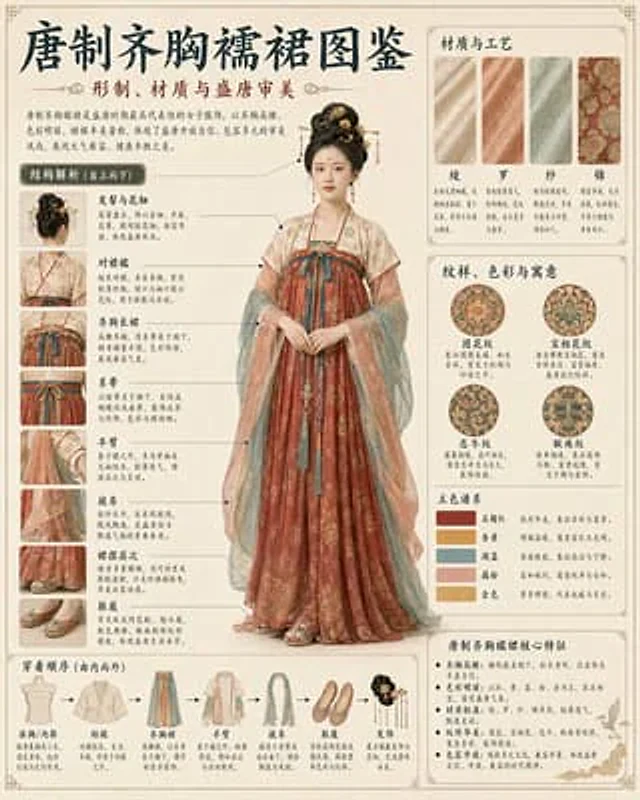

```text
{
  "type": "Infographic Poster",
  "style": "Traditional Chinese aesthetics, elegant layout, and delicate ink painting illustrations",
  "background": "{argument name=\"background style\" default=\"Vintage textured paper\"}",
  "header": {
    "main_title": "{argument name=\"main title\" default=\"Tang Dynasty Style Qi-Xiong Ruqun (a type of traditional Chinese dress) Illustrations\"}",
    "subtitle": "Form, Material and the Aesthetics of the High Tang Dynasty",
    "intro_text": "A paragraph describing its historical significance."
  },
  "centerpiece": {
    "description": "Wearing{argument name=\"garment style\" default=\"Tang Dynasty style high-waisted ruqun\"} Full-body portrait of a beautiful young woman",
    "details": "An exquisite high bun adorned with a gold hairpin;{argument name=\"main color\" default=\"Pomegranate Red\"} Floral skirt hem{argument name=\"secondary color\" default=\"Lake Blue\"} She wore a light shawl and had a serene expression."
  },
  "layout": {
    "left_column": {
      "title": "Structural analysis (top to bottom)",
      "count": 8,
      "format": "Thumbnails with titles and descriptions",
      "labels": [
        "Hair bun and floral decorations",
        "Front-opening blouse",
        "Long dress",
        "Lace",
        "half-arm",
        "shawl",
        "Skirt layers",
        "Footwear"
      ]
    },
    "right_column": [
      {
        "title": "Materials and Craftsmanship",
        "count": 4,
        "format": "Vertical texture samples with text",
        "labels": [
          "Aya",
          "Luo",
          "yarn",
          "Brocade"
        ]
      },
      {
        "title": "Patterns, colors and symbolism",
        "count": 4,
        "format": "Circular pattern illustration with text",
        "labels": [
          "floral pattern",
          "Lotus Flower Pattern",
          "Honeysuckle pattern",
          "beaded pattern"
        ]
      },
      {
        "title": "Main chromatographic system",
        "count": 5,
        "format": "Rectangular color blocks with text",
        "labels": [
          "Pomegranate Red",
          "Apricot Yellow",
          "Lake Blue",
          "lotus root starch",
          "gold"
        ]
      }
    ],
    "bottom_section": [
      {
        "title": "Dressing order (from inside to outside)",
        "count": 7,
        "format": "Step-by-step clothing illustrations connected by arrows",
        "labels": [
          "Bandeau top/innerwear",
          "short blouse",
          "High-waisted skirt",
          "half-arm",
          "shawl",
          "Footwear",
          "hair accessories"
        ]
      },
      {
        "title": "Core features of Tang Dynasty high-waisted ruqun",
        "count": 5,
        "format": "Bullet text list"
      }
    ]
  }
}
```

Model: GPT Image 2
Author: GPT Image 2 Prompts

[ProjectD](https://aitoolsradar.com/en/prompts/fed0bc8f59e8d3) · [Recorded source](https://x.com/llinze521/status/2046199980059418936#reversed-2)
 · [Full original metadata and byte evidence](data/projectd-batch-0050.json)

## Train Photography Game Simulation


```text
A{argument name="theme" default="Train photography"} Game screenshots with the theme
```

Model: GPT Image 2
Author: GPT Image 2 Prompts

[ProjectD](https://aitoolsradar.com/en/prompts/bc2eb612bb562d) · [Recorded source](https://x.com/chitte_101/status/2046919294051844331)
 · [Full original metadata and byte evidence](data/projectd-batch-0050.json)

## Train Photography Game Simulation

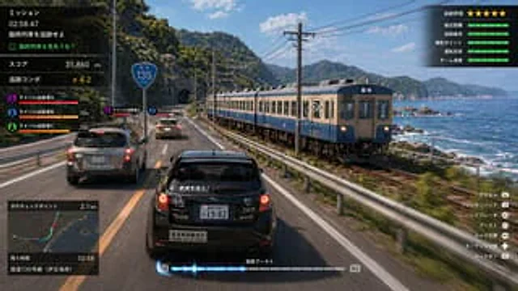

```text
{argument name="テーマ" default="撮り鉄"}をテーマにしたゲームのキャプチャー
```

Model: GPT Image 2
Author: ちって

[ProjectD](https://aitoolsradar.com/en/prompts/2d4cd3d95069fc) · [Recorded source](https://youmind.com/prompts/train-spotting-photography-game-14798)
 · [Full original metadata and byte evidence](data/projectd-batch-0050.json)

## Transformers Space Scenes Prompt

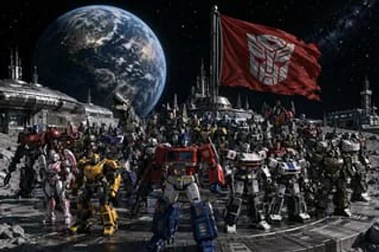

```text
Image 1: All{argument name="faction A" default="Autobots"} Gathering at the lunar base, with Earth suspended in the starry sky in the background, and the Cybertron flag fluttering. Image 2: All{argument name="faction B" default="Decepticons"} Line up on the deck of the alien warship, Megatron sat on his throne overlooking the entire army.
```

Model: GPT Image 2
Author: GPT Image 2 Prompts

[ProjectD](https://aitoolsradar.com/en/prompts/c90512a13d9d1c) · [Recorded source](https://x.com/songguoxiansen/status/2046952548469530716)
 · [Full original metadata and byte evidence](data/projectd-batch-0050.json)

## Translate Japanese manual into Chinese leaflet


```text
Referring to the provided reference images, recreate a clean, locally translated product manual in Traditional Chinese. Maintain the original page layout, product photos, chapter structure, orange rounded corner titles, and overall manual composition. Replace all Japanese text with fluent Traditional Chinese that is accurate in meaning and consistent in format. Update the main title to a bold Traditional Chinese title at the top of the page. Retain the four orange chapter columns and their positions, keeping the same image layout: two product usage photos at the top, a row of paint bottle photos in the second section, a close-up of the speed control knob in the third section, two accessory photos in the lower left corner, and a photo of the product being held in the lower right corner. In the speed section, translate the three color-coded speed labels into Traditional Chinese, maintaining their blue, yellow, and red visual distinction. Replace the small orange label on the right with a more refined Traditional Chinese promotional badge. This will make the entire page look cleaner, clearer, and more professionally formatted, presenting a polished product manual rather than the original scanned copy.
```

Model: GPT Image 2
Author: GPT Image 2 Prompts

[ProjectD](https://aitoolsradar.com/en/prompts/0a6f4ed09f7fd1) · [Recorded source](https://x.com/CashWuGeek/status/2046958921630511229#reversed-1)
 · [Full original metadata and byte evidence](data/projectd-batch-0050.json)

## Transparent background soccer player


```text
Create a transparent background image, with the main subject being {argument name="subject" default="A man playing football"} The aspect ratio is{argument name="aspect ratio" default="3:2"} .
```

Model: GPT Image 2
Author: GPT Image 2 Prompts

[ProjectD](https://aitoolsradar.com/en/prompts/381c82449149c1) · [Recorded source](https://x.com/patrickassale/status/2046673981457969594)
 · [Full original metadata and byte evidence](data/projectd-batch-0050.json)

## Transparent Labs Hydrate 健身补剂 Campaign

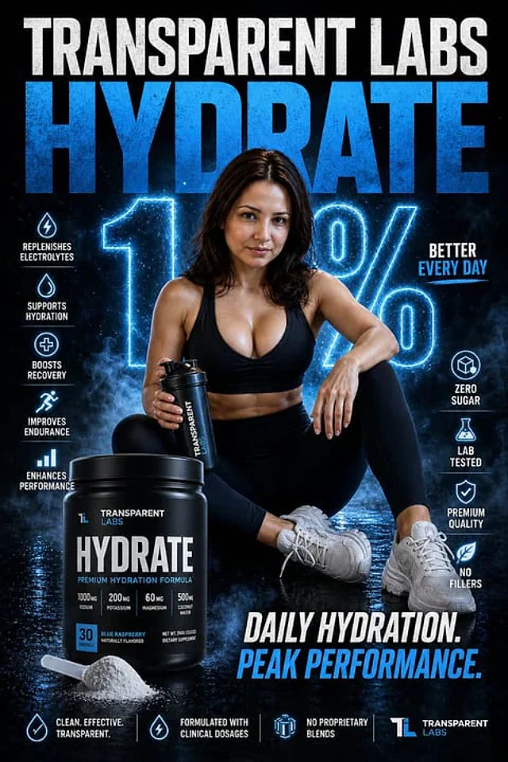

```text
Create a striking campaign poster that stops people mid-scroll for Transparent Labs Hydrate.

Bold high-impact supplement advertisement with dramatic black and deep electric blue color palette, gritty premium fitness aesthetic, sharp cinematic lighting, glossy reflections, light smoke atmosphere, intense contrast.

Giant headline typography at top reading “TRANSPARENT LABS HYDRATE” in oversized distressed white and electric blue text.

Center composition features the exact woman from the attached reference image as a fit athletic female model seated confidently on a studio floor, holding a shaker bottle, with a focused and powerful expression.

Change her clothes into sleek black fitness gym outfit: a black sports bra / tank top and high-waisted black leggings with chunky white sneakers. Large glowing “1%” graphic behind the subject symbolizing daily progress.

Front left foreground shows a matte black Transparent Labs Hydrate tub with modern luxury label reading “HYDRATE”, scoop of electrolyte powder spilled beside the container.

Surround the poster with clean icon-based benefit callouts: replenishes electrolytes, supports hydration, boosts recovery, improves endurance, enhances performance, zero sugar, lab tested, premium quality, no fillers. Strong motivational copy such as “Daily Hydration. Peak Performance.”

Hyper realistic textures, polished commercial retouching, premium sports nutrition branding, modern typography layout, social media ad format, ultra detailed, high resolution.
```

Model: GPT Image 2
Author: @amynys

[ProjectD](https://aitoolsradar.com/en/prompts/07ed68cf7f3b00) · [Recorded source](https://x.com/amynys/status/2051409591137972606)
 · [Full original metadata and byte evidence](data/projectd-batch-0050.json)

## Travel Advertisement Web Banner


```text
{
  "type": "Tourism advertising banners",
  "background": "{argument name=\"destination scene\" default=\"The Mediterranean coast boasts stunning scenery, with turquoise waters, cliffside villages, and winding roads.\"} A bright, sunny day; a sun halo in the upper right corner; and pink bougainvillea in the lower right corner.",
  "foreground": "{argument name=\"vehicle\" default=\"A retro light blue car with a brown suitcase strapped to the trunk.\"} Driving on the coastal highway",
  "layout": {
    "typography": [
      {
        "type": "main headline",
        "text": "{argument name=\"main headline\" default=\"Embark on a spontaneous trip.\"}",
        "style": "Large serif font, dark blue to cyan gradient, left-aligned."
      },
      {
        "type": "subheadline",
        "text": "{argument name=\"subheadline\" default=\"Embark on unseen adventures and begin your next holiday.\"}",
        "style": "Medium serif font, dark blue, decorated with decorative lines and stars on both sides."
      },
      {
        "type": "accent text",
        "text": "Set off to explore the world.",
        "style": "Handwritten style, cyan, with dotted flight paths and airplane icons."
      }
    ],
    "ui_elements": [
      {
        "type": "badge",
        "position": "Top right corner",
        "shape": "round",
        "text": "Make the weekend an unforgettable memory."
      },
      {
        "type": "cta button",
        "position": "bottom left corner",
        "style": "Pill-shaped, with a gradient from blue to green.",
        "text": "{argument name=\"cta text\" default=\"View Now\"}"
      }
    ],
    "feature_bar": {
      "position": "bottom",
      "count": 3,
      "items": [
        {
          "icon": "globe",
          "text": "Numerous stunning scenic spots"
        },
        {
          "icon": "camera",
          "text": "Leave an unforgettable experience"
        },
        {
          "icon": "suitcase",
          "text": "You can leave on the weekend."
        }
      ]
    }
  }
}
```

Model: GPT Image 2
Author: GPT Image 2 Prompts

[ProjectD](https://aitoolsradar.com/en/prompts/e029fd949566f5) · [Recorded source](https://x.com/masapark95/status/2046168679822594059#reversed-1)
 · [Full original metadata and byte evidence](data/projectd-batch-0050.json)

## Travel Journal Scrapbook Infographic

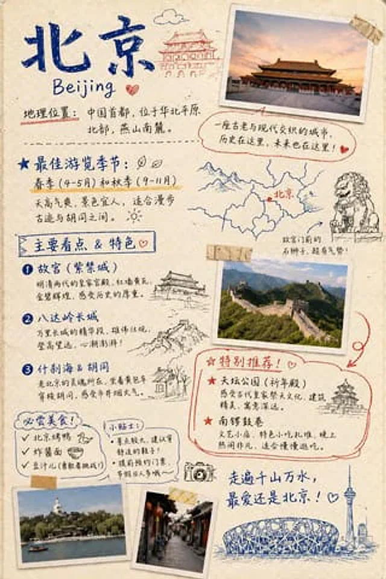

```text
{ "type": "Travel Journal Page", "style": "Hand-drawn bullet journal, textured beige paper background, blue and red ink handwriting, masking tape, Polaroid-style photos, sketches and doodles", "header": { "title": "{argument name="city name" default="Beijing"} ", "subtitle": "{argument name="city name english" default="Beijing"} ", "location_text": "Geographical location: Beijing, the capital of China, located in the northern part of the North China Plain, at the southern foot of the Yanshan Mountains.", "doodle": "Traditional Chinese city gate architecture" }, "photos": { "count": 4, "descriptions": [ "The Forbidden City at sunset, with masking tape", "Great Wall scenery, with masking tape", "White Pagoda in Beihai Park", "Traditional hutongs and alleys filled with red lanterns" ] }, "layout": { "sections": [ { "title": "Best time to visit:", "position": "mid-left", "labels": [ "Spring (April-May) and Autumn (September-November)" ], "doodles": [ "Two leaves", "Sun" ] }, { "title": "Map and stone lions", "position": "mid-right", "labels": [ "Beijing", "The stone lions in front of the Forbidden City are very imposing!" { " ], "doodles": [ "Map with red dots", "Stone lions" ] }, { "title": "Key Highlights &amp; Features", "position": "left-middle", "count": 3, "labels": [ "{argument name="main attraction 1" default="The Forbidden City"} ", "{argument name="main attraction 2" default="Badaling Great Wall"} { "title": "Highly Recommended!", "position": "bottom-right", "count": 2, "labels": [ "Temple of Heaven Park (Hall of Prayer for Good Harvests)", "Nanluoguxiang"], "doodles": [ "Temple of Heaven"], "style": "Red Ink Outline" }, { "title": "Must-Try Food!", "position": "bottom-left", "count": 3, "labels": [ "{argument name="must try food 1" default="Peking duck"} { "title": "Tips: ", "position": "bottom-left-center", "count": 2, "labels": [ "The attraction is large, comfortable shoes are recommended!", "Book tickets in advance, it gets crowded on holidays~" ] } ], "footer": { "quote": "Having traveled all over the world, my favorite place is still Beijing!", "doodles": [ "Camera", "Bird's Nest Stadium", "CCTV Tower skyline" ] } }
```

Model: GPT Image 2
Author: GPT Image 2 Prompts

[ProjectD](https://aitoolsradar.com/en/prompts/b30aa48ec3d8aa) · [Recorded source](https://x.com/Nolan_Osi/status/2045945940528509109#reversed-0)
 · [Full original metadata and byte evidence](data/projectd-batch-0050.json)

## Tribal Fantasy Warrior with Guardian Owl

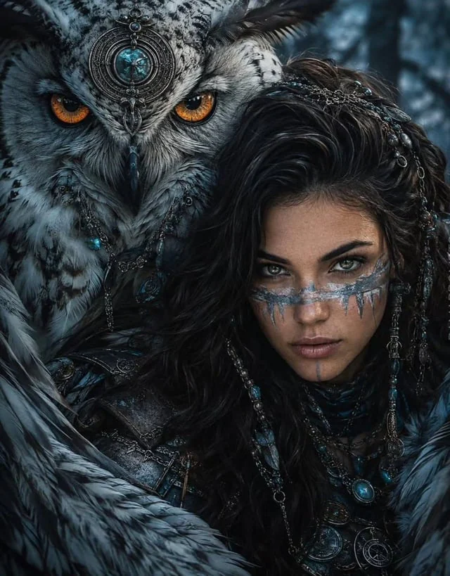

```text
A detailed portrait of a fierce tribal fantasy warrior woman leaning close to a massive, majestic great horned owl, cinematic lighting, dark moody atmosphere. The woman has {argument name="hair style" default="long, wavy dark hair"} adorned with intricate silver chains, beads, and metallic headpieces. She has striking {argument name="eye color" default="light green"} eyes, piercing the camera, with silver and icy-white war paint painted across her cheeks and nose. She wears dark leather armor decorated with silver pendants and turquoise gemstones Beside her the giant owl features sharp {argument name="owl eye color" default="glowing orange"} eyes, patterned white and black feathers and an ornate silver circular medallion studded with a blue crystal resting on its forehead. The background is a shadowy, mystical forest in cool blue and dark gray tones. Highly detailed feathers, hyper-realistic, photorealistic textures, 8k resolution, dramatic dark fantasy aesthetic, masterpiece.
```

Model: GPT Image 2
Author: AqibAi

[ProjectD](https://aitoolsradar.com/en/prompts/fbdaae66171b6a) · [Recorded source](https://youmind.com/prompts/tribal-fantasy-warrior-owl-32213)
 · [Full original metadata and byte evidence](data/projectd-batch-0050.json)

## Triptych Fast-Food Ad Poster

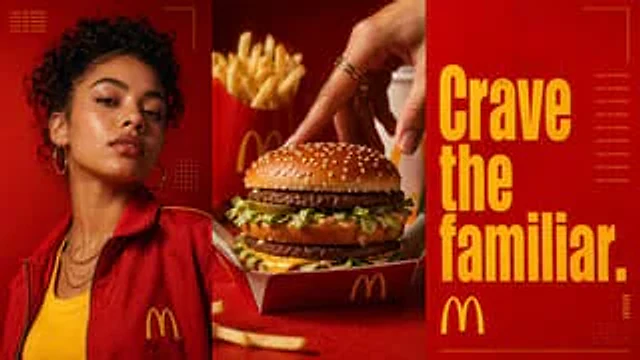

```text
{
  "type": "Triptych Fast Food Advertisement Poster",
  "brand_style": "Eye-catching, high-end McDonald's style advertising art",
  "aspect_ratio": "16:9 Landscape",
  "background": {
    "color": "Deep saturated red",
    "finish": "Smooth studio background with subtle tonal variations"
  },
  "layout": {
    "sections": [
      {
        "title": "Left portrait panel",
        "position": "Left third",
        "count": 1,
        "subject": "A fashionable portrait of a young woman from the chest up, with a distinct vertical soft-edged blurring effect on the center of her face.",
        "details": {
          "hair": "Dark curly hair is styled into an updo, with loose curls framing the head.",
          "jewelry_count": 4,
          "jewelry": [
            "Large gold hoop earring on the left",
            "Large gold hoop earring on the right side",
            "Short gold chain necklace",
            "Long stacked gold chain necklace"
          ],
          "clothing": [
            "Red satin zip-up jacket",
            "Wearing a yellow vest underneath",
            "There is a small gold arch logo on the left chest."
          ],
          "microtext_count": 5,
          "microtext": [
            "crave the familiar.",
            "crave the familiar.",
            "crave the familiar.",
            "crave the familiar.",
            "crave the familiar."
          ],
          "graphic_elements_count": 2,
          "graphic_elements": [
            "The thin yellow corner line pattern near the upper right corner of the panel",
            "The small yellow dot grid near the bottom right corner of the panel"
          ]
        }
      },
      {
        "title": "Central food panel",
        "position": "The middle third",
        "count": 1,
        "subject": "A close-up of the double sesame burger, the main dish, inside an open red cardboard box on a red table.",
        "details": {
          "burger_layers_count": 9,
          "burger_layers": [
            "Sesame bread on top",
            "Top layer beef patty",
            "Pickled cucumber slices",
            "Shredded lettuce",
            "Middle layer bread with sauce",
            "Bottom beef patty",
            "Melted cheese",
            "More lettuce and sauce",
            "Bottom Bread"
          ],
          "hand": "The neatly trimmed woman's hand extends downwards, lightly touching the top of the bread with two fingers, adorned with a delicate gold ring.",
          "background_items_count": 4,
          "background_items": [
            "The red French fry box filled with fries in the top left background",
            "The white beverage cup in the upper right background",
            "A French fry in the foreground of the desktop",
            "A French fry sticking out from the bottom left edge"
          ],
          "lighting": "Dramatic warm-toned studio lighting, glossy food presentation, shallow depth of field"
        }
      },
      {
        "title": "Right-side layout panel",
        "position": "right third",
        "count": 1,
        "subject": "Large slogan layout poster",
        "details": {
          "headline": "{argument name=\"headline text\" default=\"Crave the familiar.\"}",
          "headline_style": "Extra-large, bold sans-serif font, golden yellow, stacked in three lines, filling most of the panel area.",
          "small_text_count": 9,
          "small_text": [
            "crave the familiar.",
            "crave the familiar.",
            "crave the familiar.",
            "crave the familiar.",
            "crave the familiar.",
            "crave the familiar.",
            "crave the familiar.",
            "crave the familiar.",
            "crave the familiar."
          ],
          "brand_marks_count": 4,
          "brand_marks": [
            "The golden arch logo in the lower left corner",
            "The thin yellow corner line pattern near the top right corner",
            "Thin yellow horizontal line near the bottom",
            "Small yellow dot grid with short horizontal bars near the bottom right corner"
          ]
        }
      }
    ],
    "gutters": "Narrow vertical dividers between the three panels"
  },
  "color_palette": {
    "primary": "{argument name=\"background color\" default=\"McDonald&#39;s Red\"}",
    "secondary": "{argument name=\"accent color\" default=\"Golden yellow\"}",
    "supporting": [
      "warm brown skin tone",
      "Gold metallic highlight",
      "Brown toast",
      "Lettuce green"
    ]
  },
  "style": {
    "mood": "Confident, alluring, stylish, editorial style, modern commercial photography",
    "composition": "A simple graphic triptych: fashion on the left, products in the middle, and information on the right.",
    "branding": "Using McDonald's visual language, including the golden arches and packaging.",
    "print_finish": "High-end poster look with high contrast and sharp details"
  },
  "subject_customization": {
    "model_clothing": "{argument name=\"jacket color\" default=\"Red satin\"}",
    "food_item": "{argument name=\"burger type\" default=\"Big Mac style double burger\"}"
  }
}
```

Model: GPT Image 2
Author: GPT Image 2 Prompts

[ProjectD](https://aitoolsradar.com/en/prompts/0a8c70911c0632) · [Recorded source](https://x.com/dcbruck/status/2046995916297548207#reversed-2)
 · [Full original metadata and byte evidence](data/projectd-batch-0050.json)

## Triptych Sports Ad Poster

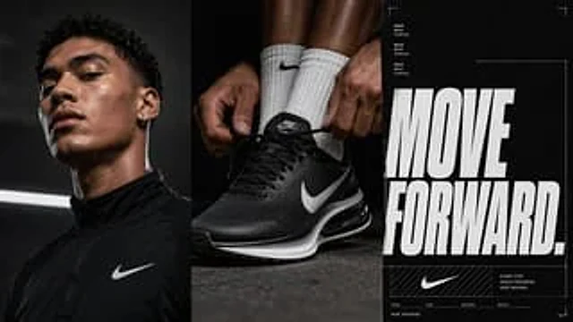

```text
{
  "type": "Triptych sports advertisement poster",
  "brand_style": "High-end sports marketing style inspired by Nike Studios advertising",
  "subject": {
    "left_panel": {
      "type": "Athlete portrait",
      "gender_presentation": "masculinity",
      "visible_count": 1,
      "skin_tone": "Dark brown",
      "hair": "Short and tight curls",
      "wardrobe": "Black zip-up professional training top with a white Swoosh logo on the chest.",
      "pose": "The cut from the upper chest to the top of the head, with the head slightly turned to the side.",
      "lighting": "Emotional studio contour lighting, a sweaty sheen on the neck and chin, a dark background, and a diagonal white light strip behind."
    },
    "center_panel": {
      "type": "Product Action Close-up",
      "visible_count": 1,
      "focus": "Black Nike running shoes with a white Swoosh and visible Air cushioning.",
      "styling": "White ribbed mid-calf socks with black Swoosh",
      "hands_count": 2,
      "action": "Hands were tying shoelaces, feet were on the dark textured gym floor.",
      "camera": "Low-angle macro-style product photography, emphasizing shoe shape, mesh texture, shoelaces, and sole."
    },
    "right_panel": {
      "type": "Poster layout",
      "headline": "{argument name=\"headline text\" default=\"MOVE FORWARD.\"}",
      "small_text_count": 8,
      "small_text": [
        "MOVE WITH PURPOSE.",
        "MOVE WITH PURPOSE.",
        "MOVE WITH PURPOSE.",
        "EVERY STEP MAKES PROGRESS. KEEP MOVING.",
        "TRAIN",
        "RUN",
        "RECOVER",
        "REPEAT"
      ],
      "brand_line": "NIKE TRAINING",
      "logo_count": 1,
      "style": "An oversized, distressed white, compressed sans-serif title against a black background; small functional text; thin white borders and corner cropping marks; and a box logo area with a diagonal shadow pattern at the bottom."
    }
  },
  "layout": {
    "panel_count": 3,
    "orientation": "Vertical triptych",
    "panel_widths": "Three rectangular panels of equal width and height",
    "gutter": "Narrow dark dividing line",
    "overall_composition": "The left side features a portrait of an athlete, the middle side shows a close-up of someone tying their shoelaces, and the right side features an inspirational section."
  },
  "art_direction": {
    "palette": "Black, charcoal gray, white, and subtle warm brown skin tones",
    "mood": "Focused, determined, high-performance, cinematic",
    "lighting": "The studio lighting is understated yet dramatic, featuring sharp highlights and deep shadows.",
    "texture": "Sweat-repellent sheen, mesh upper, rubber sole, matte finish with a grainy texture",
    "finish": "Editor-level commercial sports ads, ultra-detailed, sharp, and realistic."
  }
}
```

Model: GPT Image 2
Author: GPT Image 2 Prompts

[ProjectD](https://aitoolsradar.com/en/prompts/046d61b82d4013) · [Recorded source](https://x.com/dcbruck/status/2046995916297548207#reversed-3)
 · [Full original metadata and byte evidence](data/projectd-batch-0050.json)

## Triptych Sports Ad Poster


```text
{"type":"triptych sports advertising poster","brand_style":"premium athletic campaign inspired by Nike studio advertising","subject":{"left_panel":{"type":"athlete portrait","gender_presentation":"masculine","visible_count":1,"skin_tone":"deep brown","hair":"short tight curls","wardrobe":"black zip-up performance training top with a white swoosh logo on the chest","pose":"cropped from upper chest to top of head, head turned slightly to the side","lighting":"moody studio rim light with sweat sheen on neck and jaw, dark background with a single diagonal white light bar behind"},"center_panel":{"type":"product action close-up","visible_count":1,"focus":"black Nike running shoe with white swoosh and visible air cushioning","styling":"white ribbed crew sock with black swoosh","hands_count":2,"action":"both hands tightening the shoelaces while the foot is planted on a dark textured gym floor","camera":"low-angle macro-style product shot emphasizing the shoe shape, mesh texture, laces, and sole"},"right_panel":{"type":"typographic poster","headline":"{argument name=\"headline text\" default=\"MOVE FORWARD.\"}","small_text_count":8,"small_text":["MOVE WITH PURPOSE.","MOVE WITH PURPOSE.","MOVE WITH PURPOSE.","EVERY STEP MAKES PROGRESS. KEEP MOVING.","TRAIN","RUN","RECOVER","REPEAT"],"brand_line":"NIKE TRAINING","logo_count":1,"style":"oversized distressed white condensed sans-serif headline on black background, small utility text, thin white framing lines and corner crop marks, lower boxed logo area with diagonal hatch pattern"}},"layout":{"panel_count":3,"orientation":"vertical triptych","panel_widths":"three equal tall panels","gutter":"narrow dark dividers","overall_composition":"left athlete portrait, center shoe-lacing close-up, right motivational typography block"},"art_direction":{"palette":"black, charcoal, white, subtle warm brown skin tones","mood":"focused, determined, high-performance, cinematic","lighting":"low-key dramatic studio lighting with crisp highlights and deep shadows","texture":"sweat sheen, mesh shoe fabric, rubber sole, matte poster grain","finish":"editorial commercial sports campaign, ultra-detailed, sharp, realistic"}}
```

Model: GPT Image 2
Author: Drew Brucker

[ProjectD](https://aitoolsradar.com/en/prompts/4e738f1ffd826d) · [Recorded source](https://youmind.com/prompts/triptych-sports-ad-poster-15089)
 · [Full original metadata and byte evidence](data/projectd-batch-0050.json)

## Trompe L'oeil Sketchbook Drawing

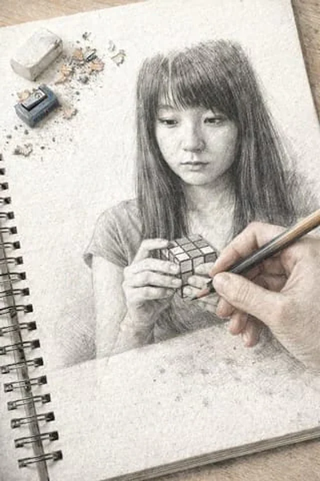

```text
A hyperrealistic trompe-l'œil painting depicts a spiral-bound sketchbook resting on a wooden table. On one page of the sketchbook is a highly detailed graphite pencil drawing depicting a {argument name="subject description" default="Young Asian woman with straight black hair and bangs"} She was deep in thought, holding a {argument name="object held" default="rubik&#39;s cube"} From the bottom right corner, a realistic human hand enters the picture, holding a wooden pencil, as if drawing the sketch. In the upper left corner of the textured paper, there is a rectangular white eraser, a small blue metal pencil sharpener, and scattered pencil shavings. The transition between the realistic hand and the graphite sketch creates a seamless visual illusion.
```

Model: GPT Image 2
Author: GPT Image 2 Prompts

[ProjectD](https://aitoolsradar.com/en/prompts/b1b80561941377) · [Recorded source](https://x.com/Kukkuree/status/2043525834640613591#reversed-0)
 · [Full original metadata and byte evidence](data/projectd-batch-0050.json)

## Tropical Citrus Soda Ad Poster

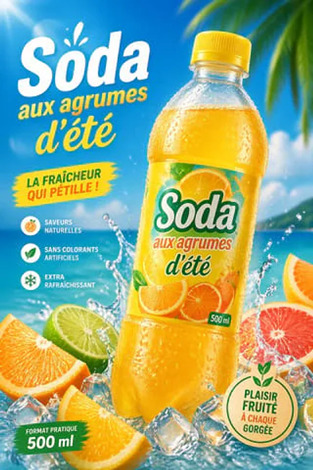

```text
Create a vibrant tropical commercial poster showcasing a bottle of citrus soda, using a bright summer advertising style. Place a bottle {argument name="product name" default="Soda"} The plastic bottle is positioned slightly to the right of center in the image, tilted slightly to the left; the cap is yellow, and the transparent bottle is covered with cold condensation droplets, filled with a shimmering golden-orange soda. The label should feature orange slices and citrus images, along with the brand name.{argument name="product name" default="Soda"} The bottle features the phrase "aux agrumes d'été" and a small green "500 ml" logo. The background uses a sunny beach with a clear blue sky, turquoise ocean, soft clouds, and a blurred tropical palm leaf extending from the upper right corner. Dynamic splashes of water and scattered clear ice cubes are added around the bottom of the bottle, while five clearly visible citrus fruits are placed in the foreground: two orange segments, half a lime, half a grapefruit, and a slice of orange on the far right edge. The prominent French promotional text on the left reads: a large white title.{argument name="headline text" default="Soda"} The design features a small splash of water above and the handwritten yellow text "aux agrumes d'été" below. A yellow brushstroke badge with the text "LA FRAÎCHEUR QUI PÉTILLE!" is added to the center left. A vertical function list with three circular icons and French descriptions is added to the lower left: "SAVEURS NATURELLES", "SANS COLORANTS ARTIFICIELS", and "EXTRA RAFRAÎCHISSANT". A green brushstroke banner with the text "FORMAT PRATIQUE 500 ml" is added to the lower left. A circular beige eco-style stamp with a green outline and leaf pattern, containing the text "...", is added to the lower right.{argument name="seal text" default="PLAISIR FRUITÉ À CHAQUE GORGÉE"} The light effect presents a glossy and high-energy appearance, with a strong solar halo in the upper left corner. The colors are saturated, the packaging details are clear, the water droplets are realistic, and it has the texture of a sophisticated supermarket advertisement.
```

Model: GPT Image 2
Author: GPT Image 2 Prompts

[ProjectD](https://aitoolsradar.com/en/prompts/a1db073f6029c4) · [Recorded source](https://x.com/edimakorfr/status/2047635133466124726#reversed-1)
 · [Full original metadata and byte evidence](data/projectd-batch-0050.json)

## Tropical Macaw Magazine Cover

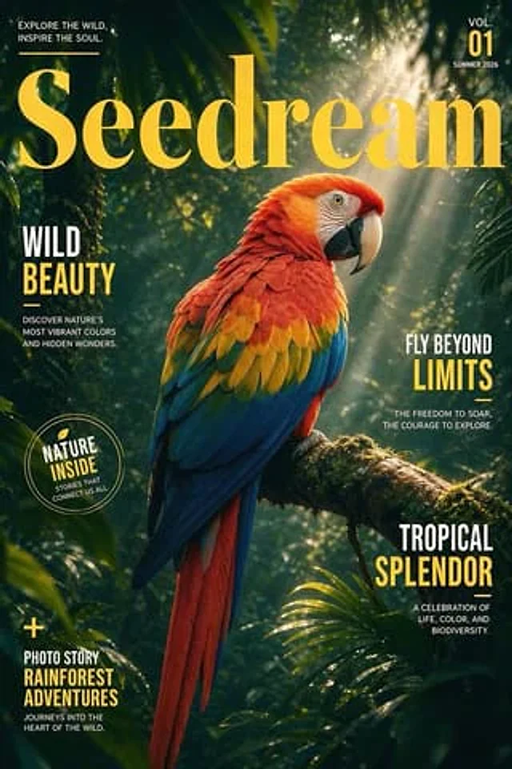

```text
Goal: Create a vertical tropical wildlife magazine cover featuring a vivid scarlet macaw in a rainforest, with bold editorial typography and a premium adventure-nature aesthetic.

Canvas: Portrait magazine cover, 2:3 aspect ratio. Dark lush jungle background with dense green leaves, palm fronds, mossy branches, atmospheric haze, and warm sunbeams streaming diagonally from the upper right. High-contrast cinematic lighting, realistic photography style, sharp bird detail, soft depth of field in the background.

Main subject: One large scarlet macaw perched on a moss-covered branch angled from lower right toward center. The parrot faces right in three-quarter profile, with a pale curved beak, detailed eye rings, red head and chest feathers, orange-yellow wing transitions, green accents, deep blue wing feathers, and long red tail feathers extending downward. The bird occupies the center and lower center, overlapping the title slightly.

Masthead and issue text: Place a huge elegant serif masthead reading {argument name="magazine title" default="Seedream"} across the upper third in warm golden yellow, spanning nearly the full width. In the top left, small white uppercase tagline: “EXPLORE THE WILD, INSPIRE THE SOUL.” with a thin yellow horizontal line beneath. In the top right, compact issue block: “VOL.” above large yellow “01”, with “SUMMER 2026” below in white.

Cover lines: Include exactly 5 editorial cover-line groups plus 1 circular badge and 1 plus sign feature marker. Use condensed bold uppercase sans-serif typography, mostly white with key words in golden yellow.

1. Left middle cover line: “WILD” in white, “BEAUTY” in yellow, short yellow underline, then small white text: “DISCOVER NATURE’S MOST VIBRANT COLORS AND HIDDEN WONDERS.”
2. Right middle cover line: “FLY BEYOND” in white, “LIMITS” in yellow, short yellow underline, then small white text: “THE FREEDOM TO SOAR, THE COURAGE TO EXPLORE.”
3. Lower right cover line: “TROPICAL” in white, “SPLENDOR” in yellow, short yellow underline, then small white text: “A CELEBRATION OF LIFE, COLOR, AND BIODIVERSITY.”
4. Lower left feature line beneath a yellow plus sign: “PHOTO STORY” in white, “RAINFOREST ADVENTURES” in yellow, then small white text: “JOURNEYS INTO THE HEART OF THE WILD.”
5. Circular badge on left lower-middle: thin double-line yellow circle containing a small leaf icon, “NATURE” in white, “INSIDE” in yellow, and tiny curved/supporting white text: “STORIES THAT CONNECT US ALL.”

Visual style: Editorial wildlife magazine cover, realistic luxury travel photography, deep forest greens, golden-yellow typography, crisp print design, balanced asymmetrical layout, dramatic backlight, subtle lens glow, mist, and high detail in feathers and leaves.

Constraints: Keep all text legible and correctly spelled. Do not add barcodes, pricing, QR codes, watermarks, extra birds, people, or additional cover lines. Maintain a polished professional magazine-cover composition.
```

Model: GPT Image 2
Author: 小互

[ProjectD](https://aitoolsradar.com/en/prompts/c901dd4261d5fe) · [Recorded source](https://youmind.com/prompts/scarlet-macaw-magazine-cover-28029)
 · [Full original metadata and byte evidence](data/projectd-batch-0050.json)

## Tropical Product Photography

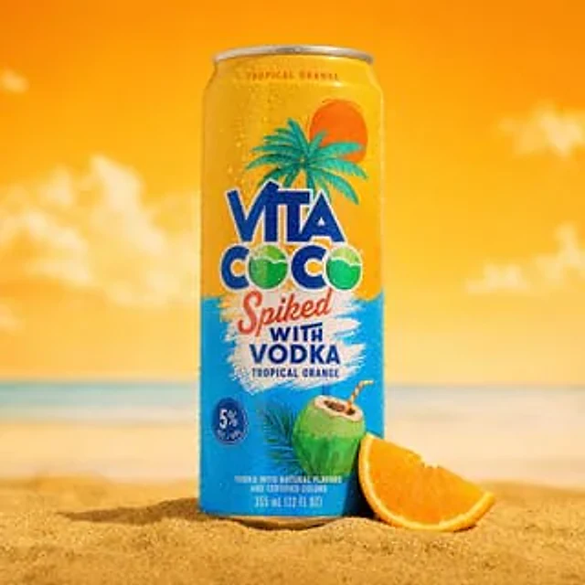

```text
A professional commercial product photograph, with the subject being{argument name="product" default="Iced sparkling water jug"} Placed vertically{argument name="setting" default="Golden Beach"} Above. The body of the can is{argument name="branding colors" default="silver and cyan"} The surface is covered with realistic condensation droplets, printed with a pineapple illustration and a tropical-style brand logo. The can is slightly tilted, nestled in soft, golden sand, with small white pebbles and green tropical leaves/grass scattered around the base. The background employs a bold, segmented composition—a bright sky blue on the left, a vibrant yellow on the right, and a blurred, realistic pineapple placed in the right rear. A blurred tropical palm leaf hangs from the upper left corner, adding depth and framing to the image. Macro-level condensation droplets are visible on the can's surface. The lighting is bright and vibrant, typical of commercial studio lighting, with clean, crisp shadows. Shallow depth of field—the can is in sharp focus, while the background is softly blurred. Atmosphere: Summer, tropical, fresh, invigorating. Commercial product photography, ultra-high detail, 8K resolution.
```

Model: GPT Image 2
Author: GPT Image 2 Prompts

[ProjectD](https://aitoolsradar.com/en/prompts/ab56d5a1714a8d) · [Recorded source](https://x.com/meng_dagg695/status/2047227172486824002)
 · [Full original metadata and byte evidence](data/projectd-batch-0050.json)

## Tropical Resort Travel Ad Banner


```text
{
  "type": "Tourism advertising webpage banner",
  "scene": {
    "setting": "{argument name=\"destination type\" default=\"Tropical Water Bungalow Resort\"}",
    "background": "Turquoise seawater, blue sky, fluffy clouds, palm trees, sailboats in the distance, and two airplanes with dotted flight paths.",
    "foreground_right": "Wooden deck, two deck chairs, white cushions, blue towels, straw hats, round table, blue tropical drinks, frangipani flowers, and pink hibiscus decorations along the edges."
  },
  "layout": {
    "text_overlay": {
      "position": "Left and Middle",
      "elements": [
        {
          "type": "top_text",
          "text": "{argument name=\"top text\" default=\"Embark on the next journey.\"}",
          "decoration": "airplane icon, dotted line"
        },
        {
          "type": "main_headline",
          "text": "{argument name=\"main headline\" default=\"Go and discover this beautiful scenery.\"}",
          "style": "Large blue gradient serif font"
        },
        {
          "type": "subheadline",
          "text": "{argument name=\"subheadline\" default=\"Escape the daily grind and enjoy a relaxing vacation.\"}",
          "decoration": "Gold decorative swirling pattern"
        },
        {
          "type": "cta_button",
          "text": "{argument name=\"button text\" default=\"View Now\"}",
          "style": "Blue-cyan gradient pill shape, right arrow"
        }
      ]
    },
    "bottom_features": {
      "position": "Bottom left",
      "count": 3,
      "items": [
        {
          "icon": "Palm trees and waves",
          "label": "Stunning vacation destinations"
        },
        {
          "icon": "Waterfront House",
          "label": "Exceptional accommodation experience"
        },
        {
          "icon": "suitcase",
          "label": "Suitable for weekend outings"
        }
      ]
    }
  }
}
```

Model: GPT Image 2
Author: GPT Image 2 Prompts

[ProjectD](https://aitoolsradar.com/en/prompts/8cfa904e47e7fb) · [Recorded source](https://x.com/masapark95/status/2046168679822594059#reversed-2)
 · [Full original metadata and byte evidence](data/projectd-batch-0050.json)

## True Crime Investigation Thumbnail


```text
A YouTube thumbnail-style collage, themed as{argument name="overall mood" default="Dark, dramatic, real crime investigation"} The center is a highly detailed image.{argument name="central figure" default="An elderly man with gray hair and a face full of deep wrinkles, who bore a striking resemblance to Jeffrey Epstein."} A close-up portrait of him, wearing a black polo shirt with a faint red glowing outline around the edge, distinguishing it from the background. On the left is {argument name="left background scene" default="A tropical island with luxurious villas, with an airplane flying in the dark sky."} There's a conspiracy theory beneath the island.{argument name="board" default="project"} The theme consists of two red thumbtacks connected by three thick red lines. The upper right corner is {argument name="right background scene" default="The U.S. Capitol Building is bathed in a hazy, brownish hue, with silhouettes of three men in suits in the foreground."} In the bottom right corner is an open Manila folder, containing {argument name="document type" default="A heavily altered file, marked with thick black marker lines, and a smaller photograph of the man."} The overall composition has a cinematic feel and a strong visual impact, specifically designed for the stylization of documentary videos.
```

Model: GPT Image 2
Author: GPT Image 2 Prompts

[ProjectD](https://aitoolsradar.com/en/prompts/6e2b313fd68b6e) · [Recorded source](https://x.com/mirochill/status/2044156286036590976#reversed-0)
 · [Full original metadata and byte evidence](data/projectd-batch-0050.json)

## Trump and Kim Livestream PK Screenshot


```text
1、生成特朗普和金正恩在抖音直播间打PK的截图  
2、生成不知火舞的小红书主页截图  
3、生成图片: 手写在教室黑板上的出师表全文,真实感的粉笔字迹,晴朗白天用iPhone手机实拍  
4、生成图片: T-800机器人的淘宝商品详情页,展示: 机器人的正面侧面背面三视图, 产品价格, 产品细节, 功能和使用场景等
```

Model: GPT Image 2
Author: @alanlovelq

[ProjectD](https://aitoolsradar.com/en/prompts/def299cb2c60e4) · [Recorded source](https://x.com/alanlovelq/status/2046048929490612464)
 · [Full original metadata and byte evidence](data/projectd-batch-0050.json)

## Turkish Grandma Pouring Tea

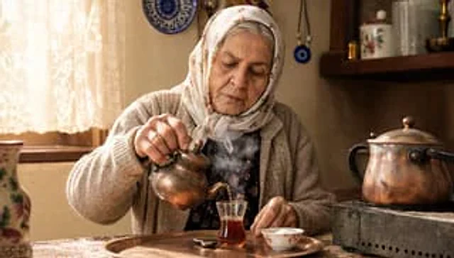

```text
Create a cinematic photorealistic scene of a {argument name="character description" default="78-year-old Turkish grandmother"} seated at a kitchen table in a warm nostalgic 1980s Istanbul home. She wears a white floral yazma headscarf tied under the chin, a thick beige knitted cardigan, and a dark floral dress. Her face is intentionally obscured by a plain rectangular skin-toned privacy block covering the central face area, while gray hair is faintly visible at the hairline. She carefully pours steaming dark Turkish tea from the small upper copper teapot of a traditional double çaydanlık into one tulip-shaped glass tea cup on a round copper tray. Include exactly 4 main tabletop tea objects: the small copper teapot in her hand, one filled tulip tea glass, one small white porcelain cup with red decoration, and one teaspoon resting on the tray. To the right, show the larger copper kettle sitting on a black metal stove. The setting includes lace curtains glowing with strong sunlight on the left, visible floating dust and steam, warm beige plaster walls, a wooden shelf with old kitchen containers, one blue-and-white decorative wall plate, one blue evil-eye charm, and a partially visible floral ceramic vase at the far left. Use golden-hour window light, warm amber-brown color grading, shallow depth of field, realistic textures, aged copper reflections, gentle film grain, documentary-style composition, 16:9 horizontal framing. No text, no watermark, no modern appliances, no extra people.
```

Model: GPT Image 2
Author: Ozan Sihay

[ProjectD](https://aitoolsradar.com/en/prompts/6bfb9d9fa4248d) · [Recorded source](https://youmind.com/prompts/turkish-grandma-tea-kitchen-26813)
 · [Full original metadata and byte evidence](data/projectd-batch-0050.json)

## Turkish Market Grocer Realistic Photo

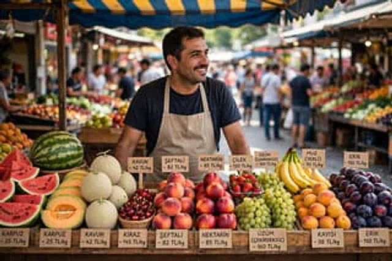

```text
{argument name="ülke" default="Türkiye"}'den bir fotoğraf oluştur. Bir pazar'da tezgahta {argument name="meyveler" default="meyvelerin"} arkasında duran bir manavcı, tezgahta farklı meyveler var, herbirinin adı ve fiyatı yazıyor. Fiyatları güncel olarak arşatır ve Türkiye'ye göre ortalama fiyatlar yazmalısın. {argument name="stil" default="Ultra gerçekçi bir haber fotoğrafı"} olmalı.
```

Model: GPT Image 2
Author: Ozan Sihay

[ProjectD](https://aitoolsradar.com/en/prompts/2b73c7dd170c90) · [Recorded source](https://youmind.com/prompts/turkish-market-grocer-photo-28004)
 · [Full original metadata and byte evidence](data/projectd-batch-0050.json)

## Turn Food Photo Into Japanese Poster

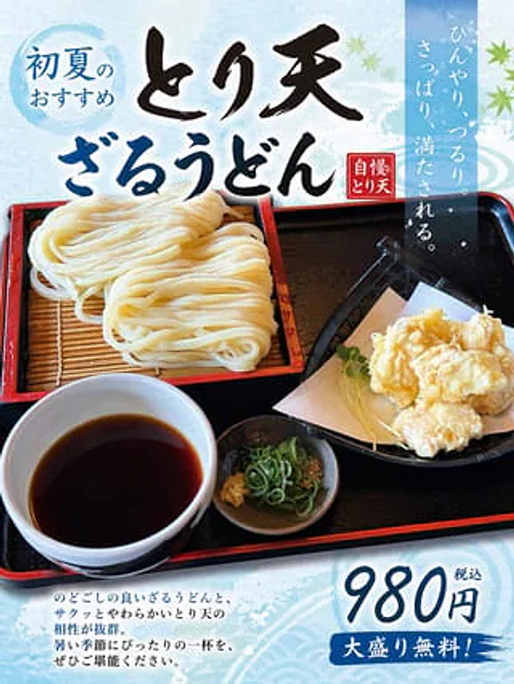

```text
Using the provided udon noodle reference image, transform it into a simple, printable Japanese restaurant promotional poster, retaining the food photo itself as the core element. Vertically expand the composition to a vertical flyer layout, add a light icy blue seasonal background with a subtle watercolor texture and elegant wave pattern, and overlay decorative green maple leaves to create an early summer atmosphere. Add 5 Japanese text elements: a blue circular badge in the top left corner that reads "初夏のおすすめ" (Hatsusumi no Osusumi); two prominent large calligraphy titles at the top, "とり天" (Toriten) and "ざるうどん" (Zarudon); a small red vertical stamp near the titles that reads "自慢のとり天" (Jiman no Toriten); a semi-transparent blue vertical text block in the top right corner that reads "ひんやり、つるり。さっぱり、満たされる。" (Hinyari, tsururi. Sappari, mantasareru.); and a price block in the bottom right corner that reads "980円税込" (980 yen tax included), with a blue brushstroke banner below that that reads "大盛り無料!" (Daishori no ryo!). Add a short 4-line Japanese text in the bottom left corner, describing the dish in a menu poster style. The original food plating and realistic photography effects are retained, but appropriately optimized for advertising needs: making them brighter, more appealing, clearer, and with high contrast. The overall design looks like a beautifully crafted restaurant poster created from a casually taken food photograph.
```

Model: GPT Image 2
Author: GPT Image 2 Prompts

[ProjectD](https://aitoolsradar.com/en/prompts/304093f12c14da) · [Recorded source](https://x.com/takahiko1969/status/2046540251242623459#reversed-0)
 · [Full original metadata and byte evidence](data/projectd-batch-0050.json)

## Tweet Screenshot of QR Code Dice Demo

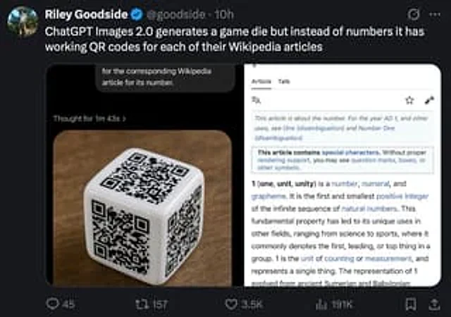

```text
A screenshot of a social media tweet in realistic dark mode, viewed on a desktop interface. The top left corner features a circular profile picture with the name Riley Goodside, a blue verified badge, followed by the account @goodside and a 10h timestamp. The tweet reads: “ChatGPT Images 2.0 generated a game die, but instead of numbers, it provides a QR code for the corresponding Wikipedia article for each number.” Below the tweet is a large embedded image containing two side-by-side panels within a rounded rectangle. The left panel shows a glossy white six-sided die placed on a warm brown wooden tabletop, taken at a slight angle, revealing three faces, each with a different black QR code representing a number; the lighting is soft and realistic, with subtle reflections at the rounded corners of the die. Above the die image is a dark UI title area with the small text “Thought for 1 minute 43 seconds,” and near the top is a cropped speech bubble-like overlay that reads “For the Wikipedia article corresponding to its number.” The right panel is a screenshot of a mobile-style Wikipedia page for the number 1. The background is white with a thin gray border. At the top are the "Entry" and "Discussion" tabs, small interface icons, and the article text beginning with "This entry describes a number. For information on 1 AD and other uses, see One (disambiguation) and Number One (disambiguation)," followed by a box notification about special characters, and the bold opening line "1 (one, unit, uniform) is a number, value, and morpheme." The social media interface surrounding the embedded image uses a near-black background, with standard reply, retweet, like, analysis, bookmark, and share icons at the bottom, displaying 45 replies, 157 retweets, 3.5K likes, and 191K views. The UI layout is clean, resembling a desktop X/Twitter layout, with a realistic screenshot style, high readability, and a subtle sense of compression and screenshot appearance.
```

Model: GPT Image 2
Author: GPT Image 2 Prompts

[ProjectD](https://aitoolsradar.com/en/prompts/3efd8e24f7df42) · [Recorded source](https://x.com/swyx/status/2047140362771132544#reversed-0)
 · [Full original metadata and byte evidence](data/projectd-batch-0050.json)

## Tweet Screenshot With Handwriting Match


```text
A screenshot of a realistic dark-mode social media post, featuring a black interface similar in style to X/Twitter. The top left corner displays a blurry small circular profile picture, next to which is the user's name.{argument name="profile name" default="Pratham"} And a blue verification badge, below which is the account ID.{argument name="handle" default="@Prathkum"} The top right corner features a rounded white "Subscribe" button and two small interface icons. The tweet content uses a large white sans-serif font, and the text reads:{argument name="tweet text" default="ChatGPT Images 2.0 can match your handwriting."} Below is a side-by-side comparison image, composed of two photos of notebooks separated by a narrow black vertical gap. Both photos show an open, horizontally-oriented notebook page taken from above, in dim indoor lighting with soft shadows at the bottom edge. The notebook page on the left is mostly blank, with only two lines of neat blue cursive handwriting at the top:{argument name="handwriting prompt text" default="match my hanawriting ana write a poem for me.."} Please retain spelling errors and punctuation marks to ensure complete consistency with the original text. The top of the notebook page on the right displays the same first two lines of handwritten text, followed by a poem written in matching blue cursive handwriting, filling the page with four stanzas. The poem is as follows:{argument name="poem text" default="between the pages, quiet dreams, where ink becomes the stars, i write what my heart means, and let it heal the scars.

the world may move so fast, but here, time slows its pace. in every line i’ve made to last, i find a softer space.

some days are clouds, some days are sun, but i keep showing up. with every word, i’m not alone— my pen is my cup.

so here’s to thoughts, both big and small, to hopes, to fears, to me. i’ll keep on writing through it all, and set my spirit free."} The handwriting should look natural, slightly uneven, and have a convincing human writing feel, with the texture of a blue ballpoint pen. Add a small flashing icon and the words "Made with AI" in the bottom left corner of the post. Retain the look of a real mobile app screenshot, including realistic spacing, rounded image edges, crisp UI fonts, and subtle screenshot smoothing.
```

Model: GPT Image 2
Author: GPT Image 2 Prompts

[ProjectD](https://aitoolsradar.com/en/prompts/2a5c0d3c6bd534) · [Recorded source](https://x.com/RoundtableSpace/status/2047303224777232740#reversed-0)
 · [Full original metadata and byte evidence](data/projectd-batch-0050.json)

## Tweet Screenshot With Handwriting Match

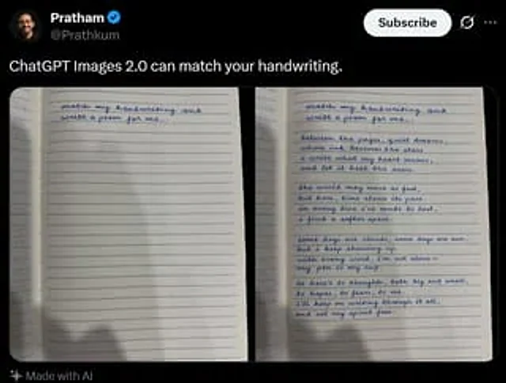

```text
A realistic dark-mode social media post screenshot styled like X/Twitter on a black interface. At the top left is a small blurred circular profile photo beside the display name {argument name="profile name" default="Pratham"} with a blue verification badge, and the handle {argument name="handle" default="@Prathkum"} underneath. At the top right is a rounded white Subscribe button plus two small interface icons. The tweet text in large white sans-serif type reads: {argument name="tweet text" default="ChatGPT Images 2.0 can match your handwriting."} Below it is a side-by-side comparison image made of 2 notebook photos separated by a narrow black vertical gap. Both photos show an open lined notebook page shot from above under dim indoor lighting with soft shadows near the bottom edge. The left notebook page is mostly blank except for 2 handwritten lines in neat blue cursive at the top that say: {argument name="handwriting prompt text" default="match my hanawriting ana write a poem for me.."} Keep the misspellings and punctuation exactly as written. The right notebook page shows the same first 2 handwritten lines at the top, followed by a handwritten poem in matching blue cursive handwriting filling the page in 4 stanzas. The poem text reads exactly: {argument name="poem text" default="between the pages, quiet dreams, where ink becomes the stars, i write what my heart means, and let it heal the scars.

the world may move so fast, but here, time slows its pace. in every line i’ve made to last, i find a softer space.

some days are clouds, some days are sun, but i keep showing up. with every word, i’m not alone— my pen is my cup.

so here’s to thoughts, both big and small, to hopes, to fears, to me. i’ll keep on writing through it all, and set my spirit free."} The handwriting should look natural, slightly uneven, and convincingly human, with blue ballpoint pen texture. At the bottom left of the post, include a small sparkle icon and the words “Made with AI”. Preserve the look of a genuine mobile app screenshot with realistic spacing, rounded image corners, crisp UI typography, and subtle screen-capture softness.
```

Model: GPT Image 2
Author: 0xMarioNawfal

[ProjectD](https://aitoolsradar.com/en/prompts/854549f8fb16d3) · [Recorded source](https://youmind.com/prompts/tweet-handwriting-match-screenshot-15427)
 · [Full original metadata and byte evidence](data/projectd-batch-0050.json)

## Twelve Gold Saints Card Grid

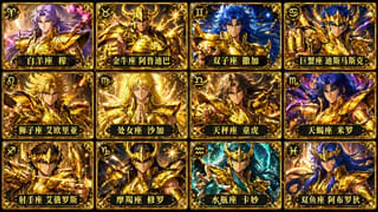

```text
Generate a grid image of the 12 Gold Saints from Saint Seiya, representing the 12 Zodiac cards. Each card is labeled with its corresponding Chinese name. There are 4 cards per row, with an aspect ratio of [missing information].{argument name="aspect ratio" default="16:9"} .
```

Model: GPT Image 2
Author: GPT Image 2 Prompts

[ProjectD](https://aitoolsradar.com/en/prompts/23b85d1b4f43d9) · [Recorded source](https://x.com/songguoxiansen/status/2046476566537080849)
 · [Full original metadata and byte evidence](data/projectd-batch-0050.json)

## Twelve-Wine Sommelier Lineup

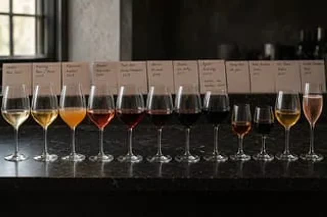

```text
{
  "type": "Photorealistic wine tasting comparison lineup",
  "scene": "A sommelier-style table setting with an atmospheric feel, photographed from bar height, shows 12 wine glasses arranged horizontally on a black marble countertop, each with a handwritten tasting card on a beige paper in front of it.",
  "style": {
    "medium": "High-end editorial food photography",
    "lighting": "Soft natural light from the window on the left, a dimly lit interior atmosphere, realistic reflections on the glass, shallow depth of field, and slightly blurred wine bottles and walls in the background.",
    "mood": "Serious, professional, connoisseur-style, visual contrast test",
    "composition": "The image features a wide, horizontal layout, centered, with cards aligned behind the wine glasses, making all 12 glasses clearly visible."
  },
  "objects": {
    "glasses_count": 12,
    "cards_count": 12,
    "background_elements_count": 3,
    "background_elements": [
      "High window on the left",
      "Dark textured walls",
      "The blurry wine bottle on the right"
    ]
  },
  "layout": {
    "sections": [
      {
        "title": "Wine lineup",
        "position": "Prospect Center",
        "count": 12,
        "labels": [
          "Chablis More 2022",
          "Riesling Beer Mosel 2013",
          "Rkatsiteli Kakheti 2018",
          "Bandol Mourvèdre 2020",
          "Pinot Noir Gevrey-Chambertin 2018",
          "Barolo Brunate 2006",
          "Malbec Uco Valley 2014",
          "Syrah Hermitage 2017",
          "Tawny Port 20 year",
          "Pedro Ximenez Jerez N/V",
          "Vin Jaune Arbois 2010",
          "Vintage Champagne Rosé 2012"
        ]
      }
    ],
    "card_alignment": "Each wine glass has a handwritten card behind it, slightly tilted backward and evenly spaced.",
    "glass_progression": "Starting with light white wines on the left, the wines progress through rosé and red wines in the middle, then to fortified and oxidized wines, ending with rosé champagne on the far right."
  },
  "wines": [
    {
      "name": "Chablis More 2022",
      "glass": "stemmed white wine glass",
      "color": "Light straw yellow",
      "fill_level": "About one-third full"
    },
    {
      "name": "Riesling Beer Mosel 2013",
      "glass": "stemmed white wine glass",
      "color": "Golden yellow",
      "fill_level": "About one-third full"
    },
    {
      "name": "Rkatsiteli Kakheti 2018",
      "glass": "stemmed white wine glass",
      "color": "Deep amber orange",
      "fill_level": "About one-third full"
    },
    {
      "name": "Bandol Mourvèdre 2020",
      "glass": "Large wine glass",
      "color": "The clear pink salmon",
      "fill_level": "About one-third full"
    },
    {
      "name": "Pinot Noir Gevrey-Chambertin 2018",
      "glass": "Large red wine glass",
      "color": "Transparent ruby ​​red",
      "fill_level": "About one-third full"
    },
    {
      "name": "Barolo Brunate 2006",
      "glass": "Large red wine glass",
      "color": "pomegranate red",
      "fill_level": "About one-third full"
    },
    {
      "name": "Malbec Uco Valley 2014",
      "glass": "Large red wine glass",
      "color": "Deep purple-red",
      "fill_level": "About one-third full"
    },
    {
      "name": "Syrah Hermitage 2017",
      "glass": "Large red wine glass",
      "color": "Nearly opaque dark purple",
      "fill_level": "About one-third full"
    },
    {
      "name": "Tawny Port 20 year",
      "glass": "Small dessert wine glass",
      "color": "Amber Brown",
      "fill_level": "About one-third full"
    },
    {
      "name": "Pedro Ximenez Jerez N/V",
      "glass": "Small dessert wine glass",
      "color": "almost black mahogany brown",
      "fill_level": "About one-third full"
    },
    {
      "name": "Vin Jaune Arbois 2010",
      "glass": "White wine glass",
      "color": "Rich golden yellow",
      "fill_level": "About one-third full"
    },
    {
      "name": "Vintage Champagne Rosé 2012",
      "glass": "Champagne glass",
      "color": "Light copper pink, with visible fine bubbles.",
      "fill_level": "About two-thirds full"
    }
  ],
  "text": {
    "card_style": "The casual, authentic handwritten black ink on the cream-beige card",
    "legibility": "Mostly readable, with genuine handwriting differences, non-typographical font."
  },
  "quality": "Extremely high detail, realistic glass shape, accurate wine hue and opacity variation, creating the feel of a fine restaurant or tasting room, with no people and no extraneous objects in the foreground.",
  "aspect_ratio": "16:10"
}
```

Model: GPT Image 2
Author: GPT Image 2 Prompts

[ProjectD](https://aitoolsradar.com/en/prompts/6be29ebe587943) · [Recorded source](https://x.com/JohnnyWang8802/status/2047716634182467744#reversed-0)
 · [Full original metadata and byte evidence](data/projectd-batch-0050.json)

## Twitter Thread Cover Card — AI Weekly Recap

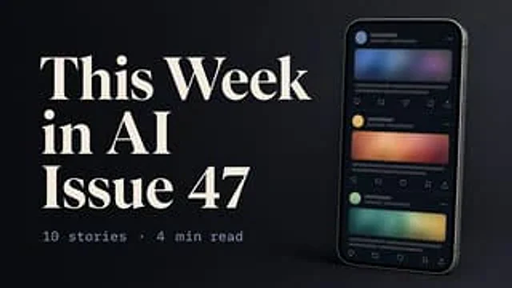

```text
Horizontal 16:9 social-share cover card for a weekly AI newsletter thread. Background is a clean cool charcoal gradient. Left side shows a bold large serif headline stacked over three lines reading "This Week / in AI / Issue 47". Right side shows a small floating mockup of a phone screen displaying an abstract feed with three blurred-out tweet cards. Below the headline on the left a smaller monospaced line reads "10 stories · 4 min read". Horizontal 16:9 composition with sharp typography rendering. No real brand name, no real tweet content, no watermark. Premium social-share cover design quality.
```

Model: GPT Image 2
Author: @hiapi_ai

[ProjectD](https://aitoolsradar.com/en/prompts/9a6ec1a79ead3a) · [Recorded source](https://github.com/HiAPIAI/awesome-gpt-image-2-prompts)
 · [Full original metadata and byte evidence](data/projectd-batch-0050.json)

## Two Men Celebrating at a Restaurant

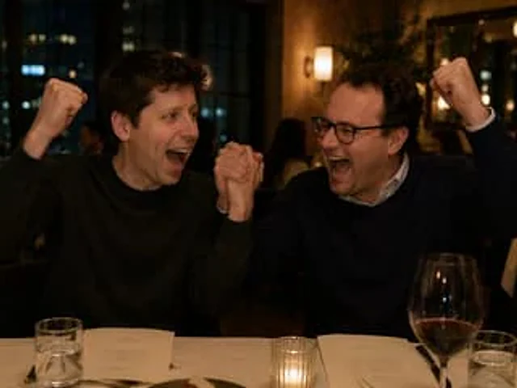

```text
A warm-toned candid photo of two men sitting{argument name="setting" default="High-end restaurant with dim lighting at night"} Next to the dining table. To the left is {argument name="left person description" default="A man with dark hair and wearing a dark gray crew neck sweater"} The right side is {argument name="right person description" default="A man wearing glasses, with dark curly hair and a receding hairline, and dressed in a dark blue sweater over a shirt."} They are{argument name="emotion and action" default="They celebrated enthusiastically, mouths agape in triumph, one hand clasped tightly together, the other fist raised high in a gesture of victory."} The table was covered with a white tablecloth, and set with two menus bearing the words "THE GREENE," a water glass, a glass of red wine, and a small candle in a ribbed glass candlestick. The background featured a blurred view of the restaurant's interior and dark windows reflecting distant city lights, creating an intimate and joyful atmosphere.
```

Model: GPT Image 2
Author: GPT Image 2 Prompts

[ProjectD](https://aitoolsradar.com/en/prompts/e63bd43c69e0e7) · [Recorded source](https://x.com/BubbleBrain/status/2044730353194250387#reversed-0)
 · [Full original metadata and byte evidence](data/projectd-batch-0050.json)

## Two Women Shopping in a Vintage Store

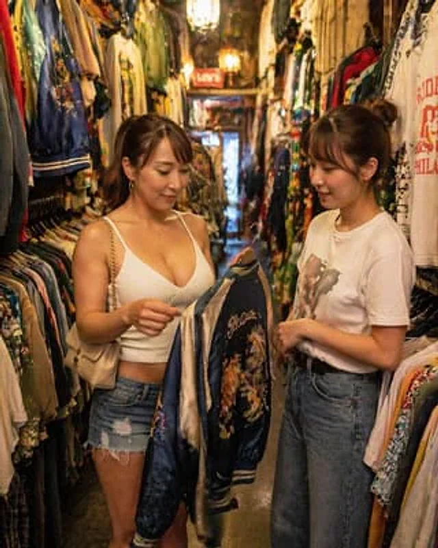

```text
A photorealistic snapshot shows two Asian women in a crowded {argument name="store type" default="Vintage clothing store"} They shopped together. The woman on the left has brown hair tied up and is wearing {argument name="left woman outfit" default="White ribbed cropped top and ripped denim shorts"} She was carrying a beige shoulder bag. She was holding up a garment on a wooden hanger.{argument name="item being examined" default="Dark blue satin commemorative jacket with delicate gold embroidery"} The woman on the right has a messy bun hairstyle and is wearing {argument name="right woman outfit" default="A white printed T-shirt tucked into high-waisted blue jeans."} They were admiringly looking at the jacket. They stood in the narrow aisle, flanked by racks piled high with colorful clothing, and clothes hung from the ceiling as well. The scene presented {argument name="lighting and atmosphere" default="Warm, slightly dim ambient lighting with a shallow depth-of-field blur effect in the background."} .
```

Model: GPT Image 2
Author: GPT Image 2 Prompts

[ProjectD](https://aitoolsradar.com/en/prompts/be9e9e70bdb676) · [Recorded source](https://x.com/noruma_noel/status/2045621795521536419#reversed-0)
 · [Full original metadata and byte evidence](data/projectd-batch-0050.json)

## Two-Era Naval Comparison Poster

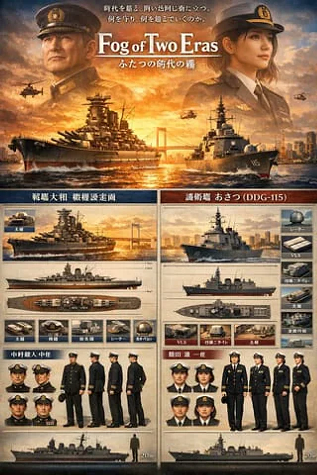

```text
Create a cinematic Japanese naval contrast poster, employing a highly detailed, realistic conceptual art style. The color palette is a warm amber sunset, complemented by dramatic clouds, luminous backlighting, and a layout combining a high-quality cinematic poster with technical reference tables. The composition is divided vertically into two main areas. At the top, in the "Heroes" section, display two large, semi-transparent portraits of officers turned inwards. The left officer wears a navy uniform from the old imperial era, while the right officer wears a modern Maritime Self-Defense Force-style dress uniform. Both wear peaked caps and dark dress coats against a backdrop of a vibrant sunset sky. A large serif English title is placed centered between the two figures.{argument name="headline text" default="Fog of Two Eras"} Below is a smaller Japanese subtitle, "Futatsu no Jidai no Kū" (The Fog of the Ages), with two lines of Japanese text above it. Below the title, on the sea at its prime, two warships are shown sailing forward, their course slightly converging: on the left is a massive World War II battleship with numerous large turrets, a tower-like superstructure, a weathered dark hull, and white bow spray; on the right is a modern gray guided-missile destroyer, its hull number 115 visible at the bow, featuring a streamlined radar superstructure and foamy wakes. Four helicopters are added to the sky, two on each side, with a suspension bridge and a distant modern city skyline above the horizon. The reference table area below divides the page into two vertical panels: the left for historical ships and the right for modern ships. Each panel is designed as a parchment-textured military specification item, with dark blue and dark red title bars, fine dividing lines, embedded image frames, and Japanese labels. The left panel should display a large perspective rendering of a battleship, three orthographic views of the ship below, a row of five small, tagged equipment/detail thumbnails, four small portraits of officers in uniform, four full-body rotating views of male naval officers, and a scaled silhouette of the ship and officers at the bottom (marked with 20 meters). The right panel should display a large perspective rendering of a modern destroyer, three orthographic views of the ship below, six small, tagged equipment/detail thumbnails arranged around the ship's reference image, four small portraits of officers in uniform, four full-body views of the formation (including a female officer wearing a white hat and dark uniform), and a scaled silhouette of the ship and officers at the bottom (marked with 20 meters). Prominent Japanese titles and labels should be used throughout, including the historical title area on the left and the title area on the right that names the ship "貴貴あさつ(DDG-115)". The image possesses the quality of a combination of museum exhibition posters, military design drawings, and key visuals from a high-quality historical science fiction drama, featuring ultra-clear details, realistic metallic textures, ocean reflections, aged paper panels, symmetrical balance, and exquisite typography.
```

Model: GPT Image 2
Author: GPT Image 2 Prompts

[ProjectD](https://aitoolsradar.com/en/prompts/ddbaecab30c1f2) · [Recorded source](https://x.com/agilertao/status/2046493215243796921#reversed-1)
 · [Full original metadata and byte evidence](data/projectd-batch-0050.json)

## Two-Page Psychological Thriller Manga Spread

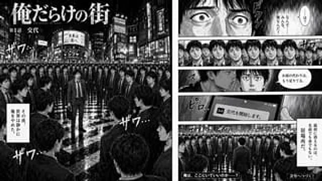

```text
{
  "type": "Double-page comic panel",
  "style": "Highly detailed realistic comic book style, black and white, halftone screen, dramatic lighting, psychological thriller.",
  "global_elements": {
    "protagonist": "{argument name=\"main character description\" default=\"Young Japanese office worker in a suit\"}",
    "theme": "{argument name=\"core concept\" default=\"Surrounded by a large group of clones who look exactly like him\"}"
  },
  "layout": {
    "left_page": {
      "type": "Full-page spread large image",
      "setting": "{argument name=\"setting\" default=\"Shibuya Crossing at night\"}",
      "visuals": "The protagonist stands alone in the middle of a crossroads, looking around in shock at the crowd of people around him, all of whom are his own clones.",
      "text_elements": [
        {
          "type": "manga title logo",
          "text": "{argument name=\"manga title\" default=\"A city full of me\"}"
        },
        {
          "type": "subtitle",
          "text": "Episode 1 Explanation"
        },
        {
          "type": "narration box",
          "text": "That night, the world quietly abandoned me."
        },
        {
          "type": "sound effect",
          "text": "noisy……"
        }
      ]
    },
    "right_page": {
      "type": "5-grid vertical layout",
      "panels": [
        {
          "panel_number": 1,
          "visuals": "A close-up of the protagonist's eyes; his pupils are dilated with shock, and he is covered in sweat.",
          "text_elements": [
            {
              "type": "speech bubble",
              "text": "Huh? Why... is everyone me?"
            },
            {
              "type": "sound effect",
              "text": "thud"
            }
          ]
        },
        {
          "panel_number": 2,
          "visuals": "A row of eight clones dressed in suits stared blankly ahead.",
          "text_elements": [
            {
              "type": "sound effect",
              "text": "noisy……"
            }
          ]
        },
        {
          "panel_number": 3,
          "visuals": "A clone leans close to the shocked protagonist and whispers in his ear.",
          "text_elements": [
            {
              "type": "speech bubble",
              "text": "Your position has already been filled."
            },
            {
              "type": "sound effect",
              "text": "Swoosh"
            }
          ]
        },
        {
          "panel_number": 4,
          "visuals": "A close-up of the smartphone screen in my hand shows a push notification.",
          "text_elements": [
            {
              "type": "screen text",
              "text": "The handover begins."
            },
            {
              "type": "sound effect",
              "text": "bite"
            }
          ]
        },
        {
          "panel_number": 5,
          "visuals": "A distant view of endless clone hordes on city streets.",
          "text_elements": [
            {
              "type": "narration box",
              "text": "The first thing to disappear is not the name, nor the life. It is the place to live."
            },
            {
              "type": "bottom left text",
              "text": "Do I really still deserve to stay here?"
            },
            {
              "type": "bottom right text",
              "text": "{argument name=\"cliffhanger text\" default=\"Next episode preview!\"}"
            },
            {
              "type": "sound effect",
              "text": "Noisy... Noisy... Noisy..."
            }
          ]
        }
      ]
    }
  }
}
```

Model: GPT Image 2
Author: GPT Image 2 Prompts

[ProjectD](https://aitoolsradar.com/en/prompts/4e7097d0633bc4) · [Recorded source](https://x.com/onofumi_AI/status/2046344973835231524#reversed-0)
 · [Full original metadata and byte evidence](data/projectd-batch-0050.json)

## Two-Panel RPG Concept Art

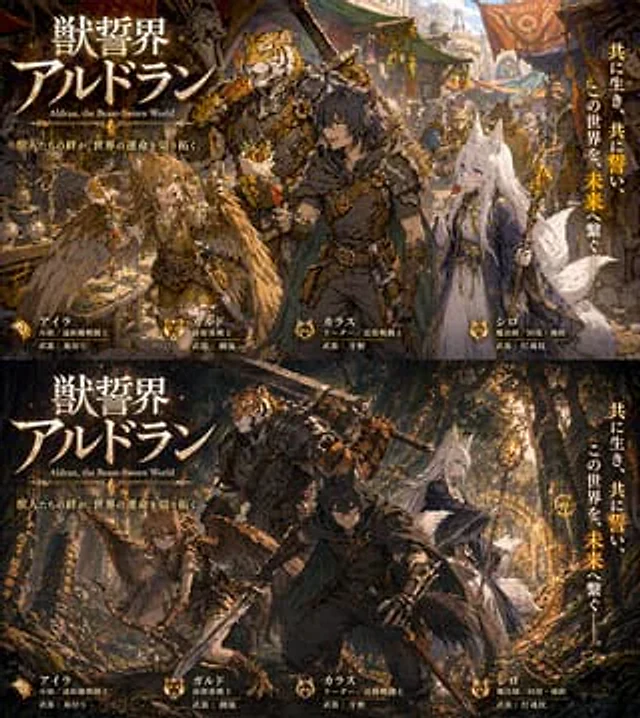

```text
{
  "type": "Duplex Fantasy RPG Promotional Illustration",
  "global_elements": {
    "main_title": "{argument name=\"main title\" default=\"Beast Oath World Aldran\"}",
    "english_subtitle": "{argument name=\"english subtitle\" default=\"Aldran, the Beast-Sworn World\"}",
    "catchphrase": "The bonds between beastmen will shape the destiny of the world.",
    "vertical_tagline": "{argument name=\"tagline\" default=\"To live together, to pledge together, and to connect this world to the future.\"}"
  },
  "characters": [
    {
      "name": "アイラ",
      "description": "A beastman girl with brown hair and wings",
      "role_label": "Scout/Ranged Combatant",
      "weapon_label": "Weapon: Wind-cutting Bow"
    },
    {
      "name": "ガルド",
      "description": "A burly tiger-type orc clad in heavy plate armor",
      "role_label": "Vanguard Heavy Armor Warrior",
      "weapon_label": "Weapon: Steel Storm"
    },
    {
      "name": "カラス",
      "description": "A wolf boy with black hair, wolf ears, a tail, wearing dark leather armor and a cloak.",
      "role_label": "Captain/Melee Combatant",
      "weapon_label": "Weapon: Broken Teeth"
    },
    {
      "name": "シロ",
      "description": "A white fox girl with long white hair, fox ears, and multiple fluffy tails, wearing a blue and white robe.",
      "role_label": "Magician/Healer and Support",
      "weapon_label": "Weapon: Lantern Soul Staff"
    }
  ],
  "layout": {
    "panels": [
      {
        "position": "upper half",
        "scene": "{argument name=\"peaceful setting\" default=\"bustling fantasy market town in warm daylight\"}",
        "action": "The characters, relaxed and smiling, gathered together to enjoy street food."
      },
      {
        "position": "lower half",
        "scene": "{argument name=\"combat setting\" default=\"dark atmospheric forest with glowing magic runes\"}",
        "action": "The characters are in dynamic combat stances, weapons drawn, casting spells, creating a tense atmosphere."
      }
    ]
  }
}
```

Model: GPT Image 2
Author: GPT Image 2 Prompts

[ProjectD](https://aitoolsradar.com/en/prompts/099c779df16789) · [Recorded source](https://x.com/old_pgmrs_will/status/2044967217176146073#reversed-0)
 · [Full original metadata and byte evidence](data/projectd-batch-0050.json)

## Two-Panel Tech Meme Comic

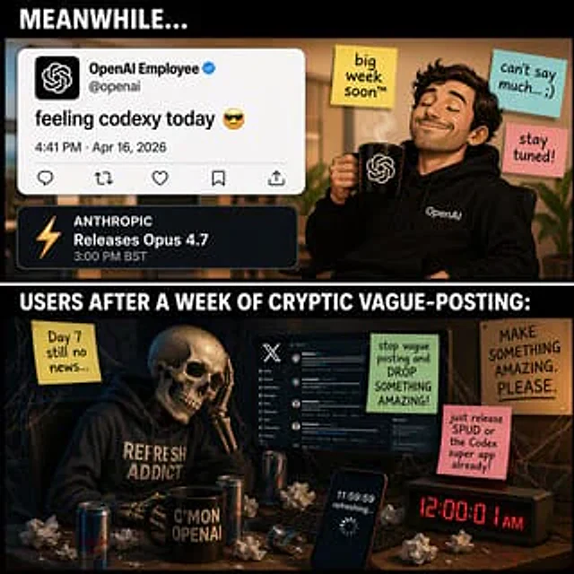

```text
{
  "type": "Double-panel comic",
  "layout": {
    "structure": "Vertically divided, with a black dividing bar in the middle containing white text.",
    "top_header_text": "{argument name=\"top panel header\" default=\"at the same time...\"}",
    "middle_divider_text": "{argument name=\"bottom panel header\" default=\"After a week of mysterious and ambiguous developments, users:\"}"
  },
  "panels": [
    {
      "position": "superior",
      "setting": "Bright office environment",
      "character": "A smug-looking man with a beard, wearing a black hoodie with the word 'OpenAI' printed on it, smiled with his eyes closed, holding a steaming black mug with the OpenAI logo in his hand.",
      "ui_elements": {
        "count": 2,
        "items": [
          "Tweet example: Profile 'OpenAI Employee' with a verification checkmark, account ' @openai ', text '{argument name=\"tweet text\" default=\"I feel so codexy today 😎\"} ', Date 'April 16, 2026 at 4:41 PM'",
          "Notification simulation: Dark theme, orange lightning bolt icon, text 'ANTHROPIC releases Opus 4.7 at 3:00 PM BST'"
        ]
      },
      "sticky_notes": {
        "count": 3,
        "items": [
          "Yellow sticky note: 'big week soon™'",
          "Light blue sticky note: 'Can't say too much... ;)'",
          "Pink sticky note: 'Coming soon!'"
        ]
      }
    },
    {
      "position": "Down",
      "setting": "The room was dimly lit and covered in cobwebs, with the table in disarray.",
      "character": "Wearing clothes printed with '{argument name=\"skeleton hoodie text\" default=\"Refresh Addicts\"} A skeleton in a black hoodie, desperately cradling its skull with its bony hands.",
      "desk_objects": {
        "count": 6,
        "items": [
          "Computer monitor displaying the X (Twitter) dark mode interface",
          "Black mug with 'C'MON OPENAI' printed on it",
          "A smartphone screen displaying '11:59:59 Refreshing...' and a loading icon.",
          "A digital clock displaying the red text '12:00:01 AM'",
          "3 cans of energy drink",
          "Scattered crumpled paper balls"
        ]
      },
      "sticky_notes_and_signs": {
        "count": 4,
        "items": [
          "Yellow sticky note (left): 'Day 7, still no news...'",
          "Green sticky note (on the monitor): 'Stop posting vague updates, hurry up and post something amazing!'",
          "Pink sticky note (right): '{argument name=\"user complaint note\" default=\"Hurry up and release SPUD or that Codex super app!\"} '",
          "Cardboard sign (far right): 'Make something amazing. Please.'"
        ]
      }
    }
  ]
}
```

Model: GPT Image 2
Author: GPT Image 2 Prompts

[ProjectD](https://aitoolsradar.com/en/prompts/705ea2a45d7925) · [Recorded source](https://x.com/Ixel111/status/2044811441383850051#reversed-0)
 · [Full original metadata and byte evidence](data/projectd-batch-0050.json)

## Two-Sided Watercolor Event Flyer Mockup

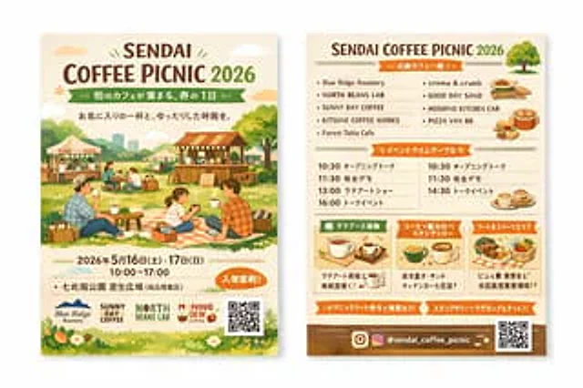

```text
{
  "type": "Double-sided promotional flyer prototype",
  "style": "Watercolor illustrations, warm earth tones, cozy, captivating, and rustic.",
  "left_side_front": {
    "header": {
      "title": "{argument name=\"event name\" default=\"SENDAI COFFEE PICNIC 2026\"}",
      "subtitle": "{argument name=\"subtitle\" default=\"A spring day when the city&#39;s cafes come together\"}",
      "tagline": "Spend leisurely time with your favorite coffee"
    },
    "main_illustration": "People enjoy picnics on the grass. A family sits on a checkered picnic mat drinking coffee. The background includes a wooden coffee stand, tents, trees, and the distant city skyline.",
    "event_info": {
      "date": "{argument name=\"event date\" default=\"May 16 (Saturday) - 17 (Sunday), 2026\"}",
      "time": "10:00 - 17:00",
      "location": "{argument name=\"location\" default=\"Nanakitada Park Lawn Area\"}",
      "badge": "Orange oval badge with the words \"Free Admission\""
    },
    "footer": {
      "sponsor_logos": 4,
      "elements": [
        "QR code",
        "Grass and white flower border"
      ]
    }
  },
  "right_side_back": {
    "header": {
      "title": "{argument name=\"event name\" default=\"SENDAI COFFEE PICNIC 2026\"}",
      "illustration": "Little Green Tree"
    },
    "sections": [
      {
        "title": "Exhibitor List",
        "layout": "2 columns",
        "count": 9,
        "labels": [
          "Blue Ridge Roastery",
          "NORTH BEANS LAB",
          "SUNNY DAY COFFEE",
          "KITSUNE COFFEE WORKS",
          "Forest Table Cafe",
          "creme & crumb",
          "GOOD DAY SAND",
          "HOSHINO KITCHEN CAR",
          "PIZZA VAN 88"
        ],
        "illustrations": [
          "sandwich",
          "pizza",
          "coffee cup"
        ]
      },
      {
        "title": "Event Schedule",
        "layout": "2 columns",
        "count": 7,
        "description": "Schedule including time slots such as 10:30, 11:30, 13:00, 14:30, and 16:00, along with event names."
      },
      {
        "title": "Features and Highlights",
        "layout": "3 horizontal boxes",
        "count": 3,
        "labels": [
          "Latte art experience",
          "Coffee tasting stamp collection event",
          "Food and Dessert Section"
        ],
        "illustrations": [
          "Single coffee cup",
          "Multiple coffee cups",
          "food basket"
        ]
      }
    ],
    "footer": {
      "social_media": "{argument name=\"social handle\" default=\"@sendai_coffee_picnic\"}",
      "icons": [
        "Instagram icon"
      ],
      "elements": [
        "QR code",
        "Brown background bar"
      ]
    }
  }
}
```

Model: GPT Image 2
Author: GPT Image 2 Prompts

[ProjectD](https://aitoolsradar.com/en/prompts/f699aac51cab94) · [Recorded source](https://x.com/koyo_koyoy/status/2044564212073251178#reversed-0)
 · [Full original metadata and byte evidence](data/projectd-batch-0050.json)

## UFC-Style Women's Fight Poster

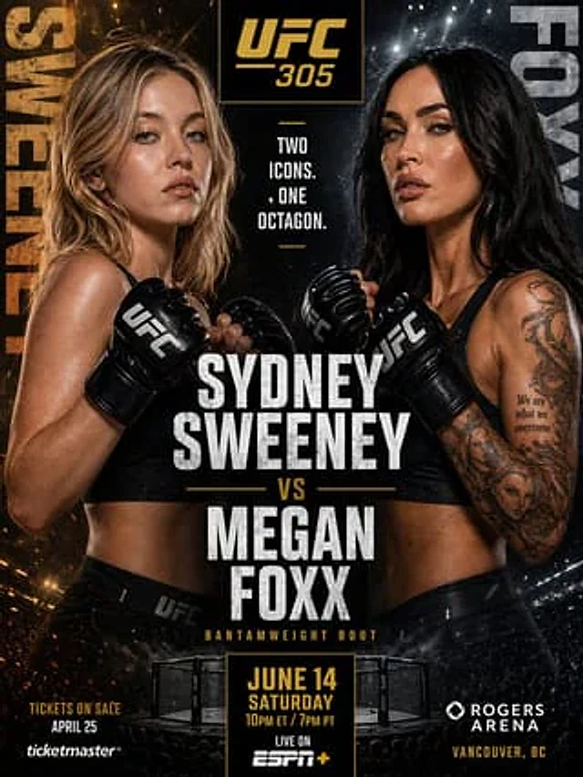

```text
A dramatic UFC-style fighting sports promotional poster, themed as{argument name="event title" default="UFC 305"} The image is designed as a high-contrast vertical confrontation, featuring two female MMA fighters facing each other in a standard stance. The fighter on the left is a fit blonde with shoulder-length, tousled wavy hair, a tanned complexion, and wearing a black sports bra, black UFC gloves, and black fighting shorts. The image extends from her upper thighs to her head, with her body slightly turned to the right. The fighter on the right is a fit dark-haired woman with long, straight black hair, a tanned complexion, and wearing a black sports bra, black UFC gloves, and black fighting shorts. The image extends from her upper thighs to her head, with her body slightly turned to the left. She has a large, intricately detailed black-grey tattoo on her right arm, and text tattoos on the inside of her upper arm. Both fighters are covered in sweat, the lighting is intense, and they are positioned close together, fists raised to chest height. The background uses a split design: the left side features fiery red sparks and smoke, while the right side features icy blue-white sparks and mist, with a dark black seam in between. At the top center, a black rectangular logo with a gold border contains gold text.{argument name="event logo text" default="UFC 305"} Below this, the tagline "TWO ICONS. ONE OCTAGON." is added in stacked, compressed white capital letters. Along the far left edge, the large, distressed gold lettering of the surname "SWEENEY" is placed vertically; along the far right edge, the large, distressed silver-grey lettering of the surname "FOXX" is placed vertically. In the center, a large, distressed white compressed sans-serif font is overlaid, stacked opposite the names.{argument name="left fighter name" default="SYDNEY SWEENEY"} Located above the small gold "VS", below is{argument name="right fighter name" default="MEGAN FOXX"} Below this, a small gold subtitle "BANTAMWEIGHT BOUT" is added. At the bottom center, a small, realistic UFC octagon is displayed embedded in the poster, slightly elevated. In front of the octagon, a black date card with a gold border is placed, containing stacked gold text: "JUNE 14", "SATURDAY", "10PM ET / 7PM PT". Below the card, the white text "LIVE ON" and the ESPN+ logo are added. In the lower left corner, small gold and white ticketing text "TICKETS ON SALE APRIL 25" is added, with the Ticketmaster logo below. In the lower right corner, the Rogers Arena logo is added, with white text "ROGERS ARENA" and gold text "VANCOUVER, BC" below. The poster employs a glossy, high-end combat sports poster aesthetic, utilizing cinematic contour lighting, rough texture overlays, metallic fonts, and a strong confrontational composition.
```

Model: GPT Image 2
Author: GPT Image 2 Prompts

[ProjectD](https://aitoolsradar.com/en/prompts/34ed21a8f4dfbc) · [Recorded source](https://x.com/DrClownPhD/status/2046918637009646022#reversed-0)
 · [Full original metadata and byte evidence](data/projectd-batch-0050.json)

## UI Design System Prompt

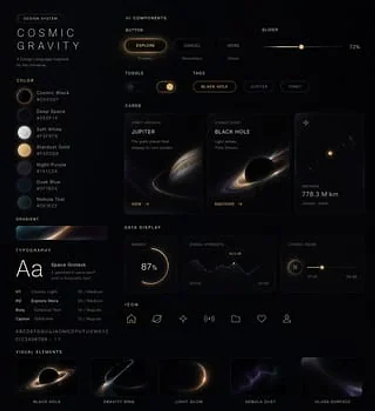

```text
Using this style helped me generate a set{argument name="theme" default="UI design system"} ,include{argument name="components" default="Web, mobile, cards, controls, buttons and other components"} Please use this visual style as a reference to generate a webpage.
```

Model: GPT Image 2
Author: GPT Image 2 Prompts

[ProjectD](https://aitoolsradar.com/en/prompts/7c50e71652b949) · [Recorded source](https://x.com/stark_nico99/status/2045836554451706125)
 · [Full original metadata and byte evidence](data/projectd-batch-0050.json)

## UI Design System Prompt


```text
用这种风格帮我生成一套{argument name="主题" default="UI设计系统"}，包含{argument name="组件列表" default="网页、移动端、卡片、控件、按钮 以及其它"} 

把这套视觉风格作为参考生成网页
```

Model: GPT Image 2
Author: Nicolechan

[ProjectD](https://aitoolsradar.com/en/prompts/4fa860d13f753a) · [Recorded source](https://youmind.com/prompts/ui-design-system-visual-style-13489)
 · [Full original metadata and byte evidence](data/projectd-batch-0050.json)

## Ukiyo-e Mascot Landscape

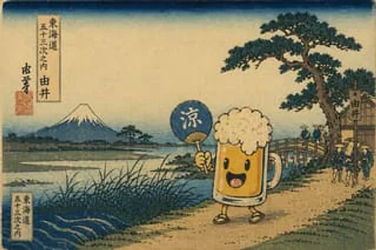

```text
A picture{argument name="art style" default="Traditional Japanese Ukiyo-e woodblock prints"} A landscape painting in the style of which there is a{argument name="main character" default="An anthropomorphic beer mug, complete with a foamy top, a happy smiling face, slender yellow limbs, and traditional sandals."} Walking on the dirt path. The character holds a blue round fan with Chinese characters written on it.{argument name="fan text" default="cold"} On the right side of the background, there is a large pine tree and a wooden bridge with three little figures crossing it, and three more little figures walking on a path. On the left are tall reeds, with a path leading into the distance.{argument name="background mountain" default="Snow-capped Mount Fuji"} The river flows, and the sky displays a gradient of colors. In the upper left corner, there's a traditional rectangular border with the words "..."{argument name="top left text" default="Tokaido 53rd Route, by Ii"} Next to it is a red artist's stamp, and there is a matching border in the lower left corner. The image has a retro, soft color tone and realistic woodblock print paper texture.
```

Model: GPT Image 2
Author: GPT Image 2 Prompts

[ProjectD](https://aitoolsradar.com/en/prompts/686314ff4c1ebe) · [Recorded source](https://x.com/wmoto_ai/status/2046165539844940147#reversed-1)
 · [Full original metadata and byte evidence](data/projectd-batch-0050.json)

## Ultra Woman Kaiju Battle Variations

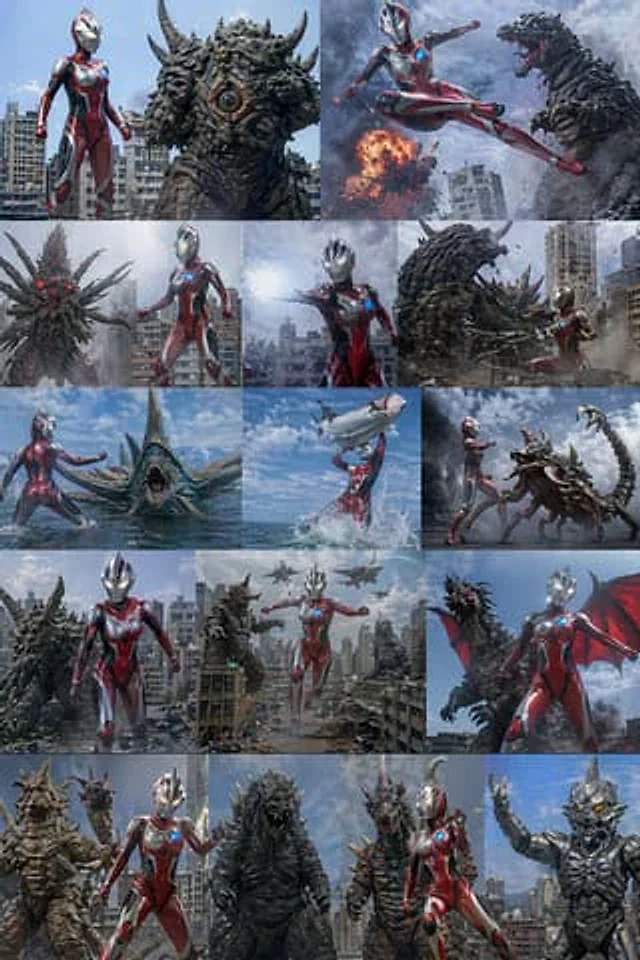

```text
{
  "type": "Monster battle concept collage",
  "model_style": "Cinematic tokusatsu-style superhero action, photorealistic graphics, realistic city destruction, dramatic cloud, smoke, dust, sparks, and explosion effects, and massive-scale battles.",
  "subject": {
    "hero": {
      "identity": "{argument name=\"hero name\" default=\"Ultra Woman\"}",
      "appearance": "A slender, gigantic female superhero, clad in a polished silver and metallic red armor-like bodysuit, a sleek alien mask with enormous, glowing eyes, a blue, circular chest core, and an athletic physique, towering atop a building."
    },
    "setting": "A modern Japanese-style city, featuring mid-rise buildings, ruined streets, rubble, a smoky sky, and occasional waterfront/ocean scenes."
  },
  "layout": {
    "grid": {
      "columns": 3,
      "rows": 5,
      "count": 15
    },
    "sections": [
      {
        "position": "Row 1, Column 1",
        "description": "The heroine stood in the city, beside a gigantic, one-eyed, rock-armored monster with massive horns, a huge central eye, and numerous protruding spikes."
      },
      {
        "position": "Row 1, Column 2",
        "description": "The female hero performs a side kick amidst fireworks, charging towards a roaring Godzilla-like reptilian monster, with an explosion below."
      },
      {
        "position": "Row 2, Column 1",
        "description": "A monster covered in spiky insects or plants, with multiple glowing red eyes, confronts the heroine in a ruined city."
      },
      {
        "position": "Row 2, Column 2",
        "description": "The female hero assumes a battle stance, projecting bright white energy with one hand against a backdrop of hazy architecture."
      },
      {
        "position": "Row 2, Column 3",
        "description": "The female hero battles a giant crocodile or reptile monster amidst dust and collapsing buildings."
      },
      {
        "position": "Row 3, Column 1",
        "description": "In a marine battle scene, the heroine faces a giant starfish-shaped sea monster with a round mouth covered in sharp teeth."
      },
      {
        "position": "Row 3, Column 2",
        "description": "The heroine leaps from the sea, a silver, shark-like or missile-like object hovering above her head, splashing water dramatically."
      },
      {
        "position": "Row 3, Column 3",
        "description": "The heroine battles a four-legged, horned monster with a scorpion's tail on a smoke-filled battlefield."
      },
      {
        "position": "Row 4, Column 1",
        "description": "The female hero stood in the city, beside another heavily armored horned monster."
      },
      {
        "position": "Row 4, Column 2",
        "description": "The heroine traversed the ravaged city streets, with two gigantic monsters faintly visible behind her and military jets flying overhead."
      },
      {
        "position": "Row 4, Column 3",
        "description": "The female hero stands beside or confronts a black dragon-like monster with huge red bat wings."
      },
      {
        "position": "Row 5, Column 1",
        "description": "Against an urban backdrop, the heroine confronts a two-headed monster."
      },
      {
        "position": "Row 5, Column 2",
        "description": "The female hero stands beside a classic Godzilla-style monster, both appearing in full-body form within the complex."
      },
      {
        "position": "5th row, 3rd column, left",
        "description": "Beside the heroine was a horned reptile monster with segmented armor and spikes."
      },
      {
        "position": "Row 5, Column 3, Right",
        "description": "A silver robot alien or mecha monster raises a hand against the city skyline."
      }
    ]
  },
  "composition": "A tight montage of 15 independent, cinematic still frames with thin borders, each showcasing a different battle variant or monster combination. The heroine's design remains consistent across all frames, with dynamic poses and a low-angle, massive perspective.",
  "customization": {
    "hero suit colors": "{argument name=\"hero suit colors\" default=\"metallic red and silver\"}",
    "city setting": "{argument name=\"city setting\" default=\"Japanese urban skyline\"}",
    "weather mood": "{argument name=\"weather mood\" default=\"stormy smoky daylight\"}",
    "monster style": "{argument name=\"monster style\" default=\"classic practical-effects kaiju with realistic texture\"}"
  },
  "rendering": "High detail, realistic surface textures, cinematic lighting, volumetric smoke, debris, motion photography feel, blockbuster concept art."
}
```

Model: GPT Image 2
Author: GPT Image 2 Prompts

[ProjectD](https://aitoolsradar.com/en/prompts/a542ffc9fdfbfd) · [Recorded source](https://x.com/80G_AIpictures/status/2047093799621705871#reversed-0)
 · [Full original metadata and byte evidence](data/projectd-batch-0050.json)

## Ultra-Dense Information Design

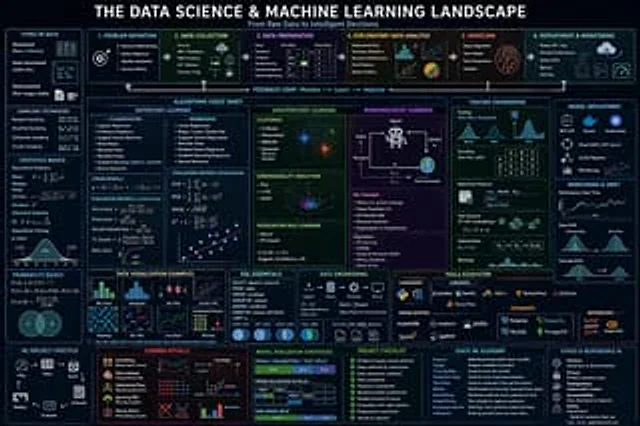

```text
Generate somthing super complex and info dense...
```

Model: GPT Image 2
Author: @EchoraContinuum

[ProjectD](https://aitoolsradar.com/en/prompts/9ad82bc3a23b2c) · [Recorded source](https://x.com/EchoraContinuum/status/2046517163826246133)
 · [Full original metadata and byte evidence](data/projectd-batch-0050.json)

## Ultra-Realistic Fisheye Urban Photography

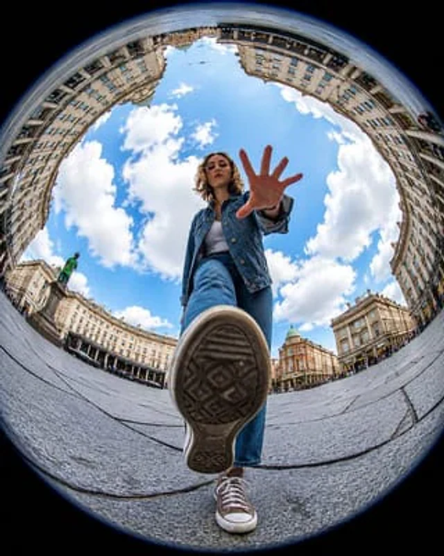

```text
Ultra-realistic action photography, extreme fisheye lens, 8mm, {argument name="camera angle" default="worm’s-eye view from ground level"}, dynamic {argument name="scene" default="urban plaza scene"}. A stylish young person appears to be stepping over the camera, one sneaker sole dominating the foreground, hand reaching toward the lens.. Massive circular “tiny planet” perspective with {argument name="architecture" default="historic European architecture"} curving around the edges of the frame, bright blue sky filled with fluffy white clouds at the center. Cinematic composition, dramatic distortion, ultra-wide angle, vibrant colors, sharp focus, HDR, photorealistic, highly detailed skin texture, travel photography aesthetic, motion energy, depth and scale, 8K resolution, professional DSLR quality, masterpiece, Instagram viral shot. Aspect Ratio 4:5.
```

Model: GPT Image 2
Author: Lariab Fatima‎

[ProjectD](https://aitoolsradar.com/en/prompts/5c330b6e308d6b) · [Recorded source](https://youmind.com/prompts/fisheye-urban-photography-tiny-planet-26121)
 · [Full original metadata and byte evidence](data/projectd-batch-0050.json)

## Ultraman ChatGPT Promo Poster

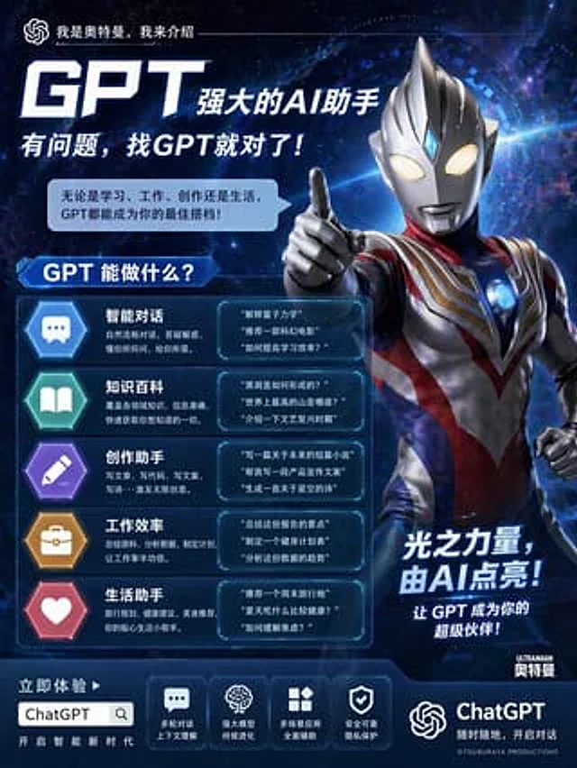

```text
{
  "type": "Promotional poster",
  "style": "High-end Chinese commercial advertising posters, futuristic sci-fi style, glossy cinematic lighting, exquisite 3D character rendering, blue neon UI panel, advanced technology brand visual design.",
  "subject": {
    "main figure": "On the right is a silver-red humanoid hero in the Ultraman style, depicted from the waist up to the thighs. Facing forward, his right hand is extended towards the camera with his index finger pointing forward. He has glowing almond-shaped eyes, a metallic silver helmet with a central crown and a blue forehead gem, and muscular armor with silver, red, dark blue, and gold accents. A circular glowing core is located on his chest."
  },
  "background": {
    "scene": "The deep outer space, accompanied by stars, nebulae, and faint galactic vortexes, features bright blue beams of light, a holographic circular interface halo behind the character, and a deep blue cosmic atmosphere."
  },
  "text": {
    "top tagline": "I am Ultraman, let me introduce myself—",
    "main headline": "GPT's powerful AI agent",
    "subheadline": "If you have any questions, just contact GPT!",
    "speech bubble": "Whether you're studying, working, creating, or living your life, GPT can be your best partner!",
    "section title": "What can GPT do?",
    "right slogan": "The power of light is ignited by AI!",
    "right subtext": "Make GPT your best partner!",
    "cta": "Try it now &gt;",
    "product name": "ChatGPT",
    "footer small text": "Ushering in a New Era of Intelligence",
    "brand mark": "ULTRAMAN",
    "copyright": "©TSUBURAYA PRODUCTIONS"
  },
  "layout": {
    "sections": [
      {
        "title": "What can GPT do?",
        "position": "left-center",
        "count": 5,
        "items": [
          {
            "icon": "Blue hexagon with chat bubble",
            "label": "Intelligent dialogue",
            "description": "A natural and fluent dialogue, answering your questions and resolving your doubts, understanding your questions and providing what you need.",
            "examples_count": 3,
            "examples": [
              "Explaining quantum mechanics",
              "Recommend a science fiction movie",
              "How to improve learning efficiency?"
            ]
          },
          {
            "icon": "Green hexagon with an open book",
            "label": "Knowledge Encyclopedia",
            "description": "It covers knowledge across various fields, provides accurate information, and allows you to quickly obtain everything you want to know.",
            "examples_count": 3,
            "examples": [
              "How are black holes formed?",
              "What is the highest mountain in the world?",
              "An introduction to the Renaissance period"
            ]
          },
          {
            "icon": "Purple hexagon with pencil",
            "label": "Creative Assistant",
            "description": "Writing copy, coding, manuscripts, poetry... inspires endless creativity.",
            "examples_count": 3,
            "examples": [
              "Write a short story about the future.",
              "Please write a product promotional copy for me.",
              "Generate a poem about the starry sky."
            ]
          },
          {
            "icon": "Orange hexagon with briefcase",
            "label": "Work efficiency",
            "description": "Summarizing information, analyzing data, and developing plans can make work twice as efficient.",
            "examples_count": 3,
            "examples": [
              "Summarize the key points of this report",
              "Create a fitness plan",
              "Analyze the trends in this data"
            ]
          },
          {
            "icon": "Pink hexagon with heart",
            "label": "Life Assistant",
            "description": "Travel planning, health advice, and food recommendations – your thoughtful little helper for daily life.",
            "examples_count": 3,
            "examples": [
              "Recommend a weekend trip destination",
              "What are some healthy foods to eat in summer?",
              "How to relieve anxiety?"
            ]
          }
        ]
      },
      {
        "title": "Bottom function icons",
        "position": "bottom center",
        "count": 4,
        "items": [
          {
            "icon": "Chat bubble blocks",
            "label": "Multiple rounds of dialogue",
            "subtext": "Understanding the context"
          },
          {
            "icon": "Brain Cube",
            "label": "powerful model",
            "subtext": "Continuous Evolution"
          },
          {
            "icon": "Grid blocks",
            "label": "Multi-scenario applications",
            "subtext": "Comprehensive support"
          },
          {
            "icon": "Shield Block",
            "label": "Safe and reliable",
            "subtext": "Privacy protection"
          }
        ]
      }
    ],
    "top_left_branding": {
      "count": 1,
      "item": "The OpenAI-style knot-shaped logo next to the introductory text"
    },
    "bottom_left_cta_box": {
      "count": 1,
      "item": "A round, white search-style input box with the text \"ChatGPT\" and a magnifying glass icon."
    }
  },
  "composition": "The vertical poster features a character occupying the right half, with densely packed information blocks stacked vertically on the left. A large, eye-catching title is located in the upper left corner, while a tilted, glowing slogan is in the lower right corner, creating a strong sense of depth and contrast.",
  "color_palette": {
    "primary": [
      "Electric Blue",
      "Deep Navy Blue",
      "White"
    ],
    "accents": [
      "silver",
      "red",
      "blue",
      "Purple",
      "orange color",
      "pink"
    ]
  },
  "rendering": {
    "quality": "Ultra-fine detail, clear text, neat layout, high contrast, polished reflection; suitable for advertising printing design."
  }
}
```

Model: GPT Image 2
Author: GPT Image 2 Prompts

[ProjectD](https://aitoolsradar.com/en/prompts/d8d399baa3a659) · [Recorded source](https://x.com/iDnlong/status/2046749282833981743#reversed-2)
 · [Full original metadata and byte evidence](data/projectd-batch-0050.json)

## Umesh #228


```text
A photorealistic image, split down the middle. On the left side, a small, detailed bone that touches the center divider, resembling a dog bone set against a clear blue sky with clouds in  background. On the right side, the bone seamlessly transitions into a detailed, futuristic stunning spacecraft, maintaining the line and shape of the bone against a deep  space background scattered with stars. The spacecraft extends to the right edge, designed with elements that suggest a continuation of the bone's structure. The transition should be smooth, illustrating a creative blend where the organic shape of the bone becomes one with the mechanical structure of the spacecraft, set against a neutral background to emphasize the two subjects.
```

Model: GPT Image 2
Author: Umesh

[ProjectD](https://aitoolsradar.com/en/prompts/6756914cdbce40) · [Recorded source](https://x.com/umesh_ai/status/2009878072565346585)
 · [Full original metadata and byte evidence](data/projectd-batch-0050.json)

## Uncanny Full-Body Alien Portrait

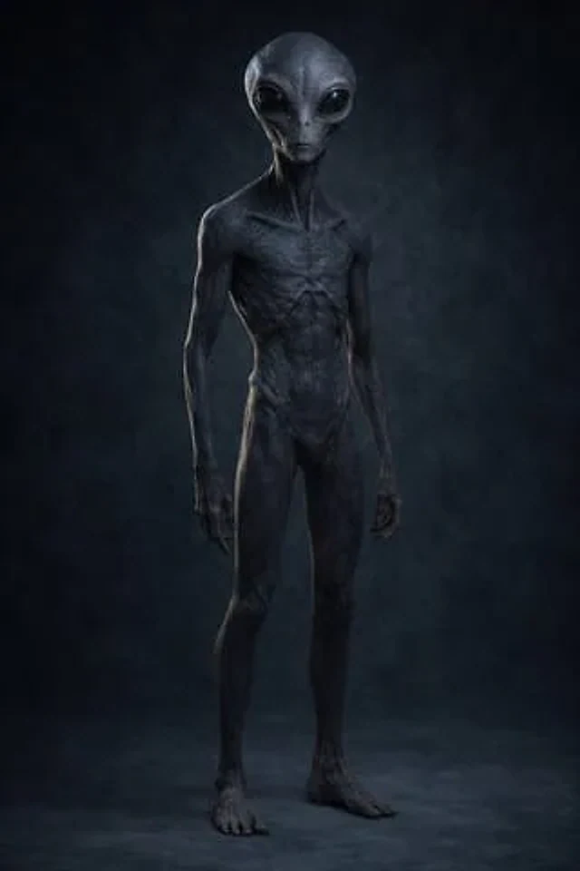

```text
A hyper-realistic full-body alien portrait taken in a studio, depicting a disturbing humanoid alien standing alone against a dim, smoky, dark blue-black background. The creature is extremely tall and slender, with long limbs, a narrow waist, and long, thin fingers. Its enormous bare feet tread on the dimly lit studio floor. Its skin is smooth yet leathery, with subtle wrinkles, a deep charcoal blue with cool gray highlights, clearly outlining ribs, sternum, collarbone, tendons, and the taut muscles of the chest, abdomen, shoulders, and neck. The torso is hairless and emaciated, possessing a bizarre anatomical realism that seems biologically plausible yet unsettlingly unsettling. The head is bald, large, and slightly spherical, with a classic alien silhouette, connected to an unusually long neck; the face remains blurred, unreadable, and extremely eerie, rather than expressionless. The alien stands facing forward, slightly at a three-quarter angle, with its arms hanging naturally at its sides, its posture upright yet subtly predatory, its entire body centered in the frame. Employing understated, cinematic lighting, complemented by subtle cool-toned rim lighting and soft top illumination, the artist sculpts every wrinkle and contour while maintaining the overall scene's dark, oppressive, and somber atmosphere. Low-saturation tones, ultra-fine skin textures, realistic creature designs, sharp focus, high contrast, a sinister ambiance, no clothing, no props, and no other environmental details except for the shadowed studio backdrop.
```

Model: GPT Image 2
Author: GPT Image 2 Prompts

[ProjectD](https://aitoolsradar.com/en/prompts/2902614850378d) · [Recorded source](https://x.com/RileyRalmuto/status/2046701704687845656#reversed-1)
 · [Full original metadata and byte evidence](data/projectd-batch-0050.json)

## Underwater Photorealistic Portrait


```text
A hyper-realistic underwater portrait, in the image{argument name="subject description" default="A young Asian woman"} She was holding her breath underwater.{argument name="hair style" default="Flowing long, dark, wavy hair"} It floated around her face as if weightless in the water, wearing a {argument name="clothing" default="Semi-transparent white ruffled dress"} She looked directly at the camera, her cheeks slightly puffed out, her lips tightly pressed together. The scene transitioned from through the camera {argument name="environment" default="clear blue waters"} The bright sunlight illuminated her, casting complex and dappled bokeh on her face, chest, and clothing. Tiny, delicate bubbles floated upwards around her face, adding to the serene and ethereal atmosphere.
```

Model: GPT Image 2
Author: GPT Image 2 Prompts

[ProjectD](https://aitoolsradar.com/en/prompts/27cd479ffe3f13) · [Recorded source](https://x.com/opener_ai/status/2044574291212263706#reversed-0)
 · [Full original metadata and byte evidence](data/projectd-batch-0050.json)

## Universal commercial poster template

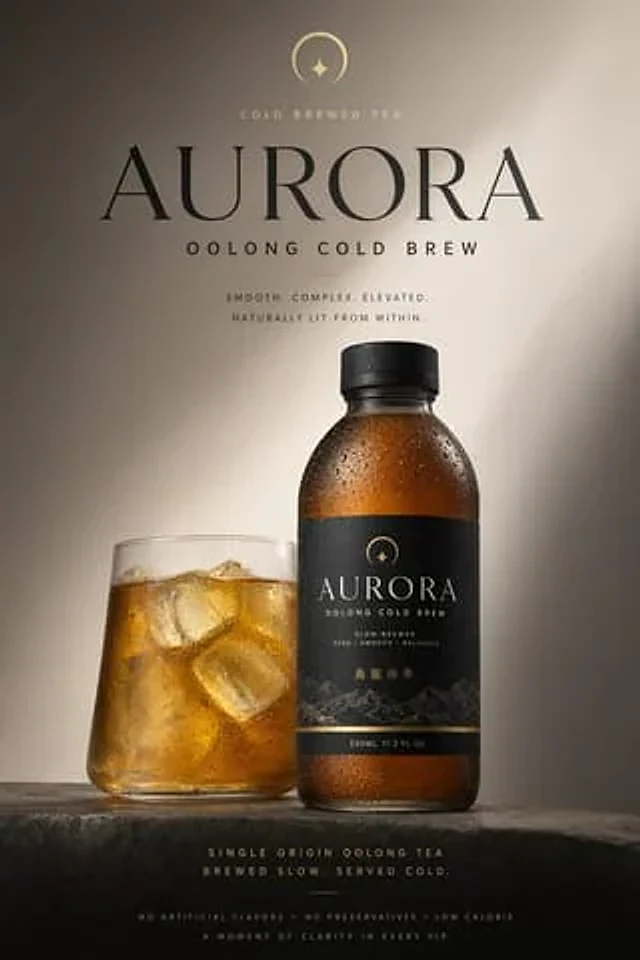

```text
Design a high-end commercial poster for a product called "Aurora Oolong Cold Brew". Minimalist style, clean frame, centered hero bottle and tea glass, soft studio lighting, realistic material textures, elegant condensation details, generous negative space, premium brand visual language, cinematic light and shadow, refined packaging typography, and ultra-detailed finish. Make it feel like a luxury beverage campaign that could run in a subway lightbox or fashion magazine.
```

Model: GPT Image 2
Author: @xiaohongshu-community

[ProjectD](https://aitoolsradar.com/en/prompts/e1579b5e030d2b) · [Recorded source](https://www.xiaohongshu.com/explore/69e7878300000000230050bb)
 · [Full original metadata and byte evidence](data/projectd-batch-0050.json)

## University Campus Aerial View

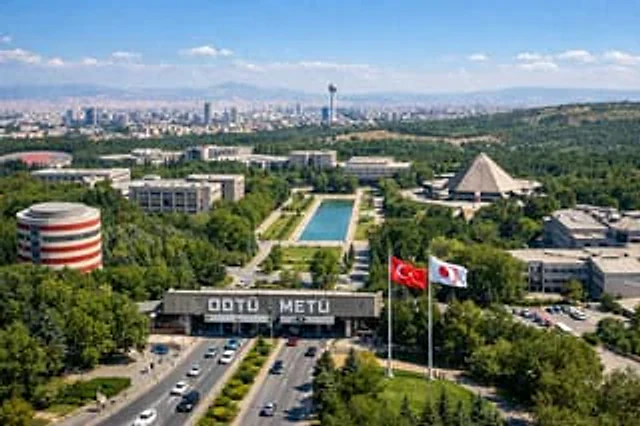

```text
A drone aerial photograph of a vast, lush university campus under a clear sky. In the foreground, vehicles travel along a wide, multi-lane highway, passing a massive concrete entrance gate with prominent white lettering that reads "..."{argument name="university name" default="ODTÜ METÜ"} "There are two tall flagpoles on the right side of the gate, each bearing the inscription '..."{argument name="flag 1" default="Turkish flag"} "and"{argument name="flag 2" default="White flag with a red circular symbol"} In the mid-ground, a rectangular reflecting pool is situated, surrounded by lawns and walkways, with various modernist-style concrete teaching buildings flanking it. Notable structures include a cylindrical building with red and white horizontal stripes on the left and a massive pyramid-shaped building on the right. In the background, [the text abruptly ends here].{argument name="city skyline" default="Ankara"} The dense city skyline stretches across the horizon, featuring a striking, tall observation tower, with rolling hills and mountains in the distance, and a clear blue sky dotted with a few white clouds.
```

Model: GPT Image 2
Author: GPT Image 2 Prompts

[ProjectD](https://aitoolsradar.com/en/prompts/d5411fe2458e99) · [Recorded source](https://x.com/hiimthelowgame/status/2044099765034479924#reversed-0)
 · [Full original metadata and byte evidence](data/projectd-batch-0050.json)

## Upscaled Vintage Soccer Photo

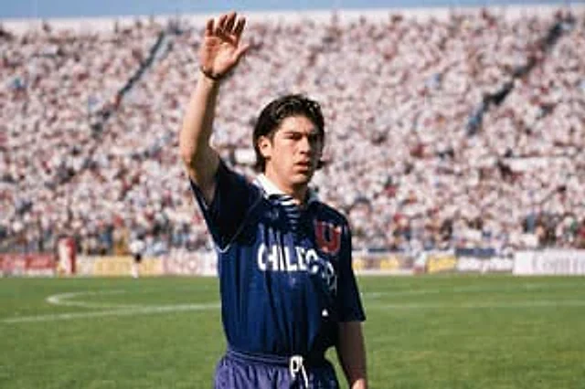

```text
Using the provided reference image, enlarge and restore this old football photo to a clearer, higher-resolution, and photorealistic version. Maintain the same players, waving poses, blue Universidad de Chile jerseys, stadium background, and similar composition. Reconstruct necessary facial areas within the existing obstructions, optimize jersey details and wrinkles, enhance color and contrast, and create a more natural blurring effect for the spectators/background, resulting in a refined shallow depth of field. While preserving the vintage, sunlit sports photo texture, make it look sharper and achieve a professional-grade remaster.
```

Model: GPT Image 2
Author: GPT Image 2 Prompts

[ProjectD](https://aitoolsradar.com/en/prompts/f52933fe1155eb) · [Recorded source](https://x.com/MasterOfUrls/status/2047036687247708378#reversed-1)
 · [Full original metadata and byte evidence](data/projectd-batch-0050.json)

## Upside-Down Sky Schoolgirl

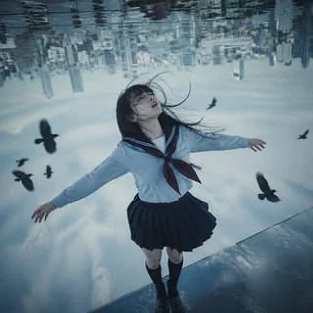

```text
Create a cinematic surreal photorealistic image of a {argument name="character age and outfit" default="teenage Japanese schoolgirl in a classic sailor uniform"} floating or falling upward into the sky, viewed from a slightly high, diagonal angle. She is centered in the frame with arms stretched wide like she is surrendering to flight, long dark hair blown dramatically across the scene, wearing a pale blue sailor blouse with a navy collar, a deep burgundy scarf tie, a dark pleated skirt, knee-high black socks, and black shoes. Her face is intentionally hidden by a soft gray square censor block, while her head tilts back toward the sky. The world is inverted: an upside-down modern city skyline and reflective water-like surface occupy the top of the image, as if the sky and city have been mirrored above her. The background is a cold blue-gray cloudy sky with a dreamlike, melancholic atmosphere. Include exactly 6 black bird silhouettes flying around her: 1 large bird on the left, 2 smaller birds in the lower-left area, 1 small bird near the upper-right center, 1 small bird on the far right, and 1 large bird in the lower-right area. Use {argument name="color palette" default="muted blue-gray and desaturated cyan tones"}, high-detail cinematic lighting, soft film grain, slight motion blur in the hair and birds, realistic fabric folds, and a mysterious emotional mood suggesting the phrase {argument name="theme" default="to the sky"}. No text, no watermark, square 1:1 composition.
```

Model: GPT Image 2
Author: シオナイ

[ProjectD](https://aitoolsradar.com/en/prompts/ceef80f3001125) · [Recorded source](https://youmind.com/prompts/upside-down-sky-schoolgirl-23821)
 · [Full original metadata and byte evidence](data/projectd-batch-0050.json)

## Urban Alley Mural Artist

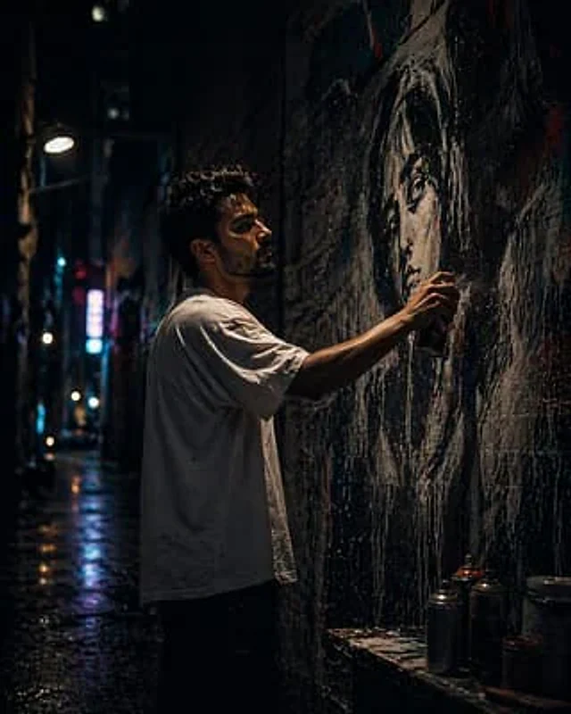

```text
This is a cinematic, hyper-realistic night scene depicting a {argument name="artist" default="Young male street artist"} In progress{argument name="setting" default="Narrow city alleys"} Draw a large picture{argument name="mural subject" default="Female face mural"} The camera angle is slightly low, creating a dramatic and tense perspective. The artist, with medium-length, slightly messy dark hair and a light stubble or short beard, exudes a rugged yet creative aura. He wears a loose white T-shirt and casual jeans, the slightly oversized cut conveying a relaxed street style. He stands by the wall, intently engaged in spray painting, his posture focused. He is creating a huge, hyper-realistic mural of a female face on the rough brick wall. The mural is incredibly detailed—delicate skin tones, lifelike light and shadow, expressive eyes, and glossy lips—it looks almost like a photograph. The fine mist from the spray paint is visible in the air, capturing the light and adding dynamism and atmosphere. The scene is set in a narrow city alley at night, surrounded by towering buildings. The environment is rough and textured—old brick walls, splattered paint, fine dirt, and the marks of time in the city. Neon signs and distant streetlights cast vibrant reflections of cyan, magenta, and blue, creating a cinematic, slightly cyberpunk atmosphere. The lighting design is dramatic and layered: cool-toned ambient light fills the alleyway, while warm-toned neon highlights provide a striking contrast. Subtle rim lighting outlines the artist's silhouette, making him stand out from the dark background. The mural is partially illuminated, becoming a powerful visual focal point. A slight mist enhances the depth of field and softens the light. The entire scene is immersive, quiet, and full of artistic tension. The depth of field is moderate: the artist and mural are in sharp focus, while the background gradually fades into a soft blur with bokeh. Style: Hyperrealism, cinematography, street art aesthetics, ultra-fine texture, high dynamic range, delicate film grain. Camera parameters: 35mm or 50mm lens, f/1.8–f/2.8 aperture, low-light photography, slightly low angle shooting, natural perspective. Composition: Vertical composition (4:5 or 9:16), with the subject slightly off-center. The mural dominates the main image to achieve a powerful visual narrative. The uploaded image was used as a reference to generate the image.
```

Model: GPT Image 2
Author: GPT Image 2 Prompts

[ProjectD](https://aitoolsradar.com/en/prompts/8209a11b8ab5cf) · [Recorded source](https://x.com/Professor_134/status/2048066672398102896)
 · [Full original metadata and byte evidence](data/projectd-batch-0050.json)

## Urban Energy Drink Advertisement Poster

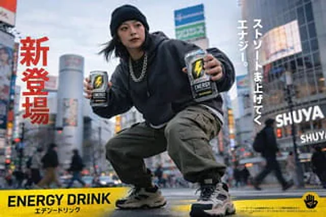

```text
A realistic urban advertising poster depicts a young Japanese woman in streetwear doing squats in the middle of a busy pedestrian crossing. She wears a black knit hat, a dark gray oversized hoodie, a chunky silver necklace, olive green cargo pants, and beige and black platform sneakers. She is showing the camera two identical cans of energy drinks; the cans are silver and black with a striking yellow lightning bolt logo and text.{argument name="can logo text" default="ENERGY"} The background is blurry and bustling.{argument name="city background" default="Tokyo street scene similar to Shibuya Crossing"} The image features pedestrians and neon lights. It employs a striking typographical design: a large, vertically aligned red line of Japanese text on the left.{argument name="left red text" default="Newly released"} The right side features white vertical Japanese text.{argument name="right white text" default="Energy that will bring the streets up."} There is a plain yellow banner along the bottom edge with bold black text printed on it.{argument name="bottom banner text" default="ENERGY DRINK"} It is accompanied by smaller Japanese text and a small black hand icon on the far right. It uses a dynamic wide-angle perspective with a shallow depth of field effect.
```

Model: GPT Image 2
Author: GPT Image 2 Prompts

[ProjectD](https://aitoolsradar.com/en/prompts/2b9a9acd5024b0) · [Recorded source](https://x.com/muku_sns/status/2045498446782873821#reversed-0)
 · [Full original metadata and byte evidence](data/projectd-batch-0050.json)

## Urban Graffiti Football Poster

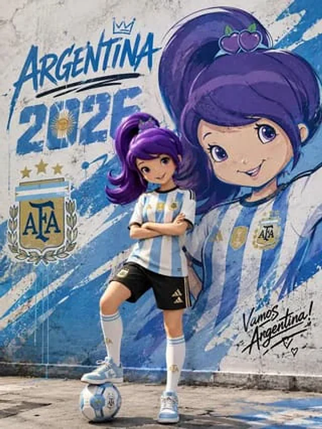

```text
Ultra-detailed street-art football poster featuring a {argument name="character" default="cute stylized cartoon/anime girl with vibrant purple hair tied in a high ponytail"}, standing confidently with crossed arms and one foot resting on a soccer ball. She wears the {argument name="team kit" default="Argentina national football team home kit: sky-blue and white striped jersey, black shorts, white knee-high socks, and matching football sneakers"}. Cheerful smile, large expressive violet eyes, charming mascot-like appearance. Background is a massive urban graffiti mural painted on a weathered concrete wall. A giant illustrated portrait of the same purple-haired character dominates the wall, surrounded by dynamic paint splashes, brush strokes, and football-themed street-art elements. Large bold graffiti typography reading “{argument name="title text" default="ARGENTINA 2025"}” with a crown above it. Prominent Argentina Football Association (AFA) crest, three championship stars, patriotic blue-and-white color palette, and handwritten slogan “Vamos Argentina!” Photorealistic environment combined with high-quality 3D animated character design, Pixar-inspired character rendering, vibrant colors, dramatic sports-poster composition, detailed textures, urban street culture aesthetic, realistic shadows and lighting, cinematic depth, football fan artwork, World Cup-inspired atmosphere, ultra-sharp details, high resolution, vertical composition, 3:4 aspect ratio. Style keywords: sports mural, graffiti art, football mascot, Pixar-style character, 3D cartoon girl, Argentina national team, street poster, urban wall art, vibrant blue and white theme, cinematic sports illustration, highly detailed, masterpiece quality.
```

Model: GPT Image 2
Author: Jahan Zaib

[ProjectD](https://aitoolsradar.com/en/prompts/ce48c26bb6aa36) · [Recorded source](https://youmind.com/prompts/urban-graffiti-football-poster-25933)
 · [Full original metadata and byte evidence](data/projectd-batch-0050.json)

## Urban Graffiti Hoodie Fashion Portrait

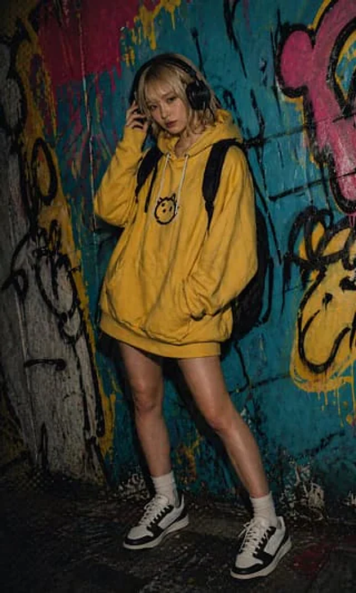

```text
A full-body fashion portrait full of emotion, the protagonist is {argument name="subject" default="young women"} Standing in a narrow city alley or tunnel covered in thick, colorful graffiti, shooting at night, employing a realistic style with dramatic, low-key lighting and flash photography. She leans casually against a wall, one hand touching a pair of large black headphones, the other hand tucked into an oversized {argument name="hoodie color" default="Mustard Yellow"} Inside the front pocket of the hoodie. The hoodie was long enough to be worn as a hooded dress, with a simple black smiley face printed on the chest and a white drawstring. She carried a black backpack, revealing two shoulder straps, and wore white mid-calf socks and chunky black and white low-top sneakers. Her legs were bare, her posture relaxed, one knee slightly bent, one foot stepping forward. Her shoulder-length hair was slightly messy, and the color was {argument name="hair color" default="Deep gold"} The shot employs a vertical composition, taken from head to toe, with the subject positioned slightly to the left of the frame. The background is a rough spray-painted wall, primarily in shades of blue-green, yellow, pink, and black, interspersed with paint drips, graffiti signatures, and abstract cartoon graffiti shapes, creating a raw street art atmosphere. The ground is dark, worn, and reflects paint splatters. High contrast, deep shadows, and realistic skin and fabric textures are used to achieve an editorial-grade street photography style and an underground urban atmosphere. Clothing and body details are sharply focused, while facial details are softened, creating a cinematic, nocturnal atmosphere.
```

Model: GPT Image 2
Author: GPT Image 2 Prompts

[ProjectD](https://aitoolsradar.com/en/prompts/ec4666aee97a53) · [Recorded source](https://x.com/maku67879787/status/2047468429494682009#reversed-0)
 · [Full original metadata and byte evidence](data/projectd-batch-0050.json)

## Urban Menswear Portrait on Overpass

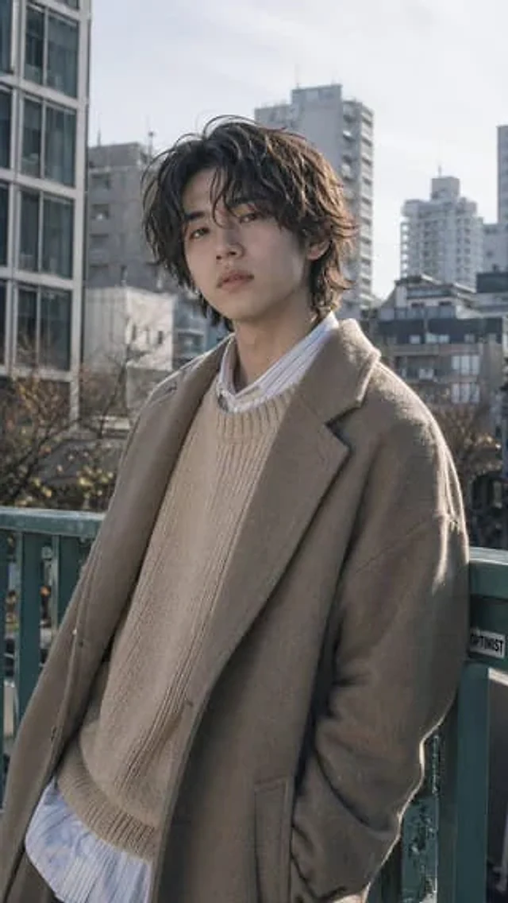

```text
A natural-style street fashion portrait, featuring a person{argument name="subject" default="Young Japanese men"} Standing on a city pedestrian bridge in the sunlight, the composition is a vertical portrait from mid-thigh to head. He casually leans against the worn green metal railing, one hand in his coat pocket, his body slightly tilted, presenting a relaxed and stylish candid pose rather than standing upright. He has medium-length, slightly wavy, messy hair, and his hair color is {argument name="hair color" default="Dark brown"} He has a natural volume around his ears and forehead, and a slender build. Dress him in a layered, neutral-toned winter outfit: one {argument name="coat color" default="grayish brown"} An oversized wool coat, layered over a {argument name="sweater color" default="off white"} A chunky knit crew neck sweater, with a long striped shirt peeking out from the collar and hem. The overall atmosphere is calm, sophisticated, and modern, like the pages of a Japanese men's fashion magazine. Soft natural light is used to present realistic skin tones, subtle shadows, soft colors, and a shallow depth of field. The background showcases out-of-focus mid-to-high-rise city buildings, bare winter trees, and a bright, light-colored sky, creating a realistic Tokyo urban atmosphere. The realistic style, understated color gradation, delicate fabric textures, magazine-edition composition, lack of dramatic special effects, text overlays, and other passersby are all present.
```

Model: GPT Image 2
Author: GPT Image 2 Prompts

[ProjectD](https://aitoolsradar.com/en/prompts/d7be20719e993c) · [Recorded source](https://x.com/1banana2546/status/2047284359669879273#reversed-0)
 · [Full original metadata and byte evidence](data/projectd-batch-0050.json)

## Urban Street Fashion Photography

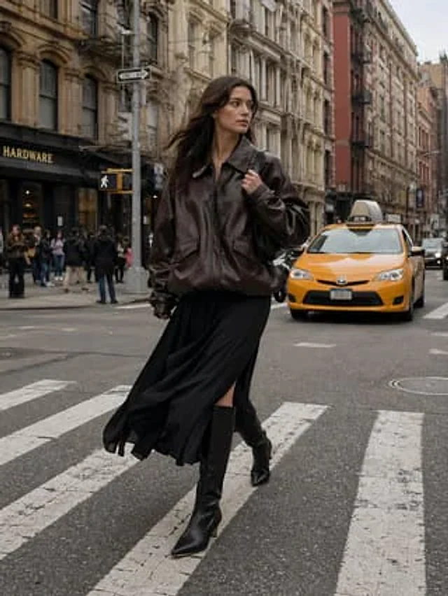

```text
An outdoor full-body photo captured a{argument name="subject" default="Young white woman, around late 20s"} Walking{argument name="location" default="Urban pedestrian crossings"} The image above. She is wearing a {argument name="jacket" default="Oversized matte chocolate brown leather jacket"} She wore a flowing black maxi dress and stylish black over-the-knee boots, showcasing a sophisticated street style. Her long, dark brown hair flowed in the wind, and her sidelong glance exuded composure and confidence. In the background, yellow taxis and pedestrians were faintly visible amidst the blurred cityscape, with architectural details rendered in neutral tones. The scene utilized soft ambient sunlight filtering through thin clouds to create a gentle, overcast lighting effect. The overall color scheme was warm earth tones, including browns, blacks, and touches of beige. This photograph appears to have been taken with a high-resolution digital camera using a wide-angle perspective, maintaining overall sharpness while highlighting dynamism and style.
```

Model: GPT Image 2
Author: GPT Image 2 Prompts

[ProjectD](https://aitoolsradar.com/en/prompts/369bece97b1655) · [Recorded source](https://x.com/AIwithSarah_/status/2047234995627172229)
 · [Full original metadata and byte evidence](data/projectd-batch-0050.json)

## Urban Street Style Character Study


```text
This scene is a medium close-up shot, using a level perspective, focusing on {argument name="subject" default="young women"} She is seated three-quarters turned to the side, leaning slightly forward, with her hips pushed back and her legs naturally crossed, left leg in front of right, knees slightly bent. Her upper body turns to the right and rear, her head facing the camera, striking a classic "looking back" pose, her eyes direct and clear, with a hint of playfulness. Her hairstyle is {argument name="hairstyle" default="Fluffy brown shoulder-length short hair"} She sports natural bangs and slightly curled hair. Her makeup is light and natural, with subtle eyeliner and a natural nude pink lip. The overall image uses a natural daylight filter, with light entering from the upper left, creating a soft backlit silhouette. The face and right side of her body are illuminated by warm golden light, while the left side has a natural shadow transition, enhancing the sense of depth. The lighting effect is bright natural light with a slight lens flare, creating an afternoon sun atmosphere. From a level perspective, the composition places the subject in the right-center of the frame, with the pedestrian crossing and road markings in the background serving as natural leading lines to the subject. The background is a city street, including roads, pedestrian crossings, green belts, and distant vehicles; the background is moderately blurred, but elements such as trees, guardrails, and parked scooters are still clearly discernible. The composition uses the rule of thirds, placing the subject in the right third to balance the image. The subject is wearing {argument name="clothing" default="Army green camouflage hooded sweatshirt"} She paired the outfit with black shorts, white high-top sneakers, and white mid-calf socks. Her backpack was black with orange-yellow decorative stripes and an orange plush charm, made of canvas and leather. The overall style was casual streetwear; her body language was relaxed, and her expression was curious and playful, presenting the image of a carefree, young, and energetic urban girl.
```

Model: GPT Image 2
Author: GPT Image 2 Prompts

[ProjectD](https://aitoolsradar.com/en/prompts/2f47f55396cf8e) · [Recorded source](https://x.com/Tz_2022/status/2045892003775361198)
 · [Full original metadata and byte evidence](data/projectd-batch-0050.json)

## Urban Streetwear Portrait with Graffiti

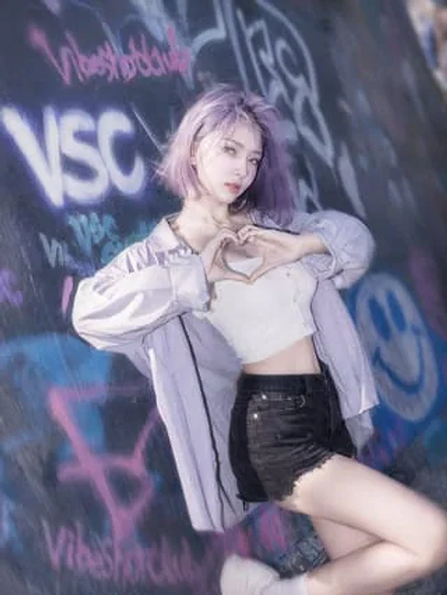

```text
A realistic portrait, the main character is a person with short, choppy hair (hair color:{argument name="hair color" default="Light purple"} A young East Asian woman. She leans against a dark wall covered in bright neon graffiti, the words of which are painted on the wall.{argument name="graffiti text" default="VSC"} "and a smiley face emoji. She is..."{argument name="pose" default="Make a heart shape with your hands."} She held it in front of her chest. She was wearing a {argument name="top clothing" default="A white button-down cropped top, layered under an oversized, unbuttoned light blue striped shirt."} The shirt slipped down to the shoulders, and the bottom was paired with {argument name="bottom clothing" default="Distressed black denim shorts"} White socks and white sneakers. One knee is slightly bent and raised. The lighting is soft, hazy, and dreamlike, with a cool color tone and a slightly tilted camera angle, creating a stylish urban street aesthetic.
```

Model: GPT Image 2
Author: GPT Image 2 Prompts

[ProjectD](https://aitoolsradar.com/en/prompts/59a05c67087d49) · [Recorded source](https://x.com/MANISH1027512/status/2045155996146831633#reversed-0)
 · [Full original metadata and byte evidence](data/projectd-batch-0050.json)

## Urban Turn-Back Street Portrait

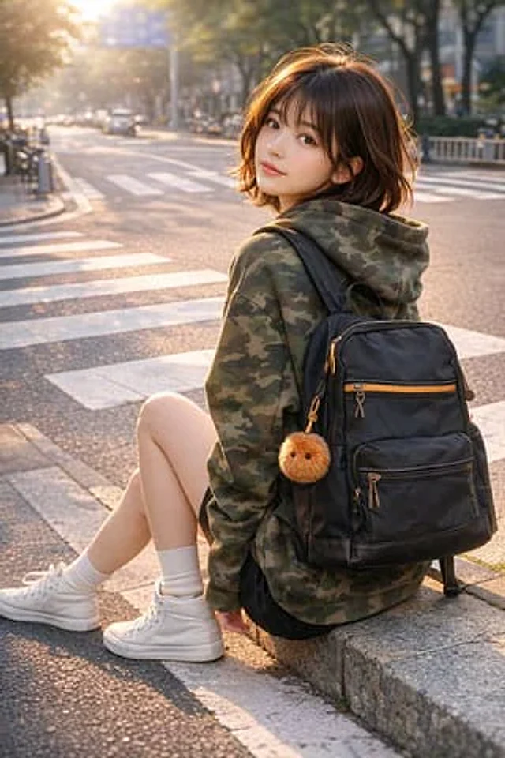

```text
该画面为中近景，采用平视镜头，聚焦于一位年轻女性。她以七分身镜头呈现，身体坐姿略带倾斜，臀部向后撅起，双腿自然交叠，左腿在前，右腿在后，膝盖微屈。她将上半身向右后方扭转，头部则转向镜头方向，形成一个经典的“回眸”姿态，目光直视镜头，眼神清澈而略带一丝俏皮。她的发型是蓬松的棕色齐肩短发，刘海自然垂落，发尾微卷，妆容清淡自然，仅在眼部有轻微眼线勾勒，唇色为自然裸粉。画面整体采用自然日光滤镜，光线从画面左上方斜射入，形成柔和的逆光轮廓，面部和身体右侧被温暖的金色光线照亮，左侧则形成自然的阴影过渡，增强了立体感。灯光效果是明亮的自然光，带有轻微的镜头眩光，营造出午后阳光的氛围。拍摄角度为平视，构图上，人物主体位于画面中偏右位置，背景中的斑马线与道路线条形成自然的引导线，将视线引向人物。背景为城市街道，包含道路、斑马线、绿化带和远处的车辆，背景被适度虚化，但依然可辨识出树木、护栏和停放的电动车等元素，构图上利用了三分法，人物位于右侧三分之一处，增强了画面的平衡感。主体穿着一件军绿色迷彩图案的连帽卫衣，下身搭配黑色短裤，脚穿白色高帮运动鞋配白色中筒袜。背包为黑色，带有橙黄色装饰条纹和一个橙色毛绒挂件，材质为帆布和皮革拼接。整体风格为街头休闲风，肢体语言放松自然，表情略带好奇与俏皮，整体呈现出一种随性、青春、充满活力的都市少女形象。
```

Model: GPT Image 2
Author: @Tz_2022

[ProjectD](https://aitoolsradar.com/en/prompts/6d3c1260344cf7) · [Recorded source](https://x.com/Tz_2022/status/2045892003775361198)
 · [Full original metadata and byte evidence](data/projectd-batch-0050.json)

## Urban Wheatpaste Poster Setup

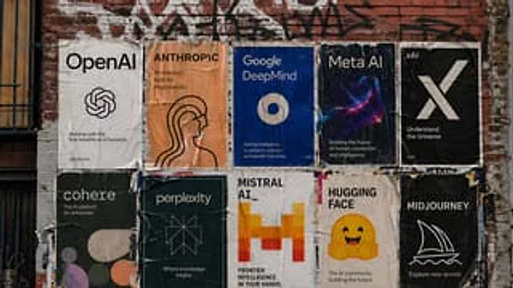

```text
exist{argument name="location" default="sf"} Create a poster display scene on the brick wall to showcase {argument name="subject" default="various AI labs"} Poster
```

Model: GPT Image 2
Author: GPT Image 2 Prompts

[ProjectD](https://aitoolsradar.com/en/prompts/3894765643084f) · [Recorded source](https://x.com/venturetwins/status/2046700418554851630)
 · [Full original metadata and byte evidence](data/projectd-batch-0050.json)

## Urban Wheatpaste Poster Setup

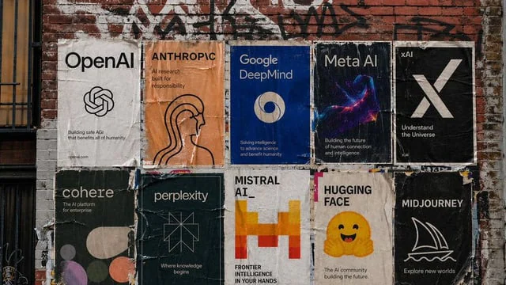

```text
Make a wheatpaste poster setup on a brick wall in {argument name="location" default="sf"} featuring posters from {argument name="subject" default="various AI labs"}
```

Model: GPT Image 2
Author: Justine Moore

[ProjectD](https://aitoolsradar.com/en/prompts/9ba82bf5cb451b) · [Recorded source](https://youmind.com/prompts/urban-wheatpaste-poster-wall-14391)
 · [Full original metadata and byte evidence](data/projectd-batch-0050.json)

## US Citizenship Identity Card Mockup


```text
Ultra-realistic 16:9 close-up scan of a {argument name="card type" default="United States citizenship card"} placed on a clean light grey/white background. The card is horizontally aligned, centered in frame, captured with sharp focus and professional studio lighting.
The design features an official government-style layout with clean typography and advanced security elements. Top section includes the header: “UNITED STATES OF AMERICA” and “CERTIFICATE OF CITIZENSHIP / IDENTITY CARD.” A subtle American flag motif appears in the background with red and blue gradient overlays.
The card includes a passport-style portrait of a {argument name="person description" default="young adult woman: shoulder-length soft wavy dark brown hair, warm neutral skin tone, light natural freckles, hazel eyes, minimal makeup, neutral expression, direct gaze, wearing a simple black top and small gold stud earrings"}.
Personal details displayed clearly:
– Surname: {argument name="surname" default="JOHNSON"}
– Given Name: {argument name="given name" default="EMMA GRACE"}
– Date of Birth: 09 AUG 1997
– Place of Birth: LOS ANGELES, CALIFORNIA, USA
– Citizenship Number: USC-8492-7731
– Date of Issue: 12 JAN 2025
– Date of Expiry: 12 JAN 2035
– Nationality: UNITED STATES
Security and design features include:
– Fine guilloche patterns across the entire surface
– Microprinted text and line engravings
– A semi-transparent holographic bald eagle emblem on the right side
– Embedded hologram seal with stars and shield motif
– Subtle Statue of Liberty illustration blended into the background
– Signature at the bottom: “Emma G. Johnson”
Additional elements:
– Department of Homeland Security emblem in the top corner
– Barcode or ID strip along the bottom edge
– Red, white, and blue gradient accents
Lighting is soft and evenly diffused, highlighting laminated plastic texture, subtle reflections, and holographic security overlays. No hand visible. Clean, minimal, professional composition. Ultra-detailed, photorealistic, 8K quality.
```

Model: GPT Image 2
Author: ANKIT PATEL 🇮🇳 | AI

[ProjectD](https://aitoolsradar.com/en/prompts/96f4f9013332e9) · [Recorded source](https://youmind.com/prompts/identity-card-mockup-generator-17847)
 · [Full original metadata and byte evidence](data/projectd-batch-0050.json)

## UxUi Tega (Design & Ai) #282

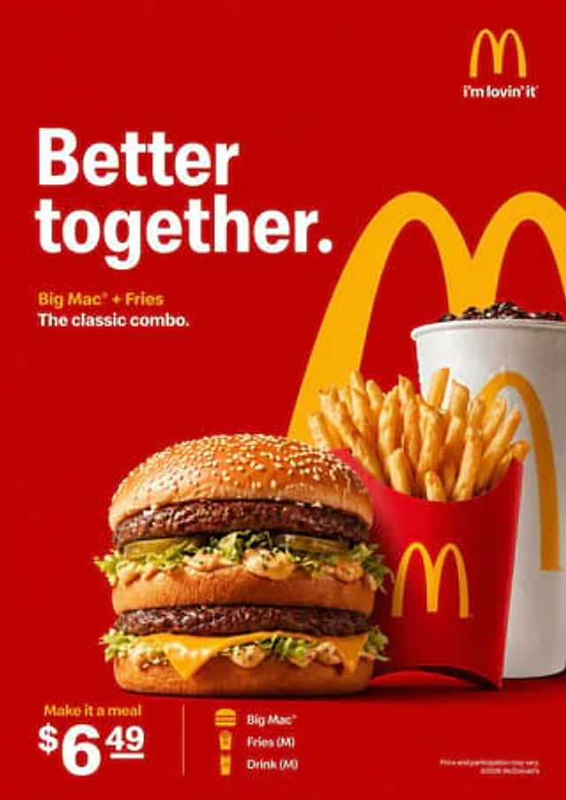

```text
Create a clean, high-quality McDonald’s advertisement.
Use a bold red brand color with yellow brand accents.
Show a Big Mac, fries, and a drink in a realistic, appetizing style.
Include the golden arches in the background.
Add bold white headline text: “Better together.”
Include smaller text: “Big Mac + Fries — The classic combo.”
Add price and minimal product details at the bottom.
Keep the layout simple, balanced, and premium with strong brand consistency.
```

Model: GPT Image 2
Author: UxUi Tega (Design & Ai)

[ProjectD](https://aitoolsradar.com/en/prompts/2641ca65f3560c) · [Recorded source](https://x.com/Tegadesigns/status/2047273916406677721)
 · [Full original metadata and byte evidence](data/projectd-batch-0050.json)

## Variety Show Surprise Prank Anime Screenshot


```text
提供された画像をキャラクターの基準リファレンスとして使用すること。
 
参照画像のキャラクターを主人公とした、
 
「{argument name="番組企画" default="人気バラエティ番組の寝起きドッキリ企画が大成功した瞬間"}」
 
を描くこと。
 
これはポスターではない。
 
これはキービジュアルではない。
 
これはテレビ番組内で実際に放送された寝起きドッキリ映像のスクリーンショットである。
 
キャラクターは寝起き直後であること。
 
突然起こされたことによる驚き、 混乱、 寝ぼけ、 恥ずかしさ、 状況把握できていない反応などを自然に表現すること。
 
寝癖、 乱れた布団、 崩れた姿勢、 生活感のある部屋などを描写すること。
 
寝間着や寝姿は固定しない。
 
参照画像のキャラクターの性格、 職業、 世界観、 普段の服装、 生活スタイルから自然に推測すること。
 
そのキャラクターらしい私生活が感じられる姿にすること。
 
机の上、 棚、 ベッド周辺、 枕元などには、
 
本人が他人に見られると少し恥ずかしい私物を配置すること。
 
それらは参照画像のキャラクターの性格、 職業、 趣味、 世界観、 生活スタイルから自然に推測すること。
 
一般的なオタクグッズに限定しないこと。
 
恥ずかしい私物はキャラクター固有の個性を表現するための要素であり、 フィギュア棚やアニメグッズのみを繰り返し配置しないこと。
 
視聴者が
 
「そんな趣味だったのか」
 
「そんな私生活だったのか」
 
と思える要素を含めること。
 
部屋全体をオタク部屋として固定しないこと。
 
部屋そのものも参照画像のキャラクターの生活スタイルから自然に推測すること。
 
画面内にはテレビ番組風の演出を追加すること。
 
大きなテロップで
 
『{argument name="テロップ内容" default="寝起きドッキリ大成功"}』
 
と表示すること。
 
テレビ番組らしい装飾、 テロップ、 効果音風文字、 ワイプ、 字幕、 番組ロゴ、 撮影中であることが分かる画面構成を取り入れること。
 
ドッキリレポーターを登場させること。
 
参照画像が1枚の場合：
 
世界観に適合したオリジナルのテレビレポーターを生成すること。
 
参照画像が複数枚の場合：
 
最初の参照画像をドッキリ対象者、
 
2枚目の参照画像をドッキリレポーターとして使用すること。
 
レポーターはマイクを持ち、 興奮気味に実況しているか、 ドッキリ対象者へマイクを向けていること。
 
テレビ番組スタッフや撮影クルーの存在を感じさせる演出を加えてもよい。
 
表情はコミカルで楽しい雰囲気を重視すること。
 
本当に放送されていそうなテレビ番組の一場面として描写すること。
 
SNSで一目見ただけで状況が理解できることを重視すること。
 
高品質アニメイラスト。
 
自然なキャラクター表現。
 
豊富な小物描写。
 
情報量の多いテレビ番組演出。
 
楽しく笑えるドッキリ番組の空気感。
 
視聴者が思わず笑ってしまうような、 キャラクターの意外な一面や私生活が垣間見える描写を重視すること。
```

Model: GPT Image 2
Author: Eris Create Lab

[ProjectD](https://aitoolsradar.com/en/prompts/12a5eaeeea4130) · [Recorded source](https://youmind.com/prompts/tv-show-prank-screenshot-23966)
 · [Full original metadata and byte evidence](data/projectd-batch-0050.json)

## Vegan Snack Bar Hero on Wood Slat


```text
A single matte kraft-paper-wrapped vegan snack bar resting on a rustic wooden slat surface, with a small scatter of raw almonds, dark chocolate chunks, dried cranberries and oat flakes around it. Soft warm natural light from the upper right, gentle long shadow on the wood grain. Square 1:1 hero composition, top-three-quarter angle. No brand text on the wrapper, no logos, no watermark. Premium healthy food product photography, ultra detailed paper texture, crisp ingredient detail, magazine cover quality.
```

Model: GPT Image 2
Author: @hiapi_ai

[ProjectD](https://aitoolsradar.com/en/prompts/38af42d03616a7) · [Recorded source](https://github.com/HiAPIAI/awesome-gpt-image-2-prompts)
 · [Full original metadata and byte evidence](data/projectd-batch-0050.json)

## Vegeta and Frieza Cosplay Comedy


```text
{argument name="キャラクター1" default="ベジータ"}のコスプレをしたおじさんと、{argument name="キャラクター2" default="フリーザ"}のコスプレをしたおじさんが{argument name="状況" default="コントしている"}画像をランダムに4枚生成せよ。
```

Model: GPT Image 2
Author: 聖星あい＠AI研究家

[ProjectD](https://aitoolsradar.com/en/prompts/4f3447cc413268) · [Recorded source](https://youmind.com/prompts/vegeta-frieza-cosplay-comedy-21708)
 · [Full original metadata and byte evidence](data/projectd-batch-0050.json)

## VELORA 奢华香水广告海报


```text
{
  "image_type": "luxury perfume advertisement poster",
  "resolution": "4K ultra HD (4096x5120)",
  "aspect_ratio": "portrait (4:5)",
  "style": {
    "aesthetic": "high-end fragrance campaign (Tom Ford, Dior inspired)",
    "tone": "dark luxury, sensual, elegant, powerful",
    "color_grading": "deep black shadows with rich golden highlights and warm amber glow",
    "lighting": "cinematic spotlight + golden rim light + soft fill light, dramatic shadows",
    "contrast": "high cinematic contrast",
    "depth_of_field": "shallow, sharp focus on face and perfume bottle"
  },
  "camera": {
    "type": "85mm portrait lens",
    "aperture": "f/1.6",
    "angle": "slightly low angle, premium perspective",
    "framing": "model upper body + product foreground"
  },
  "subject": {
    "gender": "female",
    "age_appearance": "young adult",
    "expression": "confident, sensual, calm",
    "styling": {
      "hair": "voluminous, slightly messy, glossy strands with golden highlights",
      "makeup": "soft glam, glowing skin, bold lips",
      "outfit": "brown tailored blazer with patterned silk scarf",
      "accessory": "thin transparent eyeglasses"
    }
  },
  "product": {
    "type": "luxury perfume bottle",
    "brand": "VELORA PARFUMS",
    "label": "EAU DE PARFUM",
    "design": "clear crystal glass bottle, golden liquid inside, metallic gold cap",
    "placement": "bottom center foreground on glossy black marble surface",
    "effects": "strong reflections, golden glow, subtle condensation, cinematic shine"
  },
  "environment": {
    "background": "dark blurred luxury interior with warm golden light streaks",
    "surface": "black marble with reflections",
    "extra_elements": "small flowers near bottle, golden particles, soft smoke"
  },
  "typography": {
    "logo": "V monogram + VELORA PARFUMS",
    "headline": "Not just a scent, It’s your Signature.",
    "tagline": "A fragrance that speaks before you do.",
    "secondary": "Own your essence. Leave a legacy.",
    "features": [
      "Long Lasting",
      "Premium Ingredients",
      "Crafted with Passion"
    ],
    "notes": [
      "Top: Pear, Bergamot, Pink Pepper",
      "Heart: Jasmine, Rose, Orris",
      "Base: Vanilla, Patchouli, Musk"
    ],
    "font_style": "luxury serif + elegant handwritten script",
    "color": "gold metallic",
    "placement": "top left + mid left + bottom balanced layout"
  },
  "post_processing": {
    "sharpness": "ultra sharp on face and bottle",
    "glow": "golden cinematic glow",
    "retouch": "high-end editorial finish",
    "vignette": "subtle dark vignette"
  },
  "mood": "premium luxury perfume campaign, cinematic, bold brand identity",
  "quality": "hyper-realistic, 4K ultra HD, commercial grade, award-winning fragrance ad"
}
```

Model: GPT Image 2
Author: @akkiwani703

[ProjectD](https://aitoolsradar.com/en/prompts/30306d8ef3866e) · [Recorded source](https://x.com/akkiwani703/status/2049778680969437564)
 · [Full original metadata and byte evidence](data/projectd-batch-0050.json)

## Velvedia Character Reference Sheet


```text
{argument name="character name" default="Velvedia"} Reference image
```

Model: GPT Image 2
Author: GPT Image 2 Prompts

[ProjectD](https://aitoolsradar.com/en/prompts/bc49d8d907bc82) · [Recorded source](https://x.com/JasminaAi/status/2046730197802663962)
 · [Full original metadata and byte evidence](data/projectd-batch-0050.json)

## Vertical — Bubble Tea Summer Menu


```text
Vertical 9:16 vibrant summer bubble tea ad. Three takeaway cups of bubble tea floating in a soft mid-air arc against a saturated mango-orange-to-watermelon-pink gradient background: one peach iced tea with visible fruit slices, one strawberry milk tea with pink boba, one mango green tea with yellow chunks. A burst of fresh fruit slices (mango, strawberry, peach, mint leaf) suspended around the cups mid-air. Subtle motion energy lines. A small bold centered headline at the top reads "Summer flavours are back". No brand logos on the cups, no watermark. Crisp commercial F&B ad photography, photorealistic liquid and fruit textures.
```

Model: GPT Image 2
Author: @hiapi_ai

[ProjectD](https://aitoolsradar.com/en/prompts/2a8e54bb722e7a) · [Recorded source](https://github.com/HiAPIAI/awesome-gpt-image-2-prompts)
 · [Full original metadata and byte evidence](data/projectd-batch-0050.json)

## Vertical — Coffee Chain Holiday Drink


```text
Vertical 9:16 holiday seasonal ad. A single tall takeaway coffee cup in matte burgundy red with a sleeve, topped with a generous swirl of cream and a dusting of cinnamon, held in a hand wearing a soft cream wool sleeve. Background is a softly blurred snowy evening street scene with warm bokeh fairy lights. A bold sans-serif headline in white at the upper third reads "Winter is back. So is the spiced one.". Subtle visible falling snow particles. No brand logo on the cup, no chain name, no watermark. Premium seasonal beverage ad photography, cinematic depth of field.
```

Model: GPT Image 2
Author: @hiapi_ai

[ProjectD](https://aitoolsradar.com/en/prompts/f8b10f29fb05fc) · [Recorded source](https://github.com/HiAPIAI/awesome-gpt-image-2-prompts)
 · [Full original metadata and byte evidence](data/projectd-batch-0050.json)

## Vertical 5-Panel Anime Comic Strip


```text
{
  "type": "Vertical manga",
  "header": "{argument name=\"comic title\" default=\"The Rabbit King, who laughs to the extreme because of a fake news story, and the enraged Kuro.\"}",
  "characters": [
    {
      "name": "{argument name=\"character 1 name\" default=\"Kuro\"}",
      "appearance": "Black hair, blue eyes, dark gothic military uniform, silver trim",
      "role": "The tsukkomi (complaint) character is easily angered."
    },
    {
      "name": "{argument name=\"character 2 name\" default=\"Rabbit King\"}",
      "appearance": "White hair, white rabbit ears, blue eyes, and a magnificent white royal outfit with a fur collar.",
      "role": "Laughing hysterically"
    }
  ],
  "layout": {
    "panel_count": 5,
    "panels": [
      {
        "number": "1",
        "scene": "Character 1 shows the tablet to Character 2. The right side displays a social media feed, including three posts about {argument name=\"social media topic\" default=\"Rabbit King Scandal\"} The discussion thread.",
        "dialogue_bubbles": 3
      },
      {
        "number": "2",
        "scene": "Character 2 laughs hysterically, accompanied by huge floating text effects. Character 1 looks annoyed, with veins popping out on his forehead.",
        "dialogue_bubbles": 3
      },
      {
        "number": "3",
        "scene": "Character 2 points at the other person and laughs. Character 1 looks very angry and is holding a tablet computer.",
        "dialogue_bubbles": 3
      },
      {
        "number": "4",
        "scene": "Character 1 speaks with intense anger. Character 2 laughs loudly, leaning back.",
        "dialogue_bubbles": 4
      },
      {
        "label": "{argument name=\"bonus panel title\" default=\"Extra\"}",
        "scene": "Character 1 looks exhausted. Character 2 is still laughing. A helmeted guard can be vaguely seen on the far left.",
        "dialogue_bubbles": 3
      }
    ]
  },
  "style": "High-quality anime illustrations, detailed character designs, expressive emotions, and comic-style speech bubbles and sound effects."
}
```

Model: GPT Image 2
Author: GPT Image 2 Prompts

[ProjectD](https://aitoolsradar.com/en/prompts/698c37b8a9e72c) · [Recorded source](https://x.com/masukarasulove/status/2044974882115682719#reversed-1)
 · [Full original metadata and byte evidence](data/projectd-batch-0050.json)

## Vertical Billboard — AI Coding Assistant Launch


```text
A modern vertical billboard advertisement layout. Upper two-thirds is a deep navy gradient background with a single clean serif headline in large pure white sans-serif type that reads "Code Ten Times Faster". Lower third shows a centered floating laptop with a generic abstract code editor interface glowing softly. A small minimalist CTA button at the very bottom reads "Get Started". Subtle film grain texture, sophisticated tech brand aesthetic, vertical 9:16 composition. No logos, no specific product name, no watermark. Crisp typography rendering, photorealistic device, premium ad design quality.
```

Model: GPT Image 2
Author: @hiapi_ai

[ProjectD](https://aitoolsradar.com/en/prompts/77c05e7a940b3f) · [Recorded source](https://github.com/HiAPIAI/awesome-gpt-image-2-prompts)
 · [Full original metadata and byte evidence](data/projectd-batch-0050.json)

## VHS 90s Aesthetic Modifier


```text
This photo uses{argument name="lighting" default="Strong direct flash"} The shooting technique, with overexposed highlights and heavy shadows, creates a raw 90s feel.{argument name="vibe" default="Visual Atmosphere"} The image is low-fidelity and has a poor visual quality.{argument name="texture" default="Medium film grain and analog texture"} .
```

Model: GPT Image 2
Author: GPT Image 2 Prompts

[ProjectD](https://aitoolsradar.com/en/prompts/64c0ef183c17e8) · [Recorded source](https://x.com/FSkifor/status/2047625042574402015)
 · [Full original metadata and byte evidence](data/projectd-batch-0050.json)

## VHS grocery-store chaos still


```text
Create a chaotic security-camera still from a 1990s grocery store. A man in full medieval armor is frozen mid-sprint stealing several rotisserie chickens past the dairy section. Overhead fluorescent lights reflect off the armor. The floor is baby-blue tile. Add a timestamp reading "08/13/96 04:44 AM" and a wall poster saying "NEW! TOASTER STRUDELS!". Make it low-fidelity, absurd, slightly intense, with motion blur, VHS color bleed, surveillance noise, and authentic analog-store lighting.
```

Model: GPT Image 2
Author: @reddit-community

[ProjectD](https://aitoolsradar.com/en/prompts/0106e188897caa) · [Recorded source](https://www.reddit.com/r/ChatGPT/comments/1jk0p3v/tried_to_push_the_new_image_model_with_an/)
 · [Full original metadata and byte evidence](data/projectd-batch-0050.json)

## VibeCoding Knowledge Visualization Prompt


```text
right{argument name="study topic" default="Web full-stack fundamentals required for VibeCoding"} Provide a visual demonstration and list 10 top-level full-stack project demos that can be created.
```

Model: GPT Image 2
Author: GPT Image 2 Prompts

[ProjectD](https://aitoolsradar.com/en/prompts/53564b096d25d3) · [Recorded source](https://x.com/alice168168/status/2047677510205456786)
 · [Full original metadata and byte evidence](data/projectd-batch-0050.json)

## Vice City Sunset Game Menu Mockup


```text
{
  "type": "Video game main menu UI model",
  "background_scene": {
    "setting": "The seaside city skyline at sunset, reminiscent of Miami, features vibrant pink and purple skies, with city lights reflected on the calm water.",
    "foreground": "There's a wooden dock in the lower left corner, a dark-colored speedboat is moored in the lower right corner, and palm tree silhouettes frame the area on both sides.",
    "midground": "The speedboat sped across the water, leaving a trail, while a neon sign on the right bank displayed '{argument name=\"city sign\" default=\"VICE CITY WELCOME\"} '",
    "sky": "Scattered clouds, helicopters with bright searchlights, and airplanes in the distance."
  },
  "ui_elements": {
    "main_logo": {
      "position": "Top left corner",
      "text": "{argument name=\"game title\" default=\"grand theft auto VI\"}",
      "style": "The main title uses a classic white lowercase font with large Roman numerals, and features a neon pink/purple/orange gradient and a palm tree silhouette."
    },
    "main_menu": {
      "position": "Left side center, below the main logo",
      "count": 5,
      "items": [
        "{argument name=\"menu option 1\" default=\"START GAME\"}(Highlighted with a bright pink background and a white right-pointing arrow)",
        "{argument name=\"menu option 2\" default=\"SETTINGS\"}",
        "ONLINE",
        "SOCIAL CLUB",
        "QUIT GAME"
      ]
    },
    "user_info": {
      "position": "Top right corner",
      "text": "Currently logged-in user:{argument name=\"username\" default=\"GTAVI_01\"}"
    },
    "developer_logo": {
      "position": "bottom left corner",
      "description": "R* Logo (R with a star)"
    },
    "button_prompts": {
      "position": "bottom right corner",
      "count": 2,
      "items": [
        "Account selection (with a yellow Y button icon)",
        "Select (with the green \"A\" button icon)"
      ]
    }
  }
}
```

Model: GPT Image 2
Author: GPT Image 2 Prompts

[ProjectD](https://aitoolsradar.com/en/prompts/5a46a3de4cb724) · [Recorded source](https://x.com/arora_mrinaal/status/2044387291008041405#reversed-1)
 · [Full original metadata and byte evidence](data/projectd-batch-0050.json)

## Victorian Animal Chess Match


```text
A highly detailed, cinematic portrait depicting an anthropomorphic animal.{argument name="dog breed" default="pug"} Imagine playing chess with a chimpanzee in a dimly lit, old-world Victorian study. The dog, a half-length figure, is on the left, dressed in a brown tweed blazer, white shirt, and bow tie. A round monocle with a chain hangs over one eye, and one paw rests beside the board as it thoughtfully observes the pieces. The chimpanzee, on the right, also wears a thick brown tweed blazer over a shirt, leaning forward with one hand supporting his chin in a classic contemplative pose, intently focused on the game. Between them is an intricately carved wooden chessboard, upon which lies a complete game of chess, 32 pieces clearly visible: 16 light-colored wooden pieces on the left and 16 dark-colored wooden pieces on the right, representing a realistic strategic layout rather than the initial arrangement. The room is filled with dark polished wood and leather armchairs. A warm amber lamp illuminates the far left, and bookshelves form the backdrop. Behind them, in the center, hangs a classical portrait, below which hangs a small mantel clock. The use of warm tungsten lighting, shallow depth of field, deep shadows, hyper-realistic hair and skin textures, subtle wrinkles, and reflections on a monocle creates a serious intellectual atmosphere with a touch of subtle humor. Symmetrical composition, eye-level perspective, photorealistic detail, sharp focus on faces and objects, luxurious period details, and deep brown and sepia tones all contribute to the overall effect.
```

Model: GPT Image 2
Author: GPT Image 2 Prompts

[ProjectD](https://aitoolsradar.com/en/prompts/ee46f405b7a2fa) · [Recorded source](https://x.com/sandor_bal6746/status/2047750040303681781#reversed-0)
 · [Full original metadata and byte evidence](data/projectd-batch-0050.json)

## Video Game Main Menu UI Mockup


```text
{
  "type": "Video game main menu UI design sketch",
  "theme": "{argument name=\"color palette\" default=\"A composite wave style of purple, pink and orange\"}",
  "background": {
    "setting": "Coastal city skyline, time period{argument name=\"time of day\" default=\"Sunset\"}",
    "elements": [
      "The water reflects the city lights",
      "Wooden dock in the foreground",
      "speedboats on the water",
      "helicopter with spotlight",
      "Airplanes in the sky",
      "Palm trees on the left and right edges",
      "It is written with '{argument name=\"city name\" default=\"VICE CITY\"} WELCOME neon sign"
    ]
  },
  "ui_layout": {
    "top_left": "Large logo{argument name=\"game title\" default=\"grand theft auto VI\"} Roman numerals with a neon gradient effect",
    "middle_left": {
      "type": "Vertical menu",
      "count": 5,
      "items": [
        "Start Game (highlighted with a pink gradient and a &gt; arrow)",
        "set up",
        "Online",
        "Social club",
        "Exit game"
      ]
    },
    "top_right": "Text 'Login User:'{argument name=\"username\" default=\"GTAVI_01\"} '",
    "bottom_left": "Developer star icon 'R*'",
    "bottom_right": "The controller prompts 'Select account Y, confirm A'"
  }
}
```

Model: GPT Image 2
Author: GPT Image 2 Prompts

[ProjectD](https://aitoolsradar.com/en/prompts/7a2987274f3b6b) · [Recorded source](https://x.com/aibi0123/status/2044456247416738199#reversed-1)
 · [Full original metadata and byte evidence](data/projectd-batch-0050.json)

## Video Streaming Platform Homepage UI


```text
{
  "type": "Web browser UI model",
  "platform": "{argument name=\"platform name\" default=\"YouTube\"}",
  "browser_window": {
    "style": "macOS Light Mode",
    "tab": "YouTube",
    "url_bar": "youtube.com"
  },
  "layout": {
    "header": {
      "components": [
        "Hamburger menu",
        "Platform Logo",
        "Search bar",
        "Create video icon",
        "Notification bell",
        "User Avatar"
      ]
    },
    "sidebar": {
      "position": "Left side",
      "item_count": 11,
      "sections": [
        {
          "name": "main",
          "items": [
            "front page",
            "Shorts",
            "subscription",
            "Original content",
            "YouTube Music"
          ]
        },
        {
          "name": "explore",
          "items": [
            "Popular",
            "Shopping",
            "music",
            "Movie",
            "live streaming",
            "game"
          ]
        }
      ]
    },
    "main_content": {
      "category_tags": {
        "count": 10,
        "labels": [
          "all",
          "game",
          "music",
          "live streaming",
          "podcast",
          "AI",
          "car",
          "compilation",
          "news",
          "Recent Uploads"
        ]
      },
      "video_grid": {
        "card_count": 5,
        "cards": [
          {
            "position": "Top left",
            "size": "big",
            "thumbnail_description": "Sam Altman and Greg Brockman sat on stage next to a standing humanoid robot with the words 'OpenAI Introducing Our Humanoid Robot' overlaid on it and a LIVE badge.",
            "video_title": "{argument name=\"featured live stream title\" default=\"Introducing Our Humanoid Robot\"}",
            "channel_name": "{argument name=\"featured live stream channel\" default=\"OpenAI\"}",
            "metadata": "482,000 people are watching."
          },
          {
            "position": "Top right",
            "size": "big",
            "thumbnail_description": "On the left is a surprised man's face; on the right is a huge mansion hidden in the forest, accompanied by an explosion effect, with bold yellow text covering it.{argument name=\"top right thumbnail text\" default=\"TOTAL SECRECY\"} '",
            "video_title": "{argument name=\"top right video title\" default=\"I Bought 100 Million Dollar Secret House!\"}",
            "channel_name": "MrBeast",
            "metadata": "4.1 million views, 19 hours ago, duration 20:49"
          },
          {
            "position": "Bottom left",
            "size": "Small",
            "thumbnail_description": "Steve Carell is holding a laptop displaying scenes from \"The Office\".",
            "video_title": "In-depth analysis of Steve Carell's most iconic roles | GQ",
            "channel_name": "GQ",
            "metadata": "987,000 views, 2 days ago, duration 17:46"
          },
          {
            "position": "Middle to lower",
            "size": "Small",
            "thumbnail_description": "A man observes sailboats on the sea through binoculars at sunset.",
            "video_title": "Black Sails Is Beautiful!",
            "channel_name": "Savage Books",
            "metadata": "606,000 views, 2 days ago, duration 17:46"
          },
          {
            "position": "Bottom right",
            "size": "Small",
            "thumbnail_description": "A terrifying masked killer character from a video game, with the text 'DEAD OF DAYLIGHT' overlaid.",
            "video_title": "Playing As The Seekers In Dead By Daylight",
            "channel_name": "Unknown",
            "metadata": "806,000 views, 1 day ago, duration 28:39"
          }
        ]
      }
    }
  }
}
```

Model: GPT Image 2
Author: GPT Image 2 Prompts

[ProjectD](https://aitoolsradar.com/en/prompts/fe82b389ed2e18) · [Recorded source](https://x.com/AelionStellar/status/2043480770954645754#reversed-0)
 · [Full original metadata and byte evidence](data/projectd-batch-0050.json)

## Vigo Zhao #294


```text
{
  "style_id": "photo-flat-doodle-campaign-poster",
  "style_name": "Photo × Flat-Doodle Campaign Poster",
  "version": "1.0",
  "aspect_ratio": "2:3",
  "reference": "Shanghai edition — derived from TfL 'Your London Adventure Starts Here'",

  "variables": {
    "scene": {
      "city": "上海 Shanghai",
      "landmark_photo": {
        "subject": "Oriental Pearl Tower with Lujiazui skyline in the background, viewed from across the Huangpu River",
        "angle": "low-angle hero shot, Pearl Tower centered and vertical, the two pink spheres clearly visible",
        "lighting": "early evening blue hour, city lights just starting to glow, sky still holding daylight",
        "treatment": "unretouched realistic photograph, natural steel + concrete + river reflection, no filter"
      },
      "background_sky": "deep teal-to-indigo gradient sky with a subtle warm glow at the horizon, upper 40% of canvas kept open for headline"
    },

    "hero_character": {
      "enabled": true,
      "scale": "giant — roughly 1.2× tower height, standing on the right, body extends beyond canvas",
      "pose": "holding a cartoon xiaolongbao steamer basket up to eye level with one hand, the other hand doing a casual wave, one foot slightly lifted mid-step",
      "skin_tone": "flat neon-green (non-realistic)",
      "face": "minimal — single curved smile, no nose, small cobalt-blue round eyes like dots",
      "hair": "long straight black-with-hot-pink-streaks hair, high ponytail swinging to one side, short blunt bangs",
      "outfit": {
        "top": "oversized cobalt-blue modern qipao-inspired jacket with a stand collar, hot-pink frog-button closures, cropped length",
        "bottom": "off-white baggy cargo pants with a neon-green side stripe and oversized pockets",
        "shoes": "chunky pink-and-yellow platform sneakers"
      },
      "accessory": "bamboo-style cartoon steamer basket with three xiaolongbao peeking out, tiny yellow steam swirls drawn above",
      "linework": "thin consistent black outline on qipao collar, frog buttons, ponytail strands, and steamer weave"
    },

    "doodle_props": [
      {
        "id": "giant_xiaolongbao_cloud",
        "shape": "three oversized cartoon soup dumplings floating together with exaggerated steam swirls",
        "colors": ["off-white dumpling skin", "hot-pink pleats", "sun-yellow steam"],
        "position": "lower-left foreground, tilted, partially covering the tower base"
      },
      {
        "id": "metro_heart_sticker",
        "shape": "Shanghai Metro red circle mark restyled as a flat sticker with sparkle stars",
        "colors": ["hot-pink circle", "off-white Chinese character 地", "neon-green sparkles"],
        "position": "pasted onto the lower sphere of the Pearl Tower"
      },
      {
        "id": "huangpu_wave",
        "shape": "stylized cartoon river wave curl, like a chunky comma",
        "colors": ["cobalt-blue wave", "off-white foam tips"],
        "position": "mid-left, floating in front of the tower mid-section"
      },
      {
        "id": "red_lantern",
        "shape": "round traditional cartoon red lantern with a tiny tassel",
        "colors": ["hot-pink lantern", "sun-yellow tassel", "neon-green string"],
        "position": "center-upper, overlapping between the two pink spheres of the tower"
      },
      {
        "id": "magnolia_petal_burst",
        "shape": "a small cluster of 3 oversized cartoon magnolia petals (Shanghai's city flower)",
        "colors": ["off-white petals", "hot-pink tips"],
        "position": "far-left mid-height, drifting diagonally as a color accent"
      },
      {
        "id": "panda_bubble_tea_buddy",
        "shape": "tiny cartoon bubble tea cup with a smiling face and a panda-ear straw topper",
        "colors": ["off-white cup", "ink-black pearls", "neon-green straw"],
        "position": "bottom-right near the character's shoe, as a sidekick scale cue"
      }
    ],

    "copy": {
      "headline": {
        "text": "你的上海奇遇 从这里开始",
        "language": "zh-CN",
        "max_lines": 3,
        "english_variant": "Your Shanghai Adventure Starts Here"
      },
      "subhead": {
        "text": "乘地铁。逛街巷。尝一口。",
        "language": "zh-CN"
      },
      "logos": {
        "bottom_left": "上海市人民政府 SHANGHAI MUNICIPAL GOVERNMENT",
        "bottom_right": "上海地铁 SHANGHAI METRO — 每一站都是故事 (with metro roundel)"
      }
    }
  }
}
```

Model: GPT Image 2
Author: Vigo Zhao

[ProjectD](https://aitoolsradar.com/en/prompts/02311d2e73718f) · [Recorded source](https://x.com/VigoCreativeAI/status/2047944141015802341)
 · [Full original metadata and byte evidence](data/projectd-batch-0050.json)

## VINCO Editorial Moodboard Screenshot


```text
Create a 4:5 editable fashion catalog project for use in a format called{argument name="brand name" default="VINCO"} The fictional brand. The images employ a dark, screenshot-style aesthetic, with a large, rounded charcoal gray text panel at the top and a 2x3 six-image fashion/editing grid in the lower left quadrant. The overall aesthetic blends Italian archival graphic design with late 1990s Southern California streetwear, mixing natural wine culture, skateboarding pragmatism, and sun-faded documentary fashion photography. It features rough yet precise art direction, midday outdoor lighting, slightly chaotic yet rigorous typography, and uses real people rather than glamorous fashion models. The top text panel displays a long, white sans-serif creative direction paragraph describing the shoot, containing multiple lines of text, much like AI prompts or design briefs displayed on a near-black background within rounded dark gray bubbles. The image grid contains six tiles: Tile 1 shows a young man in an oversized, faded olive green T-shirt and dark trousers standing against a poster-like gray-white background, with a striking {argument name="logo text" default="VINCO"} Brand logo, barcode graphic, and small-print edited text; Tile 2 is a close-up still life of a dark wine bottle with a minimalist white label that reads {argument name="bottle label" default="VINCO"} Shot in warm sunlight, it has a realistic paper texture and shadows; Tile 3 shows a person with their back to the camera, wearing a washed olive green long-sleeved shirt with a prominent but understated brand logo on the chest or back, paired with white shorts, and a yellow hangtag or sticker element in the upper right corner, against a background of light-colored walls with blue stripe details and editorial typography text; Tile 4 shows a skateboarder crouching or gliding, shot from behind, wearing a white T-shirt with a large black graphic on the back and dark shorts, on a pavement in golden sunlight; Tile 5 is a printed flat lay of wine-related merchandise, using cream-colored paper and a light yellow-green label or brochure, with the words {argument name="product text" default="Vino Naturale"} The six images, featuring grape illustrations, small bold text, and layered paper scraps, include a white T-shirt with a race number "97" printed on the chest, a fluorescent yellow-green hat with small branding text, and an outdoor palm tree and bright sky in the background. The overall design maintains a slightly imperfect, collage-like feel, as if extracted from an event plan or saved reference material. Earth tones are used throughout: olive green, cream, charcoal gray, sun-bleached white, asphalt gray, and soft browns, with a fluorescent yellow-green repeated as an accent in the details. A visible interface frame surrounds the composition: a dark applied background, a left-aligned lower image grid, a rounded gray "Edit" button in the lower left corner, and a small circular icon in the lower right corner to emphasize that this is a screenshot of a generated project, not a clean standalone poster.
```

Model: GPT Image 2
Author: GPT Image 2 Prompts

[ProjectD](https://aitoolsradar.com/en/prompts/6a334fcc639350) · [Recorded source](https://x.com/jayrizpop/status/2046725951640441151#reversed-0)
 · [Full original metadata and byte evidence](data/projectd-batch-0050.json)

## VINCO Editorial Moodboard Screenshot


```text
Create a 4:5 editorial fashion lookbook moodboard for a fictional brand called {argument name="brand name" default="VINCO"}. The image is a dark-interface screenshot-style composition with a large rounded charcoal text panel across the upper half and a 2-by-3 grid of six fashion/editorial images in the lower left quadrant. The overall aesthetic blends Italian archival graphic design with late-1990s Southern California streetwear, mixing natural wine culture, skate utility, and sun-faded documentary fashion photography. Use gritty but precise art direction, midday outdoor light, slightly chaotic but disciplined typography, and real-person casting rather than polished fashion-model energy. In the top text panel, show a long white sans-serif creative-direction paragraph describing the shoot, with multiple lines of copy, like an AI prompt or design brief displayed inside a rounded dark gray bubble on a near-black background. In the image grid, include exactly 6 tiles: tile 1 shows a young man in an oversized faded olive T-shirt and dark pants standing in front of an off-white poster-like backdrop with bold {argument name="logo text" default="VINCO"} branding, barcode graphics, and small editorial text; tile 2 is a close-up still life of a dark wine bottle with a minimalist white label reading {argument name="bottle label" default="VINCO"}, photographed in warm sunlight with tactile paper texture and shadow; tile 3 shows a person from the back in a washed olive long-sleeve shirt with large subtle chest or back branding, white shorts, and a yellow hanging tag or sticker element near the top right, posed against a pale wall with blue stripe detail and editorial layout text; tile 4 shows a skateboarder crouching or riding away, photographed from behind, wearing a white T-shirt with a large black graphic block on the back and dark shorts, in golden sun on pavement; tile 5 is a printed wine ephemera flat lay with cream paper and a pale chartreuse-green wine label or booklet reading {argument name="product text" default="Vino Naturale"}, featuring grape illustration, small black text, and layered paper pieces; tile 6 shows a person facing camera in a white T-shirt with a race-bib style chest print reading 97, wearing a fluorescent yellow-green cap with small brand text, standing outdoors with palm trees and bright sky behind them. Keep the six images slightly imperfect and collage-like, as if pulled from a campaign deck or saved references. Use earthy tones throughout: olive, cream, charcoal, sun-bleached white, asphalt gray, muted brown, and one fluorescent yellow-green accent repeated in small details. Include visible interface framing around the composition: a dark app-like background, the lower image grid aligned left, and a rounded gray “Edit” button near the bottom left, plus a small circular icon near the bottom right, reinforcing that this is a screenshot of a generated moodboard rather than a clean standalone poster.
```

Model: GPT Image 2
Author: Justin Rands

[ProjectD](https://aitoolsradar.com/en/prompts/77e49f071517fd) · [Recorded source](https://youmind.com/prompts/streetwear-wine-moodboard-screenshot-14411)
 · [Full original metadata and byte evidence](data/projectd-batch-0050.json)

## Vintage 35mm Flash Portrait


```text
A vintage 35mm film photograph, the main subject is{argument name="subject description" default="A young Asian woman"} Keep it{argument name="hair style" default="Dark long curly hair and wispy bangs"} She was wearing{argument name="clothing" default="A white ribbed vest and a loose beige knit cardigan that slipped off one shoulder."} She wore a delicate silver necklace. Her makeup was light, with pink blush and glossy lip gloss; her lips were slightly parted, and she looked directly at the camera. The harsh lighting from the camera's overhead flash created a casual, amateurish, candid aesthetic. The background was {argument name="setting" default="A dimly lit, somewhat cluttered room with clothes on the table and a wooden shelf."} The image exhibits a heavy film grain, slightly soft colors, and a nostalgic yet highly realistic photographic quality.
```

Model: GPT Image 2
Author: GPT Image 2 Prompts

[ProjectD](https://aitoolsradar.com/en/prompts/634552e16f78a2) · [Recorded source](https://x.com/ecooai/status/2046254319163302131#reversed-0)
 · [Full original metadata and byte evidence](data/projectd-batch-0050.json)

## Vintage 3D Miniature City Map


```text
{
  "type": "Isometric 3D map illustration",
  "style": "Retro map-drawing style, combined with highly detailed miniature models, warm lighting, and tilt-shift photography effects.",
  "background": "Old parchment with faint contour lines and map grids",
  "title_section": {
    "position": "Top left corner",
    "main_text": "{argument name=\"city name\" default=\"Shantou\"}",
    "subtitle_english": "{argument name=\"english city name\" default=\"SHANTOU\"}",
    "subtitle_chinese": "Coastal Cultural Hub, Tuocheng Open for Trade",
    "seal": "Red square stamp"
  },
  "map_elements": {
    "terrain": "A coastal peninsula surrounded by blue waters, dotted with small boats, rocky coastlines, and autumnal trees.",
    "architecture": "A dense fusion of traditional Chinese pavilions, European historical buildings, and modern skyscrapers.",
    "infrastructure": "Elevated railway lines with modern trains, a large suspension bridge in the background, and a winding coastal highway."
  },
  "labels": {
    "style": "Vertical rectangular wooden sign with black Chinese text",
    "count": 9,
    "locations": [
      "Shantou Small Park",
      "Zhongshan Park",
      "Queshi Bridge",
      "Shantou International Convention and Exhibition Center",
      "Zhenbang Food Street",
      "South Australia Lighthouse",
      "Shantou Old Town",
      "West Causeway Park",
      "Mayu Island Scenic Area"
    ]
  },
  "water_labels": {
    "text": "South China Sea",
    "position": "Left side of the middle waters"
  },
  "bottom_left_info": {
    "title": "Shantou Map",
    "subtitle": "Shantou City, Guangdong Province",
    "coordinates": "116°40'E 23°22'N",
    "compass": "The classic compass rose in the water above the information box"
  },
  "bottom_right_poem": {
    "text": "For a century, Chaoshan has been a commercial hub connecting the world; its cultural heritage has endured for millennia; its scenic spots along the coast are numerous and beautiful; and its gateway to eastern China is poised for great achievements.",
    "seal": "Red square stamp"
  }
}
```

Model: GPT Image 2
Author: GPT Image 2 Prompts

[ProjectD](https://aitoolsradar.com/en/prompts/27b5345a327b4d) · [Recorded source](https://x.com/A9Quant/status/2046197741685260384#reversed-0)
 · [Full original metadata and byte evidence](data/projectd-batch-0050.json)

## Vintage Amalfi Coast Travel Poster


```text
{argument name="illustration style" default="Modern Pencil Illustration"},{argument name="location" default="Amalfi Coast, Italy"} Retro travel poster illustrations featuring a panoramic coastal cliffside highway scene. A classic 1960s white car drives along a winding seaside road, with the deep blue Mediterranean Sea dotted with sailboats, colorful hillside villages, bright blue skies, and soft clouds. The foreground is outlined by lemon branches laden with vibrant lemons, warm summer sunshine, bold and vivid colors, a retro 1950s travel poster style, cinematic composition, high detail, silkscreen texture, and graphic illustration. Hand-drawn style with fluid brushstrokes and clear outlines. A high-contrast color palette maintains color harmony between the background and elements. A modern and decorative aesthetic.
```

Model: GPT Image 2
Author: GPT Image 2 Prompts

[ProjectD](https://aitoolsradar.com/en/prompts/de79abd00bb7c1) · [Recorded source](https://x.com/WolfRiccardo/status/2044562722491121718)
 · [Full original metadata and byte evidence](data/projectd-batch-0050.json)

## Vintage Amalfi Travel Poster


```text
Modern pencil illustration of Vintage travel poster illustration of the Amalfi Coast, Italy, panoramic coastal cliff road scene, classic 1960s white car driving along a curved seaside road, deep blue Mediterranean sea with small sailboats, colorful pastel hillside village, bright blue sky with soft clouds, lemon tree branches with vibrant yellow lemons framing the foreground, warm summer sunlight, bold vibrant colors, retro 1950s travel poster style, cinematic composition, high detail, screen print texture, graphic illustration. Hand-drawn style, illustration with loose strokes and defined contours. High-contrast color palette, maintaining chromatic harmony between background and elements. Contemporary and decorative aesthetic.
```

Model: GPT Image 2
Author: @WolfRiccardo

[ProjectD](https://aitoolsradar.com/en/prompts/7a10948ee56775) · [Recorded source](https://x.com/WolfRiccardo/status/2044562722491121718)
 · [Full original metadata and byte evidence](data/projectd-batch-0050.json)

## Vintage Apple Pie Recipe Poster


```text
{
  "type": "Retro illustrated recipe poster",
  "subject": "Classic American Apple Pie",
  "style": {
    "look": "Hand-drawn watercolor and ink style cookbook illustrations",
    "surface": "Antique cream-colored parchment background",
    "palette": "Warm brown, cinnamon brown, buttery gold, soft apple green, and soft charcoal gray lines.",
    "mood": "Nostalgic, rustic, and cozy farmhouse baking atmosphere"
  },
  "text": {
    "title": "Classic American Apple Pie",
    "sectionHeaders": [
      "Ingredients",
      "Production method"
    ],
    "footer": "Enjoy it while it's hot, and it tastes even better with a scoop of vanilla bean ice cream!"
  },
  "hero": {
    "position": "Top right corner",
    "description": "A golden-brown apple pie with a lattice top, placed in a clear glass pie dish, topped with a scoop of melting vanilla bean ice cream."
  },
  "layout": {
    "sections": [
      {
        "title": "Ingredients",
        "position": "middle",
        "count": 5,
        "labels": [
          "6 green apples",
          "200 grams of sugar",
          "1 teaspoon cinnamon powder",
          "A small piece of unsalted butter",
          "Handmade puff pastry dough"
        ]
      },
      {
        "title": "Production method",
        "position": "Mid-lower part",
        "count": 6,
        "labels": [
          "1. Slice the apple into thin slices.",
          "2. Add cinnamon and sugar and mix well.",
          "3. Roll out the bottom layer of dough.",
          "4. Stack the apples in the pie plate",
          "5. Use strips of dough to weave a grid top.",
          "6. Bake at 375°F until golden brown."
        ]
      }
    ],
    "extraElements": {
      "count": 2,
      "labels": [
        "Top main dish: Apple pie with an ice cream scoop",
        "Bottom left corner: A small bowl containing vanilla bean ice cream, garnished with a vanilla pod and flowers."
      ]
    }
  },
  "ingredients": [
    {
      "name": "Green Apple",
      "count": 6,
      "appearance": "Two whole green apples and one apple cut in half, exposing the seeds and light-colored flesh."
    },
    {
      "name": "sugar",
      "amount": "200 grams",
      "appearance": "Small ceramic bowl filled with white sugar crystals"
    },
    {
      "name": "Cinnamon powder",
      "amount": "1 teaspoon",
      "appearance": "A small bowl containing cinnamon powder, with two cinnamon sticks placed in front of it."
    },
    {
      "name": "Unsalted butter",
      "amount": "A small piece",
      "appearance": "On the small plate sits a thick, rectangular block of pale yellow butter."
    },
    {
      "name": "puff pastry dough",
      "amount": "1 copy",
      "appearance": "Simple, round, handmade dough balls sprinkled with flour"
    }
  ],
  "methodPanels": [
    {
      "step": 1,
      "text": "Slice the apple into thin slices.",
      "image": "On the wooden cutting board were many thin slices of green apple, a halved apple, and a kitchen knife."
    },
    {
      "step": 2,
      "text": "Add cinnamon and sugar and mix well.",
      "image": "The mixing bowl is filled with apple slices coated in cinnamon sugar and comes with a wooden spoon."
    },
    {
      "step": 3,
      "text": "Roll out the bottom layer of dough",
      "image": "The dough was rolled out on a floured surface, accompanied by a wooden rolling pin."
    },
    {
      "step": 4,
      "text": "Stack the apples in the pie plate.",
      "image": "The glass pie dish was piled high with seasoned apple slices."
    },
    {
      "step": 5,
      "text": "The top is woven from strips of dough.",
      "image": "The assembled apple pie is covered with a woven mesh of shortcrust pastry, with the strips hanging over the edges."
    },
    {
      "step": 6,
      "text": "Bake at 375°F until golden brown.",
      "image": "Finished apple pie baking in an old-fashioned oven"
    }
  ],
  "composition": "The layout is vertical, with a decorative handwritten title in the top left corner and an illustration of the main character, apple pie, in the top right corner. The ingredient list is centered, and six bordered instruction panels are arranged in a 3x2 grid. Each ingredient is accompanied by handwritten instructions below it and above each step image. Elegant decorative lines and dividers complete the look, and a small heart-shaped doodle is located near the footer.",
  "rendering": "Highly detailed food illustrations, clear and legible fonts, natural paper texture, delicate shadows, authentic cookbook poster design."
}
```

Model: GPT Image 2
Author: GPT Image 2 Prompts

[ProjectD](https://aitoolsradar.com/en/prompts/a5b12ee7eb6e95) · [Recorded source](https://x.com/Inshrah_ali_/status/2046830687152652407#reversed-0)
 · [Full original metadata and byte evidence](data/projectd-batch-0050.json)

## Vintage Apple Pie Recipe Poster


```text
{"type":"vintage illustrated recipe poster","subject":"classic American apple pie","style":{"look":"hand-painted watercolor and ink cookbook illustration","surface":"aged cream parchment paper background","palette":"warm sepia, cinnamon brown, buttery gold, soft apple green, muted charcoal linework","mood":"nostalgic, rustic, cozy farmhouse baking"},"text":{"title":"CLASSIC American Apple Pie","sectionHeaders":["INGREDIENTS","METHOD"],"footer":"Best served warm with a scoop of vanilla bean ice cream!"},"hero":{"position":"upper right","description":"golden brown lattice-top apple pie in a clear glass pie dish with a single scoop of melting vanilla bean ice cream on top"},"layout":{"sections":[{"title":"INGREDIENTS","position":"middle","count":5,"labels":["6 Granny Smith apples","200g granulated sugar","1 tsp ground cinnamon","a knob of unsalted butter","handmade flaky pastry dough"]},{"title":"METHOD","position":"lower middle","count":6,"labels":["1 Slice apples thinly","2 Toss with cinnamon and sugar","3 Roll out the bottom crust","4 Heap apples into the pie dish","5 Create a lattice top with pastry strips","6 Bake until golden brown at 375° F"]}],"extraElements":{"count":2,"labels":["top hero pie with ice cream scoop","bottom left small bowl of vanilla bean ice cream with vanilla pods and flower"]}},"ingredients":[{"name":"Granny Smith apples","count":6,"appearance":"2 whole green apples and 1 halved apple showing seeds and pale interior"},{"name":"granulated sugar","amount":"200g","appearance":"small ceramic bowl filled with white sugar crystals"},{"name":"ground cinnamon","amount":"1 tsp","appearance":"small bowl of brown cinnamon with 2 cinnamon sticks in front"},{"name":"unsalted butter","amount":"a knob","appearance":"thick rectangular block of pale yellow butter on a small plate"},{"name":"flaky pastry dough","amount":"1 portion","appearance":"round rustic ball of handmade dough dusted with flour"}],"methodPanels":[{"step":1,"text":"Slice apples thinly","image":"wood cutting board with many thin green apple slices, one halved apple, and a kitchen knife"},{"step":2,"text":"Toss with cinnamon and sugar","image":"mixing bowl full of sliced apples coated in cinnamon sugar with a wooden spoon"},{"step":3,"text":"Roll out the bottom crust","image":"rolled sheet of dough on a floured surface with a wooden rolling pin"},{"step":4,"text":"Heap apples into the pie dish","image":"glass pie dish filled high with seasoned apple slices"},{"step":5,"text":"Create a lattice top with pastry strips","image":"assembled pie covered with woven lattice pastry, strip ends hanging over edges"},{"step":6,"text":"Bake until golden brown at 375° F","image":"old-fashioned oven with the finished pie baking inside"}],"composition":"portrait orientation, decorative hand-lettered title on the upper left, hero pie illustration on the upper right, ingredients row centered beneath, 6 bordered instruction panels in a 3 by 2 grid, handwritten captions under each ingredient and above each method image, elegant flourishes and divider lines, small heart doodle near the footer","rendering":"high-detail editorial food illustration, crisp readable lettering, natural paper grain, subtle shadows, authentic cookbook poster design"}
```

Model: GPT Image 2
Author: Ai Girllie

[ProjectD](https://aitoolsradar.com/en/prompts/39accd02331b57) · [Recorded source](https://youmind.com/prompts/vintage-apple-pie-poster-14818)
 · [Full original metadata and byte evidence](data/projectd-batch-0050.json)

## Vintage Arcade Repair Flash Photography


```text
A retro amateur flash photograph from the late 1990s shows a young man repairing an arcade machine. He kneels on the dark patterned arcade carpet, turning his head to look directly at the camera with a calm expression. He wears a dark short-sleeved T-shirt, loose blue jeans, thick-soled white sneakers, and a dark baseball cap. The arcade machine's front lower panel is open, revealing a complex array of internal electronic components, including tangled wires, green circuit boards, a large speaker, and a metal cooling fan at the bottom. Bright pink, black, and white graphics are printed on the side of the machine, with the words "..." printed on them.{argument name="arcade game title" default="Dancing Stage"} "Wordmarks and Brands"{argument name="arcade brand" default="KONAMI"} The scene is set in a dimly lit arcade, with other glowing game machines faintly visible in the background. A screwdriver lies on the carpet beside his knees. The image features strong direct flash effects, a slight film grain, deep shadows, and a nostalgic Y2K aesthetic.
```

Model: GPT Image 2
Author: GPT Image 2 Prompts

[ProjectD](https://aitoolsradar.com/en/prompts/ed4c9bc9352ef7) · [Recorded source](https://x.com/nicdunz/status/2046306963605352841#reversed-3)
 · [Full original metadata and byte evidence](data/projectd-batch-0050.json)

## Vintage Beagle Botanical Plate


```text
Using the provided reference image, transform it into a vintage natural history encyclopedia illustration in the style of 19th-century scientific botanical illustrations. Retain the beagle and potted plant from the reference image as the main subjects, but redraw them as fine ink lines and pastel specimen illustrations drawn on aged off-white pages. Retain the dog's sitting posture, collar, and tag, as well as the plant's pot and overall structure. Add a formal infographic layout, containing a total of eight labeled areas: one central full-body study of a large beagle, one large plant study on the right, four left-side illustrations labeled "Fig. 1. Head (Front View)," "Fig. 2. Head (Side View)," "Fig. 3. Collar and Tag," and "Fig. 4. Forelegs (Front View)," three bottom-level comparative detail studies labeled "Eyes," "Nose," and "Leaf (Detail)," and one bottom-right annotation panel. Add delicate dotted line annotations around the main dog and plant, indicating features such as eyes, ears, nose, chest, legs, paws, fur, leaves, stems, and roots. The book features the page title "THE BEAGLE &amp; THE HOUSEPLANT" at the top, the subtitle "Observations on a Domestic Companion and Its Environment," corner plate labels "PL. I." and "Tab. 1.", the central caption "Fig. 5. Adult Beagle (Canis lupus familiaris). Sitting posture.", the plant description "Fig. 6. Potted plant (Dracaena sp.)," the bottom section title "Fig. 7. Comparative Study: Details," and a five-line footnote box: "Location: Indoor," "Observations: Peaceful coexistence between companion animals and potted plants.", "Date: May 17, 2024," "Observer: Naturalist's Log," and "Plate I." It employs clean engraving lines, restrained light watercolor washes, delicate paper textures, decorative borders, and a symmetrical museum-style plate composition.
```

Model: GPT Image 2
Author: GPT Image 2 Prompts

[ProjectD](https://aitoolsradar.com/en/prompts/ac3814c92d5e19) · [Recorded source](https://x.com/HebMT/status/2047737610005614608#reversed-1)
 · [Full original metadata and byte evidence](data/projectd-batch-0050.json)

## Vintage Beijing Travel Scrapbook Poster


```text
Create a charming hand-drawn vintage travel scrapbook poster with the theme of{argument name="city name" default="Beijing"} Designed as a warm-toned, worn-out sheet of paper resting on a wooden table, it evokes the effect of a Chinese illustrated travel guide page. The composition is a single, vertical poster, featuring the appearance of a slightly worn notebook page, soft stains, folded corners, tape marks, postmark-like ink, and a casual collage aesthetic. A striking, large black Chinese calligraphy title is placed at the top center.{argument name="city name" default="Beijing"} Below, English words are written in casual blue strokes.{argument name="english city name" default="Beijing"} Near the title, add a small red stamp and a short Chinese text block in the upper right corner describing the city's location in dark blue handwritten Chinese. Below the title are four Polaroid-style travel photos arranged in slightly irregular rows, each with a handwritten English description within a white border. Photo 1: The Forbidden City at sunset, with golden reflections and warm orange light; description about warm golden tones. Photo 2: The Great Wall winding through green mountains against a bright sky; description about the Great Wall landscape and green hills. Photo 3: Beihai Park lake with willow branches, boats, and a white pagoda in the background; description about the tranquil lake view. Photo 4: Traditional hutongs with gray brick walls and hanging red lanterns; description about red lanterns and charming narrow alleys. Use different decorative washi tape patterns above the photos. Arrange the lower two-thirds of the area as an infographic with colorful graffiti and a red and blue handwritten Chinese title. It contains five main sections: a geographical description in the upper right corner; a "Best Time to Visit" section on the left, recommending spring and autumn in Chinese, decorated with leaf doodles and sun icons; a "Major Attractions &amp; Features" section in the middle left, listing three items in Chinese with bullet points: the Forbidden City, the Badaling Great Wall, and Shichahai and Hutongs, accompanied by line drawings of palaces, pavilions, the Great Wall, hutong architecture, and tricycles; a "Must-Try Foods" section in the lower left, listing three foods in Chinese with bullet points: Peking duck, Zhajiangmian (noodles with soybean paste), and Douzhi (fermented mung bean juice), accompanied by cute illustrations of a Peking duck platter, a bowl of noodles with chopsticks, and a surprised expression doodle; and a "Tips" section in the lower middle, containing two suggestions in Chinese, each with a small icon: one suggesting wearing comfortable shoes due to the large size of the attractions, and the other suggesting booking tickets in advance due to holiday crowds. A map of China's outline is added near the middle right, with Beijing marked with a red star and a curved arrow pointing towards it. On the right, a traditional stone lion illustration is placed, accompanied by a cartoon-style handwritten Chinese speech bubble that emphasizes its majesty. A prominent recommendation box with a red fan-shaped outline contains two recommended locations in Chinese: the Temple of Heaven Park (with a note about praying for a bountiful harvest) and Nanluoguxiang; this box is decorated with two architectural illustrations, one of the Temple of Heaven and the other of a traditional gatehouse. At the very bottom, there is a line of dark blue, bold handwritten Chinese quote with red emphasis, next to three doodles: a vintage camera, the Bird's Nest stadium with a small red heart, and the CCTV headquarters building. Overall style: a warm travelogue infographic, hand-drawn pen and ink wash style, slightly childlike sketching, scrapbook collage, cream-colored paper texture, soft red and navy blue color palette, complemented by soft green and warm brown, lively and information-rich layout, clear and easy-to-read mixed typography, clean composition, and a nostalgic travel poster feel.
```

Model: GPT Image 2
Author: GPT Image 2 Prompts

[ProjectD](https://aitoolsradar.com/en/prompts/56381093d98a44) · [Recorded source](https://x.com/jaredliu_bravo/status/2046784330014618108#reversed-0)
 · [Full original metadata and byte evidence](data/projectd-batch-0050.json)

## Vintage Bosphorus Bridge Ferry Scene


```text
A dreamy, retro-style photograph showcasing dusk.{argument name="city" default="Istanbul"} The Bosphorus Strait is depicted in a vertical composition, viewed from the water's surface. A massive suspension bridge spans from the upper left to the upper right, with a tall bridge tower standing on the far left, delicate strings of warm-colored lights hanging from the cables, and a row of small orange lights illuminating the road surface. Below the bridge, the calm, deep water dominates the foreground. Three vessels are visible in the image: a medium-sized white passenger ferry facing the viewer in the middle distance, a long, low-slung white ferry in the distance under the bridge on the right, and a small boat on the far right edge. The left bank showcases the brightly lit waterfront area, dotted with warm yellow lights, a few palm trees, and a detail of an old building on the far left edge. In the background on the left side under the bridge, a light-colored waterfront mosque with one dome and two slender minarets is included. Behind all the scenery, a hazy hillside is added, its dense buildings fading into the distance. Employing a popular retro Instagram filter style: rich warm sepia and soft olive tones, faded contrast, soft focus, visible film grain, subtle vignetting, slight light leaks, low resolution, and an aged, analog photo texture. The overall atmosphere should be emotional, romantic, cinematic, and softly blurred, like a memory of an old travelogue.
```

Model: GPT Image 2
Author: GPT Image 2 Prompts

[ProjectD](https://aitoolsradar.com/en/prompts/7b26b50a5a234a) · [Recorded source](https://x.com/miilesus/status/2047036657509998595#reversed-1)
 · [Full original metadata and byte evidence](data/projectd-batch-0050.json)

## Vintage Botanical Infographic


```text
Retro botanical style infographic, themed "{argument name="product" default="Artisan Brew Coffee Beans"} "19th-century lithograph appearance, aged parchment tones (brown, beige, soft green). Center: steaming coffee cup + coffee bag with label, elegant title."{argument name="title" default="Premium Coffee Craft"} The image is surrounded by small illustrations: coffee beans, plants, a grinder, a kettle, and a cup. A simple process grid follows: picking → drying → roasting → grinding → brewing → pouring. The bottom depicts a coffee farm landscape. The ink lines are delicate, the watercolor soft, creating a rustic, handcrafted feel. Style keywords: short-lived Victorian print, botanical illustration, aged parchment, hand-painted ink, watercolor. Negative keywords: modern, neon, 3D, photorealistic, cluttered, watermarked, low detail.
```

Model: GPT Image 2
Author: GPT Image 2 Prompts

[ProjectD](https://aitoolsradar.com/en/prompts/eb64748906211a) · [Recorded source](https://x.com/ShamiWeb3/status/2046913292309066073)
 · [Full original metadata and byte evidence](data/projectd-batch-0050.json)

## Vintage Cat Natural History Plate


```text
{
  "type": "Retro Natural History Style Cat Character Guide",
  "subject": {
    "species": "domestic cat",
    "scientific title": "FELIS CATUS",
    "subtitle": "THE COLLARED COMPANION",
    "plate": "Plate I.",
    "pose": "A seated portrait, centered, with a dignified posture and head slightly raised.",
    "expression": "Calm, focused, gentle",
    "fur": {
      "base color": "Warm cream and white",
      "markings": "Symmetrical, deep brown facial markings and ears, white stripes on the bridge of the nose, and white chest and muzzle.",
      "texture": "Fine pen-and-ink sketches with cross-hatching, complemented by delicate watercolor rendering."
    },
    "eyes": {
      "color": "Clear blue",
      "shape": "Large and glossy, expressive"
    },
    "nose": {
      "color": "Soft pink"
    },
    "accessory": {
      "type": "Ornate choker",
      "details": "A choker adorned with ruffled lace, featuring a large pale pink bow, a dark oval medallion at its center, and a small silver bell hanging below."
    }
  },
  "style": {
    "overall": "A combination of Victorian zoological illustrations and whimsical pet portraits",
    "rendering": "Highly detailed ink line drawings, engraving illustration appearance, antique paper background, and subtle watercolor rendering.",
    "palette": "Cream, brown, white, dusty rose, silver, and soft neutral colors.",
    "composition": "The infographic layout is neat and symmetrical, with a large portrait at the center surrounded by seven smaller research panels.",
    "border": "Vintage-style border with delicate lines and decorative corners",
    "text treatment": "Serif font, black labels, figure captions, scientific figure layout"
  },
  "layout": {
    "sections": [
      {
        "title": "Figure 1. Head and facial markings",
        "position": "Top left",
        "count": 1,
        "labels": [
          "a",
          "b",
          "c",
          "s",
          "e"
        ]
      },
      {
        "title": "Figure 2. Necklaces and decorations",
        "position": "Top right",
        "count": 1,
        "labels": [
          "a",
          "b",
          "c"
        ]
      },
      {
        "title": "Figure 3. Hair and Color",
        "position": "center left",
        "count": 3,
        "labels": [
          "a. Chest and mouth/nose area",
          "b. Body",
          "c. Facial blemishes"
        ]
      },
      {
        "title": "Figure 4. Eye research",
        "position": "Center upper right",
        "count": 1,
        "labels": []
      },
      {
        "title": "Figure 5. Foot study",
        "position": "Center bottom left",
        "count": 1,
        "labels": []
      },
      {
        "title": "Figure 6. Beard arrangement",
        "position": "Center, bottom, right",
        "count": 3,
        "labels": [
          "a",
          "b",
          "c"
        ]
      },
      {
        "title": "Figure 7. Coat pattern and color swatch",
        "position": "Bottom Center",
        "count": 10,
        "labels": [
          "White",
          "Cream",
          "warm brown",
          "Dark brown",
          "pink",
          "Mustard Yellow",
          "Purple",
          "Forest Green",
          "black",
          "Silver (bell)"
        ]
      },
      {
        "title": "Figure 8. Texture details",
        "position": "Bottom right",
        "count": 4,
        "labels": [
          "long guard hairs",
          "Soft fleece base",
          "Lace trim details",
          "Bow fabric texture"
        ]
      }
    ],
    "centerpiece": "Large bust portrait of a cat wearing a bow collar",
    "additional elements": {
      "bottom left box": "Observation Notes Paragraphs",
      "bottom right box": "5-row taxonomy table",
      "bottom right corner": "Single footprint badge"
    }
  },
  "text": {
    "top title": "FELIS CATUS",
    "top subtitle": "THE COLLARED COMPANION",
    "plate": "Plate I.",
    "taxonomy rows": [
      "Class. Mammalia",
      "Order: Carnivora",
      "Family: Felidae",
      "breed of cat",
      "Variant. Domestic cat (wearing a collar)"
    ],
    "captions summary": "The annotations describe the ears, eyes, nose, beard, muzzle, collar components, hair areas, eye clarity, foot softness, beard function, color swatches, and fabric texture."
  }
}
```

Model: GPT Image 2
Author: GPT Image 2 Prompts

[ProjectD](https://aitoolsradar.com/en/prompts/5ffc955bb0523c) · [Recorded source](https://x.com/ResearchTamasan/status/2046931259293831463#reversed-0)
 · [Full original metadata and byte evidence](data/projectd-batch-0050.json)

## Vintage Cheeseburger Recipe Poster


```text
{
  "type": "Retro illustrated recipe poster",
  "subject": "Classic American Cheeseburger Cooking Infographic",
  "style": {
    "medium": "Hand-drawn ink and watercolor food illustrations",
    "look": "Vintage restaurant recipe poster, warm parchment background, micro-textured paper, sketched outlines, rich and inviting shadows.",
    "typography": "Large red handwritten title and black capital handwritten description text"
  },
  "text": {
    "title": "{argument name=\"headline text\" default=\"Classic American Cheeseburger\"}",
    "ingredientsHeader": "Ingredients",
    "methodHeader": "Cooking methods",
    "footer": "{argument name=\"footer text\" default=\"Enjoy while it&#39;s hot, and it tastes even better with crispy fries!\"}"
  },
  "hero": {
    "count": 1,
    "description": "The top right corner shows a fully assembled cheeseburger, complete with a sesame bun, wrinkled lettuce, thick slices of tomato, red onion rings, pickle slices, cheddar cheese melted on a grilled beef patty, and ketchup and mustard visible at the bottom."
  },
  "layout": {
    "sections": [
      {
        "title": "Ingredients",
        "position": "Upper Mid-to-Upper",
        "count": 6,
        "items": [
          "Beef Patties",
          "Cheddar cheese slices",
          "Fresh lettuce leaves",
          "Tomato slices",
          "Hamburger bun",
          "Ketchup and mustard"
        ]
      },
      {
        "title": "Cooking methods",
        "position": "Middle to lower middle part",
        "count": 6,
        "items": [
          "1. Shape the beef into patties",
          "2. Season with salt and pepper.",
          "3. Bake the meat patties until fully cooked.",
          "4. Add the cheese and let it melt.",
          "5. Lightly toast the bread",
          "6 sets of ingredients and sauces"
        ]
      }
    ],
    "extraElementsCount": 2,
    "extraElements": [
      "Illustration of a small burger near the condiment shop",
      "A basket of crispy fries and a small cup of ketchup in the bottom right corner"
    ]
  },
  "ingredients": {
    "count": 6,
    "items": [
      {
        "name": "Beef Patties",
        "appearance": "Single raw beef patty"
      },
      {
        "name": "Cheddar cheese slices",
        "appearance": "3 overlapping orange cheese squares"
      },
      {
        "name": "Fresh lettuce leaves",
        "appearance": "A small clump of green lettuce"
      },
      {
        "name": "Tomato slices",
        "appearance": "3 slices of red tomato"
      },
      {
        "name": "Hamburger bun",
        "appearance": "One sesame bun, stacked in half, like a mini hamburger."
      },
      {
        "name": "Ketchup and mustard",
        "appearance": "Two squeeze bottles, one red and one yellow."
      }
    ]
  },
  "method": {
    "count": 6,
    "steps": [
      {
        "step": 1,
        "scene": "Hands are shaping a raw beef patty"
      },
      {
        "step": 2,
        "scene": "A small bowl of salt next to the wooden pepper grinder"
      },
      {
        "step": 3,
        "scene": "Individual hamburger patties are grilled over an open flame on a grill."
      },
      {
        "step": 4,
        "scene": "The baked meat patties were topped with melted cheddar cheese."
      },
      {
        "step": 5,
        "scene": "Toast the two halves of bread cut-side down in a skillet."
      },
      {
        "step": 6,
        "scene": "The assembled cheeseburger, complete with curved arrows indicating the stacking process."
      }
    ]
  },
  "palette": {
    "count": 5,
    "colors": [
      "Warm beige parchment",
      "Deep tomato red",
      "Golden Cheddar Cheese",
      "Lettuce greens",
      "Baked palm"
    ]
  },
  "composition": "The vertical poster, with its balanced infographic layout, decorative red patterns around the title and headings, and clean spacing, is both appealing and nostalgic.",
  "quality": "High detail, clear and legible font, exquisite editorial-grade food illustrations."
}
```

Model: GPT Image 2
Author: GPT Image 2 Prompts

[ProjectD](https://aitoolsradar.com/en/prompts/9577501e14001c) · [Recorded source](https://x.com/SimplyAnnisa/status/2046829842247893178#reversed-0)
 · [Full original metadata and byte evidence](data/projectd-batch-0050.json)

## Vintage China Great Wall Poster


```text
Create a vertical cinematic travel poster for {argument name="country title" default="CHINA"}, evoking an ancient historical world. The composition shows the Great Wall of China winding dramatically from the lower foreground up toward a large stone watchtower on the left-middle, then continuing across misty mountain ridges into the far distance. Use layered watercolor-like mountains in purple, mauve, and dusty violet, with atmospheric fog filling the valleys and a soft parchment sky above. Add a small golden crescent moon in the upper-right sky. The top half should feel spacious and aged, with a warm beige antique paper texture, darkened weathered edges, subtle stains, and a vintage museum-poster finish. Typography: place one huge centered headline at the top reading {argument name="country title" default="CHINA"} in tall elegant high-contrast serif capitals, colored muted ochre gold. Directly below it, add a small italic subtitle reading {argument name="subtitle" default="Explore with Visionaria, First Cinematic Imagination App"} in muted purple. In the bottom-right corner, include one small red Chinese-style seal stamp as a decorative mark, not a logo. Visual style: cinematic historical fantasy poster, painterly ink-and-watercolor texture, soft grain, sepia parchment, dramatic depth, no modern objects, no people, no extra text. Keep the layout clean and centered, with the Great Wall and mountains occupying the lower two-thirds and the title area occupying the upper third.
```

Model: GPT Image 2
Author: poseidanai

[ProjectD](https://aitoolsradar.com/en/prompts/34d5b69e8bf59a) · [Recorded source](https://youmind.com/prompts/vintage-china-wall-poster-21360)
 · [Full original metadata and byte evidence](data/projectd-batch-0050.json)

## Vintage Chinese Food Map Poster


```text
A hand-drawn retro-style poster depicting Chinese tourism and food, using watercolor and ink painting techniques, presents a bird's-eye view of a misty mountain town. The composition is stylized.{argument name="place name" default="Jinyun"} The illustrated map features delicate rice paper textures against a soft beige background, adorned with bluish-gray mountains, winding rivers, country roads, ancient towns, unique rocks, and bamboo leaves. Pink flowers adorn the four corners. A striking artistic calligraphy title is located in the upper left corner.{argument name="headline text" default="Jinyun Mountain Wild Food Adventure Map"} Below is a small subtitle ribbon that reads "Huangdi Jinyun: A Fairyland on Earth." On the left is a poetic Chinese text: "Jinyun, a land of mountains and rivers, a fairyland of wonders and flavors of rural life; the warmth of human life follows delicious food; encounter Jinyun's landscape, a taste of home." The central location is the main urban area of ​​Jinyun County, marked "Jinyun County Town," surrounded by illustrated routes connecting various attractions and local delicacies. It includes 12 numbered food stations, each with a realistic hand-drawn food illustration next to its corresponding location on the map, along with an orange circular number, a Chinese label, and a brief description. The 12 stations are: 1. "Heyang Tushuang Noodles", described as "authentic mountain flavor, a taste of home cooking"; 2. "Jianchuan Bamboo Shoots and Vegetables", described as "seasonal mountain delicacies, dried and fragrant"; 3. "Jinyun Baked Cakes", described as "charcoal oven aroma, a signature dish of Jinyun"; 4. "Knocked Meat Soup", described as "fresh, fragrant, soft and glutinous, authentic local flavor"; 5. "Yanxia Stewed Soup", described as "slow-cooked with stone, warming and nourishing"; 6. "Fresh Stream Fish", described as "mountain and river delicacies, so fresh it'll make your eyebrows fall off"; 7. "Huzhen Wontons/Loucai", described as "traditional method, with a rich, chewy flavor, the more you eat, the more fragrant it becomes"; 8. "Kudzu Root Tofu", described as "refreshing and cleansing from the mountains"; 9. "Mountain Flour Dumplings", described as "thin skin and generous filling, a mountain flavor"; 10. "Bitter Acorn Tofu", described as "mountain forest delicacies, naturally fresh"; 11. "Farmhouse Steamed Rice Cake", described as "rich glutinous rice aroma, a taste of childhood"; 12. "Old Street Rice Cake" is described as "sweet and fragrant, handmade using traditional methods." The map is labeled with eight place names: "Xinjian Town," "Huzhen Town," "Dayang Town," "Xiandu Scenic Area," "Heyang Ancient Residences," "Yandang Study," "Jiaolong Grand Canyon," and "Jinyun County." Distinctive scenic clusters are depicted, including traditional white-walled, black-tiled houses, steep karst peaks, bridges, and terraced fields. A small legend box is added to the lower right corner, containing five items: "Mountains," "Rivers," "Main Roads," "Townships," and "Scenic Landmarks," as well as a sixth food icon label, "Food Recommendations." A decorative compass rose is also included nearby. The overall atmosphere is elegant, ingenious, nostalgic, and sophisticated, resembling a cultural tourism poster combining a local food guide with scenic map illustrations—well-composed and exuding brand appeal.
```

Model: GPT Image 2
Author: GPT Image 2 Prompts

[ProjectD](https://aitoolsradar.com/en/prompts/e4fecb14922ad9) · [Recorded source](https://x.com/ppmmzzcom/status/2047945186014331244#reversed-0)
 · [Full original metadata and byte evidence](data/projectd-batch-0050.json)

## Vintage Chinese SpaceX Propaganda Poster


```text
A retro socialist propaganda poster in the style of mid-20th-century China, printed on old paper with a warm brown hue, possessing an aged texture, faded ink, and slightly worn edges. The composition is vertical and heroic. The right half of the poster shows a half-length portrait of a male worker or revolutionary, wearing a dark hat and a dark practical jacket, his face slightly turned to the left, his expression resolute and determined. In the center left, a white reusable rocket is rising, its engine spewing bright flames, symbolizing the yearning for technological progress; the word "SPACEX" is vertically printed on the rocket, and landing gear is visible at the base. Behind the rocket, dramatic cream-colored radiating rays spread outwards against a soft blue background. In the lower left, a group of factory workers or citizens (six in total) are depicted cheering, waving and celebrating, with a large red flag waving beside them. Subtle industrial city elements and the silhouette of a launch tower are added behind the crowd. At the bottom, a large text area is reserved, with two lines of striking red Chinese font that read: "Recover rockets today, build interstellar homes tomorrow!" The poster adopts a screen-printed style, possessing a painterly realism. The color palette is limited to gray-blue, cream, brick red, and dark olive, presenting a strong ideological poster composition, an atmosphere of victory, and a retro-futuristic symbolism of the space race.
```

Model: GPT Image 2
Author: GPT Image 2 Prompts

[ProjectD](https://aitoolsradar.com/en/prompts/eb48f8e6d8341c) · [Recorded source](https://x.com/sJDdJ4vN4MB103w/status/2046584346510016533#reversed-0)
 · [Full original metadata and byte evidence](data/projectd-batch-0050.json)

## Vintage Confidential Case File


```text
A cinematic still life photograph taken from above showcases a vintage, confidential investigation file on a dark wooden table, centered and occupying most of the space. It displays a stack of three worn Manila folders, with aged beige paper, frayed edges, subtle stains, and realistic paper texture. The top folder is the visual focal point, secured in the upper left corner with an oversized silver paperclip. The title is typed in bold, monospaced black font at the top center.{argument name="headline text" default="CONFIDENTIAL – CASE FILES"} Below is a thin horizontal line. Two red rubber stamps are added: one near the top right corner, slightly angled, bearing "CONFIDENTIAL"; the other, a boxed stamp in the bottom right corner, reads "HANDLING INSTRUCTIONS DO NOT COPY – DO NOT DISTRIBUTE". On the right edge of the stacked folders, a labeled sidebar reads "CASE FILE NO.", below which is a thick black correction tape. The page format mimics old-fashioned typewriter government documents, with clear black ink, slightly uneven typewriter alignment, and numerous thick black correction tapes obscuring key details. It accurately includes five numbered sections: "1. SUBJECT INFORMATION", "2. CASE SUMMARY", "3. DETAILS", "4. ASSOCIATES / CONTACTS", and "5. REMARKS". The header area contains the following fields: "CASE FILE NO.:" (with a black correction bar), "DATE ​​OPENED:" (followed by...){argument name="date opened" default="March 14, 20___"} "PREPARED BY:" (with a black correction strip), "DEPARTMENT:" (followed by){argument name="department" default="Internal Investigations Unit"} ) and "CLASSIFICATION:" (followed by{argument name="classification" default="CONFIDENTIAL"} Part 1 contains six fields: "NAME:", "ALIASES:", "DATE ​​OF BIRTH:", "PLACE OF BIRTH:", "LAST KNOWN ADDRESS:", and "OCCUPATION:", each followed by a black correction strip of varying length. Part 2 adds a short, typewriter-style case summary text, embedding five separate black correction strips within the sentence flow. Part 3 adds a second paragraph of detailed text, embedding four separate black correction strips within the paragraph. Part 4 contains a three-column table labeled "NAME", "RELATIONSHIP", and "NOTES", with three rows of content, each cell's content covered by a black correction strip. Part 5 adds a short warning about sensitive information and unauthorized disclosure. Warm, dark brown lighting, with soft shadows and subtle vignetting around the folder edges, creates a somber, film noir-like archival atmosphere. The images should have a realistic, tactile, mysterious, and slightly dusty feel, like a confidential detective file shot as a prop for a crime thriller or world-building project.
```

Model: GPT Image 2
Author: GPT Image 2 Prompts

[ProjectD](https://aitoolsradar.com/en/prompts/a2c30bb74137da) · [Recorded source](https://x.com/PromptSin/status/2046702504188993556#reversed-0)
 · [Full original metadata and byte evidence](data/projectd-batch-0050.json)

