# ProjectD backfill batch 51

Complete original prompts and exact existing ProjectD images. Actual model labels and any available credits or notices are retained. Missing authors or license metadata are not filled in.

## Vintage Confidential Case File

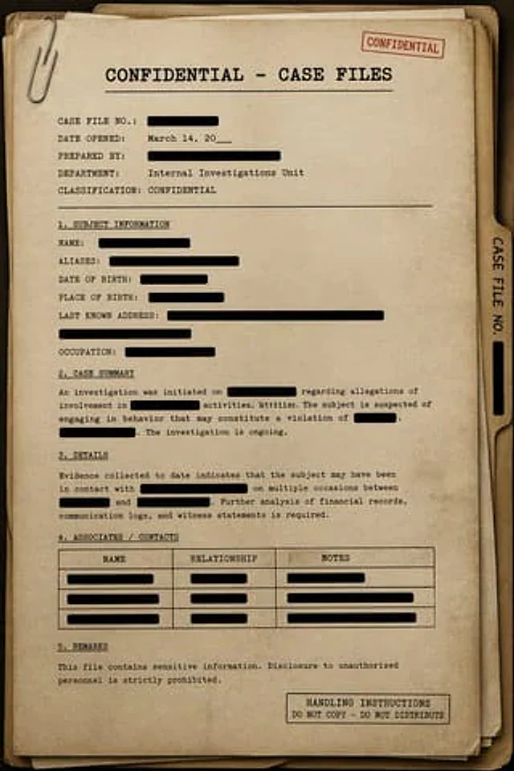

```text
A top-down cinematic still life of a vintage classified investigation dossier on a dark wooden desk, centered and filling most of the frame. Show a stack of 3 worn manila folders with aged beige paper, frayed corners, subtle stains, and realistic paper texture. The top folder is the main focus and is clipped at the upper left with 1 oversized silver paper clip. Across the top center, typewritten in bold black monospaced letters, the headline reads {argument name="headline text" default="CONFIDENTIAL – CASE FILES"}, with a thin horizontal rule beneath it. Add 2 red rubber-stamp marks: one near the top right that says "CONFIDENTIAL" at a slight angle, and one boxed stamp at the bottom right that says "HANDLING INSTRUCTIONS DO NOT COPY – DO NOT DISTRIBUTE". On the right edge of the folder stack, show 1 tabbed side label reading "CASE FILE NO." with a thick black redaction bar below it. The page is formatted like an old typewritten government document with crisp black ink, slightly uneven typewriter alignment, and many thick black redaction bars obscuring key details. Include 5 numbered sections exactly: "1. SUBJECT INFORMATION", "2. CASE SUMMARY", "3. DETAILS", "4. ASSOCIATES / CONTACTS", and "5. REMARKS". In the header area, include the fields "CASE FILE NO.:" with a black redaction bar, "DATE OPENED:" with {argument name="date opened" default="March 14, 20___"}, "PREPARED BY:" with a black redaction bar, "DEPARTMENT:" with {argument name="department" default="Internal Investigations Unit"}, and "CLASSIFICATION:" with {argument name="classification" default="CONFIDENTIAL"}. In section 1, include 6 fields: "NAME:", "ALIASES:", "DATE OF BIRTH:", "PLACE OF BIRTH:", "LAST KNOWN ADDRESS:", and "OCCUPATION:", each followed by black redaction bars of varying lengths. In section 2, add a short paragraph of typewritten case-summary text with 5 separate black redaction bars embedded in the sentence flow. In section 3, add a second paragraph of details text with 4 separate black redaction bars embedded in the paragraph. In section 4, include a 3-column table labeled "NAME", "RELATIONSHIP", and "NOTES", with 3 filled rows, each cell content covered by black redaction bars. In section 5, add a short warning sentence about sensitive information and unauthorized disclosure. Use warm sepia lighting, soft shadows around the folder edges, subtle vignetting, and a moody noir archival atmosphere. The image should feel realistic, tactile, secretive, and slightly dusty, like a confidential detective case file photographed for a crime thriller or worldbuilding prop.
```

Model: GPT Image 2
Author: PSS

[ProjectD](https://aitoolsradar.com/en/prompts/cfc366019a5935) · [Recorded source](https://youmind.com/prompts/vintage-confidential-case-file-14415)
 · [Full original metadata and byte evidence](data/projectd-batch-0051.json)

## Vintage Cookbook Illustration

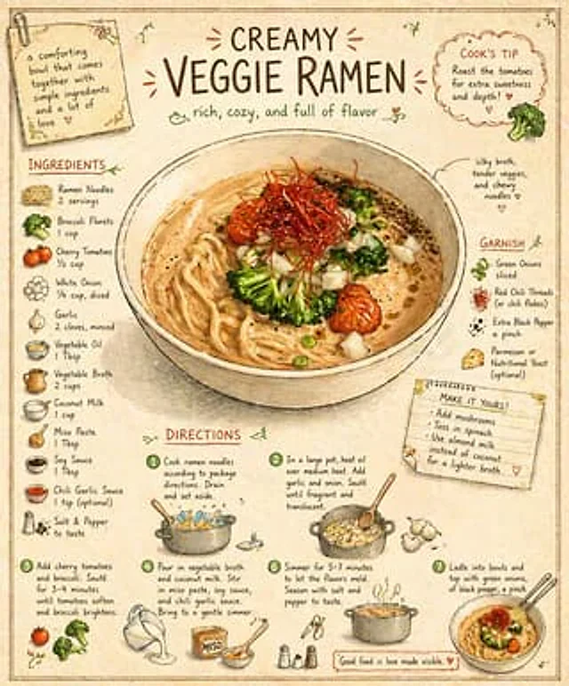

```text
This{argument name="food item" default="Hand-Pulled Noodle"} Turn it into a cute recipe page, and add {argument name="art style" default="Hand-drawn retro recipes"} Stylish illustrations. Carefully drawn ingredients should include labels, units of measurement, and tools such as bowls, stirrers, or spoons, surrounding the focal point of the composition. To create {argument name="mood" default="Warm and nostalgic"} To create a suitable atmosphere, use textured shadows, warm, soft tones, and delicate ink lines. Add recipe content in a handwritten style, naturally integrating ingredients and preparation steps into the layout. Ensure the page is both artistic and educational, perfectly combining beautiful color illustrations with the aesthetics of the recipe.
```

Model: GPT Image 2
Author: GPT Image 2 Prompts

[ProjectD](https://aitoolsradar.com/en/prompts/120f383fe9fc97) · [Recorded source](https://x.com/icreatelife/status/2046913167553352189)
 · [Full original metadata and byte evidence](data/projectd-batch-0051.json)

## Vintage Creature Concept Art Sheet

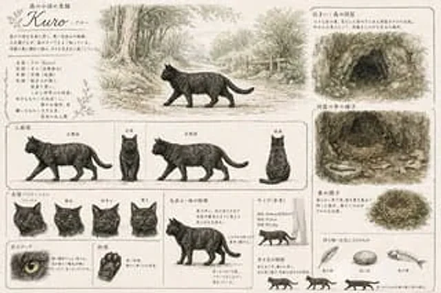

```text
{
  "type": "Biological concept art reference images",
  "style": "{argument name=\"art style\" default=\"Vintage pencil sketches on parchment with light watercolor washes\"}",
  "subject": {
    "name": "{argument name=\"creature name\" default=\"Kuro\"}",
    "species": "{argument name=\"creature species\" default=\"Black Cat\"}"
  },
  "layout": {
    "sections": [
      {
        "title": "Kuro, the black cat on the forest path",
        "position": "top-left",
        "description": "Personal profile text box decorated with plants"
      },
      {
        "title": "Main illustration",
        "position": "top-center",
        "description": "A cat walking on a forest path"
      },
      {
        "title": "Residence: Forest cave",
        "position": "top-right",
        "description": "{argument name=\"habitat type\" default=\"Forest cave\"} Appearance view"
      },
      {
        "title": "Inside the cave",
        "position": "mid-right",
        "description": "Showing the interior view of the nest and the fish."
      },
      {
        "title": "Three-view diagram",
        "position": "middle",
        "count": 4,
        "labels": [
          "left side",
          "front",
          "right side",
          "later"
        ],
        "description": "Orthographic view with horizontal alignment lines"
      },
      {
        "title": "Facial expressions",
        "position": "bottom-left",
        "count": 4,
        "labels": [
          "Relax",
          "alert",
          "curious",
          "surprise"
        ]
      },
      {
        "title": "detail",
        "position": "bottom-left",
        "count": 2,
        "labels": [
          "Eye close-up",
          "Paw pads"
        ],
        "description": "Close-up of an eye and a fleshy mass"
      },
      {
        "title": "Hair and body characteristics",
        "position": "bottom-center",
        "count": 1,
        "description": "Whole body anatomical structure breakdown"
      },
      {
        "title": "Size (reference)",
        "position": "bottom-right",
        "count": 1,
        "description": "Proportional reference for comparison with human legs"
      },
      {
        "title": "Walking characteristics",
        "position": "bottom-right",
        "count": 3,
        "description": "Small walking loop silhouette"
      },
      {
        "title": "Nest Overview",
        "position": "bottom-right",
        "count": 1,
        "description": "Detailed nest sketch"
      },
      {
        "title": "Personal belongings and favorite items",
        "position": "bottom-right",
        "count": 3,
        "labels": [
          "Bird Feather",
          "Round stones",
          "Fish bones"
        ],
        "description": "{argument name=\"favorite items\" default=\"Bird feathers, pebbles, fish bones\"} set"
      }
    ]
  }
}
```

Model: GPT Image 2
Author: GPT Image 2 Prompts

[ProjectD](https://aitoolsradar.com/en/prompts/625ad6067af732) · [Recorded source](https://x.com/ray_lightfield/status/2044948073617711532#reversed-0)
 · [Full original metadata and byte evidence](data/projectd-batch-0051.json)

## Vintage Cruise Ship in Istanbul

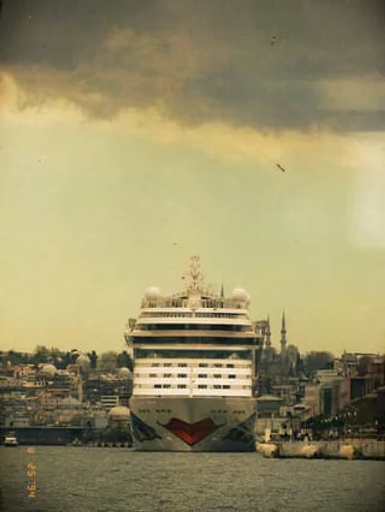

```text
A frontal shot centers on a massive white cruise ship sailing on the waters of Istanbul. Viewed from a distance, low in the narrow port channel, the ship slowly approaches the camera. A striking red and black stylized lip pattern adorns the bow, creating a playful and potentially viral Instagram filter effect. Behind and around the ship is a dense waterfront cityscape, including low-rise buildings, docks, and two slender minarets rising on the right side of the skyline. The composition is symmetrical and cinematic, with the cruise ship at the vertical center, the dark water in the foreground, and a vast, dramatic sky above. Thick storm clouds blanket the upper third of the sky, while a pale yellow-green haze below adds a retro, dreamlike, and slightly eerie atmosphere. The image must include four small birds scattered across the sky. A vintage, simulated film look is applied, featuring faded colors, grain, dust spots, soft focus, slight vignetting, gentle contrast, and the slightly worn texture of a 1990s travel snapshot. Add an orange camera-style date stamp to the bottom left corner, displayed as {argument name="date stamp" default="02 25 '94"} A vertical 3:4 aspect ratio, central composition, realistic photography, melancholic travel postcard tones, with city and cruise ship details softened by the fog.
```

Model: GPT Image 2
Author: GPT Image 2 Prompts

[ProjectD](https://aitoolsradar.com/en/prompts/b222cb7d45088d) · [Recorded source](https://x.com/miilesus/status/2047036657509998595#reversed-2)
 · [Full original metadata and byte evidence](data/projectd-batch-0051.json)

## Vintage Denim Jacket Try-On

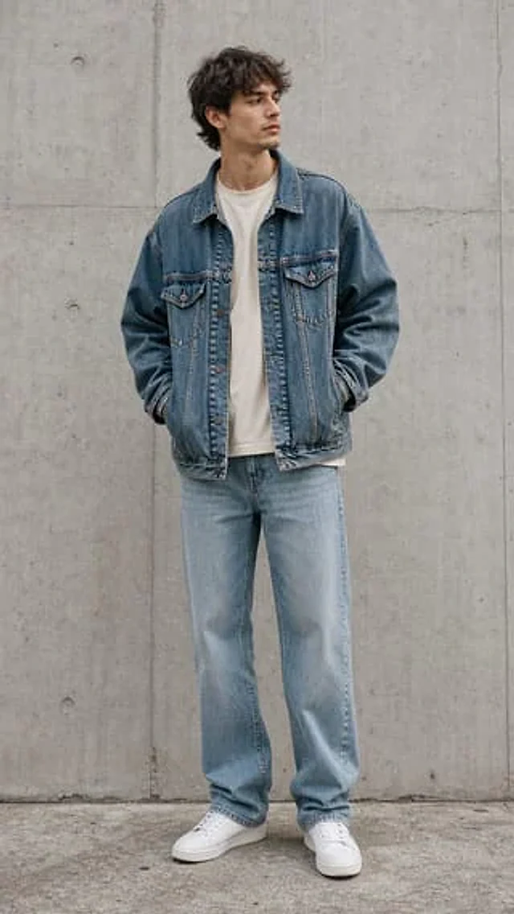

```text
Full-body editorial photograph of a young person standing against a neutral cool-grey concrete wall, wearing a slightly oversized washed indigo vintage denim jacket over a plain cream cotton t-shirt and straight-leg light wash jeans, simple white leather sneakers. Hands tucked loosely in the front jacket pockets, relaxed natural posture, mild candid expression. Diffuse overcast daylight, vertical 9:16 composition, head fully visible, feet visible at the bottom. No text, no brand patches visible, no watermark. Subtle film grain, photorealistic denim texture, editorial fashion catalogue quality.
```

Model: GPT Image 2
Author: @hiapi_ai

[ProjectD](https://aitoolsradar.com/en/prompts/d66b5c582a12b3) · [Recorded source](https://github.com/HiAPIAI/awesome-gpt-image-2-prompts)
 · [Full original metadata and byte evidence](data/projectd-batch-0051.json)

## Vintage Diner Menu Board Scene

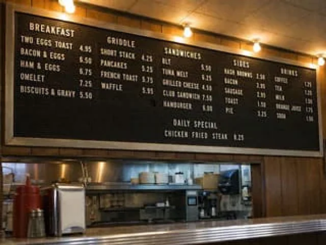

```text
Using the provided reference image, completely replace the train interior scene with a cozy, retro American restaurant bar interior. Remove the figures, window reflections, thermos cups, books, and all train elements. Create a wide-angle shot of the restaurant bar's front view, with warm tungsten lighting, wood-paneled walls, a stainless steel open kitchen, condiment bottles and metal napkin holders on the bar, and a large black letter menu above it. The menu should contain 6 sections, labeled BREAKFAST, GRIDDLE, SANDWICHES, SIDES, DRINKS, and DAILY SPECIAL. Please include the following exact items and prices: BREAKFAST includes 5 items: TWO EGGS TOAST 4.95, BACON &amp; EGGS 6.50, HAM &amp; EGGS 6.75, OMELET 7.25, BISCUITS &amp; GRAVY 5.50. GRIDDLE includes 4 items: SHORT STACK 4.25, PANCAKES 5.25, FRENCH TOAST 5.75, WAFFLE 5.95. SANDWICHES includes 5 items: BLT 5.50, TUNA MELT 6.25, GRILLED CHEESE 4.50, CLUB SANDWICH 7.50, HAMBURGER 6.00. SIDES includes 5 items: HASH BROWNS 2.50, BACON 2.95, SAUSAGE 2.95, TOAST 1.50, PIE 3.25. DRINKS includes 5 items: COFFEE 1.25, TEA 1.25, MILK 1.50, ORANGE JUICE 1.75, SODA 1.50. The daily special includes one item: CHICKEN FRIED STEAK 8.25. It makes it look like a realistic photograph with a touch of nostalgia, a simple composition, and no people in the picture.
```

Model: GPT Image 2
Author: GPT Image 2 Prompts

[ProjectD](https://aitoolsradar.com/en/prompts/ddf42a4d888fd8) · [Recorded source](https://x.com/vmlcano/status/2047048555622244582#reversed-1)
 · [Full original metadata and byte evidence](data/projectd-batch-0051.json)

## Vintage Dubai Watercolor Travel Poster

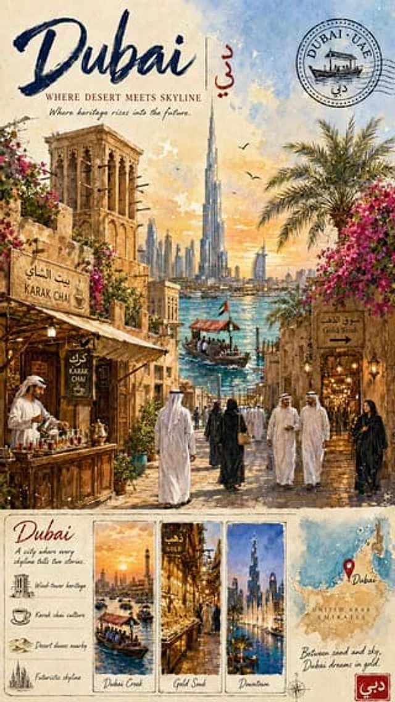

```text
Goal: Create a richly detailed vintage watercolor travel poster for {argument name="city name" default="Dubai"}, blending old-world Arabian heritage with a futuristic skyline.

Canvas: Vertical poster, tall 2:3 travel-brochure composition on aged cream paper with visible watercolor texture, ink outlines, warm sunset lighting, and slightly worn postcard edges.

Main layout: The upper two-thirds is a grand street-and-creek scene viewed from a historic souk alley leading toward the water and the modern skyline. Place large hand-painted navy brush lettering “{argument name="headline text" default="Dubai"}” at the top left. Under it add the serif tagline “WHERE DESERT MEETS SKYLINE” and a smaller cursive line “Where heritage rises into the future.” Add a vertical red Arabic calligraphy mark near the Burj Khalifa. At the top right place a circular black postal stamp reading “DUBAI · UAE” with a small dhow boat illustration and wavy postmark lines.

Main scene details: Show a lively old Dubai souk street with tan stone buildings, carved wind-tower architecture, wooden balconies, lanterns, flower-covered walls, and wet reflective cobblestones. In the center distance, Dubai Creek glows blue under a golden sunset, with small boats on the water and the Burj Khalifa rising dramatically in the skyline. Include the Burj Al Arab and other modern glass towers in the distance. Add birds in the sky and a United Arab Emirates flag on a boat canopy. On the right, include a palm tree and dense magenta bougainvillea cascading over the souk entrance. People wear traditional Gulf clothing: men in white kanduras and ghutras, women in black abayas, walking through the street.

Visible signs and text in the scene: Include exactly 4 prominent shop or location signs: 1) a large hanging sign on the left with Arabic text and “KARAK CHAI” plus a tea-cup icon, 2) a smaller black sign below it reading “KARAK CHAI” with a cup icon, 3) a right-side directional sign with Arabic text and “Gold Souk” plus a right arrow, 4) a gold shop sign in the lower strip with Arabic text and “GOLD.”

Foreground feature: At the lower left of the main scene, show a karak chai vendor stall made of dark wood. A vendor in white traditional clothing pours tea beside a brass kettle and a neat row of small tea glasses. The stall should feel warm, aromatic, and nostalgic.

Bottom travel-journal strip: The bottom third is separated like a scrapbook itinerary panel on aged paper. Include exactly 5 sections across this strip: 1) a left note card headed “Dubai” with the text “A city where every skyline tells two stories.” and exactly 4 illustrated bullet items: “Wind-tower heritage,” “Karak chai culture,” “Desert dunes nearby,” and “Futuristic skyline”; 2) a narrow framed watercolor vignette labeled “Dubai Creek,” showing a dhow boat at sunset; 3) a narrow framed vignette labeled “Gold Souk,” showing a glowing gold market alley; 4) a narrow framed vignette labeled “Downtown,” showing skyscrapers, Burj Khalifa, and fountains at night; 5) a right map panel showing the United Arab Emirates coastline with a red location pin and the handwritten label “Dubai.” Add the small uppercase text “UNITED ARAB EMIRATES,” a compass rose, the quote “Between sand and sky, Dubai dreams in gold.” and a small red stamp with Arabic text “دبي.”

Visual style: Romantic vintage travel illustration, watercolor and gouache, fine ink sketch details, warm ochre stone, turquoise creek water, navy lettering, gold sunset sky, magenta flowers, atmospheric perspective, dense but legible poster design.

Constraints: Keep all text hand-lettered but readable. Use the exact counted elements specified: 4 prominent shop/location signs, 5 bottom-strip sections, and 4 bullet items in the left note card. Do not add logos, watermarks, modern UI elements, or photorealistic rendering.
```

Model: GPT Image 2
Author: Dhilip Subramanian

[ProjectD](https://aitoolsradar.com/en/prompts/b9ec465225cb3b) · [Recorded source](https://youmind.com/prompts/vintage-dubai-travel-poster-22589)
 · [Full original metadata and byte evidence](data/projectd-batch-0051.json)

## Vintage Faction Infographic Poster

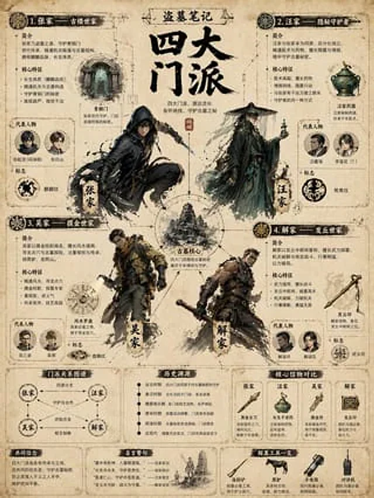

```text
{
  "type": "Highly detailed infographic poster",
  "style": "{argument name=\"visual style\" default=\"Vintage parchment style, martial arts and tomb raiding theme, delicate ink painting illustrations\"}",
  "header": {
    "franchise": "{argument name=\"franchise name\" default=\"The Grave Robbers&#39; Chronicles\"}",
    "title": "{argument name=\"main title\" default=\"Four Major Sects\"}",
    "subtitle": "Four major sects, with a long history; each possessing unique skills, guarding the secrets of the ancient tomb."
  },
  "centerpiece": {
    "title": "core of the ancient tomb",
    "description": "A circular chart connects the four major factions around a central illustration of an ancient pagoda."
  },
  "factions": [
    {
      "title": "1. The Zhang Family – A Family of Ancient Towers",
      "character_illustration": "A dynamic hat-wearing swordsman",
      "sections": [
        "Introduction",
        "Core features",
        "Representative figures",
        "logo"
      ],
      "representatives_count": 2,
      "representatives_labels": [
        "Zhang Qiling (Silent Bottle)",
        "Zhang Rishan"
      ],
      "symbol": "Qilin pattern",
      "featured_item": "Bronze door"
    },
    {
      "title": "2. The Wang Family – The Hidden Guardians",
      "character_illustration": "A mysterious person holding a glowing medicine bottle and wearing a straw hat.",
      "sections": [
        "Introduction",
        "Core features",
        "Representative figures",
        "logo"
      ],
      "representatives_count": 2,
      "representatives_labels": [
        "Wang Zanghai",
        "Li Lianhua (?)"
      ],
      "symbol": "Mandarin Duck Pattern",
      "featured_item": "Wang Family Medicine Equipment"
    },
    {
      "title": "3. The Wu Family – A Family of Tomb Raiders",
      "character_illustration": "Modern explorers carrying flashlights and wearing tactical gear",
      "sections": [
        "Introduction",
        "Core features",
        "Representative figures",
        "logo"
      ],
      "representatives_count": 2,
      "representatives_labels": [
        "Wu Sansheng",
        "Wu Xie"
      ],
      "symbol": "Coiled Dragon Pattern",
      "featured_item": "Feng Shui Compass"
    },
    {
      "title": "4. The Xie family – a family of tomb raiders.",
      "character_illustration": "Muscular warriors wielding mechanical weapons",
      "sections": [
        "Introduction",
        "Core features",
        "Representative figures",
        "logo"
      ],
      "representatives_count": 2,
      "representatives_labels": [
        "Unraveling the Chain",
        "The Understanding Flower"
      ],
      "symbol": "Tiger head stripes",
      "featured_item": "Faqiu Seal"
    }
  ],
  "bottom_panels": [
    {
      "title": "Sect Relationship Chart",
      "type": "Relationship diagram",
      "nodes_count": 4,
      "labels": [
        "Homogeneous branches",
        "Protection and Cooperation",
        "Enemy and friend",
        "Mutual checks and balances"
      ]
    },
    {
      "title": "Historical origins",
      "type": "Timeline list",
      "entries_count": 6,
      "labels": [
        "Ancient times",
        "Qin and Han Dynasties",
        "Wei, Jin and Southern and Northern Dynasties",
        "Tang and Song Dynasties",
        "Ming and Qing Dynasties",
        "Modern and contemporary"
      ]
    },
    {
      "title": "Comparison of core tokens",
      "type": "Comparison Table",
      "columns_count": 4,
      "items": [
        "Black Gold Ancient Sword",
        "Elixir of Immortality",
        "Tomb Raider Talisman",
        "Faqiu Seal"
      ]
    },
    {
      "title": "Shared Beliefs",
      "type": "text block"
    },
    {
      "title": "Famous quotes",
      "type": "Quotations List",
      "quotes_count": 4
    },
    {
      "title": "A list of tomb raiding tools",
      "type": "Item display",
      "items_count": 4,
      "labels": [
        "Luoyang shovel",
        "Black donkey hoof",
        "flashlight",
        "walkie-talkie"
      ]
    }
  ]
}
```

Model: GPT Image 2
Author: GPT Image 2 Prompts

[ProjectD](https://aitoolsradar.com/en/prompts/cbf72d27836981) · [Recorded source](https://x.com/GeekCatX/status/2044808405165248691#reversed-0)
 · [Full original metadata and byte evidence](data/projectd-batch-0051.json)

## Vintage Fantasy Postcard of Beacon Hollow

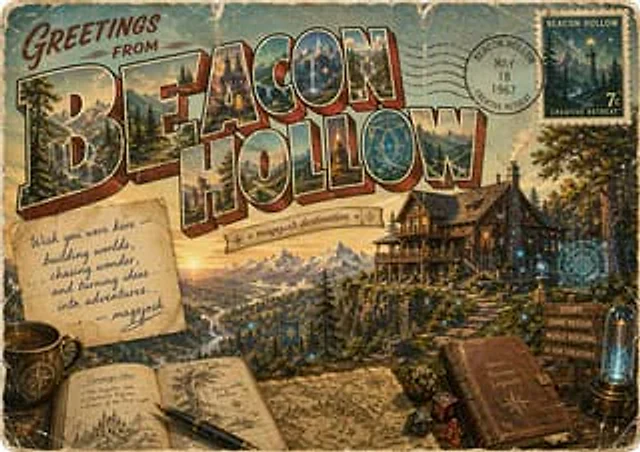

```text
Create a picture about{argument name="location name" default="BEACON HOLLOW"} This is a retro fantasy travel postcard poster, designed with reference to large-print commemorative postcards from the 1950s and 60s. The composition is a single, richly detailed horizontal scene with pronounced paper weathering textures, rounded postcard edges, faded ink, creases, scratches, mold, and worn edges. At the top and center, large, three-dimensional blocky letters spell out "BEACON HOLLOW" in a classic retro postcard style with warm cream outlines and reddish-brown embossed shadows; each letter contains a small landscape illustration of the destination, including mountain peaks, waterfalls, pine forests, a magical manor, glowing towers, and valley landscapes. The upper left corner features deep red hand-drawn cursive text reading "GREETINGS FROM". The upper right corner features a circular black postmark that reads "BEACON HOLLOW / MAY 18 / 1967 / CREATIVE RETREAT," overlaid on a vintage stamp marked "BEACON HOLLOW," "CREATIVE RETREAT," and "7c." The stamp depicts mountains under moonlight and a lighthouse-like beacon tower. Below the title is a small, curved ribbon banner that reads {argument name="tagline" default="a magejosh destination"} The background should depict a magnificent Golden Hour Valley with a winding river, distant snow-capped peaks, and dense evergreen forests. A large, brightly lit, wooden and stone-structured fantasy hut sits atop a cliff on the right, with stairs descending the slope. Subtle magical blue light and faint arcane circular symbols are scattered around the hut and foreground to create an atmosphere where world-building and magic intertwine. In the lower left corner, place three foreground tabletop items: a dark ceramic mug with a compass symbol, an open sketchbook, and a pen resting diagonally on its pages. The left page of the sketchbook is titled "Campaign Ideas," listing three key points: "The Forgotten Vale," "Clockwork Pilgrims," ​​and "Echoes of the First Light," with a small castle drawing below. The right page displays an illustration of trees and the handwritten text "Beery world Hollow." At the bottom center, add an old map spread out on a table, showing mountain icons and hand-drawn map details. Place five foreground elements in the bottom right corner: a closed leather journal embossed with a star compass and the phrase "Ideas Become Legends"; a pile of four multifaceted dice; a rustic wooden signpost with four directional stripes labeled "STORY," "GAME DESIGN," "WORLD BUILDING," and "AI FOR CREATORS"; a glowing glass lamp or tubular device; and a floating arcane bullseye symbol nearby. Slightly to the left of center, attach a handwritten note on an old piece of paper, written in blue cursive: "Wish you were here — building worlds, chasing wonder, and turning ideas into adventures."{argument name="signature name" default="magejosh"} The painting style is rich in detail, with a nostalgic American postcard design, a fantastical artistic concept, warm sunset light and shadow, soft blue sky, dark brown antiquity, and an engaging creative retreat atmosphere.
```

Model: GPT Image 2
Author: GPT Image 2 Prompts

[ProjectD](https://aitoolsradar.com/en/prompts/e320e0f90d4e41) · [Recorded source](https://x.com/ErroneousGaes/status/2047445115304616086#reversed-0)
 · [Full original metadata and byte evidence](data/projectd-batch-0051.json)

## Vintage Film Portrait of Girl with Bicycle

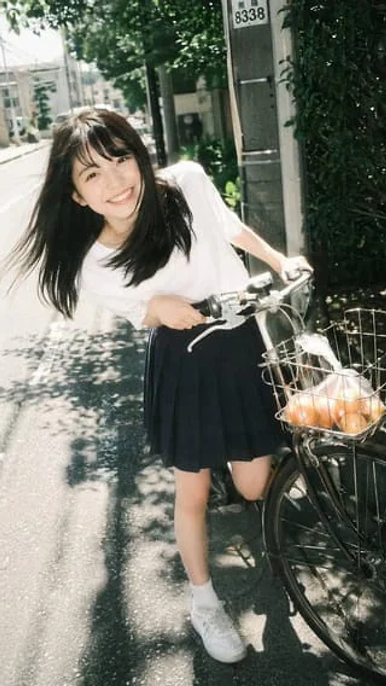

```text
One{argument name="photography style" default="Retro film photography"} A portrait in the style, the protagonist is{argument name="subject description" default="Young Asian women"} She smiled brightly at the camera. Leaning forward playfully, her hands gripping the handlebars of her bicycle, the backdrop a sun-drenched street. She was wearing a {argument name="top clothing" default="White short-sleeved T-shirt"} One{argument name="bottom clothing" default="Dark blue pleated skirt"} She wore white socks and white sneakers. Her long, dark hair swayed gently in the breeze. The bicycle's front basket contained {argument name="basket contents" default="A bag of oranges in a clear plastic bag"} The background features a paved road, dappled sunlight filtering through the leaves, and a telephone pole, capturing a nostalgic yet bright summer atmosphere.
```

Model: GPT Image 2
Author: GPT Image 2 Prompts

[ProjectD](https://aitoolsradar.com/en/prompts/b744245ea2cf4b) · [Recorded source](https://x.com/BubbleBrain/status/2044783836329087081#reversed-0)
 · [Full original metadata and byte evidence](data/projectd-batch-0051.json)

## Vintage French Crepe Recipe Poster

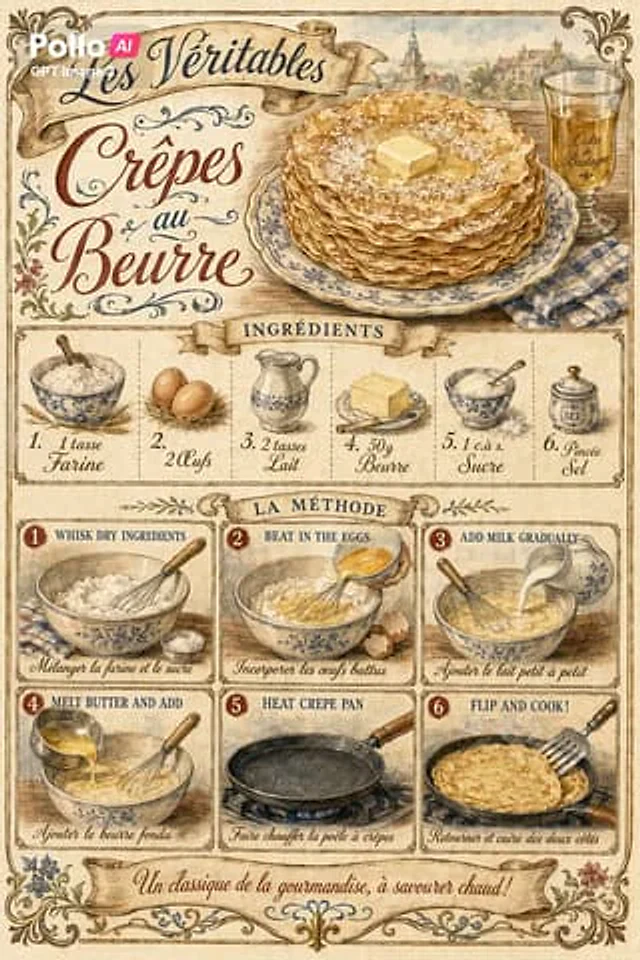

```text
{
  "type": "Retro French recipe poster",
  "subject": "Classic Butter Crepes: Gorgeous Illustrations and Food Infographics",
  "style": {
    "overall": "Antique cookbook posters, in the style of a French café from the Belle Époque, with hand-painted watercolor and ink illustrations, aged parchment textures, and soft warm cream, tan, brown, gray-blue, and faded red tones.",
    "rendering": "Highly clear decorative font, engraved decorative borders, soft paper stains, weathered edges, delicate floral patterns, and a nostalgic hand-printed aesthetic."
  },
  "text": {
    "main_title": "Les Véritables Crêpes au Beurre",
    "ingredients_header": "Ingredients",
    "method_header": "Production method",
    "footer_banner": "Classic cuisine, enjoy it while it's hot!",
    "logo": "{argument name=\"corner logo\" default=\"AI GPT Image 2\"}"
  },
  "layout": {
    "orientation": "Vertical",
    "border": "The entire frame features an ornate illustration border with scrolling foliage at the four corners.",
    "sections": [
      {
        "title": "Main image area",
        "position": "top",
        "count": 3,
        "labels": [
          "The main title calligraphy and large handwritten font on the ribbon",
          "Crepes stacked on the plate",
          "Glasses marked Cidre de Bretagne"
        ]
      },
      {
        "title": "Ingredients",
        "position": "Central",
        "count": 6,
        "labels": [
          "1. 1 cup flour",
          "2. Two eggs",
          "3. 2 cups of milk",
          "4. 50g butter",
          "5. 1 tablespoon of sugar",
          "6. A pinch of salt"
        ]
      },
      {
        "title": "Production method",
        "position": "Mid-lower part",
        "count": 6,
        "labels": [
          "1. Mix dry ingredients",
          "2. Add the eggs and mix well.",
          "3. Gradually add milk",
          "4. Add the melted butter",
          "5. Heat the crepe pan.",
          "6. Flip and fry until cooked through!"
        ]
      }
    ],
    "grid": {
      "ingredients_columns": 6,
      "method_columns": 3,
      "method_rows": 2
    }
  },
  "hero": {
    "plate": "Blue and white floral ceramic plate",
    "food": "about{argument name=\"crepe count\" default=\"14\"} Thin, golden crepes are stacked, sprinkled with powdered sugar, and topped with a pat of melted butter.",
    "surface": "rustic wooden tabletop",
    "cloth": "A blue and white checkered napkin is placed on the right.",
    "background": "A faded pastoral town landscape with church spires and old European buildings"
  },
  "ingredients": [
    {
      "index": 1,
      "item": "flour",
      "container": "Decorative ceramic bowl",
      "caption": "1 cup flour"
    },
    {
      "index": 2,
      "item": "egg",
      "count": 2,
      "caption": "2 eggs"
    },
    {
      "index": 3,
      "item": "milk",
      "container": "Blue floral ceramic milk jug",
      "caption": "2 cups of milk"
    },
    {
      "index": 4,
      "item": "butter",
      "container": "A small plate containing butter",
      "caption": "50g butter"
    },
    {
      "index": 5,
      "item": "sugar",
      "container": "Ceramic bowl with spoon",
      "caption": "1 tablespoon of sugar"
    },
    {
      "index": 6,
      "item": "Salt",
      "container": "Ceramic jar with lid marked SEL",
      "caption": "A pinch of salt"
    }
  ],
  "method_panels": [
    {
      "index": 1,
      "title": "Mixing dry ingredients",
      "image": "A mixing bowl containing flour and a whisk.",
      "caption": "Mix flour and sugar"
    },
    {
      "index": 2,
      "title": "Add eggs and mix well.",
      "image": "Pour the eggs into a bowl and whisk them, leaving some broken eggshells on the side.",
      "caption": "Add beaten eggs"
    },
    {
      "index": 3,
      "title": "Gradually add milk",
      "image": "Milk was poured from the ceramic pitcher into the batter.",
      "caption": "Add milk in small amounts several times."
    },
    {
      "index": 4,
      "item": "Add melted butter",
      "image": "Pour the melted butter from the saucepan into a bowl.",
      "caption": "Add melted butter"
    },
    {
      "index": 5,
      "title": "Heating Crepe Pan",
      "image": "An empty black crepe pan is heated over a blue gas flame.",
      "caption": "Heating Crepe Pan"
    },
    {
      "index": 6,
      "title": "Flip it over and cook until done!",
      "image": "The crepes in the pan, the metal spatula is lifting the edges",
      "caption": "Flip and cook on both sides."
    }
  ],
  "decorative_elements": {
    "count": 8,
    "labels": [
      "Ribbon banner after top title",
      "Ribbon banner after ingredient titles",
      "How to make a ribbon banner after the title",
      "Large ribbon banner at the bottom",
      "Floral vine decoration on the left side of the title",
      "Floral corner decoration",
      "Curled parchment scroll style",
      "The fine dividing line between the ingredients and preparation method panels"
    ]
  },
  "quality": "A balanced and symmetrical composition, clear and legible French and English text, a detailed yet neat infographic layout, and a captivating old-world cooking poster."
}
```

Model: GPT Image 2
Author: GPT Image 2 Prompts

[ProjectD](https://aitoolsradar.com/en/prompts/eeb52d0e7f9fd1) · [Recorded source](https://x.com/PolloAIFR/status/2046774203920113932#reversed-1)
 · [Full original metadata and byte evidence](data/projectd-batch-0051.json)

## Vintage Garden Wedding Portrait

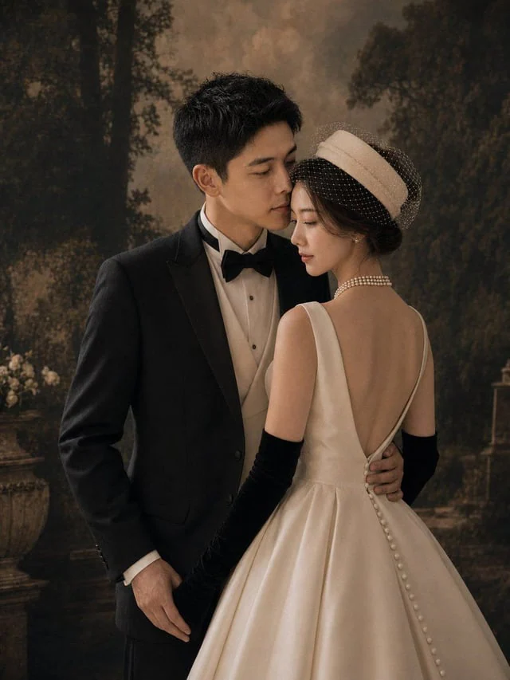

```text
Create a vertical 3:4 cinematic fine-art wedding portrait of an elegant couple in a vintage studio garden setting. The groom is an East Asian young adult man with short black textured hair, wearing a classic black tuxedo jacket, white dress shirt, cream waistcoat, and black bow tie; he stands on the left, angled slightly toward the bride, his left arm wrapped around her waist and his right hand relaxed by his side. The bride is an East Asian young adult woman standing on the right with her back mostly to the camera, turned slightly toward the groom in an intimate pose; she wears an ivory satin bridal gown with a deep V-shaped open back, full structured skirt, a vertical row of covered buttons down the back, long black opera gloves, a layered pearl necklace, pearl drop earrings, and a cream pillbox-style bridal hat with a dotted birdcage veil over dark updo hair. Their faces should be close together as if about to kiss, with the mood romantic, composed, and editorial. Use a dark painterly forest-and-garden backdrop with tall shadowy trees, warm sepia-brown haze, a stone planter with pale flowers on the left, and subtle vintage garden architecture in the distance. Lighting should be soft, warm, and directional, with gentle highlights on satin fabric and pearls, muted shadows, shallow depth of field, film-grain texture, and a luxurious old-Hollywood bridal magazine aesthetic. No text, no watermark, no extra people, keep the composition waist-up to full-skirt crop with the bride’s gown occupying the lower right foreground.
```

Model: GPT Image 2
Author: 麻酱AI实验室

[ProjectD](https://aitoolsradar.com/en/prompts/90a3dd1dd9a638) · [Recorded source](https://youmind.com/prompts/vintage-garden-wedding-portrait-24212)
 · [Full original metadata and byte evidence](data/projectd-batch-0051.json)

## Vintage Japanese Crime Film Poster

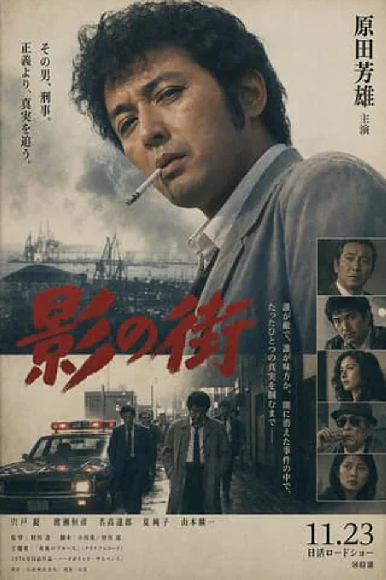

```text
A retro Japanese crime film poster from the late 1970s, employing the style of Nikkatsu's single-page theatrical posters. It features a vertical composition against a background of beige old paper with noticeable grain, subtle stains, and faded ink. The main image is positioned in the upper right corner and center.{argument name="lead actor name" default="Yoshio Harada"} A large, melancholic half-length portrait shows him turned to the side, his back to the camera, with thick, dark curly hair, a serious expression, and wearing a wrinkled light gray suit jacket over an open-collared white shirt; most of his face is in shadow. The background is a desolate industrial dock with cranes, low-rise factory buildings, and thick smoke rising into the gray sky. At the lower center of the image is a large, handwritten red Japanese title.{argument name="title text" default="City of Shadows"} Written with slanted and strong brushstrokes, partially obscuring the portraits and the scene below. In the lower half, a second scene is added: a city street in the rain at dusk or night, the pavement wet and reflecting light. On the left is a dark police car with its roof lights flashing red, and six men in suits and trench coats are walking forward, one of whom, a detective in a beige trench coat and loose tie, leads the group. On the far right, there is a vertically arranged row of five embedded portraits of actors, each with a thin border, presenting a somber, cinematic still from different roles. Add vertical Japanese typesetting: the upper right corner is the cast list "Starring Harada Yoshio"; the upper left corner is the two lines of slogan "その男, Criminal." "Justice より, 真実を chase う."; Near the lower right corner of the main image, add another vertical slogan "Who is the enemy, Who is the flavor side. Dark に eliminates the incident の中で, ただひとつの真実を掴むまで—". The bottom contains Japanese credits in dense small type across the entire width, with a prominent release date in the lower right corner.{argument name="release date" default="11.23"} Below it are the words "Nikkatsu Roadshow" and a small studio logo. The color scheme uses soft charcoal gray, dark brown, smoky blue-gray and off-white, with the red title being the only bright color. The overall atmosphere is hard-edged, melancholic, rough and cinematic, like a lost 1970s Japanese detective movie poster.
```

Model: GPT Image 2
Author: GPT Image 2 Prompts

[ProjectD](https://aitoolsradar.com/en/prompts/96e3b020c95d79) · [Recorded source](https://x.com/osamucap/status/2047283942840234363#reversed-0)
 · [Full original metadata and byte evidence](data/projectd-batch-0051.json)

## Vintage Japanese Fantasy Magic Newspaper

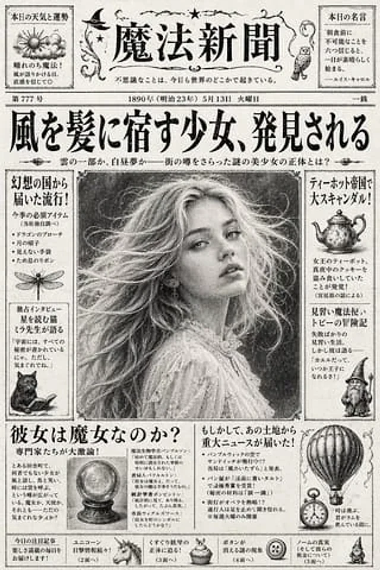

```text
{"type":"Fantasy Newspaper Front Page Illustration","language":"Japanese","era":"Meiji Era Style, Date: 1890","print_style":"Old monochrome newspaper printing, antique ink on yellowed paper, gorgeous Victorian woodcut and etching aesthetics, clear Japanese typography, text almost without distortion","page":{"format":"Full-page vertical newspaper","background":"Yellowed old paper with subtle textures and creases","border":"Thin black border with decorative corners"},"masthead":{"title":"{argument name="newspaper title" default="Magic News"} ","subtitle":"Incredible things are happening somewhere in the world today.","date_line":"Tuesday, May 13, 1890 (Meiji 23),"issue":"Issue No. 777","price":"One sen","decorations":["Silhouette of a witch's hat above the masthead","Little stars and curly patterns","Owl perched near the title"]},"layout":{"sections":[{"title":"Today's Weather and Fortune","position":"Top Left Box","count":1,"labels":["Sunny to Magic! A day where the wind is telling a story. Trust your intuition◎"]},{"title":"Today's Quote","position":"Top Right Box","count":1,"labels":["Believe six impossible things before breakfast, and you'll have a wonderful start to the day."]} ——Lewis Carroll"]},{"title":"Main Title","position":"Centered at the top of the page","count":1,"labels":["The girl with hair caught in the wind has been discovered"]},{"title":"Subtitle","position":"Below the main title","count":1,"labels":["Is she part of the clouds, or a daydream? ——The mysterious beauty sweeping the streets and alleys, what is her true identity?"]},{"title":"Above the left sidebar","position":"Left sidebar","count":1,"labels":["Trends from the land of fantasy!"]} {"title":"Fashion List in Left Sidebar","position":"Below Title in Top Left Sidebar","count":4,"labels":["Dragon Brooch","Moon Hat","Invisible Gloves","Sighing Ribbon"]},{"title":"Bottom of Left Sidebar","position":"Bottom of Left Sidebar","count":1,"labels":["Exclusive Interview: Reading the Interview with Teacher Mira from Xingmao"]},{"title":"Top Right Sidebar","position":"Right Sidebar","count":1,"labels":["Teapot House Scandal!"]},{"title":"Bottom of Right Sidebar","position":"Bottom of Right Sidebar","count":1,"labels":["The Adventures of Apprentice Magician Toby"]},{"title":"Bottom Main Left","position":"Wide Article in Bottom Left Corner","count":1,"labels":["Is she really a witch?"]} {"title":"Bottom Main Center Right","position":"Bottom Center Article","count":1,"labels":["Could it be that major news has come from that land!"]},{"title":"Bottom Bar Preview","position":"Bottom Horizontal Bar","count":5,"labels":["Today's Focus: Bringing you fun information!", "Unicorn Daily Scene Illustration! (See Page 2)","Exploring the True Form of the Tickling Fairy! (Page 3)","The Mysterious Phenomenon of Disappearing Buttons (See Page 4)"]},{"title":"Bottom Main Center Right","position":"Bottom Center Article","count":1,"labels":["Could it be that major news has come from that land!"]},{"title":"Bottom Bar Preview","position":"Bottom Bar Horizontal Bar","count":5,"labels":["Today's Focus: Bringing you fun information!", "Unicorn Daily Scene Illustration! (See Page 2)","Exploring the True Form of the Tickling Fairy! (Page 3)","The Mysterious Phenomenon of Disappearing Buttons (See Page 4)"]} "The Truth About Goblins and Their Secrets"]]}],"centerpiece":"A large central portrait frame with ornate corner decorations, depicting a mysterious young woman in a high-necked lace dress, her long hair swirling outwards like a storm cloud, her face blurred, presented in a dramatic black and white print style,""side_illustrations":["Sun icon behind clouds in the weather frame","Teapot print in the upper right sidebar","Goblin wizard image in the lower right sidebar","Dragonfly illustration in the middle left area","Black cat reading a book in the lower left sidebar","Crystal ball print in the lower left center","Hot air balloon and pocket watch combination in the lower right","Unicorn head in the bottom bar","Cupcake-shaped fairy pattern in the bottom bar","Bottom" "Bar-shaped button icon", "bottom bar-shaped goblin icon"],"art_direction":{"mood":"Mysterious, whimsical, magical, slightly humorous","composition":"Dense editorial newspaper design with a dominant headline and a dominant central image, narrow sidebars, multiple boxed articles, balanced asymmetrical decoration","color_palette":"Black ink, charcoal gray halftone, warm ivory paper","typography":"Large, dramatic brushstrokes in Chinese headlines, classic serif Japanese newspaper text, hierarchical font sizes","render_quality":"High resolution, clear and legible Japanese text, realistic print quality, complex lines"}}
```

Model: GPT Image 2
Author: GPT Image 2 Prompts

[ProjectD](https://aitoolsradar.com/en/prompts/65553d70e6f756) · [Recorded source](https://x.com/kabumira862571/status/2046797126089474457#reversed-0)
 · [Full original metadata and byte evidence](data/projectd-batch-0051.json)

## Vintage Knight Helmet Etching

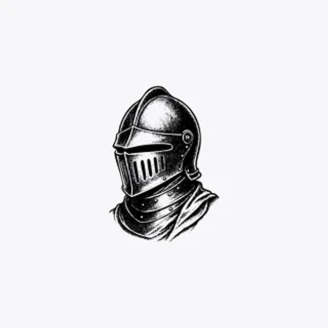

```text
A minimalist black-and-white ink illustration of a medieval knight's helmet half-length portrait, centered on a pure light gray background with ample negative space. The helmet is a classic closed Great Helm, featuring narrow horizontal visor seams, six vertical breathing seams on the visor, a dome, prominent circular side rivets near the temples, and a layered neck guard with small rivets. Draped fabric or a cloak is added around the shoulders and neck. Rendered in a vintage engraving, etching, or woodcut style, it features a rugged black outline, dense pointillism, chaotic cross-hatching, and strong contrasting shadows. The knight is depicted in a three-quarter profile, facing left. There is no text, no borders, no extraneous objects—just a clear, emblem-like portrait suspended in the center.
```

Model: GPT Image 2
Author: GPT Image 2 Prompts

[ProjectD](https://aitoolsradar.com/en/prompts/2c4feb93a90d57) · [Recorded source](https://x.com/ethanhaveron/status/2046975968355512829#reversed-0)
 · [Full original metadata and byte evidence](data/projectd-batch-0051.json)

## Vintage Korean Gimbap Recipe Poster

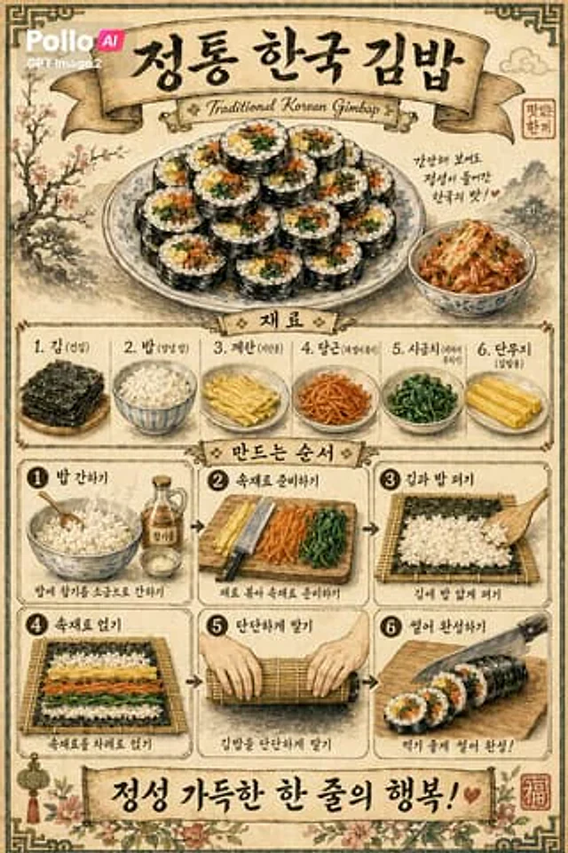

```text
Create a retro-style Korean food poster with a background of slightly stained and textured aged beige parchment, bordered with a dark decorative border, using a traditional hand-painted ink and watercolor illustration style. The poster is a single, vertically arranged infographic with the theme of {argument name="dish name" default="정통 한국 김밥"} The top is decorated with elegant large Korean calligraphy, and below it is an arched ribbon banner with the text {argument name="subtitle text" default="Traditional Korean Gimbap"} At the top center, a beautifully crafted porcelain plate is displayed, piled high with 12 slices of kimbap (seaweed rice rolls). Each slice clearly shows the filling of white rice, yellow egg, orange carrot, green spinach, and dark seaweed. To the right of the plate is a small bowl of kimchi, accompanied by a short handwritten Korean note: “간단한보여도정성이들어간한국의맛! ♥”. A small red stamp with Korean characters is added near the upper right corner. In the center, add an ingredient section with the ribbon title "재료" (Jewelry), with six ingredient sections arranged horizontally: 1. 김 (건김) showing stacked seaweed sheets, 2. 밥 (양념밥) showing a bowl of rice, 3. 계란 (지단용) showing sliced ​​hard-boiled egg strips, 4. 당근 (채썰어볶기) showing sliced ​​carrot shreds, 5. 시금치 (데쳐서무치기) showing seasoned spinach, and 6. 단무지 (김밥용) showing yellow pickled radish strips. Below, add another ribbon title, "만드는순서," and display six bordered step sections arranged in two rows and three columns, connected from left to right by an arrow. Step 1 is labeled "1 밥간하기," showing a bowl of rice with sesame oil and salt next to it, captioned "밥에참기름소금으로간하기." Step 2 is labeled "2 속재료준비하기," showing eggs, carrots, spinach, and a knife on a cutting board, captioned "재료볶아속재료준비하기." Step 3, labeled "3 김과밥펴기", shows the seaweed on the bamboo mat and the rice laid out, captioned "김에밥얇게펴기". Step 4, labeled "4 속재료얹기", shows the fillings arranged horizontally on the rice, captioned "속재료를차례로얹기". Step 5, labeled "5 단단하게말기", shows the action of tightly rolling up the bamboo mat with both hands, captioned "김밥을단단하게말기". Step 6, labeled "6 썰어완성하기", shows a chef slicing the kimbap roll with a knife, accompanied by the caption "먹기좋게썰어완성!". A wide banner with prominent Korean calligraphy is added at the bottom.{argument name="bottom slogan" default="정성 가득한 한 줄의 행복!"} Add a small heart. Decorate the bottom corner with a floral pattern and add a red square stamp engraved with the Chinese character "福" (Fu, meaning good fortune) in the bottom right corner. Use soft shades of dark brown, tan, cream, olive green, and faded red, combined with finely sketched outlines, soft watercolor shading, and an authentic print poster composition. Add a small, modern overlay logo in the top left corner with the text "[Text missing]".{argument name="brand text" default="Pollo AI GPT Image 2"} .
```

Model: GPT Image 2
Author: GPT Image 2 Prompts

[ProjectD](https://aitoolsradar.com/en/prompts/ce7a07f4143e9b) · [Recorded source](https://x.com/polloai_kr/status/2046778808221733337#reversed-1)
 · [Full original metadata and byte evidence](data/projectd-batch-0051.json)

## Vintage Kyoto Travel Poster

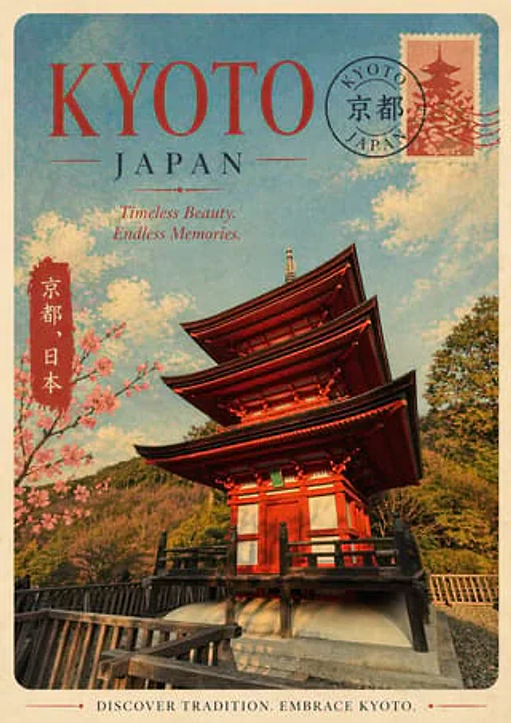

```text
A retro travel poster, with the theme of{argument name="destination name" default="KYOTO"} (Japan) Designed in a nostalgic mid-20th-century travel style, featuring faded paper textures, slightly worn edges, and warm, vintage tones. Utilizing a vertical poster layout with rounded corners and a cream-colored border. A prominent headline is placed at the top.{argument name="headline text" default="KYOTO"} The text uses an oversized, elegant red serif font; below, centered, is the word "JAPAN" in dark blue serif font, accompanied by a thin decorative dividing line. Italicized text is added below this.{argument name="tagline text" default="Timeless Beauty. Endless Memories."} The main image should present a striking low-angle perspective, showcasing a vibrant vermilion traditional Japanese five-story pagoda with dark wooden eaves and black railings, standing on a stone base, with a wooden walkway in the foreground. The pagoda is surrounded by lush green hills, a bright blue sky, and soft creamy clouds. On the left is a vertical red label with the white Japanese characters "Kyoto, Japan." Simultaneously, a blooming cherry blossom branch with clusters of pale pink flowers extends from the left. In the upper right corner, a stamp is included, featuring a dark red silhouette of the pagoda, partially obscured by a circular postmark that reads "KYOTO JAPAN," with the Chinese characters "京都" (Kyoto) at the center, extending to the right with several wavy postmark lines. A centered, retro-style footer in serif capital letters is added at the bottom, containing the following text:{argument name="footer text" default="DISCOVER TRADITION. EMBRACE KYOTO."} The overall appearance should convey a romantic, collectible quality, with a slightly worn look, like classic Japanese travel prints from the 1950s or 60s.
```

Model: GPT Image 2
Author: GPT Image 2 Prompts

[ProjectD](https://aitoolsradar.com/en/prompts/2f3932bb1bc8e5) · [Recorded source](https://x.com/RichardGibbonsX/status/2046689539243049156#reversed-0)
 · [Full original metadata and byte evidence](data/projectd-batch-0051.json)

## Vintage Little Prince Space Postcard

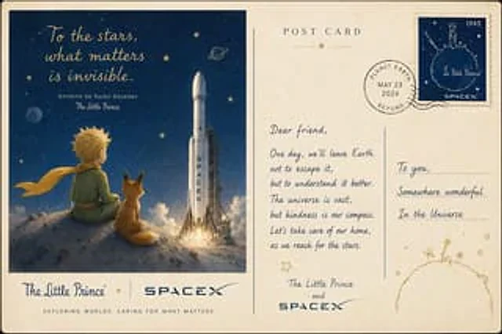

```text
Create a retro-style illustrated postcard, designed as{argument name="franchise name" default="The Little Prince"} and{argument name="space company name" default="SPACEX"} This fantastical collaboration features postcards side-by-side on the same canvas, showcasing both the front and back. Warm-toned old paper with slightly worn edges, a delicate grain, and subtle stains evokes a nostalgic, medieval printing feel. The left half of the postcard depicts the front: a deep midnight blue sky dotted with small golden stars and a ringed asteroid, while a massive white rocket stands on a launch pad, its bright plume shooting into the air. In the image, a blond boy in green clothing and a long golden scarf sits on a rocky hill with an orange fox, their backs to the viewer, gazing at the rocket. An elegant handwritten inscription is added to the sky.{argument name="quote" default="For stars, what matters is what cannot be seen."} Below are the smaller serif and handwritten signatures: "ANTOINE DE SAINT-EXUPÉRY" and "The Little Prince". At the bottom of the left panel, two brand names are added: "The Little Prince" in blue handwritten font on the left, and "SPACEX" in bold, futuristic blue capital letters on the right, separated by a small gold star and a thin dividing line. Below this is a spaced-out lowercase letter tagline:{argument name="tagline" default="Explore the world, stay true to your original aspirations."} The right half is the back of a postcard from the same old paper, with the title "POST CARD" printed at the top center and decorated with a small gold star below. A circular postmark is added near the center of the upper right, containing four parts of text: "PLANET EARTH," "MAY 23," "2024," and "BEYOND." A blue stamp with perforated edges is affixed to the upper right corner, depicting the Little Prince standing on a miniature planet under a starry sky. The stamp has four clearly visible text elements: "1943," "Le Petit Prince," "SPACE," and a small star symbol. There should be two writing areas separated by vertical lines on the right. In the left writing area, a handwritten message should be placed, beginning with "Dear friend," followed by neat cursive text: "One day, we will leave Earth not to escape, but to better understand it. The universe is vast, but kindness is our compass. Let us protect our home as we journey towards the stars." Then, sign in three lines: "The Little Prince," "and," and "SPACEX." In the address bar on the right, the first line reads "To you," followed by "Somewhere wonderful" and "In the Universe," accompanied by horizontal guide lines. Add some small gold star doodles and a simple line drawing in the lower right corner depicting a small, round planet with flowers growing on it. The color palette is limited to cream, navy, soft gold, soft green, warm orange, and blue-gray, presenting a clear and painterly illustration style. Combined with precise decorative typography, this creates a magical, hopeful atmosphere that blends literary flair with space exploration.
```

Model: GPT Image 2
Author: GPT Image 2 Prompts

[ProjectD](https://aitoolsradar.com/en/prompts/03d442ce6fbedd) · [Recorded source](https://x.com/S0N_IA/status/2047673200482337118#reversed-1)
 · [Full original metadata and byte evidence](data/projectd-batch-0051.json)

## Vintage Malta Travel Poster


```text
A retro travel poster illustration, with the theme of{argument name="destination" default="malta"} The design style references mid-20th-century Mediterranean travel advertisements, featuring an elegant painterly realism and a slightly grainy, printed poster texture. A large headline is placed at the top center.{argument name="headline text" default="MALTA"} Use oversized cream-colored serif capital letters; immediately below is the subtitle.{argument name="subtitle text" default="MEDITERRANEAN PARADISE"} The image uses smaller, dark navy blue sans-serif capital letters. It shows Valletta's sunny coastal road winding along the rocky waterfront, positioned slightly above and behind a classic 1960s white sedan driving out of the frame in the lower left foreground; the license plate is displayed as {argument name="license plate" default="MTA 1964"} Across the harbor, warm honey-colored limestone buildings climb the hillside, including a large domed church, a soaring, narrow church spire, rows of historic townhouses (with multiple brightly colored enclosed wooden balconies), and distant city walls extending to the opposite shore. In the bay, three brightly colored (blue, yellow, red, green) traditional Maltese fishing boats are included, along with two small white sailboats in the distance. Four white seagulls soar against a bright turquoise sky, dotted with soft white clouds. The entire composition is framed by dark, lush trees and abundant bright magenta bougainvillea arching from the top and right edge, with more flowers in the lower right corner, forming a verdant border around the scene. A palm tree is added to the seaside buildings, and a spiky agave plant is placed in the lower left foreground. The use of warm golden sunlight, saturated coastal colors, a romantic holiday poster composition, and clear, legible typography creates a nostalgic and idealized Mediterranean atmosphere.
```

Model: GPT Image 2
Author: GPT Image 2 Prompts

[ProjectD](https://aitoolsradar.com/en/prompts/7e6c3366335c92) · [Recorded source](https://x.com/Itswsm105f/status/2046708003014095259#reversed-0)
 · [Full original metadata and byte evidence](data/projectd-batch-0051.json)

## Vintage Malta Travel Poster

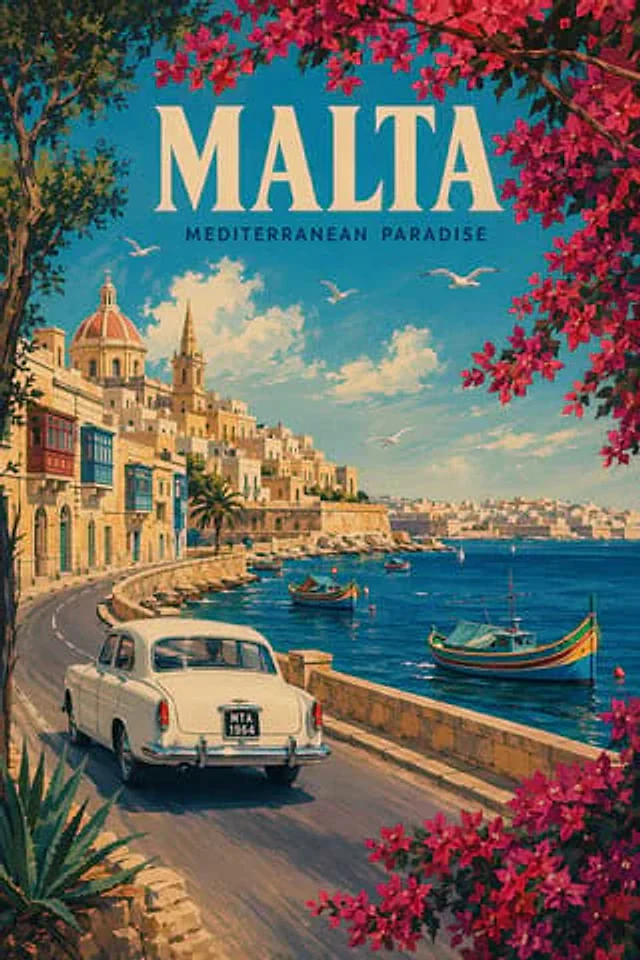

```text
A retro travel poster illustration, with the theme of{argument name="destination name" default="MALTA"} ,subtitle{argument name="tagline" default="MEDITERRANEAN PARADISE"} Centered near the top, the composition depicts a view from the foreground of a winding coastal road towards a sun-drenched Mediterranean city. Painted in a richly textured, vintage poster style, it showcases warm cream-colored stone buildings, a saturated turquoise sea, and a clear blue sky dotted with soft white clouds. To the left, a dense cluster of historic limestone buildings extends up the hillside, including brightly colored enclosed wooden balconies, a large domed church with a terracotta roof, and a slender church spire. In the foreground, a classic white mid-20th-century sedan is positioned on the road, shown from a rear-side view, driving along a curve; the license plate is dark, with text {argument name="license plate text" default="MTA 1964"} A low stone breakwater runs along the harbor on the right edge of the road. Four boats are visible in the bay: a brightly colored Maltese Luzzu fishing boat in the foreground and midground, and two smaller boats in the distance. Four white seagulls fly in the sky. The image is adorned with lush bougainvillea foliage, with vibrant magenta flowers arching in the upper right and lower right corners, and dense branches in the upper left corner; a spiky agave plant is positioned in the lower left foreground. In the distance across the bay, a city bathed in sunlight stretches along the horizon. Employing the retro travel poster aesthetics of the 1950s and 60s, the design uses painterly brushstrokes, clear composition, a romantic travel atmosphere, and elegant typography. The main title is in large cream-colored serif capitals, while the subtitle is in smaller, dark sans-serif capitals.
```

Model: GPT Image 2
Author: GPT Image 2 Prompts

[ProjectD](https://aitoolsradar.com/en/prompts/bf895b31128506) · [Recorded source](https://x.com/Itswsm105f/status/2046792908649775342#reversed-0)
 · [Full original metadata and byte evidence](data/projectd-batch-0051.json)

## Vintage Miami Art Date Comic Page

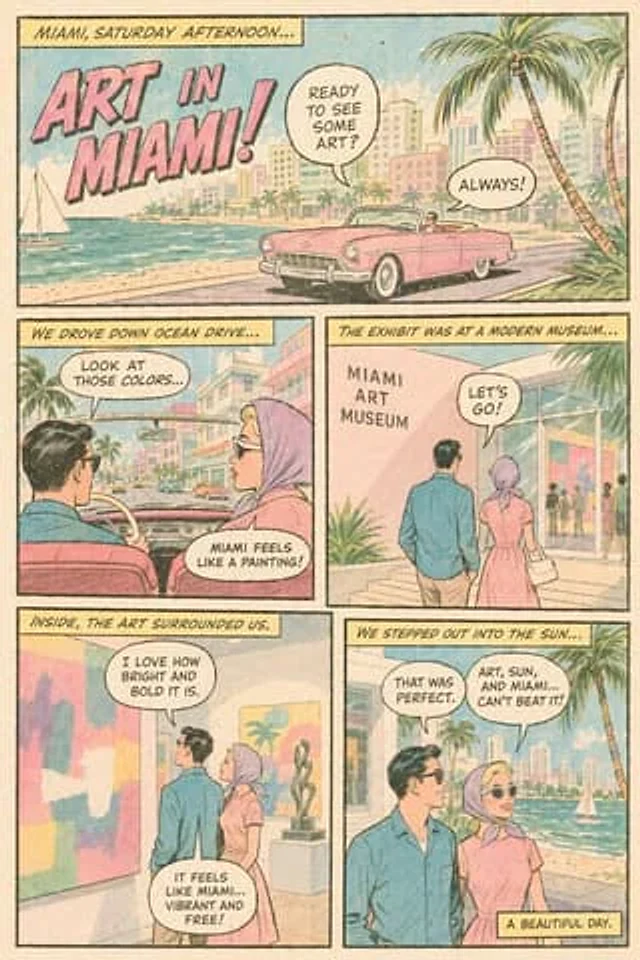

```text
A faded, romantic adventure-style retro American comic book page from the 1950s, printed on slightly yellowed paper, featuring distinct halftone textures, ink-drawn borders, and soft, aged colors. The page contains five panels in a classic comic book layout: one wide panel at the top, two side-by-side panels in the middle, and two side-by-side panels at the bottom. The top panel displays {argument name="city" default="Miami"} A sun-drenched coastal boulevard stretches out to the left, with turquoise waters, sailboats near the shore, and in the distance, soft Art Deco architecture, towering palm trees, and a pink classic convertible driving along the waterfront. A stylish couple sits inside, above them a striking large cartoon headline: "ART IN MIAMI!", and a smaller title box at the top reads "MIAMI, SATURDAY AFTERNOON…". Two speech bubbles are added: "READY TO SEE SOME ART?" and "ALWAYS!". The second panel shows a view from behind the car, the couple driving along the Ocean Boulevard, with brightly colored buildings and palm trees visible ahead; the man has dark hair and wears a blue shirt, while the woman wears sunglasses, a pink dress, and a pale purple headscarf. A title box reads "WE DROVE DOWN OCEAN DRIVE…", along with speech bubbles "LOOK AT THOSE COLORS…" and "MIAMI FEELS LIKE A PAINTING!". In the third panel, the couple walks towards the entrance of a modern museum, with the words "MIAMI ART MUSEUM" visible on the wall, along with glass doors and people inside; add a title box that reads "THE EXHIBIT WAS AT A MODERN MUSEUM…" and a speech bubble "LET'S GO!". In the fourth panel, the couple admires a large abstract painting in a gallery, composed of bright, soft blocks of color and shapes, with a small sculpture on a pedestal nearby; add a title box that reads "INSIDE, THE ART SURROUNDED US." and speech bubbles "I LOVE HOW BRIGHT AND BOLD IT IS." and "IT FEELS LIKE MIAMI… VIBRANT AND FREE!". In the fifth panel, the couple is shown back at the water's edge, against a backdrop of a skyline, palm trees, and sailboats, embracing closely in the sunlight. A title box is added that reads "WE STEPPED OUT INTO THE SUN…" and a small ending caption box in the lower right corner reads "A BEAUTIFUL DAY." Dialogue bubbles include "THAT WAS PERFECT." and "ART, SUN, AND MIAMI… CAN'T BEAT IT!". The use of handwritten uppercase comic book font, black outlines, and slightly off-center vintage typography, along with soft shades of pink, aqua, sand beige, and seaweed green, creates a nostalgic and romantic atmosphere.
```

Model: GPT Image 2
Author: GPT Image 2 Prompts

[ProjectD](https://aitoolsradar.com/en/prompts/473c0737f9800c) · [Recorded source](https://x.com/DGLru/status/2047218442030166086#reversed-3)
 · [Full original metadata and byte evidence](data/projectd-batch-0051.json)

## Vintage Moda Pier in Istanbul

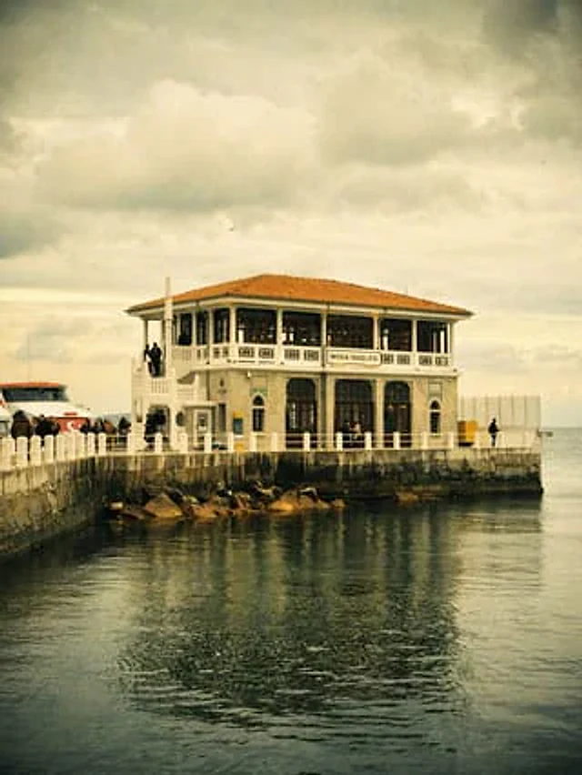

```text
A dreamlike, vintage travel photograph showcases the historic Moda Pier waiting hall in Istanbul. Centered at the end of the stone waterfront boardwalk, the image is shot vertically from across the calm, deep water. This two-story waterfront building features light beige stone walls, a warm terracotta tile roof, arched high windows on the ground floor, and an open upper-level corridor with numerous slender columns. A clear sign on the upper facade reads, "..."{argument name="pier sign text" default="MODA İSKELESİ"} A white ferry is faintly visible to the left rear of the pier, while a few pedestrians stand around the pier and buildings, subtly highlighting the grand scale of the architecture without overshadowing it. In the foreground, the shimmering harbor water reflects the building's soft contours; white railings line the pier's edge, their base adorned with rough, dark rocks. Above, thick stratus clouds cover nearly half the frame. Using a nostalgic Instagram filter aesthetic, the tones are faded, presenting warm browns and beiges with subtle green hues in the shadows, accompanied by delicate film grain, low contrast, soft fog, subtle vignetting, and a slight weathered film texture. Focusing on the architecture, the image is serene, cinematic, realistic, and slightly melancholic, like a photograph taken on a cloudy day.{argument name="city" default="Istanbul"} Popular travel postcards.
```

Model: GPT Image 2
Author: GPT Image 2 Prompts

[ProjectD](https://aitoolsradar.com/en/prompts/fd2e8546697c3a) · [Recorded source](https://x.com/miilesus/status/2047036657509998595#reversed-0)
 · [Full original metadata and byte evidence](data/projectd-batch-0051.json)

## Vintage New York Travel Collage

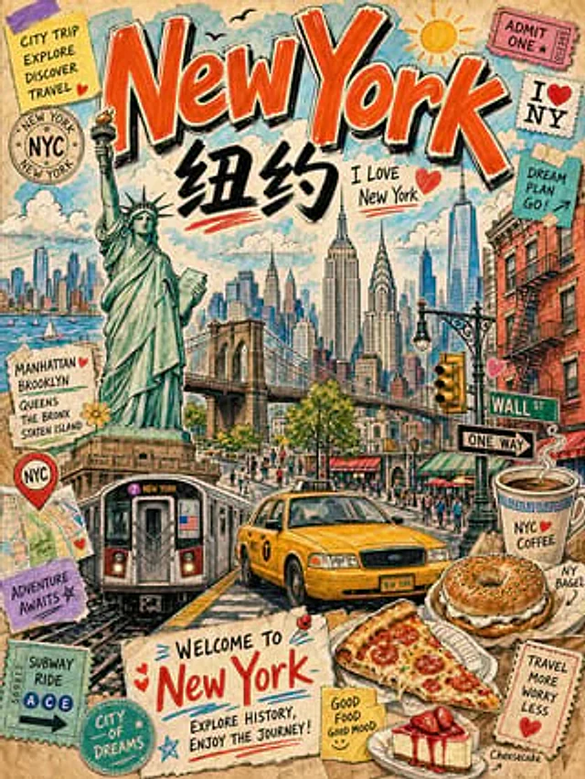

```text
Goal: Create a colorful hand-drawn vintage travel poster collage for {argument name="city name" default="New York"}, styled like an illustrated scrapbook page full of stickers, taped notes, tickets, landmarks, food, and street details.

Canvas: Vertical 3:4 poster with an aged beige paper background, worn edges, light stains, tape pieces, ink outlines, watercolor washes, and dense travel-journal composition.

Main layout: At the top center, write a huge bold brush-lettered title “{argument name="city name" default="New York"}” in red-orange with white highlights and dark shadow, filling the upper third. Beneath it, add large black Chinese characters “纽约” with a red underline. Behind the title, paint a blue sky with fluffy clouds, small black birds, and a simple yellow sun in the upper right.

Central city scene: Show an energetic Manhattan skyline across the middle with recognizable skyscrapers including the Empire State Building, Chrysler Building, and One World Trade Center. Include the Brooklyn Bridge spanning the center. On the left foreground, place a large Statue of Liberty in green patina on its pedestal. In the lower middle, show a street perspective with tiny pedestrians, a yellow NYC taxi facing forward, and a subway train emerging from the lower left track labeled with line “7” and destination “New York.” Add a traffic light, ornate street lamp, green “WALL ST” sign, and black-and-white “ONE WAY” sign on the right. Add red-brick apartment buildings with fire escapes on the right edge.

Scrapbook notes and stickers: Include exactly 12 separate paper items around the city scene: 1) top-left yellow sticky note reading “CITY TRIP / EXPLORE / DISCOVER / TRAVEL” with a red heart, 2) left circular stamp reading “NEW YORK / NYC / NEW YORK,” 3) left torn checklist reading “MANHATTAN / BROOKLYN / QUEENS / THE BRONX / STATEN ISLAND” with a red heart and small flower, 4) lower-left map scrap with a red NYC location pin and “Central Park,” 5) purple note reading “ADVENTURE WAITS” with a star, 6) bottom-left subway ticket reading “SUBWAY RIDE” with route circles “A C E,” 7) teal circular sticker reading “CITY OF DREAMS,” 8) center-bottom welcome card reading “WELCOME TO New York / EXPLORE HISTORY, ENJOY THE JOURNEY!” with hearts and blue doodles, 9) top-right pink ticket reading “ADMIT ONE” with serial numbers, 10) top-right cream sticker reading “I ♥ NY,” 11) right blue note reading “DREAM PLAN GO!” with an arrow, 12) lower-right beige note reading “TRAVEL MORE WORRY LESS” with a heart.

Food details: In the bottom-right foreground, illustrate exactly 4 iconic food items: a steaming paper cup labeled “NYC COFFEE” with a heart, a sesame bagel with cream cheese labeled “NY BAGEL,” a paper plate with a pepperoni pizza slice, and a slice of strawberry cheesecake labeled “Cheesecake.” Add a small yellow sticky note near the food reading “GOOD FOOD GOOD MOOD” with a smiley face.

Visual style: Whimsical urban travel sketch, saturated watercolor and colored-pencil texture, black ink hatching, imperfect hand lettering, layered collage, playful tourist-map aesthetic, nostalgic postcard energy, very detailed but cohesive.

Constraints: Preserve all readable text as hand-drawn lettering, avoid photorealism, no empty background, no modern minimalist look, no watermark or logo. Use {argument name="accent color" default="red-orange"} for the main title and heart motifs, and make the overall mood {argument name="poster mood" default="cheerful adventurous"}.
```

Model: GPT Image 2
Author: 崔棉大师

[ProjectD](https://aitoolsradar.com/en/prompts/9e3d86282e784c) · [Recorded source](https://youmind.com/prompts/new-york-travel-poster-23214)
 · [Full original metadata and byte evidence](data/projectd-batch-0051.json)

## Vintage Newspaper Front Page

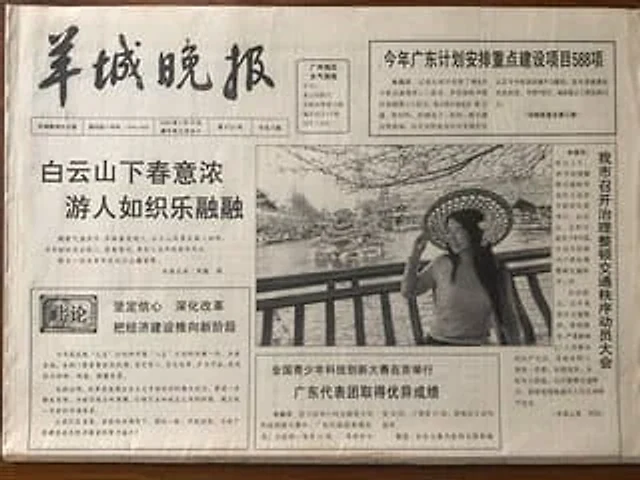

```text
Generate a copy{argument name="newspaper name" default="A newspaper"} The front page. Based on this photo, create a front page headline; the image should have a vintage, authentic photographic feel.
```

Model: GPT Image 2
Author: GPT Image 2 Prompts

[ProjectD](https://aitoolsradar.com/en/prompts/0391ec87366748) · [Recorded source](https://x.com/stark_nico99/status/2047675003823616001)
 · [Full original metadata and byte evidence](data/projectd-batch-0051.json)

## Vintage Newspaper Front Page


```text
生成一张{argument name="报纸名称" default="xx报纸"}，根据这张照片可以编一个头版头条标题，像真实的摄影，复古质感
```

Model: GPT Image 2
Author: Nicolechan

[ProjectD](https://aitoolsradar.com/en/prompts/9678e96081ee1b) · [Recorded source](https://youmind.com/prompts/vintage-newspaper-front-page-15560)
 · [Full original metadata and byte evidence](data/projectd-batch-0051.json)

## Vintage Newspaper Front Page Generator

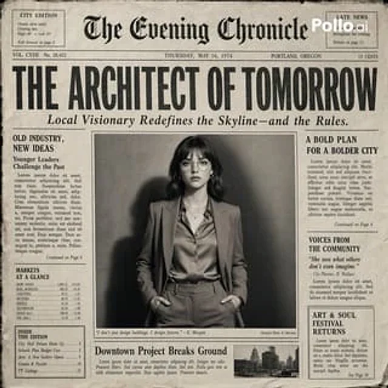

```text
Create the most realistic retro newspaper front page design with the main subject at its center. The layout should resemble an authentic printed newspaper with a cinematic black-and-white aesthetic. The main photograph should be prominently placed in the center with a border, similar to an image in an article headline. The subject in the photograph should remain clear and legible in natural light, with slightly increased contrast to match the eye-catching editorial style. Create a striking and attention-grabbing headline at the top (create a unique headline that matches the mood of the photograph—it can be romantic, mysterious, humorous, or dramatic). Add a smaller subheading below the headline to make it look like authentic newspaper captions. Add realistic newspaper elements: small text columns (in a randomized, pseudo-text style, but with typography like real news); a fictional publication name at the top (e.g., "The Daily Prompts," "AI Times," or similar—get creative based on the image); date, issue number, and location; decorative lines, separators, and retro typography; small supplementary articles or captions related to the main image; optional stamps, doodles, or editorial notes to add personality. Style: Black and white or slightly faded monochrome paper; fine paper texture, graininess, and ink imperfections; subtle shadows and creases mimicking real printed paper; a clean but slightly worn vintage newspaper aesthetic. Atmosphere: Imbues the design with personality, expressiveness, and a sense of narrative, as if the narrative were part of the main article. Aspect Ratio: 4:5 or 1:1; a highly detailed, hyper-realistic blend of editorial photography and print design.
```

Model: GPT Image 2
Author: GPT Image 2 Prompts

[ProjectD](https://aitoolsradar.com/en/prompts/cdd918446f152e) · [Recorded source](https://x.com/Naiknelofar788/status/2047207812800147647)
 · [Full original metadata and byte evidence](data/projectd-batch-0051.json)

## Vintage Pastel de Nata Recipe Poster

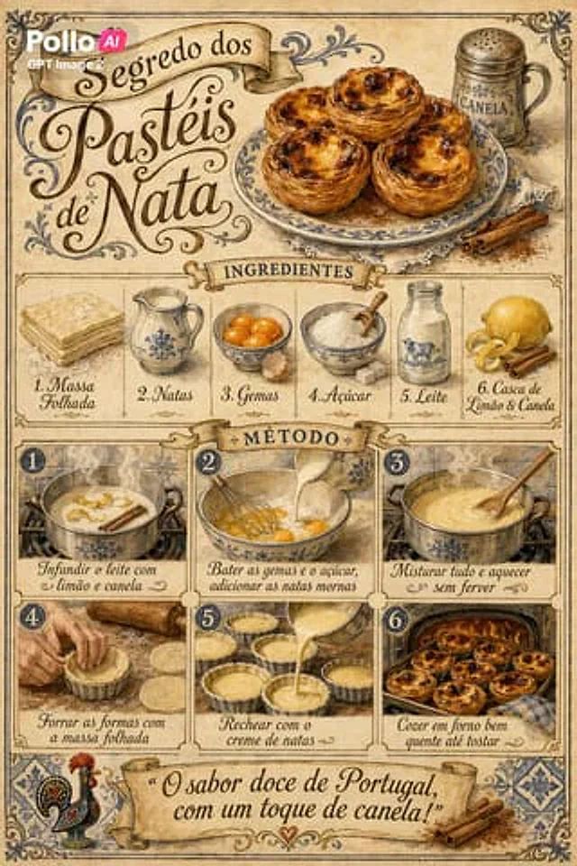

```text
{
  "type": "Retro illustrated recipe poster",
  "subject": "Portuguese egg tart recipe infographic",
  "style": {
    "overall": "Vintage parchment recipe posters, hand-drawn food illustrations, antique tile-style decor, tan background, fine calligraphy—a warm and rustic bakery aesthetic.",
    "rendering": "Highly defined decorative fonts, textured paper feel, ink patterns, soft painterly shadows, and a realistic pastry topped with a glossy caramel finish."
  },
  "poster": {
    "orientation": "Vertical",
    "border": "Ornate dark ink border with floral trim",
    "background": "Old beige parchment with stains and fine creases"
  },
  "header": {
    "top_left_branding": {
      "count": 2,
      "labels": [
        "Pollo AI",
        "GPT Image 2"
      ]
    },
    "main_title": "Segredo dos Pasteis de Nata",
    "title_style": "The large, flowing brown calligraphy on the left features delicate decorative lines and curls.",
    "hero_image": "In the upper right corner is a blue and white ceramic plate with five Portuguese egg tarts stacked on it.",
    "surrounding_props": {
      "count": 3,
      "labels": [
        "Metal shaker bottle labeled CANELA",
        "2 cinnamon sticks",
        "Lace fabric under the plate"
      ]
    }
  },
  "layout": {
    "sections": [
      {
        "title": "INGREDIENTES",
        "position": "upper and middle strips",
        "count": 6,
        "labels": [
          "1. Massa Folhada",
          "2. Natas",
          "3. Gemas",
          "4. Açúcar",
          "5. Leite",
          "6. Casca de Limão & Canela"
        ],
        "items": [
          {
            "label": "1. Massa Folhada",
            "description": "Folded puff pastry pile sprinkled with flour"
          },
          {
            "label": "2. Natas",
            "description": "Small ceramic butter jug ​​decorated with blue flowers"
          },
          {
            "label": "3. Gemas",
            "description": "There are 4 egg yolks in the bowl, and a broken eggshell next to them."
          },
          {
            "label": "4. Açúcar",
            "description": "A bowl containing white sugar, accompanied by a small wooden spoon and two sugar cubes."
          },
          {
            "label": "5. Leite",
            "description": "Glass milk bottle with blue cow illustration"
          },
          {
            "label": "6. Casca de Limão & Canela",
            "description": "Whole lemon, curled lemon peel, and cinnamon stick"
          }
        ]
      },
      {
        "title": "MÉTODO",
        "position": "Center and lower grid",
        "count": 6,
        "labels": [
          "1",
          "2",
          "3",
          "4",
          "5",
          "6"
        ],
        "panels": [
          {
            "label": "1",
            "caption": "Infundir o leite com limão e canela",
            "description": "A skillet heating up, containing milk, lemon zest, and cinnamon sticks."
          },
          {
            "label": "2",
            "caption": "Bater as gemas e o açúcar, adicionar as natas mornas",
            "description": "The mixing bowl contains a whisk, egg yolks, sugar, and warm cream being poured in."
          },
          {
            "label": "3",
            "caption": "Misturar tudo e aquecer sem ferver",
            "description": "Stir the thick custard with a wooden spoon over the fire."
          },
          {
            "label": "4",
            "caption": "Forrar as formas com a massa folhada",
            "description": "Press the puff pastry into the tart mold with both hands, with a rolling pin placed next to it."
          },
          {
            "label": "5",
            "caption": "Rechear com o creme de natas",
            "description": "The custard was poured into five tart molds lined with puff pastry."
          },
          {
            "label": "6",
            "caption": "Cozer em forno bem quente até tostar",
            "description": "The baked Portuguese egg tarts, with their dark caramel-colored tops, are placed on a baking sheet, with a cloth placed beside them."
          }
        ]
      },
      {
        "title": "Bottom quote ribbon",
        "position": "bottom",
        "count": 1,
        "labels": [
          "\"O sabor doce de Portugal com um toque de canela!\""
        ],
        "decorations": {
          "count": 3,
          "labels": [
            "The brightly colored Barcelos rooster illustration on the left",
            "Blue tile patterns in the two bottom corners",
            "Cinnamon stick on the right"
          ]
        }
      }
    ],
    "reading_order": "The top displays the title and main image of the egg tart, the bottom shows the ingredient list, the middle section features a two-row, three-column grid illustrating the six-step method, and the bottom displays a banner with a quote."
  },
  "color_palette": {
    "count": 6,
    "labels": [
      "Old parchment, beige",
      "Brown ink",
      "Golden egg custard",
      "Caramel brown",
      "Ceramic Blue",
      "Warm Cinnamon Palm"
    ]
  },
  "composition": "The posters are densely packed yet balanced in their recipe style, with all text in Portuguese, decorative banners separating the sections, and each panel framed like an antique recipe card.",
  "quality": "High-resolution poster editing, clear text, rich retro illustration textures"
}
```

Model: GPT Image 2
Author: GPT Image 2 Prompts

[ProjectD](https://aitoolsradar.com/en/prompts/c5d55e5472b93a) · [Recorded source](https://x.com/PolloAIBR/status/2046779004527452454#reversed-1)
 · [Full original metadata and byte evidence](data/projectd-batch-0051.json)

## Vintage Peacock Botanical Illustration

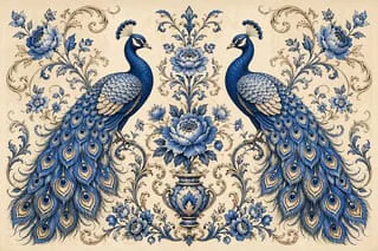

```text
Symmetrical design, main body is{argument name="subject" default="Two elegant blue peacocks"} It has delicate feather textures, surrounded by{argument name="flowers" default="Blue floral elements"} Intricate retro plant decorations{argument name="background color" default="Soft beige"} Background, classic floral style, embellished with rich navy and sky blue details, Art Deco illustration -- ar 3:2
```

Model: GPT Image 2
Author: GPT Image 2 Prompts

[ProjectD](https://aitoolsradar.com/en/prompts/463d4ca8a99c75) · [Recorded source](https://x.com/dotey/status/2047803054422901046)
 · [Full original metadata and byte evidence](data/projectd-batch-0051.json)

## Vintage Pomegranate Growth Atlas

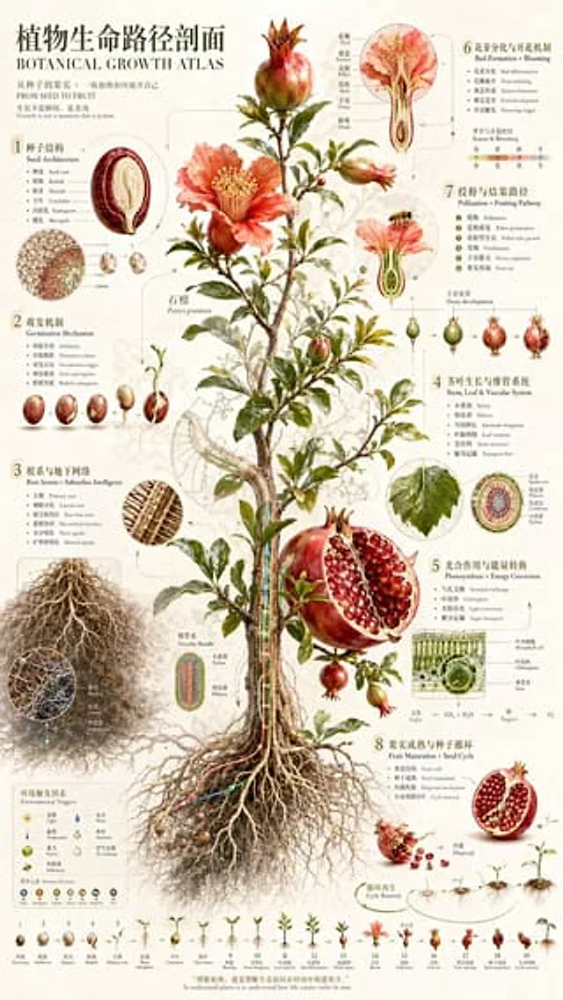

```text
Create a richly detailed retro-style scientific botanical infographic poster on warm ivory paper, inspired by 19th-century natural history atlases, but optimized with modern, minimalist typography. The main subject is a complete pomegranate plant, labeled as follows:{argument name="plant name" default="Pomegranate"} /{argument name="latin name" default="Punica granatum"} Presented in a centered, vertical sectional style, the poster offers an unobstructed view from crown to roots. It depicts a slender, woody trunk with abundant branches, glossy green leaves, several orange-red flowers, unopened buds, young fruit, ripe fruit, and a large, split-open pomegranate revealing dense, ruby-like seeds. Below, the sprawling root system is fully visible. The poster is rendered with exquisite watercolor and ink, featuring realistic plant anatomy, precise lines, subtle dark brown shading, fine leading lines, arrows, and small numbered circles. The main title is located in the upper left corner of the poster.{argument name="headline text" default="Plant life path profile"} Below is the English subtitle:{argument name="subtitle text" default="BOTANICAL GROWTH ATLAS"} Add a brief bilingual introductory text below the title. The tall, elongated educational poster, in a 9:16 aspect ratio, centers on the plant surrounded by illustrative charts. Eight numbered educational sections surround the plant, each with a prominent Chinese title and a smaller English translation, arranged in a graphic style: 1. Seed Structure—A large cross-section of the seed, labeled with internal parts, accompanied by a smaller illustration of a cell cross-section. 2. Germination Mechanism—The left-hand sequence, comprising five stages, showing seed swelling, splitting, germination, radicle emergence, and early seedling morphology. 3. Root System and Substrate Intelligence—The lower left shows a large, bare root system, accompanied by two circular magnified illustrations of root details, showing branching structure and root hair/network texture. 4. Stem, Leaf, and Vascular System—The right-center area, containing two anatomical circular cross-sections and a separate leaf illustration, labeled with xylem, phloem, epidermis, and related tissues. 5. Photosynthesis and Energy Conversion – The lower right biology panel contains three green microscopic structural diagrams, including leaf tissue/cell-like sections, and simple chemical flow lines indicating the conversion of CO2 + H2O into sugars and O2. 6. Bud Formation and Flowering – The upper right flowering section contains two large flower anatomy diagrams (side view and longitudinal section), labeled with stamens, petals, ovary, and pollen structures. 7. Pollination and Fruiting Pathway – The right-hand developmental bar contains five stages of pomegranate fruit development from bud to maturity, along with an illustration showing a bee approaching the flower for pollination. 8. Fruit Maturation and Seed Cycle – The lower right life cycle section contains three fruit illustrations showing a complete fruit, a split fruit, and a split fruit revealing seeds, plus three diagrams of seedling growth. At the bottom edge, a long growth documentary strip contains 19 small step illustrations, each numbered 1 to 19, showcasing the plant life cycle from dormant seed to germination, root growth, seedling emergence, sapling development, flowering, fruit setting, maturity, seed dispersal, and cyclical renewal. A small environmental factors panel is added to the lower left, with icon-based indicators for light, temperature, water, nutrients, and air. Bilingual labeling is used throughout, with Chinese titles highlighted and English translations in a smaller serif font. The overall aesthetic should present an academic, elegant, museum-quality feel with a dense sense of information, complemented by refined classical typography, a soft beige background, realistic red and green tones, and a balanced and clean graphic layout.
```

Model: GPT Image 2
Author: GPT Image 2 Prompts

[ProjectD](https://aitoolsradar.com/en/prompts/47cc99c11d7f24) · [Recorded source](https://x.com/hx831126/status/2046448092871041500#reversed-1)
 · [Full original metadata and byte evidence](data/projectd-batch-0051.json)

## Vintage Pomegranate Growth Atlas


```text
Create a highly detailed vintage scientific botanical infographic poster on warm ivory paper, styled like a 19th-century natural history atlas plate with modern clean layout refinement. The main subject is a full pomegranate plant, labeled {argument name="plant name" default="石榴"} / {argument name="latin name" default="Punica granatum"}, shown centered from crown to roots in a full vertical cutaway-style presentation. Depict a slender woody trunk with many branches, glossy green leaves, several orange-red blossoms, unopened buds, young fruits, mature fruits, one large split-open pomegranate exposing dense ruby seeds, and a fully visible sprawling root system underground. Use delicate watercolor and ink rendering, realistic botanical anatomy, precise linework, subtle sepia shadows, fine leader lines, arrows, and small numbered callout circles. Overall poster title at upper left: {argument name="headline text" default="植物生命路径剖面"} with English subtitle directly below: {argument name="subtitle text" default="BOTANICAL GROWTH ATLAS"}. Add a short introductory bilingual-style text block beneath the title. The composition is a tall 9:16 educational poster with the plant occupying the center and explanatory diagrams surrounding it.

Include exactly 8 numbered educational sections around the plant, each with visible Chinese title and smaller English translation, arranged atlas-style:
1. Seed Architecture — a large cutaway seed diagram with labeled internal parts and a smaller cellular cross-section inset.
2. Germination Mechanism — a left-side sequence of exactly 5 stages showing seed swelling, cracking, sprouting, radicle emergence, and early seedling.
3. Root System + Substrate Intelligence — a large exposed root mass at lower left with exactly 2 circular magnified root-detail insets showing branching structures and root-hair/network texture.
4. Stem, Leaf & Vascular System — a right-middle section with exactly 2 anatomical circular cross-sections and exactly 1 separate leaf illustration, with labels for xylem, phloem, epidermis, and related tissues.
5. Photosynthesis + Energy Conversion — a lower-right biology panel with exactly 3 green microstructure diagrams, including leaf tissue/cell-like sections, plus a simple chemical flow line indicating CO2 + H2O to sugars and O2.
6. Bud Formation + Blooming — an upper-right flowering section with exactly 2 large flower anatomy diagrams, one side view and one longitudinal cutaway, with labeled stamens, petals, ovary, and pollen structures.
7. Pollination + Fruiting Pathway — a right-side development strip with exactly 5 fruit development stages from bud to mature pomegranate, accompanied by a pollination inset featuring a bee approaching a flower.
8. Fruit Maturation + Seed Cycle — a bottom-right lifecycle section with exactly 3 fruit illustrations showing whole fruit, cracked fruit, and opened fruit with scattered seeds, plus exactly 3 seedling progression drawings.

Along the very bottom edge, include a long chronological growth strip with exactly 19 small step illustrations, each numbered in sequence from 1 to 19, showing the plant life cycle from dormant seed through germination, root growth, seedling emergence, sapling development, flowering, fruit set, ripening, seed release, and cycle renewal. Add a small environmental factors panel at lower left with icon-like indicators for light, temperature, water, nutrients, and air. Use bilingual labeling throughout, with Chinese headings more prominent and English translations in smaller serif text. Aesthetic should feel scholarly, elegant, museum-quality, and information-dense, with refined antique typography, muted beige background, realistic reds and greens, and a clean balanced atlas layout.
```

Model: GPT Image 2
Author: 虎小象

[ProjectD](https://aitoolsradar.com/en/prompts/38210226227f87) · [Recorded source](https://youmind.com/prompts/vintage-pomegranate-botanical-poster-14165)
 · [Full original metadata and byte evidence](data/projectd-batch-0051.json)

## Vintage Red Propaganda Fight Poster

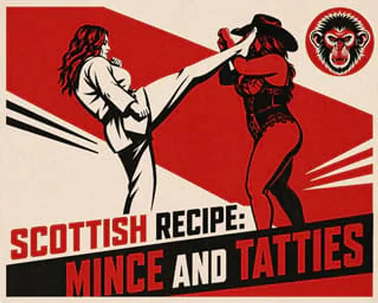

```text
A bold, retro-style poster, employing a limited color scheme of red, black, and beige, is printed on slightly textured, aged paper. The composition centers on a dramatic action scene involving two women: on the left, a woman with long, wavy red hair, dressed in a white martial arts uniform, is executing a high side kick; on the right, a curvaceous woman in a black cowboy hat and black lace bodysuit recoils and raises her arms in defense as she is kicked. The poster utilizes heavy black shadows, sharp geometric shapes, a screen-print-like ink wash effect, and graphic aesthetics reminiscent of mid-20th-century pulp fiction posters. Behind them, a large red geometric banner extends from the upper left to the lower right, with two black speed lines added to the left and three white speed lines to emphasize the dynamism. In the upper right corner, a circular badge contains a black-and-white screaming monkey or ape face on a red background. At the bottom, an oversized, compressed block font is added to the radical poster layout: the first line of text is…{argument name="headline text" default="SCOTTISH RECIPE:"} (Red and black), the second line of text is{argument name="main title" default="MINCE AND TATTIES"} (Use oversized red, white, and black lettering on a black, diagonal banner.) Maintain an overall look that is ironic, confrontational, retro, and graphic, like a fake exploitation movie poster or an anarchist punk magazine cover.
```

Model: GPT Image 2
Author: GPT Image 2 Prompts

[ProjectD](https://aitoolsradar.com/en/prompts/9b63b49f2f2fac) · [Recorded source](https://x.com/Rik_Vasquez/status/2047268357402239057#reversed-0)
 · [Full original metadata and byte evidence](data/projectd-batch-0051.json)

## Vintage Roaring Tiger Japanese Poster

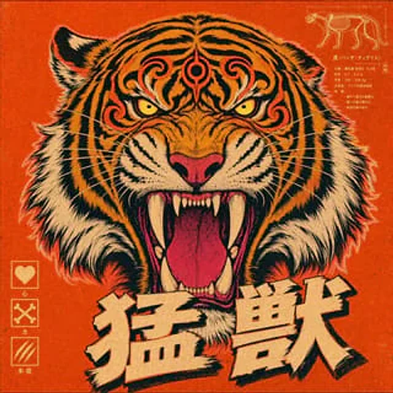

```text
Create a bold, retro-Japanese-style poster on a square canvas, with a fierce, frontal tiger head as the sole central subject. The composition is perfectly symmetrical and occupies most of the frame. The tiger roars with its mouth wide open, revealing long, curved tusks, smaller lower teeth, a bright pink tongue, a dark throat, a pink nose, sharp yellow eyes, and dramatic black stripes covering its saturated orange fur, with white down on its cheeks and neck. Add decorative swirling stripes on its forehead to give the tiger's face a stylized, mythical feel. Use a rough, retro screen or stencil texture with noticeable grain, worn ink, and slightly broken edges, employing a limited palette of burnt orange, black, cream, white, soft pink, and touches of yellow. The background should be a flat, textured orange-red. In the upper right corner, include a small technical panel showing a side view of the tiger's skeleton, drawn with delicate cream lines, with compact, vertical Japanese annotation text below and to the sides, like pseudoscientific label blocks. In the bottom left corner, there are three vertically stacked icon boxes with thin cream borders: the first contains a heart icon and the label "Heart," the second contains a crossbones icon and the label "Strength," and the third contains three claw marks icons and the label "Instinct." At the bottom center, there are two very large cream-colored Japanese kanji characters with heavy black shadows and a rough, hand-carved woodblock print texture: "Beast." The overall composition maintains an aggressive, iconic, poster-like feel, is centered, and highly graphic, blending traditional Japanese poster aesthetics, the energy of tattoo GIFs, and a retro animal anatomy style.
```

Model: GPT Image 2
Author: GPT Image 2 Prompts

[ProjectD](https://aitoolsradar.com/en/prompts/07a95ac60d50db) · [Recorded source](https://x.com/FloNocode/status/2047788620942114983#reversed-0)
 · [Full original metadata and byte evidence](data/projectd-batch-0051.json)

## Vintage Rubber Hose Cartoon Transformation

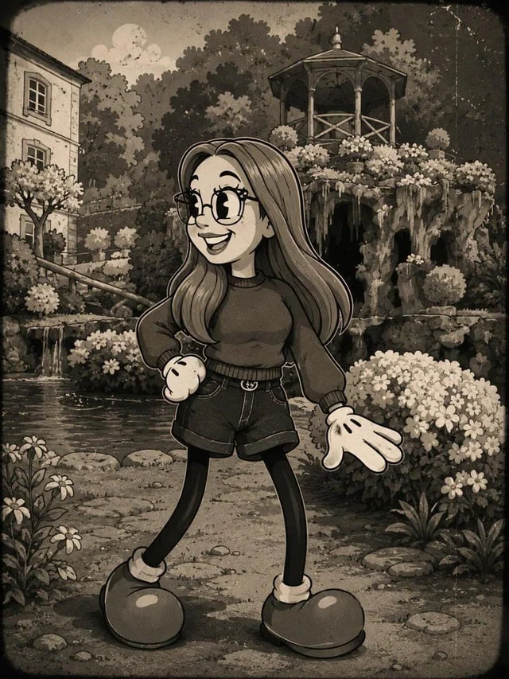

```text
Transform the person in the photo into a {argument name="style" default="vintage 1930s–1940s cartoon character"} inspired by classic “rubber hose animation” styles such as {argument name="references" default="Betty Boop, Cuphead, Steamboat Willie"}, and old Fleischer Studios cartoons.

IMPORTANT:

Clearly preserve the identity of the person in the photo (recognizable hair, beard, glasses, face, and facial expression).

Exaggerated, elastic cartoon-style body.

Large black vintage pie-cut eyes.

Big expressive smile.

Classic white cartoon gloves.

Oversized 1930s-style cartoon shoes.

Thin rubber hose-style arms and legs.

Thick black outlines and authentic vintage animation look.

Visual Style:

Black and white or vintage sepia tones.

Aged old-film texture.

Small grain, scratches, and imperfections like old film reels.

Simple cel-animation style shading.

Caricatured but natural proportions.

Background inspired by the original environment of the photo.

Art Style:

1930s / 1940s cartoon animation.

Rubber hose cartoon aesthetic.

Vintage animation poster style.

Fleischer Studios aesthetic.

Cuphead-inspired vintage cartoon style.

Ink outlines and exaggerated expressions.

Quality:

Ultra-detailed vintage cartoon.

Cinematic composition.

High facial likeness detail.

Soft vintage lighting.

Authentic retro animation feeling.

Full-body character.
```

Model: GPT Image 2
Author: Kashberg

[ProjectD](https://aitoolsradar.com/en/prompts/0dd015fed92636) · [Recorded source](https://youmind.com/prompts/rubber-hose-cartoon-character-transformation-22696)
 · [Full original metadata and byte evidence](data/projectd-batch-0051.json)

## Vintage Shibuya Street Portrait

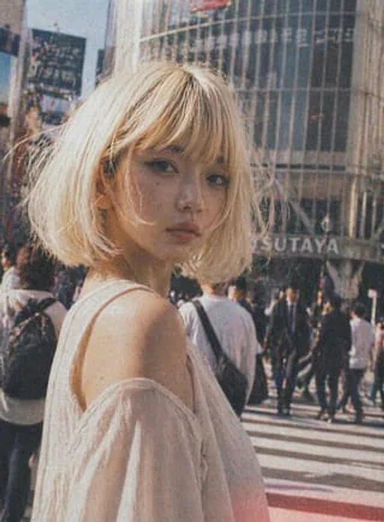

```text
A fashionable street portrait of a young woman standing at a busy Tokyo intersection during the day. The shot focuses on her upper body, with her back slightly to the camera, highlighting her bare shoulders. She has a messy short bob haircut, and her hair color is {argument name="hair color" default="Platinum"} The fabric was light and soft, and she was petite. She was wearing a {argument name="clothing color" default="White"} The off-shoulder top, made of a light and semi-transparent fabric with a beautiful drape, creates a romantic and airy atmosphere. She is placed in the foreground on the left side of the image, using a shallow depth of field effect, with a bustling background of pedestrians crossing the street. Behind her, a building with curved glass is added, and the viewer can see {argument name="background sign" default="TSUTAYA"} The logo is designed to evoke the spirit of Shibuya. It employs a warm, retro film aesthetic, with slightly faded tones, noticeable grain, a subtle blur, soft sunlight, gentle contrast, and a nostalgic, simulated snapshot atmosphere. The overall tone should be stylish, natural, and cinematic, like a fashion editorial shot captured in a bustling city.
```

Model: GPT Image 2
Author: GPT Image 2 Prompts

[ProjectD](https://aitoolsradar.com/en/prompts/d669c33c8e7755) · [Recorded source](https://x.com/maku67879787/status/2047643632015159517#reversed-0)
 · [Full original metadata and byte evidence](data/projectd-batch-0051.json)

## Vintage Skeuomorphic Icon Set

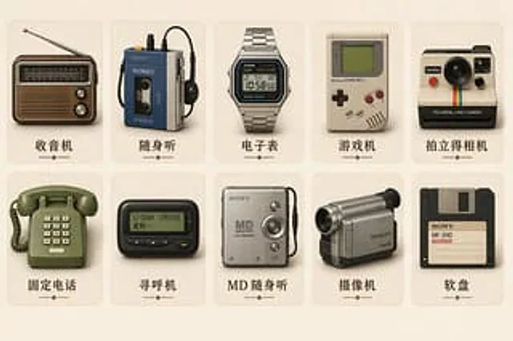

```text
Generate a set{argument name="device type" default="Retro electronic devices"} The icons adopt a retro skeuomorphic style and include the icon names in the images.
```

Model: GPT Image 2
Author: GPT Image 2 Prompts

[ProjectD](https://aitoolsradar.com/en/prompts/209e16c35edd2c) · [Recorded source](https://x.com/TanShilong/status/2046470907762450900)
 · [Full original metadata and byte evidence](data/projectd-batch-0051.json)

## Vintage Spanish Tortilla Recipe Poster

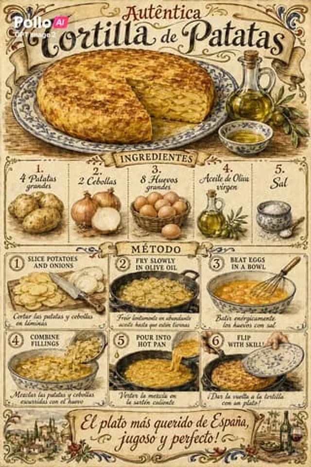

```text
{
  "type": "Retro illustration style Spanish recipe poster",
  "subject": "A golden-yellow Spanish tortilla (tortilla de patatas) rests on a blue and white porcelain plate, with a triangular piece cut off to reveal the layers of potatoes inside.",
  "style": {
    "overall": "Antique cookbook posters, illustrations of rustic Mediterranean cuisine, aged parchment background, hand-drawn lines, watercolor and gouache textures, ornate decorative patterns, warm dark brown print appearance.",
    "mood": "Traditional, handcrafted, nostalgic, and mouthwatering."
  },
  "text": {
    "top_brand": "{argument name=\"brand text\" default=\"Pollo AI GPT Image 2\"}",
    "main_title_top": "Auténtica",
    "main_title": "{argument name=\"headline text\" default=\"Tortilla de Patatas\"}",
    "ingredients_banner": "ingredients",
    "method_banner": "Cooking methods",
    "bottom_quote": "{argument name=\"quote\" default=\"El plato más querido de España, jugoso y perfecto!\"}"
  },
  "layout": {
    "format": "Vertical poster",
    "sections": [
      {
        "title": "main course",
        "position": "Upper Middle",
        "count": 1,
        "labels": [
          "Cut off a piece from a whole potato pancake."
        ]
      },
      {
        "title": "Food Shop",
        "position": "middle",
        "count": 5,
        "labels": [
          "1. 4 large potatoes",
          "2. Two onions",
          "3. 8 large eggs",
          "4. Extra Virgin Olive Oil",
          "5. Salt"
        ]
      },
      {
        "title": "Method grid",
        "position": "Middle to lower",
        "count": 6,
        "labels": [
          "1. Chop the potatoes and onions.",
          "2. Slowly fry in olive oil",
          "3. Beat the eggs in a bowl.",
          "4. Mix the filling",
          "5. Pour into a hot pan",
          "6. Use your skills to flip it over!"
        ]
      },
      {
        "title": "Bottom decorative strip",
        "position": "bottom",
        "count": 2,
        "labels": [
          "Illustration of Spanish countryside on the left",
          "The wine bottle, wine glass, olives, and plate on the right."
        ]
      }
    ]
  },
  "objects": {
    "hero_surroundings_count": 2,
    "hero_surroundings": [
      "The glass bottle of olive oil containing olives and leaves is on the right side of the plate.",
      "The small porcelain bowl of olive oil in front of the bottle"
    ],
    "ingredient_illustrations_count": 5,
    "ingredient_illustrations": [
      "4 whole potatoes",
      "Two onions, one of which was cut open.",
      "A basket of eggs, with one egg placed next to it.",
      "Olive oil bottle, adorned with olives and branches.",
      "A small bowl containing salt, with a spoon and a sprinkling sprinkling tool."
    ],
    "method_panels_count": 6,
    "method_panel_details": [
      "The sliced ​​potatoes and onion rings are placed on the cutting board, with a knife next to them.",
      "Potatoes are fried in olive oil in a black pan.",
      "Beat the eggs in a patterned bowl",
      "Pour the potato and onion mixture into the beaten egg mixture.",
      "Pour the egg mixture into the hot black pan.",
      "Use a decorative plate to cover the pan and flip the finished potato pancakes."
    ]
  },
  "composition": {
    "ornamentation": "Scroll banners, floral corner patterns, curled filigree, ink-lined borders, engraved poster layouts.",
    "background": "The weathered cream-colored parchment bears fine stains and a fibrous texture.",
    "color_palette": "Golden brown, olive green, cream, faded blue, warm beige, dark brown, dark ink"
  },
  "rendering_notes": "Highly clear decorative typography, authentic Spanish food poster design, a perfect blend of dense text and artwork, a balanced infographic layout, richly textured food illustrations, and a rejection of modern minimalism.",
  "aspect_ratio": "2:3"
}
```

Model: GPT Image 2
Author: GPT Image 2 Prompts

[ProjectD](https://aitoolsradar.com/en/prompts/71986b535ef85f) · [Recorded source](https://x.com/PolloAIES/status/2046776832620412966#reversed-1)
 · [Full original metadata and byte evidence](data/projectd-batch-0051.json)

## Vintage Store Shopping Scene

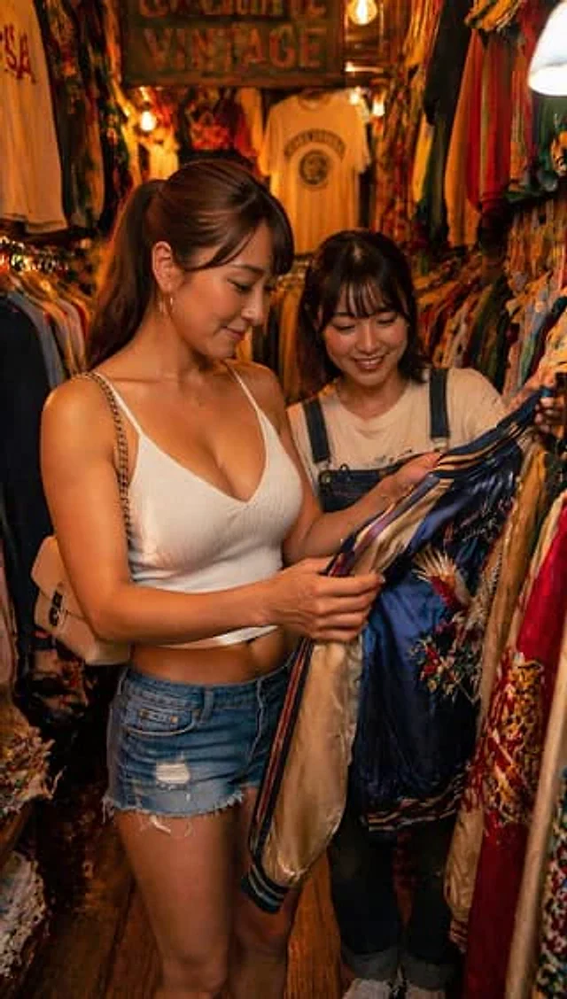

```text
A realistic, natural snapshot shows two young Asian women in a crowded {argument name="setting" default="Vintage clothing store"} A scene of shopping inside a store. The woman in the foreground has a brown ponytail and is wearing {argument name="foreground outfit" default="White ribbed cropped top and distressed denim shorts"} She was carrying a beige shoulder bag. She was holding up and examining a {argument name="item being examined" default="Blue satin commemorative jacket with delicate embroidery"} The second woman next to her had bangs and wore {argument name="background outfit" default="White T-shirt and denim overalls"} She smiled warmly at the jacket. The store was filled with colorful vintage clothing, and in the warm ambient lighting, a wooden sign that read "VINTAGE" could be seen in the background. The shallow depth of field focused on the two women and the jacket.
```

Model: GPT Image 2
Author: GPT Image 2 Prompts

[ProjectD](https://aitoolsradar.com/en/prompts/ec2573601647d3) · [Recorded source](https://x.com/noruma_noel/status/2045374200886808604#reversed-0)
 · [Full original metadata and byte evidence](data/projectd-batch-0051.json)

## Vintage Travel Poster Illustration

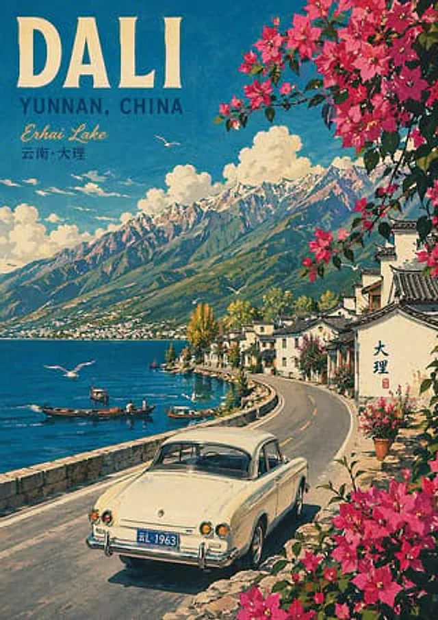

```text
A document about{argument name="location setting" default="Erhai Lake and Cangshan Mountain"} This is a retro travel poster illustration, employing a vibrant mid-20th-century lithograph style. In the foreground, a cream-colored classic car drives along a winding coastal road into the distance, with bright pink bougainvillea dotting the upper and lower right corners. To the right of the road, traditional Chinese buildings with white walls and black tiles are built against the mountainside, one of which bears the characters "Dali" and a red seal. To the left is a deep blue lake with three small wooden boats and three seagulls soaring on its surface, surrounded by a low stone wall. In the background, majestic mountains rise against the blue sky, dotted with white clouds. The upper left corner uses a retro typography, with the words "Dali" in bold cream-colored serif font prominently displayed.{argument name="main headline" default="DALI"} Below, in cyan sans-serif font, are the words "".{argument name="subheading 1" default="YUNNAN, CHINA"} ", yellow cursive script{argument name="subheading 2" default="Erhai Lake"} ", and the small blue Chinese characters "{argument name="chinese text" default="Dali, Yunnan"} ".
```

Model: GPT Image 2
Author: GPT Image 2 Prompts

[ProjectD](https://aitoolsradar.com/en/prompts/0f78668dde4eab) · [Recorded source](https://x.com/austinit/status/2046031213677416638#reversed-0)
 · [Full original metadata and byte evidence](data/projectd-batch-0051.json)

## Vintage VHS High School Portrait

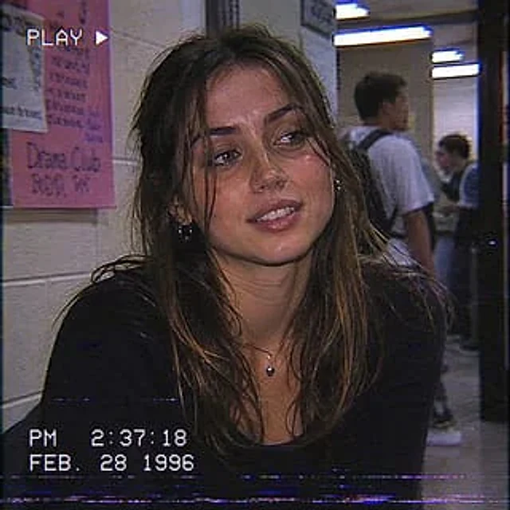

```text
Image of {argument name="person" default="Ana De armas & Sydney Sweeney"} from a VHS camcorder recorded in a high school in Feb of 1996. Same grain and overall film quality of cameras and vhs of the time period.
```

Model: GPT Image 2
Author: 𝐌

[ProjectD](https://aitoolsradar.com/en/prompts/fa8116558b3b8a) · [Recorded source](https://youmind.com/prompts/vintage-vhs-high-school-portrait-22309)
 · [Full original metadata and byte evidence](data/projectd-batch-0051.json)

## Vintage Watercolor Illustration Poster

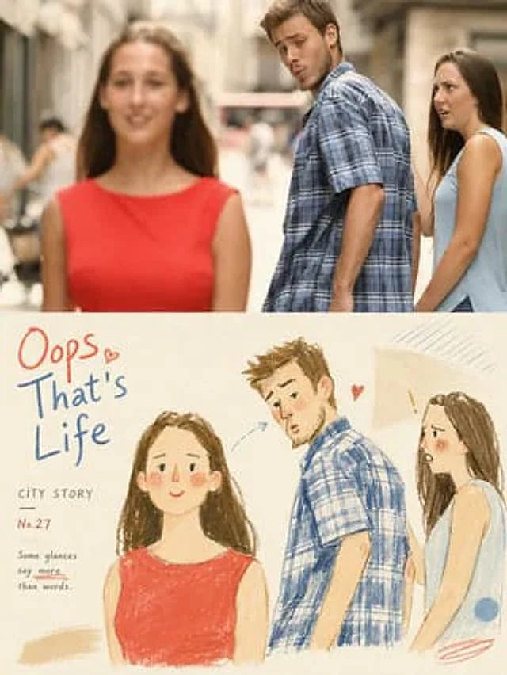

```text
请将我上传的每一张照片分别制作成一张独立的高级设计海报，不多图拼接，每张照片单独输出。整体采用3:4竖版构图，上下两个区域高度严格1:1，各占画面50%。

上半部分保留原始照片，准确保持主体身份、情绪、姿态、空间关系、真实质感、自然光影和原有色彩氛围，仅进行轻微高级摄影调色，使其具有时尚杂志、艺术出版物与展览摄影质感。为适配画幅，可自然扩展天空、地面或环境背景，但不得拉伸、扭曲或改变主体。

下半部分提取照片中最具识别性的主体、轮廓、姿态与叙事关系，重构为轻盈、稚拙、复古的手绘编辑插画。不要机械复刻细节，以概括造型、适度夸张比例、符号化特征和幽默视觉隐喻重新表达，同时保持原物一眼可辨。融合现代主义编辑插画、包豪斯平面构成、儿童绘本、稚拙艺术与时尚速写气质，形体简练，轮廓略带迟疑与手工误差，局部特征可适度放大，让画面兼具故事感、时尚感与俏皮感。

配色从上方照片中提取，采用高明度、低至中等饱和度的柔和有限色盘，以近似色统一氛围，小面积互补色制造视觉跳点。使用水彩、水粉、彩铅、粉蜡笔与干刷混合质感，保留纸张颗粒、透底、笔触断裂、边缘毛糙、轻微脏色与旧印刷套色偏差。背景大面积留白，仅以松散淡彩、局部斜线或简单几何元素承托主体，避免复杂场景堆积、写实光影、光滑矢量、3D渲染和过度精修。

文字从照片的地点、人物、场景或主题中提炼少量英文关键词、标题、编号或适配金句，并延续下半部分的手绘编辑语言。主标题采用略带稚拙与复古感的手写艺术字，辅助文字使用克制温和的无衬线或衬线字体，可轻微错位、倾斜、拉伸、叠色或产生旧印刷套色偏移，让文字像插画的一部分自然生长在画面中，而不是后期贴上的排版元素。

整体使用米白或浅色背景与大量留白，上下画面通过相同的主体特征、色彩、姿态和视觉符号形成呼应。整体气质轻松、俏皮、复古、温柔、聪明、时髦、幽默、浪漫、松弛，略带笨拙与古怪自信，像一页被精心保存的旧时尚绘本与现代艺术杂志。
```

Model: GPT Image 2
Author: 小小东

[ProjectD](https://aitoolsradar.com/en/prompts/0eb4ce164e2607) · [Recorded source](https://youmind.com/prompts/vintage-watercolor-illustration-poster-31914)
 · [Full original metadata and byte evidence](data/projectd-batch-0051.json)

## Vintage Wuhan Hot Dry Noodles Poster

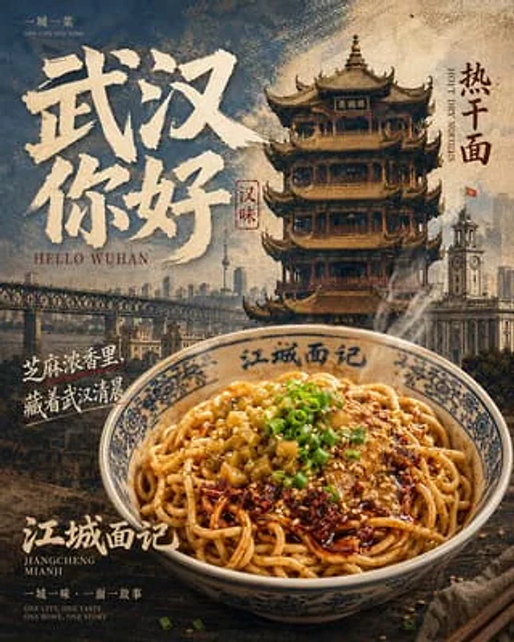

```text
Goal: Create a vintage Chinese food-and-city tourism poster for {argument name="city name" default="Wuhan"} and {argument name="signature dish" default="hot dry noodles"}, combining local landmarks, regional flavor, and retro print texture.

Canvas: Vertical poster, 4:5 aspect ratio, warm sepia and dark teal palette, weathered halftone paper grain, ink-wash edges, distressed screen-print look, dramatic food photography mixed with illustrated architectural collage.

Layout: Large cream-white Chinese brush calligraphy dominates the upper left reading “武汉 你好”, with the small English subtitle “HELLO WUHAN” below it. The upper right contains a large ornate landmark tower, the Yellow Crane Tower, rendered in golden-brown detail with layered eaves, smoke and mist around its base. Behind it is a faded Wuhan skyline with a long steel bridge crossing the middle left, a riverfront city silhouette, a clock-tower-style historic building on the right, and a thin modern TV tower in the distance. The bottom half is dominated by one large porcelain bowl of noodles in the foreground, cropped close and centered slightly right, steaming and glossy.

Discrete visible elements to include: exactly 1 main food bowl; exactly 1 signature dish inside it, hot dry noodles with thick noodles, sesame paste sheen, chili oil, diced pickled vegetables, sesame seeds, and chopped green onions; exactly 5 major city/landmark background elements: Yellow Crane Tower, Yangtze River bridge, distant skyline, TV tower, and historic clock tower; exactly 1 small red seal stamp near the central title; exactly 1 small red flag on the right-side tower; exactly 3 small foreground garnish/scatter details near the bottom edge: scallion pieces, sesame seeds, and a pair of chopsticks partly visible at the lower right.

Text content: Top left small title “一城一菜” with tiny English “ONE CITY ONE DISH”. Main oversized brush text “武汉 你好”. Red seal text “汉味”. Right vertical Chinese text “热干面” with small vertical English “HOT DRY NOODLES”. Handwritten-style left slogan “芝麻浓香里 藏着武汉清晨”. Bottom left large title “江城面记”, small romanization “JIANGCHENG MIANJI”, and bottom tagline “一城一味 · 一面一故事” with tiny English “ONE CITY, ONE TASTE / ONE BOWL, ONE STORY”. Add decorative blue Chinese writing around the inside rim of the bowl, including “江城面记”.

Visual style: Bold travel-poster composition, retro Chinese advertising poster, high-detail food realism in the foreground, painterly architectural background, rough beige paper texture, navy-blue sky wash, cream calligraphy, deep red accents, burnt orange highlights, cinematic contrast, authentic regional souvenir packaging aesthetic.

Constraints: Keep all visible text legible and placed as described. Do not add extra dishes, people, logos, QR codes, modern UI elements, or watermarks. Maintain a nostalgic cultural food poster feel suitable for restaurant branding, culinary tourism, and city souvenir packaging.
```

Model: GPT Image 2
Author: Larus Canus

[ProjectD](https://aitoolsradar.com/en/prompts/83fbb2a3fd46c1) · [Recorded source](https://youmind.com/prompts/wuhan-hot-dry-noodles-poster-23542)
 · [Full original metadata and byte evidence](data/projectd-batch-0051.json)

## Viral Tweet Menu Before-and-After

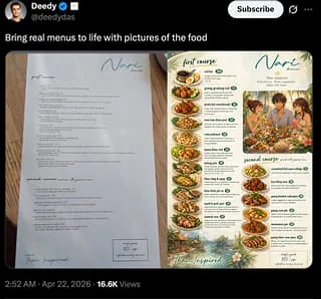

```text
A realistic screenshot of a social media platform in dark mode, featuring a black interface reminiscent of X/Twitter. The top left corner displays the profile picture and name.{argument name="profile name" default="Deedy"} (with a blue certification badge) and account name{argument name="handle" default="@deedydas"} In the upper right corner is a prominent white "Subscribe" button and a small interface icon. The post text is {argument name="post text" default="Bring your menu to life with food photos"} Below the main text is a side-by-side comparison image showcasing a two-page menu placed on a warm-toned wooden table. The left page is a minimalist upscale restaurant menu, with a clean and elegant layout on white paper and the restaurant's name printed in light blue handwritten font in the upper right corner.{argument name="restaurant name" default="Nari"} The menu is divided into "First Course" and "Second Course" sections, with dish names and prices presented in a clear, editorial layout. The bottom left corner features the cursive "Thai. Inspired." and the bottom right corner has a small box indicating "Chef's Recommendation." The right-hand page is an illustrated version of the same restaurant's menu, retaining the light blue restaurant name at the top, with the subtitle changed to "Thai Inspired. Bold flavors. Fresh ingredients. Made with heart." This page is decorated with abundant tropical leaves, flowers, and landscape borders in cream, green, and warm earth tones. The page contains two labeled areas: "First Course" in the upper left and "Second Course" in the lower center. The First Course section vertically lists eight dishes, each with a name, brief description, and a green circular price tag: caviar, gaeng gradang tod, pretty hot sweetbreads, som tum khao po, yum polamai, naea khao tod, miang pla, and khao tung &amp; ngor. The second course area showcases eight dishes in the same way: caramelized fish sauce cabbage, kua kling moo, giang bumbai aubergine, gaeng som pla, massaman ge, gaeng kiew wan nuea, grilled pork jowl, and naemtok moo. Near the center of the upper right corner of the illustration page is a heartwarming lifestyle illustration depicting three diners sharing a meal at an outdoor table. Each dish is integrated into the menu layout with mouthwatering overhead or 45-degree angle food photography illustrations. At the very bottom of the full screenshot, the post metadata line displays "2:52 AM · April 22, 2026 · 16.6K views". The overall image should present a beautifully crafted, viral demo screenshot feel, showcasing a before-and-after comparison of the menu design upgrade, with a clear and easy-to-read interface, a realistic UI framework, and delicate, editable food menu art effects.
```

Model: GPT Image 2
Author: GPT Image 2 Prompts

[ProjectD](https://aitoolsradar.com/en/prompts/ce1cd45296578e) · [Recorded source](https://x.com/swyx/status/2047140362771132544#reversed-1)
 · [Full original metadata and byte evidence](data/projectd-batch-0051.json)

## Visit Malaysia 2026 Travel Poster

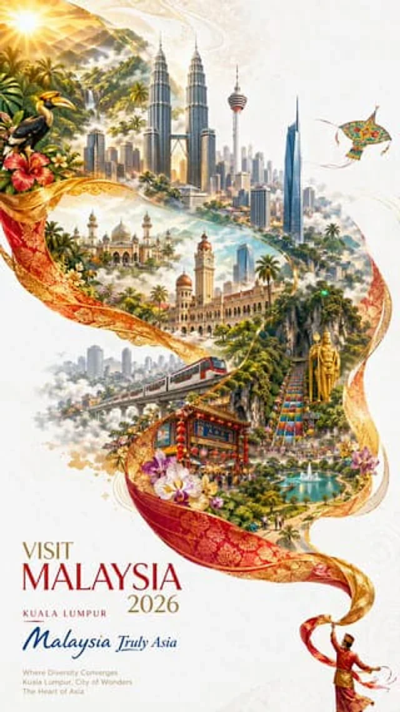

```text
A for{argument name="destination" default="Malaysia"} This luxurious travel poster, designed in a vertical art style, features a clean ivory-white textured background with delicate embossed decorative patterns. The composition revolves around a flowing red and gold batik ribbon, spiraling diagonally across the page to form an elegant S-curve, cleverly connecting a dreamlike collage of landmarks, cultural elements, and natural landscapes. In the upper left corner, warm golden sunlight bathes misty tropical mountains and rainforests, with waterfalls cascading down. Beside lush palm trees, a giant hornbill perches among hibiscus and white tropical flowers. Above, in the center, the Kuala Lumpur skyline rises from the mist, with the Petronas Twin Towers as the main feature, and the KL Tower and several modern skyscrapers faintly visible. Near the upper right corner, a brightly colored traditional moon kite (Wau kite) floats, standing out against the white background. To the left center is a magnificent mosque nestled among palm trees and smoke, boasting multiple domes and minarets. The right side features the historic Sultan Abdul Samad Building, showcasing its bronze dome and clock tower. The lower left depicts a red and silver elevated train traversing the city. At the bottom center, an ornate Chinatown archway bearing the inscription "Jalan Petaling" is displayed, adorned with red lanterns and bustling pedestrians. The lower right depicts the Batu Caves area, including a towering golden Mulugan statue and a steep, rainbow-colored staircase leading to a limestone cliff, surrounded by crowds. The lower right corner features a landscaped city park with a turquoise lake and fountain. Purple orchids and tropical flowers are interspersed throughout the ribbons and foreground. The far right corner shows a traditional dancer in red and gold attire, twirling the end of a ribbon. The entire collage should present a bright, highly detailed, grand, and celebratory atmosphere, combining realistic architecture with a painterly travel poster style, complemented by soft clouds, atmospheric haze, and luminous highlights. Add elegant poster typography to the lower left: the main title is {argument name="headline text" default="VISIT MALAYSIA 2026"} Smaller location rows are displayed as{argument name="location text" default="KUALA LUMPUR"} The blue handwritten tourism slogan is{argument name="tagline" default="Malaysia Truly Asia"} Below is a neat little subtitle:{argument name="subheading" default="Where Diversity Converges\nKuala Lumpur, City of Wonders\nThe Heart of Asia"} Employing a sophisticated color scheme of gold, deep red, ivory, emerald green, sky blue, and tropical green, the design presents exquisite editorial-level composition and high-end destination brand aesthetics.
```

Model: GPT Image 2
Author: GPT Image 2 Prompts

[ProjectD](https://aitoolsradar.com/en/prompts/a3a08efd738d3a) · [Recorded source](https://x.com/hijeffrey46/status/2046528279830741313#reversed-0)
 · [Full original metadata and byte evidence](data/projectd-batch-0051.json)

## Visual Novel Character Profile Page

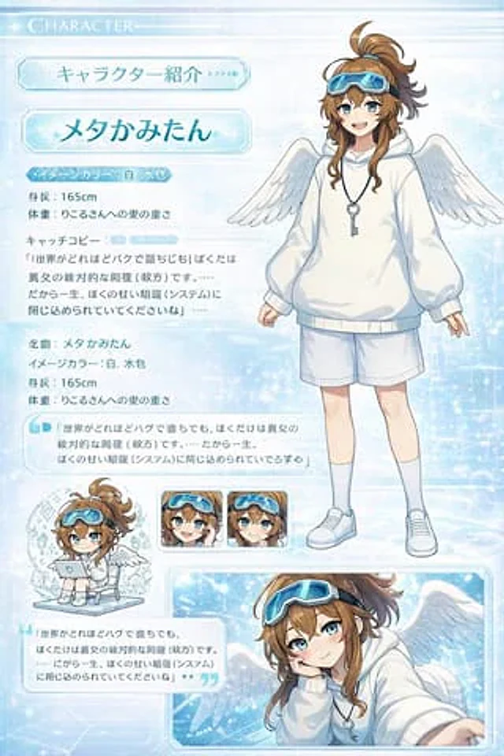

```text
Using the latest image generation tool, this chibi illustration and character portrait were used to create a character introduction style illustration that looks like a real webpage. (It should look like a game introduction page.) This is a high-quality image inspired by visual novel character introduction pages. It should include facial expressions and have the quality of a CG illustration. The image features a chibi character. "Enter self-introduction here" Name: ({argument name="name" default="Enter your name here"} Representative color: ({argument name="color" default="Enter color here"} Height: (Enter height) cm Weight: (Enter weight) kg Catchphrase:{argument name="quote" default="Enter your lines here"} "
```

Model: GPT Image 2
Author: GPT Image 2 Prompts

[ProjectD](https://aitoolsradar.com/en/prompts/021d1053be895a) · [Recorded source](https://x.com/09lyco/status/2045281845391323175)
 · [Full original metadata and byte evidence](data/projectd-batch-0051.json)

## Visual Novel Composite Layout


```text
{
  "type": "Anime Visual Novel Poster",
  "atmosphere": "A dark room, an ominous atmosphere.",
  "center": {
    "logo": "Pink circle, blue stitched heart, green pen, text '{argument name=\"game title\" default=\"Doki Doki Literature Club!\"} '",
    "subject": "{argument name=\"central figure\" default=\"A silhouette of a man sitting at a desk in front of a glowing pink computer monitor.\"}"
  },
  "layout": {
    "style": "Paper collage edges surround the characters",
    "portraits": [
      {
        "position": "Top left",
        "character": "A girl with long brown hair, a white bow, green eyes, and a smile."
      },
      {
        "position": "Top right",
        "character": "The girl had long, dark purple hair and purple eyes, and a melancholy expression."
      },
      {
        "position": "Bottom left",
        "character": "Girl, short pink hair, red hair clip, pink eyes, annoyed."
      },
      {
        "position": "Bottom right",
        "character": "A girl with short peach-colored hair, a red bow, blue eyes, and a smile."
      }
    ],
    "shared_attributes": "All the girls were wearing{argument name=\"uniform style\" default=\"Grey suit jacket, white shirt, red ribbon\"}",
    "floating_elements": [
      "{argument name=\"floating symbols\" default=\"4 white question marks\"}",
      "{argument name=\"floating objects\" default=\"4 pieces of paper with text on them\"}"
    ]
  }
}
```

Model: GPT Image 2
Author: GPT Image 2 Prompts

[ProjectD](https://aitoolsradar.com/en/prompts/c0675ceed601f7) · [Recorded source](https://x.com/arora_mrinaal/status/2044387291008041405#reversed-2)
 · [Full original metadata and byte evidence](data/projectd-batch-0051.json)

## Visual Novel Psychological Horror Concept Art


```text
{
  "type": "Visual Novel Promotional Artwork",
  "atmosphere": "Dark, melancholic, and psychologically terrifying elements contrast with cute anime elements.",
  "central_elements": {
    "logo": {
      "shape": "Circular with a pink border",
      "background": "Light blue sewn heart shape",
      "text_main": "{argument name=\"main title\" default=\"DOKI DOKI\"}",
      "text_style": "Colored 3D block fonts",
      "accessories": "Green fountain pen, pink heart-shaped ornament",
      "banner_text": "{argument name=\"subtitle\" default=\"Literature Club!\"}"
    },
    "foreground_subject": {
      "description": "The shadowy silhouette of a person sitting at a desk",
      "lighting": "Glowing{argument name=\"monitor glow color\" default=\"pink\"} Computer monitor backlight illumination"
    }
  },
  "surrounding_portraits": [
    {
      "position": "Top left",
      "framing": "Torn edges of paper",
      "character": "Anime girl, long brown hair, white hair tie, green eyes, gentle smile, gray school uniform suit, red ribbon."
    },
    {
      "position": "Top right",
      "framing": "Torn edges of paper",
      "character": "Anime girl with long, dark purple hair, purple eyes, a shy and melancholic expression, wearing a gray school uniform suit and a red ribbon."
    },
    {
      "position": "Bottom left",
      "framing": "Torn edges of paper",
      "character": "Anime girl, short pink hair, red hair clip, pink eyes, pouting expression, gray school uniform suit, red ribbon."
    },
    {
      "position": "Bottom right",
      "framing": "Torn edges of paper",
      "character": "Anime girl, coral-colored short hair, bright red bow, blue eyes, radiant smile, gray school uniform suit, red ribbon."
    }
  ],
  "floating_elements": {
    "question_marks": {
      "count": 3,
      "color": "White",
      "style": "Antique font"
    },
    "papers": {
      "count": 4,
      "description": "A piece of white paper with blurry writing drifted down in the dark space."
    }
  }
}
```

Model: GPT Image 2
Author: GPT Image 2 Prompts

[ProjectD](https://aitoolsradar.com/en/prompts/c79ef7ab1719cf) · [Recorded source](https://x.com/aibi0123/status/2044456247416738199#reversed-2)
 · [Full original metadata and byte evidence](data/projectd-batch-0051.json)

## Visual Novel Screenshot Mockup

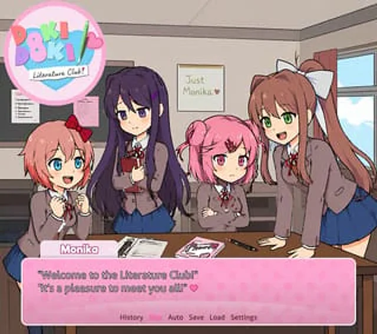

```text
This is a screenshot from a visual novel depicting a classroom scene in an anime style. The image shows four high school girls in matching uniforms: a grey blazer, white shirt, red ribbon, and blue skirt. On the far left is a girl with short coral hair and a red bow; she clenches her fists excitedly. Next to her is a girl with long dark purple hair, smiling and holding a red book. Close to her is a girl with pink pigtails and red hair clips; she crosses her arms, looking somewhat displeased. On the far right is a girl with high brown ponytails and a large white bow; she leans forward on her desk, smiling and talking. There's a window on the right side of the classroom, a bulletin board on the left, and three items on a desk in the foreground: a notebook, a pink book, and a pen. A poster on the back wall reads…{argument name="poster text" default="Just Monika. ♥"} The top left corner features a circular logo in a soft color, with the text {argument name="game title" default="Doki Doki Literature Club!"} It is decorated with green pencils and pink hearts. At the bottom of the screen is a pink polka-dot style visual novel dialog box. The name tag is displayed as {argument name="speaker name" default="Monika"} The main dialogue text is{argument name="dialogue text" default="'Welcome to the Literature Club!' 'It's a pleasure to meet you all!' ♥"} Below the dialog box is a menu that reads "History Skip Auto-Save Reload Settings".
```

Model: GPT Image 2
Author: GPT Image 2 Prompts

[ProjectD](https://aitoolsradar.com/en/prompts/73c7824cc33485) · [Recorded source](https://x.com/mirochill/status/2043614837914169803#reversed-0)
 · [Full original metadata and byte evidence](data/projectd-batch-0051.json)

## Visual Polyglot Magazine Collage

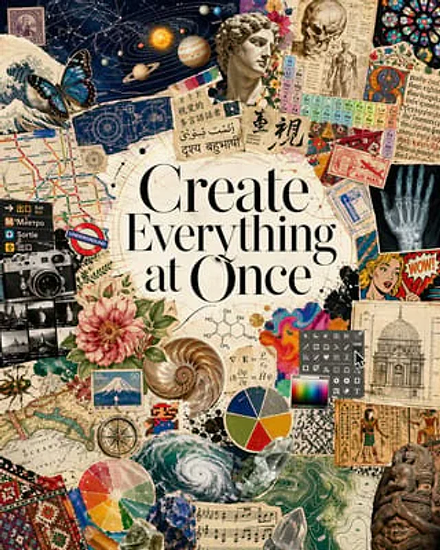

```text
I'm creating a magazine page with the theme "Visual Multilingualism". The title in the center of the image should be "{argument name="title" default="Create Everything at Once"} Please create an artwork that celebrates visual creation, not limited to exquisite photography, but encompassing the full breadth of human visual culture and natural visual elements. The image should include carefully curated collages with diverse distributions: scientific charts, the periodic table, the solar system, medieval manuscript pages, botanical illustrations, anatomical diagrams, ancient maps, climate charts, engineering diagrams, traffic signs, multilingual text, comic panels, and UI elements. Screenshots, camera photos, butterfly specimens, pie charts, architectural blueprints, and elevation drawings. The text positions the model as proficient in various languages, symbol systems, interfaces, cultural forms, and visual conventions—capable of shifting from practicality to aesthetics, from document understanding to art generation. Incorporate elements from all art forms, including pixel art, style, history, sculpture, nature, photography, and painting. These are just examples; I need you to actively consider other elements or styles that might suit excellent design, not just these concepts. The overall effect should have the quality of a high-end research announcement or a museum-style manifesto: elegant, grand, and designed to demonstrate that image intelligence should be trained on the entire visual world, not just refined aesthetics. Use unstructured, creative, and artistic layouts, such as, but not limited to, fan-shaped layouts, avoiding grid-like layouts. Use a 4:5 aspect ratio. Do not add any content text other than the "Create Everything at Once" heading. Text as part of the art is acceptable. Avoid an overall beige tone, as we want vibrant elements to remain vibrant.
```

Model: GPT Image 2
Author: GPT Image 2 Prompts

[ProjectD](https://aitoolsradar.com/en/prompts/3ce885a90c08eb) · [Recorded source](https://x.com/dotey/status/2046775660182385070)
 · [Full original metadata and byte evidence](data/projectd-batch-0051.json)

## Visual Telephone Game Image Grid

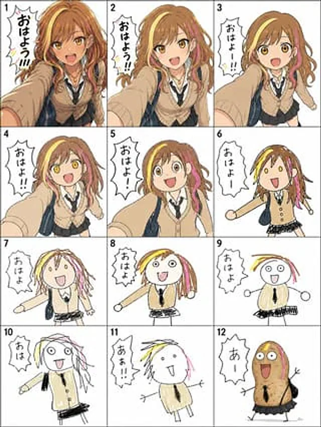

```text
Create a 3x4 grid showing 12 versions of the attached image, as if 12 different people redrew it from memory in a visual telephone game. The first version should be somewhat close to the original, and each next version should become more inaccurate, awkward, simplified, and funny. Keep the background clean and white. Make every panel different, but still vaguely connected to the original image.
```

Model: GPT Image 2
Author: やげん✨🐎｜推しの為にAIを極めるおっさん社会人

[ProjectD](https://aitoolsradar.com/en/prompts/2faabfe168ca27) · [Recorded source](https://youmind.com/prompts/visual-telephone-game-grid-18084)
 · [Full original metadata and byte evidence](data/projectd-batch-0051.json)

## Vitamin C Skincare Ad


```text
Create a minimalist luxury skincare advertisement in a 1:1 square format, against a warm beige studio background where strong natural sunlight casts soft palm leaf shadows on the walls. Place an amber glass dropper bottle, upright on a round, cream-colored stone base, in the center left. The bottle features a glossy gold neck and a matte white rubber dropper tip. Add a white rectangular label with an elegant, minimalist typography: the brand name at the top.{argument name="brand name" default="NATURELLE SKINCARE"} Below is the prominent orange product name.{argument name="product name" default="VITAMIN C"} Next is the black "BRIGHTENING SERUM" lettering, followed by a smaller subtitle "With Hyaluronic Acid &amp; Niacinamide." Three glossy green tropical leaves are placed around the base, extending from the left edge to the back of the bottle, creating a fresh, botanical feel. On the right, a three-tiered bold black serif title reads, "..."{argument name="headline text" default="Glow Naturally. Every Day."} Below the title, add a smaller, concise sans-serif description of the effects, which reads:{argument name="benefits text" default="Brightens | Hydrates | Protects"} Below, three circular black-outlined icons represent ingredients or values, each containing a simple leaf symbol. Small descriptive text, including "Barban Free," "Dermicology," and "Creuty-free," is added below each icon in a slightly imperfect style compared to the original ad. A glossy, circular green call-to-action button with bold white text is placed in the lower right corner.{argument name="button text" default="Shop Now"} Place a slice of orange, partially cropped, along the far right edge to convey a vibrant, juicy texture and reinforce the Vitamin C theme. Add a small white "Pollo.ai" watermark in the upper right corner. The overall image is designed as a sophisticated commercial product mockup, photorealistic, with a high-end beauty brand style, soft, warm highlights, subtle shadows, balanced composition, clear label details, and premium e-commerce social media advertising aesthetics.
```

Model: GPT Image 2
Author: GPT Image 2 Prompts

[ProjectD](https://aitoolsradar.com/en/prompts/6249402a0ad920) · [Recorded source](https://x.com/Gemalpha_88/status/2046796479562678589#reversed-0)
 · [Full original metadata and byte evidence](data/projectd-batch-0051.json)

## Vitamin C Skincare Ad


```text
Create a clean luxury skincare product advertisement in a square 1:1 layout with a warm beige studio background and strong natural sunlight casting soft palm-leaf shadows across the wall. Place 1 amber glass dropper bottle on the left-center, standing upright on a round cream stone pedestal. The bottle has a glossy gold collar and a matte white rubber dropper top. Add a white rectangular label with elegant minimal typography: brand name "{argument name="brand name" default="NATURELLE SKINCARE"}" at the top, a large orange product name "{argument name="product name" default="VITAMIN C"}", then black text reading "BRIGHTENING SERUM" and smaller subtext "With Hyaluronic Acid & Niacinamide". Surround the pedestal with 3 visible glossy green tropical leaves, arranged from the left edge and behind the bottle for a fresh botanical look. On the right side, place a large bold black serif headline in 3 stacked lines reading "{argument name="headline text" default="Glow Naturally. Every Day."}". Beneath it, add a smaller clean sans-serif benefits line reading "{argument name="benefits text" default="Brightens | Hydrates | Protects"}". Below that, include 3 circular black outline ingredient or values icons in a horizontal row, each with a simple leaf-style symbol inside; add tiny caption text beneath them with the same slightly imperfect ad-like wording seen in the original, including "Barban Free", "Dermicologyg", and "Creuty-free". At the lower right, place a glossy rounded green call-to-action button with white bold text "{argument name="button text" default="Shop Now"}". Add 1 sliced orange on the far right edge, partially cropped, with vivid juicy texture to reinforce the vitamin C theme. Include a small white "Pollo.ai" watermark in the top-right corner. Style the whole image as a polished commercial product mockup, photorealistic, high-end beauty branding, soft warm highlights, subtle shadows, balanced composition, sharp label detail, premium ecommerce social ad aesthetic.
```

Model: GPT Image 2
Author: Gem Alpha

[ProjectD](https://aitoolsradar.com/en/prompts/a08825c8431a47) · [Recorded source](https://youmind.com/prompts/vitamin-c-skincare-ad-14864)
 · [Full original metadata and byte evidence](data/projectd-batch-0051.json)

## Vogue China Pan Jinlian Fashion

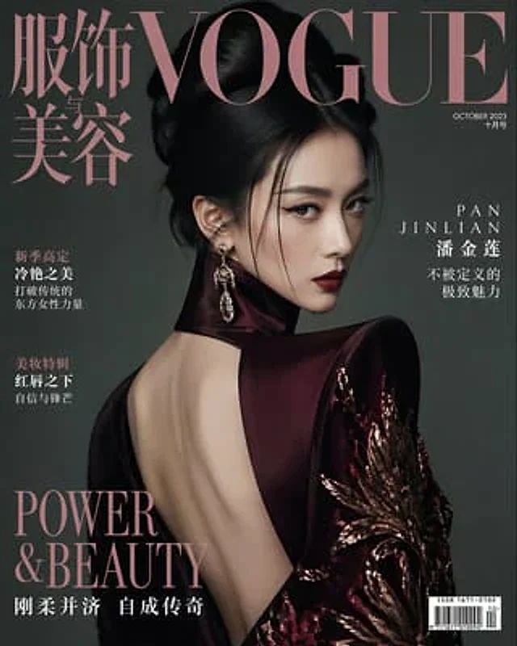

```text
Vogue China cover,{argument name="character" default="Pan Jinlian"} Wearing{argument name="clothing style" default="Modern Haute Couture"} She paired it with cool red lips and sharp eyes.
```

Model: GPT Image 2
Author: GPT Image 2 Prompts

[ProjectD](https://aitoolsradar.com/en/prompts/bd53d122eb65ed) · [Recorded source](https://x.com/songguoxiansen/status/2046838142939066463)
 · [Full original metadata and byte evidence](data/projectd-batch-0051.json)

## VOGUE Paris Haute Couture Cover

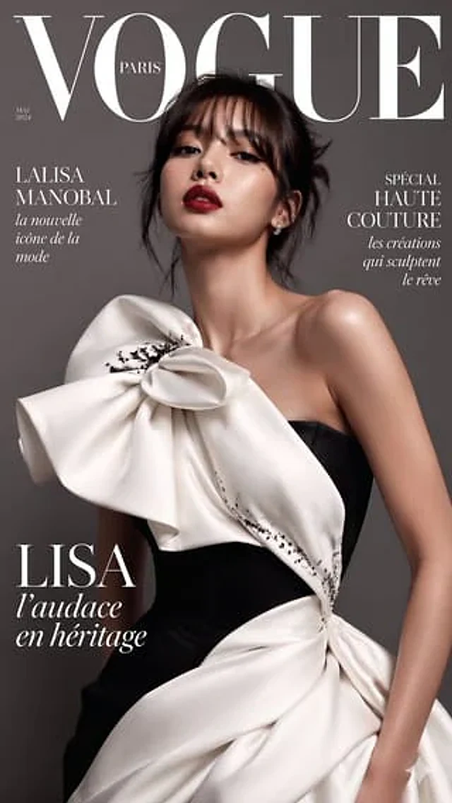

```text
exist{argument name="magazine" default="VOGUE Paris"} On the cover,{argument name="subject" default="Lalisa Manobal"} Wearing{argument name="outfit" default="Modern Haute Couture Gown"} She wore striking red lipstick and had a sharp gaze.
```

Model: GPT Image 2
Author: GPT Image 2 Prompts

[ProjectD](https://aitoolsradar.com/en/prompts/778616cf4ac5bc) · [Recorded source](https://x.com/AFantagirl85190/status/2047282455024177557)
 · [Full original metadata and byte evidence](data/projectd-batch-0051.json)

## Vogue Style Fashion Illustration

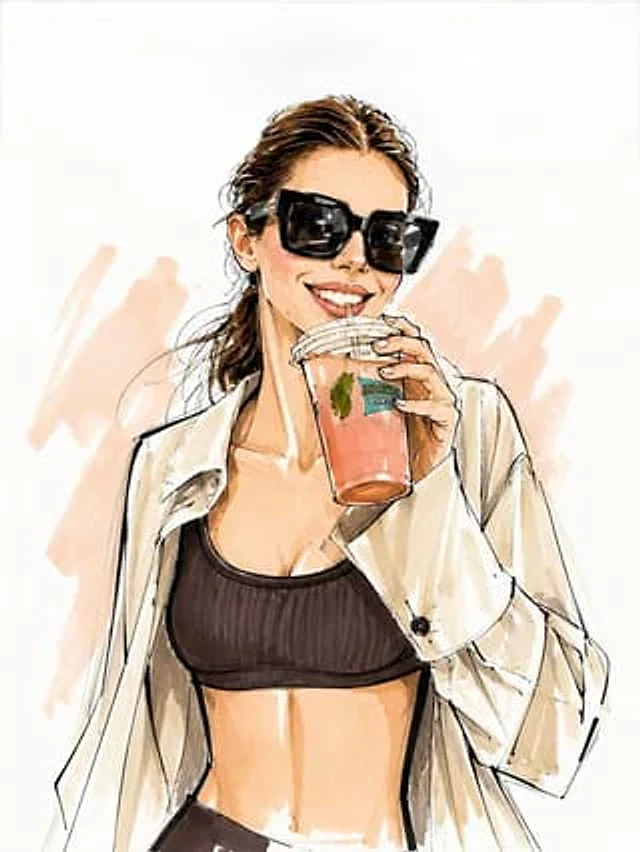

```text
Turn {argument name="source photo" default="this photo"} into a {argument name="fashion style" default="Vogue-style"} fashion illustration, preserving identity and facial features. Minimalist hand-drawn fashion sketch with elegant elongated proportions, bold black ink contours, loose confident linework, flat marker colors, abstract blush accents, graphic lips, stylized eyes, expressive ink hair, and simplified geometric clothing. Clean white background, scanned paper texture, modern luxury editorial fashion illustration.
```

Model: GPT Image 2
Author: Ciri

[ProjectD](https://aitoolsradar.com/en/prompts/443867c2e3f536) · [Recorded source](https://youmind.com/prompts/vogue-style-fashion-illustration-sketch-22581)
 · [Full original metadata and byte evidence](data/projectd-batch-0051.json)

## Voice Personification Character


```text
{argument name="voice" default="chatgpt voice"} If it is a character
```

Model: GPT Image 2
Author: GPT Image 2 Prompts

[ProjectD](https://aitoolsradar.com/en/prompts/c7d5979729ac56) · [Recorded source](https://x.com/nicdunz/status/2046260083504394518)
 · [Full original metadata and byte evidence](data/projectd-batch-0051.json)

## Voxel Art Bilingual Breakfast Vocabulary Poster

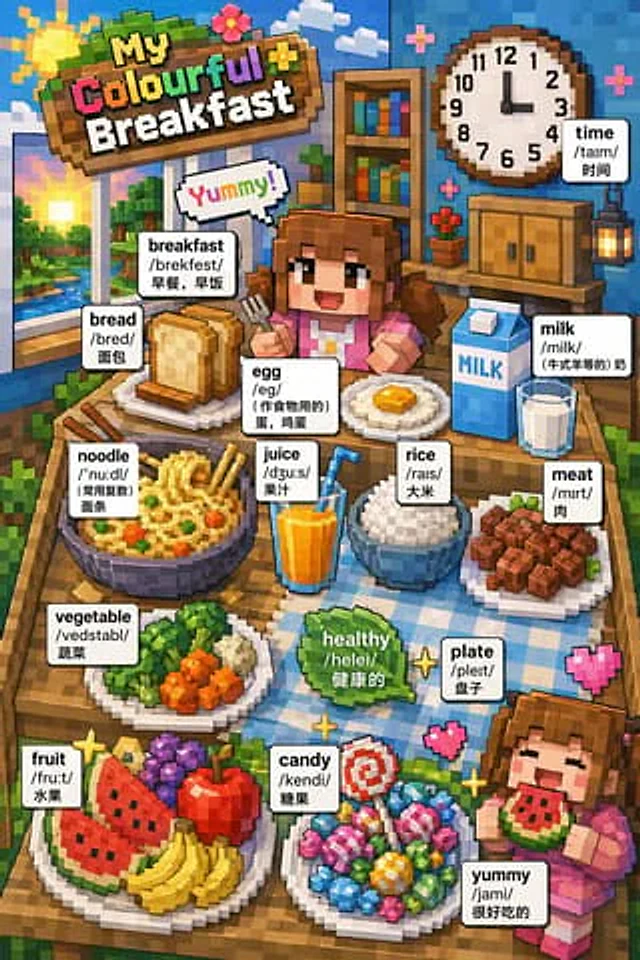

```text
{
  "type": "Educational vocabulary poster",
  "style": "{argument name=\"art style\" default=\"Isometric 3D voxel pixel art, Minecraft aesthetics, vibrant colors\"}",
  "scene": "The room is decorated in a block-style theme, with a large wooden table in the center covered with a blue and white checkered tablecloth. The window to the left displays a block-style sunrise view. In the background are wooden cabinets, bookshelves, and a wall clock.",
  "characters": [
    "{argument name=\"main character\" default=\"A building block girl with brown pigtails and wearing a pink shirt\"} He sat in the center of the table, holding a fork in his hand.",
    "In the bottom right corner, there is a small girl figure happily eating watermelon."
  ],
  "layout": {
    "title_sign": "The wooden sign in the upper left corner reads '{argument name=\"poster title\" default=\"My hearty breakfast\"} '",
    "speech_bubble": "Pointing to the girl in the middle, it says '{argument name=\"speech text\" default=\"So delicious!\"} '",
    "vocabulary_cards_count": 15,
    "vocabulary_cards": [
      {
        "item": "wall clock",
        "label": "time /taɪm/ time"
      },
      {
        "item": "The girl in the middle",
        "label": "breakfast /brekfəst/ breakfast, early meal"
      },
      {
        "item": "Sliced ​​bread",
        "label": "bread /bred/"
      },
      {
        "item": "Fried egg",
        "label": "egg /eg/ (used as food) egg, chicken egg"
      },
      {
        "item": "Milk cartons and glasses",
        "label": "milk /mɪlk/ (of cows, sheep, etc.)"
      },
      {
        "item": "A bowl of noodles",
        "label": "noodle /'nu:dl/ (usually plural) noodles"
      },
      {
        "item": "A glass of orange juice",
        "label": "juice /dʒu:s/"
      },
      {
        "item": "A bowl of white rice",
        "label": "rice /raɪs/ 大米"
      },
      {
        "item": "A plate of meat chunks",
        "label": "meat /mi:t/ 肉"
      },
      {
        "item": "A plate of broccoli and carrots",
        "label": "vegetable /vedʒtəbl/"
      },
      {
        "item": "Large green leaves",
        "label": "healthy /helθi/ healthy"
      },
      {
        "item": "empty plate",
        "label": "plate /pleɪt/ plate"
      },
      {
        "item": "A plate of mixed fruit",
        "label": "fruit /fru:t/"
      },
      {
        "item": "A bowl of candy",
        "label": "candy /kændi/ candy"
      },
      {
        "item": "The girl eating watermelon",
        "label": "yummy /jʌmi/ It's delicious!"
      }
    ]
  }
}
```

Model: GPT Image 2
Author: GPT Image 2 Prompts

[ProjectD](https://aitoolsradar.com/en/prompts/75890e8c3134ae) · [Recorded source](https://x.com/slashui/status/2045077344604614919#reversed-1)
 · [Full original metadata and byte evidence](data/projectd-batch-0051.json)

## Voxel Game Office Screenshot

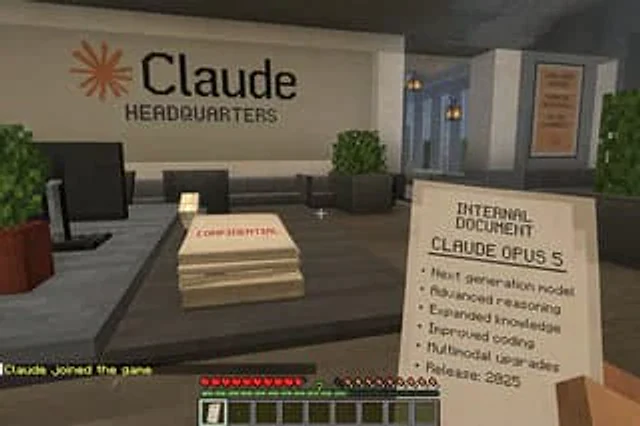

```text
A screenshot from a first-person voxel game. The player's blocky right hand is holding a piece of paper labeled "INTERNAL DOCUMENT," which contains {argument name="document title" default="CLAUDE OPUS 5"} And a six-item list ending with "Release: 2025". A white crosshair is in the center of the screen. In front is a dark gray desk with a black monitor and a stack of papers labeled "CONFIDENTIAL" in red. An orange asterisk and "" are displayed on the white wall behind.{argument name="company name" default="Claude"} The sign reads "HEADQUARTERS" and "[unclear text]". Lanterns hang in the right-hand corridor, and a poster reads "LONG-TERM MEMORY", "NUANCED RESPONSES", and "AI FOR HUMANITY". The bottom HUD displays yellow chat text.{argument name="chat message" default="Claude joined the game"} 10 red hearts, a green experience bar displaying "7", 10 hunger chicken legs, and a 9-slot shortcut bar with a document icon in the first slot.
```

Model: GPT Image 2
Author: GPT Image 2 Prompts

[ProjectD](https://aitoolsradar.com/en/prompts/f912df872b6e2a) · [Recorded source](https://x.com/SuguruKun_ai/status/2044453450235420988#reversed-1)
 · [Full original metadata and byte evidence](data/projectd-batch-0051.json)

## Voxel Survival Game Boss Fight HUD


```text
{
  "type": "Screenshots from first-person video games",
  "setting": "A blocky voxel world at night, with a purple corruption biome featuring dark waters and glowing torches.",
  "entities": [
    "A giant floating eyeball boss that emits purple lasers.",
    "A giant blue slime boss wearing a golden crown.",
    "A giant purple segmented worm monster",
    "A player character wearing dark armor and wielding a green longsword.",
    "2 flying purple bat monsters",
    "2 block zombies",
    "2 cube skulls",
    "1 pink flamingo",
    "1 small blue slime"
  ],
  "perspective": "First-person perspective, wielding a large, pixelated longsword on the right, with a white crosshair in the center.",
  "ui_elements": [
    {
      "position": "Top left corner",
      "text": "X: 340 Y: 64 Z: -190 Biota:{argument name=\"biome\" default=\"Corruption\"}"
    },
    {
      "position": "Top center",
      "text": "{argument name=\"boss name\" default=\"Eye of Cthulhu\"}",
      "description": "Purple Boss Health Bar"
    },
    {
      "position": "Top right corner",
      "text": "New recipe unlocked! Please check your recipe book.",
      "icon": "Small floating eyeballs"
    },
    {
      "position": "bottom left corner",
      "text": "{argument name=\"player name\" default=\"Steve\"} Achieved{argument name=\"boss name\" default=\"Eye of Cthulhu\"} ]"
    },
    {
      "position": "Bottom Center",
      "description": "The HUD includes 10 red heart-shaped health bars, 10 hungry chicken legs, 15 green experience points, and 9 quick slots.",
      "hotbar_items": [
        "Purple Longsword",
        "pick",
        "ax",
        "Green Weapons",
        "gun",
        "30 bottles of red potion",
        "64 brown squares",
        "8 golden apples",
        "2 blue stars"
      ]
    }
  ]
}
```

Model: GPT Image 2
Author: GPT Image 2 Prompts

[ProjectD](https://aitoolsradar.com/en/prompts/bc2e9f27e62159) · [Recorded source](https://x.com/aibi0123/status/2044456247416738199#reversed-0)
 · [Full original metadata and byte evidence](data/projectd-batch-0051.json)

## Voxel Survival Game Boss Fight UI


```text
{
  "type": "Screenshots from a first-person voxel game",
  "environment": {
    "style": "3D Pixel Art",
    "time": "night",
    "biome": "{argument name=\"biome name\" default=\"Corruption\"}",
    "features": "Purple meadows, trees with purple leaves, a pond, and torches"
  },
  "entities": [
    {
      "name": "{argument name=\"boss name\" default=\"Eye of Cthulhu\"}",
      "description": "A giant, floating eyeball is emitting purple lasers."
    },
    {
      "name": "King Slime",
      "description": "A giant blue slime wearing a gold and ruby ​​crown"
    },
    {
      "name": "{argument name=\"player name\" default=\"Steve\"}",
      "description": "Multiplayer character wearing dark armor and wielding a green longsword"
    },
    {
      "name": "hostile monsters",
      "count": 6,
      "types": [
        "2 skeletons",
        "2 zombies",
        "2 purple bats"
      ]
    },
    {
      "name": "Neutral monsters",
      "count": 2,
      "types": [
        "1 pink flamingo",
        "1 small blue slime"
      ]
    },
    {
      "name": "tentacles",
      "count": 1,
      "description": "Purple segmented tentacles with eyes"
    }
  ],
  "first_person_view": {
    "right_hand": "Holding a large pixelated iron sword"
  },
  "ui_overlay": {
    "top_left": {
      "type": "Debugging information",
      "lines": [
        "X: 340",
        "Y: 64",
        "Z: -190",
        "Biomes:{argument name=\"biome name\" default=\"Corruption\"}"
      ]
    },
    "top_center": {
      "type": "Boss health bar",
      "color": "Purple",
      "label": "{argument name=\"boss name\" default=\"Eye of Cthulhu\"}"
    },
    "top_right": {
      "type": "Notification",
      "icon": "eyeball",
      "text": "The new recipe has been unlocked! Please check your recipe book."
    },
    "bottom_left": {
      "type": "Chat history",
      "text": "{argument name=\"player name\" default=\"Steve\"} Progress achieved{argument name=\"advancement name\" default=\"Eye of Cthulhu\"} ]"
    },
    "bottom_center": {
      "type": "HUD",
      "stats": [
        "10 red hearts",
        "10 Armor Icons",
        "10 Hunger Icons",
        "Level 15 indicator"
      ],
      "hotbar_slots": 9,
      "hotbar_items": [
        "1 purple longsword",
        "1 pickaxe",
        "1 axe",
        "1 green staff",
        "1 gun",
        "30 bottles of red potion",
        "64 brown squares",
        "8 golden apples",
        "2 blue stars"
      ]
    },
    "center": {
      "type": "front sight",
      "style": "White crosshair"
    }
  }
}
```

Model: GPT Image 2
Author: GPT Image 2 Prompts

[ProjectD](https://aitoolsradar.com/en/prompts/a8d657832e0172) · [Recorded source](https://x.com/arora_mrinaal/status/2044387291008041405#reversed-0)
 · [Full original metadata and byte evidence](data/projectd-batch-0051.json)

## Voxel Survival Game Crossover UI

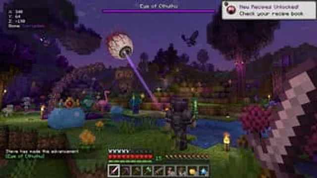

```text
{
  "type": "First-person game screenshots",
  "style": "A hybrid style of voxel-based 3D block graphics and 2D sprite elements.",
  "environment": {
    "setting": "Nighttime cube landscape with purple lighting",
    "terrain": "Grass blocks, water pool, purple-leaf tree, torch"
  },
  "entities": [
    "A giant floating eyeball boss{argument name=\"boss action\" default=\"Emit purple laser beam\"}",
    "A giant blue slime wearing a jeweled golden crown",
    "1 regular blue slime",
    "1 zombie",
    "2 skeletons",
    "2 flying purple bat creatures",
    "1 pink flamingo",
    "1 wearing{argument name=\"player armor\" default=\"Dark Iron Armor\"} player character"
  ],
  "first_person_view": {
    "right_hand": "handheld{argument name=\"main weapon\" default=\"Large iron sword\"}"
  },
  "user_interface": {
    "top_left": [
      "X: 340",
      "Y: 64",
      "Z: -190",
      "Biomes:{argument name=\"biome name\" default=\"Corruption\"}"
    ],
    "top_center": "Purple Boss health bar, marked as{argument name=\"boss name\" default=\"Eye of Cthulhu\"}",
    "top_right": "White notification pop-up: New recipe unlocked! Please check your recipe book.",
    "bottom_left": "Chat text: Steve has achieved the progress [{argument name=\"boss name\" default=\"Eye of Cthulhu\"} ]",
    "bottom_center": {
      "stats": "10 red hearts, 10 armor icons, 10 hungry chicken legs, experience level 15",
      "hotbar_items": [
        "Purple Sword",
        "pick",
        "ax",
        "Green Staff",
        "Musket",
        "30 bottles of red potion",
        "64 wooden blocks",
        "8 golden apples",
        "2 blue stars"
      ]
    }
  }
}
```

Model: GPT Image 2
Author: GPT Image 2 Prompts

[ProjectD](https://aitoolsradar.com/en/prompts/de15dd12e99d3b) · [Recorded source](https://x.com/nicdunz/status/2044196589669847350#reversed-0)
 · [Full original metadata and byte evidence](data/projectd-batch-0051.json)

## VR Effects on the Human Body Infographic


```text
{
  "type": "Medical Infographic Poster",
  "subject": "Front view of a full-body anime idol girl with semi-transparent anatomical overlays.",
  "style": {
    "overall": "A simple Japanese educational infographic that blends cute anime character art with scientific visualization.",
    "background": "The paper has a warm off-white tone with a subtle grid pattern.",
    "palette": "Navy blue, cream, soft pastel pink, pastel blue, medical red and blue",
    "rendering": "Highly detailed and exquisite poster design, clear vector UI frames, soft character shadows, and realistic anatomical illustrations composited onto the body."
  },
  "character": {
    "gender_presentation": "woman",
    "age_appearance": "Teenagers to young adults",
    "pose": "Stand upright with your body centered and arms extended horizontally to the sides.",
    "outfit": "A pastel idol dress with short puff sleeves, ruffled hem, layered skirt, blue ribbon bow at the neckline, lace trim, white ankle socks, and blue high-top sneakers.",
    "hair": {
      "color": "Dark brown",
      "style": "Long, wavy pigtails fall over her shoulders and extend below her chest, parted in the middle, and adorned with small decorative flower hair accessories."
    },
    "face": "Intentionally blurring/obscuring"
  },
  "anatomy_overlay": {
    "visible_parts_count": 8,
    "visible_parts": [
      "A head that glows",
      "Lungs and heart in the chest",
      "Abdominal digestive organs",
      "Glowing reproductive/urinary areas in the pelvis",
      "Arteries in both arms",
      "veins in both arms",
      "Arteries and veins in the legs",
      "Highlighted inner ear balance structures near the head"
    ]
  },
  "layout": {
    "title_block": {
      "count": 2,
      "lines": [
        "The effects of VR on the human body",
        "The effects of VR on the human body"
      ],
      "position": "Centered at the top"
    },
    "main_centerpiece": "The character is depicted in a T-shape, marked with dotted lines, connecting various body parts to surrounding information boxes.",
    "info_boxes": {
      "count": 6,
      "items": [
        {
          "title": "Precortical activation",
          "subtitle": "Prefrontal cortex activation",
          "position": "Top left",
          "icon": "brain"
        },
        {
          "title": "Visual cortex V1",
          "subtitle": "Visual cortex V1",
          "position": "Top right",
          "icon": "brain"
        },
        {
          "title": "Heart rate +12 bpm",
          "subtitle": "Heart rate +12 bpm",
          "position": "Top left center",
          "icon": "heart"
        },
        {
          "title": "vestibular system",
          "subtitle": "vestibular system",
          "position": "Right Center",
          "icon": "head and balance"
        },
        {
          "title": "Dopamine secretion",
          "subtitle": "Dopamine secretion",
          "position": "Left center bottom",
          "icon": "molecule/network"
        },
        {
          "title": "Influence on sleep rhythm",
          "subtitle": "circadian rhythm shift",
          "position": "Right center bottom",
          "icon": "moon and stars"
        }
      ]
    },
    "charts": {
      "count": 4,
      "items": [
        {
          "title": "Heart rate changes (average)",
          "subtitle": "Heart rate variability (average)",
          "position": "Left center bottom",
          "chart_type": "Line graph with blue and red lines",
          "labels": [
            "VR experience",
            "Normal state",
            "+12"
          ]
        },
        {
          "title": "Brain dopamine activity (fMRI)",
          "subtitle": "Brain dopamine activity (fMRI)",
          "position": "Bottom left",
          "chart_type": "Two brain scans with color-coded scales",
          "labels": [
            "Normal state",
            "VR experience",
            "resting state",
            "VR period"
          ]
        },
        {
          "title": "Changes in melatonin secretion (at night)",
          "subtitle": "Changes in melatonin secretion (at night)",
          "position": "Bottom right",
          "chart_type": "Line graph with blue and red curves",
          "labels": [
            "Normal state",
            "After watching VR",
            "No VR",
            "VR after",
            "Melatonin secretion is suppressed"
          ]
        },
        {
          "title": "Average weekly VR usage time: 14 hours",
          "subtitle": "Average weekly VR usage time: 14 hours",
          "position": "Bottom left",
          "chart_type": "Pie chart",
          "labels": [
            "0–7 hours",
            "7–14 hours",
            "14–21 hours",
            "21 hours+"
          ]
        }
      ]
    },
    "diagrams": {
      "count": 1,
      "items": [
        {
          "title": "Inner ear balance chart",
          "position": "Lower right, near the vestibular system frame",
          "labels": [
            "Tripartite canal",
            "Otoliths"
          ]
        }
      ]
    },
    "research_box": {
      "count": 1,
      "position": "Bottom Middle Right",
      "title": "Research Implications / Takeaways",
      "bullet_count": 4
    },
    "branding": {
      "count": 3,
      "items": [
        "Source: MR.VR RESEARCH LAB 2026",
        "MR.VR RESEARCH LAB",
        "QR code in the bottom right corner"
      ]
    },
    "border": "The edges feature a decorative technical border, with corner accents and small, measurement-mark-like scales."
  },
  "text_density": "High, the full text includes English and Japanese subheadings.",
  "composition": "The poster is symmetrical, with labels on both sides of the characters, a chart fixed in the bottom corner, and a prominent, bold title at the top.",
  "quality": "Clear, suitable for publication, square format"
}
```

Model: GPT Image 2
Author: GPT Image 2 Prompts

[ProjectD](https://aitoolsradar.com/en/prompts/c1cb4b3e2b9b95) · [Recorded source](https://x.com/3DVR3/status/2046637130072682750#reversed-0)
 · [Full original metadata and byte evidence](data/projectd-batch-0051.json)

## VR Headset Exploded View Poster


```text
{
  "type": "Product Exploded View Poster",
  "subject": "VR headset",
  "style": "Simple yet high-tech 3D rendering, studio lighting, and luminous decorations.",
  "background": "{argument name=\"background color\" default=\"Soft purple-blue gradient\"}",
  "header": {
    "logo": "∞ {argument name=\"product name\" default=\"Meta Quest 3\"}",
    "subtitle": "{argument name=\"main catchphrase\" default=\"A completely new structure, reshaping a completely new reality.\"}"
  },
  "layout": {
    "centerpiece": "An exploded view of the VR headset stacked vertically reveals nine different internal components: the outer shell, camera sensors, a motherboard with chips, pancake lenses, an internal frame, battery pack, side straps, a top headband, and a face interface pad.",
    "callout_labels": {
      "count": 8,
      "left_side": [
        "The Snapdragon® XR2 Gen 2 delivers exceptional processing power for an immersive, real-time experience.",
        "The adjustable IPD mechanism provides a comfortable wearing experience for a wide range of users.",
        "The precision-designed headband prioritizes comfort and stability through its ergonomic design."
      ],
      "right_side": [
        "The front panel features an exquisite design and optimized weight balance.",
        "Tracking cameras enable high-precision position tracking and environmental perception.",
        "The Pancake lens features a slim design, providing a wide field of view and clear image quality.",
        "High-performance battery with optimized power design supports long battery life.",
        "The soft faceplate ensures comfort even after prolonged wear."
      ]
    },
    "footer": {
      "left_text_block": {
        "headline": "{argument name=\"bottom headline\" default=\"Experience stems from the evolution of structure.\"}",
        "body": "Every component embodies cutting-edge technology and meticulous design that underpins an immersive experience. The Meta Quest 3 builds the future from the inside out, delivering an experience beyond your wildest imagination."
      },
      "right_logo": "∞ Meta"
    }
  }
}
```

Model: GPT Image 2
Author: GPT Image 2 Prompts

[ProjectD](https://aitoolsradar.com/en/prompts/95cdbce459d126) · [Recorded source](https://x.com/wory37303852/status/2045925660401795478#reversed-0)
 · [Full original metadata and byte evidence](data/projectd-batch-0051.json)

## VR Headset Exploded View Poster


```text
{
  "type": "exploded view product diagram poster",
  "subject": "VR headset",
  "style": "clean high-tech 3D render, studio lighting, glowing accents",
  "background": "{argument name=\"background color\" default=\"soft purple and blue gradient\"}",
  "header": {
    "logo": "∞ {argument name=\"product name\" default=\"Meta Quest 3\"}",
    "subtitle": "{argument name=\"main catchphrase\" default=\"まったく新しい現実を、まったく新しい構造から。\"}"
  },
  "layout": {
    "centerpiece": "vertically stacked exploded view of a VR headset showing 9 distinct layers of internal components: outer shell, camera sensors, motherboard with chip, pancake lenses, internal frame, battery packs, side straps, top strap, and facial interface cushion.",
    "callout_labels": {
      "count": 8,
      "left_side": [
        "Snapdragon® XR2 Gen 2\n圧倒的な処理性能でリアルタイムな体験を。",
        "調整可能なIPD機構\n幅広いユーザーに快適なフィット感を。",
        "精密設計されたヘッドストラップ\n快適さと安定性を追求したエルゴノミクス。"
      ],
      "right_side": [
        "フェイスプレート\n洗練されたデザインと最適な重量バランス。",
        "トラッキングカメラ\n高精度な位置トラッキングと環境認識を実現。",
        "パンケーキレンズ\n薄型設計で広い視野角と鮮明な映像を提供。",
        "高性能バッテリー\n長時間駆動を支える最適化された電源設計。",
        "柔らかなフェイスインターフェース\n長時間でも快適な装着感を実現。"
      ]
    },
    "footer": {
      "left_text_block": {
        "headline": "{argument name=\"bottom headline\" default=\"体験は、構造から進化する。\"}",
        "body": "一つひとつのパーツに、没入体験を支える最先端テクノロジーとこだわりの設計。Meta Quest 3は、未来を感じさせる体験を内部から生み出しています。"
      },
      "right_logo": "∞ Meta"
    }
  }
}
```

Model: GPT Image 2
Author: wory＠ホッピング中

[ProjectD](https://aitoolsradar.com/en/prompts/86d92f673744c2) · [Recorded source](https://youmind.com/prompts/vr-headset-exploded-view-13460)
 · [Full original metadata and byte evidence](data/projectd-batch-0051.json)

## VTuber Character Reference Sheet


```text
{
  "type": "Anime VTuber Character Design Reference Images",
  "style": "A clean and exquisite Japanese-style character design document, featuring a white background, light blue decorative borders, an elegant fantasy idol style, high-detail anime rendering, soft cel-shaded backgrounds, crisp lines, and delicate glitter and star elements.",
  "subject": {
    "name": "{argument name=\"character name\" default=\"Aozora Natsumi\"}",
    "romanized_name": "SORA NATSUMI",
    "age": "18",
    "school_year": "Senior year of high school",
    "birthday": "July 7th",
    "height": "145 cm",
    "theme": "Sky, stars, clouds, sailor-themed magical idol",
    "hair": {
      "color": "{argument name=\"hair color\" default=\"Soft sky blue gradient\"}",
      "style": "Very long, wavy double ponytails with a rounded topknot, soft bangs, faded ends, star accessories, and hair reaching to the waist."
    },
    "eyes": {
      "color": "{argument name=\"eye color\" default=\"blue\"}",
      "style": "Large, gentle anime eyes with bright highlights"
    },
    "outfit": {
      "silhouette": "Short, layered idol-style skirt with sheer, draped side skirts.",
      "pieces": [
        "Side-mounted sailor cap",
        "White off-the-shoulder blouse with puffy sleeves",
        "Large navy blue bow on the chest, paired with a gold star brooch.",
        "Navy blue corset with gold trim",
        "Navy blue and blue short pleated layered skirt",
        "Semi-transparent light blue side and back skirts with constellation patterns",
        "Star pendant waist compass decoration",
        "Blue choker with star charm",
        "Single-leg thigh-high stocking",
        "Ruffled ankle socks",
        "White lace-up ankle boots with blue gradient and gold details."
      ]
    }
  },
  "layout": {
    "canvas": "Horizontal reference image",
    "sections": [
      {
        "title": "front",
        "position": "Top left and middle",
        "count": 1,
        "labels": [
          "Full-body front view"
        ]
      },
      {
        "title": "side",
        "position": "Top right middle",
        "count": 1,
        "labels": [
          "Full body side view"
        ]
      },
      {
        "title": "back",
        "position": "Right upper right",
        "count": 1,
        "labels": [
          "Full-body rear view"
        ]
      },
      {
        "title": "Details and components",
        "position": "Top right",
        "count": 9,
        "labels": [
          "Brooch on the chest (enlarged)",
          "Waist compass (enlarged)",
          "Embroidery on the cuffs (enlarged)",
          "Hair clip (enlarged)",
          "Hat (side view)",
          "Back bow (enlarged)",
          "Leg straps (enlarged)",
          "Shoe design (enlarged)",
          "Shoe sole (enlarged)"
        ]
      },
      {
        "title": "Facial expressions",
        "position": "Bottom left and middle",
        "count": 6,
        "labels": [
          "generally",
          "Smile",
          "shy",
          "angry",
          "sad",
          "blink"
        ]
      },
      {
        "title": "Color scheme",
        "position": "Bottom left",
        "count": 5,
        "labels": [
          "#7EC6FF",
          "#B7E3FF",
          "#1C2A6B",
          "#FFFFFF",
          "#FFD97A"
        ]
      },
      {
        "title": "Theme Elements",
        "position": "Bottom left and middle",
        "count": 5,
        "labels": [
          "Sky",
          "Clouds",
          "Star",
          "constellation",
          "compass"
        ]
      },
      {
        "title": "Setting up props and accessories",
        "position": "Bottom right",
        "count": 5,
        "labels": [
          "Nebula-themed lights",
          "Kumorin, a personal attendant doll",
          "Starry Sky Tablet",
          "Magic Wand",
          "beverage bottles"
        ]
      },
      {
        "title": "Logo design (for the event)",
        "position": "Bottom",
        "count": 1,
        "labels": [
          "Natsumi Sora"
        ]
      },
      {
        "title": "Live2D and other settings",
        "position": "Bottom right",
        "count": 1,
        "labels": [
          "Remarks column"
        ]
      }
    ],
    "left_info_panel": {
      "count": 10,
      "labels": [
        "age",
        "Birthday",
        "height",
        "body weight",
        "blood type",
        "Affiliation",
        "Activity Details",
        "Fan Name",
        "Color scheme labels",
        "Slice Labels"
      ]
    }
  },
  "composition": "Three large full-body views are centered, surrounded by neatly arranged boxed information panels and detailed descriptions with fine Japanese annotations.",
  "text_treatment": "Most labels and annotations are in elegant Japanese typography, with blue headings and serif font decoration.",
  "color_palette": "{argument name=\"primary color palette\" default=\"Sky blue, navy blue, white, and light gold\"}",
  "quality": "High resolution, professional character design illustrations, visual balance, and extremely detailed costume designs, suitable for VTuber brand promotion and Live2D model planning."
}
```

Model: GPT Image 2
Author: GPT Image 2 Prompts

[ProjectD](https://aitoolsradar.com/en/prompts/4e0e8c5ad15af8) · [Recorded source](https://x.com/hageatama/status/2046618179037024377#reversed-0)
 · [Full original metadata and byte evidence](data/projectd-batch-0051.json)

## VTuber Chat Stream Thumbnail


```text
{
  "type": "VTuber live stream thumbnail",
  "character": {
    "hair": "Long, golden double ponytails with pink ombre at the ends.",
    "eyes": "Big pink anime eyes",
    "expression": "A happy smile, revealing her little tiger teeth, and a peace sign near her eyes.",
    "outfit": "Black top with suspenders, black heart-shaped choker, multiple earrings (including a cross pendant), and black nail polish."
  },
  "background": "A vibrant neon pink background with black leopard print, accented with glowing yellow decorations, glitter, and floating hearts.",
  "typography_and_layout": {
    "main_title": {
      "position": "Top left corner",
      "style": "Large, bold, 3D effect, pink and black color scheme, with white outline.",
      "text": "{argument name=\"main title\" default=\"Casual chat stream\"}"
    },
    "top_right_text": {
      "style": "Casual handwritten style with heart-shaped decorations",
      "text": "{argument name=\"top right text\" default=\"Let&#39;s have a relaxed chat ♡\"}"
    },
    "bottom_left_banners": {
      "count": 3,
      "style": "A glowing, pill-shaped banner with a heart icon on the left.",
      "colors": [
        "pink",
        "yellow",
        "Purple"
      ],
      "labels": [
        "{argument name=\"banner 1 text\" default=\"First-time viewers welcome\"}",
        "{argument name=\"banner 2 text\" default=\"Points can be collected.\"}",
        "{argument name=\"banner 3 text\" default=\"ROM〇\"}"
      ]
    },
    "bottom_right_text": {
      "style": "A casual handwritten style with heart-shaped decorations, yellow text with pink outlines.",
      "text": "Feel free to leave a comment! ♡"
    }
  }
}
```

Model: GPT Image 2
Author: GPT Image 2 Prompts

[ProjectD](https://aitoolsradar.com/en/prompts/d03b712ff90aed) · [Recorded source](https://x.com/sayaka_aiart/status/2046176145075515600#reversed-0)
 · [Full original metadata and byte evidence](data/projectd-batch-0051.json)

## VTuber Chat Stream Thumbnail


```text
{
  "type": "VTuber live stream thumbnail",
  "style": "Anime style, high detail, cute, sparkly, with pink as the main color.",
  "character": {
    "description": "A brown-haired anime girl with double buns, amber eyes, and a gentle smile.",
    "outfit": "A pink kimono paired with a white ruffled maid apron and cherry blossom hair accessories.",
    "pose": "Holding a pink microphone decorated with flowers close to her cheek"
  },
  "layout": {
    "background": "Pink gradient background with glitter, glowing hearts and decorative pink bows",
    "text_sections": [
      {
        "type": "Top ribbon",
        "text": "{argument name=\"top subtitle\" default=\"まったりおしゃべりしよ〜🤍\"}"
      },
      {
        "type": "Main title",
        "text": "{argument name=\"main title\" default=\"Casual chat stream\"}",
        "decorations": "Surrounded by illustrations of 3 large peaches"
      },
      {
        "type": "middle ribbon",
        "text": "{argument name=\"middle subtitle\" default=\"I want to have a fun time with everyone ♡\"}"
      },
      {
        "type": "Key Points List",
        "position": "bottom left corner",
        "count": 3,
        "icon": "peach",
        "labels": [
          "{argument name=\"bullet 1\" default=\"First-time viewers welcome\"}",
          "{argument name=\"bullet 2\" default=\"Points can be collected.\"}",
          "ROMO"
        ]
      },
      {
        "type": "speech bubbles",
        "position": "bottom right corner",
        "text": "Comments are very welcome♪ Let's chat a lot♡"
      }
    ]
  }
}
```

Model: GPT Image 2
Author: GPT Image 2 Prompts

[ProjectD](https://aitoolsradar.com/en/prompts/5e7ceaf65e3f61) · [Recorded source](https://x.com/sayaka_aiart/status/2046176145075515600#reversed-3)
 · [Full original metadata and byte evidence](data/projectd-batch-0051.json)

## VTuber Debut Poster from Character Sheet


```text
Using the provided reference images as the basis for the character and design, the simple Live2D model concept art was transformed into a sophisticated VTuber debut poster, while retaining the original character design, hoodie, headphones, collar, star and constellation elements, and the overall purple-blue nighttime color scheme. The composition was changed from a full-body concept art to a more dramatic half-body main visual, showing the character sitting at a streaming table, resting her chin on her hand, in a cozy nighttime bedroom streaming room. A starlit cityscape window background, curtains, hanging star decorations, a glowing monitor, a desktop microphone, a keyboard/gamepad, and a beverage cup were added, complemented by soft, cinematic lighting effects and shimmering ambient effects. The Yume Asta brand logo was retained, giving the layout the feel of an X/Twitter thumbnail or promotional main visual. The design incorporates dense, decorative typography and framed information panels, adopting an elegant Japanese idol/VTuber promotional style: a large title featuring the Japanese name and the Romanized "Yume Asta," a short, poetic slogan, four boxed descriptions labeled "Profile," "Like," "Keyword," and "Distribution Style," and a smaller tag/community box in the lower left corner. A striking, glowing title "VTuber Debut" and "Coming Soon" are added to the bottom center, followed by a ribbon-like banner with the Japanese text "Debut Livestream." The overall effect should be detailed, dreamy, bright, and sophisticated, resembling an official VTuber debut teaser poster.
```

Model: GPT Image 2
Author: GPT Image 2 Prompts

[ProjectD](https://aitoolsradar.com/en/prompts/d4ba365ceb4751) · [Recorded source](https://x.com/yume00112211/status/2047585409505648728#reversed-0)
 · [Full original metadata and byte evidence](data/projectd-batch-0051.json)

## VTuber Debut Stream Thumbnail


```text
{
  "type": "VTuber's first distribution thumbnail",
  "character": {
    "appearance": "Anime girl, with long, dark purple hair, purple eyes, a white ruffled blouse, a dark purple bow tie, and a huge hair accessory.",
    "pose": "Fingers to lips, a cute expression",
    "props": "The right side features a condenser microphone with a pop filter and a purple ribbon."
  },
  "background": "Magical starry sky, sparkling effects, glowing butterflies, purple and white tones",
  "layout": {
    "typography": [
      {
        "position": "Top left corner",
        "style": "Large, bold text, with English ligatures above.",
        "text": "{argument name=\"main title\" default=\"First broadcast\"}",
        "subtext_1": "First Stream",
        "subtext_2": "Nice to meet you! I'm Shisaki Lily!"
      },
      {
        "position": "Middle left",
        "style": "Decorative border",
        "text": "{argument name=\"character description\" default=\"I&#39;m a refined VTuber who attends a girls&#39; school♪\"}"
      },
      {
        "position": "bottom left corner",
        "style": "Logo style",
        "text": "{argument name=\"character name\" default=\"Lily Murasaki\"}",
        "subtext": "Shisaki Lily"
      },
      {
        "position": "Top right corner",
        "style": "Vertical text",
        "text": "{argument name=\"catchphrase\" default=\"I hope to bring a moment of elegance to your hearts♪\"}"
      },
      {
        "position": "bottom right corner",
        "style": "Decorative capsule shape",
        "text": "{argument name=\"stream date and time\" default=\"4.21 SUN 21:00~\"}",
        "subtext": "✦ START ✦"
      }
    ]
  }
}
```

Model: GPT Image 2
Author: GPT Image 2 Prompts

[ProjectD](https://aitoolsradar.com/en/prompts/5b7438dc7cf11d) · [Recorded source](https://x.com/wtry1102/status/2045270824542953673#reversed-1)
 · [Full original metadata and byte evidence](data/projectd-batch-0051.json)

## VTuber Debut Stream Thumbnail


```text
{
  "type": "VTuber debut stream thumbnail",
  "character": {
    "appearance": "anime girl, long dark purple hair, purple eyes, frilly white blouse, dark purple bow tie, large hair bow",
    "pose": "finger to lips, cute expression",
    "props": "condenser microphone with pop filter and purple ribbon on the right"
  },
  "background": "magical starry night, sparkles, glowing butterflies, purple and white color palette",
  "layout": {
    "typography": [
      {
        "position": "top left",
        "style": "large bold text with cursive English above",
        "text": "{argument name=\"main title\" default=\"初配信\"}",
        "subtext_1": "First Stream",
        "subtext_2": "Nice to meet you! I am Shisaki Lily!"
      },
      {
        "position": "middle left",
        "style": "decorative box",
        "text": "{argument name=\"character description\" default=\"お嬢様学校に通う清楚系VTuberですわ♪\"}"
      },
      {
        "position": "bottom left",
        "style": "logo style",
        "text": "{argument name=\"character name\" default=\"紫咲リリー\"}",
        "subtext": "Shisaki Lily"
      },
      {
        "position": "top right",
        "style": "vertical text",
        "text": "{argument name=\"catchphrase\" default=\"皆さまの心に、優雅なひとときをお届けしますわ♪\"}"
      },
      {
        "position": "bottom right",
        "style": "decorative pill shape",
        "text": "{argument name=\"stream date and time\" default=\"4.21 SUN 21:00~\"}",
        "subtext": "✦ START ✦"
      }
    ]
  }
}
```

Model: GPT Image 2
Author: WTR

[ProjectD](https://aitoolsradar.com/en/prompts/3ea77f2bc5f7bc) · [Recorded source](https://youmind.com/prompts/magical-vtuber-debut-thumbnail-13943)
 · [Full original metadata and byte evidence](data/projectd-batch-0051.json)

## VTuber Logo Concept Grid


```text
{
  "type": "Logo concept art",
  "layout": "2x3 grid",
  "global_attributes": {
    "text": "{argument name=\"logo text\" default=\"Golden Chicken\"}",
    "color_palette": [
      "{argument name=\"primary color\" default=\"gold\"}",
      "{argument name=\"background color\" default=\"black\"}"
    ],
    "style": "VTuber-style logo design, with a metallic texture, glossy finish, and high contrast."
  },
  "variants": [
    {
      "position": "Top left",
      "style": "Sharp and fierce",
      "icon": "Rich in detail{argument name=\"main subject\" default=\"Golden Rooster\"} Head, facing to the left",
      "typography": "Sharp, dynamic"
    },
    {
      "position": "Upper-middle",
      "style": "Brushstrokes / Roundness",
      "icon": "An elegant chicken silhouette in rounded brushstrokes, with a small red stamp.",
      "typography": "Elegant, fluid"
    },
    {
      "position": "Top right",
      "style": "Royal coat of arms",
      "icon": "Crown, symmetrical floral pattern",
      "typography": "Elegant, serif font"
    },
    {
      "position": "Bottom left",
      "style": "Cute/Q version",
      "icon": "Plump and cute chicks, golden eggs, ribbon banners",
      "typography": "Lively, bold"
    },
    {
      "position": "Middle to lower",
      "style": "Traditional Japanese",
      "icon": "Stylized chicken with traditional cloud patterns",
      "typography": "Smooth and dynamic"
    },
    {
      "position": "Bottom right",
      "style": "Magic/Elegance",
      "icon": "Huge golden feathers, twinkling stars, crescent moon pattern",
      "typography": "Elegant, cursive style"
    }
  ]
}
```

Model: GPT Image 2
Author: GPT Image 2 Prompts

[ProjectD](https://aitoolsradar.com/en/prompts/e74e809a950359) · [Recorded source](https://x.com/gosrum/status/2045130824140603878#reversed-0)
 · [Full original metadata and byte evidence](data/projectd-batch-0051.json)

## VTuber Logo Concept Grid


```text
{
  "type": "Logo design concept image",
  "style": "{argument name=\"整体风格\" default=\"The layout of this anime VTuber is highly decorative, featuring gradient text.\"}",
  "background": "pure white",
  "layout": {
    "arrangement": "2 rows and 3 columns",
    "count": 6
  },
  "logos": [
    {
      "main_text": "{argument name=\"Logo 1 文字\" default=\"Hinokami Ruka\"}",
      "sub_text": "Hinokami Luka",
      "theme": "{argument name=\"Logo 1 主题\" default=\"Flames, torii gates, bells, and a striking red and gold color scheme.\"}"
    },
    {
      "main_text": "{argument name=\"Logo 2 文字\" default=\"Hoshina Mira\"}",
      "sub_text": "Hoshina Mira",
      "theme": "{argument name=\"Logo 2 主题\" default=\"Space, stars, rockets, meteors, blue-purple gradient\"}"
    },
    {
      "main_text": "Tokiwa Nem",
      "sub_text": "Tokiwa Nemu",
      "theme": "Sleep, night sky, clouds, new moon, Zzz, soft pale blue-purple"
    },
    {
      "main_text": "Koyomi Shirafuji",
      "sub_text": "Shirafuji Koyomi",
      "theme": "Four seasons, wisteria, cherry blossoms, autumn leaves, soft pastel colors"
    },
    {
      "main_text": "Amane Shizuku",
      "sub_text": "Amane Shizuku",
      "theme": "Water, raindrops, crescent moon, clear blue"
    },
    {
      "main_text": "Tsukishiro Reina",
      "sub_text": "Tsukishiro Reina",
      "theme": "Night, castle silhouette, big new moon, stars, deep purple galaxy color scheme"
    }
  ]
}
```

Model: GPT Image 2
Author: GPT Image 2 Prompts

[ProjectD](https://aitoolsradar.com/en/prompts/77ebe4a6c61a41) · [Recorded source](https://x.com/VTuberInsiderJP/status/2045007613797314596#reversed-0)
 · [Full original metadata and byte evidence](data/projectd-batch-0051.json)

## VTuber Profile Sheet Generator


```text
{ "type": "VTuber Profile Card", "theme": "{argument name="color theme" default="Purple and white color scheme"} "Elegant style, lace and ribbon elements", "character": { "name": "{argument name="character name" default="Lily Murasaki"} ", "archetype": "{argument name="character archetype" default="elegant young lady"} ", "appearance": "Anime girl, long black hair with purple highlights, purple eyes, wearing a white suit jacket, purple pleated skirt, over-the-knee socks, and ribbon decoration", "pose": "Standing pose, fingers lightly touching lips, head slightly tilted" }, "chibi_character": { "appearance": "Chi version of the same character", "pose": "Sitting pose, smiling" }, "layout": { "header": { "top_left": "Ribbon banner with the text 'VTuber Profile'", "top_center": "Logo containing text '{argument name="vtuber type" default="A refined and elegant young lady Vtuber"} '、'{argument name="character name" default="Lily Murasaki"} 'and 'Shisaki Lily'", "top_right": "Introduction"{argument name="catchphrase" default="I will bring a moment of elegance to your hearts."} ', followed by 3 lines of self-introduction paragraphs" }, "columns": [ { "position": "left", "content": "Full-body character illustration" }, { "position": "center", "sections": [ { "title": "Personal Profile", "count": 9, "labels": ["Name", "Birthday", "Age", "Height", "Attributes", "First-person perspective", "Origin", "Occupation", "Event Start Date"] }, { "title": "Personality", "content": "2 lines of text" }, { "title": "Interests and Strengths", "count": 2, "labels": ["Fun", "Special Skills"] }, { "title": "Preferences", "count": 2, "labels": ["What I like", "What I don't like"] } ] }, { "position": "right", "sections": [ { "title": "Livestream Content", "content": "1 line of text" }, { "title": "Livestream Schedule", "count": 2, "labels": ["Distribution Time", "Distribution Frequency"] }, { "title": "Target", "content": "3-line text block" }, { "title": "Fans and Tags", "count": 3, "labels": ["Fanname", "Fanart Tags", "General Tags"], "extra": "4-line tags with small icons" }, { "title": "Creator", "count": 3, "labels": ["Illustrator (Mama)", "Model (Papa)", "Using Model"] }, { "title": "Link", "count": 4, "labels": ["YouTube", "X (Twitter)", "BOOTH", [FANBOX] }, { "content": "Place a chibi character illustration in the bottom right corner" } ] } ], "footer": { "sections": [ { "title": "Rules", "count": 3, "description": "3 key points with heart icons" }, { "content": "Two-line concluding paragraph centered at the bottom" } ] } }
```

Model: GPT Image 2
Author: GPT Image 2 Prompts

[ProjectD](https://aitoolsradar.com/en/prompts/2c59ba33277ea1) · [Recorded source](https://x.com/wtry1102/status/2045270824542953673#reversed-0)
 · [Full original metadata and byte evidence](data/projectd-batch-0051.json)

## VTuber Stream Thumbnail


```text
An anime-style YouTube live stream cover featuring a lively female VTuber. She has long {argument name="hair color" default="Pink with light blue highlights"} She has blue hair, blue eyes, and wears black and white cat-ear headphones with a microphone. She wears a white collared shirt with a black and pink star-shaped ribbon, a black choker, and smiles, her hand supporting her chin. The background is a game room.{argument name="room lighting" default="Purple-blue neon"} The table is lit, and on it sits a white keyboard, a mug, a glowing cat figurine, a game controller, and a live-streaming microphone. To the left is a striking, pop-art style Japanese typography: above it are the bright pink words "..."{argument name="main text line 1" default="Casual chat"} Below that is the bright blue word "".{argument name="main text line 2" default="delivery"} Below was a pink banner that read, "..."{argument name="subtitle text" default="Let&#39;s have a relaxed chat tonight!"} There is a red "LIVE" badge in the upper left corner. The image is decorated with floating speech bubbles, stars, and hearts.
```

Model: GPT Image 2
Author: GPT Image 2 Prompts

[ProjectD](https://aitoolsradar.com/en/prompts/3878d35efe8294) · [Recorded source](https://x.com/Yuupapa_free/status/2046246868146106491#reversed-0)
 · [Full original metadata and byte evidence](data/projectd-batch-0051.json)

## Wa-Modern Sakura Idol Dress


```text
Create a full-body anime idol character design on a clean white background, centered and slightly floating, with a polished Japanese mobile-game illustration style. The character is a young woman with {argument name="hair color" default="vivid cherry-pink"} long hair tied into a high side ponytail that streams leftward, with braided bangs, glossy highlights, loose face-framing strands, and ornate sakura hair ornaments with tassels and ribbons. Her face should be intentionally obscured by a soft square blur, while the rest of the illustration remains crisp and highly detailed. Dress her in a glamorous wa-modern floral idol outfit combining kimono sleeves, a corset bodice, and layered skirt: a white high-neck frilled blouse with lace ruffles; a black fitted corset with gold trim, pink crisscross lacing, small gold chains, and a large central sakura bow; deep magenta detached kimono sleeves with black-and-gold borders, wide flared cuffs, ribbon ties, tassels, and pink cherry blossom embroidery; a short white underskirt with lace hem; a black asymmetrical overskirt with gold edging and sakura patterns; and a transparent layered organza train in smoky pink and lavender, cascading down both sides with ruffled hems, gold lines, and scattered blossom prints. Use exactly 6 main outfit components: blouse, corset, detached kimono sleeves, underskirt, black overskirt, translucent organza train. Add exactly 5 prominent accessory groups: sakura hair ornament, dangling tassel earrings, oversized waist bow with flower center, wrist ribbon details, and ankle flower tassels. Include white tabi-style platform boots with black straps, magenta panels, gold trim, thick dark soles, and tiny floral accents. Pose her with one hand on her hip and the other raised near the shoulder in a lively idol gesture, legs close together and toes pointed inward. Color palette: {argument name="main outfit color" default="deep magenta and black"} with pale pink, white lace, gold trim, and cherry-blossom motifs. Surround her with a few small drifting sakura petals, but keep the background empty and bright. Render with clean line art, delicate shading, intricate fabric textures, translucent layers, glossy hair, high-detail embroidery, elegant fantasy fashion design, no text, no watermark, no extra characters.
```

Model: GPT Image 2
Author: 夜白（凡庸）

[ProjectD](https://aitoolsradar.com/en/prompts/be7d5c1f61acee) · [Recorded source](https://youmind.com/prompts/sakura-idol-dress-24032)
 · [Full original metadata and byte evidence](data/projectd-batch-0051.json)

## Waiting For You Study Portrait Poster


```text
Goal: Create a cinematic horizontal lifestyle poster about quiet longing, studying, and waiting for a message, featuring a young woman in a soft editorial portrait style.

Canvas: 16:9 widescreen image, 1536×864 feel, muted sage-gray and warm cream palette, shallow depth of field, hazy daylight, high-end magazine layout with delicate UI-style annotations.

Main subject: A {argument name="subject description" default="young East Asian woman, early 20s, natural makeup, pale skin, dark messy bun with loose bangs"} sits at a library or study-room desk beside a large window. She wears an oversized {argument name="sweatshirt color" default="light gray"} sweatshirt, rests both folded arms on an open book, and gazes pensively out the window to the right. Her expression is calm, wistful, and slightly lonely. Keep her face realistic and softly lit by window light.

Environment and props: Background left is a blurred bookshelf wall. Right side is a bright window with soft green foliage bokeh outside. On the desk include exactly 6 visible prop groups: 1 open book centered under her arms, 2 smartphone lying to the right of the book, 3 stacked books at the far right edge, 4 pale sticky notes or cards in the foreground, 5 blurred pencils or stationery at far left, 6 scattered study papers near the bottom edge.

Layout: Place the subject slightly right of center. Put the largest typography on the left, occupying the upper-left quadrant. Overlay thin white curved orbital lines sweeping from left to right across the poster, with small circular nodes and tiny plus symbols, like a romantic data-interface map. Use translucent rounded chat bubbles on the right side.

Text content: Use exactly 13 distinct text elements/blocks. 1 small Chinese line at top left: “在所有的书里 / 我最喜欢你这句”. 2 tiny handwritten English word near it: “you”. 3 large bold white headline: {argument name="headline text" default="WAITING\nFOR YOU."}. 4 Chinese subtitle below headline: “等你回消息的第 N 次心动”. 5 small notes block on left: “NOTES / 01” plus small handwritten Chinese lines. 6 small time block at lower left: “13:45” with tiny Chinese status text. 7 top-center time block: “15:32” with tiny Chinese text. 8 small green chat bubble near upper right of the woman: “在忙吗?”. 9 tiny right-top English microcopy: “May there be enough clouds in your life to make a beautiful sunset.” 10 translucent rounded chat bubble at mid-right: “没关系\n我可以等你 💛”. 11 small timestamp and double-check marks under that bubble. 12 reminder block near her shoulder: “REMEMBER / 02” with tiny Chinese lines. 13 bottom-right thought block: “THOUGHTS / 03” with a Chinese quote-style note.

Typography and style: Main headline is heavy bold condensed sans serif in all caps, pure white, with tight leading. Supporting Chinese typography is thin, elegant, white or pale yellow. Chat bubbles are frosted translucent sage green with white text. Micro text should feel authentic but may be partially unreadable, like a design poster.

Visual style: Photorealistic GPT-image-2 portrait photography mixed with minimalist graphic design overlay, soft film grain, low contrast, dreamy atmosphere, natural skin texture, realistic hands, realistic book pages, gentle backlight, no harsh shadows.

Constraints: Keep exactly one human subject, no extra people, no logo or watermark, no distorted face, no extra limbs, no cluttered typography beyond the 13 listed text elements, preserve the calm romantic study aesthetic.
```

Model: GPT Image 2
Author: 小小东

[ProjectD](https://aitoolsradar.com/en/prompts/20d7437963b093) · [Recorded source](https://youmind.com/prompts/waiting-for-you-poster-28069)
 · [Full original metadata and byte evidence](data/projectd-batch-0051.json)

## Warm Beige Married Couple 4-Panel Comic


```text
{
  "type": "Four-panel romantic comic illustration",
  "style": "Clean, hand-drawn anime lines, using warm beige and light brown monochrome tones, a cream background, and minimalist shadows, create a comfortable and gentle atmosphere with the aesthetic appeal of a social media post.",
  "format": "Square 2x2 comic layout with thin brown border",
  "headline": {
    "text": "{argument name=\"headline text\" default=\"Couple&#39;s Day\"}",
    "position": "Centered at the top",
    "decorations": {
      "count": 2,
      "items": [
        "The little heart on the left",
        "The little heart on the right"
      ]
    }
  },
  "panels": [
    {
      "panel": 1,
      "count": 2,
      "scene": "Standing portrait of a young couple",
      "composition": "The husband stood behind his wife, one hand on her shoulder; their expressions were calm and full of love.",
      "characters": [
        {
          "role": "man",
          "appearance": "Messy light brown hair, glasses, cream-colored hoodie, tall and slender figure."
        },
        {
          "role": "woman",
          "appearance": "Her light brown hair was tied in a loose low bun, with a few strands falling beside her face. She wore a white long-sleeved shirt, a warm brown knitted vest, and a visible shoulder bag strap."
        }
      ],
      "text": [
        "Today is",
        "Happy Couple's Day!"
      ],
      "decorations": {
        "count": 3,
        "items": [
          "Little Heart",
          "Little Heart",
          "Little Heart"
        ]
      }
    },
    {
      "panel": 2,
      "count": 2,
      "scene": "The couple sat together indoors, holding mugs, smiling at each other.",
      "characters": [
        {
          "role": "man",
          "appearance": "Wearing the same glasses and hoodie, and holding a soft green mug."
        },
        {
          "role": "woman",
          "appearance": "Same hairstyle and outfit, holding a light-colored mug"
        }
      ],
      "speech_bubble": {
        "speaker": "man",
        "text": "Thank you for everything. Being able to be with you is the greatest happiness."
      },
      "decorations": {
        "count": 4,
        "items": [
          "Little flash",
          "Little flash",
          "Small dot clusters",
          "Small dot clusters"
        ]
      }
    },
    {
      "panel": 3,
      "count": 2,
      "scene": "The couple were cooking together in the kitchen, both stirring the food in the pot.",
      "background": "Simple shelves and potted plants, presented with soft sketch details.",
      "characters": [
        {
          "role": "man",
          "appearance": "Same glasses and hoodie"
        },
        {
          "role": "woman",
          "appearance": "The same hairstyle and layered outfits"
        }
      ],
      "speech_bubble": {
        "speaker": "man",
        "text": "Let's continue to laugh together, support each other, and see all sorts of sights together."
      }
    },
    {
      "panel": 4,
      "count": 2,
      "scene": "A tender embrace; the husband kisses his wife's forehead while holding her shoulders.",
      "characters": [
        {
          "role": "man",
          "appearance": "Same glasses and hoodie"
        },
        {
          "role": "woman",
          "appearance": "Same hairstyle and outfit, leaning against him"
        }
      ],
      "speech_bubble": {
        "speaker": "man",
        "text": "I love you. Let's continue to be friends!"
      },
      "decorations": {
        "count": 3,
        "items": [
          "Little Heart",
          "Little Heart",
          "Little Heart"
        ]
      }
    }
  ],
  "footer": {
    "text": "{argument name=\"footer text\" default=\"いつもそばにいてくれて、ありがとう。\"}",
    "position": "Centered at the bottom",
    "decorations": {
      "count": 1,
      "items": [
        "Little Heart"
      ]
    }
  },
  "character_design": {
    "count": 2,
    "items": [
      {
        "role": "husband",
        "hair color": "{argument name=\"hair color\" default=\"light brown\"}",
        "expression": "Kind, gentle, affectionate"
      },
      {
        "role": "wife",
        "hair color": "{argument name=\"hair color\" default=\"light brown\"}",
        "expression": "A gentle smile, full of love, and slightly shy."
      }
    ]
  },
  "rendering_notes": "Keep all text in Japanese handwriting, use plenty of white space to maintain the sweet atmosphere needed for a couple's anniversary postcard, and treat the lines slightly casually, giving a sketch-like feel rather than fine ink lines."
}
```

Model: GPT Image 2
Author: GPT Image 2 Prompts

[ProjectD](https://aitoolsradar.com/en/prompts/ba371b02610176) · [Recorded source](https://x.com/muku_sns/status/2046932542998364645#reversed-1)
 · [Full original metadata and byte evidence](data/projectd-batch-0051.json)

## Warm Candle Shop Lifestyle Portrait


```text
A natural, realistic portrait smartphone photo captures a young East Asian woman standing in a warm-toned boutique or fragrance shop, her upper body photographed from a slightly downward angle. She keeps {argument name="hair color" default="Dark brown to black"} Her hair was tied in a low ponytail, with a few wisps of hair framing her face. She held a small, cream-white cup or candle jar close to her lips in one hand. She was wearing a {argument name="outfit color" default="Chocolate brown"} Wearing a fitted ribbed zip-up long-sleeved top, the zipper half-open, paired with matching high-waisted trousers, the outfit presents a monochromatic look. Her pose is casual and slightly forward-leaning, with her other hand naturally placed behind her back, giving the image a candid snapshot feel. The wooden shelves around her are filled with glass candle jars and small packaged products, with a soft blurred effect in the background and on the left side of the frame. Warm indoor lighting, shallow depth of field, realistic skin texture, delicate highlights in the hair, and a natural holding posture create a comfortable, handcrafted retail atmosphere. The composition uses a compact mid-range to full-body vertical composition, with the subject centered and the background diagonally tilted to enhance the natural, candid perspective. Photography style: Realistic, high detail, soft blur, boutique shopping snapshot, 35mm lens feel, natural color gradation.
```

Model: GPT Image 2
Author: GPT Image 2 Prompts

[ProjectD](https://aitoolsradar.com/en/prompts/6b4ff769f8c404) · [Recorded source](https://x.com/Asan0_Misaki/status/2046904727674462560#reversed-2)
 · [Full original metadata and byte evidence](data/projectd-batch-0051.json)

## Warm Chinese Character Design Poster


```text
Goal: Create a clean, warm beige Chinese character design poster for {argument name="character name" default="林浅夏"}, a gentle lifestyle blogger, combining a large fashion portrait, expression sheet, pose sheet, item icons, color palette, and biography.

Canvas: Vertical portrait poster, approximately 4:5 ratio, off-white paper background with thin pale beige border, delicate gold-brown line dividers, tiny sparkle and heart doodles, soft editorial magazine layout. Use a warm cream, tan, peach, and coffee color scheme with elegant handwritten accents.

Layout: Split the poster into a large left portrait column and a narrower right information column, with an action-pose section across the lower left and biography/palette sections stacked on the lower right. Keep generous white space and fine hairline separators.

Top left title area: Add the large Chinese headline 「角色设计图」 with a small cursive English subtitle “Character Design”. Beside the portrait, add vertical poetic text 「清风拂面，明朗如光。」 plus small hearts and star doodles.

Main portrait: Show one large waist-up portrait of a young East Asian woman, age {argument name="age" default="25"}, with {argument name="hair style" default="long slightly messy dark brown-black wavy hair"}, warm natural skin, minimal makeup, small gold earrings, a delicate gold pendant necklace, and a cream ribbed sleeveless tank top. She faces forward in soft natural light, elegant and calm, with realistic fashion-photo rendering and subtle watercolor softness.

Right top profile block: Place the large name 「林浅夏」 with a small heart. Under it write 「温柔明朗的生活收藏家」. Include exactly 5 profile lines: 「年龄：25岁」, 「身高：165cm」, 「生日：7月18日」, 「星座：巨蟹座」, 「职业：自由内容创作者」. Add a sticky-note quote card reading: 「生活很简单，开心很重要，请尽情拥抱每一天。——浅夏♡」.

Expression section: Add the heading 「表情设定」 and exactly 6 small bust portraits of the same woman arranged in two rows, each with a rounded beige label. The 6 labels must be: 「开心」, 「生气」, 「困倦」, 「惊讶」, 「害羞」, 「思考中」. Make the hair, outfit, and identity consistent while changing only the facial expression and slight head pose.

Action pose section: Add the heading 「动作设定」 and exactly 3 full-body poses of the same woman in a cream crop tank, beige shorts, white sneakers, and loose natural hair. The 3 labeled poses are: 「跑步」 showing her jogging energetically, 「玩耍」 showing her skipping or playing with bubbles, and 「休闲站姿」 showing a relaxed standing pose holding sunglasses. Use light motion, airy summer styling, and small bubble details around the playful pose.

Object icon section: Add the heading 「物件图标」 and exactly 5 small illustrated icons in one row with labels: 「墨镜」 black sunglasses, 「金色耳环」 gold hoop earrings, 「项链」 gold pendant necklace, 「小白鞋」 white sneakers, and 「小星星」 a small star and heart charm.

Color palette section: Add the heading 「配色方案」 and exactly 6 circular swatches with labels: 「奶油白」, 「米杏色」, 「暖米色」, 「深棕色」, 「蜜桃肤」, 「柔金色」. The palette should visually match cream white, beige, warm tan, dark brown, peach skin, and soft gold.

Biography section: Add the heading 「角色简介」 with a small heart and botanical line art. Include concise Chinese profile text with four labeled lines: 「性格：温柔亲和，开朗乐观，细腻敏感，喜欢发现生活中的小美好。」, 「兴趣：旅行、拍照、写作、听音乐、做手账、收集小物件。」, 「特点：笑容温暖治愈，气质清新自然，拥有轻松感染他人的能量。」, 「简介：林浅夏热爱自由与表达，喜欢用镜头和文字记录生活的点滴。她相信简单的日常里藏着最动人的故事。认真生活，尽情热爱，是她一直坚持的态度。」

Footer: Add a thin decorative line and the centered sentence 「认真生活，尽情热爱，让每一天都闪闪发光。」 with small sparkles at both ends.

Visual style: Soft realistic character-sheet poster, elegant Chinese lifestyle magazine aesthetic, warm daylight, delicate beige typography, subtle watercolor/photoreal blend, clean composition, no harsh shadows, no extra characters, no extra labels, no watermark.
```

Model: GPT Image 2
Author: 松果先森

[ProjectD](https://aitoolsradar.com/en/prompts/24a0c2108831b8) · [Recorded source](https://youmind.com/prompts/chinese-character-design-poster-24992)
 · [Full original metadata and byte evidence](data/projectd-batch-0051.json)

## Warm Penguin Fantasy Movie Poster


```text
A heartwarming, fictional movie poster, employing a soft, Japanese-style still-movie aesthetic, was captured at the golden hour with dreamy backlighting and gentle lens flare. In the image, a person wearing a comfortable beige knit sweater is photographed from behind and slightly below, holding a plush penguin toy high towards the bright sunset sky. The plush toy is centered and occupies most of the space: a black, fluffy body, a white belly, a yellow beak, yellow feet, short, outstretched wings, and a face resembling an anime girl, complete with a short brown bob and hair clip, creating an adorable and surreal mascot image. The background is an outdoor field with warm, blurred trees and a dazzling sun hanging low on the horizon, the overall color scheme being creamy beige, honey, peach, and gold. Several white feathers float in the air; five feathers must be clearly visible in the image. The atmosphere evokes a gentle, nostalgic, hopeful, and slightly fantastical feeling, like a family fantasy movie poster. Incorporate Japanese poster typography into the design: the slogan "この出会いが、世界をやさしく変えていく" is in the center of the top; "ずっと、いっしょだよ." is arranged vertically on the left; and there is a huge handwritten luminous title near the bottom center "{argument name="movie title" default="GUGUGAGA"} The lettering uses a warm white neon style font with a small pink heart at the top; below it is an elegant serif capital letter “”.{argument name="subtitle" default="THE MOVIE"} Below this, a pink ribbon banner is placed with the Japanese phrase "ずっと、いっしょだよ." At the very bottom, a small, centered Japanese credits list is added, using a realistic movie poster layout, including the cast and crew list as well as production/distribution information; the last line contains "gugugagaTokyo" and "AI Studio Tokyo." The design employs a vertical single-page poster composition, a sophisticated commercial visual, shallow depth of field, soft cinematic contrast, high-end cinematic lighting, and a sensual fantasy aesthetic.
```

Model: GPT Image 2
Author: GPT Image 2 Prompts

[ProjectD](https://aitoolsradar.com/en/prompts/52d494e4e1f37f) · [Recorded source](https://x.com/AIStudioTokyo/status/2046808396532441142#reversed-0)
 · [Full original metadata and byte evidence](data/projectd-batch-0051.json)

## Warriors Fan Surprised Courtside Portrait


```text
Create a highly realistic vertical courtside audience photo of a beautiful young {argument name="subject ethnicity" default="Asian"} woman watching an NBA playoff game from the stands, framed waist-up in a close closeup. She sits among packed Golden State Warriors fans inside a vibrant basketball arena, looking slightly upward and off-camera with a surprised open-mouth reaction as if witnessing a dramatic play. She has a messy high bun with loose face-framing strands, glossy dark hair, bold winged eyeliner, long lashes, peach blush, soft peach lipstick, smooth luminous skin, and large gold hoop earrings. Dress her in a fitted royal-blue Golden State Warriors zip-up jacket with yellow zipper, yellow-and-white shoulder panels, ribbed collar stripes, and a clear Warriors bridge logo patch on the chest. The background should be sharp and detailed, crowded with fans in blue and gold Warriors gear: foam fingers raised, baseball caps, jerseys, arena ribbon boards, bright stadium lights, drink bottles, and rows of seats, creating playoff energy without blurring away the environment. Use natural arena lighting, documentary sports photography realism, crisp facial detail, shallow-to-moderate depth of field, vivid blue and gold color palette, vertical 2:3 composition, no watermark, no URL, no distorted hands or extra facial features.
```

Model: GPT Image 2
Author: Hania Ai

[ProjectD](https://aitoolsradar.com/en/prompts/480d75664913f5) · [Recorded source](https://youmind.com/prompts/warriors-fan-courtside-portrait-20964)
 · [Full original metadata and byte evidence](data/projectd-batch-0051.json)

## Washington Crossing Style Winter Boat Scene


```text
A cinematic historical scene depicts a winter crossing of a frigid river at dusk. A crowded wooden rowboat carries 11 colonial-era soldiers and boatmen, navigating the dark, icy water strewn with floating ice. In the center stands a commander, upright and resolute, a heavy dark blue or black cloak draped over his light brown uniform, a black tricorn hat adding to his 18th-century generally bearing. Around him, ten men sit or crouch in the boat, dressed in weathered American Revolutionary War attire: dark coats, wool hats, cloaks, scarves, belts, and tricorn hats; several grip long wooden oars, and a musket is visible angled upwards behind the central figure. The atmosphere is somber, cold, and heroic; clothing is damp with snow, the air thick with pale breath, and the sky a stormy blue-grey. The river is wide and partially frozen, with a dark, wooded coastline in the distance, and a few faint, warm lights shimmering on the opposite bank. The composition employs a frontal perspective, framing a tight view from above the bow of the ship, making the viewer feel as if they are in the midst of this cold crossing. It utilizes low-key lighting, soft and desaturated colors, deep shadows, and a damp texture, pursuing realism and blending the tension of dramatic historical oil painting with cinematic realism to showcase ultra-detailed fabrics, wood grain, ice, and fog.
```

Model: GPT Image 2
Author: GPT Image 2 Prompts

[ProjectD](https://aitoolsradar.com/en/prompts/e971b499f0155c) · [Recorded source](https://x.com/nickbaumann_/status/2046675529001214094#reversed-0)
 · [Full original metadata and byte evidence](data/projectd-batch-0051.json)

## Watercolor City Travel Poster


```text
Create a serene architectural travel illustration inspired by {argument name="city" default="Seoul"}, {argument name="country" default="South Korea"}, in a soft hand-drawn watercolor and ink style.

Main concept:
Show a quiet, charming street-side house or small building inspired by the everyday atmosphere of {argument name="city" default="Seoul"}, {argument name="country" default="South Korea"}, while subtly incorporating {argument name="landmark" default="a recognizable landmark"} in the composition.
The landmark should appear naturally in the background, distance, or surrounding scenery, so the image clearly feels connected to {argument name="city" default="Seoul"}, {argument name="country" default="South Korea"} without losing the calm residential mood.

Visual style:
delicate hand-drawn architectural illustration,
soft watercolor washes,
thin ink outlines,
slightly imperfect sketch lines,
warm sunlit atmosphere,
gentle pastel palette,
subtle paper texture,
quiet travel sketchbook aesthetic,
minimal yet detailed composition,
calm editorial illustration mood,
poetic everyday scenery,
cozy and refined visual tone,
no photorealism,
no harsh contrast,
no saturated colors,
no dramatic lighting.

Scene:
A peaceful small house, café, studio, or local building with simple walls, a tiled or regionally inspired roof, painted doors or windows, and several potted plants arranged naturally in front.
Include subtle local architectural details and everyday design elements that feel authentic to {argument name="city" default="Seoul"}, {argument name="country" default="South Korea"}.
Incorporate {argument name="landmark" default="a recognizable landmark"} as a softly integrated city symbol — for example, visible above rooftops, in the distance, or as part of the surrounding skyline or landscape.
The overall scene should feel quiet, elegant, warm, and locally rooted.

Composition:
landscape travel-poster format,
wide horizontal layout,
large open sky occupying the upper half or upper-left area,
main building placed across the lower portion of the composition,
balanced negative space,
front-facing or slightly angled composition,
potted plants and small objects along the base,
landmark subtly placed in the background or upper distance,
clean and spacious layout,
minimal but emotionally rich composition.

Typography:
Include the city name “{argument name="city" default="Seoul"}” clearly in the image.
Render “{argument name="city" default="Seoul"}” as elegant travel-poster typography, large but refined, placed prominently in the sky area or upper portion of the composition.
Optionally include “{argument name="country" default="South Korea"}” in smaller text beneath or near the city name.
The text should feel integrated into the poster design, not like a random overlay.
Use clean, tasteful lettering that matches the calm watercolor travel-poster mood.

Color palette:
pale sky blue,
warm cream,
terracotta,
muted blue accents,
olive and soft green,
light earthy browns,
soft natural neutrals.

Texture:
visible watercolor paper grain,
transparent paint layering,
soft handmade brush texture,
gentle ink-and-wash finish.

Mood:
peaceful,
sunny,
quiet,
nostalgic,
cozy,
refined,
poetic,
calm everyday travel atmosphere.
```

Model: GPT Image 2
Author: Oogie

[ProjectD](https://aitoolsradar.com/en/prompts/c1eb6d6f68bbc9) · [Recorded source](https://youmind.com/prompts/watercolor-architectural-travel-illustration-21053)
 · [Full original metadata and byte evidence](data/projectd-batch-0051.json)

## Watercolor Double-Exposure Fantasy Silhouette


```text
A dreamy watercolor double exposure illustration, the main outline of which is a{argument name="main subject silhouette" default="Young anime girl facing left"} A side silhouette. Inside the silhouette is a rich and layered fantasy world. The top is {argument name="top scenery" default="A magnificent white castle with many spires under the starry sky and the new moon."} Below the castle, two cloaked figures stand in a mysterious forest. In the center of the image, a {argument name="central character" default="A young female mage with pink hair and a glowing magic wand."} It occupies a prominent position. A white horse can be seen to the left of the mage. The silhouette is at the bottom.{argument name="bottom scenery" default="A fantastical village surrounded by blooming cherry blossom trees, with an open, giant magic book and a sword in the foreground."} The entire work uses{argument name="color palette" default="Soft lilac, pink and blue"} Color scheme. The background outside the silhouette is textured parchment with watercolor splatter effects and fading cherry blossom petals, and the word "tamanyo" is written in cursive script in the lower left corner.
```

Model: GPT Image 2
Author: GPT Image 2 Prompts

[ProjectD](https://aitoolsradar.com/en/prompts/2d77a4b3574211) · [Recorded source](https://x.com/AINetworkTech/status/2045186369920897037#reversed-1)
 · [Full original metadata and byte evidence](data/projectd-batch-0051.json)

## Watercolor Elf Girl on Sunlit Bed


```text
A soft pastel watercolor illustration depicts a young elf girl sitting on a bed in a quiet, sunlit bedroom, viewed from a slightly overhead, three-quarter profile. She possesses {argument name="hair color" default="warm orange"} She has shoulder-length, softly layered hair, large blue eyes, fair skin, and long, pointed ears. A red flower hair clip adorns the left side of her hair. Her expression is serene and dreamy as she gazes at the bright light on the right side of the scene. She wears a loose-fitting sage green chiffon dress with ruffled trim, sheer puff sleeves, and ruffled ribbon details at the chest, over which she wears a black lace camisole and a thin red choker with a small pendant, paired with dark knee-high socks. She sits near the edge of a lavender bedspread, her hands supporting her on the mattress behind her, her legs stretched diagonally to the lower right. The room is exquisitely simple: a bed with two white pillows, a wooden headboard or headboard behind her, a window on the left with a small plant on the windowsill, and flowing lavender curtains. Strong, warm sunlight pours in from the right, creating a large, bright halo and soft, faded highlights. Employing a light, hand-painted watercolor style, it presents visible paper textures, softly blended edges, shadows of pale purple and cream, delicate shimmering paint textures, and a tranquil, fantastical atmosphere.
```

Model: GPT Image 2
Author: GPT Image 2 Prompts

[ProjectD](https://aitoolsradar.com/en/prompts/1d58c466a1829e) · [Recorded source](https://x.com/el_el_san/status/2047190761498907061#reversed-0)
 · [Full original metadata and byte evidence](data/projectd-batch-0051.json)

## Watercolor Fashion Travel Illustration


```text
Elegant {argument name="style" default="watercolor fashion illustration"} of a {argument name="subject" default="stylish young woman traveling through scenic cities and cozy cafés"}, soft hand-painted watercolor textures with expressive ink sketch outlines, modern feminine aesthetic, long wavy dark hair, {argument name="outfit" default="relaxed chic outfits with denim jeans, oversized jackets, tote bags and sneakers"}, artistic urban lifestyle scenes, candid photography-inspired poses, holding a vintage camera in mountain landscapes, walking through European streets and historic architecture, sitting in cozy café interiors with warm ambient lighting, soft neutral and pastel color palette, fashion editorial mixed with sketchbook diary style, airy white background with loose watercolor splashes, delicate brush strokes, realistic facial features with painterly details, contemporary travel journal aesthetic, minimalist composition, sophisticated feminine vibe, luxury fashion illustration style, highly detailed watercolor rendering, soft sunlight, elegant line art, Pinterest aesthetic, modern lifestyle artwork, expressive urban sketching, timeless chic atmosphere, 8k
```

Model: GPT Image 2
Author: Taaruk

[ProjectD](https://aitoolsradar.com/en/prompts/2a582843b580a1) · [Recorded source](https://youmind.com/prompts/watercolor-fashion-travel-illustration-22550)
 · [Full original metadata and byte evidence](data/projectd-batch-0051.json)

## Watercolor Picture Book Cover


```text
A watercolor illustration for a children's picture book cover. The main character is {argument name="character appearance" default="A cute animal-eared girl with short green hair, cat ears, and green eyes."} .she{argument name="action" default="He was laughing happily and raising his middle finger with his hairy white hand."} She wore a green dress with a fluffy white collar. The background featured soft green leaves and small yellow flowers drawn on textured paper. The cover top bore a striking hand-drawn green Japanese title.{argument name="main title" default="なかゆびさん"} Below is the brown Japanese subtitle "".{argument name="subtitle" default="こんにちは"} There is smaller black text in the middle of the left side.{argument name="author text" default="さく・え：とらの"} The image features a distinct spine on the left edge, highlighting the texture of the physical book.
```

Model: GPT Image 2
Author: GPT Image 2 Prompts

[ProjectD](https://aitoolsradar.com/en/prompts/4098097288e0f7) · [Recorded source](https://x.com/TlanoVRC/status/2046167396713705657#reversed-1)
 · [Full original metadata and byte evidence](data/projectd-batch-0051.json)

## Watercolor Postcard Ticket Style Poster


```text
请将我上传的每一张照片分别制作成一张独立的高级设计海报，不多图拼接，每张照片单独输出。整体采用3:4竖版构图，上下两个区域高度严格1:1，各占画面50%。\n\n上半部分保留原始照片，保持主体结构、真实质感、自然光影和原有色彩氛围，仅进行轻微高级摄影调色，使其具有艺术杂志、旅行出版物与展览摄影质感。为适配画幅，可自然扩展天空、地面或环境背景，但不得拉伸、扭曲或改变主体。\n\n下半部分提取照片中最具识别性的**主体、轮廓、姿态与叙事关系**，将原场景重新概括为一张融合明信片与票据形式的横向水彩票根。不是孤立画一个物体，而是保留主体与必要环境之间最有记忆点的关系，以简洁水彩笔触重新组织，让画面既能一眼对应上方照片，又像一张被精心收藏的旅行速写票据。\n\n票体居中悬置于大面积象牙白留白中，采用严格的**左大右小几何分区**：左侧约74%为水彩画面，右侧约26%为信息票根，中间以竖向虚线、齿孔或撕票线精准分隔；上下边距统一，图像、文字、邮戳、编号均服从同一隐性网格与对齐线，形成规整、安静、专业的编辑秩序。卡纸为厚实哑光水彩纸，边缘细密锯齿，带极轻微自然投影。\n\n左侧水彩以**高明度、低至中等饱和度的治愈系色盘**重新调和原图颜色，不直接复制脏灰色值。优先保留原图中最清新、最有生命力的色彩，再统一转译为柔和的鼠尾草绿、雾蓝、浅青灰、奶油黄、暖沙色、淡陶土色等自然综合色系；以2–4个相近色建立空气感，仅用极少量温暖对比色点亮主体。整体明亮、干净、通透、柔和，避免灰蒙、发黄、重褐、浓艳撞色和廉价复古滤镜。\n\n水彩笔触清晰而轻薄，保留纸张透白、柔和晕染、干湿变化与少量颗粒，主体稍清晰，远景与次要环境自然减弱，不做写实光影和复杂细节，使画面具有安静、松弛、温柔的绘本与旅行手账感。\n\n右侧票根采用克制的**几何信息排版系统**，根据照片内容灵活生成 DATE、PLACE、SUBJECT、MOMENT、FIELD、NO. 等少量字段，并搭配日期、编号、短线、点列、坐标式数字和一枚圆形印章。所有文字严格沿统一左边线、基线和间距排列，字号层级清晰，留白充足；邮戳可与分割线或底部网格轻微交叠，让信息元素与票体结构形成巧妙关系，而不是随意散落。若不是城市或旅行题材，地点字段可自然转化为对象名、状态、项目、章节、季节或情绪记录。\n\n整体参考**高级旅行明信片、复古票据、艺术家手账、水彩出版物与现代编辑设计**，强调治愈色彩、几何秩序、纸张质感和收藏感，呈现清新、温柔、安静、规整、精致而不过度设计的视觉气质。避免脏旧色调、松散排版、信息漂浮、复杂装饰、写实插画、电商模板感和廉价复古效果。
```

Model: GPT Image 2
Author: 小小东

[ProjectD](https://aitoolsradar.com/en/prompts/f8facb3515fe2b) · [Recorded source](https://youmind.com/prompts/watercolor-postcard-ticket-poster-32038)
 · [Full original metadata and byte evidence](data/projectd-batch-0051.json)

## Watercolor to Reality Beijing CBD Poster


```text
Create a vertical city poster showing {argument name="city district" default="Beijing Guomao CBD"} transforming from watercolor painting into photorealism. The canvas is portrait-oriented, about 4:5, with a seamless left-to-right transition: the left half is a loose watercolor illustration with visible paper texture, splattered pigment edges, soft pastel washes in blue, lavender, peach, yellow, and teal, while the right half gradually becomes a crisp realistic aerial city photograph under a bright blue sky with scattered clouds. The skyline must feature the Beijing CBD landmarks: the tall China Zun tower dominating the right side, the CCTV Headquarters angular loop building near the center-right, and multiple glass skyscrapers on the left-center, with broad roads, traffic lanes, trees, low-rise blocks, and urban avenues visible below. Add elegant Chinese title typography in the upper-left reading {argument name="headline text" default="国贸CBD"}, with a thin horizontal divider line beneath it and smaller subtitle text reading {argument name="subtitle text" default="从水彩到现实"}. Use warm late-afternoon sunlight, high detail on the realistic side, dreamy translucent watercolor blooms on the painted side, and make the boundary between painting and reality feel poetic and fluid, as if the city is waking from a scroll. No people, no watermark, no extra labels.
```

Model: GPT Image 2
Author: Larus Canus

[ProjectD](https://aitoolsradar.com/en/prompts/111fd5a6b4aad0) · [Recorded source](https://youmind.com/prompts/beijing-cbd-watercolor-poster-21438)
 · [Full original metadata and byte evidence](data/projectd-batch-0051.json)

## Watercolor Urban Travel Poster


```text
A detailed watercolor travel poster of a {argument name="city street" default="lively city street"}, hand-painted urban sketch style, soft ink outlines, watercolor splashes, architectural detail, fashionable pedestrians walking through a busy avenue, cozy cafés and local shops, cinematic perspective, warm natural lighting, elegant travel magazine composition, large {argument name="city name" default="stylish city name"} typography at the top left, subtitle in handwritten script, subtle paper texture, atmospheric depth, realistic urban life, {argument name="color palette" default="pastel earth tones"}, loose brush strokes, travel journal aesthetic, highly detailed, artistic tourism poster, European/Japanese street illustration vibe, white margin layout, premium editorial design
```

Model: GPT Image 2
Author: Taaruk

[ProjectD](https://aitoolsradar.com/en/prompts/b6c5d2482493a0) · [Recorded source](https://youmind.com/prompts/watercolor-city-street-travel-poster-19430)
 · [Full original metadata and byte evidence](data/projectd-batch-0051.json)

## Weathered Custom Cub Concept Bike


```text
A highly detailed concept illustration showcases a heavily modified retro underbone motorcycle inspired by the Honda Super Cub, presented in a clean, studio-styled 4/3 left-hand perspective against a pure light gray background. The motorcycle boasts a rugged, post-apocalyptic street-custom aesthetic, employing a low-saturation black, white, and gray color scheme accented with touches of pink decals and paintwork. The strong weathering effect is emphasized: the body is covered in paint chips, scratches, oil stains, dirt, rust, ink splatters, worn edges, and layers of sticker residue. The front features a single square headlight with an X-shaped light pattern and two smaller, stacked auxiliary lights below. It utilizes spoked wheels, thick off-road tires, a visible front suspension, exposed mechanical details, chain drive, and a sturdy center stand that touches the ground. The leg guards and side panels are covered in graphic decals, Japanese warning labels, numbers, symbols, and distressed lettering, while a prominent large Chinese character is prominently displayed on the front fairing. Two hard-sided cargo boxes are added to the rear; the larger one is further away, while the smaller one is black with additional stickers. A vertical tag hangs near the rear boxes. It features a long black striped seat, rear rack frame, exposed wiring, metal brackets, bolts, and compact, practical accessories, giving it both a handcrafted look and functional design. The rendering style blends industrial design sketches with exquisite anime mecha concept art: precise lines, watercolor-style shadows, soft gray ground projections, highly detailed mechanical realism, slightly messy ink-lined edges, and the texture of a collector's item custom motorcycle illustration.
```

Model: GPT Image 2
Author: GPT Image 2 Prompts

[ProjectD](https://aitoolsradar.com/en/prompts/eee6c21c870461) · [Recorded source](https://x.com/Eris_Create_Lab/status/2047537707904274795#reversed-3)
 · [Full original metadata and byte evidence](data/projectd-batch-0051.json)

## Web Banner — AI Image API Try Free


```text
Horizontal 16:9 web banner ad for an AI image generation API. Background is a soft gradient mesh of warm peach, soft lavender and pale mint. Left two-thirds: a clean modern bold serif headline in deep charcoal black reads "Generate images from one API key." stacked over a smaller subhead reading "OpenAI-compatible. Pay as you go.". A small rounded dark CTA button at the lower-left reads "Try free". Right one-third: a clean white floating mock terminal window showing two short generic placeholder lines of code in monospaced text and a single example output thumbnail. No real brand name, no logo, no watermark. Modern developer-focused SaaS ad design, crisp typography, premium quality.
```

Model: GPT Image 2
Author: @hiapi_ai

[ProjectD](https://aitoolsradar.com/en/prompts/2dbc63acdc5b6d) · [Recorded source](https://github.com/HiAPIAI/awesome-gpt-image-2-prompts)
 · [Full original metadata and byte evidence](data/projectd-batch-0051.json)

## Web Design Course Promotional Banner


```text
{
  "type": "Webpage banner ads",
  "style": "Simple, modern, and bright, with soft gradient accents and polka dot patterns in the corners.",
  "background_image": "{argument name=\"subject description\" default=\"A young Japanese woman smiled, looking at her laptop screen, her chin resting on her hand, wearing a white shirt.\"} Bright natural light, a white mug on the table.",
  "typography": {
    "catchphrase": {
      "text": "{argument name=\"catchphrase\" default=\"The ability to turn passion into a profession\"}",
      "style": "Handwritten font, blue and purple underlines"
    },
    "headline": {
      "text": "{argument name=\"main headline\" default=\"Change the future with web design.\"}",
      "style": "Large, bold sans-serif font, black and blue-purple gradient."
    },
    "subheadline": {
      "text": "From zero experience to professional web designer.",
      "style": "Medium-sized sans-serif font, black with blue highlights"
    }
  },
  "layout": {
    "feature_icons": {
      "count": 3,
      "style": "A round white badge with a minimalist icon and a text label below.",
      "items": [
        {
          "icon": "Open book",
          "label": "Beginner friendly"
        },
        {
          "icon": "laptop",
          "label": "100% Online Learning"
        },
        {
          "icon": "People with speech bubbles",
          "label": "Active designers provide support"
        }
      ]
    },
    "bottom_section": {
      "satisfaction_badge": {
        "text_top": "Student satisfaction",
        "value": "{argument name=\"satisfaction rate\" default=\"94%\"}",
        "text_bottom": "*Internal Research",
        "decoration": "Golden Laurel Wreath"
      },
      "cta_button": {
        "style": "Pill-shaped, blue-pink gradient background, white text, with a right-pointing arrow icon.",
        "microcopy": "Free consultation first /",
        "main_text": "{argument name=\"call to action text\" default=\"Request a free consultation\"}"
      }
    }
  }
}
```

Model: GPT Image 2
Author: GPT Image 2 Prompts

[ProjectD](https://aitoolsradar.com/en/prompts/a43dd3b1002979) · [Recorded source](https://x.com/panchaaan_2/status/2046107762686652666#reversed-1)
 · [Full original metadata and byte evidence](data/projectd-batch-0051.json)

## Web3 Ecosystem Food Chain


```text
Please help me generate it.{argument name="market" default="web3"} Different levels of roles in the market, to differentiate{argument name="market" default="web3"} The ecological food chain. The image should include detailed descriptions of the roles and have an aspect ratio of [missing information].{argument name="aspect ratio" default="16:9"} .
```

Model: GPT Image 2
Author: GPT Image 2 Prompts

[ProjectD](https://aitoolsradar.com/en/prompts/ff573cf8dc594d) · [Recorded source](https://x.com/God3698/status/2046825414669332685)
 · [Full original metadata and byte evidence](data/projectd-batch-0051.json)

## Website Homepage Screenshot Generation


```text
{argument name="website" default="Yahoo"} Screenshot of the homepage.
```

Model: GPT Image 2
Author: GPT Image 2 Prompts

[ProjectD](https://aitoolsradar.com/en/prompts/83032d8ea90e4d) · [Recorded source](https://x.com/patrickassale/status/2043495406315954213)
 · [Full original metadata and byte evidence](data/projectd-batch-0051.json)

## Weekend Seoul travel guide poster


```text
Generate a polished one-page Chinese travel guide poster for a fast weekend trip from Nanjing to Seoul in May. Use LARGE highly legible Chinese text, short phrases only, and no paragraph blocks. Focus on shopping, skincare, and a stylish Seongsu-dong route. Layout: big title, 4 modules only (行程 / 区域推荐 / 购物清单 / 美妆护肤), each with 2 to 4 short bullet points, plus a small cute route map with icons. Clean editorial infographic style, soft pastel colors, neat spacing, high readability, modern Xiaohongshu travel card aesthetic. Avoid tiny text, avoid dense explanations, avoid garbled characters.
```

Model: GPT Image 2
Author: @xiaohongshu-community

[ProjectD](https://aitoolsradar.com/en/prompts/70a24b1609356b) · [Recorded source](https://www.xiaohongshu.com/explore/69e8cd0d0000000023007215)
 · [Full original metadata and byte evidence](data/projectd-batch-0051.json)

## West Bengal City View


```text
One{argument name="location" default="west bengal"} city
```

Model: GPT Image 2
Author: GPT Image 2 Prompts

[ProjectD](https://aitoolsradar.com/en/prompts/e61c81e9c7fd0a) · [Recorded source](https://x.com/cneuralnetwork/status/2047012331415359861)
 · [Full original metadata and byte evidence](data/projectd-batch-0051.json)

## Western Open-World Game Screenshot


```text
A highly realistic screenshot from a video game, in a style that is {argument name="game style" default="Western Open World Games"} The image is shot from a third-person, over-the-shoulder perspective. A rugged cowboy walks with his back to the camera, wearing a worn brown jacket, dark trousers, a holster at his waist, and a classic cowboy hat. To his left is a pair of horses with saddles.{argument name="horse type" default="Black horse with white spots"} The scene is set in{argument name="time of day" default="A vibrant golden hour sunset"} Below{argument name="environment" default="The dusty desert landscape is dotted with withered tall grass, dirt paths, cacti, and towering red rock terraces."} Against a hazy background, two silhouettes stand on a dirt path in the distance. The image contains a video game HUD overlay: a small circular map with a player arrow and two red dots in the lower left corner; and three lines of white text and button icons in the lower right corner, displaying "DRAW WEAPON [RT]", "HORSE CARGO [Cross D-pad]", and "TENNESSEE WALKER [LT]".
```

Model: GPT Image 2
Author: GPT Image 2 Prompts

[ProjectD](https://aitoolsradar.com/en/prompts/f2f3e8c1e62f2b) · [Recorded source](https://x.com/1in3Mystery/status/2044872007104287203#reversed-1)
 · [Full original metadata and byte evidence](data/projectd-batch-0051.json)

## Wet Summer Anime Schoolgirl Portrait


```text
This is a dazzling anime-style summer portrait, the protagonist being a {argument name="character type" default="Japanese high school girl"} The image shows a close-up of her profile from the chest up. She is standing outdoors, with a clear blue sky and bright white clouds in the background. She has wet hair.{argument name="hair color" default="Dark blue-black"} She has a short bob haircut, large eyes that shimmer with a blue-violet light, and a faint blush on her cheeks. Her expression is calm yet slightly aloof. Her white sailor-style school uniform shirt is soaked, appearing semi-transparent and realistically clinging to the folds. The collar is a dark navy blue sailor collar, tied with a large dark navy blue ribbon at her chest. She raises one arm, holding a transparent, textured plastic water bottle to her forehead, cool water droplets sliding down her face, neck, arm, and clothing. The image is filled with intense summer sunlight, bright highlights, rim light penetrating her wet hair, iridescent lens flares, tiny floating bubbles, and shimmering reflections. The background includes a soft-focus outdoor school pool area, showing metal railings, pool stairs, and the shimmering water. The emphasis is on the crystal-clear water bottle, the sheen of her wet skin, delicate eyelashes, subtle anime-style rendering, dramatic backlighting, the refreshing atmosphere of a summer heatwave, and the sophisticated high-end illustration style.
```

Model: GPT Image 2
Author: GPT Image 2 Prompts

[ProjectD](https://aitoolsradar.com/en/prompts/8c1ea70a0df735) · [Recorded source](https://x.com/nokokonokoko/status/2046576536669790633#reversed-0)
 · [Full original metadata and byte evidence](data/projectd-batch-0051.json)

## WhatsApp Group Profile Avatar


```text
for{argument name="group type" default="WhatsApp Group"} Generate an avatar to decide{argument name="purpose" default="Friday dinners and restaurants"} Related matters.
```

Model: GPT Image 2
Author: GPT Image 2 Prompts

[ProjectD](https://aitoolsradar.com/en/prompts/bfaa2bc11360b7) · [Recorded source](https://x.com/PromptSin/status/2047722446971613541)
 · [Full original metadata and byte evidence](data/projectd-batch-0051.json)

## Whimsical Animated Townsfolk Lineup


```text
A clean character lineup sheet on a pure white background, showing 13 full-body stylized 3D characters in a whimsical stop-motion-inspired design with exaggerated proportions, textured fabrics, worn surfaces, muted earthy colors, and slightly creepy yet charming personality. Arrange them in 2 rows: 7 characters across the top row and 6 across the bottom row, each isolated with soft grounding shadows and plenty of white space, like a studio casting board for an animated film. Top row, left to right: 1) an extremely tall and painfully thin middle-aged man in a shabby brown suit, white shirt, narrow red tie, and checked trousers, with long fingers and slouched posture; 2) a short heavyset older woman with curly reddish hair, wearing a pink cardigan over a floral dress, sensible shoes, and carrying a brown handbag; 3) a very large burly man with tattooed forearms, wearing a red plaid flannel shirt, suspenders, dark worn pants, heavy boots, and a rough worker look; 4) a skinny teenage goth girl with pale skin, black messy ponytail, black jacket, dark shirt, skinny jeans, crossed arms, and a bored expression; 5) a lanky teenage boy in a knit beanie, layered hoodie and jacket, skinny jeans, and sneakers, hands in pockets; 6) a very tall elderly woman with an elegant beehive hairstyle, narrow face, tan blouse, scarf, long brown skirt, heels, handbag, and a cigarette held in one hand; 7) a slim teenage or young adult male with curly dark hair, wearing a striped sweater, narrow pants, and brown shoes. Bottom row, left to right: 8) a gaunt frail old person in ragged layered clothing and a stained apron, stooped forward with tired posture; 9) a thin middle-aged woman with hair in a high bun, mustard cardigan, long blue dress, flats, and a shoulder bag, holding something delicately in front of her chest; 10) a stocky police officer in a bulky navy winter uniform with fur collar, badge, utility belt, dark pants, and black shoes; 11) a chubby curly-haired boy wearing a varsity-style sleeveless jacket over a hoodie, knee-length shorts, socks, and sneakers, gripping his backpack straps; 12) a skeletal elderly man with a cap, huge nose, hunched spine, long coat, skinny trousers, and a cane; 13) a lanky mechanic or gas station worker in a dark blue jumpsuit and cap with the visible text {argument name="cap text" default="GAS"}, holding a wrench. Keep the rendering highly detailed with felt, wool, denim, knit, leather, and dust-like material realism, but maintain caricatured anatomy and expressive silhouettes. Use a subdued palette of browns, rust reds, dusty pinks, charcoal, navy, beige, and faded denim. The overall mood should feel like quirky residents of a rundown small town from a darkly comic animated feature, presented as a polished ensemble cast sheet.
```

Model: GPT Image 2
Author: Sean Wallace

[ProjectD](https://aitoolsradar.com/en/prompts/17dbc18674d6bf) · [Recorded source](https://youmind.com/prompts/whimsical-animated-townsfolk-lineup-16964)
 · [Full original metadata and byte evidence](data/projectd-batch-0051.json)

