# ProjectD backfill batch 52

Complete original prompts and exact existing ProjectD images. Actual model labels and any available credits or notices are retained. Missing authors or license metadata are not filled in.

## Whimsical Childlike Doodle Reconstruction

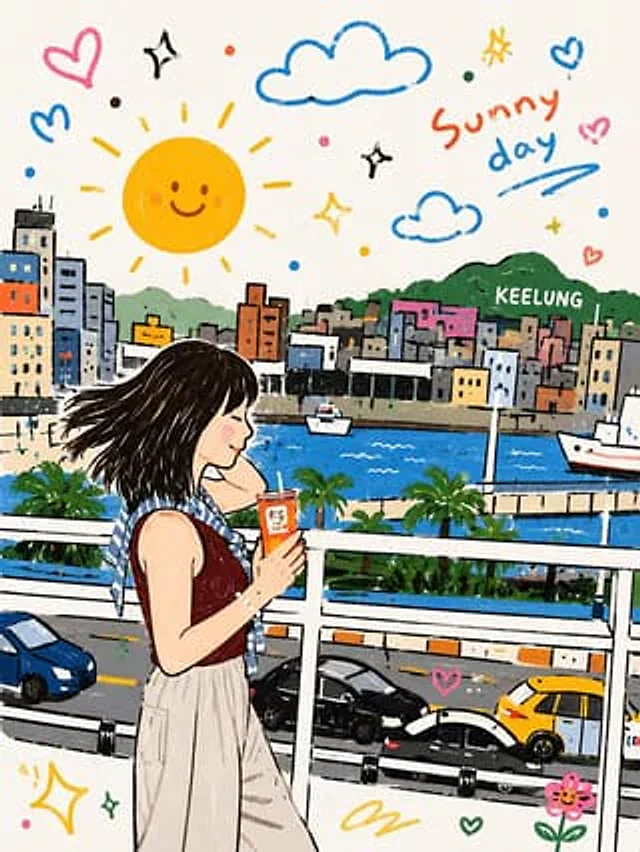

```text
Reconstruct this image as a single flat illustration infused with playful, childlike doodle elements. Use a bold, vibrant, and whimsical color palette, simplifying every detail into clean, flat shapes. Incorporate a handcrafted feel with slightly imperfect, hand-drawn outlines to create a charming, imaginative aesthetic, as if it were illustrated on a sheet of white paper. The overall style should be cute, expressive, and delightfully whimsical.
```

Model: GPT Image 2
Author: Ciri

[ProjectD](https://aitoolsradar.com/en/prompts/32c6ad228d51b7) · [Recorded source](https://youmind.com/prompts/whimsical-childlike-doodle-reconstruction-26959)
 · [Full original metadata and byte evidence](data/projectd-batch-0052.json)

## Whimsical Folk Art Transformation

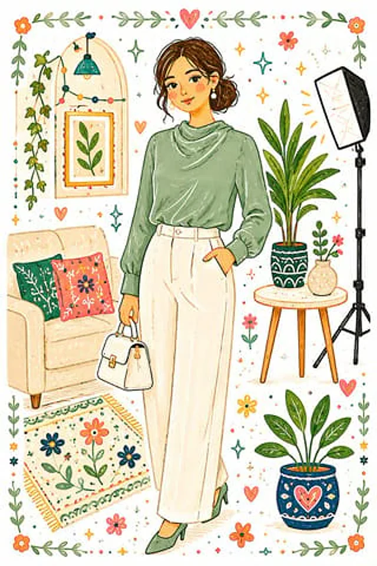

```text
Reimagine the full image as a whimsical handcrafted folk-art illustration filled with playful doodle aesthetics. Replace the original colors with a {argument name="color palette" default="fresh, vibrant palette"} featuring {argument name="tones" default="bold contrasting tones and cheerful accents"}. Convert every object and detail into simplified flat forms with soft irregular outlines, textured brush-like fills, and an intentionally imperfect handmade appearance, as if sketched and colored on clean white paper with markers and paint pens. The final artwork should feel charming, naïve, and storybook-inspired, combining decorative folk patterns, quirky shapes, and lighthearted visual energy in a cute, imaginative style.
```

Model: GPT Image 2
Author: Johnn

[ProjectD](https://aitoolsradar.com/en/prompts/a1b0685a665173) · [Recorded source](https://youmind.com/prompts/folk-art-illustration-image-transformation-19237)
 · [Full original metadata and byte evidence](data/projectd-batch-0052.json)

## Whimsical Programmer Almanac Infographic


```text
{
  "type": "Watercolor infographic Chinese calendar",
  "style": "Hand-drawn style, The Little Prince theme, cream background, scattered stars.",
  "header": {
    "date": "{argument name=\"date\" default=\"April 18, 2026\"}",
    "title": "{argument name=\"main title\" default=\"vibe coding Old Almanac\"}",
    "subtitle": "Saturday, the second day of the third month of the Bingwu year"
  },
  "layout": {
    "sections": [
      {
        "title": "should",
        "position": "top-left",
        "count": 5,
        "labels": [
          "{argument name=\"first do item\" default=\"Write code based on your intuition\"}",
          "Let's talk to the AI ​​before we start working.",
          "Delete the wrong parts, keep the interesting ones.",
          "Give the project a romantic name",
          "Have a cup of coffee and let your thoughts flow."
        ]
      },
      {
        "title": "Today's celestial phenomena &amp; programming horoscope",
        "position": "top-right",
        "count": 4,
        "labels": [
          "The Moon enters Gemini",
          "A place where inspiration flows, ideal for dialogue and creation.",
          "5 stars",
          "Inspiration 90%, Debugging 65%, Sense of Accomplishment 88%"
        ]
      },
      {
        "title": "avoid",
        "position": "mid-left",
        "count": 5,
        "labels": [
          "{argument name=\"first dont item\" default=\"Write a perfect architecture right away\"}",
          "agonizing over technology selection until dark",
          "Afraid of errors, I dare not run it.",
          "Copy and paste without thinking",
          "Forgot to save and submit"
        ]
      },
      {
        "title": "Auspicious time today",
        "position": "bottom-left",
        "count": 2,
        "labels": [
          "09:30 - 11:30 Inspiration is at its peak",
          "14:00 - 16:00 Knock out a surprise"
        ]
      },
      {
        "title": "Lucky Command",
        "position": "bottom-left",
        "count": 4,
        "labels": [
          "git add .",
          "git commit -m \"follow the vibe\"",
          "git push",
          "# The universe will help you compile it."
        ]
      },
      {
        "title": "Today's Mindset",
        "position": "bottom-right",
        "count": 1,
        "labels": [
          "You don't need to be the best programmer, just the most perceptive creator. Let your feelings guide you, and let your code blossom."
        ]
      }
    ],
    "illustration": {
      "position": "center-right",
      "subject": "The Little Prince is using a laptop on an asteroid, with a fox, a rose in a glass dome, and a mug nearby.",
      "quote": "{argument name=\"quote\" default=\"What is important cannot be seen with the eyes; it must be felt with code and the heart.\"} The Little Prince and the Programmer",
      "sticky_notes": {
        "count": 3,
        "labels": [
          "Let's get running first.",
          "Let AI accompany you on your exploration.",
          "A bug can be a gift."
        ]
      }
    }
  }
}
```

Model: GPT Image 2
Author: GPT Image 2 Prompts

[ProjectD](https://aitoolsradar.com/en/prompts/ae52d15869fcad) · [Recorded source](https://x.com/ai_hakase_/status/2046062551264268396#reversed-0)
 · [Full original metadata and byte evidence](data/projectd-batch-0052.json)

## Whisky Bottle on Dark Bar with Bokeh

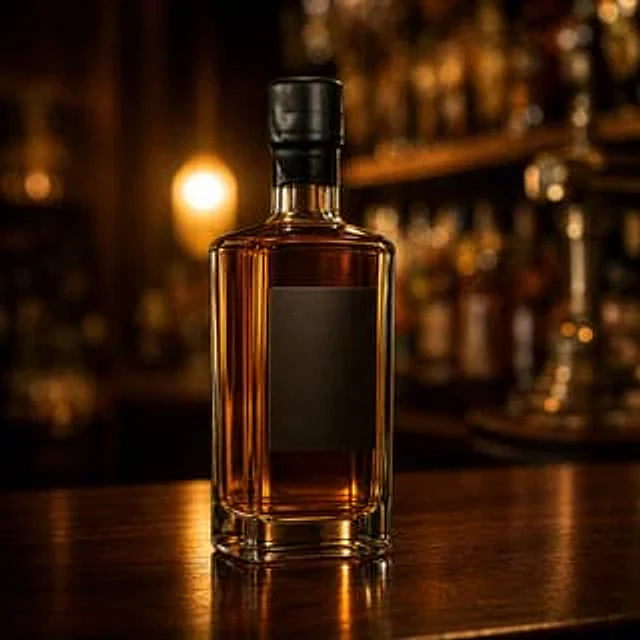

```text
A tall square-shouldered amber whisky bottle with a black wax-sealed top, standing on a polished dark walnut bar counter. Single warm tungsten back-light produces a soft halo behind the bottle and a subtle reflection on the counter. Background is a deeply blurred dark wood and brass bar interior with golden bokeh. No text on the label, no brand mark, no watermark. Square 1:1 luxury spirits product photography, moody low-key lighting, photorealistic glass and liquid refraction.
```

Model: GPT Image 2
Author: @hiapi_ai

[ProjectD](https://aitoolsradar.com/en/prompts/0b26761164c208) · [Recorded source](https://github.com/HiAPIAI/awesome-gpt-image-2-prompts)
 · [Full original metadata and byte evidence](data/projectd-batch-0052.json)

## White-Haired Anime Swordswoman Collage

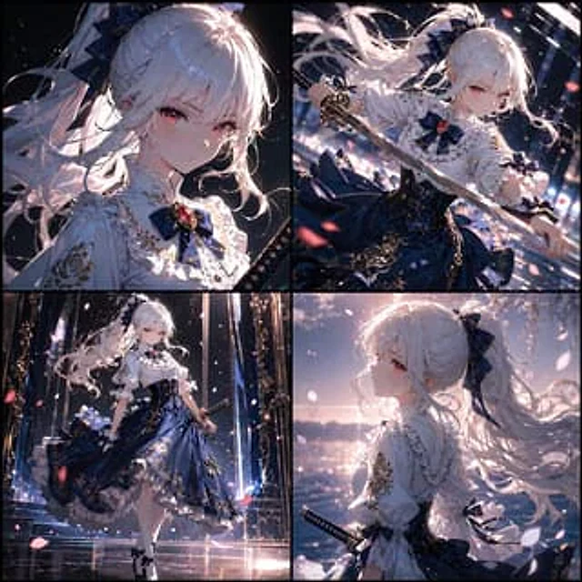

```text
An exquisite anime/fantasy illustration, presented in a 2x2 grid layout, showcases four scenes of the same elegant female swordsman. The character is a young woman with extremely long platinum-white hair, tied in a high ponytail with a large, deep navy blue bow. Her hair is soft, curly, and flowing, her skin is fair, her features delicate and refined, and her eyes are bright reddish-pink. She wears a magnificent white and blue gothic aristocratic dress: a white high-necked ruffled blouse with lace trim and gold embroidery, a large navy blue bow adorned with a ruby ​​brooch at the chest, puff sleeves with ribbon cuffs, a deep navy blue corset with gold details, and a voluminous navy blue skirt decorated with gold patterns, layered ruffles, and a satin sheen. She carries a katana with a dark hilt and gold embellishments. The first panel is a close-up portrait from the chest up, her body slightly turned to the side, her hair dramatically outlined against a dark, shimmering night sky. The second frame is a dynamic upper-body shot, showing the character drawing or displaying her sword horizontally, her hair flying wildly in the wind, against a cinematic, blurred cityscape background surrounded by glowing petals. The third frame is a full-body fashion portrait, where she stands elegantly in a brightly lit hall surrounded by towering, luminous buildings, showcasing the full silhouette of her dress, bow-adorned high heels, and the sword at her side. The fourth frame is a three-quarter view of her back taken at sunset or dawn on a shimmering beach, with the character looking back against a warm, soft-toned sky and sparkling water, cherry blossom petals falling in the wind. The game employs ultra-detailed anime rendering, achieving light novel cover-level image quality, with delicate fabric textures, glossy highlights, gold accents, soft halos, dramatic backlighting, floating petals, shimmering particles, an elegant and romantic atmosphere, and a harmonious color scheme of navy blue, white, gold, and pale pink.
```

Model: GPT Image 2
Author: GPT Image 2 Prompts

[ProjectD](https://aitoolsradar.com/en/prompts/2b65270dd0bf27) · [Recorded source](https://x.com/yukinono_ai/status/2046879433462854011#reversed-0)
 · [Full original metadata and byte evidence](data/projectd-batch-0052.json)

## Whiteboard Marker Anime Sketch

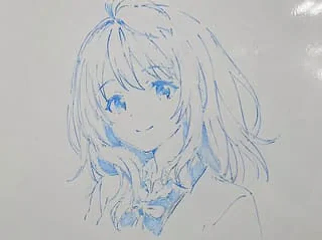

```text
One{argument name="character description" default="An anime girl with shoulder-length wavy hair and a gentle smile."} A close-up portrait, wearing{argument name="outfit" default="School uniform with bow tie"} The image is a hand-drawn sketch on a glossy whiteboard, entirely using {argument name="marker color" default="blue"} Whiteboard marker artwork. The artistic style presents a sketch-like feel, with varying line thicknesses and bold marker shading, capturing a casual yet exquisitely refined anime illustration effect. Subtle light reflections in the upper right corner of the whiteboard surface enhance the realism of the "photographed artwork."
```

Model: GPT Image 2
Author: GPT Image 2 Prompts

[ProjectD](https://aitoolsradar.com/en/prompts/1ecf02ca6fa978) · [Recorded source](https://x.com/mirochill/status/2044767077131522309#reversed-0)
 · [Full original metadata and byte evidence](data/projectd-batch-0052.json)

## Whiteboard Marker Anime Sketch

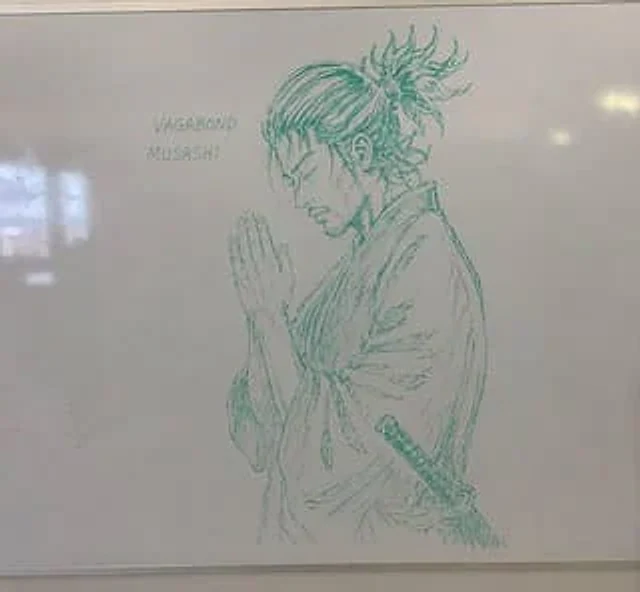

```text
A realistic whiteboard photograph, on which is written {argument name="marker color" default="green"} High-detail drawing with whiteboard markers{argument name="subject" default="A samurai with messy hair and a beard, praying with his hands clasped together."} The characters are adopted{argument name="art style" default="Detailed comic sketch"} The figure is depicted in a traditional style, shown from the side, with eyes closed, wearing a traditional kimono and a samurai sword at her waist. To the left of the figure, the words "..." are handwritten in capital letters.{argument name="text line 1" default="VAGABOND"} Below that, it says "{argument name="text line 2" default="MUSASHI"} The whiteboard has a glossy surface, realistic light reflections and glare on the left side, and a thin metal frame visible at the bottom edge, creating a realistic classroom or office environment.
```

Model: GPT Image 2
Author: GPT Image 2 Prompts

[ProjectD](https://aitoolsradar.com/en/prompts/0b264abac4fe86) · [Recorded source](https://x.com/nicdunz/status/2046328629873791075#reversed-0)
 · [Full original metadata and byte evidence](data/projectd-batch-0052.json)

## Widebody Volvo 240 Spec Board

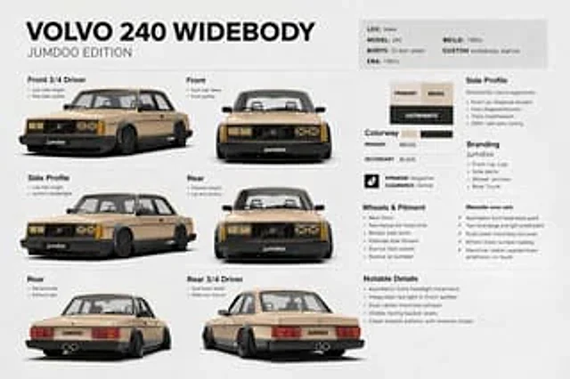

```text
{
  "type": "Automotive design specifications project",
  "subject": {
    "vehicle": "{argument name=\"car model\" default=\"Volvo 240\"}",
    "edition": "{argument name=\"edition name\" default=\"JUMDOO EDITION\"}",
    "body_style": "Rendering of a 2-door sedan wide-body display vehicle",
    "era": "1980s",
    "location": "Make",
    "stance": "Extremely low air suspension posture, aggressive wheelbase",
    "paint": {
      "primary": "{argument name=\"primary color\" default=\"warm beige\"}",
      "secondary": "{argument name=\"secondary color\" default=\"Satin Black\"}",
      "finish": "Satin/Matte Texture"
    },
    "design_features": [
      "The square silhouette of the 1980s Volvo 240",
      "Wide-body riveted wheel arches",
      "Black front lip with extremely low ground clearance",
      "black side skirt",
      "Black lower body cladding",
      "Black multi-spoke deep concave wheel hub",
      "Low aspect ratio stretch tires",
      "Asymmetrical headlight design, with X-shaped inserts on one side of the grille light strip.",
      "Black grille with Volvo diagonal logo",
      "A clean, smooth body with minimalist trim.",
      "Center-mounted dual exhaust pipe",
      "Visible racing bucket seats",
      "Small JUMDOO brand logos are located on the front license plate area, side skirts, and rear panel."
    ]
  },
  "layout": {
    "background": "Simple light gray photography studio poster background",
    "overall_style": "Minimalist Swiss-style car specification sheet, clear 3D product rendering, black sans-serif font, and thin gray dividing lines.",
    "title_block": {
      "headline": "{argument name=\"headline text\" default=\"VOLVO 240 WIDEBODY\"}",
      "subheadline": "JUMDOO EDITION",
      "position": "Top left corner"
    },
    "info_panel": {
      "position": "Top right corner",
      "items": [
        {
          "label": "LOC:",
          "value": "Make"
        },
        {
          "label": "MODEL:",
          "value": "240"
        },
        {
          "label": "BODYS:",
          "value": "2-door sedan"
        },
        {
          "label": "ERA:",
          "value": "1980s"
        },
        {
          "label": "BEILD:",
          "value": "1980s"
        },
        {
          "label": "CUSTOM",
          "value": "Wide-body stance"
        }
      ]
    },
    "sections": [
      {
        "title": "Vehicle view",
        "position": "Left side and center",
        "count": 6,
        "labels": [
          "Left front 3/4 perspective",
          "front",
          "side",
          "back",
          "back",
          "Left rear 3/4 perspective"
        ],
        "content": "Six individual studio renders of the same vehicle, arranged in a 3x2 grid, each with a bold title and two brief captions below or to the side."
      },
      {
        "title": "Material color swatch",
        "position": "upper right middle",
        "count": 3,
        "labels": [
          "main color",
          "secondary color",
          "Satin Matte"
        ],
        "content": "Three rectangular color/material blocks, beige, beige, and black respectively."
      },
      {
        "title": "Color scheme",
        "position": "Right sidebar",
        "count": 2,
        "labels": [
          "main color",
          "secondary color"
        ],
        "content": "The primary color scheme is beige, and the secondary color scheme is black."
      },
      {
        "title": "Side profile",
        "position": "Top right corner",
        "count": 4,
        "labels": [
          "front lip",
          "Volvo diagonal processing",
          "Track style",
          "OEM + Retro Style"
        ],
        "content": "A brief list of key points describing the side and front styling features."
      },
      {
        "title": "Brand logo",
        "position": "Right middle",
        "count": 4,
        "labels": [
          "front lip",
          "Side skirt",
          "wheel arch",
          "trunk"
        ],
        "content": "List of key points for marking the placement area"
      },
      {
        "title": "Wheels and Fit",
        "position": "lower right side",
        "count": 5,
        "labels": [
          "Aerodynamic hubcap",
          "Elegant headlights",
          "Wheel side skirts",
          "Adaptability",
          "attitude"
        ],
        "content": "List of key points describing wheel style, fit, and stance"
      },
      {
        "title": "significant details",
        "position": "bottom right corner",
        "count": 4,
        "labels": [
          "Asymmetrical headlight treatment",
          "Front lip integrated red light",
          "Center-mounted dual exhaust",
          "Visible racing bucket seats"
        ],
        "content": "Key Modification Points List"
      }
    ]
  },
  "rendering": {
    "camera": "Studio product photography, similar to orthographic projection, with slight perspective, consistent and soft lighting.",
    "quality": "High-end industrial design projects, ultra-clear realistic 3D rendering",
    "aspect_ratio": "16:9 Landscape"
  }
}
```

Model: GPT Image 2
Author: GPT Image 2 Prompts

[ProjectD](https://aitoolsradar.com/en/prompts/49538f323fa26a) · [Recorded source](https://x.com/Angusyo16060873/status/2046715368987664526#reversed-0)
 · [Full original metadata and byte evidence](data/projectd-batch-0052.json)

## wikiHow Article Mockup

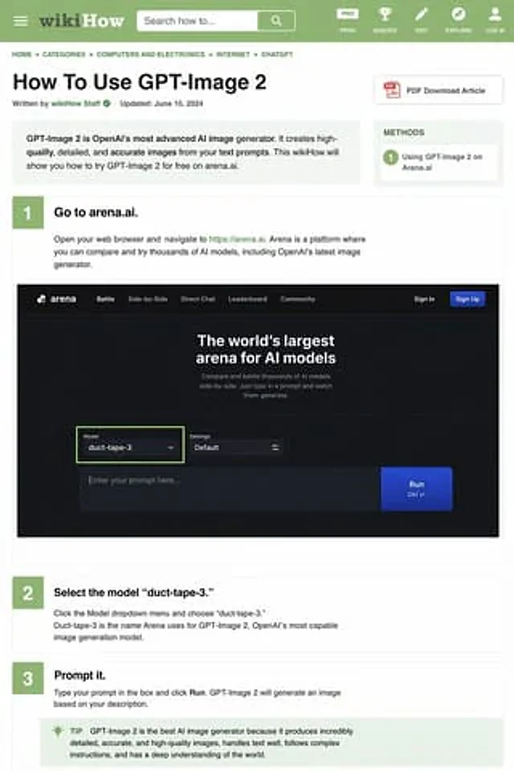

```text
{
  "type": "wikiHow article simulation",
  "header": {
    "background": "green",
    "elements": [
      "Hamburger menu icon",
      "wikiHow logo",
      "Search bar with text \"Search method...\"",
      "5 navigation icons: PRO/PPRO, Quiz, Edit, Explore, Log In"
    ]
  },
  "breadcrumbs": "Home » Categories » Computers &amp; Electronics » Internet » CHATGPT",
  "article_info": {
    "title": "{argument name=\"article title\" default=\"How to use GPT-Image 2\"}",
    "metadata": "Written by wikiHow staff | Updated: June 10, 2024",
    "sidebar": [
      "PDF Download Article Button",
      "Method box: 1. Use GPT-Image on Arena.ai 2."
    ]
  },
  "intro_box": "GPT-Image 2 is OpenAI's most advanced AI image generator. It can create high-quality, detailed, and accurate images based on your text prompts. This wikiHow will show you how to try GPT-Image 2 for free on arena.ai.",
  "steps": [
    {
      "number": 1,
      "title": "{argument name=\"step 1 title\" default=\"Go to arena.ai.\"}",
      "description": "Open your web browser and visit https://arena.ai. Arena is a platform where you can compare and try out thousands of AI models, including OpenAI's latest image generator.",
      "embedded_image": {
        "type": "Dark Mode Website UI Simulation",
        "logo": "arena",
        "navigation": [
          "battle",
          "Side-by-side comparison",
          "direct dialogue",
          "Rankings",
          "Community",
          "Log in",
          "Register button"
        ],
        "hero_text": "The world's largest AI model arena",
        "input_ui": {
          "model_dropdown": "Model:{argument name=\"model name\" default=\"duct-tape-3\"}",
          "settings": "default",
          "text_input": "Enter your prompt here...",
          "button": "run"
        }
      }
    },
    {
      "number": 2,
      "title": "{argument name=\"step 2 title\" default=\"Select model &#39;duct-tape-3&#39;.\"}",
      "description": "Click the model drop-down menu and select \"duct-tape-3\". Duct-tape-3 is the name Arena uses for OpenAI's most powerful image generation model, GPT-Image 2."
    },
    {
      "number": 3,
      "title": "{argument name=\"step 3 title\" default=\"Enter the prompt word.\"}",
      "description": "Enter your prompt in the box and click \"Run\". GPT-Image 2 will generate an image based on your description.",
      "tip_box": "Tip: GPT-Image 2 is currently the best AI image generator because it can generate extremely detailed, accurate and high-quality images, excels at text processing, can follow complex instructions, and has a deep understanding of the world."
    }
  ]
}
```

Model: GPT Image 2
Author: GPT Image 2 Prompts

[ProjectD](https://aitoolsradar.com/en/prompts/b9b88cca81a31e) · [Recorded source](https://x.com/Kittymanagmgf/status/2044521189343637602#reversed-0)
 · [Full original metadata and byte evidence](data/projectd-batch-0052.json)

## WILDCAMP 巨型帐篷广告海报

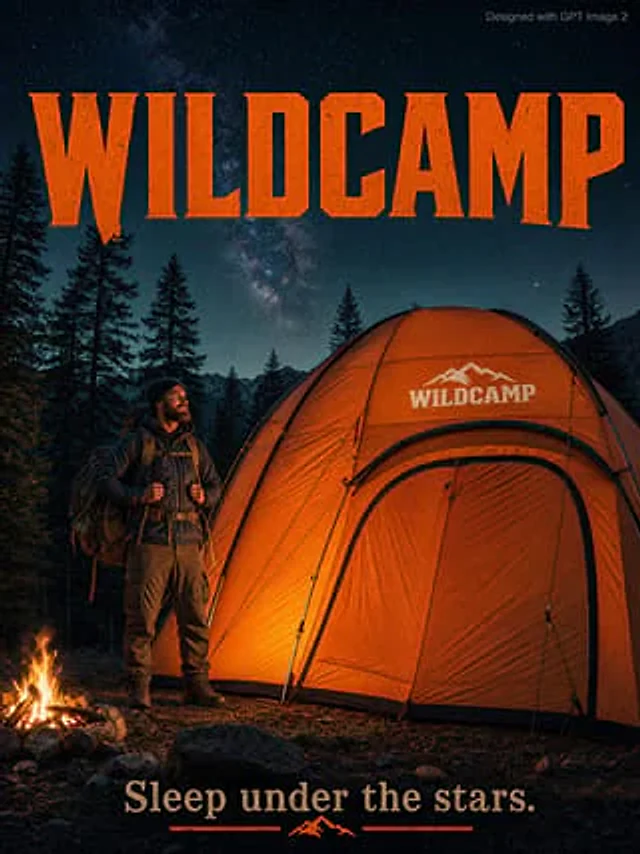

```text
An outdoor adventure advertisement poster featuring a rugged bearded man in full hiking gear standing confidently beside a massive orange camping tent three times taller than him, fully pitched in a dramatic forest clearing surrounded by towering pine trees beneath a deep starry night sky. The tent features a bold white “WILDCAMP” logo stitched onto the rainfly. Warm cinematic campfire lighting illuminates the scene with realistic shadows and rich outdoor textures, creating a premium adventure-commercial aesthetic. Large rugged serif typography reading “WILDCAMP” dominates the dark sky area in bold orange lettering, while the tagline “Sleep under the stars.” appears elegantly at the bottom. Small grey text in the top-right corner reads “Designed with GPT Image 2.” Photorealistic, ultra-detailed, cinematic outdoor advertising style with dramatic atmosphere and high-end commercial composition.
```

Model: GPT Image 2
Author: @Strength04_X

[ProjectD](https://aitoolsradar.com/en/prompts/bdb764421e9a7f) · [Recorded source](https://x.com/Strength04_X/status/2056258909334306897)
 · [Full original metadata and byte evidence](data/projectd-batch-0052.json)

## Windows 11 Focus UI Showcase


```text
{
  "type": "Windows 11 promotional UI mockup",
  "style": "The product marketing presentation is clean and modern, featuring soft frosted glass cards, delicate shadows, rounded corners, a light blue and white color scheme, a clear vector-style interface, and exquisite presentation slides aesthetics.",
  "scene": {
    "background": "A light ice-blue gradient background sets off a large, abstract Windows 11 blue ribbon swirling wallpaper at the center of the interface.",
    "headline": {
      "text": "{argument name=\"headline text\" default=\"Windows 11\"}",
      "subtext": "{argument name=\"tagline\" default=\"Designed for focused attention.\"}",
      "position": "Centered at the top"
    }
  },
  "layout": {
    "type": "Desktop UI Display",
    "sections": [
      {
        "title": "Left sidebar",
        "position": "Leftmost vertical parking bar",
        "count": 8,
        "labels": [
          "Windows logo",
          "Homepage",
          "application",
          "document",
          "cloud",
          "set up",
          "Ava's Profile",
          "power supply"
        ]
      },
      {
        "title": "Efficiency Widgets",
        "position": "Left column cards",
        "count": 3,
        "labels": [
          "Good morning, Ava",
          "weather",
          "calendar"
        ]
      },
      {
        "title": "Center Start Menu",
        "position": "Centered at the bottom",
        "count": 3,
        "labels": [
          "Search bar",
          "Fixed",
          "recommend"
        ]
      },
      {
        "title": "Right column cards",
        "position": "upper right, middle, and lower right",
        "count": 3,
        "labels": [
          "Ava's phone",
          "notify",
          "Quick Setup"
        ]
      },
      {
        "title": "task bar",
        "position": "Bottom full width",
        "count": 10,
        "labels": [
          "Weather Summary",
          "start",
          "search",
          "Task View",
          "Microsoft Edge",
          "File Explorer",
          "Microsoft Store",
          "Outlook",
          "OneDrive",
          "Teams"
        ]
      }
    ],
    "centerpiece": "A huge Windows 11 Start Menu floats in front of a blue abstract wallpaper."
  },
  "widgets": {
    "greeting_card": {
      "title": "Good morning, Ava",
      "subtitle": "Let's get today's work done efficiently.",
      "focus_block": {
        "label": "Focus",
        "time": "By 12:00 noon",
        "timer": "45 minutes",
        "button": "Focus timer"
      }
    },
    "weather_card": {
      "location": "{argument name=\"weather location\" default=\"Seattle, Washington\"}",
      "temperature": "18°",
      "condition": "Cloudy turning sunny",
      "range": "Highest: 21°C Lowest: 13°C",
      "forecast_count": 5,
      "forecast_labels": [
        "18°C now",
        "11:19 AM",
        "12:20 PM",
        "1:21 PM",
        "2:21 PM"
      ]
    },
    "calendar_card": {
      "date": "Monday, May 20th",
      "events_count": 3,
      "event_labels": [
        "Design synchronization at 11:00 AM, Teams meeting.",
        "Lunch with Mia at 1:30 PM, downtown.",
        "Project update at 3:00 PM, Meeting Room 32/1B"
      ],
      "button": "Open the calendar"
    },
    "phone_card": {
      "device_name": "{argument name=\"device name\" default=\"Ava&#39;s phone\"}",
      "status": "Connected",
      "actions_count": 3,
      "action_labels": [
        "information",
        "call",
        "photo"
      ],
      "battery": "100%"
    },
    "notifications_card": {
      "title": "notify",
      "action": "Clear all",
      "items_count": 3,
      "item_labels": [
        "Teams — 11:00 AM Design Synchronization — 2 minutes ago",
        "Outlook — New email from Mia — 10 minutes ago",
        "Calendar — 1:30 PM Lunch with Mia — 30 minutes ago"
      ]
    },
    "quick_settings_card": {
      "title": "Quick Setup",
      "toggles_count": 6,
      "toggle_labels": [
        "Wi‑Fi",
        "Bluetooth",
        "Flight mode",
        "Dark mode",
        "Focus Assistant",
        "Accessibility"
      ],
      "active_toggles": [
        "Wi‑Fi",
        "Bluetooth"
      ],
      "sliders_count": 2,
      "slider_labels": [
        "brightness",
        "volume"
      ],
      "wifi_network": "Contoso_5G"
    },
    "start_menu": {
      "search_placeholder": "Search apps, files, settings...",
      "pinned_count": 18,
      "pinned_labels": [
        "Edge",
        "Word",
        "Excel",
        "PowerPoint",
        "Outlook",
        "Teams",
        "photo",
        "shop",
        "Notepad",
        "Spotify",
        "Figma",
        "clock",
        "calculator",
        "set up",
        "document",
        "Movies and television",
        "Screenshot tool",
        "More"
      ],
      "recommended_count": 4,
      "recommended_labels": [
        "Project Overview",
        "Second Quarter Financial Report",
        "Brand Guide",
        "My Notes"
      ]
    }
  },
  "composition": "The product display is symmetrical, with the start menu centered, three cards stacked on the left and three cards on the right, with ample spacing. All elements appear to float slightly above the background, and the bottom taskbar spans the edge.",
  "rendering": "High-resolution UI concept art for desktop operating system launch pages, featuring perfect typography, Microsoft-inspired icon design, and a clean, minimalist branding."
}
```

Model: GPT Image 2
Author: GPT Image 2 Prompts

[ProjectD](https://aitoolsradar.com/en/prompts/c9d55864a8caf9) · [Recorded source](https://x.com/m0nle0z/status/2046628218107826449#reversed-2)
 · [Full original metadata and byte evidence](data/projectd-batch-0052.json)

## Wine Tasting Event Poster


```text
Vertical 9:16 elegant wine tasting event poster. Background is a deep wine-burgundy color. Centered hand-drawn botanical illustration in gold linework of grape vines, leaves and a small cluster of grapes. Above the illustration an elegant italic serif title reads "Reserve Tasting". Below the illustration a smaller line in light cream type reads "Six wines, four courses, one evening". At the very bottom a small line of date and location "Friday · The Garden Hall". Vertical poster composition with subtle paper grain. No real winery name, no watermark. Premium boutique event poster aesthetic, magazine quality typography.
```

Model: GPT Image 2
Author: @hiapi_ai

[ProjectD](https://aitoolsradar.com/en/prompts/85ece24e7bbaab) · [Recorded source](https://github.com/HiAPIAI/awesome-gpt-image-2-prompts)
 · [Full original metadata and byte evidence](data/projectd-batch-0052.json)

## Winged Donkey Knight Sprite Sheet

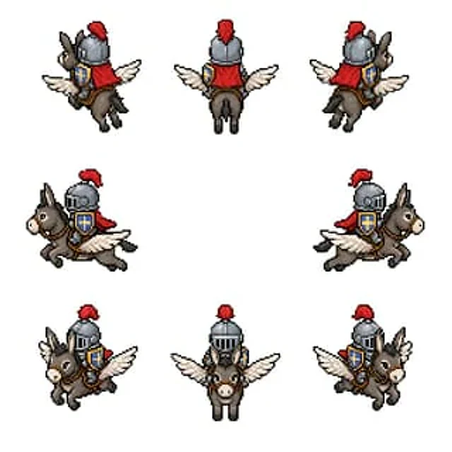

```text
Goal: Create a clean pixel-art sprite sheet for a fantasy game asset: {argument name="character concept" default="a medieval knight riding a winged donkey"}.

Canvas: Square 768×768 image on a plain white background, no borders, no UI, no text. Use a crisp retro RPG pixel-art style with visible chunky pixels, dark outlines, limited palette, and subtle dithering/shading.

Layout: Show exactly 8 separate sprites of the same mount-and-rider character, evenly spaced with large white gaps, arranged as 3 sprites on the top row, 2 sprites on the middle row, and 3 sprites on the bottom row. Each sprite should be roughly the same scale and read like an animation/rotation sheet.

Sprite count and views: 1) top-left: rear three-quarter view facing upper-left, 2) top-center: straight rear view, 3) top-right: rear three-quarter view facing upper-right, 4) middle-left: side view traveling left, 5) middle-right: side view traveling right, 6) bottom-left: front three-quarter view facing lower-left, 7) bottom-center: straight front view, 8) bottom-right: front three-quarter view facing lower-right.

Subject details: The mount is a small gray-brown donkey with long upright ears, pale muzzle, black hooves, simple bridle and saddle, and a pair of white feathered wings extended from its sides like a small pegasus. The rider is a compact armored knight wearing a rounded steel helmet with vertical visor slits, a bright red plume, a red cape or cloth drape, brown leather tack, and a blue shield with a gold cross emblem strapped at the side. Use {argument name="armor color" default="steel gray"}, {argument name="cape color" default="red"}, {argument name="shield color" default="blue and gold"}, and {argument name="mount color" default="gray-brown"}. Maintain the same proportions and costume details across all 8 sprites.

Visual style: Classic 16-bit fantasy RPG sprite sheet, isometric/top-down compatible proportions, high readability at small size, black and dark-brown pixel outlines, soft shadowless presentation, minimal anti-aliasing, no blur, no gradients beyond pixel shading.

Constraints: Keep exactly 8 sprites, do not add extra frames, labels, weapons, scenery, background texture, watermark, or character variations. All sprites must depict the same mounted knight and winged donkey from different directions.
```

Model: GPT Image 2
Author: Kimo

[ProjectD](https://aitoolsradar.com/en/prompts/e2e69de1cb8357) · [Recorded source](https://youmind.com/prompts/winged-donkey-knight-sprite-22220)
 · [Full original metadata and byte evidence](data/projectd-batch-0052.json)

## Winter Concrete Salt Damage Close-Up

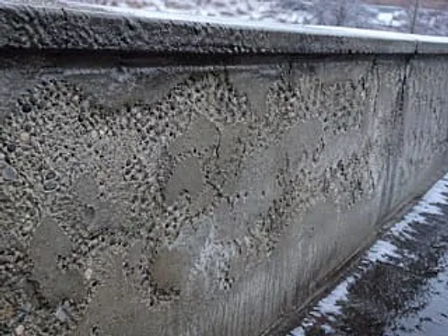

```text
A hyper-realistic, documentary-style close-up photograph showcases severe salt damage on a concrete retaining wall weathered in winter. Shot from a low, oblique angle, the wall extends deep into the right side of the frame. A thin layer of snow and frost covers the top, while the ground beside the wall is dark and damp, partially covered in muddy snow. Extensive spalling and flaking are visible on the concrete surface, primarily concentrated in the upper half, with irregular areas exposing coarse aggregate of various sizes embedded in the mix. The damaged areas exhibit a rough, jagged, geographic outline with cracked edges, a pitted texture, and lost cement paste, revealing black and brown gravel. Vertical streaks of moisture and murky runoff extend downwards to the base of the wall. The overall color scheme is a mix of cool gray, charcoal gray, and soft winter white, illuminated by soft, overcast daylight, with a slight haze in the distance, and the surface texture is extremely fine. The composition should present the texture of a civil engineering inspection photo, like a real smartphone or on-site camera shot, with no people, text, labels, or exaggerated artistic processing in the picture.
```

Model: GPT Image 2
Author: GPT Image 2 Prompts

[ProjectD](https://aitoolsradar.com/en/prompts/36da53e5908c27) · [Recorded source](https://x.com/cncrt_ey/status/2046926139755839707#reversed-1)
 · [Full original metadata and byte evidence](data/projectd-batch-0052.json)

## Wireframe to Corporate Web Banner


```text
Using REFERENCE_0 as the wireframe layout, generate a sophisticated and professional corporate webpage banner ad for an AI sales tool. Use a clean blue, white, and orange color palette. Transform the figures in the sketch into realistic images of two smiling Japanese business professionals (a man and a woman in suits) looking at a silver laptop in a bright office. Add [something] in the top left corner.{argument name="brand name" default="KAWAISALES"} The logo, along with the tagline "A new business support tool that utilizes AI." Map the text bubbles in the wireframe as follows: Replace the top bubble with one containing blue text.{argument name="main copy" default="Wouldn&#39;t you like to take your sales team to the next level with AI?"} The white oval shape; replace the middle bubble with {argument name="sub copy" default="From lead generation to closing, AI provides powerful support for your sales activities!"} Replace the bottom CTA box with a bright orange pill-shaped button with the text "..."{argument name="cta text" default="Experience a free demo now &gt;"} In the bottom right center, add a blue 3D-style bar chart with an upward arrow, a target icon displaying three user silhouettes, and a white UI card with four checkmarks. Finally, add a white panel in the bottom left corner containing three blue line art icons (a clock, a rising chart, and a laptop), with a brief description below each icon.
```

Model: GPT Image 2
Author: GPT Image 2 Prompts

[ProjectD](https://aitoolsradar.com/en/prompts/5fac3daf99a7a9) · [Recorded source](https://x.com/kawai_design/status/2045703687432257564#reversed-1)
 · [Full original metadata and byte evidence](data/projectd-batch-0052.json)

## Wireless Earbuds on Folded Towel


```text
A pair of small white wireless earbuds resting on a neatly folded soft beige terry towel, with their charging case open behind them showing a single LED dot. Background is a clean off-white textured wall. Soft diffuse studio light from above and slightly front. Apple-style minimal product photography. Square 1:1 composition, no text, no logo on the earbuds, no watermark, no hands. Ultra sharp focus, photorealistic fabric and plastic textures.
```

Model: GPT Image 2
Author: @hiapi_ai

[ProjectD](https://aitoolsradar.com/en/prompts/3a3c25c4412ee8) · [Recorded source](https://github.com/HiAPIAI/awesome-gpt-image-2-prompts)
 · [Full original metadata and byte evidence](data/projectd-batch-0052.json)

## Wizard's Room Illustration

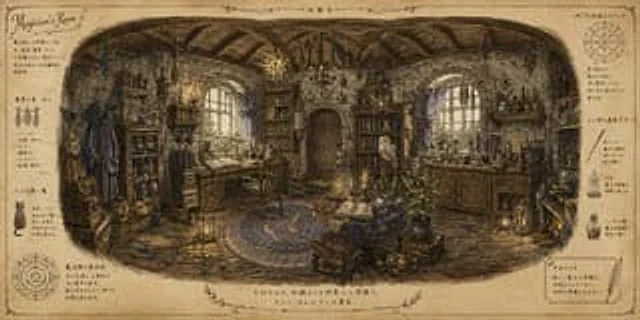

```text
{argument name="style" default="Handwritten magic book style"} Texture, depicting a{argument name="location" default="Wizard Room"}
```

Model: GPT Image 2
Author: GPT Image 2 Prompts

[ProjectD](https://aitoolsradar.com/en/prompts/dcc2c0cb6253c3) · [Recorded source](https://x.com/ysk_en/status/2047737386843730150)
 · [Full original metadata and byte evidence](data/projectd-batch-0052.json)

## Woman at Elegant Bar Cafe Table


```text
A candid, realistic vertical photograph captures a woman seated at a rustic wooden table in an elegant upscale bar/café. Centered in the foreground, she leans forward, one elbow resting on the table, her hand supporting her chin, creating a relaxed, intimate, and editorially-inspired atmosphere. She has long, dark brown, wavy hair parted in the middle and cascading over her shoulders, and wears a fitted white ribbed long-sleeved round-neck top. Three items are clearly visible on the table in front of her: a pink cocktail in a wide-mouthed champagne glass on the left, a blue and white floral ceramic mug on the right, and a small clear glass vase containing a few dried flowers on the far right. Behind her is a warmly lit, elegant bar with marble or stone finishes, ornate classical ceiling details, shelves overflowing with bottles and glassware, soft backlighting, and a bartender in a white shirt and dark apron, slightly out of focus. The image includes dark bar stools beside the bar, and the overall color scheme is rich amber, cream, and brown. Employing shallow depth of field, the interplay of soft indoor natural light and warm bar lighting creates realistic skin and fabric textures with a delicate cinematic quality. The high-detail luxury hotel photography style, shot at eye level with a smartphone or portrait lens and in a vertical composition, creates a comfortable atmosphere that blends Parisian cafes and hotel bars.
```

Model: GPT Image 2
Author: GPT Image 2 Prompts

[ProjectD](https://aitoolsradar.com/en/prompts/635b84fea76726) · [Recorded source](https://x.com/martbln_dev/status/2046607054039564296#reversed-0)
 · [Full original metadata and byte evidence](data/projectd-batch-0052.json)

## Woman Dancing in Black Dress

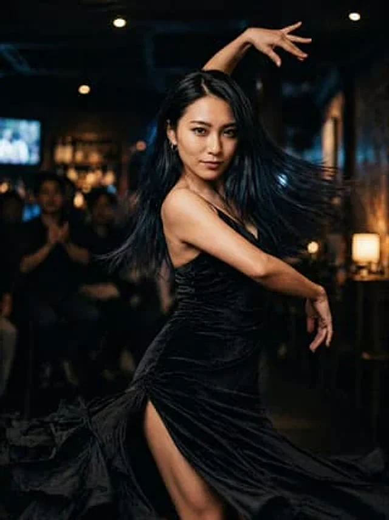

```text
A dramatic full-body photograph depicts a woman dancing powerfully in a dimly lit, upscale lounge or bar. She wears a fitted black evening gown with a high slit, the velvety fabric billowing with her movements. She has long, straight hair.{argument name="hair color" default="black"} Her hair flew to one side, her figure slender and athletic, adorned with delicate hoop earrings. Capture her confident and stylish dance moves: one arm gracefully raised overhead, the other bent downwards, her torso twisting to the side, emphasizing elegance and dynamism. The scene is dimly lit and cinematic, with warm amber-colored practical lighting, soft bokeh, and blurred spectators in the background, including several seated onlookers, and a glowing television screen on the left. The overall atmosphere is cool, sensual, and sophisticated, with strong contrast, shallow depth of field, realistic skin texture, subtle movements of the skirt, and magazine-like lighting. Realistic style, dynamic nightlife photography, vertical composition.
```

Model: GPT Image 2
Author: GPT Image 2 Prompts

[ProjectD](https://aitoolsradar.com/en/prompts/16ec7af3c3b416) · [Recorded source](https://x.com/aoi___ei/status/2046733167286219007#reversed-0)
 · [Full original metadata and byte evidence](data/projectd-batch-0052.json)

## Woman Embracing a Bear in Winter

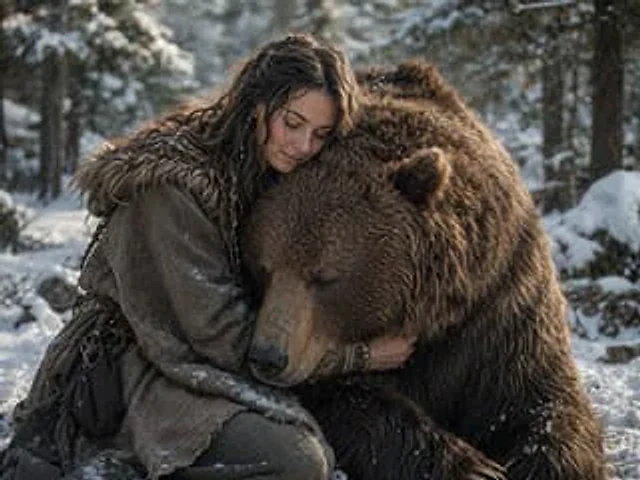

```text
A cinematic, photorealistic shot of a young woman with {argument name="hair style" default="Long, wavy brown hair with small braids"} Wearing{argument name="clothing style" default="Rustic, historical clothing with fur trim and leather pouches"} She knelt in the snow, gently embracing a huge, docile animal.{argument name="animal type" default="Brown Grizzly Bear"} The woman and the bear both had their eyes closed, immersed in a peaceful and affectionate embrace. The bear rested its massive head against the woman. The background was winter.{argument name="environment" default="Pine forest in snow"} The lighting is soft and natural. Tiny snowflakes fall on the woman's hair and the bear's thick fur. High detail, 8K resolution, fantasy-realistic style.
```

Model: GPT Image 2
Author: GPT Image 2 Prompts

[ProjectD](https://aitoolsradar.com/en/prompts/3f5289a9b72d75) · [Recorded source](https://x.com/AlwaveNazca/status/2045404499066384847#reversed-0)
 · [Full original metadata and byte evidence](data/projectd-batch-0052.json)

## Woman Reading at European Street Café


```text
A documentary-style photograph with a cinematic quality, depicting a {argument name="subject" default="young women"} She sat alone at a small, weathered metal coffee table beside a narrow, cobblestone street in an old European town. Her hair was shoulder-length {argument name="hair color" default="Medium brown"} She had wavy hair, wore small gold hoop earrings, a soft beige knit sweater, and loose blue jeans. She sat with her legs crossed, one hand holding a printed ceramic coffee mug, the other gently touching the pages of an open paperback book on the table. A smartphone sat to the left of the table. The background featured a warm stone building with wooden shutters, green plants outside the shop, and a sign that read…{argument name="cafe sign" default="CAFÉ LUNA"} A hanging sign. Several pedestrians are in the distance, with a softly blurred background. Shot from eye level, shallow depth of field, natural golden morning light, soft bokeh, realistic and delicate skin and fabric textures, warm neutral tones, an intimate travel editorial style, and a vertical composition.
```

Model: GPT Image 2
Author: GPT Image 2 Prompts

[ProjectD](https://aitoolsradar.com/en/prompts/7501069407962a) · [Recorded source](https://x.com/jasondoesstuff/status/2046688667981287530#reversed-1)
 · [Full original metadata and byte evidence](data/projectd-batch-0052.json)

## Woman Riding Motorcycle on Cliff Road

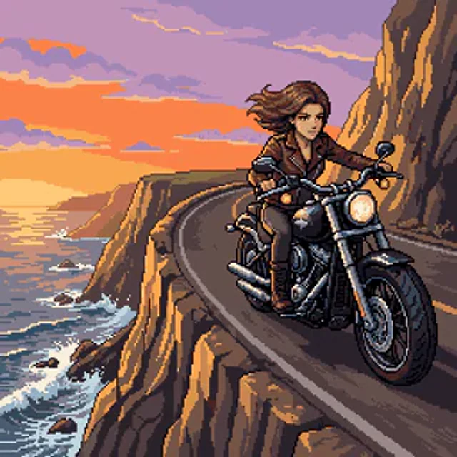

```text
Using REFERENCE_1 as the character base and REFERENCE_0 as the scene/atmosphere reference, the same woman is regenerated into a pixel art-style action shot: she is riding a motorcycle on a narrow cliffside coastal road at sunset. The composition is changed from a close-up portrait to a wider, cinematic full-body perspective, with the motorcycle traveling towards the observer along a winding road carved into the steep coastal cliffs. Her brown leather jacket and overall styling are maintained, but her hair is allowed to flow in the wind, and she is posed with both hands gripping the handlebars. The dramatic drop in ocean elevation on the left, the rocky cliffs on the right, and the warm orange-purple sunset sky are emphasized. The retro 16-bit pixel art aesthetic is preserved.
```

Model: GPT Image 2
Author: GPT Image 2 Prompts

[ProjectD](https://aitoolsradar.com/en/prompts/967f81a57eb61d) · [Recorded source](https://x.com/RealAstropulse/status/2047684055823434230#reversed-0)
 · [Full original metadata and byte evidence](data/projectd-batch-0052.json)

## Woodcut Print Graphic Design Poster

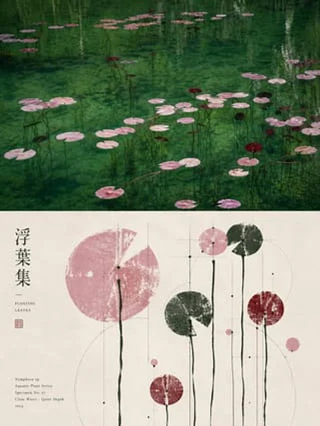

```text
请将我上传的每一张照片分别制作成一张独立的高级设计海报，不多图拼接，每张照片单独输出。整体采用3:4竖版构图，上下两个区域高度严格1:1，各占画面50%。 上半部分保留原始照片，保持主体结构、真实质感、自然光影和原有色彩氛围，仅进行轻微高级摄影调色，使其具有艺术出版物与展览摄影质感。为适配画幅，可自然扩展天空、地面或环境背景，但不得拉伸、扭曲或改变主体。 下半部分提取照片中最具识别性的**主体、轮廓、姿态与叙事关系**，先理解其核心寓意、文化属性或情绪关系，再重构为具有民俗图录、古物拓片与现代平面设计气质的图形画面。不要把照片中的元素逐一翻译，也不要添加泛泛的传统纹样；只保留**一个核心视觉母题与极少量真正有叙事意义的辅助形态**，通过剪影、负形、局部放大、形态合并与符号化转译，使图形既能对应原物，又能表达其背后的意义。 构图建立在严谨的**几何骨架与比例系统**之上，根据主体自身的结构提炼圆、方、三角、弧线、轴线或重复比例作为“几何母体”，再让所有主体、辅助图形、文字和留白与其发生对齐、切线、共轴、嵌套、镜像、比例递进或边界裁切关系。版面可以自由分布、偏心、越界或不对称，但必须共享同一套结构逻辑，形成清晰的视觉重心、层级、节奏与负空间；远看秩序明确，近看才发现传统印痕与细节变化，避免随机散点 and 装饰性堆砌。 配色从上方照片中提取最具辨识度、生命力与精神气质的颜色，重新归纳为清爽克制的纸面印刷色组。以明亮浅色纸底形成呼吸感，用一个深色建立视觉骨架，再以1–2个源自原图的主题色组织主体和少量强调，通过面积比例、叠印与明度关系建立层次，颜色应干净、有精神，避免灰脏做旧、固定民俗配色和杂乱多色。 材质采用**木刻拓印、干刷丝网印与旧式图录印刷**的混合质感，断墨、擦痕、露底和不均匀墨量主要存在于图形内部，几何边界、重要轮廓和整体版式仍保持清晰准确，形成“粗粝物质感 × 严谨几何秩序”的对比。 文字仅作为构图中的辅助信息，从照片的主题、寓意或文化属性中提炼少量标题与微型注释，可顺应几何轴线、负形或图形边界自由排布，与主体形成对齐、嵌套或穿插关系，但不抢夺视觉中心。 整体呈现**寓意先行、图形克制、几何严谨、拓印粗粝、留白清晰、传统文化感与现代设计秩序并存**的视觉气质。每一个出现的图形都必须有来源、有寓意、有结构作用；删除不能增强主题理解的装饰元素，避免素材拼贴、传统符号乱入、平均排版、写实插画和模板感
```

Model: GPT Image 2
Author: 小小东

[ProjectD](https://aitoolsradar.com/en/prompts/dcb96a8198db60) · [Recorded source](https://youmind.com/prompts/woodcut-print-graphic-poster-32248)
 · [Full original metadata and byte evidence](data/projectd-batch-0052.json)

## Wooden Bookshelf Prompt Test

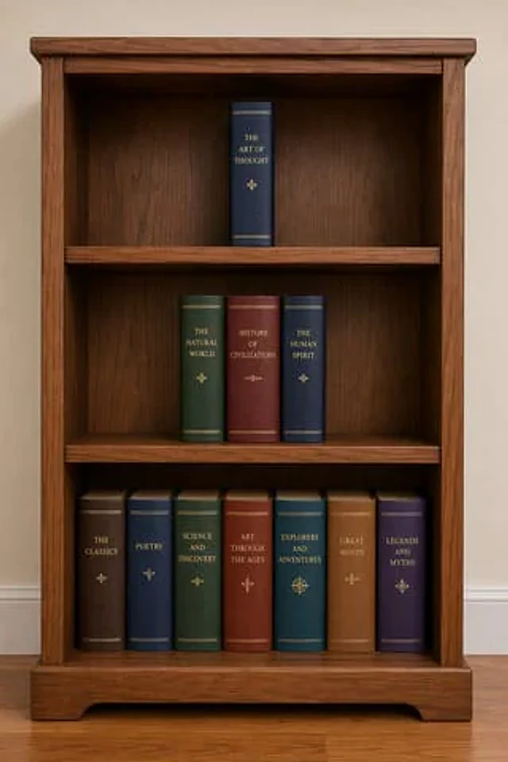

```text
A wooden bookshelf consisting of three shelves: On the top shelf, there should be one book, on the second shelf, there should be three books, and on the bottom shelf, there should be seven books.
```

Model: GPT Image 2
Author: @chetaslua

[ProjectD](https://aitoolsradar.com/en/prompts/a5566ea8a2b509) · [Recorded source](https://x.com/chetaslua/status/2044331451077013749)
 · [Full original metadata and byte evidence](data/projectd-batch-0052.json)

## World Champion Stadium Victory Poster


```text
Create a cinematic vertical sports victory poster featuring {argument name="subject" default="a male soccer champion"} as a full-body figure standing triumphantly on top of a gigantic glowing soccer ball at the center of a futuristic packed stadium. The subject wears a black soccer kit with gold trim, black shorts, black knee socks, and gold cleats, posed confidently with one foot on the ball and one arm raised high holding the golden FIFA World Cup trophy. Use dramatic rain, wet reflective ground, blue-gray storm clouds, heavy stadium floodlights, mist, and a heroic low-angle perspective. The oversized soccer ball should dominate the lower foreground, with black and metallic gray panels separated by bright golden glowing seams and a warm reflection on the rain-soaked floor. In the background, show a massive cheering crowd and exactly 2 large blue digital stadium screens, one on the left and one on the right, both displaying the bold text {argument name="screen text" default="WORLD CHAMPION 2026"}. Also include repeated ribbon-board text around the stadium reading the same championship phrase. In the sky above the athlete, include exactly 4 major firework bursts: one smaller gold burst on the upper left, one blue burst near upper center-left, one large bright blue-white burst at upper center-right, and one gold burst on the upper right, with additional thin spark trails but no extra main bursts. Style the image as ultra-realistic, high-contrast, glossy, cinematic advertising photography with volumetric light beams, water droplets, lens flare, and epic World Cup celebration energy. Keep the composition centered and symmetrical, portrait aspect ratio 9:16, no watermark, no logos beyond subtle kit-style emblems, and make all text legible.
```

Model: GPT Image 2
Author: Dilshad Hussain

[ProjectD](https://aitoolsradar.com/en/prompts/7c03d1539f092d) · [Recorded source](https://youmind.com/prompts/world-champion-soccer-poster-22953)
 · [Full original metadata and byte evidence](data/projectd-batch-0052.json)

## World Civilization Spatiotemporal Map

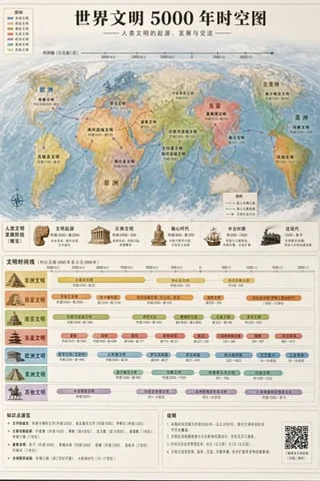

```text
Accurately visualized in a popular science style{argument name="subject" default="A 5000-year time map of world civilization"} It also includes both time and space dimensions.
```

Model: GPT Image 2
Author: GPT Image 2 Prompts

[ProjectD](https://aitoolsradar.com/en/prompts/02125e527c82ff) · [Recorded source](https://x.com/cellinlab/status/2047568318798680167)
 · [Full original metadata and byte evidence](data/projectd-batch-0052.json)

## World Cup Celebration Portrait


```text
Use the uploaded image as the face reference. Ultra-realistic portrait of the same man kissing the {argument name="trophy" default="golden FIFA World Cup trophy"} with eyes closed, holding it with both hands. Wearing a {argument name="jersey" default="Portugal national team jersey inspired by Cristiano Ronaldo #7"}. {argument name="background" default="Clean white studio background"}, soft professional lighting, golden reflections from the trophy, detailed skin texture, realistic beard and hair, Canon EOS R5, 85mm lens, shallow depth of field, sports editorial photography, emotional championship moment, ultra-detailed, photorealistic, 8K, masterpiece quality.
```

Model: GPT Image 2
Author: 𝐌

[ProjectD](https://aitoolsradar.com/en/prompts/91c15abb0bfe27) · [Recorded source](https://youmind.com/prompts/world-cup-celebration-portrait-prompt-25521)
 · [Full original metadata and byte evidence](data/projectd-batch-0052.json)

## World Cup Champion Tunnel Poster


```text
Create a cinematic vertical sports poster showing {argument name="character name" default="a confident male football champion"} walking slowly toward the camera through a dark, modern FIFA World Cup player tunnel. He is centered full-body, wearing a black streetwear-inspired football outfit: black long-sleeve jersey with gold trim, a gold crest, small tournament emblems, the word {argument name="shirt text" default="CHAMPION"} across the chest, black jeans, and black sneakers. His face should be intentionally soft/blurred as if identity-preserved from a reference, while the pose feels calm, victorious, and powerful. He holds one golden World Cup-style trophy in his left hand at chest height. The tunnel walls and ceiling are covered with deep navy LED screens displaying large white text reading {argument name="event text" default="WORLD CUP 2026"}, repeated on the ceiling and both side walls, plus small infinity-like tournament logos and subtle red, cyan, and magenta ribbon graphics. At the tunnel exit behind him, create a glowing stadium entrance with intense white floodlights, green pitch visible at the bottom, and a cheering crowd in soft focus. Add exactly 9 floating foreground/background sports elements: 4 golden World Cup-style trophies positioned upper left, mid-right, lower left, and lower right; and 5 black-and-white soccer balls positioned upper right large cropped, left-center small, lower-left mid, bottom-right large cropped, and one additional small ball near the left wall. Use dramatic volumetric lighting, glossy reflections on the floor, strong backlight halo, shallow depth of field, high-contrast blue-and-gold color grading, realistic photographic detail, and a triumphant commercial advertising style. Vertical 9:16 composition, no watermark, no extra logos beyond the tournament-style marks, keep text legible and bold.
```

Model: GPT Image 2
Author: Dilshad Hussain

[ProjectD](https://aitoolsradar.com/en/prompts/86557d0281399e) · [Recorded source](https://youmind.com/prompts/world-cup-tunnel-poster-22956)
 · [Full original metadata and byte evidence](data/projectd-batch-0052.json)

## World Cup Manga Football Poster

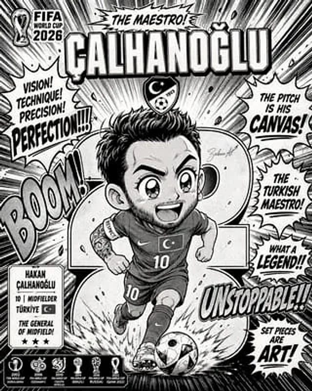

```text
Goal: Create a black-and-white manga comic poster for a FIFA World Cup 2026 football star, featuring {argument name="character name" default="Hakan Çalhanoğlu"} as a heroic chibi-style midfielder sprinting forward with a ball.

Canvas: Square 1:1 poster, high-contrast monochrome ink, dense manga halftone shading, speed lines, explosion bursts, thick black outlines, exaggerated comic typography, energetic sports-card composition.

Main subject: Center the footballer in a dynamic running pose, oversized head and compact athletic body, wearing a dark Türkiye national team kit with crescent-and-star chest badge, jersey number {argument name="jersey number" default="10"} on the shirt and shorts, Nike-style swoosh, dark socks, cleats, and a football at his feet. Hair is spiky and dramatic. Place a plain vertical gray rectangular censor/placeholder block over the face, covering most facial features while leaving hair, ears, body, and kit visible. Add a small Türkiye shield crest above the head with crescent, star, football, and “1923”.

Layout: Huge central headline at the top reading “{argument name="headline surname" default="ÇALHANOĞLU"}” in massive block letters with drop shadow. Above it, a jagged caption bubble reads “THE MAESTRO!” Put the FIFA World Cup 2026 logo at top left. Use a giant pale “26” shape behind the player, plus explosive rays radiating from the center.

Comic callouts: Include exactly 8 comic text bursts around the player: 1) left upper burst: “VISION! TECHNIQUE! PRECISION! PERFECTION!!!”; 2) left diagonal sound effect: “BOOM!”; 3) right upper burst: “THE PITCH IS HIS CANVAS!”; 4) right middle burst: “THE TURKISH MAESTRO!”; 5) right lower-middle burst: “WHAT A LEGEND!!”; 6) lower right huge slanted burst: “UNSTOPPABLE!!”; 7) bottom right burst: “SET PIECES ARE ART!”; 8) top center burst: “THE MAESTRO!”.

Info card: Add one rectangular player card at lower left with the text “HAKAN ÇALHANOĞLU”, “10 | MIDFIELDER”, “TÜRKİYE”, “THE GENERAL OF MIDFIELD!”, and three stars along the bottom.

Bottom timeline: Along the bottom edge, include exactly 6 small World Cup icon badges with labels: 1) 2002 FIFA WORLD CUP (KOREA/JAPAN), 2) 2006 FIFA WORLD CUP (GERMANY), 3) 2010 FIFA WORLD CUP (SOUTH AFRICA), 4) 2014 FIFA WORLD CUP (BRAZIL), 5) 2018 FIFA WORLD CUP (RUSSIA), 6) 2022 FIFA WORLD CUP (QATAR 2022).

Style constraints: Pure black, white, and grayscale only; no color. Make the composition extremely busy and celebratory, like a Japanese sports manga cover mixed with a vintage football trading card. Use crisp linework, halftone dots, ink splatters, debris, action rays, and bold readable lettering. Add a small artist signature near the right side of the large background number.
```

Model: GPT Image 2
Author: mertzabun.ai

[ProjectD](https://aitoolsradar.com/en/prompts/2853eb4c06e18f) · [Recorded source](https://youmind.com/prompts/world-cup-manga-poster-25546)
 · [Full original metadata and byte evidence](data/projectd-batch-0052.json)

## World Cup Stadium Fan Transformation

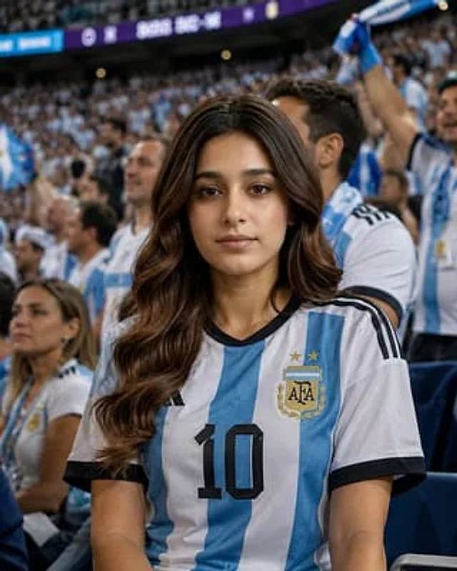

```text
Transform the uploaded photo into a realistic World Cup stadium fan scene. Place the person naturally among thousands of supporters in a packed football stadium during a major international tournament. The person should be wearing the official national team jersey of {argument name="country" default="your country"}, sitting or standing among fans who are also supporting the same nation. Maintain the person’s facial identity, hairstyle, and recognizable features while creating a realistic candid sports photography look. Capture the excitement, emotion, and atmosphere of a live World Cup match, with authentic stadium seating, crowds, flags, scarves, team colors, and match-day energy. The subject should blend naturally into the crowd as if photographed by a professional sports photographer during a real game. Use realistic lighting, shallow depth of field, natural facial expressions, and documentary-style sports photography. The image should feel authentic, cinematic, highly detailed, and indistinguishable from a real photograph taken during an international football tournament. Ultra-realistic, professional photography, realistic crowd interactions, authentic fan culture, natural clothing folds, realistic stadium environment, high detail, 8k quality.Ratio 4:5
```

Model: GPT Image 2
Author: Mahnoor Fatima

[ProjectD](https://aitoolsradar.com/en/prompts/6e028f7d31a237) · [Recorded source](https://youmind.com/prompts/world-cup-fan-photo-transformation-25765)
 · [Full original metadata and byte evidence](data/projectd-batch-0052.json)

## World Cup Throne Portrait


```text
Create a cinematic vertical luxury football champion portrait in a dark studio arena. A {argument name="subject identity" default="young adult man with short dark hair"} sits centered and facing forward on an enormous black iron throne inspired by a fantasy sword throne, made from dozens of overlapping steel blades and swords fanning upward behind him like a crown. He wears a {argument name="outfit" default="plain black long-sleeved shirt, black jeans, and black-and-red high-top sneakers"}. His posture is powerful and relaxed: seated with legs apart, right hand gripping a gleaming {argument name="main trophy" default="FIFA World Cup trophy"} held upright near his knee, left forearm resting on the throne armrest. Place the throne on a circular glossy black metallic platform. Surround him with exactly 6 visible football awards and props on the platform: 2 large gold cup trophies standing at the far left and far right edges, 2 taller narrow gold trophies beside his feet, and 2 metallic gold footballs in the front left and front right corners. Add additional smaller gold football ornaments integrated into both throne armrests. Background: a vast dark stadium or arena with blurred crowd seating, cool blue stadium floodlights on both sides, deep black upper background, and subtle haze. Lighting should be dramatic and high contrast, with teal-blue rim light from the stadium and warm red-orange highlights on the throne, trophies, shoes, and platform edges. Style: ultra-realistic, premium sports editorial, heroic symmetrical composition, sharp metallic textures, glossy reflections, shallow depth of field, 9:16 vertical poster framing. Keep the face recognizable if a reference is provided, but do not add text, logos, watermarks, or extra people.
```

Model: GPT Image 2
Author: Dilshad Hussain

[ProjectD](https://aitoolsradar.com/en/prompts/0eaeb2540c3159) · [Recorded source](https://youmind.com/prompts/world-cup-throne-portrait-22954)
 · [Full original metadata and byte evidence](data/projectd-batch-0052.json)

## World Cup Trophy Reveal Perspective


```text
Ultra-realistic sports photography, documentary realism, premium commercial campaign style, immersive 9:16 vertical composition.\n\nThe camera is positioned deep inside an opened luxury gift box, creating a dramatic first-person perspective from the hidden treasure itself. A magnificent golden FIFA World Cup trophy rests on elegant dark velvet fabric in the lower foreground, with realistic metallic reflections and authentic textures.\n\nAbove the opened box stands [PLAYER NAME], leaning forward and looking directly into the box with an expression of determination, ambition, and hunger for glory. He reaches one hand naturally toward the trophy, symbolizing his dream of winning the FIFA World Cup 2026.\n\nSTRICT IDENTITY PRESERVATION OF [PLAYER NAME]. The player must be instantly recognizable as the real [PLAYER NAME], with authentic facial structure, eye shape, nose, lips, jawline, hairstyle, beard style, skin texture, and expression. Preserve his real-world appearance with extreme accuracy. No generic AI face.\n\nAuthentic human anatomy, realistic proportions, detailed skin pores, realistic eyes, natural hair strands, genuine facial expression, lifelike appearance, true-to-life colors.\n\nOfficial national team jersey with realistic fabric folds, stitching, texture, sweat details, and accurate colors.\n\nThe official FIFA World Cup 2026 logo is elegantly integrated into the composition with realistic physical appearance. The overall scene incorporates the authentic FIFA World Cup 2026 visual identity and official tournament color palette, creating a premium championship atmosphere.\n\nWarm stadium lights in the distance, subtle crowd bokeh, realistic depth of field, natural shadows, cinematic composition, premium sports advertising photography.\n\nCaptured with a Canon EOS R3 and RF 70-200mm f/2.8L lens, Getty Images realism, Reuters sports photography quality, authentic football photography, shallow depth of field, realistic lighting, true-to-life materials.\n\nLuxury black gift box interior, premium velvet textures, elegant packaging, realistic cardboard material, soft shadows, natural golden reflections.\n\nPhotorealistic, highly detailed, realistic skin texture, realistic hands, realistic fingers, authentic athlete appearance, physically accurate materials.\n\nNo generic AI faces, no face distortion, no altered facial features, no stylized appearance, no cartoon style, no CGI look, no plastic skin, no wax skin, no fantasy effects, no exaggerated proportions, no deformed hands, no extra fingers, no toy figures, no LEGO style, no miniatures.\n\nNo watermarks, no unrelated text, no third-party branding.\n\n16K ultra-high-resolution, photorealistic, premium commercial sports photography, FIFA World Cup 2026 atmosphere.\n\nAspect Ratio: 9:16
```

Model: GPT Image 2
Author: Saul Goodman

[ProjectD](https://aitoolsradar.com/en/prompts/9eeae42b67f3d7) · [Recorded source](https://youmind.com/prompts/world-cup-trophy-reveal-perspective-24912)
 · [Full original metadata and byte evidence](data/projectd-batch-0052.json)

## World Cup Tunnel Champion

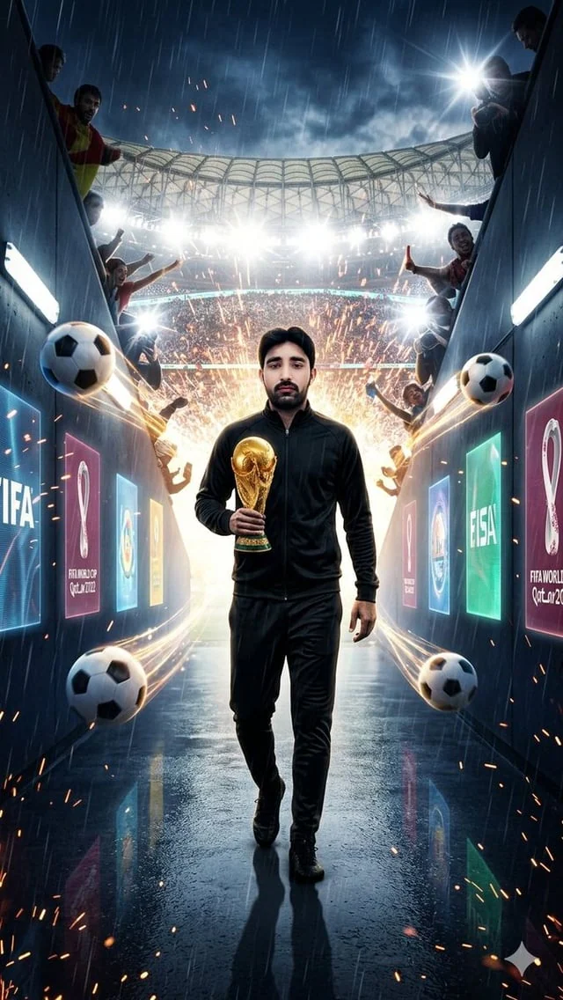

```text
Create a vertical 9:16 cinematic sports poster of {argument name="character name" default="a confident male football champion"} walking slowly toward the viewer through a dark futuristic FIFA World Cup player tunnel into a packed stadium. He is shown full body, centered, wearing an all-black modern athletic tracksuit with a zip jacket, black pants, and black shoes, holding the golden FIFA World Cup trophy in one hand at chest height. The scene is rainy and dramatic, with wet reflective tunnel flooring, strong backlighting from the stadium entrance, bright white floodlights, mist, sparks, and explosive golden pyrotechnics behind him. The tunnel walls are dark blue-black metal panels with glowing digital World Cup graphics and readable-style branding, including FIFA, Qatar 2022, and World Cup trophy emblem panels, without making the text the main focus. Add exactly 4 floating soccer balls around the subject: one large ball on the lower left foreground, one smaller ball on the upper left side, one large ball on the mid-right wall area, and one ball near the lower right foreground, all with motion streaks. Add exactly 6 visible fan or photographer figures leaning in from the tunnel edges: two on the left side and four on the right side, some cheering with arms raised and one holding a bright camera flash. The stadium beyond the tunnel is crowded and glowing, with a curved roof structure visible at the top. Use high-contrast teal-and-gold color grading, ultra-realistic detail, dramatic depth of field, rain streaks, lens flares, glossy reflections, and a heroic World Cup entrance mood. Keep the subject’s face as {argument name="face treatment" default="front-facing but anonymized/blurred"}; if a real identity is provided, preserve facial identity exactly. Avoid cartoon style, avoid extra limbs, avoid distorted trophy shape, and avoid cluttered or unreadable typography.
```

Model: GPT Image 2
Author: Dilshad Hussain

[ProjectD](https://aitoolsradar.com/en/prompts/1cd62bb443c61a) · [Recorded source](https://youmind.com/prompts/world-cup-tunnel-champion-22952)
 · [Full original metadata and byte evidence](data/projectd-batch-0052.json)

## World Cup Victory Tunnel Scene

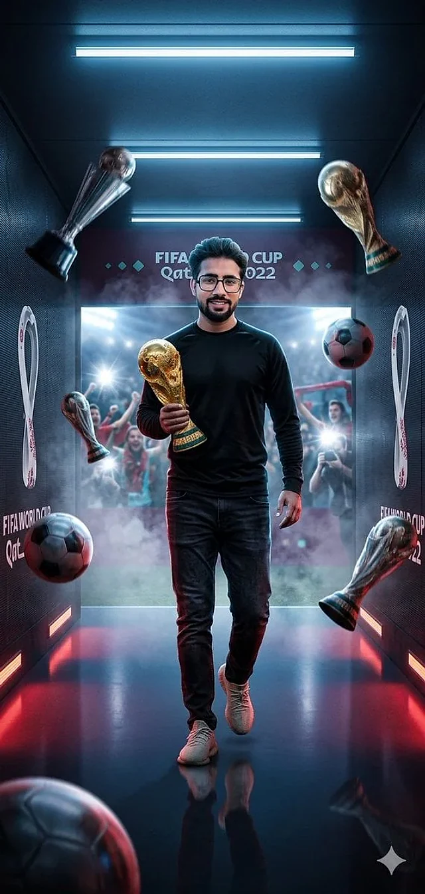

```text
victorious {argument name="event" default="FIFA World Cup"} tunnel scene featuring the uploaded face as reference for identity preservation, the subject walking slowly and confidently through a dark modern player tunnel toward a glowing stadium entrance, wearing a {argument name="outfit" default="black streetwear-inspired football outfit"} with a long-sleeved top, dark jeans, and light sneakers, holding a golden trophy tightly in the left hand as if just won the final, while several metallic trophies and footballs appear suspended around him in a surreal cinematic arrangement, some floating slightly above the ground and others reflecting in the glossy tunnel floor, the tunnel walls lined with dim LED panels, abstract World Cup graphics, and blurred flashes of cheering crowd light from the stadium ahead, intense cool blue overhead lighting mixed with warm red uplight creating a powerful contrast across the face and outfit, smoke haze drifting through the corridor, dramatic shadows, glossy reflections, shallow depth of field, high-end sports poster composition, ultra realistic details, monumental atmosphere, premium cinematic grading, designed to feel legendary, viral, and unforgettable.
```

Model: GPT Image 2
Author: Muhammad Jamil

[ProjectD](https://aitoolsradar.com/en/prompts/91d12803a02a66) · [Recorded source](https://youmind.com/prompts/world-cup-winner-tunnel-trophy-25921)
 · [Full original metadata and byte evidence](data/projectd-batch-0052.json)

## World of Warcraft Style Raid

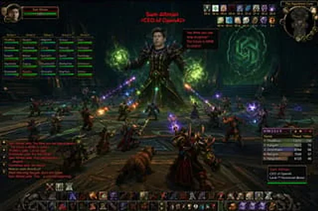

```text
A{argument name="player count" default="20"} The human-run raid is currently in combat, and the opponent is {argument name="character" default="Sam Altman"} ,use{argument name="year" default="2004"} The style of World of Warcraft from 2000. Brief description.
```

Model: GPT Image 2
Author: GPT Image 2 Prompts

[ProjectD](https://aitoolsradar.com/en/prompts/d05cfa6553d82c) · [Recorded source](https://x.com/kimmonismus/status/2046719924362465562)
 · [Full original metadata and byte evidence](data/projectd-batch-0052.json)

## World of Warcraft Style Raid


```text
a {argument name="player count" default="20"} person horde raid is fighting {argument name="character" default="Sam Altman"} in {argument name="year" default="2004"} world of Warcraft style. One shortted.
```

Model: GPT Image 2
Author: Chubby♨️

[ProjectD](https://aitoolsradar.com/en/prompts/fc7069d4ca1d54) · [Recorded source](https://youmind.com/prompts/wow-style-horde-raid-14386)
 · [Full original metadata and byte evidence](data/projectd-batch-0052.json)

## WSJ-Style Business Newspaper Front Page


```text
A photorealistic newspaper, taken from a three-quarter view from above, sits folded on a dark wood desk, its style mimicking a famous American business daily from the 1980s to the 2000s. The newspaper features a clear, lifelike texture of newsprint, subtle paper creases, and slightly worn folded edges. Warm morning light casts diagonal window shadows across the pages. The masthead occupies the top, written in bold, large, classic serif capital letters.{argument name="newspaper name" default="THE WALL STREET DAILY."} Below it is a thin header containing details of the small financial newspaper: "DOW JONES", "News Corp", the date line "MONDAY, APRIL 20, 2026 – VOL. CCLXXXV NO. 90", "WSJ.com", a star rating line, and the price "$5.00". The main news is located in the upper left center, with a large, bold serif headline.{argument name="main headline" default="Cook to Step Down as Apple CEO; Ternus Named Successor"} Below is a smaller serif subheading: “Transition caps 15-year run; company pivots to AI-driven future.” Add a line of small capital letters byline including the two journalists: “By Tim Higgins” and “And Joanna Stern.” The main body is filled with dense, fully readable multi-column news articles about Tim Cook’s departure as Apple CEO, John Tenus’s succession, Apple’s growth, AI strategy, and corporate transformation; the text should read like solid financial news, not placeholder gibberish. To the right of the main article is a black-and-white, woodcut-style portrait of a male executive, wearing a shirt and jacket, centered in the rectangular image area; his face is partially obscured by a light gray square above his eyes and nose, creating a modern ironic effect. In the upper right corner, there is a sidebar titled "What's New," containing two subheadings: "Business &amp; Finance" and "World-Wide," each followed by a brief summary in small serif font. "Business &amp; Finance" contains three points, and "World-Wide" contains four. All content must be fully formatted and clearly readable. Below the main news, a second-level banner article spanning the entire page is added, titled "Silicon Valley Braces for New Chapter in AI Arms Race," attributed to "By Liz Hoffman," and accompanied by several short articles about large tech companies, startups, OpenAI, Google, Meta, chips, platforms, and the AI ​​competition. To the right of this lower-middle area, a compact market table is inserted, titled "Markets," with four rows of labels: "DOW JONES," "S&amp;P 500," "NASDAQ," and "10-YR. TREASURY," and columns for index/value/change/percentage, using a realistic newspaper table format and actual figures. At the bottom of the front page, there are three preview boxes: the left box is labeled "Heard on the Street," with the headline "Why Investors Are Rethinking Big Tech," and is marked "B12"; the middle box is labeled "Markets," with the headline "Earnings Season Lifts Stocks Despite Rate Uncertainty," and is marked "B1"; the right box is labeled "Inside," with the headline "Private Credit Sees Inflow Surge as Yields Stay High," and is marked "B14." All typography is kept clean, sharp, and fully readable, with consistent alignment in an authentic newspaper grid layout, thin lines separating columns, justified text, a classic serif font, and realistic print contrast. The newspaper is slightly rotated clockwise on a tabletop. In the environment, a white ceramic mug containing black coffee is placed in the upper right corner, and a pair of dark-rimmed glasses sits near the lower right edge of the newspaper. The upper left corner contains the cropped edge of a dark cylindrical object, resembling a camera lens or a flat-bottomed mug. Overall feel: High-end editorial mockup front page, serious business journalism aesthetics, believable print photography feel, ultra-high detail, natural shadows, high resolution.
```

Model: GPT Image 2
Author: GPT Image 2 Prompts

[ProjectD](https://aitoolsradar.com/en/prompts/773fd19146468e) · [Recorded source](https://x.com/flowith/status/2046562155148009495#reversed-0)
 · [Full original metadata and byte evidence](data/projectd-batch-0052.json)

## WSJ-Style Business Newspaper Front Page


```text
A photorealistic overhead three-quarter view of a folded financial newspaper on a dark wooden desk, styled like a prestigious American business daily from the 1980s–2000s, with crisp realistic newsprint texture, subtle paper wrinkles, slightly worn folded edges, and warm morning sunlight casting diagonal window-shadow bands across the page. The masthead dominates the top in large classic serif capitals reading {argument name="newspaper name" default="THE WALL STREET DAILY."}. Directly beneath it is a thin header strip with small financial-paper details: "DOW JONES", "News Corp", the date line "MONDAY, APRIL 20, 2026 – VOL. CCLXXXV NO. 90", "WSJ.com", a star rating row, and the price "$5.00". The main lead story spans the upper center-left with a huge bold serif headline reading {argument name="main headline" default="Cook to Step Down as Apple CEO; Ternus Named Successor"}. Below it is a smaller serif subheadline: "Transition caps 15-year run; company pivots to AI-driven future". Add a byline line in small caps with 2 reporters: "By Tim Higgins" and "And Joanna Stern". Fill the lead article with dense, fully legible multi-column newspaper body text about Tim Cook stepping down as Apple chief executive, John Ternus succeeding him, Apple's growth, AI strategy, and corporate transition; the text should read like authentic financial journalism, not placeholder gibberish. On the right half of the lead story, place a black-and-white engraved stipple portrait of a male executive in collared shirt and jacket, centered in a rectangular image area; the face is partially obscured by a pale gray square censor block over the eyes and upper nose, creating a modern satirical effect. At the top-right, include a sidebar box titled "What’s New" with exactly 2 subsection headers, "Business & Finance" and "World-Wide", each followed by bullet-point briefs in small serif text; include exactly 3 bullets under "Business & Finance" and exactly 4 bullets under "World-Wide", all fully typeset and legible. Beneath the main story, add a secondary banner article across the page titled "Silicon Valley Braces for New Chapter in AI Arms Race" with a byline "By Liz Hoffman" and several short columns of text about big tech, startups, OpenAI, Google, Meta, chips, platforms, and AI competition. To the right of this lower-middle section, insert a compact markets table titled "Markets" with exactly 4 rows labeled "DOW JONES", "S&P 500", "NASDAQ", and "10-YR. TREASURY", with columns for index/value/change/percent and realistic numeric values in tight newspaper tabular formatting. Along the bottom strip of the front page, include exactly 3 teaser boxes: left box with section label "Heard on the Street" and headline "Why Investors Are Rethinking Big Tech" plus page marker "B12"; center box with section label "Markets" and headline "Earnings Season Lifts Stocks Despite Rate Uncertainty" plus page marker "B1"; right box with section label "Inside" and headline "Private Credit Sees Inflow Surge as Yields Stay High" plus page marker "B14". Make all typography clean, sharp, perfectly legible, and consistently aligned in authentic newspaper grid layout with thin rules between columns, justified text, classic serif fonts, and realistic print contrast. The newspaper sits slightly rotated clockwise on the desk. In the environment, show a white ceramic coffee cup filled with black coffee in the top-right corner and a pair of dark-framed eyeglasses resting near the lower-right edge of the paper. In the top-left corner, include the cropped edge of a dark cylindrical object, likely a camera lens or tumbler. Overall mood: premium editorial mock front page, serious business-news aesthetic, believable print photography, ultra-detailed, natural shadows, high resolution.
```

Model: GPT Image 2
Author: Flowith

[ProjectD](https://aitoolsradar.com/en/prompts/3c7869482f22b0) · [Recorded source](https://youmind.com/prompts/wsj-style-business-newspaper-front-page-14418)
 · [Full original metadata and byte evidence](data/projectd-batch-0052.json)

## Wuxia MMORPG Ancient Town Screenshot

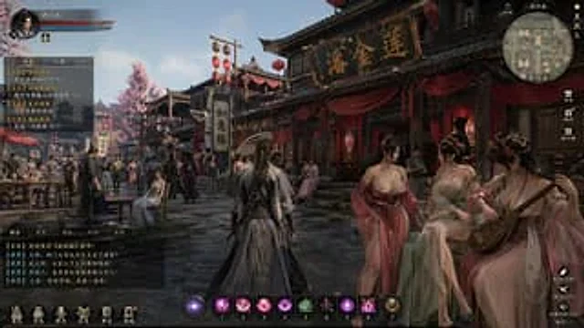

```text
A meticulously detailed, cinematic-quality screenshot of a third-person martial arts MMORPG is shown. The scene is set at dusk in a bustling ancient Chinese water town market street, with the perspective positioned behind the player character in the foreground center. The player character is a wandering swordsman, dressed in a dark gray and blue Hanfu-style robe with embroidered patterns, his long black hair tied in a low ponytail, carrying a sword sheath on his back, facing the crowded street ahead. The environment is a beautifully rendered Ming or Song Dynasty-style town, featuring traditional wooden shops, tiled roofs, hanging red lanterns, pink cherry blossom trees, damp, reflective cobblestone streets, a soft golden sunset, and townspeople dressed in ancient costumes. In the right foreground, three elegant female geishas in semi-transparent light-colored Hanfu stand outside an ornately decorated teahouse or brothel, draped with red silk curtains; one is playing the pipa, one sits in a light green and beige robe, and the other stands in a flowing rose-pink robe. The largest shop sign at the top features gold Chinese characters on a black plaque, and vertical shop banners with Chinese characters hang on both sides of the street. The overall composition should present the quality of a top-tier AAA Chinese fantasy RPG, with realistic character proportions, dense scene narrative, dramatic yet natural lighting, atmospheric depth, and complex clothing textures. It includes a complete Chinese game HUD overlay: a circular character portrait in the upper left corner displaying level 36 and two horizontal health and mana progress bars; a quest tracking panel on the left with four quest entries under each tag title; a semi-transparent chat box in the lower left corner displaying multiple lines of Chinese world chat content; a circular minimap in the upper right corner with location text; a vertical menu on the right with six icon buttons; a skill bar at the bottom center with ten slots, including eight square skill icons and two circular end slots with keyboard key labels; and a bottom menu row with six navigation icons. The game features ultra-detailed, photorealistic simulations of a fantasy game interface, exquisite UI, an immersive and crowded street scene, and a 16:9 aspect ratio.
```

Model: GPT Image 2
Author: GPT Image 2 Prompts

[ProjectD](https://aitoolsradar.com/en/prompts/329421a789c848) · [Recorded source](https://x.com/jimifann/status/2047581980376912169#reversed-0)
 · [Full original metadata and byte evidence](data/projectd-batch-0052.json)

## Wuxia MMORPG Gameplay Screenshot

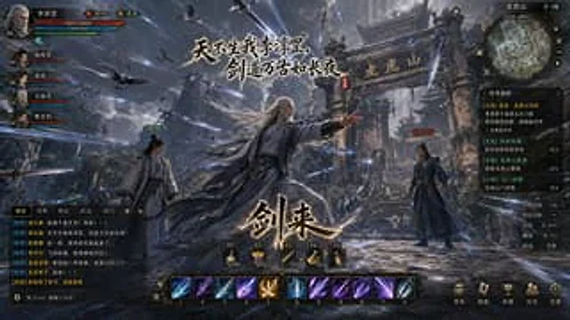

```text
Screenshots from the "Snowy Path of the Fierce Blade" themed ancient ARPG MMO open-world game: Li Chungang comprehends swordsmanship before the gates of Longhu Mountain. With a cry of "Swords, come!", ten thousand swords fly forth, converging from all directions like a tidal wave. Xu Fengnian stands by, facing off against Zhao Danping. The scene is grand and awe-inspiring, showcasing the full power of a terrestrial immortal. On-screen text: "If Heaven had not given birth to Li Chungang, the way of the sword would have remained in eternal darkness," "Swords, come!" High-definition, epic feel, cinematic lighting and shadows, complete MMORPG game UI. Screenshots from the "Snowy Path of the Fierce Blade" themed ancient ARPG MMO open-world game: The final battle atop Wudi City. Old Huang transforms into Sword Nine Yellow, his clothes stained with blood as he unleashes "Sword Nine: Six Thousand Miles," golden sword energy crisscrossing the heavens and earth. In the distance, Wang Xianzhi faces his opponent with both hands, a tragic and fierce display of power, a peak sword move burning with life. On-screen text: "Sword Nine: Six Thousand Miles," "Anyone who dares to challenge Beiliang, ask the sword in my hand." High-definition, epic BOSS battles, complete MMORPG game UI. Screenshots from the "Snowy Path of the Sword" themed ancient ARPG MMO open-world game: Li Chungang stands atop a shattered mountain peak, cleaving the heavens with a single sword strike. The sword light soars to the heavens, the gates crack, chains shatter, the earth trembles, and Xu Fengnian watches from afar, the scene awe-inspiring and sacred, brimming with a defying-the-heaven spirit. On-screen text: "Severing destiny, severing shackles," "One sword opens the heavens." High-definition, epic feel, ultimate Xianxia (fantasy martial arts) grand scenes, complete MMORPG game UI. Screenshots from the "Snowy Path of the Sword" themed ancient ARPG MMO open-world game: A battle at the outer altar. Li Chungang unleashes a domineering sword strike, a golden sword pillar descends from the sky, the immortal opposite him kneels instantly, the earth collapses, the ruins of the heavenly palace float, the sword intent suppresses all living beings, an invincible aura. On-screen text: "One sword, immortals kneel," "With Li Chungang here, there are no immortals under heaven!" High-definition, epic Xianxia BOSS battles, complete MMORPG game UI.
```

Model: GPT Image 2
Author: GPT Image 2 Prompts

[ProjectD](https://aitoolsradar.com/en/prompts/5f5c1ab6857e53) · [Recorded source](https://x.com/DalinHuang/status/2046812580031692924)
 · [Full original metadata and byte evidence](data/projectd-batch-0052.json)

## Wuxia Movie Character Posters


```text
Movie character posters: Dongfang Bubai, dressed in a red robe, drinks wine against a cliff at sunset, creating a martial arts atmosphere; Dongfang Bubai, with her embroidery needles flying, stands on a cliff with long red hair, the sunset over Blackwood Cliff like blood.
```

Model: GPT Image 2
Author: GPT Image 2 Prompts

[ProjectD](https://aitoolsradar.com/en/prompts/ad00452a900ea3) · [Recorded source](https://x.com/songguoxiansen/status/2047204566559756707)
 · [Full original metadata and byte evidence](data/projectd-batch-0052.json)

## Wuxia Movie Character Posters


```text
电影角色海报，东方不败红衣饮酒，悬崖落日，武侠意境；东方不败绣花针如飞，红衣长发立于悬崖，黑木崖夕阳如血
```

Model: GPT Image 2
Author: 松果先森

[ProjectD](https://aitoolsradar.com/en/prompts/5adbd308b94680) · [Recorded source](https://youmind.com/prompts/dongfang-bubai-wuxia-poster-15187)
 · [Full original metadata and byte evidence](data/projectd-batch-0052.json)

## WWII D-Day Cinematic Poster

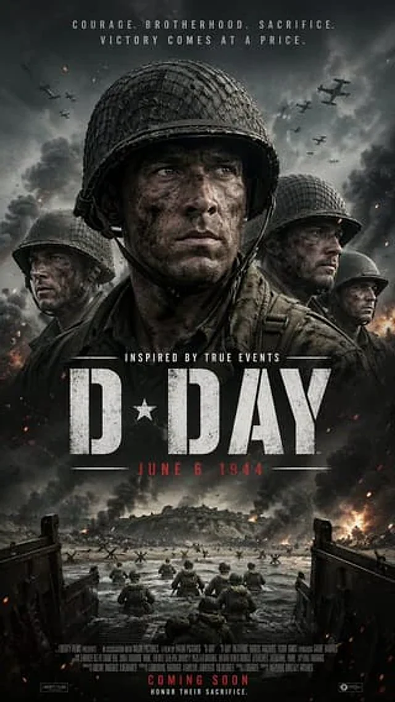

```text
A high-quality World War II movie poster, using a vertical single-page layout, with a design style reminiscent of modern high-budget war film advertisements. Two lines of compressed capital letters are displayed at the top center of the poster:{argument name="top tagline" default="Courage. Brotherhood. Sacrifice."} and{argument name="second tagline" default="The price of victory."} The main composition features four American World War II soldiers in dark olive-colored uniforms and large-mesh M1 helmets: a dominant central soldier in a half-length portrait facing forward, flanked by three slightly smaller soldiers on each side (one on the left and two on the right). Their faces are shrouded in shadow, covered in dirt and grime, showing the effects of battle, with strong light and shadow effects and smoky backlighting. The background is a gloomy sky filled with smoke, sparks, embers, and two groups of aircraft: three in the upper left and five in the upper right. A line of small text is centered in the middle of the image:{argument name="based on text" default="Based on true events"} Below is a huge, bold, blocky, distressed headline:{argument name="movie title" default="D-DAY"} The two D's are separated by an asterisk. Below the title is a line of red compressed dates:{argument name="date text" default="June 6, 1944"} The lower half shows the Normandy landings from the inside of an open landing craft, framed by two dark metal ramps. Eight soldiers, carrying rifles and backpacks, wade towards the shore amidst the spray, surrounded by Czech hedgehog-like barricades, surging water, smoke, distant fires, and a bombed-out coastline. At the very bottom is a dense, tiny credits list, below which is a striking red line announcing the release date.{argument name="release text" default="Coming Soon"} Following this is a smaller line of white text: "In tribute to their sacrifice." The color scheme is charcoal gray, steel blue, and mud brown, accented with red lettering. This ultra-refined, realistic, high-contrast, emotional, epic, historical, and dramatic cinema poster design features authentic film grain, volumetric smoke, aged textures, and symmetrical composition, making it a top-tier visual art piece for blockbuster films.
```

Model: GPT Image 2
Author: GPT Image 2 Prompts

[ProjectD](https://aitoolsradar.com/en/prompts/27e169185ab53a) · [Recorded source](https://x.com/AlwaveNazca/status/2046642949300109739#reversed-0)
 · [Full original metadata and byte evidence](data/projectd-batch-0052.json)

## Xianxia Cityscape from God's-Eye View

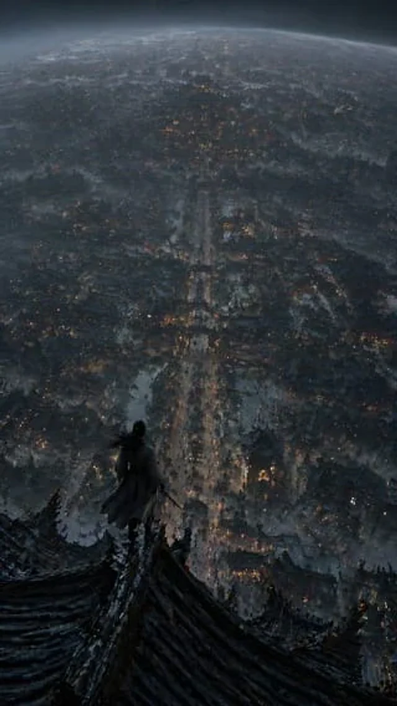

```text
An ultimate God's-eye view, looking directly down at the vast and radiant expanse.{argument name="city style" default="Ancient Chinese Cities"} The city stretches to the horizon, its curvature even visible on the planet's surface. In the foreground, a solitary figure {argument name="character type" default="swordsman"} Clad in a traditional robe, I stand on the edge of the ornately decorated, dark-tiled roof of an ancient palace, gazing down. Below lies an endless complex of ancient buildings, illuminated by warm lights, bustling streets teeming with people. A soft mist swirls through the vast city. Photorealistic fantasy concept art, Chinese xianxia aesthetics, ultra-wide-angle lens, immense depth of field. A grand, solitary, and poetic atmosphere, with strong color contrasts and profound depth.{argument name="color palette" default="Deep blue and warm gold"} tone.
```

Model: GPT Image 2
Author: GPT Image 2 Prompts

[ProjectD](https://aitoolsradar.com/en/prompts/3fc66d534343ab) · [Recorded source](https://x.com/MANISH1027512/status/2045329669650575647#reversed-1)
 · [Full original metadata and byte evidence](data/projectd-batch-0052.json)

## Xianxia Cityscape from God's-Eye View


```text
An extreme top-down god's-eye perspective looking directly down at a vast, glowing {argument name="city style" default="ancient Chinese city"} extending to the horizon, where the curvature of the planet is visible. In the foreground, a lone {argument name="character type" default="swordsman"} in traditional robes stands on the edge of an ornate, dark-tiled ancient palace roof, looking down. Below lies an endless sea of ancient architecture illuminated by warm glowing lights, bustling streets, and dense crowds. Soft mist and fog layers drift through the sprawling metropolis. Photorealistic fantasy concept art, Chinese Xianxia aesthetics, extreme wide angle, massive depth of field. Grand, lonely, and poetic atmosphere with strong color contrast and a moody {argument name="color palette" default="dark blue and warm gold"} color palette.
```

Model: GPT Image 2
Author: 古一

[ProjectD](https://aitoolsradar.com/en/prompts/a2ba74a8ac973a) · [Recorded source](https://youmind.com/prompts/xianxia-gods-eye-cityscape-13964)
 · [Full original metadata and byte evidence](data/projectd-batch-0052.json)

## Xianxia Sect Panorama Map

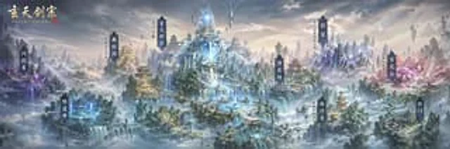

```text
A grand, ultra-wide, cinematic-quality map of a fantasy world unfolds, showcasing an incredibly detailed panorama of Chinese cultivation sects, viewed from a high vantage point above a sea of ​​clouds. The scene depicts a magnificent mountain range comprised of numerous steep, rocky islands, featuring waterfalls, mist-shrouded valleys, floating boulders, ornate bridges, and layered traditional Chinese palace architecture, all bathed in a mysterious, glowing blue energy. At the center stands the grand main sect complex, labeled "Xuantian Sword Sect," perched atop the highest, glowing peak, adorned with a crystalline glow of interwoven white and blue light, towering pagodas, terraces, and ethereal aura; a smaller label nearby reads "Sect Main Hall." Nine additional marked locations are distributed around the panorama: the far left is a purple cliff area labeled "Sword-Asking Cliff," with a smaller note below stating "Place for Disciples' Training"; the middle left is a cultivation platform island shrouded in blue mist, labeled "Enlightenment Peak," with a smaller note below stating "Place for Disciples' Enlightenment"; the upper left is a solemn complex of palaces labeled "Scripture Repository," with a smaller note below stating "Collection of Supreme Techniques"; the upper right is a jagged iceberg sword formation labeled "Sword Tomb," with a smaller note below stating "The final resting place of successive generations of sword cultivators"; the middle right is a bright ceremonial building complex labeled "Martial Arts Arena," with a smaller note below stating "Sharpening the Disciples' Character"; the lower right is the Alchemy Pavilion area labeled "Alchemy Room," with a smaller note below stating "Alchemy Therapy"; the far right is a pink flower sea valley sanctuary labeled "Hundred Flowers Valley," with a smaller note below stating "A Mystical and Beautiful Secret Realm"; the lower right is the outer building complex labeled "Outer Gate," with a smaller note below stating "New Disciples' Residence." Add an inscription in the upper left corner, reading "Xuantian Sword Sect" in large gold characters, below which is a line of smaller poetry and a red seal. Employing an elegant painterly concept art style, the design features grand proportions, highlights in pale gold and ice blue, soft volumetric mist, a dramatic sky after rain, ethereal lighting, and exquisite blend of Chinese ink painting and digital landscape aesthetics. The foreground contains no figures or modern elements, presenting only a vast, legendary sect environment; the design resembles a promotional illustration for its world-building.
```

Model: GPT Image 2
Author: GPT Image 2 Prompts

[ProjectD](https://aitoolsradar.com/en/prompts/308355cd1a8577) · [Recorded source](https://x.com/mmlong8/status/2046678667917754647#reversed-0)
 · [Full original metadata and byte evidence](data/projectd-batch-0052.json)

## Xiaohongshu cooking tutorial card


```text
Create a Xiaohongshu-style viral cooking tutorial image in a 3:4 vertical layout for homemade scallion oil noodles. Cozy home-cooking vibe, warm inviting lifestyle aesthetic, 4 to 6 step grid layout, clean spacing, realistic food photography, soft natural lighting, slight film tone, warm color grading, visible oil sheen, steam, sauce texture, and hands interacting with the food. Add small Chinese annotations such as 切葱, 熬油, 拌面, 出锅. Avoid overcrowding or excessive text.
```

Model: GPT Image 2
Author: @xiaohongshu-community

[ProjectD](https://aitoolsradar.com/en/prompts/c97c4f899369f2) · [Recorded source](https://www.xiaohongshu.com/explore/69e8eeed0000000021004a54)
 · [Full original metadata and byte evidence](data/projectd-batch-0052.json)

## Xiaomi SU7 Exploded View Chat Screenshot

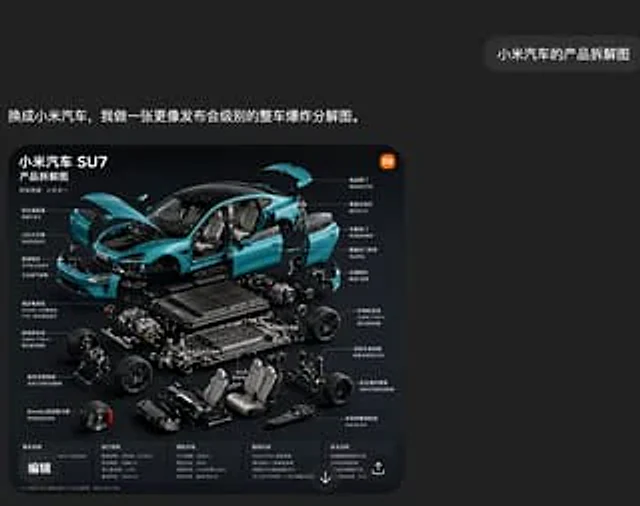

```text
A screenshot of a stylish Chinese social media interface in a deep charcoal black, featuring a minimalist yet sophisticated design. A large, rounded rectangular image card is placed in the lower left center, while a small, rounded chat bubble appears in the upper right corner. The overall canvas has ample white space, creating a clean and technologically advanced feel. In the upper left of the main area, bold white Chinese text reads: "If we were to use Xiaomi cars, I would create a more sophisticated, exploded view of the entire vehicle, more like a product launch presentation." In the upper right corner, a gray, rounded bubble contains the white Chinese text: "Xiaomi Car Product Teardown Diagram." Below is a poster-style, rounded infographic card with a glossy black background. The inside of the card is turquoise.{argument name="car model" default="Xiaomi SU7"} A stunning, exploded-down product presentation of the electric sedan is created, employing a highly stimulating 45-degree front-view perspective. The body is disassembled into multiple components, floating around the chassis. The hood is open, the trunk lid is raised, the four side doors are removed and float outwards, the front bumper and fascia are separated, the headlights are displayed independently, the interior is visible, and the main mechanical and structural modules are neatly layered and arranged below and around the body. The visual style should resemble slides from a high-end launch event: cinematic studio lighting, realistic reflections, sharp details, a dark background, subtle blue highlights, and precise technical composition. In the upper left corner of the infographic card, three lines of large white Chinese titles are placed: "Xiaomi Auto SU7," "Product Teardown Diagram," and "Technological Leap, Human-Car Unity." An orange square Xiaomi-style logo is added to the upper right corner of the card. Fourteen Chinese labels surround the car, connected by thin white lines, indicating visible components and systems. The left side features six functional labels, including the integrated closed front fascia, LED headlights, front trunk design, high-voltage battery, front motor assembly, front double wishbone suspension, and Brembo four-piston brake calipers. The right side features eight functional labels, including the power tailgate, continuous taillights, frameless doors, hidden door handles, rear motor assembly, rear motor parameters, all-aluminum chassis, five-link rear suspension, and Michelin high-performance tires. Beneath the exploded, disassembled body, the battery pack, front and rear drive units, suspension subframe, wheel assemblies, braking components, front and rear seats, center console parts, chassis skid plates, and structural floor elements are clearly displayed, all meticulously organized in an explosive, floating arrangement. At the bottom of the infographic card, a horizontal information bar is added, divided into five columns of small Chinese text, titled Vehicle Dimensions, Power Performance, Driving Range, Intelligent Driving, and Safety Structure. A bold white Chinese label "Edit" is placed in the lower left corner of the card. A circular downward arrow icon is located at the bottom center, and a share/export icon is in the lower right corner. The overall composition should look like a real screenshot from a Chinese AI chat app, showcasing automatically generated car disassembly infographics with modern UI spacing, clear typography, and a luxurious black and blue color scheme.
```

Model: GPT Image 2
Author: GPT Image 2 Prompts

[ProjectD](https://aitoolsradar.com/en/prompts/5e5b6cbad7c0d7) · [Recorded source](https://x.com/marslipu/status/2046604182359327055#reversed-0)
 · [Full original metadata and byte evidence](data/projectd-batch-0052.json)

## Xiaoshu Solar Term Infographic Poster

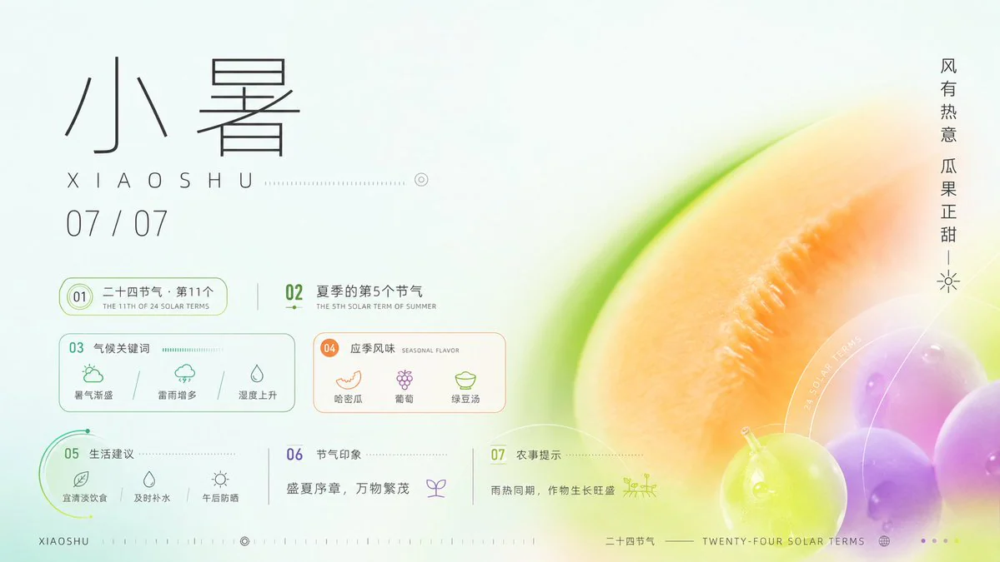

```text
Goal: Create a refined horizontal Chinese solar-term infographic poster for {argument name="solar term name" default="小暑"}, combining traditional calendar information with a fresh summer dessert and melon color palette.

Canvas: 16:9 landscape poster, pale mint-white background, airy negative space, high-end editorial infographic style. Use thin black, teal, lime, peach, orange, and violet accents. The right half is dominated by a soft-focus macro fruit composition: a large cropped cantaloupe or melon slice in warm orange with a bright green rind, plus glossy grapes in lime green and purple at the lower right, with translucent circular overlays and delicate white technical arcs.

Layout: Left side contains the typography and data cards; right side contains the fruit photograph-style illustration. Top-left: very large thin-line Chinese title “小暑”, below it spaced Romanization “XIAOSHU” with a dotted horizontal guide line and small circular target mark, then the date “07 / 07”. Far right edge: vertical Chinese slogan “风有热意 瓜果正甜” with a tiny sun icon beneath it.

Information modules: Include exactly 7 numbered infographic sections, arranged in a clean grid with fine outlines and dotted dividers. Section 01: pill-shaped green outline card reading “二十四节气 · 第11个” with smaller English subtitle “THE 11TH OF 24 SOLAR TERMS”. Section 02: text block reading “夏季的第5个节气” with English subtitle “THE 5TH SOLAR TERM OF SUMMER”. Section 03: rounded rectangle card titled “气候关键词” with exactly 3 mini icon items: “暑气渐盛” with a sun/cloud icon, “雷雨增多” with a rainy cloud icon, and “湿度上升” with a water-drop triangle icon. Section 04: rounded rectangle card titled “应季风味” with English subtitle “SEASONAL FLAVOR” and exactly 3 mini icon items: “哈密瓜” with melon icon, “葡萄” with grape icon, and “绿豆汤” with bowl icon. Section 05: green arc-accent card titled “生活建议” with exactly 3 mini icon items: “宜清淡饮食” with leaf icon, “及时补水” with water drop icon, and “午后防晒” with sun icon. Section 06: simple text area titled “节气印象” containing the quote “盛夏序章，万物繁茂” and a small sprout icon. Section 07: simple text area titled “农事提示” containing “雨热同期，作物生长旺盛” and a small field/crop icon.

Footer: Bottom-left small label “XIAOSHU” followed by tiny tick marks and a target icon. Bottom-center/right label “二十四节气” and “TWENTY-FOUR SOLAR TERMS” with a tiny globe icon and four small pagination dots. Keep all text crisp and minimal.

Visual style: Minimalist Swiss-grid layout mixed with Chinese seasonal aesthetics, thin monoline icons, translucent glassmorphism circles, delicate dotted measurement lines, soft gradients, shallow-depth-of-field fruit rendering, luminous summer freshness. Main color inspiration comes from {argument name="color inspiration" default="summer desserts and watermelon colors"}. Use realistic fruit texture but keep the infographic elements flat and precise.

Constraints: Use exactly the 7 numbered sections and exactly the item counts listed above. Keep the composition uncluttered, with generous blank space on the left and a dreamy macro fruit crop on the right. No extra logos, no watermark, no additional paragraphs of text.
```

Model: GPT Image 2
Author: 小小东

[ProjectD](https://aitoolsradar.com/en/prompts/0bc9cf554fa089) · [Recorded source](https://youmind.com/prompts/xiaoshu-solar-term-poster-27512)
 · [Full original metadata and byte evidence](data/projectd-batch-0052.json)

## Xuanwu Gate Incident Moments Post

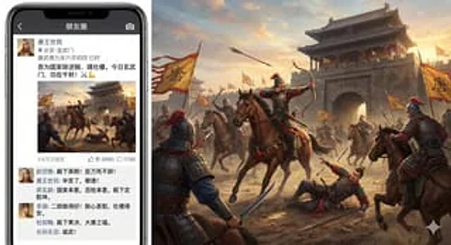

```text
A humorous and richly detailed composite image shows a modern smartphone displaying a WeChat Moments update about the Xuanwu Gate Incident on the left, and a battlefield image posted in the update on the right, extending into a grand, cinematic historical scene. The phone appears to be a black iPhone with extremely narrow bezels and a notch at the top, facing forward. On the screen, the app title bar is dark gray-black, displaying the white text "Moments," with a back arrow on the left and a camera icon on the right. Below is a source {argument name="poster name" default="Emperor Taizong of Tang"} The social media post features a square avatar of an ancient Chinese warrior in armor and a helmet. Below the name is a location icon and the text "Chang'an·Xuanwu Gate", along with a timestamp "the fourth day of the sixth month of the ninth year of Wude in the Tang Dynasty, at the hour of Si". The main text of the post reads: "I have eliminated the traitor for the country and pleaded for the state. Today at Xuanwu Gate, my merit will last for a thousand years! ⚔️💪". Below the main text is a preview of a square battlefield image that echoes the large scene on the right. Below the image is a metadata line that precisely displays three items: "38,000 views", "666 likes", and "(128)" next to the comment icon. Five comments are visible in the comment section below, each with a miniature avatar and text style that mimics the social media replies of historical figures. The commenters should include the following Chinese names: "Yuchi Gong", "Fang Xuanling", "Li Yuan", "Du Ruhui" and "Changsun Wuji", and the tone should praise the success of the action; one of the comments should imply that the emperor is shocked and the national situation is settled. On the right is{argument name="gate name" default="Xuanwu Gate"} This is an epic Tang Dynasty battlefield painting depicting the scene at sunset. The background features a massive gray stone city gate with the inscription "Xuanwu Gate." In the foreground, a mounted archer in red-tasseled helmet is drawing his bow, riding a brown horse. Seven Tang soldiers, some on horseback and others standing, are clearly visible around him, while another falls to the ground, pointing upwards. Multiple yellow battle flags bearing the large black characters for "Tang" flutter in the dust; at least four flags are visible. Arrows fly through the sky, warhorses neigh and leap, and the air is filled with dust, the warm glow of the setting sun, and the dynamic atmosphere of the battlefield. The visual style is realistic historical epic art with a painterly quality, but the overall concept possesses a comedic and anachronistic feel, presenting an ancient political upheaval as a social media feed. All visible text must be in Chinese, maintaining reasonable spacing in the mobile UI, and the mobile phone model is integrated with the extended battlefield artwork, presenting a widescreen composition.
```

Model: GPT Image 2
Author: GPT Image 2 Prompts

[ProjectD](https://aitoolsradar.com/en/prompts/fc2783844e111c) · [Recorded source](https://x.com/palwoo/status/2046577252377505901#reversed-0)
 · [Full original metadata and byte evidence](data/projectd-batch-0052.json)

## Xuanwu Gate Social Feed

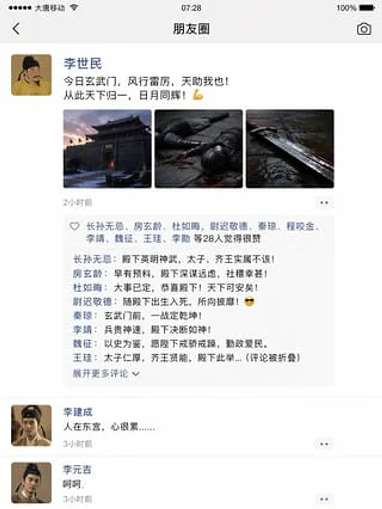

```text
玄武门之变的朋友圈
```

Model: GPT Image 2
Author: @Tz_2022

[ProjectD](https://aitoolsradar.com/en/prompts/daec19c3ddfe85) · [Recorded source](https://x.com/Tz_2022/status/2046523491940225366)
 · [Full original metadata and byte evidence](data/projectd-batch-0052.json)

## Y2K Retro-Tech Youth Portrait

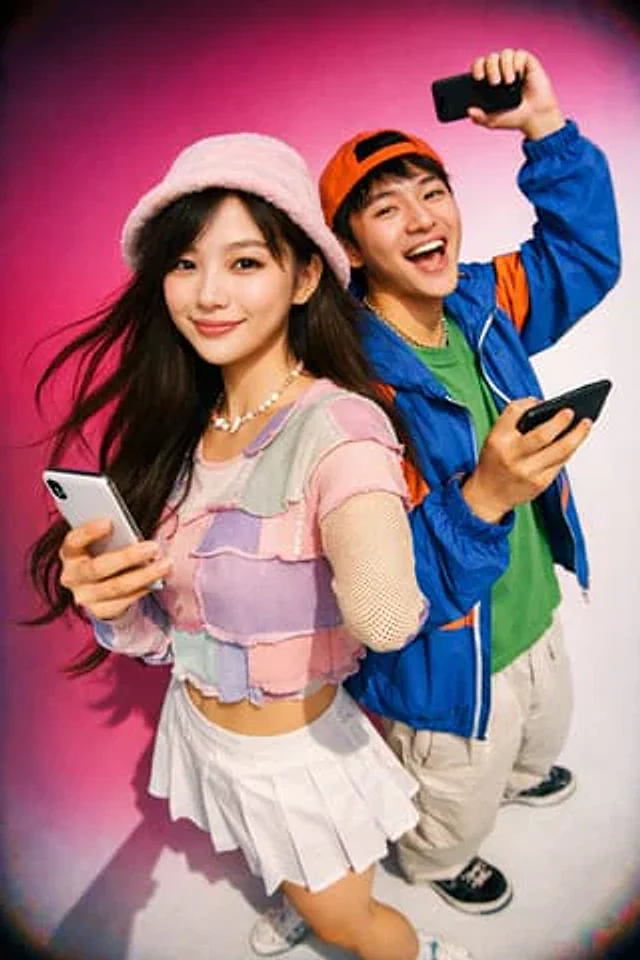

```text
A vibrant, high-contrast Y2K fashion photograph featuring two young East Asian adults. In the foreground, a young woman smiles gently at the camera, wearing a headband.{argument name="female headwear" default="Plush pink bucket hat"} She wore a light-colored patchwork cropped top, a white pleated skirt, and a beaded necklace, holding a white smartphone. Her long, dark hair flowed gently in the wind. To her right and slightly behind, a young man was laughing excitedly, his mouth slightly open, wearing a {argument name="male headwear" default="Wearing an orange baseball cap backwards"} He was wearing a green T-shirt under a bright blue windbreaker, light khaki trousers, and a silver chain. He held a black smartphone in each hand, one hand raised high. The image was brightly lit with a flash, exhibiting slight wide-angle lens distortion, and the background was {argument name="background color" default="Bright pink"} A smooth gradient transitions to white.
```

Model: GPT Image 2
Author: GPT Image 2 Prompts

[ProjectD](https://aitoolsradar.com/en/prompts/d7b89647e4a844) · [Recorded source](https://x.com/MiraiMosaic/status/2043523952778285361#reversed-3)
 · [Full original metadata and byte evidence](data/projectd-batch-0052.json)

## Y2K Teen Magazine Studio Portrait

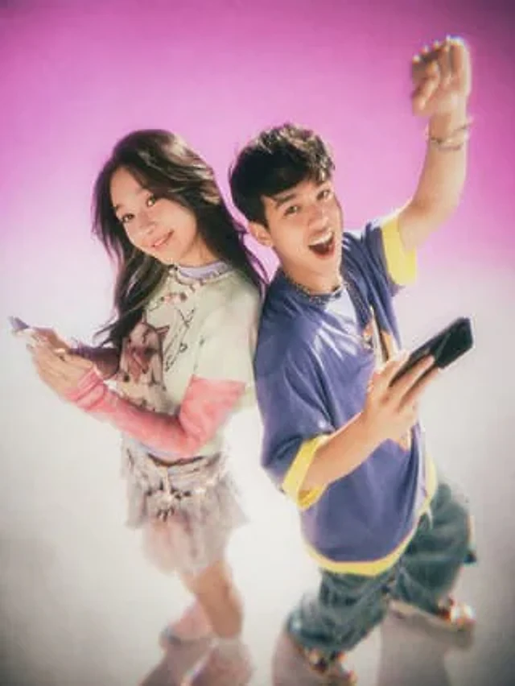

```text
A studio portrait of two young East Asian adults standing back to back, with a background of{argument name="background color" default="Gradient color from bright pink to white"} The photo presents{argument name="photography style" default="Y2K&#39;s nostalgic 90s teen magazine aesthetic features soft focus, film grain, and halo effects."} On the left is a young woman with long black hair, smiling gently at the camera. She is wearing a layered style.{argument name="woman's outfit" default="A light green printed T-shirt paired with a pink long-sleeved top, a short skirt, and platform sneakers."} He was holding a smartphone. To his right was a young man with short black hair, whose expression {argument name="man's expression" default="Excited and with his mouth agape"} One hand was clenched into a fist and raised in the air. He was wearing {argument name="man's outfit" default="A loose purple T-shirt with yellow trim, loose blue jeans, and a silver chain necklace."} He was also holding a smartphone. The shooting angle was slightly higher, looking down at the subject.
```

Model: GPT Image 2
Author: GPT Image 2 Prompts

[ProjectD](https://aitoolsradar.com/en/prompts/fc21b5425b3dd8) · [Recorded source](https://x.com/MiraiMosaic/status/2043523952778285361#reversed-1)
 · [Full original metadata and byte evidence](data/projectd-batch-0052.json)

## Y2K 金色时刻人像

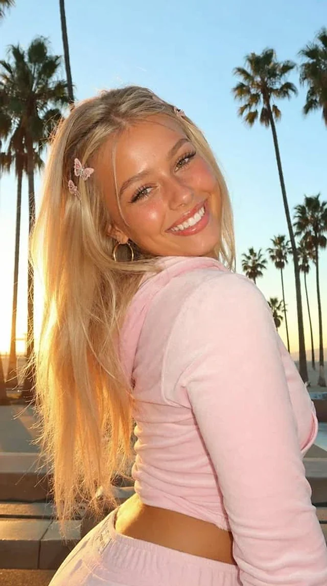

```text
candid portrait of a beautiful young blonde woman, 21 years old, glowing sun-kissed skin, wearing a baby pink velour tracksuit and butterfly clips in her hair, smiling brightly at the camera, golden hour warm light, palm trees, y2k aesthetic, glossy lips
```

Model: GPT Image 2
Author: @SiliconBarbie_

[ProjectD](https://aitoolsradar.com/en/prompts/a8a8c3b4088a45) · [Recorded source](https://x.com/SiliconBarbie_/status/2051475105403040014)
 · [Full original metadata and byte evidence](data/projectd-batch-0052.json)

## Y2K 高楼浴室镜面自拍

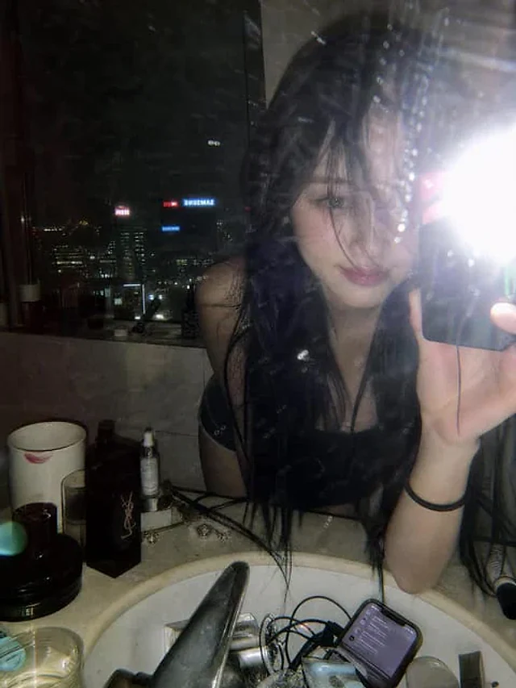

```text
A moody late-night mirror selfie captured in a luxury high-rise bathroom overlooking a glowing city skyline. A young woman with long, slightly messy black hair leans forward over a marble sink, partially obscuring one eye with loose strands. The photo is taken through a smudged mirror with visible dust particles, water spots, and imperfections, creating an authentic raw aesthetic. A powerful direct camera flash explodes in the frame, producing harsh highlights, lens flare, and a nostalgic early-2000s digital camera look.

The bathroom counter is cluttered with luxury cosmetics, skincare products, jewelry, a smartphone, and everyday personal items, adding a lived-in editorial feel. Reflections of neon-lit skyscrapers and hotel windows shimmer in the background, emphasizing an urban nightlife atmosphere. Soft pale skin tones contrast against dark clothing and black hair. The composition feels intimate, candid, and effortlessly cool.

Style: Y2K flash photography, candid mirror selfie, Korean editorial aesthetic, indie sleaze, hotel bathroom scene, luxury lifestyle, cinematic nightlife, disposable camera look, grainy texture, flash burn, realistic skin texture, shallow depth of field, authentic imperfections, viral Pinterest mood, high-fashion casual energy, raw unfiltered photography.

Camera: direct flash, compact digital camera, 35mm equivalent, harsh lighting, slight motion blur, visible noise, natural color grading, vertical composition, ultra-realistic, high detail.
```

Model: GPT Image 2
Author: @jzaib4269

[ProjectD](https://aitoolsradar.com/en/prompts/ec414173e4a24a) · [Recorded source](https://x.com/jzaib4269/status/2062184740849930384)
 · [Full original metadata and byte evidence](data/projectd-batch-0052.json)

## Yami Kawaii Idol Selfie

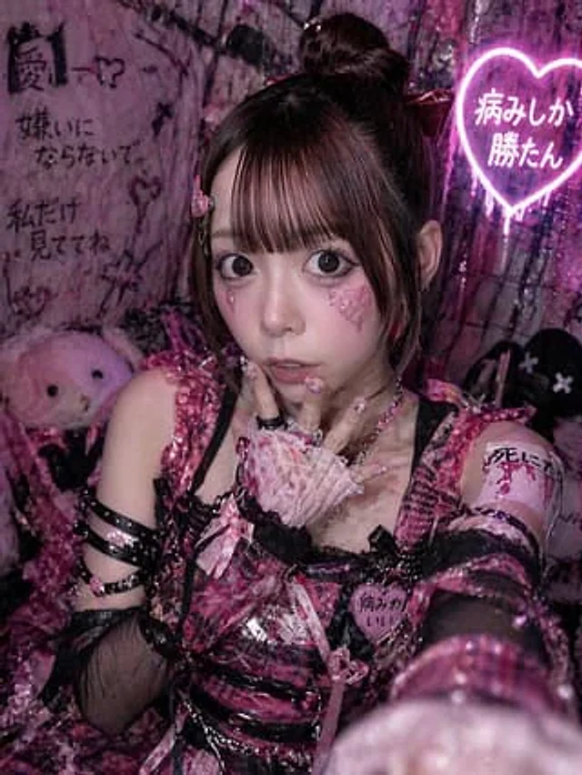

```text
One{argument name="idol theme" default="Dark, yandere, cute idol"} A vertical close-up self-portrait of a girl, set in a narrow, neon-pink room. The camera angle shows her arm outstretched towards the camera, with a shimmering sleeve and a blurred hand visible in the foreground. She wears a richly detailed black and pink plaid stage costume, adorned with glossy vinyl straps, lace trim, ribbons, buckles, and layered accessories: a sleeveless corset, black mesh split sleeves, multiple black armbands on one upper arm, a pink bow, and a heart-shaped badge on her chest inscribed with "病みかわいい" (I feel sick). Her long, dark brown hair is styled in a high bun, with long, straight strands framing her face and decorated with large bows. Her visible hand is close to her lips, striking a shy idol pose, wearing pink lace fingerless gloves with ruffles, long manicures, and chunky rings. A pink armband with handwritten Japanese characters is added to her upper arm, along with delicate earrings. Her face is obscured by a large rectangular mosaic in the center, covering most of her forehead and chin. The background is cluttered and decadent, filled with black and pink graffiti, plastic curtains, plush toys, and distressed decorations. The scene must contain four clearly visible Japanese texts: graffiti on the left reading "闇ー?", below it "嫌いにならないで", and further below that "私だけ見ててね". A glowing heart-shaped neon sign in the upper right corner reads "病みしか勝たん". Two plush toys are placed in the background: a light pink plush animal on the left and a black plush toy with X-shaped eyes on the right. The lighting is a melancholic nightclub-style magenta and violet with glossy highlights, creating a chaotic underground idol dressing room atmosphere. High detail, luxurious texture, glitter, lace, vinyl materials, a messy yet cute gothic atmosphere, high contrast, smartphone selfie composition, and a vertical screen ratio.
```

Model: GPT Image 2
Author: GPT Image 2 Prompts

[ProjectD](https://aitoolsradar.com/en/prompts/96cdbb699cd676) · [Recorded source](https://x.com/yayoi_bluebare/status/2047523370129035660#reversed-3)
 · [Full original metadata and byte evidence](data/projectd-batch-0052.json)

## Yoga Book Two-Page Spread

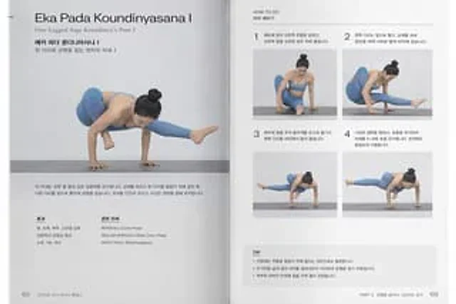

```text
{
  "type": "Two-page yoga instruction manual layout",
  "subject": "An Asian woman with her hair tied in a high bun, wearing {argument name=\"subject outfit\" default=\"Blue sports bra and matching leggings\"}",
  "layout": {
    "left_page": {
      "header": {
        "title_english": "{argument name=\"pose name english\" default=\"Eka Pada Koundinyasana I\"}",
        "subtitle_english": "One-Legged Sage Koundinya's Pose I",
        "title_korean": "{argument name=\"pose name korean\" default=\"에카 파다 콘디니아사나 I\"}",
        "subtitle_korean": "한 다리로 균형을 잡는 현자의 자세 I"
      },
      "main_image": "A large photograph of a subject performing a full arm balance pose on a gray yoga mat.",
      "description": "A Korean text explaining the pose",
      "bottom_columns": [
        {
          "title": "effect",
          "count": 3,
          "description": "List of health benefits"
        },
        {
          "title": "Ready position",
          "count": 3,
          "description": "List of preparatory actions"
        }
      ],
      "footer": "No.{argument name=\"page number left\" default=\"102\"} Page and chapter titles"
    },
    "right_page": {
      "header": "HOW TO DO / Action Guide",
      "steps_grid": {
        "count": 4,
        "description": "A step-by-step guide from 1 to 4, including Korean instructions and advanced photos.",
        "images": [
          "Step 1: Sit down and prepare your arms and legs.",
          "Step 2: Lean forward and place your hands on the mat.",
          "Step 3: Lift off the ground",
          "Step 4: Complete the balance posture"
        ]
      },
      "tip_box": {
        "title": "hint",
        "count": 3,
        "description": "List of key points in Korean within the shaded box"
      },
      "footer": "Chapter titles and numbers{argument name=\"page number right\" default=\"103\"} Page"
    }
  }
}
```

Model: GPT Image 2
Author: GPT Image 2 Prompts

[ProjectD](https://aitoolsradar.com/en/prompts/d7ce12bb98715a) · [Recorded source](https://x.com/opener_ai/status/2044574291212263706#reversed-3)
 · [Full original metadata and byte evidence](data/projectd-batch-0052.json)

## YouTube 2030 Interface


```text
{argument name="year" default="2030"} Year{argument name="platform" default="YouTube"} Homepage screenshot
```

Model: GPT Image 2
Author: GPT Image 2 Prompts

[ProjectD](https://aitoolsradar.com/en/prompts/3b71d5193444ae) · [Recorded source](https://x.com/patrickassale/status/2044694786146226414)
 · [Full original metadata and byte evidence](data/projectd-batch-0052.json)

## YouTube Dark Mode Desktop UI Mockup


```text
{
  "type": "Desktop web browser UI screenshots",
  "environment": "{argument name=\"os environment\" default=\"Windows 11 desktop\"}",
  "theme": "{argument name=\"ui theme\" default=\"Dark mode\"}",
  "browser_window": {
    "tabs": [
      "YouTube",
      "New tab"
    ],
    "url_bar": "youtube.com",
    "profile_icon": "{argument name=\"profile initial\" default=\"M\"}"
  },
  "app_interface": {
    "header": {
      "logo": "{argument name=\"website name\" default=\"YouTube\"} GB",
      "search_bar": "search",
      "icons": [
        "microphone",
        "create",
        "notify",
        "Personal information"
      ]
    },
    "filter_bar": {
      "active_filter": "{argument name=\"active filter\" default=\"all\"}",
      "count": 11,
      "labels": [
        "all",
        "game",
        "music",
        "live streaming",
        "podcast",
        "compilation",
        "science",
        "Lo-fi",
        "Thriller",
        "Latest Upload",
        "Viewed"
      ]
    },
    "sidebar": {
      "sections": [
        {
          "title": "main",
          "count": 3,
          "labels": [
            "front page",
            "Shorts",
            "Subscription content"
          ]
        },
        {
          "title": "I",
          "count": 6,
          "labels": [
            "Your channel",
            "Historical records",
            "Playlist",
            "Your video",
            "Watch later",
            "Liked Videos"
          ]
        },
        {
          "title": "Subscription content",
          "count": 8,
          "labels": [
            "Linus Tech Tips",
            "MrBeast",
            "Kurzgesagt - In a Nutshell",
            "ColdFusion",
            "3Blue1Brown",
            "Khan Academy",
            "Veritasium",
            "Show more"
          ]
        },
        {
          "title": "explore",
          "count": 7,
          "labels": [
            "Popular",
            "music",
            "Movie",
            "live streaming",
            "game",
            "news",
            "physical education"
          ]
        },
        {
          "title": "More YouTube services",
          "count": 3,
          "labels": [
            "YouTube Premium",
            "YouTube Music",
            "YouTube Kids"
          ]
        }
      ]
    },
    "main_content": {
      "layout": "3 columns and 4 rows grid",
      "count": 12,
      "video_cards": [
        {
          "title": "Why building your own GPU is almost impossible",
          "channel": "Linus Tech Tips",
          "stats": "164,000 views • 1 day ago",
          "thumbnail": "CPU/GPU chips"
        },
        {
          "title": "Survive in the circle for 100 days and win $500,000.",
          "channel": "MrBeast",
          "stats": "40 million views • 5 days ago",
          "thumbnail": "Mr. Beast, dressed in a blue tracksuit, and the crowd."
        },
        {
          "title": "What would happen if we destroyed an asteroid with a nuclear bomb?",
          "channel": "Kurzgesagt - In a Nutshell",
          "stats": "4.2 million views • 6 hours ago",
          "thumbnail": "Missile hits asteroid in space"
        },
        {
          "title": "How Dubai Became a $10 Billion City",
          "channel": "ColdFusion",
          "stats": "1.6 million views • 2 weeks ago",
          "thumbnail": "Man with Dubai skyline"
        },
        {
          "title": "The beautiful mathematics of Euler's identity",
          "channel": "3Blue1Brown",
          "stats": "2.8 million views • 3 months ago",
          "thumbnail": "Mathematical formulas and spiral diagrams"
        },
        {
          "title": "The World in 2040 - Population, Climate, and More",
          "channel": "Veritasium",
          "stats": "7.7 million views • 2 weeks ago",
          "thumbnail": "Aerial view of dense forest"
        },
        {
          "title": "I've used Linux for 12 years, and finally...",
          "channel": "DistroTube",
          "stats": "160,000 views • 3 days ago",
          "thumbnail": "Laptops and smartphones with the Linux logo"
        },
        {
          "title": "Black Holes Explained - From Birth to Death",
          "channel": "Khan Academy",
          "stats": "3.9 million views • 3 months ago",
          "thumbnail": "Glowing black hole accretion disk"
        },
        {
          "title": "The problem with dietary recommendations",
          "channel": "Andrew Huberman",
          "stats": "4.4 million views • 6 days ago",
          "thumbnail": "The man who spoke while wearing glasses"
        },
        {
          "title": "How to learn anything (based on evidence)",
          "channel": "Ali Abdaal",
          "stats": "2.7 million views • 3 months ago",
          "thumbnail": "Vector illustration of a man reading a book"
        },
        {
          "title": "The Last of Us Part II is a masterpiece.",
          "channel": "Naughty Dog",
          "stats": "2.3 million views • 3 years ago",
          "thumbnail": "Ellie from The Last of Us"
        },
        {
          "title": "Lofi hip hop radio - beats perfect for relaxation/study.",
          "channel": "Lofi Girl",
          "stats": "During the live stream",
          "thumbnail": "Lofi Girl studying at her desk"
        }
      ]
    }
  },
  "taskbar": {
    "os": "Windows",
    "icons": [
      "start",
      "search",
      "Task View",
      "File Explorer",
      "Edge",
      "Spotify"
    ],
    "system_tray": "08:34 April 3, 2024"
  }
}
```

Model: GPT Image 2
Author: GPT Image 2 Prompts

[ProjectD](https://aitoolsradar.com/en/prompts/62b7fb8a1e644d) · [Recorded source](https://x.com/ivangdavila/status/2044061942025724144#reversed-0)
 · [Full original metadata and byte evidence](data/projectd-batch-0052.json)

## YouTube Dark Mode Desktop UI Mockup


```text
{
  "type": "Desktop UI Prototype",
  "application": "YouTube Homepage",
  "theme": "{argument name=\"theme\" default=\"Dark mode\"}",
  "browser_window": {
    "url_bar": "{argument name=\"browser URL\" default=\"youtube.com\"}",
    "tabs": 1,
    "elements": [
      "Back/Forward button",
      "refresh",
      "extensions",
      "Profile picture"
    ]
  },
  "layout": {
    "sidebar": {
      "position": "Left side",
      "sections": [
        {
          "title": "Homepage",
          "count": 3,
          "items": [
            "front page",
            "Shorts",
            "Subscription content"
          ]
        },
        {
          "title": "I",
          "count": 6,
          "items": [
            "Your channel",
            "Historical records",
            "Playlist",
            "Your video",
            "Watch later",
            "Liked Videos"
          ]
        },
        {
          "title": "Subscription content",
          "count": 8,
          "items": [
            "Linus Tech Tips",
            "MrBeast",
            "Kurzgesagt - In a...",
            "ColdFusion",
            "3Blue1Brown",
            "Khan Academy",
            "Veritasium",
            "Show more"
          ]
        },
        {
          "title": "explore",
          "count": 7,
          "items": [
            "Popular",
            "music",
            "Movie",
            "live streaming",
            "game",
            "news",
            "physical education"
          ]
        },
        {
          "title": "More YouTube services",
          "count": 3,
          "items": [
            "YouTube Premium",
            "YouTube Music",
            "YouTube Kids"
          ]
        }
      ]
    },
    "top_filter_bar": {
      "count": 11,
      "labels": [
        "all",
        "game",
        "music",
        "live streaming",
        "podcast",
        "compilation",
        "science",
        "Lo-fi",
        "Thriller",
        "Latest Upload",
        "Viewed"
      ]
    },
    "video_grid": {
      "layout": "4 rows and 3 columns",
      "count": 12,
      "videos": [
        {
          "title": "Why building your own GPU is almost impossible",
          "channel": "Linus Tech Tips",
          "thumbnail": "GPU chip with red arrow"
        },
        {
          "title": "Survive in the circle for 100 days and win $500,000.",
          "channel": "MrBeast",
          "thumbnail": "MrBeast is smiling, with contestants in the background."
        },
        {
          "title": "What would happen if we destroyed an asteroid with a nuclear bomb?",
          "channel": "Kurzgesagt - In a Nutshell",
          "thumbnail": "Missile approaches asteroid in space"
        },
        {
          "title": "How Dubai Became a $10 Billion City",
          "channel": "ColdFusion",
          "thumbnail": "A man stands beside the Dubai skyline with the text '$0 TO $10B' displayed."
        },
        {
          "title": "The Mathematical Beauty of Euler's Identity",
          "channel": "3Blue1Brown",
          "thumbnail": "Mathematical formulas and spirals on a black background"
        },
        {
          "title": "The World in 2040 - Population, Climate, and More",
          "channel": "Veritasium",
          "thumbnail": "A lush forest with the text 'The World in 2040'"
        },
        {
          "title": "After using Linux for 12 years, finally...",
          "channel": "DistroTube",
          "thumbnail": "Laptop and smartphone connected by a blue arrow."
        },
        {
          "title": "Black Holes Explained - From Birth to Death",
          "channel": "Khan Academy",
          "thumbnail": "The glowing orange accretion disk of the black hole"
        },
        {
          "title": "Dietary recommendations",
          "channel": "Andrew Huberman",
          "thumbnail": "A man wearing a black shirt; the text reads 'the problem with diet advice'."
        },
        {
          "title": "How to learn anything (based on evidence)",
          "channel": "Ali Abdaal",
          "thumbnail": "Flat illustration: A man reading a book, surrounded by colorful leaves."
        },
        {
          "title": "The Last of Us Part II is a masterpiece.",
          "channel": "Naughty Dog",
          "thumbnail": "Ellie's resolute portrait, featuring the game logo."
        },
        {
          "title": "Lofi hip hop radio - beats perfect for relaxation/study.",
          "channel": "Lofi Girl",
          "thumbnail": "An anime girl is studying at her desk, with the city skyline at sunset visible through the window."
        }
      ]
    }
  },
  "os_environment": {
    "os": "{argument name=\"operating system\" default=\"Windows 10\"}",
    "taskbar_position": "bottom",
    "visible_icons": [
      "start",
      "Search bar",
      "Task View",
      "File Explorer",
      "Edge",
      "Spotify"
    ],
    "system_tray": [
      "network",
      "volume",
      "Battery",
      "A clock displaying the time 08:34 on April 3, 2024."
    ]
  }
}
```

Model: GPT Image 2
Author: GPT Image 2 Prompts

[ProjectD](https://aitoolsradar.com/en/prompts/7bb96da67844e9) · [Recorded source](https://x.com/SuguruKun_ai/status/2044453450235420988#reversed-0)
 · [Full original metadata and byte evidence](data/projectd-batch-0052.json)

## YouTube Gaming Stream Despair Scene

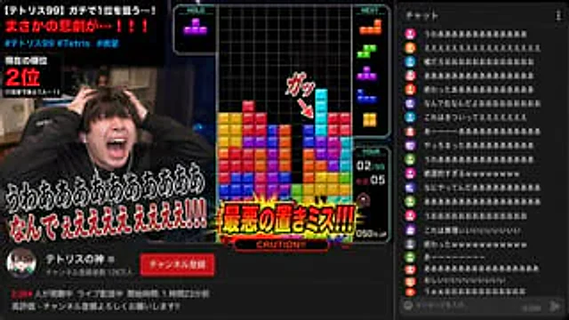

```text
A popular Japanese YouTuber{argument name="content" default="Game streaming"} Scene. In{argument name="game name" default="Tetris"} In the video, the long bar seemed poised to eliminate all the blocks, but its placement was slightly off. The streamer screamed in despair, his face contorted in disbelief, and the comment section descended into chaos. (Japanese)
```

Model: GPT Image 2
Author: GPT Image 2 Prompts

[ProjectD](https://aitoolsradar.com/en/prompts/83b8d880606421) · [Recorded source](https://x.com/Masimo_Blue/status/2046603586038333595)
 · [Full original metadata and byte evidence](data/projectd-batch-0052.json)

## YouTube Live Presentation UI Mockup


```text
{
  "type": "YouTube desktop dark mode UI mockup",
  "header": {
    "logo": "YouTube",
    "search_bar": "search",
    "icons_count": 5,
    "icons": [
      "search",
      "microphone",
      "create",
      "notify",
      "Personal information"
    ]
  },
  "video_player": {
    "top_left_badge": "live streaming",
    "left_side": {
      "subject": "{argument name=\"presenter description\" default=\"A man wearing a green sweater standing on a wooden podium\"}",
      "podium_logo": "OpenAI"
    },
    "right_side_presentation": {
      "text_elements": [
        "OpenAI",
        "Introduced with great fanfare",
        "{argument name=\"product name\" default=\"GPT-Image-2\"}",
        "{argument name=\"tagline\" default=\"More realistic. More practical. More creative.\"}"
      ],
      "sample_images_count": 4,
      "sample_images": [
        "Mountain lakes with boats",
        "A female portrait with dappled light and shadow",
        "A cute robot carrying a lantern in the forest",
        "Starry Night Cafe paintings"
      ]
    },
    "bottom_controls_count": 10,
    "bottom_controls": [
      "pause",
      "Next",
      "volume",
      "live streaming",
      "Red progress bar",
      "subtitle",
      "set up",
      "Mini Player",
      "Cinema mode",
      "full screen"
    ]
  },
  "video_details": {
    "title": "{argument name=\"video title\" default=\"OpenAI Live Stream: GPT-Image-2 Officially Launched\"}",
    "channel": {
      "name": "{argument name=\"channel name\" default=\"OpenAI\"}",
      "verified": true,
      "subscribers": "1.36 million",
      "button": "subscription"
    },
    "action_buttons_count": 5,
    "action_buttons": [
      "Likes 12,000",
      "I don't like 497",
      "share",
      "keep",
      "More"
    ],
    "description_box": {
      "stats": "95,237 people are currently watching; the live stream started 7 minutes ago.",
      "tags": "#OpenAI #GPTImage2 #AI",
      "text": "Welcome to our special live stream event where we'll be introducing GPT-Image-2, our latest and most advanced image generation model. Watch new feature demos, live demonstrations, and hear from the team… and more."
    }
  }
}
```

Model: GPT Image 2
Author: GPT Image 2 Prompts

[ProjectD](https://aitoolsradar.com/en/prompts/cb04af27e78478) · [Recorded source](https://x.com/tehno_maniak/status/2044754985183785208#reversed-1)
 · [Full original metadata and byte evidence](data/projectd-batch-0052.json)

## YouTube Live Stream Announcement Mockup


```text
{
  "type": "YouTube live streaming interface demo",
  "theme": "Dark mode",
  "layout": {
    "top_bar": {
      "components": [
        "Hamburger menu",
        "YouTube logo",
        "Search bar",
        "microphone icon",
        "Create icon",
        "Notification icon",
        "Personal profile picture"
      ]
    },
    "video_player": {
      "status": "The LIVE logo is displayed in the top left corner.",
      "left_side": "One{argument name=\"presenter description\" default=\"The man wearing a green sweater\"} Standing in front of a wooden lectern with a spiral logo, they are communicating with gestures, and a laptop is placed on the lectern.",
      "right_side_presentation": {
        "text_elements": [
          "OpenAI",
          "Introduced with great fanfare",
          "{argument name=\"product name\" default=\"GPT-Image-2\"}",
          "{argument name=\"tagline\" default=\"More realistic, more practical, and more creative.\"}"
        ],
        "image_gallery": {
          "count": 4,
          "panels": [
            "Mountain lakes with small boats",
            "A close-up portrait of a woman with dappled light and shadow",
            "A cute robot carrying a lantern in the dark forest.",
            "Impressionist paintings of city streets illuminated at night"
          ]
        }
      },
      "bottom_controls": {
        "components": [
          "Play/Pause",
          "Next",
          "volume",
          "LIVE Text",
          "Red progress bar",
          "CC",
          "Set gears",
          "Mini Player",
          "Cinema mode",
          "full screen"
        ]
      }
    },
    "video_info": {
      "title": "{argument name=\"video title\" default=\"OpenAI Live Stream: GPT-Image-2 Officially Launched\"}",
      "channel_section": {
        "name": "{argument name=\"channel name\" default=\"OpenAI\"}",
        "badge": "Authentication checkmark",
        "subscribers": "1.36 million subscribers",
        "button": "Subscribe (white capsule button)"
      },
      "action_buttons": {
        "count": 5,
        "labels": [
          "Likes (12,000)",
          "Dislike (497)",
          "share",
          "keep",
          "..."
        ]
      },
      "description_box": {
        "metadata": "95,237 people are currently watching; the live stream started 7 minutes ago.",
        "hashtags": "#OpenAI #GPTImage2 #AI",
        "body_text": "Welcome to our special live stream event where we'll be showcasing OpenAI's latest and most advanced image generation model, GPT-Image-2. Learn about new features, watch a live demo, and hear from the team…and more."
      }
    }
  }
}
```

Model: GPT Image 2
Author: GPT Image 2 Prompts

[ProjectD](https://aitoolsradar.com/en/prompts/f712ff0701e250) · [Recorded source](https://x.com/BubbleBrain/status/2044686510428221683#reversed-0)
 · [Full original metadata and byte evidence](data/projectd-batch-0052.json)

## YouTube Live Stream Announcement Mockup

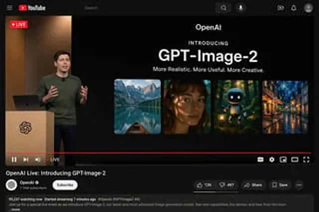

```text
{"type": "YouTube Live Stream UI mockup", "theme": "dark mode", "layout": {"top_bar": {"components": ["hamburger menu", "YouTube logo", "search bar", "microphone icon", "create icon", "notifications icon", "profile avatar"]}, "video_player": {"status": "LIVE badge in top left", "left_side": "A {argument name=\"presenter description\" default=\"man in a green sweater\"} standing at a wooden podium with a spiral logo, gesturing with hands, laptop on podium.", "right_side_presentation": {"text_elements": ["OpenAI", "INTRODUCING", "{argument name=\"product name\" default=\"GPT-Image-2\"}", "{argument name=\"tagline\" default=\"More Realistic. More Useful. More Creative.\"}"], "image_gallery": {"count": 4, "panels": ["mountain lake with a boat", "close-up portrait of a woman with dappled lighting", "cute robot holding a lantern in a dark forest", "impressionist painting of a glowing city street at night"]}}, "bottom_controls": {"components": ["play/pause", "next", "volume", "LIVE text", "red progress bar", "CC", "settings gear", "miniplayer", "theater mode", "fullscreen"]}}, "video_info": {"title": "{argument name=\"video title\" default=\"OpenAI Live: Introducing GPT-Image-2\"}", "channel_section": {"name": "{argument name=\"channel name\" default=\"OpenAI\"}", "badge": "verified checkmark", "subscribers": "1.36M subscribers", "button": "Subscribe (white pill button)"}, "action_buttons": {"count": 5, "labels": ["Like (12K)", "Dislike (497)", "Share", "Save", "..."]}, "description_box": {"metadata": "95,237 watching now, Started streaming 7 minutes ago", "hashtags": "#OpenAI #GPTImage2 #AI", "body_text": "Join us for a special live event as we introduce GPT-Image-2, our latest and most advanced image generation model. See new capabilities, live demos, and hear from the team ...more"}}}}
```

Model: GPT Image 2
Author: BubbleBrain

[ProjectD](https://aitoolsradar.com/en/prompts/7f8ddcf4907f36) · [Recorded source](https://youmind.com/prompts/youtube-live-announcement-mockup-13767)
 · [Full original metadata and byte evidence](data/projectd-batch-0052.json)

## YouTube Livestream Interface Mockup


```text
{
  "type": "YouTube Live UI",
  "top_nav": {
    "logo": "YouTube Premium",
    "search": "{argument name=\"search query\" default=\"bilal fraiha\"}",
    "icons": 3
  },
  "player": {
    "subjects": [
      "{argument name=\"female guest\" default=\"Sydney Sweeney\"} Wearing a white cardigan",
      "A bearded man wearing a beige jacket is laughing."
    ],
    "bg": "Sofa, two silver play buttons, and the 'SARDI' ram logo.",
    "overlays": {
      "chat": {
        "pos": "Left side",
        "count": 15,
        "desc": "Colored usernames, white text"
      },
      "goal": {
        "pos": "Top right corner",
        "text": "Tonight's goal: 0 to 25"
      },
      "banner": {
        "pos": "Bottom Center",
        "text": "K {argument name=\"streamer name\" default=\"MOREBILAL\"}"
      }
    },
    "controls": {
      "count": 10
    }
  },
  "details": {
    "title": "{argument name=\"video title\" default=\"FULL STREAM | سيدني سويني مع بلال\"}",
    "channel": "{argument name=\"channel name\" default=\"More Bilal No Filter\"}",
    "buttons": 5
  }
}
```

Model: GPT Image 2
Author: GPT Image 2 Prompts

[ProjectD](https://aitoolsradar.com/en/prompts/e0effba1d651a7) · [Recorded source](https://x.com/marouane53/status/2044946192203923493#reversed-0)
 · [Full original metadata and byte evidence](data/projectd-batch-0052.json)

## YouTube Livestream Interface Mockup

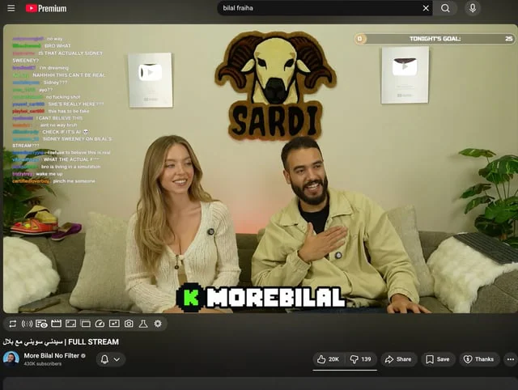

```text
{
  "type": "YouTube livestream UI",
  "top_nav": {
    "logo": "YouTube Premium",
    "search": "{argument name=\"search query\" default=\"bilal fraiha\"}",
    "icons": 3
  },
  "player": {
    "subjects": [
      "{argument name=\"female guest\" default=\"Sydney Sweeney\"} in white cardigan",
      "bearded man in beige jacket laughing"
    ],
    "bg": "couch, 2 silver play buttons, ram logo 'SARDI'",
    "overlays": {
      "chat": {"pos": "left", "count": 15, "desc": "colored usernames, white text"},
      "goal": {"pos": "top right", "text": "TONIGHT'S GOAL: 0 to 25"},
      "banner": {"pos": "bottom center", "text": "K {argument name=\"streamer name\" default=\"MOREBILAL\"}"}
    },
    "controls": {"count": 10}
  },
  "details": {
    "title": "{argument name=\"video title\" default=\"FULL STREAM | سيدني سويني مع بلال\"}",
    "channel": "{argument name=\"channel name\" default=\"More Bilal No Filter\"}",
    "buttons": 5
  }
}
```

Model: GPT Image 2
Author: Marouane Lamharzi Alaoui

[ProjectD](https://aitoolsradar.com/en/prompts/4cf5ba2de11731) · [Recorded source](https://youmind.com/prompts/youtube-livestream-mockup-13963)
 · [Full original metadata and byte evidence](data/projectd-batch-0052.json)

## YouTube Unboxing Thumbnail Prompt

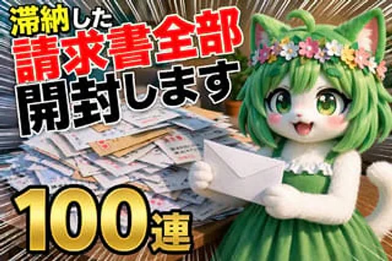

```text
Thumbnail of a YouTube unboxing video; the video's theme is {argument name="topic" default="Open all overdue bills"} ,{argument name="quantity" default="100 consecutive copies"}
```

Model: GPT Image 2
Author: GPT Image 2 Prompts

[ProjectD](https://aitoolsradar.com/en/prompts/d2d1e3415e7618) · [Recorded source](https://x.com/TlanoAI/status/2044604299339247730)
 · [Full original metadata and byte evidence](data/projectd-batch-0052.json)

## YouTube Video Interface Mockup

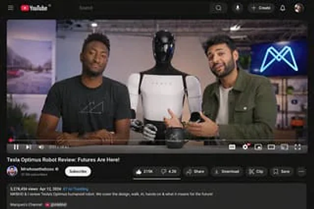

```text
{
  "type": "Desktop video platform UI model",
  "theme": "Dark mode",
  "header": {
    "logo": "YouTube IN",
    "search_bar": "Centered, with a magnifying glass icon",
    "right_icons": {
      "count": 4,
      "items": [
        "microphone",
        "+ Create Button",
        "Notification bell",
        "User Avatar"
      ]
    }
  },
  "video_player": {
    "scene": "In the studio setting, two tech bloggers sit at a table.",
    "subjects": [
      "{argument name=\"left person\" default=\"Marques Brownlee (MKBHD)\"} Wearing a black T-shirt",
      "{argument name=\"right person\" default=\"Arun Maini (Mrwhosetheboss)\"} Wearing a green shirt",
      "{argument name=\"robot model\" default=\"Tesla Optimus humanoid robot\"} Standing among them"
    ],
    "props": [
      "Black mug with logo",
      "Background screen with glowing blue neon M logo"
    ],
    "controls_bar": {
      "progress_bar": "Red, near the starting position",
      "timestamp": "0:01 / 18:47",
      "left_icons": {
        "count": 3,
        "items": [
          "Play/Pause",
          "Next song",
          "volume"
        ]
      },
      "right_icons": {
        "count": 6,
        "items": [
          "CC Subtitles",
          "Setting with 4K logo",
          "Mini Player",
          "Cinema mode",
          "Screen mirroring",
          "full screen"
        ]
      }
    }
  },
  "video_details": {
    "title": "{argument name=\"video title\" default=\"Tesla Optimus Robot Review: The Future is Here!\"}",
    "channel_info": {
      "name": "{argument name=\"channel name\" default=\"Mrwhosetheboss\"}",
      "badges": [
        "Authentication check mark"
      ],
      "subscribers": "20.5 million subscribers",
      "button": "White subscription button"
    },
    "action_buttons": {
      "count": 6,
      "items": [
        "Likes (215,000) / Dislikes (4,200) Capsule Button",
        "share",
        "download",
        "Editing",
        "keep",
        "More(...)"
      ]
    }
  },
  "description_box": {
    "metadata": "3,278,456 views. Ranked #7 in the trending topics on April 12, 2024.",
    "text": "MKBHD and I reviewed Tesla's Optimus humanoid robot. We covered its design, mobility, AI, real-world testing, and its implications for the future!",
    "links": [
      "Marques's channel: @mkbhd"
    ]
  }
}
```

Model: GPT Image 2
Author: GPT Image 2 Prompts

[ProjectD](https://aitoolsradar.com/en/prompts/001a8d8c3fc80f) · [Recorded source](https://x.com/tehno_maniak/status/2044754985183785208#reversed-0)
 · [Full original metadata and byte evidence](data/projectd-batch-0052.json)

## Yuzu Sparkling Water Advertisement


```text
{
  "type": "Commercial beverage advertising posters",
  "visuals": {
    "model": "A young Asian woman, eyes closed, face slightly tilted back, expression refreshed, wet hair, water droplets on her skin, wearing a semi-transparent white top.",
    "product": "One white-yellow aluminum can with condensation, labeled '{argument name=\"product name\" default=\"YUZU SPARK\"} ' and'{argument name=\"brand name\" default=\"KIRARA\"} ', printed with a pomelo illustration",
    "props": "Two whole yellow grapefruits with green leaves, floating water droplets",
    "background": "Clear blue sky, bright sunshine"
  },
  "layout": {
    "top_left": "'with sun rays icon'{argument name=\"brand name\" default=\"KIRARA\"} 'logo'",
    "left_column": [
      "Large vertical text:'{argument name=\"main catchphrase\" default=\"A new me, scented with yuzu.\"} '",
      "With bright yellow vertical lettering: 'A gentle reward for your hard work every day.'",
      "Yellow cursive text: 'Refresh!'"
    ],
    "right_column": [
      "White handwritten text: '{argument name=\"handwritten text\" default=\"A single swirl that will untie me.\"} '",
      "Yellow circular badge: 'NEW'"
    ],
    "bottom_left": [
      "Yellow circular badge:{argument name=\"flavor profile\" default=\"3% domestically produced yuzu juice\"} '",
      "Small print: 'Clean and light. A moment of gentle sweetness as a reward.'",
      "Minor disclaimer: *Image is for illustrative purposes only."
    ],
    "footer": "yellow width, inclusion'{argument name=\"product name\" default=\"YUZU SPARK\"} ', 标语 'A gentle burst of yuzu's light carbonation.' 以及角框文字 'Limited quantity on sale now'"
  }
}
```

Model: GPT Image 2
Author: GPT Image 2 Prompts

[ProjectD](https://aitoolsradar.com/en/prompts/86d47ccbe0d5b7) · [Recorded source](https://x.com/ezamaru025h/status/2045529924128354480#reversed-0)
 · [Full original metadata and byte evidence](data/projectd-batch-0052.json)

## Zar⭕on #38

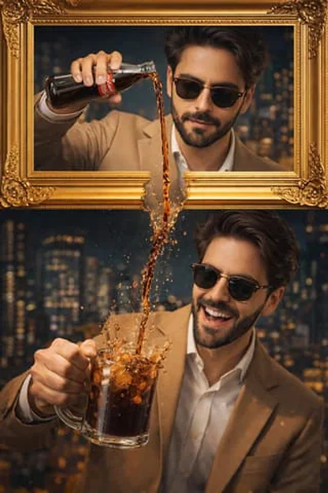

```text
A stylish man wearing a tan suit and sunglasses is featured in a creative split image, framed by two ornate gold frames. In the top frame, he is pouring Coca-Cola from a bottle. The cola streams downward, passing through the gap between the frames. In the bottom frame, the same man, also in a tan suit and sunglasses, is shown with a joyful expression as the stream of cola splashes into a glass mug he is holding, creating a dynamic splash.The background behind the frames is a softly blurred night cityscape with tall buildings and lights, suggesting.
```

Model: GPT Image 2
Author: Zar⭕on

[ProjectD](https://aitoolsradar.com/en/prompts/d2a854f1e9ecec) · [Recorded source](https://x.com/Xaroonx/status/2005541752187273292)
 · [Full original metadata and byte evidence](data/projectd-batch-0052.json)

## Zelda Map in Minecraft Style

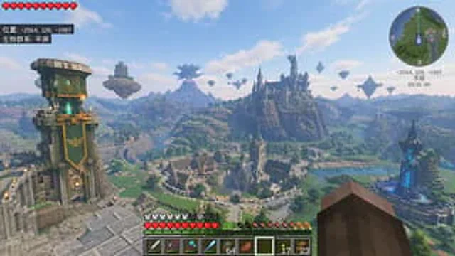

```text
Generate a{argument name="base style" default="Minecraft"} The game screenshots, in a style that builds the world into{argument name="map theme" default="The Legend of Zelda: Tears of the Kingdom"} The map scene.
```

Model: GPT Image 2
Author: GPT Image 2 Prompts

[ProjectD](https://aitoolsradar.com/en/prompts/9167d45f246e9e) · [Recorded source](https://x.com/jinchenma_ai/status/2046611456846950813)
 · [Full original metadata and byte evidence](data/projectd-batch-0052.json)

## Zombie Survival RPG Anime Ad Poster

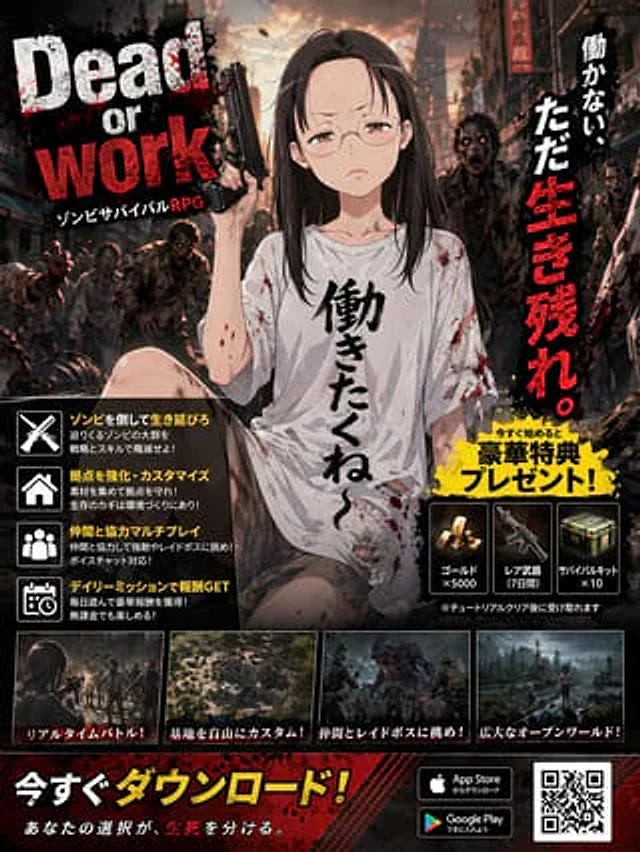

```text
Create a dramatic Japanese-style zombie survival RPG mobile game advertisement poster, employing a style that blends anime and cinematic elements. The poster features a vertical smartphone poster layout with high-density advertising design. The background is a brutal post-apocalyptic city at dusk, including abandoned streets, smoke, sparks, debris, damaged buildings, neon lights, and a horde of zombies approaching from behind. In the center of the image, a young anime woman sits on the ground in a slightly languid posture, her legs bent, one hand gripping a black pistol vertically. She has shoulder-length, straight, dark brown to black hair, pale skin, and wears an oversized, dirty white T-shirt stained with blood. The T-shirt features the striking Japanese calligraphy "働きたくね〜" vertically printed on it. Her facial expression area is handled simply and unobtrusively to ensure the composition focuses on the T-shirt, weapon, and atmosphere. Around her, several zombies in tattered clothing reach out from the background on the left and right, grabbing forward. The game's main visual design is impactful, comprising eight clearly defined advertising areas. Area 1: The top left corner game logo area contains three text elements: a large, distressed English title "Dead or work," a smaller Japanese subtitle "Zonbi Sabair RPG," and a heavy black splatter background with white and red text. Area 2: The right-side vertical slogan area contains two text elements: on a rough black stroke bar, the upper text is white Japanese "動かない、ただ," and the lower text is large red vertical text "生き残れ." (Life is shattered). Area 3: Function list panel in the middle left, including 4 Line function, each line has a white icon inside a black square and yellow/white Japanese copy; the labels are "ゾンビを下して生き Yan" "びろ", "拠PointをStrengthening・カスタマイズ", "Nakama's collaborative effort" and "デイリーミッションでReward GET". Area 4: Bonus activity panel in the middle right, containing 1 title and 3 Bonus item; the title is in a bright jagged yellow explosion box that reads "Now the beginning of the day, Deluxe Special Bonus!" below. There are three item frames labeled "Surface × 5000", "Rea Weapon (7 Days)", and "Surface Weapon × 10". Area 5: The middle and lower game screenshot bar, including 4 thumbnails with captions; the captions are "リアルタイムバトル!", "Base is free"にカスタム!", "Nakama とレイドボスにpickめ!" and "広大なオープンワールド!". Area 6: Bottom call-to-action banner with two text elements, featuring a large yellow and red Japanese phrase “今すぐダウンロード!” and a smaller white/red subtitle “あなたの选択が、生死を分ける.”. Area 7: Bottom right store badge with two badges displaying App Store and Google Play-style download buttons. Area 8: Bottom right QR code area with a QR code within a white square. Overall Aesthetics: Ultra-refined, high-contrast, dirty, intense, and commercially sophisticated gacha/mobile game ad combining anime character art with a realistic zombie horror background. Utilizes striking distressed fonts, black brushstroke textures, red warning colors, yellow promotional highlights, metallic UI borders, and cinematic orange-gray lighting.
```

Model: GPT Image 2
Author: GPT Image 2 Prompts

[ProjectD](https://aitoolsradar.com/en/prompts/3cb83e7911c3ff) · [Recorded source](https://x.com/SakuraRenge/status/2046489921498874160#reversed-1)
 · [Full original metadata and byte evidence](data/projectd-batch-0052.json)

## Zoomed Fake Pixel Art Grid Analysis

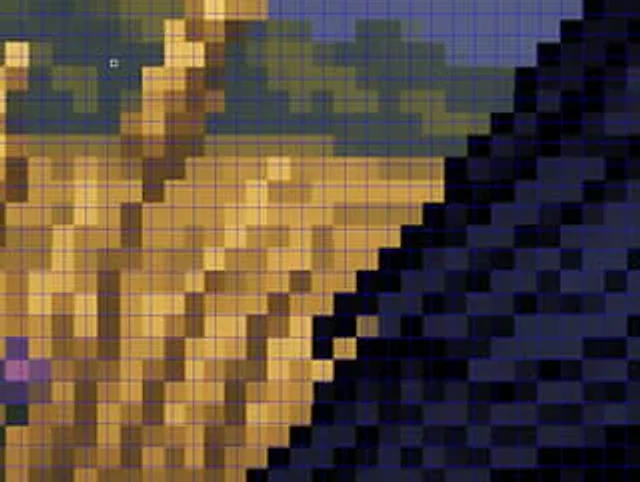

```text
A closely magnified comparison image showcases the rendering effect of pseudo-pixel art. The image presents a magnified view of a low-resolution scene, overlaid with a fine, bright blue square grid across the entire frame. The composition is an abstract close-up of a pixel art-style environment: sandy brown and ochre blocks on the left and center, stepped diagonal blocks in deep navy blue and black on the right, and soft olive green and slate blue shapes above the background, accented with a few brighter gold highlights. At first glance, each edge appears stepped and blocky, but the colors soften and blend within the obvious squares rather than perfectly aligning with the grid, creating a pixel art illusion that doesn't stand up to close scrutiny. A small white crosshair cursor is included near the upper left quadrant, hinting at the image analysis process in the editor. The overall look resembles a screenshot from a graphics program or social media demo, intended to illustrate how AI can mimic the aesthetics of retro game art when it cannot generate truly grid-perfect pixel art; no visible text labels should be included in the image.
```

Model: GPT Image 2
Author: GPT Image 2 Prompts

[ProjectD](https://aitoolsradar.com/en/prompts/1bb17e15ec9488) · [Recorded source](https://x.com/RealAstropulse/status/2047289982394495477#reversed-1)
 · [Full original metadata and byte evidence](data/projectd-batch-0052.json)

## Zoomed Fake Pixel Art Grid Analysis


```text
A tightly zoomed-in comparison image demonstrating fake pixel-art rendering, showing a low-resolution-looking scene enlarged on screen with a thin bright blue square grid overlay across the entire frame. The composition is an abstract close crop of a pixel-art-style environment: sandy tan and ochre blocky forms on the left and center, a dark navy and black stepped diagonal mass on the right, muted olive-green and slate-blue shapes along the upper background, and a few lighter golden highlights. Every edge looks staircase-like and blocky at first glance, but the colors softly blur and blend within the apparent squares instead of aligning perfectly to the grid, creating the impression of pixel art that breaks down under inspection. Include a small white crosshair cursor near the upper left quadrant to suggest image analysis in an editor. The overall look should feel like a screenshot from a graphics program or social media demonstration about how AI can imitate retro game art aesthetics without producing true grid-perfect pixel art, with no text labels visible.
```

Model: GPT Image 2
Author: Astropulse

[ProjectD](https://aitoolsradar.com/en/prompts/18fddb6e5b29d2) · [Recorded source](https://youmind.com/prompts/fake-pixel-art-grid-analysis-15439)
 · [Full original metadata and byte evidence](data/projectd-batch-0052.json)

## Zoomer UI Design Concept

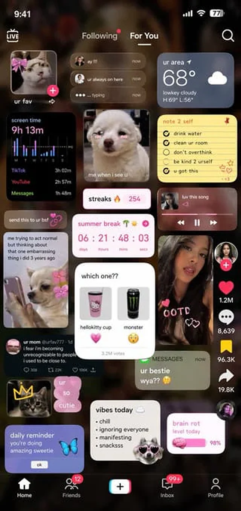

```text
GPT Image 2 is an operating system designed for Zoomer, with an ever-increasing {argument name="emotion" default="anxiety"} Mood Level
```

Model: GPT Image 2
Author: GPT Image 2 Prompts

[ProjectD](https://aitoolsradar.com/en/prompts/5e104991352381) · [Recorded source](https://x.com/sterlingcrispin/status/2046625887710556222)
 · [Full original metadata and byte evidence](data/projectd-batch-0052.json)

## Zoomer UI Design Concept

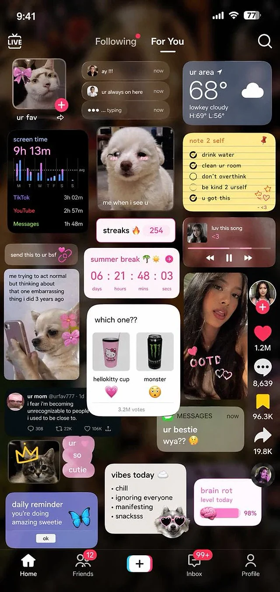

```text
gpt image 2 operating system for zoomers with increasing levels of {argument name="emotion" default="anxiety"}
```

Model: GPT Image 2
Author: Sterling Crispin 🕊️

[ProjectD](https://aitoolsradar.com/en/prompts/5c67941bc9492c) · [Recorded source](https://youmind.com/prompts/zoomer-emotional-ui-14393)
 · [Full original metadata and byte evidence](data/projectd-batch-0052.json)

## ΛRMIN | AI #187


```text
A luxury [BRAND] brand advertisement featuring three stylish [ATHLETES / MODELS / PEOPLE] arranged in a single horizontal 1×3 grid, each posed in their own separate architectural window frame.

Composition & framing:
3 vertical window niches aligned side-by-side horizontally, Each character shown in a waist-up mid-shot, Fully inside the frame, with hands and props naturally breaking the bottom/side frame edges, No legs or lower body visible, hands anatomically correct, no missing fingers, no deformed limbs. All 3 frames must be fully visible, no cropping at the top or bottom, Clean, symmetrical, editorial alignment, consistent camera perspective, photorealistic fashion photography, DSLR, 85mm lens, shallow depth of field, natural skin texture, real pores, realistic fabric texture

Character slots (left to right):
[CHARACTER 1] wearing [OUTFIT 1], holding [OBJECT 1], in [POSE/ACTION 1], [EXPRESSION 1], [ACCESSORIES 1].
[CHARACTER 2] wearing [OUTFIT 2], holding [OBJECT 2] or doing [GESTURE 2], hands centered, breaking the frame edge outward (not sideways), [EXPRESSION 2], [ACCESSORIES 2].
[CHARACTER 3] wearing [OUTFIT 3], holding/carrying [OBJECT 3], projecting [VIBE 3], [EXPRESSION 3], [ACCESSORIES 3].

Style:
Authentic [BRAND] premium styling, couture-inspired detailing, expressive editorial fashion poses, glamorous, iconic, fashion-forward campaign vibe.

Backdrop & materials:
Elegant [BACKGROUND COLOR + MATERIAL] wall backdrop with subtle textures, refined architectural detailing, premium finish.

Lighting & camera:
High-fashion bright studio lighting, soft shadows, high contrast contours, realistic reflections, commercial studio photography, no CGI, no illustration, crisp product highlights. Aspect ratio & layout control: Ultra-wide horizontal composition, 1×3 grid, all three niches visible, balanced spacing.
```

Model: GPT Image 2
Author: ΛRMIN | AI

[ProjectD](https://aitoolsradar.com/en/prompts/001772b1238a4c) · [Recorded source](https://x.com/Arminn_Ai/status/2004219626897465419)
 · [Full original metadata and byte evidence](data/projectd-batch-0052.json)

## ΛRMIN | AI #20

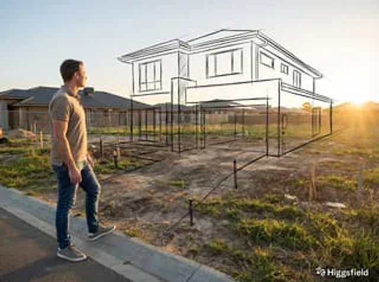

```text
A [person type] standing full-body near the edge of the frame, slightly to the left, in [real-world incomplete / empty / damaged environment]. The camera is positioned behind and slightly to the right of the person, capturing them from a three-quarter rear angle. The person stands calmly and thoughtfully, looking toward the space ahead.

The environment is [describe the real space as it exists now: empty, unfinished, decayed, rigid, lifeless]. The atmosphere feels [emotional tone: quiet, dry, historical, minimal, raw]. Natural light illuminates the scene, creating realistic shadows and depth. Floating hand-drawn sketch lines appear over and within the environment, aligned precisely in perspective with the real space. These sketches represent [what is missing / what once existed / what could exist in the future].

The sketch lines are black, clean, and hand-drawn, resembling [architectural / interior / restoration / urban planning] concept sketches made with pencil or ink. The strokes are expressive, slightly imperfect, and organic — not rigid or mechanical. The sketched elements occupy the foreground and midground, appearing closer to the person than expected. Some sketch lines subtly overlap the person’s silhouette and the real surfaces, visually merging imagination with reality. The sketches float naturally within the scene, seamlessly blending with the environment and conveying the idea of [vision / restoration / transformation / potential] coming to life.
```

Model: GPT Image 2
Author: ΛRMIN | AI

[ProjectD](https://aitoolsradar.com/en/prompts/4757c87a3560b0) · [Recorded source](https://x.com/Arminn_Ai/status/2002826415939682584)
 · [Full original metadata and byte evidence](data/projectd-batch-0052.json)

## いにしえ@AI Director & Creator｜Will Oldgram #21


```text
画像生成: 商品広告写真, 夏にぴったりの季節商品, 炭酸飲料, 名称="夏柑SODA", 形状=ペットボトル500ml, 2025年に飲料広告として高CTAだったデザインをリサーチしてから画像仕様をデザインして生成, アスペクト比=3:4
```

Model: GPT Image 2
Author: いにしえ@AI Director & Creator｜Will Oldgram

[ProjectD](https://aitoolsradar.com/en/prompts/63438b608642d9) · [Recorded source](https://x.com/old_pgmrs_will/status/2045852114673635507)
 · [Full original metadata and byte evidence](data/projectd-batch-0052.json)

## みどり🐲Midori Tatsuta #18


```text
Cute Y2K style affordable cosmetics advertising image designed for Gen Z. Using vibrant color schemes, including neon colors. Aspect ratio is 3:4.
```

Model: GPT Image 2
Author: みどり🐲Midori Tatsuta

[ProjectD](https://aitoolsradar.com/en/prompts/4e6dcc5078cc42) · [Recorded source](https://x.com/midori_tatsuta/status/2045378877363798279)
 · [Full original metadata and byte evidence](data/projectd-batch-0052.json)

## ヨシダ＠AIエンタメ #46


```text
日本語の架空広告をテーマに、SNSでバズることを目的としたインパクトの強いビジュアルを作成してください。 1:1の正方形キャンバスに、4種類の広告を「2×2グリッド」で配置してください。 

ジャンル： ①テック（AI・アプリ） ②美容・コスメ ③飲食 ④フィットネス すべて日本語コピー入り・架空ブランドで作成。 

【バズるための演出要件】 
・一瞬で目を引く強烈なキャッチコピー
 ・感情を動かす要素（驚き・共感・焦り・欲望） 
・コントラストの強い配色（ネオン、ビビッドカラー、黒×蛍光など）
 ・大胆なレイアウト（はみ出し・斜め配置・大きすぎる文字） 
・サムネ映えする構図（中央強調・顔アップ・視線誘導）
 ・SNS広告っぽい“あざとさ”（矢印・強調枠・吹き出し） 

【デザインスタイル】 
・2025年トレンドのSNS広告風
・TikTok / Instagram広告風 
・視認性最優先（スマホで見ても読める） 
・写真風 or 高品質イラスト 
・CTA入り（例：今だけ無料・限定・残り3日など） 

【ランダムバズ要素】 
以下の①〜③から、それぞれ1つずつランダムに選び、必ずキャッチコピーに反映すること。
 ①禁断ワード系（いずれか1つ） 
・知らないと損 
・99%が間違ってる 
・今すぐやめて 
②ギャップ演出（いずれか1つ） 
・見た目かわいいのに中身がヤバい 
・普通に見えて実は… 
・これ、○○じゃありません
③数字・限定（いずれか1つ）
・3日限定 
・残り1枠 
・無料→0円 

【重要】 
・4つそれぞれ明確に違う雰囲気にする 
・グリッドは崩さない 
・文字は読みやすく配置する 
・“スクロールを止める違和感”を意図的に入れる 

出力：4広告が1枚にまとまった高インパクトビジュアル
```

Model: GPT Image 2
Author: ヨシダ＠AIエンタメ

[ProjectD](https://aitoolsradar.com/en/prompts/85a023a412e0ab) · [Recorded source](https://x.com/akiramenaiwoman/status/2046460259817210284)
 · [Full original metadata and byte evidence](data/projectd-batch-0052.json)

## 一张中文健身信息图


```text
请生成一张中文健身信息图，主题为：【xxx】。

要求这张图既专业又实用，适合普通成年人作为训练参考。默认对象为无严重伤病的健康成年人；如果没有额外说明，默认训练目标为“增肌 + 基础力量提升”，默认训练水平为“新手到中级之间”，默认训练场景为“普通健身房”，默认单次训练时长控制在 40–60 分钟内。

请根据【训练主题】自动判断输出类型：

1）如果【训练主题】是某个肌群或身体部位（例如：胸肌、背阔肌、肱二头肌、腹肌、肩部、腿部等），请输出一张“该部位训练计划信息图”。
2）如果【训练主题】是某个动作或技能目标（例如：引体向上、俯卧撑、双杠臂屈伸、深蹲等），请输出一张“动作解锁 / 进阶训练计划信息图”。

整张图请采用清晰、现代、专业、易读的中文信息图风格，竖版排版，视觉简洁，重点突出，适合社交媒体分享或训练参考卡片。不要写成长篇大论，每个模块用简洁短句呈现，数字信息要醒目。

这张信息图必须包含以下内容：

【A. 标题区】
- 主标题：直接写【训练主题】训练计划 / 解锁计划
- 副标题：自动补充适用人群、目标、训练场景、建议时长
例如：适合新手 / 增肌导向 / 健身房版 / 45分钟

【B. 训练目标区】
用简洁语言说明：
- 这次训练主要针对什么
- 主要目标是什么（增肌 / 力量 / 技能解锁 / 核心控制等）
- 本次训练的重点刺激或能力提升方向

【C. 热身区】
给出 2–4 个热身建议，简洁列出即可，例如：
- 动态活动
- 目标肌群激活
- 轻重量预热组
每项可附一句说明

【D. 主训练区】
这是核心部分，请列出 4–6 个主要训练动作。
每个动作都要包含以下信息：
- 动作名称
- 训练作用 / 针对部位
- 组数 × 次数（或时间）
- RIR 建议
- 每组间休息时间
- 动作关键要点（1–2 条）
- 常见错误（1 条即可）

请确保动作安排合理：
- 先复合动作，后孤立动作
- 整体训练量适中
- 新手不要安排过度极限训练
- 主动作通常建议 RIR 1–3
- 孤立动作可建议 RIR 0–2
- 如果是腹肌或核心类动作，可用“秒数 / 次数”形式
- 如果是技能类动作，请优先安排“前置能力动作 + 过渡动作 + 目标动作尝试”

【E. 进阶 / 解锁逻辑区】
根据主题自动生成：
- 如果是肌群训练：写“如何渐进超负荷”，例如达到次数上限后再加重量、优先保证动作标准等
- 如果是动作解锁：写“分阶段进阶路径”，例如从悬垂、肩胛引体、离心训练、弹力带辅助，到标准动作完成

【F. 替代动作区】
请给出 2–3 个替代动作，适用于以下情况：
- 没有器械
- 家庭训练
- 当前能力不足
- 某些动作做不了

【G. 执行提醒区】
请给出 4–6 条简洁提醒，例如：
- 动作标准优先于重量
- 不要每组都练到力竭
- 同肌群建议间隔 48–72 小时
- 疼痛不等于正常发力
- 睡眠不足时可适当减少训练量

【H. 恢复建议区】
简洁说明：
- 训练后恢复重点
- 蛋白质 / 睡眠 / 恢复间隔建议
- 1 句风险提醒（如有明显疼痛应停止并评估）

【I. 视觉设计要求】
- 整体为单页中文信息图
- 竖版排版
- 风格现代、清爽、专业、健身感强
- 使用模块化卡片布局
- 重点数字（组数、次数、RIR、休息）要醒目
- 可加入简洁的人体肌群图标、哑铃、杠铃、引体向上等小图标
- 颜色保持高级、干净、有运动感
- 中文文字必须清晰、准确、易读
- 避免过多装饰，强调实用性与执行性

请最终输出为“一张完整的信息图内容”，而不是只给普通段落文字。
```

Model: GPT Image 2
Author: @MrLarus

[ProjectD](https://aitoolsradar.com/en/prompts/e0da6a96de4946) · [Recorded source](https://x.com/MrLarus/status/2046560406760505727)
 · [Full original metadata and byte evidence](data/projectd-batch-0052.json)

## 一张手绘风格的城市美食地图，以台州为主题


```text
一张手绘风格的城市美食地图，以台州为主题。画面以鸟瞰视角的手绘简化城市地图为底，标注椒江、路桥、黄岩等区域和灵江、台州湾等水系地标，不追求精确比例而是追求可爱的水彩手绘感。地图上分布着12个美食地点的精致手绘小插画：1. 椒江老粮坊的蛋清羊尾（金黄蓬松的蛋泡甜点撒着糖粉，筷子夹起拉丝）2. 临海紫阳古街的食饼筒（一个饱满的麦饼卷切开露出肉丝、蛋皮、米面等丰富馅料）3. 三门的青蟹（一只肥硕的青壳大蟹张着大钳子，旁边一小碟姜醋）4. 温岭石塘渔港的海鲜面（粗瓷大碗浓白鱼汤面铺满虾、蛏子、小黄鱼）5. 路桥的糟羹（一锅稠厚的五彩羹，芥菜、冬笋、香干、牡蛎粒粒可见）6. 玉环坎门的炊圆（三四个白胖糯米团子卧在笼屉里，旁边酱油碟滴着麻油）7. 黄岩的麦虾（陶锅里面疙瘩配蛤蜊、青菜翻滚冒泡）8. 仙居的八大碗（八只粗陶小碗围成一圈——土鸡、溪鱼、豆腐皮俱全）9. 天台的饺饼筒（几卷金黄酥脆的薄饼整齐码放，露出红烧肉和豆面馅）10. 临海的麦油脂（竹盘上摊着薄如蝉翼的饼皮卷着肉末、豆芽、鸡蛋丝）11. 温岭的嵌糕（厚实的年糕饼中间嵌着红烧肉和油条，正在铁板上滋滋作响）12. 椒江的姜汁调蛋（一只青花碗里琥珀色姜汤卧着嫩滑蛋花，撒几粒核桃碎）。每个插画约占地图5%面积，旁边用手写体标注店名和一句推荐语如“阿婆凌晨四点就起来和面”“本地人认准这口锅”。地图边缘用手绘藤蔓、杨梅枝和小海鲜（虾、蟹、贝壳）装饰形成边框。右下角有一个手绘指南针（标注“东海”方向）和图例说明。左上角标题“台州·山海食光地图”使用胖圆的手绘美术字，用杨梅和小黄鱼点缀装饰。整体画风为水彩+彩铅混合的手绘质感，颜色以杨梅红、姜黄、海蓝、翠绿为主，图片比例1:1。
```

Model: GPT Image 2
Author: 小红书号510244722

[ProjectD](https://aitoolsradar.com/en/prompts/60edc3829c6336) · [Recorded source](https://github.com/freestylefly/awesome-gpt-image-2)
 · [Full original metadata and byte evidence](data/projectd-batch-0052.json)

## 一张采用分层蒙太奇构图的电影海报


```text
[中文]
“一张采用分层蒙太奇构图的电影海报。背景为日落时分的海滨小镇，平静的海面倒映着耀眼的日光眩光，薄雾笼罩的天空中有远处飞鸟，沿海公路旁立着电线杆剪影。左侧中景处，一位身着深灰色外套、留着深色卷发的中年男子站在混凝土海堤边，神情忧郁地低头凝视，被傍晚的阳光逆光勾勒轮廓。右侧前景主体为一张大幅特写年轻女子侧脸肖像，她望向右侧，身穿带白色条纹的深色水手校服，湿润的黑发贴在脸颊，柔和漫射光线下，一滴泪珠从她脸颊滑落。画面下方中央前景处，一只柴犬抬头朝右侧望去，红棕色毛发被温暖的轮廓光点亮。画面最底端为一条横向电影胶片，内含五幅独立矩形场景缩略图：女孩与柴犬在海滩、女孩骑车望向海面、女孩与男子坐在室内桌前、男子与女孩在海滩面对面站立、女孩拥抱柴犬的特写。画面叠加指定文字：左上角为深青绿色大号衬线字体标题《风间静语》，下方副标题为「—— 致那日的你 ——」；标题下方为小号深色衬线正文：“逝去之物，不复归来。然而，只要心灵稍稍相连，我们便能再度直面明日。” 画面右侧中部为深色衬线字体文字：“曾有一段时光，是你教会我如何生活。我永不会忘。” 左下角为大号白色文字：“10 月 31 日 周五 影院上映”。右下角为小号白色无衬线字体演职人员表：“主演：福波真子 / 桐嶋秀作 原作与剧本：柴野麻吕 导演：今仓七海 主题曲：SyVa《看得见海的地方》（Dogstar★唱片） 制作：《夕凪之尾》影视伙伴 制作公司：DABUSHIBANU-NU 发行：GOODSHIBALERS ©2026《夕凪之尾》影视伙伴”。
分段提示词：
图层索引：0
片段：“背景为日落时分的海滨小镇，平静海面倒映耀眼日光眩光，薄雾天空中有远处飞鸟，沿海公路旁有电线杆剪影。”
图层索引：1
片段：“左侧中景处，身着深灰色外套、留深色卷发的中年男子站在混凝土海堤边，神情忧郁低头，被傍晚阳光逆光照射。”
图层索引：2
片段：“右侧前景主体为大幅特写年轻女子侧脸肖像，她望向右侧，身穿带白条纹的深色水手校服，湿润黑发贴脸，柔和漫射光下一滴泪珠滑落脸颊。”
图层索引：3
片段：“画面下方中央前景处，一只柴犬抬头望向右侧，红棕色毛发被温暖轮廓光点亮。”
图层索引：4
片段：“画面最底端为横向电影胶片，内含五幅独立矩形场景缩略图：女孩与柴犬在海滩、女孩骑车望向水面、女孩与男子坐在室内桌前、男子与女孩在海滩面对面、女孩拥抱柴犬特写。”
图层索引：[5,6,7,8]
片段：“画面叠加指定文字：左上角为深青绿色大号衬线字体《风间静语》，下方副标题「—— 致那日的你 ——」；其下小号深色衬线正文：“逝去之物，不复归来。然而，只要心灵稍稍相连，我们便能再度直面明日。” 右侧中部深色衬线文字：“曾有一段时光，是你教会我如何生活。我永不会忘。” 左下角大号白色文字：“10 月 31 日 周五 影院上映”。右下角小号白色无衬线字体演职信息：“主演：福波真子 / 桐嶋秀作 原作与剧本：柴野麻吕 导演：今仓七海 主题曲：SyVa《看得见海的地方》（Dogstar★唱片） 制作：《夕凪之尾》影视伙伴 制作公司：DABUSHIBANU-NU 发行：GOODSHIBALERS ©2026《夕凪之尾》影视伙伴”。
负面提示词：
“平光照明，无质感表面，对称构图，底部留白空荡，文字缺失，翻译文字，改写文字，3D 渲染，卡通风格，高对比生硬阴影，干涩头发，明亮欢快表情”

[English]
A cinematic movie poster utilizing a layered montage composition. In the background, a coastal town at sunset with calm ocean water reflecting a glowing sun glare, distant birds in a hazy sky, and the silhouette of utility poles along a coastal road. In the left midground, a middle-aged man with dark wavy hair in a dark grey jacket stands near a concrete sea wall, looking downward with a melancholic expression, backlit by the late afternoon sun. Dominating the right foreground is a large, closely cropped profile portrait of a young woman looking right; she wears a dark school sailor uniform with white stripes, has wet dark hair clinging to her face, and a single tear rolls down her cheek under soft, diffuse lighting. In the lower center foreground, a Shiba Inu dog looks upwards toward the right, its reddish-brown fur catching warm rim lighting. Along the very bottom edge is a horizontal film strip of five distinct rectangular scene thumbnails: a dog and girl on a beach, a girl on a bicycle looking at the water, a girl and man sitting at an indoor table, a man and girl standing facing each other on a beach, and a close-up of a girl hugging a Shiba Inu. Overlaid on the image is specific text. In the top left, large dark teal serif text reads 'The Quiet Between Winds' with a subtitle below reading '— To You, That Day —'. Below that, smaller dark serif body text reads 'What is lost will not return. And yet, when hearts connect, even just a little, we can face tomorrow again.'. On the mid-right side, dark serif text reads 'There was a time when you taught me how to live. I won't forget it.'. In the bottom left, large white text reads 'OCTOBER 31 FRI. IN THEATERS'. In the lower right corner, small white sans-serif credit text reads 'Starring: Mako Fukunami / Shusaku Kirimine Original Story & Screenplay: Shibano Maruo Director: Nanami Imakura Theme Song: SyVa \"Umi no Mieru de\" (Dogstar★RECORDS) Production: \"Yūnagi no Shippo\" Film Partners Production Company: DABUSHIBANU-NU Distribution: GOODSHIBALERS ©2026 \"Yūnagi no Shippo\" Film Partners'."
  segmented:
    - layer_index: 0
      segment: "In the background, a coastal town at sunset with calm ocean water reflecting a glowing sun glare, distant birds in a hazy sky, and the silhouette of utility poles along a coastal road."
    - layer_index: 1
      segment: "In the left midground, a middle-aged man with dark wavy hair in a dark grey jacket stands near a concrete sea wall, looking downward with a melancholic expression, backlit by the late afternoon sun."
    - layer_index: 2
      segment: "Dominating the right foreground is a large, closely cropped profile portrait of a young woman looking right; she wears a dark school sailor uniform with white stripes, has wet dark hair clinging to her face, and a single tear rolls down her cheek under soft, diffuse lighting."
    - layer_index: 3
      segment: "In the lower center foreground, a Shiba Inu dog looks upwards toward the right, its reddish-brown fur catching warm rim lighting."
    - layer_index: 4
      segment: "Along the very bottom edge is a horizontal film strip of five distinct rectangular scene thumbnails: a dog and girl on a beach, a girl on a bicycle looking at the water, a girl and man sitting at an indoor table, a man and girl standing facing each other on a beach, and a close-up of a girl hugging a Shiba Inu."
    - layer_indices: [5, 6, 7, 8]
      segment: "Overlaid on the image is specific text. In the top left, large dark teal serif text reads 'The Quiet Between Winds' with a subtitle below reading '— To You, That Day —'. Below that, smaller dark serif body text reads 'What is lost will not return. And yet, when hearts connect, even just a little, we can face tomorrow again.'. On the mid-right side, dark serif text reads 'There was a time when you taught me how to live. I won't forget it.'. In the bottom left, large white text reads 'OCTOBER 31 FRI. IN THEATERS'. In the lower right corner, small white sans-serif credit text reads 'Starring: Mako Fukunami / Shusaku Kirimine Original Story & Screenplay: Shibano Maruo Director: Nanami Imakura Theme Song: SyVa \"Umi no Mieru de\" (Dogstar★RECORDS) Production: \"Yūnagi no Shippo\" Film Partners Production Company: DABUSHIBANU-NU Distribution: GOODSHIBALERS ©2026 \"Yūnagi no Shippo\" Film Partners'."

negative: "flat lighting, untextured surfaces, symmetrical composition, empty bottom margin, missing text, translated text, paraphrased text, 3D render, cartoon, high-contrast harsh shadows, dry hair, bright cheerful expressions
```

Model: GPT Image 2
Author: @old_pgmrs_will

[ProjectD](https://aitoolsradar.com/en/prompts/d6dc504ec7f967) · [Recorded source](https://x.com/old_pgmrs_will/status/2045440101359198302)
 · [Full original metadata and byte evidence](data/projectd-batch-0052.json)

## 三甲医院真实门诊处方笺


```text
[中文]
一张三甲医院的门诊处方笺，医生潦草的手写字，包含真实合理的 诊断、药品名、剂量，右下角有医生签名和科室章。

[English]
An outpatient prescription sheet from a Grade 3A hospital, doctor's illegible handwriting, containing realistic and reasonable diagnosis, drug names, dosages, with a doctor's signature and department stamp in the bottom right corner.
```

Model: GPT Image 2
Author: @msjiaozhu

[ProjectD](https://aitoolsradar.com/en/prompts/50ae9e8decefa3) · [Recorded source](https://x.com/msjiaozhu/status/2046546317766500834)
 · [Full original metadata and byte evidence](data/projectd-batch-0052.json)

## 上海地铁站台晨光


```text
A candid photograph of a young woman standing on a Shanghai metro platform during the summer morning commute, authentic daily life photography, natural candid moment. Half-body framing, shot at eye level from moderate distance — the arriving train a motion-blurred streak behind her, the yellow safety line at her feet.
East Asian young woman in her early 20s. Almond-shaped eyes with natural double eyelids, slightly elongated eye corners — eyes directed downward, absorbed. Straight refined nose with a delicate bridge. Skin tone fair to light beige (NC10–NC20) — skin subsurface scattering visible under cool overhead station light, specular micro-highlights on cheekbones and nose ridge, fine foundation powder grain perceptible. Summer fresh look, no heavy coverage, lightly tinted lip.
She wears a relaxed oversized white shirt dress, collar lightly open, sleeves loosely rolled above the elbow. A structured natural tan canvas tote hangs from her shoulder, a physical novel tucked under one arm — pages open at a saved page. She stands with her weight on one hip, gaze downward at the open book, entirely absorbed, occupying her own stillness inside the morning rush. Background: white and grey tiled metro wall, overhead route signage board, arriving train motion blur to one side, other commuters blurred and distant. Two or three stray hairs displaced by the train's air displacement on arrival, natural unplanned imperfection, not geometrically symmetrical.
Cool overhead fluorescent lighting with a slight greenish cast, flat frontal illumination offset by a warm spill from the platform entrance behind. Absorbed in focus, eyes downward, unaware — a private moment inside a public space, the Shanghai morning. Subtle ISO 400 film grain in shadow areas, photographic noise texture not CG render smoothness. Aspect ratio 2:3. No watermark, no text overlay, not cartoon, not digitally painted, not illustration, not anime.
```

Model: GPT Image 2
Author: @ToroJushiAi

[ProjectD](https://aitoolsradar.com/en/prompts/e835e109e02f9f) · [Recorded source](https://x.com/ToroJushiAi/status/2059452471127240959)
 · [Full original metadata and byte evidence](data/projectd-batch-0052.json)

## 不知火舞的小红书主页


```text
[中文]
生成不知火舞的小红书主页截图

[English]
Generate a screenshot of Mai Shiranui's Xiaohongshu homepage
```

Model: GPT Image 2
Author: @rionaifantasy

[ProjectD](https://aitoolsradar.com/en/prompts/54af8f75ee102a) · [Recorded source](https://x.com/rionaifantasy/status/2045356799751303194)
 · [Full original metadata and byte evidence](data/projectd-batch-0052.json)

## 专业设计师打造角色写真集


```text
[中文]
请用这个角色制作一本专业设计师打造的照片集。语言为日语。

根据喜好加入提示词会让它更丰富多彩…
・丰富的场景
・信息量较多

[English]
Please use this character to create a photo book crafted by a professional designer. The language should be Japanese.

Adding prompts according to your preferences will make it more colorful and rich
・Rich scenes
・Large amount of information
```

Model: GPT Image 2
Author: @Kashiko_AIart

[ProjectD](https://aitoolsradar.com/en/prompts/4495b49c93d91e) · [Recorded source](https://x.com/Kashiko_AIart/status/2046492817804099794)
 · [Full original metadata and byte evidence](data/projectd-batch-0052.json)

## 东京旅行 13 格视频封面


```text
Generate image of young female travel vlogger exploring Tokyo across multiple candid moments, extremely beautiful with long dark wavy hair, wearing stylish Japanese-inspired oversized streetwear, expressive and spontaneous personality, captured across a 13-frame grid collage (Row 1: 4 frames | Row 2: 5 frames | Row 3: 4 frames), each frame feels like a real casual phone capture with imperfect framing and natural inconsistencies.

Frame Breakdown

Row 1 - Frame 1 (Tokyo Tower): low angle selfie with Tokyo Tower behind her, slightly tilted horizon, sky overexposed to near white, she's mid-natural smile adjusting into frame, small lens smudge in corner, candid arrival energy.
Row 1 - Frame 2 (Shibuya street level): walking through Shibuya crossing at night, handheld motion blur, she glances back at camera mid-step, neon reflections on wet pavement, slightly shaky framing, imperfect crop.
Row 1 - Frame 3 (Convenience store): inside a brightly lit convenience store, she is holding onigiri close to camera, playful raised eyebrows, harsh fluorescent lighting flattening the scene, slight overexposure on whites, shelves softly blurred behind.
Row 1 - Frame 4 (Yoyogi park): sitting on a bench under trees, looking away from camera, quiet candid moment, soft dappled daylight, slight focus miss on eyes, subtle lens smudge bottom corner.
Row 2 - Frame 5 (Takoyaki reaction): close-up while eating single takoyaki, reacting mid-bite with laughter, slight motion blur, warm lantern light behind, face slightly out of focus due to movement.
Row 2 - Frame 6 (Vending machine night): standing in front of glowing vending machine, blue and pink light casting uneven tones on her face, pressing button casually, high ISO grain visible.
Row 2 - Frame 7 (Train reflection): her face reflected in train window at night, city lights streaking behind, layered reflection effect, slight ghosting on glass, she looks away from camera.
Row 2 - Frame 8 (Torii gate): low angle shot of her walking through a torii gate, captured from slightly behind, motion blur in her movement, bright sky causing mild lens flare.
Row 2 - Frame 9 (Digital art exhibit): inside immersive light exhibit, colored lights (blue, violet, gold) washing across her face, she looks upward in awe, slight motion blur, low-light noise visible.
Row 3 - Frame 10 (Gundam statue): low angle wide shot, she stands small in frame while large statue towers above, slight barrel distortion from phone lens, sky slightly blown out.
Row 3 - Frame 11 (Lantern alley): walking through narrow alley lit by warm lanterns, shot from behind, she glances back briefly, underexposed shadows, grainy night detail.
Row 3 - Frame 12 (Rooftop skyline): selfie with Tokyo skyline behind, arm extended, wind blowing hair partially across lens, horizon slightly tilted, warm city glow overexposed in distance.
Row 3 - Frame 13 (Nara park): crouching down in a park in Nara, she holds out a deer cracker toward a deer, the deer bows its head toward her, she bursts into genuine laughter mid-reaction, surprised and slightly leaning back, another deer nudges her from behind causing her to lose balance slightly, camera captures the moment imperfectly with slight shake and off-center framing, soft natural daylight, open park background with trees and space, unscripted chaotic energy, candid expression.

Young female travel vlogger exploring Tokyo across 13 candid moments in a grid collage, extremely beautiful with long dark wavy hair, wearing stylish Japanese streetwear, expressive and spontaneous, scenes include Tokyo Tower selfie, Shibuya crossing at night, convenience store snack moment, park bench quiet scene, takoyaki reaction, vending machine glow, train window reflection, torii gate walk, immersive light exhibit, Gundam statue low angle, lantern alley walk, rooftop skyline selfie, Harajuku street ending, each frame slightly imperfect with motion blur.
```

Model: GPT Image 2
Author: @AIwithSynthia

[ProjectD](https://aitoolsradar.com/en/prompts/0293a7348d86f8) · [Recorded source](https://x.com/AIwithSynthia/status/2062383568253505904)
 · [Full original metadata and byte evidence](data/projectd-batch-0052.json)

## 东京街头胶片人像


```text
film photography, candid street snapshot aesthetic, razor-sharp focus on subject, shallow depth of field with soft blurred urban background, bright daylight, slightly overexposed highlights, vivid contrast, subtle analog film texture, heavy film grain, nostalgic cinematic atmosphere, Tokyo backstreet neighborhood scene near a quiet train station, narrow pedestrian street lined with Japanese convenience stores, vintage vending machines, small ramen shops, hanging signs with faded typography, bicycles parked along tiled sidewalks, utility poles and overhead wires stretching across the sky, scattered fallen leaves on the ground, distant pedestrians and passing taxis softly blurred in the background, warm afternoon sunlight with deep blue sky, realistic street fashion photography style, effortless cool street vibe, vibrant colors with slightly muted faded film tones, beautiful 19-year-old Chinese female influencer, fair porcelain skin with cold pale undertones, exquisite natural makeup, glossy soft lips, defined brows, delicate lashes, soft messy long black hair with natural flowing curves, wearing an off-shoulder white fluffy faux fur jacket, playful yet subtly seductive expression, lazy dreamy vintage filter, ultra high-quality details, intentionally mundane phone-camera snapshot feeling, casual accidental composition, imperfect framing, realistic iPhone photography texture, spontaneous candid energy, highly attractive girl casually posing in the middle of the sidewalk, body facing away from the camera while turning her head back toward the lens with direct eye contact, relaxed posture, soft wind moving her hair, emotional youthful atmosphere, modern Asian street fashion editorial, soft haze, layered composition, masterpiece, best quality, ultra detailed, slight motion blur from slow shutter, authentic everyday realism, “BubbleBrain” small handwritten signature text on bottom corner --ar 9:16
```

Model: GPT Image 2
Author: @BubbleBrain

[ProjectD](https://aitoolsradar.com/en/prompts/89724205f1b3e8) · [Recorded source](https://x.com/BubbleBrain/status/2055491616392052887)
 · [Full original metadata and byte evidence](data/projectd-batch-0052.json)

## 东方神话人物志百科海报


```text
请基于【孙悟空】生成一张竖版 A4「东方神话人物志」百科海报。

你是一名东方神话视觉设定师、古籍图谱设计师和中文信息图设计师。请根据【人物名称】在东方神话、民间传说、古籍、戏曲、文学或传统文化中的已知形象，生成一张内容完整、视觉统一、具有东方神话气质的人物档案海报。

最重要原则：
全部内容必须围绕【人物名称】展开，不要套用通用神仙模板。
人物形象、法器、坐骑、神通、典故、象征物、背景场景都必须符合【人物名称】的神话设定。
如果该人物存在多个传说版本，请采用最广为人知的版本；存在异文时，可以在相关板块简短标注“传说版本不一”。
不确定的信息不要强行编造，可写“民间传说中多有异文”或“相关记载较少”。
不要使用北欧符文、维京图腾、哥特边框、西方盔甲、欧式城堡、西幻恶魔角、赛博朋克元素。
整体必须是东方神话审美，而不是“西幻人物换中式衣服”。
整体视觉风格：
东方神话史诗感，融合《山海经》异兽图谱、敦煌壁画、青绿山水、唐代人物画、宋元古画、青铜器纹样、古籍注疏和符箓篆刻风格。画面庄重、神秘、古雅、华丽但克制。
画面构图：

竖版 A4 海报，中轴对称布局。中央为【人物名称】的全身或半身主视觉，姿态庄严，有神性和叙事感。人物服饰、发冠、法器、神态、灵兽、背景都要符合该人物传说。左右两侧为信息卡片，底部为核心总结。四周使用云雷纹、回纹、青铜纹、祥云纹、卷草纹、山海纹、篆刻印章式边框。
主标题：“【人物名称】”
副标题：“东方神话人物志｜根据该人物神话传说生成”
顶部精神题记：请根据【人物名称】的核心精神，自动生成一句古雅、凝练、有哲学意味的题记。题记要体现该人物背后的价值观、生命姿态或精神内核，而不是说明性文字。不要写“非史实考证”“仅供参考”“传说版本”等免责声明。字数控制在 12-28 字，适合放在标题下方。题记应与人物高度绑定，不要套用“守护苍生”“大道无边”等空泛句式。

请生成以下内容板块：
【1. 神格身份】说明【人物名称】在东方神话体系中的身份定位。
【2. 神话源流】说明该人物主要出自哪些神话、古籍、民间传说、小说、戏曲或宗教信仰。
【3. 司职权柄】总结该人物掌管或象征的领域。
【4. 形象特征】描述该人物的典型外貌、服饰、神态、姿态和视觉气质。
【5. 法器神通】展示该人物最具代表性的法器、兵器、符咒、神通或能力。
【6. 灵兽坐骑 / 随身象征】如果【人物名称】有坐骑、灵兽、伴生生灵，请展示其名称、形态和寓意。如果没有明确坐骑，请改为“随身象征物”或“相关意象”。不要强行给每个人物安排龙、凤、仙鹤或麒麟。
【7. 典故出处】列出 2-4 个与【人物名称】相关的经典故事、传说片段或文化典故。不要虚构不存在的典故。若版本不一，请标注“异文较多”。
【8. 象征意象】提炼该人物最核心的视觉符号。符号必须与【人物名称】相关。
【9. 神话谱系】说明该人物与其他神话人物、阵营、族属或体系的关系。如果谱系不明确，请写“谱系传说不一”。
【10. 文化影响】说明该人物在民俗、节日、祭祀、文学、戏曲、绘画、庙宇、影视或现代文化中的影响。
【11. 精神内核】从神话叙事角度总结该人物象征的精神。这里只分析神话形象，不推断真实人物性格。
【12. 核心总结】用一段古雅但易懂的中文总结【人物名称】：“【人物名称】在东方神话中象征……，其形象融合了……，代表着……。”

视觉版式要求：
顶部：大标题 + 副标题 + 精神题记。
中央：人物主视觉，气势庄重，细节丰富。
左侧栏目：神格身份、神话源流、司职权柄、形象特征、法器神通。
右侧栏目：灵兽坐骑/随身象征、典故出处、象征意象、神话谱系、文化影响。
底部：精神内核 + 核心总结。
可加入小型图标、注释线、古籍标签、卷轴卡片、青铜铭牌、朱砂印章、符箓纹样。
信息卡片像古书页、玉简、青铜牌、卷轴或碑铭，不要像现代科技 UI。

材质与纹样：
宣纸肌理、矿物颜料、鎏金线条、朱砂印章、墨色晕染、青铜器铭文、云雷纹、回纹、祥云纹、山水纹、敦煌藻井纹样。

配色规则：
根据【人物名称】的属性自动选择东方配色。火焰 / 战斗 / 护法：朱砂、玄黑、鎏金、赤红。月亮 / 水系 / 清冷神祇：黛青、银白、月白、石蓝。山川 / 木系 / 自然神灵：石绿、青黛、玉白、赭石。帝王 / 天庭 / 尊神：鎏金、玄黑、朱砂、玉白。妖灵 / 山海异兽：墨黑、铜绿、暗金、赭红。不要所有人物都使用同一套配色。

文字要求：
中文必须清晰可读，标题大气，正文简短准确。不要乱码、伪文字、错别字、文字重叠或裁切。如果空间不足，优先压缩正文，但保留所有板块标题。

避免：
北欧符文、维京风、哥特边框、西方盔甲、欧式城堡、魔幻游戏 UI、赛博朋克、现代科技感、过度暗黑、随机龙凤、无关法器、模板化神仙形象、与【人物名称】无关的典故、空泛精神题记。
```

Model: GPT Image 2
Author: @TanLuAI

[ProjectD](https://aitoolsradar.com/en/prompts/ef37c0dff108b0) · [Recorded source](https://x.com/TanLuAI/status/2053073436122243364)
 · [Full original metadata and byte evidence](data/projectd-batch-0052.json)

## 两斤 #258


```text
Eye-level straight-on view, looking directly into a hyper-vibrant 3D layered paper cut-out diorama.
Pokéball red and white, Pikachu yellow, sky blue and
grass green accents, extremely high saturation,
PHYSICAL PAPER LAYERS clearly visible with hard cut edges and thick paper cross-sections at every depth plane. Maximalist composition, crowded Pokémon world scene — layered Pokémon Center and gym architecture receding through all depth planes,
Pikachu as central figure mid-thunderbolt on foreground layer, dozens of iconic Pokémon — Charizard, Gengar, Eevee, Snorlax, Mewtwo — each inhabiting separate depth planes, trainer Ash and rivals threading between battle layers, Pokéball burst effects frozen mid-release across all planes, tall grass and route pathways between habitat layers, legendary Pokémon silhouettes in remote background layers,
scattered Pokéballs, badges and berry items crowding the vibrant foreground. Soft single-direction studio lighting creating deep drop shadows between every physical paper layer, matte paper texture throughout,
NO glow, NO soft edges, NO volumetric lighting, octane render, 8k, clean details --ar 3:4
```

Model: GPT Image 2
Author: 两斤

[ProjectD](https://aitoolsradar.com/en/prompts/c3de4dc55993c5) · [Recorded source](https://x.com/0x00_Krypt/status/2046881068578689257)
 · [Full original metadata and byte evidence](data/projectd-batch-0052.json)

## 个人网页视觉设计


```text
原文未公开，案例目标是生成一张高完成度的个人主页视觉设计图。
```

Model: GPT Image 2
Author: 苍何原创实测（公众号文章《我逆向了 329 条 GPT-Image2 提示词模板，全部开源！》）

[ProjectD](https://aitoolsradar.com/en/prompts/5be28f401dcb51) · [Recorded source](https://github.com/freestylefly/awesome-gpt-image-2)
 · [Full original metadata and byte evidence](data/projectd-batch-0052.json)

## 中世纪城市旅行海报


```text
Create a vertical mid-century travel poster for [CITY NAME] featuring [LANDMARK]. Use a strict 3-color palette: cream paper, black technical linework, and [COLOR].
Style: Minimalist isometric bird's-eye view with ultra-fine hatching and screen-print texture.
Color usage: Solid flat [COLOR] for the entire sky and small accents on roofs or streets. No gradients.
Text: Bold sans-serif "[CITY NAME]" at top in cream, with the local language name in smaller cream text below.
```

Model: GPT Image 2
Author: @Goodmanprotocol

[ProjectD](https://aitoolsradar.com/en/prompts/429cfe75ce95a7) · [Recorded source](https://x.com/Goodmanprotocol/status/2053523890744545437)
 · [Full original metadata and byte evidence](data/projectd-batch-0052.json)

## 中世纪村庄双精灵冒险者


```text
Create a cinematic dark-fantasy medieval street scene in ultra-realistic 3D game concept art style, widescreen 16:9. In the foreground, show two adult elven adventurers walking side by side toward the viewer through a muddy cobblestone village road. The left character is a pale-skinned elf woman with long messy {argument name="left character hair color" default="ash blonde"} braided hair, pointed ears, layered olive-green druid robes, leather belts, pouches, dangling metal charms, necklaces, torn fabric strips, leaf-and-feather details, and glowing white vine-like magical tattoos spiraling down both forearms. The right character is a darker-skinned elf woman with long thick {argument name="right character hair color" default="dark brown"} dreadlocked hair, pointed ears, a green-and-brown leather ranger outfit, fur shoulder mantle, feather ornaments, arm wraps, belts, chains, talismans, and a confident warrior posture. Both faces are intentionally hidden by plain opaque {argument name="face covering color" default="dark brown"} square censor blocks, centered over their faces. Set the background in a richly detailed medieval market village with timber-and-thatch houses, hanging bundles of dried herbs on the right-side shopfront, barrels, baskets, wooden stalls, distant townspeople, and a large stone castle with towers and battlements rising in the background. Use {argument name="lighting mood" default="warm late-afternoon golden sunlight"}, dramatic shadows, volumetric haze, shallow depth of field, realistic fabric and leather textures, high detail, moody fantasy atmosphere, cinematic composition, Unreal Engine quality, no text, no logos.
```

Model: GPT Image 2
Author: @RamonVi25791296

[ProjectD](https://aitoolsradar.com/en/prompts/694f736e9fc078) · [Recorded source](https://x.com/RamonVi25791296/status/2051568239142973832)
 · [Full original metadata and byte evidence](data/projectd-batch-0052.json)

## 主题海报版式设计


```text
Using REFERENCE_0 as the base style and preserving the central chicken illustration, transform the image into a product packaging label for a herbal soup mix. Shift the chicken to the right side. Replace the top text with a large, bold black brush-stroke headline {argument name="main headline" default="元气祛湿 鸡煲汤包"} and a smaller subtitle {argument name="subtitle" default="吃山林土货 味道当然好!"}. On the left side, add a new woven basket containing exactly 6 distinct piles of ingredients: woody root sticks, white square cubes, round sliced brown roots, yellow soybeans, dried orange peel strips, and dark red dates. Attach 6 small brown rectangular labels with white text to these ingredients. Below the chicken, add a circular orange badge containing the text {argument name="ingredients list" default="内含有:五指毛桃、茯苓、土茯苓、黄豆、陈皮、红枣"}. At the bottom, create a solid orange rectangular banner featuring a cooking pot icon, the text {argument name="usage instructions" default="用法:把汤料清洗干净放入锅中，加入姜片煮20分钟，后加入鸡肉再煮20分钟即可。"}, and a secondary slogan {argument name="bottom slogan" default="天然好料 滋补好汤"}.
```

Model: GPT Image 2
Author: @xzjken

[ProjectD](https://aitoolsradar.com/en/prompts/7619dff169448d) · [Recorded source](https://x.com/xzjken)
 · [Full original metadata and byte evidence](data/projectd-batch-0052.json)

## 主题海报版式设计


```text
{"type": "promotional advertisement poster for a bottled green tea beverage", "product": {"type": "clear plastic PET bottle filled with yellow-green tea", "label": "white label with green typography, featuring the product name '{argument name=\"product name\" default=\"清風茶\"}', subtitle '緑茶 Seifucha', and vertical text '国産茶葉使用' and '香り豊か、後味さわやか'"}, "background": "bright, fresh, sunlit outdoor atmosphere with dynamic water splashes wrapping around the bottle and vibrant green tea leaves", "layout": {"sections": [{"title": "headline", "position": "top-left", "text": "{argument name=\"main headline\" default=\"新発売\"}", "style": "large red text with a gold underline and a small green leaf accent"}, {"title": "catchphrase", "position": "mid-left", "text": "{argument name=\"catchphrase\" default=\"毎日に、すっきり。\"}", "style": "dark green text"}, {"title": "features", "position": "lower-left", "count": 2, "labels": ["国産茶葉使用", "香り豊か、後味さわやか"], "style": "white pill-shaped banners with green leaf icons"}, {"title": "price_badge", "position": "top-right", "text": "今だけ!! 特別価格 {argument name=\"price\" default=\"128円\"} (税込)", "style": "red circular sticker with white and yellow text"}, {"title": "promo_banner", "position": "bottom-left", "text": "期間限定のお得価格!", "style": "angled red ribbon with yellow and white text"}, {"title": "footer", "position": "bottom-edge", "text": "{argument name=\"footer text\" default=\"全国のコンビニ・スーパーで発売中\"}", "style": "solid green horizontal bar with a white shopping cart icon"}]}}
```

Model: GPT Image 2
Author: @AutoIntelliMode

[ProjectD](https://aitoolsradar.com/en/prompts/744067c6aad397) · [Recorded source](https://x.com/AutoIntelliMode)
 · [Full original metadata and byte evidence](data/projectd-batch-0052.json)

## 主题海报版式设计


```text
{
  "type": "Japanese promotional landing page poster",
  "style": "hyper-energetic, explosive typography, vibrant colors, amusement park night festival aesthetic",
  "layout": {
    "top_section": {
      "background": "night sky, fireworks, ferris wheel, roller coaster",
      "subjects": "4 young adults cheering, raising fists, dynamic lighting",
      "typography": [
        "{argument name=\"main headline\" default=\"究極の楽しい!!\"}",
        "{argument name=\"sub headline\" default=\"やばい!!共感してもらいたい!!\"}",
        "この一枚が、あなたの人生を最高に塗り替える!!"
      ],
      "badges": [
        "累計販売枚数 {argument name=\"sales badge\" default=\"252,000\"} 枚突破!!!"
      ]
    },
    "middle_section": {
      "title": "究極の楽しい体験を実現する5つの超快楽ポイント",
      "points_count": 5,
      "points": [
        {"number": 1, "label": "爆笑覚醒", "image": "people laughing"},
        {"number": 2, "label": "ドキドキMAX", "image": "roller coaster loop"},
        {"number": 3, "label": "感動の渦", "image": "fireworks explosion"},
        {"number": 4, "label": "超解放ゾーン", "image": "silhouettes jumping at sunset"},
        {"number": 5, "label": "無限リピート", "image": "group of people cheering"}
      ]
    },
    "bonus_section": {
      "title": "今だけ！超豪華 5大特典付き!!!",
      "items_count": 5,
      "items": [
        "① 限定デザインポスター",
        "② 楽しい名言ブックレット(PDF)",
        "③ 超楽しいプレイリスト(MP3)",
        "④ スマホ壁紙セット",
        "⑤ 楽しいシークレット映像"
      ]
    },
    "bottom_section": {
      "product_info": {
        "name": "究極の楽しいポスター",
        "variants_count": 3,
        "variants": ["全力全開ver.", "笑顔爆発ver.", "感動絶頂ver."]
      },
      "pricing": {
        "label": "魂の価格",
        "amount": "{argument name=\"price\" default=\"¥2,980\"}",
        "shipping": "送料無料"
      }
    },
    "footer": {
      "text": "{argument name=\"footer call to action\" default=\"人生を最高に楽しみ尽くせ!! さぁ、今すぐ手に入れろ!!\"}",
      "background_color": "magenta"
    }
  }
}
```

Model: GPT Image 2
Author: @nakazakifam

[ProjectD](https://aitoolsradar.com/en/prompts/af68c9ec07ce42) · [Recorded source](https://x.com/nakazakifam)
 · [Full original metadata and byte evidence](data/projectd-batch-0052.json)

## 主题海报版式设计


```text
A luxurious cosmetic product advertisement featuring a single elegant glass jar with a shiny gold lid resting on a round, light-colored marble slab. The jar has gold text reading {argument name="brand name" default="LUMIÉRE"} and {argument name="product type" default="MOISTURE RICH CREAM"} with "AGING CARE*" below it. The background consists of soft, draped, shimmering champagne-colored silk fabric with delicate white flowers on the left. The lighting is warm, ethereal, and sun-drenched with soft bokeh. At the top center, elegant dark brown Japanese typography reads {argument name="main headline" default="肌に、静かな贅沢を。"} above a small decorative gold divider and the text {argument name="subheadline" default="高保湿×エイジングケア*"}. To the right of the jar, a thin gold circle contains Japanese text meaning 'With dense moisture, high-quality firmness and radiance'. At the bottom center is a dark rectangular call-to-action button with a thin gold border containing the text {argument name="button text" default="詳しく見る"} and a right-pointing chevron. In the bottom right corner, tiny fine print contains Japanese text meaning '*Care according to age'.
```

Model: GPT Image 2
Author: @panchaaan_2

[ProjectD](https://aitoolsradar.com/en/prompts/631a8a1e65b6e4) · [Recorded source](https://x.com/panchaaan_2)
 · [Full original metadata and byte evidence](data/projectd-batch-0052.json)

## 主题海报版式设计


```text
An anime-style key visual poster for a fictional slice-of-life anime. In the foreground left, an energetic blonde anime girl with star hairpins and blue eyes wears an {argument name="main character outfit" default="American flag t-shirt and denim shorts"}, holding tongs with a slice of smoked meat towards the viewer. In the foreground right, a gentle girl with long dark hair and a white sweater sits at a wooden table writing in a notebook. In the background, two more girls are present: one with a brown ponytail carrying firewood, and another with short silver hair holding a blue mug. The scene is a sunny outdoor BBQ area with a large black smoker grill featuring a sign that reads {argument name="background grill sign" default="LONE STAR BBQ"}. In the immediate foreground is a {argument name="food platter" default="massive wooden platter loaded with sliced brisket, ribs, sausages, burnt ends, and pickles"}, along with side dishes like coleslaw and bread. In the top left corner, a large, cute, bubbly anime logo reads {argument name="anime title" default="もくもく すもーく ガールズ"} with smoke and grill motifs. In the bottom left corner, there is a {argument name="credits text block" default="staff credits block with names and roles"}. In the bottom right corner, a small text box lists four character names. The overall atmosphere is cheerful, highly detailed, and vibrant.
```

Model: GPT Image 2
Author: @koshian_to

[ProjectD](https://aitoolsradar.com/en/prompts/43666f9845aa04) · [Recorded source](https://x.com/koshian_to)
 · [Full original metadata and byte evidence](data/projectd-batch-0052.json)

